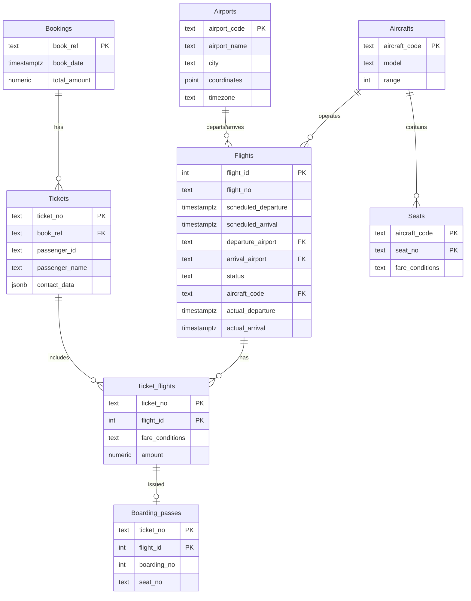
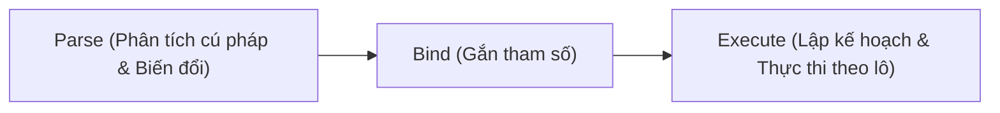

# PHẦN IV: Thực thi truy vấn (Part IV: Query Execution)

# CHƯƠNG 16: Các giai đoạn thực thi truy vấn (CHAPTER 16: Query Execution Stages)

## 16.1 Cơ sở dữ liệu mẫu (16.1 Demo Database)

Các ví dụ trong những phần trước của cuốn sách đều dựa trên những bảng đơn giản chỉ có vài dòng. Phần này và các phần tiếp theo sẽ đi sâu vào việc thực thi truy vấn, vốn đòi hỏi cao hơn ở khía cạnh này: chúng ta cần các bảng có liên kết với nhau và chứa số lượng dòng lớn hơn nhiều.

Thay vì tự tạo một tập dữ liệu mới cho mỗi ví dụ, tôi đã sử dụng một cơ sở dữ liệu mẫu có sẵn mô phỏng lưu lượng hàng không hành khách tại Nga.[^1] Cơ sở dữ liệu này có nhiều phiên bản; chúng ta sẽ dùng phiên bản lớn hơn được tạo vào ngày 15 tháng 8 năm 2017. Để cài đặt phiên bản này, bạn cần giải nén tệp chứa bản sao cơ sở dữ liệu từ kho lưu trữ[^2] và chạy tệp đó trong `psql`.

Khi phát triển cơ sở dữ liệu mẫu này, chúng tôi cố gắng thiết kế lược đồ (schema) đủ đơn giản để có thể hiểu mà không cần giải thích dài dòng; đồng thời, nó phải đủ phức tạp để cho phép viết các truy vấn có ý nghĩa. Cơ sở dữ liệu chứa đầy đủ dữ liệu sát với thực tế, giúp các ví dụ trở nên toàn diện và thú vị hơn khi thực hành.

Ở đây tôi sẽ chỉ điểm qua ngắn gọn các đối tượng chính của cơ sở dữ liệu; nếu muốn xem xét toàn bộ lược đồ, bạn có thể tham khảo tài liệu mô tả đầy đủ được dẫn ở chú thích cuối trang.

Thực thể chính là một lượt đặt chỗ — booking (ánh xạ tới bảng `bookings`). Một lượt đặt chỗ có thể bao gồm nhiều hành khách, mỗi người có một vé điện tử riêng (`tickets`). Hành khách không được tách thành một thực thể riêng biệt; để phục vụ các thử nghiệm của chúng ta, ta sẽ giả định rằng mọi hành khách đều là duy nhất.

Mỗi vé bao gồm một hoặc nhiều chặng bay (ánh xạ tới bảng `ticket_flights`). Một vé đơn lẻ có thể có nhiều chặng bay trong hai trường hợp: đó là vé khứ hồi, hoặc vé được xuất cho các chuyến bay nối chuyến. Mặc dù không có ràng buộc tương ứng nào trong lược đồ, tất cả các vé trong cùng một lượt đặt chỗ được giả định là có cùng các chặng bay.

Mỗi chuyến bay (`flights`) đi từ một sân bay (`airports`) này đến một sân bay khác. Các chuyến bay có cùng số hiệu chuyến bay sẽ có cùng điểm đi và điểm đến nhưng khác ngày khởi hành.

Khung nhìn (view) `routes` được xây dựng dựa trên bảng `flights`; nó hiển thị thông tin về các tuyến bay mà không phụ thuộc vào ngày bay cụ thể.

Khi làm thủ tục check-in, mỗi hành khách được cấp một thẻ lên máy bay (`boarding_passes`) kèm số ghế. Hành khách chỉ có thể làm thủ tục cho một chuyến bay nếu chuyến bay đó nằm trong vé. Sự kết hợp giữa chuyến bay và số ghế phải là duy nhất, do đó không thể cấp hai thẻ lên máy bay cho cùng một ghế.

Số lượng ghế (`seats`) trên một máy bay và sự phân bổ giữa các hạng vé khác nhau phụ thuộc vào mẫu máy bay cụ thể (`aircrafts`) thực hiện chuyến bay đó. Ta giả định rằng mỗi mẫu máy bay chỉ có một cấu hình khoang hành khách duy nhất.

Một số bảng sử dụng khóa chính thay thế (surrogate primary keys), trong khi các bảng khác sử dụng khóa tự nhiên (natural keys) — một số trong đó là khóa kết hợp (composite). Việc này chỉ nhằm mục đích minh họa và hoàn toàn không phải là hình mẫu để làm theo.

Có thể xem cơ sở dữ liệu mẫu này như một bản kết xuất (dump) của một hệ thống thực tế: nó chứa ảnh chụp nhanh (snapshot) của dữ liệu tại một thời điểm trong quá khứ. Để hiển thị thời điểm này, bạn có thể gọi hàm `bookings.now()`. Hãy dùng hàm này trong các truy vấn mẫu tại những chỗ mà trong thực tế bạn sẽ cần gọi hàm `now()`.

Tên các sân bay, thành phố và mẫu máy bay được lưu trong hai bảng `airports_data` và `aircrafts_data`; chúng được cung cấp bằng hai ngôn ngữ là tiếng Anh và tiếng Nga. Để xây dựng các ví dụ cho chương này, tôi thường truy vấn hai khung nhìn `airports` và `aircrafts` được thể hiện trong sơ đồ thực thể - liên kết (ER diagram); các khung nhìn này tự động chọn ngôn ngữ đầu ra dựa trên giá trị của tham số `bookings.lang` (mặc định là `en`). Tuy nhiên, tên của một số bảng gốc vẫn có thể xuất hiện trong các kế hoạch thực thi truy vấn (query plans).

[^1]: `postgrespro.com/community/demodb`
[^2]: `edu.postgrespro.com/demo-big-en-20170815.zip`

## 16.2 Giao thức truy vấn đơn giản (16.2 Simple Query Protocol)

Phiên bản đơn giản của giao thức client-server[^3] cho phép thực thi truy vấn SQL: nó gửi văn bản của một truy vấn lên máy chủ và nhận lại toàn bộ kết quả thực thi trong phản hồi, bất kể kết quả đó chứa bao nhiêu dòng.[^4] Một truy vấn gửi tới máy chủ sẽ trải qua nhiều giai đoạn: được phân tích cú pháp (parsed), biến đổi (transformed), lập kế hoạch (planned), và cuối cùng là thực thi (executed).

[^3]: `postgresql.org/docs/14/protocol.html`
[^4]: `backend/tcop/postgres.c`, hàm `exec_simple_query`

Dưới đây là cấu trúc lược đồ của cơ sở dữ liệu mẫu (các ký hiệu `#` biểu thị khóa chính, `∗` biểu thị thuộc tính bắt buộc `NOT NULL`, `∘` biểu thị thuộc tính có thể `NULL`):



```
Bookings              Airports              Tickets               Ticket_flights
# book_ref            # airport_code        # ticket_no           # ticket_no
∗ book_date           ∗ airport_name        ∗ book_ref            # flight_id
∗ total_amount        ∗ city                ∗ passenger_id        ∗ fare_conditions
                      ∗ coordinates         ∗ passenger_name      ∗ amount
                      ∗ timezone            ∗ contact_data

Flights               Aircrafts             Boarding_passes       Seats
# flight_id           # aircraft_code       # ticket_no           # aircraft_code
∗ flight_no           ∗ model               # flight_id           # seat_no
∗ scheduled_departure ∗ range               ∗ boarding_no         ∗ fare_conditions
∗ scheduled_arrival                         ∗ seat_no
∗ departure_airport
∗ arrival_airport
∗ status
∗ aircraft_code
∘ actual_departure
∘ actual_arrival
```

### Phân tích cú pháp (Parsing)

Trước hết, PostgreSQL phải phân tích cú pháp (parse)[^5] văn bản truy vấn để hiểu cần phải thực thi những gì.

**Phân tích từ vựng và phân tích cú pháp (Lexical and syntactic analysis).** Bộ phân tích từ vựng (lexer) tách văn bản truy vấn thành một tập hợp các đơn vị từ vựng (lexeme)[^6] (chẳng hạn như từ khóa, hằng chuỗi và hằng số), trong khi bộ phân tích cú pháp (parser) kiểm tra tính hợp lệ của tập hợp đó dựa trên văn phạm ngôn ngữ SQL.[^7] PostgreSQL dựa vào các công cụ phân tích chuẩn là hai tiện ích Flex và Bison.

Truy vấn đã được phân tích sẽ được biểu diễn trong bộ nhớ của tiến trình backend dưới dạng một cây cú pháp trừu tượng (abstract syntax tree).

Ví dụ, hãy xem xét truy vấn sau:

```sql
SELECT schemaname, tablename
FROM pg_tables
WHERE tableowner = 'postgres'
ORDER BY tablename;
```

Bộ phân tích từ vựng tách ra năm từ khóa, năm định danh (identifier), một hằng chuỗi và ba từ vựng đơn ký tự (dấu phẩy, dấu bằng và dấu chấm phẩy). Bộ phân tích cú pháp sử dụng các từ vựng này để dựng lên cây phân tích (parse tree), được minh họa rất giản lược bên dưới. Các chú thích bên cạnh các nút của cây chỉ rõ phần tương ứng của truy vấn:

```
QUERY
├── TARGETENTRY      (SELECT schemaname, tablename)
├── FROMEXPR         (FROM)
│   ├── RTE          (pg_tables)
│   └── OPEXPR       (WHERE tableowner = 'postgres')
└── SORTGROUPCLAUSE  (ORDER BY tablename)
```

Từ viết tắt khá khó hiểu `RTE` là viết tắt của *Range Table Entry* (mục nhập bảng phạm vi). Mã nguồn PostgreSQL dùng thuật ngữ *range table* để chỉ các bảng, truy vấn con, kết quả nối bảng — nói cách khác là bất kỳ tập hợp dòng nào có thể được xử lý bởi các toán tử SQL.[^8]

[^5]: `postgresql.org/docs/14/parser-stage.html`; `backend/parser/README`
[^6]: `backend/parser/scan.l`
[^7]: `backend/parser/gram.y`
[^8]: `include/nodes/parsenodes.h`

**Phân tích ngữ nghĩa (Semantic analysis).** Mục đích của phân tích ngữ nghĩa[^9] là xác định xem cơ sở dữ liệu có chứa các bảng hoặc đối tượng nào mà truy vấn tham chiếu theo tên hay không, và người dùng có quyền truy cập các đối tượng này không. Mọi thông tin cần thiết cho phân tích ngữ nghĩa đều được lưu trong danh mục hệ thống (system catalog).

Sau khi nhận được cây phân tích, bộ phân tích ngữ nghĩa thực hiện tái cấu trúc sâu hơn, bao gồm việc bổ sung các tham chiếu tới đối tượng cơ sở dữ liệu cụ thể, kiểu dữ liệu và các thông tin khác.

Nếu bật tham số `debug_print_parse`, bạn có thể xem toàn bộ cây phân tích trong tệp nhật ký (log) của máy chủ, nhưng điều này ít có ý nghĩa thực tiễn.

[^9]: `backend/parser/analyze.c`

### Biến đổi (Transformation)

Ở giai đoạn tiếp theo, truy vấn có thể được biến đổi (viết lại — rewritten).[^10]

Nhân PostgreSQL sử dụng phép biến đổi cho nhiều mục đích. Một trong số đó là thay thế tên của một khung nhìn (view) trong cây phân tích bằng cây con tương ứng với truy vấn gốc của khung nhìn đó.

Một trường hợp khác sử dụng biến đổi là triển khai bảo mật cấp dòng (row-level security).[^11] Các mệnh đề `SEARCH` và `CYCLE` của truy vấn đệ quy cũng được biến đổi trong giai đoạn này.[^12]

Trong ví dụ trên, `pg_tables` là một khung nhìn; nếu chúng ta đặt định nghĩa của nó trực tiếp vào văn bản truy vấn, nó sẽ trông như sau:

```sql
SELECT schemaname, tablename
FROM (
    -- pg_tables
    SELECT n.nspname AS schemaname,
           c.relname AS tablename,
           pg_get_userbyid(c.relowner) AS tableowner,
           ...
    FROM pg_class c
    LEFT JOIN pg_namespace n ON n.oid = c.relnamespace
    LEFT JOIN pg_tablespace t ON t.oid = c.reltablespace
    WHERE c.relkind = ANY (ARRAY['r'::char, 'p'::char])
)
WHERE tableowner = 'postgres'
ORDER BY tablename;
```

Tuy nhiên, máy chủ không xử lý biểu diễn dạng văn bản của truy vấn; mọi thao tác đều được thực hiện trên cây phân tích. Hình minh họa dưới đây cho thấy phiên bản rút gọn của cây đã được biến đổi (bạn có thể xem bản đầy đủ trong log máy chủ nếu bật tham số `debug_print_rewritten`).

Cây phân tích phản ánh cấu trúc cú pháp của truy vấn, nhưng không nói lên gì về thứ tự thực hiện các phép toán.

```
QUERY (ngoài)
├── TARGETENTRY
├── FROMEXPR
│   ├── RTE: pg_tables ──▶ thay thế bằng cây con QUERY (trong):
│   │   ├── TARGETENTRY
│   │   ├── FROMEXPR
│   │   │   ├── JOINEXPR
│   │   │   │   ├── JOINEXPR
│   │   │   │   │   ├── RTE: pg_class
│   │   │   │   │   ├── RTE: pg_namespace
│   │   │   │   │   └── OPEXPR: n.oid = c.relnamespace
│   │   │   │   ├── RTE: pg_tablespace
│   │   │   │   └── OPEXPR: t.oid = c.reltablespace
│   │   │   └── OPEXPR: c.relkind = ANY (ARRAY[...])
│   └── OPEXPR: tableowner = 'postgres'
└── SORTGROUPCLAUSE
```

PostgreSQL cũng hỗ trợ các phép biến đổi tùy chỉnh mà người dùng có thể tự triển khai thông qua hệ thống quy tắc viết lại (rewrite rule system).[^13]

Hỗ trợ hệ thống quy tắc từng được tuyên bố là một trong những mục tiêu chính khi phát triển Postgres;[^14] khi các quy tắc được triển khai lần đầu, dự án vẫn còn mang tính học thuật, nhưng kể từ đó chúng đã được thiết kế lại nhiều lần. Hệ thống quy tắc là một cơ chế rất mạnh mẽ, nhưng khá khó hiểu và khó gỡ lỗi (debug). Thậm chí từng có đề xuất loại bỏ hoàn toàn quy tắc khỏi PostgreSQL, nhưng ý tưởng này không nhận được sự đồng thuận tuyệt đối. Trong hầu hết trường hợp, việc sử dụng trigger sẽ an toàn và dễ dàng hơn so với dùng quy tắc.

[^10]: `postgresql.org/docs/14/rule-system.html`
[^11]: `backend/rewrite/rowsecurity.c`
[^12]: `backend/rewrite/rewriteSearchCycle.c`
[^13]: `postgresql.org/docs/14/rules.html`
[^14]: M. Stonebraker, L. A. Rowe. *The Design of Postgres*

### Lập kế hoạch (Planning)

SQL là một ngôn ngữ khai báo (declarative language): các truy vấn chỉ rõ *dữ liệu nào* cần lấy, chứ không chỉ rõ *lấy như thế nào*.

Bất kỳ truy vấn nào cũng có nhiều hướng thực thi khác nhau. Mỗi phép toán thể hiện trong cây phân tích có thể được hoàn thành theo nhiều cách: chẳng hạn, kết quả có thể được lấy bằng cách đọc toàn bộ bảng (rồi lọc bỏ các dòng dư thừa), hoặc bằng cách tìm các dòng cần thiết thông qua quét chỉ mục (index scan). Các tập dữ liệu luôn được nối (join) theo từng cặp, nên có vô số phương án khác nhau về thứ tự nối bảng. Bên cạnh đó còn có nhiều thuật toán nối bảng khác nhau: ví dụ, bộ thực thi có thể quét từng dòng của tập dữ liệu thứ nhất rồi tìm các dòng khớp ở tập thứ hai, hoặc cả hai tập dữ liệu được sắp xếp trước rồi trộn lại với nhau. Với mỗi thuật toán, ta đều có thể tìm thấy một trường hợp mà nó hoạt động hiệu quả hơn các thuật toán khác.

Thời gian thực thi giữa kế hoạch tối ưu và kế hoạch kém tối ưu có thể chênh lệch nhau nhiều bậc độ lớn (orders of magnitude), vì vậy bộ lập kế hoạch (planner)[^15] tối ưu hóa truy vấn đã phân tích là một trong những thành phần phức tạp nhất của hệ thống.

[^15]: `postgresql.org/docs/14/planner-optimizer.html`

#### Cây kế hoạch (Plan tree)

Kế hoạch thực thi cũng được biểu diễn dưới dạng một cây, nhưng các nút của nó làm việc với các phép toán vật lý trên dữ liệu thay vì các phép toán logic.

Nếu muốn khám phá toàn bộ cây kế hoạch, bạn có thể xuất chúng vào log máy chủ bằng cách bật tham số `debug_print_plan`. Nhưng trong thực tế, việc xem biểu diễn dạng văn bản của kế hoạch do lệnh `EXPLAIN`[^16] hiển thị thường đã đủ.

Hình minh họa dưới đây làm nổi bật các nút chính của cây. Chính những nút này được hiển thị trong kết quả của lệnh `EXPLAIN` cung cấp ngay bên dưới.

Trước mắt, hãy chú ý đến hai điểm sau:
- Cây chỉ chứa hai trong số ba bảng được truy vấn: bộ lập kế hoạch nhận thấy một trong các bảng (`pg_tablespace`) không cần thiết để lấy kết quả nên đã loại bỏ nó khỏi cây kế hoạch.
- Đối với mỗi nút trong cây, bộ lập kế hoạch cung cấp chi phí ước tính (estimated cost) và số lượng dòng dự kiến sẽ xử lý.

```sql
=> EXPLAIN SELECT schemaname, tablename
FROM pg_tables
WHERE tableowner = 'postgres'
ORDER BY tablename;
```
```
                              QUERY PLAN
----------------------------------------------------------------------
 Sort  (cost=21.03..21.04 rows=1 width=128)
   Sort Key: c.relname
   ->  Nested Loop Left Join  (cost=0.00..21.02 rows=1 width=128)
         Join Filter: (n.oid = c.relnamespace)
         ->  Seq Scan on pg_class c  (cost=0.00..19.93 rows=1 width=72)
               Filter: ((relkind = ANY ('{r,p}'::"char"[])) AND (pg_g...
         ->  Seq Scan on pg_namespace n  (cost=0.00..1.04 rows=4 wid...
(7 rows)
```

Các nút `Seq Scan` hiển thị trong kế hoạch truy vấn tương ứng với việc đọc tuần tự bảng, còn nút `Nested Loop` biểu diễn phép nối bảng.

```
PLANNEDSTMT
└── SORT
    ├── TARGETENTRY
    └── NESTLOOP
        ├── TARGETENTRY
        ├── SEQSCAN (pg_class)
        │   └── OPEXPR: relkind = ANY ('r,p'::"char"[]) AND pg_get_userbyid(relowner) = 'postgres'::name
        └── SEQSCAN (pg_namespace)
            └── OPEXPR: n.oid = c.relnamespace
```

> 📝 **Giải thích thêm (không có trong sách):**
> Tại sao `pg_tablespace` bị loại bỏ khỏi cây kế hoạch? Trong khung nhìn `pg_tables`, bảng `pg_tablespace` được nối bằng `LEFT JOIN` theo điều kiện `t.oid = c.reltablespace` (với `oid` là khóa duy nhất của `pg_tablespace`). Vì kết quả `SELECT schemaname, tablename` và mệnh đề `WHERE` không dùng bất kỳ cột nào của `pg_tablespace`, và `LEFT JOIN` trên khóa duy nhất đảm bảo không làm thay đổi số lượng dòng của bảng bên trái, bộ tối ưu hóa áp dụng kỹ thuật *Join Removal* (loại bỏ phép nối dư thừa) để bỏ qua hoàn toàn việc đọc `pg_tablespace`.

[^16]: `postgresql.org/docs/14/using-explain.html`

#### Tìm kiếm kế hoạch (Plan search)

PostgreSQL sử dụng bộ tối ưu hóa dựa trên chi phí (cost-based optimizer);[^17] nó duyệt qua các kế hoạch tiềm năng và ước tính tài nguyên cần thiết để thực thi chúng (chẳng hạn như số thao tác I/O hay chu kỳ CPU). Được chuẩn hóa thành một giá trị số, ước tính này được gọi là *chi phí* (cost) của kế hoạch. Trong số tất cả các kế hoạch được xem xét, kế hoạch có chi phí thấp nhất sẽ được chọn.

Vấn đề là số lượng kế hoạch tiềm năng tăng theo cấp số nhân cùng với số lượng bảng được nối, nên không thể xem xét tất cả chúng — ngay cả với những truy vấn tương đối đơn giản. Không gian tìm kiếm thường được thu hẹp bằng thuật toán quy hoạch động (dynamic programming) kết hợp với một số phép thử (heuristics). Điều này cho phép bộ lập kế hoạch tìm ra lời giải chính xác về mặt toán học cho các truy vấn có số lượng bảng lớn hơn trong khoảng thời gian chấp nhận được.

Một lời giải chính xác về mặt toán học không đảm bảo rằng kế hoạch được chọn thực sự là tối ưu nhất, bởi vì bộ lập kế hoạch sử dụng các mô hình toán học đã đơn giản hóa và có thể thiếu dữ liệu đầu vào đáng tin cậy.

[^17]: `backend/optimizer/README`

#### Kiểm soát thứ tự nối bảng (Managing the order of joins)

Một truy vấn có thể được viết theo cách giới hạn phạm vi tìm kiếm ở một mức độ nhất định (với rủi ro bỏ lỡ kế hoạch tối ưu).
- Các biểu thức bảng chung (CTE — Common Table Expressions) và truy vấn chính có thể được tối ưu hóa riêng rẽ; để đảm bảo hành vi này, bạn có thể chỉ định từ khóa `MATERIALIZED`.[^18]
- Các truy vấn con chạy bên trong hàm không phải SQL luôn được tối ưu hóa riêng biệt. (Các hàm SQL đôi khi có thể được gộp nội tuyến — inlined — vào truy vấn chính.[^19])
- Nếu bạn thiết lập tham số `join_collapse_limit` và sử dụng các mệnh đề `JOIN` tường minh trong truy vấn, thứ tự của một số phép nối sẽ do cấu trúc cú pháp của truy vấn quyết định; tham số `from_collapse_limit` có tác dụng tương tự đối với các truy vấn con.[^20]

Điểm cuối cùng này cần được giải thích rõ hơn. Hãy xem xét truy vấn không chỉ định phép nối tường minh nào cho các bảng liệt kê trong mệnh đề `FROM`:

```sql
SELECT ...
FROM a, b, c, d, e
WHERE ...
```

Ở đây bộ lập kế hoạch sẽ phải xem xét mọi cặp nối có thể có. Truy vấn được biểu diễn bằng phần cây phân tích sau (vẽ dưới dạng lược đồ):

```
FROMEXPR
├── A
├── B
├── C
├── D
└── E
```

Trong ví dụ tiếp theo, các phép nối có cấu trúc xác định thông qua mệnh đề `JOIN`:

```sql
SELECT ...
FROM a, b JOIN c ON ..., d, e
WHERE ...
```

Cây phân tích phản ánh cấu trúc này như sau:

```
FROMEXPR
├── A
├── JOINEXPR
│   ├── B
│   └── C
├── D
└── E
```

Bộ lập kế hoạch thường làm phẳng (flatten) cây nối để nó trông giống như ví dụ đầu tiên. Thuật toán duyệt đệ quy cây và thay thế mỗi nút `JOINEXPR` bằng một danh sách phẳng chứa các phần tử của nó.[^21]

Tuy nhiên, việc gộp phẳng này chỉ được thực hiện nếu danh sách phẳng thu được có không quá `join_collapse_limit` phần tử (mặc định là `8`). Trong trường hợp cụ thể này, nút `JOINEXPR` sẽ không bị làm phẳng nếu giá trị `join_collapse_limit` nhỏ hơn 5.

Đối với bộ lập kế hoạch, điều đó có nghĩa là:
- Bảng `b` phải được nối với bảng `c` (hoặc ngược lại, `c` nối với `b`; thứ tự trong nội bộ một cặp không bị hạn chế).
- Các bảng `a`, `d`, `e` và kết quả nối giữa `b` và `c` có thể được nối theo bất kỳ thứ tự nào.

Nếu tham số `join_collapse_limit` được đặt bằng `1`, thứ tự xác định bởi các mệnh đề `JOIN` tường minh sẽ được bảo toàn hoàn toàn.

Riêng đối với các toán hạng của `FULL OUTER JOIN`, chúng không bao giờ bị làm phẳng, bất kể giá trị của tham số `join_collapse_limit` là bao nhiêu.

Tham số `from_collapse_limit` (mặc định cũng là `8`) kiểm soát việc làm phẳng truy vấn con theo cách tương tự. Mặc dù các truy vấn con trông không giống mệnh đề `JOIN`, sự tương đồng thể hiện rõ ở cấp độ cây phân tích.

Dưới đây là một truy vấn mẫu:

```sql
SELECT ...
FROM a,
     (
         SELECT ... FROM b, c WHERE ...
     ) bc,
     d, e
WHERE ...
```

Cây nối tương ứng được minh họa bên dưới. Điểm khác biệt duy nhất ở đây là cây này chứa nút `FROMEXPR` thay vì `JOINEXPR` (do đó mới có tên tham số là `from_collapse_limit`).

```
FROMEXPR
├── A
├── FROMEXPR
│   ├── B
│   └── C
├── D
└── E
```

[^18]: `postgresql.org/docs/14/queries-with.html`
[^19]: `wiki.postgresql.org/wiki/Inlining_of_SQL_functions`
[^20]: `postgresql.org/docs/14/explicit-joins.html`
[^21]: `backend/optimizer/plan/initsplan.c`, hàm `deconstruct_jointree`

#### Tối ưu hóa truy vấn di truyền (Genetic query optimization)

Sau khi được làm phẳng, cây có thể chứa quá nhiều phần tử ở cùng một cấp — bao gồm các bảng hoặc các kết quả nối phải được tối ưu hóa riêng. Thời gian lập kế hoạch phụ thuộc theo hàm mũ vào số lượng tập dữ liệu cần nối, vì vậy nó có thể tăng vượt quá mọi giới hạn hợp lý.

Nếu tham số `geqo` được bật (mặc định là `on`) và số lượng phần tử ở một cấp vượt quá giá trị `geqo_threshold` (mặc định là `12`), bộ lập kế hoạch sẽ sử dụng thuật toán di truyền (genetic algorithm) để tối ưu hóa truy vấn.[^22]

Thuật toán này nhanh hơn nhiều so với quy hoạch động, nhưng không thể đảm bảo rằng kế hoạch tìm được là tối ưu nhất. Vì vậy, nguyên tắc kinh nghiệm (rule of thumb) là tránh phải dùng đến thuật toán di truyền bằng cách giảm số lượng phần tử cần tối ưu hóa cùng lúc.

Thuật toán di truyền có một số tham số cấu hình được,[^23] nhưng tôi sẽ không đi sâu vào chúng ở đây.

[^22]: `postgresql.org/docs/14/geqo.html`; `backend/optimizer/geqo/geqo_main.c`
[^23]: `postgresql.org/docs/14/runtime-config-query.html#RUNTIME-CONFIG-QUERY-GEQO`

#### Chọn kế hoạch tốt nhất (Choosing the best plan)

Một kế hoạch có được coi là tối ưu hay không còn phụ thuộc vào cách một client cụ thể sử dụng kết quả truy vấn. Nếu client cần toàn bộ kết quả ngay một lần (ví dụ để tạo báo cáo), kế hoạch nên tối ưu hóa việc lấy tất cả các dòng. Nhưng nếu ưu tiên là trả về những dòng đầu tiên càng sớm càng tốt (ví dụ để hiển thị lên màn hình), kế hoạch tối ưu có thể hoàn toàn khác.

Để đưa ra lựa chọn này, PostgreSQL tính toán hai thành phần của chi phí:

```sql
=> EXPLAIN
SELECT schemaname, tablename
FROM pg_tables
WHERE tableowner = 'postgres'
ORDER BY tablename;
```
```
                              QUERY PLAN
----------------------------------------------------------------------
 Sort  (cost=21.03..21.04 rows=1 width=128)
   Sort Key: c.relname
   ->  Nested Loop Left Join  (cost=0.00..21.02 rows=1 width=128)
         Join Filter: (n.oid = c.relnamespace)
         ->  Seq Scan on pg_class c  (cost=0.00..19.93 rows=1 width=72)
               Filter: ((relkind = ANY ('{r,p}'::"char"[])) AND (pg_g...
         ->  Seq Scan on pg_namespace n  (cost=0.00..1.04 rows=4 wid...
(7 rows)
```

Thành phần thứ nhất (*chi phí khởi động* — startup cost) đại diện cho cái giá bạn phải trả để chuẩn bị cho việc thực thi nút đó, trong khi thành phần thứ hai (*tổng chi phí* — total cost) bao gồm toàn bộ chi phí phát sinh để lấy xong kết quả.

Đôi khi người ta nói rằng chi phí khởi động là chi phí để lấy dòng đầu tiên của tập kết quả, nhưng điều đó không hoàn toàn chính xác.

Để chọn ra các kế hoạch ưu tiên, bộ tối ưu hóa kiểm tra xem truy vấn có sử dụng con trỏ (cursor) hay không (thông qua lệnh `DECLARE` trong SQL hoặc được khai báo tường minh trong PL/pgSQL).[^24] Nếu không, client được giả định là cần toàn bộ kết quả ngay lập tức, và bộ tối ưu hóa chọn kế hoạch có tổng chi phí nhỏ nhất.

Nếu truy vấn được thực thi với một con trỏ, kế hoạch được chọn chỉ cần tối ưu hóa việc lấy một tỷ lệ `cursor_tuple_fraction` (mặc định là `0.1`) của toàn bộ số dòng. Chính xác hơn, PostgreSQL chọn kế hoạch có giá trị nhỏ nhất của biểu thức sau:[^25]

$$\text{startup cost} + \text{cursor\_tuple\_fraction} \times (\text{total cost} - \text{startup cost})$$

> 💡 **Ví dụ bổ sung (không có trong sách):**
> Giả sử bạn có bảng `flights` và cần lấy toàn bộ dữ liệu sắp xếp theo `flight_id`:
> - Kế hoạch A (Seq Scan + Sort): `startup cost = 5000`, `total cost = 6000`.
> - Kế hoạch B (Index Scan theo `flight_id`): `startup cost = 0.42`, `total cost = 9000`.
>
> Nếu chạy truy vấn bình thường (không dùng cursor), bộ tối ưu hóa chọn Kế hoạch A vì tổng chi phí `6000 < 9000`.
> Nếu mở cursor (`DECLARE c CURSOR FOR ...`) với `cursor_tuple_fraction = 0.1`:
> - Chi phí hiệu dụng Kế hoạch A = $5000 + 0.1 \times (6000 - 5000) = 5100$.
> - Chi phí hiệu dụng Kế hoạch B = $0.42 + 0.1 \times (9000 - 0.42) = 900.38$.
> Lúc này Kế hoạch B được chọn vì trả về những dòng đầu tiên gần như tức thì.

[^24]: `backend/optimizer/plan/planner.c`, hàm `standard_planner`
[^25]: `backend/optimizer/util/pathnode.c`, hàm `compare_fractional_path_costs`

#### Khái quát về ước tính chi phí (An outline of cost estimation)

Để ước tính tổng chi phí của một kế hoạch, ta phải có ước tính chi phí cho tất cả các nút của nó. Chi phí của một nút phụ thuộc vào loại nút đó (rõ ràng chi phí đọc dữ liệu từ heap không giống chi phí sắp xếp) và vào lượng dữ liệu mà nút này xử lý (khối lượng dữ liệu lớn hơn thường kéo theo chi phí cao hơn). Trong khi loại nút đã biết trước, lượng dữ liệu chỉ có thể được dự đoán dựa trên ước tính *lực lượng* (cardinality — số dòng mà nút nhận làm đầu vào) và *độ chọn lọc* (selectivity — tỷ lệ dòng còn lại ở đầu ra) của nút. Các phép tính này dựa vào dữ liệu thống kê thu thập được, chẳng hạn như kích thước bảng và phân bố dữ liệu trong các cột của bảng.

Do đó, quá trình tối ưu hóa phụ thuộc vào tính chính xác của dữ liệu thống kê do autovacuum thu thập và cập nhật.

Nếu ước tính lực lượng chính xác cho từng nút, chi phí tính toán được nhiều khả năng sẽ phản ánh đúng chi phí thực tế. Những sai sót lớn trong lập kế hoạch thường bắt nguồn từ việc ước tính sai lực lượng và độ chọn lọc, nguyên nhân có thể do thống kê không chính xác hoặc lỗi thời, do không thể sử dụng thống kê, hoặc — ở mức độ ít hơn — do các mô hình lập kế hoạch chưa hoàn hảo.

#### Ước tính lực lượng (Cardinality estimation)

Để tính lực lượng (cardinality) của một nút, bộ lập kế hoạch phải thực hiện đệ quy các bước sau:
1. Ước tính lực lượng của từng nút con và đánh giá số dòng đầu vào mà nút hiện tại sẽ nhận từ chúng.
2. Ước tính độ chọn lọc của nút, tức là tỷ lệ phần trăm số dòng đầu vào sẽ được giữ lại ở đầu ra.

Lực lượng của nút là tích của hai giá trị này.

Độ chọn lọc được biểu diễn bằng một số từ `0` đến `1`. Số càng nhỏ thì độ chọn lọc càng cao, và ngược lại, một số gần bằng `1` biểu thị độ chọn lọc thấp. Nghe có vẻ hơi ngược đời, nhưng ý tưởng ở đây là một điều kiện có độ chọn lọc cao sẽ loại bỏ gần như toàn bộ các dòng, trong khi điều kiện chỉ loại bỏ vài dòng thì có độ chọn lọc thấp.

Trước tiên, bộ lập kế hoạch ước tính lực lượng của các nút lá vốn xác định phương thức truy cập dữ liệu. Các phép tính này dựa vào thống kê thu thập được, chẳng hạn như tổng kích thước của bảng.

Độ chọn lọc của điều kiện lọc phụ thuộc vào loại điều kiện. Trong trường hợp đơn giản nhất, nó có thể được gán một giá trị hằng số, mặc dù bộ lập kế hoạch luôn cố gắng tận dụng mọi thông tin sẵn có để tinh chỉnh ước tính. Nhìn chung, chỉ cần biết cách ước tính các điều kiện lọc đơn giản; nếu một điều kiện chứa các phép toán logic, độ chọn lọc của nó được tính theo các công thức sau:[^26]

$$\text{sel}_{x \text{ AND } y} = \text{sel}_x \cdot \text{sel}_y$$

$$\text{sel}_{x \text{ OR } y} = 1 - (1 - \text{sel}_x)(1 - \text{sel}_y) = \text{sel}_x + \text{sel}_y - \text{sel}_x \cdot \text{sel}_y$$

Không may là các công thức này giả định rằng hai vị từ (predicate) $x$ và $y$ độc lập với nhau. Với các vị từ có tương quan (correlated predicates), những ước tính như vậy sẽ không chính xác.

Để ước tính lực lượng của phép nối bảng (join), bộ lập kế hoạch phải tính lực lượng của tích Đề-các (tức là tích lực lượng của hai tập dữ liệu) và ước tính độ chọn lọc của điều kiện nối, vốn cũng phụ thuộc vào loại điều kiện.

Lực lượng của các nút khác (như sắp xếp hay tổng hợp) được ước tính theo cách tương tự.

Điều quan trọng cần lưu ý là việc ước tính sai lực lượng ở các nút kế hoạch cấp thấp sẽ ảnh hưởng dây chuyền đến mọi phép tính phía trên, dẫn đến ước tính tổng chi phí sai lệch và lựa chọn kế hoạch tồi. Tệ hơn nữa, bộ lập kế hoạch không có thống kê về kết quả của phép nối bảng, mà chỉ có thống kê trên từng bảng riêng lẻ.

[^26]: `backend/optimizer/path/clausesel.c`, các hàm `clauselist_selectivity_ext` và `clauselist_selectivity_or`

#### Ước tính chi phí (Cost estimation)

Quá trình ước tính chi phí cũng mang tính đệ quy. Để tính chi phí của một cây con, cần phải tính và cộng dồn chi phí của tất cả các nút con của nó rồi cộng thêm chi phí của chính nút cha.

Để ước tính chi phí của một nút, PostgreSQL áp dụng mô hình toán học của phép toán mà nút đó thực hiện, lấy lực lượng nút đã ước tính trước đó làm đầu vào. Với mỗi nút, cả chi phí khởi động và tổng chi phí đều được tính toán.

Một số phép toán không có điều kiện tiên quyết nào nên việc thực thi bắt đầu ngay lập tức; các nút như vậy có chi phí khởi động bằng 0.

Ngược lại, các phép toán khác cần phải chờ một số thao tác chuẩn bị hoàn tất. Chẳng hạn, một nút sắp xếp (`Sort`) thường phải đợi toàn bộ dữ liệu từ các nút con trả về trước khi có thể thực hiện công việc của riêng mình. Chi phí khởi động của các nút như vậy thường lớn hơn 0: cái giá này phải trả ngay cả khi nút phía trên (hoặc client) chỉ cần đúng một dòng trong toàn bộ đầu ra.

Mọi phép tính do bộ lập kế hoạch thực hiện chỉ đơn thuần là các ước tính, có thể không liên quan trực tiếp đến thời gian thực thi thực tế. Mục đích duy nhất của chúng là giúp so sánh các kế hoạch khác nhau cho *cùng một truy vấn* trong *cùng một điều kiện*. Trong các trường hợp khác, việc so sánh các truy vấn (đặc biệt là các truy vấn khác nhau) dựa trên chi phí của chúng là vô nghĩa. Ví dụ, chi phí có thể từng bị ước tính thấp đi do thống kê lỗi thời; một khi thống kê được làm mới, con số tính toán có thể tăng lên, nhưng vì ước tính trở nên chính xác hơn nên máy chủ sẽ chọn được một kế hoạch tốt hơn.

### Thực thi (Execution)

Kế hoạch được xây dựng trong quá trình tối ưu hóa truy vấn giờ đây phải được thực thi.[^27]

Bộ thực thi (executor) mở một *portal* trong bộ nhớ của tiến trình backend;[^28] đây là đối tượng lưu giữ trạng thái của truy vấn đang được thực thi. Trạng thái này được biểu diễn dưới dạng một cây lặp lại cấu trúc của cây kế hoạch. Các nút của cây này vận hành như một dây chuyền lắp ráp, yêu cầu và truyền các dòng dữ liệu qua lại với nhau.

```
SORT
└── NESTLOOP
    ├── SEQSCAN (pg_class)
    └── SEQSCAN (pg_namespace)
```

Quá trình thực thi truy vấn bắt đầu từ nút gốc (root). Nút gốc (biểu diễn phép toán `SORT` trong ví dụ này) kéo dữ liệu từ nút con của nó. Sau khi nhận đủ toàn bộ các dòng, nó sắp xếp chúng và truyền tiếp cho client.

Một số nút (như nút `NESTLOOP` trong hình minh họa) thực hiện nối các tập dữ liệu nhận từ những nguồn khác nhau. Một nút như vậy kéo dữ liệu từ hai nút con, và ngay khi có được một cặp dòng thỏa mãn điều kiện nối, nó truyền ngay dòng kết quả lên trên (khác với sắp xếp vốn phải lấy hết toàn bộ dòng trước). Tại thời điểm đó, quá trình thực thi của nút tạm ngưng cho đến khi nút cha của nó yêu cầu dòng tiếp theo. Nếu chỉ cần một phần kết quả (ví dụ có mệnh đề `LIMIT` trong truy vấn), phép toán sẽ không phải thực hiện toàn bộ.

Hai nút lá `SEQSCAN` của cây chịu trách nhiệm quét bảng. Khi nút cha yêu cầu dữ liệu từ các nút này, chúng sẽ lấy dòng kế tiếp từ bảng tương ứng.

Như vậy, một số nút không lưu trữ bất kỳ dòng nào mà truyền ngay lên trên, nhưng các nút khác (như `SORT`) phải giữ khối lượng dữ liệu có khả năng rất lớn. Cho mục đích này, một vùng nhớ có kích thước `work_mem` (mặc định `4MB`) được cấp phát trong bộ nhớ của tiến trình backend; nếu không đủ, phần dữ liệu còn lại sẽ bị đẩy ra các tệp tạm trên đĩa.[^29]

Một kế hoạch có thể có nhiều nút cùng cần lưu trữ dữ liệu, nên PostgreSQL có thể cấp phát nhiều vùng nhớ, mỗi vùng có kích thước tối đa `work_mem`. Tổng dung lượng RAM mà một truy vấn có thể sử dụng không bị giới hạn theo bất kỳ cách nào.

> 📝 **Giải thích thêm (không có trong sách):**
> Vì mỗi nút `Sort`, `Hash` hay `Materialize` trong một kế hoạch phức tạp (hoặc trong các worker song song) đều có thể cấp phát tối đa `work_mem`, nên nếu đặt `work_mem` quá lớn (ví dụ `512MB`) trên hệ thống có nhiều kết nối đồng thời, tổng RAM tiêu thụ có thể tăng đột biến dẫn đến lỗi hết bộ nhớ (OOM). Do đó, khi tinh chỉnh `work_mem`, cần cân nhắc số lượng kết nối tối đa và độ phức tạp của các truy vấn chạy đồng thời.

[^27]: `postgresql.org/docs/14/executor.html`; `backend/executor/README`
[^28]: `backend/utils/mmgr/portalmem.c`
[^29]: `backend/utils/sort/tuplestore.c`

## 16.3 Giao thức truy vấn mở rộng (16.3 Extended Query Protocol)

Khi sử dụng giao thức truy vấn đơn giản, mỗi lệnh (ngay cả khi được lặp lại nhiều lần) đều phải đi qua toàn bộ các giai đoạn vừa nêu:
1. phân tích cú pháp (parsing)
2. biến đổi (transformation)
3. lập kế hoạch (planning)
4. thực thi (execution)

Tuy nhiên, việc phân tích cú pháp lặp đi lặp lại cùng một truy vấn là không có ý nghĩa. Phân tích lặp lại các truy vấn chỉ khác nhau ở hằng số cũng không hợp lý — cấu trúc cây phân tích vẫn giữ nguyên như cũ.

Một nhược điểm khác của giao thức truy vấn đơn giản là client nhận toàn bộ kết quả cùng một lúc, bất kể kết quả có bao nhiêu dòng.

Nhìn chung, có thể khắc phục các hạn chế này bằng lệnh SQL. Để giải quyết vấn đề thứ nhất, bạn có thể `PREPARE` truy vấn trước khi chạy lệnh `EXECUTE`; vấn đề thứ hai có thể giải quyết bằng cách tạo con trỏ với `DECLARE` và lấy dòng qua `FETCH`. Nhưng trong trường hợp này, client phải tự quản lý việc đặt tên cho các đối tượng mới tạo, trong khi máy chủ lại tốn thêm chi phí phân tích cú pháp cho các lệnh phụ trợ đó.

Giao thức client-server mở rộng (extended query protocol) cung cấp một giải pháp thay thế, cho phép kiểm soát chính xác từng giai đoạn thực thi toán tử riêng lẻ ngay ở cấp độ lệnh của bản thân giao thức.



### Chuẩn bị (Preparation)

Trong giai đoạn chuẩn bị, truy vấn được phân tích cú pháp và biến đổi như bình thường, nhưng cây phân tích thu được được giữ lại trong bộ nhớ của tiến trình backend.

PostgreSQL không có bộ nhớ đệm toàn cục (global cache) cho truy vấn. Nhược điểm của kiến trúc này khá rõ: mỗi backend phải tự phân tích mọi truy vấn gửi đến nó, ngay cả khi truy vấn đó đã được một backend khác phân tích rồi. Nhưng nó cũng có lợi thế. Bộ nhớ đệm toàn cục có thể dễ dàng trở thành nút thắt cổ chai (bottleneck) vì các khóa (lock). Một client chạy nhiều truy vấn nhỏ nhưng khác nhau (chẳng hạn chỉ khác ở hằng số) tạo ra lượng lưu lượng lớn và có thể ảnh hưởng tiêu cực đến hiệu năng của toàn bộ hệ thống (instance). Trong PostgreSQL, các truy vấn được phân tích cục bộ nên không gây ảnh hưởng tới các tiến trình khác.

Một truy vấn đã chuẩn bị (prepared query) có thể được tham số hóa. Dưới đây là một ví dụ đơn giản dùng lệnh SQL (tuy không hoàn toàn giống việc chuẩn bị ở cấp giao thức, hiệu quả cuối cùng là tương đương):

```sql
=> PREPARE plane(text) AS
SELECT * FROM aircrafts WHERE aircraft_code = $1;
```

Tất cả các câu lệnh chuẩn bị có đặt tên đều được hiển thị trong khung nhìn `pg_prepared_statements`:

```sql
=> SELECT name, statement, parameter_types
FROM pg_prepared_statements \gx
-[ RECORD 1 ]---+-----------------------------------------------------
name            | plane
statement       | PREPARE plane(text) AS                              +
                | SELECT * FROM aircrafts WHERE aircraft_code = $1;
parameter_types | {text}
```

Bạn sẽ không thấy bất kỳ câu lệnh không tên (unnamed statements) nào ở đây (những câu lệnh dùng giao thức truy vấn mở rộng hoặc PL/pgSQL). Các câu lệnh được chuẩn bị bởi những backend khác cũng không hiển thị: không thể truy cập vào bộ nhớ của phiên làm việc khác.

### Gắn tham số (Parameter Binding)

Trước khi một câu lệnh đã chuẩn bị được thực thi, các giá trị tham số thực tế phải được gắn (bind) vào.

```sql
=> EXECUTE plane('733');
 aircraft_code |     model      | range
---------------+----------------+-------
 733           | Boeing 737-300 |  4200
(1 row)
```

Ưu điểm của việc gắn tham số trong câu lệnh chuẩn bị so với việc nối chuỗi hằng số vào văn bản truy vấn là nó khiến lỗi tiêm nhiễm SQL (SQL injection) hoàn toàn không thể xảy ra: một giá trị tham số được gắn không thể sửa đổi cây phân tích đã được dựng sẵn theo bất kỳ cách nào. Để đạt được mức độ bảo mật tương tự mà không dùng câu lệnh chuẩn bị, bạn sẽ phải thoát ký tự (escape) cẩn thận mọi giá trị nhận từ nguồn không đáng tin cậy.

### Lập kế hoạch và thực thi (Planning and Execution)

Khi thực thi câu lệnh đã chuẩn bị, việc lập kế hoạch truy vấn được thực hiện dựa trên các giá trị tham số thực tế; sau đó kế hoạch được chuyển cho bộ thực thi.

Các giá trị tham số khác nhau có thể dẫn đến những kế hoạch tối ưu khác nhau, vì vậy việc tính đến giá trị chính xác là rất quan trọng. Chẳng hạn, khi tìm kiếm các lượt đặt chỗ đắt tiền, bộ lập kế hoạch giả định rằng không có nhiều dòng khớp điều kiện và sử dụng quét chỉ mục:

```sql
=> CREATE INDEX ON bookings(total_amount);
=> EXPLAIN SELECT *
FROM bookings
WHERE total_amount > 1000000;
```
```
                                 QUERY PLAN
----------------------------------------------------------------------------
 Bitmap Heap Scan on bookings  (cost=86.49..9245.82 rows=4395 wid...
   Recheck Cond: (total_amount > '1000000'::numeric)
   ->  Bitmap Index Scan on bookings_total_amount_idx  (cost=0.00....
         Index Cond: (total_amount > '1000000'::numeric)
(4 rows)
```

Nhưng nếu điều kiện đưa ra được thỏa mãn bởi tất cả các lượt đặt chỗ, thì không có lý do gì để dùng chỉ mục vì đằng nào cũng phải quét toàn bộ bảng:

```sql
=> EXPLAIN SELECT *
FROM bookings
WHERE total_amount > 100;
```
```
                          QUERY PLAN
------------------------------------------------------------------
 Seq Scan on bookings  (cost=0.00..39835.88 rows=2111110 width=21)
   Filter: (total_amount > '100'::numeric)
(2 rows)
```

Trong một số trường hợp, bộ lập kế hoạch có thể lưu giữ cả cây phân tích lẫn kế hoạch truy vấn để tránh phải lập kế hoạch lại nhiều lần. Một kế hoạch như vậy không tính đến giá trị cụ thể của tham số, nên nó được gọi là *kế hoạch chung* (generic plan — để phân biệt với *kế hoạch tùy chỉnh* / custom plan vốn dựa trên giá trị thực tế).[^30]

Trường hợp hiển nhiên mà máy chủ có thể dùng kế hoạch chung mà không làm giảm hiệu năng là một truy vấn không có tham số.

Năm lần tối ưu hóa đầu tiên của một câu lệnh chuẩn bị có tham số luôn dựa trên giá trị tham số thực tế; bộ lập kế hoạch tính toán chi phí trung bình của các kế hoạch tùy chỉnh dựa trên các giá trị này. Bắt đầu từ lần thực thi thứ sáu, nếu kế hoạch chung tỏ ra hiệu quả hơn trung bình các kế hoạch tùy chỉnh (có tính đến việc kế hoạch tùy chỉnh phải được dựng lại mỗi lần chạy),[^31] bộ lập kế hoạch sẽ giữ lại kế hoạch chung và tiếp tục dùng nó, bỏ qua giai đoạn tối ưu hóa.

Câu lệnh chuẩn bị `plane` đã được thực thi một lần ở trên. Sau ba lần thực thi tiếp theo, máy chủ vẫn dùng kế hoạch tùy chỉnh — bạn có thể nhận biết qua giá trị tham số cụ thể xuất hiện trong kế hoạch truy vấn:

```sql
=> EXECUTE plane('763');
=> EXECUTE plane('773');
=> EXPLAIN EXECUTE plane('319');
```
```
                         QUERY PLAN
------------------------------------------------------------
 Seq Scan on aircrafts_data ml  (cost=0.00..1.39 rows=1 width=52)
   Filter: ((aircraft_code)::text = '319'::text)
(2 rows)
```

Sau lần thực thi thứ năm, bộ lập kế hoạch chuyển sang kế hoạch chung: nó không khác gì các kế hoạch tùy chỉnh và có cùng chi phí, nhưng backend có thể dựng nó một lần và bỏ qua giai đoạn tối ưu hóa, nhờ đó giảm bớt chi phí phụ trợ (overhead) cho việc lập kế hoạch. Lệnh `EXPLAIN` giờ đây cho thấy tham số được tham chiếu theo vị trí (`$1`) thay vì theo giá trị:

```sql
=> EXECUTE plane('320');
=> EXPLAIN EXECUTE plane('321');
```
```
                         QUERY PLAN
------------------------------------------------------------
 Seq Scan on aircrafts_data ml  (cost=0.00..1.39 rows=1 width=52)
   Filter: ((aircraft_code)::text = $1)
(2 rows)
```

Chúng ta có thể dễ dàng hình dung một kịch bản không mong muốn khi vài kế hoạch tùy chỉnh đầu tiên có chi phí đắt hơn kế hoạch chung; các kế hoạch về sau lẽ ra có thể hiệu quả hơn, nhưng bộ lập kế hoạch sẽ không còn xem xét chúng nữa. Bên cạnh đó, nó so sánh các *ước tính* thay vì chi phí *thực tế*, điều này cũng có thể dẫn đến tính toán sai lầm.

Tuy nhiên, nếu bộ lập kế hoạch mắc sai lầm, bạn có thể ghi đè quyết định tự động và chọn kế hoạch chung hoặc kế hoạch tùy chỉnh bằng cách thiết lập tham số `plan_cache_mode` (mặc định là `auto`) cho phù hợp:

```sql
=> SET plan_cache_mode = 'force_custom_plan';
=> EXPLAIN EXECUTE plane('CN1');
```
```
                         QUERY PLAN
------------------------------------------------------------
 Seq Scan on aircrafts_data ml  (cost=0.00..1.39 rows=1 width=52)
   Filter: ((aircraft_code)::text = 'CN1'::text)
(2 rows)
```

Ngoài những thông tin khác, khung nhìn `pg_prepared_statements` còn hiển thị thống kê về các kế hoạch đã được chọn:

```sql
=> SELECT name, generic_plans, custom_plans
FROM pg_prepared_statements;
 name  | generic_plans | custom_plans
-------+---------------+--------------
 plane |             1 |            6
(1 row)
```

[^30]: `backend/utils/cache/plancache.c`, hàm `choose_custom_plan`
[^31]: `backend/utils/cache/plancache.c`, hàm `cached_plan_cost`

### Lấy kết quả (Getting the Results)

Giao thức truy vấn mở rộng cho phép lấy dữ liệu theo từng lô (batch) thay vì lấy toàn bộ cùng một lúc. Các con trỏ SQL cũng mang lại hiệu quả gần tương tự (ngoại trừ việc máy chủ tốn thêm một chút công việc, và bộ lập kế hoạch tối ưu hóa việc lấy `cursor_tuple_fraction` dòng đầu tiên chứ không phải toàn bộ tập kết quả):

```sql
=> BEGIN;
=> DECLARE cur CURSOR FOR
SELECT *
FROM aircrafts
ORDER BY aircraft_code;
=> FETCH 3 FROM cur;
 aircraft_code |      model      | range
---------------+-----------------+-------
 319           | Airbus A319-100 |  6700
 320           | Airbus A320-200 |  5700
 321           | Airbus A321-200 |  5600
(3 rows)
=> FETCH 2 FROM cur;
 aircraft_code |     model      | range
---------------+----------------+-------
 733           | Boeing 737-300 |  4200
 763           | Boeing 767-300 |  7900
(2 rows)
=> COMMIT;
```

Nếu truy vấn trả về nhiều dòng và client cần toàn bộ chúng, thông lượng (throughput) của hệ thống phụ thuộc rất lớn vào kích thước lô (batch size). Số dòng trong một lô càng lớn thì chi phí giao tiếp phát sinh do truy cập máy chủ và nhận phản hồi càng ít. Nhưng khi kích thước lô tăng lên, lợi ích này trở nên kém rõ rệt hơn: trong khi sự khác biệt giữa việc lấy từng dòng một và lấy theo lô 10 dòng có thể rất khổng lồ, thì sự khác biệt giữa các lô 100 dòng và 1000 dòng lại ít đáng kể hơn nhiều.

---

## Bảng thuật ngữ chương (Chapter Glossary)

| Thuật ngữ (English) | Tiếng Việt | Giải thích ngắn gọn |
| :--- | :--- | :--- |
| Simple Query Protocol | Giao thức truy vấn đơn giản | Giao thức gửi chuỗi SQL và nhận toàn bộ kết quả trong một lượt sau khi qua đủ 4 bước phân tích, biến đổi, lập kế hoạch, thực thi. |
| Extended Query Protocol | Giao thức truy vấn mở rộng | Giao thức tách riêng các bước Parse, Bind, Execute để tái sử dụng cây phân tích, gắn tham số an toàn và lấy kết quả theo lô. |
| Parse Tree | Cây phân tích (cú pháp) | Cấu trúc cây trừu tượng trong bộ nhớ biểu diễn cấu trúc cú pháp và ngữ nghĩa của truy vấn sau khi phân tích. |
| Range Table Entry (RTE) | Mục nhập bảng phạm vi | Nút trong cây phân tích đại diện cho một nguồn dữ liệu như bảng, truy vấn con hoặc kết quả nối. |
| Rewrite Rule System | Hệ thống quy tắc viết lại | Cơ chế biến đổi cây phân tích (dùng cho view, RLS hoặc quy tắc tùy chỉnh) trước khi lập kế hoạch. |
| Plan Tree | Cây kế hoạch | Cây chứa các phép toán vật lý (như `Seq Scan`, `Nested Loop`, `Sort`) do bộ lập kế hoạch tạo ra. |
| Cost-Based Optimizer | Bộ tối ưu hóa dựa trên chi phí | Thành phần ước tính chi phí I/O và CPU cho các kế hoạch khả dĩ để chọn ra kế hoạch có chi phí thấp nhất. |
| Cardinality | Lực lượng (số dòng ước tính) | Số lượng dòng dự kiến đi vào hoặc đi ra khỏi một nút trong cây kế hoạch. |
| Selectivity | Độ chọn lọc | Tỷ lệ (từ 0 đến 1) số dòng được giữ lại sau khi áp dụng một điều kiện lọc hoặc phép nối. |
| Startup Cost / Total Cost | Chi phí khởi động / Tổng chi phí | Chi phí chuẩn bị trước khi nút trả về dòng đầu tiên và tổng chi phí để trả về toàn bộ dòng của nút đó. |
| Portal | Cổng thực thi (Portal) | Đối tượng trong bộ nhớ backend lưu giữ trạng thái thực thi của một truy vấn hoặc con trỏ. |
| Generic Plan / Custom Plan | Kế hoạch chung / Kế hoạch tùy chỉnh | Kế hoạch dùng chung không phụ thuộc giá trị tham số (`$1`) so với kế hoạch được tối ưu riêng theo giá trị tham số cụ thể. |
| Genetic Query Optimization (GEQO) | Tối ưu hóa truy vấn di truyền | Thuật toán di truyền dùng thay cho quy hoạch động khi số lượng bảng/tập dữ liệu nối vượt quá `geqo_threshold`. |
