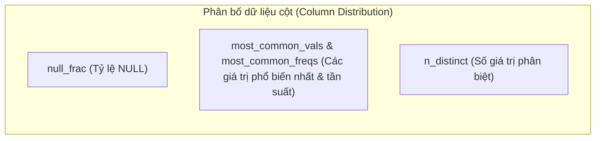

# CHƯƠNG 17: Thống kê (CHAPTER 17: Statistics)

## 17.1 Thống kê cơ bản (17.1 Basic Statistics)

Các thống kê cơ bản ở cấp độ quan hệ (relation-level statistics)[^1] được lưu trữ trong bảng `pg_class` của danh mục hệ thống (system catalog) và bao gồm các dữ liệu sau:

- số lượng bộ (tuple) trong một quan hệ (`reltuples`)
- kích thước quan hệ, tính theo trang (`relpages`)
- số lượng trang được đánh dấu trong bản đồ hiển thị – visibility map (`relallvisible`)

Dưới đây là các giá trị này đối với bảng `flights`:

```sql
=> SELECT reltuples, relpages, relallvisible
FROM pg_class WHERE relname = 'flights';
 reltuples | relpages | relallvisible
-----------+----------+---------------
    214867 |     2624 |          2624
(1 row)
```

Nếu truy vấn không áp đặt bất kỳ điều kiện lọc nào, giá trị `reltuples` sẽ được dùng làm ước lượng lực lượng (cardinality estimation):

```sql
=> EXPLAIN SELECT * FROM flights;
                         QUERY PLAN
------------------------------------------------------------
 Seq Scan on flights  (cost=0.00..4772.67 rows=214867 width=63)
(1 row)
```

Thống kê được thu thập trong quá trình phân tích bảng (`ANALYZE`), cả thủ công lẫn tự động.[^2] Hơn nữa, vì thống kê cơ bản có tầm quan trọng tối cao, dữ liệu này cũng được tính toán trong một số thao tác khác (`VACUUM FULL` và `CLUSTER`,[^3] `CREATE INDEX` và `REINDEX`[^4]) và được tinh chỉnh lại trong quá trình dọn dẹp (`VACUUM`).[^5]

Để phục vụ mục đích phân tích, `300 × default_statistics_target` (mặc định là `100`, tức 30.000) hàng ngẫu nhiên sẽ được lấy mẫu. Kích thước mẫu cần thiết để xây dựng thống kê với một độ chính xác nhất định ít phụ thuộc vào tổng khối lượng dữ liệu được phân tích, vì vậy kích thước của bảng không được tính đến.[^6]

Các hàng được lấy mẫu được chọn từ cùng một số lượng (`300 × default_statistics_target`) trang ngẫu nhiên.[^7] Rõ ràng là nếu bản thân bảng nhỏ hơn, ít trang hơn sẽ được đọc và ít hàng hơn sẽ được chọn để phân tích.

Trong các bảng lớn, việc thu thập thống kê không bao gồm toàn bộ các hàng, nên các ước lượng có thể sai lệch so với giá trị thực tế. Điều này hoàn toàn bình thường: nếu dữ liệu đang thay đổi liên tục, thống kê dù sao cũng không thể chính xác mọi lúc. Độ chính xác trong phạm vi một bậc độ lớn (order of magnitude) thường là đủ để chọn được một kế hoạch thực thi phù hợp.

Hãy tạo một bản sao của bảng `flights` với tính năng `autovacuum` bị tắt, để chúng ta có thể kiểm soát thời điểm bắt đầu tự động phân tích:

```sql
=> CREATE TABLE flights_copy(LIKE flights)
WITH (autovacuum_enabled = false);
```

Chưa có thống kê nào cho bảng mới:

```sql
=> SELECT reltuples, relpages, relallvisible
FROM pg_class WHERE relname = 'flights_copy';
 reltuples | relpages | relallvisible
-----------+----------+---------------
        -1 |        0 |             0
(1 row)
```

Giá trị `reltuples = -1` (từ PostgreSQL 14) được sử dụng để phân biệt giữa một bảng chưa được phân tích lần nào và một bảng thực sự trống không có hàng nào.

Rất có khả năng một số hàng sẽ được chèn vào bảng ngay sau khi tạo. Vì vậy, khi chưa biết trạng thái hiện tại của bảng, bộ lập kế hoạch (planner) giả định rằng bảng chứa `10` trang:

```sql
=> EXPLAIN SELECT * FROM flights_copy;
                          QUERY PLAN
--------------------------------------------------------------
 Seq Scan on flights_copy  (cost=0.00..14.10 rows=410 width=170)
(1 row)
```

Số lượng hàng được ước lượng dựa trên kích thước của một hàng đơn lẻ, được hiển thị trong kế hoạch dưới dạng `width`. Độ rộng hàng thường là giá trị trung bình được tính trong quá trình phân tích, nhưng vì chưa có thống kê nào được thu thập, ở đây nó chỉ là một giá trị xấp xỉ dựa trên kiểu dữ liệu của các cột.[^8]

Bây giờ hãy sao chép dữ liệu từ bảng `flights` và thực hiện phân tích:

```sql
=> INSERT INTO flights_copy SELECT * FROM flights;
INSERT 0 214867
=> ANALYZE flights_copy;
```

Thống kê thu thập được phản ánh đúng số lượng hàng thực tế (kích thước bảng đủ nhỏ để trình phân tích thu thập thống kê trên toàn bộ dữ liệu):

```sql
=> SELECT reltuples, relpages, relallvisible
FROM pg_class WHERE relname = 'flights_copy';
 reltuples | relpages | relallvisible
-----------+----------+---------------
    214867 |     2624 |             0
(1 row)
```

Giá trị `relallvisible` được sử dụng để ước lượng chi phí của một lần quét chỉ mục thuần túy (index-only scan). Giá trị này được cập nhật bởi `VACUUM`:

```sql
=> VACUUM flights_copy;
=> SELECT relallvisible FROM pg_class WHERE relname = 'flights_copy';
 relallvisible
---------------
          2624
(1 row)
```

Bây giờ hãy nhân đôi số lượng hàng mà không cập nhật thống kê và kiểm tra ước lượng lực lượng trong kế hoạch truy vấn:

```sql
=> INSERT INTO flights_copy SELECT * FROM flights;
=> SELECT count(*) FROM flights_copy;
 count
--------
 429734
(1 row)
```

```sql
=> EXPLAIN SELECT * FROM flights_copy;
                           QUERY PLAN
-----------------------------------------------------------------
 Seq Scan on flights_copy  (cost=0.00..9545.34 rows=429734 width=63)
(1 row)
```

Mặc dù dữ liệu trong `pg_class` đã lỗi thời, ước lượng vẫn tỏ ra chính xác:

```sql
=> SELECT reltuples, relpages
FROM pg_class WHERE relname = 'flights_copy';
 reltuples | relpages
-----------+----------
    214867 |     2624
(1 row)
```

Nguyên nhân là nếu bộ lập kế hoạch thấy có sự chênh lệch giữa `relpages` và kích thước tệp thực tế, nó có thể co giãn (scale) giá trị `reltuples` để cải thiện độ chính xác của ước lượng.[^9] Vì kích thước tệp đã tăng gấp đôi so với `relpages`, bộ lập kế hoạch điều chỉnh số lượng hàng ước lượng với giả định rằng mật độ dữ liệu vẫn giữ nguyên:

```sql
=> SELECT reltuples *
(pg_relation_size('flights_copy') / 8192) / relpages AS tuples
FROM pg_class WHERE relname = 'flights_copy';
 tuples
--------
 429734
(1 row)
```

Tất nhiên, cách điều chỉnh như vậy không phải lúc nào cũng hiệu quả (ví dụ, nếu chúng ta xóa bớt một số hàng, ước lượng sẽ vẫn giữ nguyên), nhưng trong một số trường hợp nó giúp bộ lập kế hoạch duy trì độ chính xác tương đối cho đến khi những thay đổi đáng kể kích hoạt lần chạy phân tích tiếp theo.

> 💡 **Ví dụ bổ sung (không có trong sách):** Giả sử bạn vừa tạo một bảng `orders_staging` và nạp 1 triệu dòng vào bằng `COPY` trong một ETL pipeline, rồi chạy `SELECT ... JOIN orders_staging` ngay lập tức mà quên chạy `ANALYZE`. Nhờ cơ chế co giãn `reltuples` theo kích thước tệp thực tế, PostgreSQL vẫn biết bảng có khoảng 1 triệu dòng thay vì ước lượng 410 dòng, nhưng thống kê chi tiết từng cột (MCV, histogram) thì vẫn chưa có cho đến khi `ANALYZE` chạy. Vì vậy, best practice sau khi bulk-load là luôn chạy `ANALYZE orders_staging;`.

---

## 17.2 Giá trị NULL (17.2 NULL Values)

Dù bị các nhà lý thuyết phản đối,[^10] các giá trị `NULL` vẫn đóng một vai trò quan trọng trong cơ sở dữ liệu quan hệ: chúng cung cấp một cách thuận tiện để phản ánh thực tế rằng một giá trị hoặc là chưa biết, hoặc là không tồn tại.

Tuy nhiên, một giá trị đặc biệt đòi hỏi cách xử lý đặc biệt. Ngoài những mâu thuẫn về mặt lý thuyết, còn có nhiều thách thức thực tế cần phải tính đến. Logic Boolean thông thường bị thay thế bằng logic ba giá trị (three-valued logic), vì vậy `NOT IN` hoạt động không như mong đợi. Không rõ liệu các giá trị `NULL` nên được coi là lớn hơn hay nhỏ hơn các giá trị thông thường (do đó mới có các mệnh đề `NULLS FIRST` và `NULLS LAST` khi sắp xếp). Cũng không hoàn toàn rõ ràng liệu các giá trị `NULL` có phải được các hàm tổng hợp (aggregate functions) tính đến hay không. Nói một cách chặt chẽ, giá trị `NULL` hoàn toàn không phải là giá trị, nên bộ lập kế hoạch cần thêm thông tin để xử lý chúng.

Bên cạnh các thống kê cơ bản đơn giản nhất được thu thập ở cấp độ quan hệ, trình phân tích còn thu thập thống kê cho từng cột của quan hệ. Dữ liệu này được lưu trữ trong bảng `pg_statistic` của danh mục hệ thống,[^11] nhưng bạn cũng có thể truy cập nó thông qua view `pg_stats`, vốn cung cấp thông tin này ở định dạng thuận tiện hơn.

Tỷ lệ các giá trị `NULL` thuộc về thống kê cấp độ cột; được tính toán trong quá trình phân tích và hiển thị dưới dạng thuộc tính `null_frac`.

Ví dụ, khi tìm kiếm các chuyến bay chưa khởi hành, chúng ta có thể dựa vào việc thời gian khởi hành thực tế của chúng chưa được xác định (`IS NULL`):

```sql
=> EXPLAIN SELECT * FROM flights WHERE actual_departure IS NULL;
                         QUERY PLAN
------------------------------------------------------------
 Seq Scan on flights  (cost=0.00..4772.67 rows=16702 width=63)
   Filter: (actual_departure IS NULL)
(2 rows)
```

Để ước lượng kết quả, bộ lập kế hoạch nhân tổng số hàng với tỷ lệ các giá trị `NULL`:

```sql
=> SELECT round(reltuples * s.null_frac) AS rows
FROM pg_class
JOIN pg_stats s ON s.tablename = relname
WHERE s.tablename = 'flights'
AND s.attname = 'actual_departure';
 rows
-------
 16702
(1 row)
```

Và đây là số lượng hàng thực tế:

```sql
=> SELECT count(*) FROM flights WHERE actual_departure IS NULL;
 count
-------
 16348
(1 row)
```

---

## 17.3 Giá trị phân biệt (17.3 Distinct Values)

Trường `n_distinct` của view `pg_stats` cho biết số lượng giá trị phân biệt (distinct values) trong một cột. Nếu `n_distinct` là số âm, giá trị tuyệt đối của nó biểu thị tỷ lệ (fraction) các giá trị phân biệt trong một cột thay vì số lượng thực tế. Ví dụ, `-1` chỉ ra rằng tất cả các giá trị trong cột là duy nhất, trong khi `-3`... *(lưu ý: theo chuẩn PostgreSQL, giá trị âm `n_distinct = -0.333...` mới là mỗi giá trị xuất hiện trung bình 3 lần; trong sách gốc tác giả viết nhầm `-3` thay vì `-1/3`, nhưng ý nghĩa là tỷ lệ phân biệt)* ...có nghĩa là mỗi giá trị xuất hiện trung bình ở ba hàng. Trình phân tích sử dụng tỷ lệ (số âm) nếu số lượng giá trị phân biệt ước lượng vượt quá 10% tổng số hàng; trong trường hợp này, các lần cập nhật dữ liệu tiếp theo khó có khả năng làm thay đổi tỷ lệ này.[^12]

> 📝 **Giải thích thêm (không có trong sách):** Trong tài liệu chính thức của PostgreSQL, `n_distinct` âm nằm trong khoảng `[-1, 0)`. Ví dụ: `-1` nghĩa là 100% giá trị là duy nhất (unique), `-0.5` nghĩa là số giá trị phân biệt bằng 50% tổng số hàng (trung bình mỗi giá trị xuất hiện 2 lần), `-0.1` nghĩa là 10% tổng số hàng. Khi thấy `n_distinct = -0.25`, bộ lập kế hoạch sẽ tính số giá trị phân biệt là `0.25 * reltuples`.

Nếu dữ liệu được kỳ vọng phân bố đều (uniform data distribution), số lượng giá trị phân biệt sẽ được sử dụng. Ví dụ, khi ước lượng lực lượng của điều kiện `"column = expression"`, bộ lập kế hoạch giả định rằng biểu thức có thể nhận bất kỳ giá trị nào của cột với xác suất bằng nhau nếu giá trị chính xác của nó chưa được biết ở giai đoạn lập kế hoạch:[^13]

```sql
=> EXPLAIN SELECT *
FROM flights
WHERE departure_airport = (
  SELECT airport_code
  FROM airports
  WHERE city = 'Saint Petersburg'
);
                               QUERY PLAN
------------------------------------------------------------------------
 Seq Scan on flights  (cost=30.56..5340.40 rows=2066 width=63)
   Filter: (departure_airport = $0)
   InitPlan 1 (returns $0)
     ->  Seq Scan on airports_data ml  (cost=0.00..30.56 rows=1 wi...
           Filter: ((city ->> lang()) = 'Saint Petersburg'::text)
(5 rows)
```

Ở đây nút `InitPlan` chỉ được thực thi một lần, và giá trị tính được sẽ được dùng trong kế hoạch chính.

```sql
=> SELECT round(reltuples / s.n_distinct) AS rows
FROM pg_class
JOIN pg_stats s ON s.tablename = relname
WHERE s.tablename = 'flights'
AND s.attname = 'departure_airport';
 rows
------
 2066
(1 row)
```

Nếu số lượng giá trị phân biệt ước lượng bị sai (vì chỉ một số lượng hàng hạn chế được phân tích), bạn có thể ghi đè nó ở cấp độ cột:

```sql
ALTER TABLE ...
ALTER COLUMN ...
SET (n_distinct = ...);
```

Nếu mọi dữ liệu luôn có phân bố đều, thông tin này (kết hợp với giá trị nhỏ nhất và lớn nhất) sẽ là đủ. Tuy nhiên, đối với phân bố không đều (phổ biến hơn nhiều trong thực tế), ước lượng như vậy là không chính xác:

```sql
=> SELECT min(cnt), round(avg(cnt)) avg, max(cnt)
FROM (
  SELECT departure_airport, count(*) cnt
  FROM flights
  GROUP BY departure_airport
) t;
 min | avg  |  max
-----+------+-------
 113 | 2066 | 20875
(1 row)
```

---

## 17.4 Các giá trị phổ biến nhất (17.4 Most Common Values)

Nếu phân bố dữ liệu là không đều, ước lượng sẽ được tinh chỉnh dựa trên thống kê về các giá trị phổ biến nhất (most common values – MCV) và tần suất của chúng. View `pg_stats` hiển thị các mảng này lần lượt trong hai trường `most_common_vals` và `most_common_freqs`.



Dưới đây là một ví dụ về thống kê như vậy trên các loại máy bay khác nhau:

```sql
=> SELECT most_common_vals AS mcv,
left(most_common_freqs::text,60) || '...' AS mcf
FROM pg_stats
WHERE tablename = 'flights' AND attname = 'aircraft_code' \gx
-[ RECORD 1 ]-------------------------------------------------------
mcv | {CN1,CR2,SU9,321,733,763,319,773}
mcf | {0.27886668,0.27266666,0.26176667,0.057166666,0.037666667,0....
```

Để ước lượng độ chọn lọc (selectivity) của điều kiện `"column = value"`, chỉ cần tìm giá trị này trong mảng `most_common_vals` và lấy tần suất tương ứng của nó từ phần tử có cùng chỉ số trong mảng `most_common_freqs`:[^14]

```sql
=> EXPLAIN SELECT * FROM flights WHERE aircraft_code = '733';
                         QUERY PLAN
------------------------------------------------------------
 Seq Scan on flights  (cost=0.00..5309.84 rows=8093 width=63)
   Filter: (aircraft_code = '733'::bpchar)
(2 rows)
```

```sql
=> SELECT round(reltuples * s.most_common_freqs[
array_position((s.most_common_vals::text::text[]),'733')
])
FROM pg_class
JOIN pg_stats s ON s.tablename = relname
WHERE s.tablename = 'flights'
AND s.attname = 'aircraft_code';
 round
-------
  8093
(1 row)
```

Rõ ràng là ước lượng như vậy sẽ rất sát với giá trị thực tế:

```sql
=> SELECT count(*) FROM flights WHERE aircraft_code = '733';
 count
-------
  8263
(1 row)
```

Danh sách `MCV` cũng được dùng để ước lượng độ chọn lọc của các điều kiện bất đẳng thức. Ví dụ, một điều kiện như `"column < value"` yêu cầu trình phân tích duyệt qua `most_common_vals` để tìm tất cả các giá trị nhỏ hơn giá trị mục tiêu và cộng dồn các tần suất tương ứng được liệt kê trong `most_common_freqs`.[^15]

Thống kê `MCV` hoạt động tốt nhất khi số lượng giá trị phân biệt không quá nhiều. Kích thước tối đa của các mảng được xác định bởi tham số `default_statistics_target` (mặc định là `100`), tham số này cũng giới hạn số lượng hàng được lấy mẫu ngẫu nhiên cho mục đích phân tích.

Trong một số trường hợp, việc tăng giá trị tham số mặc định là hợp lý, qua đó mở rộng danh sách `MCV` và cải thiện độ chính xác của các ước lượng. Bạn có thể làm điều đó ở cấp độ cột:

```sql
ALTER TABLE ...
ALTER COLUMN ...
SET STATISTICS ...;
```

Kích thước mẫu cũng sẽ tăng lên, nhưng chỉ dành cho bảng được chỉ định.

Vì mảng `MCV` lưu trữ các giá trị thực tế nên nó có thể chiếm khá nhiều dung lượng. Để giữ kích thước `pg_statistic` trong tầm kiểm soát và tránh bắt bộ lập kế hoạch làm những công việc vô ích, các giá trị có kích thước lớn hơn `1 kB` sẽ bị loại khỏi quá trình phân tích và thống kê. Nhưng vì những giá trị lớn như vậy thường là duy nhất, chúng dù sao cũng khó có khả năng lọt vào `most_common_vals`.

---

## 17.5 Biểu đồ tần suất – Histogram (17.5 Histogram)

Nếu số lượng giá trị phân biệt quá nhiều để có thể lưu hết trong một mảng, PostgreSQL sẽ sử dụng biểu đồ tần suất (histogram). Trong trường hợp này, các giá trị được phân phối vào nhiều nhóm (bucket) của histogram. Số lượng bucket cũng bị giới hạn bởi tham số `default_statistics_target`.

Độ rộng của bucket được chọn sao cho mỗi bucket nhận được số lượng giá trị xấp xỉ bằng nhau (tính chất này thường được minh họa trên biểu đồ bằng diện tích bằng nhau của các hình chữ nhật). Các giá trị đã nằm trong danh sách `MCV` không được tính vào đây. Kết quả là tần suất tích lũy của các giá trị trong mỗi bucket bằng:

$$\frac{1}{\text{number of buckets}}$$

Histogram được lưu trong trường `histogram_bounds` của view `pg_stats` dưới dạng một mảng chứa các giá trị ranh giới của các bucket:

```sql
=> SELECT left(histogram_bounds::text,60) || '...' AS hist_bounds
FROM pg_stats s
WHERE s.tablename = 'boarding_passes'
AND s.attname = 'seat_no';
                           hist_bounds
-----------------------------------------------------------------
 {10B,10E,10F,10F,11H,12B,13B,14B,14H,15G,16B,17B,17H,19B,19B...
(1 row)
```

Kết hợp với danh sách `MCV`, histogram được dùng cho các thao tác như ước lượng độ chọn lọc của điều kiện lớn hơn (`>`) và nhỏ hơn (`<`).[^16]

Ví dụ, hãy xem xét số lượng thẻ lên máy bay (boarding passes) được cấp cho các hàng ghế phía sau:

```sql
=> EXPLAIN SELECT *
FROM boarding_passes
WHERE seat_no > '30B';
                               QUERY PLAN
------------------------------------------------------------------------
 Seq Scan on boarding_passes  (cost=0.00..157350.10 rows=2983242 ...
   Filter: ((seat_no)::text > '30B'::text)
(2 rows)
```

Tôi đã cố tình chọn số ghế nằm đúng ngay trên ranh giới giữa hai bucket của histogram.

Độ chọn lọc của điều kiện này sẽ được ước lượng bằng $\frac{N}{\text{number of buckets}}$, trong đó $N$ là số lượng bucket chứa các giá trị thỏa mãn điều kiện (tức là các bucket nằm bên phải giá trị được chỉ định). Cũng cần lưu ý rằng các giá trị `MCV` không được đưa vào histogram.

Nhân tiện, các giá trị `NULL` cũng không xuất hiện trong histogram, nhưng cột `seat_no` dù sao cũng không chứa giá trị nào như vậy:

```sql
=> SELECT s.null_frac FROM pg_stats s
WHERE s.tablename = 'boarding_passes'
AND s.attname = 'seat_no';
 null_frac
-----------
         0
(1 row)
```

Đầu tiên, hãy tìm tỷ lệ các giá trị `MCV` thỏa mãn điều kiện:

```sql
=> SELECT sum(s.most_common_freqs[
array_position((s.most_common_vals::text::text[]),v)
])
FROM pg_stats s, unnest(s.most_common_vals::text::text[]) v
WHERE s.tablename = 'boarding_passes' AND s.attname = 'seat_no'
AND v > '30B';
    sum
------------
 0.21226665
(1 row)
```

Tổng tỷ lệ của toàn bộ `MCV` (được histogram bỏ qua) là:

```sql
=> SELECT sum(s.most_common_freqs[
array_position((s.most_common_vals::text::text[]),v)
])
FROM pg_stats s, unnest(s.most_common_vals::text::text[]) v
WHERE s.tablename = 'boarding_passes' AND s.attname = 'seat_no';
    sum
------------
 0.67816657
(1 row)
```

Vì các giá trị thỏa mãn điều kiện được chỉ định chiếm đúng `51` bucket (trên tổng số `100` bucket có thể), chúng ta thu được ước lượng sau:

```sql
=> SELECT round( reltuples * (
  0.21226665                         -- MCV share
  + (1 - 0.67816657 - 0) * (51 / 100.0) -- histogram share
))
FROM pg_class
WHERE relname = 'boarding_passes';
  round
---------
 2983242
(1 row)
```

Trong trường hợp tổng quát với các giá trị không nằm trên ranh giới, bộ lập kế hoạch áp dụng nội suy tuyến tính (linear interpolation) để tính đến phần tỷ lệ của bucket chứa giá trị mục tiêu.

Dưới đây là số lượng ghế phía sau thực tế:

```sql
=> SELECT count(*) FROM boarding_passes WHERE seat_no > '30B';
  count
---------
 2993735
(1 row)
```

Khi bạn tăng giá trị `default_statistics_target`, độ chính xác của ước lượng có thể được cải thiện, nhưng như ví dụ của chúng ta cho thấy, histogram kết hợp với danh sách `MCV` thường cho kết quả tốt ngay cả khi cột chứa nhiều giá trị duy nhất:

```sql
=> SELECT n_distinct FROM pg_stats
WHERE tablename = 'boarding_passes' AND attname = 'seat_no';
 n_distinct
------------
        461
(1 row)
```

Việc cải thiện độ chính xác ước lượng chỉ có ý nghĩa nếu nó dẫn đến việc lập kế hoạch tốt hơn. Tăng giá trị `default_statistics_target` mà không cân nhắc kỹ có thể làm chậm quá trình lập kế hoạch và phân tích mà không mang lại lợi ích gì. Mặt khác, giảm giá trị tham số này (xuống tới 0) có thể dẫn đến lựa chọn kế hoạch thực thi tồi, dù nó thực sự giúp tăng tốc độ lập kế hoạch và phân tích. Sự tiết kiệm như vậy thường không đáng.

> 📝 **Giải thích thêm (không có trong sách):** Công thức đầy đủ mà PostgreSQL dùng để ước lượng độ chọn lọc của phép so sánh bất đẳng thức (như `col > val`) là:
> $$\text{selectivity} = \text{MCV\_match} + (1 - \text{MCV\_total} - \text{null\_frac}) \times \text{histogram\_selectivity}$$
> Trong đó:
> - `MCV_match`: tổng tần suất của các giá trị trong MCV thỏa mãn điều kiện.
> - `1 - MCV_total - null_frac`: phần tỷ lệ dữ liệu còn lại không phải NULL và không nằm trong MCV (được đại diện bởi histogram).
> - `histogram_selectivity`: tỷ lệ các bucket (và phần nội suy trong bucket chứa `val`) thỏa mãn điều kiện.

---

## 17.6 Thống kê cho các kiểu dữ liệu phi vô hướng (17.6 Statistics for Non-Scalar Data Types)

Đối với các kiểu dữ liệu phi vô hướng (non-scalar data types), PostgreSQL có thể thu thập thống kê không chỉ về sự phân bố của các giá trị, mà còn về sự phân bố của các phần tử được dùng để cấu thành nên những giá trị đó. Điều này giúp cải thiện độ chính xác khi lập kế hoạch cho các truy vấn trên những cột không tuân theo dạng chuẩn thứ nhất (first normal form – 1NF).

- Hai mảng `most_common_elems` và `most_common_elem_freqs` hiển thị danh sách các phần tử phổ biến nhất và tần suất sử dụng của chúng.
  Các thống kê này được thu thập và dùng để ước lượng độ chọn lọc của các phép toán trên kiểu mảng (`arrays`)[^17] và `tsvector`.[^18]
- Mảng `elem_count_histogram` hiển thị biểu đồ tần suất về số lượng phần tử phân biệt trong một giá trị.
  Dữ liệu này chỉ được thu thập và dùng để ước lượng độ chọn lọc của các phép toán trên kiểu mảng.
- Đối với các kiểu dữ liệu khoảng (range types), PostgreSQL xây dựng các biểu đồ phân bố cho độ dài khoảng cũng như ranh giới dưới và ranh giới trên của khoảng. Các biểu đồ này được dùng để ước lượng độ chọn lọc của nhiều phép toán trên các kiểu này,[^19] nhưng view `pg_stats` không hiển thị chúng.
  Các thống kê tương tự cũng được thu thập cho các kiểu dữ liệu đa khoảng (`multirange`, từ PostgreSQL 14).[^20]

---

## 17.7 Độ rộng trung bình của trường (17.7 Average Field Width)

Trường `avg_width` của view `pg_stats` cho biết kích thước trung bình của các giá trị được lưu trữ trong một cột. Đương nhiên, đối với các kiểu như `integer` hay `char(3)` kích thước này luôn cố định, nhưng đối với các kiểu dữ liệu có độ dài thay đổi như `text`, nó có thể khác nhau rất nhiều từ cột này sang cột khác:

```sql
=> SELECT attname, avg_width FROM pg_stats
WHERE (tablename, attname) IN ( VALUES
  ('tickets', 'passenger_name'), ('ticket_flights','fare_conditions')
);
     attname     | avg_width
-----------------+-----------
 fare_conditions |         8
 passenger_name  |        16
(2 rows)
```

Thống kê này được sử dụng để ước lượng lượng bộ nhớ cần thiết cho các thao tác như sắp xếp (sorting) hoặc băm (hashing).

---

## 17.8 Độ tương quan (17.8 Correlation)

Trường `correlation` của view `pg_stats` cho biết mức độ tương quan giữa thứ tự lưu trữ vật lý của dữ liệu và thứ tự logic được xác định bởi các phép toán so sánh. Nếu các giá trị được lưu trữ chặt chẽ theo thứ tự tăng dần, độ tương quan của chúng sẽ gần bằng `1`; nếu chúng được sắp xếp theo thứ tự giảm dần, độ tương quan sẽ gần bằng `-1`. Dữ liệu phân bố trên đĩa càng hỗn loạn thì độ tương quan càng tiến về `0`.

```sql
=> SELECT attname, correlation
FROM pg_stats WHERE tablename = 'airports_data'
ORDER BY abs(correlation) DESC;
   attname    | correlation
--------------+-------------
 coordinates  |
 airport_code | -0.21120238
 city         |  -0.1970127
 airport_name | -0.18223621
 timezone     |  0.17961165
(5 rows)
```

Lưu ý rằng thống kê này không được thu thập cho cột `coordinates`: các toán tử nhỏ hơn (`<`) và lớn hơn (`>`) không được định nghĩa cho kiểu `point`.

Độ tương quan được sử dụng để ước lượng chi phí cho các lần quét chỉ mục (index scans).

> 💡 **Ví dụ bổ sung (không có trong sách):** Với bảng nhật ký (log) hoặc bảng giao dịch có cột `created_at` luôn tăng dần theo thời gian chèn dữ liệu, `correlation` của `created_at` thường xấp xỉ `1.0`. Khi truy vấn `WHERE created_at BETWEEN ...`, các dòng thỏa mãn nằm liền kề nhau trên ít trang đĩa, nên Index Scan cực kỳ rẻ. Ngược lại, nếu truy vấn trên cột `user_id` có `correlation ≈ 0.01`, các dòng nằm rải rác trên nhiều trang đĩa khác nhau, khiến bộ lập kế hoạch có thể ưu tiên Bitmap Heap Scan hoặc Seq Scan thay vì Index Scan thông thường.

---

## 17.9 Thống kê biểu thức (17.9 Expression Statistics)

Thống kê ở cấp độ cột chỉ có thể được sử dụng nếu vế trái hoặc vế phải của phép so sánh tham chiếu trực tiếp đến chính cột đó và không chứa bất kỳ biểu thức nào. Ví dụ, bộ lập kế hoạch không thể dự đoán việc tính toán một hàm trên một cột sẽ ảnh hưởng đến thống kê như thế nào, vì vậy đối với các điều kiện dạng `"function-call = constant"`, độ chọn lọc luôn được ước lượng ở mức `0.5%`:[^21]

```sql
=> EXPLAIN SELECT * FROM flights
WHERE extract(
  month FROM scheduled_departure AT TIME ZONE 'Europe/Moscow'
) = 1;
                               QUERY PLAN
------------------------------------------------------------------------
 Seq Scan on flights  (cost=0.00..6384.17 rows=1074 width=63)
   Filter: (EXTRACT(month FROM (scheduled_departure AT TIME ZONE ...
(2 rows)
```

```sql
=> SELECT round(reltuples * 0.005)
FROM pg_class WHERE relname = 'flights';
 round
-------
  1074
(1 row)
```

Bộ lập kế hoạch không biết gì về ngữ nghĩa của các hàm, kể cả những hàm chuẩn. Hiểu biết thông thường của chúng ta cho thấy các chuyến bay thực hiện vào tháng 1 sẽ chiếm khoảng $\frac{1}{12}$ tổng số chuyến bay, con số này lớn hơn giá trị dự đoán tới một bậc độ lớn.

Để cải thiện ước lượng, chúng ta phải thu thập thống kê biểu thức (expression statistics) thay vì dựa vào thống kê cấp độ cột. Có hai cách để làm điều đó.

### Thống kê biểu thức mở rộng (Extended Expression Statistics)

*(Từ PostgreSQL 14)*

Lựa chọn đầu tiên là sử dụng thống kê biểu thức mở rộng.[^22] Loại thống kê này không được thu thập mặc định; bạn phải tạo thủ công đối tượng cơ sở dữ liệu tương ứng bằng cách chạy lệnh `CREATE STATISTICS`:

```sql
=> CREATE STATISTICS flights_expr ON (extract(
  month FROM scheduled_departure AT TIME ZONE 'Europe/Moscow'
))
FROM flights;
```

Sau khi dữ liệu được thu thập, độ chính xác của ước lượng được cải thiện rõ rệt:

```sql
=> ANALYZE flights;
=> EXPLAIN SELECT * FROM flights
WHERE extract(
  month FROM scheduled_departure AT TIME ZONE 'Europe/Moscow'
) = 1;
                               QUERY PLAN
------------------------------------------------------------------------
 Seq Scan on flights  (cost=0.00..6384.17 rows=16667 width=63)
   Filter: (EXTRACT(month FROM (scheduled_departure AT TIME ZONE ...
(2 rows)
```

Để thống kê đã thu thập được áp dụng, truy vấn phải chỉ định biểu thức ở dạng giống hệt như biểu thức đã dùng trong lệnh `CREATE STATISTICS`.

Giới hạn kích thước cho thống kê mở rộng (từ PostgreSQL 13) có thể được điều chỉnh riêng bằng cách chạy lệnh `ALTER STATISTICS`. Ví dụ:

```sql
=> ALTER STATISTICS flights_expr SET STATISTICS 42;
```

Toàn bộ siêu dữ liệu (metadata) liên quan đến thống kê mở rộng được lưu trong bảng `pg_statistic_ext` của danh mục hệ thống, trong khi bản thân dữ liệu thu thập được nằm trong một bảng riêng có tên là `pg_statistic_ext_data` (từ PostgreSQL 12). Sự tách biệt này được sử dụng để triển khai cơ chế kiểm soát truy cập đối với thông tin nhạy cảm.

Thống kê biểu thức mở rộng mà một người dùng cụ thể có quyền xem có thể được hiển thị ở định dạng thuận tiện hơn trong một view riêng biệt:

```sql
=> SELECT left(expr,50) || '...' AS expr,
null_frac, avg_width, n_distinct,
most_common_vals AS mcv,
left(most_common_freqs::text,50) || '...' AS mcf,
correlation
FROM pg_stats_ext_exprs
WHERE statistics_name = 'flights_expr' \gx
-[ RECORD 1 ]-------------------------------------------------------
expr        | EXTRACT(month FROM (scheduled_departure AT TIME ZO...
null_frac   | 0
avg_width   | 8
n_distinct  | 12
mcv         | {8,9,12,3,1,5,6,7,11,10,4,2}
mcf         | {0.12053333,0.11326667,0.0802,0.07976667,0.0775666...
correlation | 0.08355749
```

### Thống kê cho chỉ mục biểu thức (Statistics for Expression Indexes)

Một cách khác để cải thiện ước lượng lực lượng là sử dụng thống kê đặc biệt được thu thập cho các chỉ mục biểu thức (expression indexes); những thống kê này được thu thập tự động khi một chỉ mục như vậy được tạo, giống như đối với một bảng. Nếu chỉ mục đó thực sự cần thiết, cách tiếp cận này tỏ ra rất thuận tiện.

```sql
=> DROP STATISTICS flights_expr;
=> CREATE INDEX ON flights(extract(
  month FROM scheduled_departure AT TIME ZONE 'Europe/Moscow'
));
=> ANALYZE flights;
=> EXPLAIN SELECT * FROM flights
WHERE extract(
  month FROM scheduled_departure AT TIME ZONE 'Europe/Moscow'
) = 1;
                               QUERY PLAN
------------------------------------------------------------------------
 Bitmap Heap Scan on flights  (cost=324.86..3247.92 rows=17089 wi...
   Recheck Cond: (EXTRACT(month FROM (scheduled_departure AT TIME...
   ->  Bitmap Index Scan on flights_extract_idx  (cost=0.00..320.5...
         Index Cond: (EXTRACT(month FROM (scheduled_departure AT TI...
(4 rows)
```

Thống kê trên các chỉ mục biểu thức được lưu trữ theo cùng cách với thống kê trên bảng. Ví dụ, bạn có thể lấy số lượng giá trị phân biệt bằng cách chỉ định tên chỉ mục làm `tablename` khi truy vấn `pg_stats`:

```sql
=> SELECT n_distinct FROM pg_stats
WHERE tablename = 'flights_extract_idx';
 n_distinct
------------
         12
(1 row)
```

Bạn có thể điều chỉnh độ chính xác (từ PostgreSQL 11) của thống kê liên quan đến chỉ mục bằng lệnh `ALTER INDEX`. Nếu bạn chưa biết tên cột tương ứng với biểu thức được đánh chỉ mục, bạn phải tìm ra nó trước.

Ví dụ:

```sql
=> SELECT attname FROM pg_attribute
WHERE attrelid = 'flights_extract_idx'::regclass;
 attname
---------
 extract
(1 row)
```

```sql
=> ALTER INDEX flights_extract_idx
ALTER COLUMN extract SET STATISTICS 42;
```

---

## 17.10 Thống kê đa biến (17.10 Multivariate Statistics)

Chúng ta cũng có thể thu thập thống kê đa biến (multivariate statistics), trải rộng trên nhiều cột của bảng. Điều kiện tiên quyết là bạn phải tạo thủ công thống kê mở rộng tương ứng bằng lệnh `CREATE STATISTICS`.

PostgreSQL triển khai ba loại thống kê đa biến.

### Phụ thuộc hàm giữa các cột (Functional Dependencies Between Columns)

*(Từ PostgreSQL 10)*

Nếu các giá trị trong một cột phụ thuộc (hoàn toàn hoặc một phần) vào các giá trị trong một cột khác và điều kiện lọc bao gồm cả hai cột này, lực lượng (cardinality) sẽ bị ước lượng thấp hơn thực tế (underestimated).

Hãy xem xét một truy vấn với hai điều kiện lọc:

```sql
=> SELECT count(*) FROM flights
WHERE flight_no = 'PG0007' AND departure_airport = 'VKO';
 count
-------
   396
(1 row)
```

Giá trị ước lượng bị đánh giá thấp đi rất nhiều:

```sql
=> EXPLAIN SELECT * FROM flights
WHERE flight_no = 'PG0007' AND departure_airport = 'VKO';
                               QUERY PLAN
------------------------------------------------------------------------
 Bitmap Heap Scan on flights  (cost=10.49..816.84 rows=15 width=63)
   Recheck Cond: (flight_no = 'PG0007'::bpchar)
   Filter: (departure_airport = 'VKO'::bpchar)
   ->  Bitmap Index Scan on flights_flight_no_scheduled_departure_key
       (cost=0.00..10.49 rows=276 width=0)
         Index Cond: (flight_no = 'PG0007'::bpchar)
(6 rows)
```

Đây là một vấn đề kinh điển của các vị từ tương quan (correlated predicates). Bộ lập kế hoạch giả định rằng các vị từ không phụ thuộc vào nhau, nên độ chọn lọc tổng thể được ước lượng bằng tích các độ chọn lọc của những điều kiện lọc kết hợp bởi toán tử logic `AND`. Kế hoạch ở trên minh họa rất rõ vấn đề này: giá trị ước lượng bởi nút `Bitmap Index Scan` cho điều kiện trên cột `flight_no` bị giảm đi đáng kể khi nút `Bitmap Heap Scan` lọc tiếp kết quả theo điều kiện trên cột `departure_airport`.

Tuy nhiên, chúng ta hiểu rằng sân bay được xác định một cách đơn trị bởi số hiệu chuyến bay: điều kiện thứ hai thực chất là dư thừa (trừ khi có sai sót trong tên sân bay, tất nhiên rồi). Trong những trường hợp như vậy, chúng ta có thể cải thiện ước lượng bằng cách áp dụng thống kê mở rộng về phụ thuộc hàm (functional dependencies).

Hãy tạo một thống kê mở rộng về sự phụ thuộc hàm giữa hai cột:

```sql
=> CREATE STATISTICS flights_dep(dependencies)
ON flight_no, departure_airport FROM flights;
```

Lần chạy phân tích tiếp theo sẽ thu thập thống kê này, và ước lượng được cải thiện:

```sql
=> ANALYZE flights;
=> EXPLAIN SELECT * FROM flights
WHERE flight_no = 'PG0007'
AND departure_airport = 'VKO';
                               QUERY PLAN
------------------------------------------------------------------------
 Bitmap Heap Scan on flights  (cost=10.57..819.51 rows=277 width=63)
   Recheck Cond: (flight_no = 'PG0007'::bpchar)
   Filter: (departure_airport = 'VKO'::bpchar)
   ->  Bitmap Index Scan on flights_flight_no_scheduled_departure_key
       (cost=0.00..10.50 rows=277 width=0)
         Index Cond: (flight_no = 'PG0007'::bpchar)
(6 rows)
```

Thống kê thu thập được lưu trong danh mục hệ thống và có thể được truy cập như sau:

```sql
=> SELECT dependencies
FROM pg_stats_ext
WHERE statistics_name = 'flights_dep';
               dependencies
------------------------------------------
 {"2 => 5": 1.000000, "5 => 2": 0.010200}
(1 row)
```

Ở đây `2` và `5` là các số thứ tự cột (column numbers) được lưu trong bảng `pg_attribute`, còn các giá trị tương ứng xác định mức độ phụ thuộc hàm: từ `0` (không có phụ thuộc) đến `1` (các giá trị ở cột thứ hai phụ thuộc hoàn toàn vào các giá trị ở cột thứ nhất).

### Số lượng giá trị phân biệt đa biến (Multivariate Number of Distinct Values)

*(Từ PostgreSQL 10)*

Thống kê về số lượng tổ hợp duy nhất của các giá trị được lưu trong nhiều cột khác nhau giúp cải thiện ước lượng lực lượng của phép toán `GROUP BY` thực hiện trên nhiều cột.

Ví dụ, ở đây số lượng cặp sân bay đi và sân bay đến ước lượng theo cách thông thường là bình phương của tổng số sân bay; tuy nhiên, giá trị thực tế nhỏ hơn nhiều, vì không phải mọi cặp sân bay đều có đường bay thẳng nối với nhau:

```sql
=> SELECT count(*)
FROM (
  SELECT DISTINCT departure_airport, arrival_airport FROM flights
) t;
 count
-------
   618
(1 row)
```

```sql
=> EXPLAIN SELECT DISTINCT departure_airport, arrival_airport
FROM flights;
                              QUERY PLAN
----------------------------------------------------------------------
 HashAggregate  (cost=5847.01..5955.16 rows=10816 width=8)
   Group Key: departure_airport, arrival_airport
   ->  Seq Scan on flights  (cost=0.00..4772.67 rows=214867 width=8)
(3 rows)
```

Hãy định nghĩa và thu thập một thống kê mở rộng về các giá trị phân biệt:

```sql
=> CREATE STATISTICS flights_nd(ndistinct)
ON departure_airport, arrival_airport FROM flights;
=> ANALYZE flights;
```

Ước lượng lực lượng đã được cải thiện:

```sql
=> EXPLAIN SELECT DISTINCT departure_airport, arrival_airport
FROM flights;
                              QUERY PLAN
----------------------------------------------------------------------
 HashAggregate  (cost=5847.01..5853.19 rows=618 width=8)
   Group Key: departure_airport, arrival_airport
   ->  Seq Scan on flights  (cost=0.00..4772.67 rows=214867 width=8)
(3 rows)
```

Bạn có thể xem thống kê đã thu thập trong danh mục hệ thống:

```sql
=> SELECT n_distinct
FROM pg_stats_ext
WHERE statistics_name = 'flights_nd';
  n_distinct
---------------
 {"5, 6": 618}
(1 row)
```

### Danh sách MCV đa biến (Multivariate MCV Lists)

*(Từ PostgreSQL 12)*

Nếu phân bố giá trị là không đều, việc chỉ dựa vào phụ thuộc hàm có thể là chưa đủ, vì độ chính xác của ước lượng sẽ phụ thuộc rất nhiều vào một cặp giá trị cụ thể. Ví dụ, bộ lập kế hoạch ước lượng thấp hơn thực tế số lượng chuyến bay được thực hiện bởi máy bay Boeing 737 từ sân bay Sheremetyevo:

```sql
=> SELECT count(*)
FROM flights
WHERE departure_airport = 'SVO' AND aircraft_code = '733';
 count
-------
  2037
(1 row)
```

```sql
=> EXPLAIN SELECT *
FROM flights
WHERE departure_airport = 'SVO' AND aircraft_code = '733';
                               QUERY PLAN
------------------------------------------------------------------------
 Seq Scan on flights  (cost=0.00..5847.00 rows=736 width=63)
   Filter: ((departure_airport = 'SVO'::bpchar) AND (aircraft_cod...
(2 rows)
```

Trong trường hợp này, bạn có thể cải thiện ước lượng bằng cách thu thập thống kê về danh sách `MCV` đa biến:[^23]

```sql
=> CREATE STATISTICS flights_mcv(mcv)
ON departure_airport, aircraft_code FROM flights;
=> ANALYZE flights;
```

Ước lượng lực lượng mới chính xác hơn nhiều:

```sql
=> EXPLAIN SELECT *
FROM flights
WHERE departure_airport = 'SVO' AND aircraft_code = '733';
                               QUERY PLAN
------------------------------------------------------------------------
 Seq Scan on flights  (cost=0.00..5847.00 rows=1927 width=63)
   Filter: ((departure_airport = 'SVO'::bpchar) AND (aircraft_cod...
(2 rows)
```

Để đưa ra ước lượng này, bộ lập kế hoạch dựa vào các giá trị tần suất được lưu trong danh mục hệ thống:

```sql
=> SELECT values, frequency
FROM pg_statistic_ext stx
JOIN pg_statistic_ext_data stxd ON stx.oid = stxd.stxoid,
pg_mcv_list_items(stxdmcv) m
WHERE stxname = 'flights_mcv'
AND values = '{SVO,773}';
  values   |      frequency
-----------+----------------------
 {SVO,773} | 0.005266666666666667
(1 row)
```

*(Lưu ý: trong truy vấn mẫu của sách tác giả kiểm tra `{SVO,773}` để minh họa cấu trúc lưu trữ của `pg_mcv_list_items`.)*

Giống như danh sách `MCV` thông thường, danh sách đa biến lưu giữ tối đa `default_statistics_target` (mặc định `100`) giá trị (nếu tham số này cũng được thiết lập ở cấp độ cột, giá trị lớn nhất trong số đó sẽ được dùng).

Nếu cần, bạn cũng có thể thay đổi kích thước của danh sách (từ PostgreSQL 13), giống như cách làm đối với thống kê biểu thức mở rộng:

```sql
ALTER STATISTICS ... SET STATISTICS ...;
```

Trong tất cả các ví dụ này, tôi chỉ sử dụng hai cột, nhưng bạn cũng có thể thu thập thống kê đa biến trên nhiều cột hơn.

Để kết hợp nhiều loại thống kê trong cùng một đối tượng, bạn có thể cung cấp một danh sách các loại này phân tách bằng dấu phẩy trong định nghĩa của nó. Nếu không chỉ định loại nào, PostgreSQL sẽ thu thập tất cả các loại thống kê có thể cho các cột được chỉ định.

Ngoài tên cột thực tế, (từ PostgreSQL 14) thống kê đa biến cũng có thể sử dụng các biểu thức tùy ý, giống như thống kê biểu thức.

> 💡 **Ví dụ bổ sung (không có trong sách):** Khi thiết kế bảng lưu địa chỉ như `addresses(country, city, district)`, các cột này có mối phụ thuộc hàm rất chặt (`district -> city -> country`) và thường xuất hiện cùng nhau trong mệnh đề `WHERE country = 'VN' AND city = 'Hanoi' AND district = 'Cau Giay'`. Việc tạo một đối tượng thống kê đa biến tổng hợp:
> ```sql
> CREATE STATISTICS addr_stats (dependencies, ndistinct, mcv)
> ON country, city, district FROM addresses;
> ANALYZE addresses;
> ```
> giúp bộ lập kế hoạch tránh ước lượng sai lệch hàng chục lần và chọn đúng chiến lược `Index Scan` hoặc `Hash Join` tối ưu.

---

## Bảng thuật ngữ chương (Chapter Glossary)

| Thuật ngữ (English) | Tiếng Việt | Giải thích ngắn gọn |
|---|---|---|
| Relation-level statistics | Thống kê cấp độ quan hệ | Thống kê tổng quan về bảng/chỉ mục lưu trong `pg_class` (`reltuples`, `relpages`, `relallvisible`). |
| Cardinality estimation | Ước lượng lực lượng (số hàng) | Dự đoán số lượng hàng trả về của một nút trong kế hoạch thực thi truy vấn. |
| Visibility map | Bản đồ hiển thị | Cấu trúc đánh dấu các trang dữ liệu mà mọi bộ trong đó đều hiển thị với mọi giao dịch đang chạy. |
| `default_statistics_target` | Tham số mục tiêu thống kê mặc định | Tham số điều chỉnh kích thước mẫu (`300 × target`), số phần tử tối đa của MCV và số bucket của histogram. |
| Selectivity | Độ chọn lọc | Tỷ lệ (từ 0 đến 1) các hàng trong bảng thỏa mãn một điều kiện lọc nhất định. |
| Most Common Values (MCV) | Các giá trị phổ biến nhất | Danh sách các giá trị xuất hiện thường xuyên nhất trong cột kèm theo tần suất của chúng. |
| Histogram | Biểu đồ tần suất (Histogram) | Cấu trúc chia các giá trị (ngoài MCV và NULL) thành các bucket có số lượng phần tử xấp xỉ bằng nhau. |
| Linear interpolation | Nội suy tuyến tính | Phương pháp ước lượng tỷ lệ phần tử thỏa mãn điều kiện nằm bên trong một bucket của histogram. |
| Correlation | Độ tương quan | Mức độ khớp giữa thứ tự vật lý của dữ liệu trên đĩa và thứ tự sắp xếp logic (`-1` đến `1`). |
| Expression statistics | Thống kê biểu thức | Thống kê thu thập trên kết quả của một biểu thức thay vì trực tiếp trên cột đơn lẻ. |
| Multivariate statistics | Thống kê đa biến | Thống kê mô tả mối quan hệ giữa nhiều cột (phụ thuộc hàm, `ndistinct`, hoặc MCV đa biến). |
| Functional dependencies | Phụ thuộc hàm | Mối quan hệ cho biết giá trị của một cột xác định (toàn phần hoặc một phần) giá trị của cột khác. |
| Correlated predicates | Vị từ tương quan | Các điều kiện lọc có liên hệ với nhau thay vì độc lập hoàn toàn về mặt xác suất. |

---

[^1]: `postgresql.org/docs/14/planner-stats.html`
[^2]: `backend/commands/analyze.c`, hàm `do_analyze_rel`
[^3]: `backend/commands/cluster.c`, hàm `copy_table_data`
[^4]: `backend/catalog/heap.c`, hàm `index_update_stats`
[^5]: `backend/access/heap/vacuumlazy.c`, hàm `heap_vacuum_rel`
[^6]: `backend/commands/analyze.c`, hàm `std_typanalyze`
[^7]: `backend/commands/analyze.c`, hàm `acquire_sample_rows` và `backend/utils/misc/sampling.c`
[^8]: `backend/access/table/tableam.c`, hàm `table_block_relation_estimate_size`
[^9]: `backend/access/table/tableam.c`, hàm `table_block_relation_estimate_size`
[^10]: `sigmodrecord.org/publications/sigmodRecord/0809/p20.date.pdf`
[^11]: `include/catalog/pg_statistic.h`
[^12]: `backend/commands/analyze.c`, hàm `compute_distinct_stats`
[^13]: `backend/utils/adt/selfuncs.c`, hàm `var_eq_non_const`
[^14]: `backend/utils/adt/selfuncs.c`, hàm `var_eq_const`
[^15]: `backend/utils/adt/selfuncs.c`, hàm `scalarineqsel`
[^16]: `backend/utils/adt/selfuncs.c`, hàm `ineq_histogram_selectivity`
[^17]: `postgresql.org/docs/14/arrays.html`, `backend/utils/adt/array_typanalyze.c`, `backend/utils/adt/array_selfuncs.c`
[^18]: `postgresql.org/docs/14/datatype-textsearch.html`, `backend/tsearch/ts_typanalyze.c`, `backend/tsearch/ts_selfuncs.c`
[^19]: `postgresql.org/docs/14/rangetypes.html`, `backend/utils/adt/rangetypes_typanalyze.c`, `backend/utils/adt/rangetypes_selfuncs.c`
[^20]: `backend/utils/adt/multirangetypes_selfuncs.c`
[^21]: `backend/utils/adt/selfuncs.c`, hàm `eqsel`
[^22]: `postgresql.org/docs/14/planner-stats#PLANNER-STATS-EXTENDED.html`, `backend/statistics/README`
[^23]: `backend/statistics/README.mcv`, `backend/statistics/mcv.c`
