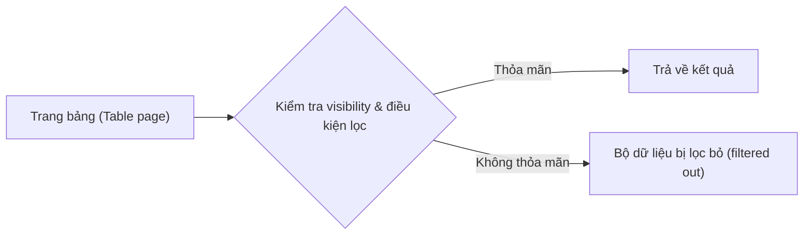
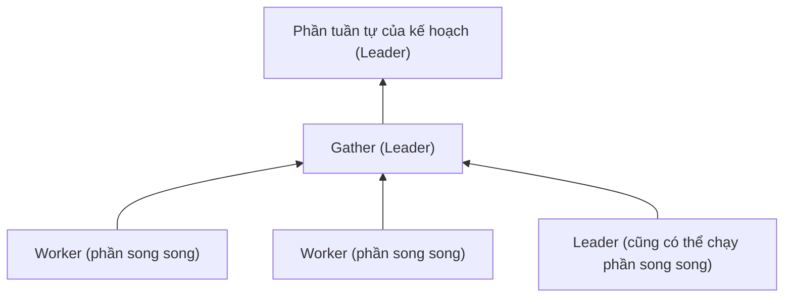

# CHƯƠNG 18: Phương thức truy cập bảng (Table Access Methods)

## 18.1 Bộ máy lưu trữ có thể cắm thêm (Pluggable Storage Engines)

Bố cục dữ liệu (data layout) mà PostgreSQL sử dụng không phải là bố cục duy nhất có thể có, cũng không phải là bố cục tốt nhất cho mọi loại tải công việc (load types). Tuân theo tư tưởng khả năng mở rộng (extensibility), từ phiên bản 12 (`v. 12`), PostgreSQL cho phép bạn tạo và gắn thêm nhiều phương thức truy cập bảng khác nhau (pluggable storage engines — bộ máy lưu trữ có thể cắm thêm), tuy nhiên hiện tại chỉ có một phương thức duy nhất có sẵn ngay khi cài đặt (out of the box):

```sql
=> SELECT amname, amhandler FROM pg_am WHERE amtype = 't';
 amname |      amhandler
--------+----------------------
 heap   | heap_tableam_handler
(1 row)
```

Bạn có thể chỉ định bộ máy sẽ sử dụng khi tạo bảng (`CREATE TABLE ... USING`); nếu không, bộ máy mặc định `heap` được liệt kê trong tham số `default_table_access_method` sẽ được áp dụng.

Để nhân (core) của PostgreSQL có thể làm việc với nhiều bộ máy khác nhau theo cùng một cách, các phương thức truy cập bảng phải triển khai một giao diện đặc biệt.[^1] Hàm được chỉ định trong cột `amhandler` sẽ trả về cấu trúc giao diện[^2] chứa toàn bộ thông tin mà nhân cần.

Các thành phần nhân sau đây có thể được sử dụng bởi mọi phương thức truy cập bảng:

- trình quản lý giao dịch (transaction manager), bao gồm hỗ trợ ACID và cô lập ảnh chụp (snapshot isolation)
- trình quản lý bộ đệm (buffer manager)
- hệ thống con I/O (I/O subsystem)
- TOAST
- trình tối ưu hóa (optimizer) và trình thực thi (executor)
- hỗ trợ chỉ mục (index support)

Những thành phần này luôn sẵn sàng để bộ máy sử dụng, ngay cả khi bộ máy đó không dùng đến tất cả chúng.

Về phần mình, các bộ máy tự định nghĩa:

- định dạng bộ dữ liệu (tuple format) và cấu trúc dữ liệu
- cách triển khai quét bảng (table scan) và ước lượng chi phí (cost estimation)
- cách triển khai các thao tác chèn (insert), xóa (delete), cập nhật (update) và khóa (lock)
- các quy tắc hiển thị dữ liệu (visibility rules)
- các quy trình dọn dẹp (`VACUUM`) và phân tích thống kê (`ANALYZE`)

Về mặt lịch sử, PostgreSQL sử dụng một bộ lưu trữ dữ liệu tích hợp duy nhất mà không có giao diện lập trình chuẩn mực nào, vì vậy hiện nay rất khó để đưa ra một thiết kế tốt vừa tính đến tất cả các đặc thù của bộ máy chuẩn vừa không gây cản trở cho các phương thức khác.

Chẳng hạn, hiện vẫn chưa rõ nên xử lý WAL như thế nào. Các phương thức truy cập mới có thể cần ghi nhật ký cho các thao tác riêng của chúng mà nhân không hề biết tới. Cơ chế WAL tổng quát (generic WAL) hiện có[^3] thường là một lựa chọn tồi, vì nó phát sinh quá nhiều chi phí phụ trợ (overhead). Bạn có thể thêm một giao diện nữa để xử lý các loại bản ghi WAL mới, nhưng khi đó quá trình phục hồi sau sự cố (crash recovery) sẽ phụ thuộc vào mã nguồn bên ngoài — điều này rất không mong muốn. Giải pháp khả thi duy nhất cho đến nay là vá mã nguồn nhân (patching the core) cho từng bộ máy cụ thể.

Vì lý do này, tác giả không cố gắng phân tách rạch ròi giữa phương thức truy cập bảng và phần nhân. Nhiều tính năng được mô tả trong các phần trước của cuốn sách về mặt hình thức thuộc về phương thức truy cập `heap` hơn là bản thân nhân. Phương thức này nhiều khả năng sẽ luôn là bộ máy chuẩn tối thượng cho PostgreSQL, trong khi các phương thức khác sẽ lấp đầy những phân khúc riêng để giải quyết thách thức của các loại tải công việc đặc thù.

Trong số tất cả các bộ máy mới đang được phát triển, có thể kể đến các bộ máy sau:

- **Zheap** hướng tới việc chống phình bảng (table bloating).[^4] Nó triển khai cập nhật dòng tại chỗ (in-place row updates) và chuyển dữ liệu lịch sử liên quan đến MVCC sang một vùng lưu trữ hoàn tác (undo storage) riêng biệt. Bộ máy như vậy sẽ hữu ích cho các tải công việc có tần suất cập nhật dữ liệu thường xuyên.

  Kiến trúc của Zheap sẽ quen thuộc với người dùng Oracle, mặc dù nó có một số điểm khác biệt tinh tế (ví dụ: giao diện của các phương thức truy cập chỉ mục — trang 424 — không cho phép tạo các chỉ mục có cơ chế quản lý phiên bản riêng).

- **Zedstore** triển khai lưu trữ theo cột (columnar storage),[^5] vốn có khả năng đạt hiệu quả cao nhất với các truy vấn OLAP.

  Dữ liệu lưu trữ được cấu trúc dưới dạng một cây B-tree của các ID bộ dữ liệu (tuple IDs); mỗi cột được lưu trong một cây B-tree riêng liên kết với cây chính. Trong tương lai, có thể lưu nhiều cột trong cùng một cây B-tree, từ đó tạo ra dạng lưu trữ lai (hybrid storage).

> 📝 **Giải thích thêm (không có trong sách):** Khi thiết kế ứng dụng trên PostgreSQL, `heap` là lựa chọn mặc định tối ưu cho hầu hết các hệ thống OLTP và hỗn hợp. Việc hiểu `Table Access Method (TAM)` giúp bạn giải thích được vì sao PostgreSQL có thể mở rộng sang các engine chuyên biệt (như lưu trữ cột hoặc undo-based storage) mà không cần viết lại toàn bộ optimizer, executor hay hệ thống quản lý giao dịch.

---

## 18.2 Quét tuần tự (Sequential Scans)

Bộ máy lưu trữ định nghĩa bố cục vật lý của dữ liệu bảng và cung cấp một phương thức truy cập vào dữ liệu đó. Phương thức duy nhất luôn được hỗ trợ là quét tuần tự (sequential scan), tức là đọc toàn bộ tệp (hoặc các tệp) thuộc nhánh chính (main fork) của bảng. Trong mỗi trang được đọc, khả năng hiển thị (visibility — trang 91) của từng bộ dữ liệu (tuple) được kiểm tra; những bộ dữ liệu không thỏa mãn điều kiện truy vấn sẽ bị lọc bỏ.



Tiến trình thực hiện quét sẽ đi qua bộ nhớ đệm (buffer cache — trang 267); để đảm bảo các bảng lớn không đẩy mất dữ liệu hữu ích đang nằm trong cache, một vòng đệm kích thước nhỏ (buffer ring) được sử dụng. Các tiến trình khác đang quét cùng một bảng sẽ tham gia vào vòng đệm này, nhờ đó tránh được việc đọc đĩa dư thừa; các lượt quét như vậy được gọi là quét đồng bộ (synchronized scans). Vì thế, quá trình quét không nhất thiết phải luôn bắt đầu từ đầu tệp.

Quét tuần tự là cách hiệu quả nhất để đọc toàn bộ bảng hoặc phần lớn bảng. Nói cách khác, quét tuần tự mang lại giá trị cao nhất khi độ chọn lọc (selectivity) thấp. (Nếu độ chọn lọc cao, nghĩa là truy vấn chỉ cần chọn ra một vài dòng, thì nên sử dụng chỉ mục — trang 424.)

### Ước lượng chi phí (Cost Estimation)

Trong kế hoạch thực thi truy vấn (query execution plan), phép quét tuần tự được biểu diễn bởi nút `Seq Scan`:

```sql
=> EXPLAIN SELECT *
FROM flights;
                         QUERY PLAN
-------------------------------------------------------------
 Seq Scan on flights (cost=0.00..4772.67 rows=214867 width=63)
(1 row)
```

Số lượng dòng ước lượng được cung cấp như một phần của thống kê cơ bản:

```sql
=> SELECT reltuples FROM pg_class WHERE relname = 'flights';
 reltuples
-----------
    214867
(1 row)
```

Khi ước lượng chi phí, trình tối ưu hóa (optimizer) tính đến hai thành phần sau: tài nguyên I/O đĩa và tài nguyên CPU.[^6]

Chi phí I/O được tính bằng cách nhân số trang trong một bảng với chi phí đọc một trang đơn lẻ theo giả định các trang được đọc tuần tự. Khi trình quản lý bộ đệm yêu cầu một trang, hệ điều hành thực tế sẽ đọc nhiều dữ liệu hơn từ đĩa, do đó một số trang kế tiếp nhiều khả năng đã nằm sẵn trong bộ nhớ đệm của hệ điều hành. Vì lý do này, chi phí đọc một trang bằng quét tuần tự (được bộ lập kế hoạch ước lượng bằng tham số `seq_page_cost`, mặc định là `1`) thấp hơn chi phí truy cập ngẫu nhiên (được định nghĩa bởi giá trị `random_page_cost`, mặc định là `4`).

Các thiết lập mặc định hoạt động tốt đối với ổ HDD; nếu bạn đang sử dụng SSD, việc giảm đáng kể giá trị `random_page_cost` là hợp lý (tham số `seq_page_cost` thường được giữ nguyên, đóng vai trò là giá trị tham chiếu). Vì tỷ lệ tối ưu giữa các tham số này phụ thuộc vào phần cứng, chúng thường được thiết lập ở cấp độ tablespace (`ALTER TABLESPACE ... SET`).

```sql
=> SELECT relpages,
  current_setting('seq_page_cost') AS seq_page_cost,
  relpages * current_setting('seq_page_cost')::real AS total
FROM pg_class WHERE relname = 'flights';
 relpages | seq_page_cost | total
----------+---------------+-------
     2624 | 1             |  2624
(1 row)
```

Các phép tính này cho thấy rõ hệ quả của hiện tượng phình bảng (table bloating — trang 246) do không chạy `VACUUM` kịp thời: nhánh chính của bảng càng lớn thì càng phải quét nhiều trang, bất kể số lượng bộ dữ liệu sống (live tuples) mà chúng chứa là bao nhiêu.

Ước lượng tài nguyên CPU bao gồm chi phí xử lý từng bộ dữ liệu (được bộ lập kế hoạch ước lượng bằng `cpu_tuple_cost`, mặc định là `0.01`):

```sql
=> SELECT reltuples,
  current_setting('cpu_tuple_cost') AS cpu_tuple_cost,
  reltuples * current_setting('cpu_tuple_cost')::real AS total
FROM pg_class WHERE relname = 'flights';
 reltuples | cpu_tuple_cost |  total
-----------+----------------+---------
    214867 | 0.01           | 2148.67
(1 row)
```

Tổng của hai ước lượng này biểu thị tổng chi phí (total cost) của kế hoạch. Chi phí khởi động (startup cost) bằng `0` vì quét tuần tự không có điều kiện tiên quyết nào.

Nếu bảng được quét cần phải lọc, các điều kiện lọc được áp dụng sẽ xuất hiện trong kế hoạch dưới mục `Filter` của nút `Seq Scan`. Số dòng ước lượng (trang 382) phụ thuộc vào độ chọn lọc của các điều kiện này, trong khi phần ước lượng chi phí bao gồm cả chi phí tính toán liên quan.

Lệnh `EXPLAIN ANALYZE` hiển thị cả số dòng thực tế được trả về lẫn số dòng đã bị lọc bỏ:

```sql
=> EXPLAIN (analyze, timing off, summary off)
SELECT * FROM flights
WHERE status = 'Scheduled';
                        QUERY PLAN
----------------------------------------------------------
 Seq Scan on flights
   (cost=0.00..5309.84 rows=15383 width=63)
   (actual rows=15383 loops=1)
   Filter: ((status)::text = 'Scheduled'::text)
   Rows Removed by Filter: 199484
(5 rows)
```

Hãy xem xét một kế hoạch thực thi phức tạp hơn có sử dụng phép tổng hợp (aggregation):

```sql
=> EXPLAIN SELECT count(*) FROM seats;
                         QUERY PLAN
-------------------------------------------------------------
 Aggregate (cost=24.74..24.75 rows=1 width=8)
   -> Seq Scan on seats (cost=0.00..21.39 rows=1339 width=0)
(2 rows)
```

Kế hoạch gồm hai nút: nút phía trên (`Aggregate`), thực hiện tính hàm `count`, lấy dữ liệu từ nút phía dưới (`Seq Scan`), vốn thực hiện quét bảng.

Chi phí khởi động của nút `Aggregate` bao gồm chính phép tổng hợp: không thể trả về dòng đầu tiên (cũng là dòng duy nhất trong trường hợp này) nếu chưa lấy được toàn bộ các dòng từ nút bên dưới. Chi phí tổng hợp được ước lượng dựa trên chi phí thực thi một phép toán điều kiện (ước lượng bằng `cpu_operator_cost`, mặc định là `0.0025`) cho mỗi dòng đầu vào:[^7]

```sql
=> SELECT reltuples,
  current_setting('cpu_operator_cost') AS cpu_operator_cost,
  round((
    reltuples * current_setting('cpu_operator_cost')::real
  )::numeric, 2) AS cpu_cost
FROM pg_class WHERE relname = 'seats';
 reltuples | cpu_operator_cost | cpu_cost
-----------+-------------------+----------
      1339 | 0.0025            |     3.35
(1 row)
```

Ước lượng nhận được này được cộng vào tổng chi phí của nút `Seq Scan`.

Tổng chi phí của nút `Aggregate` còn bao gồm chi phí xử lý một dòng để trả về, được ước lượng bằng `cpu_tuple_cost` (`0.01`):

```sql
=> WITH t(cpu_cost) AS (
  SELECT round((
    reltuples * current_setting('cpu_operator_cost')::real
  )::numeric, 2)
  FROM pg_class WHERE relname = 'seats'
)
SELECT 21.39 + t.cpu_cost AS startup_cost,
  round((
    21.39 + t.cpu_cost +
    1 * current_setting('cpu_tuple_cost')::real
  )::numeric, 2) AS total_cost
FROM t;
 startup_cost | total_cost
--------------+------------
        24.74 |      24.75
(1 row)
```

Do đó, mối phụ thuộc trong ước lượng chi phí có thể được hình dung như sau:

```
                      QUERY PLAN
------------------------------------------------------
 Aggregate (cost=24.74..24.75 rows=1 width=8)
   -> Seq Scan on seats (cost=0.00..21.39 rows=1339 width=0)
(4 rows)
```

> 💡 **Ví dụ bổ sung (không có trong sách):** Nếu bảng `flights` có `2624` trang và `214867` dòng, khi bạn thấy `Rows Removed by Filter: 199484` trong `EXPLAIN ANALYZE`, điều đó có nghĩa là PostgreSQL vẫn phải đọc toàn bộ `2624` trang và kiểm tra hơn `214 nghìn` dòng chỉ để giữ lại `15383` dòng (~7%). Nếu điều kiện `status = 'Scheduled'` được truy vấn thường xuyên và bảng lớn hơn nhiều, đây là dấu hiệu để cân nhắc tạo chỉ mục (hoặc partial index `WHERE status = 'Scheduled'`).

---

## 18.3 Kế hoạch song song (Parallel Plans)

Từ phiên bản 9.6 (`v. 9.6`), PostgreSQL hỗ trợ thực thi truy vấn song song (parallel query execution).[^8] Tiến trình dẫn đầu (leading process / leader) thực hiện truy vấn sẽ khởi tạo (thông qua `postmaster`) một số tiến trình công nhân (worker processes) cùng thực thi đồng thời phần song song của kế hoạch. Kết quả được truyền về cho tiến trình leader để gộp lại tại nút `Gather`.[^9] Khi không bận nhận dữ liệu, tiến trình leader cũng có thể tham gia thực thi phần song song của kế hoạch.

Nếu cần, từ phiên bản 11 (`v. 11`), bạn có thể cấm tiến trình leader tham gia thực thi phần kế hoạch song song bằng cách tắt tham số `parallel_leader_participation` (mặc định là `on`).



Tất nhiên, việc khởi tạo các tiến trình này và truyền dữ liệu giữa chúng không hề miễn phí, vì vậy không phải mọi truy vấn đều nên được song song hóa.

Bên cạnh đó, không phải mọi phần của kế hoạch đều có thể được xử lý đồng thời, ngay cả khi chế độ thực thi song song được cho phép. Một số thao tác chỉ do một mình tiến trình leader thực hiện, ở chế độ tuần tự.

PostgreSQL không hỗ trợ cách tiếp cận khác đối với thực thi kế hoạch song song — đó là việc xử lý dữ liệu bởi nhiều worker tạo thành một dây chuyền lắp ráp (nói một cách đại khái, mỗi nút kế hoạch do một tiến trình riêng thực hiện); cơ chế này bị các nhà phát triển PostgreSQL đánh giá là kém hiệu quả.

---

## 18.4 Quét tuần tự song song (Parallel Sequential Scans)

Một trong những nút được thiết kế cho xử lý song song là nút `Parallel Seq Scan`, nút này thực hiện phép quét tuần tự song song.

Tên gọi này nghe có vẻ hơi mâu thuẫn (rốt cuộc là quét tuần tự hay song song?), nhưng dù sao nó vẫn phản ánh đúng bản chất của thao tác. Nếu nhìn vào cách truy cập tệp, các trang của bảng vẫn được đọc tuần tự, theo đúng thứ tự mà một phép quét tuần tự thông thường sẽ đọc. Tuy nhiên, thao tác này được thực hiện bởi nhiều tiến trình đồng thời. Để tránh quét cùng một trang hai lần, trình thực thi đồng bộ hóa các tiến trình này thông qua bộ nhớ dùng chung (shared memory).

Một khía cạnh tinh tế ở đây (từ `v. 14`) là hệ điều hành không nhìn thấy bức tranh toàn cảnh đặc trưng của phép quét tuần tự; thay vào đó, nó thấy nhiều tiến trình đang thực hiện các lượt đọc ngẫu nhiên. Do đó, cơ chế đọc trước dữ liệu (data prefetching) vốn thường giúp tăng tốc quét tuần tự gần như trở nên vô dụng. Để giảm thiểu tác động khó chịu này, PostgreSQL gán cho mỗi tiến trình không chỉ một mà là nhiều trang liên tiếp để đọc.[^10]

Bản thân việc quét song song đơn thuần không mang lại nhiều ý nghĩa vì chi phí đọc thông thường còn bị tăng thêm bởi chi phí phụ trợ cho việc truyền dữ liệu từ tiến trình này sang tiến trình khác. Tuy nhiên, nếu các worker thực hiện thêm các bước hậu xử lý trên các dòng đã lấy (chẳng hạn như phép tổng hợp), tổng thời gian thực thi có thể trở nên ngắn hơn nhiều.

### Ước lượng chi phí (Cost Estimation)

Hãy xem xét một truy vấn đơn giản thực hiện phép tổng hợp trên một bảng lớn. Kế hoạch thực thi được song song hóa:

```sql
=> EXPLAIN SELECT count(*) FROM bookings;
                            QUERY PLAN
------------------------------------------------------------------
 Finalize Aggregate (cost=25442.58..25442.59 rows=1 width=8)
   -> Gather (cost=25442.36..25442.57 rows=2 width=8)
        Workers Planned: 2
        -> Partial Aggregate (cost=24442.36..24442.37 rows=1 width=8)
             -> Parallel Seq Scan on bookings
                  (cost=0.00..22243.29 rows=879629 width=0)
(7 rows)
```

Tất cả các nút bên dưới `Gather` đều thuộc về phần song song của kế hoạch. Chúng được thực thi bởi từng worker (ở đây dự kiến có 2 worker) và có thể bởi cả tiến trình leader (trừ khi tính năng này bị tắt bởi tham số `parallel_leader_participation`). Bản thân nút `Gather` và mọi nút phía trên nó tạo thành phần tuần tự của kế hoạch và chỉ do một mình tiến trình leader thực hiện.

Hãy xem xét lại kế hoạch truy vấn này một lần nữa:

```sql
=> EXPLAIN SELECT count(*) FROM bookings;
                            QUERY PLAN
------------------------------------------------------------------
 Finalize Aggregate (cost=25442.58..25442.59 rows=1 width=8)
   -> Gather (cost=25442.36..25442.57 rows=2 width=8)
        Workers Planned: 2
        -> Partial Aggregate (cost=24442.36..24442.37 rows=1 width=8)
             -> Parallel Seq Scan on bookings
                  (cost=0.00..22243.29 rows=879629 width=0)
(7 rows)
```

Nút `Parallel Seq Scan` biểu diễn một phép quét `heap` song song. Trường `rows` cho biết số dòng trung bình ước lượng mà một tiến trình đơn lẻ phải xử lý. Tổng cộng việc thực thi phải được thực hiện bởi ba tiến trình (một leader và hai worker), nhưng tiến trình leader sẽ xử lý ít dòng hơn: tỷ phần của nó ngày càng nhỏ đi khi số lượng worker tăng lên.[^11] Trong trường hợp cụ thể này, hệ số chia là `2.4`:

```sql
=> SELECT reltuples::numeric, round(reltuples / 2.4) AS per_process
FROM pg_class WHERE relname = 'bookings';
 reltuples | per_process
-----------+-------------
   2111110 |      879629
(1 row)
```

Chi phí của `Parallel Seq Scan` được tính tương tự như quét tuần tự. Giá trị thu được nhỏ hơn vì mỗi tiến trình xử lý ít dòng hơn; phần chi phí I/O vẫn được tính đầy đủ vì toàn bộ bảng vẫn phải được đọc từng trang một:

```sql
=> SELECT round((
  relpages * current_setting('seq_page_cost')::real +
  reltuples / 2.4 * current_setting('cpu_tuple_cost')::real
)::numeric, 2)
FROM pg_class WHERE relname = 'bookings';
  round
----------
 22243.29
(1 row)
```

Tiếp theo, nút `Partial Aggregate` thực hiện tổng hợp dữ liệu đã lấy được; trong trường hợp cụ thể này, nó đếm số lượng dòng.

Chi phí tổng hợp được ước lượng theo cách thông thường và được cộng vào ước lượng chi phí của phép quét bảng:

```sql
=> WITH t(startup_cost) AS (
  SELECT 22243.29 + round((
    reltuples / 2.4 * current_setting('cpu_operator_cost')::real
  )::numeric, 2)
  FROM pg_class
  WHERE relname = 'bookings'
)
SELECT startup_cost,
  startup_cost + round((
    1 * current_setting('cpu_tuple_cost')::real
  )::numeric, 2) AS total_cost
FROM t;
 startup_cost | total_cost
--------------+------------
     24442.36 |   24442.37
(1 row)
```

Nút tiếp theo (`Gather`) được thực thi bởi tiến trình leader. Nút này chịu trách nhiệm khởi chạy các worker và thu thập dữ liệu mà chúng trả về.

Để phục vụ việc lập kế hoạch, ước lượng chi phí khởi tạo các tiến trình (bất kể số lượng là bao nhiêu) được định nghĩa bởi tham số `parallel_setup_cost` (mặc định `1000`), trong khi chi phí truyền mỗi dòng giữa các tiến trình được ước lượng bằng `parallel_tuple_cost` (mặc định `0.1`).

Trong ví dụ này, chi phí khởi động (dành cho việc khởi tạo các tiến trình) chiếm ưu thế; giá trị này được cộng vào chi phí khởi động của nút `Partial Aggregate`. Tổng chi phí còn bao gồm chi phí truyền hai dòng; giá trị này được cộng vào tổng chi phí của nút `Partial Aggregate`:[^12]

```sql
=> SELECT
  24442.36 + round(
    current_setting('parallel_setup_cost')::numeric,
  2) AS setup_cost,
  24442.37 + round(
    current_setting('parallel_setup_cost')::numeric +
    2 * current_setting('parallel_tuple_cost')::numeric,
  2) AS total_cost;
 setup_cost | total_cost
------------+------------
   25442.36 |   25442.57
(1 row)
```

Cuối cùng nhưng không kém phần quan trọng, nút `Finalize Aggregate` tổng hợp tất cả các kết quả bộ phận (partial results) mà nút `Gather` nhận được từ các tiến trình song song.

Phép tổng hợp cuối cùng này được ước lượng giống như mọi phép tổng hợp khác. Chi phí khởi động của nó dựa trên chi phí tổng hợp ba dòng; giá trị này được cộng vào tổng chi phí của `Gather` (vì cần có tất cả các dòng để tính ra kết quả). Tổng chi phí của `Finalize Aggregate` cũng bao gồm chi phí trả về một dòng.

```sql
=> WITH t(startup_cost) AS (
  SELECT 25442.57 + round((
    3 * current_setting('cpu_operator_cost')::real
  )::numeric, 2)
  FROM pg_class WHERE relname = 'bookings'
)
SELECT startup_cost,
  startup_cost + round((
    1 * current_setting('cpu_tuple_cost')::real
  )::numeric, 2) AS total_cost
FROM t;
 startup_cost | total_cost
--------------+------------
     25442.58 |   25442.59
(1 row)
```

Mối phụ thuộc giữa các ước lượng chi phí được xác định bởi việc nút đó có phải tích lũy dữ liệu trước khi truyền kết quả cho nút cha hay không. Phép tổng hợp (`Aggregate`) không thể trả về kết quả cho đến khi nhận được toàn bộ dòng đầu vào, nên chi phí khởi động của nó dựa trên tổng chi phí của nút bên dưới. Ngược lại, nút `Gather` bắt đầu gửi các dòng lên trên ngay khi chúng được lấy về. Do đó, chi phí khởi động của thao tác này phụ thuộc vào chi phí khởi động của nút bên dưới, còn tổng chi phí của nó dựa trên tổng chi phí của nút bên dưới.

Dưới đây là đồ thị phụ thuộc:

```
                         QUERY PLAN
-----------------------------------------------------------
 Finalize Aggregate (cost=25442.58..25442.59 rows=1 width=8)
   -> Gather (cost=25442.36..25442.57 rows=2 width=8)
        Workers Planned: 2
        -> Partial Aggregate (cost=24442.36..24442.37 rows=1 width=8)
             -> Parallel Seq Scan on bookings
                  (cost=0.00..22243.29 rows=879629 width=0)
(9 rows)
```

---

## 18.5 Các giới hạn của thực thi song song (Parallel Execution Limitations)

### Số lượng tiến trình nền (Number of Background Workers)

Số lượng tiến trình được kiểm soát bởi một hệ thống phân cấp gồm ba tham số. Số lượng tối đa các tiến trình nền (background workers) chạy đồng thời được định nghĩa bởi giá trị `max_worker_processes` (mặc định `8`).

Tuy nhiên, thực thi truy vấn song song không phải là thao tác duy nhất cần đến tiến trình nền. Ví dụ, chúng cũng tham gia vào nhân bản logic (logical replication) và có thể được các extension sử dụng. Số lượng tiến trình được cấp phát riêng cho việc thực thi kế hoạch song song bị giới hạn bởi `max_parallel_workers` (mặc định `8`).

Trong số đó, tối đa `max_parallel_workers_per_gather` (mặc định `2`) tiến trình có thể phục vụ một tiến trình leader.

Việc lựa chọn giá trị cho các tham số này phụ thuộc vào các yếu tố sau:

- **Khả năng phần cứng:** hệ thống phải có sẵn các nhân CPU rảnh dành riêng cho thực thi song song.
- **Kích thước bảng:** cơ sở dữ liệu phải chứa các bảng lớn.
- **Tải công việc điển hình:** phải có các truy vấn có khả năng hưởng lợi từ việc thực thi song song. Các tiêu chí này thường được đáp ứng bởi hệ thống OLAP hơn là OLTP.

Bộ lập kế hoạch sẽ hoàn toàn không cân nhắc thực thi song song nếu dung lượng dữ liệu `heap` ước lượng cần đọc không vượt quá giá trị `min_parallel_table_scan_size` (mặc định `8MB`).

Trừ khi tham số lưu trữ `parallel_workers` được thiết lập để chỉ định rõ số lượng tiến trình cho một bảng cụ thể, giá trị này sẽ được tính theo công thức sau:

$$1 + \left\lfloor \log_3 \left( \frac{\text{table size}}{\text{min\_parallel\_table\_scan\_size}} \right) \right\rfloor$$

Điều này có nghĩa là mỗi khi kích thước bảng tăng gấp ba lần, PostgreSQL sẽ gán thêm một parallel worker để xử lý bảng đó. Với các thiết lập mặc định, ta có các con số sau:

| Kích thước bảng, MB (table, MB) | Số lượng tiến trình (number of processes) |
| :--- | :--- |
| 8 | 1 |
| 24 | 2 |
| 72 | 3 |
| 216 | 4 |
| 648 | 5 |
| 1944 | 6 |

Trong mọi trường hợp, số lượng parallel worker không thể vượt quá giới hạn được định nghĩa bởi tham số `max_parallel_workers_per_gather`.

Nếu chúng ta truy vấn một bảng nhỏ có kích thước 19 MB, chỉ một worker được lên kế hoạch và khởi chạy:

```sql
=> EXPLAIN (analyze, costs off, timing off, summary off)
SELECT count(*) FROM flights;
                              QUERY PLAN
----------------------------------------------------------------------
 Finalize Aggregate (actual rows=1 loops=1)
   -> Gather (actual rows=2 loops=1)
        Workers Planned: 1
        Workers Launched: 1
        -> Partial Aggregate (actual rows=1 loops=2)
             -> Parallel Seq Scan on flights (actual rows=107434 lo...
(6 rows)
```

Một truy vấn trên bảng có kích thước 105 MB chỉ nhận được hai tiến trình vì chạm ngưỡng giới hạn `max_parallel_workers_per_gather` (`2`):

```sql
=> EXPLAIN (analyze, costs off, timing off, summary off)
SELECT count(*) FROM bookings;
                              QUERY PLAN
----------------------------------------------------------------------
 Finalize Aggregate (actual rows=1 loops=1)
   -> Gather (actual rows=3 loops=1)
        Workers Planned: 2
        Workers Launched: 2
        -> Partial Aggregate (actual rows=1 loops=3)
             -> Parallel Seq Scan on bookings (actual rows=703703 l...
(6 rows)
```

Nếu gỡ bỏ giới hạn này, ta sẽ nhận được ba tiến trình như ước tính:

```sql
=> ALTER SYSTEM SET max_parallel_workers_per_gather = 4;
=> SELECT pg_reload_conf();
=> EXPLAIN (analyze, costs off, timing off, summary off)
SELECT count(*) FROM bookings;
                              QUERY PLAN
----------------------------------------------------------------------
 Finalize Aggregate (actual rows=1 loops=1)
   -> Gather (actual rows=4 loops=1)
        Workers Planned: 3
        Workers Launched: 3
        -> Partial Aggregate (actual rows=1 loops=4)
             -> Parallel Seq Scan on bookings (actual rows=527778 l...
(6 rows)
```

Nếu số lượng slot rảnh trong lúc thực thi truy vấn nhỏ hơn giá trị đã lên kế hoạch, chỉ số lượng worker khả dụng mới được khởi chạy.

Hãy giới hạn tổng số tiến trình song song xuống còn 5 và chạy đồng thời hai truy vấn:

```sql
=> ALTER SYSTEM SET max_parallel_workers = 5;
=> SELECT pg_reload_conf();
=> EXPLAIN (analyze, costs off, timing off, summary off)
SELECT count(*) FROM bookings;
=> EXPLAIN (analyze, costs off, timing off, summary off)
SELECT count(*) FROM bookings;
```

```
                            QUERY PLAN
------------------------------------------------------------------
 Finalize Aggregate (actual rows=1 loops=1)
   -> Gather (actual rows=3 loops=1)
        Workers Planned: 3
        Workers Launched: 2
        -> Partial Aggregate (actual rows=1 loops=3)
             -> Parallel Seq Scan on bookings (actual rows=7037...
(6 rows)

                              QUERY PLAN
----------------------------------------------------------------------
 Finalize Aggregate (actual rows=1 loops=1)
   -> Gather (actual rows=4 loops=1)
        Workers Planned: 3
        Workers Launched: 3
        -> Partial Aggregate (actual rows=1 loops=4)
             -> Parallel Seq Scan on bookings (actual rows=527778 l...
(6 rows)
```

Mặc dù cả hai trường hợp đều dự kiến 3 tiến trình, một trong hai truy vấn chỉ xin được 2 slot.

Hãy khôi phục lại các thiết lập mặc định:

```sql
=> ALTER SYSTEM RESET ALL;
=> SELECT pg_reload_conf();
```

### Các truy vấn không thể song song hóa (Non-Parallelizable Queries)

Không phải mọi truy vấn đều có thể được song song hóa.[^13] Cụ thể, kế hoạch song song không thể được sử dụng cho các loại truy vấn sau:

- Các truy vấn sửa đổi hoặc khóa dữ liệu (`UPDATE`, `DELETE`, `SELECT FOR UPDATE`, v.v.).

  Hạn chế này không áp dụng cho các truy vấn con (subqueries) nằm bên trong các lệnh sau:
  - `CREATE TABLE AS`, `SELECT INTO`, `CREATE MATERIALIZED VIEW` (từ `v. 11`)
  - `REFRESH MATERIALIZED VIEW` (từ `v. 14`)

  Tuy nhiên, việc chèn dòng (row insertion) vẫn luôn được thực hiện tuần tự trong tất cả các trường hợp này.

- Các truy vấn có thể bị tạm dừng (paused). Điều này áp dụng cho các truy vấn chạy bên trong con trỏ (cursors), bao gồm cả vòng lặp `FOR` trong `PL/pgSQL`.

- Các truy vấn gọi các hàm được đánh dấu `PARALLEL UNSAFE`. Theo mặc định, đây là tất cả các hàm do người dùng định nghĩa và một vài hàm chuẩn. Bạn có thể lấy danh sách đầy đủ các hàm không an toàn bằng cách truy vấn danh mục hệ thống:

  ```sql
  SELECT * FROM pg_proc WHERE proparallel = 'u';
  ```

- Các truy vấn nằm bên trong hàm nếu các hàm đó được gọi từ một truy vấn đã được song song hóa (để tránh sự gia tăng đệ quy số lượng worker).

Một số hạn chế này có thể được gỡ bỏ trong các phiên bản tương lai của PostgreSQL. Chẳng hạn, từ `v. 12`, khả năng song song hóa truy vấn ở mức cô lập `Serializable` đã có sẵn. Việc chèn dòng song song sử dụng các lệnh như `INSERT` và `COPY` hiện đang được phát triển.[^14]

Một truy vấn có thể vẫn không được song song hóa vì nhiều lý do:

- Loại truy vấn này hoàn toàn không hỗ trợ song song hóa.
- Việc dùng kế hoạch song song bị cấm bởi cấu hình máy chủ (ví dụ, do giới hạn kích thước bảng đặt ra).
- Một kế hoạch song song đắt đỏ hơn một kế hoạch tuần tự.

Để kiểm tra xem một truy vấn có thể được song song hóa hay không, bạn có thể tạm thời bật tham số `force_parallel_mode` (mặc định `off`). Khi đó, bộ lập kế hoạch sẽ dựng kế hoạch song song bất cứ khi nào có thể:

```sql
=> EXPLAIN SELECT * FROM flights;
                         QUERY PLAN
-------------------------------------------------------------
 Seq Scan on flights (cost=0.00..4772.67 rows=214867 width=63)
(1 row)

=> SET force_parallel_mode = on;
=> EXPLAIN SELECT * FROM flights;
                              QUERY PLAN
----------------------------------------------------------------------
 Gather (cost=1000.00..27259.37 rows=214867 width=63)
   Workers Planned: 1
   Single Copy: true
   -> Seq Scan on flights (cost=0.00..4772.67 rows=214867 width=63)
(4 rows)
```

### Các truy vấn bị hạn chế song song (Parallel Restricted Queries)

Phần song song của kế hoạch càng lớn thì mức tăng hiệu năng tiềm năng có thể đạt được càng cao. Tuy nhiên, một số thao tác nhất định bắt buộc phải được thực thi tuần tự bởi một mình tiến trình leader,[^15] mặc dù bản thân chúng không cản trở việc song song hóa. Nói cách khác, chúng không thể xuất hiện trong cây kế hoạch bên dưới nút `Gather`.

#### Các truy vấn con không thể mở rộng (Non-expandable subqueries.)

Ví dụ rõ ràng nhất về một truy vấn con không thể mở rộng[^16] là quét kết quả của một CTE (được biểu diễn trong kế hoạch bởi nút `CTE Scan`):

```sql
=> EXPLAIN (costs off)
WITH t AS MATERIALIZED (
  SELECT * FROM flights
)
SELECT count(*) FROM t;
         QUERY PLAN
----------------------------
 Aggregate
   CTE t
     -> Seq Scan on flights
   -> CTE Scan on t
(4 rows)
```

Từ phiên bản 12 (`v. 12`), nếu một CTE không được vật chất hóa (materialized), kế hoạch sẽ không chứa nút `CTE Scan`, do đó hạn chế này không áp dụng.

Tuy nhiên, lưu ý rằng bản thân một CTE vẫn có thể được tính toán ở chế độ song song nếu việc đó tỏ ra ít tốn kém hơn:

```sql
=> EXPLAIN (costs off)
WITH t AS MATERIALIZED (
  SELECT count(*) FROM flights
)
SELECT * FROM t;
                   QUERY PLAN
-------------------------------------------------
 CTE Scan on t
   CTE t
     -> Finalize Aggregate
          -> Gather
               Workers Planned: 1
               -> Partial Aggregate
                    -> Parallel Seq Scan on flights
(7 rows)
```

Một ví dụ khác về truy vấn con không thể mở rộng được thể hiện qua nút `SubPlan` trong kế hoạch dưới đây:

```sql
=> EXPLAIN (costs off)
SELECT * FROM flights f
WHERE f.scheduled_departure > ( -- SubPlan
  SELECT min(f2.scheduled_departure)
  FROM flights f2
  WHERE f2.aircraft_code = f.aircraft_code
);
                       QUERY PLAN
--------------------------------------------------------
 Seq Scan on flights f
   Filter: (scheduled_departure > (SubPlan 1))
   SubPlan 1
     -> Aggregate
          -> Seq Scan on flights f2
               Filter: (aircraft_code = f.aircraft_code)
(6 rows)
```

Hai dòng đầu tiên biểu diễn kế hoạch của truy vấn chính: bảng `flights` được quét tuần tự, và từng dòng của nó được kiểm tra theo bộ lọc đã cung cấp. Điều kiện lọc bao gồm một truy vấn con; kế hoạch của truy vấn con này bắt đầu từ dòng thứ ba. Vì vậy, nút `SubPlan` được thực thi nhiều lần, trong trường hợp này là một lần cho mỗi dòng được lấy ra bởi phép quét tuần tự. Nút `Seq Scan` phía trên của kế hoạch này không thể tham gia thực thi song song vì nó phụ thuộc vào dữ liệu do nút `SubPlan` trả về.

Cuối cùng nhưng không kém phần quan trọng, đây là một truy vấn con không thể mở rộng nữa được biểu diễn bởi nút `InitPlan`:

```sql
=> EXPLAIN (costs off)
SELECT * FROM flights f
WHERE f.scheduled_departure > ( -- SubPlan
  SELECT min(f2.scheduled_departure)
  FROM flights f2
  WHERE EXISTS ( -- InitPlan
    SELECT *
    FROM ticket_flights tf
    WHERE tf.flight_id = f.flight_id
  )
);
                        QUERY PLAN
------------------------------------------------------------
 Seq Scan on flights f
   Filter: (scheduled_departure > (SubPlan 2))
   SubPlan 2
     -> Finalize Aggregate
          InitPlan 1 (returns $1)
            -> Seq Scan on ticket_flights tf
                 Filter: (flight_id = f.flight_id)
          -> Gather
               Workers Planned: 1
               Params Evaluated: $1
               -> Partial Aggregate
                    -> Result
                         One-Time Filter: $1
                         -> Parallel Seq Scan on flights f2
(14 rows)
```

Không giống nút `SubPlan`, `InitPlan` chỉ được đánh giá một lần (trong ví dụ cụ thể này là một lần cho mỗi lần thực thi nút `SubPlan 2`). Nút cha của `InitPlan` không thể tham gia thực thi song song (nhưng các nút nhận kết quả đánh giá của `InitPlan` thì có thể, như trong ví dụ này).

#### Bảng tạm (Temporary tables.)

Các bảng tạm không hỗ trợ quét song song, vì chúng chỉ có thể được truy cập độc quyền bởi tiến trình đã tạo ra chúng. Các trang của chúng được xử lý trong bộ nhớ đệm cục bộ (local buffer cache — trang 274). Việc làm cho bộ nhớ đệm cục bộ có thể truy cập được bởi nhiều tiến trình sẽ đòi hỏi một cơ chế khóa (trang 351) giống như trong bộ nhớ đệm dùng chung (shared cache), điều này sẽ làm giảm bớt các lợi ích khác của nó.

```sql
=> CREATE TEMPORARY TABLE flights_tmp AS SELECT * FROM flights;
=> EXPLAIN (costs off)
SELECT count(*) FROM flights_tmp;
          QUERY PLAN
------------------------------
 Aggregate
   -> Seq Scan on flights_tmp
(2 rows)
```

#### Các hàm hạn chế song song (Parallel restricted functions.)

Các hàm được định nghĩa là `PARALLEL RESTRICTED` chỉ được phép chạy trong phần tuần tự của kế hoạch. Bạn có thể lấy danh sách các hàm như vậy từ danh mục hệ thống bằng cách chạy truy vấn sau:

```sql
SELECT * FROM pg_proc WHERE proparallel = 'r';
```

Chỉ gắn nhãn cho hàm của bạn là `PARALLEL RESTRICTED` (chưa nói đến `PARALLEL SAFE`) nếu bạn nhận thức đầy đủ mọi hệ quả và đã nghiên cứu kỹ tất cả các ràng buộc đi kèm.[^17]

> 💡 **Ví dụ bổ sung (không có trong sách):** Khi viết hàm PL/pgSQL hoặc SQL tùy chỉnh (ví dụ hàm tính toán thuần túy không truy cập trạng thái phiên hoặc ghi dữ liệu), PostgreSQL mặc định gán nhãn `PARALLEL UNSAFE` (`proparallel = 'u'`). Nếu hàm đó được dùng trong mệnh đề `WHERE` của một truy vấn lớn, nó sẽ chặn toàn bộ kế hoạch chuyển sang `Parallel Seq Scan`. Khi đã kiểm tra kỹ hàm không dùng bảng tạm, không sửa đổi dữ liệu và không gọi hàm unsafe khác, bạn có thể khai báo `CREATE FUNCTION ... PARALLEL SAFE;` để mở khóa thực thi song song.

---

## Bảng thuật ngữ chương (Chapter Glossary)

| Thuật ngữ (English) | Tiếng Việt | Giải thích ngắn gọn |
| :--- | :--- | :--- |
| Table Access Method (TAM) | Phương thức truy cập bảng | Giao diện cho phép gắn các bộ máy lưu trữ khác nhau vào nhân PostgreSQL. |
| Pluggable Storage Engine | Bộ máy lưu trữ có thể cắm thêm | Cơ chế lưu trữ vật lý có thể thay thế (mặc định là `heap`). |
| Sequential Scan (`Seq Scan`) | Quét tuần tự | Đọc toàn bộ các trang của nhánh chính bảng và kiểm tra visibility từng bộ dữ liệu. |
| Synchronized Scan | Quét đồng bộ | Nhiều tiến trình cùng chia sẻ vòng đệm (buffer ring) khi quét chung một bảng. |
| Buffer Ring | Vòng đệm | Vùng đệm kích thước nhỏ giúp quét bảng lớn không đẩy dữ liệu hữu ích ra khỏi shared buffers. |
| Parallel Query Execution | Thực thi truy vấn song song | Tiến trình leader khởi tạo các worker để cùng thực thi một phần kế hoạch truy vấn. |
| `Gather` node | Nút `Gather` | Nút ranh giới nơi tiến trình leader thu thập kết quả từ các parallel worker. |
| `Partial Aggregate` / `Finalize Aggregate` | Tổng hợp bộ phận / Tổng hợp cuối | Hai bước tổng hợp trong kế hoạch song song: worker tính từng phần, leader gộp kết quả cuối. |
| Parallel Restricted | Hạn chế song song | Thao tác hoặc hàm chỉ được chạy ở phần tuần tự (bởi leader), không được nằm dưới nút `Gather`. |
| Parallel Unsafe | Không an toàn cho song song | Thao tác hoặc hàm hoàn toàn ngăn cản kế hoạch sử dụng thực thi song song. |
| Non-expandable Subquery | Truy vấn con không thể mở rộng | Truy vấn con (như `CTE Scan`, `SubPlan`, `InitPlan`) bị giới hạn vị trí trong cây song song. |

[^1]: `postgresql.org/docs/14/tableam.html`
[^2]: `include/access/tableam.h`
[^3]: `postgresql.org/docs/14/generic-wal.html`
[^4]: `github.com/EnterpriseDB/zheap`
[^5]: `github.com/greenplum-db/postgres/tree/zedstore`
[^6]: `backend/optimizer/path/costsize.c`, hàm `cost_seqscan`
[^7]: `backend/optimizer/path/costsize.c`, hàm `cost_agg`
[^8]: `postgresql.org/docs/14/parallel-query.html` và `backend/access/transam/README.parallel`
[^9]: `backend/executor/nodeGather.c`
[^10]: `backend/access/heap/heapam.c`, các hàm `table_block_parallelscan_startblock_init` & `table_block_parallelscan_nextpage`
[^11]: `backend/optimizer/path/costsize.c`, hàm `get_parallel_divisor`
[^12]: `backend/optimizer/path/costsize.c`, hàm `cost_gather`
[^13]: `postgresql.org/docs/14/when-can-parallel-query-be-used.html`
[^14]: `commitfest.postgresql.org/32/2844`, `commitfest.postgresql.org/32/2841`, `commitfest.postgresql.org/32/2610`
[^15]: `postgresql.org/docs/14/parallel-safety.html`
[^16]: `backend/optimizer/plan/subselect.c`
[^17]: `postgresql.org/docs/14/parallel-safety.html#PARALLEL-LABELING`
