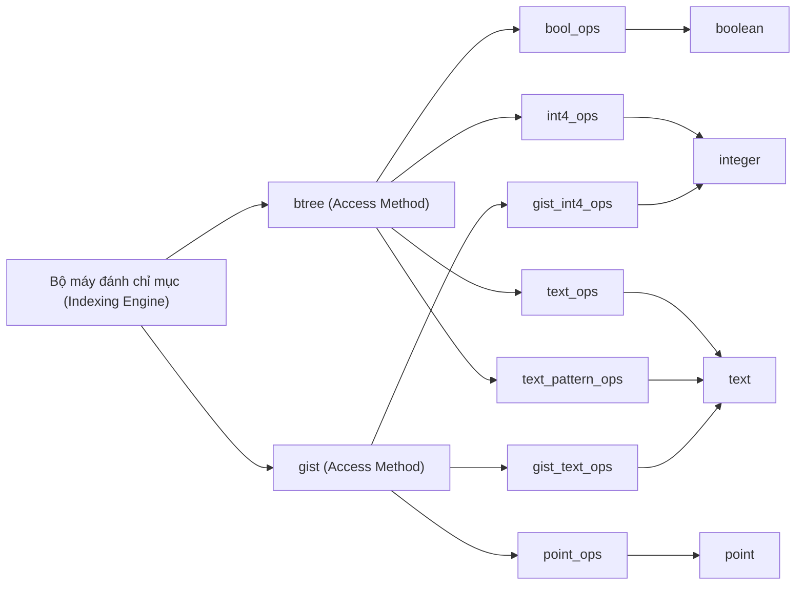

# CHƯƠNG 19: Các phương thức truy cập chỉ mục (CHAPTER 19: Index Access Methods)

## 19.1 Chỉ mục và khả năng mở rộng (Indexes and Extensibility)

Chỉ mục (index) là các đối tượng cơ sở dữ liệu chủ yếu phục vụ mục đích tăng tốc truy cập dữ liệu. Đây là các cấu trúc phụ trợ: bất kỳ chỉ mục nào cũng có thể bị xóa và tạo lại dựa trên dữ liệu heap. Ngoài việc tăng tốc truy cập dữ liệu, chỉ mục còn được dùng để thực thi một số ràng buộc toàn vẹn (integrity constraints).

Phần lõi của PostgreSQL cung cấp sẵn sáu phương thức truy cập chỉ mục (index access methods — các loại chỉ mục) tích hợp sẵn:

```sql
=> SELECT amname FROM pg_am WHERE amtype = 'i';
 amname
--------
 btree
 hash
 gist
 gin
 spgist
 brin
(6 rows)
```

Khả năng mở rộng của PostgreSQL *(từ phiên bản 9.6)* cho phép thêm các phương thức truy cập mới mà không cần sửa đổi phần lõi. Một extension như vậy (phương thức `bloom`) đã được đưa vào bộ module chuẩn.

Bất chấp mọi sự khác biệt giữa các loại chỉ mục khác nhau, tất cả chúng cuối cùng đều khớp một khóa (key — chẳng hạn như giá trị của một cột được đánh chỉ mục) với các bộ dữ liệu heap (heap tuples) chứa khóa đó. Các bộ dữ liệu được tham chiếu bằng các định danh bộ dữ liệu sáu byte (tuple IDs), hay còn gọi là **TID**. Khi biết khóa hoặc một số thông tin về khóa, ta có thể nhanh chóng đọc các bộ dữ liệu có khả năng chứa dữ liệu cần thiết mà không cần quét toàn bộ bảng.

Để đảm bảo một phương thức truy cập mới có thể được thêm vào dưới dạng extension, PostgreSQL triển khai một **bộ máy đánh chỉ mục (indexing engine)** dùng chung. Mục tiêu chính của nó là truy xuất và xử lý các TID do một phương thức truy cập cụ thể trả về:

- đọc dữ liệu từ các bộ dữ liệu heap tương ứng;
- kiểm tra khả năng hiển thị của bộ dữ liệu (tuple visibility) đối với một snapshot cụ thể;
- kiểm tra lại (recheck) các điều kiện nếu việc đánh giá chúng bởi phương thức truy cập chưa mang tính quyết định tuyệt đối.

Bộ máy đánh chỉ mục cũng tham gia vào quá trình thực thi các kế hoạch được xây dựng ở giai đoạn tối ưu hóa. Khi đánh giá các đường dẫn thực thi khác nhau, bộ tối ưu hóa (optimizer) cần biết các thuộc tính của tất cả các phương thức truy cập có khả năng áp dụng: phương thức đó có thể trả về dữ liệu theo đúng thứ tự yêu cầu hay chúng ta cần một bước sắp xếp (sorting) riêng biệt? Có thể trả về vài giá trị đầu tiên ngay lập tức hay phải đợi lấy xong toàn bộ tập kết quả? V.v.

Không chỉ bộ tối ưu hóa cần biết các đặc thù của phương thức truy cập. Việc tạo chỉ mục cũng đặt ra nhiều câu hỏi cần trả lời: phương thức truy cập có hỗ trợ chỉ mục nhiều cột (multicolumn indexes) không? Chỉ mục này có thể đảm bảo tính duy nhất (uniqueness) không?

Bộ máy đánh chỉ mục cho phép sử dụng nhiều loại phương thức truy cập khác nhau; để được hỗ trợ, một phương thức truy cập phải triển khai một giao diện cụ thể nhằm khai báo các tính năng và thuộc tính của nó.

Các phương thức truy cập được sử dụng để giải quyết các tác vụ sau:

- triển khai các thuật toán xây dựng chỉ mục, cũng như chèn và xóa các mục chỉ mục (index entries);
- phân bổ các mục chỉ mục giữa các trang (pages) — để bộ quản lý bộ đệm (buffer cache manager) xử lý tiếp;
- triển khai thuật toán dọn dẹp (vacuuming);
- xin khóa (acquire locks) để đảm bảo hoạt động đồng thời (concurrent operation) chính xác;
- sinh các bản ghi WAL;
- tìm kiếm dữ liệu đã đánh chỉ mục theo khóa;
- ước tính chi phí quét chỉ mục (index scan costs).

Khả năng mở rộng còn thể hiện ở việc có thể thêm các kiểu dữ liệu mới mà phương thức truy cập không hề biết trước. Do đó, các phương thức truy cập phải tự định nghĩa giao diện riêng để gắn các kiểu dữ liệu tùy ý vào.

Để cho phép sử dụng một kiểu dữ liệu mới với một phương thức truy cập cụ thể, bạn phải triển khai giao diện tương ứng — tức là cung cấp các toán tử có thể dùng với chỉ mục, và có thể kèm theo một số hàm hỗ trợ (support functions) phụ trợ. Một tập hợp các toán tử và hàm như vậy được gọi là một **lớp toán tử (operator class)**.

> 📝 **Giải thích thêm (không có trong sách):**
> Trong PostgreSQL, việc tách bạch giữa **bộ máy đánh chỉ mục (indexing engine)**, **phương thức truy cập (access method)** và **lớp toán tử (operator class)** giúp kiến trúc cực kỳ linh hoạt:
> - Nếu bạn tạo một kiểu dữ liệu mới (ví dụ: kiểu `semver` cho phiên bản phần mềm), bạn không cần viết lại thuật toán B-tree. Bạn chỉ cần định nghĩa các toán tử so sánh (`<`, `<=`, `=`, `>=`, `>`) và hàm so sánh trong một **operator class** cho `btree`.
> - Ngược lại, nếu bạn phát minh ra một cấu trúc dữ liệu chỉ mục hoàn toàn mới (ví dụ: chỉ mục cho vector AI như `pgvector` với `ivfflat` hoặc `hnsw`), bạn có thể đóng gói nó thành extension triển khai **index access method** mà không cần chạm vào mã nguồn lõi của PostgreSQL.

---

## 19.2 Lớp toán tử và Họ toán tử (Operator Classes and Families)

Logic đánh chỉ mục được triển khai một phần bởi chính phương thức truy cập, nhưng một phần được giao cho các lớp toán tử. Sự phân chia này mang tính tương đối: trong khi B-tree tích hợp sẵn toàn bộ logic vào trong phương thức truy cập, một số phương thức khác có thể chỉ cung cấp bộ khung chính, còn toàn bộ chi tiết triển khai lại tùy thuộc vào từng lớp toán tử cụ thể. Cùng một kiểu dữ liệu thường được hỗ trợ bởi nhiều lớp toán tử khác nhau, và người dùng có thể chọn lớp có hành vi phù hợp nhất.

Dưới đây là một phần nhỏ trong bức tranh tổng thể:

```
Indexing engine
 ├── btree
 │    ├── bool_ops ───────────▶ boolean
 │    ├── int4_ops ───────────▶ integer
 │    ├── text_ops ───────────▶ text
 │    └── text_pattern_ops ───▶ text
 └── gist
      ├── gist_int4_ops ──────▶ integer
      ├── gist_text_ops ──────▶ text
      └── point_ops ──────────▶ point
 (access methods)   (operator classes)   (data types)
```



### Lớp toán tử (Operator Classes)

Giao diện của một phương thức truy cập[^1] được triển khai bởi một **lớp toán tử (operator class)**[^2] — tức là một tập hợp các toán tử và hàm hỗ trợ được phương thức truy cập áp dụng cho một kiểu dữ liệu cụ thể.

Các lớp toán tử được lưu trong bảng `pg_opclass` của danh mục hệ thống (system catalog). Truy vấn sau trả về dữ liệu đầy đủ cho minh họa trên:

```sql
=> SELECT amname, opcname, opcintype::regtype
FROM pg_am am
JOIN pg_opclass opc ON opcmethod = am.oid;
 amname |          opcname          |          opcintype          
--------+---------------------------+-----------------------------
 btree  | array_ops                 | anyarray
 hash   | array_ops                 | anyarray
 btree  | bit_ops                   | bit
 btree  | bool_ops                  | boolean
...
 brin   | pg_lsn_minmax_multi_ops   | pg_lsn
 brin   | pg_lsn_bloom_ops          | pg_lsn
 brin   | box_inclusion_ops         | box
(177 rows)
```

Trong hầu hết các trường hợp, chúng ta không cần biết gì về các lớp toán tử. Chúng ta chỉ việc tạo một chỉ mục sử dụng lớp toán tử mặc định nào đó.

Ví dụ, đây là các lớp toán tử B-tree hỗ trợ kiểu `text`. Một trong các lớp luôn được đánh dấu là mặc định:

```sql
=> SELECT opcname, opcdefault
FROM pg_am am
JOIN pg_opclass opc ON opcmethod = am.oid
WHERE amname = 'btree'
  AND opcintype = 'text'::regtype;
       opcname       | opcdefault 
---------------------+------------
 text_ops            | t
 varchar_ops         | f
 text_pattern_ops    | f
 varchar_pattern_ops | f
(4 rows)
```

Một câu lệnh tạo chỉ mục thông thường trông như sau:

```sql
CREATE INDEX ON aircrafts(model, range);
```

Nhưng đó chỉ là cách viết rút gọn, khi mở rộng ra sẽ tương ứng với cú pháp đầy đủ sau:

```sql
CREATE INDEX ON aircrafts
  USING btree            -- phương thức truy cập mặc định
  (
    model text_ops,      -- lớp toán tử mặc định cho kiểu text
    range int4_ops       -- lớp toán tử mặc định cho kiểu integer
  );
```

Nếu bạn muốn sử dụng một loại chỉ mục khác hoặc đạt được hành vi tùy chỉnh nào đó, bạn phải chỉ định tường minh phương thức truy cập hoặc lớp toán tử mong muốn.

Mỗi lớp toán tử được định nghĩa cho một phương thức truy cập và kiểu dữ liệu cụ thể phải chứa một tập hợp các toán tử nhận tham số thuộc kiểu này và triển khai ngữ nghĩa của phương thức truy cập đó.

Ví dụ, phương thức truy cập `btree` định nghĩa năm toán tử so sánh bắt buộc. Bất kỳ lớp toán tử `btree` nào cũng phải chứa đủ cả năm toán tử này:

```sql
=> SELECT opcname, amopstrategy, amopopr::regoperator
FROM pg_am am
JOIN pg_opfamily opf ON opfmethod = am.oid
JOIN pg_opclass opc ON opcfamily = opf.oid
JOIN pg_amop amop ON amopfamily = opcfamily
WHERE amname = 'btree'
  AND opcname IN ('text_ops', 'text_pattern_ops')
  AND amoplefttype = 'text'::regtype
  AND amoprighttype = 'text'::regtype
ORDER BY opcname, amopstrategy;
     opcname      | amopstrategy |    amopopr     
------------------+--------------+----------------
 text_ops         |            1 | <(text,text)
 text_ops         |            2 | <=(text,text)
 text_ops         |            3 | =(text,text)
 text_ops         |            4 | >=(text,text)
 text_ops         |            5 | >(text,text)
 text_pattern_ops |            1 | ~<~(text,text)
 text_pattern_ops |            2 | ~<=~(text,text)
 text_pattern_ops |            3 | =(text,text)
 text_pattern_ops |            4 | ~>=~(text,text)
 text_pattern_ops |            5 | ~>~(text,text)
(10 rows)
```

Ngữ nghĩa của một toán tử mà phương thức truy cập hàm ý được thể hiện qua **số chiến lược (strategy number)** hiển thị ở cột `amopstrategy`.[^3] Ví dụ, chiến lược `1` đối với `btree` có nghĩa là nhỏ hơn (`<`), `2` biểu thị nhỏ hơn hoặc bằng (`<=`), v.v. Bản thân các toán tử có thể mang tên tùy ý.

Ví dụ trên cho thấy hai loại toán tử. Sự khác biệt giữa các toán tử thông thường và các toán tử có dấu ngã (`~`) là các toán tử có dấu ngã không tính đến collation[^4] mà thực hiện so sánh từng bit (bitwise comparison) của chuỗi. Tuy nhiên, cả hai loại đều triển khai cùng các phép toán so sánh logic như nhau.

Lớp toán tử `text_pattern_ops` được thiết kế để khắc phục hạn chế trong việc hỗ trợ toán tử `~~` (tương ứng với toán tử `LIKE`). Trong một cơ sở dữ liệu sử dụng bất kỳ collation nào khác `C`, toán tử này không thể sử dụng chỉ mục thông thường trên một trường `text`:

```sql
=> SHOW lc_collate;
 lc_collate  
-------------
 en_US.UTF-8
(1 row)

=> CREATE INDEX ON tickets(passenger_name);
=> EXPLAIN (costs off)
SELECT * FROM tickets WHERE passenger_name LIKE 'ELENA%';
                    QUERY PLAN                    
--------------------------------------------------
 Seq Scan on tickets
   Filter: (passenger_name ~~ 'ELENA%'::text)
(2 rows)
```

Một chỉ mục với lớp toán tử `text_pattern_ops` hoạt động khác hẳn:

```sql
=> CREATE INDEX tickets_passenger_name_pattern_idx
  ON tickets(passenger_name text_pattern_ops);
=> EXPLAIN (costs off)
SELECT * FROM tickets WHERE passenger_name LIKE 'ELENA%';
                               QUERY PLAN                                
-------------------------------------------------------------------------
 Bitmap Heap Scan on tickets
   Filter: (passenger_name ~~ 'ELENA%'::text)
   ->  Bitmap Index Scan on tickets_passenger_name_pattern_idx
         Index Cond: ((passenger_name ~>=~ 'ELENA'::text) AND
                      (passenger_name ~<~ 'ELENB'::text))
(5 rows)
```

Hãy chú ý cách biểu thức lọc (filter expression) đã thay đổi trong điều kiện `Index Cond`. Quá trình tìm kiếm bây giờ chỉ sử dụng phần tiền tố của mẫu trước ký tự `%`, trong khi các kết quả khớp dương tính giả (false-positive hits) được lọc bỏ trong bước kiểm tra lại dựa trên điều kiện `Filter`. Lớp toán tử cho phương thức truy cập `btree` không cung cấp toán tử nào để so sánh mẫu (pattern), và cách duy nhất để áp dụng B-tree ở đây là viết lại điều kiện này bằng các toán tử so sánh. Các toán tử của lớp `text_pattern_ops` không xét đến collation, điều này mang lại cho chúng ta cơ hội sử dụng một điều kiện tương đương để thay thế.[^5]

Một chỉ mục có thể được sử dụng để tăng tốc truy cập theo một điều kiện lọc nếu thỏa mãn hai điều kiện tiên quyết sau:

1. Điều kiện được viết dưới dạng `"cột-đánh-chỉ-mục toán-tử biểu-thức"` (nếu toán tử có toán tử giao hoán tương ứng được chỉ định,[^6] điều kiện cũng có thể có dạng `"biểu-thức toán-tử cột-đánh-chỉ-mục"`),[^7]
2. Và toán tử đó thuộc về lớp toán tử đã được chỉ định cho cột được đánh chỉ mục trong khai báo chỉ mục.

Ví dụ, truy vấn sau có thể sử dụng chỉ mục:

```sql
=> EXPLAIN (costs off)
SELECT * FROM tickets WHERE 'ELENA BELOVA' = passenger_name;
                       QUERY PLAN                       
--------------------------------------------------------
 Index Scan using tickets_passenger_name_idx on tickets
   Index Cond: (passenger_name = 'ELENA BELOVA'::text)
(2 rows)
```

Hãy lưu ý vị trí của các đối số trong điều kiện `Index Cond`: ở giai đoạn thực thi, trường được đánh chỉ mục phải nằm ở bên trái. Khi các đối số bị hoán vị, toán tử được thay thế bằng toán tử giao hoán (commuting operator) tương ứng; trong trường hợp cụ thể này, nó vẫn là chính toán tử đó vì quan hệ bằng nhau có tính giao hoán.

Trong truy vấn tiếp theo, về mặt kỹ thuật không thể sử dụng chỉ mục thông thường vì tên cột trong điều kiện đã bị thay thế bởi một lời gọi hàm:

```sql
=> EXPLAIN (costs off)
SELECT * FROM tickets WHERE initcap(passenger_name) = 'Elena Belova';
                         QUERY PLAN                         
------------------------------------------------------------
 Seq Scan on tickets
   Filter: (initcap(passenger_name) = 'Elena Belova'::text)
(2 rows)
```

Ở đây bạn có thể sử dụng **chỉ mục biểu thức (expression index)**,[^8] tức là chỉ mục có một biểu thức tùy ý được chỉ định trong khai báo thay vì một tên cột:

```sql
=> CREATE INDEX ON tickets( (initcap(passenger_name)) );
=> EXPLAIN (costs off)
SELECT * FROM tickets WHERE initcap(passenger_name) = 'Elena Belova';
                              QUERY PLAN                               
-----------------------------------------------------------------------
 Bitmap Heap Scan on tickets
   Recheck Cond: (initcap(passenger_name) = 'Elena Belova'::text)
   ->  Bitmap Index Scan on tickets_initcap_idx
         Index Cond: (initcap(passenger_name) = 'Elena Belova'::text)
(4 rows)
```

Một biểu thức chỉ mục chỉ có thể phụ thuộc vào các giá trị của bộ dữ liệu heap và không được bị ảnh hưởng bởi dữ liệu khác lưu trong cơ sở dữ liệu cũng như các tham số cấu hình (như thiết lập locale). Nói cách khác, nếu biểu thức chứa bất kỳ lời gọi hàm nào, các hàm này phải là `IMMUTABLE`[^9] và phải tuân thủ đúng mức độ biến động (volatility category) này. Nếu không, quá trình quét chỉ mục (index scan) và quét bảng heap (heap scan) có thể trả về kết quả khác nhau cho cùng một truy vấn.

> 💡 **Ví dụ bổ sung (không có trong sách):**
> Giả sử bạn muốn tìm kiếm không phân biệt chữ hoa/thường theo cột `email` trong bảng `users`:
> ```sql
> CREATE INDEX users_lower_email_idx ON users (lower(email));
>
> -- Truy vấn sau sẽ tận dụng được chỉ mục biểu thức:
> SELECT * FROM users WHERE lower(email) = 'alice@example.com';
> ```
> Ngược lại, nếu bạn tạo chỉ mục trên hàm `age(birth_date)` (hàm này phụ thuộc vào ngày hiện tại nên có volatility là `STABLE`, không phải `IMMUTABLE`), PostgreSQL sẽ báo lỗi ngay lập tức:
> `ERROR: functions in index expression must be marked IMMUTABLE`.

Ngoài các toán tử thông thường, một lớp toán tử có thể cung cấp các **hàm hỗ trợ (support functions)**[^10] theo yêu cầu của phương thức truy cập. Ví dụ, phương thức truy cập `btree` định nghĩa năm hàm hỗ trợ;[^11] hàm đầu tiên (so sánh hai giá trị) là bắt buộc, trong khi tất cả các hàm còn lại có thể vắng mặt:

```sql
=> SELECT amprocnum, amproc::regproc
FROM pg_am am
JOIN pg_opfamily opf ON opfmethod = am.oid
JOIN pg_opclass opc ON opcfamily = opf.oid
JOIN pg_amproc amproc ON amprocfamily = opcfamily
WHERE amname = 'btree'
  AND opcname = 'text_ops'
  AND amproclefttype = 'text'::regtype
  AND amprocrighttype = 'text'::regtype
ORDER BY amprocnum;
 amprocnum |       amproc       
-----------+--------------------
         1 | bttextcmp
         2 | bttextsortsupport
         4 | btvarstrequalimage
(3 rows)
```

### Họ toán tử (Operator Families)

Mỗi lớp toán tử luôn thuộc về một **họ toán tử (operator family)** nào đó[^12] (được liệt kê trong bảng `pg_opfamily` của danh mục hệ thống). Một họ có thể bao gồm nhiều lớp xử lý các kiểu dữ liệu tương tự nhau theo cùng một cách.

Ví dụ, họ `integer_ops` bao gồm nhiều lớp dành cho các kiểu dữ liệu số nguyên có cùng ngữ nghĩa nhưng khác nhau về kích thước:

```sql
=> SELECT opcname, opcintype::regtype
FROM pg_am am
JOIN pg_opfamily opf ON opfmethod = am.oid
JOIN pg_opclass opc ON opcfamily = opf.oid
WHERE amname = 'btree'
  AND opfname = 'integer_ops';
 opcname  | opcintype 
----------+-----------
 int2_ops | smallint
 int4_ops | integer
 int8_ops | bigint
(3 rows)
```

Họ `datetime_ops` bao gồm các lớp toán tử xử lý ngày tháng:

```sql
=> SELECT opcname, opcintype::regtype
FROM pg_am am
JOIN pg_opfamily opf ON opfmethod = am.oid
JOIN pg_opclass opc ON opcfamily = opf.oid
WHERE amname = 'btree'
  AND opfname = 'datetime_ops';
     opcname     |          opcintype          
-----------------+-----------------------------
 date_ops        | date
 timestamptz_ops | timestamp with time zone
 timestamp_ops   | timestamp without time zone
(3 rows)
```

Trong khi mỗi lớp toán tử chỉ hỗ trợ một kiểu dữ liệu duy nhất, một họ toán tử có thể bao gồm các lớp toán tử cho nhiều kiểu dữ liệu khác nhau:

```sql
=> SELECT opcname, amopopr::regoperator
FROM pg_am am
JOIN pg_opfamily opf ON opfmethod = am.oid
JOIN pg_opclass opc ON opcfamily = opf.oid
JOIN pg_amop amop ON amopfamily = opcfamily
WHERE amname = 'btree'
  AND opfname = 'integer_ops'
  AND amoplefttype = 'integer'::regtype
  AND amopstrategy = 1
ORDER BY opcname;
 opcname  |      amopopr      
----------+-------------------
 int2_ops | <(integer,bigint)
 int2_ops | <(integer,smallint)
 int2_ops | <(integer,integer)
 int4_ops | <(integer,bigint)
 int4_ops | <(integer,smallint)
 int4_ops | <(integer,integer)
 int8_ops | <(integer,bigint)
 int8_ops | <(integer,smallint)
 int8_ops | <(integer,integer)
(9 rows)
```

Nhờ việc nhóm các toán tử khác nhau như vậy vào một họ duy nhất, bộ lập kế hoạch (planner) có thể không cần ép kiểu (type casting) khi chỉ mục được sử dụng cho các điều kiện liên quan đến giá trị của các kiểu dữ liệu khác nhau.

> 💡 **Ví dụ bổ sung (không có trong sách):**
> Giả sử cột `user_id` trong bảng `orders` có kiểu `integer` (được đánh chỉ mục bằng `int4_ops`), còn giá trị truyền vào trong truy vấn là một số `bigint` (ví dụ `WHERE user_id = 5000000000::bigint` hoặc `WHERE user_id = 42::smallint`). Nhờ `int4_ops` và `int8_ops` (cũng như `int2_ops`) cùng nằm trong họ `integer_ops` có sẵn toán tử `=(integer, bigint)`, PostgreSQL vẫn dùng được chỉ mục trên `user_id` mà không bị vô hiệu hóa chỉ mục do ép kiểu cột `user_id::bigint`.

---

## 19.3 Giao diện của bộ máy đánh chỉ mục (Indexing Engine Interface)

Giống như *(từ phiên bản 9.6)* đối với các phương thức truy cập bảng (table access methods), cột `amhandler` của bảng `pg_am` chứa tên của hàm triển khai giao diện:[^13]

```sql
=> SELECT amname, amhandler
FROM pg_am
WHERE amtype = 'i';
 amname |  amhandler  
--------+-------------
 btree  | bthandler
 hash   | hashhandler
 gist   | gisthandler
 gin    | ginhandler
 spgist | spghandler
 brin   | brinhandler
(6 rows)
```

Hàm này điền các giá trị thực tế vào các vị trí giữ chỗ (placeholders) trong cấu trúc giao diện.[^14] Một số trong đó là các hàm chịu trách nhiệm cho các tác vụ riêng biệt liên quan đến truy cập chỉ mục (ví dụ: thực hiện quét chỉ mục và trả về ID của bộ dữ liệu heap), trong khi số khác là các thuộc tính của phương thức chỉ mục mà bộ máy đánh chỉ mục phải biết.

Tất cả các thuộc tính được nhóm thành ba loại:[^15]

- thuộc tính của phương thức truy cập (access method properties);
- thuộc tính của một chỉ mục cụ thể (properties of a particular index);
- thuộc tính cấp độ cột của một chỉ mục (column-level properties of an index).

Sự phân biệt giữa thuộc tính cấp phương thức truy cập và thuộc tính cấp chỉ mục được thiết kế nhằm hướng tới tương lai: hiện tại, tất cả các chỉ mục dựa trên một phương thức truy cập cụ thể luôn có các thuộc tính giống nhau ở hai cấp độ này.

### Thuộc tính của phương thức truy cập (Access Method Properties)

Năm thuộc tính sau *(trong đó `can_include` có từ phiên bản 11)* được định nghĩa ở cấp độ phương thức truy cập (hiển thị ở đây cho phương thức B-tree):

```sql
=> SELECT a.amname, p.name, pg_indexam_has_property(a.oid, p.name)
FROM pg_am a, unnest(array[
  'can_order', 'can_unique', 'can_multi_col',
  'can_exclude', 'can_include'
]) p(name)
WHERE a.amname = 'btree';
 amname |     name      | pg_indexam_has_property 
--------+---------------+-------------------------
 btree  | can_order     | t
 btree  | can_unique    | t
 btree  | can_multi_col | t
 btree  | can_exclude   | t
 btree  | can_include   | t
(5 rows)
```

**`Can Order`:** Khả năng nhận dữ liệu đã sắp xếp.[^16] Thuộc tính này hiện tại chỉ được hỗ trợ bởi B-tree.

Để lấy kết quả theo đúng thứ tự yêu cầu, bạn luôn có thể quét bảng rồi sắp xếp dữ liệu đã lấy:

```sql
=> EXPLAIN (costs off)
SELECT * FROM seats ORDER BY seat_no;
       QUERY PLAN       
------------------------
 Sort
   Sort Key: seat_no
   ->  Seq Scan on seats
(3 rows)
```

Nhưng nếu có một chỉ mục hỗ trợ thuộc tính này, dữ liệu có thể được trả về theo đúng thứ tự mong muốn ngay lập tức:

```sql
=> EXPLAIN (costs off)
SELECT * FROM seats ORDER BY aircraft_code;
                QUERY PLAN                
------------------------------------------
 Index Scan using seats_pkey on seats
(1 row)
```

**`Can Unique`:** Hỗ trợ cho các ràng buộc duy nhất (unique) và khóa chính (primary key).[^17] Thuộc tính này chỉ áp dụng cho B-tree.

Mỗi khi một ràng buộc `UNIQUE` hoặc `PRIMARY KEY` được khai báo, PostgreSQL tự động tạo một chỉ mục duy nhất (unique index) để hỗ trợ ràng buộc này.

```sql
=> INSERT INTO bookings(book_ref, book_date, total_amount)
VALUES ('000004', now(), 100.00);
ERROR:  duplicate key value violates unique constraint
"bookings_pkey"
DETAIL:  Key (book_ref)=(000004) already exists.
```

Tuy nhiên, nếu bạn chỉ đơn giản tạo một chỉ mục duy nhất mà không khai báo tường minh một ràng buộc toàn vẹn, hiệu ứng dường như vẫn giống hệt: cột được đánh chỉ mục sẽ không cho phép giá trị trùng lặp. Vậy sự khác biệt là gì?

Một ràng buộc toàn vẹn định nghĩa thuộc tính không bao giờ được phép vi phạm, trong khi chỉ mục chỉ là một cơ chế để đảm bảo điều đó. Về mặt lý thuyết, một ràng buộc có thể được áp đặt bằng các phương tiện khác.

Ví dụ, PostgreSQL không hỗ trợ chỉ mục toàn cục (global indexes) cho các bảng phân vùng (partitioned tables), nhưng dù vậy, bạn vẫn có thể tạo một ràng buộc duy nhất trên các bảng đó (nếu nó bao gồm khóa phân vùng — partition key). Trong trường hợp này, tính duy nhất toàn cục được đảm bảo bởi các chỉ mục duy nhất cục bộ của từng phân vùng, vì các phân vùng khác nhau không thể có cùng khóa phân vùng.

**`Can Multi Col`:** Khả năng xây dựng chỉ mục nhiều cột (multicolumn index).[^18]

Một chỉ mục nhiều cột có thể tăng tốc tìm kiếm theo nhiều điều kiện đặt trên các cột khác nhau của bảng. Ví dụ, bảng `ticket_flights` có khóa chính kết hợp (composite primary key), do đó chỉ mục tương ứng được xây dựng trên nhiều hơn một cột:

```sql
=> \d ticket_flights_pkey
     Index "bookings.ticket_flights_pkey"
  Column   |     Type      | Key? | Definition 
-----------+---------------+------+------------
 ticket_no | character(13) | yes  | ticket_no
 flight_id | integer       | yes  | flight_id
primary key, btree, for table "bookings.ticket_flights"
```

Việc tìm kiếm chuyến bay theo số vé và ID chuyến bay được thực hiện bằng chỉ mục:

```sql
=> EXPLAIN (costs off)
SELECT * FROM ticket_flights
WHERE ticket_no = '0005432001355'
  AND flight_id = 51618;
                        QUERY PLAN                        
----------------------------------------------------------
 Index Scan using ticket_flights_pkey on ticket_flights
   Index Cond: ((ticket_no = '0005432001355'::bpchar) AND
                (flight_id = 51618))
(3 rows)
```

Theo quy tắc chung, một chỉ mục nhiều cột có thể tăng tốc tìm kiếm ngay cả khi các điều kiện lọc chỉ liên quan đến một số cột của nó. Trong trường hợp B-tree, việc tìm kiếm sẽ hiệu quả nếu điều kiện lọc bao phủ một dải các cột xuất hiện đầu tiên trong khai báo chỉ mục:

```sql
=> EXPLAIN (costs off)
SELECT *
FROM ticket_flights
WHERE ticket_no = '0005432001355';
                      QUERY PLAN                      
------------------------------------------------------
 Index Scan using ticket_flights_pkey on ticket_flights
   Index Cond: (ticket_no = '0005432001355'::bpchar)
(2 rows)
```

Trong tất cả các trường hợp khác (ví dụ: nếu điều kiện chỉ bao gồm `flight_id`), việc tìm kiếm trên thực tế sẽ bị giới hạn ở các cột đầu tiên (nếu truy vấn có chứa các điều kiện tương ứng), trong khi các điều kiện khác sẽ chỉ được dùng để lọc bớt các kết quả trả về. Tuy nhiên, các chỉ mục thuộc loại khác có thể hoạt động khác đi.

**`Can Exclude`:** Hỗ trợ cho các ràng buộc `EXCLUDE`.[^19]

Một ràng buộc `EXCLUDE` đảm bảo rằng một điều kiện được định nghĩa bởi một toán tử sẽ không bao giờ thỏa mãn đối với bất kỳ cặp hàng nào trong bảng. Để áp đặt ràng buộc này, PostgreSQL tự động tạo một chỉ mục; phải tồn tại một lớp toán tử chứa toán tử được sử dụng trong điều kiện của ràng buộc.

Thông thường, toán tử giao nhau `&&` đóng vai trò này. Chẳng hạn, bạn có thể dùng nó để khai báo tường minh rằng một phòng họp không thể được đặt hai lần trong cùng một khoảng thời gian, hoặc các tòa nhà trên bản đồ không thể chồng lấn lên nhau.

Với toán tử bằng (`=`), ràng buộc loại trừ mang ý nghĩa của tính duy nhất: bảng bị cấm có hai hàng với cùng giá trị khóa. Tuy nhiên, nó không giống hoàn toàn với ràng buộc `UNIQUE`: cụ thể là khóa của ràng buộc loại trừ không thể được tham chiếu từ khóa ngoại (foreign keys), và cũng không thể được sử dụng trong mệnh đề `ON CONFLICT`.

**`Can Include`:** Khả năng *(từ phiên bản 11)* thêm các cột không phải khóa (non-key columns) vào một chỉ mục, giúp chỉ mục này trở thành **chỉ mục bao phủ (covering index)**.

Sử dụng thuộc tính này, bạn có thể mở rộng một chỉ mục duy nhất bằng các cột bổ sung. Một chỉ mục như vậy vẫn đảm bảo tất cả các giá trị cột khóa là duy nhất, trong khi việc truy xuất dữ liệu từ các cột được đính kèm thêm không làm phát sinh thao tác truy cập heap:

```sql
=> CREATE UNIQUE INDEX ON flights(flight_id) INCLUDE (status);
=> EXPLAIN (costs off)
SELECT status FROM flights
WHERE flight_id = 51618;
                           QUERY PLAN                            
-----------------------------------------------------------------
 Index Only Scan using flights_flight_id_status_idx on flights
   Index Cond: (flight_id = 51618)
(2 rows)
```

### Thuộc tính cấp độ chỉ mục (Index-Level Properties)

Dưới đây là các thuộc tính liên quan đến một chỉ mục (hiển thị cho một chỉ mục đang tồn tại):

```sql
=> SELECT p.name, pg_index_has_property('seats_pkey', p.name)
FROM unnest(array[
  'clusterable', 'index_scan', 'bitmap_scan', 'backward_scan'
]) p(name);
     name      | pg_index_has_property 
---------------+-----------------------
 clusterable   | t
 index_scan    | t
 bitmap_scan   | t
 backward_scan | t
(4 rows)
```

**`Clusterable`:** Khả năng di chuyển vật lý các bộ dữ liệu heap theo đúng thứ tự mà các ID của chúng được trả về bởi một lần quét chỉ mục.

Thuộc tính này cho biết lệnh `CLUSTER` có được hỗ trợ hay không.

**`Index Scan`:** Hỗ trợ quét chỉ mục (index scan).

Thuộc tính này hàm ý rằng phương thức truy cập có thể trả về từng TID một. Nghe có vẻ lạ, nhưng một số chỉ mục không cung cấp chức năng này (chẳng hạn GIN hoặc BRIN).

**`Bitmap Scan`:** Hỗ trợ quét bitmap (bitmap scan).

Thuộc tính này xác định liệu phương thức truy cập có thể xây dựng và trả về một bitmap của tất cả các TID cùng một lúc hay không.

**`Backward Scan`:** Khả năng trả về kết quả theo thứ tự ngược lại so với thứ tự được chỉ định khi tạo chỉ mục.

Thuộc tính này chỉ có ý nghĩa nếu phương thức truy cập hỗ trợ quét chỉ mục (`index_scan`).

### Thuộc tính cấp độ cột (Column-Level Properties)

Và cuối cùng, hãy xem xét các thuộc tính của cột:

```sql
=> SELECT p.name,
  pg_index_column_has_property('seats_pkey', 1, p.name)
FROM unnest(array[
  'asc', 'desc', 'nulls_first', 'nulls_last', 'orderable',
  'distance_orderable', 'returnable', 'search_array', 'search_nulls'
]) p(name);
        name        | pg_index_column_has_property 
--------------------+------------------------------
 asc                | t
 desc               | f
 nulls_first        | f
 nulls_last         | t
 orderable          | t
 distance_orderable | f
 returnable         | t
 search_array       | t
 search_nulls       | t
(9 rows)
```

**`Asc`, `Desc`, `Nulls First`, `Nulls Last`:** Thứ tự sắp xếp các giá trị cột.

Các thuộc tính này xác định liệu các giá trị cột nên được lưu theo thứ tự tăng dần hay giảm dần, và liệu các giá trị `NULL` nên xuất hiện trước hay sau các giá trị thông thường.

Tất cả các thuộc tính này chỉ áp dụng cho B-tree.

**`Orderable`:** Khả năng sắp xếp các giá trị cột bằng mệnh đề `ORDER BY`.

Thuộc tính này chỉ áp dụng cho B-tree.

**`Distance Orderable`:** Hỗ trợ cho các toán tử sắp xếp theo khoảng cách (ordering operators).[^20]

Khác với các toán tử đánh chỉ mục thông thường trả về giá trị logic (boolean), toán tử sắp xếp trả về một số thực biểu thị "khoảng cách" từ đối số này đến đối số kia. Các chỉ mục hỗ trợ những toán tử như vậy được chỉ định trong mệnh đề `ORDER BY` của truy vấn.

Ví dụ, toán tử sắp xếp `<->` có thể tìm các sân bay nằm ở khoảng cách ngắn nhất tới điểm được chỉ định:

```sql
=> CREATE INDEX ON airports_data USING gist(coordinates);
=> EXPLAIN (costs off)
SELECT * FROM airports
ORDER BY coordinates <-> point (43.578,57.593)
LIMIT 3;
                            QUERY PLAN                            
------------------------------------------------------------------
 Limit
   ->  Index Scan using airports_data_coordinates_idx on airpo...
         Order By: (coordinates <-> '(43.578,57.593)'::point)
(3 rows)
```

**`Returnable`:** Khả năng trả về dữ liệu mà không cần truy cập vào bảng (hỗ trợ index-only scan).

Thuộc tính này xác định liệu cấu trúc chỉ mục có cho phép truy xuất các giá trị đã được đánh chỉ mục hay không. Điều này không phải lúc nào cũng khả thi: ví dụ, một số chỉ mục có thể lưu mã băm (hash codes) thay vì giá trị thực tế. Trong trường hợp đó, thuộc tính `Can Include` cũng sẽ không khả dụng.

**`Search Array`:** Hỗ trợ tìm kiếm nhiều phần tử trong một mảng.

Việc sử dụng mảng một cách tường minh không phải là trường hợp duy nhất cần đến tính năng này. Ví dụ, bộ lập kế hoạch biến đổi biểu thức `IN (list)` thành một phép quét mảng:

```sql
=> EXPLAIN (costs off)
SELECT * FROM bookings
WHERE book_ref IN ('C7C821', 'A5D060', 'DDE1BB');
                      QUERY PLAN                      
------------------------------------------------------
 Index Scan using bookings_pkey on bookings
   Index Cond: (book_ref = ANY
     ('{C7C821,A5D060,DDE1BB}'::bpchar[]))
(3 rows)
```

Nếu phương thức chỉ mục không hỗ trợ các toán tử như vậy, bộ thực thi (executor) có thể phải thực hiện nhiều vòng lặp để tìm các giá trị cụ thể (điều này có thể làm cho việc quét chỉ mục kém hiệu quả hơn).

**`Search Nulls`:** Tìm kiếm cho các điều kiện `IS NULL` và `IS NOT NULL`.

Chúng ta có nên đánh chỉ mục các giá trị `NULL` không? Một mặt, điều này cho phép chúng ta thực hiện quét chỉ mục cho các điều kiện như `IS [NOT] NULL`, cũng như sử dụng chỉ mục như một chỉ mục bao phủ (covering index) nếu không có điều kiện lọc nào được cung cấp (trong trường hợp này, chỉ mục phải trả về dữ liệu của tất cả các bộ dữ liệu heap, bao gồm cả những bộ chứa giá trị `NULL`). Nhưng mặt khác, việc bỏ qua các giá trị `NULL` có thể làm giảm kích thước chỉ mục.

Quyết định vẫn tùy thuộc vào các nhà phát triển phương thức truy cập, nhưng thông thường các giá trị `NULL` vẫn được đánh chỉ mục.

Nếu bạn không cần các giá trị `NULL` trong chỉ mục, bạn có thể loại trừ chúng bằng cách xây dựng một **chỉ mục từng phần (partial index)**[^21] chỉ bao phủ những hàng cần thiết. Ví dụ:

```sql
=> CREATE INDEX ON flights(actual_arrival)
WHERE actual_arrival IS NOT NULL;
=> EXPLAIN (costs off)
SELECT * FROM flights
WHERE actual_arrival = '2017-06-13 10:33:00+03';
                            QUERY PLAN                            
------------------------------------------------------------------
 Index Scan using flights_actual_arrival_idx on flights
   Index Cond: (actual_arrival = '2017-06-13 10:33:00+03'::ti...
(2 rows)
```

Một chỉ mục từng phần nhỏ hơn chỉ mục đầy đủ, và nó chỉ được cập nhật nếu hàng bị sửa đổi thuộc phạm vi được đánh chỉ mục, điều này đôi khi có thể mang lại cải thiện hiệu năng đáng kể. Rõ ràng, ngoài kiểm tra `NULL`, mệnh đề `WHERE` có thể cung cấp bất kỳ điều kiện nào (miễn là chỉ dùng được với các hàm bất biến — immutable functions).

Khả năng xây dựng chỉ mục từng phần được cung cấp bởi bộ máy đánh chỉ mục, do đó nó không phụ thuộc vào phương thức truy cập.

Đương nhiên, giao diện chỉ bao gồm những thuộc tính của phương thức chỉ mục cần phải biết trước để đưa ra quyết định đúng đắn. Chẳng hạn, nó không liệt kê bất kỳ thuộc tính nào cho phép các tính năng như hỗ trợ khóa vị từ (predicate locks) hay tạo chỉ mục không chặn (`CONCURRENTLY`). Các thuộc tính như vậy được định nghĩa trong mã nguồn của các hàm triển khai giao diện.

---

## Bảng thuật ngữ chương (Chapter Glossary)

| Thuật ngữ (English) | Tiếng Việt | Giải thích ngắn gọn |
|---|---|---|
| Index Access Method | Phương thức truy cập chỉ mục | Kiến trúc triển khai một loại chỉ mục cụ thể (như `btree`, `hash`, `gist`, `gin`, `spgist`, `brin`). |
| Indexing Engine | Bộ máy đánh chỉ mục | Thành phần dùng chung trong lõi PostgreSQL điều phối việc gọi các phương thức truy cập, kiểm tra visibility và đọc heap tuple. |
| TID (Tuple Identifier) | Định danh bộ dữ liệu | Địa chỉ vật lý 6-byte trỏ tới vị trí một hàng (tuple) trong heap (gồm số trang và offset). |
| Operator Class | Lớp toán tử | Tập hợp các toán tử và hàm hỗ trợ để một phương thức truy cập làm việc với một kiểu dữ liệu cụ thể. |
| Operator Family | Họ toán tử | Nhóm các lớp toán tử có cùng ngữ nghĩa (ví dụ `integer_ops` gồm `int2_ops`, `int4_ops`, `int8_ops`) giúp so sánh chéo kiểu dữ liệu mà không cần ép kiểu. |
| Strategy Number | Số chiến lược | Số nguyên đại diện cho vai trò ngữ nghĩa của một toán tử trong phương thức truy cập (ví dụ với `btree`: 1 là `<`, 3 là `=`). |
| Support Function | Hàm hỗ trợ | Hàm nội bộ do lớp toán tử cung cấp cho phương thức truy cập (ví dụ hàm so sánh `bttextcmp` của `btree`). |
| Expression Index | Chỉ mục biểu thức | Chỉ mục được xây dựng trên kết quả của một biểu thức hoặc hàm `IMMUTABLE` thay vì trực tiếp trên cột. |
| Covering Index | Chỉ mục bao phủ | Chỉ mục chứa đủ các cột cần thiết cho truy vấn (thường qua `INCLUDE`) để thực hiện `Index Only Scan` mà không cần đọc heap. |
| Partial Index | Chỉ mục từng phần | Chỉ mục chỉ lập chỉ mục cho tập con các hàng thỏa mãn điều kiện `WHERE`, giúp giảm kích thước và chi phí cập nhật. |
| Ordering Operator | Toán tử sắp xếp theo khoảng cách | Toán tử trả về giá trị số thực biểu thị khoảng cách (ví dụ `<->`), dùng trong `ORDER BY` với các chỉ mục như GiST. |

---

[^1]: `postgresql.org/docs/14/xindex.html`
[^2]: `postgresql.org/docs/14/indexes-opclass.html`
[^3]: `postgresql.org/docs/14/xindex.html#XINDEX-STRATEGIES`
[^4]: `postgresql.org/docs/14/collation.html`, `postgresql.org/docs/14/indexes-collations.html`
[^5]: `backend/utils/adt/like_support.c`
[^6]: `postgresql.org/docs/14/xoper-optimization.html#id-1.8.3.18.6`
[^7]: `backend/optimizer/path/indxpath.c`, hàm `match_clause_to_indexcol`
[^8]: `postgresql.org/docs/14/indexes-expressional.html`
[^9]: `postgresql.org/docs/14/xfunc-volatility.html`
[^10]: `postgresql.org/docs/14/xindex.html#XINDEX-SUPPORT`
[^11]: `postgresql.org/docs/14/btree-support-funcs.html`
[^12]: `postgresql.org/docs/14/xindex.html#XINDEX-OPFAMILY`
[^13]: `postgresql.org/docs/14/indexam.html`
[^14]: `include/access/amapi.h`
[^15]: `backend/utils/adt/amutils.c`, hàm `indexam_property`
[^16]: `postgresql.org/docs/14/indexes-ordering.html`
[^17]: `postgresql.org/docs/14/indexes-unique.html`
[^18]: `postgresql.org/docs/14/indexes-multicolumn.html`
[^19]: `postgresql.org/docs/14/ddl-constraints.html#DDL-CONSTRAINTS-EXCLUSION`
[^20]: `postgresql.org/docs/14/xindex.html#XINDEX-ORDERING-OPS`
[^21]: `postgresql.org/docs/14/indexes-partial.html`
