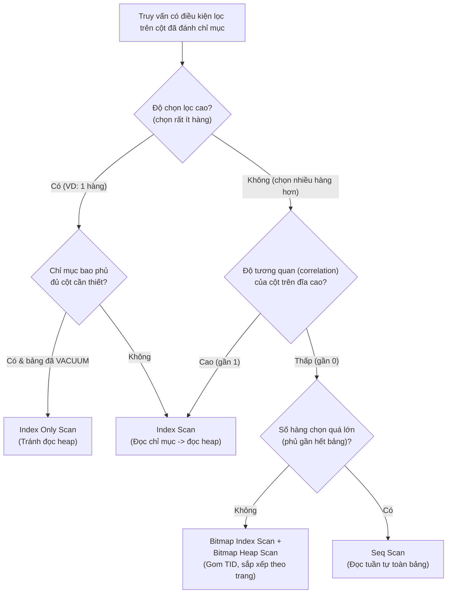

# CHƯƠNG 20: Quét chỉ mục (CHAPTER 20: Index Scans)

## 20.1 Quét chỉ mục thông thường (Regular Index Scans)

Có hai cách cơ bản để truy cập các `TID` (Tuple ID — định danh bộ dữ liệu) do một chỉ mục cung cấp. Cách đầu tiên là thực hiện quét chỉ mục (index scan). Hầu hết các phương thức truy cập chỉ mục (nhưng không phải tất cả) đều có thuộc tính *Index Scan* để hỗ trợ thao tác này.

Quét chỉ mục được biểu diễn trong kế hoạch thực thi (query plan) bởi nút `Index Scan`[^1]:

```sql
=> EXPLAIN SELECT * FROM bookings
WHERE book_ref = '9AC0C6' AND total_amount = 48500.00;
```
```text
                         QUERY PLAN
−−−−−−−−−−−−−−−−−−−−−−−−−−−−−−−−−−−−−−−−−−−−−
 Index Scan using bookings_pkey on bookings
   (cost=0.43..8.45 rows=1 width=21)
   Index Cond: (book_ref = '9AC0C6'::bpchar)
   Filter: (total_amount = 48500.00)
(4 rows)
```

Trong quá trình quét chỉ mục, phương thức truy cập sẽ trả về từng `TID` một[^2]. Khi nhận được một `TID`, bộ máy đánh chỉ mục (indexing engine) truy cập trang heap mà `TID` này trỏ tới, lấy ra bộ dữ liệu (tuple) tương ứng, và nếu các quy tắc hiển thị (visibility rules) được thỏa mãn, trả về tập các trường được yêu cầu của bộ dữ liệu đó. Quá trình này tiếp tục cho đến khi phương thức truy cập hết các `TID` khớp với câu truy vấn.

Dòng `Index Cond` chỉ bao gồm các điều kiện lọc có thể kiểm tra bằng chỉ mục. Các điều kiện khác phải được kiểm tra lại trên heap được liệt kê riêng ở dòng `Filter`.

Như ví dụ trên cho thấy, cả thao tác truy cập chỉ mục và truy cập heap đều được xử lý bởi một nút `Index Scan` chung thay vì hai nút riêng biệt. Tuy nhiên, cũng có một nút `Tid Scan` riêng[^3], dùng để lấy các bộ dữ liệu từ heap nếu `TID` của chúng đã được biết trước:

```sql
=> EXPLAIN SELECT * FROM bookings WHERE ctid = '(0,1)'::tid;
```
```text
                        QUERY PLAN
−−−−−−−−−−−−−−−−−−−−−−−−−−−−−−−−−−−−−−−−−−−−−−−−−−−−−−−−−
 Tid Scan on bookings
   (cost=0.00..4.01 rows=1 width=21)
   TID Cond: (ctid = '(0,1)'::tid)
(2 rows)
```

[^1]: `backend/executor/nodeIndexscan.c`
[^2]: `backend/access/index/indexam.c`, hàm `index_getnext_tid`
[^3]: `backend/executor/nodeTidscan.c`

### Ước lượng chi phí (Cost Estimation)

Việc ước lượng chi phí của một lần quét chỉ mục bao gồm chi phí ước lượng của các thao tác truy cập chỉ mục và các lần đọc trang heap.

Rõ ràng, phần ước lượng liên quan đến chỉ mục phụ thuộc hoàn toàn vào phương thức truy cập cụ thể. Đối với B-tree, chi phí chủ yếu phát sinh từ việc lấy các trang chỉ mục và xử lý các mục (entry) của chúng. Số lượng trang và số hàng cần đọc có thể được xác định dựa trên tổng dung lượng dữ liệu và độ chọn lọc (selectivity) của các bộ lọc được áp dụng. Các trang chỉ mục được truy cập ngẫu nhiên (các trang nối tiếp nhau trong cấu trúc logic lại nằm rải rác về mặt vật lý trên đĩa). Chi phí ước lượng còn tăng thêm bởi tài nguyên CPU tiêu tốn cho việc đi từ nút gốc (root) đến nút lá (leaf) và tính toán tất cả các biểu thức cần thiết[^4].

Phần ước lượng liên quan đến heap bao gồm chi phí truy cập trang heap và thời gian CPU cần thiết để xử lý tất cả các bộ dữ liệu được lấy ra. Điều quan trọng cần lưu ý là ước lượng I/O phụ thuộc vào cả độ chọn lọc của quét chỉ mục lẫn độ tương quan (correlation) giữa thứ tự vật lý của các bộ dữ liệu trên đĩa và thứ tự mà phương thức truy cập trả về các `TID` của chúng.

[^4]: `backend/utils/adt/selfuncs.c`, hàm `btcostestimate` ([postgresql.org/docs/14/index-cost-estimation.html](https://www.postgresql.org/docs/14/index-cost-estimation.html))

#### Kịch bản tốt: Độ tương quan cao (Good Scenario: High Correlation)

Nếu thứ tự vật lý của các bộ dữ liệu trên đĩa có độ tương quan hoàn hảo với thứ tự logic của các `TID` trong chỉ mục, mỗi trang sẽ chỉ được truy cập đúng một lần: nút `Index Scan` sẽ đi tuần tự từ trang này sang trang khác, đọc từng bộ dữ liệu một.

```
[trang heap 1] -> [trang heap 2] -> [trang heap 3]
  (bộ dữ liệu khớp điều kiện lọc nằm nối tiếp nhau trên từng trang)
```

PostgreSQL thu thập thống kê về độ tương quan:

```sql
=> SELECT attname, correlation
FROM pg_stats WHERE tablename = 'bookings'
ORDER BY abs(correlation) DESC;
```
```text
   attname    | correlation
−−−−−−−−−−−−−−+−−−−−−−−−−−−−−
 book_ref     |            1
 total_amount | 0.0026738467
 book_date    |  8.02188e−05
(3 rows)
```

Độ tương quan cao nếu giá trị tuyệt đối tương ứng gần bằng 1 (như trường hợp của `book_ref`); các giá trị gần bằng 0 là dấu hiệu của sự phân bố dữ liệu hỗn loạn.

Trong trường hợp cụ thể này, độ tương quan cao ở cột `book_ref` dĩ nhiên là do dữ liệu đã được nạp vào bảng theo thứ tự tăng dần dựa trên cột này, và chưa có thao tác cập nhật nào diễn ra. Chúng ta cũng sẽ thấy bức tranh tương tự nếu thực thi lệnh `CLUSTER` cho chỉ mục được tạo trên cột này.

Tuy nhiên, độ tương quan hoàn hảo không đảm bảo rằng mọi câu truy vấn sẽ trả về kết quả theo thứ tự tăng dần của giá trị `book_ref`. Trước hết, bất kỳ thao tác cập nhật hàng nào cũng sẽ di chuyển bộ dữ liệu mới tạo ra về cuối bảng. Thứ hai, kế hoạch dựa trên quét chỉ mục theo một cột khác sẽ trả về kết quả theo thứ tự khác. Và ngay cả quét tuần tự (sequential scan) cũng có thể không bắt đầu từ đầu bảng. Vì vậy, nếu bạn cần một thứ tự cụ thể, bạn nên định nghĩa rõ ràng trong mệnh đề `ORDER BY`.

Dưới đây là một ví dụ về quét chỉ mục xử lý một số lượng lớn các hàng:

```sql
=> EXPLAIN SELECT * FROM bookings WHERE book_ref < '100000';
```
```text
                         QUERY PLAN
−−−−−−−−−−−−−−−−−−−−−−−−−−−−−−−−−−−−−−−−−−−−−
 Index Scan using bookings_pkey on bookings
   (cost=0.43..4638.91 rows=132999 width=21)
   Index Cond: (book_ref < '100000'::bpchar)
(3 rows)
```

Độ chọn lọc của điều kiện được ước lượng như sau:

```sql
=> SELECT round(132999::numeric/reltuples::numeric, 4)
FROM pg_class WHERE relname = 'bookings';
```
```text
 round
−−−−−−−−
 0.0630
(1 row)
```

Giá trị này gần với `1/16`, điều mà chúng ta có thể đoán được khi biết các giá trị `book_ref` nằm trong khoảng từ `000000` đến `FFFFFF`.

Đối với B-tree, phần liên quan đến chỉ mục trong ước lượng chi phí I/O bao gồm chi phí đọc tất cả các trang cần thiết. Các mục chỉ mục thỏa mãn bất kỳ điều kiện nào được B-tree hỗ trợ đều được lưu trong các trang liên kết thành một danh sách có thứ tự, vì vậy số lượng trang chỉ mục cần đọc được ước lượng bằng kích thước chỉ mục nhân với độ chọn lọc. Nhưng vì các trang này không được sắp xếp vật lý liền kề nhau, việc đọc diễn ra một cách ngẫu nhiên.

Tài nguyên CPU được dùng để xử lý tất cả các mục chỉ mục được đọc (chi phí xử lý một mục đơn lẻ được ước lượng theo giá trị `cpu_index_tuple_cost = 0.005`) và tính toán điều kiện cho mỗi mục này (trong trường hợp này, điều kiện chứa một toán tử duy nhất; chi phí của nó được ước lượng theo giá trị `cpu_operator_cost = 0.0025`).

Việc truy cập bảng được coi là đọc tuần tự số lượng trang cần thiết. Trong trường hợp độ tương quan hoàn hảo, các bộ dữ liệu heap sẽ nối tiếp nhau trên đĩa, do đó số lượng trang được ước lượng bằng kích thước bảng nhân với độ chọn lọc.

Chi phí I/O còn được cộng thêm chi phí phát sinh từ việc xử lý bộ dữ liệu; chúng được ước lượng theo giá trị `cpu_tuple_cost = 0.01` cho mỗi bộ dữ liệu.

```sql
=> WITH costs(idx_cost, tbl_cost) AS (
  SELECT
    (
      SELECT round(
        current_setting('random_page_cost')::real * pages +
        current_setting('cpu_index_tuple_cost')::real * tuples +
        current_setting('cpu_operator_cost')::real * tuples
      )
      FROM (
        SELECT relpages * 0.0630 AS pages, reltuples * 0.0630 AS tuples
        FROM pg_class WHERE relname = 'bookings_pkey'
      ) c
    ),
    (
      SELECT round(
        current_setting('seq_page_cost')::real * pages +
        current_setting('cpu_tuple_cost')::real * tuples
      )
      FROM (
        SELECT relpages * 0.0630 AS pages, reltuples * 0.0630 AS tuples
        FROM pg_class WHERE relname = 'bookings'
      ) c
    )
)
SELECT idx_cost, tbl_cost, idx_cost + tbl_cost AS total
FROM costs;
```
```text
 idx_cost | tbl_cost | total
−−−−−−−−−−+−−−−−−−−−−+−−−−−−−
     2457 |     2177 |  4634
(1 row)
```

Những tính toán này minh họa logic đằng sau việc ước lượng chi phí, vì vậy kết quả khớp với ước lượng do bộ lập kế hoạch (planner) đưa ra, dù chỉ là xấp xỉ. Để có giá trị chính xác tuyệt đối sẽ cần tính đến nhiều chi tiết khác mà chúng ta không đi sâu ở đây.

#### Kịch bản xấu: Độ tương quan thấp (Bad Scenario: Low Correlation)

Mọi thứ thay đổi nếu độ tương quan thấp. Hãy tạo một chỉ mục trên cột `book_date`, cột này có độ tương quan gần như bằng không, và sau đó xem xét câu truy vấn chọn ra tỷ lệ hàng gần tương đương với ví dụ trước. Truy cập chỉ mục hóa ra lại đắt đỏ đến mức bộ lập kế hoạch chỉ chọn nó nếu tất cả các phương án thay thế khác đều bị cấm rõ ràng:

```sql
=> CREATE INDEX ON bookings(book_date);
=> SET enable_seqscan = off;
=> SET enable_bitmapscan = off;
=> EXPLAIN SELECT * FROM bookings
WHERE book_date < '2016-08-23 12:00:00+03';
```
```text
                         QUERY PLAN
−−−−−−−−−−−−−−−−−−−−−−−−−−−−−−−−−−−−−−−−−−−−−−−−−−−−−−−−−−−−−−−−−−−−−
 Index Scan using bookings_book_date_idx on bookings
   (cost=0.43..56957.48 rows=132403 width=21)
   Index Cond: (book_date < '2016−08−23 12:00:00+03'::timestamp w...
(3 rows)
```

Vấn đề là độ tương quan thấp làm tăng khả năng bộ dữ liệu tiếp theo mà phương thức truy cập trả về nằm ở một trang khác. Do đó, nút `Index Scan` phải nhảy qua lại giữa các trang thay vì đọc tuần tự; trong kịch bản xấu nhất, số lần truy cập trang có thể lên tới bằng số bộ dữ liệu được lấy ra.

Tuy nhiên, chúng ta không thể đơn giản thay `seq_page_cost` bằng `random_page_cost` và `relpages` bằng `reltuples` trong phép tính của kịch bản tốt. Chi phí mà chúng ta thấy trong kế hoạch thấp hơn nhiều so với giá trị ước lượng theo cách đó:

```sql
=> WITH costs(idx_cost, tbl_cost) AS (
  SELECT
    ( SELECT round(
        current_setting('random_page_cost')::real * pages +
        current_setting('cpu_index_tuple_cost')::real * tuples +
        current_setting('cpu_operator_cost')::real * tuples
      )
      FROM (
        SELECT relpages * 0.0630 AS pages, reltuples * 0.0630 AS tuples
        FROM pg_class WHERE relname = 'bookings_pkey'
      ) c
    ),
    ( SELECT round(
        current_setting('random_page_cost')::real * tuples +
        current_setting('cpu_tuple_cost')::real * tuples
      )
      FROM (
        SELECT relpages * 0.0630 AS pages, reltuples * 0.0630 AS tuples
        FROM pg_class WHERE relname = 'bookings'
      ) c
    )
)
SELECT idx_cost, tbl_cost, idx_cost + tbl_cost AS total FROM costs;
```
```text
 idx_cost | tbl_cost |  total
−−−−−−−−−−+−−−−−−−−−−+−−−−−−−−
     2457 |   533330 | 535787
(1 row)
```

Lý do là mô hình chi phí có tính đến bộ nhớ đệm (caching). Các trang thường xuyên được sử dụng sẽ được giữ trong bộ nhớ đệm buffer cache (và trong bộ nhớ đệm của hệ điều hành — OS cache), vì vậy kích thước bộ nhớ đệm càng lớn, cơ hội tìm thấy trang cần thiết trong đó càng cao, giúp tránh được một thao tác truy cập đĩa dư thừa. Để phục vụ việc lập kế hoạch, kích thước bộ nhớ đệm được định nghĩa bởi tham số `effective_cache_size` (mặc định `4GB`). Giá trị này càng nhỏ, số trang dự kiến phải đọc từ đĩa càng nhiều.

Đồ thị dưới đây minh họa sự phụ thuộc giữa ước lượng số trang cần đọc và kích thước bảng (với độ chọn lọc `sel = 0.5` và mỗi trang chứa `10` hàng)[^5]. Các đường nét đứt cho thấy số lần truy cập trong kịch bản tốt nhất có thể (một nửa số trang nếu độ tương quan hoàn hảo) và trong kịch bản xấu nhất (một nửa số hàng nếu độ tương quan bằng không và không có bộ nhớ đệm).

```
page access count (số lần truy cập trang)
  ^
  |                          /  0.5 of row count (0.5 số hàng - không cache, tương quan 0)
  |                        /
  |                      /   (đường cong thực tế uốn theo effective_cache_size)
  |     effective_cache_size
  |    /------------------
  |  /   . . . . . . . . . . . .  0.5 of page count (0.5 số trang - tương quan hoàn hảo)
  +------------------------------> table size (kích thước bảng)
```

Người ta giả định rằng giá trị `effective_cache_size` biểu thị tổng dung lượng bộ nhớ có thể dùng cho việc lưu đệm (bao gồm cả buffer cache của PostgreSQL và OS cache). Nhưng vì tham số này chỉ được dùng cho mục đích ước lượng và không ảnh hưởng đến việc cấp phát bộ nhớ thực tế, bạn không nhất thiết phải bám sát con số chính xác tuyệt đối khi thay đổi thiết lập này.

Nếu bạn giảm `effective_cache_size` xuống mức tối thiểu, ước lượng kế hoạch sẽ tiến gần tới giá trị cận dưới (chi phí cao nhất) đã nêu ở trên cho trường hợp không có bộ nhớ đệm:

```sql
=> SET effective_cache_size = '8kB';
=> EXPLAIN SELECT * FROM bookings
WHERE book_date < '2016-08-23 12:00:00+03';
```
```text
                         QUERY PLAN
−−−−−−−−−−−−−−−−−−−−−−−−−−−−−−−−−−−−−−−−−−−−−−−−−−−−−−−−−−−−−−−−−−−−−
 Index Scan using bookings_book_date_idx on bookings
   (cost=0.43..532745.48 rows=132403 width=21)
   Index Cond: (book_date < '2016−08−23 12:00:00+03'::timestamp w...
(3 rows)
```
```sql
=> RESET effective_cache_size;
=> RESET enable_seqscan;
=> RESET enable_bitmapscan;
```

Bộ lập kế hoạch tính toán chi phí I/O bảng cho cả kịch bản xấu nhất và tốt nhất, sau đó lấy một giá trị trung gian dựa trên độ tương quan thực tế[^6].

Do đó, quét chỉ mục có thể là một lựa chọn tốt nếu chỉ cần đọc một phần nhỏ các hàng. Nếu các bộ dữ liệu heap có tương quan cao với thứ tự mà phương thức truy cập trả về các `TID` của chúng, tỷ lệ hàng này có thể khá lớn. Tuy nhiên, nếu độ tương quan thấp, việc quét chỉ mục nhanh chóng trở nên kém hấp dẫn hơn nhiều đối với các truy vấn có độ chọn lọc thấp (chọn nhiều hàng).

[^5]: `backend/optimizer/path/costsize.c`, hàm `index_pages_fetched`
[^6]: `backend/optimizer/path/costsize.c`, hàm `cost_index`

> 💡 **Ví dụ bổ sung (không có trong sách):**
> Giả sử bạn có bảng `orders` lưu đơn hàng theo thời gian tạo (`created_at`). Nếu dữ liệu luôn được `INSERT` nối tiếp theo thời gian, cột `created_at` sẽ có `correlation` gần bằng `1`. Khi truy vấn `WHERE created_at >= now() - interval '7 days'`, `Index Scan` rất hiệu quả vì các trang heap được đọc gần như tuần tự. Ngược lại, cột `customer_id` phân bố ngẫu nhiên qua các đơn hàng sẽ có `correlation` gần `0`; nếu một khách hàng có vài nghìn đơn hàng rải rác khắp bảng, `Index Scan` trên `customer_id` sẽ phải nhảy trang liên tục, và PostgreSQL thường chuyển sang `Bitmap Heap Scan` hoặc `Seq Scan`.

## 20.2 Quét chỉ mục thuần túy (Index-Only Scans)

Nếu một chỉ mục chứa tất cả dữ liệu heap mà câu truy vấn yêu cầu, nó được gọi là *chỉ mục bao phủ* (covering index) cho câu truy vấn cụ thể đó. Nếu có sẵn một chỉ mục như vậy, có thể tránh được việc truy cập bảng dư thừa: thay vì trả về `TID`, phương thức truy cập có thể trả về trực tiếp dữ liệu thực tế. Kiểu quét chỉ mục này được gọi là *quét chỉ mục thuần túy* (index-only scan)[^7]. Nó có thể được sử dụng bởi những phương thức truy cập có hỗ trợ thuộc tính *Returnable*.

Trong kế hoạch thực thi, thao tác này được biểu diễn bởi nút `Index Only Scan`[^8]:

```sql
=> EXPLAIN SELECT book_ref FROM bookings
WHERE book_ref < '100000';
```
```text
                        QUERY PLAN
−−−−−−−−−−−−−−−−−−−−−−−−−−−−−−−−−−−−−−−−−−−−−−−−−
 Index Only Scan using bookings_pkey on bookings
   (cost=0.43..3791.91 rows=132999 width=7)
   Index Cond: (book_ref < '100000'::bpchar)
(3 rows)
```

Tên gọi gợi ý rằng nút này không bao giờ phải truy cập heap, nhưng thực tế không phải vậy. Trong PostgreSQL, chỉ mục không chứa thông tin về tính hiển thị (visibility) của bộ dữ liệu, nên phương thức truy cập trả về dữ liệu của tất cả các bộ dữ liệu heap thỏa mãn điều kiện lọc, ngay cả khi giao dịch (transaction) hiện tại không thể nhìn thấy chúng. Tính hiển thị của chúng sau đó được kiểm tra bởi bộ máy đánh chỉ mục.

Tuy nhiên, nếu phương thức này phải truy cập bảng để kiểm tra tính hiển thị của từng bộ dữ liệu, nó sẽ chẳng khác gì một lần quét chỉ mục thông thường. Thay vào đó, nó tận dụng *bản đồ hiển thị* (visibility map) được cung cấp cho các bảng, trong đó tiến trình `VACUUM` đánh dấu các trang chỉ chứa các bộ dữ liệu *all-visible* (tức là những bộ dữ liệu có thể truy cập được bởi mọi giao dịch, bất kể snapshot nào đang được sử dụng). Nếu `TID` do phương thức truy cập chỉ mục trả về thuộc về một trang như vậy, không cần phải kiểm tra tính hiển thị của nó trên heap nữa.

Ước lượng chi phí của một lần quét chỉ mục thuần túy phụ thuộc vào tỷ lệ các trang *all-visible* trong heap. PostgreSQL thu thập thống kê này:

```sql
=> SELECT relpages, relallvisible
FROM pg_class WHERE relname = 'bookings';
```
```text
 relpages | relallvisible
−−−−−−−−−−+−−−−−−−−−−−−−−−
    13447 |         13446
(1 row)
```

[^7]: [postgresql.org/docs/14/indexes-index-only-scans.html](https://www.postgresql.org/docs/14/indexes-index-only-scans.html)
[^8]: `backend/executor/nodeIndexonlyscan.c`

Ước lượng chi phí của quét chỉ mục thuần túy khác với quét chỉ mục thông thường: chi phí I/O liên quan đến truy cập bảng được tính theo tỷ lệ phần trăm các trang *không* xuất hiện trong bản đồ hiển thị. (Ước lượng chi phí xử lý bộ dữ liệu vẫn giữ nguyên.)

Vì trong ví dụ cụ thể này, gần như toàn bộ các trang đều chỉ chứa các bộ dữ liệu *all-visible*, chi phí I/O của heap thực tế bị loại bỏ khỏi ước lượng chi phí:

```sql
=> WITH costs(idx_cost, tbl_cost) AS (
  SELECT
    (
      SELECT round(
        current_setting('random_page_cost')::real * pages +
        current_setting('cpu_index_tuple_cost')::real * tuples +
        current_setting('cpu_operator_cost')::real * tuples
      )
      FROM (
        SELECT relpages * 0.0630 AS pages,
               reltuples * 0.0630 AS tuples
        FROM pg_class WHERE relname = 'bookings_pkey'
      ) c
    ) AS idx_cost,
    (
      SELECT round(
        (1 - frac_visible) * -- tỷ lệ các trang không all-visible
        current_setting('seq_page_cost')::real * pages +
        current_setting('cpu_tuple_cost')::real * tuples
      )
      FROM (
        SELECT relpages * 0.0630 AS pages,
               reltuples * 0.0630 AS tuples,
               relallvisible::real/relpages::real AS frac_visible
        FROM pg_class WHERE relname = 'bookings'
      ) c
    ) AS tbl_cost
)
SELECT idx_cost, tbl_cost, idx_cost + tbl_cost AS total
FROM costs;
```
```text
 idx_cost | tbl_cost | total
−−−−−−−−−−+−−−−−−−−−−+−−−−−−−
     2457 |     1330 |  3787
(1 row)
```

Bất kỳ thay đổi nào chưa được vacuum và chưa biến mất sau đường chân trời cơ sở dữ liệu (database horizon) đều làm tăng chi phí ước lượng của kế hoạch (và do đó làm kế hoạch này kém hấp dẫn hơn đối với bộ tối ưu hóa). Lệnh `EXPLAIN ANALYZE` có thể cho thấy số lần truy cập heap thực tế (`Heap Fetches`).

Trong một bảng mới được tạo, PostgreSQL phải kiểm tra tính hiển thị của tất cả các bộ dữ liệu:

```sql
=> CREATE TEMP TABLE bookings_tmp WITH (autovacuum_enabled = off) AS
SELECT * FROM bookings
ORDER BY book_ref;
=> ALTER TABLE bookings_tmp ADD PRIMARY KEY(book_ref);
=> ANALYZE bookings_tmp;
=> EXPLAIN (analyze, timing off, summary off)
SELECT book_ref FROM bookings_tmp WHERE book_ref < '100000';
```
```text
                         QUERY PLAN
−−−−−−−−−−−−−−−−−−−−−−−−−−−−−−−−−−−−−−−−−−−−−−−−−−−−−−−−−−−−−−−−−−−−−
 Index Only Scan using bookings_tmp_pkey on bookings_tmp
   (cost=0.43..4638.91 rows=132999 width=7) (actual rows=132109 l...
   Index Cond: (book_ref < '100000'::bpchar)
   Heap Fetches: 132109
(4 rows)
```

Nhưng một khi bảng đã được vacuum, việc kiểm tra như vậy trở nên dư thừa và không còn được thực hiện chừng nào các trang vẫn còn ở trạng thái *all-visible*:

```sql
=> VACUUM bookings_tmp;
=> EXPLAIN (analyze, timing off, summary off)
SELECT book_ref FROM bookings_tmp WHERE book_ref < '100000';
```
```text
                         QUERY PLAN
−−−−−−−−−−−−−−−−−−−−−−−−−−−−−−−−−−−−−−−−−−−−−−−−−−−−−−−−−−−−−−−−−−−−−
 Index Only Scan using bookings_tmp_pkey on bookings_tmp
   (cost=0.43..3787.91 rows=132999 width=7) (actual rows=132109 l...
   Index Cond: (book_ref < '100000'::bpchar)
   Heap Fetches: 0
(4 rows)
```

### Chỉ mục với mệnh đề INCLUDE (Indexes with the Include Clause)

Không phải lúc nào cũng có thể mở rộng một chỉ mục với tất cả các cột mà câu truy vấn yêu cầu:

- Đối với chỉ mục duy nhất (unique index), việc thêm một cột mới sẽ làm hỏng tính duy nhất của các cột khóa ban đầu.
- Phương thức truy cập chỉ mục có thể không cung cấp lớp toán tử (operator class) cho kiểu dữ liệu của cột cần thêm.

Trong trường hợp này (từ phiên bản PostgreSQL 11), bạn vẫn có thể đính kèm thêm các cột vào chỉ mục mà không biến chúng thành một phần của khóa chỉ mục. Dĩ nhiên sẽ không thể thực hiện quét chỉ mục dựa trên các cột được đính kèm đó, nhưng nếu một câu truy vấn tham chiếu tới các cột này, chỉ mục sẽ hoạt động như một chỉ mục bao phủ.

Ví dụ sau minh họa cách thay thế một chỉ mục khóa chính được tạo tự động bằng một chỉ mục khác có cột được đính kèm:

```sql
=> CREATE UNIQUE INDEX ON bookings(book_ref) INCLUDE (book_date);
=> BEGIN;
=> ALTER TABLE bookings
DROP CONSTRAINT bookings_pkey CASCADE;
NOTICE:  drop cascades to constraint tickets_book_ref_fkey on table tickets
ALTER TABLE
=> ALTER TABLE bookings ADD CONSTRAINT bookings_pkey PRIMARY KEY
USING INDEX bookings_book_ref_book_date_idx; -- chỉ mục mới
NOTICE:  ALTER TABLE / ADD CONSTRAINT USING INDEX will rename index "bookings_book_ref_book_date_idx" to "bookings_pkey"
ALTER TABLE
=> ALTER TABLE tickets
ADD FOREIGN KEY (book_ref) REFERENCES bookings(book_ref);
=> COMMIT;
=> EXPLAIN SELECT book_ref, book_date
FROM bookings WHERE book_ref < '100000';
```
```text
                         QUERY PLAN
−−−−−−−−−−−−−−−−−−−−−−−−−−−−−−−−−−−−−−−−−−−−−−−−−−−−−−−−−−−−−−−−−−−−−
 Index Only Scan using bookings_pkey on bookings
   (cost=0.43..437...
   Index Cond: (book_ref < '100000'::bpchar)
(2 rows)
```

Những chỉ mục như vậy thường được gọi là "covering index", nhưng cách gọi đó không hoàn toàn chính xác. Một chỉ mục được coi là bao phủ (covering) nếu tập hợp các cột của nó bao phủ tất cả các cột mà một câu truy vấn *cụ thể* yêu cầu. Không quan trọng việc nó có liên quan đến các cột được thêm bằng mệnh đề `INCLUDE` hay chỉ sử dụng các cột khóa. Hơn nữa, một chỉ mục có thể là bao phủ đối với câu truy vấn này nhưng lại không phải với câu truy vấn khác.

## 20.3 Quét Bitmap (Bitmap Scans)

Hiệu quả của quét chỉ mục thông thường bị giới hạn: khi độ tương quan giảm, số lần truy cập vào các trang heap tăng lên, và việc quét trở nên ngẫu nhiên thay vì tuần tự. Để khắc phục hạn chế này, PostgreSQL có thể lấy tất cả các `TID` trước khi truy cập bảng và sắp xếp chúng theo thứ tự tăng dần dựa trên số hiệu trang của chúng[^9]. Đây chính xác là cách hoạt động của quét bitmap (bitmap scan), một cách tiếp cận phổ biến khác để xử lý các `TID`. Nó có thể được sử dụng bởi các phương thức truy cập hỗ trợ thuộc tính *Bitmap Scan*.

Khác với quét chỉ mục thông thường, thao tác này được biểu diễn trong kế hoạch truy vấn bởi hai nút:

```sql
=> CREATE INDEX ON bookings(total_amount);
=> EXPLAIN SELECT *
FROM bookings WHERE total_amount = 48500.00;
```
```text
                         QUERY PLAN
−−−−−−−−−−−−−−−−−−−−−−−−−−−−−−−−−−−−−−−−−−−−−−−−−−−−−−−−−−−−−−−−−−−−−
 Bitmap Heap Scan on bookings
   (cost=54.63..7040.42 rows=2865 wid...
   Recheck Cond: (total_amount = 48500.00)
   −> Bitmap Index Scan on bookings_total_amount_idx
        (cost=0.00..53.92 rows=2865 width=0)
        Index Cond: (total_amount = 48500.00)
(5 rows)
```

Nút `Bitmap Index Scan`[^10] lấy bitmap của tất cả các `TID`[^11] từ phương thức truy cập.

Bitmap bao gồm các phân đoạn (segment) riêng biệt, mỗi phân đoạn tương ứng với một trang heap duy nhất. Tất cả các phân đoạn này có kích thước như nhau, đủ cho tất cả các bộ dữ liệu của trang, bất kể có bao nhiêu bộ dữ liệu thực sự hiện diện. Số lượng này bị giới hạn vì phần tiêu đề (header) của bộ dữ liệu khá lớn; một trang kích thước tiêu chuẩn có thể chứa tối đa 256 bộ dữ liệu (tương ứng vừa khít 32 byte trong bitmap)[^12].

Sau đó, nút `Bitmap Heap Scan`[^13] duyệt qua từng phân đoạn của bitmap, đọc các trang tương ứng và kiểm tra tất cả các bộ dữ liệu được đánh dấu là cần kiểm tra. Nhờ vậy, các trang được đọc theo thứ tự tăng dần dựa trên số hiệu trang, và mỗi trang chỉ được đọc đúng một lần.

Tuy nhiên, quá trình này không giống hoàn toàn với quét tuần tự vì các trang được truy cập hiếm khi nằm sát ngay cạnh nhau. Cơ chế đọc trước (prefetching) thông thường của hệ điều hành không giúp ích được trong trường hợp này, nên nút `Bitmap Heap Scan` tự cài đặt cơ chế đọc trước riêng bằng cách đọc bất đồng bộ số trang theo tham số `effective_io_concurrency` (mặc định `1`) — và đây là nút duy nhất làm điều đó. Cơ chế này dựa trên hàm `posix_fadvise` do một số hệ điều hành hỗ trợ. Nếu hệ thống của bạn hỗ trợ hàm này, việc cấu hình tham số `effective_io_concurrency` ở cấp độ tablespace sao cho phù hợp với khả năng phần cứng là rất hợp lý.

Cơ chế đọc trước bất đồng bộ cũng được dùng bởi một số tiến trình nội bộ khác:

- đối với các trang chỉ mục khi các hàng heap đang bị xóa (từ PostgreSQL 13)[^14]
- đối với các trang heap trong quá trình phân tích (`ANALYZE`) (từ PostgreSQL 14)[^15]

Độ sâu đọc trước (prefetch depth) cho các tác vụ bảo trì này được định nghĩa bởi tham số `maintenance_io_concurrency` (mặc định `10`).

[^9]: `backend/access/index/indexam.c`, hàm `index_getbitmap`
[^10]: `backend/executor/nodeBitmapIndexscan.c`
[^11]: `backend/access/index/indexam.c`, hàm `index_getbitmap`
[^12]: `backend/nodes/tidbitmap.c`
[^13]: `backend/executor/nodeBitmapHeapscan.c`
[^14]: `backend/access/heap/heapam.c`, hàm `index_delete_prefetch_buffer`
[^15]: `backend/commands/analyze.c`, hàm `acquire_sample_rows`

### Độ chính xác của Bitmap (Bitmap Accuracy)

Càng nhiều trang chứa các bộ dữ liệu thỏa mãn điều kiện lọc của câu truy vấn, bitmap càng lớn. Nó được xây dựng trong bộ nhớ cục bộ của tiến trình backend, và kích thước của nó bị giới hạn bởi tham số `work_mem` (mặc định `4MB`). Khi đạt đến kích thước tối đa cho phép, một số phân đoạn bitmap trở thành *mất mát* (lossy): mỗi bit của một phân đoạn lossy tương ứng với cả một trang, trong khi chính phân đoạn đó bao gồm một dải các trang[^16]. Kết quả là kích thước của bitmap nhỏ đi nhưng phải đánh đổi bằng độ chính xác của nó.

Lệnh `EXPLAIN ANALYZE` cho thấy độ chính xác của bitmap được xây dựng:

```sql
=> EXPLAIN (analyze, costs off, timing off, summary off)
SELECT * FROM bookings WHERE total_amount > 150000.00;
```
```text
                         QUERY PLAN
−−−−−−−−−−−−−−−−−−−−−−−−−−−−−−−−−−−−−−−−−−−−−−−−−−−−−−−−−−−−−−−−−−−−−
 Bitmap Heap Scan on bookings (actual rows=242691 loops=1)
   Recheck Cond: (total_amount > 150000.00)
   Heap Blocks: exact=13447
   −> Bitmap Index Scan on bookings_total_amount_idx (actual rows...
        Index Cond: (total_amount > 150000.00)
(5 rows)
```

Ở đây chúng ta có đủ bộ nhớ cho một bitmap chính xác (exact bitmap).

Nếu chúng ta giảm giá trị `work_mem`, một số phân đoạn của bitmap sẽ trở thành lossy:

```sql
=> SET work_mem = '512kB';
=> EXPLAIN (analyze, costs off, timing off, summary off)
SELECT * FROM bookings WHERE total_amount > 150000.00;
```
```text
                         QUERY PLAN
−−−−−−−−−−−−−−−−−−−−−−−−−−−−−−−−−−−−−−−−−−−−−−−−−−−−−−−−−−−−−−−−−−−−−
 Bitmap Heap Scan on bookings (actual rows=242691 loops=1)
   Recheck Cond: (total_amount > 150000.00)
   Rows Removed by Index Recheck: 1145721
   Heap Blocks: exact=5178 lossy=8269
   −> Bitmap Index Scan on bookings_total_amount_idx (actual rows...
        Index Cond: (total_amount > 150000.00)
(6 rows)
```
```sql
=> RESET work_mem;
```

Khi đọc một trang heap tương ứng với một phân đoạn bitmap lossy, PostgreSQL phải kiểm tra lại (recheck) điều kiện lọc cho *từng* bộ dữ liệu trong trang đó. Điều kiện cần kiểm tra lại luôn được hiển thị trong kế hoạch dưới dạng `Recheck Cond`, ngay cả khi việc kiểm tra lại này không thực sự được thực hiện. Số lượng bộ dữ liệu bị loại bỏ trong quá trình kiểm tra lại được hiển thị riêng (dưới dạng `Rows Removed by Index Recheck`).

Nếu kích thước tập kết quả quá lớn, bitmap có thể không vừa với vùng nhớ `work_mem`, ngay cả khi tất cả các phân đoạn của nó đều là lossy. Khi đó giới hạn này sẽ bị bỏ qua, và bitmap sẽ chiếm bao nhiêu không gian tùy nhu cầu. PostgreSQL không giảm thêm độ chính xác của bitmap nữa và cũng không đẩy (flush) bất kỳ phân đoạn nào của nó xuống đĩa.

[^16]: `backend/nodes/tidbitmap.c`, hàm `tbm_lossify`

### Các phép toán trên Bitmap (Operations on Bitmaps)

Nếu câu truy vấn áp dụng điều kiện lên nhiều cột của bảng mà các cột đó có các chỉ mục riêng biệt, một lần quét bitmap có thể sử dụng nhiều chỉ mục cùng lúc[^17]. Tất cả các chỉ mục này đều được xây dựng bitmap riêng ngay tại thời điểm chạy (on the fly); các bitmap sau đó được kết hợp từng bit một với nhau, sử dụng phép hội logic (logical conjunction, nếu các biểu thức được nối bằng `AND`) hoặc phép tuyển logic (logical disjunction, nếu các biểu thức được nối bằng `OR`). Ví dụ:

```sql
=> EXPLAIN (costs off)
SELECT * FROM bookings
WHERE book_date < '2016-08-28'
  AND total_amount > 250000;
```
```text
                         QUERY PLAN
−−−−−−−−−−−−−−−−−−−−−−−−−−−−−−−−−−−−−−−−−−−−−−−−−−−−−−−−−−−−−−−−−−−−−
 Bitmap Heap Scan on bookings
   Recheck Cond: ((total_amount > '250000'::numeric) AND (book_da...
   −> BitmapAnd
        −> Bitmap Index Scan on bookings_total_amount_idx
             Index Cond: (total_amount > '250000'::numeric)
        −> Bitmap Index Scan on bookings_book_date_idx
             Index Cond: (book_date < '2016−08−28 00:00:00+03'::tim...
(7 rows)
```

Ở đây nút `BitmapAnd` kết hợp hai bitmap bằng phép toán bitwise `AND`.

Khi hai bitmap được gộp thành một[^18], các phân đoạn exact vẫn giữ nguyên là exact khi gộp với nhau (nếu bitmap mới nằm vừa trong vùng nhớ `work_mem`), nhưng nếu bất kỳ phân đoạn nào trong cặp là lossy, phân đoạn kết quả cũng sẽ là lossy.

[^17]: [postgresql.org/docs/14/indexes-ordering.html](https://www.postgresql.org/docs/14/indexes-ordering.html)
[^18]: `backend/nodes/tidbitmap.c`, các hàm `tbm_union` & `tbm_intersect`

### Ước lượng chi phí (Cost Estimation)

Hãy xem xét câu truy vấn sử dụng quét bitmap sau:

```sql
=> EXPLAIN
SELECT * FROM bookings
WHERE total_amount = 28000.00;
```
```text
                         QUERY PLAN
−−−−−−−−−−−−−−−−−−−−−−−−−−−−−−−−−−−−−−−−−−−−−−−−−−−−−−−−−−−−−−−−−−−−−
 Bitmap Heap Scan on bookings
   (cost=599.48..14444.96 rows=31878 ...
   Recheck Cond: (total_amount = 28000.00)
   −> Bitmap Index Scan on bookings_total_amount_idx
        (cost=0.00..591.51 rows=31878 width=0)
        Index Cond: (total_amount = 28000.00)
(5 rows)
```

Độ chọn lọc xấp xỉ của điều kiện mà bộ lập kế hoạch sử dụng bằng:

```sql
=> SELECT round(31878::numeric/reltuples::numeric, 4)
FROM pg_class WHERE relname = 'bookings';
```
```text
 round
−−−−−−−−
 0.0151
(1 row)
```

Tổng chi phí của nút `Bitmap Index Scan` được ước lượng tương tự như chi phí của một lần quét chỉ mục thông thường mà không tính đến việc truy cập heap:

```sql
=> SELECT round(
  current_setting('random_page_cost')::real * pages +
  current_setting('cpu_index_tuple_cost')::real * tuples +
  current_setting('cpu_operator_cost')::real * tuples
)
FROM (
  SELECT relpages * 0.0151 AS pages, reltuples * 0.0151 AS tuples
  FROM pg_class WHERE relname = 'bookings_total_amount_idx'
) c;
```
```text
 round
−−−−−−−
   589
(1 row)
```

Ước lượng chi phí I/O cho nút `Bitmap Heap Scan` khác với trường hợp độ tương quan hoàn hảo của quét chỉ mục thông thường. Bitmap cho phép đọc các trang heap theo thứ tự tăng dần dựa trên số hiệu trang mà không quay lại cùng một trang hai lần, nhưng các bộ dữ liệu thỏa mãn điều kiện lọc không còn nằm nối tiếp nhau nữa. Thay vì đọc một dải trang tuần tự chặt chẽ và gọn gàng, PostgreSQL có khả năng phải truy cập nhiều trang hơn đáng kể.

Số lượng trang cần đọc được ước lượng theo công thức sau[^19]:

$$\min\left( \frac{2 \cdot \text{relpages} \cdot \text{reltuples} \cdot \text{sel}}{2 \cdot \text{relpages} + \text{reltuples} \cdot \text{sel}}, \; \text{relpages} \right)$$

Chi phí ước lượng để đọc một trang đơn lẻ nằm giữa `seq_page_cost` và `random_page_cost`, tùy thuộc vào tỷ lệ giữa số trang được lấy ra và tổng số trang trong bảng:

```sql
=> WITH t AS (
  SELECT relpages,
    least(
      (2 * relpages * reltuples * 0.0151) /
      (2 * relpages + reltuples * 0.0151),
      relpages
    ) AS pages_fetched,
    round(reltuples * 0.0151) AS tuples_fetched,
    current_setting('random_page_cost')::real AS rnd_cost,
    current_setting('seq_page_cost')::real AS seq_cost
  FROM pg_class WHERE relname = 'bookings'
)
SELECT pages_fetched,
  rnd_cost - (rnd_cost - seq_cost) *
  sqrt(pages_fetched / relpages) AS cost_per_page,
  tuples_fetched
FROM t;
```
```text
 pages_fetched | cost_per_page | tuples_fetched
−−−−−−−−−−−−−−−+−−−−−−−−−−−−−−−+−−−−−−−−−−−−−−−−
         13447 |             1 |          31878
(1 row)
```

Như thường lệ, ước lượng I/O được cộng thêm chi phí xử lý mỗi bộ dữ liệu được lấy ra. Nếu sử dụng exact bitmap, số bộ dữ liệu được ước lượng bằng tổng số bộ dữ liệu trong bảng nhân với độ chọn lọc của các điều kiện lọc. Nhưng nếu có bất kỳ phân đoạn bitmap nào là lossy, PostgreSQL phải truy cập các trang tương ứng để kiểm tra lại toàn bộ các bộ dữ liệu của chúng.

```
[ Exact segment ] -> chỉ kiểm tra các bộ dữ liệu khớp TID trong bitmap
[ Lossy segment ] -> phải kiểm tra lại toàn bộ bộ dữ liệu trên trang heap
```

Do đó, ước lượng chi phí (từ phiên bản PostgreSQL 11) có tính đến tỷ lệ dự kiến của các phân đoạn bitmap lossy (có thể tính dựa trên tổng số hàng được chọn và giới hạn kích thước bitmap do `work_mem` quy định)[^20]. Tổng chi phí kiểm tra lại điều kiện cũng làm tăng ước lượng (bất kể độ chính xác của bitmap).

Ước lượng chi phí khởi động (startup cost) của nút `Bitmap Heap Scan` dựa trên tổng chi phí của nút `Bitmap Index Scan`, cộng thêm chi phí xử lý bitmap:

```text
                         QUERY PLAN
−−−−−−−−−−−−−−−−−−−−−−−−−−−−−−−−−−−−−−−−−−−−−−−−−−−−−
 Bitmap Heap Scan on bookings
   (cost=599.48..14444.96 rows=31878 width=21)
   Recheck Cond: (total_amount = 28000.00)
   −> Bitmap Index Scan on bookings_total_amount_idx
        (cost=0.00..591.51 rows=31878 width=0)
        Index Cond: (total_amount = 28000.00)
(6 rows)
```

Ở đây bitmap là exact, và chi phí được ước lượng đại khái như sau[^21]:

```sql
=> WITH t AS (
  SELECT 1 AS cost_per_page,
         13447 AS pages_fetched,
         31878 AS tuples_fetched
),
costs(startup_cost, run_cost) AS (
  SELECT
    ( SELECT round(
        589 /* ước lượng chi phí cho nút con */ +
        0.1 * current_setting('cpu_operator_cost')::real *
        reltuples * 0.0151
      )
      FROM pg_class WHERE relname = 'bookings_total_amount_idx'
    ),
    ( SELECT round(
        cost_per_page * pages_fetched +
        current_setting('cpu_tuple_cost')::real * tuples_fetched +
        current_setting('cpu_operator_cost')::real * tuples_fetched
      )
      FROM t
    )
)
SELECT startup_cost, run_cost,
       startup_cost + run_cost AS total_cost
FROM costs;
```
```text
 startup_cost | run_cost | total_cost
−−−−−−−−−−−−−−+−−−−−−−−−−+−−−−−−−−−−−−
          597 |    13845 |      14442
(1 row)
```

Nếu kế hoạch truy vấn kết hợp nhiều bitmap, tổng chi phí của các lần quét chỉ mục riêng lẻ sẽ được cộng thêm một chi phí (nhỏ) cho việc gộp chúng lại với nhau[^22].

[^19]: `backend/optimizer/path/costsize.c`, hàm `compute_bitmap_pages`
[^20]: `backend/optimizer/path/costsize.c`, hàm `compute_bitmap_pages`
[^21]: `backend/optimizer/path/costsize.c`, hàm `cost_bitmap_heap_scan`
[^22]: `backend/optimizer/path/costsize.c`, các hàm `cost_bitmap_and_node` & `cost_bitmap_or_node`

## 20.4 Quét chỉ mục song song (Parallel Index Scans)

Tất cả các chế độ quét chỉ mục (từ phiên bản PostgreSQL 9.6) — quét chỉ mục thông thường, quét chỉ mục thuần túy, và quét bitmap — đều có biến thể riêng cho các kế hoạch thực thi song song (parallel plans).

Chi phí thực thi song song được ước lượng tương tự như thực thi tuần tự, nhưng (giống như trường hợp quét tuần tự song song) tài nguyên CPU được phân bổ giữa tất cả các tiến trình song song, từ đó làm giảm tổng chi phí. Thành phần chi phí I/O không được phân bổ vì các tiến trình được đồng bộ hóa để thực hiện truy cập trang một cách tuần tự.

Bây giờ tôi sẽ trình bày một vài ví dụ về các kế hoạch song song mà không đi sâu phân tích chi tiết cách ước lượng chi phí của chúng.

Một lần quét chỉ mục song song (`Parallel Index Scan`):

```sql
=> EXPLAIN SELECT sum(total_amount)
FROM bookings WHERE book_ref < '400000';
```
```text
                         QUERY PLAN
−−−−−−−−−−−−−−−−−−−−−−−−−−−−−−−−−−−−−−−−−−−−−−−−−−−−−−−−−−−−−−−−−−−−−
 Finalize Aggregate
   (cost=19192.81..19192.82 rows=1 width=32)
   −> Gather
        (cost=19192.59..19192.80 rows=2 width=32)
        Workers Planned: 2
        −> Partial Aggregate
             (cost=18192.59..18192.60 rows=1 widt...
             −> Parallel Index Scan using bookings_pkey on bookings
                  (cost=0.43..17642.82 rows=219907 width=6)
                  Index Cond: (book_ref < '400000'::bpchar)
(7 rows)
```

Trong khi quá trình quét song song trên B-tree đang diễn ra, `TID` của trang chỉ mục hiện tại được lưu trong bộ nhớ dùng chung (shared memory) của máy chủ. Giá trị ban đầu được thiết lập bởi tiến trình bắt đầu quét: nó duyệt cây từ nút gốc đến trang lá phù hợp đầu tiên và lưu `TID` của trang đó lại. Các worker truy cập các trang chỉ mục tiếp theo khi cần, thay thế `TID` đã lưu. Sau khi lấy được một trang, worker duyệt qua tất cả các mục phù hợp của trang đó và đọc các bộ dữ liệu heap tương ứng. Quá trình quét hoàn tất khi worker đã đọc hết toàn bộ dải giá trị thỏa mãn bộ lọc truy vấn.

Một lần quét chỉ mục thuần túy song song (`Parallel Index Only Scan`):

```sql
=> EXPLAIN SELECT sum(total_amount)
FROM bookings WHERE total_amount < 50000.00;
```
```text
                         QUERY PLAN
−−−−−−−−−−−−−−−−−−−−−−−−−−−−−−−−−−−−−−−−−−−−−−−−−−−−−−−−−−−−−−−−−−−−−
 Finalize Aggregate
   (cost=23370.60..23370.61 rows=1 width=32)
   −> Gather
        (cost=23370.38..23370.59 rows=2 width=32)
        Workers Planned: 2
        −> Partial Aggregate
             (cost=22370.38..22370.39 rows=1 widt...
             −> Parallel Index Only Scan using bookings_total_amoun...
                  (cost=0.43..21387.27 rows=393244 width=6)
                  Index Cond: (total_amount < 50000.00)
(7 rows)
```

Quét chỉ mục thuần túy song song bỏ qua việc truy cập heap đối với các trang *all-visible*; đó là điểm khác biệt duy nhất của nó so với quét chỉ mục song song thông thường.

Một lần quét bitmap song song (`Parallel Bitmap Heap Scan`):

```sql
=> EXPLAIN SELECT sum(total_amount)
FROM bookings WHERE book_date < '2016-10-01';
```
```text
                         QUERY PLAN
−−−−−−−−−−−−−−−−−−−−−−−−−−−−−−−−−−−−−−−−−−−−−−−−−−−−−−−−−−−−−−−−−−−−−
 Finalize Aggregate
   (cost=21492.21..21492.22 rows=1 width=32)
   −> Gather
        (cost=21491.99..21492.20 rows=2 width=32)
        Workers Planned: 2
        −> Partial Aggregate
             (cost=20491.99..20492.00 rows=1 widt...
             −> Parallel Bitmap Heap Scan on bookings
                  (cost=4891.17..20133.01 rows=143588 width=6)
                  Recheck Cond: (book_date < '2016−10−01 00:00:00+03...
                  −> Bitmap Index Scan on bookings_book_date_idx
                       (cost=0.00..4805.01 rows=344611 width=0)
                       Index Cond: (book_date < '2016−10−01 00:00:00+...
(10 rows)
```

Quét bitmap hàm ý rằng bitmap luôn được xây dựng tuần tự bởi một tiến trình trưởng (leader process) duy nhất; vì lý do này, tên của nút `Bitmap Index Scan` không chứa từ `Parallel`. Khi bitmap đã sẵn sàng, nút `Parallel Bitmap Heap Scan` bắt đầu quá trình quét heap song song. Các worker truy cập các trang heap tiếp theo và xử lý chúng đồng thời.

## 20.5 So sánh các phương thức truy cập khác nhau (Comparison of Various Access Methods)

Hình minh họa sau đây cho thấy chi phí của các phương thức truy cập khác nhau phụ thuộc như thế nào vào độ chọn lọc (selectivity) của điều kiện lọc:

```
cost (chi phí)
  ^
  |        / index scan (tương quan thấp)
  |       /
  |------/-------------------- seq scan (quét tuần tự - gần như không đổi)
  |     /     ....------------ bitmap index scan
  |    / ..../
  |   /./  =================== index-only scan (thấp nhất khi visibility map tốt)
  +--------------------------> selectivity (0 -> 1)
```

Đây là một biểu đồ mang tính định tính; các con số thực tế dĩ nhiên phụ thuộc vào từng bảng cụ thể và cấu hình máy chủ.



Quét tuần tự (sequential scan) không phụ thuộc vào độ chọn lọc, và bắt đầu từ một tỷ lệ hàng được chọn nhất định, nó thường hiệu quả hơn các phương thức khác.

Chi phí của quét chỉ mục (index scan) bị ảnh hưởng bởi độ tương quan giữa thứ tự vật lý của các bộ dữ liệu và thứ tự mà `TID` của chúng được phương thức truy cập trả về. Nếu độ tương quan hoàn hảo, quét chỉ mục có thể rất hiệu quả ngay cả khi tỷ lệ hàng được chọn khá cao. Tuy nhiên, với độ tương quan thấp (trường hợp phổ biến hơn nhiều), nó có thể nhanh chóng trở nên đắt đỏ hơn cả quét tuần tự. Dẫu vậy, quét chỉ mục vẫn là kẻ dẫn đầu tuyệt đối khi cần chọn một hàng duy nhất bằng chỉ mục (thường là chỉ mục duy nhất - unique index).

Nếu áp dụng được, quét chỉ mục thuần túy (index-only scan) có thể mang lại hiệu năng tuyệt vời và đánh bại quét tuần tự ngay cả khi toàn bộ các hàng đều được chọn. Tuy nhiên, hiệu năng của nó phụ thuộc rất lớn vào bản đồ hiển thị (visibility map), và trong kịch bản xấu nhất, quét chỉ mục thuần túy có thể suy giảm xuống tương đương một lần quét chỉ mục thông thường.

Chi phí của quét bitmap (bitmap scan) bị ảnh hưởng bởi dung lượng bộ nhớ khả dụng (`work_mem`), nhưng ở mức độ ít nhạy cảm hơn nhiều so với cách chi phí quét chỉ mục phụ thuộc vào độ tương quan. Nếu độ tương quan thấp, quét bitmap tỏ ra rẻ hơn nhiều.

Mỗi phương thức truy cập đều có những kịch bản sử dụng lý tưởng riêng; không có phương thức nào luôn vượt trội hơn tất cả các phương thức khác. Bộ lập kế hoạch phải thực hiện rất nhiều tính toán để ước lượng hiệu quả của từng phương thức trong mỗi trường hợp cụ thể. Rõ ràng, độ chính xác của các ước lượng này phụ thuộc rất lớn vào độ chính xác của các thống kê đã được thu thập.

> 📝 **Giải thích thêm (không có trong sách):**
> Khi tối ưu hóa truy vấn trong PostgreSQL, bạn nên kiểm tra `EXPLAIN (ANALYZE, BUFFERS)`:
> - Nếu thấy `Index Only Scan` nhưng `Heap Fetches` rất lớn, hãy kiểm tra xem `autovacuum` có chạy kịp thời để cập nhật Visibility Map hay không.
> - Nếu thấy `Bitmap Heap Scan` có `lossy=...` lớn và `Rows Removed by Index Recheck` cao, việc tăng `work_mem` (cho phiên làm việc hoặc câu truy vấn) có thể giúp bitmap giữ ở trạng thái `exact`, giảm đáng kể CPU kiểm tra lại và I/O đọc trang dư thừa.

## Bảng thuật ngữ chương (Chapter Glossary)

| Thuật ngữ (English) | Tiếng Việt | Giải thích ngắn gọn |
| --- | --- | --- |
| Index Scan | Quét chỉ mục | Phương thức đọc từng TID từ chỉ mục rồi truy cập ngay vào trang heap tương ứng để lấy dữ liệu. |
| Index-Only Scan | Quét chỉ mục thuần túy | Quét chỉ mục trả về dữ liệu trực tiếp từ chỉ mục mà không cần đọc trang heap nếu trang đã *all-visible* trong Visibility Map. |
| Bitmap Scan | Quét bitmap | Quét chỉ mục thu thập toàn bộ TID vào bitmap theo trang (`Bitmap Index Scan`), sau đó đọc các trang heap theo thứ tự tăng dần (`Bitmap Heap Scan`). |
| Covering Index | Chỉ mục bao phủ | Chỉ mục chứa đầy đủ các cột cần thiết cho một câu truy vấn cụ thể (qua khóa hoặc mệnh đề `INCLUDE`). |
| Correlation | Độ tương quan | Mức độ khớp giữa thứ tự vật lý của các bộ dữ liệu trên đĩa và thứ tự logic của giá trị cột trong chỉ mục (từ -1 đến 1). |
| Selectivity | Độ chọn lọc | Tỷ lệ ước lượng các hàng thỏa mãn điều kiện lọc so với tổng số hàng của bảng. |
| Visibility Map | Bản đồ hiển thị | Cấu trúc dữ liệu đánh dấu các trang heap chỉ chứa các bộ dữ liệu *all-visible* (mọi giao dịch đều thấy được). |
| Lossy Bitmap | Bitmap mất mát | Trạng thái khi bitmap vượt quá `work_mem` và phải nén ở mức trang thay vì mức từng bộ dữ liệu, buộc phải `Recheck Cond` trên toàn bộ trang. |
| Exact Bitmap | Bitmap chính xác | Bitmap lưu chính xác từng TID riêng lẻ trên mỗi trang heap. |
| Prefetching | Đọc trước | Kỹ thuật đọc bất đồng bộ trước các trang dữ liệu sắp cần tới (được điều khiển bởi `effective_io_concurrency`). |
