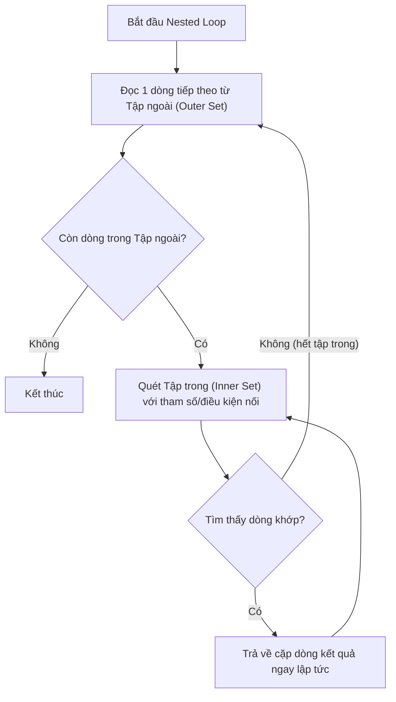

# CHƯƠNG 21: Vòng lặp lồng nhau (CHAPTER 21: Nested Loop)

## 21.1 Các loại phép nối và phương pháp thực thi (Join Types and Methods)

Phép nối (join) là một tính năng cốt lõi của ngôn ngữ `SQL`; chúng đóng vai trò là nền tảng cho sức mạnh và tính linh hoạt của ngôn ngữ này. Các tập hợp dòng (được truy xuất trực tiếp từ bảng hoặc nhận được từ kết quả của các thao tác khác) luôn được nối theo từng cặp.

Có nhiều loại phép nối khác nhau:

- **Phép nối trong (Inner joins).** Một phép nối trong (được chỉ định bằng `INNER JOIN`, hoặc đơn giản là `JOIN`) bao gồm những cặp dòng từ hai tập hợp thỏa mãn một điều kiện nối cụ thể. Điều kiện nối kết hợp một số cột của tập hợp dòng này với một số cột của tập hợp dòng kia; tất cả các cột tham gia vào điều kiện đó tạo thành **khóa nối (join key)**.
  Nếu điều kiện nối yêu cầu các khóa nối của hai tập hợp phải bằng nhau, phép nối đó được gọi là **phép nối bằng (equi-join)**; đây là loại phép nối phổ biến nhất.
  Một **tích Đề-các (Cartesian product)** (`CROSS JOIN`) của hai tập hợp bao gồm tất cả các cặp dòng có thể có của hai tập hợp đó — đây là một trường hợp đặc biệt của phép nối trong với điều kiện luôn đúng.
- **Phép nối ngoài (Outer joins).** Một phép nối ngoài trái (được chỉ định bằng `LEFT OUTER JOIN`, hoặc đơn giản là `LEFT JOIN`) mở rộng kết quả của phép nối trong bằng cách bổ sung những dòng của tập bên trái mà không có dòng khớp nào ở tập bên phải (các cột tương ứng ở phía bên phải được điền giá trị `NULL`).
  Điều tương tự cũng đúng với phép nối ngoài phải (`RIGHT JOIN`), chỉ khác ở việc hoán đổi vị trí hai tập hợp.
  Một phép nối ngoài đầy đủ (được chỉ định bằng `FULL JOIN`) bao gồm cả phép nối ngoài trái và phải, bổ sung cả những dòng bên phải và bên trái mà không tìm thấy dòng khớp nào.
- **Phép nối loại trừ và phép nối bán phần (Anti-Joins and Semi-Joins).** Một **phép nối bán phần (semi-join)** trông rất giống phép nối trong, nhưng nó chỉ bao gồm những dòng của tập bên trái có ít nhất một dòng khớp ở tập bên phải (mỗi dòng chỉ được đưa vào kết quả đúng một lần ngay cả khi có nhiều dòng khớp).
  Một **phép nối loại trừ (anti-join)** bao gồm những dòng của một tập hợp mà không có dòng khớp nào ở tập hợp kia.

Ngôn ngữ `SQL` không có cú pháp tường minh cho semi-join và anti-join, nhưng có thể đạt được kết quả tương tự bằng cách sử dụng các vị từ như `EXISTS` và `NOT EXISTS`.

Tất cả các phép nối trên đều là các **phép toán logic (logical operations)**. Ví dụ, một phép nối trong thường được mô tả như một tích Đề-các đã được loại bỏ các dòng không thỏa mãn điều kiện nối. Nhưng ở cấp độ vật lý (physical level), một phép nối trong thường được thực hiện bằng các phương thức ít tốn kém hơn.

PostgreSQL cung cấp một số **phương pháp nối (join methods)**:

- Nối vòng lặp lồng nhau (nested loop join)
- Nối băm (hash join)
- Nối trộn (merge join)

Phương pháp nối là các thuật toán hiện thực hóa các phép toán logic của phép nối `SQL`. Các thuật toán cơ bản này thường có những biến thể đặc biệt được thiết kế riêng cho từng loại phép nối cụ thể, mặc dù chúng có thể chỉ hỗ trợ một số loại nhất định. Chẳng hạn, vòng lặp lồng nhau hỗ trợ phép nối trong (được biểu diễn trong kế hoạch thực thi bằng nút `Nested Loop`) và phép nối ngoài trái (được biểu diễn bằng nút `Nested Loop Left Join`), nhưng không thể dùng cho phép nối đầy đủ (`FULL JOIN`).

Một số biến thể của các thuật toán này cũng có thể được sử dụng cho các thao tác khác, chẳng hạn như phép gom nhóm/tổng hợp (aggregation).

Các phương pháp nối khác nhau sẽ đạt hiệu quả tốt nhất trong những điều kiện khác nhau; nhiệm vụ của bộ lập kế hoạch (planner) là chọn ra phương pháp tối ưu nhất về mặt chi phí.

> 📝 **Giải thích thêm (không có trong sách):**
> Trong SQL, cần phân biệt rõ **Loại phép nối (Join Type - mức logic)** như `INNER JOIN`, `LEFT JOIN`, `SEMI JOIN`, `ANTI JOIN` với **Phương pháp nối (Join Method - mức vật lý)** như `Nested Loop`, `Hash Join`, `Merge Join`. Một câu lệnh `LEFT JOIN` (mức logic) có thể được PostgreSQL thực thi bằng `Nested Loop Left Join`, `Hash Left Join`, hoặc `Merge Left Join` tùy vào kích thước dữ liệu, chỉ mục (index) và thống kê bảng.

---

## 21.2 Phép nối vòng lặp lồng nhau (Nested Loop Joins)

Thuật toán cơ bản của phép nối vòng lặp lồng nhau hoạt động như sau. Vòng lặp ngoài duyệt qua tất cả các dòng của tập hợp thứ nhất (gọi là **tập ngoài — outer set**). Với mỗi dòng này, vòng lặp lồng bên trong sẽ duyệt qua các dòng của tập hợp thứ hai (gọi là **tập trong — inner set**) để tìm những dòng thỏa mãn điều kiện nối. Mỗi cặp tìm thấy được trả về ngay lập tức như một phần của kết quả truy vấn.[^1]

Thuật toán truy cập vào tập trong số lần bằng với số dòng có trong tập ngoài. Do đó, hiệu quả của phép nối vòng lặp lồng nhau phụ thuộc vào các yếu tố sau:

- Lực lượng (cardinality — số lượng dòng) của tập ngoài
- Sự sẵn có của một phương thức truy cập có thể lấy các dòng của tập trong một cách hiệu quả (ví dụ: qua index)
- Việc truy cập lặp đi lặp lại vào cùng các dòng của tập trong



### Tích Đề-các (Cartesian Product)

Phép nối vòng lặp lồng nhau là cách hiệu quả nhất để tìm tích Đề-các, bất kể số lượng dòng trong các tập hợp là bao nhiêu:

```sql
=> EXPLAIN SELECT * FROM aircrafts_data a1
CROSS JOIN aircrafts_data a2
WHERE a2.range > 5000;
```

```text
                      QUERY PLAN
-------------------------------------------------------
 Nested Loop
   (cost=0.00..2.78 rows=45 width=144)
   ->  Seq Scan on aircrafts_data a1
         (cost=0.00..1.09 rows=9 width=72)             <-- tập ngoài (outer set)
   ->  Materialize
         (cost=0.00..1.14 rows=5 width=72)             <-- tập trong (inner set)
         ->  Seq Scan on aircrafts_data a2
               (cost=0.00..1.11 rows=5 width=72)
               Filter: (range > 5000)
(7 rows)
```

Nút `Nested Loop` thực hiện phép nối bằng thuật toán đã mô tả ở trên. Nó luôn có hai nút con: nút hiển thị ở phía trên trong kế hoạch tương ứng với **tập ngoài (outer set)**, còn nút ở phía dưới đại diện cho **tập trong (inner set)**.

Trong ví dụ này, tập trong được đại diện bởi nút `Materialize`.[^2] Nút này trả về các dòng nhận được từ nút con của nó, đồng thời lưu chúng lại để sử dụng cho các lần sau (các dòng được tích lũy trong bộ nhớ cho đến khi tổng kích thước đạt tới `work_mem` — mặc định `4MB`; sau đó PostgreSQL bắt đầu ghi tràn chúng ra tệp tạm trên đĩa). Khi được truy cập lại, nút này chỉ việc đọc các dòng đã tích lũy mà không cần gọi lại nút con. Nhờ vậy, bộ thực thi (executor) tránh được việc phải quét lại toàn bộ bảng nhiều lần và chỉ đọc đúng những dòng thỏa mãn điều kiện.

Một kế hoạch tương tự cũng có thể được tạo ra cho một truy vấn sử dụng phép nối bằng thông thường:

```sql
=> EXPLAIN SELECT * FROM tickets t
JOIN ticket_flights tf ON tf.ticket_no = t.ticket_no
WHERE t.ticket_no = '0005432000284';
```

```text
                               QUERY PLAN
------------------------------------------------------------------------
 Nested Loop
   (cost=0.99..25.05 rows=3 width=136)
   ->  Index Scan using tickets_pkey on tickets t
         (cost=0.43..8.45 rows=1 width=104)
         Index Cond: (ticket_no = '0005432000284'::bpchar)
   ->  Index Scan using ticket_flights_pkey on ticket_flights tf
         (cost=0.56..16.58 rows=3 width=32)
         Index Cond: (ticket_no = '0005432000284'::bpchar)
(7 rows)
```

Sau khi nhận ra sự bằng nhau của hai giá trị, bộ lập kế hoạch thay thế điều kiện nối `tf.ticket_no = t.ticket_no` bằng điều kiện `tf.ticket_no = hằng_số`, về mặt thực chất đã rút gọn phép nối bằng thành một tích Đề-các.[^3]

**Ước lượng lực lượng (Cardinality estimation).** Lực lượng của một tích Đề-các được ước lượng bằng tích các lực lượng của hai tập dữ liệu tham gia nối: $3 = 1 \times 3$.

**Ước lượng chi phí (Cost estimation).** Chi phí khởi động (startup cost) của phép nối bằng tổng chi phí khởi động của tất cả các nút con.

Chi phí toàn phần (total cost) của phép nối bao gồm các thành phần sau:

- Chi phí lấy toàn bộ các dòng của tập ngoài
- Chi phí cho một lần lấy toàn bộ các dòng của tập trong (vì ước lượng lực lượng của tập ngoài bằng 1)
- Chi phí xử lý từng dòng kết quả trả về

Dưới đây là đồ thị phụ thuộc cho việc ước lượng chi phí:

```text
                               QUERY PLAN
------------------------------------------------------------------------
 Nested Loop
   (cost=0.99..25.05 rows=3 width=136)
   ->  Index Scan using tickets_pkey on tickets t
         (cost=0.43..8.45 rows=1 width=104)
         Index Cond: (ticket_no = '0005432000284'::bpchar)
   ->  Index Scan using ticket_flights_pkey on ticket_flights tf    (× 1)
         (cost=0.56..16.58 rows=3 width=32)
         Index Cond: (ticket_no = '0005432000284'::bpchar)
(7 rows)
```

Chi phí của phép nối được tính như sau:

```sql
=> SELECT 0.43 + 0.56 AS startup_cost,
  round((
    8.45 + 16.57 +
    3 * current_setting('cpu_tuple_cost')::real
  )::numeric, 2) AS total_cost;
```

```text
 startup_cost | total_cost
--------------+------------
         0.99 |      25.05
(1 row)
```

Bây giờ hãy quay lại ví dụ trước đó:

```sql
=> EXPLAIN SELECT *
FROM aircrafts_data a1
CROSS JOIN aircrafts_data a2
WHERE a2.range > 5000;
```

```text
                      QUERY PLAN
-------------------------------------------------------
 Nested Loop
   (cost=0.00..2.78 rows=45 width=144)
   ->  Seq Scan on aircrafts_data a1
         (cost=0.00..1.09 rows=9 width=72)
   ->  Materialize
         (cost=0.00..1.14 rows=5 width=72)
         ->  Seq Scan on aircrafts_data a2
               (cost=0.00..1.11 rows=5 width=72)
               Filter: (range > 5000)
(7 rows)
```

Kế hoạch lúc này chứa nút `Materialize`; sau khi đã tích lũy các dòng nhận được từ nút con ở lần đầu, `Materialize` trả về chúng nhanh hơn rất nhiều cho tất cả các lần gọi tiếp theo.

Nhìn chung, tổng chi phí của phép nối bao gồm các khoản sau:[^4]

- Chi phí lấy toàn bộ các dòng của tập ngoài
- Chi phí lấy lần đầu toàn bộ các dòng của tập trong (trong lúc này quá trình vật chất hóa — materialization — được thực hiện)
- Chi phí của $(N - 1)$ lần lấy lại các dòng của tập trong (trong đó $N$ là số dòng của tập ngoài)
- Chi phí xử lý từng dòng kết quả trả về

Đồ thị phụ thuộc trong trường hợp này như sau:

```text
                      QUERY PLAN
------------------------------------------------------
 Nested Loop
   (cost=0.00..2.78 rows=45 width=144)
   ->  Seq Scan on aircrafts_data a1
         (cost=0.00..1.09 rows=9 width=72)
   ->  Materialize                                     (× 9)
         (cost=0.00..1.14 rows=5 width=72)
         ->  Seq Scan on aircrafts_data a2
               (cost=0.00..1.11 rows=5 width=72)
               Filter: (range > 5000)
(8 rows)
```

Trong ví dụ này, việc vật chất hóa giúp giảm chi phí cho các lần lấy dữ liệu lặp lại. Chi phí của lần gọi `Materialize` đầu tiên được hiển thị trong kế hoạch, nhưng tất cả các lần gọi tiếp theo thì không được liệt kê. Tôi sẽ không trình bày chi tiết các phép tính ở đây,[^5] nhưng trong trường hợp cụ thể này giá trị ước lượng là `0.0125`.

Do đó, chi phí của phép nối được thực hiện trong ví dụ này được tính như sau:

```sql
=> SELECT 0.00 + 0.00 AS startup_cost,
  round((
    1.09 + (1.14 + 8 * 0.0125) +
    45 * current_setting('cpu_tuple_cost')::real
  )::numeric, 2) AS total_cost;
```

```text
 startup_cost | total_cost
--------------+------------
         0.00 |       2.78
(1 row)
```

### Phép nối có tham số (Parameterized Joins)

Bây giờ hãy xem xét một ví dụ phổ biến hơn mà không quy về tích Đề-các:

```sql
=> CREATE INDEX ON tickets(book_ref);
=> EXPLAIN SELECT *
FROM tickets t
JOIN ticket_flights tf ON tf.ticket_no = t.ticket_no
WHERE t.book_ref = '03A76D';
```

```text
                               QUERY PLAN
------------------------------------------------------------------------
 Nested Loop
   (cost=0.99..45.68 rows=6 width=136)
   ->  Index Scan using tickets_book_ref_idx on tickets t
         (cost=0.43..12.46 rows=2 width=104)
         Index Cond: (book_ref = '03A76D'::bpchar)
   ->  Index Scan using ticket_flights_pkey on ticket_flights tf
         (cost=0.56..16.58 rows=3 width=32)
         Index Cond: (ticket_no = t.ticket_no)
(7 rows)
```

Ở đây, nút `Nested Loop` duyệt qua các dòng của tập ngoài (`tickets`), và với mỗi dòng đó nó tìm kiếm các dòng tương ứng của tập trong (`ticket_flights`), truyền số vé (`t.ticket_no`) vào điều kiện như một tham số. Khi nút bên trong (`Index Scan`) được gọi, nó sẽ xử lý điều kiện `ticket_no = hằng_số`.

**Ước lượng lực lượng (Cardinality estimation).** Bộ lập kế hoạch ước lượng rằng điều kiện lọc theo mã đặt chỗ được thỏa mãn bởi 2 dòng của tập ngoài (`rows=2`), và mỗi dòng này trung bình khớp với 3 dòng của tập trong (`rows=3`).

**Độ chọn lọc của phép nối (Join selectivity)** là tỷ lệ của tích Đề-các giữa hai tập hợp còn lại sau khi thực hiện phép nối. Rõ ràng là ta phải loại trừ những dòng ở cả hai tập hợp có chứa giá trị `NULL` ở khóa nối, vì điều kiện bằng nhau sẽ không bao giờ thỏa mãn đối với chúng.

Lực lượng ước lượng bằng lực lượng của tích Đề-các (tức là tích các lực lượng của hai tập hợp) nhân với độ chọn lọc.[^6]

Ở đây, lực lượng ước lượng của tập thứ nhất (tập ngoài) là 2 dòng. Vì không có điều kiện nào áp dụng lên tập thứ hai (tập trong) ngoại trừ chính điều kiện nối, lực lượng của tập thứ hai được lấy bằng lực lượng của bảng `ticket_flights`.

Do các bảng được nối có liên kết với nhau bằng khóa ngoại (foreign key), việc ước lượng độ chọn lọc dựa trên thực tế là mỗi dòng của bảng con có đúng một dòng khớp trong bảng cha. Vì vậy, độ chọn lọc được lấy bằng nghịch đảo kích thước của bảng được khóa ngoại tham chiếu tới.[^7]

Do đó, trong trường hợp các cột `ticket_no` không chứa giá trị `NULL`, phép ước lượng diễn ra như sau:

```sql
=> SELECT round(2 * tf.reltuples * (1.0 / t.reltuples)) AS rows
FROM pg_class t, pg_class tf
WHERE t.relname = 'tickets'
  AND tf.relname = 'ticket_flights';
```

```text
 rows
------
    6
(1 row)
```

Tất nhiên, các bảng cũng có thể được nối mà không cần dùng khóa ngoại. Khi đó, độ chọn lọc sẽ được lấy từ độ chọn lọc ước lượng của các điều kiện nối cụ thể.[^8]

Đối với phép nối bằng trong ví dụ này, công thức tổng quát để ước lượng độ chọn lọc giả định sự phân bố đều của các giá trị có dạng như sau: $\min\left(\frac{1}{nd_1}, \frac{1}{nd_2}\right)$, trong đó $nd_1$ và $nd_2$ đại diện cho số lượng giá trị phân biệt (number of distinct values) của khóa nối lần lượt trong tập thứ nhất và tập thứ hai.[^9]

Thống kê về các giá trị phân biệt cho thấy số vé trong bảng `tickets` là duy nhất (điều hoàn toàn dễ hiểu vì cột `ticket_no` là khóa chính), và bảng `ticket_flights` có khoảng 3 dòng khớp cho mỗi vé:

```sql
=> SELECT t.n_distinct, tf.n_distinct
FROM pg_stats t, pg_stats tf
WHERE t.tablename = 'tickets' AND t.attname = 'ticket_no'
  AND tf.tablename = 'ticket_flights' AND tf.attname = 'ticket_no';
```

```text
 n_distinct | n_distinct
------------+-------------
         -1 | -0.30362356
(1 row)
```

> 📝 **Giải thích thêm (không có trong sách):**
> Trong `pg_stats`, giá trị `n_distinct` âm biểu thị tỷ lệ so với tổng số dòng của bảng. Ví dụ, `-1` nghĩa là tất cả các dòng đều có giá trị duy nhất ($nd_1 = 1.0 \times \text{reltuples}$), còn `-0.30362356` nghĩa là số giá trị phân biệt bằng khoảng $30.36\%$ tổng số dòng của `ticket_flights` (tức trung bình $1 / 0.3036 \approx 3.29$ dòng cho mỗi giá trị `ticket_no`).

Kết quả tính toán sẽ khớp với ước lượng của phép nối có khóa ngoại:

```sql
=> SELECT round(2 * tf.reltuples *
  least(1.0/t.reltuples, 1.0/tf.reltuples/0.30362356)
) AS rows
FROM pg_class t, pg_class tf
WHERE t.relname = 'tickets' AND tf.relname = 'ticket_flights';
```

```text
 rows
------
    6
(1 row)
```

Bộ lập kế hoạch luôn cố gắng tinh chỉnh ước lượng cơ bản này bất cứ khi nào có thể. Hiện tại nó chưa thể sử dụng biểu đồ tần suất (histograms), nhưng nó có tính đến danh sách `MCV` (Most Common Values — các giá trị phổ biến nhất) nếu thống kê đó đã được thu thập trên khóa nối cho cả hai bảng.[^10] Độ chọn lọc của các dòng xuất hiện trong danh sách `MCV` có thể được ước lượng chính xác hơn, và chỉ những dòng còn lại mới phải dựa vào phép tính giả định phân bố đều.

Nhìn chung, ước lượng độ chọn lọc của phép nối có xu hướng chính xác hơn nếu khóa ngoại được định nghĩa. Điều này đặc biệt đúng đối với các khóa nối phức hợp (composite join keys), vì độ chọn lọc thường bị ước lượng thấp hơn thực tế rất nhiều trong trường hợp đó.

Bằng cách sử dụng lệnh `EXPLAIN ANALYZE`, bạn không chỉ xem được số lượng dòng thực tế, mà còn biết được số lần vòng lặp bên trong đã được thực thi:

```sql
=> EXPLAIN (analyze, timing off, summary off) SELECT *
FROM tickets t
JOIN ticket_flights tf ON tf.ticket_no = t.ticket_no
WHERE t.book_ref = '03A76D';
```

```text
                                  QUERY PLAN
------------------------------------------------------------------------------
 Nested Loop
   (cost=0.99..45.68 rows=6 width=136)
   (actual rows=8 loops=1)
   ->  Index Scan using tickets_book_ref_idx on tickets t
         (cost=0.43..12.46 rows=2 width=104) (actual rows=2 loops=1)
         Index Cond: (book_ref = '03A76D'::bpchar)
   ->  Index Scan using ticket_flights_pkey on ticket_flights tf
         (cost=0.56..16.58 rows=3 width=32) (actual rows=4 loops=2)
         Index Cond: (ticket_no = t.ticket_no)
(8 rows)
```

Tập ngoài chứa 2 dòng (`actual rows=2`); ước lượng đã chính xác. Vì vậy, nút `Index Scan` (bên dưới) được thực thi 2 lần (`loops=2`), và mỗi lần nó chọn ra trung bình 4 dòng (`actual rows=4`). Do đó tổng số dòng tìm thấy là: `actual rows=8`.

Tôi không hiển thị thời gian thực thi của từng giai đoạn trong kế hoạch (`timing off`) để kết quả vừa với độ rộng giới hạn của trang sách; ngoài ra, trên một số nền tảng, việc bật đo thời gian có thể làm chậm đáng kể quá trình thực thi truy vấn. Nhưng nếu chúng ta bật nó lên, PostgreSQL sẽ hiển thị giá trị trung bình, giống như đối với số lượng dòng. Để có được tổng thời gian thực thi, bạn phải nhân giá trị trung bình này với số lần lặp (`loops`).

**Ước lượng chi phí (Cost estimation).** Công thức ước lượng chi phí ở đây giống với các ví dụ trước.

Hãy nhớ lại kế hoạch truy vấn của chúng ta:

```sql
=> EXPLAIN SELECT *
FROM tickets t
JOIN ticket_flights tf ON tf.ticket_no = t.ticket_no
WHERE t.book_ref = '03A76D';
```

```text
                               QUERY PLAN
------------------------------------------------------------------------
 Nested Loop
   (cost=0.99..45.68 rows=6 width=136)
   ->  Index Scan using tickets_book_ref_idx on tickets t
         (cost=0.43..12.46 rows=2 width=104)
         Index Cond: (book_ref = '03A76D'::bpchar)
   ->  Index Scan using ticket_flights_pkey on ticket_flights tf
         (cost=0.56..16.58 rows=3 width=32)
         Index Cond: (ticket_no = t.ticket_no)
(7 rows)
```

Trong trường hợp này, chi phí của mỗi lần quét tiếp theo trên tập trong cũng bằng với chi phí của lần quét đầu tiên. Vì vậy cuối cùng ta có các con số sau:

```sql
=> SELECT 0.43 + 0.56 AS startup_cost,
  round((
    12.46 + 2 * 16.57 +
    6 * current_setting('cpu_tuple_cost')::real
  )::numeric, 2) AS total_cost;
```

```text
 startup_cost | total_cost
--------------+------------
         0.99 |      45.66
(1 row)
```

### Lưu đệm các dòng — Ghi nhớ (Caching Rows (Memoization))

*(Từ PostgreSQL v. 14)*

Nếu tập trong bị quét lặp đi lặp lại với cùng các giá trị tham số (và do đó cho ra cùng kết quả), việc lưu đệm (cache) các dòng của tập này có thể mang lại lợi ích đáng kể.

Việc lưu đệm như vậy được thực hiện bởi nút `Memoize`.[^11] Tương tự như nút `Materialize`, nó được thiết kế để xử lý các phép nối có tham số và có cách cài đặt phức tạp hơn nhiều:

- Nút `Materialize` đơn giản chỉ vật chất hóa toàn bộ các dòng do nút con trả về, trong khi `Memoize` đảm bảo rằng các dòng trả về ứng với các giá trị tham số khác nhau được lưu trữ tách biệt nhau.
- Trong trường hợp bị tràn bộ nhớ, kho lưu trữ của `Materialize` bắt đầu ghi tràn các dòng ra đĩa, trong khi `Memoize` giữ toàn bộ các dòng trong bộ nhớ (nếu không thì việc lưu đệm sẽ chẳng còn ý nghĩa gì nữa).

Dưới đây là một ví dụ về truy vấn sử dụng `Memoize`:

```sql
=> EXPLAIN SELECT * FROM flights f
JOIN aircrafts_data a ON f.aircraft_code = a.aircraft_code
WHERE f.flight_no = 'PG0003';
```

```text
                                    QUERY PLAN
----------------------------------------------------------------------------------
 Nested Loop
   (cost=5.44..387.10 rows=113 width=135)
   ->  Bitmap Heap Scan on flights f
         (cost=5.30..382.22 rows=113 width=63)
         Recheck Cond: (flight_no = 'PG0003'::bpchar)
         ->  Bitmap Index Scan on flights_flight_no_scheduled_depart...
               (cost=0.00..5.27 rows=113 width=0)
               Index Cond: (flight_no = 'PG0003'::bpchar)
   ->  Memoize
         (cost=0.15..0.27 rows=1 width=72)
         Cache Key: f.aircraft_code
         Cache Mode: logical
         ->  Index Scan using aircrafts_pkey on aircrafts_data a
               (cost=0.14..0.26 rows=1 width=72)
               Index Cond: (aircraft_code = f.aircraft_code)
(13 rows)
```

Kích thước vùng nhớ được dùng để lưu các dòng đã đệm bằng `work_mem` (mặc định `4MB`) × `hash_mem_multiplier` (mặc định `1.0`). Đúng như tên gọi của tham số thứ hai gợi ý, các dòng được lưu đệm nằm trong một bảng băm (sử dụng phương pháp địa chỉ mở — open addressing).[^12] Khóa băm (hiển thị là `Cache Key` trong kế hoạch) chính là giá trị tham số (hoặc nhiều giá trị nếu có hơn một tham số).

Tất cả các khóa băm được liên kết thành một danh sách; một đầu của danh sách được coi là **lạnh (cold)** (vì chứa các khóa lâu không được sử dụng), trong khi đầu kia là **nóng (hot)** (lưu các khóa mới được sử dụng gần đây).

Nếu một lần gọi tới nút `Memoize` cho thấy các giá trị tham số truyền vào tương ứng với các dòng đã được lưu đệm, những dòng này sẽ được chuyển thẳng lên nút cha (`Nested Loop`) mà không cần kiểm tra nút con. Khóa băm vừa dùng sau đó được chuyển lên đầu nóng của danh sách.

Nếu bộ nhớ đệm chưa chứa các dòng cần thiết, nút `Memoize` sẽ kéo chúng từ nút con của nó, lưu vào bộ nhớ đệm và chuyển lên nút phía trên. Khóa băm tương ứng cũng trở thành khóa nóng.

Khi dữ liệu mới liên tục được lưu đệm, nó có thể lấp đầy toàn bộ vùng nhớ khả dụng. Để giải phóng bớt không gian, các dòng tương ứng với những khóa lạnh sẽ bị đẩy ra (evict). Thuật toán đẩy ra này khác với thuật toán dùng trong bộ nhớ đệm buffer (buffer cache) nhưng phục vụ cùng một mục đích.

Một số giá trị tham số có thể có quá nhiều dòng khớp đến mức chúng không nằm vừa trong vùng nhớ được cấp phát, ngay cả khi tất cả các dòng khác đã bị đẩy ra hết. Những tham số như vậy sẽ bị bỏ qua — chẳng có ích gì khi chỉ lưu đệm một phần số dòng vì lần gọi tiếp theo vẫn sẽ phải lấy lại toàn bộ các dòng từ nút con.

**Ước lượng chi phí và lực lượng (Cost and cardinality estimations).** Các phép tính này khá giống với những gì ta đã thấy ở trên. Chúng ta chỉ cần lưu ý rằng chi phí của nút `Memoize` hiển thị trong kế hoạch không phản ánh chi phí thực sự của nó: đó đơn giản chỉ là chi phí của nút con cộng thêm giá trị `cpu_tuple_cost` (mặc định `0.01`).[^13]

Chúng ta cũng từng bắt gặp tình huống tương tự đối với nút `Materialize`: chi phí của nó chỉ được tính cho các lần quét tiếp theo[^14] và không được thể hiện trên kế hoạch.

Rõ ràng, việc dùng `Memoize` chỉ có ý nghĩa nếu nó rẻ hơn so với việc gọi trực tiếp nút con. Chi phí của mỗi lần quét `Memoize` tiếp theo phụ thuộc vào đặc tính truy cập bộ nhớ đệm kỳ vọng và kích thước vùng nhớ có thể dùng cho việc lưu đệm. Giá trị tính toán phụ thuộc rất nhiều vào việc ước lượng chính xác số lượng giá trị tham số phân biệt sẽ được sử dụng trong các lần quét tập trong.[^15] Dựa trên con số này, bạn có thể cân nhắc xác suất các dòng được giữ trong cache và xác suất bị đẩy ra khỏi cache. Số lần trúng cache (hits) kỳ vọng làm giảm chi phí ước lượng, trong khi các lần đẩy ra (evictions) tiềm ẩn lại làm tăng chi phí. Chúng ta sẽ bỏ qua chi tiết của các phép tính này ở đây.

Để tìm hiểu chuyện gì thực sự diễn ra trong quá trình thực thi truy vấn, ta sẽ sử dụng lệnh `EXPLAIN ANALYZE` như thường lệ:

```sql
=> EXPLAIN (analyze, costs off, timing off, summary off)
SELECT * FROM flights f
JOIN aircrafts_data a ON f.aircraft_code = a.aircraft_code
WHERE f.flight_no = 'PG0003';
```

```text
                                  QUERY PLAN
------------------------------------------------------------------------------
 Nested Loop (actual rows=113 loops=1)
   ->  Bitmap Heap Scan on flights f
         (actual rows=113 loops=1)
         Recheck Cond: (flight_no = 'PG0003'::bpchar)
         Heap Blocks: exact=2
         ->  Bitmap Index Scan on flights_flight_no_scheduled_depart...
               (actual rows=113 loops=1)
               Index Cond: (flight_no = 'PG0003'::bpchar)
   ->  Memoize (actual rows=1 loops=113)
         Cache Key: f.aircraft_code
         Cache Mode: logical
         Hits: 112  Misses: 1  Evictions: 0  Overflows: 0  Memory Usage: 1kB
         ->  Index Scan using aircrafts_pkey on aircrafts_data a
               (actual rows=1 loops=1)
               Index Cond: (aircraft_code = f.aircraft_code)
(16 rows)
```

Truy vấn này chọn ra các chuyến bay đi theo cùng một tuyến đường và được thực hiện bởi một loại máy bay cụ thể, nên tất cả các lần gọi tới nút `Memoize` đều dùng chung một khóa băm. Dòng đầu tiên phải được lấy từ bảng (`Misses: 1`), nhưng tất cả các dòng tiếp theo đều được tìm thấy trong bộ nhớ đệm (`Hits: 112`). Toàn bộ thao tác chỉ tiêu tốn `1 kB` bộ nhớ.

Hai giá trị còn lại được hiển thị đều bằng 0: chúng đại diện cho số lần đẩy ra (`Evictions`) và số lần tràn bộ nhớ đệm (`Overflows`) khi không thể lưu đệm toàn bộ các dòng liên quan đến một tập tham số cụ thể. Nếu các con số này lớn, điều đó cho thấy bộ nhớ đệm được cấp phát quá nhỏ, nguyên nhân có thể là do ước lượng sai số lượng giá trị tham số phân biệt. Khi đó, việc sử dụng nút `Memoize` có thể trở nên khá tốn kém. Trong trường hợp cực đoan, bạn có thể cấm bộ lập kế hoạch sử dụng cơ chế lưu đệm bằng cách tắt tham số `enable_memoize` (mặc định là `on`).

### Phép nối ngoài (Outer Joins)

Phép nối vòng lặp lồng nhau có thể được sử dụng để thực hiện phép nối ngoài trái (`LEFT JOIN`):

```sql
=> EXPLAIN SELECT *
FROM ticket_flights tf
LEFT JOIN boarding_passes bp ON bp.ticket_no = tf.ticket_no
  AND bp.flight_id = tf.flight_id
WHERE tf.ticket_no = '0005434026720';
```

```text
                                    QUERY PLAN
----------------------------------------------------------------------------------
 Nested Loop Left Join
   (cost=1.12..33.35 rows=3 width=57)
   Join Filter: ((bp.ticket_no = tf.ticket_no) AND (bp.flight_id = tf.flight_id))
   ->  Index Scan using ticket_flights_pkey on ticket_flights tf
         (cost=0.56..16.58 rows=3 width=32)
         Index Cond: (ticket_no = '0005434026720'::bpchar)
   ->  Materialize
         (cost=0.56..16.62 rows=3 width=25)
         ->  Index Scan using boarding_passes_pkey on boarding_passe...
               (cost=0.56..16.61 rows=3 width=25)
               Index Cond: (ticket_no = '0005434026720'::bpchar)
(10 rows)
```

Ở đây, phép toán nối được biểu diễn bởi nút `Nested Loop Left Join`. Bộ lập kế hoạch đã chọn một phép nối không tham số kèm bộ lọc: nó thực hiện các lần quét giống hệt nhau trên tập trong (nên tập này được giấu sau nút `Materialize`) và trả về các dòng thỏa mãn điều kiện lọc (`Join Filter`).

Lực lượng của phép nối ngoài được ước lượng giống hệt như phép nối trong, ngoại trừ việc giá trị ước lượng tính được sẽ được đem so sánh với lực lượng của tập ngoài, và giá trị lớn hơn sẽ được chọn làm kết quả cuối cùng.[^16] Nói cách khác, phép nối ngoài không bao giờ làm giảm số lượng dòng (nhưng có thể làm tăng lên).

Ước lượng chi phí cũng tương tự như phép nối trong.

Chúng ta cũng phải lưu ý rằng bộ lập kế hoạch có thể chọn các kế hoạch khác nhau cho phép nối trong và phép nối ngoài. Ngay cả ví dụ đơn giản này cũng sẽ có `Join Filter` khác nếu bộ lập kế hoạch bị ép dùng phép nối vòng lặp lồng nhau cho `INNER JOIN`:

```sql
=> SET enable_mergejoin = off;
=> EXPLAIN SELECT *
FROM ticket_flights tf
JOIN boarding_passes bp ON bp.ticket_no = tf.ticket_no
  AND bp.flight_id = tf.flight_id
WHERE tf.ticket_no = '0005434026720';
```

```text
                                    QUERY PLAN
----------------------------------------------------------------------------------
 Nested Loop
   (cost=1.12..33.33 rows=3 width=57)
   Join Filter: (tf.flight_id = bp.flight_id)
   ->  Index Scan using ticket_flights_pkey on ticket_flights tf
         (cost=0.56..16.58 rows=3 width=32)
         Index Cond: (ticket_no = '0005434026720'::bpchar)
   ->  Materialize
         (cost=0.56..16.62 rows=3 width=25)
         ->  Index Scan using boarding_passes_pkey on boarding_passe...
               (cost=0.56..16.61 rows=3 width=25)
               Index Cond: (ticket_no = '0005434026720'::bpchar)
(9 rows)
```

```sql
=> RESET enable_mergejoin;
```

Sự chênh lệch nhỏ trong tổng chi phí (`33.35` so với `33.33`) là do phép nối ngoài cũng phải kiểm tra thêm số vé (`bp.ticket_no = tf.ticket_no`) để cho ra kết quả đúng nếu không có dòng khớp nào ở tập ngoài.

Phép nối ngoài phải (`RIGHT JOIN`) không được hỗ trợ,[^17] vì thuật toán vòng lặp lồng nhau đối xử với tập ngoài và tập trong một cách khác nhau. Tập ngoài được quét toàn bộ; còn đối với tập trong, việc truy cập qua chỉ mục cho phép chỉ đọc những dòng thỏa mãn điều kiện nối, nên một số dòng của tập trong có thể bị bỏ qua hoàn toàn.

Phép nối ngoài đầy đủ (`FULL JOIN`) cũng không được hỗ trợ vì lý do tương tự.

> 💡 **Ví dụ bổ sung (không có trong sách):**
> Nếu bạn viết `SELECT * FROM A RIGHT JOIN B ON A.id = B.id`, bộ lập kế hoạch của PostgreSQL thường tự động viết lại thành `B LEFT JOIN A ON A.id = B.id` để vẫn có thể sử dụng `Nested Loop Left Join` (khi đó `B` trở thành tập ngoài được quét toàn bộ). Tuy nhiên, bản thân nút `Nested Loop` không thể thực hiện `RIGHT JOIN` trực tiếp mà không đảo thứ tự hai tập.

### Phép nối loại trừ và phép nối bán phần (Anti- and Semi-joins)

Phép nối loại trừ (anti-join) và phép nối bán phần (semi-join) giống nhau ở chỗ với mỗi dòng của tập thứ nhất (tập ngoài), chỉ cần tìm thấy **duy nhất một** dòng khớp trong tập thứ hai (tập trong) là đủ.

Một phép nối loại trừ chỉ trả về những dòng của tập thứ nhất nếu chúng không có dòng khớp nào trong tập thứ hai: ngay khi bộ thực thi tìm thấy dòng khớp đầu tiên ở tập thứ hai, nó có thể thoát ngay khỏi vòng lặp hiện tại: dòng tương ứng của tập thứ nhất chắc chắn phải bị loại khỏi kết quả.

Phép nối loại trừ có thể được dùng để tính toán vị từ `NOT EXISTS`.

Ví dụ, hãy tìm các mẫu máy bay chưa được định nghĩa cấu hình khoang hành khách. Kế hoạch tương ứng sẽ chứa nút `Nested Loop Anti Join`:

```sql
=> EXPLAIN SELECT *
FROM aircrafts a
WHERE NOT EXISTS (
  SELECT * FROM seats s WHERE s.aircraft_code = a.aircraft_code
);
```

```text
                                    QUERY PLAN
----------------------------------------------------------------------------------
 Nested Loop Anti Join
   (cost=0.28..4.65 rows=1 width=40)
   ->  Seq Scan on aircrafts_data ml
         (cost=0.00..1.09 rows=9 widt...
   ->  Index Only Scan using seats_pkey on seats s
         (cost=0.28..5.55 rows=149 width=4)
         Index Cond: (aircraft_code = ml.aircraft_code)
(5 rows)
```

Một truy vấn thay thế không dùng vị từ `NOT EXISTS` cũng sẽ cho ra cùng một kế hoạch:

```sql
=> EXPLAIN SELECT a.*
FROM aircrafts a
LEFT JOIN seats s ON a.aircraft_code = s.aircraft_code
WHERE s.aircraft_code IS NULL;
```

```text
                                    QUERY PLAN
----------------------------------------------------------------------------------
 Nested Loop Anti Join
   (cost=0.28..4.65 rows=1 width=40)
   ->  Seq Scan on aircrafts_data ml
         (cost=0.00..1.09 rows=9 widt...
   ->  Index Only Scan using seats_pkey on seats s
         (cost=0.28..5.55 rows=149 width=4)
         Index Cond: (aircraft_code = ml.aircraft_code)
(5 rows)
```

Một phép nối bán phần trả về những dòng của tập thứ nhất có ít nhất một dòng khớp ở tập thứ hai (một lần nữa, không cần phải kiểm tra phần còn lại của tập trong để tìm thêm dòng khớp — kết quả đã được xác định).

Phép nối bán phần có thể được dùng để tính toán vị từ `EXISTS`. Hãy tìm các mẫu máy bay đã có ghế được lắp đặt trong khoang:

```sql
=> EXPLAIN SELECT *
FROM aircrafts a
WHERE EXISTS (
  SELECT * FROM seats s
  WHERE s.aircraft_code = a.aircraft_code
);
```

```text
                                    QUERY PLAN
----------------------------------------------------------------------------------
 Nested Loop Semi Join
   (cost=0.28..6.67 rows=9 width=40)
   ->  Seq Scan on aircrafts_data ml
         (cost=0.00..1.09 rows=9 widt...
   ->  Index Only Scan using seats_pkey on seats s
         (cost=0.28..5.55 rows=149 width=4)
         Index Cond: (aircraft_code = ml.aircraft_code)
(5 rows)
```

Nút `Nested Loop Semi Join` đại diện cho phương pháp nối cùng tên. Kế hoạch này (giống như các kế hoạch anti-join ở trên) đưa ra ước lượng cơ bản về số dòng trong bảng `seats` (`rows=149`), mặc dù chỉ cần lấy ra một dòng là đủ. Tất nhiên, khi thực thi thực tế, truy vấn sẽ dừng ngay sau khi lấy được dòng đầu tiên:

```sql
=> EXPLAIN (analyze, costs off, timing off, summary off)
SELECT * FROM aircrafts a
WHERE EXISTS (
  SELECT * FROM seats s
  WHERE s.aircraft_code = a.aircraft_code
);
```

```text
                             QUERY PLAN
---------------------------------------------------------------------
 Nested Loop Semi Join (actual rows=9 loops=1)
   ->  Seq Scan on aircrafts_data ml (actual rows=9 loops=1)
   ->  Index Only Scan using seats_pkey on seats s
         (actual rows=1 loops=9)
         Index Cond: (aircraft_code = ml.aircraft_code)
         Heap Fetches: 0
(6 rows)
```

**Ước lượng lực lượng (Cardinality estimation).** Độ chọn lọc của một phép nối bán phần được ước lượng theo cách thông thường, ngoại trừ việc lực lượng của tập trong được lấy bằng 1. Đối với phép nối loại trừ, độ chọn lọc ước lượng được lấy từ 1 trừ đi giá trị đó, giống như phép phủ định.[^18]

**Ước lượng chi phí (Cost estimation).** Đối với anti-join và semi-join, việc ước lượng chi phí phản ánh thực tế rằng quá trình quét tập thứ hai sẽ dừng lại ngay khi tìm thấy dòng khớp đầu tiên.[^19]

### Phép nối không bằng (Non-Equi-joins)

Thuật toán vòng lặp lồng nhau cho phép nối các tập hợp dòng dựa trên **bất kỳ điều kiện nối nào**.

Rõ ràng, nếu tập trong là một bảng cơ sở có tạo chỉ mục trên đó, và điều kiện nối sử dụng một toán tử thuộc lớp toán tử (operator class) của chỉ mục này, thì việc truy cập vào tập trong có thể rất hiệu quả. Nhưng ta luôn có thể thực hiện phép nối bằng cách tính tích Đề-các của các dòng rồi lọc theo một điều kiện nào đó — điều kiện này trong trường hợp đó có thể hoàn toàn tùy ý. Giống như trong truy vấn sau, chọn ra các cặp sân bay nằm gần nhau:

```sql
=> CREATE EXTENSION earthdistance CASCADE;
=> EXPLAIN (costs off) SELECT *
FROM airports a1
JOIN airports a2 ON a1.airport_code != a2.airport_code
  AND a1.coordinates <@> a2.coordinates < 100;
```

```text
                                    QUERY PLAN
----------------------------------------------------------------------------------
 Nested Loop
   Join Filter: ((ml.airport_code <> ml_1.airport_code) AND
     ((ml.coordinates <@> ml_1.coordinates) < '100'::double precisi...
   ->  Seq Scan on airports_data ml
   ->  Materialize
         ->  Seq Scan on airports_data ml_1
(6 rows)
```

> 📝 **Giải thích thêm (không có trong sách):**
> Khác với `Hash Join` (chỉ hỗ trợ điều kiện bằng `=`) và `Merge Join` (yêu cầu dữ liệu có thể sắp xếp theo điều kiện bằng `=`), `Nested Loop` là phương pháp nối **duy nhất** trong PostgreSQL có thể xử lý mọi loại điều kiện nối tùy ý như `<`, `>`, `!=`, `BETWEEN`, hoặc khoảng cách địa lý `<@>`.

### Chế độ song song (Parallel Mode)

*(Từ PostgreSQL v. 9.6)*

Phép nối vòng lặp lồng nhau có thể tham gia vào quá trình thực thi kế hoạch song song.[^20]

Chỉ có tập ngoài mới có thể được xử lý song song, vì nó có thể được quét đồng thời bởi nhiều tiến trình con (workers). Sau khi lấy được một dòng từ tập ngoài, mỗi worker sau đó phải tự tìm kiếm các dòng khớp trong tập trong, và việc này được thực hiện tuần tự.

Truy vấn minh họa dưới đây bao gồm nhiều phép nối; nó tìm kiếm các hành khách có vé cho một chuyến bay cụ thể:

```sql
=> EXPLAIN (costs off) SELECT t.passenger_name
FROM tickets t
JOIN ticket_flights tf ON tf.ticket_no = t.ticket_no
JOIN flights f ON f.flight_id = tf.flight_id
WHERE f.flight_id = 12345;
```

```text
                                    QUERY PLAN
----------------------------------------------------------------------------------
 Nested Loop
   ->  Index Only Scan using flights_flight_id_status_idx on fligh...
         Index Cond: (flight_id = 12345)
   ->  Gather
         Workers Planned: 2
         ->  Nested Loop
               ->  Parallel Seq Scan on ticket_flights tf
                     Filter: (flight_id = 12345)
               ->  Index Scan using tickets_pkey on tickets t
                     Index Cond: (ticket_no = tf.ticket_no)
(10 rows)
```

Ở tầng trên cùng, phép nối vòng lặp lồng nhau được thực hiện tuần tự. Tập ngoài chỉ gồm một dòng duy nhất của bảng `flights` được lấy qua khóa duy nhất (unique key), nên việc dùng vòng lặp lồng nhau là hoàn toàn hợp lý ngay cả với số lượng lớn các dòng ở tập trong.

Tập trong được truy xuất bằng một kế hoạch song song. Mỗi worker sẽ quét phần dòng của riêng mình trong bảng `ticket_flights` và nối chúng với bảng `tickets` bằng thuật toán vòng lặp lồng nhau.

---

## Bảng thuật ngữ chương (Chapter Glossary)

| Thuật ngữ (English) | Tiếng Việt | Giải thích ngắn gọn |
|---|---|---|
| Nested Loop Join | Phép nối vòng lặp lồng nhau | Thuật toán nối duyệt từng dòng của tập ngoài và tìm các dòng khớp ở tập trong. |
| Outer Set / Inner Set | Tập ngoài / Tập trong | Tập dữ liệu được duyệt ở vòng lặp ngoài (nút con trên) và tập được tra cứu ở vòng lặp bên trong (nút con dưới). |
| Equi-join | Phép nối bằng | Phép nối có điều kiện so sánh bằng (`=`) giữa các khóa nối. |
| Non-Equi-join | Phép nối không bằng | Phép nối sử dụng điều kiện không phải phép bằng (như `<`, `>`, `!=`, khoảng cách, v.v.). |
| Cartesian Product | Tích Đề-các | Kết quả ghép mọi cặp dòng có thể có giữa hai tập hợp (`CROSS JOIN`). |
| Semi-join | Phép nối bán phần | Trả về các dòng ở tập ngoài có ít nhất một dòng khớp ở tập trong (thường dùng cho `EXISTS`). |
| Anti-join | Phép nối loại trừ | Trả về các dòng ở tập ngoài không có dòng khớp nào ở tập trong (thường dùng cho `NOT EXISTS`). |
| Materialize | Vật chất hóa | Nút lưu trữ tạm các dòng kết quả từ nút con (trong `work_mem` hoặc tràn ra đĩa) để tái sử dụng cho các lần quét lại. |
| Memoize | Ghi nhớ (lưu đệm) | Nút lưu đệm kết quả của tập trong theo từng giá trị tham số khóa băm trong bộ nhớ để tránh quét lại khi gặp tham số trùng lặp. |
| Join Selectivity | Độ chọn lọc của phép nối | Tỷ lệ của tích Đề-các còn lại sau khi áp dụng điều kiện nối. |
| Cardinality | Lực lượng | Số lượng dòng ước lượng hoặc thực tế của một tập dữ liệu hoặc kết quả phép toán. |

---

[^1]: `backend/executor/nodeNestloop.c`
[^2]: `backend/executor/nodeMaterial.c`
[^3]: `backend/optimizer/path/equivclass.c`
[^4]: `backend/optimizer/path/costsize.c`, các hàm `initial_cost_nestloop` và `final_cost_nestloop`
[^5]: `backend/optimizer/path/costsize.c`, hàm `cost_rescan`
[^6]: `backend/optimizer/path/costsize.c`, hàm `calc_joinrel_size_estimate`
[^7]: `backend/optimizer/path/costsize.c`, hàm `get_foreign_key_join_selectivity`
[^8]: `backend/optimizer/path/clausesel.c`, hàm `clauselist_selectivity`
[^9]: `backend/utils/adt/selfuncs.c`, hàm `eqjoinsel`
[^10]: `backend/utils/adt/selfuncs.c`, hàm `eqjoinsel`
[^11]: `backend/executor/nodeMemoize.c`
[^12]: `include/lib/simplehash.h`
[^13]: `backend/optimizer/util/pathnode.c`, hàm `create_memoize_path`
[^14]: `backend/optimizer/path/costsize.c`, hàm `cost_memoize_rescan`
[^15]: `backend/utils/adt/selfuncs.c`, hàm `estimate_num_groups`
[^16]: `backend/optimizer/path/costsize.c`, hàm `calc_joinrel_size_estimate`
[^17]: `backend/optimizer/path/joinpath.c`, hàm `match_unsorted_outer`
[^18]: `backend/optimizer/path/costsize.c`, hàm `calc_joinrel_size_estimate`
[^19]: `backend/optimizer/path/costsize.c`, hàm `final_cost_nestloop`
[^20]: `backend/optimizer/path/joinpath.c`, hàm `consider_parallel_nestloop`
