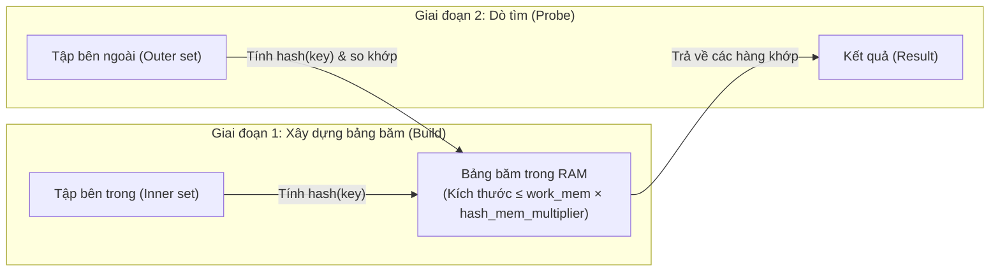
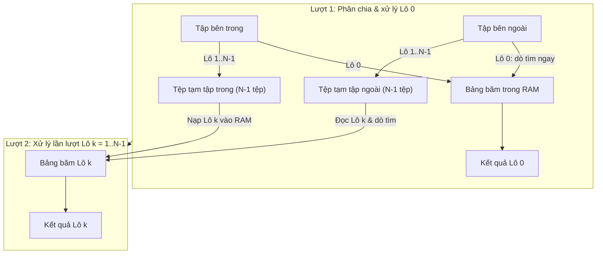
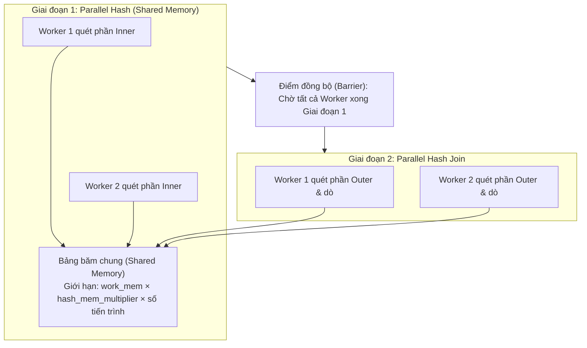

# CHƯƠNG 22: Băm (22 Hashing)

## 22.1 Kết nối băm (22.1 Hash Joins)

### Kết nối băm một lượt (One-Pass Hash Joins)

Phép kết nối băm (hash join) tìm kiếm các hàng khớp nhau bằng cách sử dụng một bảng băm (hash table) được dựng sẵn. Dưới đây là một ví dụ về kế hoạch thực thi có phép kết nối như vậy:

```sql
=> EXPLAIN (costs off) SELECT *
FROM tickets t
JOIN ticket_flights tf ON tf.ticket_no = t.ticket_no;
```

```text
                QUERY PLAN
-------------------------------------------
 Hash Join
   Hash Cond: (tf.ticket_no = t.ticket_no)
   ->  Seq Scan on ticket_flights tf
   ->  Hash
         ->  Seq Scan on tickets t
(5 rows)
```

Ở giai đoạn đầu tiên, nút `Hash Join`[^1] gọi nút `Hash`[^2], nút này kéo toàn bộ tập hàng bên trong (inner set) từ nút con của nó và đưa vào một bảng băm.

[^1]: `backend/executor/nodeHashjoin.c`
[^2]: `backend/executor/nodeHash.c`

Bằng cách lưu trữ các cặp khóa băm (hash key) và giá trị (value), bảng băm cho phép truy cập nhanh vào giá trị thông qua khóa; thời gian tìm kiếm không phụ thuộc vào kích thước của bảng băm, vì các khóa băm được phân bố tương đối đồng đều giữa một số lượng hữu hạn các ngăn (bucket). Ngăn mà một khóa cho trước rơi vào được xác định bởi hàm băm (hash function) của khóa băm đó; vì số lượng ngăn luôn là một lũy thừa của 2, chỉ cần lấy đủ số bit cần thiết của giá trị được tính toán là được.

Cũng giống như bộ đệm (buffer cache, xem trang 259), cách triển khai này sử dụng bảng băm có thể mở rộng động (dynamically extendible hash table) và xử lý xung đột băm (hash collision) bằng phương pháp nối chuỗi (chaining)[^3].

[^3]: `backend/utils/hash/dynahash.c`

Ở giai đoạn đầu tiên của phép toán kết nối, tập bên trong được quét và hàm băm được tính cho từng hàng của nó. Các cột được tham chiếu trong điều kiện kết nối (`Hash Cond`) đóng vai trò là khóa băm, trong khi bản thân bảng băm lưu trữ toàn bộ các trường được truy vấn của tập bên trong.

> 📝 **Giải thích thêm (không có trong sách):**
> Trong PostgreSQL, bảng băm của `Hash Join` không chỉ lưu khóa kết nối mà lưu cả **toàn bộ các cột cần thiết (target list)** của tập bên trong để khi tìm thấy cặp khớp với tập bên ngoài, bộ thực thi có thể trả về hàng kết quả ngay lập tức mà không cần quay lại đọc bảng gốc (heap). Đây là lý do việc `SELECT *` làm phình to bảng băm một cách không cần thiết.

Phép kết nối băm đạt hiệu quả cao nhất (từ phiên bản 13) khi toàn bộ bảng băm có thể nằm gọn trong RAM, vì khi đó bộ thực thi xử lý được dữ liệu chỉ trong một lô (batch). Kích thước vùng nhớ được cấp phát cho mục đích này bị giới hạn bởi giá trị `work_mem × hash_mem_multiplier` (mặc định là `4MB × 1.0`).



Hãy chạy `EXPLAIN ANALYZE` để xem thống kê về mức sử dụng bộ nhớ của một truy vấn:

```sql
=> SET work_mem = '256MB';
=> EXPLAIN (analyze, costs off, timing off, summary off)
SELECT * FROM bookings b
JOIN tickets t ON b.book_ref = t.book_ref;
```

```text
                            QUERY PLAN
------------------------------------------------------------------
 Hash Join (actual rows=2949857 loops=1)
   Hash Cond: (t.book_ref = b.book_ref)
   ->  Seq Scan on tickets t (actual rows=2949857 loops=1)
   ->  Hash (actual rows=2111110 loops=1)
         Buckets: 4194304  Batches: 1  Memory Usage: 145986kB
         ->  Seq Scan on bookings b (actual rows=2111110 loops=1)
(6 rows)
```

Không giống như phép kết nối vòng lặp lồng nhau (nested loop join) vốn đối xử khác biệt với tập bên trong và tập bên ngoài, phép kết nối băm có thể hoán đổi chúng cho nhau. Tập nhỏ hơn thường được chọn làm tập bên trong, vì nó tạo ra bảng băm nhỏ hơn.

Trong ví dụ này, toàn bộ bảng nằm gọn trong bộ nhớ đệm được cấp phát: nó chiếm khoảng `143 MB` (`Memory Usage: 145986kB`) và chứa `4M = 2²²` ngăn (`Buckets: 4194304`). Do đó, phép kết nối được thực hiện trong một lượt (`Batches: 1`).

Nhưng nếu truy vấn chỉ tham chiếu đến một cột duy nhất, bảng băm sẽ chỉ chiếm `111 MB`:

```sql
=> EXPLAIN (analyze, costs off, timing off, summary off)
SELECT b.book_ref
FROM bookings b
JOIN tickets t ON b.book_ref = t.book_ref;
```

```text
                               QUERY PLAN
------------------------------------------------------------------------
 Hash Join (actual rows=2949857 loops=1)
   Hash Cond: (t.book_ref = b.book_ref)
   ->  Index Only Scan using tickets_book_ref_idx on tickets t
       (actual rows=2949857 loops=1)
         Heap Fetches: 0
   ->  Hash (actual rows=2111110 loops=1)
         Buckets: 4194304  Batches: 1  Memory Usage: 113172kB
         ->  Seq Scan on bookings b (actual rows=2111110 loops=1)
(8 rows)
=> RESET work_mem;
```

Đây là một lý do nữa để tránh tham chiếu đến các trường thừa trong truy vấn (chẳng hạn như khi dùng dấu sao `*`).

Số lượng ngăn (bucket) được chọn phải đảm bảo rằng mỗi ngăn chỉ chứa trung bình đúng một hàng khi bảng băm được lấp đầy dữ liệu. Mật độ cao hơn sẽ làm tăng tỷ lệ xung đột băm, khiến việc tìm kiếm kém hiệu quả hơn, trong khi một bảng băm ít đặc hơn lại chiếm quá nhiều bộ nhớ. Số lượng ngăn ước tính được tăng lên tới lũy thừa của 2 gần nhất[^4].

[^4]: `backend/executor/nodeHash.c`, hàm `ExecChooseHashTableSize`

(Nếu kích thước bảng băm ước tính vượt quá giới hạn bộ nhớ dựa trên chiều rộng trung bình của một hàng, kỹ thuật băm hai lượt sẽ được áp dụng.)

Phép kết nối băm không thể bắt đầu trả về kết quả cho đến khi bảng băm được xây dựng hoàn chỉnh.

Ở giai đoạn thứ hai (lúc này bảng băm đã được dựng xong), nút `Hash Join` gọi nút con thứ hai của nó để lấy tập hàng bên ngoài. Với mỗi hàng được quét, bảng băm được tìm kiếm để tìm bản ghi khớp. Điều này đòi hỏi phải tính toán khóa băm cho các cột của tập bên ngoài nằm trong điều kiện kết nối.

Các cặp khớp tìm thấy được trả về cho nút cha.

**Ước lượng chi phí (Cost estimation).** Chúng ta đã tìm hiểu về ước lượng lực lượng tập kết quả (cardinality estimation, xem trang 276); vì nó không phụ thuộc vào phương thức kết nối, bây giờ tôi sẽ tập trung vào phần ước lượng chi phí.

Chi phí của nút `Hash` được biểu diễn bằng tổng chi phí của nút con của nó. Đây chỉ là một con số giả (dummy number) nhằm lấp đầy vị trí trong kế hoạch thực thi[^5]. Toàn bộ các ước lượng thực tế đều được gộp vào chi phí của nút `Hash Join`[^6].

[^5]: `backend/optimizer/plan/createplan.c`, hàm `create_hashjoin_plan`
[^6]: `backend/optimizer/path/costsize.c`, các hàm `initial_cost_hashjoin` & `final_cost_hashjoin`

Dưới đây là một ví dụ:

```sql
=> EXPLAIN (analyze, timing off, summary off)
SELECT * FROM flights f
JOIN seats s ON s.aircraft_code = f.aircraft_code;
```

```text
                              QUERY PLAN
-----------------------------------------------------------------------
 Hash Join
   (cost=38.13..278507.28 rows=16518865 width=78)
   (actual rows=16518865 loops=1)
   Hash Cond: (f.aircraft_code = s.aircraft_code)
   ->  Seq Scan on flights f
         (cost=0.00..4772.67 rows=214867 widt...
         (actual rows=214867 loops=1)
   ->  Hash
         (cost=21.39..21.39 rows=1339 width=15)
         (actual rows=1339 loops=1)
         Buckets: 2048  Batches: 1  Memory Usage: 79kB
         ->  Seq Scan on seats s
               (cost=0.00..21.39 rows=1339 width=15)
               (actual rows=1339 loops=1)
(10 rows)
```

Chi phí khởi động (startup cost) của phép kết nối phản ánh chủ yếu chi phí tạo bảng băm và bao gồm các thành phần sau:

- tổng chi phí lấy tập bên trong, cần thiết để xây dựng bảng băm
- chi phí tính toán hàm băm cho tất cả các cột thuộc khóa kết nối, đối với mỗi hàng của tập bên trong (ước lượng ở mức `cpu_operator_cost` = `0.0025` cho mỗi phép toán)
- chi phí chèn toàn bộ các hàng bên trong vào bảng băm (được ước lượng ở mức `cpu_tuple_cost` = `0.01` cho mỗi hàng được chèn)
- chi phí khởi động để lấy tập hàng bên ngoài, cần thiết để bắt đầu phép toán kết nối

Tổng chi phí (total cost) bao gồm chi phí khởi động cộng với chi phí của chính phép kết nối, cụ thể là:

- chi phí tính toán hàm băm cho tất cả các cột thuộc khóa kết nối, đối với mỗi hàng của tập bên ngoài (`cpu_operator_cost`)
- chi phí kiểm tra lại điều kiện kết nối (recheck), cần thiết để xử lý các trường hợp có thể xảy ra xung đột băm (ước lượng ở mức `cpu_operator_cost` cho mỗi toán tử được kiểm tra)
- chi phí xử lý cho mỗi hàng kết quả (`cpu_tuple_cost`)

Số lượng phép kiểm tra lại cần thiết là phần khó ước lượng nhất. Nó được tính bằng cách nhân số hàng của tập bên ngoài với một tỷ lệ nào đó của tập bên trong (được lưu trong bảng băm). Để ước lượng tỷ lệ này, bộ lập kế hoạch (planner) phải tính đến khả năng phân bố dữ liệu không đồng đều. Tôi sẽ lược bỏ chi tiết của các phép tính này[^7]; trong trường hợp cụ thể này, tỷ lệ đó được ước lượng là `0.150112`.

[^7]: `backend/utils/adt/selfuncs.c`, hàm `estimate_hash_bucket_stats`

Do đó, chi phí của truy vấn được ước lượng như sau:

```sql
=> WITH cost(startup) AS (
  SELECT round((
    21.39 +
    current_setting('cpu_operator_cost')::real * 1339 +
    current_setting('cpu_tuple_cost')::real * 1339 +
    0.00
  )::numeric, 2)
)
SELECT startup,
  startup + round((
    4772.67 +
    current_setting('cpu_operator_cost')::real * 214867 +
    current_setting('cpu_operator_cost')::real * 214867 * 1339 * 0.150112 +
    current_setting('cpu_tuple_cost')::real * 16518865
  )::numeric, 2) AS total
FROM cost;
```

```text
 startup |   total
---------+-----------
   38.13 | 278507.26
(1 row)
```

Và đây là đồ thị phụ thuộc (dependency graph) của kế hoạch:

```text
                    QUERY PLAN
--------------------------------------------------
 Hash Join
   (cost=38.13..278507.28 rows=16518865 width=78)
   Hash Cond: (f.aircraft_code = s.aircraft_code)
   ->  Seq Scan on flights f
         (cost=0.00..4772.67 rows=214867 width=63)
   ->  Hash
         (cost=21.39..21.39 rows=1339 width=15)
         ->  Seq Scan on seats s
               (cost=0.00..21.39 rows=1339 width=15)
(9 rows)
```

### Kết nối băm hai lượt (Two-Pass Hash Joins)

Nếu ước lượng của bộ lập kế hoạch cho thấy bảng băm sẽ không vừa với bộ nhớ được cấp phát, tập hàng bên trong sẽ được chia thành các lô (batch) để xử lý riêng rẽ. Số lượng lô (cũng giống như số lượng ngăn) luôn là một lũy thừa của 2; lô cần dùng được xác định bởi một số bit tương ứng của khóa băm[^8].

[^8]: `backend/executor/nodeHash.c`, hàm `ExecHashGetBucketAndBatch`

Bất kỳ hai hàng khớp nhau nào cũng thuộc về cùng một lô: các hàng được đặt vào các lô khác nhau không thể có cùng mã băm.

Tất cả các lô đều nắm giữ một số lượng khóa băm ngang nhau. Nếu dữ liệu phân bố đồng đều, kích thước các lô cũng sẽ xấp xỉ nhau. Bộ lập kế hoạch có thể kiểm soát mức tiêu thụ bộ nhớ bằng cách chọn số lượng lô phù hợp[^9].

[^9]: `backend/executor/nodeHash.c`, hàm `ExecChooseHashTableSize`

Ở giai đoạn đầu tiên, bộ thực thi quét tập hàng bên trong để dựng bảng băm. Nếu hàng đang quét thuộc về lô đầu tiên (batch 0), nó được thêm vào bảng băm và giữ trong RAM. Ngược lại, nó được ghi vào một tệp tạm (có một tệp riêng cho mỗi lô)[^10].

[^10]: `backend/executor/nodeHash.c`, hàm `ExecHashTableInsert`

Tổng dung lượng các tệp tạm mà một phiên làm việc (session) có thể lưu trên đĩa bị giới hạn bởi tham số `temp_file_limit` (mặc định là `-1`, không giới hạn; các bảng tạm không tính vào giới hạn này). Ngay khi phiên đạt đến giá trị này, truy vấn sẽ bị hủy bỏ.

Ở giai đoạn thứ hai, tập bên ngoài được quét. Nếu hàng thuộc về lô đầu tiên, nó được đối chiếu ngay với bảng băm hiện đang chứa lô đầu tiên của tập bên trong (dù sao cũng không thể có bản ghi khớp ở các lô khác).

Nếu hàng thuộc về một lô khác, nó được lưu vào một tệp tạm, một lần nữa được tạo riêng cho từng lô. Như vậy, $N$ lô có thể sử dụng tối đa $2(N - 1)$ tệp tạm (hoặc ít hơn nếu một số lô rỗng).

Khi giai đoạn thứ hai hoàn tất, bộ nhớ cấp phát cho bảng băm được giải phóng. Tại thời điểm này, chúng ta đã có kết quả kết nối cho một trong các lô (lô đầu tiên).

Cả hai giai đoạn sau đó được lặp lại cho từng lô đã lưu trên đĩa: các hàng của tập bên trong được chuyển từ tệp tạm vào bảng băm; tiếp theo, các hàng của tập bên ngoài thuộc cùng lô đó được đọc từ tệp tạm tương ứng và đối chiếu với bảng băm này. Sau khi xử lý xong, các tệp tạm sẽ bị xóa.



Không giống như kết quả đầu ra tương tự cho phép kết nối một lượt, đầu ra của lệnh `EXPLAIN` cho phép kết nối hai lượt sẽ hiển thị nhiều hơn một lô (`Batches > 1`). Nếu chạy với tùy chọn `BUFFERS`, lệnh này còn hiển thị thống kê về truy cập đĩa:

```sql
=> EXPLAIN (analyze, buffers, costs off, timing off, summary off)
SELECT *
FROM bookings b
JOIN tickets t ON b.book_ref = t.book_ref;
```

```text
                            QUERY PLAN
------------------------------------------------------------------
 Hash Join (actual rows=2949857 loops=1)
   Hash Cond: (t.book_ref = b.book_ref)
   Buffers: shared hit=7236 read=55626, temp read=55126 written=55126
   ->  Seq Scan on tickets t (actual rows=2949857 loops=1)
         Buffers: shared read=49415
   ->  Hash (actual rows=2111110 loops=1)
         Buckets: 65536  Batches: 64  Memory Usage: 2277kB
         Buffers: shared hit=7236 read=6211, temp written=10858
         ->  Seq Scan on bookings b (actual rows=2111110 loops=1)
               Buffers: shared hit=7236 read=6211
(11 rows)
```

Tôi đã từng trình bày truy vấn này ở trên với thiết lập `work_mem` được tăng lên. Giá trị mặc định `4 MB` quá nhỏ để toàn bộ bảng băm nằm vừa trong RAM; trong ví dụ này, dữ liệu được chia thành `64` lô, và bảng băm sử dụng `64K = 2¹⁶` ngăn (`Buckets: 65536`). Khi bảng băm được xây dựng (nút `Hash`), dữ liệu được ghi vào các tệp tạm (`temp written`); ở giai đoạn kết nối (nút `Hash Join`), các tệp tạm vừa được đọc vừa được ghi (`temp read, written`).

Để thu thập thêm thống kê về các tệp tạm, bạn có thể đặt tham số `log_temp_files` (mặc định `-1`) thành `0`. Khi đó, nhật ký máy chủ (server log) sẽ liệt kê tất cả các tệp tạm cùng kích thước của chúng (tại thời điểm bị xóa).

### Điều chỉnh động (Dynamic Adjustments)

Tiến trình dự kiến có thể bị phá vỡ bởi hai vấn đề: thống kê không chính xác và phân bố dữ liệu không đồng đều.

Nếu phân bố giá trị trong các cột khóa kết nối không đồng đều, các lô khác nhau sẽ có kích thước khác nhau.

Nếu một lô nào đó (ngoại trừ lô đầu tiên) trở nên quá lớn, toàn bộ các hàng của nó sẽ phải được ghi xuống đĩa rồi lại đọc từ đĩa lên. Chính tập bên ngoài gây ra phần lớn rắc rối, vì nó thường lớn hơn. Do đó, nếu có thống kê thông thường (không phải thống kê đa biến, xem trang 292) về các giá trị phổ biến nhất (`MCV` — Most Common Values) của tập bên ngoài (tức là tập bên ngoài là một bảng, và phép kết nối được thực hiện trên một cột duy nhất), các hàng có mã băm tương ứng với các `MCV` sẽ được coi là một phần của lô đầu tiên[^11]. Kỹ thuật này (gọi là tối ưu hóa độ lệch — *skew optimization*) có thể giảm bớt phần nào chi phí I/O của phép kết nối hai lượt.

[^11]: `backend/executor/nodeHash.c`, hàm `ExecHashBuildSkewHash`

Do hai yếu tố này, kích thước của một số (hoặc tất cả) lô có thể vượt quá ước lượng. Khi đó, bảng băm tương ứng sẽ không nằm vừa vùng nhớ được cấp phát và vượt quá giới hạn đã định.

Vì vậy, nếu bảng băm đang được xây dựng trở nên quá lớn, số lượng lô sẽ được tăng lên (gấp đôi) ngay trong lúc chạy (on the fly). Mỗi lô được chia tách ảo thành hai lô mới: khoảng một nửa số hàng (giả sử phân bố là đồng đều) được giữ lại trong bảng băm, trong khi nửa còn lại được lưu vào một tệp tạm mới[^12].

[^12]: `backend/executor/nodeHash.c`, hàm `ExecHashIncreaseNumBatches`

Sự chia tách như vậy có thể xảy ra ngay cả khi ban đầu hệ thống đã lập kế hoạch cho phép kết nối một lượt. Thực tế, kết nối một lượt và hai lượt sử dụng cùng một thuật toán và cùng một đoạn mã nguồn triển khai; tôi chỉ tách riêng chúng ở đây để việc trình bày được mạch lạc hơn.

Số lượng lô không thể giảm xuống. Nếu hóa ra bộ lập kế hoạch đã ước lượng quá cao kích thước dữ liệu, các lô cũng sẽ không được gộp lại với nhau.

Trong trường hợp phân bố không đồng đều, việc tăng số lượng lô có thể không giúp ích gì. Ví dụ, nếu cột khóa chứa cùng một giá trị ở tất cả các hàng, chúng sẽ bị đưa vào cùng một lô vì hàm băm sẽ liên tục trả về cùng một giá trị. Đáng tiếc là bảng băm sẽ tiếp tục phình to trong trường hợp này, bất chấp các giới hạn đã đặt ra.

Về mặt lý thuyết, vấn đề này có thể được giải quyết bằng một phép kết nối nhiều lượt (multi-pass join) thực hiện quét từng phần của lô, nhưng tính năng này không được hỗ trợ.

Để minh họa việc tăng động số lượng lô, trước tiên chúng ta cần thực hiện một vài thao tác chuẩn bị (xem trang 284):

```sql
=> CREATE TABLE bookings_copy (LIKE bookings INCLUDING INDEXES)
WITH (autovacuum_enabled = off);
=> INSERT INTO bookings_copy SELECT * FROM bookings;
INSERT 0 2111110
=> DELETE FROM bookings_copy WHERE random() < 0.9;
DELETE 1899232
=> ANALYZE bookings_copy;
=> INSERT INTO bookings_copy SELECT * FROM bookings
ON CONFLICT DO NOTHING;
INSERT 0 1899232
=> SELECT reltuples FROM pg_class WHERE relname = 'bookings_copy';
```

```text
 reltuples
-----------
    211878
(1 row)
```

Kết quả là chúng ta thu được một bảng mới tên là `bookings_copy`. Nó là bản sao chính xác của bảng `bookings`, nhưng bộ lập kế hoạch ước lượng thấp hơn thực tế số hàng trong đó tới 10 lần. Tình huống tương tự có thể xảy ra nếu bảng băm được tạo cho một tập hàng sinh ra từ một phép kết nối khác, khiến không có thống kê đáng tin cậy nào.

Sự tính toán sai lầm này khiến bộ lập kế hoạch nghĩ rằng `8` lô là đủ, nhưng trong khi phép kết nối đang thực hiện, con số này tăng lên thành `32`:

```sql
=> EXPLAIN (analyze, costs off, timing off, summary off)
SELECT *
FROM bookings_copy b
JOIN tickets t ON b.book_ref = t.book_ref;
```

```text
                                 QUERY PLAN
----------------------------------------------------------------------------
 Hash Join (actual rows=2949857 loops=1)
   Hash Cond: (t.book_ref = b.book_ref)
   ->  Seq Scan on tickets t (actual rows=2949857 loops=1)
   ->  Hash (actual rows=2111110 loops=1)
         Buckets: 65536 (originally 65536)  Batches: 32 (originally 8)  Memory Usage: 4040kB
         ->  Seq Scan on bookings_copy b (actual rows=2111110 loops=1)
(7 rows)
```

> 💡 **Ví dụ bổ sung (không có trong sách):**
> Trong thực tế sản xuất (production), khi bạn thấy `Batches: 32 (originally 8)` hoặc `Batches: 16 (originally 1)` trong kết quả `EXPLAIN ANALYZE`, đó là dấu hiệu rõ ràng cho thấy ước lượng số hàng (cardinality) bị sai lệch mạnh (thường do `ANALYZE` chưa chạy, dữ liệu tương quan giữa các cột, hoặc bảng trung gian sau nhiều phép `JOIN`). Việc tăng `work_mem` hoặc cập nhật thống kê (`ANALYZE`, `CREATE STATISTICS`) có thể giúp tránh hiện tượng "tràn đĩa" bất ngờ này.

**Ước lượng chi phí (Cost estimation).** Tôi đã sử dụng ví dụ trước đó để minh họa việc ước lượng chi phí cho phép kết nối một lượt, nhưng bây giờ tôi sẽ giảm kích thước bộ nhớ khả dụng xuống mức tối thiểu, buộc bộ lập kế hoạch phải dùng 2 lô. Điều này làm tăng chi phí của phép kết nối:

```sql
=> SET work_mem = '64kB';
=> EXPLAIN (analyze, timing off, summary off)
SELECT * FROM flights f
JOIN seats s ON s.aircraft_code = f.aircraft_code;
```

```text
                              QUERY PLAN
-----------------------------------------------------------------------
 Hash Join
   (cost=45.13..283139.28 rows=16518865 width=78)
   (actual rows=16518865 loops=1)
   Hash Cond: (f.aircraft_code = s.aircraft_code)
   ->  Seq Scan on flights f
         (cost=0.00..4772.67 rows=214867 widt...
         (actual rows=214867 loops=1)
   ->  Hash
         (cost=21.39..21.39 rows=1339 width=15)
         (actual rows=1339 loops=1)
         Buckets: 2048  Batches: 2  Memory Usage: 55kB
         ->  Seq Scan on seats s
               (cost=0.00..21.39 rows=1339 width=15)
               (actual rows=1339 loops=1)
(10 rows)
=> RESET work_mem;
```

Chi phí của lượt thứ hai phát sinh do việc tràn hàng (spilling) ra các tệp tạm và đọc chúng lại từ các tệp này.

Chi phí khởi động của phép kết nối hai lượt dựa trên chi phí khởi động của phép kết nối một lượt, cộng thêm chi phí ước lượng để ghi số trang cần thiết nhằm lưu toàn bộ các trường cần thiết của tất cả các hàng trong tập bên trong[^13]. Mặc dù lô đầu tiên không bị ghi ra đĩa khi bảng băm đang được xây dựng, ước lượng chi phí không tính đến điều này và do đó không phụ thuộc vào số lượng lô.

[^13]: `backend/optimizer/path/costsize.c`, hàm `page_size`

Đến lượt mình, tổng chi phí bao gồm tổng chi phí của phép kết nối một lượt cộng với chi phí ước lượng để đọc các hàng của tập bên trong đã lưu trên đĩa trước đó, cũng như chi phí đọc và ghi các hàng của tập bên ngoài.

Cả việc ghi và đọc đều được ước lượng ở mức `seq_page_cost` cho mỗi trang, vì các thao tác I/O được giả định là tuần tự (sequential).

Trong trường hợp cụ thể này, số trang cần thiết cho tập bên trong được ước lượng là `7`, trong khi dữ liệu của tập bên ngoài dự kiến chiếm vừa `2309` trang. Cộng các ước lượng này vào chi phí kết nối một lượt đã tính ở trên, chúng ta thu được đúng các con số hiển thị trong kế hoạch truy vấn:

```sql
=> SELECT 38.13 + -- startup cost of a one-pass join
  current_setting('seq_page_cost')::real * 7
AS startup,
  278507.28 + -- total cost of a one-pass join
  current_setting('seq_page_cost')::real * 2 * (7 + 2309)
AS total;
```

```text
 startup |   total
---------+-----------
   45.13 | 283139.28
(1 row)
```

Như vậy, nếu không đủ bộ nhớ, phép kết nối được thực hiện qua hai lượt và trở nên kém hiệu quả hơn. Do đó, điều quan trọng là cần lưu ý các điểm sau:

- Truy vấn phải được viết sao cho loại bỏ các trường thừa khỏi bảng băm.
- Bộ lập kế hoạch phải chọn tập nhỏ hơn trong hai tập hàng khi xây dựng bảng băm.

### Sử dụng kết nối băm trong kế hoạch song song (Hash Joins in Parallel Plans)

Thuật toán kết nối băm mô tả ở trên (từ phiên bản 9.6) cũng có thể được sử dụng trong các kế hoạch song song (parallel plans). Trước tiên, nhiều tiến trình song song tự xây dựng các bảng băm riêng (hoàn toàn giống hệt nhau) cho tập bên trong, độc lập với nhau; sau đó chúng bắt đầu xử lý tập bên ngoài đồng thời. Lợi ích hiệu năng ở đây đến từ việc mỗi tiến trình chỉ quét phần hàng của riêng mình trong tập bên ngoài.

Kế hoạch sau đây sử dụng một phép kết nối băm một lượt thông thường:

```sql
=> SET work_mem = '128MB';
=> SET enable_parallel_hash = off;
=> EXPLAIN (analyze, costs off, timing off, summary off)
SELECT count(*)
FROM bookings b
JOIN tickets t ON t.book_ref = b.book_ref;
```

```text
                                QUERY PLAN
--------------------------------------------------------------------------
 Finalize Aggregate (actual rows=1 loops=1)
   ->  Gather (actual rows=3 loops=1)
         Workers Planned: 2
         Workers Launched: 2
         ->  Partial Aggregate (actual rows=1 loops=3)
               ->  Hash Join (actual rows=983286 loops=3)
                     Hash Cond: (t.book_ref = b.book_ref)
                     ->  Parallel Index Only Scan using tickets_book_ref...
                           Heap Fetches: 0
                     ->  Hash (actual rows=2111110 loops=3)
                           Buckets: 4194304  Batches: 1  Memory Usage: 113172kB
                           ->  Seq Scan on bookings b (actual rows=2111110...
(13 rows)
=> RESET enable_parallel_hash;
```

Ở đây, mỗi tiến trình tự băm toàn bộ bảng `bookings`, sau đó lấy phần hàng bên ngoài của riêng mình thông qua nút `Parallel Index Only Scan`, và đối chiếu các hàng này với bảng băm kết quả.

Giới hạn bộ nhớ bảng băm được áp dụng riêng rẽ cho từng tiến trình song song, nên tổng dung lượng bộ nhớ được cấp phát cho mục đích này sẽ lớn gấp ba lần con số hiển thị trong kế hoạch (`Memory Usage`).

#### Kết nối băm một lượt song song (Parallel One-Pass Hash Joins)

Mặc dù phép kết nối băm thông thường khá hiệu quả trong các kế hoạch song song (đặc biệt với các tập bên trong nhỏ, vốn không cần thiết phải xử lý song song), các tập dữ liệu lớn hơn sẽ được xử lý tốt hơn nhờ một thuật toán kết nối băm song song đặc biệt (từ phiên bản 11).

Một điểm khác biệt quan trọng của phiên bản song song này là bảng băm được tạo trong bộ nhớ dùng chung (shared memory), được cấp phát động và có thể truy cập bởi tất cả các tiến trình song song tham gia vào phép kết nối. Thay vì nhiều bảng băm riêng biệt, chỉ một bảng băm chung duy nhất được xây dựng, tận dụng tổng lượng bộ nhớ dành cho tất cả các tiến trình tham gia. Điều này làm tăng cơ hội hoàn thành phép kết nối trong một lượt.

Ở giai đoạn đầu tiên (được biểu diễn trong kế hoạch bởi nút `Parallel Hash`), tất cả các tiến trình song song cùng xây dựng một bảng băm chung, tận dụng khả năng truy cập song song vào tập hàng bên trong[^14].

[^14]: `backend/executor/nodeHash.c`, hàm `MultiExecParallelHash`

Để chuyển tiếp từ bước này, mỗi tiến trình song song phải hoàn thành phần xử lý giai đoạn đầu của mình[^15] (tại điểm đồng bộ barrier).

[^15]: `backend/storage/ipc/barrier.c`

Ở giai đoạn thứ hai (nút `Parallel Hash Join`), các tiến trình lại chạy song song để đối chiếu phần hàng của mình trong tập bên ngoài với bảng băm đã được dựng hoàn chỉnh lúc này[^16].

[^16]: `backend/executor/nodeHashjoin.c`, hàm `ExecParallelHashJoin`



Dưới đây là một ví dụ về kế hoạch như vậy:

```sql
=> SET work_mem = '64MB';
=> EXPLAIN (analyze, costs off, timing off, summary off)
SELECT count(*)
FROM bookings b
JOIN tickets t ON t.book_ref = b.book_ref;
```

```text
                                QUERY PLAN
--------------------------------------------------------------------------
 Finalize Aggregate (actual rows=1 loops=1)
   ->  Gather (actual rows=3 loops=1)
         Workers Planned: 2
         Workers Launched: 2
         ->  Partial Aggregate (actual rows=1 loops=3)
               ->  Parallel Hash Join (actual rows=983286 loops=3)
                     Hash Cond: (t.book_ref = b.book_ref)
                     ->  Parallel Index Only Scan using tickets_book_ref...
                           Heap Fetches: 0
                     ->  Parallel Hash (actual rows=703703 loops=3)
                           Buckets: 4194304  Batches: 1  Memory Usage: 115392kB
                           ->  Parallel Seq Scan on bookings b (actual row...
(13 rows)
=> RESET work_mem;
```

Đây là cùng một truy vấn mà tôi đã minh họa ở mục trước, nhưng khi đó kết nối băm song song đã bị tắt bởi tham số `enable_parallel_hash` (mặc định là `on`).

Mặc dù bộ nhớ khả dụng giảm đi một nửa so với phép kết nối băm thông thường đã trình bày trước đó, phép toán vẫn hoàn thành trong một lượt vì nó sử dụng bộ nhớ được cấp phát cho tất cả các tiến trình song song (`Memory Usage: 115392kB`). Bảng băm có lớn hơn một chút, nhưng vì giờ đây chỉ có một bảng duy nhất, tổng mức sử dụng bộ nhớ thực tế đã giảm đi.

#### Kết nối băm hai lượt song song (Parallel Two-Pass Hash Joins)

Tổng bộ nhớ hợp nhất của tất cả các tiến trình song song vẫn có thể không đủ để chứa toàn bộ bảng băm (từ phiên bản 11). Điều này có thể bộc lộ ngay ở giai đoạn lập kế hoạch hoặc muộn hơn, trong quá trình thực thi truy vấn. Thuật toán hai lượt được áp dụng trong trường hợp này khá khác biệt so với những gì chúng ta đã thấy từ đầu chương.

Điểm khác biệt cốt lõi của thuật toán này là nó tạo ra nhiều bảng băm nhỏ thay vì một bảng lớn duy nhất. Mỗi tiến trình nhận bảng riêng của mình và xử lý các lô riêng một cách độc lập. (Nhưng vì các bảng băm riêng biệt này vẫn nằm trong bộ nhớ dùng chung, bất kỳ tiến trình nào cũng có thể truy cập vào bất kỳ bảng nào trong số đó.) Nếu việc lập kế hoạch cho thấy cần nhiều hơn một lô[^17], một bảng băm riêng cho từng tiến trình sẽ được dựng ngay lập tức. Nếu quyết định được đưa ra ở giai đoạn thực thi, bảng băm sẽ được xây dựng lại[^18].

[^17]: `backend/executor/nodeHash.c`, hàm `ExecChooseHashTableSize`
[^18]: `backend/executor/nodeHash.c`, hàm `ExecParallelHashIncreaseNumBatches`

Như vậy, ở giai đoạn đầu tiên, các tiến trình quét tập bên trong song song, chia nhỏ thành các lô và ghi chúng vào các tệp tạm[^19]. Vì mỗi tiến trình chỉ đọc phần riêng của mình trong tập bên trong, không tiến trình nào dựng được bảng băm đầy đủ cho bất kỳ lô nào (kể cả lô đầu tiên). Tập hàng đầy đủ của bất kỳ lô nào cũng chỉ được tích lũy trong tệp do tất cả các tiến trình song song cùng ghi một cách đồng bộ[^20]. Vì thế, không giống phiên bản không song song và phiên bản song song một lượt, phép kết nối băm hai lượt song song ghi **tất cả** các lô ra đĩa, bao gồm cả lô đầu tiên.

[^19]: `backend/executor/nodeHash.c`, hàm `MultiExecParallelHash`
[^20]: `backend/utils/sort/sharedtuplestore.c`

Khi tất cả các tiến trình đã hoàn thành việc băm tập bên trong, giai đoạn thứ hai bắt đầu[^21]. Nếu áp dụng phiên bản không song song, các hàng của tập bên ngoài thuộc lô đầu tiên sẽ được đối chiếu ngay với bảng băm. Nhưng ở phiên bản song song, bộ nhớ lúc này chưa hề chứa bảng băm, nên các worker sẽ xử lý các lô một cách độc lập. Do đó, giai đoạn thứ hai bắt đầu bằng một lượt quét song song tập bên ngoài để phân phối các hàng của nó vào các lô, và mỗi lô được ghi vào một tệp tạm riêng[^22]. Các hàng được quét không bị chèn vào bảng băm (như ở giai đoạn một), nên số lượng lô không bao giờ tăng thêm nữa.

[^21]: `backend/executor/nodeHashjoin.c`, hàm `ExecParallelHashJoin`
[^22]: `backend/executor/nodeHashjoin.c`, hàm `ExecParallelHashJoinPartitionOuter`

Khi tất cả các tiến trình đã hoàn tất việc quét tập bên ngoài, chúng ta có $2N$ tệp tạm trên đĩa; chúng chứa các lô của tập bên trong và tập bên ngoài.

Sau đó, mỗi tiến trình chọn một trong các lô và thực hiện phép kết nối: nó nạp tập hàng bên trong vào một bảng băm trong bộ nhớ, quét các hàng của tập bên ngoài, và đối chiếu chúng với bảng băm đó. Khi phép kết nối cho lô đó hoàn tất, tiến trình lại chọn lô tiếp theo chưa được xử lý[^23].

[^23]: `backend/executor/nodeHashjoin.c`, hàm `ExecParallelHashJoinNewBatch`

Nếu không còn lô nào chưa xử lý, tiến trình vừa hoàn thành lô của mình sẽ bắt đầu tham gia xử lý một trong các lô hiện đang được xử lý bởi tiến trình khác; việc xử lý đồng thời như vậy khả thi vì tất cả các bảng băm đều nằm trong bộ nhớ dùng chung.

Cách tiếp cận này hiệu quả hơn so với việc dùng một bảng băm lớn duy nhất cho tất cả các tiến trình: việc thiết lập xử lý song song dễ dàng hơn, và chi phí đồng bộ hóa cũng rẻ hơn.

### Các biến thể (Modifications)

Thuật toán kết nối băm hỗ trợ mọi loại phép kết nối: ngoài inner join, nó còn có thể xử lý left, right và full outer join, cũng như semi-join và anti-join. Nhưng như tôi đã đề cập, điều kiện kết nối bị giới hạn ở toán tử bằng (`=`).

Chúng ta đã quan sát một số phép toán này (xem trang 363) khi làm việc với phép kết nối vòng lặp lồng nhau. Dưới đây là một ví dụ về phép kết nối ngoài bên phải (right outer join):

```sql
=> EXPLAIN (costs off)
SELECT *
FROM bookings b
LEFT OUTER JOIN tickets t ON t.book_ref = b.book_ref;
```

```text
                QUERY PLAN
------------------------------------------
 Hash Right Join
   Hash Cond: (t.book_ref = b.book_ref)
   ->  Seq Scan on tickets t
   ->  Hash
         ->  Seq Scan on bookings b
(5 rows)
```

Lưu ý rằng phép `LEFT JOIN` về mặt logic được chỉ định trong câu truy vấn SQL đã được chuyển đổi thành phép toán vật lý `Hash Right Join` trong kế hoạch thực thi.

Ở mức logic, `bookings` là bảng bên ngoài (nằm ở vế trái của phép kết nối), còn bảng `tickets` là bảng bên trong. Do đó, các đặt chỗ (`bookings`) không có vé (`tickets`) nào cũng phải được đưa vào kết quả kết nối.

Ở mức vật lý, tập bên trong và tập bên ngoài được gán dựa trên chi phí của phép kết nối chứ không phải vị trí của chúng trong văn bản truy vấn. Điều này thường có nghĩa là tập nào cho bảng băm nhỏ hơn sẽ được dùng làm tập bên trong. Đó chính xác là những gì đang diễn ra ở đây: bảng `bookings` được dùng làm tập bên trong, và phép `left join` được đổi thành `right join`.

Và ngược lại, nếu truy vấn chỉ định phép kết nối ngoài bên phải (để hiển thị các vé không liên quan đến bất kỳ đặt chỗ nào), kế hoạch thực thi sẽ sử dụng `left join`:

```sql
=> EXPLAIN (costs off)
SELECT *
FROM bookings b
RIGHT OUTER JOIN tickets t ON t.book_ref = b.book_ref;
```

```text
                QUERY PLAN
------------------------------------------
 Hash Left Join
   Hash Cond: (t.book_ref = b.book_ref)
   ->  Seq Scan on tickets t
   ->  Hash
         ->  Seq Scan on bookings b
(5 rows)
```

Để hoàn thiện bức tranh, tôi sẽ đưa ra một ví dụ về kế hoạch truy vấn với phép kết nối ngoài đầy đủ (`FULL OUTER JOIN`):

```sql
=> EXPLAIN (costs off)
SELECT *
FROM bookings b
FULL OUTER JOIN tickets t ON t.book_ref = b.book_ref;
```

```text
                QUERY PLAN
------------------------------------------
 Hash Full Join
   Hash Cond: (t.book_ref = b.book_ref)
   ->  Seq Scan on tickets t
   ->  Hash
         ->  Seq Scan on bookings b
(5 rows)
```

Các phép kết nối băm song song hiện tại không được hỗ trợ cho `right join` và `full join`[^24].

[^24]: `commitfest.postgresql.org/33/2903` (Lưu ý: tính năng hỗ trợ Parallel Hash Right/Full Join đã được bổ sung trong PostgreSQL 16).

Lưu ý rằng ví dụ tiếp theo sử dụng bảng `bookings` làm tập bên ngoài, nhưng bộ lập kế hoạch hẳn đã ưu tiên dùng `right join` nếu nó được hỗ trợ:

```sql
=> EXPLAIN (costs off)
SELECT sum(b.total_amount)
FROM bookings b
LEFT OUTER JOIN tickets t ON t.book_ref = b.book_ref;
```

```text
                                QUERY PLAN
--------------------------------------------------------------------------
 Finalize Aggregate
   ->  Gather
         Workers Planned: 2
         ->  Partial Aggregate
               ->  Parallel Hash Left Join
                     Hash Cond: (b.book_ref = t.book_ref)
                     ->  Parallel Seq Scan on bookings b
                     ->  Parallel Hash
                           ->  Parallel Index Only Scan using tickets_book...
(9 rows)
```

## 22.2 Giá trị phân biệt và Nhóm (22.2 Distinct Values and Grouping)

Các thuật toán nhóm giá trị để tổng hợp (aggregation) và loại bỏ bản sao trùng lặp rất giống với các thuật toán kết nối. Một trong những cách tiếp cận mà chúng có thể sử dụng là xây dựng bảng băm trên các cột cần thiết. Giá trị chỉ được đưa vào bảng băm nếu bảng băm chưa chứa giá trị đó. Kết quả là bảng băm tích lũy toàn bộ các giá trị phân biệt (distinct values).

Nút thực hiện việc tổng hợp bằng băm được gọi là `HashAggregate`[^25].

[^25]: `backend/executor/nodeAgg.c`

Hãy xem xét một số tình huống có thể cần đến nút này.

Số lượng ghế trong từng hạng vé (`GROUP BY`):

```sql
=> EXPLAIN (costs off) SELECT fare_conditions, count(*)
FROM seats
GROUP BY fare_conditions;
```

```text
           QUERY PLAN
--------------------------------
 HashAggregate
   Group Key: fare_conditions
   ->  Seq Scan on seats
(3 rows)
```

Danh sách các hạng vé (`DISTINCT`):

```sql
=> EXPLAIN (costs off) SELECT DISTINCT fare_conditions
FROM seats;
```

```text
           QUERY PLAN
--------------------------------
 HashAggregate
   Group Key: fare_conditions
   ->  Seq Scan on seats
(3 rows)
```

Các hạng vé kết hợp thêm một giá trị nữa (`UNION`):

```sql
=> EXPLAIN (costs off) SELECT fare_conditions
FROM seats
UNION
SELECT NULL;
```

```text
              QUERY PLAN
--------------------------------------
 HashAggregate
   Group Key: seats.fare_conditions
   ->  Append
         ->  Seq Scan on seats
         ->  Result
(5 rows)
```

Nút `Append` gộp cả hai tập hợp lại nhưng không loại bỏ bất kỳ giá trị trùng lặp nào, vốn không được phép xuất hiện trong kết quả của `UNION`. Chúng phải được loại bỏ riêng bởi nút `HashAggregate`.

Vùng nhớ được cấp phát cho bảng băm bị giới hạn bởi giá trị `work_mem × hash_mem_multiplier` (mặc định `4MB × 1.0`), giống như trong trường hợp kết nối băm.

Nếu bảng băm nằm vừa trong bộ nhớ được cấp phát, quá trình tổng hợp chỉ sử dụng một lô duy nhất:

```sql
=> EXPLAIN (analyze, costs off, timing off, summary off)
SELECT DISTINCT amount FROM ticket_flights;
```

```text
                            QUERY PLAN
------------------------------------------------------------------
 HashAggregate (actual rows=338 loops=1)
   Group Key: amount
   Batches: 1  Memory Usage: 61kB
   ->  Seq Scan on ticket_flights (actual rows=8391852 loops=1)
(4 rows)
```

Không có quá nhiều giá trị phân biệt trong trường `amount`, nên bảng băm chỉ chiếm `61 kB` (`Memory Usage: 61kB`).

Ngay khi bảng băm (từ phiên bản 13) lấp đầy bộ nhớ được cấp phát, tất cả các giá trị tiếp theo sẽ được tràn ra các tệp tạm và được gom nhóm vào các phân vùng (partition) dựa trên một vài bit của giá trị băm của chúng. Số lượng phân vùng là một lũy thừa của 2 và được chọn sao cho bảng băm của mỗi phân vùng nằm vừa trong bộ nhớ được cấp phát. Độ chính xác của ước lượng tất nhiên phụ thuộc vào chất lượng thống kê thu thập được, nên con số nhận được được nhân thêm với `1.5` để thu nhỏ kích thước phân vùng hơn nữa và tăng cơ hội xử lý mỗi phân vùng trong một lượt[^26].

[^26]: `backend/executor/nodeAgg.c`, hàm `hash_choose_num_partitions`

Khi toàn bộ tập dữ liệu đã được quét, nút này trả về kết quả tổng hợp cho những giá trị đã lọt vào được bảng băm.

Sau đó bảng băm được xóa sạch, và từng phân vùng đã lưu vào tệp tạm ở giai đoạn trước sẽ được quét và xử lý giống như bất kỳ tập hàng nào khác. Nếu bảng băm vẫn vượt quá bộ nhớ được cấp phát, các hàng bị tràn sẽ lại được phân vùng một lần nữa và ghi ra đĩa để xử lý tiếp.

Để tránh I/O quá mức, thuật toán kết nối băm hai lượt di chuyển các `MCV` vào lô đầu tiên. Tuy nhiên, quá trình tổng hợp không cần tối ưu hóa này: những hàng nằm vừa trong bộ nhớ được cấp phát sẽ không bị chia vào các phân vùng, và các `MCV` nhiều khả năng xuất hiện đủ sớm để lọt vào RAM.

```sql
=> EXPLAIN (analyze, costs off, timing off, summary off)
SELECT DISTINCT flight_id FROM ticket_flights;
```

```text
                            QUERY PLAN
------------------------------------------------------------------
 HashAggregate (actual rows=150588 loops=1)
   Group Key: flight_id
   Batches: 5  Memory Usage: 4145kB  Disk Usage: 98184kB
   ->  Seq Scan on ticket_flights (actual rows=8391852 loops=1)
(4 rows)
```

Trong ví dụ này, số lượng `ID` phân biệt tương đối cao, nên bảng băm không nằm vừa trong bộ nhớ được cấp phát. Cần tới 5 lô (`Batches: 5`) để thực hiện truy vấn: một lô cho tập dữ liệu ban đầu trong bộ nhớ và bốn lô cho các phân vùng được ghi ra đĩa.

> 💡 **Ví dụ bổ sung (không có trong sách):**
> Trước phiên bản PostgreSQL 13, nếu `HashAggregate` ước lượng sai và vượt quá `work_mem`, nó không thể tràn ra đĩa mà cứ tiếp tục ăn RAM cho đến khi có nguy cơ gây lỗi hết bộ nhớ (OOM - Out of Memory). Từ PostgreSQL 13 trở đi, nhờ cơ chế phân vùng ra đĩa (Disk-based HashAggregate), truy vấn vẫn chạy ổn định khi gặp tập dữ liệu lớn, thể hiện qua hai thông số `Batches` và `Disk Usage` trong `EXPLAIN ANALYZE`.

## Bảng thuật ngữ chương (Chapter Glossary)

| Thuật ngữ (English) | Tiếng Việt | Giải thích ngắn gọn |
| :--- | :--- | :--- |
| Hash Join | Kết nối băm | Thuật toán kết nối hai tập dữ liệu bằng cách dựng bảng băm trên tập bên trong rồi dò tìm từ tập bên ngoài. |
| Bucket | Ngăn băm | Đơn vị lưu trữ trong bảng băm; các khóa có cùng phần bit băm sẽ được ánh xạ vào cùng một ngăn. |
| Hash Collision | Xung đột băm | Hiện tượng hai khóa khác nhau nhưng hàm băm trả về cùng một vị trí ngăn; được xử lý bằng nối chuỗi (chaining). |
| Batch | Lô | Một phần dữ liệu được chia nhỏ theo các bit của mã băm khi bảng băm không nằm vừa trong RAM. |
| One-Pass Hash Join | Kết nối băm một lượt | Phép kết nối băm mà toàn bộ bảng băm nằm gọn trong RAM (`Batches: 1`), không cần ghi tệp tạm ra đĩa. |
| Two-Pass Hash Join | Kết nối băm hai lượt | Phép kết nối băm phải chia dữ liệu thành nhiều lô và tràn các lô chưa xử lý ra tệp tạm trên đĩa. |
| Skew Optimization | Tối ưu hóa độ lệch | Kỹ thuật đưa các giá trị phổ biến nhất (`MCV`) của tập ngoài vào lô đầu tiên để giảm I/O đĩa. |
| Parallel Hash Join | Kết nối băm song song | Biến thể cho phép nhiều tiến trình worker cùng xây dựng và truy cập bảng băm trong bộ nhớ dùng chung (shared memory). |
| HashAggregate | Tổng hợp băm | Nút thực thi dùng bảng băm để gom nhóm (`GROUP BY`) hoặc lọc giá trị phân biệt (`DISTINCT`, `UNION`). |
| Spilling (to disk) | Tràn ra đĩa | Hành động ghi dữ liệu tạm thời từ RAM xuống tệp tạm trên đĩa khi vượt quá giới hạn `work_mem × hash_mem_multiplier`. |
