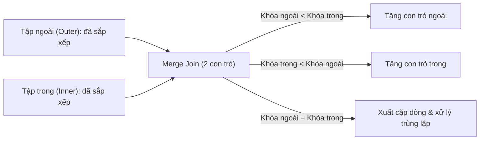

# CHƯƠNG 23: Sắp xếp và Trộn (CHAPTER 23: Sorting and Merging)

## 23.1 Phép nối trộn (Merge Joins)

Một phép nối trộn (*merge join*) xử lý các tập dữ liệu đã được sắp xếp theo khóa nối (*join key*) và trả về kết quả cũng được sắp xếp theo cách tương tự. Các tập đầu vào có thể đã được sắp xếp sẵn nhờ quét chỉ mục (*index scan*); nếu không, bộ thực thi (*executor*) phải sắp xếp chúng trước khi quá trình trộn thực sự bắt đầu.[^1]

[^1]: `backend/optimizer/path/joinpath.c`, hàm `generate_mergejoin_paths`

### Trộn các tập đã sắp xếp (Merging Sorted Sets)

Hãy xem một ví dụ về phép nối trộn; nó được biểu diễn trong kế hoạch thực thi bởi nút `Merge Join`:[^2]

[^2]: `backend/executor/nodeMergejoin.c`

```sql
=> EXPLAIN (costs off) SELECT *
FROM tickets t
JOIN ticket_flights tf ON tf.ticket_no = t.ticket_no
ORDER BY t.ticket_no;
                              QUERY PLAN
------------------------------------------------------------------
 Merge Join
   Merge Cond: (t.ticket_no = tf.ticket_no)
   ->  Index Scan using tickets_pkey on tickets t
   ->  Index Scan using ticket_flights_pkey on ticket_flights tf
(4 rows)
```

Bộ tối ưu hóa (*optimizer*) ưu tiên phương pháp nối này vì nó trả về kết quả đã được sắp xếp theo đúng yêu cầu của mệnh đề `ORDER BY`. Khi chọn kế hoạch, bộ tối ưu hóa ghi nhận thứ tự sắp xếp của các tập dữ liệu và không thực hiện bất kỳ thao tác sắp xếp nào trừ khi thực sự cần thiết. Ví dụ, nếu tập dữ liệu được tạo ra bởi một phép nối trộn đã có thứ tự sắp xếp phù hợp, nó có thể được sử dụng nguyên trạng trong phép nối trộn tiếp theo:

```sql
=> EXPLAIN (costs off) SELECT *
FROM tickets t
JOIN ticket_flights tf ON t.ticket_no = tf.ticket_no
JOIN boarding_passes bp ON bp.ticket_no = tf.ticket_no
  AND bp.flight_id = tf.flight_id
ORDER BY t.ticket_no;
                                 QUERY PLAN
---------------------------------------------------------------------
 Merge Join
   Merge Cond: (tf.ticket_no = t.ticket_no)
   ->  Merge Join
         Merge Cond: ((tf.ticket_no = bp.ticket_no) AND (tf.flight_...
         ->  Index Scan using ticket_flights_pkey on ticket_flights tf
         ->  Index Scan using boarding_passes_pkey on boarding_passe...
   ->  Index Scan using tickets_pkey on tickets t
(7 rows)
```

Hai bảng đầu tiên được nối là `ticket_flights` và `boarding_passes`; cả hai đều có khóa chính kết hợp (*composite primary key*) là `(ticket_no, flight_id)`, và kết quả thu được cũng được sắp xếp theo hai cột này. Tập các dòng được tạo ra sau đó được nối với bảng `tickets`, vốn đã được sắp xếp theo cột `ticket_no`.

Phép nối này chỉ yêu cầu một lượt duyệt (*one pass*) qua cả hai tập dữ liệu và không tốn thêm bộ nhớ phụ. Nó sử dụng hai con trỏ trỏ đến các dòng hiện tại (ban đầu là dòng đầu tiên) của tập bên trong (*inner set*) và tập bên ngoài (*outer set*).

Nếu khóa của các dòng hiện tại không khớp nhau, một trong hai con trỏ (con trỏ đang tham chiếu đến dòng có khóa nhỏ hơn) sẽ được đẩy lên dòng tiếp theo cho đến khi tìm thấy một cặp khớp. Các dòng đã nối được trả về cho nút phía trên, và con trỏ của tập bên trong được đẩy lên một vị trí. Quá trình này tiếp tục cho đến khi một trong hai tập kết thúc.

Thuật toán này xử lý được các giá trị trùng lặp ở tập bên trong, nhưng tập bên ngoài cũng có thể chứa giá trị trùng lặp. Để giải quyết vấn đề này, thuật toán cần được cải tiến: nếu khóa vẫn giữ nguyên sau khi con trỏ tập bên ngoài tiến lên, con trỏ tập bên trong sẽ quay trở lại dòng khớp đầu tiên. Nhờ đó, mỗi dòng của tập bên ngoài sẽ được ghép nối với tất cả các dòng của tập bên trong có cùng khóa.[^3]

[^3]: `backend/executor/nodeMergejoin.c`, hàm `ExecMergeJoin`

Đối với phép nối ngoài (*outer join*), thuật toán được tinh chỉnh thêm một chút, nhưng vẫn dựa trên cùng một nguyên lý.

Các điều kiện của phép nối trộn chỉ có thể sử dụng toán tử bằng (`=`), nghĩa là chỉ các phép nối bằng (*equi-joins*) mới được hỗ trợ (mặc dù việc hỗ trợ cho các loại điều kiện khác hiện cũng đang được triển khai).[^4]

[^4]: Ví dụ, xem `commitfest.postgresql.org/33/3160`



> 💡 **Ví dụ bổ sung (không có trong sách):** Giả sử tập ngoài có các khóa `[10, 20, 20, 30]` và tập trong có `[20, 20, 40]`. Con trỏ ngoài ở `10` nhỏ hơn `20` nên tiến lên `20`. Hai bên khớp ở `20`, hệ thống đánh dấu vị trí bắt đầu của `20` ở tập trong, xuất `(20, 20)` rồi tăng con trỏ trong để xuất tiếp `(20, 20)`. Khi con trỏ trong gặp `40` (lớn hơn `20`), con trỏ ngoài tiến lên phần tử tiếp theo là `20`. Vì khóa ngoài vẫn là `20` (trùng với khóa trước đó), con trỏ trong quay lại vị trí đánh dấu đầu tiên của `20` để ghép lại với cả hai dòng `20` của tập trong.

**Ước lượng chi phí (Cost estimation).** Hãy xem kỹ hơn ví dụ trước đó:

```sql
=> EXPLAIN SELECT *
FROM tickets t
JOIN ticket_flights tf ON tf.ticket_no = t.ticket_no
ORDER BY t.ticket_no;
                              QUERY PLAN
------------------------------------------------------------------
 Merge Join
   (cost=0.99..822355.54 rows=8391852 width=136)
   Merge Cond: (t.ticket_no = tf.ticket_no)
   ->  Index Scan using tickets_pkey on tickets t
         (cost=0.43..139110.29 rows=2949857 width=104)
   ->  Index Scan using ticket_flights_pkey on ticket_flights tf
         (cost=0.56..570972.46 rows=8391852 width=32)
(6 rows)
```

Chi phí khởi động (*startup cost*) của phép nối tối thiểu bao gồm chi phí khởi động của tất cả các nút con. Nhìn chung, có thể cần phải quét một phần của tập bên ngoài hoặc bên trong trước khi tìm thấy cặp khớp đầu tiên. Ta có thể ước lượng phần này bằng cách so sánh (dựa trên biểu đồ tần suất — *histogram*) các khóa nối nhỏ nhất trong hai tập.[^5] Nhưng trong trường hợp cụ thể này, dải số vé (*ticket numbers*) ở cả hai bảng là như nhau.

[^5]: `backend/utils/adt/selfuncs.c`, hàm `mergejoinscansel`

Tổng chi phí (*total cost*) bao gồm chi phí lấy dữ liệu từ các nút con và chi phí tính toán.

Vì thuật toán nối dừng lại ngay khi một trong hai tập kết thúc (tất nhiên trừ khi thực hiện phép nối ngoài — *outer join*), tập còn lại có thể chỉ được quét một phần. Để ước lượng kích thước phần được quét, ta có thể so sánh giá trị khóa lớn nhất trong hai tập. Trong ví dụ này, cả hai tập sẽ được đọc toàn bộ, vì vậy tổng chi phí của phép nối bao gồm tổng của tổng chi phí ở cả hai nút con.

Hơn nữa, nếu có các giá trị trùng lặp, một số dòng của tập bên trong có thể bị quét nhiều lần. Số lần quét lặp lại ước tính bằng hiệu số giữa số lượng bản ghi (*cardinality*) của kết quả nối và tập bên trong.[^6] Trong truy vấn này, các số lượng bản ghi này bằng nhau, nghĩa là các tập không chứa giá trị trùng lặp (theo khóa).

[^6]: `backend/optimizer/path/costsize.c`, hàm `final_cost_mergejoin`

Thuật toán so sánh các khóa nối của hai tập. Chi phí cho một phép so sánh được ước tính bằng giá trị `cpu_operator_cost` (`0.0025`), trong khi số lượng phép so sánh ước tính được lấy bằng tổng số dòng của cả hai tập (cộng thêm số lần đọc lặp lại do trùng lặp). Chi phí xử lý mỗi dòng được đưa vào kết quả được ước tính bằng giá trị `cpu_tuple_cost` (`0.01`) như thường lệ.

Do đó, trong ví dụ này, chi phí của phép nối được ước lượng như sau:[^7]

[^7]: `backend/optimizer/path/costsize.c`, các hàm `initial_cost_mergejoin` & `final_cost_mergejoin`

```sql
=> SELECT 0.43 + 0.56 AS startup,
round((
  139110.29 + 570972.46 +
  current_setting('cpu_tuple_cost')::real * 8391852 +
  current_setting('cpu_operator_cost')::real * (2949857 + 8391852)
)::numeric, 2) AS total;
 startup |   total
---------+-----------
    0.99 | 822355.54
(1 row)
```

### Chế độ song song (Parallel Mode) *(v. 9.6)*

Mặc dù phép nối trộn không có biến thể song song riêng (*parallel flavor*), nó vẫn có thể được sử dụng trong các kế hoạch song song.[^8] Tập bên ngoài có thể được quét song song bởi nhiều tiến trình công nhân (*worker*), nhưng tập bên trong luôn phải được mỗi worker quét toàn bộ.

[^8]: `backend/optimizer/path/joinpath.c`, hàm `consider_parallel_mergejoin`

Vì phép nối băm song song (*parallel hash join*) hầu như luôn rẻ hơn, tôi sẽ tạm thời tắt nó đi:

```sql
=> SET enable_hashjoin = off;
```

Dưới đây là một ví dụ về kế hoạch song song sử dụng phép nối trộn:

```sql
=> EXPLAIN (costs off)
SELECT count(*), sum(tf.amount)
FROM tickets t
JOIN ticket_flights tf ON tf.ticket_no = t.ticket_no;
                              QUERY PLAN
---------------------------------------------------------------------
 Finalize Aggregate
   ->  Gather
         Workers Planned: 2
         ->  Partial Aggregate
               ->  Merge Join
                     Merge Cond: (tf.ticket_no = t.ticket_no)
                     ->  Parallel Index Scan using ticket_flights_pkey o...
                     ->  Index Only Scan using tickets_pkey on tickets t
(8 rows)
```

Phép nối trộn ngoài đầy đủ (`FULL OUTER JOIN`) và ngoài bên phải (`RIGHT OUTER JOIN`) không được phép sử dụng trong các kế hoạch song song.

### Các biến thể (Modifications)

Thuật toán nối trộn có thể được dùng với mọi loại phép nối. Hạn chế duy nhất là điều kiện nối của phép nối ngoài đầy đủ (`FULL`) và ngoài bên phải (`RIGHT`) phải chứa các biểu thức tương thích với việc trộn ("cột-ngoài bằng cột-trong" hoặc "cột bằng hằng số").[^9] Phép nối trong (`INNER`) và nối ngoài bên trái (`LEFT`) chỉ đơn giản lọc kết quả nối theo các điều kiện không liên quan, nhưng đối với phép nối `FULL` và `RIGHT`, việc lọc như vậy là không thể áp dụng.

[^9]: `backend/optimizer/path/joinpath.c`, hàm `select_mergejoin_clauses`

Dưới đây là ví dụ về phép nối đầy đủ (`FULL JOIN`) sử dụng thuật toán trộn:

```sql
=> EXPLAIN (costs off) SELECT *
FROM tickets t
FULL JOIN ticket_flights tf ON tf.ticket_no = t.ticket_no
ORDER BY t.ticket_no;
                                QUERY PLAN
--------------------------------------------------------------------
 Sort
   Sort Key: t.ticket_no
   ->  Merge Full Join
         Merge Cond: (t.ticket_no = tf.ticket_no)
         ->  Index Scan using tickets_pkey on tickets t
         ->  Index Scan using ticket_flights_pkey on ticket_flights tf
(6 rows)
```

Phép nối trộn `INNER` và `LEFT` bảo toàn được thứ tự sắp xếp. Tuy nhiên, phép nối ngoài `FULL` và `RIGHT` không thể đảm bảo điều này vì các giá trị `NULL` có thể bị chèn xen kẽ vào giữa các giá trị đã sắp xếp của tập bên ngoài, làm phá vỡ thứ tự sắp xếp.[^10] Để khôi phục thứ tự yêu cầu, bộ lập kế hoạch (*planner*) đưa thêm nút `Sort` vào đây. Tất nhiên, điều này làm tăng chi phí của kế hoạch, khiến phép nối băm (*hash join*) trở nên hấp dẫn hơn, vì vậy bộ lập kế hoạch chỉ chọn kế hoạch này vì phép nối băm hiện đang bị tắt.

[^10]: `backend/optimizer/path/pathkeys.c`, hàm `build_join_pathkeys`

Nhưng ví dụ tiếp theo không thể thực hiện nếu thiếu phép nối băm: phép nối vòng lặp lồng nhau (*nested loop*) hoàn toàn không hỗ trợ `FULL JOIN`, trong khi phép nối trộn không thể sử dụng vì điều kiện nối không được hỗ trợ. Do đó, phép nối băm được sử dụng bất kể giá trị của tham số `enable_hashjoin`:

```sql
=> EXPLAIN (costs off) SELECT *
FROM tickets t
FULL JOIN ticket_flights tf ON tf.ticket_no = t.ticket_no
  AND tf.amount > 0
ORDER BY t.ticket_no;
                   QUERY PLAN
-------------------------------------------------
 Sort
   Sort Key: t.ticket_no
   ->  Hash Full Join
         Hash Cond: (tf.ticket_no = t.ticket_no)
         Join Filter: (tf.amount > '0'::numeric)
         ->  Seq Scan on ticket_flights tf
         ->  Hash
               ->  Seq Scan on tickets t
(8 rows)
```

Hãy khôi phục lại khả năng sử dụng phép nối băm mà chúng ta đã tắt trước đó:

```sql
=> RESET enable_hashjoin;
```

## 23.2 Sắp xếp (Sorting)

Nếu một trong hai tập dữ liệu (hoặc có thể cả hai) chưa được sắp xếp theo khóa nối, nó phải được sắp xếp lại trước khi phép nối bắt đầu. Thao tác sắp xếp này được biểu diễn trong kế hoạch bởi nút `Sort`:[^11]

[^11]: `backend/executor/nodeSort.c`

```sql
=> EXPLAIN (costs off)
SELECT * FROM flights f
JOIN airports_data dep ON f.departure_airport = dep.airport_code
ORDER BY dep.airport_code;
                        QUERY PLAN
----------------------------------------------------------
 Merge Join
   Merge Cond: (f.departure_airport = dep.airport_code)
   ->  Sort
         Sort Key: f.departure_airport
         ->  Seq Scan on flights f
   ->  Sort
         Sort Key: dep.airport_code
         ->  Seq Scan on airports_data dep
(8 rows)
```

Việc sắp xếp như vậy cũng có thể được áp dụng bên ngoài ngữ cảnh của phép nối nếu mệnh đề `ORDER BY` được chỉ định, cả trong một truy vấn thông thường lẫn bên trong một hàm cửa sổ (*window function*):

```sql
=> EXPLAIN (costs off)
SELECT flight_id,
  row_number() OVER (PARTITION BY flight_no ORDER BY flight_id)
FROM flights f;
              QUERY PLAN
--------------------------------------
 WindowAgg
   ->  Sort
         Sort Key: flight_no, flight_id
         ->  Seq Scan on flights f
(4 rows)
```

Ở đây nút `WindowAgg`[^12] tính toán hàm cửa sổ trên tập dữ liệu đã được nút `Sort` sắp xếp trước.

[^12]: `backend/executor/nodeWindowAgg.c`

Bộ lập kế hoạch có một số phương pháp sắp xếp trong bộ công cụ của mình. Ví dụ mà tôi vừa trình bày sử dụng hai trong số đó (`Sort Method`). Các chi tiết này có thể được hiển thị bằng lệnh `EXPLAIN ANALYZE` như thường lệ:

```sql
=> EXPLAIN (analyze,costs off,timing off,summary off)
SELECT * FROM flights f
JOIN airports_data dep ON f.departure_airport = dep.airport_code
ORDER BY dep.airport_code;
                            QUERY PLAN
------------------------------------------------------------------
 Merge Join (actual rows=214867 loops=1)
   Merge Cond: (f.departure_airport = dep.airport_code)
   ->  Sort (actual rows=214867 loops=1)
         Sort Key: f.departure_airport
         Sort Method: external merge Disk: 17136kB
         ->  Seq Scan on flights f (actual rows=214867 loops=1)
   ->  Sort (actual rows=104 loops=1)
         Sort Key: dep.airport_code
         Sort Method: quicksort Memory: 52kB
         ->  Seq Scan on airports_data dep (actual rows=104 loops=1)
(10 rows)
```

### Sắp xếp nhanh (Quicksort)

Nếu tập dữ liệu cần sắp xếp nằm gọn trong vùng nhớ `work_mem` (`4MB`), phương pháp `quicksort` cổ điển sẽ được áp dụng. Thuật toán này được mô tả trong mọi sách giáo khoa nên tôi sẽ không giải thích lại ở đây. Về mặt cài đặt, việc sắp xếp được thực hiện bởi một thành phần chuyên biệt[^13] chịu trách nhiệm chọn thuật toán phù hợp nhất tùy thuộc vào lượng bộ nhớ khả dụng và một số yếu tố khác.

[^13]: `backend/utils/sort/tuplesort.c`

**Ước lượng chi phí (Cost estimation).** Hãy xem cách một bảng nhỏ được sắp xếp. Trong trường hợp này, việc sắp xếp được thực hiện trong bộ nhớ bằng thuật toán `quicksort`:

```sql
=> EXPLAIN SELECT *
FROM airports_data
ORDER BY airport_code;
                                 QUERY PLAN
---------------------------------------------------------------------
 Sort
   (cost=7.52..7.78 rows=104 width=145)
   Sort Key: airport_code
   ->  Seq Scan on airports_data
         (cost=0.00..4.04 rows=104 width=...
(3 rows)
```

Độ phức tạp tính toán của việc sắp xếp $n$ giá trị là $O(n \log_2 n)$. Một phép so sánh đơn lẻ được ước tính bằng hai lần giá trị `cpu_operator_cost` (`0.0025`). Vì toàn bộ tập dữ liệu phải được quét và sắp xếp trước khi có thể lấy ra kết quả, chi phí khởi động của việc sắp xếp bao gồm tổng chi phí của nút con và toàn bộ chi phí phát sinh từ các phép so sánh.

Tổng chi phí của việc sắp xếp cũng bao gồm chi phí xử lý mỗi dòng được trả về, được ước tính bằng `cpu_operator_cost` (chứ không phải giá trị `cpu_tuple_cost` thông thường, vì chi phí phụ trợ của nút `Sort` là không đáng kể).[^14]

[^14]: `backend/optimizer/path/costsize.c`, hàm `cost_sort`

Đối với ví dụ này, các chi phí được tính như sau:

```sql
=> WITH costs(startup) AS (
  SELECT 4.04 + round((
    current_setting('cpu_operator_cost')::real * 2 *
    104 * log(2, 104)
  )::numeric, 2)
)
SELECT startup,
  startup + round((
    current_setting('cpu_operator_cost')::real * 104
  )::numeric, 2) AS total
FROM costs;
 startup | total
---------+-------
    7.52 |  7.78
(1 row)
```

### Sắp xếp vun đống Top-N (Top-N Heapsort)

Nếu một tập dữ liệu chỉ cần sắp xếp một phần (như được xác định bởi mệnh đề `LIMIT`), phương pháp `heapsort` có thể được áp dụng (nó được hiển thị trong kế hoạch là `top-N heapsort`). Chính xác hơn, thuật toán này được sử dụng nếu việc sắp xếp làm giảm số dòng đi ít nhất một nửa, hoặc nếu bộ nhớ được cấp phát không thể chứa toàn bộ tập đầu vào (trong khi tập đầu ra thì chứa vừa).

```sql
=> EXPLAIN (analyze, timing off, summary off)
SELECT * FROM seats
ORDER BY seat_no
LIMIT 100;
                                 QUERY PLAN
-------------------------------------------------------------------
 Limit
   (cost=72.57..72.82 rows=100 width=15)
   (actual rows=100 loops=1)
   ->  Sort
         (cost=72.57..75.91 rows=1339 width=15)
         (actual rows=100 loops=1)
         Sort Key: seat_no
         Sort Method: top-N heapsort Memory: 33kB
         ->  Seq Scan on seats
               (cost=0.00..21.39 rows=1339 width=15)
               (actual rows=1339 loops=1)
(8 rows)
```

Để tìm $k$ giá trị lớn nhất (hoặc nhỏ nhất) trong số $n$ giá trị, bộ thực thi đưa $k$ dòng đầu tiên vào một cấu trúc dữ liệu gọi là đống (*heap*). Sau đó, các dòng còn lại được thêm vào từng dòng một, và giá trị nhỏ nhất (hoặc lớn nhất) sẽ bị loại bỏ khỏi heap sau mỗi lần lặp. Khi tất cả các dòng đã được xử lý, heap sẽ chứa đúng $k$ giá trị cần tìm.

Thuật ngữ *heap* ở đây chỉ một cấu trúc dữ liệu quen thuộc và không liên quan gì đến các bảng cơ sở dữ liệu (vốn cũng thường được gọi bằng cùng cái tên *heap*).

**Ước lượng chi phí (Cost estimation).** Độ phức tạp tính toán của thuật toán được ước tính là $O(n \log_2 k)$, nhưng mỗi phép toán cụ thể tốn kém hơn so với thuật toán `quicksort`. Do đó, công thức sử dụng $n \log_2 (2k)$.[^15]

[^15]: `backend/optimizer/path/costsize.c`, hàm `cost_sort`

```sql
=> WITH costs(startup)
AS (
  SELECT 21.39 + round((
    current_setting('cpu_operator_cost')::real * 2 *
    1339 * log(2, 2 * 100)
  )::numeric, 2)
)
SELECT startup,
  startup + round((
    current_setting('cpu_operator_cost')::real * 100
  )::numeric, 2) AS total
FROM costs;
 startup | total
---------+-------
   72.57 | 72.82
(1 row)
```

### Sắp xếp ngoài (External Sorting)

Nếu quá trình quét cho thấy tập dữ liệu quá lớn để sắp xếp trong bộ nhớ, nút sắp xếp sẽ chuyển sang sắp xếp trộn ngoài (*external merge sorting*, được gắn nhãn là `external merge` trong kế hoạch).

Các dòng đã được quét sẽ được sắp xếp trong bộ nhớ bằng thuật toán `quicksort` và ghi vào một tệp tạm thời.

```text
[ 1 ] [ 2 ] [ 3 ] [ 4 ] [ 5 ]  -->  Tệp tạm 1
```

Các dòng tiếp theo sau đó được đọc vào vùng nhớ vừa được giải phóng, và quy trình này được lặp lại cho đến khi toàn bộ dữ liệu được ghi vào nhiều tệp đã được sắp xếp trước.

```text
[ 1 ] [ 2 ] [ 3 ] [ 4 ] [ 5 ]  -->  Tệp tạm 1, 2, 3, 4, 5 (mỗi tệp đã sắp xếp)
```

Tiếp theo, các tệp này được trộn lại thành một. Thao tác này được thực hiện bởi thuật toán gần giống với thuật toán dùng cho phép nối trộn; điểm khác biệt chính là nó có thể xử lý nhiều hơn hai tệp cùng một lúc.

Một thao tác trộn không cần quá nhiều bộ nhớ. Thực tế, chỉ cần đủ chỗ cho một dòng trên mỗi tệp là đủ. Các dòng đầu tiên được đọc từ mỗi tệp, dòng có giá trị nhỏ nhất (hoặc lớn nhất, tùy thuộc vào thứ tự sắp xếp) được trả về như một kết quả từng phần, và vùng nhớ vừa được giải phóng sẽ được lấp đầy bằng dòng tiếp theo lấy từ chính tệp đó.

Trong thực tế, các dòng được đọc theo từng lô (*batch*) gồm 32 trang (*pages*) thay vì từng dòng một, giúp giảm số lượng thao tác I/O. Số lượng tệp được trộn trong một lượt phụ thuộc vào bộ nhớ khả dụng, nhưng không bao giờ nhỏ hơn sáu. Giới hạn trên cũng bị giới hạn (ở mức 500) vì hiệu năng sẽ bị suy giảm khi có quá nhiều tệp.[^16]

[^16]: `backend/utils/sort/tuplesort.c`, hàm `tuplesort_merge_order`

Các thuật toán sắp xếp có hệ thống thuật ngữ lâu đời. Sắp xếp ngoài ban đầu được thực hiện bằng băng từ (*magnetic tapes*), và PostgreSQL vẫn giữ một cái tên tương tự cho thành phần điều khiển các tệp tạm thời.[^17] Các tập dữ liệu được sắp xếp một phần được gọi là các "run".[^18] Số lượng *run* tham gia vào quá trình trộn được gọi là "bậc trộn" (*merge order*). Tôi đã không sử dụng các thuật ngữ này, nhưng chúng rất đáng biết nếu bạn muốn hiểu mã nguồn và các chú thích trong PostgreSQL.

[^17]: `backend/utils/sort/logtape.c`
[^18]: Donald E. Knuth. *The Art of Computer Programming*. Volume III. *Sorting and Searching*

Nếu các tệp tạm đã sắp xếp không thể được trộn hết cùng một lúc, chúng phải được xử lý qua nhiều lượt (*passes*), với các kết quả trung gian được ghi vào các tệp tạm mới. Mỗi lượt lặp làm tăng khối lượng dữ liệu phải đọc và ghi, vì vậy càng có nhiều RAM khả dụng thì quá trình sắp xếp ngoài hoàn thành càng nhanh.

```text
Lượt 1:  (1) (2) (3) -> [1+2+3]    (4) (5) -> [4+5]
Lượt 2:  [1+2+3] + [4+5] -> Kết quả cuối cùng
```

Lượt trộn cuối cùng thường được trì hoãn và thực hiện ngay khi chạy (*on the fly*) khi nút phía trên kéo dữ liệu lên.

Hãy chạy lệnh `EXPLAIN ANALYZE` để xem lượng không gian đĩa đã được sử dụng bởi quá trình sắp xếp ngoài. Tùy chọn `BUFFERS` hiển thị thống kê sử dụng bộ đệm (*buffer*) cho các tệp tạm thời (`temp read` và `written`). Số lượng bộ đệm được ghi sẽ (xấp xỉ) bằng số lượng bộ đệm được đọc; khi quy đổi sang kilobyte, giá trị này được hiển thị là `Disk` trong kế hoạch:

```sql
=> EXPLAIN (analyze, buffers, costs off, timing off, summary off)
SELECT * FROM flights
ORDER BY scheduled_departure;
                        QUERY PLAN
---------------------------------------------------------
 Sort (actual rows=214867 loops=1)
   Sort Key: scheduled_departure
   Sort Method: external merge Disk: 17136kB
   Buffers: shared hit=2627, temp read=2142 written=2150
   ->  Seq Scan on flights (actual rows=214867 loops=1)
         Buffers: shared hit=2624
(6 rows)
```

Để in thêm chi tiết về việc sử dụng các tệp tạm thời vào nhật ký máy chủ (*server log*), bạn có thể bật tham số `log_temp_files`.

**Ước lượng chi phí (Cost estimation).** Hãy lấy chính kế hoạch có sắp xếp ngoài này làm ví dụ:

```sql
=> EXPLAIN SELECT *
FROM flights
ORDER BY scheduled_departure;
                                 QUERY PLAN
---------------------------------------------------------------------
 Sort
   (cost=31883.96..32421.12 rows=214867 width=63)
   Sort Key: scheduled_departure
   ->  Seq Scan on flights
         (cost=0.00..4772.67 rows=214867 width=63)
(3 rows)
```

Ở đây, chi phí so sánh thông thường (số lượng phép so sánh giống như trong trường hợp `quicksort` trong bộ nhớ) được cộng thêm chi phí I/O.[^19] Toàn bộ dữ liệu đầu vào trước tiên phải được ghi vào các tệp tạm trên đĩa và sau đó được đọc lại từ đĩa trong quá trình trộn (có thể nhiều hơn một lần nếu tất cả các tệp đã tạo không thể trộn hết trong một lượt).

[^19]: `backend/optimizer/path/costsize.c`, hàm `cost_sort`

Người ta giả định rằng 3/4 số thao tác đĩa (cả đọc và ghi) là tuần tự (*sequential*), trong khi 1/4 là ngẫu nhiên (*random*).

Khối lượng dữ liệu được ghi ra đĩa phụ thuộc vào số dòng cần sắp xếp và số lượng cột được sử dụng trong truy vấn.[^20] Trong ví dụ này, truy vấn hiển thị tất cả các cột của bảng `flights`, vì vậy kích thước dữ liệu bị tràn ra đĩa gần bằng kích thước của toàn bộ bảng nếu không tính đến siêu dữ liệu (*metadata*) của tuple và trang (`2309` trang thay vì `2624` trang).

[^20]: `backend/optimizer/path/costsize.c`, hàm `relation_byte_size`

Ở đây việc sắp xếp hoàn tất trong một lượt. Do đó, chi phí sắp xếp trong kế hoạch này được ước lượng như sau:

```sql
=> WITH costs(startup) AS (
  SELECT 4772.67 + round((
    current_setting('cpu_operator_cost')::real * 2 *
    214867 * log(2, 214867) +
    (current_setting('seq_page_cost')::real * 0.75 +
     current_setting('random_page_cost')::real * 0.25) *
    2 * 2309 * 1 -- one iteration
  )::numeric, 2)
)
SELECT startup,
  startup + round((
    current_setting('cpu_operator_cost')::real * 214867
  )::numeric, 2) AS total
FROM costs;
  startup  |   total
-----------+-----------
  31883.96 |  32421.13
(1 row)
```

### Sắp xếp tăng dần / theo nhóm (Incremental Sorting) *(v. 13)*

Nếu một tập dữ liệu cần được sắp xếp theo các khóa $K_1 \dots K_m \dots K_n$, và tập dữ liệu này được biết là đã được sắp xếp sẵn theo $m$ khóa đầu tiên, bạn không cần phải sắp xếp lại từ đầu. Thay vào đó, bạn có thể chia tập này thành các nhóm dựa trên $m$ khóa đầu tiên giống nhau $K_1 \dots K_m$ (các giá trị trong các nhóm này đã tuân theo thứ tự định sẵn), và sau đó sắp xếp riêng từng nhóm này theo các khóa còn lại $K_{m+1} \dots K_n$. Phương pháp này được gọi là *incremental sort* (sắp xếp tăng dần).

Sắp xếp tăng dần ít tốn bộ nhớ hơn các thuật toán sắp xếp khác vì nó chia tập dữ liệu thành nhiều nhóm nhỏ hơn; ngoài ra, nó cho phép bộ thực thi bắt đầu trả về kết quả ngay sau khi nhóm đầu tiên được xử lý, mà không cần đợi toàn bộ tập dữ liệu được sắp xếp xong.

Trong PostgreSQL, cách cài đặt có phần tinh tế hơn một chút:[^21] trong khi các nhóm dòng tương đối lớn được xử lý riêng lẻ, các nhóm nhỏ được gộp lại với nhau và được sắp xếp toàn bộ. Điều này giúp giảm chi phí phụ trợ phát sinh khi phải gọi thủ tục sắp xếp quá nhiều lần.[^22]

[^21]: `backend/executor/nodeIncrementalSort.c`
[^22]: `backend/utils/sort/tuplesort.c`

Kế hoạch thực thi biểu diễn sắp xếp tăng dần bằng nút `Incremental Sort`:

```sql
=> EXPLAIN (analyze, costs off, timing off, summary off)
SELECT * FROM bookings
ORDER BY total_amount, book_date;
                                QUERY PLAN
--------------------------------------------------------------------
 Incremental Sort (actual rows=2111110 loops=1)
   Sort Key: total_amount, book_date
   Presorted Key: total_amount
   Full-sort Groups: 2823 Sort Method: quicksort Average Memory: 30kB Peak Memory: 30kB
   Pre-sorted Groups: 2624 Sort Method: quicksort Average Memory: 3152kB Peak Memory: 3259kB
   ->  Index Scan using bookings_total_amount_idx on bookings (ac...
(8 rows)
```

Như kế hoạch cho thấy, tập dữ liệu đã được sắp xếp trước theo trường `total_amount` vì nó là kết quả của việc quét chỉ mục chạy trên cột này (`Presorted Key`). Lệnh `EXPLAIN ANALYZE` cũng hiển thị các số liệu thống kê lúc chạy. Dòng `Full-sort Groups` liên quan đến các nhóm nhỏ đã được gộp lại để sắp xếp toàn bộ, trong khi dòng `Pre-sorted Groups` hiển thị dữ liệu về các nhóm lớn có dữ liệu đã sắp xếp một phần, vốn chỉ cần sắp xếp tăng dần theo cột `book_date`. Trong cả hai trường hợp, phương pháp `quicksort` trong bộ nhớ đã được áp dụng. Sự khác biệt về kích thước nhóm là do phân phối không đồng đều của giá trị đặt chỗ (*booking costs*).

Sắp xếp tăng dần *(v. 14)* cũng có thể được sử dụng để tính toán các hàm cửa sổ:

```sql
=> EXPLAIN (costs off)
SELECT row_number() OVER (ORDER BY total_amount, book_date)
FROM bookings;
                                QUERY PLAN
-----------------------------------------------------------------
 WindowAgg
   ->  Incremental Sort
         Sort Key: total_amount, book_date
         Presorted Key: total_amount
         ->  Index Scan using bookings_total_amount_idx on bookings
(5 rows)
```

**Ước lượng chi phí (Cost estimation).** Việc tính toán chi phí cho sắp xếp tăng dần[^23] dựa trên số lượng nhóm dự kiến[^24] và chi phí sắp xếp ước tính của một nhóm có kích thước trung bình (mà chúng ta đã xem xét ở trên).

[^23]: `backend/optimizer/path/costsize.c`, hàm `cost_incremental_sort`
[^24]: `backend/utils/adt/selfuncs.c`, hàm `estimate_num_groups`

Chi phí khởi động phản ánh ước lượng chi phí của việc sắp xếp nhóm đầu tiên, cho phép nút bắt đầu trả về các dòng đã sắp xếp; tổng chi phí bao gồm chi phí sắp xếp tất cả các nhóm. Chúng ta sẽ không đi sâu vào các phép tính này thêm nữa ở đây.

### Chế độ song song (Parallel Mode) *(v. 10)*

Việc sắp xếp cũng có thể được thực hiện đồng thời. Nhưng mặc dù các worker song song có sắp xếp trước phần dữ liệu của riêng chúng, nút `Gather` không biết gì về thứ tự sắp xếp của chúng và chỉ có thể thu thập chúng theo nguyên tắc ai đến trước được phục vụ trước (*first-come, first-serve*). Để bảo toàn thứ tự sắp xếp, bộ thực thi phải áp dụng nút `Gather Merge`.[^25]

[^25]: `backend/executor/nodeGatherMerge.c`

```sql
=> EXPLAIN (analyze, costs off, timing off, summary off)
SELECT *
FROM flights
ORDER BY scheduled_departure
LIMIT 10;
                                 QUERY PLAN
---------------------------------------------------------------------
 Limit (actual rows=10 loops=1)
   ->  Gather Merge (actual rows=10 loops=1)
         Workers Planned: 1
         Workers Launched: 1
         ->  Sort (actual rows=7 loops=2)
               Sort Key: scheduled_departure
               Sort Method: top-N heapsort Memory: 27kB
               Worker 0: Sort Method: top-N heapsort Memory: 27kB
               ->  Parallel Seq Scan on flights (actual rows=107434 lo...
(9 rows)
```

Nút `Gather Merge` sử dụng một đống nhị phân (*binary heap*)[^26] để điều chỉnh thứ tự của các dòng được lấy từ nhiều worker. Về mặt bản chất, nó trộn nhiều tập dòng đã sắp xếp giống như cách sắp xếp ngoài làm, nhưng được thiết kế cho một trường hợp sử dụng khác: `Gather Merge` thường xử lý một số lượng nhỏ cố định các nguồn dữ liệu và lấy từng dòng một thay vì từng khối một.

[^26]: `backend/lib/binaryheap.c`

**Ước lượng chi phí (Cost estimation).** Chi phí khởi động của nút `Gather Merge` dựa trên chi phí khởi động của nút con của nó. Cũng giống như đối với nút `Gather`, giá trị này được tăng thêm bởi chi phí khởi chạy các tiến trình song song (được ước tính bằng `parallel_setup_cost`, mặc định `1000`).

Giá trị nhận được sau đó được cộng thêm chi phí xây dựng một *binary heap*, vốn yêu cầu sắp xếp $n$ giá trị, với $n$ là số lượng tiến trình song song (tức là $n \log_2 n$). Một phép so sánh đơn lẻ được ước tính bằng hai lần `cpu_operator_cost` (`0.0025`), và tổng tỷ trọng của các phép toán này thường không đáng kể vì $n$ khá nhỏ.

Tổng chi phí bao gồm chi phí phát sinh khi lấy toàn bộ dữ liệu bởi nhiều tiến trình thực hiện phần song song của kế hoạch, và chi phí truyền dữ liệu này về tiến trình trưởng (*leader*). Chi phí truyền một dòng được ước tính bằng `parallel_tuple_cost` (`0.1`) tăng thêm `5%`, để bù đắp cho khả năng phải chờ đợi khi lấy các giá trị tiếp theo.

Chi phí phát sinh từ việc cập nhật *binary heap* cũng phải được tính đến trong phép tính tổng chi phí: mỗi dòng đầu vào yêu cầu $\log_2 n$ phép so sánh và một số thao tác bổ sung (được ước tính bằng `cpu_operator_cost`).[^27]

[^27]: `backend/optimizer/path/costsize.c`, hàm `cost_gather_merge`

Hãy xem một kế hoạch khác sử dụng nút `Gather Merge`. Lưu ý rằng ở đây các worker trước tiên thực hiện tổng hợp từng phần (*partial aggregation*) bằng cách băm (*hashing*), và sau đó nút `Sort` sắp xếp các kết quả nhận được (việc này rất rẻ vì chỉ còn lại ít dòng sau khi tổng hợp) để truyền tiếp lên tiến trình trưởng, nơi thu thập kết quả đầy đủ trong nút `Gather Merge`. Còn về phần tổng hợp cuối cùng (*final aggregation*), nó được thực hiện trên danh sách các giá trị đã được sắp xếp:

```sql
=> EXPLAIN SELECT amount, count(*)
FROM ticket_flights
GROUP BY amount;
                                 QUERY PLAN
---------------------------------------------------------------------
 Finalize GroupAggregate
   (cost=123399.62..123485.00 rows=337 wid...
   Group Key: amount
   ->  Gather Merge
         (cost=123399.62..123478.26 rows=674 width=14)
         Workers Planned: 2
         ->  Sort
               (cost=122399.59..122400.44 rows=337 width=14)
               Sort Key: amount
               ->  Partial HashAggregate
                     (cost=122382.07..122385.44 r...
                     Group Key: amount
                     ->  Parallel Seq Scan on ticket_flights
                           (cost=0.00...
(9 rows)
```

Ở đây chúng ta có ba tiến trình song song (bao gồm cả tiến trình trưởng), và chi phí của nút `Gather Merge` được tính như sau:

```sql
=> WITH costs(startup, run) AS (
  SELECT round((
    -- launching processes
    current_setting('parallel_setup_cost')::real +
    -- building the heap
    current_setting('cpu_operator_cost')::real * 2 * 3 * log(2, 3)
  )::numeric, 2),
  round((
    -- passing rows
    current_setting('parallel_tuple_cost')::real * 1.05 * 674 +
    -- updating the heap
    current_setting('cpu_operator_cost')::real * 2 * 674 * log(2, 3) +
    current_setting('cpu_operator_cost')::real * 674
  )::numeric, 2)
)
SELECT 122399.59 + startup AS startup,
  122400.44 + startup + run AS total
FROM costs;
  startup  |   total
-----------+-----------
 123399.61 | 123478.26
(1 row)
```

## 23.3 Giá trị phân biệt và Nhóm dữ liệu (Distinct Values and Grouping)

Như chúng ta vừa thấy, việc nhóm các giá trị để thực hiện tổng hợp (và để loại bỏ các giá trị trùng lặp) có thể được thực hiện không chỉ bằng băm (*hashing*), mà còn bằng sắp xếp (*sorting*). Trong một danh sách đã sắp xếp, các nhóm giá trị trùng lặp có thể được tách ra chỉ trong một lượt duyệt.

Việc lấy các giá trị phân biệt (*distinct values*) từ một danh sách đã sắp xếp được biểu diễn trong kế hoạch bởi một nút rất đơn giản gọi là `Unique`:[^28]

[^28]: `backend/executor/nodeUnique.c`

```sql
=> EXPLAIN (costs off)
SELECT DISTINCT book_ref
FROM bookings
ORDER BY book_ref;
                         QUERY PLAN
------------------------------------------------------------
 Result
   ->  Unique
         ->  Index Only Scan using bookings_pkey on bookings
(3 rows)
```

Việc tổng hợp (*aggregation*) được thực hiện trong nút `GroupAggregate`:[^29]

[^29]: `backend/executor/nodeAgg.c`, hàm `agg_retrieve_direct`

```sql
=> EXPLAIN (costs off) SELECT book_ref, count(*)
FROM bookings
GROUP BY book_ref
ORDER BY book_ref;
                       QUERY PLAN
--------------------------------------------------------
 GroupAggregate
   Group Key: book_ref
   ->  Index Only Scan using bookings_pkey on bookings
(3 rows)
```

Trong các kế hoạch song song, nút này được gọi là `Partial GroupAggregate`, còn nút hoàn thành việc tổng hợp được gọi là `Finalize GroupAggregate`.

Cả hai chiến lược băm và sắp xếp *(v. 10)* có thể được kết hợp trong một nút duy nhất nếu việc nhóm được thực hiện theo nhiều tập cột khác nhau (được chỉ định trong các mệnh đề `GROUPING SETS`, `CUBE`, hoặc `ROLLUP`). Không đi sâu vào các chi tiết khá phức tạp của thuật toán này, tôi sẽ chỉ đưa ra một ví dụ thực hiện việc nhóm theo ba cột khác nhau trong điều kiện thiếu hụt bộ nhớ:

```sql
=> SET work_mem = '64kB';
=> EXPLAIN (costs off) SELECT count(*)
FROM flights
GROUP BY GROUPING SETS (aircraft_code, flight_no, departure_airport);
            QUERY PLAN
----------------------------------
 MixedAggregate
   Hash Key: departure_airport
   Group Key: aircraft_code
   Sort Key: flight_no
   Group Key: flight_no
   ->  Sort
         Sort Key: aircraft_code
         ->  Seq Scan on flights
(8 rows)
=> RESET work_mem;
```

Đây là những gì xảy ra trong khi truy vấn này được thực thi. Nút tổng hợp, được hiển thị trong kế hoạch là `MixedAggregate`, nhận tập dữ liệu đã được sắp xếp theo cột `aircraft_code`.

Đầu tiên, tập dữ liệu này được quét, và các giá trị được nhóm theo cột `aircraft_code` (`Group Key`). Khi quá trình quét diễn ra, các dòng đồng thời được sắp xếp lại theo cột `flight_no` (giống như cách một nút `Sort` thông thường làm: hoặc bằng phương pháp `quicksort` nếu bộ nhớ đủ, hoặc sử dụng sắp xếp ngoài trên đĩa); cùng lúc đó, bộ thực thi đưa các dòng này vào một bảng băm sử dụng `departure_airport` làm khóa (giống như cách tổng hợp băm làm: hoặc trong bộ nhớ, hoặc sử dụng các tệp tạm thời).

Ở giai đoạn thứ hai, bộ thực thi quét tập dữ liệu vừa được sắp xếp theo cột `flight_no` và nhóm các giá trị theo chính cột đó (`Sort Key` và nút `Group Key` lồng bên trong). Nếu các dòng phải được nhóm thêm theo một cột khác nữa, chúng sẽ được sắp xếp lại theo yêu cầu.

Cuối cùng, bảng băm được chuẩn bị ở giai đoạn đầu tiên sẽ được quét, và các giá trị được nhóm theo cột `departure_airport` (`Hash Key`).

> 📝 **Giải thích thêm (không có trong sách):** `MixedAggregate` giúp PostgreSQL chỉ cần quét bảng `flights` đúng một lần (`Seq Scan on flights`) thay vì phải quét lại bảng nhiều lần cho từng tập cột trong `GROUPING SETS`. Bằng cách tận dụng cả sắp xếp (`GroupAggregate`) và bảng băm (`HashAggregate`) trong cùng một nút, nó tiết kiệm đáng kể chi phí I/O đọc bảng gốc.

## 23.4 So sánh các phương pháp nối (Comparison of Join Methods)

Như chúng ta đã thấy, hai tập dữ liệu có thể được nối bằng ba phương pháp khác nhau, và mỗi phương pháp đều có ưu và nhược điểm riêng.

Phép nối vòng lặp lồng nhau (*nested loop join*) không có điều kiện tiên quyết nào và có thể bắt đầu trả về những dòng đầu tiên của tập kết quả ngay lập tức. Đây là phương pháp nối duy nhất không phải quét toàn bộ tập bên trong (miễn là có thể truy cập qua chỉ mục cho tập đó). Những đặc tính này làm cho thuật toán vòng lặp lồng nhau (kết hợp với chỉ mục) trở thành lựa chọn lý tưởng cho các truy vấn OLTP ngắn, vốn xử lý các tập dòng khá nhỏ.

Điểm yếu của vòng lặp lồng nhau bộc lộ rõ khi khối lượng dữ liệu tăng lên. Đối với một tích Đề-các (*Cartesian product*), thuật toán này có độ phức tạp bậc hai — chi phí tỷ lệ thuận với tích kích thước của hai tập dữ liệu được nối. Tuy nhiên, tích Đề-các không phổ biến trong thực tế; với mỗi dòng của tập bên ngoài, bộ thực thi thường truy cập một số lượng dòng nhất định của tập bên trong thông qua chỉ mục, và số lượng trung bình này không phụ thuộc vào tổng kích thước của tập dữ liệu (ví dụ, số lượng vé trung bình trong một lần đặt chỗ không thay đổi khi số lượng đặt chỗ và số vé đã mua tăng lên). Do đó, độ phức tạp của thuật toán vòng lặp lồng nhau thường cho thấy mức tăng trưởng tuyến tính thay vì bậc hai, dù với hệ số tuyến tính cao.

Một điểm khác biệt quan trọng của thuật toán vòng lặp lồng nhau là tính ứng dụng phổ quát của nó: nó hỗ trợ mọi điều kiện nối, trong khi các phương pháp khác chỉ có thể xử lý các phép nối bằng (*equi-joins*). Nó cho phép chạy các truy vấn với bất kỳ loại điều kiện nào (ngoại trừ `FULL JOIN`, không thể dùng với vòng lặp lồng nhau), nhưng bạn phải lưu ý rằng một phép nối không bằng (*non-equi-join*) trên một tập dữ liệu lớn rất có khả năng chạy chậm hơn mong muốn.

Phép nối băm (*hash join*) hoạt động tốt nhất trên các tập dữ liệu lớn. Nếu RAM đủ, nó chỉ yêu cầu một lượt duyệt qua hai tập dữ liệu, nên độ phức tạp của nó là tuyến tính. Kết hợp với quét tuần tự bảng (*sequential table scans*), thuật toán này thường được dùng cho các truy vấn OLAP, vốn tính toán kết quả dựa trên khối lượng dữ liệu lớn.

Tuy nhiên, nếu thời gian phản hồi (*response time*) quan trọng hơn thông lượng (*throughput*), phép nối băm không phải là lựa chọn tốt nhất: nó sẽ không bắt đầu trả về các dòng kết quả cho đến khi toàn bộ bảng băm được xây dựng xong.

Thuật toán nối băm chỉ áp dụng được cho các phép nối bằng (*equi-joins*). Một hạn chế khác là kiểu dữ liệu của khóa nối phải hỗ trợ băm (nhưng hầu hết tất cả các kiểu dữ liệu đều hỗ trợ).

Phép nối vòng lặp lồng nhau *(v. 14)* đôi khi có thể đánh bại phép nối băm, nhờ tận dụng việc lưu đệm (*caching*) các dòng của tập bên trong trong nút `Memoize` (nút này cũng dựa trên bảng băm). Trong khi phép nối băm luôn quét toàn bộ tập bên trong, thuật toán vòng lặp lồng nhau không nhất thiết phải làm vậy, điều này có thể giúp giảm chi phí.

Phép nối trộn (*merge join*) có thể xử lý hoàn hảo cả các truy vấn OLTP ngắn lẫn các truy vấn OLAP dài. Nó có độ phức tạp tuyến tính (các tập cần nối chỉ phải quét một lần), không đòi hỏi nhiều bộ nhớ, và trả về kết quả mà không cần tiền xử lý; tuy nhiên, các tập dữ liệu phải có sẵn thứ tự sắp xếp yêu cầu. Cách tiết kiệm chi phí nhất để làm điều này là lấy dữ liệu thông qua quét chỉ mục (*index scan*). Đây là lựa chọn tự nhiên nếu số lượng dòng thấp; đối với các tập dữ liệu lớn hơn, quét chỉ mục vẫn có thể hiệu quả, nhưng chỉ khi việc truy cập vào *heap* là tối thiểu hoặc không xảy ra chút nào (nhờ *Index Only Scan*).

Nếu không có chỉ mục phù hợp, các tập dữ liệu phải được sắp xếp, nhưng thao tác này tốn nhiều bộ nhớ và độ phức tạp của nó cao hơn tuyến tính: $O(n \log_2 n)$. Trong trường hợp này, phép nối băm hầu như luôn rẻ hơn phép nối trộn — trừ khi kết quả cuối cùng bắt buộc phải được sắp xếp.

Một điểm cộng thêm của phép nối trộn là sự tương đương giữa tập bên trong và tập bên ngoài. Hiệu quả của cả phép nối vòng lặp lồng nhau và phép nối băm đều phụ thuộc rất nhiều vào việc bộ lập kế hoạch có thể gán đúng tập bên trong và tập bên ngoài hay không.

Phép nối trộn bị giới hạn ở các phép nối bằng (*equi-joins*). Bên cạnh đó, kiểu dữ liệu phải có một lớp toán tử B-tree (*B-tree operator class*).

Biểu đồ dưới đây minh họa mối quan hệ tương đối giữa chi phí của các phương pháp nối khác nhau và tỷ lệ dòng cần nối (*selectivity*).

Nếu độ chọn lọc (*selectivity*) cao (ít dòng được chọn), phép nối vòng lặp lồng nhau sử dụng truy cập chỉ mục cho cả hai bảng; sau đó bộ lập kế hoạch chuyển sang quét toàn bộ bảng bên ngoài, điều này được phản ánh qua phần đường thẳng tuyến tính trên biểu đồ.

Ở đây phép nối băm sử dụng quét toàn bộ cho cả hai bảng. "Bậc thang" (*step*) trên biểu đồ tương ứng với thời điểm bảng băm lấp đầy toàn bộ bộ nhớ và các lô dữ liệu (*batches*) bắt đầu phải tràn ra đĩa.

Nếu quét chỉ mục được sử dụng, chi phí của phép nối trộn cho thấy mức tăng trưởng tuyến tính nhỏ.

Nếu kích thước `work_mem` đủ lớn, phép nối băm thường hiệu quả hơn, nhưng phép nối trộn lại thắng thế khi cả hai đều phải dùng đến tệp tạm thời.

```text
cost
 ^
 |                                      /  nested loop
 |                                    /
 |                         _________/      merge join + sort
 |                       /   ______/
 |                      |   /   _____      hash join
 |                      |  |   /
 |       _______________|  |__/
 |      /                  /
 |     /       ___________/                merge join + index
 |    /_______/
 |   /
 +-----------------------------------------> selectivity
 0                                         1
```

Đồ thị phía trên của phép nối trộn có sắp xếp (`merge join + sort`) cho thấy chi phí tăng lên khi không có sẵn chỉ mục và dữ liệu phải được sắp xếp. Cũng giống như trong trường hợp phép nối băm, "bậc thang" trên đồ thị là do không đủ bộ nhớ, dẫn đến việc phải sử dụng các tệp tạm thời cho việc sắp xếp.

Đây chỉ là một ví dụ minh họa; tỷ lệ giữa các mức chi phí sẽ khác nhau trong từng trường hợp cụ thể.

> 💡 **Ví dụ bổ sung (không có trong sách):** Khi tối ưu hóa truy vấn thực tế:
> - Nếu bạn có `JOIN` trên 2 bảng lớn và `ORDER BY` theo khóa nối, hãy cân nhắc tạo chỉ mục B-tree trên khóa nối ở cả hai bảng. Khi đó PostgreSQL có thể dùng `Merge Join` kết hợp `Index Scan` mà không cần `Sort` hay tốn nhiều `work_mem`.
> - Nếu thấy `Sort Method: external merge Disk: ...` trong `EXPLAIN ANALYZE`, bạn có thể thử tăng `work_mem` cho phiên làm việc đó (ví dụ `SET work_mem = '64MB';`) để chuyển sang `quicksort` trong RAM, giúp giảm đáng kể thời gian chạy.

## Bảng thuật ngữ chương (Chapter Glossary)

| Thuật ngữ (English) | Tiếng Việt | Giải thích ngắn gọn |
| :--- | :--- | :--- |
| Merge Join | Phép nối trộn | Thuật toán nối hai tập dữ liệu đã được sắp xếp theo khóa nối bằng cách duyệt một lượt với hai con trỏ. |
| Equi-join | Phép nối bằng | Phép nối sử dụng điều kiện so sánh bằng (`=`) giữa các khóa nối. |
| Quicksort | Sắp xếp nhanh | Thuật toán sắp xếp trong bộ nhớ (`work_mem`) với độ phức tạp trung bình $O(n \log_2 n)$. |
| Top-N Heapsort | Sắp xếp vun đống Top-N | Thuật toán dùng cấu trúc dữ liệu heap để tìm $k$ giá trị nhỏ nhất/lớn nhất khi có `LIMIT` mà không cần sắp xếp toàn bộ tập dữ liệu. |
| External Merge Sort | Sắp xếp trộn ngoài | Thuật toán sắp xếp dùng tệp tạm trên đĩa khi dữ liệu vượt quá kích thước `work_mem`. |
| Incremental Sort | Sắp xếp tăng dần | Thuật toán tận dụng dữ liệu đã sắp xếp sẵn theo $m$ khóa đầu để chỉ sắp xếp lại từng nhóm theo các khóa còn lại. |
| Gather Merge | Thu thập và trộn song song | Nút kế hoạch thu thập kết quả đã sắp xếp từ các tiến trình worker song song bằng *binary heap* để giữ nguyên thứ tự sắp xếp. |
| Binary Heap | Đống nhị phân | Cấu trúc dữ liệu dạng cây nhị phân hoàn chỉnh, dùng trong `Top-N Heapsort` và `Gather Merge`. |
| Unique | Lọc giá trị duy nhất | Nút kế hoạch loại bỏ các dòng trùng lặp liên tiếp từ một tập dữ liệu đã sắp xếp. |
| GroupAggregate | Tổng hợp theo nhóm (đã sắp xếp) | Nút thực hiện phép toán tổng hợp (`GROUP BY`) trên tập dữ liệu đã được sắp xếp theo khóa nhóm. |
| MixedAggregate | Tổng hợp hỗn hợp | Nút kết hợp cả chiến lược sắp xếp và băm để xử lý các truy vấn `GROUPING SETS`, `CUBE`, `ROLLUP`. |
| Selectivity | Độ chọn lọc | Tỷ lệ các dòng thỏa mãn điều kiện lọc/nối trên tổng số dòng của bảng. |
