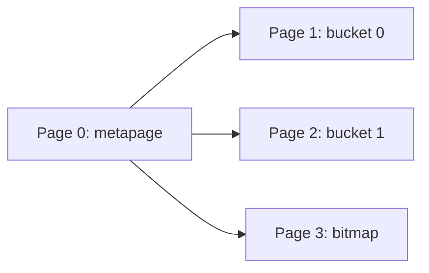
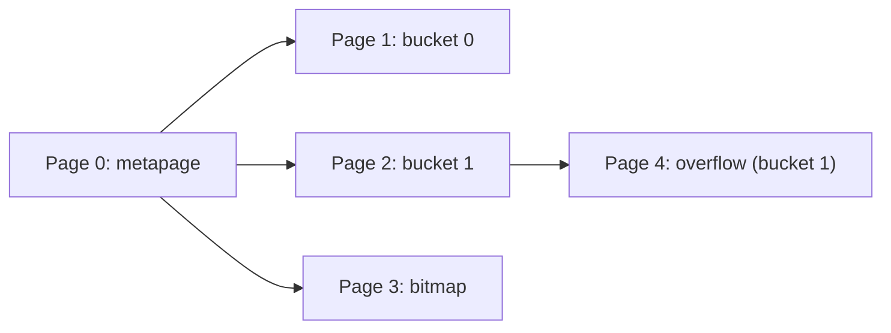
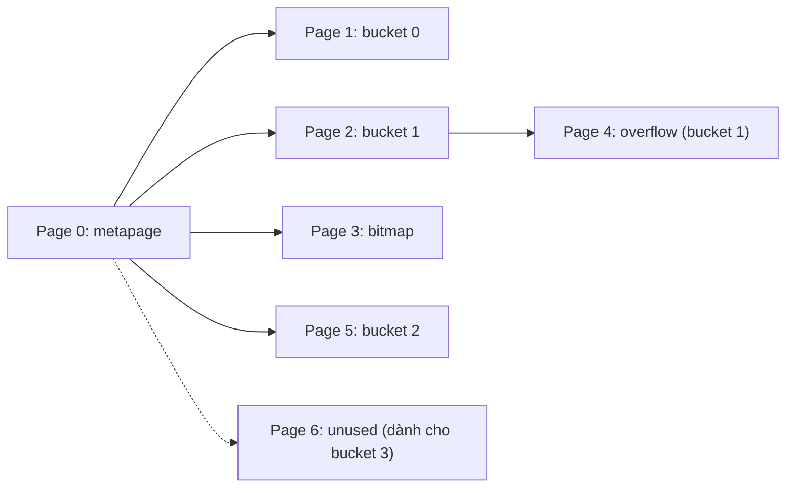

# Phần V: Các loại chỉ mục (Part V: Types of Indexes)

# CHƯƠNG 24: Chỉ mục Hash (Chapter 24: Hash)

## 24.1 Tổng quan (24.1 Overview)

Chỉ mục hash[^1] (hash index) cung cấp khả năng tìm kiếm nhanh một bộ dữ liệu (tuple) thông qua mã định danh bộ (`TID`) dựa trên một khóa chỉ mục cụ thể. Nói một cách đơn giản, nó chỉ là một bảng băm (hash table) được lưu trữ trên đĩa. Thao tác duy nhất được chỉ mục hash hỗ trợ là tìm kiếm theo điều kiện bằng (`=`).

Khi một giá trị được chèn vào chỉ mục[^2], hàm băm (hash function) của khóa chỉ mục sẽ được tính toán. Trong PostgreSQL, các hàm băm trả về số nguyên 32-bit hoặc 64-bit; một vài bit thấp nhất (lowest bits) của các giá trị này được dùng làm số hiệu của bucket tương ứng. `TID` và mã băm (hash code) của khóa sẽ được thêm vào bucket đã chọn. Bản thân khóa không được lưu trong chỉ mục vì việc xử lý các giá trị có độ dài cố định và nhỏ gọn sẽ thuận tiện hơn nhiều.

Bảng băm của chỉ mục được mở rộng động[^3]. Số lượng bucket tối thiểu là hai. Khi số lượng tuple được đánh chỉ mục tăng lên, một trong các bucket sẽ được tách (split) thành hai. Thao tác này sử dụng thêm một bit nữa của mã băm, do đó các phần tử chỉ được phân phối lại giữa hai bucket tạo thành từ phép tách; thành phần của các bucket khác trong bảng băm vẫn giữ nguyên[^4].

Thao tác tìm kiếm trên chỉ mục[^5] tính toán hàm băm của khóa chỉ mục và số hiệu bucket tương ứng. Trong toàn bộ nội dung của bucket đó, quá trình tìm kiếm sẽ chỉ trả về những `TID` tương ứng với mã băm của khóa. Vì các phần tử trong bucket được sắp xếp theo mã băm của khóa, thuật toán tìm kiếm nhị phân (binary search) có thể trả về các `TID` khớp một cách rất hiệu quả.

Do khóa thực tế không được lưu trong bảng băm, phương thức truy cập chỉ mục (index access method) có thể trả về các `TID` dư thừa vì xảy ra xung đột băm (hash collisions). Do đó, bộ máy đánh chỉ mục phải kiểm tra lại (recheck) toàn bộ các kết quả do phương thức truy cập trả về. Quét chỉ mục thuần túy (index-only scan) cũng không được hỗ trợ vì chính lý do này.

> 📝 **Giải thích thêm (không có trong sách):**
> Khi hai khóa khác nhau (ví dụ `'apple'` và `'orange'`) vô tình cho ra cùng một mã băm 32-bit (gọi là *hash collision*), chỉ mục hash không thể phân biệt chúng chỉ dựa vào mã băm lưu trong bucket. Vì vậy PostgreSQL bắt buộc phải đọc trang dữ liệu thực tế (heap page) theo `TID` để kiểm tra lại xem giá trị của cột có thực sự bằng giá trị cần tìm hay không (`Recheck Cond`), và cũng không thể thực hiện `Index Only Scan` vì giá trị gốc của khóa không có mặt trong chỉ mục.

[^1]: `postgresql.org/docs/14/hash-index.html`, `backend/access/hash/README`
[^2]: `backend/access/hash/hashinsert.c`
[^3]: `backend/access/hash/hashpage.c`, hàm `_hash_expandtable`
[^4]: `backend/access/hash/hashpage.c`, hàm `_hash_getbucketbuf_from_hashkey`
[^5]: `backend/access/hash/hashsearch.c`

---

## 24.2 Cấu trúc trang (24.2 Page Layout)

Khác với bảng băm thông thường trong bộ nhớ, chỉ mục hash được lưu trữ trên đĩa. Do đó, toàn bộ dữ liệu phải được sắp xếp vào các trang (page), lý tưởng nhất là theo cách mà các thao tác chỉ mục (tìm kiếm, chèn, xóa) chỉ cần truy cập vào ít trang nhất có thể.

Một chỉ mục hash sử dụng bốn loại trang:

- **metapage** — trang số 0 đóng vai trò như "mục lục" của chỉ mục.
- **bucket pages** — các trang chính của chỉ mục, mỗi bucket có một trang chính.
- **overflow pages** — các trang bổ sung được sử dụng khi trang bucket chính không thể chứa hết toàn bộ các phần tử.
- **bitmap pages** — các trang chứa mảng bit (bit array) dùng để theo dõi các overflow page đã được giải phóng và có thể tái sử dụng.

Chúng ta có thể quan sát bên trong các trang chỉ mục (từ PostgreSQL 10) bằng tiện ích mở rộng `pageinspect`.

Hãy bắt đầu với một bảng rỗng:

```sql
=> CREATE EXTENSION pageinspect;
=> CREATE TABLE t(n integer);
=> ANALYZE t;
=> CREATE INDEX ON t USING hash(n);
```

Tôi đã chạy `ANALYZE` trên bảng (tính năng từ PostgreSQL 14) để chỉ mục được tạo ra có kích thước nhỏ nhất có thể; nếu không, số lượng bucket sẽ được chọn dựa trên giả định rằng bảng chứa mười trang[^6].

Chỉ mục lúc này chứa bốn trang: một metapage, hai bucket page và một bitmap page (được tạo sẵn ngay từ đầu để dùng về sau):

```sql
=> SELECT page, hash_page_type(get_raw_page('t_n_idx', page))
FROM generate_series(0,3) page;
 page | hash_page_type 
------+----------------
    0 | metapage
    1 | bucket
    2 | bucket
    3 | bitmap
(4 rows)
```



Trang metapage chứa toàn bộ thông tin điều khiển về chỉ mục. Tại thời điểm này, chúng ta chỉ quan tâm đến một vài giá trị:

```sql
=> SELECT ntuples, ffactor, maxbucket
FROM hash_metapage_info(get_raw_page('t_n_idx', 0));
 ntuples | ffactor | maxbucket 
---------+---------+-----------
       0 |     307 |         1
(1 row)
```

Số lượng dòng ước tính trên mỗi bucket được hiển thị ở trường `ffactor`. Giá trị này được tính dựa trên kích thước block và giá trị tham số lưu trữ `fillfactor` (mặc định là `75`). Nếu dữ liệu phân bố hoàn toàn đồng đều và không có xung đột băm, bạn có thể dùng giá trị `fillfactor` cao hơn, nhưng trong các cơ sở dữ liệu thực tế điều đó sẽ làm tăng nguy cơ tràn trang (page overflow).

Kịch bản tệ nhất đối với chỉ mục hash là sự phân bố dữ liệu bị lệch nặng (large skew), khi một khóa được lặp lại rất nhiều lần. Vì hàm băm sẽ trả về cùng một giá trị, toàn bộ dữ liệu sẽ được đưa vào cùng một bucket, và việc tăng số lượng bucket cũng không giúp ích được gì.

Hiện tại chỉ mục đang rỗng, như thể hiện qua trường `ntuples`. Hãy gây ra hiện tượng tràn trang bucket bằng cách chèn nhiều dòng có cùng giá trị khóa chỉ mục (từ PostgreSQL 10). Một trang overflow sẽ xuất hiện trong chỉ mục:

```sql
=> INSERT INTO t(n)
SELECT 0 FROM generate_series(1,500); -- cùng một giá trị
=> SELECT page, hash_page_type(get_raw_page('t_n_idx', page))
FROM generate_series(0,4) page;
 page | hash_page_type 
------+----------------
    0 | metapage
    1 | bucket
    2 | bucket
    3 | bitmap
    4 | overflow
(5 rows)
```



Thống kê tổng hợp trên các trang cho thấy bucket 0 đang trống, trong khi toàn bộ giá trị đã được đặt vào bucket 1: một phần nằm ở trang chính, và những phần tử không chứa vừa trang chính nằm ở trang overflow:

```sql
=> SELECT page, live_items, free_size, hasho_bucket
FROM (VALUES (1), (2), (4)) p(page),
hash_page_stats(get_raw_page('t_n_idx', page));
 page | live_items | free_size | hasho_bucket 
------+------------+-----------+--------------
    1 |          0 |      8148 |            0
    2 |        407 |         8 |            1
    4 |         93 |      6288 |            1
(3 rows)
```

Rõ ràng là nếu các phần tử của cùng một bucket bị trải rộng qua nhiều trang, hiệu năng sẽ bị ảnh hưởng. Chỉ mục hash cho kết quả tốt nhất khi dữ liệu phân bố đồng đều.

Bây giờ hãy xem cách một bucket được tách (split). Điều này xảy ra khi số lượng dòng trong chỉ mục vượt quá giá trị `ffactor` ước tính cho các bucket hiện có. Ở đây chúng ta có hai bucket và `ffactor` là 307, nên việc tách bucket sẽ xảy ra khi dòng thứ 615 được chèn vào chỉ mục:

```sql
=> SELECT ntuples, ffactor, maxbucket, ovflpoint
FROM hash_metapage_info(get_raw_page('t_n_idx', 0));
 ntuples | ffactor | maxbucket | ovflpoint 
---------+---------+-----------+-----------
     500 |     307 |         1 |         1
(1 row)

=> INSERT INTO t(n)
SELECT n FROM generate_series(1,115) n; -- lúc này các giá trị khác nhau
=> SELECT ntuples, ffactor, maxbucket, ovflpoint
FROM hash_metapage_info(get_raw_page('t_n_idx', 0));
 ntuples | ffactor | maxbucket | ovflpoint 
---------+---------+-----------+-----------
     615 |     307 |         2 |         2
(1 row)
```

Giá trị `maxbucket` đã tăng lên 2: hiện tại chúng ta có ba bucket, được đánh số từ 0 đến 2. Nhưng dù mới chỉ thêm một bucket, số lượng trang bucket đã tăng gấp đôi:

```sql
=> SELECT page, hash_page_type(get_raw_page('t_n_idx', page))
FROM generate_series(0,6) page;
 page | hash_page_type 
------+----------------
    0 | metapage
    1 | bucket
    2 | bucket
    3 | bitmap
    4 | overflow
    5 | bucket
    6 | unused
(7 rows)
```



Một trong hai trang mới được dùng bởi bucket 2, trong khi trang còn lại vẫn trống (`unused`) và sẽ được dùng cho bucket 3 ngay khi nó xuất hiện:

```sql
=> SELECT page, live_items, free_size, hasho_bucket
FROM (
VALUES (1), (2), (4), (5)
) p(page),
hash_page_stats(get_raw_page('t_n_idx', page));
 page | live_items | free_size | hasho_bucket 
------+------------+-----------+--------------
    1 |         27 |      7608 |            0
    2 |        407 |         8 |            1
    4 |        158 |      4988 |            1
    5 |         23 |      7688 |            2
(4 rows)
```

Như vậy, đứng từ góc độ hệ điều hành, chỉ mục hash tăng kích thước theo từng đợt nhảy vọt (in spurts), mặc dù xét về mặt logic thì bảng băm tăng trưởng dần dần. Để làm mượt sự tăng trưởng này phần nào và tránh cấp phát quá nhiều trang cùng một lúc (từ PostgreSQL 10), kể từ lần tăng kích thước thứ mười trở đi, các trang sẽ được cấp phát thành bốn lô bằng nhau thay vì cấp phát toàn bộ một lần.

Hai trường nữa của metapage, về bản chất là các mặt nạ bit (bit masks), cung cấp thông tin chi tiết về địa chỉ bucket:

```sql
=> SELECT maxbucket, highmask::bit(4), lowmask::bit(4)
FROM hash_metapage_info(get_raw_page('t_n_idx', 0));
 maxbucket | highmask | lowmask 
-----------+----------+---------
         2 | 0011     | 0001
(1 row)
```

Số hiệu bucket được xác định bởi các bit của mã băm tương ứng với `highmask`. Nhưng nếu số hiệu bucket nhận được không tồn tại (vượt quá `maxbucket`), các bit theo `lowmask` sẽ được lấy[^7]. Trong trường hợp cụ thể này, ta lấy hai bit thấp nhất (`0011`), cho các giá trị từ 0 đến 3; nhưng nếu nhận được giá trị 3 (vượt quá `maxbucket = 2`), ta sẽ chỉ lấy một bit thấp nhất (`0001`), tức là dùng bucket 1 thay cho bucket 3.

> 💡 **Ví dụ bổ sung (không có trong sách):**
> Giả sử mã băm của một khóa kết thúc bằng `...1011` (hai bit cuối là `11` = 3).
> 1. Áp dụng `highmask = 0011`: `1011 & 0011 = 0011` (bucket 3).
> 2. Kiểm tra `3 > maxbucket` (`maxbucket = 2`) -> bucket 3 chưa được tách!
> 3. Áp dụng `lowmask = 0001`: `1011 & 0001 = 0001` (bucket 1).
> Vậy phần tử được đưa vào bucket 1. Sau này khi bucket 1 được tách thành bucket 1 và bucket 3 (`maxbucket` tăng lên 3), chỉ những phần tử có bit thứ hai là `1` trong bucket 1 mới chuyển sang bucket 3!

Mỗi lần kích thước được nhân đôi, các trang bucket mới được cấp phát thành một khối liên tục duy nhất, trong khi các trang overflow và bitmap được chèn xen vào giữa các phân đoạn này khi cần. Metapage lưu số lượng trang đã được chèn vào mỗi khối trong mảng `spares`, cho phép tính toán số hiệu trang chính của một bucket dựa trên số hiệu bucket chỉ bằng phép số học đơn giản[^8].

Trong trường hợp này, sau lần tăng đầu tiên đã có hai trang được chèn thêm (một bitmap page và một overflow page), nhưng sau lần tăng thứ hai thì chưa có trang nào được thêm vào:

```sql
=> SELECT spares[2], spares[3]
FROM hash_metapage_info(get_raw_page('t_n_idx', 0));
 spares | spares 
--------+--------
      2 |      2
(1 row)
```

Metapage cũng lưu trữ một mảng các con trỏ trỏ tới các trang bitmap:

```sql
=> SELECT mapp[1]
FROM hash_metapage_info(get_raw_page('t_n_idx', 0));
 mapp 
------
    3
(1 row)
```

Không gian bên trong các trang chỉ mục được giải phóng khi các con trỏ tới các tuple chết (dead tuples) bị xóa bỏ. Điều này diễn ra trong quá trình dọn trang (page pruning — được kích hoạt khi có một nỗ lực chèn phần tử vào một trang đã đầy hoàn toàn)[^9] hoặc khi quá trình `VACUUM` định kỳ được thực hiện.

Tuy nhiên, một chỉ mục hash không thể tự thu nhỏ kích thước: một khi đã được cấp phát, các trang chỉ mục sẽ không được trả lại cho hệ điều hành. Các trang chính được gán cố định cho bucket của chúng, ngay cả khi chúng không còn chứa bất kỳ phần tử nào; các trang overflow đã được dọn sạch sẽ được theo dõi trong bitmap và có thể được tái sử dụng (có thể bởi một bucket khác). Cách duy nhất để giảm kích thước vật lý của chỉ mục là xây dựng lại nó bằng lệnh `REINDEX` hoặc `VACUUM FULL`.

Kế hoạch truy vấn (query plan) không thể hiện loại chỉ mục được sử dụng:

```sql
=> CREATE INDEX ON flights USING hash(flight_no);
=> EXPLAIN (costs off)
SELECT *
FROM flights
WHERE flight_no = 'PG0001';
                    QUERY PLAN                     
---------------------------------------------------
 Bitmap Heap Scan on flights
   Recheck Cond: (flight_no = 'PG0001'::bpchar)
   ->  Bitmap Index Scan on flights_flight_no_idx
         Index Cond: (flight_no = 'PG0001'::bpchar)
(4 rows)
```

[^6]: `backend/access/table/tableam.c`, hàm `table_block_relation_estimate_size`
[^7]: `backend/access/hash/hashutil.c`, hàm `_hash_hashkey2bucket`
[^8]: `include/access/hash.h`, macro `BUCKET_TO_BLKNO`
[^9]: `backend/access/hash/hashinsert.c`, hàm `_hash_vacuum_one_page`

---

## 24.3 Lớp toán tử (24.3 Operator Class)

Trước PostgreSQL 10, các chỉ mục hash không được ghi nhật ký (unlogged — tức không có WAL), nghĩa là chúng không được bảo vệ trước sự cố và cũng không được nhân bản (replicated), do đó không được khuyến nghị sử dụng. Nhưng ngay cả khi đó, chúng vẫn có giá trị riêng. Lý do là thuật toán băm được sử dụng rộng rãi (đặc biệt là để thực hiện hash join và phép gom nhóm — grouping), và hệ thống phải biết hàm băm nào có thể dùng cho một kiểu dữ liệu nhất định. Tuy nhiên, sự tương ứng này không phải là tĩnh: nó không thể được định nghĩa cố định một lần cho tất cả vì PostgreSQL cho phép thêm các kiểu dữ liệu mới ngay khi hệ thống đang vận hành. Do đó, mối liên hệ này được duy trì bởi lớp toán tử (operator class) của chỉ mục hash và kiểu dữ liệu cụ thể. Bản thân hàm băm được biểu diễn bởi hàm hỗ trợ (support function) của lớp toán tử:

```sql
=> SELECT opfname AS opfamily_name,
  amproc::regproc AS opfamily_procedure
FROM pg_am am
  JOIN pg_opfamily opf ON opfmethod = am.oid
  JOIN pg_amproc amproc ON amprocfamily = opf.oid
WHERE amname = 'hash'
  AND amprocnum = 1
ORDER BY opfamily_name, opfamily_procedure;
   opfamily_name    | opfamily_procedure 
--------------------+--------------------
 aclitem_ops        | hash_aclitem
 array_ops          | hash_array
 bool_ops           | hashchar
 bpchar_ops         | hashbpchar
...
 timetz_ops         | timetz_hash
 uuid_ops           | uuid_hash
 xid8_ops           | hashint8
 xid_ops            | hashint4
(38 rows)
```

Các hàm này trả về số nguyên 32-bit. Mặc dù không được đưa vào tài liệu chính thức, chúng vẫn có thể được dùng để tính toán mã băm cho một giá trị thuộc kiểu dữ liệu tương ứng.

Ví dụ, họ toán tử `text_ops` sử dụng hàm `hashtext`:

```sql
=> SELECT hashtext('one'), hashtext('two');
  hashtext  |  hashtext  
------------+------------
 1793019229 | 1590507854
(1 row)
```

Lớp toán tử của chỉ mục hash chỉ cung cấp duy nhất toán tử bằng (`=`):

```sql
=> SELECT opfname AS opfamily_name,
  left(amopopr::regoperator::text, 20) AS opfamily_operator
FROM pg_am am
  JOIN pg_opfamily opf ON opfmethod = am.oid
  JOIN pg_amop amop ON amopfamily = opf.oid
WHERE amname = 'hash'
ORDER BY opfamily_name, opfamily_operator;
   opfamily_name    |    opfamily_operator    
--------------------+-------------------------
 aclitem_ops        | =(aclitem,aclitem)
 array_ops          | =(anyarray,anyarray)
 bool_ops           | =(boolean,boolean)
 bpchar_ops         | =(character,character)
...
 uuid_ops           | =(uuid,uuid)
 xid8_ops           | =(xid8,xid8)
 xid_ops            | =(xid,xid)
(48 rows)
```

---

## 24.4 Các thuộc tính (24.4 Properties)

Hãy cùng xem xét các thuộc tính ở mức chỉ mục mà phương thức truy cập hash cung cấp cho hệ thống.

### Thuộc tính phương thức truy cập (Access Method Properties)

```sql
=> SELECT a.amname, p.name, pg_indexam_has_property(a.oid, p.name)
FROM pg_am a, unnest(array[
  'can_order', 'can_unique', 'can_multi_col',
  'can_exclude', 'can_include'
]) p(name)
WHERE a.amname = 'hash';
 amname |     name      | pg_indexam_has_property 
--------+---------------+-------------------------
 hash   | can_order     | f
 hash   | can_unique    | f
 hash   | can_multi_col | f
 hash   | can_exclude   | t
 hash   | can_include   | f
(5 rows)
```

Rõ ràng là chỉ mục hash không thể dùng để sắp xếp các dòng: hàm băm trộn dữ liệu một cách gần như ngẫu nhiên.

Các ràng buộc duy nhất (`UNIQUE` constraints) cũng không được hỗ trợ. Tuy nhiên, chỉ mục hash có thể thực thi các ràng buộc loại trừ (`EXCLUDE` constraints), và vì hàm duy nhất được hỗ trợ là phép bằng (`=`), ràng buộc loại trừ này đạt được ý nghĩa tương đương với tính duy nhất:

```sql
=> ALTER TABLE aircrafts_data
  ADD CONSTRAINT unique_range EXCLUDE USING hash(range WITH =);
=> INSERT INTO aircrafts_data
  VALUES ('744','{"ru": "Boeing 747-400"}',11100);
ERROR:  conflicting key value violates exclusion constraint "unique_range"
DETAIL:  Key (range)=(11100) conflicts with existing key (range)=(11100).
```

Chỉ mục nhiều cột (multicolumn indexes) và các cột bổ sung `INCLUDE` cũng không được hỗ trợ.

### Thuộc tính mức chỉ mục (Index-Level Properties)

```sql
=> SELECT p.name, pg_index_has_property('flights_flight_no_idx', p.name)
FROM unnest(array[
  'clusterable', 'index_scan', 'bitmap_scan', 'backward_scan'
]) p(name);
     name      | pg_index_has_property 
---------------+-----------------------
 clusterable   | f
 index_scan    | t
 bitmap_scan   | t
 backward_scan | t
(4 rows)
```

Chỉ mục hash hỗ trợ cả quét chỉ mục thông thường (`index scan`) và quét bitmap (`bitmap scan`).

Việc phân cụm bảng (`CLUSTER`) theo chỉ mục hash không được hỗ trợ. Điều này hoàn toàn hợp lý, vì thật khó tưởng tượng tại sao lại cần sắp xếp vật lý dữ liệu heap dựa trên giá trị của hàm băm.

### Thuộc tính mức cột (Column-Level Properties)

Các thuộc tính mức cột về cơ bản được định nghĩa bởi phương thức truy cập chỉ mục và luôn nhận cùng một bộ giá trị:

```sql
=> SELECT p.name,
  pg_index_column_has_property('flights_flight_no_idx', 1, p.name)
FROM unnest(array[
  'asc', 'desc', 'nulls_first', 'nulls_last', 'orderable',
  'distance_orderable', 'returnable', 'search_array', 'search_nulls'
]) p(name);
        name        | pg_index_column_has_property 
--------------------+------------------------------
 asc                | f
 desc               | f
 nulls_first        | f
 nulls_last         | f
 orderable          | f
 distance_orderable | f
 returnable         | f
 search_array       | f
 search_nulls       | f
(9 rows)
```

Vì hàm băm không bảo toàn thứ tự của các giá trị, mọi thuộc tính liên quan đến sắp xếp đều không áp dụng được cho chỉ mục hash.

Chỉ mục hash không thể tham gia vào quét chỉ mục thuần túy (`index-only scan`), do nó không lưu trữ khóa chỉ mục mà bắt buộc phải truy cập heap.

Chỉ mục hash không hỗ trợ các giá trị `NULL`, vì phép toán bằng (`=`) không áp dụng được cho `NULL`.

Tìm kiếm phần tử trong mảng (`search_array`, ví dụ `col = ANY(...)`) cũng không được triển khai.

> 💡 **Ví dụ bổ sung (không có trong sách):**
> Khi nào nên cân nhắc dùng chỉ mục Hash thay cho B-tree?
> - Khi cột có giá trị chuỗi rất dài (như URL, chuỗi JSON hoặc mã hash dài) và bạn chỉ truy vấn bằng `WHERE col = '...'`: chỉ mục hash chỉ lưu mã băm 4 byte + TID nên kích thước nhỏ hơn đáng kể so với B-tree lưu toàn bộ chuỗi khóa.
> - Tuy nhiên, cần lưu ý nhược điểm: không hỗ trợ `UNIQUE` trực tiếp (dù có thể dùng `EXCLUDE`), không hỗ trợ `IS NULL`, không hỗ trợ `Index-Only Scan`, không hỗ trợ nhiều cột và không hỗ trợ truy vấn khoảng (`<`, `>`, `BETWEEN`).

---

## Bảng thuật ngữ chương (Chapter Glossary)

| Thuật ngữ (English) | Tiếng Việt | Giải thích ngắn gọn |
|---|---|---|
| Hash index | Chỉ mục hash | Chỉ mục hoạt động như bảng băm lưu trên đĩa, chỉ hỗ trợ tìm kiếm theo phép bằng (`=`). |
| Bucket | Bucket (ngăn chứa) | Đơn vị lưu trữ chính trong chỉ mục hash, chứa các cặp (mã băm, TID) có cùng các bit thấp của mã băm. |
| Hash collision | Xung đột băm | Hiện tượng hai giá trị khóa khác nhau tạo ra cùng một mã băm. |
| Metapage | Trang meta | Trang số 0 của chỉ mục hash, lưu siêu dữ liệu điều khiển như `ntuples`, `ffactor`, `maxbucket`, `highmask`, `lowmask`, `spares`, `mapp`. |
| Overflow page | Trang tràn | Trang bổ sung được cấp phát khi trang chính của một bucket không đủ chỗ chứa các phần tử. |
| Bitmap page | Trang bitmap | Trang chứa mảng bit dùng để theo dõi các overflow page đã được giải phóng để tái sử dụng. |
| Bucket split | Tách bucket | Quá trình chia một bucket thành hai khi số dòng vượt ngưỡng `ffactor`, dùng thêm một bit của mã băm. |
| Fill factor (`ffactor`) | Hệ số điền đầy | Số lượng dòng ước tính trên mỗi bucket (mặc định tính theo `fillfactor = 75` của chỉ mục hash). |
| Bit mask (`highmask` / `lowmask`) | Mặt nạ bit | Giá trị nhị phân dùng để trích xuất các bit thấp nhất của mã băm nhằm xác định số hiệu bucket. |
| Page pruning | Dọn trang | Thao tác dọn dẹp các con trỏ tới dead tuple trên trang chỉ mục khi trang bị đầy lúc chèn dữ liệu. |
| Operator class | Lớp toán tử | Cấu trúc ánh xạ kiểu dữ liệu với hàm băm hỗ trợ và toán tử bằng (`=`) mà chỉ mục hash sử dụng. |
| Exclusion constraint | Ràng buộc loại trừ | Ràng buộc `EXCLUDE USING hash(col WITH =)` cho phép mô phỏng tính duy nhất trên chỉ mục hash. |
