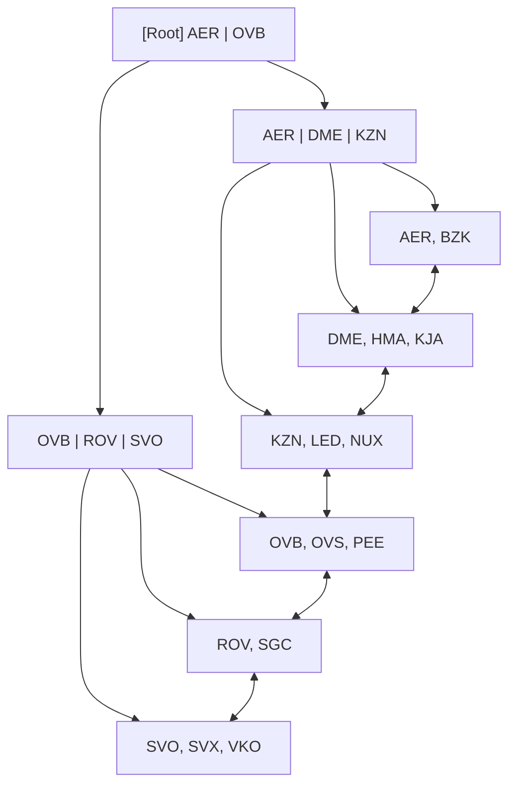
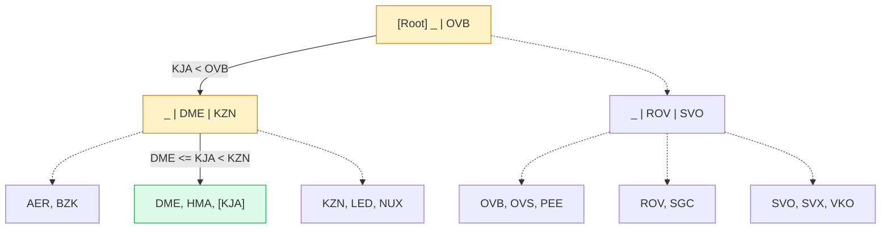
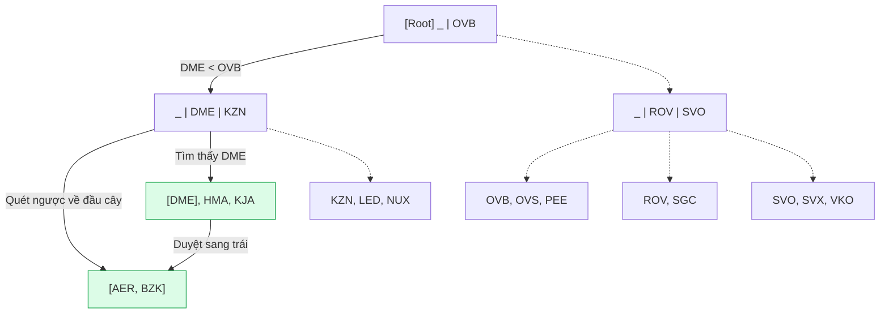
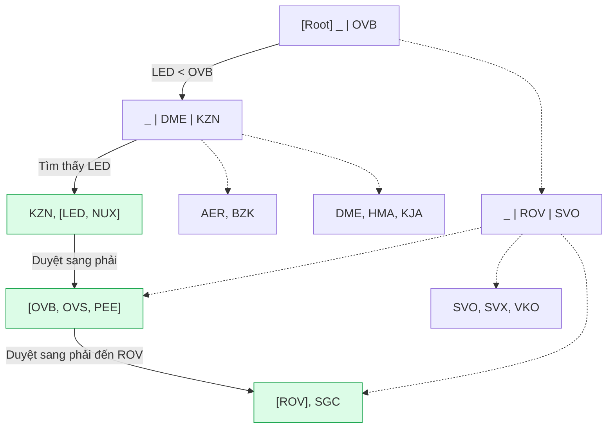
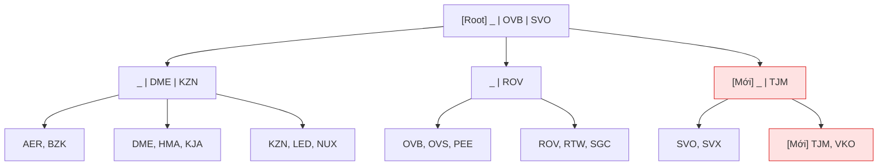
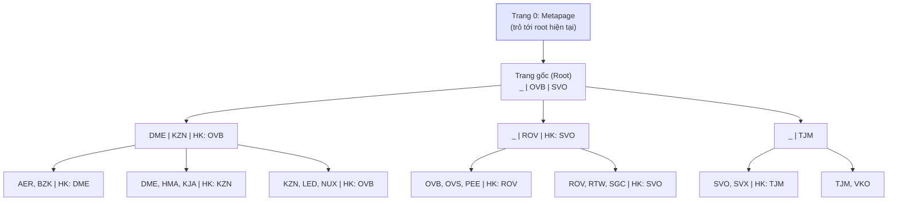

# CHƯƠNG 25: B-tree (25 B-tree)

## 25.1 Tổng quan (25.1 Overview)

**B-tree** (được triển khai dưới dạng phương thức truy cập `btree`) là một cấu trúc dữ liệu cho phép bạn nhanh chóng tìm thấy phần tử cần thiết trong các nút lá (leaf node) của cây bằng cách đi xuống từ nút gốc (root).[^1] Để đường dẫn tìm kiếm có thể được xác định một cách không mơ hồ, tất cả các phần tử của cây phải được sắp xếp có thứ tự. B-tree được thiết kế cho các kiểu dữ liệu có thứ tự (ordinal data types), tức là những kiểu mà giá trị của chúng có thể so sánh và sắp xếp được.

Sơ đồ minh họa dưới đây mô tả một chỉ mục được xây dựng trên mã sân bay, trong đó các nút bên trong (inner node) là các hình chữ nhật nằm ngang; các nút lá được căn theo chiều dọc.



Mỗi nút của cây chứa nhiều phần tử, bao gồm một khóa chỉ mục (index key) và một con trỏ (pointer). Các phần tử ở nút bên trong tham chiếu đến các nút ở tầng tiếp theo; các phần tử ở nút lá tham chiếu đến các bộ dữ liệu trong heap (heap tuples) — hình minh họa không thể hiện các tham chiếu này.

B-tree có các tính chất quan trọng sau:

* **Chúng cân bằng (balanced)**, nghĩa là tất cả các nút lá của cây đều nằm ở cùng một độ sâu. Do đó, chúng đảm bảo thời gian tìm kiếm như nhau cho mọi giá trị.
* **Chúng có rất nhiều nhánh (plenty of branches)**, tức là mỗi nút chứa rất nhiều phần tử, thường lên đến hàng trăm phần tử (hình minh họa chỉ hiển thị các nút ba phần tử để dễ quan sát). Nhờ vậy, độ sâu của B-tree luôn nhỏ, ngay cả đối với các bảng rất lớn.

> Chúng ta không thể khẳng định chắc chắn tuyệt đối chữ **B** trong tên gọi của cấu trúc này viết tắt cho từ gì. Cả *balanced* (cân bằng) và *bushy* (rậm rạp/nhiều nhánh) đều phù hợp như nhau. Đáng ngạc nhiên là bạn vẫn thường thấy nó được diễn giải là *binary* (nhị phân), điều này chắc chắn là không chính xác.

* **Dữ liệu trong chỉ mục được sắp xếp** theo thứ tự tăng dần hoặc giảm dần, cả bên trong từng nút lẫn xuyên suốt tất cả các nút ở cùng một tầng. Các nút ngang hàng được liên kết với nhau thành một danh sách liên kết hai chiều (bidirectional list), vì vậy có thể lấy được một tập dữ liệu có thứ tự chỉ bằng cách quét danh sách theo chiều này hoặc chiều kia mà không cần phải bắt đầu lại từ nút gốc mỗi lần.

> 💡 **Ví dụ bổ sung (không có trong sách):** Giả sử mỗi trang 8 KB của PostgreSQL chứa được khoảng 300 khóa trong mỗi nút B-tree. Khi đó:
> - Cây độ sâu 1 (chỉ có 1 root): chứa tối đa ~300 khóa.
> - Cây độ sâu 2 (root + leaf): chứa tối đa $300 \times 300 = 90.000$ khóa.
> - Cây độ sâu 3 (root + 1 tầng inner + leaf): chứa tối đa $300^3 = 27.000.000$ khóa.
> - Cây độ sâu 4: chứa tới $300^4 = 8,1$ tỷ khóa!
>
> Nhờ hệ số phân nhánh (fan-out) lớn, ngay cả bảng có hàng trăm triệu dòng cũng chỉ cần đọc 3–4 trang chỉ mục là tới được nút lá cần tìm.

[^1]: `postgresql.org/docs/14/btree.html`, `backend/access/nbtree/README`

---

## 25.2 Tìm kiếm và Chèn dữ liệu (25.2 Search and Insertions)

### Tìm kiếm theo phép bằng (Search by Equality)

Hãy xem cách chúng ta có thể tìm kiếm một giá trị trong cây theo điều kiện `indexed-column = expression`.[^2] Chúng ta sẽ thử tìm sân bay `KJA` (Krasnoyarsk).

Quá trình tìm kiếm bắt đầu từ nút gốc, và phương thức truy cập phải xác định xem cần đi xuống nút con nào. Nó chọn khóa $K_i$ sao cho thỏa mãn điều kiện $K_i \le \text{expression} < K_{i+1}$.

Nút gốc chứa các khóa `AER` và `OVB`. Điều kiện `AER` $\le$ `KJA` $<$ `OVB` đúng, vì vậy chúng ta cần đi xuống nút con được tham chiếu bởi phần tử có khóa `AER`.

Thủ tục này được lặp lại đệ quy cho đến khi chúng ta tới được nút lá chứa `ID` bộ dữ liệu cần tìm. Trong trường hợp này, nút con thỏa mãn điều kiện `DME` $\le$ `KJA` $<$ `KZN`, nên chúng ta phải đi xuống nút lá được tham chiếu bởi phần tử có khóa `DME`.

Như bạn có thể nhận thấy, các khóa nằm ngoài cùng bên trái trong các nút bên trong của cây là dư thừa: để chọn nút con của nút gốc, chỉ cần điều kiện `KJA` $<$ `OVB` thỏa mãn là đủ. B-tree không lưu trữ những khóa như vậy, vì thế trong các hình minh họa tiếp theo, tôi sẽ để trống các phần tử tương ứng.



Phần tử cần tìm trong nút lá có thể được tìm thấy nhanh chóng bằng tìm kiếm nhị phân (binary search).

Tuy nhiên, thủ tục tìm kiếm không hề đơn giản như vẻ bề ngoài. Phải tính đến việc thứ tự sắp xếp dữ liệu trong chỉ mục có thể là tăng dần (như minh họa ở trên) hoặc giảm dần. Ngay cả một chỉ mục duy nhất (unique index) cũng có thể chứa nhiều giá trị trùng khớp (do cơ chế MVCC lưu nhiều phiên bản dòng), và tất cả chúng đều phải được trả về. Hơn nữa, có thể có quá nhiều bản sao đến mức chúng không nằm gọn trong một nút duy nhất, nên nút lá lân cận cũng phải được xử lý.

Vì một chỉ mục có thể chứa các giá trị không duy nhất, gọi thứ tự của nó là *không giảm* (non-descending) thay vì tăng dần (và *không tăng* thay vì giảm dần) sẽ chính xác hơn. Nhưng tôi sẽ dùng thuật ngữ đơn giản hơn. Ngoài ra, `ID` của bộ dữ liệu (tuple ID) cũng là một phần của khóa chỉ mục (từ PostgreSQL phiên bản 12), điều này cho phép chúng ta coi các mục chỉ mục là duy nhất ngay cả khi các giá trị thực tế giống nhau.

Bên cạnh đó, trong khi quá trình tìm kiếm đang diễn ra, các tiến trình khác có thể sửa đổi dữ liệu, các trang có thể bị tách đôi (split), và cấu trúc cây có thể thay đổi. Tất cả các thuật toán đều được thiết kế để giảm thiểu tranh chấp giữa các thao tác đồng thời này bất cứ khi nào có thể và tránh các khóa (lock) quá mức, nhưng chúng ta sẽ không đi sâu vào các chi tiết kỹ thuật đó ở đây.

[^2]: `backend/access/nbtree/nbtsearch.c`, hàm `_bt_search`

### Tìm kiếm theo bất đẳng thức (Search by Inequality)

Nếu việc tìm kiếm được thực hiện theo điều kiện `indexed-column <= expression` (hoặc `indexed-column >= expression`), trước tiên chúng ta phải tìm kiếm trong chỉ mục giá trị thỏa mãn điều kiện bằng và sau đó duyệt qua các nút lá theo hướng cần thiết cho đến khi chạm tới điểm cuối của cây.

Sơ đồ dưới đây minh họa quá trình tìm kiếm các mã sân bay nhỏ hơn hoặc bằng `DME` (Domodedovo):



Đối với các toán tử nhỏ hơn (`<`) và lớn hơn (`>`), quy trình hoàn toàn giống như vậy, ngoại trừ việc giá trị đầu tiên tìm thấy phải được loại trừ.

### Tìm kiếm theo khoảng (Search by Range)

Khi tìm kiếm theo khoảng `expression1 <= indexed-column <= expression2`, trước tiên chúng ta phải tìm `expression1` rồi duyệt các nút lá theo đúng hướng cho đến khi gặp `expression2`. Sơ đồ dưới đây minh họa quá trình tìm kiếm các mã sân bay nằm trong khoảng từ `LED` (Saint Petersburg) đến `ROV` (Rostov-on-Don), bao gồm cả hai đầu mút:



### Thao tác chèn (Insertions)

Vị trí chèn của một phần tử mới được xác định một cách duy nhất bởi thứ tự các khóa. Ví dụ, nếu bạn chèn mã sân bay `RTW` (Saratov) vào bảng, phần tử mới sẽ xuất hiện ở nút lá áp chót, nằm giữa `ROV` và `SGC`.

Nhưng điều gì xảy ra nếu nút lá không còn đủ chỗ cho phần tử mới? Ví dụ (giả sử một nút chỉ có thể chứa tối đa ba phần tử), nếu chúng ta chèn mã sân bay `TJM` (Tyumen), nút lá cuối cùng sẽ bị quá tải. Trong trường hợp này, nút đó được tách đôi (split) thành hai nút, một số phần tử của nút cũ được chuyển sang nút mới, và một con trỏ tới nút con mới được thêm vào nút cha. Rõ ràng là nút cha cũng có thể bị quá tải theo. Khi đó nó cũng lại bị tách đôi, và cứ tiếp tục như vậy. Nếu việc tách lan đến tận nút gốc, một nút nữa sẽ được tạo phía trên hai nút kết quả để trở thành nút gốc mới của cây. Độ sâu của cây tăng thêm một tầng trong trường hợp này.

Trong ví dụ này, việc chèn sân bay `TJM` dẫn đến hai lần tách nút; các nút mới được tạo ra được làm nổi bật trong sơ đồ dưới đây. Để đảm bảo bất kỳ nút nào cũng có thể tách được, một danh sách liên kết hai chiều liên kết các nút ở tất cả các tầng, chứ không chỉ riêng các nút ở tầng thấp nhất.



Quy trình chèn và tách nút được mô tả đảm bảo rằng cây luôn cân bằng, và vì số lượng phần tử mà một nút có thể chứa thường khá lớn nên độ sâu của cây hiếm khi tăng lên.

Vấn đề là một khi đã tách, các nút không bao giờ có thể gộp lại với nhau (merge), ngay cả khi chúng chứa rất ít phần tử sau khi vacuum. Hạn chế này không thuộc về bản thân cấu trúc dữ liệu B-tree, mà là do cách triển khai trong PostgreSQL. Vì vậy, nếu nút bị đầy khi có một thao tác chèn, phương thức truy cập trước hết sẽ cố gắng dọn tỉa (prune) dữ liệu dư thừa để giải phóng bớt chỗ trống và tránh một lần tách trang không cần thiết.

> 📝 **Giải thích thêm (không có trong sách):** Khi dữ liệu trong bảng bị xóa nhiều, một số trang lá B-tree có thể trở nên hoàn toàn trống rỗng. PostgreSQL không gộp hai trang nửa trống lại, nhưng quá trình `VACUUM` có thể thu hồi các trang *hoàn toàn trống* (empty pages) và đưa chúng vào Free Space Map (FSM) để tái sử dụng cho các lần tách trang sau này.

---

## 25.3 Bố cục trang (25.3 Page Layout)

Mỗi nút của một B-tree chiếm một trang (page). Kích thước của trang quyết định sức chứa của nút.

Do hiện tượng tách trang, nút gốc của cây có thể được đại diện bởi các trang khác nhau vào những thời điểm khác nhau. Nhưng thuật toán tìm kiếm luôn phải bắt đầu quét từ nút gốc. Nó tìm `ID` của trang gốc hiện tại trong trang chỉ mục số 0 (được gọi là **metapage**). Metapage cũng chứa một số siêu dữ liệu (metadata) khác.



Bố cục dữ liệu trong các trang chỉ mục hơi khác so với những gì chúng ta vừa thấy. Tất cả các trang, ngoại trừ các trang nằm ngoài cùng bên phải ở mỗi tầng, đều chứa một **"high key"** (khóa cận trên), được đảm bảo không nhỏ hơn bất kỳ khóa nào trong trang này. Trong sơ đồ trên, các high key được ký hiệu là `HK`.

Hãy sử dụng phần mở rộng `pageinspect` để xem xét một trang của chỉ mục thực tế được xây dựng trên mã đặt chỗ (booking reference) gồm sáu ký tự. Metapage liệt kê `ID` của trang gốc và độ sâu của cây (việc đánh số tầng bắt đầu từ các nút lá và tính từ 0):

```sql
=> SELECT root, level
FROM bt_metap('bookings_pkey');
```
```
 root | level 
------+-------
  290 |     2
(1 row)
```

Các khóa được lưu trong các mục chỉ mục (index entries) được hiển thị dưới dạng chuỗi byte, điều này không thực sự tiện lợi cho việc đọc:

```sql
=> SELECT data
FROM bt_page_items('bookings_pkey',290)
WHERE itemoffset = 2;
```
```
           data           
--------------------------
 0f 30 43 39 41 42 31 00 
(1 row)
```

Để giải mã các giá trị này, chúng ta sẽ phải viết một hàm tạm thời (adhoc function). Nó sẽ không hỗ trợ mọi nền tảng và có thể không hoạt động cho một số kịch bản đặc thù, nhưng đủ dùng cho các ví dụ trong chương này:

```sql
=> CREATE FUNCTION data_to_text(data text)
RETURNS text
AS $$
DECLARE
  raw bytea := ('\x'||replace(data,' ',''))::bytea;
  pos integer := 0;
  len integer;
  res text := '';
BEGIN
  WHILE (octet_length(raw) > pos)
  LOOP
    len := (get_byte(raw,pos) - 3) / 2;
    EXIT WHEN len <= 0;
    IF pos > 0 THEN
      res := res || ', ';
    END IF;
    res := res || (
      SELECT string_agg( chr(get_byte(raw, i)),'')
      FROM generate_series(pos+1,pos+len) i
    );
    pos := pos + len + 1;
  END LOOP;
  RETURN res;
END;
$$ LANGUAGE plpgsql;
```

Bây giờ chúng ta có thể xem nội dung của trang gốc:

```sql
=> SELECT itemoffset, ctid, data_to_text(data)
FROM bt_page_items('bookings_pkey',290);
```
```
 itemoffset |   ctid   | data_to_text 
------------+----------+--------------
          1 | (3,0)    | 
          2 | (289,1)  | 0C9AB1
          3 | (575,1)  | 192F03
          4 | (860,1)  | 25D715
          5 | (1145,1) | 32785C
...
         17 | (4565,1) | C993F6
         18 | (4850,1) | D63931
         19 | (5135,1) | E2CB14
         20 | (5420,1) | EF6FEA
         21 | (5705,1) | FC147D
(21 rows)
```

Như tôi đã nói, mục đầu tiên không chứa khóa. Cột `ctid` cung cấp các liên kết tới các trang con.

Giả sử chúng ta đang tìm kiếm mã đặt chỗ `E2D725`. Trong trường hợp này, chúng ta phải chọn mục `19` (vì `E2CB14 <= E2D725 < EF6FEA`) và đi xuống trang `5135`.

```sql
=> SELECT itemoffset, ctid, data_to_text(data)
FROM bt_page_items('bookings_pkey',5135);
```
```
 itemoffset |   ctid   | data_to_text 
------------+----------+--------------
          1 | (5417,1) | EF6FEA
          2 | (5132,0) | 
          3 | (5133,1) | E2D71D
          4 | (5134,1) | E2E2F4
          5 | (5136,1) | E2EDE7
...
        282 | (5413,1) | EF41BE
        283 | (5414,1) | EF4D69
        284 | (5415,1) | EF58D4
        285 | (5416,1) | EF6410
(285 rows)
```

Mục đầu tiên trong trang này chứa **high key**, điều này thoạt nhìn có vẻ hơi bất ngờ. Về mặt logic, nó nên được đặt ở cuối trang, nhưng xét về góc độ triển khai thì việc đặt nó ở đầu trang tiện lợi hơn để tránh phải di chuyển nó mỗi khi nội dung trang thay đổi.

Ở đây chúng ta chọn mục `3` (vì `E2D71D <= E2D725 < E2E2F4`) và đi xuống trang `5133`:

```sql
=> SELECT itemoffset, ctid, data_to_text(data)
FROM bt_page_items('bookings_pkey',5133);
```
```
 itemoffset |   ctid    | data_to_text 
------------+-----------+--------------
          1 | (11921,1) | E2E2F4
          2 | (11919,76)| E2D71D
          3 | (11919,77)| E2D725
          4 | (11919,78)| E2D72D
          5 | (11919,79)| E2D733
...
        363 | (11921,123)| E2E2C9
        364 | (11921,124)| E2E2DB
        365 | (11921,125)| E2E2DF
        366 | (11921,126)| E2E2E5
        367 | (11921,127)| E2E2ED
(367 rows)
```

Đây là một trang lá của chỉ mục. Mục đầu tiên là high key; tất cả các mục khác trỏ tới các bộ dữ liệu trong heap.

Và đây là đặt chỗ của chúng ta:

```sql
=> SELECT * FROM bookings
WHERE ctid = '(11919,77)';
```
```
 book_ref |       book_date        | total_amount 
----------+------------------------+--------------
 E2D725   | 2017-01-25 04:10:00+03 |     28000.00
(1 row)
```

Đây đại khái là những gì diễn ra ở tầng thấp khi chúng ta tìm kiếm một đặt chỗ theo mã của nó:

```sql
=> EXPLAIN (costs off)
SELECT * FROM bookings
WHERE book_ref = 'E2D725';
```
```
                  QUERY PLAN                   
-----------------------------------------------
 Index Scan using bookings_pkey on bookings
   Index Cond: (book_ref = 'E2D725'::bpchar)
(2 rows)
```

### Khử trùng lặp (Deduplication)

*(Từ PostgreSQL phiên bản 13)*

Các chỉ mục không duy nhất (non-unique indexes) có thể chứa rất nhiều khóa trùng lặp trỏ tới các bộ dữ liệu heap khác nhau. Vì các khóa không duy nhất xuất hiện nhiều hơn một lần và do đó chiếm nhiều không gian, các bản sao được gộp lại thành một mục chỉ mục duy nhất, chứa khóa và danh sách các `ID` bộ dữ liệu tương ứng.[^3] Trong một số trường hợp, thủ tục này (được gọi là **khử trùng lặp** — deduplication) có thể làm giảm đáng kể kích thước chỉ mục.

Tuy nhiên, các chỉ mục duy nhất cũng có thể chứa các bản sao do **MVCC**: một chỉ mục lưu giữ tham chiếu đến tất cả các phiên bản của các dòng trong bảng. Cơ chế cập nhật **HOT** (Heap-Only Tuples) có thể giúp bạn chống lại hiện tượng phình to chỉ mục (index bloating) do việc tham chiếu tới các phiên bản dòng lỗi thời và thường tồn tại ngắn ngủi, nhưng đôi khi nó không áp dụng được. Trong trường hợp này, khử trùng lặp có thể giúp câu thêm thời gian cần thiết để vacuum các bộ dữ liệu heap dư thừa và ngăn chặn các lần tách trang không đáng có.

Để tránh lãng phí tài nguyên cho việc khử trùng lặp khi nó không mang lại lợi ích tức thì, việc gộp nhóm chỉ được thực hiện nếu trang lá không còn đủ chỗ để chứa thêm một bộ dữ liệu nữa.[^4] Khi đó, việc dọn tỉa trang (page pruning) và khử trùng lặp[^5] có thể giải phóng bớt không gian và ngăn chặn một lần tách trang ngoài ý muốn. Tuy nhiên, nếu các bản sao hiếm khi xảy ra, bạn có thể tắt tính năng khử trùng lặp bằng cách tắt tham số lưu trữ `deduplicate_items`.

Một số chỉ mục không hỗ trợ khử trùng lặp. Hạn chế chính là sự bằng nhau của các khóa phải được kiểm tra bằng phép so sánh nhị phân đơn giản trên biểu diễn bên trong của chúng. Không phải kiểu dữ liệu nào cũng có thể so sánh theo cách này. Chẳng hạn, các số dấu phẩy động (`float` và `double precision`) có hai biểu diễn khác nhau cho số 0. Các số có độ chính xác tùy ý (`numeric`) có thể biểu diễn cùng một số ở các thang đo (scale) khác nhau, và kiểu `jsonb` có thể sử dụng các số như vậy. Khử trùng lặp cũng không thể thực hiện cho các kiểu văn bản nếu bạn sử dụng các bộ quy tắc đối chiếu không tất định (nondeterministic collations),[^6] vốn cho phép cùng một ký hiệu được biểu diễn bởi các chuỗi byte khác nhau (các bộ quy tắc đối chiếu tiêu chuẩn là tất định).

Ngoài ra, khử trùng lặp hiện không được hỗ trợ cho các kiểu phức hợp (composite types), kiểu khoảng (ranges), và mảng (arrays), cũng như cho các chỉ mục được khai báo với mệnh đề `INCLUDE`.

Để kiểm tra xem một chỉ mục cụ thể có thể sử dụng khử trùng lặp hay không, bạn có thể xem trường `allequalimage` trong metapage của nó:

```sql
=> CREATE INDEX ON tickets(book_ref);
=> SELECT allequalimage FROM bt_metap('tickets_book_ref_idx');
```
```
 allequalimage 
---------------
 t
(1 row)
```

Trong trường hợp này, khử trùng lặp được hỗ trợ. Và quả thực, chúng ta có thể thấy một trong các trang lá chứa cả những mục chỉ mục có một `ID` bộ dữ liệu duy nhất (`htid`) lẫn những mục có một danh sách các `ID` (`tids`):

```sql
=> SELECT itemoffset, htid, left(tids::text,27) tids,
  data_to_text(data) AS data
FROM bt_page_items('tickets_book_ref_idx',1)
WHERE itemoffset > 1;
```
```
 itemoffset |    htid    |            tids             |  data  
------------+------------+-----------------------------+--------
          2 | (32965,40) |                             | 000004
          3 | (47429,51) |                             | 00000F
          4 | (3648,56)  | {"(3648,56)","(3648,57)"}   | 000010
          5 | (6498,47)  |                             | 000012
...
        271 | (21492,46) |                             | 000890
        272 | (26601,57) | {"(26601,57)","(26601,58)"} | 0008AC
        273 | (25669,37) |                             | 0008B6
(272 rows)
```

[^3]: `postgresql.org/docs/14/btree-implementation.html#BTREE-DEDUPLICATION`
[^4]: `backend/access/nbtree/nbtinsert.c`, hàm `_bt_delete_or_dedup_one_page`
[^5]: `backend/access/nbtree/nbtdedup.c`, hàm `_bt_dedup_pass`
[^6]: `postgresql.org/docs/14/collation.html`

### Lưu trữ gọn cho các mục chỉ mục bên trong (Compact Storage of Inner Index Entries)

*(Từ PostgreSQL phiên bản 12)*

Khử trùng lặp cho phép chứa nhiều mục hơn trong các trang lá của chỉ mục. Nhưng dù các trang lá chiếm phần lớn dung lượng chỉ mục, việc nén dữ liệu được thực hiện trong các trang bên trong (inner pages) để ngăn chặn các lần tách trang thừa cũng quan trọng không kém, vì hiệu quả tìm kiếm phụ thuộc trực tiếp vào độ sâu của cây.

Các mục chỉ mục bên trong chứa các khóa chỉ mục, nhưng giá trị của chúng chỉ được dùng để xác định cây con cần đi xuống trong quá trình tìm kiếm. Trong các chỉ mục nhiều cột (multicolumn indexes), thường chỉ cần lấy thuộc tính khóa đầu tiên (hoặc vài thuộc tính đầu tiên) là đủ. Các thuộc tính khác có thể bị cắt bỏ để tiết kiệm không gian trong trang.

Quá trình **cắt bỏ hậu tố** (suffix truncation) như vậy xảy ra khi một trang lá bị tách và trang bên trong phải chứa thêm một con trỏ mới.[^7]

Về lý thuyết, chúng ta thậm chí có thể tiến thêm một bước nữa và chỉ giữ lại phần có ý nghĩa của thuộc tính, ví dụ vài ký tự đầu tiên của một chuỗi đủ để phân biệt giữa các cây con. Nhưng điều này hiện chưa được triển khai: một mục chỉ mục hoặc chứa toàn bộ thuộc tính hoặc loại bỏ hoàn toàn thuộc tính đó.

Ví dụ, đây là một vài mục của trang gốc thuộc một chỉ mục được xây dựng trên bảng `tickets` với các cột chứa mã đặt chỗ và tên hành khách:

```sql
=> CREATE INDEX tickets_bref_name_idx
ON tickets(book_ref, passenger_name);
=> SELECT itemoffset, ctid, data_to_text(data)
FROM bt_page_items('tickets_bref_name_idx',229)
WHERE itemoffset BETWEEN 8 AND 13;
```
```
 itemoffset |   ctid   |        data_to_text        
------------+----------+----------------------------
          8 | (1607,1) | 1A98A0
          9 | (1833,2) | 1E57D1, SVETLANA MAKSIMOVA
         10 | (2054,1) | 220797
         11 | (2282,1) | 25DB06
         12 | (2509,2) | 299FE4, YURIY AFANASEV
         13 | (2736,1) | 2D62C9
(6 rows)
```

Chúng ta có thể thấy rằng một số mục chỉ mục không có thuộc tính thứ hai.

Tất nhiên, các trang lá phải giữ lại tất cả các thuộc tính khóa và các giá trị cột `INCLUDE`, nếu có. Nếu không, sẽ không thể thực hiện quét chỉ dùng chỉ mục (index-only scans). Ngoại lệ duy nhất là các high key; chúng có thể được lưu giữ một phần (đã bị cắt bỏ hậu tố).

> 💡 **Ví dụ bổ sung (không có trong sách):** Ở mục 8 (`1A98A0`), vì mã đặt chỗ `1A98A0` đã khác biệt hoàn toàn với ranh giới của trang con bên trái và bên phải nên PostgreSQL cắt bỏ `passenger_name`. Ngược lại, ở mục 9 (`1E57D1, SVETLANA MAKSIMOVA`), mã đặt chỗ `1E57D1` xuất hiện ở cả hai trang lá liền kề (một mã đặt chỗ có nhiều hành khách), nên PostgreSQL buộc phải giữ lại cả `passenger_name` để phân định ranh giới tìm kiếm.

[^7]: `backend/access/nbtree/nbtinsert.c`, hàm `_bt_split`

---

## 25.4 Lớp toán tử (25.4 Operator Class)

### Ngữ nghĩa so sánh (Comparison Semantics)

Ngoài việc băm giá trị, hệ thống cũng phải biết cách sắp xếp thứ tự các giá trị thuộc nhiều kiểu dữ liệu khác nhau, bao gồm cả các kiểu tùy chỉnh. Điều này là không thể thiếu cho việc sắp xếp, gom nhóm (grouping), nối trộn (merge joins), và một số thao tác khác. Và cũng giống như trong trường hợp băm, các toán tử so sánh cho một kiểu dữ liệu cụ thể được định nghĩa bởi một **lớp toán tử** (operator class).[^8]

Một lớp toán tử cho phép chúng ta trừu tượng hóa khỏi các tên gọi (như `>`, `<`, `=`) và thậm chí có thể cung cấp nhiều cách khác nhau để sắp xếp các giá trị của cùng một kiểu dữ liệu.

Dưới đây là các toán tử so sánh bắt buộc phải được định nghĩa trong bất kỳ lớp toán tử nào của phương thức `btree` (minh họa cho họ `bool_ops`):

```sql
=> SELECT amopopr::regoperator AS opfamily_operator,
  amopstrategy
FROM pg_am am
  JOIN pg_opfamily opf ON opfmethod = am.oid
  JOIN pg_amop amop ON amopfamily = opf.oid
WHERE amname = 'btree'
  AND opfname = 'bool_ops'
ORDER BY amopstrategy;
```
```
  opfamily_operator  | amopstrategy 
---------------------+--------------
 <(boolean,boolean)  |            1
 <=(boolean,boolean) |            2
 =(boolean,boolean)  |            3
 >=(boolean,boolean) |            4
 >(boolean,boolean)  |            5
(5 rows)
```

Mỗi toán tử trong năm toán tử so sánh này tương ứng với một trong các chiến lược (strategies),[^9] vốn định nghĩa ngữ nghĩa của chúng:

1. nhỏ hơn
2. nhỏ hơn hoặc bằng
3. bằng
4. lớn hơn hoặc bằng
5. lớn hơn

Một lớp toán tử B-tree cũng bao gồm một số hàm hỗ trợ (support functions).[^10] Hàm đầu tiên phải trả về `1` nếu đối số thứ nhất lớn hơn đối số thứ hai, `-1` nếu nhỏ hơn đối số thứ hai, và `0` nếu hai đối số bằng nhau.

Các hàm hỗ trợ khác là tùy chọn, nhưng chúng giúp cải thiện hiệu năng của phương thức truy cập.

Để hiểu rõ hơn cơ chế này, chúng ta có thể định nghĩa một kiểu dữ liệu mới với thứ tự đối chiếu không mặc định. Tài liệu chính thức có đưa ra một ví dụ cho số phức,[^11] nhưng được viết bằng ngôn ngữ C. May mắn thay, một lớp toán tử B-tree cũng có thể được triển khai bằng các ngôn ngữ thông dịch, vì vậy tôi sẽ tận dụng điều này để tạo ra một ví dụ đơn giản nhất có thể (dù biết trước là không tối ưu về hiệu năng).

Hãy định nghĩa một kiểu phức hợp mới cho các đơn vị đo dung lượng thông tin:

```sql
=> CREATE TYPE capacity_units AS ENUM (
  'B', 'kB', 'MB', 'GB', 'TB', 'PB'
);
=> CREATE TYPE capacity AS (
  amount integer,
  unit capacity_units
);
```

Bây giờ tạo một bảng có cột thuộc kiểu mới và điền các giá trị ngẫu nhiên vào đó:

```sql
=> CREATE TABLE test AS
SELECT ( (random()*1023)::integer, u.unit )::capacity AS cap
FROM generate_series(1,100),
  unnest(enum_range(NULL::capacity_units)) AS u(unit);
```

Theo mặc định, các giá trị của kiểu phức hợp được sắp xếp theo thứ tự từ điển (lexicographical order), tức là so sánh `amount` trước rồi mới đến `unit`, điều này không giống với thứ tự tự nhiên trong trường hợp cụ thể này:

```sql
=> SELECT * FROM test ORDER BY cap;
```
```
    cap    
-----------
 (1,B)
 (3,GB)
 (4,MB)
 (9,kB)
...
 (1017,kB)
 (1017,GB)
 (1018,PB)
 (1020,MB)
(600 rows)
```

Bây giờ hãy bắt tay vào tạo lớp toán tử của chúng ta. Chúng ta sẽ bắt đầu bằng việc định nghĩa một hàm quy đổi dung lượng sang byte:

```sql
=> CREATE FUNCTION capacity_to_bytes(a capacity) RETURNS numeric
AS $$
  SELECT a.amount::numeric *
    1024::numeric ^ ( array_position(enum_range(a.unit), a.unit) - 1 );
$$ LANGUAGE sql STRICT IMMUTABLE;

=> SELECT capacity_to_bytes('(1,kB)'::capacity);
```
```
  capacity_to_bytes   
----------------------
 1024.0000000000000000
(1 row)
```

Tạo một hàm hỗ trợ cho lớp toán tử sắp tạo:

```sql
=> CREATE FUNCTION capacity_cmp(a capacity, b capacity)
RETURNS integer
AS $$
  SELECT sign(capacity_to_bytes(a) - capacity_to_bytes(b));
$$ LANGUAGE sql STRICT IMMUTABLE;
```

Bây giờ thật dễ dàng để định nghĩa các toán tử so sánh bằng hàm hỗ trợ này. Tôi cố tình dùng các tên gọi kỳ lạ để chứng minh rằng tên toán tử có thể đặt tùy ý:

```sql
=> CREATE FUNCTION capacity_lt(a capacity, b capacity) RETURNS boolean
AS $$
BEGIN
  RETURN capacity_cmp(a,b) < 0;
END;
$$ LANGUAGE plpgsql IMMUTABLE STRICT;

=> CREATE OPERATOR #<# (
  LEFTARG = capacity,
  RIGHTARG = capacity,
  FUNCTION = capacity_lt
);
```

Bốn toán tử còn lại được định nghĩa theo cách tương tự:

```sql
=> CREATE FUNCTION capacity_le(a capacity, b capacity) RETURNS boolean
AS $$
BEGIN
  RETURN capacity_cmp(a,b) <= 0;
END;
$$ LANGUAGE plpgsql IMMUTABLE STRICT;

=> CREATE OPERATOR #<=# (
  LEFTARG = capacity,
  RIGHTARG = capacity,
  FUNCTION = capacity_le
);

=> CREATE FUNCTION capacity_eq(a capacity, b capacity) RETURNS boolean
AS $$
BEGIN
  RETURN capacity_cmp(a,b) = 0;
END;
$$ LANGUAGE plpgsql IMMUTABLE STRICT;

=> CREATE OPERATOR #=# (
  LEFTARG = capacity,
  RIGHTARG = capacity,
  FUNCTION = capacity_eq,
  MERGES -- có thể dùng trong merge joins
);

=> CREATE FUNCTION capacity_ge(a capacity, b capacity) RETURNS boolean
AS $$
BEGIN
  RETURN capacity_cmp(a,b) >= 0;
END;
$$ LANGUAGE plpgsql IMMUTABLE STRICT;

=> CREATE OPERATOR #>=# (
  LEFTARG = capacity,
  RIGHTARG = capacity,
  FUNCTION = capacity_ge
);

=> CREATE FUNCTION capacity_gt(a capacity, b capacity) RETURNS boolean
AS $$
BEGIN
  RETURN capacity_cmp(a,b) > 0;
END;
$$ LANGUAGE plpgsql IMMUTABLE STRICT;

=> CREATE OPERATOR #># (
  LEFTARG = capacity,
  RIGHTARG = capacity,
  FUNCTION = capacity_gt
);
```

Ở bước này, chúng ta đã có thể so sánh các dung lượng:

```sql
=> SELECT (1,'MB')::capacity #># (512, 'kB')::capacity;
```
```
 ?column? 
----------
 t
(1 row)
```

Một khi lớp toán tử được tạo, việc sắp xếp cũng sẽ bắt đầu hoạt động như mong đợi:

```sql
=> CREATE OPERATOR CLASS capacity_ops
  DEFAULT FOR TYPE capacity -- được sử dụng làm mặc định
  USING btree AS
    OPERATOR 1 #<#,
    OPERATOR 2 #<=#,
    OPERATOR 3 #=#,
    OPERATOR 4 #>=#,
    OPERATOR 5 #>#,
    FUNCTION 1 capacity_cmp(capacity,capacity);

=> SELECT * FROM test ORDER BY cap;
```
```
    cap    
-----------
 (1,B)
 (21,B)
 (27,B)
 (35,B)
 (46,B)
 (57,B)
 (68,B)
 (70,B)
...
 (1002,PB)
 (1013,PB)
 (1014,PB)
 (1014,PB)
 (1018,PB)
(600 rows)
```

Lớp toán tử của chúng ta được sử dụng mặc định khi một chỉ mục mới được tạo, và chỉ mục này trả về kết quả theo đúng thứ tự:

```sql
=> CREATE INDEX ON test(cap);
=> SELECT * FROM test WHERE cap #<# (100,'B')::capacity ORDER BY cap;
```
```
   cap   
---------
 (1,B)
 (21,B)
 (27,B)
 (35,B)
 (46,B)
 (57,B)
 (68,B)
 (70,B)
 (72,B)
 (76,B)
 (78,B)
 (94,B)
(12 rows)
```

```sql
=> EXPLAIN (costs off) SELECT *
FROM test
WHERE cap #<# (100,'B')::capacity
ORDER BY cap;
```
```
                QUERY PLAN                 
-------------------------------------------
 Index Only Scan using test_cap_idx on test
   Index Cond: (cap #<# '(100,B)'::capacity)
(2 rows)
```

Mệnh đề `MERGES` được chỉ định trong phần khai báo toán tử bằng cho phép sử dụng phép nối trộn (merge joins) đối với kiểu dữ liệu này.

[^8]: `postgresql.org/docs/14/btree-behavior.html`
[^9]: `postgresql.org/docs/14/xindex.html#XINDEX-STRATEGIES`
[^10]: `postgresql.org/docs/14/btree-support-funcs.html`
[^11]: `postgresql.org/docs/14/xindex.html#XINDEX-EXAMPLE`

### Chỉ mục nhiều cột và Sắp xếp (Multicolumn Indexes and Sorting)

Hãy xem xét kỹ hơn về việc sắp xếp các chỉ mục nhiều cột.

Trước hết và quan trọng nhất, việc chọn thứ tự cột tối ưu khi khai báo chỉ mục là rất quan trọng: việc sắp xếp dữ liệu bên trong các trang sẽ bắt đầu bằng cột thứ nhất, sau đó chuyển sang cột thứ hai, và cứ thế tiếp tục. Các chỉ mục nhiều cột chỉ có thể đảm bảo tìm kiếm hiệu quả nếu điều kiện lọc được cung cấp bao phủ một chuỗi các cột liên tiếp bắt đầu từ cột đầu tiên: cột đầu tiên, hai cột đầu tiên, khoảng từ cột đầu tiên đến cột thứ ba, v.v. Các loại điều kiện khác chỉ có thể được sử dụng để lọc bớt các giá trị dư thừa đã được lấy lên dựa trên các tiêu chí khác.

Dưới đây là thứ tự các mục chỉ mục trong trang lá đầu tiên của chỉ mục đã được tạo trên bảng `tickets` bao gồm mã đặt chỗ và tên hành khách:

```sql
=> SELECT itemoffset, data_to_text(data)
FROM bt_page_items('tickets_bref_name_idx',1)
WHERE itemoffset > 1;
```
```
 itemoffset |         data_to_text         
------------+------------------------------
          2 | 000004, PETR MAKAROV
          3 | 00000F, ANNA ANTONOVA
          4 | 000010, ALEKSANDR SOKOLOV
          5 | 000010, LYUDMILA BOGDANOVA
          6 | 000012, TAMARA ZAYCEVA
          7 | 000026, IRINA PETROVA
          8 | 00002D, ALEKSANDR SMIRNOV
...
        188 | 00040C, ANTONINA KOROLEVA
        189 | 00040C, DMITRIY FEDOROV
        190 | 00041E, EGOR FEDOROV
        191 | 00041E, ILYA STEPANOV
        192 | 000447, VIKTOR VASILEV
        193 | 00044D, NADEZHDA KULIKOVA
(192 rows)
```

Trong trường hợp này, việc tìm kiếm vé hiệu quả chỉ khả thi khi tìm theo cả mã đặt chỗ và tên hành khách, hoặc chỉ theo mã đặt chỗ:

```sql
=> EXPLAIN (costs off) SELECT *
FROM tickets
WHERE book_ref = '000010';
```
```
                   QUERY PLAN                    
-------------------------------------------------
 Index Scan using tickets_book_ref_idx on tickets
   Index Cond: (book_ref = '000010'::bpchar)
(2 rows)
```

```sql
=> EXPLAIN (costs off) SELECT *
FROM tickets
WHERE book_ref = '000010' AND passenger_name = 'LYUDMILA BOGDANOVA';
```
```
                             QUERY PLAN                             
--------------------------------------------------------------------
 Index Scan using tickets_bref_name_idx on tickets
   Index Cond: ((book_ref = '000010'::bpchar) AND (passenger_name...
(2 rows)
```

Nhưng nếu chúng ta quyết định chỉ tìm theo tên hành khách, hệ thống phải quét toàn bộ các dòng:

```sql
=> EXPLAIN (costs off) SELECT *
FROM tickets
WHERE passenger_name = 'LYUDMILA BOGDANOVA';
```
```
                        QUERY PLAN                         
-----------------------------------------------------------
 Gather
   Workers Planned: 2
   ->  Parallel Seq Scan on tickets
         Filter: (passenger_name = 'LYUDMILA BOGDANOVA'::text)
(4 rows)
```

Ngay cả khi bộ lập kế hoạch (planner) chọn thực hiện quét chỉ mục (index scan), tất cả các mục chỉ mục vẫn sẽ phải bị duyệt qua.[^12] Đáng tiếc là kế hoạch thực thi sẽ không chỉ ra rằng điều kiện đó thực chất chỉ được dùng để lọc kết quả.

Nếu cột đầu tiên không có quá nhiều giá trị phân biệt $v_1, v_2, \dots, v_n$, có thể sẽ có lợi nếu thực hiện nhiều lượt duyệt qua các cây con tương ứng, về cơ bản là thay thế một lần tìm kiếm đơn lẻ theo điều kiện `col2 = value` bằng một chuỗi các lần tìm kiếm theo các điều kiện sau:

```
col1 = v1 AND col2 = value
col1 = v2 AND col2 = value
...
col1 = vn AND col2 = value
```

Kiểu truy cập chỉ mục này được gọi là **Skip Scan**, nhưng nó chưa được triển khai.[^13]

Và ngược lại, nếu một chỉ mục được tạo trên tên hành khách trước rồi mới đến mã đặt chỗ, nó sẽ phù hợp hơn cho các truy vấn chỉ tìm theo tên hành khách hoặc cả tên hành khách lẫn mã đặt chỗ:

```sql
=> CREATE INDEX tickets_name_bref_idx
ON tickets(passenger_name, book_ref);

=> SELECT itemoffset, data_to_text(data)
FROM bt_page_items('tickets_name_bref_idx',1)
WHERE itemoffset > 1;
```
```
 itemoffset |         data_to_text         
------------+------------------------------
          2 | ADELINA ABRAMOVA, E37EDB
          3 | ADELINA AFANASEVA, 1133B7
          4 | ADELINA AFANASEVA, 4F3370
          5 | ADELINA AKIMOVA, 7D2881
          6 | ADELINA ALEKSANDROVA, 3C3ADD
          7 | ADELINA ALEKSANDROVA, 52801E
...
        185 | ADELINA LEBEDEVA, 0A00E3
        186 | ADELINA LEBEDEVA, DAEADE
        187 | ADELINA LEBEDEVA, DFD7E5
        188 | ADELINA LOGINOVA, 8022F3
        189 | ADELINA LOGINOVA, EE67B9
        190 | ADELINA LUKYANOVA, 292786
        191 | ADELINA LUKYANOVA, 54D3F9
(190 rows)
```

```sql
=> EXPLAIN (costs off) SELECT *
FROM tickets
WHERE passenger_name = 'LYUDMILA BOGDANOVA';
```
```
                         QUERY PLAN                          
-------------------------------------------------------------
 Bitmap Heap Scan on tickets
   Recheck Cond: (passenger_name = 'LYUDMILA BOGDANOVA'::text)
   ->  Bitmap Index Scan on tickets_name_bref_idx
         Index Cond: (passenger_name = 'LYUDMILA BOGDANOVA'::text)
(4 rows)
```

Bên cạnh thứ tự cột, bạn cũng nên chú ý đến thứ tự sắp xếp khi tạo một chỉ mục mới. Theo mặc định, các giá trị được sắp xếp theo thứ tự tăng dần (`ASC`), nhưng bạn có thể đảo ngược nó (`DESC`) nếu cần. Điều này không quá quan trọng nếu chỉ mục được xây dựng trên một cột duy nhất, vì nó có thể được quét theo bất kỳ chiều nào. Nhưng trong một chỉ mục nhiều cột, thứ tự này trở nên quan trọng.

Chỉ mục mới tạo của chúng ta có thể được sử dụng để lấy dữ liệu đã sắp xếp theo cả hai cột dù ở thứ tự tăng dần hay giảm dần:

```sql
=> EXPLAIN (costs off) SELECT *
FROM tickets
ORDER BY passenger_name, book_ref;
```
```
                    QUERY PLAN                    
--------------------------------------------------
 Index Scan using tickets_name_bref_idx on tickets
(1 row)
```

```sql
=> EXPLAIN (costs off) SELECT *
FROM tickets
ORDER BY passenger_name DESC, book_ref DESC;
```
```
                        QUERY PLAN                         
-----------------------------------------------------------
 Index Scan Backward using tickets_name_bref_idx on tickets
(1 row)
```

Nhưng chỉ mục này không thể trả về dữ liệu ngay lập tức nếu dữ liệu cần được sắp xếp tăng dần theo một cột và giảm dần theo cột kia cùng một lúc. Trong trường hợp này, chỉ mục cung cấp dữ liệu đã được sắp xếp một phần và phải tiếp tục được sắp xếp thêm theo thuộc tính thứ hai (Incremental Sort):

```sql
=> EXPLAIN (costs off) SELECT *
FROM tickets
ORDER BY passenger_name ASC, book_ref DESC;
```
```
                       QUERY PLAN                        
---------------------------------------------------------
 Incremental Sort
   Sort Key: passenger_name, book_ref DESC
   Presorted Key: passenger_name
   ->  Index Scan using tickets_name_bref_idx on tickets
(4 rows)
```

Vị trí của các giá trị `NULL` cũng ảnh hưởng đến khả năng sử dụng chỉ mục để sắp xếp. Theo mặc định, các giá trị `NULL` được coi là "lớn hơn" các giá trị thông thường cho mục đích sắp xếp, tức là chúng nằm ở phía bên phải của cây nếu thứ tự sắp xếp là tăng dần và ở phía bên trái nếu thứ tự sắp xếp là giảm dần. Vị trí của các giá trị `NULL` có thể được thay đổi bằng các mệnh đề `NULLS LAST` và `NULLS FIRST`.

Trong ví dụ tiếp theo, chỉ mục không thỏa mãn mệnh đề `ORDER BY`, nên kết quả phải được sắp xếp lại:

```sql
=> EXPLAIN (costs off) SELECT *
FROM tickets
ORDER BY passenger_name NULLS FIRST, book_ref DESC;
```
```
                         QUERY PLAN                         
------------------------------------------------------------
 Gather Merge
   Workers Planned: 2
   ->  Sort
         Sort Key: passenger_name NULLS FIRST, book_ref DESC
         ->  Parallel Seq Scan on tickets
(5 rows)
```

Nhưng nếu chúng ta tạo một chỉ mục tuân theo đúng thứ tự mong muốn, nó sẽ được sử dụng:

```sql
=> CREATE INDEX tickets_name_bref_idx2
ON tickets(passenger_name NULLS FIRST, book_ref DESC);

=> EXPLAIN (costs off) SELECT *
FROM tickets
ORDER BY passenger_name NULLS FIRST, book_ref DESC;
```
```
                     QUERY PLAN                      
-----------------------------------------------------
 Index Scan using tickets_name_bref_idx2 on tickets
(1 row)
```

[^12]: `backend/access/nbtree/nbtsearch.c`, hàm `_bt_first`
[^13]: `commitfest.postgresql.org/34/1741`

---

## 25.5 Các thuộc tính (25.5 Properties)

Hãy cùng xem xét các thuộc tính giao diện (interface properties) của B-tree.

### Thuộc tính của phương thức truy cập (Access Method Properties)

```sql
=> SELECT a.amname, p.name, pg_indexam_has_property(a.oid, p.name)
FROM pg_am a, unnest(array[
  'can_order', 'can_unique', 'can_multi_col',
  'can_exclude', 'can_include'
]) p(name)
WHERE a.amname = 'btree';
```
```
 amname |     name      | pg_indexam_has_property 
--------+---------------+-------------------------
 btree  | can_order     | t
 btree  | can_unique    | t
 btree  | can_multi_col | t
 btree  | can_exclude   | t
 btree  | can_include   | t
(5 rows)
```

B-tree có thể sắp xếp dữ liệu (`can_order`) và đảm bảo tính duy nhất của dữ liệu (`can_unique`). Đây là phương thức truy cập duy nhất có những thuộc tính như vậy.

Nhiều phương thức truy cập hỗ trợ chỉ mục nhiều cột (`can_multi_col`), nhưng vì các giá trị trong B-tree có thứ tự nên bạn phải chú ý kỹ đến thứ tự của các cột trong chỉ mục.

Về mặt hình thức, các ràng buộc loại trừ (`can_exclude` — exclusion constraints) được hỗ trợ, nhưng chúng bị giới hạn ở các điều kiện bằng, điều này khiến chúng tương tự như các ràng buộc duy nhất. Việc sử dụng một ràng buộc duy nhất (unique constraint) đầy đủ sẽ được ưu tiên hơn nhiều.

Chỉ mục B-tree cũng có thể được mở rộng thêm các cột `INCLUDE` (`can_include`), vốn không tham gia vào quá trình tìm kiếm.

### Thuộc tính ở cấp độ chỉ mục (Index-Level Properties)

```sql
=> SELECT p.name, pg_index_has_property('flights_pkey', p.name)
FROM unnest(array[
  'clusterable', 'index_scan', 'bitmap_scan', 'backward_scan'
]) p(name);
```
```
     name      | pg_index_has_property 
---------------+-----------------------
 clusterable   | t
 index_scan    | t
 bitmap_scan   | t
 backward_scan | t
(4 rows)
```

Chỉ mục B-tree có thể được dùng để phân cụm lại bảng vật lý (`clusterable`, qua lệnh `CLUSTER`).

Cả quét chỉ mục (`index_scan`) lẫn quét bitmap (`bitmap_scan`) đều được hỗ trợ. Vì các trang lá được liên kết thành một danh sách liên kết hai chiều, chỉ mục cũng có thể được duyệt ngược (`backward_scan`), cho ra thứ tự sắp xếp đảo ngược:

```sql
=> EXPLAIN (costs off) SELECT *
FROM bookings ORDER BY book_ref DESC;
```
```
                     QUERY PLAN                      
-----------------------------------------------------
 Index Scan Backward using bookings_pkey on bookings
(1 row)
```

### Thuộc tính ở cấp độ cột (Column-Level Properties)

```sql
=> SELECT p.name,
  pg_index_column_has_property('flights_pkey', 1, p.name)
FROM unnest(array[
  'asc', 'desc', 'nulls_first', 'nulls_last', 'orderable',
  'distance_orderable', 'returnable', 'search_array', 'search_nulls'
]) p(name);
```
```
        name        | pg_index_column_has_property 
--------------------+------------------------------
 asc                | t
 desc               | f
 nulls_first        | f
 nulls_last         | t
 orderable          | t
 distance_orderable | f
 returnable         | t
 search_array       | t
 search_nulls       | t
(9 rows)
```

Thuộc tính `Orderable` cho biết dữ liệu lưu trong B-tree có được sắp xếp theo thứ tự, trong khi bốn thuộc tính đầu tiên (`Asc` và `Desc`, `Nulls First` và `Nulls Last`) định nghĩa thứ tự thực tế ở một cột cụ thể. Trong ví dụ này, các giá trị cột được sắp xếp tăng dần với các giá trị `NULL` nằm ở cuối.

Thuộc tính `Search Nulls` cho biết liệu có thể tìm kiếm các giá trị `NULL` hay không (ví dụ với `IS NULL`).

B-tree không hỗ trợ các toán tử sắp xếp theo khoảng cách (`Distance Orderable`, chẳng hạn tìm điểm gần nhất `<->`), mặc dù đã từng có nỗ lực để triển khai chúng.[^14]

B-tree hỗ trợ tìm kiếm nhiều phần tử trong một mảng (thuộc tính `Search Array`, ví dụ `col IN (1, 2, 3)` hay `col = ANY(...)`) và có thể trả về dữ liệu kết quả mà không cần truy cập vào heap (thuộc tính `Returnable`, tức hỗ trợ Index-Only Scan).

[^14]: `commitfest.postgresql.org/27/1804`

---

## Bảng thuật ngữ chương (Chapter Glossary)

| Thuật ngữ (English) | Tiếng Việt | Giải thích ngắn gọn |
| --- | --- | --- |
| Access method | Phương thức truy cập | Cơ chế lưu trữ và tìm kiếm dữ liệu của chỉ mục trong PostgreSQL (ví dụ `btree`, `hash`, `gin`). |
| Balanced tree | Cây cân bằng | Cây có mọi nút lá đều nằm ở cùng một độ sâu, đảm bảo thời gian tìm kiếm đồng đều. |
| Metapage | Trang siêu dữ liệu (Metapage) | Trang số 0 của tệp chỉ mục B-tree, lưu vị trí trang gốc hiện tại, độ sâu cây và các cờ như `allequalimage`. |
| High key | Khóa cận trên (High key) | Khóa ở mục đầu tiên của trang B-tree (trừ các trang ngoài cùng bên phải), đảm bảo lớn hơn hoặc bằng mọi khóa trong trang đó. |
| Page split | Tách trang | Thao tác chia một trang đầy thành hai trang khi chèn phần tử mới và đẩy khóa phân cách lên nút cha. |
| Deduplication | Khử trùng lặp | Cơ chế gộp nhiều mục chỉ mục có cùng giá trị khóa thành một mục kèm danh sách `ctid` để tiết kiệm không gian trang lá. |
| Suffix truncation | Cắt bỏ hậu tố | Cơ chế lược bỏ các cột đuôi không cần thiết trong các nút bên trong của chỉ mục nhiều cột khi tách trang. |
| Operator class | Lớp toán tử | Tập hợp các toán tử so sánh (strategy 1–5) và hàm hỗ trợ định nghĩa cách sắp xếp cho một kiểu dữ liệu trên B-tree. |
| Incremental Sort | Sắp xếp tăng dần theo phần | Phép sắp xếp tận dụng dữ liệu đã có thứ tự sẵn ở các cột đầu từ chỉ mục để chỉ sắp xếp tiếp các cột còn lại. |
| Skip Scan | Quét nhảy cóc | Kỹ thuật duyệt qua từng giá trị phân biệt của cột đầu tiên trong chỉ mục nhiều cột khi truy vấn chỉ lọc theo cột sau (chưa có trong PostgreSQL 14). |
