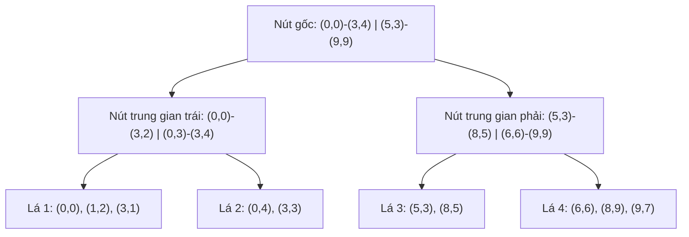
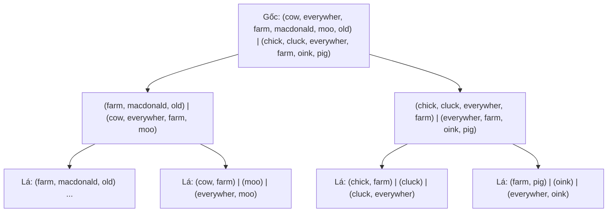
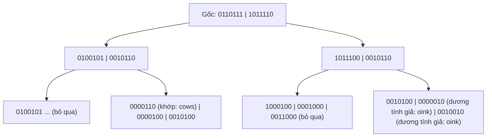

# CHƯƠNG 26: GiST (CHAPTER 26: GiST)

## 26.1 Tổng quan (26.1 Overview)

**GiST** (*Generalized Search Tree* — Cây tìm kiếm tổng quát)[^1] là một phương thức truy cập (*access method*) về cơ bản là sự tổng quát hóa của cây tìm kiếm cân bằng dành cho các kiểu dữ liệu hỗ trợ việc định vị tương đối giữa các giá trị. Phạm vi áp dụng của B-tree bị giới hạn ở các kiểu dữ liệu có thứ tự (*ordinal types*) cho phép thực hiện các phép toán so sánh (tuy nhiên sự hỗ trợ dành cho các kiểu dữ liệu này là cực kỳ hiệu quả). Đối với GiST, lớp toán tử (*operator class*) của nó cho phép định nghĩa các tiêu chí tùy ý để phân phối dữ liệu trong cây. Một chỉ mục GiST có thể chứa cây R-tree cho dữ liệu không gian, cây RD-tree cho tập hợp, và cây chữ ký (*signature tree*) cho bất kỳ kiểu dữ liệu nào (bao gồm cả văn bản và hình ảnh).

Nhờ tính mở rộng (*extensibility*), bạn có thể tạo một phương thức truy cập mới trong PostgreSQL từ đầu bằng cách triển khai giao diện của bộ máy đánh chỉ mục (*indexing engine*). Tuy nhiên, ngoài việc thiết kế logic đánh chỉ mục, bạn còn phải định nghĩa bố cục trang (*page layout*), chiến lược khóa (*locking strategy*) hiệu quả và hỗ trợ WAL (*Write-Ahead Logging*). Tất cả những điều đó đòi hỏi kỹ năng lập trình vững vàng và rất nhiều công sức triển khai. GiST đơn giản hóa nhiệm vụ này bằng cách xử lý toàn bộ các chi tiết kỹ thuật cấp thấp và cung cấp nền tảng cho thuật toán tìm kiếm. Để sử dụng phương thức GiST với một kiểu dữ liệu mới, bạn chỉ cần thêm một lớp toán tử mới bao gồm khoảng một tá hàm hỗ trợ (*support functions*). Không giống như lớp toán tử đơn giản được cung cấp cho B-tree, lớp toán tử của GiST chứa phần lớn logic đánh chỉ mục. Về khía cạnh này, GiST có thể được xem như một framework để xây dựng các phương thức truy cập mới.

Nói một cách tổng quát nhất, mỗi mục thuộc về một nút lá (*leaf entry*) chứa một vị từ (*predicate* — một điều kiện logic) và một TID của tuple trong heap. Khóa chỉ mục (*index key*) phải thỏa mãn vị từ đó; bản thân khóa có nằm trong mục này hay không không quan trọng.

Mỗi mục trong một nút trung gian (*inner entry*) cũng chứa một vị từ và một tham chiếu đến nút con (*child node*); toàn bộ dữ liệu được đánh chỉ mục của cây con (*subtree*) phía dưới phải thỏa mãn vị từ này. Nói cách khác, vị từ của một mục trung gian là phép hợp (*union*) của tất cả các vị từ thuộc các mục con của nó. Tính chất quan trọng này của GiST đóng vai trò tương tự như cách xếp hạng đơn giản được sử dụng bởi B-tree.

[^1]: `postgresql.org/docs/14/gist.html` và `backend/access/gist/README`

Quá trình tìm kiếm trên cây GiST dựa vào hàm nhất quán (*consistency function*), đây là một trong các hàm hỗ trợ được định nghĩa bởi lớp toán tử.

Hàm nhất quán được gọi trên một mục chỉ mục để xác định xem vị từ của mục này có "nhất quán" (*consistent*) với điều kiện tìm kiếm (`cột-được-đánh-chỉ-mục toán-tử biểu-thức`) hay không. Đối với mục trung gian, hàm này cho biết chúng ta có cần đi xuống cây con tương ứng hay không; đối với mục lá, hàm này kiểm tra xem khóa chỉ mục của nó có thỏa mãn điều kiện hay không.

Quá trình tìm kiếm bắt đầu từ nút gốc (*root node*),[^2] điều này là điển hình của việc tìm kiếm trên cây. Hàm nhất quán xác định những nút con nào phải được duyệt qua và những nút nào có thể bỏ qua. Sau đó, quy trình này được lặp lại cho từng nút con được tìm thấy; không giống như B-tree, một chỉ mục GiST có thể có nhiều nút con như vậy. Các mục ở nút lá được chọn bởi hàm nhất quán sẽ được trả về làm kết quả.

Quá trình tìm kiếm luôn theo chiều sâu trước (*depth-first*): thuật toán cố gắng đi đến một trang lá (*leaf page*) nhanh nhất có thể. Do đó, nó có thể bắt đầu trả về kết quả ngay lập tức, điều này rất hữu ích nếu người dùng chỉ cần lấy vài dòng đầu tiên.

Để chèn một giá trị mới vào cây GiST, không thể sử dụng hàm nhất quán, vì chúng ta cần chọn chính xác một nút để đi xuống.[^3] Nút này phải có chi phí chèn (*insert cost*) nhỏ nhất; chi phí này được xác định bởi hàm phạt (*penalty function*) của lớp toán tử.

Giống như trong trường hợp của B-tree, nút được chọn có thể không còn chỗ trống, dẫn đến việc tách trang (*split*).[^4] Thao tác này cần thêm hai hàm nữa. Một hàm phân phối các mục giữa nút cũ và nút mới; hàm còn lại tạo phép hợp của hai vị từ để cập nhật vị từ của nút cha.

Khi các giá trị mới được thêm vào, các vị từ hiện có sẽ mở rộng ra, và chúng thường chỉ được thu hẹp lại nếu trang bị tách hoặc toàn bộ chỉ mục được xây dựng lại. Vì vậy, việc cập nhật thường xuyên một chỉ mục GiST có thể dẫn đến suy giảm hiệu năng của nó.

Vì tất cả những thảo luận lý thuyết này có vẻ hơi mơ hồ, và logic chính xác chủ yếu phụ thuộc vào từng lớp toán tử cụ thể, tôi sẽ trình bày một vài ví dụ cụ thể.

[^2]: `backend/access/gist/gistget.c`, hàm `gistgettuple`
[^3]: `backend/access/gist/gistutil.c`, hàm `gistchoose`
[^4]: `backend/access/gist/gistsplit.c`, hàm `gistSplitByKey`

> 📝 **Giải thích thêm (không có trong sách):**
> Tại sao nói GiST giống một *framework* hơn là một cấu trúc chỉ mục cố định?
> Trong B-tree, cây luôn sắp xếp dữ liệu theo thứ tự tuyến tính (`<`, `=`, `>`). Ngược lại, GiST chỉ cung cấp bộ khung cây cân bằng (quản lý trang, tách trang, khóa đồng thời, ghi WAL, thuật toán duyệt cây). Còn **ý nghĩa** của "mỗi nút chứa gì" và "khi nào đi xuống nút con" do các hàm trong lớp toán tử (*operator class*) quyết định:
> - Với dữ liệu hình học: vị từ là hình chữ nhật bao quanh (*bounding box*) $\rightarrow$ tạo thành **R-tree**.
> - Với tập hợp / tìm kiếm toàn văn: vị từ là tập hợp bao quanh hoặc chữ ký bit (*bit signature*) $\rightarrow$ tạo thành **RD-tree**.

---

## 26.2 Cây R-Tree cho dữ liệu điểm (26.2 R-Trees for Points)

Ví dụ đầu tiên đề cập đến việc đánh chỉ mục cho các điểm (hoặc các đối tượng hình học khác) trên một mặt phẳng. Một B-tree thông thường không thể sử dụng cho kiểu dữ liệu này, vì không có các phép toán so sánh thứ tự nào được định nghĩa cho điểm. Rõ ràng, chúng ta có thể tự cài đặt các phép toán đó, nhưng các đối tượng hình học cần hỗ trợ chỉ mục cho những thao tác hoàn toàn khác. Tôi sẽ điểm qua hai thao tác trong số đó: tìm kiếm các đối tượng nằm trong một vùng cụ thể và tìm kiếm láng giềng gần nhất (*nearest neighbor search*).

Một cây R-tree vẽ các hình chữ nhật trên mặt phẳng; gộp chung lại, chúng phải bao phủ toàn bộ các điểm được đánh chỉ mục. Một mục chỉ mục lưu trữ hộp bao quanh (*bounding box*), và vị từ có thể được định nghĩa như sau: điểm nằm trong hộp bao quanh này.

Nút gốc của cây R-tree chứa một vài hình chữ nhật lớn (chúng cũng có thể chồng lấn lên nhau). Các nút con giữ các hình chữ nhật nhỏ hơn nằm gọn trong nút cha của chúng; cùng nhau, chúng bao phủ tất cả các điểm nằm bên dưới.

Các nút lá lẽ ra chứa chính các điểm được đánh chỉ mục, nhưng GiST yêu cầu tất cả các mục phải có cùng kiểu dữ liệu; do đó, các mục lá cũng được biểu diễn bằng các hình chữ nhật, vốn chỉ đơn giản là bị thu gọn thành các điểm.

Để hình dung rõ hơn cấu trúc này, hãy xem xét ba cấp độ của một cây R-tree được xây dựng trên tọa độ các sân bay. Đối với ví dụ này, tôi đã mở rộng bảng `airports` của cơ sở dữ liệu mẫu lên đến năm nghìn dòng.[^5] Tôi cũng đã giảm giá trị `fillfactor` xuống để làm cho cây sâu hơn; giá trị mặc định sẽ cho chúng ta một cây chỉ có một cấp độ.

```sql
=> CREATE TABLE airports_big AS
   SELECT * FROM airports_data;
=> COPY airports_big FROM
   '/home/student/internals/airports/extra_airports.copy';
=> CREATE INDEX airports_gist_idx ON airports_big
   USING gist(coordinates) WITH (fillfactor=10);
```

Ở cấp trên cùng, tất cả các điểm được bao gồm trong một vài hộp bao quanh (có phần chồng lấn lên nhau). Ở cấp tiếp theo, các hình chữ nhật lớn được tách thành các hình chữ nhật nhỏ hơn. Cuối cùng, ở cấp bên trong của cây, mỗi hộp bao quanh chứa số lượng điểm tối đa mà một trang đơn lẻ có thể chứa được.

Chỉ mục này sử dụng lớp toán tử `point_ops`, đây là lớp toán tử duy nhất có sẵn cho kiểu điểm. Hình chữ nhật và bất kỳ đối tượng hình học nào khác đều có thể được đánh chỉ mục theo cách tương tự, nhưng thay vì lưu chính đối tượng đó, chỉ mục phải lưu hộp bao quanh của nó.

[^5]: Bạn có thể tải tệp tương ứng tại `edu.postgrespro.ru/internals-14/extra_airports.copy` (tôi đã sử dụng dữ liệu có sẵn trên trang web `openflights.org`).

### Bố cục trang (Page Layout)

Bạn có thể nghiên cứu các trang GiST bằng phần mở rộng `pageinspect` (có sẵn từ PostgreSQL v. 9.5).

Không giống như chỉ mục B-tree, GiST không có metapage, và trang số 0 (*zero page*) luôn là gốc của cây. Nếu trang gốc bị tách, trang gốc cũ được chuyển sang một trang riêng biệt, và trang gốc mới sẽ thế chỗ nó.

Dưới đây là nội dung của trang gốc:

```sql
=> SELECT ctid, keys
   FROM gist_page_items(
     get_raw_page('airports_gist_idx', 0), 'airports_gist_idx'
   );
     ctid      |                            keys
---------------+------------------------------------------------------------
 (207,65535)   | (coordinates)=((50.84510040283203,78.246101379395))
 (400,65535)   | (coordinates)=((179.951004028,73.51780700683594))
 (206,65535)   | (coordinates)=((-1.5908199548721313,40.63980103))
 (466,65535)   | (coordinates)=((-1.0334999561309814,82.51779937740001))
(4 rows)
```

Bốn dòng này tương ứng với bốn hình chữ nhật ở cấp trên cùng. Không may là các khóa ở đây được hiển thị dưới dạng điểm (điều hợp lý cho các trang lá), chứ không phải hình chữ nhật (điều hợp lý hơn cho các trang trung gian). Nhưng chúng ta luôn có thể lấy dữ liệu thô và tự giải mã nó.

Để trích xuất thông tin chi tiết hơn, bạn có thể sử dụng phần mở rộng `gevel`,[^6] vốn không được đi kèm trong bản phân phối PostgreSQL tiêu chuẩn.

[^6]: `sigaev.ru/git/gitweb.cgi?p=gevel.git`

### Lớp toán tử (Operator Class)

Truy vấn sau trả về danh sách các hàm hỗ trợ thực thi logic cho các thao tác tìm kiếm và chèn trên cây:[^7]

```sql
=> SELECT amprocnum, amproc::regproc
   FROM pg_am am
     JOIN pg_opclass opc ON opcmethod = am.oid
     JOIN pg_amproc amop ON amprocfamily = opcfamily
   WHERE amname = 'gist'
     AND opcname = 'point_ops'
   ORDER BY amprocnum;
 amprocnum |        amproc
-----------+-----------------------
         1 | gist_point_consistent
         2 | gist_box_union
         3 | gist_point_compress
         5 | gist_box_penalty
         6 | gist_box_picksplit
         7 | gist_box_same
         8 | gist_point_distance
         9 | gist_point_fetch
        11 | gist_point_sortsupport
(9 rows)
```

Tôi đã liệt kê các hàm bắt buộc ở trên:
- (1) hàm `consistency` được dùng để duyệt cây trong quá trình tìm kiếm;
- (2) hàm `union` hợp nhất các hình chữ nhật;
- (5) hàm `penalty` được dùng để chọn cây con cần đi xuống khi chèn một mục;
- (6) hàm `picksplit` phân phối các mục giữa các trang mới sau khi tách trang;
- (7) hàm `same` kiểm tra hai khóa có bằng nhau hay không.

Lớp toán tử `point_ops` bao gồm các toán tử sau:

```sql
=> SELECT amopopr::regoperator, amopstrategy AS st, oprcode::regproc,
     left(obj_description(opr.oid, 'pg_operator'), 19) description
   FROM pg_am am
     JOIN pg_opclass opc ON opcmethod = am.oid
     JOIN pg_amop amop ON amopfamily = opcfamily
     JOIN pg_operator opr ON opr.oid = amopopr
   WHERE amname = 'gist'
     AND opcname = 'point_ops'
   ORDER BY amopstrategy;
      amopopr      | st |       oprcode       |     description
-------------------+----+---------------------+---------------------
 <<(point,point)   |  1 | point_left          | is left of
 >>(point,point)   |  5 | point_right         | is right of
 ~=(point,point)   |  6 | point_eq            | same as
 <<|(point,point)  | 10 | point_below         | is below
 |>>(point,point)  | 11 | point_above         | is above
 <->(point,point)  | 15 | point_distance      | distance between
 <@(point,box)     | 28 | on_pb               | point inside box
 <^(point,point)   | 29 | point_below         | deprecated, use <<|
 >^(point,point)   | 30 | point_above         | deprecated, use |>>
 <@(point,polygon) | 48 | pt_contained_poly   | is contained by
 <@(point,circle)  | 68 | pt_contained_circle | is contained by
(11 rows)
```

Tên toán tử thường không cho chúng ta biết nhiều về ngữ nghĩa của toán tử, vì vậy truy vấn này cũng hiển thị tên của các hàm bên dưới và mô tả của chúng. Bằng cách này hay cách khác, tất cả các toán tử đều xử lý việc định vị tương đối của các đối tượng hình học (bên trái, bên phải, phía trên, phía dưới, chứa, được chứa) và khoảng cách giữa chúng.

So với B-tree, GiST cung cấp nhiều chiến lược (*strategies*) hơn. Một số số hiệu chiến lược là dùng chung cho nhiều loại chỉ mục,[^8] trong khi những số khác được tính toán theo công thức (ví dụ: `28`, `48` và `68` về bản chất đại diện cho cùng một chiến lược: *được chứa* đối với hình chữ nhật, đa giác và hình tròn). Ngoài ra, GiST còn hỗ trợ một số tên toán tử lỗi thời (`<^` và `>^`, được thay thế bằng `<<|` và `|>>`).

Các lớp toán tử có thể chỉ triển khai một số chiến lược sẵn có. Ví dụ, chiến lược *chứa* (*contains*) không được hỗ trợ bởi lớp toán tử cho điểm, nhưng nó có sẵn trong các lớp được định nghĩa cho các đối tượng hình học có diện tích đo được (`box_ops`, `poly_ops` và `circle_ops`).

[^7]: `postgresql.org/docs/14/gist-extensibility.html`
[^8]: `include/access/stratnum.h`

### Tìm kiếm các phần tử nằm bên trong (Search for Contained Elements)

Một truy vấn điển hình có thể được tăng tốc bởi chỉ mục là trả về tất cả các điểm thuộc một vùng được chỉ định. Ví dụ, hãy tìm tất cả các sân bay nằm trong bán kính một độ tính từ trung tâm Moscow:

```sql
=> SELECT airport_code, airport_name->>'en'
   FROM airports_big
   WHERE coordinates <@ '<(37.622513,55.753220),1.0>'::circle;
 airport_code |            ?column?
--------------+------------------------------------
 SVO          | Sheremetyevo International Airport
 VKO          | Vnukovo International Airport
 DME          | Domodedovo International Airport
 BKA          | Bykovo Airport
 ZIA          | Zhukovsky International Airport
 CKL          | Chkalovskiy Air Base
 OSF          | Ostafyevo International Airport
(7 rows)

=> EXPLAIN (costs off) SELECT airport_code
   FROM airports_big
   WHERE coordinates <@ '<(37.622513,55.753220),1.0>'::circle;
                                  QUERY PLAN
-------------------------------------------------------------------------------
 Bitmap Heap Scan on airports_big
   Recheck Cond: (coordinates <@ '<(37.622513,55.75322),1>'::circle)
   ->  Bitmap Index Scan on airports_gist_idx
         Index Cond: (coordinates <@ '<(37.622513,55.75322),1>'::ci...
(4 rows)
```

Chúng ta có thể xem xét kỹ hơn toán tử này bằng một ví dụ đơn giản với các điểm trên lưới tọa độ $0..9 \times 0..9$. Nếu các hộp bao quanh được chọn hợp lý, cấu trúc chỉ mục sẽ như sau:



Toán tử được chứa `<@` xác định xem một điểm cụ thể có nằm trong hình chữ nhật được chỉ định hay không. Hàm nhất quán cho toán tử này[^9] trả về "có" nếu hình chữ nhật của mục chỉ mục có bất kỳ điểm chung nào với hình chữ nhật tìm kiếm. Điều đó có nghĩa là đối với các mục ở nút lá — vốn lưu trữ các hình chữ nhật bị thu gọn thành điểm — hàm này xác định xem điểm đó có nằm trong hình chữ nhật được chỉ định hay không.

Ví dụ, hãy tìm các điểm nằm bên trong hình chữ nhật `(1,2)–(4,7)`:

Quá trình tìm kiếm bắt đầu tại nút gốc. Hộp bao quanh `(0,0)–(3,4)` giao với `(1,2)–(4,7)`, nhưng hộp `(5,3)–(9,9)` thì không giao. Điều này có nghĩa là chúng ta không cần đi xuống cây con thứ hai.

Ở cấp tiếp theo, hình chữ nhật tìm kiếm giao với `(0,3)–(3,4)` và chạm vào `(0,0)–(3,2)` (tại cạnh `y = 2`), vì vậy chúng ta phải kiểm tra cả hai cây con.

Khi đến được các nút lá, chúng ta chỉ cần duyệt qua tất cả các điểm mà chúng chứa và trả về những điểm thỏa mãn hàm nhất quán.

Tìm kiếm B-tree luôn chỉ chọn chính xác một nút con. Tuy nhiên, tìm kiếm GiST có thể phải quét nhiều cây con, đặc biệt nếu các hộp bao quanh của chúng chồng lấn lên nhau.

[^9]: `backend/access/gist/gistproc.c`, hàm `gist_point_consistent`

### Tìm kiếm láng giềng gần nhất (Nearest Neighbor Search)

Hầu hết các toán tử được hỗ trợ bởi chỉ mục (như `=` hoặc `<@` trong ví dụ trước) thường được gọi là toán tử tìm kiếm (*search operators*), vì chúng định nghĩa các điều kiện tìm kiếm trong truy vấn. Các toán tử này là vị từ, nghĩa là chúng trả về một giá trị logic.

Nhưng cũng có một nhóm các toán tử sắp xếp (*ordering operators*), trả về khoảng cách giữa các đối số. Những toán tử này được dùng trong mệnh đề `ORDER BY` và thường được hỗ trợ bởi các chỉ mục có thuộc tính *Distance Orderable*, cho phép bạn tìm nhanh một số lượng láng giềng gần nhất được chỉ định. Loại tìm kiếm này được gọi là *k-NN* (*k-nearest neighbor search*).

Ví dụ, chúng ta có thể tìm 10 sân bay gần Kostroma nhất:

```sql
=> SELECT airport_code, airport_name->>'en'
   FROM airports_big
   ORDER BY coordinates <-> '(40.926780,57.767943)'::point
   LIMIT 10;
 airport_code |                     ?column?
--------------+--------------------------------------------------
 KMW          | Kostroma Sokerkino Airport
 IAR          | Tunoshna Airport
 IWA          | Ivanovo South Airport
 VGD          | Vologda Airport
 RYB          | Staroselye Airport
 GOJ          | Nizhny Novgorod Strigino International Airport
 CEE          | Cherepovets Airport
 CKL          | Chkalovskiy Air Base
 ZIA          | Zhukovsky International Airport
 BKA          | Bykovo Airport
(10 rows)

=> EXPLAIN (costs off) SELECT airport_code
   FROM airports_big
   ORDER BY coordinates <-> '(40.926780,57.767943)'::point
   LIMIT 5;
                             QUERY PLAN
---------------------------------------------------------------------
 Limit
   ->  Index Scan using airports_gist_idx on airports_big
         Order By: (coordinates <-> '(40.92678,57.767943)'::point)
(3 rows)
```

Vì phép quét chỉ mục (*index scan*) trả về kết quả từng dòng một và có thể dừng lại bất kỳ lúc nào, một vài giá trị đầu tiên có thể được tìm thấy rất nhanh.

Sẽ rất khó để đạt được hiệu quả tìm kiếm cao nếu không có sự hỗ trợ của chỉ mục. Chúng ta sẽ phải tìm tất cả các điểm xuất hiện trong một vùng cụ thể rồi mở rộng dần vùng này cho đến khi trả về đủ số lượng kết quả yêu cầu. Việc đó sẽ đòi hỏi nhiều lần quét chỉ mục, chưa kể đến vấn đề chọn kích thước vùng ban đầu và mức tăng thêm cho mỗi bước.

Bạn có thể xem loại toán tử trong catalog hệ thống (`"s"` là viết tắt của *search* — tìm kiếm, `"o"` biểu thị các toán tử *ordering* — sắp xếp):

```sql
=> SELECT amopopr::regoperator, amoppurpose, amopstrategy
   FROM pg_am am
     JOIN pg_opclass opc ON opcmethod = am.oid
     JOIN pg_amop amop ON amopfamily = opcfamily
   WHERE amname = 'gist'
     AND opcname = 'point_ops'
   ORDER BY amopstrategy;
      amopopr      | amoppurpose | amopstrategy
-------------------+-------------+--------------
 <<(point,point)   | s           |            1
 >>(point,point)   | s           |            5
 ~=(point,point)   | s           |            6
 <<|(point,point)  | s           |           10
 |>>(point,point)  | s           |           11
 <->(point,point)  | o           |           15
 <@(point,box)     | s           |           28
 <^(point,point)   | s           |           29
 >^(point,point)   | s           |           30
 <@(point,polygon) | s           |           48
 <@(point,circle)  | s           |           68
(11 rows)
```

Để hỗ trợ các truy vấn như vậy, một lớp toán tử phải định nghĩa thêm một hàm hỗ trợ: đó là hàm khoảng cách (*distance function*), được gọi trên mục chỉ mục để tính khoảng cách từ giá trị được lưu trong mục này đến một giá trị khác.

Đối với một phần tử lá đại diện cho một giá trị được đánh chỉ mục, hàm này phải trả về khoảng cách tới giá trị đó. Trong trường hợp các điểm,[^10] đó là khoảng cách Euclid thông thường, bằng $\sqrt{(x_2 - x_1)^2 + (y_2 - y_1)^2}$.

Đối với một phần tử trung gian, hàm này phải trả về giá trị nhỏ nhất trong tất cả các khoảng cách có thể có từ các phần tử lá con của nó. Vì việc quét toàn bộ các mục con là khá tốn kém, hàm có thể ước lượng thấp đi một cách lạc quan (*optimistically underestimate*) khoảng cách đó (chấp nhận hy sinh hiệu năng), nhưng nó **không bao giờ** được trả về một giá trị lớn hơn — điều đó sẽ làm sai lệch tính đúng đắn của kết quả tìm kiếm.

Do đó, đối với một phần tử trung gian được biểu diễn bởi một hộp bao quanh, khoảng cách tới điểm được hiểu theo nghĩa toán học thông thường: đó là khoảng cách nhỏ nhất giữa điểm và hình chữ nhật, hoặc bằng 0 nếu điểm nằm bên trong hình chữ nhật.[^11] Giá trị này có thể dễ dàng tính toán mà không cần duyệt qua tất cả các điểm con của hình chữ nhật, và nó được đảm bảo không lớn hơn khoảng cách tới bất kỳ điểm nào trong số đó.

Hãy xem xét thuật toán tìm kiếm ba láng giềng gần nhất của điểm `(6,8)`:

1. Quá trình tìm kiếm bắt đầu tại nút gốc, vốn giữ hai hộp bao quanh. Khoảng cách từ điểm được chỉ định đến hình chữ nhật `(0,0)–(3,4)` được tính là khoảng cách đến góc `(3,4)` của hình chữ nhật, bằng `5.0`. Khoảng cách đến `(5,3)–(9,9)` là `0.0` (vì `(6,8)` nằm bên trong hình chữ nhật này). (Tôi sẽ làm tròn tất cả các giá trị ở đây đến chữ số thập phân thứ nhất; độ chính xác này là đủ cho ví dụ này.)
2. Các nút con được duyệt theo thứ tự khoảng cách tăng dần. Vì vậy, trước tiên chúng ta đi xuống nút con bên phải, chứa hai hình chữ nhật: `(5,3)–(8,5)` và `(6,6)–(9,9)`. Khoảng cách đến hình chữ nhật thứ nhất là `3.0`; khoảng cách đến hình chữ nhật thứ hai là `0.0`.
3. Một lần nữa, chúng ta chọn cây con bên phải và đi vào nút lá chứa ba điểm: `(6,6)` ở khoảng cách `2.0`, `(8,9)` ở khoảng cách `2.2`, và `(9,7)` ở khoảng cách `3.2`.
4. Như vậy, chúng ta đã nhận được hai điểm đầu tiên: `(6,6)` và `(8,9)`. Nhưng khoảng cách đến điểm thứ ba `(9,7)` của nút này (`3.2`) lại lớn hơn khoảng cách đến hình chữ nhật `(5,3)–(8,5)` (`3.0`).
5. Vì vậy, lúc này chúng ta phải đi xuống nút con bên trái của nhánh phải, chứa hai điểm. Khoảng cách đến điểm `(8,5)` là `3.6`, trong khi khoảng cách đến `(5,3)` là `5.1`. Hóa ra điểm `(9,7)` ở nút con trước đó gần điểm `(6,8)` hơn bất kỳ nút nào của cây con bên trái, nên chúng ta có thể trả về nó làm kết quả thứ ba.

Ví dụ này minh họa các yêu cầu mà hàm khoảng cách phải thỏa mãn đối với các mục trung gian. Do khoảng cách ước lượng thấp hơn (`3.0` thay vì `3.6`) đến hình chữ nhật `(5,3)–(8,5)`, một nút thừa đã phải được quét, làm hiệu năng tìm kiếm giảm xuống; tuy nhiên, bản thân thuật toán vẫn hoàn toàn đúng đắn.

[^10]: `backend/utils/adt/geo_ops.c`, hàm `point_distance`
[^11]: `backend/utils/adt/geo_ops.c`, hàm `box_closest_point`

> 💡 **Ví dụ bổ sung (không có trong sách):**
> Tại sao PostgreSQL sử dụng hàng đợi ưu tiên (*priority queue*) khi chạy truy vấn *k-NN* trên GiST?
> Khi duyệt nút gốc và các nút trung gian, GiST đẩy cả các mục trung gian (hình chữ nhật) lẫn các mục lá (điểm) tìm thấy vào chung một hàng đợi ưu tiên sắp xếp theo khoảng cách tăng dần. Mỗi bước thuật toán lấy phần tử có khoảng cách nhỏ nhất ra khỏi hàng đợi:
> - Nếu là điểm lá: trả về ngay cho truy vấn (vì không thể có điểm nào chưa duyệt mà gần hơn nó nữa, do mọi hộp chưa mở đều có khoảng cách tối thiểu $\ge$ khoảng cách của điểm này).
> - Nếu là hộp trung gian: mở hộp đó ra và đẩy các nút con của nó vào hàng đợi.
> Nhờ cơ chế này, ở bước 4 trong ví dụ trên, điểm `(9,7)` (khoảng cách `3.2`) nằm sau hộp `(5,3)–(8,5)` (khoảng cách `3.0`) trong hàng đợi nên hộp `(5,3)–(8,5)` được mở trước, rồi hai điểm `(8,5)` (`3.6`) và `(5,3)` (`5.1`) mới được đẩy vào sau `(9,7)`, và cuối cùng `(9,7)` được lấy ra ở vị trí thứ 3!

### Chèn dữ liệu (Insertion)

Khi một khóa mới được chèn vào cây R-tree, nút dùng để chứa khóa này được xác định bởi hàm phạt (*penalty function*): diện tích của hộp bao quanh phải tăng lên ít nhất có thể.[^12]

Ví dụ, điểm `(4,6)` sẽ được thêm vào hình chữ nhật `(5,3)–(9,9)` vì diện tích của nó chỉ tăng thêm `6` đơn vị (chiều rộng từ 4 lên 5, chiều cao giữ nguyên là 6: $5 \times 6 - 4 \times 6 = 6$), trong khi hình chữ nhật `(0,0)–(3,4)` sẽ phải tăng thêm `12` đơn vị (từ $3 \times 4 = 12$ lên $4 \times 6 = 24$). Ở cấp tiếp theo (cấp lá), điểm này sẽ được thêm vào hình chữ nhật `(6,6)–(9,9)` theo cùng logic đó.

Giả sử một trang chứa tối đa ba phần tử, trang này phải được tách làm đôi và các phần tử phải được phân phối giữa các trang mới. Trong ví dụ này, kết quả có vẻ hiển nhiên, nhưng trong trường hợp tổng quát, bài toán phân phối dữ liệu không hề đơn giản. Trước hết và quan trọng nhất, hàm `picksplit` cố gắng giảm thiểu sự chồng lấn (*overlaps*) giữa các hộp bao quanh, hướng tới việc tạo ra các hình chữ nhật nhỏ hơn và phân phối đều các điểm giữa các trang.[^13]

[^12]: `backend/access/gist/gistproc.c`, hàm `gist_box_penalty`
[^13]: `backend/access/gist/gistproc.c`, hàm `gist_box_picksplit`

### Ràng buộc loại trừ (Exclusion Constraints)

Chỉ mục GiST cũng có thể được sử dụng trong các ràng buộc loại trừ (*exclusion constraints*).

Một ràng buộc loại trừ đảm bảo rằng các trường được chỉ định của bất kỳ hai tuple nào trong heap đều không khớp với nhau theo nghĩa của một toán tử nào đó. Các điều kiện sau phải được thỏa mãn:
- Ràng buộc loại trừ phải được hỗ trợ bởi phương thức đánh chỉ mục (thuộc tính *Can Exclude*).
- Toán tử phải thuộc về lớp toán tử của phương thức đánh chỉ mục này.
- Toán tử phải có tính giao hoán: điều kiện `a toán-tử b = b toán-tử a` phải đúng.

Đối với các phương thức truy cập `hash` và `btree` đã xem xét trước đó, toán tử phù hợp duy nhất là dấu bằng (`=`). Điều đó về cơ bản biến ràng buộc loại trừ thành ràng buộc duy nhất (*unique constraint*), vốn không thực sự hữu ích lắm.

Phương thức `gist` có thêm hai chiến lược phù hợp nữa:
- chồng lấn (*overlapping*): toán tử `&&`
- liền kề (*adjacency*): toán tử `-|-` (được định nghĩa cho các khoảng — *intervals*)

Để thử nghiệm, hãy tạo một ràng buộc cấm đặt các sân bay quá gần nhau. Điều kiện này có thể được phát biểu như sau: các hình tròn có bán kính cụ thể với tâm nằm tại tọa độ các sân bay không được chồng lấn lên nhau:

```sql
=> ALTER TABLE airports_data ADD EXCLUDE
   USING gist (circle(coordinates,0.2) WITH &&);
=> INSERT INTO airports_data(
     airport_code, airport_name, city, coordinates, timezone
   ) VALUES (
     'ZIA', '{}', '{"en": "Moscow"}', point(38.1517, 55.5533),
     'Europe/Moscow'
   );
ERROR:  conflicting key value violates exclusion constraint "airports_data_circle_excl"
DETAIL:  Key (circle(coordinates, 0.2::double precision))=(<(38.1517,55.5533),0.2>) conflicts with existing key (circle(coordinates, 0.2::double precision))=(<(37.90629959106445,55.40879821777344),0.2>).
```

Khi một ràng buộc loại trừ được định nghĩa, một chỉ mục để thực thi nó sẽ tự động được thêm vào. Ở đây, đó là một chỉ mục GiST được xây dựng trên một biểu thức.

Hãy xem xét một ví dụ phức tạp hơn. Giả sử chúng ta cần cho phép các sân bay nằm gần nhau, nhưng chỉ khi chúng thuộc cùng một thành phố. Một giải pháp khả thi là định nghĩa một ràng buộc toàn vẹn mới có thể phát biểu như sau: cấm tồn tại các cặp dòng có sự giao nhau (`&&`) của các hình tròn tâm tại tọa độ sân bay nếu các thành phố tương ứng có tên khác nhau (`!=`).

Thử tạo một ràng buộc như vậy sẽ gây ra lỗi vì không có lớp toán tử mặc định cho kiểu dữ liệu `text`:

```sql
=> ALTER TABLE airports_data
   DROP CONSTRAINT airports_data_circle_excl; -- xóa ràng buộc cũ
=> ALTER TABLE airports_data ADD EXCLUDE USING gist (
     circle(coordinates,0.2) WITH &&,
     (city->>'en') WITH !=
   );
ERROR:  data type text has no default operator class for access method "gist"
HINT:  You must specify an operator class for the index or define a default operator class for the data type.
```

Tuy nhiên, GiST vẫn cung cấp các chiến lược như nằm hoàn toàn bên trái, nằm hoàn toàn bên phải và bằng nhau, vốn cũng có thể áp dụng cho các kiểu dữ liệu có thứ tự thông thường, chẳng hạn như số hoặc chuỗi văn bản. Phần mở rộng `btree_gist` được tạo ra chuyên biệt để triển khai hỗ trợ GiST cho các phép toán thường dùng với B-tree:

```sql
=> CREATE EXTENSION btree_gist;
=> ALTER TABLE airports_data ADD EXCLUDE USING gist (
     circle(coordinates,0.2) WITH &&,
     (city->>'en') WITH !=
   );
ALTER TABLE
```

Ràng buộc đã được tạo. Bây giờ chúng ta không thể thêm sân bay Zhukovsky thuộc về một thị trấn cùng tên vì các sân bay ở Moscow ở quá gần:

```sql
=> INSERT INTO airports_data(
     airport_code, airport_name, city, coordinates, timezone
   ) VALUES (
     'ZIA', '{}', '{"en": "Zhukovsky"}', point(38.1517, 55.5533),
     'Europe/Moscow'
   );
ERROR:  conflicting key value violates exclusion constraint "airports_data_circle_expr_excl"
DETAIL:  Key (circle(coordinates, 0.2::double precision), (city ->> 'en'::text))=(<(38.1517,55.5533),0.2>, Zhukovsky) conflicts with existing key (circle(coordinates, 0.2::double precision), (city ->> 'en'::text))=(<(37.90629959106445,55.40879821777344),0.2>, Moscow).
```

Nhưng chúng ta có thể làm điều đó nếu chỉ định Moscow làm thành phố của sân bay này:

```sql
=> INSERT INTO airports_data(
     airport_code, airport_name, city, coordinates, timezone
   ) VALUES (
     'ZIA', '{}', '{"en": "Moscow"}', point(38.1517, 55.5533),
     'Europe/Moscow'
   );
INSERT 0 1
```

Điều quan trọng cần nhớ là mặc dù GiST hỗ trợ các phép toán lớn hơn, nhỏ hơn và bằng, B-tree hiệu quả hơn nhiều về khía cạnh này, đặc biệt khi truy cập một dải giá trị. Vì vậy, mẹo sử dụng phần mở rộng `btree_gist` như trên chỉ nên dùng khi chỉ mục GiST thực sự cần thiết cho các lý do chính đáng khác.

> 💡 **Ví dụ bổ sung (không có trong sách):**
> Một ứng dụng kinh điển của `EXCLUDE USING gist` kết hợp `btree_gist` là quản lý đặt phòng khách sạn hoặc lịch họp để tránh trùng lịch theo từng phòng:
> ```sql
> CREATE TABLE room_bookings (
>     room_id int,
>     during tstzrange,
>     EXCLUDE USING gist (room_id WITH =, during WITH &&)
> );
> ```
> Nhờ ràng buộc này, cùng một `room_id` không thể có hai khoảng thời gian `during` giao nhau (`&&`), trong khi các phòng khác nhau (`room_id !=`) vẫn có thể đặt trùng giờ bình thường — điều mà ràng buộc `UNIQUE` thông thường không thể làm được.

### Các thuộc tính (Properties)

**Thuộc tính ở cấp phương thức truy cập (Access method properties).**
Dưới đây là các thuộc tính của phương thức `gist`:

```sql
=> SELECT a.amname, p.name, pg_indexam_has_property(a.oid, p.name)
   FROM pg_am a, unnest(array[
     'can_order', 'can_unique', 'can_multi_col',
     'can_exclude', 'can_include'
   ]) p(name)
   WHERE a.amname = 'gist';
 amname |     name      | pg_indexam_has_property
--------+---------------+-------------------------
 gist   | can_order     | f
 gist   | can_unique    | f
 gist   | can_multi_col | t
 gist   | can_exclude   | t
 gist   | can_include   | t
(5 rows)
```

Ràng buộc duy nhất (*unique constraints*) và việc sắp xếp (*sorting*) không được hỗ trợ.

Một chỉ mục GiST có thể được tạo với các cột `INCLUDE` bổ sung (từ PostgreSQL v. 12).

Như chúng ta đã biết, chúng ta có thể xây dựng chỉ mục trên nhiều cột, cũng như sử dụng nó trong các ràng buộc toàn vẹn.

**Thuộc tính ở cấp chỉ mục (Index-level properties).**
Các thuộc tính này được định nghĩa ở cấp độ chỉ mục:

```sql
=> SELECT p.name, pg_index_has_property('airports_gist_idx', p.name)
   FROM unnest(array[
     'clusterable', 'index_scan', 'bitmap_scan', 'backward_scan'
   ]) p(name);
     name      | pg_index_has_property
---------------+-----------------------
 clusterable   | t
 index_scan    | t
 bitmap_scan   | t
 backward_scan | f
(4 rows)
```

Một chỉ mục GiST có thể được dùng cho việc phân cụm dữ liệu (*clusterization* — lệnh `CLUSTER`).

Về phương thức truy xuất dữ liệu, cả phép quét chỉ mục thông thường (từng dòng một) lẫn phép quét bitmap (*bitmap scans*) đều được hỗ trợ. Tuy nhiên, việc quét ngược (*backward scanning*) trên các chỉ mục GiST không được phép.

**Thuộc tính ở cấp cột (Column-level properties).**
Hầu hết các thuộc tính cột được định nghĩa ở cấp phương thức truy cập, và chúng vẫn giữ nguyên:

```sql
=> SELECT p.name,
     pg_index_column_has_property('airports_gist_idx', 1, p.name)
   FROM unnest(array[
     'orderable', 'search_array', 'search_nulls'
   ]) p(name);
     name     | pg_index_column_has_property
--------------+------------------------------
 orderable    | f
 search_array | f
 search_nulls | t
(3 rows)
```

Tất cả các thuộc tính liên quan đến sắp xếp đều bị vô hiệu hóa.

Các giá trị `NULL` được phép lưu trữ, nhưng GiST không thực sự hiệu quả trong việc xử lý chúng. Người ta giả định rằng một giá trị `NULL` không làm tăng kích thước hộp bao quanh; những giá trị như vậy được chèn vào các cây con ngẫu nhiên, do đó khi tìm kiếm chúng ta phải tìm trong toàn bộ cây.

Tuy nhiên, một vài thuộc tính ở cấp cột lại phụ thuộc vào từng lớp toán tử cụ thể:

```sql
=> SELECT p.name,
     pg_index_column_has_property('airports_gist_idx', 1, p.name)
   FROM unnest(array[
     'returnable', 'distance_orderable'
   ]) p(name);
        name        | pg_index_column_has_property
--------------------+------------------------------
 returnable         | t
 distance_orderable | t
(2 rows)
```

Phép quét chỉ lấy từ chỉ mục (*index-only scans*) được phép thực hiện, vì các nút lá lưu giữ đầy đủ khóa chỉ mục.

Như chúng ta đã thấy ở trên, lớp toán tử này cung cấp toán tử khoảng cách cho phép tìm kiếm láng giềng gần nhất. Khoảng cách tới một giá trị `NULL` được coi là `NULL`; các giá trị này được trả về sau cùng (tương tự mệnh đề `NULLS LAST` trong B-tree).

Tuy nhiên, không có toán tử khoảng cách cho các kiểu khoảng (*range types* — vốn biểu diễn các đoạn thẳng, tức là đối tượng hình học một chiều chứ không phải đối tượng có diện tích), nên thuộc tính này khác đi đối với một chỉ mục được xây dựng cho các kiểu đó:

```sql
=> CREATE TABLE reservations(during tsrange);
=> CREATE INDEX ON reservations USING gist(during);
=> SELECT p.name,
     pg_index_column_has_property('reservations_during_idx', 1, p.name)
   FROM unnest(array[
     'returnable', 'distance_orderable'
   ]) p(name);
        name        | pg_index_column_has_property
--------------------+------------------------------
 returnable         | t
 distance_orderable | f
(2 rows)
```

---

## 26.3 Cây RD-Tree cho tìm kiếm toàn văn (26.3 RD-Trees for Full-Text Search)

### Giới thiệu về tìm kiếm toàn văn (About Full-Text Search)

Mục tiêu của tìm kiếm toàn văn (*full-text search*)[^14] là chọn ra từ tập tài liệu được cung cấp những tài liệu khớp với truy vấn tìm kiếm.

Để được tìm kiếm, tài liệu được ép sang kiểu `tsvector`, vốn chứa các từ vị (*lexemes*) và vị trí của chúng trong tài liệu. Từ vị là các từ đã được chuyển đổi sang định dạng phù hợp cho việc tìm kiếm. Theo mặc định, mọi từ đều được chuẩn hóa về chữ thường và bị cắt bỏ phần đuôi từ:

```sql
=> SET default_text_search_config = english;
=> SELECT to_tsvector(
     'No one can tell me, nobody knows, ' ||
     'Where the wind comes from, where the wind goes.'
   );
                              to_tsvector
-----------------------------------------------------------------------
 'come':11 'goe':16 'know':7 'nobodi':6 'one':2 'tell':4 'wind':10,15
(1 row)
```

Các từ dừng (*stop words*, như "the" hoặc "from") được lọc bỏ: chúng được giả định là xuất hiện quá thường xuyên đến mức việc tìm kiếm theo chúng không mang lại kết quả có ý nghĩa nào. Đương nhiên, tất cả các phép biến đổi này đều có thể cấu hình được.

Một truy vấn tìm kiếm được biểu diễn bởi một kiểu dữ liệu khác: `tsquery`. Bất kỳ truy vấn nào cũng bao gồm một hoặc nhiều từ vị được liên kết bằng các toán tử logic: `&` (`AND`), `|` (`OR`), `!` (`NOT`). Bạn cũng có thể dùng dấu ngoặc đơn để xác định thứ tự ưu tiên của toán tử.

```sql
=> SELECT to_tsquery('wind & (comes | goes)');
         to_tsquery
-----------------------------
 'wind' & ( 'come' | 'goe' )
(1 row)
```

Toán tử duy nhất được sử dụng cho tìm kiếm toàn văn là toán tử khớp `@@`:

```sql
=> SELECT amopopr::regoperator, oprcode::regproc, amopstrategy
   FROM pg_am am
     JOIN pg_opclass opc ON opcmethod = am.oid
     JOIN pg_amop amop ON amopfamily = opcfamily
     JOIN pg_operator opr ON opr.oid = amopopr
   WHERE amname = 'gist'
     AND opcname = 'tsvector_ops'
   ORDER BY amopstrategy;
        amopopr        |   oprcode   | amopstrategy
-----------------------+-------------+--------------
 @@(tsvector,tsquery)  | ts_match_vq |            1
(1 row)
```

Toán tử này xác định xem tài liệu có thỏa mãn truy vấn hay không. Dưới đây là một ví dụ:

```sql
=> SELECT to_tsvector('Where the wind comes from, where the wind goes')
     @@ to_tsquery('wind & coming');
 ?column?
----------
 t
(1 row)
```

Đây hoàn toàn chưa phải là một mô tả đầy đủ về tìm kiếm toàn văn, nhưng thông tin này là đủ để hiểu các nguyên lý cơ bản của việc đánh chỉ mục.

[^14]: `postgresql.org/docs/14/textsearch.html`

### Đánh chỉ mục dữ liệu tsvector (Indexing tsvector Data)

Để hoạt động nhanh, tìm kiếm toàn văn phải được hỗ trợ bởi một chỉ mục.[^15] Vì đối tượng được đánh chỉ mục không phải bản thân văn bản mà là các giá trị `tsvector`, bạn có hai lựa chọn ở đây: hoặc xây dựng chỉ mục trên một biểu thức và thực hiện ép kiểu, hoặc thêm một cột riêng có kiểu `tsvector` và đánh chỉ mục cột này. Lợi ích của cách tiếp cận thứ nhất là không tốn dung lượng để lưu các giá trị `tsvector`, vốn thực chất không cần thiết với tư cách một cột dữ liệu. Nhưng nó chậm hơn lựa chọn thứ hai, vì bộ máy đánh chỉ mục phải kiểm tra lại (*recheck*) toàn bộ các tuple trong heap được trả về bởi phương thức truy cập. Điều đó có nghĩa là giá trị `tsvector` phải được tính toán lại cho từng dòng được kiểm tra lại, và như chúng ta sẽ sớm thấy, GiST kiểm tra lại tất cả các dòng.

Hãy xây dựng một ví dụ đơn giản. Chúng ta sẽ tạo một bảng hai cột: cột đầu tiên lưu tài liệu, còn cột thứ hai giữ giá trị `tsvector`. Chúng ta có thể dùng trigger để cập nhật cột thứ hai,[^16] nhưng thuận tiện hơn là chỉ cần khai báo cột này là cột được sinh tự động (*generated column*, có từ PostgreSQL v. 12):[^17]

```sql
=> CREATE TABLE ts(
     doc text,
     doc_tsv tsvector GENERATED ALWAYS AS (
       to_tsvector('pg_catalog.english', doc)
     ) STORED
   );
=> CREATE INDEX ts_gist_idx ON ts
   USING gist(doc_tsv);
```

Trong các ví dụ trước, tôi đã dùng hàm `to_tsvector` với một đối số duy nhất, sau khi thiết lập tham số `default_text_search_config` thành `english` để định nghĩa cấu hình tìm kiếm toàn văn. Mức độ biến động (*volatility category*) của biến thể hàm này là `STABLE`, vì nó phụ thuộc ngầm vào giá trị của tham số. Nhưng ở đây tôi áp dụng một biến thể khác định nghĩa cấu hình một cách tường minh; biến thể này là `IMMUTABLE` và có thể sử dụng trong các biểu thức sinh cột (*generation expressions*).

Hãy chèn một vài dòng:

```sql
=> INSERT INTO ts(doc) VALUES
     ('Old MacDonald had a farm'),
     ('And on his farm he had some cows'),
     ('Here a moo, there a moo'),
     ('Everywhere a moo moo'),
     ('Old MacDonald had a farm'),
     ('And on his farm he had some chicks'),
     ('Here a cluck, there a cluck'), ('Everywhere a cluck cluck'),
     ('Old MacDonald had a farm'),
     ('And on his farm he had some pigs'),
     ('Here an oink, there an oink'), ('Everywhere an oink oink')
   RETURNING doc_tsv;
              doc_tsv
--------------------------------
 'farm':5 'macdonald':2 'old':1
 'cow':8 'farm':4
 'moo':3,6
 'everywher':1 'moo':3,4
 'farm':5 'macdonald':2 'old':1
 'chick':8 'farm':4
 'cluck':3,6
 'cluck':3,4 'everywher':1
 'farm':5 'macdonald':2 'old':1
 'farm':4 'pig':8
 'oink':3,6
 'everywher':1 'oink':3,4
(12 rows)
INSERT 0 12
```

Bản thân cây R-tree không thích hợp để đánh chỉ mục tài liệu, vì khái niệm hộp bao quanh không có ý nghĩa gì đối với chúng. Do đó, biến thể **RD-tree** (*Russian Doll* — Búp bê Nga) của nó được sử dụng. Thay cho hộp bao quanh, một cây như vậy sử dụng một tập hợp bao quanh (*bounding set*), tức là một tập hợp chứa tất cả các phần tử thuộc các tập hợp con của nó. Đối với tìm kiếm toàn văn, một tập hợp như vậy chứa các từ vị của tài liệu, nhưng trong trường hợp tổng quát, tập hợp bao quanh có thể là bất kỳ.

Có nhiều cách để biểu diễn các tập hợp bao quanh trong các mục chỉ mục. Cách đơn giản nhất là liệt kê toàn bộ các phần tử của tập hợp:



Để tìm các tài liệu thỏa mãn điều kiện `doc_tsv @@ to_tsquery('cow')`, chúng ta cần đi xuống các nút có các mục con được biết là chứa từ vị `"cow"`.

Các vấn đề của cách biểu diễn như vậy là rất rõ ràng. Số lượng từ vị trong một tài liệu có thể rất lớn, trong khi kích thước trang lại bị giới hạn. Ngay cả khi từng tài liệu riêng lẻ không có quá nhiều từ vị phân biệt khi xét riêng rẽ, các tập hợp được hợp nhất của chúng ở các cấp trên của cây vẫn có thể trở nên quá lớn.

Tìm kiếm toàn văn sử dụng một giải pháp khác, đó là cây chữ ký (*signature tree*) gọn nhẹ hơn. Cơ chế này hẳn rất quen thuộc với bất kỳ ai từng làm việc với bộ lọc Bloom (*Bloom filter*).

Mỗi từ vị có thể được biểu diễn bằng chữ ký của nó: một chuỗi bit có độ dài cụ thể trong đó chỉ có một bit được đặt bằng 1. Bit nào được đặt sẽ được xác định bởi hàm băm (*hash function*) của từ vị đó.

Chữ ký của một tài liệu là kết quả của phép toán `OR` theo từng bit (*bitwise OR*) trên chữ ký của tất cả các từ vị trong tài liệu này.

Giả sử chúng ta gán các chữ ký sau cho các từ vị của mình:

| Từ vị | Chữ ký |
|---|---|
| `chick` | `1000000` |
| `cluck` | `0001000` |
| `cow` | `0000010` |
| `everywher` | `0010000` |
| `farm` | `0000100` |
| `macdonald` | `0100000` |
| `moo` | `0000100` |
| `oink` | `0000010` |
| `old` | `0000001` |
| `pig` | `0010000` |

Khi đó chữ ký của các tài liệu sẽ như sau:

| Tài liệu | Chữ ký |
|---|---|
| Old MacDonald had a farm | `0100101` |
| And on his farm he had some cows | `0000110` |
| Here a moo, there a moo | `0000100` |
| Everywhere a moo moo | `0010100` |
| And on his farm he had some chicks | `1000100` |
| Here a cluck, there a cluck | `0001000` |
| Everywhere a cluck cluck | `0011000` |
| And on his farm he had some pigs | `0010100` |
| Here an oink, there an oink | `0000010` |
| Everywhere an oink oink | `0010010` |

Ưu điểm của cách tiếp cận này rất rõ ràng: các mục chỉ mục có kích thước bằng nhau và khá nhỏ, nên chỉ mục trở nên rất gọn nhẹ. Nhưng cũng có một số nhược điểm nhất định.

Trước hết, không thể thực hiện phép quét chỉ lấy từ chỉ mục (*index-only scan*) vì chỉ mục không còn lưu trữ các khóa chỉ mục nữa, và mỗi TID được trả về phải được kiểm tra lại trên bảng. Độ chính xác cũng bị ảnh hưởng: chỉ mục có thể trả về nhiều kết quả dương tính giả (*false positives*), vốn phải được lọc bỏ trong quá trình kiểm tra lại.

Hãy xem xét lại điều kiện `doc_tsv @@ to_tsquery('cows')`. Chữ ký của một truy vấn được tính theo cách tương tự như chữ ký của một tài liệu; trong trường hợp cụ thể này, nó bằng `0000010`. Hàm nhất quán[^18] phải tìm tất cả các nút con có cùng các bit đó được bật trong chữ ký của chúng:



So với ví dụ trước, nhiều nút hơn phải được quét ở đây vì các kết quả trúng dương tính giả. Vì dung lượng của chữ ký bị giới hạn, một số từ vị trong một tập hợp lớn chắc chắn sẽ có cùng chữ ký. Trong ví dụ này, các từ vị như vậy là `"cow"` và `"oink"`. Điều đó có nghĩa là một chữ ký có thể khớp với nhiều tài liệu khác nhau; ở đây chữ ký của truy vấn tương ứng với ba tài liệu.

Các kết quả dương tính giả làm giảm hiệu năng chỉ mục nhưng không ảnh hưởng đến tính đúng đắn của nó theo bất kỳ cách nào: vì các kết quả âm tính giả (*false negatives*) được đảm bảo loại trừ hoàn toàn, giá trị cần tìm không bao giờ có thể bị bỏ sót.

Rõ ràng, kích thước chữ ký thực tế lớn hơn nhiều. Theo mặc định, nó chiếm `124` byte (`992` bit), nên xác suất xảy ra xung đột (*collisions*) thấp hơn nhiều so với trong ví dụ này. Nếu cần thiết (từ PostgreSQL v. 12), bạn có thể tăng thêm kích thước chữ ký lên tới khoảng `2000` byte bằng cách sử dụng tham số của lớp toán tử:

```sql
CREATE INDEX ... USING gist(column tsvector_ops(siglen = 1024));
```

Ngoài ra, nếu các giá trị đủ nhỏ (nhỏ hơn một chút so với $\frac{1}{16}$ trang, tức khoảng `500` byte đối với một trang tiêu chuẩn),[^19] lớp toán tử `tsvector_ops` sẽ lưu chính các giá trị `tsvector` thay vì chữ ký của chúng trong các trang lá của chỉ mục.

Để xem việc đánh chỉ mục hoạt động như thế nào trên dữ liệu thực tế, chúng ta có thể lấy kho lưu trữ danh sách thư `pgsql-hackers`.[^20] Kho này chứa `356,125` email cùng với ngày gửi, tiêu đề, tên tác giả và nội dung thư.

Hãy thêm một cột kiểu `tsvector` và xây dựng một chỉ mục. Ở đây tôi kết hợp ba giá trị (tiêu đề, tác giả và nội dung thuần) thành một vector duy nhất để minh họa rằng các tài liệu có thể được tạo động chứ không nhất thiết phải lưu trong một cột duy nhất.

```sql
=> ALTER TABLE mail_messages ADD COLUMN tsv tsvector
   GENERATED ALWAYS AS ( to_tsvector(
     'pg_catalog.english', subject||' '||author||' '||body_plain
   ) ) STORED;
NOTICE:  word is too long to be indexed
DETAIL:  Words longer than 2047 characters are ignored.
...
NOTICE:  word is too long to be indexed
DETAIL:  Words longer than 2047 characters are ignored.
ALTER TABLE
=> CREATE INDEX mail_gist_idx ON mail_messages USING gist(tsv);
=> SELECT pg_size_pretty(pg_relation_size('mail_gist_idx'));
 pg_size_pretty
----------------
 127 MB
(1 row)
```

Khi cột đang được điền dữ liệu, một số lượng nhất định các từ quá dài đã bị lọc bỏ vì kích thước của chúng. Nhưng một khi chỉ mục đã sẵn sàng, nó có thể được dùng trong các truy vấn tìm kiếm:

```sql
=> EXPLAIN (analyze, costs off, timing off, summary off)
   SELECT *
   FROM mail_messages
   WHERE tsv @@ to_tsquery('magic & value');
                         QUERY PLAN
------------------------------------------------------------
 Index Scan using mail_gist_idx on mail_messages
   (actual rows=898 loops=1)
   Index Cond: (tsv @@ to_tsquery('magic & value'::text))
   Rows Removed by Index Recheck: 7859
(4 rows)
```

Cùng với `898` dòng thỏa mãn điều kiện, phương thức truy cập cũng đã trả về `7859` dòng để sau đó bị lọc bỏ bởi bước kiểm tra lại. Nếu chúng ta tăng dung lượng chữ ký, độ chính xác (và kéo theo đó là hiệu năng chỉ mục) sẽ được cải thiện, nhưng kích thước chỉ mục sẽ tăng lên:

```sql
=> DROP INDEX mail_messages_tsv_idx;
=> CREATE INDEX ON mail_messages
   USING gist(tsv tsvector_ops(siglen=248));
=> SELECT pg_size_pretty(pg_relation_size('mail_messages_tsv_idx'));
 pg_size_pretty
----------------
 139 MB
(1 row)
=> EXPLAIN (analyze, costs off, timing off, summary off)
   SELECT *
   FROM mail_messages
   WHERE tsv @@ to_tsquery('magic & value');
                         QUERY PLAN
------------------------------------------------------------
 Index Scan using mail_messages_tsv_idx on mail_messages
   (actual rows=898 loops=1)
   Index Cond: (tsv @@ to_tsquery('magic & value'::text))
   Rows Removed by Index Recheck: 2060
(4 rows)
```

[^15]: `postgresql.org/docs/14/textsearch-indexes.html`
[^16]: `postgresql.org/docs/14/textsearch-features.html#TEXTSEARCH-UPDATE-TRIGGERS`
[^17]: `postgresql.org/docs/14/ddl-generated-columns.html`
[^18]: `backend/utils/adt/tsgistidx.c`, hàm `gtsvector_consistent`
[^19]: `backend/utils/adt/tsgistidx.c`, hàm `gtsvector_compress`
[^20]: `edu.postgrespro.ru/mail_messages.sql.gz`

### Các thuộc tính (Properties)

Tôi đã trình bày các thuộc tính ở cấp phương thức truy cập ở phần trước, và hầu hết chúng đều giống nhau đối với mọi lớp toán tử. Nhưng hai thuộc tính ở cấp cột sau đây rất đáng lưu ý:

```sql
=> SELECT p.name,
     pg_index_column_has_property('mail_messages_tsv_idx', 1, p.name)
   FROM unnest(array[
     'returnable', 'distance_orderable'
   ]) p(name);
        name        | pg_index_column_has_property
--------------------+------------------------------
 returnable         | f
 distance_orderable | f
(2 rows)
```

Lúc này không thể thực hiện phép quét chỉ lấy từ chỉ mục (`Index-only scans`), vì giá trị gốc không thể khôi phục lại từ chữ ký của nó. Điều này hoàn toàn ổn trong trường hợp cụ thể này: giá trị `tsvector` chỉ dùng cho việc tìm kiếm, trong khi chúng ta cần lấy ra chính nội dung tài liệu.

Toán tử sắp xếp cho lớp `tsvector_ops` cũng không được định nghĩa.

---

## 26.4 Các kiểu dữ liệu khác (26.4 Other Data Types)

Tôi chỉ mới xem xét hai ví dụ nổi bật nhất. Chúng cho thấy rằng mặc dù phương thức GiST dựa trên một cây cân bằng, nó có thể được sử dụng cho nhiều kiểu dữ liệu khác nhau nhờ các cài đặt hàm hỗ trợ khác nhau trong các lớp toán tử khác nhau. Khi nói về một chỉ mục GiST, chúng ta phải luôn chỉ rõ lớp toán tử, vì nó mang tính quyết định đối với các thuộc tính của chỉ mục.

Dưới đây là một số kiểu dữ liệu khác hiện được hỗ trợ bởi phương thức truy cập GiST:

- **Các kiểu dữ liệu hình học (Geometric data types).** Ngoài điểm, GiST có thể đánh chỉ mục các đối tượng hình học khác: hình chữ nhật, hình tròn, đa giác. Tất cả các đối tượng này đều được biểu diễn bằng các hộp bao quanh của chúng cho mục đích này.
  Phần mở rộng `cube` bổ sung kiểu dữ liệu cùng tên biểu diễn các hình khối đa chiều (*multidimensional cubes*). Chúng được đánh chỉ mục bằng cây R-tree với các hộp bao quanh có số chiều tương ứng.

- **Các kiểu khoảng (Range types).** PostgreSQL cung cấp sẵn nhiều kiểu khoảng số học và thời gian, chẳng hạn như `int4range` và `tstzrange`.[^21] Các kiểu khoảng tùy chỉnh có thể được định nghĩa bằng lệnh `CREATE TYPE AS RANGE`.
  Mọi kiểu khoảng, cả chuẩn lẫn tùy chỉnh, đều được GiST hỗ trợ thông qua lớp toán tử `range_ops`.[^22] Để đánh chỉ mục, một cây R-tree một chiều được áp dụng: các hộp bao quanh được chuyển thành các đoạn bao quanh (*bounding segments*) trong trường hợp này.
  Các kiểu đa khoảng (*Multirange types*, có từ PostgreSQL v. 14) cũng được hỗ trợ; chúng dựa vào lớp `multirange_ops`. Một khoảng bao quanh sẽ chứa tất cả các khoảng là thành phần của một giá trị đa khoảng.
  Phần mở rộng `seg` cung cấp kiểu dữ liệu cùng tên cho các khoảng có các cận được xác định với độ chính xác cụ thể. Nó không được coi là một kiểu `range`, nhưng về bản chất nó chính là như vậy, nên nó được đánh chỉ mục theo cách hoàn toàn giống hệt.

- **Các kiểu có thứ tự (Ordinal types).** Hãy nhớ lại phần mở rộng `btree_gist` một lần nữa: nó cung cấp các lớp toán tử cho phương thức GiST để hỗ trợ nhiều kiểu dữ liệu có thứ tự khác nhau, vốn thường được đánh chỉ mục bởi B-tree. Các lớp toán tử như vậy có thể được dùng để xây dựng chỉ mục đa cột khi kiểu dữ liệu ở một trong các cột không được B-tree hỗ trợ.

- **Các kiểu địa chỉ mạng (Network address types).** Kiểu dữ liệu `inet` có sẵn hỗ trợ GiST, được triển khai thông qua lớp toán tử `inet_ops`.[^23]

- **Mảng số nguyên (Integer arrays).** Phần mở rộng `intarray` mở rộng chức năng của mảng số nguyên để thêm hỗ trợ GiST cho chúng. Có hai lớp toán tử. Đối với các mảng nhỏ, bạn có thể dùng `gist__int_ops`, lớp này triển khai cây RD-tree với biểu diễn đầy đủ các khóa trong các mục chỉ mục. Các mảng lớn sẽ hưởng lợi từ cây RD-tree chữ ký gọn nhẹ hơn nhưng kém chính xác hơn dựa trên lớp toán tử `gist__bigint_ops`.
  Các dấu gạch dưới dư ra trong tên của các lớp toán tử thuộc về tên của kiểu mảng của các kiểu cơ bản. Ví dụ, bên cạnh ký hiệu `int4[]` phổ biến hơn, một mảng số nguyên có thể được ký hiệu là `_int4`. Tuy nhiên không có kiểu `_int` và `_bigint`.

- **Ltree.** Phần mở rộng `ltree` bổ sung kiểu dữ liệu cùng tên cho các cấu trúc dạng cây có nhãn. Hỗ trợ GiST được cung cấp thông qua cây RD-tree chữ ký sử dụng lớp toán tử `gist_ltree_ops` cho các giá trị `ltree` và lớp toán tử `gist__ltree_ops` cho các mảng thuộc kiểu `ltree`.

- **Lưu trữ khóa–giá trị (Key–value storage).** Phần mở rộng `hstore` cung cấp kiểu dữ liệu `hstore` để lưu trữ các cặp khóa–giá trị. Lớp toán tử `gist_hstore_ops` triển khai hỗ trợ chỉ mục dựa trên cây RD-tree chữ ký.

- **Trigram.** Phần mở rộng `pg_trgm` bổ sung lớp `gist_trgm_ops`, triển khai hỗ trợ chỉ mục cho việc so sánh chuỗi văn bản và tìm kiếm ký tự đại diện (*wildcard search*).

[^21]: `postgresql.org/docs/14/rangetypes.html`
[^22]: `backend/utils/adt/rangetypes_gist.c`
[^23]: `backend/utils/adt/network_gist.c`

---

## Bảng thuật ngữ chương (Chapter Glossary)

| Thuật ngữ (English) | Tiếng Việt | Giải thích ngắn gọn |
|---|---|---|
| GiST (Generalized Search Tree) | Cây tìm kiếm tổng quát | Khung cấu trúc cây tìm kiếm cân bằng có thể mở rộng cho nhiều kiểu dữ liệu và toán tử tùy ý thông qua lớp toán tử. |
| Operator Class | Lớp toán tử | Tập hợp các toán tử và hàm hỗ trợ định nghĩa cách phương thức truy cập (như GiST) lưu trữ, tách trang và tìm kiếm một kiểu dữ liệu. |
| Predicate | Vị từ | Điều kiện logic gắn với mỗi mục chỉ mục (ví dụ: hình chữ nhật bao quanh hoặc chữ ký bit) mà mọi khóa con phía dưới phải thỏa mãn. |
| Consistency Function | Hàm nhất quán | Hàm hỗ trợ xác định xem vị từ của một mục chỉ mục có thể thỏa mãn điều kiện tìm kiếm hay không. |
| Penalty Function | Hàm phạt | Hàm ước lượng chi phí (ví dụ: mức tăng diện tích hộp bao) để chọn nút con tối ưu nhất khi chèn khóa mới. |
| Picksplit Function | Hàm tách nút | Hàm phân phối các mục giữa trang cũ và trang mới khi một trang GiST bị đầy và cần tách. |
| R-tree | Cây R-tree | Biến thể cây tìm kiếm dùng hộp bao quanh (*bounding box*) để đánh chỉ mục dữ liệu không gian đa chiều như điểm, hình tròn, đa giác. |
| RD-tree (Russian Doll Tree) | Cây RD-tree | Biến thể của R-tree dùng tập hợp bao quanh hoặc chữ ký bit cho dữ liệu tập hợp, mảng và tìm kiếm toàn văn. |
| Signature Tree | Cây chữ ký | Cây RD-tree nén tập hợp thành chuỗi bit cố định (tương tự bộ lọc Bloom) để tiết kiệm dung lượng trang chỉ mục. |
| k-NN (k-Nearest Neighbor) | Tìm kiếm k láng giềng gần nhất | Truy vấn tìm $k$ phần tử gần nhất với một điểm cho trước bằng toán tử khoảng cách `<->` trong `ORDER BY ... LIMIT k`. |
| Exclusion Constraint | Ràng buộc loại trừ | Ràng buộc bảng (`EXCLUDE USING gist`) ngăn hai dòng bất kỳ đồng thời thỏa mãn một tập toán tử giao hoán (như `&&`). |
| False Positive | Dương tính giả | Kết quả được chỉ mục trả về do trùng chữ ký hoặc bao phủ dư, nhưng thực tế không thỏa mãn điều kiện và bị loại ở bước *recheck*. |
