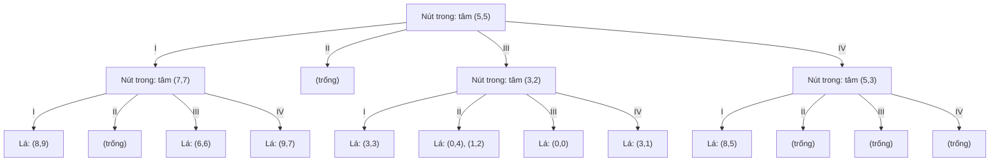
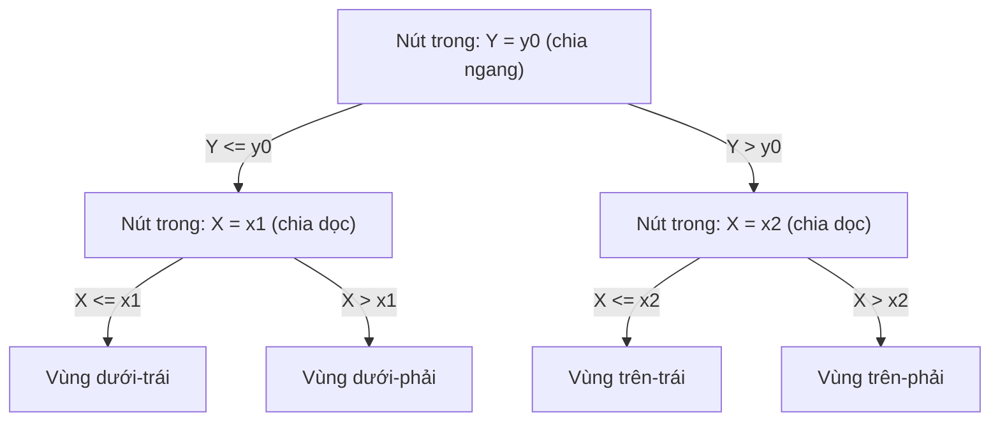
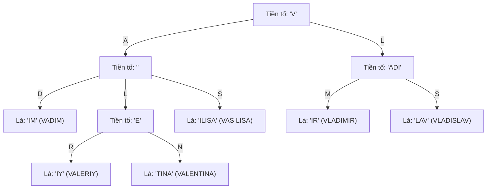
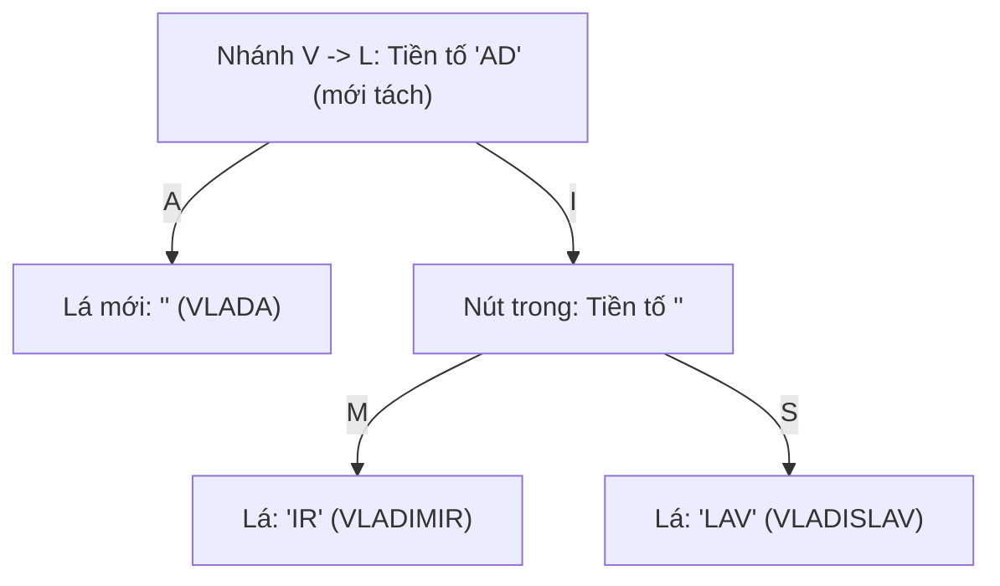

# CHƯƠNG 27: SP-GiST (CHAPTER 27: SP-GiST)

## 27.1 Tổng quan (Overview)

Những chữ cái đầu tiên trong tên gọi **SP-GiST** là viết tắt của **Space Partitioning** (Phân hoạch không gian). "Không gian" ở đây được hiểu là một tập hợp giá trị bất kỳ dùng để thực hiện tìm kiếm; nó không nhất thiết phải là không gian theo nghĩa thông thường của từ này (chẳng hạn như mặt phẳng hai chiều). Phần **GiST** trong tên gọi gợi ý một sự tương đồng nhất định giữa hai phương thức truy cập GiST và SP-GiST: cả hai đều là cây tìm kiếm tổng quát (generalized search trees) và đóng vai trò là khung nền tảng (framework) để lập chỉ mục nhiều kiểu dữ liệu khác nhau.

Ý tưởng đằng sau phương thức SP-GiST[^1] là chia không gian tìm kiếm thành nhiều vùng không giao nhau (non-overlapping regions), và các vùng này đến lượt mình lại có thể được chia đệ quy thành các vùng con. Việc phân hoạch như vậy tạo ra các cây không cân bằng (non-balanced trees — khác với cây B-tree và cây GiST) và có thể được dùng để cài đặt những cấu trúc dữ liệu quen thuộc như cây tứ phân (quadtree), cây k chiều (k-d tree) và cây cơ số (radix tree / trie).

Các cây không cân bằng thường có ít nhánh ở mỗi nút và do đó có độ sâu lớn. Ví dụ, một nút của quadtree có tối đa bốn nút con, trong khi một nút của cây k-d chỉ có thể có hai nút con. Điều này không gây vấn đề gì nếu cây được giữ trong bộ nhớ; nhưng khi lưu trữ trên đĩa, các nút của cây phải được nén vào các trang (page) một cách dày đặc nhất có thể để giảm thiểu thao tác I/O, và nhiệm vụ này không hề đơn giản. Các chỉ mục B-tree và GiST không phải bận tâm đến việc này vì mỗi nút cây của chúng chiếm trọn một trang.

Một nút trong (inner node) của cây SP-GiST chứa một giá trị thỏa mãn điều kiện đúng cho tất cả các nút con của nó. Giá trị này thường được gọi là **tiền tố (prefix)**; nó đóng vai trò tương tự như vị từ (predicate) trong chỉ mục GiST. Các con trỏ tới nút con của SP-GiST có thể đi kèm **nhãn (label)**.

Các phần tử của nút lá (leaf node) chứa giá trị được lập chỉ mục (hoặc một phần của nó) và **TID** tương ứng.

Giống như GiST, SP-GiST chỉ cài đặt các thuật toán cốt lõi, đảm nhiệm các chi tiết cấp thấp như truy cập đồng thời (concurrent access), khóa (lock) và ghi nhật ký (logging). Các kiểu dữ liệu mới và thuật toán phân hoạch không gian mới có thể được bổ sung thông qua giao diện lớp toán tử (operator class). Lớp toán tử cung cấp phần lớn logic và định nghĩa nhiều khía cạnh của chức năng lập chỉ mục.

[^1]: `postgresql.org/docs/14/spgist.html` và `backend/access/spgist/README`

> 📝 **Giải thích thêm (không có trong sách):**
> Điểm khác biệt cốt lõi giữa **GiST** và **SP-GiST**:
> - **GiST** là cây **cân bằng** (mọi nhánh từ gốc đến lá có cùng độ dài), các vùng bao phủ (bounding boxes/predicates) của các nút con **có thể chồng lấn** nhau.
> - **SP-GiST** là cây **không cân bằng** (nhánh ở vùng dữ liệu dày đặc sẽ sâu hơn nhánh ở vùng thưa thớt), nhưng các vùng phân hoạch **không bao giờ chồng lấn** (disjoint/non-overlapping). Nhờ không chồng lấn, khi tìm kiếm hoặc chèn một điểm, tại nhiều bước ta có thể loại bỏ hoàn toàn các nhánh không liên quan.

## 27.2 Cây tứ phân cho dữ liệu điểm (Quadtrees for Points)

Trong SP-GiST, việc tìm kiếm được thực hiện theo chiều sâu (depth-first), bắt đầu từ nút gốc.[^2] Những nút đáng để đi xuống được lựa chọn bởi **hàm nhất quán (consistency function)**, tương tự như hàm được dùng trong GiST. Đối với nút trong của cây, hàm này trả về tập hợp các nút con có giá trị không mâu thuẫn với vị từ tìm kiếm. Hàm nhất quán không đi sâu vào các nút này: nó chỉ đánh giá các nhãn và tiền tố tương ứng. Đối với nút lá, nó xác định xem giá trị được lập chỉ mục của nút này có khớp với vị từ tìm kiếm hay không.

Trong một cây không cân bằng, thời gian tìm kiếm có thể thay đổi tùy thuộc vào độ sâu của nhánh.

Có hai hàm hỗ trợ tham gia vào việc chèn giá trị vào chỉ mục SP-GiST. Khi cây được duyệt từ nút gốc, hàm `choose` đưa ra một trong các quyết định sau: đưa giá trị mới vào một nút con đã tồn tại, tạo một nút con mới cho giá trị này, hoặc tách nút hiện tại (nếu giá trị không khớp với tiền tố của nút này). Nếu trang lá được chọn không đủ chỗ trống, hàm `picksplit` sẽ xác định những nút nào cần được chuyển sang một trang mới.

Bây giờ tôi sẽ đưa ra một vài ví dụ để minh họa các thuật toán này.

[^2]: `backend/access/spgist/spgscan.c`, hàm `spgWalk`

### Cây tứ phân cho dữ liệu điểm (Quadtrees for Points)

Cây tứ phân (quadtree) được dùng để lập chỉ mục các điểm trên mặt phẳng hai chiều. Mặt phẳng được chia đệ quy thành bốn vùng (góc phần tư — quadrant) dựa trên một điểm được chọn. Điểm này được gọi là **tâm (centroid)**; nó đóng vai trò là tiền tố của nút, tức là điều kiện xác định vị trí của các giá trị con.

Nút gốc chia mặt phẳng thành bốn góc phần tư. Sau đó, mỗi góc phần tư lại được chia tiếp thành bốn góc phần tư riêng của nó. Quy trình này tiếp tục cho đến khi đạt được số lượng phân hoạch mong muốn.

Ví dụ này sử dụng một chỉ mục được xây dựng trên bảng `airports` mở rộng (xem trang 446). Các hình minh họa cho thấy độ sâu của nhánh phụ thuộc vào mật độ điểm trong các góc phần tư tương ứng. Để dễ quan sát trực quan, tôi đặt một giá trị nhỏ cho tham số lưu trữ `fillfactor`, giúp cây sâu hơn:

```sql
=> CREATE INDEX airports_quad_idx ON airports_big
USING spgist(coordinates) WITH (fillfactor = 10);
```

Lớp toán tử mặc định cho kiểu dữ liệu điểm (`point`) là `quad_point_ops`.

### Lớp toán tử (Operator Class)

Tôi đã đề cập đến các hàm hỗ trợ của SP-GiST:[^3] hàm nhất quán (`consistency`) cho việc tìm kiếm và hàm `picksplit` cho việc chèn dữ liệu.

Bây giờ hãy xem danh sách các hàm hỗ trợ của lớp toán tử `quad_point_ops`.[^4] Tất cả chúng đều là bắt buộc.

```sql
=> SELECT amprocnum, amproc::regproc
FROM pg_am am
JOIN pg_opclass opc ON opcmethod = am.oid
JOIN pg_amproc amop ON amprocfamily = opcfamily
WHERE amname = 'spgist'
  AND opcname = 'quad_point_ops'
ORDER BY amprocnum;
 amprocnum |         amproc
-----------+-------------------------
         1 | spg_quad_config
         2 | spg_quad_choose
         3 | spg_quad_picksplit
         4 | spg_quad_inner_consistent
         5 | spg_quad_leaf_consistent
(5 rows)
```

Các hàm này thực hiện những nhiệm vụ sau:
- Hàm `config` báo cáo thông tin cơ bản về lớp toán tử cho phương thức truy cập.
- Hàm `choose` chọn nút để chèn dữ liệu.
- Hàm `picksplit` phân phối các nút giữa các trang sau khi xảy ra tách trang.
- Hàm `inner_consistent` kiểm tra xem giá trị của nút trong có thỏa mãn vị từ tìm kiếm hay không.
- Hàm `leaf_consistent` xác định xem giá trị lưu trong nút lá có thỏa mãn vị từ tìm kiếm hay không.

Ngoài ra còn có một số hàm tùy chọn khác.

Lớp toán tử `quad_point_ops` hỗ trợ cùng các chiến lược (strategies) như GiST (xem trang 449):[^5]

```sql
=> SELECT amopopr::regoperator, oprcode::regproc, amopstrategy
FROM pg_am am
JOIN pg_opclass opc ON opcmethod = am.oid
JOIN pg_amop amop ON amopfamily = opcfamily
JOIN pg_operator opr ON opr.oid = amopopr
WHERE amname = 'spgist'
  AND opcname = 'quad_point_ops'
ORDER BY amopstrategy;
     amopopr      |    oprcode     | amopstrategy
------------------+----------------+--------------
 <<(point,point)  | point_left     |            1
 >>(point,point)  | point_right    |            5
 ~=(point,point)  | point_eq       |            6
 <@(point,box)    | on_pb          |            8
 <<|(point,point) | point_below    |           10
 |>>(point,point) | point_above    |           11
 <->(point,point) | point_distance |           15
 <^(point,point)  | point_below    |           29
 >^(point,point)  | point_above    |           30
(9 rows)
```

Ví dụ, bạn có thể sử dụng toán tử "nằm phía trên" `>^` để tìm các sân bay nằm ở phía bắc của Dikson:

```sql
=> SELECT airport_code, airport_name->>'en'
FROM airports_big
WHERE coordinates >^ '(80.3817,73.5167)'::point;
 airport_code |          ?column?
--------------+-----------------------------
 THU          | Thule Air Base
 YEU          | Eureka Airport
 YLT          | Alert Airport
 YRB          | Resolute Bay Airport
 LYR          | Svalbard Airport, Longyear
 NAQ          | Qaanaaq Airport
 YGZ          | Grise Fiord Airport
 DKS          | Dikson Airport
(8 rows)
```

```sql
=> EXPLAIN (costs off) SELECT airport_code
FROM airports_big
WHERE coordinates >^ '(80.3817,73.5167)'::point;
                           QUERY PLAN
-----------------------------------------------------------------
 Bitmap Heap Scan on airports_big
   Recheck Cond: (coordinates >^ '(80.3817,73.5167)'::point)
   ->  Bitmap Index Scan on airports_quad_idx
         Index Cond: (coordinates >^ '(80.3817,73.5167)'::point)
(4 rows)
```

Hãy xem xét kỹ hơn cấu trúc và cách hoạt động bên trong của một cây tứ phân. Chúng ta sẽ sử dụng lại ví dụ đơn giản với một vài điểm đã thảo luận ở chương về GiST (xem trang 451).

Trong trường hợp này, mặt phẳng có thể được phân hoạch như sau (góc phần tư `I` ở trên-phải, `II` ở trên-trái, `III` ở dưới-trái, `IV` ở dưới-phải; các điểm nằm trên đường biên sẽ được tính vào góc phần tư có số thứ tự nhỏ hơn).

Dưới đây là một cấu trúc khả dĩ của chỉ mục này. Mỗi nút trong tham chiếu tới tối đa bốn nút con, và mỗi con trỏ này được gắn nhãn là số thứ tự của góc phần tư:



[^3]: `postgresql.org/docs/14/spgist-extensibility.html`
[^4]: `backend/access/spgist/spgquadtreeproc.c`
[^5]: `include/access/stratnum.h`

### Bố cục trang (Page Layout)

Khác với chỉ mục B-tree và GiST, SP-GiST không có sự tương ứng 1-1 giữa các nút của cây và các trang (page). Vì các nút trong thường không có quá nhiều nút con, nhiều nút phải được đóng gói vào cùng một trang. Các loại nút khác nhau được lưu trong các trang khác nhau: nút trong được lưu trong **trang trong (inner page)**, còn nút lá được đưa vào **trang lá (leaf page)**.

Các mục chỉ mục (index entry) lưu trong trang trong chứa giá trị dùng làm tiền tố, cùng với một tập hợp con trỏ tới các nút con; mỗi con trỏ có thể đi kèm một nhãn.

Các mục trong trang lá bao gồm một giá trị và một TID.

Tất cả các nút lá liên quan đến một nút trong cụ thể được lưu cùng nhau trong một trang duy nhất và được liên kết thành một danh sách. Nếu trang không thể chứa thêm một nút nữa, danh sách này có thể được chuyển sang một trang khác,[^6] hoặc trang có thể bị tách; dù bằng cách nào, một danh sách không bao giờ trải dài qua nhiều trang.

Để tiết kiệm không gian, thuật toán cố gắng thêm các nút mới vào cùng các trang cho đến khi các trang này đầy hoàn toàn. Số hiệu của các trang được sử dụng gần nhất được các tiến trình backend lưu vào bộ nhớ đệm (cache) và định kỳ lưu xuống trang số 0, gọi là **trang siêu dữ liệu (metapage)**. Trang siêu dữ liệu không chứa tham chiếu tới nút gốc như ta từng thấy ở B-tree; gốc của chỉ mục SP-GiST luôn nằm ở trang số 1.

Rất tiếc, extension `pageinspect` không cung cấp hàm nào để khám phá SP-GiST, nhưng ta có thể sử dụng một extension bên ngoài tên là `gevel`.[^7] Đã có nỗ lực tích hợp chức năng của nó vào `pageinspect`, nhưng không thành công.[^8]

Quay lại ví dụ của chúng ta. Lớp toán tử `quad_point_ops` thực tế không sử dụng nhãn. Vì một nút có tối đa bốn nút con, chỉ mục giữ một mảng kích thước cố định gồm bốn con trỏ, một số trong đó có thể trống:
- **Trang gốc (root page — trang 1):** chứa nút gốc `(5,5)` với 4 con trỏ tới các nút con ở các trang trong.
- **Các trang trong (inner pages):** chứa các nút `(7,7)`, `(3,2)`, `(5,3)`,...
- **Các trang lá (leaf pages):** chứa danh sách các nút lá `(8,9)`, `(6,6)`, `(9,7)`, `(3,3)`, `(0,4)`, `(1,2)`, `(0,0)`, `(3,1)`, `(8,5)`,...

[^6]: `backend/access/spgist/spgdoinsert.c`, hàm `moveLeafs`
[^7]: `sigaev.ru/git/gitweb.cgi?p=gevel.git`
[^8]: `commitfest.postgresql.org/15/1207`

### Tìm kiếm (Search)

Hãy dùng chính ví dụ trên để xem xét thuật toán tìm kiếm các điểm nằm phía trên điểm `(3, 7)`.

Quá trình tìm kiếm bắt đầu tại nút gốc. Hàm nhất quán nút trong (`inner_consistent`)[^9] xác định các nút con cần đi xuống. Điểm `(3, 7)` được so sánh với tâm `(5, 5)` của nút gốc để chọn ra các góc phần tư có thể chứa các điểm cần tìm; trong ví dụ này, đó là góc phần tư `I` và `II` (vì y > 7 > 5).

Khi đã vào bên trong nút có tâm `(7, 7)` (thuộc góc phần tư `I`), ta lại phải chọn các nút con để đi xuống. Chúng thuộc về góc phần tư `I` và `II`, nhưng vì góc phần tư `II` trống, ta chỉ cần kiểm tra một nút lá. Hàm nhất quán nút lá (`leaf_consistent`)[^10] so sánh các điểm của nút này với điểm `(3, 7)` được chỉ định trong truy vấn. Điều kiện "nằm phía trên" chỉ thỏa mãn với điểm `(8, 9)`.

Bây giờ ta chỉ cần quay lui lại một mức và kiểm tra nút tương ứng với góc phần tư `II` của nút gốc. Nó trống, vì vậy quá trình tìm kiếm hoàn tất.

[^9]: `backend/access/spgist/spgquadtreeproc.c`, hàm `spg_quad_inner_consistent`
[^10]: `backend/access/spgist/spgquadtreeproc.c`, hàm `spg_quad_leaf_consistent`

### Chèn dữ liệu (Insertion)

Khi một giá trị được chèn vào cây SP-GiST,[^11] mỗi hành động tiếp theo được quyết định bởi hàm `choose`.[^12] Trong trường hợp cụ thể này, nó đơn giản chỉ hướng điểm đó vào một trong các nút đã tồn tại tương ứng với góc phần tư của nó.

Ví dụ, hãy thêm giá trị `(7, 1)`. Giá trị này thuộc về góc phần tư `IV` của tâm `(5, 5)` (và thuộc nút con `(5, 3)` hay góc phần tư tương ứng) và sẽ được thêm vào nút cây tương ứng.

Nếu danh sách các nút lá trong góc phần tư được chọn trở nên quá lớn sau khi chèn (nó phải nằm gọn trong một trang duy nhất), trang sẽ bị tách. Hàm `picksplit`[^13] xác định tâm mới bằng cách tính giá trị trung bình tọa độ của tất cả các điểm, nhờ đó phân phối các nút con vào các góc phần tư mới một cách tương đối đồng đều.

Ví dụ khi chèn điểm `(2, 1)` gây tràn trang ở góc phần tư `III` của `(3, 2)` (hoặc góc phần tư `II`/`III` chứa `(0,0)`, `(1,2)`, `(2,1)`): một nút trong mới với tâm `(1, 1)` được thêm vào cây, trong khi các điểm `(0, 0)`, `(1, 2)` và `(2, 1)` được phân phối lại vào các góc phần tư mới của nút `(1, 1)`.

[^11]: `backend/access/spgist/spgdoinsert.c`, hàm `spgdoinsert`
[^12]: `backend/access/spgist/spgquadtreeproc.c`, hàm `spg_quad_choose`
[^13]: `backend/access/spgist/spgquadtreeproc.c`, hàm `spg_quad_picksplit`

### Thuộc tính (Properties)

**Thuộc tính phương thức truy cập (Access method properties).** Phương thức `spgist` báo cáo các thuộc tính sau:

```sql
=> SELECT a.amname, p.name, pg_indexam_has_property(a.oid, p.name)
FROM pg_am a, unnest(array[
  'can_order', 'can_unique', 'can_multi_col',
  'can_exclude', 'can_include'
]) p(name)
WHERE a.amname = 'spgist';
 amname |     name      | pg_indexam_has_property
--------+---------------+-------------------------
 spgist | can_order     | f
 spgist | can_unique    | f
 spgist | can_multi_col | f
 spgist | can_exclude   | t
 spgist | can_include   | t
(5 rows)
```

Không có hỗ trợ cho thuộc tính sắp xếp và tính duy nhất (unique). Chỉ mục nhiều cột (multicolumn index) cũng không được hỗ trợ.

Ràng buộc loại trừ (`EXCLUDE`) được hỗ trợ, giống như trong GiST. Một chỉ mục SP-GiST có thể được tạo thêm các cột `INCLUDE` (từ phiên bản PostgreSQL 14).

**Thuộc tính mức chỉ mục (Index-level properties).** Khác với GiST, chỉ mục SP-GiST không hỗ trợ gom cụm (`CLUSTER`):

```sql
=> SELECT p.name, pg_index_has_property('airports_quad_idx', p.name)
FROM unnest(array[
  'clusterable', 'index_scan', 'bitmap_scan', 'backward_scan'
]) p(name);
     name      | pg_index_has_property
---------------+-----------------------
 clusterable   | f
 index_scan    | t
 bitmap_scan   | t
 backward_scan | f
(4 rows)
```

Cả hai cách lấy TID (lấy từng cái một qua `index_scan` hoặc dưới dạng bitmap qua `bitmap_scan`) đều được hỗ trợ. Quét ngược (`backward_scan`) không khả dụng, vì nó không có ý nghĩa gì đối với SP-GiST.

**Thuộc tính mức cột (Column-level properties).** Phần lớn các thuộc tính mức cột đều giống nhau:

```sql
=> SELECT p.name,
  pg_index_column_has_property('airports_quad_idx', 1, p.name)
FROM unnest(array[
  'orderable', 'search_array', 'search_nulls'
]) p(name);
     name     | pg_index_column_has_property
--------------+------------------------------
 orderable    | f
 search_array | f
 search_nulls | t
(3 rows)
```

Việc sắp xếp không được hỗ trợ, nên mọi thuộc tính liên quan đều không có ý nghĩa và bị tắt.

Từ đầu đến giờ tôi chưa đề cập đến các giá trị `NULL`, nhưng như ta thấy trong thuộc tính chỉ mục, chúng được hỗ trợ. Khác với GiST, chỉ mục SP-GiST không lưu các giá trị `NULL` trong cây chính. Thay vào đó, một cây riêng biệt được tạo ra; gốc của nó nằm ở trang số 2 của chỉ mục. Như vậy, ba trang đầu tiên luôn có cùng một ý nghĩa: trang siêu dữ liệu (metapage - trang 0), gốc của cây chính (trang 1), và gốc của cây dành cho các giá trị `NULL` (trang 2).

Một số thuộc tính mức cột có thể phụ thuộc vào từng lớp toán tử cụ thể:

```sql
=> SELECT p.name,
  pg_index_column_has_property('airports_quad_idx', 1, p.name)
FROM unnest(array[
  'returnable', 'distance_orderable'
]) p(name);
        name        | pg_index_column_has_property
--------------------+------------------------------
 returnable         | t
 distance_orderable | t
(2 rows)
```

Giống như trong các ví dụ khác của chương này, chỉ mục này có thể được dùng cho quét chỉ mục thuần túy (index-only scan). Nhưng nói chung, một lớp toán tử không nhất thiết phải lưu toàn bộ giá trị đầy đủ trong trang lá, vì nó có thể kiểm tra lại (recheck) bằng bảng. Điều này cho phép sử dụng chỉ mục SP-GiST trong PostGIS cho các giá trị hình học có kích thước lớn, chẳng hạn như vậy.

Tìm kiếm láng giềng gần nhất (nearest neighbor search) được hỗ trợ; ta đã thấy toán tử sắp xếp `<->` trong lớp toán tử.

## 27.3 Cây K chiều cho dữ liệu điểm (K-Dimensional Trees for Points)

Các điểm trên một mặt phẳng cũng có thể được lập chỉ mục bằng một cách tiếp cận phân hoạch khác: ta có thể chia mặt phẳng thành hai vùng con thay vì bốn. Cách phân hoạch như vậy được cài đặt bởi lớp toán tử `kd_point_ops`:[^14]

```sql
=> CREATE INDEX airports_kd_idx ON airports_big
USING spgist(coordinates kd_point_ops);
```

Lưu ý rằng các giá trị được lập chỉ mục, tiền tố và nhãn có thể có kiểu dữ liệu khác nhau. Đối với lớp toán tử này, các giá trị được biểu diễn dưới dạng điểm (`point`), tiền tố là các số thực (tọa độ X hoặc Y), trong khi nhãn không được sử dụng (giống như trong `quad_point_ops`).

Hãy chọn một tọa độ trên trục Y (nó xác định vĩ độ trong ví dụ về các sân bay). Tọa độ này chia mặt phẳng thành hai vùng con: vùng trên và vùng dưới. Đối với mỗi vùng con này, ta lại chọn các tọa độ trên trục X (kinh độ) để chia chúng thành hai vùng con: trái và phải.

Ta tiếp tục chia từng vùng con thu được, luân phiên giữa phân hoạch ngang và phân hoạch dọc, cho đến khi các điểm trong mỗi phần nằm gọn trong một trang chỉ mục duy nhất.

Tất cả các nút trong của cây được xây dựng theo cách này sẽ chỉ có hai nút con. Phương pháp này có thể dễ dàng tổng quát hóa cho không gian có số chiều tùy ý, vì vậy những cây như vậy thường được gọi là **cây k chiều (k-dimensional trees / k-d trees)**.



[^14]: `backend/access/spgist/spgkdtreeproc.c`

## 27.4 Cây cơ số cho chuỗi ký tự (Radix Trees for Strings)

Lớp toán tử `text_ops` dành cho SP-GiST cài đặt một **cây cơ số (radix tree)** cho chuỗi ký tự.[^15] Ở đây, tiền tố của một nút trong thực sự là một tiền tố chuỗi, phần chung của tất cả các chuỗi nằm trong các nút con của nó. Các con trỏ tới nút con được đánh dấu bằng byte đầu tiên của phần giá trị đứng sau tiền tố.

Để dễ hình dung, tôi dùng một ký tự đơn để biểu diễn tiền tố/nhãn, nhưng điều đó chỉ đúng với bảng mã 1-byte. Nhìn chung, lớp toán tử xử lý chuỗi như một dãy các byte. Ngoài ra, một tiền tố có thể nhận một số giá trị khác mang ngữ nghĩa đặc biệt, nên thực tế có hai byte được cấp phát cho mỗi tiền tố.

Các nút con lưu phần giá trị đứng sau tiền tố và nhãn. Các nút lá chỉ giữ lại phần hậu tố (suffix).

Để tái tạo lại giá trị đầy đủ của một khóa chỉ mục trong trang lá, ta có thể nối tất cả các tiền tố và nhãn lại, bắt đầu từ nút gốc.

Dưới đây là ví dụ về một cây cơ số được xây dựng trên một vài tên người (`VADIM`, `VALERIY`, `VALENTINA`, `VASILISA`, `VLADIMIR`, `VLADISLAV`):



[^15]: `backend/access/spgist/spgtextproc.c`

### Lớp toán tử (Operator Class)

Lớp toán tử `text_ops` hỗ trợ các toán tử so sánh thường dùng với các kiểu dữ liệu có thứ tự, bao gồm cả chuỗi văn bản:

```sql
=> SELECT oprname, oprcode::regproc, amopstrategy
FROM pg_am am
JOIN pg_opclass opc ON opcmethod = am.oid
JOIN pg_amop amop ON amopfamily = opcfamily
JOIN pg_operator opr ON opr.oid = amopopr
WHERE amname = 'spgist'
  AND opcname = 'text_ops'
ORDER BY amopstrategy;
 oprname |     oprcode     | amopstrategy
---------+-----------------+--------------
 ~<~     | text_pattern_lt |            1
 ~<=~    | text_pattern_le |            2
 =       | texteq          |            3
 ~>=~    | text_pattern_ge |            4
 ~>~     | text_pattern_gt |            5
 <       | text_lt         |           11
 <=      | text_le         |           12
 >=      | text_ge         |           14
 >       | text_gt         |           15
 ^@      | starts_with     |           28
(10 rows)
```

Các toán tử thông thường xử lý theo ký tự (character), trong khi các toán tử có dấu ngã (`~<~`, `~<=~`, `~>=~`, `~>~`) xử lý theo byte. Chúng không tính đến quy tắc đối chiếu (collation) — giống như lớp toán tử `text_pattern_ops` cho B-tree (xem trang 317) — nên chúng có thể được dùng để tăng tốc tìm kiếm theo điều kiện `LIKE`:

```sql
=> CREATE INDEX tickets_spgist_idx ON tickets
USING spgist(passenger_name);

=> EXPLAIN (costs off) SELECT *
FROM tickets
WHERE passenger_name LIKE 'IVAN%';
                         QUERY PLAN
------------------------------------------------------------
 Bitmap Heap Scan on tickets
   Filter: (passenger_name ~~ 'IVAN%'::text)
   ->  Bitmap Index Scan on tickets_spgist_idx
         Index Cond: ((passenger_name ~>=~ 'IVAN'::text) AND
                      (passenger_name ~<~ 'IVAO'::text))
(5 rows)
```

Nếu bạn sử dụng các toán tử thông thường `>=` và `<` cùng với một collation khác `"C"`, chỉ mục sẽ trở nên gần như vô dụng, vì nó làm việc với byte thay vì ký tự.

Đối với những trường hợp tìm kiếm tiền tố như vậy, lớp toán tử cung cấp toán tử `^@` (`starts_with`), vốn phù hợp hơn:

```sql
=> EXPLAIN (costs off) SELECT *
FROM tickets
WHERE passenger_name ^@ 'IVAN';
                         QUERY PLAN
------------------------------------------------------------
 Bitmap Heap Scan on tickets
   Recheck Cond: (passenger_name ^@ 'IVAN'::text)
   ->  Bitmap Index Scan on tickets_spgist_idx
         Index Cond: (passenger_name ^@ 'IVAN'::text)
(4 rows)
```

Cách biểu diễn bằng cây cơ số đôi khi có thể gọn nhẹ hơn nhiều so với B-tree, vì nó không lưu trữ các giá trị đầy đủ: nó tái tạo lại chúng khi cần trong quá trình duyệt cây.

### Tìm kiếm (Search)

Hãy chạy truy vấn sau trên bảng `names`:

```sql
SELECT * FROM names
WHERE name ~>=~ 'VALERIY'
  AND name ~<~ 'VLADISLAV';
```

Đầu tiên, hàm nhất quán nút trong (`inner_consistent`)[^16] được gọi trên nút gốc để xác định các nút con cần đi xuống. Hàm này nối tiền tố `V` với các nhãn `A` và `L`. Giá trị thu được `VA` được đưa vào điều kiện truy vấn; các hằng chuỗi trong truy vấn được cắt ngắn sao cho độ dài của chúng không vượt quá độ dài của giá trị đang được kiểm tra: `VA ~>=~ 'VA' AND VA ~<~ 'VL'`. Điều kiện này thỏa mãn, nên nút con có nhãn `A` cần được kiểm tra. Giá trị `VL` cũng được kiểm tra theo cách tương tự. Nó cũng khớp, nên nút có nhãn `L` cũng phải được kiểm tra.

Bây giờ hãy xét nút tương ứng với giá trị `VA`. Tiền tố của nó rỗng, nên đối với ba nút con, hàm nhất quán nút trong tái tạo các giá trị `VAD`, `VAL`, và `VAS` bằng cách nối `VA` nhận được ở bước trước với nhãn. Điều kiện `VAD ~>=~ 'VAL' AND VAD ~<~ 'VLA'` là sai, nhưng hai giá trị còn lại (`VAL` và `VAS`) đều phù hợp.

Khi cây được duyệt theo cách này, thuật toán sẽ loại bỏ các nhánh không khớp và đi tới các nút lá. Hàm nhất quán nút lá (`leaf_consistent`)[^17] kiểm tra xem giá trị được tái tạo trong quá trình duyệt cây có thỏa mãn điều kiện truy vấn hay không. Các giá trị khớp sẽ được trả về làm kết quả của quá trình quét chỉ mục.

Lưu ý rằng mặc dù truy vấn sử dụng các toán tử lớn hơn và nhỏ hơn vốn rất phổ biến với B-tree, việc tìm kiếm theo khoảng (range search) bằng SP-GiST kém hiệu quả hơn nhiều. Trong B-tree, chỉ cần đi xuống một giá trị biên của khoảng rồi quét theo danh sách các trang lá là đủ.

[^16]: `backend/access/spgist/spgtextproc.c`, hàm `spg_text_inner_consistent`
[^17]: `backend/access/spgist/spgtextproc.c`, hàm `spg_text_leaf_consistent`

### Chèn dữ liệu (Insertion)

Hàm `choose` của các lớp toán tử dành cho dữ liệu điểm luôn có thể hướng một giá trị mới vào một trong các vùng con đã tồn tại (một góc phần tư hoặc một trong hai nửa). Nhưng điều này không đúng với cây cơ số: một giá trị mới có thể không khớp với bất kỳ tiền tố nào hiện có, và trong trường hợp này nút trong phải bị tách.

Hãy thêm cái tên `VLADA` vào cây đã được xây dựng trước đó. Hàm `choose`[^18] đi xuống được từ nút gốc tới nút tiếp theo (`V + L`), nhưng phần còn lại của giá trị là `ADA` không khớp với tiền tố `ADI` của nút này. Nút phải bị tách làm hai: một trong hai nút kết quả sẽ chứa phần chung của tiền tố (`AD`), trong khi phần còn lại của tiền tố (`I`) sẽ được đẩy xuống một mức thấp hơn.

Sau đó hàm `choose` được gọi lại trên cùng nút đó. Tiền tố bây giờ đã tương ứng với giá trị, nhưng chưa có nút con nào có nhãn phù hợp (`A`), vì vậy hàm quyết định tạo một nút lá mới với nhãn `A`.



[^18]: `backend/access/spgist/spgtextproc.c`, hàm `spg_text_choose`

> 💡 **Ví dụ bổ sung (không có trong sách):**
> Giả sử bạn có một bảng lưu hàng triệu mã bưu chính hoặc mã sản phẩm dạng chuỗi có tiền tố chung rất dài, ví dụ `VN-HCM-Q1-0001`, `VN-HCM-Q1-0002`, `VN-HCM-Q3-0015`.
> - Nếu dùng **B-tree**, mỗi mục trong trang lá phải lưu toàn bộ chuỗi `VN-HCM-Q1-0001`.
> - Nếu dùng **SP-GiST (`text_ops`)**, phần tiền tố chung `VN-HCM-Q` chỉ được lưu ở các nút trong phía trên, còn nút lá chỉ lưu hậu tố ngắn như `0001`, giúp kích thước chỉ mục nhỏ gọn hơn đáng kể và rất hiệu quả cho các truy vấn tìm theo tiền tố (`WHERE code ^@ 'VN-HCM-Q1'`).

### Thuộc tính (Properties)

Tôi đã mô tả các thuộc tính mức phương thức truy cập và mức chỉ mục ở trên; chúng dùng chung cho tất cả các lớp toán tử. Hầu hết các thuộc tính mức cột cũng giữ nguyên:

```sql
=> SELECT p.name,
  pg_index_column_has_property('tickets_spgist_idx', 1, p.name)
FROM unnest(array[
  'returnable', 'distance_orderable'
]) p(name);
        name        | pg_index_column_has_property
--------------------+------------------------------
 returnable         | t
 distance_orderable | f
(2 rows)
```

Mặc dù các giá trị được lập chỉ mục không được lưu tường minh trong cây, quét chỉ mục thuần túy (index-only scan) vẫn được hỗ trợ, vì các giá trị được tái tạo lại khi cây được duyệt từ gốc đến các nút lá.

Về toán tử khoảng cách, nó không được định nghĩa cho chuỗi ký tự, nên tìm kiếm láng giềng gần nhất không được lớp toán tử này cung cấp.

Điều đó không có nghĩa là khái niệm khoảng cách không thể cài đặt cho chuỗi. Ví dụ, extension `pg_trgm` bổ sung một toán tử khoảng cách dựa trên trigram: hai chuỗi có càng ít trigram chung thì được coi là nằm càng xa nhau. Ngoài ra còn có khoảng cách Levenshtein, được định nghĩa là số lần chỉnh sửa ký tự đơn tối thiểu cần thiết để biến đổi một chuỗi thành chuỗi khác; một hàm tính khoảng cách như vậy được cung cấp trong extension `fuzzystrmatch`. Nhưng không có extension nào trong số đó cung cấp lớp toán tử hỗ trợ SP-GiST.

## 27.5 Các kiểu dữ liệu khác (Other Data Types)

Các lớp toán tử SP-GiST không chỉ giới hạn ở việc lập chỉ mục điểm và chuỗi văn bản như chúng ta đã thảo luận ở trên.

- **Các kiểu hình học (Geometric types).** Lớp toán tử `box_ops`[^19] cài đặt một cây tứ phân cho hình chữ nhật. Hình chữ nhật được biểu diễn bằng các điểm trong không gian bốn chiều, do đó vùng không gian được chia thành mười sáu phân hoạch.
  Lớp `poly_ops` có thể được dùng để lập chỉ mục đa giác (polygon). Đây là một lớp toán tử mờ (fuzzy operator class): thực tế nó sử dụng các hộp bao (bounding box) thay cho đa giác, giống như `box_ops`, rồi kiểm tra lại (recheck) kết quả bằng bảng.
  Việc chọn GiST hay SP-GiST phần lớn phụ thuộc vào bản chất của dữ liệu cần lập chỉ mục. Ví dụ, tài liệu của PostGIS khuyến nghị dùng SP-GiST cho các đối tượng có độ chồng lấn lớn (còn gọi là "dữ liệu mì Ý" — "spaghetti data").[^20]
- **Các kiểu khoảng (Range types).** Cây tứ phân cho các kiểu khoảng cung cấp lớp toán tử `range_ops`.[^21] Một khoảng được xác định bởi một điểm hai chiều: trục X biểu diễn cận dưới (lower boundary), còn trục Y biểu diễn cận trên (upper boundary).
- **Các kiểu địa chỉ mạng (Network address types).** Đối với kiểu dữ liệu `inet`, lớp toán tử `inet_ops`[^22] cài đặt một cây cơ số (radix tree).

[^19]: `backend/utils/adt/geo_spgist.c`
[^20]: `postgis.net/docs/using_postgis_dbmanagement.html#spgist_indexes`
[^21]: `backend/utils/adt/rangetypes_spgist.c`
[^22]: `backend/utils/adt/network_spgist.c`

## Bảng thuật ngữ chương (Chapter Glossary)

| Thuật ngữ (English) | Tiếng Việt | Giải thích ngắn gọn |
|---|---|---|
| SP-GiST (Space-Partitioned GiST) | Cây tìm kiếm tổng quát phân hoạch không gian | Phương thức truy cập tạo cây không cân bằng bằng cách chia không gian thành các vùng không giao nhau. |
| Space partitioning | Phân hoạch không gian | Chia tập hợp giá trị tìm kiếm thành các vùng con tách biệt một cách đệ quy. |
| Non-balanced tree | Cây không cân bằng | Cây mà độ dài đường đi từ nút gốc tới các nút lá khác nhau tùy theo mật độ dữ liệu. |
| Quadtree | Cây tứ phân | Cấu trúc cây chia mỗi vùng không gian 2D thành tối đa 4 góc phần tư quanh một tâm. |
| K-dimensional tree (k-d tree) | Cây k chiều | Cấu trúc cây chia luân phiên theo từng chiều, mỗi nút trong có tối đa 2 nút con. |
| Radix tree (Trie) | Cây cơ số | Cấu trúc cây lưu trữ chuỗi bằng cách tách tiền tố chung ở nút trong và phần hậu tố ở nút lá. |
| Centroid | Tâm | Điểm được chọn làm mốc để chia mặt phẳng thành các góc phần tư trong quadtree. |
| Prefix | Tiền tố | Giá trị ở nút trong của SP-GiST dùng làm điều kiện chung cho mọi nút con bên dưới. |
| Label | Nhãn | Ký hiệu gắn trên con trỏ từ nút trong tới nút con (ví dụ: ký tự kế tiếp trong `text_ops`). |
| Inner page / Leaf page | Trang trong / Trang lá | Hai loại trang tách biệt trong SP-GiST dùng để chứa các nút trong và các nút lá. |
| Metapage | Trang siêu dữ liệu | Trang số 0 của chỉ mục SP-GiST, lưu thông tin trạng thái như các trang được dùng gần nhất. |
| Fuzzy operator class | Lớp toán tử mờ | Lớp toán tử lưu giá trị xấp xỉ (như hộp bao) trong chỉ mục và phải kiểm tra lại (recheck) trên bảng. |
