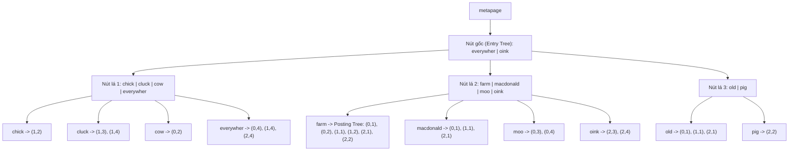
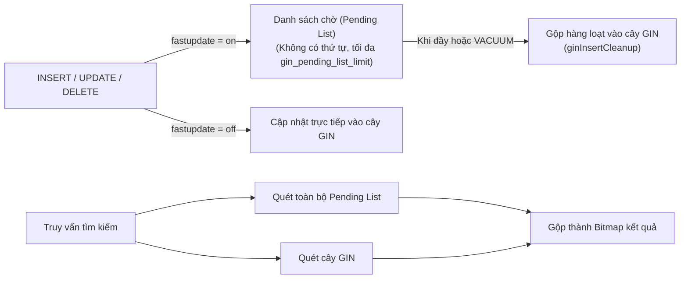
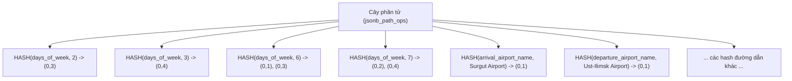

# CHƯƠNG 28: Chỉ mục GIN (Chapter 28: GIN)

## 28.1 Tổng quan (Overview)

Theo các tác giả của nó, `GIN` là viết tắt của một tinh thần mạnh mẽ và kiên cường (*potent and undaunted spirit*), chứ không phải tên một loại đồ uống có cồn.[^1] Tuy nhiên, cũng có một cách giải thích chính thức hơn: từ viết tắt này là viết tắt của **Generalized Inverted Index** (Chỉ mục đảo ngược tổng quát).

Phương thức truy cập `GIN` được thiết kế cho các kiểu dữ liệu biểu diễn những giá trị không nguyên tử (*non-atomic values*) được cấu thành từ các phần tử riêng biệt (ví dụ: trong ngữ cảnh tìm kiếm toàn văn, các tài liệu được tạo thành từ các từ vị — *lexemes*). Khác với `GiST` vốn đánh chỉ mục toàn bộ giá trị như một thể thống nhất, `GIN` chỉ đánh chỉ mục các phần tử của chúng; mỗi phần tử được ánh xạ tới tất cả các giá trị có chứa nó.

Chúng ta có thể so sánh phương thức này với phần mục lục cuối sách (*book's index*), nơi tập hợp tất cả các thuật ngữ quan trọng và liệt kê toàn bộ các trang mà thuật ngữ đó được nhắc đến. Để thuận tiện cho việc sử dụng, mục lục này bắt buộc phải được sắp xếp theo thứ tự bảng chữ cái, nếu không sẽ không thể tra cứu nhanh chóng được. Tương tự như vậy, `GIN` dựa trên thực tế là mọi phần tử của các giá trị phức hợp đều có thể sắp xếp được; cấu trúc dữ liệu chính của nó là cây `B-tree`.

Việc triển khai cây các phần tử của `GIN` ít phức tạp hơn so với một cây `B-tree` thông thường: nó được thiết kế để chứa các tập hợp phần tử tương đối nhỏ nhưng lặp đi lặp lại nhiều lần.

Giả định này dẫn đến hai kết luận quan trọng:

- **Một phần tử chỉ cần được lưu trữ trong chỉ mục đúng một lần.**
  Mỗi phần tử được ánh xạ tới một danh sách các `TID`, được gọi là **danh sách đăng ký** (*posting list*). Nếu danh sách này khá ngắn, nó sẽ được lưu trữ cùng với phần tử; các danh sách dài hơn sẽ được chuyển sang một **cây đăng ký** (*posting tree*) riêng biệt, thực chất cũng là một cây `B-tree`. Giống như cây phần tử, các danh sách đăng ký cũng được sắp xếp; điều này không quan trọng lắm đối với góc nhìn của người dùng nhưng giúp tăng tốc độ truy cập dữ liệu và giảm kích thước chỉ mục.
- **Không có lý do gì để xóa phần tử khỏi cây.**
  Ngay cả khi danh sách các `TID` của một phần tử cụ thể bị trống, chính phần tử đó nhiều khả năng sẽ lại xuất hiện như một phần của giá trị khác.

Như vậy, một chỉ mục `GIN` là một cây các phần tử mà các mục lá (*leaf entries*) của nó được gắn với các danh sách phẳng (*flat lists*) hoặc các cây chứa `TID`.

Cũng giống như các phương thức truy cập `GiST` và `SP-GiST`, `GIN` có thể được sử dụng để đánh chỉ mục rất nhiều kiểu dữ liệu khác nhau thông qua một giao diện đơn giản hóa gồm các lớp toán tử (*operator classes*). Các toán tử của những lớp này thường kiểm tra xem giá trị phức hợp được đánh chỉ mục có khớp với một tập hợp phần tử cụ thể hay không (giống như toán tử `@@` kiểm tra xem một tài liệu có thỏa mãn truy vấn tìm kiếm toàn văn hay không).

Để đánh chỉ mục một kiểu dữ liệu cụ thể, phương thức `GIN` phải có khả năng tách các giá trị phức hợp thành các phần tử, sắp xếp các phần tử đó và kiểm tra xem giá trị tìm được có thỏa mãn truy vấn hay không. Những thao tác này được triển khai bởi các hàm hỗ trợ (*support functions*) của lớp toán tử.

[^1]: `postgresql.org/docs/14/gin.html`, `backend/access/gin/README`

---

## 28.2 Chỉ mục cho tìm kiếm toàn văn (Index for Full-Text Search)

`GIN` chủ yếu được áp dụng để tăng tốc tìm kiếm toàn văn (*full-text search*), vì vậy tôi sẽ tiếp tục với ví dụ đã dùng để minh họa cho việc đánh chỉ mục `GiST`.

Như bạn có thể đoán, các giá trị phức hợp trong trường hợp này là các tài liệu (*documents*), còn các phần tử của những giá trị này là các từ vị (*lexemes*).

Hãy xây dựng một chỉ mục `GIN` trên bảng "Old MacDonald":

```sql
=> CREATE INDEX ts_gin_idx ON ts USING gin(doc_tsv);
```

Một cấu trúc khả dĩ của chỉ mục này được minh họa bên dưới. Khác với các hình minh họa trước đây, ở đây tôi cung cấp các giá trị `TID` thực tế, vì chúng rất quan trọng để hiểu các thuật toán. Các giá trị này cho thấy các bộ dữ liệu trong heap (*heap tuples*) có các `TID` như sau:

```sql
=> SELECT ctid, * FROM ts;
 ctid  |                doc                 |            doc_tsv
-------+------------------------------------+--------------------------------
 (0,1) | Old MacDonald had a farm           | 'farm':5 'macdonald':2 'old':1
 (0,2) | And on his farm he had some cows   | 'cow':8 'farm':4
 (0,3) | Here a moo, there a moo            | 'moo':3,6
 (0,4) | Everywhere a moo moo               | 'everywher':1 'moo':3,4
 (1,1) | Old MacDonald had a farm           | 'farm':5 'macdonald':2 'old':1
 (1,2) | And on his farm he had some chicks | 'chick':8 'farm':4
 (1,3) | Here a cluck, there a cluck        | 'cluck':3,6
 (1,4) | Everywhere a cluck cluck           | 'cluck':3,4 'everywher':1
 (2,1) | Old MacDonald had a farm           | 'farm':5 'macdonald':2 'old':1
 (2,2) | And on his farm he had some pigs   | 'farm':4 'pig':8
 (2,3) | Here an oink, there an oink        | 'oink':3,6
 (2,4) | Everywhere an oink oink            | 'everywher':1 'oink':3,4
(12 rows)
```

Sơ đồ cấu trúc cây chỉ mục `ts_gin_idx` (với các từ vị và danh sách/cây `TID`):



Hãy lưu ý một vài điểm khác biệt so với chỉ mục `B-tree` thông thường ở đây. Các khóa ngoài cùng bên trái trong các nút bên trong (*inner nodes*) của `B-tree` bị bỏ trống vì thực tế chúng dư thừa; trong chỉ mục `GIN`, chúng hoàn toàn không được lưu trữ. Vì lý do đó, các tham chiếu tới nút con cũng bị dịch chuyển theo. Khóa cao (*high key*) được dùng trong cả hai loại chỉ mục, nhưng trong `GIN` nó nằm ở vị trí ngoài cùng bên phải đúng nghĩa của nó. Các nút cùng cấp trong `B-tree` được liên kết thành danh sách liên kết đôi (*bidirectional list*); `GIN` sử dụng danh sách liên kết đơn (*unidirectional list*), vì cây luôn chỉ được duyệt theo một hướng duy nhất.

Trong ví dụ mang tính lý thuyết này, tất cả các danh sách đăng ký đều nằm vừa trong các trang thông thường, ngoại trừ danh sách của từ vị `"farm"`. Từ vị này xuất hiện trong tới sáu tài liệu, vì vậy các `TID` của nó đã được chuyển sang một cây đăng ký (*posting tree*) riêng biệt.

### Cấu trúc trang (Page Layout)

Cấu trúc trang của `GIN` rất giống với cấu trúc trang của `B-tree`. Chúng ta có thể quan sát bên trong một chỉ mục bằng extension `pageinspect`. Hãy tạo một chỉ mục `GIN` trên bảng lưu trữ các email của danh sách gửi thư `pgsql-hackers`:

```sql
=> CREATE INDEX mail_gin_idx ON mail_messages USING gin(tsv);
```

Trang số 0 (*metapage*) chứa các thống kê cơ bản, chẳng hạn như số lượng phần tử và số lượng trang của các loại khác:

```sql
=> SELECT *
FROM gin_metapage_info(get_raw_page('mail_gin_idx',0)) \gx
-[ RECORD 1 ]----+-----------
pending_head     | 4294967295
pending_tail     | 4294967295
tail_free_size   | 0
n_pending_pages  | 0
n_pending_tuples | 0
n_total_pages    | 22957
n_entry_pages    | 13522
n_data_pages     | 9434
n_entries        | 999109
version          | 2
```

`GIN` sử dụng vùng không gian đặc biệt (*special space*) của các trang chỉ mục; ví dụ, vùng này lưu trữ các bit xác định loại trang:

```sql
=> SELECT flags, count(*)
FROM generate_series(0,22956) AS p, -- n_total_pages
     gin_page_opaque_info(get_raw_page('mail_gin_idx',p))
GROUP BY flags
ORDER BY 2;
         flags          | count
------------------------+-------
 {meta}                 |     1
 {}                     |   137
 {data}                 |  1525
 {data,leaf,compressed} |  7909
 {leaf}                 | 13385
(5 rows)
```

Trang có thuộc tính `meta` tất nhiên là metapage. Các trang có thuộc tính `data` thuộc về các danh sách/cây đăng ký (*posting lists/trees*), trong khi các trang không có thuộc tính này liên quan đến cây phần tử (*element trees*). Các trang lá có thuộc tính `leaf`.

Trong ví dụ tiếp theo, một hàm khác của `pageinspect` trả về thông tin về các `TID` được lưu trong các trang lá của cây đăng ký. Mỗi mục của một cây như vậy thực chất là một danh sách nhỏ các `TID` chứ không phải một `TID` đơn lẻ:

```sql
=> SELECT left(tids::text,60)||'...' tids
FROM gin_leafpage_items(get_raw_page('mail_gin_idx',24));
                               tids
-----------------------------------------------------------------
 {"(4771,4)","(4775,2)","(4775,5)","(4777,4)","(4779,1)","(47...
 {"(5004,2)","(5011,2)","(5013,1)","(5013,2)","(5013,3)","(50...
 {"(5435,6)","(5438,3)","(5439,3)","(5439,4)","(5439,5)","(54...
 ...
 {"(9789,4)","(9791,6)","(9792,4)","(9794,4)","(9794,5)","(97...
 {"(9937,4)","(9937,6)","(9938,4)","(9939,1)","(9939,5)","(99...
 {"(10116,5)","(10118,1)","(10118,4)","(10119,2)","(10121,2)"...
(27 rows)
```

Các danh sách đăng ký được sắp xếp theo thứ tự, điều này cho phép nén chúng (do đó có thuộc tính `compressed` cùng tên). Thay vì lưu `TID` 6 byte, chúng lưu hiệu số (*difference*) giữa `TID` hiện tại và giá trị trước đó, được biểu diễn bằng số byte thay đổi (*varbyte encoding*):[^2] hiệu số này càng nhỏ thì dữ liệu càng chiếm ít không gian.

[^2]: `backend/access/gin/ginpostinglist.c`

### Lớp toán tử (Operator Class)

Dưới đây là danh sách các hàm hỗ trợ cho lớp toán tử `GIN`:[^3]

```sql
=> SELECT amprocnum, amproc::regproc
FROM pg_am am
JOIN pg_opclass opc ON opcmethod = am.oid
JOIN pg_amproc amop ON amprocfamily = opcfamily
WHERE amname = 'gin'
  AND opcname = 'tsvector_ops'
ORDER BY amprocnum;
 amprocnum |               amproc
-----------+------------------------------------
         1 | gin_cmp_tslexeme
         2 | pg_catalog.gin_extract_tsvector
         3 | pg_catalog.gin_extract_tsquery
         4 | pg_catalog.gin_tsquery_consistent
         5 | gin_cmp_prefix
         6 | gin_tsquery_triconsistent
(6 rows)
```

Hàm hỗ trợ thứ nhất so sánh hai phần tử (trong trường hợp này là hai từ vị). Nếu các từ vị được biểu diễn bằng một kiểu `SQL` thông thường được `B-tree` hỗ trợ, `GIN` sẽ tự động sử dụng các toán tử so sánh được định nghĩa trong lớp toán tử `B-tree`.

Hàm thứ năm (tùy chọn) được sử dụng trong tìm kiếm bộ phận (*partial search*) để kiểm tra xem một phần tử chỉ mục có khớp một phần với khóa tìm kiếm hay không. Trong trường hợp cụ thể này, tìm kiếm bộ phận chính là tìm kiếm các từ vị theo tiền tố (*prefix*). Ví dụ: truy vấn `"c:*"` tương ứng với tất cả các từ vị bắt đầu bằng chữ cái `"c"`.

Hàm thứ hai trích xuất các từ vị từ tài liệu, trong khi hàm thứ ba trích xuất các từ vị từ truy vấn tìm kiếm. Việc sử dụng các hàm khác nhau là hợp lý vì tối thiểu tài liệu và truy vấn được biểu diễn bằng các kiểu dữ liệu khác nhau, cụ thể là `tsvector` và `tsquery`. Ngoài ra, hàm dành cho truy vấn tìm kiếm còn quyết định cách thức thực hiện tìm kiếm. Nếu truy vấn yêu cầu tài liệu phải chứa một từ vị cụ thể, tìm kiếm sẽ được giới hạn ở các tài liệu chứa ít nhất một từ vị được chỉ định trong truy vấn. Nếu không có điều kiện như vậy (ví dụ: bạn cần các tài liệu *không* chứa một từ vị cụ thể), toàn bộ các tài liệu sẽ phải được quét — điều này tất nhiên tốn kém hơn nhiều.

Nếu truy vấn chứa bất kỳ khóa tìm kiếm nào khác, chỉ mục sẽ được quét trước theo các khóa này, và sau đó các kết quả trung gian sẽ được kiểm tra lại (*rechecked*). Nhờ đó, không cần phải quét toàn bộ chỉ mục.

Hàm thứ tư và thứ sáu là các hàm nhất quán (*consistency functions*), dùng để xác định xem tài liệu tìm được có thỏa mãn truy vấn tìm kiếm hay không. Đầu vào của hàm thứ tư là thông tin chính xác về việc những từ vị nào được chỉ định trong truy vấn có xuất hiện trong tài liệu. Hàm thứ sáu hoạt động trong ngữ cảnh bất định (*context of uncertainty*) và có thể được gọi khi chưa rõ một số từ vị có mặt trong tài liệu hay không. Một lớp toán tử không bắt buộc phải triển khai cả hai hàm: chỉ cần cung cấp một trong hai là đủ, nhưng hiệu quả tìm kiếm có thể bị ảnh hưởng trong trường hợp đó.

Lớp toán tử `tsvector_ops` chỉ hỗ trợ một toán tử duy nhất để đối khớp tài liệu với truy vấn tìm kiếm: `@@`,[^4] vốn cũng được bao gồm trong lớp toán tử `GiST`.

[^3]: `postgresql.org/docs/14/gin-extensibility.html`, `backend/utils/adt/tsginidx.c`
[^4]: `backend/utils/adt/tsvector_op.c`, hàm `ts_match_vq`

### Tìm kiếm (Search)

Hãy xem xét thuật toán tìm kiếm cho truy vấn `"everywhere | oink"`, trong đó hai từ vị được kết nối bằng toán tử `OR`. Trước tiên, một hàm hỗ trợ[^5] trích xuất các từ vị `"everywher"` và `"oink"` (các khóa tìm kiếm) từ chuỗi tìm kiếm kiểu `tsquery`.

Vì truy vấn đòi hỏi các từ vị cụ thể phải có mặt, các `TID` của những tài liệu chứa ít nhất một khóa được chỉ định trong truy vấn sẽ được gom vào một danh sách. Để làm điều này, các `TID` tương ứng với từng khóa tìm kiếm được tra cứu trong cây từ vị và đưa vào một danh sách chung. Tất cả các `TID` được lưu trữ trong chỉ mục đều đã được sắp xếp, điều này cho phép trộn nhiều luồng `TID` đã sắp xếp thành một luồng duy nhất.[^6]

Lưu ý rằng tại thời điểm này, việc các khóa được kết hợp bởi `AND`, `OR` hay bất kỳ toán tử nào khác chưa quan trọng: bộ máy tìm kiếm chỉ làm việc với danh sách các khóa và không biết gì về ngữ nghĩa của truy vấn tìm kiếm.

```
everywher -> (0,4), (1,4), (2,4)
oink      -> (2,3), (2,4)
```

Mỗi `TID` tìm được tương ứng với một tài liệu sẽ được kiểm tra bởi hàm nhất quán (*consistency function*).[^7] Chính hàm này sẽ diễn giải truy vấn tìm kiếm và chỉ giữ lại những `TID` thỏa mãn truy vấn (hoặc ít nhất có khả năng thỏa mãn và cần được kiểm tra lại trên bảng).

Trong trường hợp cụ thể này, hàm nhất quán giữ lại tất cả các `TID`:

| `TID` | `"everywher"` | `"oink"` | Hàm nhất quán (`OR`) |
| :---: | :---: | :---: | :---: |
| `(0,4)` | ✓ | – | ✓ |
| `(1,4)` | ✓ | – | ✓ |
| `(2,3)` | – | ✓ | ✓ |
| `(2,4)` | ✓ | ✓ | ✓ |

Thay vì một từ vị thông thường, các truy vấn tìm kiếm có thể chứa một tiền tố (*prefix*). Điều này hữu ích khi người dùng ứng dụng mới gõ những chữ cái đầu tiên của một từ vào ô tìm kiếm và kỳ vọng nhận được kết quả ngay lập tức. Ví dụ, truy vấn `"pig:*"` sẽ khớp với tất cả các tài liệu chứa từ vị bắt đầu bằng `"pig"`: ở đây chúng ta nhận được `"pigs"`, và chúng ta cũng sẽ nhận được `"pigeons"` nếu lão MacDonald có nuôi chúng trong trang trại của mình.

Tìm kiếm bộ phận (*partial search*) như vậy đối khớp các từ vị đã được đánh chỉ mục với khóa tìm kiếm bằng một hàm hỗ trợ đặc biệt;[^8] ngoài khớp tiền tố, hàm này cũng có thể triển khai các logic khác cho tìm kiếm bộ phận.

[^5]: `backend/utils/adt/tsginidx.c`, hàm `gin_extract_tsquery`
[^6]: `backend/access/gin/ginget.c`, hàm `keyGetItem`
[^7]: `backend/utils/adt/tsginidx.c`, hàm `gin_tsquery_triconsistent`
[^8]: `backend/utils/adt/tsginidx.c`, hàm `gin_cmp_prefix`

### Từ vị phổ biến và hiếm gặp (Frequent and Rare Lexemes)

Nếu các từ vị được tìm kiếm xuất hiện trong tài liệu nhiều lần, danh sách `TID` được tạo ra sẽ rất dài, điều này tất nhiên là kém hiệu quả. May mắn thay, điều này thường có thể tránh được nếu truy vấn cũng chứa một số từ vị hiếm gặp.

Hãy xem xét truy vấn `"farm & cluck"`. Từ vị `"cluck"` xuất hiện hai lần, trong khi từ vị `"farm"` xuất hiện tới sáu lần. Thay vì đối xử bình đẳng với cả hai từ vị và xây dựng toàn bộ danh sách `TID` theo cả hai, từ vị hiếm `"cluck"` được coi là **bắt buộc** (*mandatory*), còn từ vị phổ biến hơn `"farm"` được xử lý như **tùy chọn** (*optional*), vì rõ ràng là (xét theo ngữ nghĩa truy vấn) một tài liệu có từ vị `"farm"` chỉ có thể thỏa mãn truy vấn nếu nó cũng chứa từ vị `"cluck"`.

Do đó, quá trình quét chỉ mục xác định tài liệu đầu tiên chứa `"cluck"`; `TID` của nó là `(1,3)`. Sau đó, chúng ta cần tìm hiểu xem tài liệu này có chứa từ vị `"farm"` hay không, nhưng toàn bộ các tài liệu có `TID` nhỏ hơn `(1,3)` đều có thể được bỏ qua. Vì các từ vị phổ biến thường tương ứng với rất nhiều `TID`, khả năng cao là chúng được lưu trong một cây đăng ký riêng, nên một số trang cũng có thể được bỏ qua luôn. Trong trường hợp cụ thể này, việc tìm kiếm trong cây của từ vị `"farm"` bắt đầu từ `(1,3)`.

Quy trình này được lặp lại cho các giá trị tiếp theo của từ vị bắt buộc.

Rõ ràng, tối ưu hóa này cũng có thể áp dụng cho các kịch bản tìm kiếm phức tạp hơn liên quan đến nhiều hơn hai từ vị. Thuật toán sắp xếp các từ vị theo thứ tự tần suất xuất hiện, thêm từng từ vị một vào danh sách các từ vị bắt buộc, và dừng lại khi các từ vị còn lại không còn khả năng tự đảm bảo rằng tài liệu thỏa mãn truy vấn.[^9]

Ví dụ, hãy xem xét truy vấn `"farm & ( cluck | chick )"`. Từ vị ít phổ biến nhất là `"chick"`; nó được thêm ngay vào danh sách các từ vị bắt buộc. Để kiểm tra xem các từ vị khác có thể được coi là tùy chọn hay không, hàm nhất quán nhận giá trị `false` cho từ vị bắt buộc và `true` cho tất cả các từ vị còn lại. Nó trả về `true AND (true OR false) = true`, có nghĩa là các từ vị còn lại vẫn "tự túc" được, và ít nhất một trong số chúng phải trở thành bắt buộc.

Từ vị ít phổ biến tiếp theo (`"cluck"`) được thêm vào danh sách, và lúc này hàm nhất quán trả về `true AND (false OR false) = false`. Như vậy, hai từ vị `"chick"` và `"cluck"` trở thành bắt buộc, trong khi `"farm"` vẫn là tùy chọn.

Độ dài của danh sách đăng ký chỉ còn ba, vì các từ vị bắt buộc xuất hiện tổng cộng ba lần:

| `TID` | `"chick"` | `"cluck"` | `"farm"` | Hàm nhất quán |
| :---: | :---: | :---: | :---: | :---: |
| `(1,2)` | ✓ | – | ✓ | ✓ |
| `(1,3)` | – | ✓ | – | – |
| `(1,4)` | – | ✓ | – | – |

Như vậy, nếu biết trước tần suất xuất hiện của các từ vị, ta có thể trộn các cây từ vị theo cách hiệu quả nhất, bắt đầu từ các từ vị hiếm và bỏ qua những khoảng trang của các từ vị phổ biến vốn chắc chắn dư thừa. Điều này làm giảm số lần phải gọi hàm nhất quán.

Để kiểm chứng xem tối ưu hóa này có thực sự hoạt động hay không, hãy truy vấn kho lưu trữ `pgsql-hackers`. Chúng ta sẽ cần chỉ định hai từ vị, một từ phổ biến và một từ hiếm:

```sql
=> SELECT word, ndoc
FROM ts_stat('SELECT tsv FROM mail_messages')
WHERE word IN ('wrote', 'tattoo');
  word  |  ndoc
--------+--------
 wrote  | 231173
 tattoo |      2
(2 rows)
```

Hóa ra thực sự tồn tại một tài liệu chứa cả hai từ này:

```sql
=> \timing on
=> SELECT count(*) FROM mail_messages
WHERE tsv @@ to_tsquery('wrote & tattoo');
 count
-------
     1
(1 row)

Time: 0,631 ms
```

Truy vấn này được thực thi nhanh gần ngang bằng với việc tìm kiếm một từ đơn lẻ `"tattoo"`:

```sql
=> SELECT count(*) FROM mail_messages
WHERE tsv @@ to_tsquery('tattoo');
 count
-------
     2
(1 row)

Time: 2,227 ms
```

Nhưng nếu chúng ta tìm kiếm một từ đơn lẻ `"wrote"`, việc tìm kiếm sẽ mất nhiều thời gian hơn hẳn:

```sql
=> SELECT count(*) FROM mail_messages
WHERE tsv @@ to_tsquery('wrote');
 count
--------
 231173
(1 row)

Time: 343,556 ms
=> \timing off
```

[^9]: `backend/access/gin/ginget.c`, hàm `startScanKey`

### Thao tác chèn (Insertions)

Một chỉ mục `GIN` không thể chứa các bản sao phần tử;[^10] nếu một phần tử sắp được thêm đã có mặt trong chỉ mục, `TID` của nó chỉ đơn giản được thêm vào danh sách đăng ký hoặc cây đăng ký của phần tử đã tồn tại đó.

Danh sách đăng ký là một phần của mục chỉ mục và không thể chiếm quá nhiều không gian trong một trang, vì vậy nếu vượt quá không gian được cấp, danh sách sẽ được chuyển đổi thành một cây.[^11]

Khi một phần tử mới (hoặc một `TID` mới) được thêm vào cây, hiện tượng tràn trang (*page overflow*) có thể xảy ra; trong trường hợp này, trang được tách thành hai và các phần tử được phân phối lại giữa chúng.[^12]

Nhưng mỗi tài liệu thường chứa rất nhiều từ vị cần được đánh chỉ mục. Vì vậy, ngay cả khi chúng ta chỉ tạo hoặc sửa đổi một tài liệu duy nhất, cây chỉ mục vẫn phải trải qua rất nhiều lần chỉnh sửa. Đó là lý do tại sao các thao tác cập nhật trên `GIN` khá chậm.

Minh họa dưới đây mô tả trạng thái của cây sau khi dòng `"Everywhere clucks, moos, and oinks"` với `TID` `(4,1)` được chèn vào bảng. Danh sách đăng ký của các từ vị `"cluck"`, `"moo"` và `"oink"` đã được mở rộng; danh sách của từ vị `"everywher"` vượt quá kích thước tối đa và đã được tách ra thành một cây riêng:

```
chick     -> (1,2)
cluck     -> (1,3), (1,4), (4,1)
cow       -> (0,2)
everywher -> Posting Tree: (0,4), (1,4), (2,4), (4,1)
farm      -> Posting Tree: (0,1), (0,2), (1,1), (1,2), (2,1), (2,2)
macdonald -> (0,1), (1,1), (2,1)
moo       -> (0,3), (0,4), (4,1)
oink      -> (2,3), (2,4), (4,1)
old       -> (0,1), (1,1), (2,1)
pig       -> (2,2)
```

Tuy nhiên, nếu chỉ mục được cập nhật để gộp các thay đổi liên quan đến nhiều tài liệu cùng lúc, tổng khối lượng công việc có khả năng sẽ giảm đi so với các thay đổi tuần tự, vì các tài liệu này có thể chứa nhiều từ vị chung.

Tối ưu hóa này được điều khiển bởi tham số lưu trữ `fastupdate` (mặc định là `on`). Các cập nhật chỉ mục bị trì hoãn (*deferred index updates*) được tích lũy trong một **danh sách chờ** (*pending list*) không có thứ tự, được lưu trữ vật lý trong các trang danh sách riêng biệt bên ngoài cây phần tử. Khi danh sách này trở nên đủ lớn, toàn bộ nội dung của nó được chuyển vào chỉ mục trong một lần duy nhất, và danh sách chờ được xóa sạch.[^13] Kích thước tối đa của danh sách được xác định bởi tham số `gin_pending_list_limit` (mặc định `4MB`) hoặc bởi tham số lưu trữ chỉ mục cùng tên.



Theo mặc định, các cập nhật trì hoãn như vậy được bật, nhưng bạn cần lưu ý rằng chúng làm chậm quá trình tìm kiếm: ngoài bản thân cây chỉ mục, toàn bộ danh sách từ vị chưa sắp xếp cũng phải được quét. Bên cạnh đó, thời gian chèn trở nên khó đoán hơn, vì bất kỳ thay đổi nào cũng có thể dẫn đến tràn danh sách chờ và kích hoạt quy trình gộp (*merge*) tốn kém. Nhược điểm sau được làm dịu đi phần nào nhờ thực tế là việc gộp cũng có thể được thực hiện bất đồng bộ trong quá trình dọn dẹp (`VACUUM`) chỉ mục.

Khi một chỉ mục mới được tạo,[^14] các phần tử cũng được thêm theo lô (*batches*) chứ không phải từng phần tử một, vì cách đó sẽ quá chậm. Thay vì lưu vào danh sách không có thứ tự trên đĩa, toàn bộ các thay đổi được tích lũy trong một vùng nhớ `maintenance_work_mem` (mặc định `64MB`) và được chuyển vào chỉ mục ngay khi vùng nhớ này hết chỗ trống. Càng nhiều bộ nhớ được cấp phát cho thao tác này, chỉ mục càng được xây dựng nhanh hơn.

Các ví dụ được cung cấp trong chương này chứng minh sự vượt trội của `GIN` so với cây chữ ký `GiST` về độ chính xác khi tìm kiếm. Vì lý do này, `GIN` thường là lựa chọn tiêu chuẩn cho tìm kiếm toàn văn. Tuy nhiên, vấn đề cập nhật chậm của `GIN` có thể khiến cán cân nghiêng về phía `GiST` nếu dữ liệu đang được cập nhật liên tục với tần suất cao.

> 📝 **Giải thích thêm (không có trong sách):**
> - Khi hệ thống có tải ghi cao nhưng đòi hỏi độ trễ p99 ổn định (tránh hiện tượng một câu lệnh `INSERT` bỗng dưng bị chậm đột biến do phải dọn `pending list`), nhiều kỹ sư chọn tắt `fastupdate = off` (chấp nhận mọi `INSERT` chậm hơn một chút nhưng ổn định) hoặc giảm `gin_pending_list_limit` kết hợp chạy `autovacuum` tích cực hơn.
> - Lưu ý rằng `gin_pending_list_limit` có thể được cấu hình ở cấp độ toàn cục, phiên làm việc, hoặc riêng cho từng chỉ mục qua `WITH (gin_pending_list_limit = ...)`.

[^10]: `backend/access/gin/gininsert.c`, hàm `ginEntryInsert`
[^11]: `backend/access/gin/gininsert.c`, hàm `addItemPointersToLeafTuple`
[^12]: `backend/access/gin/ginbtree.c`, hàm `ginInsertValue`
[^13]: `backend/access/gin/ginfast.c`, hàm `ginInsertCleanup`
[^14]: `backend/access/gin/gininsert.c`, hàm `ginbuild`

### Giới hạn kích thước tập kết quả (Limiting Result Set Size)

Phương thức truy cập `GIN` luôn trả về kết quả dưới dạng một **bitmap**; không thể lấy từng `TID` một. Nói cách khác, thuộc tính `Bitmap Scan` được hỗ trợ, nhưng thuộc tính `Index Scan` thì không.

Lý do cho hạn chế này nằm ở danh sách cập nhật trì hoãn không có thứ tự. Trong trường hợp truy cập chỉ mục, danh sách này được quét để xây dựng một bitmap, sau đó bitmap này được cập nhật bằng dữ liệu từ cây chỉ mục. Nếu danh sách không có thứ tự bị gộp vào cây (do có cập nhật chỉ mục hoặc trong lúc `VACUUM`) ngay khi quá trình tìm kiếm đang diễn ra, cùng một giá trị có thể bị trả về hai lần — điều này là không thể chấp nhận được. Nhưng trong trường hợp sử dụng bitmap thì điều này không gây ra vấn đề gì: cùng một bit đơn giản là sẽ được bật lên hai lần.

Hệ quả là việc sử dụng mệnh đề `LIMIT` với chỉ mục `GIN` không thực sự hiệu quả, vì toàn bộ bitmap vẫn phải được xây dựng đầy đủ, đóng góp một phần đáng kể vào tổng chi phí:

```sql
=> EXPLAIN SELECT * FROM mail_messages
WHERE tsv @@ to_tsquery('hacker')
LIMIT 1000;
                                 QUERY PLAN
---------------------------------------------------------------------------
 Limit  (cost=481.41..1964.22 rows=1000 width=1258)
   ->  Bitmap Heap Scan on mail_messages  (cost=481.41..74939.28 rows=50214 width=1258)
         Recheck Cond: (tsv @@ to_tsquery('hacker'::text))
         ->  Bitmap Index Scan on mail_gin_idx  (cost=0.00..468.85 rows=50214 width=0)
               Index Cond: (tsv @@ to_tsquery('hacker'::text))
(7 rows)
```

Do đó, phương thức `GIN` cung cấp một tính năng đặc biệt giúp giới hạn số lượng kết quả trả về bởi một lần quét chỉ mục. Giới hạn này được áp đặt bởi tham số `gin_fuzzy_search_limit` (mặc định là `0`, tức là tắt). Nếu tham số này được bật, phương thức truy cập chỉ mục sẽ bỏ qua ngẫu nhiên một số giá trị để thu được xấp xỉ số dòng đã chỉ định (do đó có tên gọi "fuzzy" — mờ):[^15]

```sql
=> SET gin_fuzzy_search_limit = 1000;
=> SELECT count(*)
FROM mail_messages
WHERE tsv @@ to_tsquery('hacker');
 count
-------
   727
(1 row)

=> SELECT count(*)
FROM mail_messages
WHERE tsv @@ to_tsquery('hacker');
 count
-------
   791
(1 row)

=> RESET gin_fuzzy_search_limit;
```

Lưu ý rằng không hề có mệnh đề `LIMIT` nào trong các truy vấn này. Đây là cách hợp pháp duy nhất để nhận được dữ liệu khác nhau khi sử dụng quét chỉ mục so với quét tuần tự trên heap. Bộ lập kế hoạch (*planner*) không biết gì về hành vi này của chỉ mục `GIN` và không tính giá trị tham số này vào khi ước lượng chi phí.

[^15]: `backend/access/gin/ginget.c`, macro `dropItem`

### Các thuộc tính (Properties)

Tất cả các thuộc tính của phương thức truy cập `gin` đều giống nhau ở mọi cấp độ; chúng không phụ thuộc vào một lớp toán tử cụ thể nào.

#### Thuộc tính của phương thức truy cập (Access Method Properties)

```sql
=> SELECT a.amname, p.name, pg_indexam_has_property(a.oid, p.name)
FROM pg_am a, unnest(array[
  'can_order', 'can_unique', 'can_multi_col',
  'can_exclude', 'can_include'
]) p(name)
WHERE a.amname = 'gin';
 amname |     name      | pg_indexam_has_property
--------+---------------+-------------------------
 gin    | can_order     | f
 gin    | can_unique    | f
 gin    | can_multi_col | t
 gin    | can_exclude   | f
 gin    | can_include   | f
(5 rows)
```

`GIN` không hỗ trợ sắp xếp hay các ràng buộc duy nhất (*unique constraints*).

Chỉ mục nhiều cột (*multicolumn indexes*) được hỗ trợ, nhưng đáng lưu ý là thứ tự các cột của chúng không quan trọng. Khác với `B-tree` thông thường, một chỉ mục `GIN` nhiều cột không lưu trữ các khóa phức hợp; thay vào đó, nó mở rộng các phần tử riêng biệt bằng số thứ tự cột tương ứng.

Các ràng buộc loại trừ (*exclusion constraints*) không thể được hỗ trợ vì thuộc tính `Index Scan` không khả dụng.

`GIN` không hỗ trợ các cột `INCLUDE` bổ sung. Những cột như vậy đơn giản là không có nhiều ý nghĩa ở đây, vì hầu như không thể sử dụng chỉ mục `GIN` như một chỉ mục bao phủ (*covering index*): nó chỉ chứa các phần tử riêng lẻ của một giá trị được đánh chỉ mục, trong khi bản thân giá trị đầy đủ được lưu trong bảng.

#### Thuộc tính ở cấp độ chỉ mục (Index-Level Properties)

```sql
=> SELECT p.name, pg_index_has_property('mail_gin_idx', p.name)
FROM unnest(array[
  'clusterable', 'index_scan', 'bitmap_scan', 'backward_scan'
]) p(name);
     name      | pg_index_has_property
---------------+-----------------------
 clusterable   | f
 index_scan    | f
 bitmap_scan   | t
 backward_scan | f
(4 rows)
```

Việc lấy từng kết quả một không được hỗ trợ: truy cập chỉ mục luôn trả về một bitmap.

Vì cùng lý do đó, việc sắp xếp lại bảng theo một chỉ mục `GIN` (*clustering*) không có ý nghĩa gì: bitmap luôn tương ứng với bố cục vật lý của dữ liệu trong bảng, bất kể nó như thế nào.

Quét ngược (*backward scanning*) không được hỗ trợ: tính năng này hữu ích cho quét chỉ mục thông thường, không phải cho quét bitmap.

#### Thuộc tính ở cấp độ cột (Column-Level Properties)

```sql
=> SELECT p.name,
  pg_index_column_has_property('mail_gin_idx', 1, p.name)
FROM unnest(array[
  'orderable', 'search_array', 'search_nulls',
  'returnable', 'distance_orderable'
]) p(name);
        name        | pg_index_column_has_property
--------------------+------------------------------
 orderable          | f
 search_array       | f
 search_nulls       | f
 returnable         | f
 distance_orderable | f
(5 rows)
```

Không có thuộc tính cấp độ cột nào khả dụng: không sắp xếp được (vì những lý do hiển nhiên) cũng không dùng chỉ mục làm chỉ mục bao phủ được (vì bản thân tài liệu không được lưu trong chỉ mục). Hỗ trợ `NULL` cũng không có sẵn (nó không có ý nghĩa đối với các phần tử của kiểu dữ liệu không nguyên tử).

### Hạn chế của GIN và chỉ mục RUM (GIN Limitations and RUM Index)

Mạnh mẽ là vậy, `GIN` vẫn không thể giải quyết mọi thách thức của tìm kiếm toàn văn. Mặc dù kiểu `tsvector` có chỉ ra vị trí của các từ vị, thông tin này không đi vào trong chỉ mục. Do đó, `GIN` không thể được dùng để tăng tốc **tìm kiếm cụm từ** (*phrase search*), vốn tính đến sự gần kề giữa các từ vị. Hơn nữa, các công cụ tìm kiếm thường trả về kết quả theo mức độ liên quan (*relevance*, dù thuật ngữ này được định nghĩa thế nào), và vì `GIN` không hỗ trợ các toán tử sắp xếp, giải pháp duy nhất ở đây là tính toán hàm xếp hạng (*ranking function*) cho từng dòng kết quả — điều này tất nhiên rất chậm.

Những nhược điểm này đã được giải quyết bởi phương thức truy cập `RUM` (cái tên khiến chúng ta phải nghi ngờ sự chân thành của các nhà phát triển về ý nghĩa thực sự của chữ `GIN`!). Phương thức truy cập này được cung cấp dưới dạng một extension; bạn có thể tải gói tương ứng từ kho lưu trữ `PGDG`[^16] hoặc lấy trực tiếp mã nguồn.[^17]

`RUM` dựa trên `GIN`, nhưng chúng có hai điểm khác biệt lớn. Thứ nhất, `RUM` không cung cấp tính năng cập nhật trì hoãn, vì vậy nó hỗ trợ quét chỉ mục thông thường bên cạnh quét bitmap và triển khai các toán tử sắp xếp. Thứ hai, các khóa chỉ mục `RUM` có thể được mở rộng với thông tin bổ sung. Tính năng này ở một mức độ nào đó giống với các cột `INCLUDE`, nhưng ở đây thông tin bổ sung được gắn trực tiếp vào một khóa cụ thể. Trong ngữ cảnh tìm kiếm toàn văn, lớp toán tử `RUM` ánh xạ các lần xuất hiện của từ vị tới vị trí của chúng trong tài liệu, giúp tăng tốc tìm kiếm cụm từ và xếp hạng kết quả.

Mặt trái của cách tiếp cận này là cập nhật chậm và kích thước chỉ mục lớn hơn. Bên cạnh đó, vì phương thức truy cập `rum` được cung cấp dưới dạng extension, nó phải dựa vào cơ chế `generic WAL`,[^18] vốn chậm hơn cơ chế ghi nhật ký tích hợp sẵn và tạo ra lượng `WAL` lớn hơn.

[^16]: `postgresql.org/download`
[^17]: `github.com/postgrespro/rum`
[^18]: `postgresql.org/docs/14/generic-wal.html`

---

## 28.3 Trigram (Trigrams)

Extension `pg_trgm`[^19] có thể đánh giá độ tương đồng của từ bằng cách so sánh số lượng các chuỗi ba ký tự trùng nhau (**trigram**). Độ tương đồng từ có thể được dùng song song với tìm kiếm toàn văn để trả về kết quả ngay cả khi người dùng nhập từ tìm kiếm bị sai chính tả.

Lớp toán tử `gin_trgm_ops` triển khai việc đánh chỉ mục chuỗi văn bản. Để tách ra các phần tử của giá trị văn bản, nó trích xuất các chuỗi con ba ký tự khác nhau thay vì tách từ hay từ vị (chỉ chữ cái và chữ số được tính đến; các ký tự khác bị bỏ qua). Bên trong chỉ mục, các trigram được biểu diễn dưới dạng số nguyên. Lưu ý rằng đối với các ký tự không phải chữ Latinh — vốn chiếm từ 2 đến 4 byte trong bảng mã `UTF-8` — cách biểu diễn như vậy không cho phép giải mã ngược lại các ký tự gốc.

```sql
=> CREATE EXTENSION pg_trgm;
=> SELECT unnest(show_trgm('macdonald')),
          unnest(show_trgm('McDonald'));
 unnest | unnest
--------+--------
   m    |   m
  ma    |  mc
 acd    | ald
 ald    | cdo
 cdo    | don
 don    | ld
 ld     | mcd
 mac    | nal
 nal    | ona
 ona    |
(10 rows)
```

Lớp toán tử này hỗ trợ các toán tử cho cả so sánh chính xác và so sánh mờ (*fuzzy comparison*) đối với chuỗi và từ:

```sql
=> SELECT amopopr::regoperator, oprcode::regproc
FROM pg_am am
JOIN pg_opclass opc ON opcmethod = am.oid
JOIN pg_amop amop ON amopfamily = opcfamily
JOIN pg_operator opr ON opr.oid = amopopr
WHERE amname = 'gin'
  AND opcname = 'gin_trgm_ops'
ORDER BY amopstrategy;
     amopopr     |              oprcode
-----------------+------------------------------------
 %(text,text)    | similarity_op
 ~~(text,text)   | textlike              -- LIKE
 ~~*(text,text)  | texticlike            -- ILIKE
 ~(text,text)    | textregexeq           -- regular expressions
 ~*(text,text)   | texticregexeq
 %>(text,text)   | word_similarity_commutator_op
 %>>(text,text) | strict_word_similarity_commutator_op
 =(text,text)    | texteq
(8 rows)
```

Để thực hiện so sánh mờ, chúng ta có thể định nghĩa khoảng cách giữa các chuỗi là tỷ lệ giữa số trigram chung trên tổng số trigram trong chuỗi truy vấn. Nhưng như tôi đã chỉ ra, `GIN` không hỗ trợ các toán tử sắp xếp, vì vậy mọi toán tử trong lớp phải trả về kiểu Boolean. Do đó, đối với các toán tử `%`, `%>` và `%>>` triển khai chiến lược so sánh mờ, hàm nhất quán trả về `true` nếu khoảng cách tính được không vượt quá ngưỡng đã định.

Đối với toán tử `=` và `LIKE`, hàm nhất quán yêu cầu giá trị phải chứa tất cả các trigram của chuỗi truy vấn. Việc đối khớp tài liệu với một biểu thức chính quy (*regular expression*) đòi hỏi bước kiểm tra phức tạp hơn nhiều.

Trong mọi trường hợp, tìm kiếm trigram luôn là tìm kiếm mờ (xấp xỉ), và các kết quả đều phải được kiểm tra lại trên bảng (*rechecked*).

> 💡 **Ví dụ bổ sung (không có trong sách):**
> Một ứng dụng cực kỳ phổ biến của `gin_trgm_ops` trong thực tế là tăng tốc truy vấn tìm kiếm chuỗi con ở giữa (`LIKE '%keyword%'` hoặc `ILIKE '%keyword%'`), vốn không thể dùng chỉ mục `B-tree` thông thường:
> ```sql
> CREATE INDEX idx_products_name_trgm ON products USING gin (name gin_trgm_ops);
> SELECT * FROM products WHERE name ILIKE '%macdonald%';
> ```
> Với từ khóa dài tối thiểu 3 ký tự, PostgreSQL sẽ trích xuất các trigram từ `'macdonald'`, tìm nhanh các dòng ứng viên qua chỉ mục `GIN`, sau đó `Recheck Cond` trên bảng để đảm bảo đúng thứ tự và ngữ cảnh ký tự.

[^19]: `postgresql.org/docs/14/pgtrgm.html`

---

## 28.4 Đánh chỉ mục mảng (Indexing Arrays)

Kiểu dữ liệu mảng (*array*) cũng được `GIN` hỗ trợ. Được xây dựng trên các phần tử của mảng, một chỉ mục `GIN` có thể được sử dụng để xác định nhanh chóng xem một mảng có giao nhau (*overlaps*) với mảng khác hoặc có được chứa trong (*contained in*) mảng khác hay không:

```sql
=> SELECT amopopr::regoperator, oprcode::regproc, amopstrategy
FROM pg_am am
JOIN pg_opclass opc ON opcmethod = am.oid
JOIN pg_amop amop ON amopfamily = opcfamily
JOIN pg_operator opr ON opr.oid = amopopr
WHERE amname = 'gin'
  AND opcname = 'array_ops'
ORDER BY amopstrategy;
        amopopr        |    oprcode     | amopstrategy
-----------------------+----------------+--------------
 &&(anyarray,anyarray) | arrayoverlap   |            1
 @>(anyarray,anyarray) | arraycontains  |            2
 <@(anyarray,anyarray) | arraycontained |            3
 =(anyarray,anyarray)  | array_eq       |            4
(4 rows)
```

Làm ví dụ, hãy lấy view `routes` của cơ sở dữ liệu mẫu, nơi hiển thị thông tin về các chuyến bay. Cột `days_of_week` là một mảng các ngày trong tuần mà chuyến bay được thực hiện. Để xây dựng chỉ mục, trước tiên chúng ta cần vật chất hóa (*materialize*) view này thành bảng:

```sql
=> CREATE TABLE routes_tbl AS
SELECT * FROM routes;
SELECT 710
=> CREATE INDEX ON routes_tbl USING gin(days_of_week);
```

Hãy sử dụng chỉ mục vừa tạo để chọn các chuyến bay khởi hành vào thứ Ba, thứ Năm và Chủ Nhật. Tôi tắt quét tuần tự (*sequential scanning*); nếu không, bộ lập kế hoạch sẽ không dùng chỉ mục cho một bảng nhỏ như vậy:

```sql
=> SET enable_seqscan = off;
=> EXPLAIN (costs off)
SELECT *
FROM routes_tbl
WHERE days_of_week = ARRAY[2,4,7];
                           QUERY PLAN
-----------------------------------------------------------------
 Bitmap Heap Scan on routes_tbl
   Recheck Cond: (days_of_week = '{2,4,7}'::integer[])
   ->  Bitmap Index Scan on routes_tbl_days_of_week_idx
         Index Cond: (days_of_week = '{2,4,7}'::integer[])
(4 rows)
```

Hóa ra có mười một chuyến bay như vậy:

```sql
=> SELECT flight_no, departure_airport, arrival_airport, days_of_week
FROM routes_tbl
WHERE days_of_week = ARRAY[2,4,7];
 flight_no | departure_airport | arrival_airport | days_of_week
-----------+-------------------+-----------------+--------------
 PG0023    | OSW               | KRO             | {2,4,7}
 PG0123    | NBC               | ROV             | {2,4,7}
 PG0155    | ARH               | TJM             | {2,4,7}
 PG0260    | STW               | CEK             | {2,4,7}
 PG0261    | SVO               | GDZ             | {2,4,7}
 PG0310    | UUD               | NYM             | {2,4,7}
 PG0370    | DME               | KRO             | {2,4,7}
 PG0371    | KRO               | DME             | {2,4,7}
 PG0448    | VKO               | STW             | {2,4,7}
 PG0482    | DME               | KEJ             | {2,4,7}
 PG0651    | UIK               | KHV             | {2,4,7}
(11 rows)
```

Chỉ mục được xây dựng chỉ chứa bảy phần tử: các số nguyên từ `1` đến `7` đại diện cho các ngày trong tuần.

Việc thực thi truy vấn khá giống với những gì tôi đã trình bày trước đó cho tìm kiếm toàn văn. Trong trường hợp cụ thể này, truy vấn tìm kiếm được biểu diễn bằng một mảng thông thường chứ không phải một kiểu dữ liệu đặc biệt; người ta giả định rằng mảng được đánh chỉ mục phải chứa tất cả các phần tử đã chỉ định. Một điểm khác biệt quan trọng ở đây là điều kiện bằng (`=`) cũng yêu cầu mảng được đánh chỉ mục không được chứa thêm bất kỳ phần tử nào khác. Hàm nhất quán[^20] biết về yêu cầu này nhờ số hiệu chiến lược (*strategy number*), nhưng nó không thể tự xác minh rằng không có phần tử thừa nào, vì vậy nó yêu cầu bộ máy đánh chỉ mục kiểm tra lại kết quả trên bảng:

```sql
=> EXPLAIN (analyze, costs off, timing off, summary off)
SELECT * FROM routes_tbl
WHERE days_of_week = ARRAY[2,4,7];
                                 QUERY PLAN
---------------------------------------------------------------------------
 Bitmap Heap Scan on routes_tbl (actual rows=11 loops=1)
   Recheck Cond: (days_of_week = '{2,4,7}'::integer[])
   Rows Removed by Index Recheck: 482
   Heap Blocks: exact=16
   ->  Bitmap Index Scan on routes_tbl_days_of_week_idx (actual rows=493 loops=1)
         Index Cond: (days_of_week = '{2,4,7}'::integer[])
(6 rows)
```

Việc mở rộng chỉ mục `GIN` với các cột bổ sung đôi khi rất hữu ích. Ví dụ, để cho phép tìm kiếm các chuyến bay khởi hành vào thứ Ba, thứ Năm và Chủ Nhật từ Moscow, chỉ mục đang thiếu cột `departure_city`. Nhưng không có lớp toán tử nào được triển khai sẵn cho các kiểu dữ liệu vô hướng (*scalar*) thông thường:

```sql
=> CREATE INDEX ON routes_tbl USING gin(days_of_week, departure_city);
ERROR:  data type text has no default operator class for access method "gin"
HINT:  You must specify an operator class for the index or define a default operator class for the data type.
```

Những tình huống như vậy có thể được giải quyết bằng extension `btree_gin`. Nó bổ sung các lớp toán tử `GIN` mô phỏng cách xử lý `B-tree` thông thường bằng cách biểu diễn một giá trị vô hướng như một giá trị phức hợp chỉ có một phần tử duy nhất:

```sql
=> CREATE EXTENSION btree_gin;
=> CREATE INDEX ON routes_tbl USING gin(days_of_week,departure_city);
=> EXPLAIN (costs off)
SELECT * FROM routes_tbl
WHERE days_of_week = ARRAY[2,4,7]
  AND departure_city = 'Moscow';
                              QUERY PLAN
-----------------------------------------------------------------------
 Bitmap Heap Scan on routes_tbl
   Recheck Cond: ((days_of_week = '{2,4,7}'::integer[]) AND
                  (departure_city = 'Moscow'::text))
   ->  Bitmap Index Scan on routes_tbl_days_of_week_departure_city_idx
         Index Cond: ((days_of_week = '{2,4,7}'::integer[]) AND
                      (departure_city = 'Moscow'::text))
(6 rows)
=> RESET enable_seqscan;
```

Nhận xét đã nêu đối với `btree_gist` cũng đúng với `btree_gin`: `B-tree` hiệu quả hơn nhiều đối với các phép toán so sánh, vì vậy chỉ nên dùng extension `btree_gin` khi thực sự cần một chỉ mục `GIN` kết hợp. Ví dụ, tìm kiếm theo điều kiện nhỏ hơn (`<`) hoặc nhỏ hơn hoặc bằng (`<=`) có thể được thực hiện bằng quét ngược trong `B-tree`, nhưng không thể thực hiện được trong `GIN`.

[^20]: `backend/access/gin/ginarrayproc.c`, hàm `ginarrayconsistent`

---

## 28.5 Đánh chỉ mục JSON (Indexing JSON)

Một kiểu dữ liệu không nguyên tử khác có hỗ trợ `GIN` tích hợp sẵn là `jsonb`.[^21] Nó cung cấp cả một loạt toán tử cho `JSONB`, và một số trong số đó có thể thực thi nhanh hơn khi sử dụng `GIN`.

Có hai lớp toán tử trích xuất các tập hợp phần tử khác nhau từ một tài liệu `JSONB`:

```sql
=> SELECT opcname
FROM pg_am am
JOIN pg_opclass opc ON opcmethod = am.oid
WHERE amname = 'gin'
  AND opcintype = 'jsonb'::regtype;
    opcname
----------------
 jsonb_ops
 jsonb_path_ops
(2 rows)
```

[^21]: `postgresql.org/docs/14/datatype-json.html`

### Lớp toán tử jsonb_ops (jsonb_ops Operator Class)

Lớp toán tử `jsonb_ops` là lớp mặc định. Tất cả các khóa (*keys*), giá trị (*values*) và phần tử mảng của tài liệu `JSONB` gốc đều được chuyển đổi thành các mục chỉ mục.[^22] Nó tăng tốc các truy vấn kiểm tra sự bao hàm các giá trị `JSONB` (`@>`), sự tồn tại của khóa (`?`, `?|`, và `?&`), hoặc khớp đường dẫn `JSONB` (`@?` và `@@`):

```sql
=> SELECT amopopr::regoperator, oprcode::regproc, amopstrategy
FROM pg_am am
JOIN pg_opclass opc ON opcmethod = am.oid
JOIN pg_amop amop ON amopfamily = opcfamily
JOIN pg_operator opr ON opr.oid = amopopr
WHERE amname = 'gin'
  AND opcname = 'jsonb_ops'
ORDER BY amopstrategy;
      amopopr       |        oprcode        | amopstrategy
--------------------+-----------------------+--------------
 @>(jsonb,jsonb)    | jsonb_contains        |            7
 ?(jsonb,text)      | jsonb_exists          |            9
 ?|(jsonb,text[])   | jsonb_exists_any      |           10
 ?&(jsonb,text[])   | jsonb_exists_all      |           11
 @?(jsonb,jsonpath) | jsonb_path_exists_opr |           15
 @@(jsonb,jsonpath) | jsonb_path_match_opr  |           16
(6 rows)
```

Hãy chuyển đổi một vài dòng của view `routes` sang định dạng `JSONB`:

```sql
=> CREATE TABLE routes_jsonb AS
SELECT to_jsonb(t) route
FROM (
  SELECT departure_airport_name, arrival_airport_name, days_of_week
  FROM routes
  ORDER BY flight_no
  LIMIT 4
) t;
=> SELECT ctid, jsonb_pretty(route) FROM routes_jsonb;
 ctid  |                       jsonb_pretty
-------+-----------------------------------------------------------
 (0,1) | {                                                        +
       |     "days_of_week": [                                    +
       |         6                                                +
       |     ],                                                   +
       |     "arrival_airport_name": "Surgut Airport",            +
       |     "departure_airport_name": "Ust-Ilimsk Airport"       +
       | }
 (0,2) | {                                                        +
       |     "days_of_week": [                                    +
       |         7                                                +
       |     ],                                                   +
       |     "arrival_airport_name": "Ust-Ilimsk Airport",        +
       |     "departure_airport_name": "Surgut Airport"           +
       | }
 (0,3) | {                                                        +
       |     "days_of_week": [                                    +
       |         2,                                               +
       |         6                                                +
       |     ],                                                   +
       |     "arrival_airport_name": "Sochi International Airport",+
       |     "departure_airport_name": "Ivanovo South Airport"    +
       | }
 (0,4) | {                                                        +
       |     "days_of_week": [                                    +
       |         3,                                               +
       |         7                                                +
       |     ],                                                   +
       |     "arrival_airport_name": "Ivanovo South Airport",     +
       |     "departure_airport_name": "Sochi International Airport"+
       | }
(4 rows)

=> CREATE INDEX ON routes_jsonb USING gin(route);
```

Hãy xem xét một truy vấn với điều kiện `route @> '{"days_of_week": [6]}'`, dùng để chọn các tài liệu `JSONB` chứa đường dẫn đã chỉ định (tức là các chuyến bay thực hiện vào thứ Bảy).

Hàm hỗ trợ[^23] trích xuất các khóa tìm kiếm từ giá trị `JSONB` của truy vấn: `"days_of_week"` và `"6"`. Các khóa này được tra cứu trong cây phần tử, và những tài liệu chứa ít nhất một trong số chúng sẽ được kiểm tra bởi hàm nhất quán.[^24] Đối với chiến lược bao hàm (`@>`), hàm này đòi hỏi tất cả các khóa tìm kiếm đều phải có mặt, nhưng kết quả vẫn phải được kiểm tra lại trên bảng: dưới góc nhìn của chỉ mục, các khóa tìm kiếm này cũng có thể khớp với những tài liệu kiểu như `{"days_of_week": [2], "foo": [6]}`.

Chỉ mục vừa tạo có thể được minh họa như sau (các khóa và giá trị được tách rời hoàn toàn trong cây phần tử):

```mermaid
flowchart TD
    Root["Cây phần tử (jsonb_ops)"]
    K1["2 -> (0,3)"]
    K2["3 -> (0,4)"]
    K3["6 -> (0,1), (0,3)"]
    K4["7 -> (0,2), (0,4)"]
    K5["arrival_airport_name -> (0,1), (0,2), (0,3), (0,4)"]
    K6["days_of_week -> (0,1), (0,2), (0,3), (0,4)"]
    K7["departure_airport_name -> (0,1), (0,2), (0,3), (0,4)"]
    K8["Ivanovo South Airport -> (0,3), (0,4)"]
    K9["Sochi International Airport -> (0,3), (0,4)"]
    K10["Surgut Airport -> (0,1), (0,2)"]
    K11["Ust-Ilimsk Airport -> (0,1), (0,2)"]

    Root --> K1
    Root --> K2
    Root --> K3
    Root --> K4
    Root --> K5
    Root --> K6
    Root --> K7
    Root --> K8
    Root --> K9
    Root --> K10
    Root --> K11
```



[^22]: `backend/utils/adt/jsonb_gin.c`, hàm `gin_extract_jsonb`
[^23]: `backend/utils/adt/jsonb_gin.c`, hàm `gin_extract_jsonb_query`
[^24]: `backend/utils/adt/jsonb_gin.c`, hàm `gin_consistent_jsonb`

### Lớp toán tử jsonb_path_ops (jsonb_path_ops Operator Class)

Lớp thứ hai có tên `jsonb_path_ops` chứa ít toán tử hơn:

```sql
=> SELECT amopopr::regoperator, oprcode::regproc, amopstrategy
FROM pg_am am
JOIN pg_opclass opc ON opcmethod = am.oid
JOIN pg_amop amop ON amopfamily = opcfamily
JOIN pg_operator opr ON opr.oid = amopopr
WHERE amname = 'gin'
  AND opcname = 'jsonb_path_ops'
ORDER BY amopstrategy;
      amopopr       |        oprcode        | amopstrategy
--------------------+-----------------------+--------------
 @>(jsonb,jsonb)    | jsonb_contains        |            7
 @?(jsonb,jsonpath) | jsonb_path_exists_opr |           15
 @@(jsonb,jsonpath) | jsonb_path_match_opr  |           16
(3 rows)
```

Nếu lớp này được sử dụng, chỉ mục sẽ chứa toàn bộ đường dẫn (*paths*) từ gốc của tài liệu đến tất cả các giá trị và phần tử mảng thay vì các mảnh `JSONB` tách rời.[^25] Điều này làm cho việc tìm kiếm chính xác và hiệu quả hơn nhiều, nhưng sẽ không tăng tốc được cho các phép toán có đối số là các khóa riêng lẻ thay vì đường dẫn (như `?`, `?|`, `?&`).

Vì một đường dẫn có thể khá dài, nên không phải bản thân đường dẫn mà là **giá trị băm** (*hash*) của chúng mới thực sự được đánh chỉ mục.

Hãy tạo một chỉ mục cho cùng bảng đó sử dụng lớp toán tử này:

```sql
=> CREATE INDEX ON routes_jsonb USING gin(route jsonb_path_ops);
```

Chỉ mục vừa tạo có thể được biểu diễn bằng cây sau:



Khi thực thi truy vấn với cùng điều kiện `route @> '{"days_of_week": [6]}'`, hàm hỗ trợ[^26] trích xuất toàn bộ đường dẫn `"days_of_week,6"` thay vì các thành phần tách rời của nó. Các `TID` của hai tài liệu khớp sẽ được tìm thấy ngay lập tức trong cây phần tử.

Rõ ràng, các mục này vẫn sẽ được kiểm tra bởi hàm nhất quán[^27] và sau đó được bộ máy đánh chỉ mục kiểm tra lại trên bảng (chẳng hạn để loại trừ trường hợp xung đột băm — *hash collisions*). Nhưng việc tìm kiếm xuyên qua cây hiệu quả hơn nhiều, vì vậy bạn nên luôn chọn lớp `jsonb_path_ops` nếu các toán tử mà nó hỗ trợ đã đủ đáp ứng cho các truy vấn của mình.

> 💡 **Ví dụ bổ sung (không có trong sách):**
> So sánh nhanh khi lựa chọn giữa `jsonb_ops` và `jsonb_path_ops`:
> - Dùng `jsonb_path_ops` nếu ứng dụng chỉ truy vấn bằng `@>`, `@?`, `@@` (ví dụ `data @> '{"status": "paid"}'`). Kích thước chỉ mục thường nhỏ hơn đáng kể (nhiều trường hợp nhỏ hơn 30%–50%) vì chỉ lưu hash 32-bit của đường dẫn thay vì lưu từng khóa/giá trị dạng text, đồng thời ít phải quét các khóa phổ biến như `"status"` hay `"id"`.
> - Dùng `jsonb_ops` (mặc định) nếu cần kiểm tra sự tồn tại của khóa bằng `?`, `?|`, `?&` (ví dụ `data ? 'discount_code'`).

[^25]: `backend/utils/adt/jsonb_gin.c`, hàm `gin_extract_jsonb_path`
[^26]: `backend/utils/adt/jsonb_gin.c`, hàm `gin_extract_jsonb_query_path`
[^27]: `backend/utils/adt/jsonb_gin.c`, hàm `gin_consistent_jsonb_path`

---

## 28.6 Đánh chỉ mục các kiểu dữ liệu khác (Indexing Other Data Types)

Hỗ trợ `GIN` thông qua các extension cũng được cung cấp cho những kiểu dữ liệu sau:

- **Mảng số nguyên (Arrays of integers).** Extension `intarray` bổ sung lớp toán tử `gin__int_ops` cho mảng số nguyên. Nó rất giống với lớp toán tử `array_ops` tiêu chuẩn, nhưng hỗ trợ thêm toán tử khớp `@@`, dùng để đối khớp tài liệu với một truy vấn tìm kiếm.
- **Lưu trữ khóa–giá trị (Key–value storage).** Extension `hstore` triển khai một kho lưu trữ các cặp khóa–giá trị và cung cấp lớp toán tử `gin_hstore_ops`. Cả khóa và giá trị đều được đánh chỉ mục.
- **Ngôn ngữ truy vấn JSON (JSON query language).** Một extension bên ngoài là `jsquery` cung cấp ngôn ngữ truy vấn riêng và hỗ trợ chỉ mục `GIN` cho `JSONB`. Sau khi chuẩn `SQL:2016` được thông qua và ngôn ngữ truy vấn `SQL/JSON` được triển khai trong PostgreSQL (phiên bản 12), các khả năng tích hợp sẵn theo chuẩn dường như là một lựa chọn tốt hơn.

---

## Bảng thuật ngữ chương (Chapter Glossary)

| Thuật ngữ (English) | Tiếng Việt | Giải thích ngắn gọn |
| :--- | :--- | :--- |
| Generalized Inverted Index (GIN) | Chỉ mục đảo ngược tổng quát | Phương thức truy cập chỉ mục ánh xạ từng phần tử bên trong giá trị phức hợp tới danh sách các `TID` chứa nó. |
| Non-atomic value | Giá trị không nguyên tử | Giá trị phức hợp chứa nhiều phần tử bên trong như tài liệu văn bản (`tsvector`), mảng (`array`), hoặc `jsonb`. |
| Lexeme | Từ vị | Đơn vị từ vựng đã được chuẩn hóa dùng trong tìm kiếm toàn văn. |
| Posting list | Danh sách đăng ký | Danh sách các `TID` (đã sắp xếp và nén) của những dòng chứa một phần tử cụ thể, lưu trực tiếp cùng phần tử khi danh sách ngắn. |
| Posting tree | Cây đăng ký | Một cây `B-tree` lưu trữ các `TID` của một phần tử khi danh sách đăng ký quá dài không thể lưu gọn trong một trang. |
| Pending list | Danh sách chờ | Vùng lưu trữ tạm thời không có thứ tự cho các cập nhật chỉ mục trì hoãn khi bật `fastupdate`. |
| `fastupdate` | Cập nhật nhanh (trì hoãn) | Tham số lưu trữ của chỉ mục `GIN` cho phép gom các cập nhật vào `pending list` rồi gộp hàng loạt vào cây chính sau. |
| `gin_pending_list_limit` | Giới hạn danh sách chờ GIN | Tham số quy định kích thước tối đa của `pending list` (mặc định 4MB) trước khi tự động gộp vào cây `GIN`. |
| Consistency function | Hàm nhất quán | Hàm hỗ trợ của lớp toán tử kiểm tra xem một `TID` (dựa trên các khóa có mặt) có thỏa mãn logic truy vấn hay không. |
| Partial search | Tìm kiếm bộ phận | Tìm kiếm khớp một phần phần tử, ví dụ tìm kiếm theo tiền tố (`prefix:*`). |
| Trigram | Chuỗi ba ký tự (Trigram) | Chuỗi con gồm 3 ký tự liên tiếp được `pg_trgm` trích xuất để đo độ tương đồng chuỗi và tăng tốc `LIKE`/`ILIKE`/regex. |
| `jsonb_ops` | Lớp toán tử `jsonb_ops` | Lớp toán tử `GIN` mặc định cho `jsonb`, đánh chỉ mục tách rời mọi khóa, giá trị và phần tử mảng. |
| `jsonb_path_ops` | Lớp toán tử `jsonb_path_ops` | Lớp toán tử `GIN` cho `jsonb` chỉ lưu giá trị băm của toàn bộ đường dẫn từ gốc tới giá trị, gọn và nhanh hơn cho `@>`, `@?`, `@@`. |
| `RUM` index | Chỉ mục `RUM` | Extension mở rộng từ `GIN` bổ sung thông tin vị trí từ vị vào khóa để tăng tốc tìm kiếm cụm từ và xếp hạng kết quả. |
