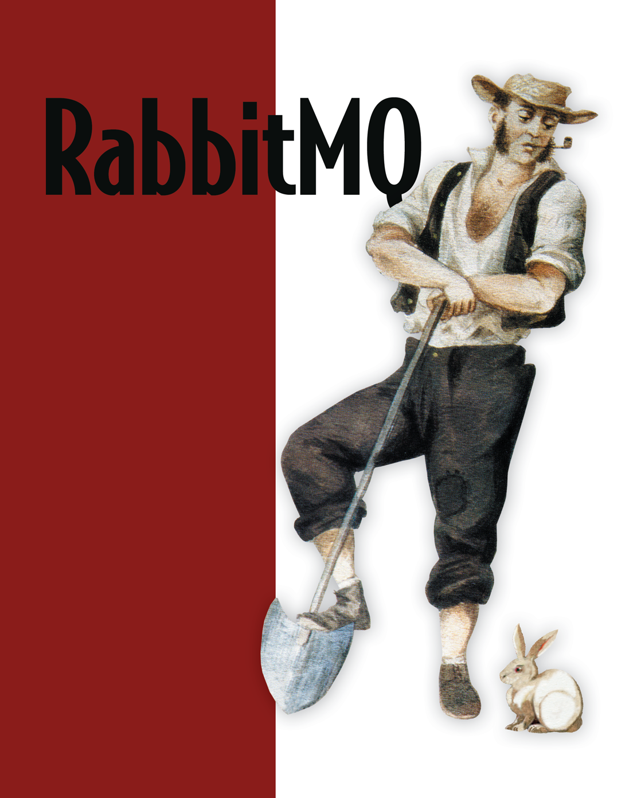

# Lời mở đầu (Front matter)

> Phần này là toàn bộ "phần đầu sách" (PDF trang 1–25) của cuốn **RabbitMQ in Action – Distributed messaging for everyone** (*RabbitMQ thực chiến – Nhắn tin phân tán cho mọi người*) của Alvaro Videla và Jason J.W. Williams, Manning Publications, 2012: trang bìa, trang tiêu đề, trang bản quyền, lời đề tặng, mục lục tóm tắt, mục lục chi tiết, lời tựa, lời nói đầu, lời cảm ơn, phần giới thiệu về cuốn sách và phần nói về hình minh họa trên bìa.

## Mục lục của phần này

- [Trang bìa (Cover)](#trang-bìa-cover)
- [Trang tiêu đề (Title page)](#trang-tiêu-đề-title-page)
- [Trang bản quyền (Copyright page)](#trang-bản-quyền-copyright-page)
- [Lời đề tặng (Dedication)](#lời-đề-tặng-dedication)
- [Mục lục tóm tắt (Brief contents)](#mục-lục-tóm-tắt-brief-contents)
- [Mục lục chi tiết (Contents)](#mục-lục-chi-tiết-contents)
- [Lời tựa (Foreword)](#lời-tựa-foreword)
- [Lời nói đầu (Preface)](#lời-nói-đầu-preface)
- [Lời cảm ơn (Acknowledgments)](#lời-cảm-ơn-acknowledgments)
  - [Alvaro](#alvaro)
  - [Jason](#jason)
- [Về cuốn sách này (About this book)](#về-cuốn-sách-này-about-this-book)
  - [Lộ trình của cuốn sách (Roadmap)](#lộ-trình-của-cuốn-sách-roadmap)
  - [Quy ước trình bày mã nguồn và tải mã nguồn (Code conventions and downloads)](#quy-ước-trình-bày-mã-nguồn-và-tải-mã-nguồn-code-conventions-and-downloads)
  - [Diễn đàn tác giả trực tuyến (Author Online)](#diễn-đàn-tác-giả-trực-tuyến-author-online)
  - [Về các tác giả (About the authors)](#về-các-tác-giả-about-the-authors)
- [Về hình minh họa trên bìa (About the cover illustration)](#về-hình-minh-họa-trên-bìa-about-the-cover-illustration)
- [Bảng thuật ngữ của chương](#bảng-thuật-ngữ-của-chương)

---

## Trang bìa (Cover)

*(PDF trang 1)*

Trang bìa ghi:

- Nhà xuất bản: **MANNING**
- Tác giả: **Alvaro Videla**, **Jason J.W. Williams**
- **Lời tựa bởi** (*Foreword by*) **Alexis Richardson**
- Tên sách: **RabbitMQ IN ACTION** (*RabbitMQ thực chiến*)
- Phụ đề: **Distributed messaging for everyone** (*Nhắn tin phân tán cho mọi người*)



*Ảnh bìa: nền nửa trái màu đỏ sẫm, chữ "RabbitMQ" lớn màu đen. Bên phải là hình vẽ một người nông dân đội mũ rơm, ngậm tẩu thuốc, tì người lên cây xẻng, đang nhìn xuống một chú thỏ trắng dưới chân (xem phần "Về hình minh họa trên bìa" ở cuối).*


*Logo của nhà xuất bản Manning: chữ "M" cách điệu màu trắng trên nền đen.*

> 📝 **Giải thích thêm (không có trong sách):** Tên "RabbitMQ" ghép từ *Rabbit* (con thỏ) và *MQ* – viết tắt của *Message Queue* (hàng đợi thông điệp). Vì vậy suốt cuốn sách, các tác giả hay gọi thân mật RabbitMQ là "Rabbit" (chú thỏ) và chơi chữ với hình ảnh thỏ, hang thỏ (*warren*)… Chú thỏ trắng trên bìa cũng là một cách chơi chữ như thế.

---

## Trang tiêu đề (Title page)

*(PDF trang 2–4)*

Trang 2 chỉ ghi tên sách: **RabbitMQ in Action**. Trang 3 để trống.

Trang 4 (trang tiêu đề chính) ghi:

**RabbitMQ in Action**
**DISTRIBUTED MESSAGING FOR EVERYONE** (*NHẮN TIN PHÂN TÁN CHO MỌI NGƯỜI*)

**ALVARO VIDELA**
**JASON J.W. WILLIAMS**

**MANNING**
SHELTER ISLAND

---

## Trang bản quyền (Copyright page)

*(PDF trang 5)*

Để biết thông tin trực tuyến và đặt mua cuốn sách này cũng như các sách khác của Manning, vui lòng truy cập www.manning.com. Nhà xuất bản có chiết khấu cho cuốn sách này khi đặt mua số lượng lớn. Để biết thêm thông tin, xin liên hệ:

> Special Sales Department (Phòng Bán hàng Đặc biệt)
> Manning Publications Co.
> 20 Baldwin Road
> PO Box 261
> Shelter Island, NY 11964
> Email: orders@manning.com

©2012 bởi Manning Publications Co. Bảo lưu mọi quyền.

Không được sao chép, lưu trữ trong hệ thống truy xuất, hoặc truyền tải bất kỳ phần nào của ấn phẩm này dưới bất kỳ hình thức nào – điện tử, cơ học, photocopy hay cách khác – khi chưa có sự cho phép trước bằng văn bản của nhà xuất bản.

Nhiều tên gọi mà các nhà sản xuất và người bán dùng để phân biệt sản phẩm của họ được đăng ký là nhãn hiệu thương mại. Khi những tên gọi đó xuất hiện trong sách, và Manning Publications biết đó là nhãn hiệu đã được đăng ký, các tên gọi này được in với chữ cái đầu viết hoa hoặc viết hoa toàn bộ.

Nhận thức được tầm quan trọng của việc bảo tồn những gì đã được viết ra, Manning có chính sách in các sách mình xuất bản trên giấy không chứa axit (*acid-free*), và chúng tôi nỗ lực hết sức để đạt mục tiêu đó. Đồng thời, nhận thức được trách nhiệm bảo tồn tài nguyên của hành tinh, sách của Manning được in trên giấy có ít nhất 15% là giấy tái chế và được xử lý không dùng clo nguyên tố (*elemental chlorine*).

| Vai trò | Người thực hiện |
|---|---|
| Biên tập viên phát triển (*Development editors*) | Maria Townsley, Cynthia Kane |
| Người hiệu đính kỹ thuật (*Technical proofreader*) | Jerry Kuch |
| Biên tập viên bản thảo (*Copyeditor*) | Benjamin Berg |
| Người đọc soát (*Proofreader*) | Katie Tennant |
| Người dàn trang (*Typesetter*) | Dottie Marsico |
| Thiết kế bìa (*Cover designer*) | Marija Tudor |

Manning Publications Co., 20 Baldwin Road, PO Box 261, Shelter Island, NY 11964

ISBN 9781935182979
In tại Hoa Kỳ (*Printed in the United States of America*)
1 2 3 4 5 6 7 8 9 10 – MAL – 17 16 15 14 13 12

---

## Lời đề tặng (Dedication)

*(PDF trang 6)*

> Gửi ông tôi, Maximiliano Godoy,
> người đã chỉ cho tôi những lẽ sống ở đời. *Gracias* (Cảm ơn ông).
>
> —A.V. (Alvaro Videla)

> Gửi Mẹ, Bố, và em gái J'aime.
> Tình yêu, sự ủng hộ và niềm tin của mọi người dành cho con
> đã giúp con có thể vượt qua những ngọn núi…
> và gửi Thiên Chúa, Đấng luôn đưa con sang tới bờ bên kia.
>
> —J.W. (Jason Williams)

*(PDF trang 7 để trống.)*

---

## Mục lục tóm tắt (Brief contents)

*(PDF trang 8 – số trang La Mã vii)*

| Chương | Tên gốc | Tên tiếng Việt | Trang |
|---|---|---|---|
| 1 | Pulling RabbitMQ out of the hat | Lôi RabbitMQ ra khỏi chiếc mũ (ảo thuật) | 1 |
| 2 | Understanding messaging | Hiểu về nhắn tin (messaging) | 12 |
| 3 | Running and administering Rabbit | Vận hành và quản trị Rabbit | 37 |
| 4 | Solving problems with Rabbit: coding and patterns | Giải quyết vấn đề với Rabbit: lập trình và các mẫu thiết kế | 60 |
| 5 | Clustering and dealing with failure | Phân cụm (clustering) và đối phó với sự cố | 87 |
| 6 | Writing code that survives failure | Viết mã sống sót qua sự cố | 107 |
| 7 | Warrens and Shovels: failover and replication | Warren và Shovel: chuyển đổi dự phòng và nhân bản | 120 |
| 8 | Administering RabbitMQ from the Web | Quản trị RabbitMQ từ giao diện Web | 137 |
| 9 | Controlling Rabbit with the REST API | Điều khiển Rabbit bằng REST API | 154 |
| 10 | Monitoring: Houston, we have a problem | Giám sát: "Houston, chúng ta có vấn đề rồi" | 167 |
| 11 | Supercharging and securing your Rabbit | Tăng tốc và bảo mật Rabbit của bạn | 195 |
| 12 | Smart Rabbits: extending RabbitMQ | Những chú thỏ thông minh: mở rộng RabbitMQ | 216 |

> 📝 **Giải thích thêm (không có trong sách):**
> - "Pulling a rabbit out of the hat" (lôi con thỏ ra khỏi chiếc mũ) là thành ngữ tiếng Anh chỉ trò ảo thuật kinh điển – nghĩa bóng là "bất ngờ tung ra một giải pháp thần kỳ". Tên chương 1 chơi chữ với chữ *Rabbit*.
> - "Houston, we have a problem" là câu nói nổi tiếng từ sứ mệnh Apollo 13 (1970), khi phi hành đoàn báo về trung tâm điều khiển ở Houston rằng tàu gặp sự cố. Tên chương 10 dùng câu này để nói về việc phát hiện sự cố qua giám sát.
> - *Warren* nghĩa đen là "hang thỏ / khu hang thỏ"; *Shovel* nghĩa đen là "cái xẻng" – đây là tên của một plugin của RabbitMQ dùng để "xúc" (chuyển) thông điệp từ broker này sang broker khác. Cả hai sẽ được giải thích kỹ ở chương 7.

*(PDF trang 9 để trống.)*

---

## Mục lục chi tiết (Contents)

*(PDF trang 10–14 – số trang La Mã ix–xiii. Số trong ngoặc là số trang trong sách gốc. Mỗi chương được trình bày với các mục đánh số; các tiểu mục không đánh số trong sách gốc được liệt kê dạng gạch đầu dòng bên dưới mục tương ứng.)*

**Phần đầu sách:**

- Lời tựa (*foreword*) — tr. xv
- Lời nói đầu (*preface*) — tr. xvii
- Lời cảm ơn (*acknowledgments*) — tr. xix
- Về cuốn sách này (*about this book*) — tr. xxi
- Về hình minh họa trên bìa (*about the cover illustration*) — tr. xxiv

### Chương 1 – Lôi RabbitMQ ra khỏi chiếc mũ (Pulling RabbitMQ out of the hat) — tr. 1

#### 1.1 Sống trong "ngục tối" của người khác (Living in other people's dungeons) — tr. 3

#### 1.2 AMQP đến giải cứu (AMQP to the rescue) — tr. 5

#### 1.3 Lược sử RabbitMQ (A brief history of RabbitMQ) — tr. 5

#### 1.4 Chọn RabbitMQ ra khỏi chiếc mũ (và các lựa chọn mã nguồn mở khác) (Picking RabbitMQ out of the hat (and other open options)) — tr. 8

#### 1.5 Cài đặt RabbitMQ trên hệ thống Unix (Installing RabbitMQ on Unix systems) — tr. 8

- Vì sao môi trường lại quan trọng – sống kiểu Erlang (*Why environment matters—living la vida Erlang*) — tr. 8
- Tải gói cài đặt (*Getting the package*) — tr. 9
- Thiết lập cấu trúc thư mục (*Setting up the folder structure*) — tr. 9
- Khởi động Rabbit lần đầu tiên (*Firing Rabbit up for the first time*) — tr. 9

#### 1.6 Tóm tắt (Summary) — tr. 10

### Chương 2 – Hiểu về nhắn tin (Understanding messaging) — tr. 12

#### 2.1 Consumer và producer (không phải bài học kinh tế đâu) (Consumers and producers (not an economics lesson)) — tr. 13

#### 2.2 Xây từ nền móng: queue (Building from the bottom: queues) — tr. 16

#### 2.3 Kết nối với nhau: exchange và binding (Getting together: exchanges and bindings) — tr. 20

#### 2.4 Nhiều "khách thuê": virtual host và sự tách biệt (Multiple tenants: virtual hosts and separation) — tr. 24

#### 2.5 Thông điệp của tôi đâu rồi? Độ bền vững (durability) và bạn (Where's my message? Durability and you) — tr. 25

#### 2.6 Ghép tất cả lại: một ngày trong đời của một thông điệp (Putting it all together: a day in the life of a message) — tr. 28

#### 2.7 Dùng publisher confirm để xác minh việc gửi (Using publisher confirms to verify delivery) — tr. 33

#### 2.8 Tóm tắt (Summary) — tr. 35

### Chương 3 – Vận hành và quản trị Rabbit (Running and administering Rabbit) — tr. 37

#### 3.1 Quản lý máy chủ (Server management) — tr. 38

- Khởi động node (*Starting nodes*) — tr. 38
- Dừng node (*Stopping nodes*) — tr. 39
- Dừng và khởi động lại ứng dụng: khác nhau ở đâu? (*Stopping and restarting the application: what's the difference?*) — tr. 40
- Các tệp cấu hình của Rabbit (*Rabbit configuration files*) — tr. 41

#### 3.2 Xin phép (Asking permission) — tr. 43

- Quản lý người dùng (*Managing users*) — tr. 43
- Hệ thống phân quyền của Rabbit (*Rabbit's permissions system*) — tr. 44

#### 3.3 Kiểm tra tình trạng (Checking up) — tr. 47

- Xem số liệu thống kê (*Viewing statistics*) — tr. 47
- Hiểu nhật ký (log) của RabbitMQ (*Understanding RabbitMQ's logs*) — tr. 52

#### 3.4 Chữa một chú thỏ "ốm": xử lý sự cố (Fixing a bad Rabbit: troubleshooting) — tr. 55

- badrpc,nodedown và các vấn đề khác do Erlang gây ra (*badrpc,nodedown and other Erlang-induced problems*) — tr. 55

#### 3.5 Tóm tắt (Summary) — tr. 59

### Chương 4 – Giải quyết vấn đề với Rabbit: lập trình và các mẫu thiết kế (Solving problems with Rabbit: coding and patterns) — tr. 60

#### 4.1 Câu chuyện về tách rời (decoupling): điều gì đẩy chúng ta đến với nhắn tin (A decoupling story: what pushes us to messaging) — tr. 61

- Tư duy bất đồng bộ (tách yêu cầu khỏi hành động) (*An asynchronous state of mind (separating requests and actions)*) — tr. 61
- Đủ sức mở rộng: một thế giới không cần bộ cân bằng tải (*Affording scale: a world without load balancers*) — tr. 63
- API không tốn công: sao phải bị trói vào một ngôn ngữ duy nhất? (*Zero-effort APIs: why be locked into just one language?*) — tr. 64

#### 4.2 Các mô hình "bắn rồi quên" (Fire-and-forget models) — tr. 65

- Gửi cảnh báo (*Sending alerts*) — tr. 65
- Xử lý song song (*Parallel processing*) — tr. 74

#### 4.3 Hãy nhớ đến tôi: RPC qua RabbitMQ và chờ câu trả lời (Remember me: RPC over RabbitMQ and waiting for answers) — tr. 80

- Queue riêng và gửi xác nhận (*Private queues and sending acknowledgements*) — tr. 81
- JSON RPC đơn giản với reply_to (*Simple JSON RPC with reply_to*) — tr. 82

#### 4.4 Tóm tắt (Summary) — tr. 86

### Chương 5 – Phân cụm và đối phó với sự cố (Clustering and dealing with failure) — tr. 87

#### 5.1 Có sẵn "pin" đi kèm: phân cụm trong RabbitMQ (Batteries included: RabbitMQ clustering) — tr. 88

#### 5.2 Kiến trúc của một cluster (Architecture of a cluster) — tr. 89

- Queue trong một cluster (*Queues in a cluster*) — tr. 89
- Phân phối exchange (*Distributing exchanges*) — tr. 91
- Tôi là node RAM hay node đĩa? (*Am I RAM or a disk?*) — tr. 92

#### 5.3 Dựng một cluster ngay trên laptop của bạn (Setting up a cluster on your laptop) — tr. 94

#### 5.4 Phân bố các node ra nhiều máy hơn (Distributing the nodes to more machines) — tr. 97

#### 5.5 Nâng cấp các node trong cluster (Upgrading cluster nodes) — tr. 100

#### 5.6 Mirrored queue (queue nhân bản) và việc bảo toàn thông điệp (Mirrored queues and preserving messages) — tr. 101

- Khai báo và sử dụng mirrored queue (*Declaring and using mirrored queues*) — tr. 101
- Bên dưới lớp vỏ của mirrored queue (*Under the hood with mirrored queues*) — tr. 104

#### 5.7 Tóm tắt (Summary) — tr. 105

### Chương 6 – Viết mã sống sót qua sự cố (Writing code that survives failure) — tr. 107

#### 6.1 Cân bằng tải cho các Rabbit của bạn (Load balancing your Rabbits) — tr. 108

- Cài đặt HAProxy (*Installing HAProxy*) — tr. 110
- Cấu hình HAProxy (*Configuring HAProxy*) — tr. 110

#### 6.2 Mất kết nối và client gặp lỗi khi chuyển giữa các máy chủ (Lost connections and failing clients between servers) — tr. 112

#### 6.3 Tóm tắt (Summary) — tr. 119

### Chương 7 – Warren và Shovel: chuyển đổi dự phòng và nhân bản (Warrens and Shovels: failover and replication) — tr. 120

#### 7.1 Warren: một cách phân cụm khác (Warrens: another way of clustering) — tr. 121

#### 7.2 Dựng cluster master/slave dựa trên bộ cân bằng tải (Setting up load balancer–based master/slave clusters) — tr. 123

#### 7.3 Liên lạc đường dài và nhân bản (Long-distance communication and replication) — tr. 126

- "Xúc" các Rabbit của bạn: giới thiệu plugin Shovel (*Shoveling your Rabbits: an introduction to the Shovel plugin*) — tr. 126
- Cài đặt Shovel (*Installing Shovel*) — tr. 129
- Cấu hình và chạy Shovel (*Configuring and running Shovel*) — tr. 130

#### 7.4 Tóm tắt (Summary) — tr. 136

### Chương 8 – Quản trị RabbitMQ từ giao diện Web (Administering RabbitMQ from the Web) — tr. 137

#### 8.1 Vượt ra ngoài rabbitmqctl: plugin RabbitMQ Management (Beyond rabbitmqctl: the RabbitMQ Management plugin) — tr. 138

- Vì sao bạn cần plugin Management (*Why you need the Management plugin*) — tr. 138
- Các tính năng của plugin Management (*Management plugin features*) — tr. 138
- Bật plugin Management (*Enabling the Management plugin*) — tr. 139

#### 8.2 Quản lý RabbitMQ từ web console (Managing RabbitMQ from the web console) — tr. 141

- Giám sát máy ảo Erlang (*Monitoring the Erlang VM*) — tr. 141
- Nhập cấu hình từ tệp JSON (*Importing configuration from JSON files*) — tr. 142

#### 8.3 Quản lý người dùng từ web console (Managing users from the web console) — tr. 143

- Tạo người dùng (*Creating users*) — tr. 143
- Quản lý quyền của người dùng (*Managing users' permissions*) — tr. 145

#### 8.4 Quản lý exchange và queue từ web console (Managing exchanges and queues from the web console) — tr. 146

- Liệt kê queue (*Listing queues*) — tr. 148
- Tạo queue (*Creating queues*) — tr. 149

#### 8.5 Quay lại dòng lệnh (Back to the command line) — tr. 150

- Vì sao lại cần thêm một CLI nữa? (*Why another CLI?*) — tr. 150
- Quản trị bằng CLI theo cách dễ hơn (*CLI administration the easier way*) — tr. 151
- Cài đặt script rabbitmqadmin (*Installing rabbitmqadmin script*) — tr. 152
- Xóa sạch (purge) queue, tạo exchange và hơn thế nữa (*Purging queues, creating exchanges, and more*) — tr. 152

#### 8.6 Tóm tắt (Summary) — tr. 153

### Chương 9 – Điều khiển Rabbit bằng REST API (Controlling Rabbit with the REST API) — tr. 154

#### 9.1 Bạn có thể làm gì với RabbitMQ REST API? (What can you do with the RabbitMQ REST API?) — tr. 155

#### 9.2 Cấp quyền truy cập cho client của bạn (Granting your clients access) — tr. 157

#### 9.3 Truy cập số liệu thống kê (Accessing statistics) — tr. 158

#### 9.4 Tự động hóa việc cấp phát vhost và người dùng (Automating vhost and user provisioning) — tr. 161

#### 9.5 Tóm tắt (Summary) — tr. 165

### Chương 10 – Giám sát: Houston, chúng ta có vấn đề rồi (Monitoring: Houston, we have a problem) — tr. 167

#### 10.1 Giám sát RabbitMQ: để mắt tới "hang thỏ" của bạn (RabbitMQ monitoring: keeping an eye on your warren) — tr. 168

- Viết health check (kiểm tra sức khỏe) cho Nagios (*Writing health checks for Nagios*) — tr. 168
- Kiểm tra RabbitMQ còn sống bằng các phép kiểm tra mô phỏng AMQP (*Checking that RabbitMQ is alive with AMQP simulation checks*) — tr. 170
- Kiểm tra trạng thái còn sống bằng REST API (*Checking aliveness with the REST API*) — tr. 172
- Tạo "chó canh" (watchdog) theo dõi thay đổi cấu hình (*Creating a watchdog for configuration changes*) — tr. 176
- Giám sát trạng thái cluster (*Monitoring your cluster status*) — tr. 180

#### 10.2 Đảm bảo consumer vẫn đang tiêu thụ (Making sure consumers are consuming) — tr. 185

- Giám sát mức độ đầy của queue qua AMQP (*Monitoring queue levels through AMQP*) — tr. 186
- Dùng REST API để theo dõi mức độ đầy của queue (*Using the REST API to watch queue levels*) — tr. 190
- Các nguyên tắc kinh nghiệm để xác lập ngưỡng cơ sở cho số lượng thông điệp trong queue (*Rules of thumb for establishing a queue count baseline*) — tr. 193

#### 10.3 Tóm tắt (Summary) — tr. 194

### Chương 11 – Tăng tốc và bảo mật Rabbit của bạn (Supercharging and securing your Rabbit) — tr. 195

#### 11.1 Nhu cầu về tốc độ (The need for speed) — tr. 196

- Độ bền vững của thông điệp (*Message durability*) — tr. 196
- Xác nhận thông điệp (*Message acknowledgment*) — tr. 197
- Thuật toán định tuyến và binding (*Routing algorithm and bindings*) — tr. 197
- Chuyển phát thông điệp (*Delivering messages*) — tr. 198

#### 11.2 Sử dụng bộ nhớ và giới hạn tiến trình (Memory usage and process limits) — tr. 200

- Sử dụng bộ nhớ (*Memory usage*) — tr. 201
- Số lượng tiến trình Erlang (*Erlang process count*) — tr. 203

#### 11.3 Kết nối SSL (SSL connections) — tr. 204

- Chứng chỉ SSL (*SSL certificates*) — tr. 204
- Dựng một tổ chức cấp chứng chỉ (CA) (*Setting up a certificate authority*) — tr. 206
- Tạo chứng chỉ gốc (*Generating the root certificate*) — tr. 209
- Tạo chứng chỉ cho máy chủ (*Generating the server certificates*) — tr. 210
- Tạo chứng chỉ cho client (*Generating the client certificates*) — tr. 211
- Bật các listener SSL trong RabbitMQ (*Enabling SSL listeners in RabbitMQ*) — tr. 211
- Kiểm thử thiết lập SSL của RabbitMQ (*Testing your RabbitMQ SSL setup*) — tr. 213

#### 11.4 Tóm tắt (Summary) — tr. 215

### Chương 12 – Những chú thỏ thông minh: mở rộng RabbitMQ (Smart Rabbits: extending RabbitMQ) — tr. 216

#### 12.1 Plugin của RabbitMQ (RabbitMQ plugins) — tr. 217

- Bạn có thể làm gì với plugin? (*What can you do with plugins?*) — tr. 217
- Tìm plugin ở đâu? (*Where do you find plugins?*) — tr. 218
- Cài đặt plugin (*Installing plugins*) — tr. 218
- Gỡ bỏ plugin (*Removing plugins*) — tr. 220

#### 12.2 Tự viết plugin của riêng bạn (Making your own plugins) — tr. 221

- Lấy RabbitMQ Public Umbrella (*Getting the RabbitMQ Public Umbrella*) — tr. 222
- Thiết lập cấu trúc thư mục (*Setting up the folder structure*) — tr. 223
- Đưa hệ thống build plugin vào (*Including the plugin build system*) — tr. 223
- Tạo tệp ứng dụng Erlang (*Creating the Erlang application file*) — tr. 224

#### 12.3 Tạo module exchange tùy biến của bạn (Creating your custom exchange module) — tr. 225

- Đăng ký exchange của bạn với RabbitMQ (*Registering your exchange with RabbitMQ*) — tr. 227
- Hiện thực behaviour của exchange (*Implementing the exchange behaviour*) — tr. 230
- Biên dịch exchange tùy biến (*Compiling your custom exchange*) — tr. 236
- Chạy thử plugin của bạn (*Taking your plugin for a test drive*) — tr. 239

#### 12.4 Tóm tắt (Summary) — tr. 243

### Phụ lục và chỉ mục

- **Phụ lục A** – Dùng Rabbit từ Java và .NET (*appendix A – Using Rabbit from Java and .NET*) — tr. 244
- **Phụ lục B** – Tài nguyên trực tuyến (*appendix B – Online resources*) — tr. 270
- **Phụ lục C** – Cài đặt RabbitMQ trên Windows (*appendix C – Installing RabbitMQ on Windows*) — tr. 275
- **Chỉ mục** (*index*) — tr. 279

> 📝 **Giải thích thêm (không có trong sách):** Một vài cách chơi chữ trong mục lục:
> - "Living la vida Erlang" (mục 1.5) nhại tên bài hát nổi tiếng "Livin' la Vida Loca" của Ricky Martin – ý nói "sống theo kiểu Erlang", vì RabbitMQ được viết bằng Erlang nên cần có môi trường Erlang để chạy.
> - "Consumers and producers (not an economics lesson)" (mục 2.1): *consumer* và *producer* trong kinh tế học là "người tiêu dùng" và "nhà sản xuất"; còn trong nhắn tin, đó là "bên nhận/tiêu thụ thông điệp" và "bên tạo/gửi thông điệp".
> - "Batteries included" (mục 5.1) là thành ngữ "có sẵn pin đi kèm" – nghĩa là tính năng phân cụm có sẵn trong RabbitMQ, không cần cài thêm gì.

*(PDF trang 15 để trống.)*

---

## Lời tựa (Foreword)

*(PDF trang 16–17 – số trang La Mã xv–xvi)*

Chào mừng bạn đến với *RabbitMQ in Action*. Nếu bạn cũng giống tôi, có lẽ bạn đang tự hỏi: "Mình có nên đọc tiếp sau trang đầu tiên không nhỉ?" Than ôi, có quá nhiều sách công nghệ được viết và xuất bản, và không phải cuốn nào cũng đáng được quan tâm hơn mức hời hợt. Vì vậy, tôi xin mời bạn đọc tiếp, nếu bạn thấy mình hợp với mô tả sau:

- Bạn muốn có một cách thực tế để học về công nghệ đẩy (*push technology*), dữ liệu truyền dạng luồng (*streaming data*) và các mẫu nhắn tin (*messaging patterns*) khác.
- Bạn muốn đạt trình độ chuyên môn ở mức chuyên nghiệp với RabbitMQ, bao gồm các thực hành tốt nhất (*best practices*) cho việc thiết kế và vận hành trong môi trường production (môi trường chạy thật).

Nói cách khác, cuốn sách này không chỉ là một cuốn hướng dẫn về RabbitMQ. Nó dạy các mẫu thiết kế (*design patterns*) nền tảng áp dụng cho rất nhiều tình huống sử dụng. Nó cho thấy vì sao ngày càng nhiều ứng dụng dùng chúng – và đâu là những điều "nên làm" và "không nên làm".

Vậy những mẫu thiết kế này là gì? Nếu bạn từng muốn vẽ hệ thống của mình thành một dòng chảy thông tin hay một mạng lưới, thay vì vẽ thành một chồng các tầng xếp lên nhau (*stack*), thì có lẽ bạn đang dùng nhắn tin (*messaging*), hoặc đã sẵn sàng để dùng nó. Có thể bạn đang nghĩ tới việc chuyển phát dữ liệu (*data delivery*), các thao tác không chặn (*nonblocking operations*), hay thông báo đẩy (*push notifications*). Hoặc bạn muốn dùng mô hình xuất bản/đăng ký (*publish/subscribe*), xử lý bất đồng bộ (*asynchronous processing*), hay hàng đợi công việc (*work queues*). Tất cả những thứ đó đều là các mẫu thiết kế, và chúng cùng tạo nên "khung vẽ thiết kế" được gọi là nhắn tin (*messaging*).

Nhắn tin là một năng lực then chốt: nó cho phép các ứng dụng phần mềm kết nối với nhau và mở rộng quy mô (*scale*). Các ứng dụng có thể kết nối với nhau như những thành phần của một ứng dụng lớn hơn, hoặc kết nối với thiết bị và dữ liệu của người dùng. Về bản chất, nhắn tin là bất đồng bộ (*asynchronous*), vì nó tách rời (*decouple*) các ứng dụng bằng cách tách việc gửi dữ liệu khỏi việc nhận dữ liệu. Điều tuyệt vời là mẫu kết nối này hoạt động y hệt nhau ở mọi quy mô.

> 📝 **Giải thích thêm (không có trong sách):** "Tách việc gửi khỏi việc nhận" nghĩa là bên gửi không cần biết bên nhận là ai, đang ở đâu, có đang chạy hay không. Bên gửi chỉ việc giao thông điệp cho một "bưu điện" trung gian (*message broker*, như RabbitMQ); bên nhận sẽ lấy thông điệp khi sẵn sàng. Hai bên không phải chờ nhau – đó chính là "bất đồng bộ".

> 💡 **Ví dụ bổ sung (không có trong sách):** Hãy hình dung một trang web bán hàng. Khi khách bấm "Đặt hàng", hệ thống cần: lưu đơn, gửi email xác nhận, cập nhật kho, báo cho bộ phận giao hàng.
> - **Cách đồng bộ (không dùng nhắn tin):** máy chủ web lần lượt gọi trực tiếp dịch vụ email, dịch vụ kho, dịch vụ giao hàng rồi mới trả lời khách. Nếu dịch vụ email chậm 5 giây, khách phải chờ 5 giây; nếu dịch vụ kho đang sập, cả đơn hàng bị lỗi.
> - **Cách dùng nhắn tin:** máy chủ web chỉ lưu đơn rồi gửi một thông điệp "có đơn hàng mới #123" lên RabbitMQ, và trả lời khách ngay lập tức. Các dịch vụ email, kho, giao hàng mỗi bên tự lấy thông điệp về xử lý theo tốc độ của mình. Dịch vụ kho có sập 10 phút thì thông điệp vẫn nằm chờ trong queue, khi chạy lại sẽ xử lý tiếp. Khi đơn hàng tăng gấp 10 lần, chỉ cần chạy thêm vài tiến trình xử lý (*worker*) – mẫu kết nối vẫn y nguyên, đúng như tác giả lời tựa nói "hoạt động y hệt nhau ở mọi quy mô".

Quy mô chính là điểm mấu chốt. Việc Internet trở thành nền tảng thống trị để phân phối ứng dụng đã biến quy mô thành yếu tố quyết định trong thiết kế ứng dụng. Nghĩ nhỏ không còn chấp nhận được nữa. Gần đây thuật ngữ dữ liệu lớn (*big data*) đã trở thành mốt. Nhưng giờ đây mọi thứ đều "lớn", nếu so với chỉ vài năm trước.

Ví dụ, số lượng thiết bị di động có kết nối sẽ sớm vượt quá số người trên trái đất, có lẽ là vào năm 2012. Khi tôi viết những dòng này, Facebook sắp IPO (phát hành cổ phiếu lần đầu ra công chúng). CTO (giám đốc công nghệ) Bret Taylor từng nói rằng "Facebook lẽ ra đã là một ứng dụng di động nếu công nghệ đó đã có sẵn vào lúc Mark Zuckerberg xây dựng nó trong phòng ký túc xá."

Hãy dành chút thời gian suy nghĩ về điều đó. Phần lớn ứng dụng trước đây trông như thế này: bạn mở một tài liệu hoặc lấy dữ liệu từ cơ sở dữ liệu, xử lý một chút, rồi ghi kết quả xuống đĩa. Các ứng dụng tương lai sẽ giống Facebook hơn: luôn trực tuyến (*always on*), được lưu trữ trên đám mây (*cloud hosted*), và truy cập được từ bất cứ đâu. Dữ liệu đầu vào và việc xử lý diễn ra liên tục và tự động, và chúng chuyển tới người dùng một dòng thông tin đã được lọc – đúng những gì người dùng muốn – ngay khi sự việc diễn ra.

Những mức độ tự động hóa, độ phủ và quy mô như vậy là không thể đạt được nếu không áp dụng một bộ mẫu thiết kế rất đặc thù. Chính những mẫu thiết kế này là thứ bạn có thể học trong cuốn sách. Derek Collison, một trong những người khởi xướng công nghệ nhắn tin hiện đại, đã mô tả một cách đáng nhớ rằng nhắn tin giúp hiện thực hóa "dữ liệu đang chuyển động" (*data in motion*). Thật khó để tưởng tượng một ứng dụng nào không cần di chuyển dữ liệu. Vì vậy, nhắn tin có mặt ở khắp nơi.

Cuốn sách này giúp bạn bắt tay vào việc ngay lập tức. Các mẫu thiết kế được trình bày dưới dạng các ví dụ mã mà bạn có thể chạy được, và các tác giả đặc biệt chú ý giúp bạn vận hành hệ thống của mình nữa. Với Jason J. W. Williams và Alvaro Videla, bạn được tiếp cận với những chuyên gia đã vận hành các hệ thống RabbitMQ quy mô lớn trong nhiều năm. Cuốn sách này là sự kết tinh tự nhiên từ công sức xuất sắc của họ trong việc chia sẻ những kinh nghiệm đó với cộng đồng.

Sau khi đã "cảm" được RabbitMQ, bạn sẽ rất dễ tìm được sự trợ giúp và thêm nhiều ví dụ thông qua cộng đồng người dùng RabbitMQ rộng lớn, bất kể bạn viết mã bằng ngôn ngữ nào. Điều đó khiến RabbitMQ trở thành một lựa chọn tuyệt vời cho nhu cầu nhắn tin của bạn.

Tôi hy vọng những lời này đã khơi dậy sự háo hức để bạn lật sang trang và đọc tiếp. Sẽ có những thông điệp, sẽ có những chú thỏ, và mọi thứ sẽ được hé lộ.

**ALEXIS RICHARDSON**
Đồng sáng lập và cựu CEO (*Cofounder and former CEO*)
RABBIT TECHNOLOGIES, LTD.
Giám đốc cấp cao (*Senior Director*)
VMWARE CLOUD APPLICATION PLATFORM

---

## Lời nói đầu (Preface)

*(PDF trang 18–19 – số trang La Mã xvii–xviii)*

Viết cuốn sách này cũng giống như chính việc khám phá ra RabbitMQ – gặp phải một vấn đề cần giải quyết, nhưng chưa biết lời giải trông ra sao. Cho tới tháng 5 năm 2010, hai chúng tôi thậm chí còn chưa biết nhau. Cả hai đều đã tích cực tham gia cộng đồng RabbitMQ trong hai năm trước đó, nhưng chưa bao giờ thực sự "đụng mặt" nhau. Rồi một ngày, một cuộc trò chuyện với Alexis Richardson (CEO của Rabbit khi đó) đã giới thiệu Alvaro và tôi với nhau, và làm nên thứ mà bạn đang cầm trên tay. Điểm chung của chúng tôi là mong muốn ghi lại vào một chỗ duy nhất toàn bộ kiến thức về RabbitMQ mà chúng tôi đã phải học theo cách khó khăn. Hồi năm 2010, kiến thức ấy nằm rải rác (và đến nay phần lớn vẫn vậy) khắp Internet, trong lác đác vài bài blog và những hướng dẫn kỹ thuật cụt lủn. Nói cách khác, cả hai chúng tôi đều muốn viết ra cuốn sách mà chúng tôi ước gì đã có khi bắt đầu với RabbitMQ hai năm trước đó.

Cả hai chúng tôi đều không xuất thân từ lĩnh vực nhắn tin truyền thống, điều đó khiến chúng tôi nhanh chóng thành bạn thân và phần lớn định hình nên giọng văn của *RabbitMQ in Action*; chúng tôi muốn cuốn sách này dễ tiếp cận với cả những người chưa bao giờ nghe tới queue (hàng đợi) hay binding (liên kết) là gì. Thực ra, khi mỗi người chúng tôi khám phá ra RabbitMQ, chúng tôi còn không biết "nhắn tin" (*messaging*) là gì, cũng không biết rằng nó chính là lời giải cho những vấn đề mình đang gặp. Tình huống của tôi (Jason) là: công ty tôi cần một cách để lấy các báo cáo thư rác (*spam*) mà khách hàng gửi về và xử lý chúng tách biệt (*out-of-band*) khỏi luồng thư đến chính. Còn với Alvaro, công ty anh ấy có một mạng xã hội mà hệ thống liên lạc giữa các thành viên đang "rên rỉ" dưới sức nặng của một cơ sở dữ liệu 200 GB. Giống như rất nhiều người khác đã tìm đến nhắn tin, cả hai chúng tôi đều đã thử giải quyết các vấn đề xoay quanh hàng đợi bằng các bảng trong cơ sở dữ liệu trước. Những vấn đề như đảm bảo rằng chỉ có đúng một phiên bản ứng dụng tiêu thụ một mục cụ thể trong hàng đợi đã liên tục hành hạ các nỗ lực giải quyết bằng cơ sở dữ liệu của chúng tôi, và khiến chúng tôi đi tìm một cách tốt hơn. Dù sao thì, chúng tôi biết mình không thể là những người đầu tiên trong lịch sử phần mềm gặp phải những vấn đề này.

> 📝 **Giải thích thêm (không có trong sách):** Vì sao dùng bảng cơ sở dữ liệu làm hàng đợi lại khổ? Giả sử bạn có bảng `jobs(id, payload, status)` và ba worker cùng chạy câu lệnh "lấy một job có `status = 'new'`". Nếu không khóa cẩn thận, cả ba worker có thể cùng đọc trúng job #42 trước khi kịp cập nhật `status = 'processing'` – thế là job bị xử lý ba lần (ví dụ: gửi ba email giống hệt nhau cho khách). Muốn tránh thì phải dùng giao dịch, khóa dòng (`SELECT ... FOR UPDATE`), liên tục thăm dò (*polling*) bảng – vừa phức tạp vừa làm cơ sở dữ liệu quá tải. Một message broker như RabbitMQ giải quyết chuyện này sẵn: mỗi thông điệp trong một queue chỉ được giao cho **một** consumer tại một thời điểm, và broker chủ động đẩy thông điệp tới consumer thay vì để consumer phải hỏi liên tục.

Lời giải đến với cả hai chúng tôi theo một cách giống nhau đến bất ngờ: một người bạn ở Plaxo bảo tôi hãy xem thử "cái thứ RabbitMQ này" như một cách để giải quyết các vấn đề xoay quanh hàng đợi của tôi, và một đồng nghiệp chuyên Erlang của Alvaro ở Trung Quốc cũng cho anh ấy lời khuyên y hệt. Ở hai nửa vòng trái đất, cả hai chúng tôi đều khám phá ra RabbitMQ theo cùng một cách, và khi đang cố giải quyết gần như chính xác cùng một vấn đề! Thực tế, vì bạn đang đọc cuốn sách về RabbitMQ này, rất có thể những thách thức tương tự đã dẫn bạn tới RabbitMQ theo cùng cách ấy. Điều đó nói lên lý do vì sao RabbitMQ phổ biến đến vậy: nó dễ dàng giải quyết những vấn đề cơ bản về phân phối dữ liệu mà ai trong chúng ta cũng gặp đi gặp lại khi cố gắng mở rộng quy mô phần mềm mình xây dựng.

Chúng tôi hy vọng *RabbitMQ in Action* sẽ giúp bạn thiết kế lời giải cho những thách thức đó nhanh hơn và dễ hơn với RabbitMQ, để bạn có thể dành nhiều thời gian hơn viết những phần mềm sẽ thay đổi thế giới, và ít thời gian hơn cho việc làm quen với message broker (máy chủ trung gian chuyển thông điệp) sẽ giúp bạn làm điều đó. Biết đâu trên đường đi, RabbitMQ sẽ giới thiệu bạn với một người đồng tác giả tuyệt vời, người sẽ trở thành người bạn suốt đời mà bạn không ngờ tới.¹ Cuốn sách này là sản phẩm của tình yêu chúng tôi dành cho việc viết phần mềm, và chúng tôi hy vọng nó sẽ giúp bạn cũng làm được như vậy theo những cách bạn chưa từng nghĩ là có thể.

**ALVARO VIDELA**
DÜBENDORF, THỤY SĨ

**JASON J. W. WILLIAMS**
BOISE, IDAHO, HOA KỲ

---

¹ *Chú thích:* Người ta bảo rằng quan hệ đồng tác giả có tỷ lệ "ly hôn" còn tệ hơn cả hôn nhân. Đó không phải là một phép so sánh tồi, vì cùng nhau viết một cuốn sách đòi hỏi sự cho-và-nhận liên tục và sự tôn trọng lẫn nhau – giống hệt những gì cần có để sống chung trong một không gian chật hẹp. Vì vậy, đó là một phước lành bất ngờ: không chỉ viết được một cuốn sách, mà còn tìm được một người bạn có những ý tưởng có thể "sống chung" với ý tưởng của mình, và cùng tạo nên một tổng thể vĩ đại hơn nhiều so với những gì bạn có thể đạt được một mình.

---

## Lời cảm ơn (Acknowledgments)

*(PDF trang 20–21 – số trang La Mã xix–xx)*

Chỉ có hai cái tên xuất hiện trên bìa cuốn sách này, nhưng còn nhiều người nữa mà nếu không có họ, cuốn sách đã không tồn tại. Trước hết và trên hết, chúng tôi muốn cảm ơn Alexis Richardson, CEO của RabbitMQ khi chúng tôi bắt đầu viết. Nếu không có lời giới thiệu của anh, Manning đã không "gõ cửa hộp thư" của chúng tôi, và chúng tôi đã không bao giờ cùng nhau viết một cuốn sách. Chúng tôi cũng cảm ơn anh đã viết lời tựa cho cuốn sách. Cũng theo tinh thần đó, chúng tôi xin bày tỏ lòng biết ơn sâu sắc nhất tới đội ngũ RabbitMQ vì đã liên tục giúp đỡ và trả lời vô số câu hỏi không ngớt của chúng tôi về những chi tiết vụn vặt nhất của Rabbit. Đặc biệt, chúng tôi nợ lời cảm ơn tới Matthew Sackman và Matthias Radestock – không có họ thì các chương về phân cụm (*clustering*) và cơ chế bên trong RabbitMQ đã không thể thành hình.

Trên tất cả, chúng tôi mang một món nợ ân tình không thể đong đếm với Jerry Kuch trong đội ngũ RabbitMQ. Jerry đã tình nguyện bỏ ra không biết bao nhiêu giờ để đọc đi đọc lại bản nháp từng chương nhằm kiểm tra độ chính xác, kể cả tự mình thực hiện bản thẩm định kỹ thuật "chính thức" cho toàn bộ cuốn sách đã hoàn thành. Mỗi khi chúng tôi cần làm rõ điều gì hay cần lời khuyên vượt ngoài kinh nghiệm của mình, Jerry luôn ở ngay đó, chỉ cách một tin nhắn (IM). Anh không bao giờ cáu kỉnh và chưa từng phàn nàn về việc làm đầu mối liên lạc của chúng tôi trong đội RabbitMQ. Nếu bạn thấy mình khám phá ra những chi tiết nhỏ thú vị về cách Rabbit hoạt động mà trước giờ bạn chưa biết, rất có thể bạn nên cảm ơn Jerry Kuch. Anh ấy thực sự đã làm cho cuốn sách tốt hơn, và là một kỹ sư tuyệt vời.

Ở Manning, chúng tôi không biết cảm ơn sao cho đủ biên tập viên phát triển chính của chúng tôi, Maria Townsley. Maria đã giữ cho chúng tôi tiếp tục viết và đi đúng hướng. Cô đã chịu đựng lịch làm việc của chúng tôi, và cả phong cách nộp bài "lúc thì dồn dập, lúc thì im bặt" của chúng tôi. Trên hết, cô là người bênh vực chúng tôi và đấu tranh cho những gì quan trọng với chúng tôi. Nếu bạn thích văn phong của *RabbitMQ in Action*, hãy cảm ơn Maria vì cô chính là người đã giương cao ngọn cờ cho nó. Chúng tôi cũng vô cùng biết ơn Cynthia Kane đã đưa chúng tôi vượt qua những chương cuối cùng và tới được khâu in ấn. Cynthia đã vào thay làm biên tập viên phát triển cuối cùng khi chúng tôi đã "quen nếp" của mình. Cô đã thích nghi với cách làm việc của chúng tôi, và đối xử với cuốn sách như thể cô đã gắn bó với nó cùng chúng tôi ngay từ ngày đầu. Cynthia thật sự là "huấn luyện viên chốt gôn thứ ba" của chúng tôi và đã đưa chúng tôi về đích.

> 📝 **Giải thích thêm (không có trong sách):** "Third-base coach" là thuật ngữ bóng chày: huấn luyện viên đứng cạnh chốt gôn thứ ba, ra hiệu cho cầu thủ chạy khi nào thì lao về "home plate" (đích) để ghi điểm. Ý tác giả: Cynthia là người dẫn dắt họ qua chặng cuối và "về đích" – tức là hoàn thành và in được sách.

Cuối cùng, chúng tôi muốn cảm ơn những độc giả tận tụy đã mua cuốn sách trong Chương trình Truy cập Sớm của Manning (*Manning's Early Access Program – MEAP*), cũng như những người thẩm định (*reviewers*) của chúng tôi: Barry Alexander, P. David Pull, Bruce Snyder, Tony Garnock-Jones, James Williams, Patrick Lemiuex, Bruce Lowekamp, Carlton Gibson, Paul Grebenc, Richard Siddaway, Gordon Dickens, Gene Campbell, Karsten Strøbæk, Jeff Addison, David Dossot, Daniel Bretoi và Ben Rockwood. Các bạn không được trả công, vậy mà vẫn cho chúng tôi những phản hồi chi tiết và lời khuyên chu đáo như thể cuốn sách cũng là "đứa con" của các bạn vậy. Nhờ các bạn, cuốn sách này đã tốt hơn không thể đo đếm được, theo những cách mà chính chúng tôi cũng không lường trước. Xin cảm ơn.

### Alvaro

Tôi muốn cảm ơn vợ tôi, Silvana, vì đã luôn ở bên ủng hộ tôi trong suốt thời gian viết cuốn sách này. Bao nhiêu bộ phim chúng tôi đã không xem, và bao nhiêu lần chúng tôi đã không đi dạo cùng nhau vì tôi bận viết sách? Tôi không biết… nhưng tất cả những gì tôi có thể nói lúc này là: cảm ơn em đã thấu hiểu. Một lời cảm ơn lớn nữa xin gửi tới mẹ tôi, vì đã luôn tin tưởng tôi. Rốt cuộc thì, viết một cuốn sách là nỗ lực của cả gia đình. Tôi cũng muốn cảm ơn những người bạn cũ ở The Netcircle tại Trung Quốc – nơi tôi bị "nhiễm cơn sốt thỏ" và đã bắt họ phải nghe chữ RabbitMQ quá nhiều lần mỗi ngày. Cuối cùng, tôi muốn cảm ơn Jason; Manning đã giới thiệu cho tôi một người đồng tác giả, và rốt cuộc tôi có thêm một người bạn tuyệt vời.

### Jason

Tôi không bao giờ có thể cảm ơn bố mẹ và em gái tôi cho đủ vì sự ủng hộ và tình yêu của họ trong suốt quá trình này. Họ tin tưởng tôi và thúc giục tôi tiến lên – kể cả việc đảm bảo rằng cái "mông" (*derrière*) của tôi bị đẩy ra khỏi cửa để tới quán cà phê ngồi viết vào những lúc tôi không muốn. Họ luôn tin rằng tôi sẽ hoàn thành cuốn sách này, kể cả khi đích đến trông còn quá xa vời.

Tôi đủ may mắn để gọi bố mẹ mình là những người cộng sự trong công ty khởi nghiệp mà chúng tôi cùng sáng lập, và với tư cách cộng sự, tôi mang một món nợ lớn với bố mẹ và với DigiTar vì chưa bao giờ phàn nàn khi việc viết sách lấn vào giờ làm, và vì đã cho tôi sự linh hoạt để cân bằng cả hai. Nếu không có công ty của chúng tôi, tôi đã không bao giờ có động lực để khám phá Rabbit hay viết những bài hướng dẫn trên blog – những bài đã dẫn tới việc tôi được mời viết cuốn sách này. Trong số rất nhiều phước lành và cơ hội mà DigiTar đã mang lại cho tôi, cuốn sách này là một.

Cuối cùng, cảm ơn Alvaro. Bạn là người bạn mà tôi chưa từng biết là có tồn tại, người chiến hữu luôn kiên định sát cánh, và thực sự là "người anh em khác cha khác mẹ" của tôi. Cảm ơn bạn vì đã là một phước lành bất ngờ.

---

## Về cuốn sách này (About this book)

*(PDF trang 22–24 – số trang La Mã xxi–xxiii)*

RabbitMQ là một message broker (máy chủ trung gian môi giới thông điệp) và máy chủ hàng đợi (*queueing server*) mã nguồn mở. Nó có thể được dùng để cho các ứng dụng khác biệt nhau chia sẻ dữ liệu thông qua một giao thức chung, hoặc đơn giản là để xếp hàng các công việc (*jobs*) chờ được xử lý bởi các worker (tiến trình xử lý) phân tán. Dự án của bạn lớn hay nhỏ không quan trọng: RabbitMQ có thể thích nghi với nhu cầu của bạn. Bạn muốn nhanh chóng làm bản mẫu (*prototype*) cho một thành phần của ứng dụng bằng ngôn ngữ X, và chắc chắn rằng ngày mai có thể dễ dàng chuyển nó sang một ngôn ngữ cho hiệu năng cao hơn? RabbitMQ có thể giúp bạn bằng cách tách rời (*decoupling*) giao thức liên lạc. Bạn cần xử lý ảnh mà người dùng tải lên mạng xã hội của mình ngay khi ảnh tới, đồng thời có thể thêm hoặc bớt worker một cách dễ dàng? Bạn có thể dùng các queue của Rabbit để lưu công việc và để broker lo việc cân bằng tải (*load balancing*) và phân phối công việc giúp bạn. Những vấn đề như vậy có thể được giải quyết dễ dàng và nhanh chóng bằng RabbitMQ; cuốn sách này ở đây để chỉ cho bạn cách hiện thực tốt nhất các kiến trúc của bạn xoay quanh nhắn tin.

> 💡 **Ví dụ bổ sung (không có trong sách):** Bài toán "xử lý ảnh tải lên" được nhắc ở trên có thể hình dung như sau:
>
> ```mermaid
> flowchart LR
>     W["Máy chủ web (nhận ảnh upload)"] -->|"thông điệp: resize ảnh #1, #2, #3..."| Q[("Queue 'image_jobs' trong RabbitMQ")]
>     Q -->|"job #1"| A["Worker A"]
>     Q -->|"job #2"| B["Worker B"]
>     Q -->|"job #3"| C["Worker C (vừa thêm vào)"]
> ```
>
> Máy chủ web chỉ việc đẩy mỗi ảnh mới thành một thông điệp vào queue. RabbitMQ chia lần lượt các thông điệp cho những worker đang kết nối (phân phối kiểu xoay vòng – *round-robin*). Mùa cao điểm, bạn bật thêm Worker C, D… mà không phải sửa một dòng code nào ở máy chủ web; hết cao điểm thì tắt bớt. Thêm nữa, máy chủ web có thể viết bằng PHP còn worker viết bằng Python – miễn là cả hai cùng nói giao thức AMQP với RabbitMQ. Đó chính là ý "tách rời giao thức liên lạc" và "để broker lo cân bằng tải" mà tác giả nói.

Lập trình ứng dụng là một chuyện – giữ cho ứng dụng luôn hoạt động mới là lúc thử thách bắt đầu. Đừng lo; cuốn sách này cũng bao quát các thực hành tốt nhất cho việc quản trị, phân cụm, bảo mật và giám sát RabbitMQ, để bạn học được cả khía cạnh vận hành.

Cuối cùng, chúng ta sẽ đi vào "bộ não" của RabbitMQ và những chi tiết bên trong giúp bạn hiểu các tài nguyên hệ thống mà broker sử dụng, để bạn có thể lập kế hoạch dung lượng (*capacity planning*) ngay khi thiết kế kiến trúc. Bạn cũng sẽ học cách mở rộng broker bằng cách cài đặt plugin và tự viết plugin của riêng mình – vì, tại sao lại không chứ? Hãy chuẩn bị sẵn trình soạn thảo, vì bạn sẽ viết mã bằng Python, PHP, Erlang, Java và C#.

### Lộ trình của cuốn sách (Roadmap)

**Chương 1** giải thích nguồn gốc của giao thức AMQP, RabbitMQ đã ra đời như thế nào, và nó xuất hiện để giải quyết những vấn đề gì của ngành công nghiệp. Tiếp theo, bạn sẽ cài đặt máy chủ và tạo chương trình Hello World đầu tiên gửi dữ liệu qua RabbitMQ.

**Chương 2** đưa bạn đắm mình vào thế giới nhắn tin. Chúng ta đi từ các khái niệm cơ bản cho tới việc xem các khái niệm đó được ánh xạ thế nào vào AMQP (giao thức mà RabbitMQ sử dụng). Khi đã qua được phần đó, bạn sẽ học về độ bền vững của thông điệp (*message durability*) và điều gì xảy ra trong "cuộc đời" của một thông điệp, từ lúc được xuất bản (*published*) cho tới lúc được tiêu thụ (*consumed*) ở đầu bên kia của mạng.

**Chương 3** trình bày những điều cơ bản về quản lý máy chủ. Bạn sẽ thấy cách khởi động và dừng các node, cách cấu hình quyền, và cách lấy số liệu thống kê về những gì đang diễn ra trên máy chủ. Chúng tôi cũng đưa ra một số mẹo hữu ích để xử lý sự cố máy chủ.

**Chương 4** dạy bạn về các mẫu nhắn tin và thực hành tốt nhất. Bạn sẽ học về các mô hình "bắn rồi quên" (*fire-and-forget*), kiến trúc RPC (*Remote Procedure Call* – gọi thủ tục từ xa), và nhiều thứ khác nữa.

**Chương 5** mở đầu loạt ba chương về phân cụm RabbitMQ và thiết lập cho tính sẵn sàng cao (*high availability*). Ở đây bạn sẽ dựng một cluster RabbitMQ cả trên máy cục bộ lẫn trên các máy chủ vật lý. Bạn sẽ học cách nâng cấp một cluster gồm các node RabbitMQ và cách dùng mirrored queue (queue nhân bản).

**Chương 6** bàn về cách cân bằng tải cho một tập hợp các broker RabbitMQ bằng HAProxy, đồng thời dạy cách tạo các client nhắn tin "thông minh" biết cách kết nối lại tới broker khi có sự cố.

**Chương 7** kết thúc loạt chương về tính sẵn sàng cao bằng cách giải thích cách các cặp broker chủ động/dự phòng (*active/standby*) hoạt động. Bạn cũng sẽ học về plugin Shovel, cho phép RabbitMQ nhân bản dữ liệu qua nhiều trung tâm dữ liệu (*data center*).

**Chương 8** là nơi việc quản trị RabbitMQ trở nên trực quan. Bạn sẽ học về plugin RabbitMQ Management và giao diện web của nó, nhưng chúng tôi không dừng ở đó: chúng tôi còn điểm qua REST API mà plugin này cung cấp.

**Chương 9** xây tiếp trên chương trước bằng cách giải thích chi tiết REST API. Ở đây bạn sẽ học cách thực hiện phần lớn các tác vụ quản trị ngay từ mã của bạn bằng API này. Việc cấp phát (*provisioning*) người dùng và virtual host mới cho các ứng dụng chưa bao giờ dễ đến thế.

**Chương 10** dạy bạn cách giám sát RabbitMQ, từ các phép kiểm tra của Nagios cho tới việc dùng AMQP và REST API để giám sát trạng thái bên trong của máy chủ. Bạn sẽ học những gì có thể làm để phát hiện vấn đề trước khi chúng xảy ra.

**Chương 11** giải thích chi tiết cơ chế hoạt động bên trong của exchange (các thuật toán định tuyến mà RabbitMQ sử dụng). Chúng tôi đi vào chi tiết các tài nguyên mà "mạng lưới nhắn tin" (*messaging fabric*) của bạn sử dụng, để thấy được điều gì sẽ xảy ra với từng quyết định kiến trúc của bạn. Chúng tôi cũng bao quát khía cạnh bảo mật bằng cách hướng dẫn bạn bật kết nối SSL cho ứng dụng.

**Chương 12** khép lại cuốn sách bằng cách chỉ ra cách mở rộng hành vi của RabbitMQ, vừa bằng cách thêm các plugin mới do người khác viết, vừa bằng cách tự tạo plugin của riêng bạn.

> 📝 **Giải thích thêm (không có trong sách):** Cuốn sách còn có ba phụ lục (xem mục lục ở trên) mà phần Roadmap không nhắc tới: Phụ lục A (dùng Rabbit từ Java và .NET), Phụ lục B (tài nguyên trực tuyến) và Phụ lục C (cài RabbitMQ trên Windows). Có thể chia 12 chương thành ba khối lớn: chương 1–4 (khái niệm và lập trình), chương 5–7 (phân cụm và tính sẵn sàng cao), chương 8–12 (quản trị, giám sát, hiệu năng, bảo mật và mở rộng).

### Quy ước trình bày mã nguồn và tải mã nguồn (Code conventions and downloads)

Toàn bộ mã nguồn trong các listing (khối mã đánh số) hoặc trong phần văn bản đều được in bằng `phông chữ có độ rộng cố định như thế này` để phân biệt với văn bản thông thường. Nhiều listing có kèm chú thích mã (*code annotations*) để làm nổi bật các khái niệm quan trọng. Trong một số trường hợp, các dấu đầu dòng đánh số dẫn tới phần giải thích nằm ngay sau listing.

Vì một trong những thế mạnh lớn nhất của RabbitMQ là "dán" các ứng dụng viết bằng những ngôn ngữ khác nhau lại với nhau, chúng tôi dùng cả Python và PHP làm ngôn ngữ chính cho các ví dụ (thêm một chút .NET và Java ở các phụ lục cho đầy đủ). Nhưng chúng tôi muốn các ví dụ dùng được rộng rãi nhất có thể với độc giả thuộc mọi ngôn ngữ. Vì không thể chuyển mọi ví dụ sang mọi ngôn ngữ, chúng tôi đã đăng một kho mã trên Github để bạn cũng có thể đóng góp: https://github.com/rabbitinaction/sourcecode.

Trong kho mã Github chính thức, bạn sẽ tìm thấy phiên bản mới nhất của mã ví dụ trong sách, cùng với một số ví dụ đã được các độc giả khác chuyển sang những ngôn ngữ như Ruby. Không thấy ngôn ngữ yêu thích của bạn? Hãy fork (tạo bản sao) kho mã và thêm nó vào! Sau đó chỉ cần gửi cho chúng tôi một pull request (yêu cầu hợp nhất thay đổi) và chúng tôi sẽ cố hết sức để đưa phiên bản ví dụ của bạn vào. (Lưu ý: bạn phải dùng cùng giấy phép BSD như mã của chúng tôi thì chúng tôi mới có thể nhận các thay đổi của bạn.)

> 💡 **Ví dụ bổ sung (không có trong sách):** Quy trình đóng góp một bản chuyển ngữ ví dụ (giả sử sang Go) vào kho mã của sách thường gồm các bước:
>
> ```bash
> # 1. Bấm "Fork" trên trang https://github.com/rabbitinaction/sourcecode, rồi clone bản fork về máy
> git clone https://github.com/<tên-tài-khoản-của-bạn>/sourcecode.git
> cd sourcecode
>
> # 2. Tạo nhánh mới và thêm mã ví dụ của bạn
> git checkout -b add-go-examples
> # ... viết mã, giữ cùng giấy phép BSD ...
> git add .
> git commit -m "Add Go versions of chapter 2 examples"
>
> # 3. Đẩy nhánh lên bản fork, rồi mở Pull Request trên Github
> git push origin add-go-examples
> ```

Nếu bạn muốn có bản sao chuẩn và thực sự "chính thức" của các ví dụ trong *RabbitMQ in Action*, bạn có thể tải chúng từ trang web của nhà xuất bản: http://manning.com/RabbitMQinAction. Mã nguồn chính xác như khi xuất hiện trong ấn bản mới nhất của cuốn sách sẽ luôn được đăng ở đó.

### Diễn đàn tác giả trực tuyến (Author Online)

Việc mua *RabbitMQ in Action* bao gồm quyền truy cập miễn phí vào một diễn đàn riêng do Manning Publications vận hành, nơi bạn có thể bình luận về cuốn sách, đặt câu hỏi kỹ thuật và nhận trợ giúp từ các tác giả và những người dùng khác. Bạn có thể truy cập và đăng ký diễn đàn tại www.manning.com/RabbitMQinAction. Trang này cung cấp thông tin về cách tham gia diễn đàn sau khi bạn đã đăng ký, những loại trợ giúp nào có sẵn, và các quy tắc ứng xử trên diễn đàn.

Cam kết của Manning với độc giả là cung cấp một nơi để diễn ra những cuộc đối thoại có ý nghĩa giữa các độc giả với nhau, cũng như giữa độc giả với tác giả. Đó không phải là cam kết về bất kỳ mức độ tham gia cụ thể nào từ phía các tác giả – sự đóng góp của họ cho diễn đàn của cuốn sách vẫn là tự nguyện (và không được trả công). Chúng tôi gợi ý bạn hãy thử hỏi các tác giả vài câu hỏi hóc búa, kẻo họ lại mất hứng mà bỏ đi đấy!

Diễn đàn Author Online và kho lưu trữ các cuộc thảo luận trước đó sẽ có thể truy cập được từ trang web của nhà xuất bản chừng nào cuốn sách còn được in.

### Về các tác giả (About the authors)

**ALVARO VIDELA** là một nhà phát triển và kiến trúc sư phần mềm chuyên về các ứng dụng dựa trên MQ (*message queue* – hàng đợi thông điệp). Anh là diễn giả về RabbitMQ tại các hội nghị khắp châu Á, châu Âu và Hoa Kỳ.

**JASON J. W. WILLIAMS** là CTO của DigiTar, một nhà cung cấp dịch vụ nhắn tin, nơi anh chỉ đạo việc thiết kế và phát triển, bao gồm việc sử dụng RabbitMQ cho các tác vụ phân tích thời gian thực từ năm 2008.

---

## Về hình minh họa trên bìa (About the cover illustration)

*(PDF trang 25 – số trang La Mã xxiv)*

Nhân vật trên bìa *RabbitMQ in Action* có chú thích là "Một nông dân đến từ Lumbarda, đảo Korcula, Croatia" (*A farmer from Lumbarda, island of Korcula, Croatia*). Hình minh họa được lấy từ một bản in lại của cuốn album về trang phục truyền thống Croatia giữa thế kỷ XIX của Nikola Arsenovic, do Bảo tàng Dân tộc học (*Ethnographic Museum*) ở Split, Croatia xuất bản năm 2003. Các hình minh họa có được nhờ một thủ thư nhiệt tình tại Bảo tàng Dân tộc học ở Split – bản thân bảo tàng nằm trong khu lõi La Mã của trung tâm thị trấn thời trung cổ: tàn tích cung điện nơi Hoàng đế Diocletian về nghỉ hưu, xây vào khoảng năm 304 sau Công nguyên. Cuốn sách gồm những hình minh họa được tô màu tinh xảo về con người ở các vùng khác nhau của Croatia, kèm theo mô tả về trang phục và cuộc sống thường nhật.

Lumbarda là một làng chài nhỏ với khoảng 1.200 cư dân. Làng nằm trên bờ biển đông bắc của đảo Korcula, một trong số các hòn đảo nhỏ trên biển Adriatic, ngoài khơi bờ biển phía tây Croatia. Người nông dân trên bìa đang mặc quần áo lao động, chứ không phải những bộ trang phục sặc sỡ, thêu thùa cầu kỳ đặc trưng của vùng này – loại trang phục chỉ mặc vào Chủ nhật và những dịp đặc biệt khác. Bộ đồ thường ngày của ông gồm chiếc quần màu nâu được vá nhiều chỗ, chiếc áo gi-lê màu nâu mặc ngoài chiếc áo sơ mi vải lanh trắng, và chiếc mũ rơm trên đầu. Ông đang hút tẩu, tì người lên cây xẻng, và – thật đúng lúc làm sao – đang nhìn xuống một chú thỏ trắng, trong giây phút nghỉ ngơi sau những giờ lao động vất vả.

*(Xem lại ảnh bìa ở phần [Trang bìa](#trang-bìa-cover).)*

Cách ăn mặc và lối sống đã thay đổi trong 200 năm qua, và sự đa dạng theo vùng miền – vốn rất phong phú vào thời ấy – đã phai nhạt dần. Ngày nay thật khó để phân biệt cư dân của các châu lục khác nhau, chứ đừng nói tới cư dân của những thôn xóm hay thị trấn chỉ cách nhau vài dặm. Có lẽ chúng ta đã đánh đổi sự đa dạng văn hóa để lấy một đời sống cá nhân phong phú hơn – chắc chắn là để lấy một đời sống công nghệ đa dạng hơn và nhịp độ nhanh hơn.

Manning tôn vinh sự sáng tạo và tinh thần chủ động của ngành máy tính bằng những bìa sách dựa trên sự đa dạng phong phú của đời sống vùng miền từ hai thế kỷ trước, được làm sống lại nhờ những hình minh họa từ các cuốn sách và bộ sưu tập cũ như bộ sưu tập này.

---

## Bảng thuật ngữ của chương

| Thuật ngữ tiếng Anh | Nghĩa tiếng Việt | Giải thích ngắn |
|---|---|---|
| Messaging | Nhắn tin (giữa các ứng dụng) | Cách các thành phần phần mềm trao đổi dữ liệu bằng cách gửi thông điệp qua một trung gian, thay vì gọi trực tiếp nhau. |
| Message | Thông điệp | Một gói dữ liệu được gửi từ ứng dụng này sang ứng dụng khác. |
| Message broker | Máy chủ trung gian môi giới thông điệp | Phần mềm (như RabbitMQ) nhận, lưu và chuyển thông điệp giữa bên gửi và bên nhận. |
| Queue / Queueing server | Hàng đợi / máy chủ hàng đợi | Nơi thông điệp nằm chờ cho tới khi được bên nhận lấy ra xử lý. |
| Binding | Liên kết | Quy tắc gắn một queue với một exchange (giới thiệu kỹ ở chương 2). |
| Exchange | Exchange (bộ định tuyến thông điệp) | Thành phần nhận thông điệp từ producer và quyết định chuyển nó vào queue nào. |
| Producer / Consumer | Bên tạo (gửi) / bên tiêu thụ (nhận) thông điệp | Hai vai trò cơ bản trong nhắn tin. |
| Worker | Tiến trình xử lý | Chương trình lấy công việc từ queue để xử lý. |
| Push technology | Công nghệ đẩy | Máy chủ chủ động đẩy dữ liệu tới client thay vì để client hỏi. |
| Streaming data | Dữ liệu dạng luồng | Dữ liệu tới liên tục, được xử lý ngay khi tới. |
| Publish/subscribe | Xuất bản/đăng ký | Mẫu trong đó một thông điệp được gửi tới mọi bên đã đăng ký nhận. |
| Asynchronous | Bất đồng bộ | Bên gửi không phải chờ bên nhận xử lý xong. |
| Nonblocking operation | Thao tác không chặn | Thao tác không bắt chương trình đứng chờ kết quả. |
| Decouple / decoupling | Tách rời | Giảm sự phụ thuộc trực tiếp giữa các thành phần. |
| Scale | Mở rộng quy mô | Khả năng hệ thống phục vụ được tải lớn hơn. |
| Big data | Dữ liệu lớn | Khối lượng dữ liệu rất lớn, vượt khả năng xử lý của công cụ truyền thống. |
| Data in motion | Dữ liệu đang chuyển động | Cách Derek Collison mô tả bản chất của nhắn tin: dữ liệu luôn được di chuyển giữa các hệ thống. |
| Design pattern | Mẫu thiết kế | Lời giải đã được kiểm chứng cho một loại vấn đề thiết kế lặp lại. |
| Best practices | Thực hành tốt nhất | Những cách làm được khuyến nghị dựa trên kinh nghiệm thực tế. |
| Production | Môi trường chạy thật | Môi trường phục vụ người dùng thật, khác với môi trường phát triển/thử nghiệm. |
| Out-of-band | Tách biệt khỏi luồng chính | Xử lý ở một luồng riêng, không làm chậm luồng xử lý chính. |
| Fire-and-forget | Bắn rồi quên | Mẫu gửi thông điệp mà không chờ phản hồi. |
| RPC (Remote Procedure Call) | Gọi thủ tục từ xa | Gọi một hàm chạy ở máy/tiến trình khác và chờ kết quả trả về. |
| AMQP (Advanced Message Queuing Protocol) | Giao thức hàng đợi thông điệp nâng cao | Giao thức chuẩn mà RabbitMQ dùng để giao tiếp với client. |
| Node | Nút | Một tiến trình máy chủ RabbitMQ đang chạy. |
| Cluster / clustering | Cụm / phân cụm | Nhóm nhiều node RabbitMQ hoạt động như một hệ thống chung. |
| High availability | Tính sẵn sàng cao | Khả năng hệ thống tiếp tục phục vụ khi một phần gặp sự cố. |
| Mirrored queue | Queue nhân bản | Queue được sao chép sang nhiều node để không mất dữ liệu khi một node hỏng. |
| Active/standby | Chủ động/dự phòng | Cặp broker trong đó một cái chạy chính, cái kia chờ thay thế khi có sự cố. |
| Failover | Chuyển đổi dự phòng | Tự động chuyển sang hệ thống dự phòng khi hệ thống chính hỏng. |
| Replication | Nhân bản | Sao chép dữ liệu sang nơi khác (ví dụ trung tâm dữ liệu khác). |
| Load balancing | Cân bằng tải | Phân chia công việc/kết nối đều cho nhiều máy chủ. |
| Warren | Warren ("hang thỏ") | Cách phân cụm khác của RabbitMQ (chương 7). |
| Shovel | Shovel ("cái xẻng") | Plugin chuyển thông điệp giữa các broker, kể cả ở xa nhau (chương 7). |
| Virtual host (vhost) | Máy chủ ảo | Không gian tách biệt bên trong một broker, mỗi vhost có queue/exchange/quyền riêng. |
| Provisioning | Cấp phát | Tạo và cấu hình tài nguyên (người dùng, vhost…) cho ứng dụng. |
| Capacity planning | Lập kế hoạch dung lượng | Ước tính tài nguyên (RAM, CPU, đĩa…) cần cho hệ thống. |
| Plugin | Plugin (phần mở rộng) | Mô-đun cài thêm để mở rộng tính năng của RabbitMQ. |
| Message durability | Độ bền vững của thông điệp | Khả năng thông điệp không bị mất khi broker khởi động lại. |
| Messaging fabric | Mạng lưới nhắn tin | Toàn bộ hạ tầng nhắn tin kết nối các ứng dụng. |
| Code annotations | Chú thích mã | Ghi chú đi kèm listing để làm nổi bật các khái niệm quan trọng. |
| Fork / pull request | Tạo bản sao kho mã / yêu cầu hợp nhất | Cách đóng góp mã trên Github. |
| MEAP (Manning Early Access Program) | Chương trình Truy cập Sớm của Manning | Cho phép độc giả mua và đọc sách trong khi sách còn đang được viết. |
| Foreword / Preface / Acknowledgments | Lời tựa / Lời nói đầu / Lời cảm ơn | Các phần đầu sách: lời tựa do người khác viết, lời nói đầu do chính tác giả viết. |
