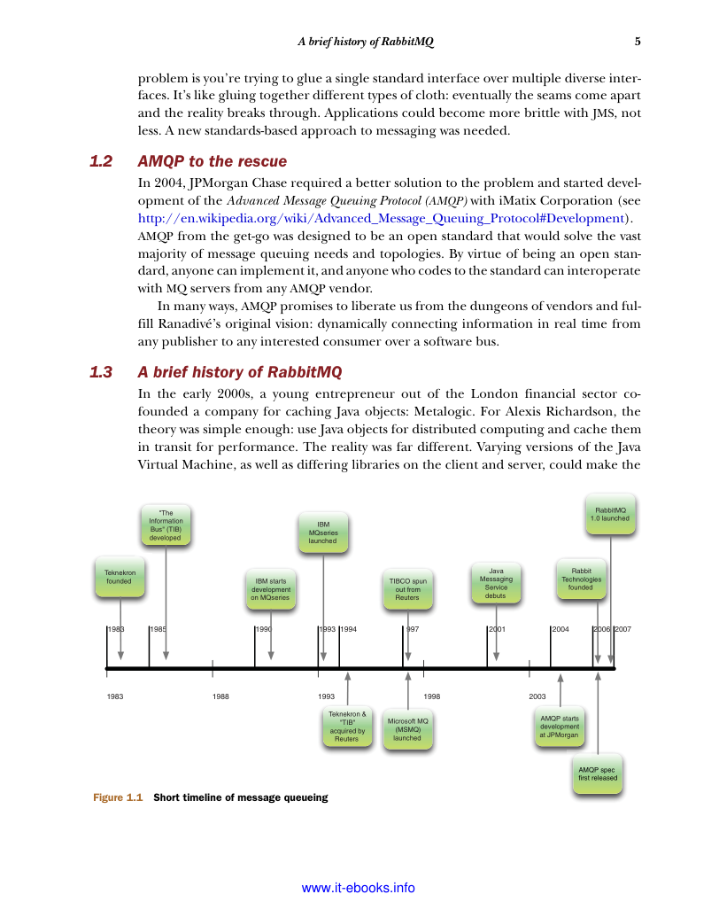
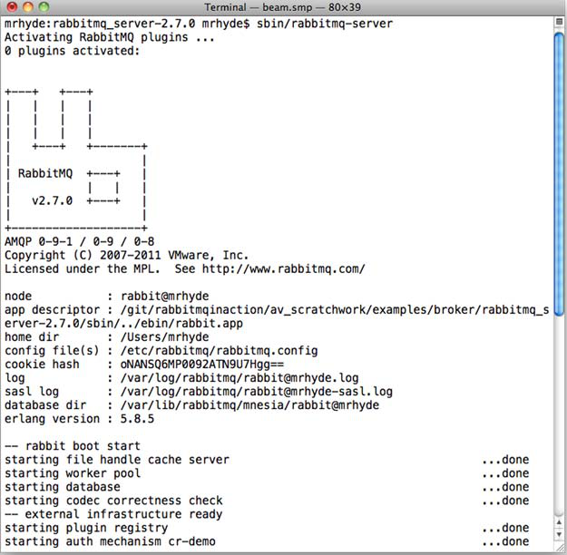
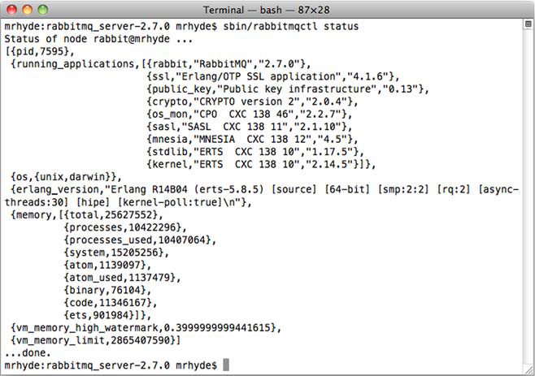

# Chương 1: Lôi RabbitMQ ra khỏi chiếc mũ ảo thuật (Pulling RabbitMQ out of the hat)

> 📝 **Giải thích thêm (không có trong sách):** Tên chương là một cách chơi chữ: nhà ảo thuật hay "lôi con thỏ ra khỏi chiếc mũ" (*pull a rabbit out of the hat*) — tức là làm ra một điều bất ngờ, kỳ diệu. Ở đây "con thỏ" chính là RabbitMQ, công cụ giúp giải quyết những bài toán tưởng như rất khó một cách nhẹ nhàng.

## Mục lục chương

- [Mở đầu chương](#mở-đầu-chương)
- [1.1 Sống trong ngục tối của người khác (Living in other people's dungeons)](#11-sống-trong-ngục-tối-của-người-khác-living-in-other-peoples-dungeons)
- [1.2 AMQP đến giải cứu (AMQP to the rescue)](#12-amqp-đến-giải-cứu-amqp-to-the-rescue)
- [1.3 Lược sử RabbitMQ (A brief history of RabbitMQ)](#13-lược-sử-rabbitmq-a-brief-history-of-rabbitmq)
- [1.4 Chọn RabbitMQ ra khỏi chiếc mũ (và các lựa chọn mở khác) (Picking RabbitMQ out of the hat (and other open options))](#14-chọn-rabbitmq-ra-khỏi-chiếc-mũ-và-các-lựa-chọn-mở-khác-picking-rabbitmq-out-of-the-hat-and-other-open-options)
- [1.5 Cài đặt RabbitMQ trên hệ thống Unix (Installing RabbitMQ on Unix systems)](#15-cài-đặt-rabbitmq-trên-hệ-thống-unix-installing-rabbitmq-on-unix-systems)
  - [1.5.1 Vì sao môi trường quan trọng — sống kiểu Erlang (Why environment matters—living la vida Erlang)](#151-vì-sao-môi-trường-quan-trọng--sống-kiểu-erlang-why-environment-mattersliving-la-vida-erlang)
  - [1.5.2 Tải gói cài đặt (Getting the package)](#152-tải-gói-cài-đặt-getting-the-package)
  - [1.5.3 Tạo cấu trúc thư mục (Setting up the folder structure)](#153-tạo-cấu-trúc-thư-mục-setting-up-the-folder-structure)
  - [1.5.4 Khởi động Rabbit lần đầu tiên (Firing Rabbit up for the first time)](#154-khởi-động-rabbit-lần-đầu-tiên-firing-rabbit-up-for-the-first-time)
- [1.6 Tóm tắt (Summary)](#16-tóm-tắt-summary)
- [Bảng thuật ngữ của chương](#bảng-thuật-ngữ-của-chương)

---

## Mở đầu chương

**Chương này đề cập đến (*This chapter covers*):**

- Nhu cầu về một giao thức mở — AMQP (*The need for an open protocol—AMQP*)
- Lược sử RabbitMQ (*Brief history of RabbitMQ*)
- Cài đặt RabbitMQ (*Installing RabbitMQ*)
- Chương trình đầu tiên — Hello World (*First program—Hello World*)

Chúng ta đang sống trong một thế giới mà thông tin thời gian thực (*real-time information*) luôn sẵn có ở mọi lúc. Các ứng dụng mà ta viết cần có những cách đơn giản để thông tin được định tuyến (*routed* — chuyển tới đúng nơi cần đến) tới nhiều bên nhận (*receivers*) một cách tin cậy và nhanh chóng. Quan trọng hơn nữa, ta cần những cách để thay đổi *ai* sẽ nhận được thông tin mà ứng dụng của ta tạo ra, mà không phải liên tục viết lại ứng dụng đó.

Rất thường xuyên, thông tin của ứng dụng bị "đóng kín trong ốc đảo" (*siloed*): những chương trình mới cần đến thông tin ấy không thể truy cập được, trừ khi phải viết lại (và nhiều khả năng là làm hỏng luôn) các bên sản sinh dữ liệu ban đầu (*producers*). Có thể bạn đang tự nhủ: "Ừ thì đúng, nhưng hàng đợi thông điệp (*message queuing*) hay RabbitMQ thì giúp gì được cho tôi trong chuyện này?" Hãy bắt đầu bằng việc xem tình huống dưới đây có quen thuộc với bạn không.

Bạn vừa hoàn thành một mô-đun xác thực (*authentication module*) tuyệt vời cho ứng dụng web "sát thủ" (*killer web app* — ứng dụng chủ lực, cực kỳ quan trọng) của công ty. Nó đẹp đẽ vô cùng. Với mỗi lượt truy cập trang (*page hit*), code của bạn phối hợp hiệu quả với máy chủ xác thực (*authentication server*) để bảo đảm người dùng chỉ truy cập được những gì họ được phép. Bạn đang cảm thấy khá tự mãn, vì mọi lượt truy cập trang trên website phân phối quả bơ "đẳng cấp thế giới" của công ty đều kích hoạt code của bạn.

Đúng lúc đó sếp bước vào và bảo rằng công ty cần một cách để ghi log (*log*) lại *mọi* lần kiểm tra quyền (*permission attempt*) thành công lẫn thất bại, để sau này đem đi khai phá dữ liệu (*data mining*). Bạn phản đối nhẹ nhàng rằng đó là việc của máy chủ xác thực, nhưng sếp "không nhẹ nhàng lắm" thông báo cho bạn rằng không có cách nào truy cập được dữ liệu đó: máy chủ xác thực ghi log theo một định dạng độc quyền (*proprietary format*); vì vậy giờ đây đây là vấn đề của *bạn*.

Nghiền ngẫm tình huống này khiến bạn đau đầu đến mức phải uống bốn viên aspirin, vì bạn nhận ra mình sẽ phải sửa mô-đun xác thực và rất có thể làm hỏng mọi trang trong quá trình đó. Dù sao thì đoạn code tuyệt vời của bạn cũng chạm vào *mọi* lượt truy cập website mà.

Nhưng khoan dừng lại một chút. Hãy nhấn "nút Dễ Dàng" (*Easy button*) và du hành ngược thời gian về lúc bắt đầu phát triển mô-đun xác thực tuyệt vời kia. Giả sử ngay từ ngày đầu, bạn đã tận dụng triệt để hàng đợi thông điệp trong thiết kế.

Với RabbitMQ được triển khai, bạn đã khéo léo dùng hàng đợi thông điệp để tách rời (*decouple*) mô-đun của mình khỏi máy chủ xác thực. Với mỗi yêu cầu trang, mô-đun xác thực được thiết kế để đặt một thông điệp yêu cầu cấp quyền (*authorization request message*) vào RabbitMQ. Máy chủ xác thực khi đó lắng nghe trên một queue (*hàng đợi*) của RabbitMQ — queue nhận thông điệp yêu cầu đó. Khi yêu cầu được chấp thuận, máy chủ xác thực đặt một thông điệp phản hồi (*reply message*) ngược trở lại vào RabbitMQ, nơi nó được định tuyến tới queue mà mô-đun của bạn đang lắng nghe.

Trong thế giới này, yêu cầu của sếp chẳng làm bạn nao núng chút nào. Bạn nhận ra mình không cần động vào mô-đun của mình, thậm chí cũng không cần viết một mô-đun mới. Tất cả những gì bạn cần làm là viết một ứng dụng nhỏ kết nối tới RabbitMQ và đăng ký nhận (*subscribe*) các yêu cầu cấp quyền mà mô-đun xác thực của bạn *vốn đã* đang phát đi (*publishing*). Không thay đổi một dòng code nào. Không đoạn code nào bạn đã viết biết rằng có gì đó vừa thay đổi. Đơn giản tới mức bạn suýt bật cười. Đó chính là sức mạnh của nhắn tin (*messaging*) trong việc làm công việc hằng ngày của bạn nhẹ nhàng hơn.

> 💡 **Ví dụ bổ sung (không có trong sách):** Hãy hình dung hai kiến trúc của câu chuyện trên.
>
> **Không có message queue** — mô-đun gọi thẳng máy chủ xác thực, muốn thêm việc ghi log thì phải sửa chính mô-đun:
>
> ```mermaid
> flowchart LR
>     Web["Trang web"] --> Auth["Mô-đun xác thực"]
>     Auth -- "gọi trực tiếp" --> AS["Máy chủ xác thực"]
>     Auth -. "phải SỬA code để thêm" .-> Log["Ghi log / data mining"]
> ```
>
> **Có RabbitMQ** — mô-đun chỉ phát thông điệp; muốn thêm bên quan tâm thì chỉ việc cắm thêm một consumer mới:
>
> ```mermaid
> flowchart LR
>     Auth["Mô-đun xác thực"] -- "publish yêu cầu cấp quyền" --> R(("RabbitMQ"))
>     R -- "queue yêu cầu" --> AS["Máy chủ xác thực"]
>     AS -- "publish phản hồi" --> R
>     R -- "queue phản hồi" --> Auth
>     R -- "bản sao yêu cầu (queue mới)" --> Log["Ứng dụng ghi log MỚI"]
> ```
>
> Ứng dụng ghi log chỉ cần vài dòng (ví dụ bằng Python với thư viện `pika`; chi tiết API sẽ được học ở các chương sau). Giả sử các yêu cầu được publish vào một exchange kiểu fanout tên là `auth_requests`:
>
> ```python
> import pika
>
> conn = pika.BlockingConnection(pika.ConnectionParameters("localhost"))
> ch = conn.channel()
> ch.exchange_declare(exchange="auth_requests", exchange_type="fanout")
> # Tạo một queue riêng, tạm thời cho ứng dụng ghi log
> q = ch.queue_declare(queue="", exclusive=True).method.queue
> ch.queue_bind(exchange="auth_requests", queue=q)
>
> def on_message(channel, method, properties, body):
>     print("LOG:", body.decode())
>
> ch.basic_consume(queue=q, on_message_callback=on_message, auto_ack=True)
> ch.start_consuming()
> ```
>
> Mô-đun xác thực cũ không hề biết đến sự tồn tại của ứng dụng này.

Hàng đợi thông điệp (*message queuing*), nói đơn giản, là việc kết nối các ứng dụng của bạn với nhau bằng các thông điệp (*messages*), và các thông điệp này được định tuyến giữa chúng bởi một message broker (*bộ môi giới thông điệp* — phần mềm trung gian nhận, lưu và chuyển tiếp thông điệp) như RabbitMQ. Nó giống như việc đặt một bưu điện dành riêng cho các ứng dụng của bạn.

Thực tế là cách tiếp cận này không chỉ là giải pháp cho các bài toán thời gian thực của ngành tài chính; nó là giải pháp cho những vấn đề mà tất cả lập trình viên chúng ta đối mặt mỗi ngày. Chúng tôi, các tác giả, không xuất thân từ ngành dịch vụ tài chính. Chúng tôi hoàn toàn không biết "nhắn tin doanh nghiệp" (*enterprise messaging*) là gì khi chúng tôi cần mở rộng quy mô (*scale*). Chúng tôi chỉ đơn giản là những lập trình viên như bạn, có một chỗ "ngứa" cần được gãi: ngứa vì phải xử lý khối lượng thông tin thời gian thực và định tuyến nó tới nhiều consumer (*bên tiêu thụ* — ứng dụng nhận và xử lý thông điệp) một cách nhanh chóng. Chúng tôi cần làm tất cả những điều đó mà không chặn (*blocking*) các bên sản sinh thông tin… và cũng không bắt họ phải biết ai sẽ là consumer cuối cùng. RabbitMQ đã giúp chúng tôi giải quyết những vấn đề phổ biến đó một cách dễ dàng, theo một cách dựa trên tiêu chuẩn (*standards-based*), bảo đảm bất kỳ ứng dụng nào của chúng tôi cũng có thể "nói chuyện" với bất kỳ ứng dụng nào khác, dù là Python, PHP, hay thậm chí Scala.

Trong vài chương tới, chúng tôi sẽ đưa bạn đi một chuyến. Bắt đầu bằng việc giải thích hàng đợi thông điệp hoạt động thế nào, lịch sử của nó, và RabbitMQ nằm ở đâu trong bức tranh đó. Sau đó chúng tôi sẽ dẫn bạn đi suốt tới các ví dụ thực tế mà bạn có thể áp dụng cho các thách thức về khả năng mở rộng (*scalability*) và khả năng tương tác (*interoperability*) của riêng mình… và kết thúc bằng cách làm cho Rabbit "kêu gừ gừ" như một cỗ máy được tra dầu kỹ lưỡng trong một môi trường mà "ngừng hoạt động (*downtime*) là không thể chấp nhận!".

Đây là cuốn sách mà chúng tôi ước gì đã có trên kệ khi mới bước vào "vùng hoang dã" của messaging. Chúng tôi hy vọng nó sẽ giúp bạn hưởng lợi từ kinh nghiệm và những "vết sẹo chiến trận" của chúng tôi, để bạn được tự do tạo ra những ứng dụng tuyệt vời mà ít đau đớn hơn. Trước khi kết thúc chương này, bạn sẽ nắm được một chút lịch sử ngắn gọn về messaging, và có RabbitMQ chạy trên máy. Không dài dòng nữa, hãy cùng xem cuộc vui messaging này đã bắt đầu từ đâu.

---

## 1.1 Sống trong ngục tối của người khác (Living in other people's dungeons)

Thế giới hàng đợi thông điệp không phải ngay từ đầu đã ẩm thấp và chật chội như ngày nay, nơi phần lớn mọi người phải phục tùng các "lãnh chúa khóa chặt" (*lock-in overlords* — những nhà cung cấp trói buộc khách hàng vào sản phẩm của họ). Nó bắt đầu bằng một tia sáng giữa bối cảnh phần mềm vốn rối rắm, phức tạp (*byzantine*).

Đó là năm 1983, khi một kỹ sư 26 tuổi đến từ Mumbai đặt ra một câu hỏi cấp tiến: tại sao không có một "bus" phần mềm chung — một hệ thống giao tiếp làm hộ phần việc nặng nhọc là chuyển thông tin từ ứng dụng quan tâm này sang ứng dụng quan tâm khác? Xuất thân từ chuyên ngành thiết kế phần cứng ở MIT, Vivek Ranadivé hình dung ra một bus chung giống như bus trên bo mạch chủ (*motherboard*), chỉ khác là đây sẽ là một bus *phần mềm* mà các ứng dụng có thể cắm vào. (Xem http://hbswk.hbs.edu/archive/1884.html.) Và thế là năm 1983, Teknekron ra đời. Với tấm bằng MBA Harvard vừa ra lò trong tay và ý tưởng mạnh mẽ này trong đầu, Vivek bắt đầu khai phá một con đường sẽ giúp ích cho các lập trình viên ở khắp nơi.

> 📝 **Giải thích thêm (không có trong sách):** Trên bo mạch chủ máy tính, "bus" là đường truyền chung mà CPU, RAM, card mở rộng… đều cắm vào và trao đổi dữ liệu qua đó; các linh kiện không cần nối dây riêng với từng linh kiện khác. "Bus phần mềm" áp dụng cùng ý tưởng: thay vì mỗi cặp ứng dụng tự kết nối với nhau (N ứng dụng có thể cần tới N×(N−1)/2 kết nối), tất cả chỉ cần kết nối với một bus chung.

Có ý tưởng là một chuyện, nhưng tìm được một ứng dụng "sát thủ" (*killer application*) cho nó lại là chuyện hoàn toàn khác. Chính tại Goldman Sachs năm 1985, Ranadivé đã tìm được khách hàng đầu tiên và bài toán mà bus phần mềm của ông sinh ra để giải: giao dịch tài chính (*financial trading*). Bàn làm việc của một nhà giao dịch (*trader*) thời đó chật cứng các thiết bị đầu cuối (*terminals*) khác nhau, mỗi loại dành cho một kiểu thông tin mà nhà giao dịch cần để làm việc. Teknekron nhìn thấy cơ hội thay thế tất cả những terminal đó cùng các ứng dụng "ốc đảo" của chúng. Thay vào chỗ đó sẽ là bus phần mềm của Ranadivé. Thứ còn lại chỉ là một máy trạm (*workstation*) duy nhất, nơi các chương trình hiển thị giờ đây có thể cắm vào bus phần mềm Teknekron với vai trò consumer, và cho phép nhà giao dịch "đăng ký" (*subscribe*) nhận những thông tin họ muốn xem. Mô hình xuất bản–đăng ký (*Publish-subscribe*, viết tắt *PubSub*) ra đời, cùng với phần mềm hàng đợi thông điệp hiện đại đầu tiên trên thế giới: The Information Bus (TIB) của Teknekron.

Chẳng mất bao lâu để mô hình truyền dữ liệu này tìm được thêm rất nhiều ứng dụng "sát thủ" khác. Dù sao thì một ứng dụng phát dữ liệu và một ứng dụng tiêu thụ dữ liệu không còn phải kết nối trực tiếp với nhau nữa. Thậm chí, chúng còn chẳng cần biết đến sự tồn tại của nhau. Điều mà TIB của Teknekron cho phép các lập trình viên ứng dụng làm là thiết lập một tập quy tắc để mô tả nội dung thông điệp. Chừng nào thông điệp còn được phát đi theo đúng các quy tắc đó, thì bất kỳ ứng dụng tiêu thụ nào cũng có thể đăng ký nhận một bản sao của những thông điệp được gắn nhãn chủ đề (*topics*) mà nó quan tâm.

Producer (*bên sản xuất* — ứng dụng tạo và gửi thông điệp) và consumer của thông tin giờ đây có thể được tách rời hoàn toàn và được phối trộn linh hoạt ngay khi đang chạy (*on-the-fly*). Bất kỳ phía nào của mô hình PubSub (producer/consumer) cũng có thể được thay thế hoàn toàn mà không làm hỏng phía bên kia. Thứ duy nhất cần giữ ổn định là phần mềm TIB và các quy tắc gắn nhãn, định tuyến thông tin. Vì ngành giao dịch tài chính đầy rẫy thông tin, với một tập hợp những người quan tâm luôn thay đổi, nên TIB lan nhanh như cháy rừng trong lĩnh vực này. Nó cũng được các công ty viễn thông chú ý, và đặc biệt là các hãng tin tức, những nơi cũng có thông tin cần được giao kịp thời tới một tập consumer thay đổi liên tục. Đó là lý do hãng tin khổng lồ Reuters mua lại Teknekron vào năm 1994.

> 💡 **Ví dụ bổ sung (không có trong sách):** Hình dung một "bus" có các chủ đề như `stock.AAPL`, `stock.MSFT`, `news.finance`. Màn hình của trader A đăng ký `stock.AAPL`, màn hình của trader B đăng ký `stock.*` (mọi cổ phiếu). Khi sàn phát một thông điệp gắn chủ đề `stock.AAPL`, cả A và B đều nhận được một bản sao; khi phát `stock.MSFT` thì chỉ B nhận. Nguồn phát giá không cần biết có bao nhiêu màn hình, ai đang xem — muốn thêm trader C chỉ việc cho C đăng ký, không đụng tới nguồn phát. Đây chính là tinh thần mà sau này RabbitMQ hiện thực bằng *topic exchange* (sẽ học ở các chương sau).

Trong khi đó, phân khúc phần mềm doanh nghiệp mới nổi này không thoát khỏi tầm mắt của "Big Blue" (biệt danh của IBM). Dù sao thì rất nhiều khách hàng lớn nhất của IBM nằm trong ngành dịch vụ tài chính. Hơn nữa, phần mềm TIB của Teknekron thường xuyên chạy trên phần cứng và hệ điều hành của IBM… mà "các chàng trai ở White Plains" (trụ sở IBM) chẳng được chia phần nào. Vì thế, vào cuối thập niên 80, IBM bắt đầu nghiên cứu phát triển phần mềm hàng đợi thông điệp của riêng họ, tận dụng kinh nghiệm dày dặn trong việc chuyển phát thông tin có được từ việc phát triển DB2 (xem http://www-01.ibm.com/software/integration/wmq/MQ15Anniversary.html). Việc phát triển bắt đầu năm 1990 tại Phòng thí nghiệm Hursely Park của IBM gần Winchester, Vương quốc Anh. Thứ ra đời ba năm sau đó là dòng phần mềm máy chủ hàng đợi thông điệp IBM MQSeries. Trong 17 năm kể từ đó, MQSeries đã tiến hóa thành WebSphere MQ và ngày nay là nền tảng hàng đợi thông điệp thương mại thống trị.

Trong suốt thời gian đó, TIB của Ranadivé không hề biến mất trong "ruột gan" của Reuters. Ngược lại, nó vẫn là một "tay chơi" lớn còn lại trong lĩnh vực nhắn tin doanh nghiệp, phát triển mạnh qua lần đổi tên thành Rendezvous và qua việc Teknekron tái xuất hiện như một công ty độc lập dưới cái tên TIBCO vào năm 1997. Cũng trong năm đó, lần thử sức đầu tiên của Microsoft trên thị trường messaging xuất hiện: Microsoft Message Queue (MSMQ).

Qua toàn bộ quá trình tiến hóa này, phần mềm hàng đợi thông điệp (*message queuing*, viết tắt *MQ*) chủ yếu vẫn là "lãnh địa" của các tổ chức ngân sách lớn, có nhu cầu chuyển phát thông điệp thời gian thực, tin cậy và tách rời. Vì sao MQ không đến được với số đông? Làm thế nào nó sống sót qua cơn bùng nổ thông tin là bong bóng internet cuối thập niên 90 mà không được áp dụng bùng nổ? Dù sao thì ngày nay, ai ai từ Twitter cho tới Salesforce.com cũng đang vội vã tự xây dựng giải pháp nội bộ cho các bài toán PubSub mà The Information Bus đã giải quyết từ 25 năm trước.

Câu trả lời gói gọn trong ba chữ: **khóa chặt vào nhà cung cấp** (*vendor lock-in*). Các nhà cung cấp MQ thương mại muốn giúp các *ứng dụng* tương tác với nhau, chứ không muốn tạo ra các giao diện chuẩn cho phép các *sản phẩm MQ khác nhau* tương tác với nhau, hoặc — trời đất ơi — cho phép ứng dụng chuyển sang nền tảng MQ khác. Vendor lock-in đã giữ giá bán và biên lợi nhuận ở mức cao, và khiến phần mềm MQ thương mại nằm ngoài tầm với của các startup và công ty Web 2.0 đang mọc lên khắp nơi ngày nay.

Hóa ra, các công ty công nghệ nhỏ không phải là những người duy nhất không hài lòng với những "khu vườn có tường bao" (*walled gardens* — hệ sinh thái khép kín) đắt đỏ của các nhà cung cấp MQ. Chính các công ty dịch vụ tài chính — "cần câu cơm" của ngành MQ — cũng chẳng vui vẻ gì. Không tránh khỏi, quy mô của các công ty tài chính khiến cho họ có sản phẩm MQ từ nhiều nhà cung cấp khác nhau cùng phục vụ các ứng dụng nội bộ khác nhau. Nếu một ứng dụng đang đăng ký nhận thông tin trên MQ của TIBCO bỗng nhiên cần tiêu thụ thông điệp từ MQ của IBM, việc đó không thể làm dễ dàng. Chúng dùng API khác nhau, giao thức truyền trên dây (*wire protocol* — định dạng byte thực sự gửi qua mạng) khác nhau, và chắc chắn không thể liên kết (*federate*) lại thành một bus duy nhất.

Từ vấn đề này, Java Message Service (JMS) ra đời năm 2001 (xem http://en.wikipedia.org/wiki/Java_Message_Service). JMS cố gắng giải quyết vấn đề lock-in và khả năng tương tác bằng cách cung cấp một API Java chung, che giấu giao diện thực sự của từng sản phẩm MQ của các nhà cung cấp. Về mặt kỹ thuật, một ứng dụng Java chỉ cần được viết theo API JMS, kèm theo việc chọn đúng driver MQ phù hợp. JMS lo phần còn lại… ít nhất là trên lý thuyết. Vấn đề là bạn đang cố dán một giao diện chuẩn duy nhất phủ lên nhiều giao diện đa dạng khác nhau. Nó giống như dán các loại vải khác nhau lại với nhau: sớm muộn gì các đường nối cũng bung ra và sự thật lộ diện. Với JMS, ứng dụng có thể trở nên *dễ vỡ hơn* (*brittle*), chứ không phải bền hơn. Cần có một cách tiếp cận messaging mới, dựa trên tiêu chuẩn.

> 📝 **Giải thích thêm (không có trong sách):** Điểm khác biệt cốt lõi giữa JMS và AMQP (mục tiếp theo):
>
> | | JMS | AMQP |
> |---|---|---|
> | Bản chất | Một **API** (giao diện lập trình) cho ngôn ngữ Java | Một **giao thức truyền trên dây** (wire protocol) |
> | Chuẩn hóa ở đâu | Ở tầng code Java: cùng tên lớp, cùng phương thức | Ở tầng mạng: cùng định dạng byte trao đổi giữa client và broker |
> | Hệ quả | Client Java của IBM MQ và client Java của TIBCO vẫn nói "ngôn ngữ mạng" khác nhau; chỉ code Java trông giống nhau | Client viết bằng Python, PHP, Java… đều nói chuyện được với bất kỳ broker AMQP nào |
>
> Vì vậy JMS chỉ là "lớp keo" phủ bên trên, còn AMQP giải quyết tận gốc chuyện tương tác.

---

## 1.2 AMQP đến giải cứu (AMQP to the rescue)

Năm 2004, JPMorgan Chase cần một giải pháp tốt hơn cho vấn đề này và đã bắt đầu phát triển *Giao thức hàng đợi thông điệp nâng cao* (*Advanced Message Queuing Protocol — AMQP*) cùng với iMatix Corporation (xem http://en.wikipedia.org/wiki/Advanced_Message_Queuing_Protocol#Development). Ngay từ đầu, AMQP đã được thiết kế để trở thành một tiêu chuẩn mở (*open standard*) có thể giải quyết phần lớn các nhu cầu và mô hình bố trí (*topologies*) của hàng đợi thông điệp. Nhờ là một tiêu chuẩn mở, bất kỳ ai cũng có thể hiện thực (*implement*) nó, và bất kỳ ai viết code theo tiêu chuẩn này cũng có thể tương tác với máy chủ MQ của bất kỳ nhà cung cấp AMQP nào.

Theo nhiều cách, AMQP hứa hẹn giải phóng chúng ta khỏi "ngục tối" của các nhà cung cấp và hiện thực hóa tầm nhìn ban đầu của Ranadivé: kết nối thông tin một cách linh động, theo thời gian thực, từ bất kỳ bên phát nào tới bất kỳ consumer quan tâm nào, thông qua một bus phần mềm.

> 💡 **Ví dụ bổ sung (không có trong sách):** Nhờ AMQP là chuẩn mở, một hệ thống có thể trông như sau: một dịch vụ PHP publish đơn hàng, một worker Python xử lý thanh toán, một dịch vụ Java gửi email — cả ba đều kết nối tới cùng một broker RabbitMQ qua AMQP (mặc định cổng TCP 5672). Nếu một ngày bạn thay broker bằng một sản phẩm khác cùng hỗ trợ đúng phiên bản AMQP đó, về nguyên tắc các client không cần đổi giao thức. Đó là điều mà thời "vendor lock-in" không làm được.

---

## 1.3 Lược sử RabbitMQ (A brief history of RabbitMQ)

Đầu những năm 2000, một doanh nhân trẻ xuất thân từ giới tài chính London đã đồng sáng lập một công ty chuyên lưu đệm (*caching*) các đối tượng Java: Metalogic. Với Alexis Richardson, lý thuyết khá đơn giản: dùng các đối tượng Java cho tính toán phân tán (*distributed computing*) và lưu đệm chúng trong lúc truyền để tăng hiệu năng. Thực tế lại khác xa. Các phiên bản Máy ảo Java (*Java Virtual Machine — JVM*) khác nhau, cùng với các thư viện khác nhau ở phía client và server, có thể khiến các đối tượng trở nên vô dụng khi đến nơi. Có quá nhiều biến số môi trường trong thế giới thực khiến cách tiếp cận của Metalogic khó thành công rộng rãi. Điều thực sự có được từ Metalogic chính là việc Alexis gặp Matthias Radestock.

**Hình 1.1 – Dòng thời gian ngắn gọn của hàng đợi thông điệp (*Short timeline of message queueing*)**



Hình 1.1 là một trục thời gian từ 1983 đến 2007 (các vạch chia 1983, 1988, 1993, 1998, 2003), với các mốc sự kiện được vẽ lại dưới đây:

```mermaid
flowchart LR
    A["1983: Teknekron được thành lập"] --> B["1985: 'The Information Bus' (TIB) được phát triển"]
    B --> C["1990: IBM bắt đầu phát triển MQSeries"]
    C --> D["1993: IBM MQSeries ra mắt"]
    D --> E["1994: Teknekron và TIB bị Reuters mua lại"]
    E --> F["1997: TIBCO tách ra khỏi Reuters; Microsoft MQ (MSMQ) ra mắt"]
    F --> G["2001: Java Message Service (JMS) ra mắt"]
    G --> H["2004: AMQP bắt đầu được phát triển tại JPMorgan"]
    H --> I["2006: Rabbit Technologies được thành lập; đặc tả AMQP được công bố lần đầu"]
    I --> J["2007: RabbitMQ 1.0 ra mắt"]
```



| Năm | Sự kiện (chữ trong hình, đã dịch) | Chữ gốc trong hình |
|---|---|---|
| 1983 | Teknekron được thành lập | Teknekron founded |
| 1985 | "The Information Bus" (TIB) được phát triển | "The Information Bus" (TIB) developed |
| 1990 | IBM bắt đầu phát triển MQSeries | IBM starts development on MQseries |
| 1993 | IBM MQSeries ra mắt | IBM MQseries launched |
| 1994 | Teknekron & "TIB" được Reuters mua lại | Teknekron & "TIB" acquired by Reuters |
| 1997 | TIBCO tách ra khỏi Reuters | TIBCO spun out from Reuters |
| 1997 | Microsoft MQ (MSMQ) ra mắt | Microsoft MQ (MSMQ) launched |
| 2001 | Java Message Service ra mắt | Java Messaging Service debuts |
| 2004 | AMQP bắt đầu được phát triển tại JPMorgan | AMQP starts development at JPMorgan |
| 2006 | Rabbit Technologies được thành lập | Rabbit Technologies founded |
| 2006 | Đặc tả AMQP được công bố lần đầu | AMQP spec first released |
| 2007 | RabbitMQ 1.0 ra mắt | RabbitMQ 1.0 launched |

Matthias đang làm việc cho LShift, nơi Alexis thuê lại một phần văn phòng trong thời gian làm ở Metalogic. Lúc đó LShift đang tham gia sâu vào các hợp đồng về mô hình hóa ngôn ngữ (*language modeling*) và tính toán phân tán cho một nhà cung cấp phần mềm lớn. Nền tảng trong các lĩnh vực này đã khơi dậy sự quan tâm của Matthias đối với Erlang — ngôn ngữ lập trình mà Ericsson ban đầu phát triển cho thiết bị chuyển mạch điện thoại (*telephone switching gear*) của họ. Điều thu hút Matthias là Erlang cực kỳ giỏi về lập trình phân tán và khả năng phục hồi mạnh mẽ sau lỗi (*robust failure recovery*), nhưng tiếc thay, vào thời điểm đó nó chưa phải mã nguồn mở. Trong khi đó, Metalogic đã đóng cửa, còn LShift đang trong quá trình kết thúc hợp đồng tính toán phân tán chính của họ. Nhưng Alexis đã học được hai bài học quý giá từ trải nghiệm ở Metalogic: điều gì hiệu quả trong môi trường tính toán phân tán, và các công ty muốn gì cho những môi trường đó.

Alexis biết mình muốn thành lập một công ty mới để giải quyết các vấn đề giao tiếp trong môi trường phân tán. Ông cũng biết rằng công ty tiếp theo mình thành lập sẽ là mã nguồn mở và xây dựng dựa trên mô hình vừa được JBoss và MySQL chứng minh là thành công. Nhìn lại những chỗ giải pháp Metalogic gặp trục trặc, Alexis bắt đầu thấy rằng messaging mới là câu trả lời đúng cho tính toán phân tán. Quan trọng hơn, trong thế giới công nghệ khoảng năm 2004, tồn tại một khoảng trống khổng lồ cho messaging mã nguồn mở. Không ai cung cấp giải pháp messaging ngoài các nhà cung cấp thương mại lớn; và trong khi mã nguồn mở "cấp doanh nghiệp" đang nở rộ với cơ sở dữ liệu (MySQL) và máy chủ ứng dụng (*application servers* — JBoss), thì chẳng ai đụng đến mảnh ghép còn thiếu: messaging.

Thú vị là, chính năm 2004 AMQP cũng vừa mới bắt đầu được phát triển tại JPMorgan Chase. Nhờ xuất thân từ ngành tài chính, Alexis đã được giới thiệu với người dẫn dắt chính của AMQP tại JPMorgan, John O'Hara (người sau này sáng lập Nhóm công tác AMQP — *AMQP Working Group*). Thông qua O'Hara, Alexis làm quen với AMQP và bắt đầu sắp xếp những viên gạch nền móng cho thứ sẽ trở thành RabbitMQ.

Khoảng năm 2005, Alexis đồng sáng lập CohesiveFT. Ông và các đồng sáng lập ở Mỹ lập ra công ty để cung cấp một ngăn xếp ứng dụng (*application stack*) và công cụ cho thứ mà ngày nay đã trở thành điện toán đám mây (*cloud computing*). Việc một phần then chốt của ngăn xếp đó phải là messaging phân tán dường như là điều hiển nhiên với Alexis, người (vẫn ngồi chung văn phòng với LShift) bắt đầu trao đổi với Matthias về AMQP. Điều rõ ràng với Matthias là anh vừa tìm thấy ứng dụng mà anh vẫn luôn tìm kiếm để viết bằng Erlang. Nhưng trước khi bắt tay vào bất cứ điều gì, Alexis và Matthias tập trung vào ba câu hỏi mà họ biết là sẽ mang tính quyết định đến sự thành công của một phiên bản AMQP mã nguồn mở nếu nó được viết bằng Erlang:

1. Các tổ chức tài chính lớn có quan tâm việc message broker của họ được viết bằng Erlang hay không?
2. Erlang có thực sự là lựa chọn tốt để viết một máy chủ AMQP không?
3. Nếu viết bằng Erlang, liệu điều đó có làm chậm việc cộng đồng mã nguồn mở đón nhận nó không?

Vấn đề thứ nhất nhanh chóng được giải quyết bởi một công ty tài chính, khi họ xác nhận rằng họ không quan tâm nó được viết bằng gì, miễn là nó giúp giảm chi phí tích hợp. Câu hỏi thứ hai được trả lời bởi Francesco Cesarini tại Erlang Solutions: theo phân tích của ông về AMQP, đặc tả này ngầm định một kiến trúc vốn có mặt trong mọi tổng đài chuyển mạch điện thoại (*telephone switch*). Nói cách khác, bạn không thể chọn ngôn ngữ nào tốt hơn Erlang để xây dựng một AMQP broker. Câu hỏi cuối cùng được khép lại nhờ một máy chủ messaging hoàn toàn khác: ejabberd. Đến năm 2005, Giao thức nhắn tin và hiện diện mở rộng (*Extensible Messaging and Presence Protocol — XMPP*) đã trở thành một tiêu chuẩn được tôn trọng cho nhắn tin tức thời (*instant messaging*) mở, và một trong những hiện thực hàng đầu là gói máy chủ ejabberd viết bằng Erlang của Alexey Shchepin. ejabberd được rất nhiều tổ chức khác nhau sử dụng rộng rãi, và việc nó được viết bằng Erlang dường như chẳng làm ai chậm lại cả.

> 📝 **Giải thích thêm (không có trong sách):** Vì sao "kiến trúc tổng đài điện thoại" lại khớp với AMQP broker? Một tổng đài phải xử lý hàng nghìn cuộc gọi đồng thời, mỗi cuộc gọi độc lập, và lỗi ở một cuộc gọi không được làm sập cả tổng đài. Một broker cũng vậy: hàng nghìn kết nối, channel, queue chạy song song, cần định tuyến thông điệp giữa chúng và cách ly lỗi. Erlang được thiết kế đúng cho việc này: tiến trình (*process*) cực nhẹ (có thể có hàng triệu tiến trình), giao tiếp bằng gửi thông điệp, và cơ chế "supervisor" tự khởi động lại phần bị lỗi (triết lý "*let it crash*"). Ví dụ một tiến trình Erlang tối giản nhận thông điệp:
>
> ```erlang
> loop() ->
>     receive
>         {hello, From} ->
>             From ! {reply, "Hello World"},
>             loop()
>     end.
> ```

Khi ba câu hỏi lớn đã có lời đáp, Alexis và Matthias thuyết phục được CohesiveFT và LShift cùng hậu thuẫn dự án. Việc đầu tiên họ làm là thuê Matthew Sackman (hiện là một lập trình viên cốt lõi của Rabbit) viết một nguyên mẫu (*prototype*) bằng Erlang để kiểm tra độ trễ (*latency*). Họ nhanh chóng phát hiện rằng việc dùng các thư viện tính toán phân tán tích hợp sẵn trong Erlang cho độ trễ đáng kinh ngạc, có thể so sánh với việc dùng socket thô (*raw sockets*).

Còn câu hỏi đặt tên cho "thứ này" là gì: mọi người đều nhất trí chọn Rabbit (*con thỏ*). Dù sao thì thỏ chạy nhanh và sinh sôi nảy nở điên cuồng, khiến đây trở thành cái tên tuyệt vời cho một phần mềm phân tán. Và một lý do không hề nhỏ cho lựa chọn này là Rabbit rất dễ nhớ. Vậy là năm 2006, Rabbit Technologies ra đời: một liên doanh giữa CohesiveFT và LShift, nắm giữ sở hữu trí tuệ cho thứ mà ngày nay chúng ta biết đến với tên RabbitMQ.

Thời điểm không thể hoàn hảo hơn, bởi vì cũng khoảng lúc đó, bản dự thảo công khai đầu tiên của đặc tả AMQP vừa được công bố. Là một đặc tả mới, AMQP thay đổi rất nhanh. Đây là lĩnh vực mà Erlang tỏ ra cực kỳ quan trọng. Nhờ dùng Erlang, RabbitMQ có thể được phát triển nhanh chóng và theo kịp một mục tiêu luôn di chuyển: tiêu chuẩn AMQP. Thật đáng kinh ngạc, phiên bản 1.0 của RabbitMQ được viết chỉ trong hai tháng rưỡi bởi lập trình viên cốt lõi Tony Garnock-Jones.

Ngay từ đầu, RabbitMQ đã hiện thực một tính năng then chốt của AMQP giúp phân biệt nó với TIBCO và IBM: việc cấp phát (*provisioning*) tài nguyên như queue và exchange (*bộ trao đổi* — thành phần nhận thông điệp từ producer và quyết định chuyển nó tới queue nào) có thể được thực hiện ngay từ bên trong chính giao thức. Với các nhà cung cấp thương mại, việc cấp phát được thực hiện bởi nhân viên chuyên trách tại các bảng điều khiển quản trị chuyên dụng (*administrative consoles*). Khả năng cấp phát của RabbitMQ khiến nó trở thành bus giao tiếp hoàn hảo cho bất kỳ ai đang xây dựng ứng dụng phân tán, đặc biệt là những ứng dụng tận dụng tài nguyên đám mây (*cloud-based resources*) và triển khai nhanh (*rapid deployment*).

> 💡 **Ví dụ bổ sung (không có trong sách):** "Cấp phát từ bên trong giao thức" nghĩa là chính ứng dụng client có thể ra lệnh cho broker tạo queue/exchange khi khởi động, không cần nhờ quản trị viên. Chẳng hạn với Python/`pika`:
>
> ```python
> channel.exchange_declare(exchange="orders", exchange_type="direct", durable=True)
> channel.queue_declare(queue="order_emails", durable=True)
> channel.queue_bind(queue="order_emails", exchange="orders", routing_key="new")
> ```
>
> Các lệnh `declare` này là các phương thức của giao thức AMQP (`exchange.declare`, `queue.declare`, `queue.bind`). Khi bạn triển khai thêm 10 máy chủ mới trên đám mây, mỗi máy tự khai báo những gì nó cần — rất hợp với triển khai nhanh. Ở hệ thống thương mại kiểu cũ, bạn phải gửi yêu cầu cho đội quản trị tạo queue trước rồi mới triển khai được.

Điều đó đưa chúng ta tới ngày nay, khi RabbitMQ được sử dụng bởi tất cả mọi người, từ những startup nhỏ ở Thung lũng Silicon cho tới một số cái tên lớn nhất trên internet. Có lẽ đó là điều tuyệt nhất về RabbitMQ, và cũng là điều khiến các nhà sáng lập bất ngờ: khối người dùng lớn nhất của nó là các công ty công nghệ, chứ không phải các công ty tài chính. RabbitMQ hiện thực hóa tầm nhìn của Ranadivé cho "phần còn lại của chúng ta" — những người có ngân sách nhỏ hơn nhưng cũng gặp những vấn đề thật như vậy. Đó là điều đã thu hút chúng tôi tới RabbitMQ. Chúng tôi không hề biết rằng mình đang tìm kiếm phần mềm hàng đợi thông điệp. Tất cả những gì chúng tôi biết là mình có những vấn đề thật cần giải quyết trong việc tích hợp ứng dụng và phục vụ tải giao dịch cao (*high transaction loads*). RabbitMQ cung cấp một bộ công cụ mạnh mẽ để giải quyết những vấn đề đó, mang lịch sử phong phú của messaging tới với đại chúng… và cuối cùng là một bus thông tin có thể "cắm vào là chạy" (*pluggable information bus*) cho bất kỳ ai cần đến nó.

---

## 1.4 Chọn RabbitMQ ra khỏi chiếc mũ (và các lựa chọn mở khác) (Picking RabbitMQ out of the hat (and other open options))

Ngày nay, RabbitMQ không phải là lựa chọn duy nhất cho messaging mở. Các lựa chọn như ActiveMQ, ZeroMQ và Apache Qpid đều cung cấp những cách tiếp cận mã nguồn mở khác nhau cho hàng đợi thông điệp. Câu hỏi đặt ra là: vì sao chúng tôi nghĩ bạn nên chọn RabbitMQ?

- Ngoại trừ Qpid, RabbitMQ là broker duy nhất hiện thực tiêu chuẩn mở AMQP.
- Việc dựng cụm (*clustering* — ghép nhiều máy chủ RabbitMQ thành một cluster hoạt động như một khối) trên RabbitMQ đơn giản đến mức buồn cười, nhờ Erlang.
- Kinh nghiệm của mỗi người có thể khác (*your mileage may vary*), nhưng chúng tôi thấy RabbitMQ đáng tin cậy và chống sập (*crash resistant*) tốt hơn nhiều so với các đối thủ.

Có lẽ lý do quan trọng nhất là RabbitMQ cực kỳ dễ cài đặt và sử dụng. Dù bạn cần một cấu hình đơn giản một nút (*node* — một máy chủ RabbitMQ đang chạy) cho máy trạm của mình, hay một cluster bảy máy chủ để vận hành hạ tầng web, RabbitMQ đều có thể sẵn sàng chạy trong khoảng 30 phút. Với suy nghĩ đó, đã đến lúc khởi động "con vật nhỏ" này rồi.

> 📝 **Giải thích thêm (không có trong sách):** Sơ lược về các đối thủ được nhắc tới (theo bối cảnh thời điểm sách viết):
>
> | Sản phẩm | Ghi chú ngắn |
> |---|---|
> | ActiveMQ | Broker của Apache viết bằng Java, xoay quanh API JMS; hỗ trợ nhiều giao thức (STOMP, OpenWire…) |
> | ZeroMQ | Không phải broker mà là một thư viện socket nhắn tin hiệu năng cao; bạn tự xây mô hình phân phối |
> | Apache Qpid | Dự án Apache hiện thực AMQP (có broker C++ và Java) — vì vậy sách nói "ngoại trừ Qpid" |
> | RabbitMQ | Broker AMQP viết bằng Erlang, clustering dễ, nhiều client cho nhiều ngôn ngữ |

---

## 1.5 Cài đặt RabbitMQ trên hệ thống Unix (Installing RabbitMQ on Unix systems)

Cho đến giờ chúng ta đã bàn về động lực đằng sau giao thức AMQP và lịch sử của máy chủ RabbitMQ. Giờ là lúc đưa broker vào hoạt động và bắt đầu làm những thứ hay ho với nó. Yêu cầu về hệ điều hành để chạy RabbitMQ khá linh hoạt, vì chúng ta có thể chạy nó trên nhiều nền tảng, gồm Linux, Windows, Mac OS X và các hệ thống tương tự Unix (*Unix-like*) khác. Trong chương này, chúng ta sẽ đi qua quy trình thiết lập máy chủ cho một hệ thống Unix chung chung (*generic Unix system*) — mọi ví dụ và hướng dẫn trong sách đều giả định môi trường UNIX, trừ khi có ghi chú khác. Vì RabbitMQ được viết bằng Erlang, chúng ta cần cài sẵn các thư viện của ngôn ngữ này để chạy broker.

### 1.5.1 Vì sao môi trường quan trọng — sống kiểu Erlang (Why environment matters—living la vida Erlang)

> 📝 **Giải thích thêm (không có trong sách):** "Living la vida Erlang" là chơi chữ từ bài hát nổi tiếng "Livin' la Vida Loca" (Ricky Martin) — đại ý "sống cuộc đời Erlang".

Chúng tôi khuyên bạn dùng phiên bản Erlang mới nhất, vào thời điểm viết sách là R14A. Bạn có thể lấy Erlang từ website của nó (http://www.erlang.org/). Hãy làm theo hướng dẫn cài đặt được cung cấp ở đó. Bằng cách chạy phiên bản Erlang mới nhất trên hệ thống, bạn sẽ chắc chắn có đầy đủ các bản cập nhật và cải tiến cho nền móng mà RabbitMQ chạy trên đó. Mỗi bản phát hành Erlang mới đều có những cải thiện hiệu năng đáng để có.

Khi đã giải quyết xong các phụ thuộc (*dependencies*) của RabbitMQ, hãy tạo một thư mục để thực hiện các bài thử nghiệm của chúng ta. Giả sử bạn đang chạy một hệ thống "họ Unix", hãy mở terminal và bắt đầu gõ lệnh:

```bash
$ mkdir rabbitmqinaction
$ cd rabbitmqinaction
```

> 💡 **Ví dụ bổ sung (không có trong sách):** Cách kiểm tra Erlang đã được cài và xem phiên bản trước khi tiếp tục:
>
> ```bash
> $ erl -noshell -eval 'io:format("~s~n", [erlang:system_info(otp_release)]), halt().'
> R14B04
> ```
>
> (Với Erlang/OTP mới, kết quả sẽ là số như `26`.) Nếu lệnh `erl` không tồn tại, nghĩa là Erlang chưa được cài hoặc chưa có trong `PATH`. Lưu ý thêm: ngày nay mỗi phiên bản RabbitMQ chỉ hỗ trợ một dải phiên bản Erlang nhất định, nên hãy xem bảng tương thích trên rabbitmq.com thay vì luôn lấy bản Erlang mới nhất.

### 1.5.2 Tải gói cài đặt (Getting the package)

Sau đó, tải RabbitMQ Server từ trang tải máy chủ: http://www.rabbitmq.com/server.html. Chọn gói dành cho hệ thống Unix chung chung (*generic Unix*) và tải về:¹

```bash
$ wget http://www.rabbitmq.com/releases/rabbitmq-server/v2.7.0/\
rabbitmq-server-generic-unix-2.7.0.tar.gz
```

Bước tiếp theo là giải nén tarball (*tệp nén .tar.gz*) và chuyển vào thư mục `rabbitmq_server-2.7.0` bên trong gói:

```bash
$ tar -xzvf rabbitmq-server-generic-unix-2.7.0.tar.gz
$ cd rabbitmq_server-2.7.0/
```

> 📝 **Giải thích thêm (không có trong sách):** Dấu `\` ở cuối dòng lệnh `wget` chỉ để ngắt một lệnh dài thành hai dòng trong shell; hai dòng đó thực chất là một URL liền mạch. Các cờ của `tar`: `-x` giải nén, `-z` xử lý nén gzip, `-v` in ra tên từng tệp, `-f` chỉ định tên tệp. Lưu ý: URL phiên bản 2.7.0 là của thời điểm viết sách; ngày nay bạn nên lấy liên kết mới nhất trên trang tải của rabbitmq.com.

### 1.5.3 Tạo cấu trúc thư mục (Setting up the folder structure)

Bạn gần như đã sẵn sàng khởi động broker, nhưng còn vài thư mục cần tạo trước khi làm việc đó. Thư mục thứ nhất là nơi RabbitMQ sẽ ghi log. Bạn có thể xem thư mục này khi cần khắc phục sự cố (*troubleshoot*) cài đặt. Thư mục thứ hai dành cho cơ sở dữ liệu Mnesia mà RabbitMQ dùng để lưu thông tin về broker, như siêu dữ liệu (*metadata*) của queue, các virtual host (*máy chủ ảo* — vhost, không gian tách biệt bên trong một broker), v.v. Hãy gõ các lệnh sau trong terminal:

```bash
$ mkdir -p /var/log/rabbitmq
$ mkdir -p /var/lib/rabbitmq/mnesia/rabbit
```

Có thể bạn cần chạy các lệnh trên với quyền siêu người dùng (*super user*). Nếu phải làm vậy, đừng quên `chown` (đổi chủ sở hữu) các thư mục đó về cho tài khoản người dùng hệ thống của bạn.

> **MẸO (TIP):** Khi chạy RabbitMQ trên môi trường production (*môi trường thật đang phục vụ người dùng*), chúng tôi thường tạo một người dùng `rabbitmq` rồi cấp quyền trên các thư mục cho người dùng đó, thay vì chạy mọi lệnh bằng một tài khoản người dùng bình thường.

> 💡 **Ví dụ bổ sung (không có trong sách):** Một chuỗi lệnh cụ thể cho cả hai trường hợp trên một máy Linux:
>
> ```bash
> # Trường hợp phát triển: tạo thư mục bằng sudo rồi trao quyền cho chính bạn
> $ sudo mkdir -p /var/log/rabbitmq /var/lib/rabbitmq/mnesia/rabbit
> $ sudo chown -R $(whoami) /var/log/rabbitmq /var/lib/rabbitmq
>
> # Trường hợp production (theo MẸO ở trên): tạo user hệ thống riêng tên rabbitmq
> $ sudo useradd --system --home /var/lib/rabbitmq rabbitmq
> $ sudo chown -R rabbitmq:rabbitmq /var/log/rabbitmq /var/lib/rabbitmq
> $ sudo -u rabbitmq sbin/rabbitmq-server
> ```
>
> Chạy dịch vụ bằng một user riêng giúp hạn chế thiệt hại nếu tiến trình bị khai thác lỗ hổng: nó chỉ ghi được vào thư mục của chính nó.

### 1.5.4 Khởi động Rabbit lần đầu tiên (Firing Rabbit up for the first time)

Giờ thì bạn đã sẵn sàng để khởi động máy chủ. Gõ lệnh cuối cùng để làm việc đó:

```bash
$ sbin/rabbitmq-server
```

RabbitMQ sẽ in ra một số thông tin về tiến trình khởi động. Nếu mọi thứ diễn ra như mong đợi, bạn sẽ thấy logo RabbitMQ vẽ bằng ký tự ASCII (*ASCII art*) và message broker đang chạy, như trong hình 1.2.

**Hình 1.2 – Thông điệp chào mừng của RabbitMQ (*RabbitMQ welcome message*)**



Mô tả hình 1.2: Cửa sổ Terminal trên Mac sau khi chạy `sbin/rabbitmq-server`. Nội dung chính:

- `Activating RabbitMQ plugins ...` / `0 plugins activated:` — đang kích hoạt plugin; chưa có plugin nào được bật.
- Logo RabbitMQ bằng ký tự ASCII kèm chữ `RabbitMQ v2.7.0`.
- `AMQP 0-9-1 / 0-9 / 0-8` — các phiên bản giao thức AMQP mà broker hỗ trợ; dòng bản quyền `Copyright (C) 2007-2011 VMware, Inc.` và `Licensed under the MPL` (giấy phép Mozilla Public License).
- Bảng thông tin nút: `node : rabbit@mrhyde` (tên nút = `rabbit@<tên máy>`), `app descriptor` (đường dẫn tệp `rabbit.app`), `home dir : /Users/mrhyde`, `config file(s) : /etc/rabbitmq/rabbitmq.config`, `cookie hash` (giá trị băm của Erlang cookie dùng để các nút xác thực với nhau), `log : /var/log/rabbitmq/rabbit@mrhyde.log`, `sasl log : /var/log/rabbitmq/rabbit@mrhyde-sasl.log`, `database dir : /var/lib/rabbitmq/mnesia/rabbit@mrhyde`, `erlang version : 5.8.5`. Lưu ý thư mục log và database chính là hai thư mục bạn đã tạo ở mục 1.5.3.
- `-- rabbit boot start` rồi một loạt bước khởi động, mỗi bước kết thúc bằng `...done`: `starting file handle cache server`, `starting worker pool`, `starting database`, `starting codec correctness check`, `-- external infrastructure ready`, `starting plugin registry`, `starting auth mechanism cr-demo`…

Bây giờ hãy mở một cửa sổ terminal mới và kiểm tra trạng thái của máy chủ. Gõ lệnh sau:²

```bash
$ cd path/to/rabbitmqinaction/rabbitmq_server-2.7.0/
$ sbin/rabbitmqctl status
```

Như bạn thấy trong hình 1.3, lệnh này sẽ in ra trạng thái của broker, các ứng dụng đang chạy (*running applications*) và các nút. Đến đây, bạn đã có một RabbitMQ broker chạy trên máy tính với cấu hình mặc định.

**Hình 1.3 – Kiểm tra trạng thái RabbitMQ (*Checking RabbitMQ status*)**



Mô tả hình 1.3: Kết quả lệnh `sbin/rabbitmqctl status` — `Status of node rabbit@mrhyde ...` (trạng thái của nút `rabbit@mrhyde`), theo sau là một cấu trúc dữ liệu Erlang (danh sách các tuple) gồm:

- `{pid,7595}` — mã tiến trình hệ điều hành của broker.
- `{running_applications, [...]}` — các ứng dụng Erlang đang chạy bên trong nút: `rabbit` ("RabbitMQ", "2.7.0"), `ssl` (Erlang/OTP SSL application, 4.1.6), `public_key` (hạ tầng khóa công khai, 0.13), `crypto` (2.0.4), `os_mon` (giám sát hệ điều hành, 2.2.7), `sasl` (2.1.10), `mnesia` (cơ sở dữ liệu MNESIA, 4.5), `stdlib` (1.17.5), `kernel` (2.14.5).
- `{os,{unix,darwin}}` — hệ điều hành: Unix, nhân Darwin (macOS).
- `{erlang_version, "Erlang R14B04 (erts-5.8.5) [source] [64-bit] [smp:2:2] [rq:2] [async-threads:30] [hipe] [kernel-poll:true]\n"}` — phiên bản và các tùy chọn của máy ảo Erlang.
- `{memory, [...]}` — thống kê bộ nhớ (byte): `total` 25627552, `processes` 10422296, `processes_used` 10407064, `system` 15205256, `atom` 1139097, `atom_used` 1137479, `binary` 76104, `code` 11346167, `ets` 901984.
- `{vm_memory_high_watermark,0.3999999999441615}` — ngưỡng bộ nhớ cao (khoảng 40% RAM); vượt ngưỡng này broker sẽ tạm chặn các producer.
- `{vm_memory_limit,2865407590}` — giới hạn bộ nhớ tính bằng byte (≈ 40% RAM của máy).
- `...done.` — lệnh hoàn tất.

Hãy cùng điểm lại những gì chúng ta đã làm:

- Tải gói máy chủ về
- Giải nén nó vào một thư mục thử nghiệm
- Tạo cấu trúc thư mục cần thiết
- Khởi động máy chủ RabbitMQ
- Kiểm tra trạng thái máy chủ

Chỉ với những bước dễ dàng đó, bạn đã bắt đầu với RabbitMQ. Bây giờ là thêm một chút lý thuyết về messaging, rồi chúng ta sẽ bắt đầu chạy vài ví dụ với broker.

> 💡 **Ví dụ bổ sung (không có trong sách):** Một vài lệnh `rabbitmqctl` hữu ích khác để thử ngay trên broker vừa khởi động (chạy từ thư mục `rabbitmq_server-2.7.0`):
>
> ```bash
> $ sbin/rabbitmqctl list_queues     # liệt kê các queue (lúc đầu rỗng)
> $ sbin/rabbitmqctl list_exchanges  # liệt kê các exchange mặc định (amq.direct, amq.fanout, ...)
> $ sbin/rabbitmqctl list_vhosts     # liệt kê virtual host (mặc định có "/")
> $ sbin/rabbitmqctl stop            # dừng broker một cách gọn gàng
> ```
>
> Bài tập nhỏ: sau khi chạy `stop`, gõ lại `sbin/rabbitmqctl status` — bạn sẽ thấy thông báo lỗi không kết nối được tới nút `rabbit@<tên máy>`, chứng tỏ broker đã dừng.

---

**Chú thích chân trang:**

¹ Các gói cài đặt dựng sẵn (*pre-build installation packages*) cho RabbitMQ có sẵn cho Windows, Debian/Ubuntu và RedHat (RPM) tại http://www.rabbitmq.com/download.html.

² Nếu bạn cài từ gói RPM hoặc gói Ubuntu/Debian, có thể bạn cần chạy `rabbitmqctl` với quyền root.

---

## 1.6 Tóm tắt (Summary)

Giờ thì bạn đã hiểu vì sao chúng tôi yêu RabbitMQ đến vậy. Dù là "hậu duệ" của công nghệ đến từ ngành tài chính, nó lại cực kỳ dễ thiết lập. Bạn có được các tính năng định tuyến phức tạp và độ tin cậy do những người tiên phong như TIBCO và IBM khai phá, nhưng trong một gói dễ quản lý và dễ dùng hơn. Và phần tuyệt nhất: nó là mã nguồn mở!

Chúng tôi đã cho bạn thấy messaging đã tiến xa đến mức nào trong 30 năm qua: từ một bus phần mềm đơn giản kết nối các nhà giao dịch tài chính, tới những "quái vật định tuyến thông điệp" là trái tim đang đập của mọi thứ liên quan đến các sàn giao dịch tài chính, cho tới các dây chuyền sản xuất ở những nhà máy chế tạo chất bán dẫn (*semiconductor fabs*). Giờ đây bạn có sức mạnh như thế chạy ngay trên chiếc laptop phát triển của mình — và chúng ta mới chỉ xong chương 1!

Với RabbitMQ đã chạy, đã đến lúc lặn sâu vào các khối xây dựng cơ bản của messaging: queue, binding (*liên kết* — quy tắc gắn một queue vào một exchange), exchange và virtual host. Hãy cùng xem chúng khớp với nhau thế nào và làm cho Rabbit nói "Hello World"!

> 💡 **Ví dụ bổ sung (không có trong sách) — câu hỏi tự kiểm tra:**
>
> 1. Vì sao trong câu chuyện mở đầu, việc thêm chức năng ghi log không cần sửa mô-đun xác thực? → *Vì mô-đun chỉ publish thông điệp vào broker; ứng dụng ghi log chỉ cần subscribe thêm vào cùng luồng thông điệp, producer không cần biết consumer là ai.*
> 2. Nguyên nhân chính khiến MQ thương mại không phổ biến rộng rãi trong nhiều năm là gì? → *Vendor lock-in: không có chuẩn chung, giá cao.*
> 3. JMS khác AMQP ở điểm cốt lõi nào? → *JMS là API Java; AMQP là giao thức truyền trên dây, độc lập ngôn ngữ.*
> 4. Hai thư mục cần tạo trước khi chạy RabbitMQ ở mục 1.5.3 dùng để làm gì? → *`/var/log/rabbitmq` chứa log; `/var/lib/rabbitmq/mnesia/rabbit` chứa cơ sở dữ liệu Mnesia (metadata của queue, vhost…).*
> 5. Lệnh nào dùng để kiểm tra broker đang chạy? → *`sbin/rabbitmqctl status`.*

---

## Bảng thuật ngữ của chương

| Thuật ngữ (Anh) | Nghĩa tiếng Việt | Giải thích ngắn |
|---|---|---|
| Message queuing (MQ) | Hàng đợi thông điệp | Kết nối các ứng dụng bằng thông điệp được một broker định tuyến giữa chúng |
| Message broker | Bộ môi giới thông điệp | Phần mềm trung gian (như RabbitMQ) nhận, lưu và chuyển tiếp thông điệp |
| Producer | Bên sản xuất | Ứng dụng tạo và gửi (publish) thông điệp |
| Consumer | Bên tiêu thụ | Ứng dụng nhận và xử lý thông điệp |
| Publish / Subscribe (PubSub) | Xuất bản / Đăng ký | Mô hình trong đó bên phát gửi thông điệp theo chủ đề, bên nhận đăng ký các chủ đề quan tâm |
| Queue | Hàng đợi | Nơi chứa thông điệp chờ consumer lấy ra |
| Exchange | Bộ trao đổi | Thành phần nhận thông điệp từ producer và định tuyến tới queue |
| Binding | Liên kết | Quy tắc gắn queue vào exchange |
| Virtual host (vhost) | Máy chủ ảo | Không gian tách biệt bên trong một broker |
| Decouple | Tách rời | Làm cho các thành phần không phụ thuộc trực tiếp vào nhau |
| Siloed | Bị cô lập thành ốc đảo | Dữ liệu bị nhốt trong một hệ thống, hệ thống khác khó truy cập |
| Vendor lock-in | Khóa chặt vào nhà cung cấp | Bị phụ thuộc vào sản phẩm của một hãng, khó chuyển sang hãng khác |
| Walled garden | Khu vườn có tường bao | Hệ sinh thái khép kín của một nhà cung cấp |
| Wire protocol | Giao thức truyền trên dây | Định dạng dữ liệu thực sự trao đổi qua mạng |
| Federate | Liên kết (liên bang hóa) | Nối nhiều hệ thống thành một khối thống nhất |
| JMS (Java Message Service) | Dịch vụ thông điệp Java | API Java chung che giấu các sản phẩm MQ khác nhau |
| AMQP (Advanced Message Queuing Protocol) | Giao thức hàng đợi thông điệp nâng cao | Tiêu chuẩn mở về giao thức messaging, RabbitMQ hiện thực nó |
| Open standard | Tiêu chuẩn mở | Đặc tả mà ai cũng được phép hiện thực |
| Topology | Mô hình bố trí | Cách sắp xếp, kết nối các thành phần messaging |
| Erlang | Erlang | Ngôn ngữ do Ericsson tạo cho tổng đài điện thoại, mạnh về phân tán và chịu lỗi |
| XMPP | Giao thức nhắn tin và hiện diện mở rộng | Chuẩn mở cho nhắn tin tức thời; ejabberd là máy chủ XMPP viết bằng Erlang |
| Latency | Độ trễ | Thời gian từ khi gửi tới khi nhận thông điệp |
| Raw socket | Socket thô | Giao tiếp mạng ở mức thấp, không qua lớp trừu tượng |
| Provisioning | Cấp phát tài nguyên | Tạo queue, exchange… ; trong AMQP có thể làm ngay qua giao thức |
| Clustering / Cluster | Dựng cụm / Cụm máy chủ | Ghép nhiều nút RabbitMQ thành một hệ thống |
| Node | Nút | Một tiến trình máy chủ RabbitMQ (Erlang) đang chạy, ví dụ `rabbit@mrhyde` |
| Mnesia | Mnesia | Cơ sở dữ liệu tích hợp của Erlang, RabbitMQ dùng để lưu metadata |
| Tarball | Tệp nén tar | Tệp lưu trữ `.tar.gz` |
| chown | Đổi chủ sở hữu | Lệnh Unix đổi người sở hữu tệp/thư mục |
| Production | Môi trường thật | Môi trường vận hành đang phục vụ người dùng |
| rabbitmq-server / rabbitmqctl | — | Lệnh khởi động broker / công cụ dòng lệnh quản trị broker |
| Downtime | Thời gian ngừng hoạt động | Khoảng thời gian hệ thống không phục vụ được |
| Scalability / Interoperability | Khả năng mở rộng / Khả năng tương tác | Đáp ứng tải tăng / các hệ thống khác nhau làm việc được với nhau |
