# Chương 2: Hiểu về nhắn tin (Understanding messaging)

## Mục lục chương

- [Mở đầu chương](#mở-đầu-chương)
- [2.1 Consumer và producer (không phải bài học kinh tế) (Consumers and producers (not an economics lesson))](#21-consumer-và-producer-không-phải-bài-học-kinh-tế-consumers-and-producers-not-an-economics-lesson)
- [2.2 Xây từ nền móng: queue (Building from the bottom: queues)](#22-xây-từ-nền-móng-queue-building-from-the-bottom-queues)
- [2.3 Kết nối lại với nhau: exchange và binding (Getting together: exchanges and bindings)](#23-kết-nối-lại-với-nhau-exchange-và-binding-getting-together-exchanges-and-bindings)
- [2.4 Nhiều "khách thuê": virtual host và sự tách biệt (Multiple tenants: virtual hosts and separation)](#24-nhiều-khách-thuê-virtual-host-và-sự-tách-biệt-multiple-tenants-virtual-hosts-and-separation)
- [2.5 Message của tôi đâu rồi? Độ bền vững và bạn (Where's my message? Durability and you)](#25-message-của-tôi-đâu-rồi-độ-bền-vững-và-bạn-wheres-my-message-durability-and-you)
- [2.6 Ráp tất cả lại: một ngày trong đời của một message (Putting it all together: a day in the life of a message)](#26-ráp-tất-cả-lại-một-ngày-trong-đời-của-một-message-putting-it-all-together-a-day-in-the-life-of-a-message)
- [2.7 Dùng publisher confirm để xác minh việc giao nhận (Using publisher confirms to verify delivery)](#27-dùng-publisher-confirm-để-xác-minh-việc-giao-nhận-using-publisher-confirms-to-verify-delivery)
- [2.8 Tóm tắt (Summary)](#28-tóm-tắt-summary)
- [Bảng thuật ngữ của chương](#bảng-thuật-ngữ-của-chương)

---

## Mở đầu chương

**Chương này bao gồm (This chapter covers):**

- Các khái niệm về nhắn tin — consumer, producer và broker
- Các thành phần của AMQP — exchange, queue và binding
- Virtual host (máy chủ ảo)
- Độ bền vững của message (*message durability*)
- Vòng đời của một message, từ producer đến consumer

Khi bạn nói "nhắn tin" (*messaging*), lập trình viên sẽ nghĩ tới đủ thứ khác nhau. Email và tin nhắn tức thời (*IM – instant messaging*, như chat) là những thứ hiện ra trong đầu đầu tiên, nhưng đó **không phải** là những mô hình mà chúng ta muốn nói tới khi bàn về nhắn tin trong RabbitMQ. Nhắn tin trong RabbitMQ có một vài điểm chung với email và IM, nhưng nó là một mô hình tư duy (*paradigm*) hoàn toàn khác.

Ví dụ:

- Giống email, AMQP (*Advanced Message Queuing Protocol* – giao thức hàng đợi thông điệp nâng cao, giao thức mà RabbitMQ cài đặt) **lưu trữ message** cho những consumer (bên nhận) đang không trực tuyến. Nhưng khác với email, các message đó được định tuyến (*routed*) dựa trên những **nhãn** (*tag*) linh hoạt hơn rất nhiều.
- Cũng khác email, message **không có cấu trúc cố định** và thậm chí có thể chứa trực tiếp dữ liệu nhị phân (*binary data*).
- Khác với các giao thức IM, AMQP **che giấu bên gửi và bên nhận khỏi nhau**. Không hề có khái niệm "hiện diện" (*presence* — kiểu trạng thái "đang online" trong ứng dụng chat).

Kết quả là bạn có một hạ tầng linh hoạt, khuyến khích việc **tách rời** (*decoupling*) các ứng dụng của bạn ở khắp mọi nơi. Message AMQP có thể được định tuyến theo kiểu **một-đến-nhiều** (*one-to-many*) — hoặc phát tán cho tất cả (*broadcast*), hoặc chọn lọc — và cũng có thể **một-đến-một** (*one-to-one*). Với IM, thông thường bạn chỉ có một-đến-một.

> 📝 **Giải thích thêm (không có trong sách):** "Tách rời" (decoupling) nghĩa là ứng dụng gửi không cần biết ứng dụng nhận là ai, đang chạy ở đâu, có đang bật hay không. Hai bên chỉ cùng "nói chuyện" với RabbitMQ. Nhờ vậy, bạn có thể thay thế, nâng cấp, tắt/bật, hay nhân bản từng bên mà bên kia không cần sửa một dòng code nào.

Vì nhắn tin AMQP khác với các giao thức nhắn tin khác, chúng ta sẽ dành vài mục tiếp theo để giải thích "biệt ngữ" (*lingo*) và các khối xây dựng (*building blocks*) của AMQP. Nếu bạn đã có nền tảng tốt về các hệ thống nhắn tin doanh nghiệp (*enterprise messaging systems*) như TIBCO hay MQSeries của IBM, nhiều điều ở đây sẽ quen thuộc. Vì RabbitMQ tập trung vào nhắn tin **từ ứng dụng tới ứng dụng** (*application-to-application messaging*), điều quan trọng là phải hiểu rõ ràng các khái niệm của mô hình nhắn tin đó. Hãy bắt đầu bằng cách **quên đi** sự phân biệt client/server (máy khách/máy chủ) đã ăn sâu vào đầu chúng ta, và bắt đầu tìm hiểu về consumer và producer.

---

## 2.1 Consumer và producer (không phải bài học kinh tế) (Consumers and producers (not an economics lesson))

> 📝 **Giải thích thêm (không có trong sách):** Tiêu đề là một câu đùa: trong kinh tế học, *consumer* là "người tiêu dùng" và *producer* là "nhà sản xuất". Ở đây, **producer** là chương trình **tạo và gửi** message, còn **consumer** là chương trình **nhận và xử lý** message. Hai từ này thường được giữ nguyên tiếng Anh trong giới lập trình.

Nếu bạn từng làm việc với phần mềm dùng mạng, có lẽ bạn đã quen suy nghĩ theo kiểu **client và server**. Dù đó là trình duyệt và web server, hay ứng dụng của bạn và một MySQL server, thì luôn có một bên **gửi yêu cầu** (*making requests*) và một bên **phục vụ yêu cầu** (*servicing them*). Bạn có thể gọi đó là **mô hình xe bán đồ ăn** (*food truck model*): ứng dụng của bạn đặt món, còn xe bán đồ ăn thì làm món và giao cho bạn. Nguồn dữ liệu bạn muốn chính là "server xe bán đồ ăn". Mô hình này thường là cách chúng ta cố gắng hiểu bất cứ thứ gì liên quan tới ứng dụng của mình và một dịch vụ. Thế nên, với cách tiếp cận nhắn tin mới này, có thể bạn sẽ hỏi: ai là khách hàng, ai là xe bán đồ ăn, và tôi đặt món thế nào?

Đó chính là vấn đề. **RabbitMQ không phải là xe bán đồ ăn; nó là một dịch vụ chuyển phát** (*delivery service*). Dữ liệu ứng dụng của bạn nhận từ RabbitMQ không hề được "phục vụ" bởi Rabbit, cũng giống như gói hàng bạn nhận không phải do FedEx sản xuất ra. Vậy hãy nghĩ về Rabbit như một dịch vụ chuyển phát. Ứng dụng của bạn có thể gửi và nhận bưu kiện. Server chứa dữ liệu bạn cần cũng có thể gửi và nhận. Vai trò của RabbitMQ là làm **bộ định tuyến** (*router*) giữa ứng dụng của bạn và cái "server" mà nó đang nói chuyện cùng. Vì thế, khi ứng dụng của bạn kết nối tới RabbitMQ, nó phải đưa ra một quyết định: **tôi đang gửi hay đang nhận?** Hay nói theo ngôn ngữ AMQP: **tôi là producer hay consumer?**

**Producer** tạo ra message và **publish** (công bố/gửi) chúng tới một **broker server** (máy chủ môi giới — ở đây là RabbitMQ). Vậy message là gì? Một message gồm **hai phần**: **payload** (phần nội dung/tải) và **label** (nhãn).

- **Payload** là dữ liệu bạn muốn truyền đi. Nó có thể là bất cứ thứ gì, từ một mảng JSON cho tới một file MPEG-4 quay chú kỳ nhông Ziggy yêu quý của bạn. RabbitMQ chẳng quan tâm.
- **Label** thì thú vị hơn. Nó **mô tả payload**, và là thứ RabbitMQ dùng để quyết định **ai sẽ nhận được một bản sao** message của bạn.

Khác với, chẳng hạn, TCP — nơi bạn chỉ định một bên gửi cụ thể và một bên nhận cụ thể — AMQP chỉ mô tả message bằng một nhãn (gồm **tên exchange** và, tùy chọn, một **topic tag** — nhãn chủ đề) và để Rabbit tự gửi message tới những bên nhận **quan tâm** dựa trên nhãn đó. Việc giao tiếp này là kiểu **"bắn rồi quên"** (*fire-and-forget*) và **một chiều** (*one-directional*). Chúng ta sẽ tìm hiểu chi tiết hơn về cách RabbitMQ diễn giải nhãn khi bàn về exchange và binding ở phần sau. Lúc này, tất cả những gì bạn cần biết là: **producer tạo ra message và dán nhãn cho chúng để định tuyến** (xem hình 2.1).

**Consumer** cũng đơn giản không kém. Chúng **gắn vào** (*attach*) một broker server và **đăng ký** (*subscribe*) vào một **queue** (hàng đợi). Hãy nghĩ queue như một **hộp thư có tên**. Mỗi khi một message tới một hộp thư cụ thể, RabbitMQ gửi nó tới **một** trong các consumer đang đăng ký/lắng nghe. Vào lúc consumer nhận được message, message chỉ còn **một phần**: payload. Các nhãn gắn với message **không được chuyển theo** payload khi message được định tuyến. RabbitMQ thậm chí còn không cho bạn biết ai là producer/người gửi. Giống như khi bạn lấy thư mà tất cả phong bì đều để trống. Cách duy nhất để biết một lá thư là của dì Millie là nếu dì ký tên trong thư. Tương tự, nếu bạn cần biết cụ thể ai đã tạo ra một message AMQP, thì **producer phải tự đưa thông tin đó vào payload** của message.

**Hình 2.1 – Luồng message từ producer tới consumer (Message flow from producers to consumers)**

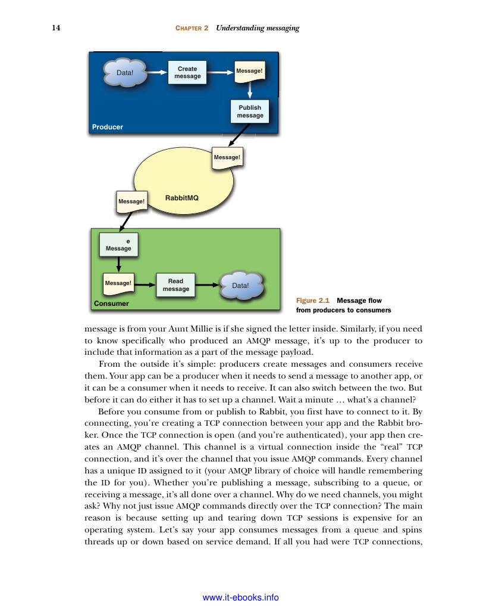

Các ảnh thành phần được trích từ hình 2.1 (khối Producer, đám mây "Data!", các ô "Create message", "Publish message", tờ "Message!", hình elip RabbitMQ, khối Consumer…):


Mô tả hình: Trong khối **Producer** (màu xanh dương), dữ liệu ("Data!") đi qua bước **Create message** (tạo message) thành một tờ "Message!", rồi qua bước **Publish message** (publish message). Tờ message được gửi tới **RabbitMQ** (hình elip vàng). Từ RabbitMQ, message đi ra khối **Consumer** (màu xanh lá): consumer nhận message ("…e Message" — nhãn bị cắt trong bản gốc, ý là nhận message), sau đó qua bước **Read message** (đọc message) để lấy lại dữ liệu "Data!".

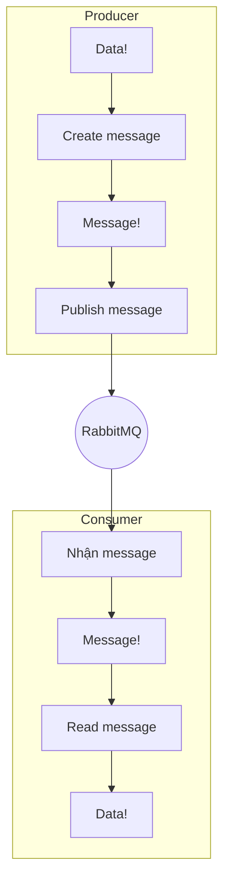

Nhìn từ bên ngoài thì rất đơn giản: producer tạo message và consumer nhận chúng. Ứng dụng của bạn có thể là producer khi cần gửi message tới một ứng dụng khác, hoặc là consumer khi cần nhận. Nó cũng có thể chuyển qua lại giữa hai vai trò. Nhưng trước khi làm bất cứ việc nào trong hai việc đó, nó phải thiết lập một **channel** (kênh). Khoan đã… channel là gì?

Trước khi consume (tiêu thụ/nhận) từ Rabbit hoặc publish lên Rabbit, trước hết bạn phải **kết nối** tới nó. Khi kết nối, bạn đang tạo một **kết nối TCP** (*TCP connection*) giữa ứng dụng của bạn và broker Rabbit. Khi kết nối TCP đã mở (và bạn đã được xác thực — *authenticated*), ứng dụng của bạn sẽ tạo một **channel AMQP**. Channel này là một **kết nối ảo** (*virtual connection*) bên trong kết nối TCP "thật", và chính qua channel mà bạn phát các lệnh AMQP. Mỗi channel được gán một **ID duy nhất** (thư viện AMQP mà bạn chọn sẽ lo việc ghi nhớ ID đó giùm bạn). Dù bạn đang publish một message, đăng ký vào một queue, hay nhận một message — tất cả đều được thực hiện **qua một channel**.

Bạn có thể hỏi: tại sao lại cần channel? Sao không phát lệnh AMQP trực tiếp qua kết nối TCP luôn? Lý do chính là vì việc **thiết lập và hủy bỏ phiên TCP rất tốn kém** đối với hệ điều hành. Giả sử ứng dụng của bạn consume message từ một queue và bật/tắt các luồng (*thread*) tùy theo nhu cầu dịch vụ. Nếu tất cả những gì bạn có chỉ là kết nối TCP, thì mỗi thread sẽ cần kết nối riêng tới Rabbit, có thể dẫn tới **hàng trăm kết nối mỗi giây** trong những lúc tải cao. Điều này không chỉ là sự lãng phí khổng lồ các kết nối TCP, mà hệ điều hành cũng chỉ có thể tạo được một số lượng kết nối nhất định mỗi giây. Vậy là bạn có thể nhanh chóng đụng phải **bức tường hiệu năng** (*performance wall*).

Sẽ tuyệt biết bao nếu bạn có thể dùng **một** kết nối TCP cho tất cả các thread để có hiệu năng, mà vẫn có được **sự riêng tư** giống như cho mỗi thread một kết nối riêng? Đây chính là lúc channel xuất hiện. Khi mỗi thread khởi động, nó tạo một channel trên kết nối hiện có và có được **đường giao tiếp riêng** tới Rabbit mà **không thêm tải nào** lên ngăn xếp TCP (*TCP stack*) của hệ điều hành, như trong hình 2.2. Kết quả là bạn có thể tạo channel hàng trăm hay hàng nghìn lần mỗi giây mà hệ điều hành của bạn thậm chí không thấy một gợn sóng nhỏ nào. **Không có giới hạn** về số lượng channel AMQP bạn có thể có trên một kết nối TCP. Hãy nghĩ về nó như một **bó cáp quang** (*bundle of fiber optic cable*).

Mỗi sợi quang trong bó cáp có thể truyền dữ liệu (giống như một channel). Nhưng bó cáp có nhiều sợi, cho phép tất cả các thread được kết nối truyền và nhận **đồng thời** qua nhiều sợi. **Kết nối TCP giống như bó cáp, còn channel AMQP giống như từng sợi quang riêng lẻ.**

**Hình 2.2 – Hiểu về channel và connection của AMQP (Understanding AMQP channels and connections)**


Trang render đầy đủ: 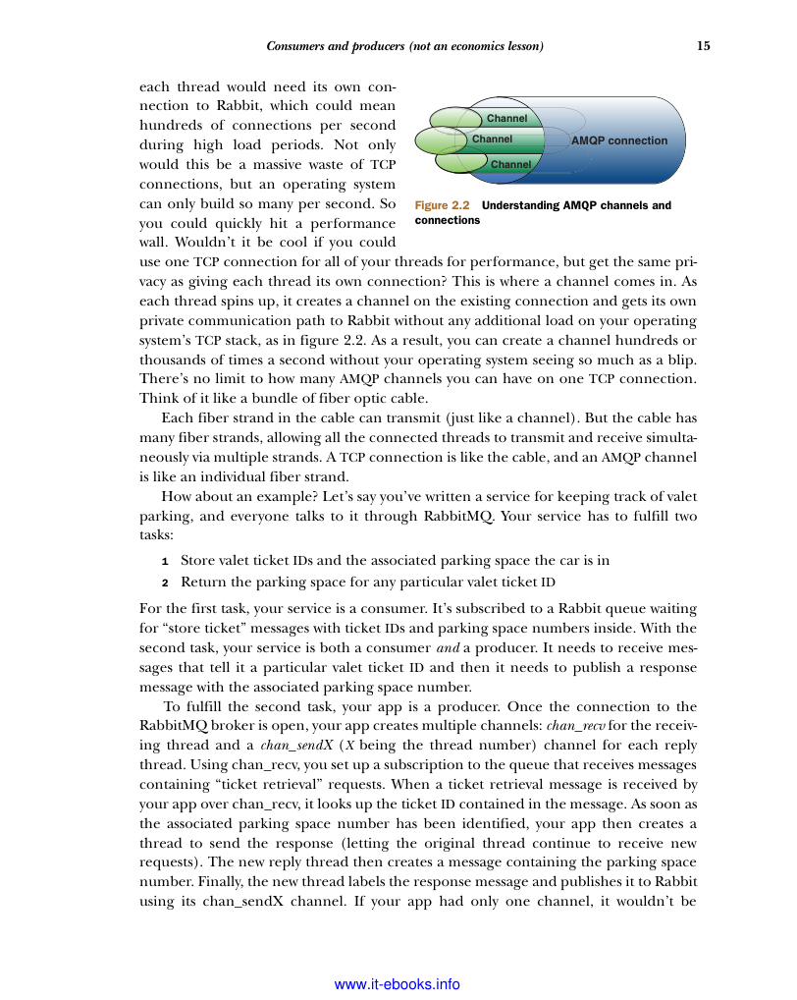

Mô tả hình: Một ống trụ lớn màu xanh ghi **AMQP connection** (kết nối AMQP, tức kết nối TCP thật). Bên trong ống có **ba ống nhỏ màu xanh lá**, mỗi ống ghi **Channel** — ba channel chạy song song bên trong cùng một kết nối.

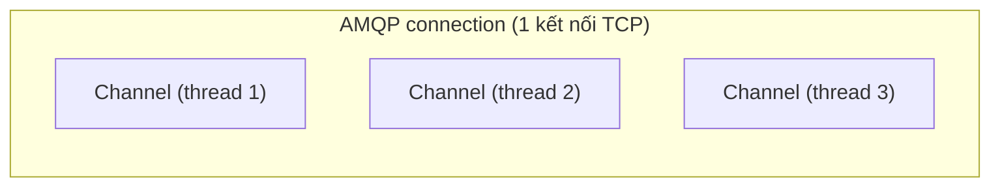

> 💡 **Ví dụ bổ sung (không có trong sách):** Với thư viện Python `pika` (bản mới), một kết nối và nhiều channel trông như sau:
>
> ```python
> import pika
>
> conn = pika.BlockingConnection(pika.ConnectionParameters("localhost"))  # 1 kết nối TCP
> ch_a = conn.channel()   # channel 1 – kết nối ảo, không tạo thêm TCP
> ch_b = conn.channel()   # channel 2
> print(ch_a.channel_number, ch_b.channel_number)  # ví dụ: 1 2
> conn.close()
> ```
>
> Dù tạo bao nhiêu channel, lệnh `netstat` trên máy bạn vẫn chỉ thấy **một** kết nối TCP tới cổng 5672. (Lưu ý: `BlockingConnection` của pika không an toàn khi dùng chung giữa nhiều thread; trong thực tế mỗi thread nên có kết nối riêng hoặc dùng adapter phù hợp — nhưng ý tưởng "nhiều channel trên một kết nối" vẫn đúng ở mức giao thức.)

Hãy xem một ví dụ nhé? Giả sử bạn đã viết một dịch vụ để theo dõi việc **giữ xe hộ** (*valet parking*), và mọi người đều nói chuyện với nó thông qua RabbitMQ. Dịch vụ của bạn phải làm hai nhiệm vụ:

1. Lưu ID của vé giữ xe và chỗ đỗ tương ứng mà chiếc xe đang nằm.
2. Trả về chỗ đỗ cho bất kỳ ID vé giữ xe nào.

Với nhiệm vụ thứ nhất, dịch vụ của bạn là **consumer**. Nó đăng ký vào một queue Rabbit, chờ các message "lưu vé" (*store ticket*) có chứa ID vé và số chỗ đỗ. Với nhiệm vụ thứ hai, dịch vụ của bạn **vừa là consumer vừa là producer**. Nó cần nhận các message cho biết một ID vé cụ thể, rồi sau đó cần publish một message phản hồi chứa số chỗ đỗ tương ứng.

Để thực hiện nhiệm vụ thứ hai, ứng dụng của bạn là một producer. Khi kết nối tới broker RabbitMQ đã mở, ứng dụng tạo **nhiều channel**: `chan_recv` cho thread nhận, và một channel `chan_sendX` (với X là số thứ tự của thread) cho mỗi thread trả lời. Dùng `chan_recv`, bạn thiết lập việc đăng ký vào queue nhận các message chứa yêu cầu "lấy vé" (*ticket retrieval*). Khi ứng dụng nhận được một message lấy vé qua `chan_recv`, nó tra cứu ID vé chứa trong message. Ngay khi xác định được số chỗ đỗ tương ứng, ứng dụng tạo một thread để gửi phản hồi (để thread ban đầu tiếp tục nhận các yêu cầu mới). Thread trả lời mới này tạo một message chứa số chỗ đỗ. Cuối cùng, thread mới dán nhãn cho message phản hồi và publish nó lên Rabbit bằng channel `chan_sendX` của nó.

Nếu ứng dụng của bạn chỉ có một channel, nó sẽ không thể chia sẻ kết nối TCP với các thread trả lời mới. Khi đó bạn chỉ còn hai lựa chọn:

- Hoặc dùng **một kết nối và một thread** — nghĩa là ứng dụng không thể xử lý các yêu cầu lấy vé mới cho tới khi gửi xong phản hồi cho yêu cầu hiện tại;
- Hoặc **tạo một kết nối TCP cho mỗi thread gửi**, gây lãng phí tài nguyên TCP.

Với nhiều channel, nhiều thread có thể dùng chung một kết nối **cùng lúc**, nghĩa là việc trả lời yêu cầu không chặn (*block*) bạn consume các yêu cầu mới, và bạn không lãng phí một kết nối TCP cho mỗi thread. Đôi khi bạn có thể chọn chỉ dùng một channel, nhưng với AMQP bạn có sự linh hoạt để dùng bao nhiêu channel tùy ứng dụng cần mà không phải chịu chi phí phụ (*overhead*) của nhiều kết nối TCP.

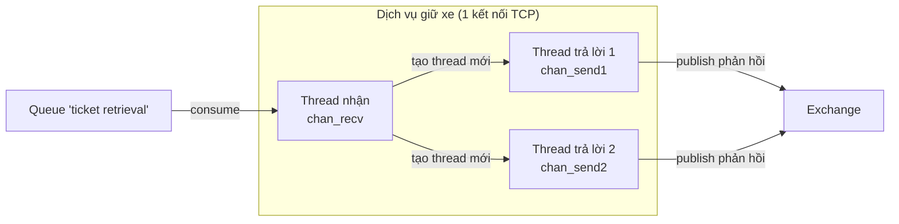

Điều quan trọng cần nhớ về consumer và producer là chúng ánh xạ tới ý tưởng **gửi và nhận**, chứ không phải client và server. Nhắn tin nói chung, và AMQP nói riêng, có thể được xem như một **tầng vận chuyển nâng cao** (*enhanced transport layer*). Với channel, bạn có khả năng tạo bao nhiêu tầng vận chuyển song song tùy ứng dụng cần mà không bị giới hạn bởi các hạn chế của kết nối TCP. Khi bạn hiểu được những khái niệm này, bạn có thể bắt đầu nghĩ về RabbitMQ như **một bộ định tuyến cho phần mềm của bạn**.

---

## 2.2 Xây từ nền móng: queue (Building from the bottom: queues)

Bạn đã nắm được consumer và producer, và giờ đang nóng lòng muốn bắt tay vào làm phải không? Khoan đã. Trước hết, bạn cần hiểu về **queue** (hàng đợi). Về mặt khái niệm, có **ba thành phần** cho bất kỳ lần định tuyến thành công nào của một message AMQP: **exchange**, **queue** và **binding**.

- **Exchange** (bộ trao đổi/tổng đài) là nơi producer publish message của họ.
- **Queue** là nơi message cuối cùng nằm lại và được consumer nhận.
- **Binding** (liên kết) là cách message được định tuyến từ exchange tới các queue cụ thể.

Trước khi xem xét exchange và binding, bạn cần hiểu queue là gì và nó hoạt động thế nào. Hãy nhìn hình 2.3.

**Hình 2.3 – Ngăn xếp AMQP: exchange, binding và queue (AMQP stack: exchanges, bindings, and queues)**


Trang render đầy đủ: 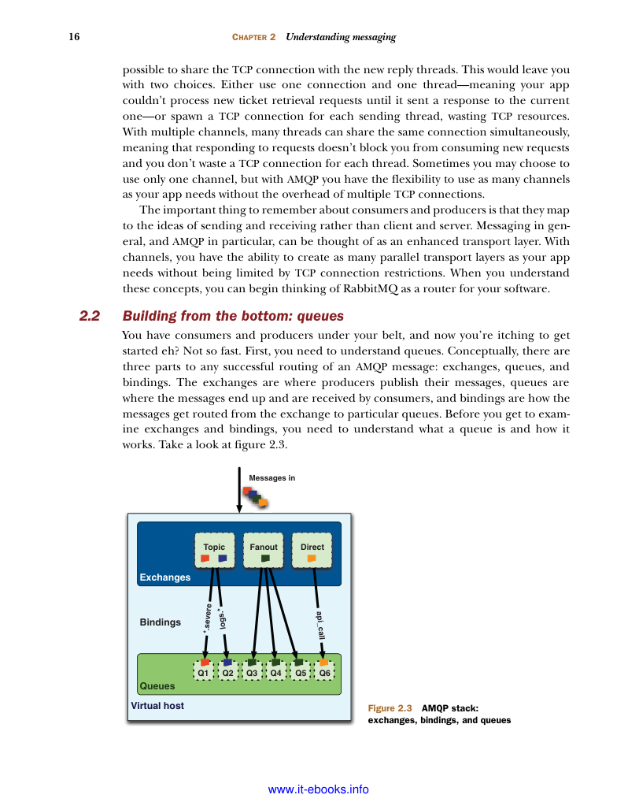

Mô tả hình: Toàn bộ khung là một **Virtual host** (máy chủ ảo). Phía trên, các message màu sắc khác nhau đi vào (**Messages in** – message đến). Tầng trên cùng là **Exchanges** gồm ba exchange: **Topic**, **Fanout** và **Direct**. Tầng giữa là **Bindings**: từ exchange Topic có hai binding với khóa `*.severe` (tới Q1) và `logs.*` (tới Q2); từ exchange Fanout có các mũi tên tới Q3, Q4, Q5 (fanout gửi cho tất cả queue gắn với nó); từ exchange Direct có binding `api_call` tới Q6. Tầng dưới cùng là **Queues** gồm Q1 đến Q6, mỗi queue chứa message đã được định tuyến tới.

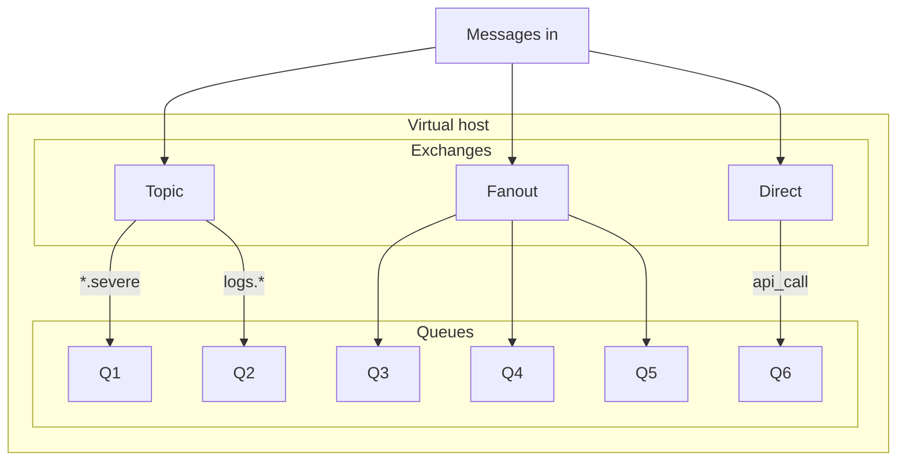

Như chúng ta đã nói khi bàn về producer và consumer, queue giống như **những hộp thư có tên**. Chúng là nơi message dừng chân và chờ được consume. Consumer nhận message từ một queue cụ thể theo **một trong hai cách**:

1. **Đăng ký (subscribe) vào queue bằng lệnh AMQP `basic.consume`.** Lệnh này sẽ đặt channel đang dùng vào **chế độ nhận** (*receive mode*) cho tới khi hủy đăng ký khỏi queue. Trong khi đang đăng ký, consumer của bạn sẽ **tự động** nhận message tiếp theo từ queue (nếu có) sau khi đã consume (hoặc từ chối) message vừa nhận. Bạn nên dùng `basic.consume` nếu consumer của bạn xử lý nhiều message từ một queue và/hoặc cần tự động nhận message từ queue ngay khi chúng tới.
2. Đôi khi bạn chỉ muốn **một message duy nhất** từ queue và không cần đăng ký lâu dài. Việc yêu cầu một message đơn lẻ từ queue được thực hiện bằng lệnh AMQP **`basic.get`**. Lệnh này khiến consumer nhận message kế tiếp trong queue, rồi sau đó không nhận thêm message nào cho tới lần `basic.get` tiếp theo. **Bạn không nên dùng `basic.get` trong một vòng lặp để thay thế cho `basic.consume`**, vì nó tốn tài nguyên của Rabbit hơn rất nhiều. Về bản chất, mỗi lần bạn phát lệnh `basic.get`, nó sẽ đăng ký vào queue, lấy một message, rồi hủy đăng ký. **Các consumer cần thông lượng cao (*high-throughput*) luôn luôn nên dùng `basic.consume`.**

> 💡 **Ví dụ bổ sung (không có trong sách):** So sánh hai cách bằng `pika` (cú pháp pika 1.x hiện đại, khác với pika 0.9 dùng trong sách):
>
> ```python
> # Cách 2: basic.get – "kéo" đúng một message rồi thôi
> method, props, body = channel.basic_get(queue="seed_bin", auto_ack=False)
> if method:                       # None nếu queue rỗng
>     print("Lấy được:", body)
>     channel.basic_ack(method.delivery_tag)
>
> # Cách 1: basic.consume – broker "đẩy" message liên tục tới callback
> def on_msg(ch, method, props, body):
>     print("Nhận:", body)
>     ch.basic_ack(method.delivery_tag)
>
> channel.basic_consume(queue="seed_bin", on_message_callback=on_msg)
> channel.start_consuming()
> ```
>
> Nếu bạn viết `while True: channel.basic_get(...)` để "giả lập" consume, mỗi vòng lặp là một chuyến khứ hồi mạng và một lần đăng ký/hủy đăng ký — đó chính là điều sách khuyên tránh.

Nếu có một hoặc nhiều consumer đăng ký vào một queue, message sẽ được gửi **ngay lập tức** tới các consumer đã đăng ký. Nhưng nếu một message tới một queue **không có consumer nào đăng ký** thì sao? Khi đó, message sẽ **chờ trong queue**. Ngay khi có một consumer đăng ký vào queue, message sẽ được gửi tới consumer đó. Một câu hỏi thú vị hơn là: message trong queue được phân phối thế nào khi **nhiều consumer** cùng đăng ký vào một queue?

Khi một queue Rabbit có nhiều consumer, các message mà queue nhận được sẽ được phục vụ theo kiểu **xoay vòng** (*round-robin*) tới các consumer. **Mỗi message chỉ được gửi tới một consumer** đăng ký vào queue. Giả sử bạn có một queue tên `seed_bin` (thùng hạt giống) và hai consumer là bác nông dân Bob và cô nông dân Esmeralda cùng đăng ký vào `seed_bin`. Khi message tới `seed_bin`, việc giao nhận sẽ diễn ra như sau:

1. Message_A tới queue `seed_bin`.
2. RabbitMQ gửi Message_A cho bác Bob.
3. Bác Bob xác nhận (*acknowledge*) đã nhận Message_A.
4. RabbitMQ xóa Message_A khỏi queue `seed_bin`.
5. Message_B tới queue `seed_bin`.
6. RabbitMQ gửi Message_B cho cô Esmeralda.
7. Cô Esmeralda xác nhận đã nhận Message_B.
8. RabbitMQ xóa Message_B khỏi queue `seed_bin`.

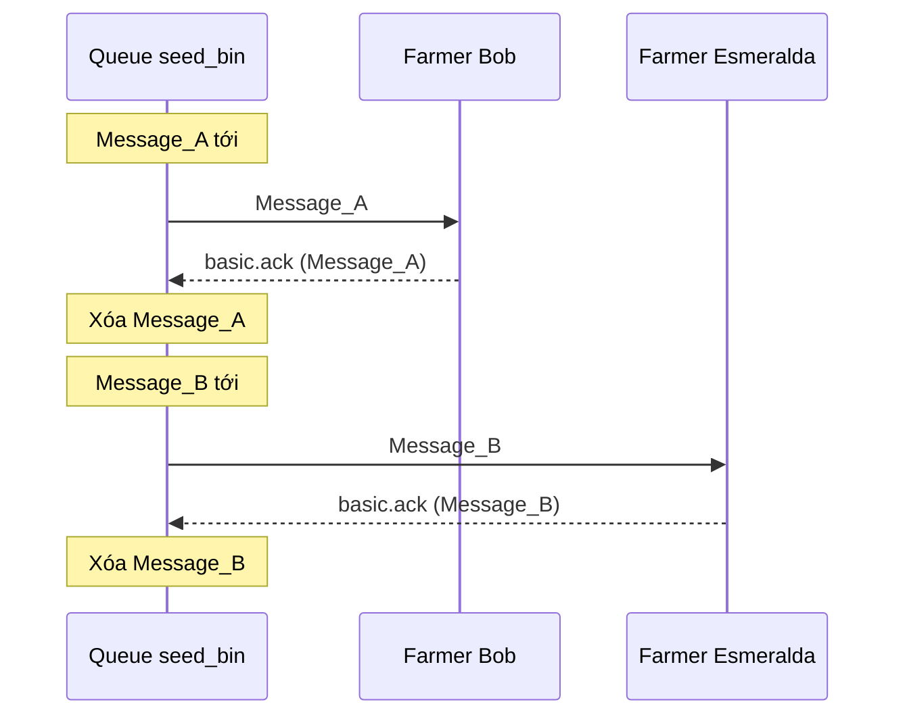

Có thể bạn đã để ý rằng bác Bob và cô Esmeralda đã làm một việc mà chúng ta chưa nói tới: họ **xác nhận đã nhận message** (*acknowledged receipt*). **Mọi message mà consumer nhận được đều bắt buộc phải được xác nhận (acknowledge).** Hoặc là consumer phải **gửi xác nhận một cách tường minh** tới RabbitMQ bằng lệnh AMQP **`basic.ack`**, hoặc nó có thể đặt tham số **`auto_ack` thành `true`** khi đăng ký vào queue. Khi `auto_ack` được chỉ định, RabbitMQ sẽ tự động coi message là đã được consumer xác nhận **ngay khi consumer nhận được nó**.

Một điều quan trọng cần nhớ: **việc consumer xác nhận message không hề liên quan tới việc báo cho producer biết message đã được nhận.** Thay vào đó, xác nhận là cách để consumer khẳng định với RabbitMQ rằng consumer đã nhận đúng message và RabbitMQ có thể **an toàn xóa nó khỏi queue**.

Nếu một consumer nhận message rồi **ngắt kết nối** khỏi Rabbit (hoặc hủy đăng ký khỏi queue) **trước khi xác nhận**, RabbitMQ sẽ coi message là **chưa được giao** và **giao lại** (*redeliver*) nó cho consumer đăng ký kế tiếp. Nếu ứng dụng của bạn bị sập, bạn có thể yên tâm rằng message sẽ được gửi tới một consumer khác để xử lý. Mặt khác, nếu ứng dụng consumer của bạn có lỗi (*bug*) và **quên xác nhận** một message, Rabbit sẽ **không gửi thêm message nào** cho consumer đó nữa. Lý do là Rabbit coi consumer chưa sẵn sàng nhận message khác cho tới khi nó xác nhận message cuối cùng đã nhận.

Bạn có thể tận dụng hành vi này để có lợi cho mình. Nếu việc xử lý nội dung một message đặc biệt nặng, ứng dụng của bạn có thể **trì hoãn việc xác nhận** cho tới khi xử lý xong. Điều này sẽ ngăn Rabbit dồn cho bạn nhiều message hơn mức ứng dụng có thể xử lý.

> 📝 **Giải thích thêm (không có trong sách):** Trong các phiên bản RabbitMQ hiện đại, số message "đang bay" chưa ack mà một consumer có thể giữ được điều khiển chính xác bằng **prefetch** (lệnh `basic.qos`, ví dụ `channel.basic_qos(prefetch_count=1)`). Với `prefetch_count=1`, Rabbit chỉ gửi message tiếp theo khi consumer đã ack message trước — đúng với hành vi "không ack thì không nhận thêm" mà sách mô tả. Nếu không đặt prefetch, broker có thể đẩy nhiều message trước cho consumer.

Nếu bạn muốn **từ chối** (*reject*) một message một cách rõ ràng thay vì xác nhận nó sau khi đã nhận thì sao? Chẳng hạn, khi xử lý message bạn gặp một lỗi không thể khắc phục, nhưng lỗi đó chỉ ảnh hưởng tới consumer này do một vấn đề phần cứng (đây là một lý do tốt để **không bao giờ xác nhận message cho tới khi đã xử lý xong**). Miễn là message chưa được xác nhận, bạn có hai lựa chọn:

1. **Cho consumer ngắt kết nối khỏi RabbitMQ server.** Việc này khiến RabbitMQ tự động đưa message trở lại hàng đợi (*requeue*) và giao nó cho một consumer khác. Ưu điểm của cách này là nó hoạt động với **mọi phiên bản** RabbitMQ. Nhược điểm là **tải thêm** đặt lên RabbitMQ server do việc kết nối và ngắt kết nối của consumer (có thể là một tải đáng kể nếu consumer gặp lỗi với mọi message).
2. Nếu bạn đang chạy **RabbitMQ 2.0.0 trở lên**, hãy dùng lệnh AMQP **`basic.reject`**. `basic.reject` làm đúng như tên gọi của nó: cho phép consumer từ chối một message mà RabbitMQ đã gửi cho nó. Nếu bạn đặt tham số **`requeue`** của lệnh reject thành `true`, RabbitMQ sẽ giao lại message cho consumer đăng ký kế tiếp. Đặt `requeue` thành `false` sẽ khiến RabbitMQ **xóa message khỏi queue ngay lập tức** mà không gửi lại cho consumer mới. Bạn cũng có thể **loại bỏ** (*discard*) một message đơn giản bằng cách **xác nhận** nó (cách loại bỏ này có ưu điểm là hoạt động với mọi phiên bản RabbitMQ). Điều này hữu ích nếu bạn phát hiện một message bị sai định dạng (*malformed*) mà bạn biết không consumer nào có thể xử lý được.

> **NOTE (Ghi chú)** Khi loại bỏ một message, tại sao bạn lại muốn dùng lệnh `basic.reject` với tham số `requeue` đặt thành `false` thay vì xác nhận message? Vì các phiên bản RabbitMQ trong tương lai sẽ hỗ trợ một queue đặc biệt gọi là **"dead letter" queue** (hàng đợi thư chết) — nơi các message bị từ chối mà không requeue sẽ được đặt vào. Dead letter queue cho phép bạn kiểm tra các message bị từ chối/không giao được để tìm ra vấn đề. Nếu bạn muốn ứng dụng của mình tự động tận dụng tính năng dead letter queue khi nó được thêm vào Rabbit, hãy dùng lệnh reject với `requeue` đặt là `false`.

> 📝 **Giải thích thêm (không có trong sách):** Tính năng mà ghi chú trên "dự đoán" đã thực sự có từ RabbitMQ 2.8 dưới tên **Dead Letter Exchange (DLX)**. Bạn khai báo queue với tham số `x-dead-letter-exchange`; message bị `basic.reject`/`basic.nack` với `requeue=false` (hoặc hết hạn TTL, hoặc vượt giới hạn độ dài queue) sẽ được chuyển sang exchange đó.

> 💡 **Ví dụ bổ sung (không có trong sách):** Một callback consumer xử lý đủ ba trường hợp: thành công → ack; lỗi tạm thời → reject có requeue; message hỏng → reject không requeue.
>
> ```python
> import json
>
> def on_msg(ch, method, props, body):
>     try:
>         order = json.loads(body)          # message sai định dạng sẽ ném lỗi ở đây
>     except ValueError:
>         ch.basic_reject(method.delivery_tag, requeue=False)  # bỏ hẳn (hoặc vào dead letter)
>         return
>     try:
>         process(order)                     # xử lý nặng; chỉ ack SAU khi xong
>         ch.basic_ack(method.delivery_tag)
>     except TemporaryHardwareError:
>         ch.basic_reject(method.delivery_tag, requeue=True)   # để consumer khác thử lại
> ```

Còn một điều quan trọng nữa bạn cần biết về queue: **cách tạo ra chúng**. Cả consumer và producer đều có thể tạo queue bằng lệnh AMQP **`queue.declare`**. Nhưng consumer **không thể khai báo queue khi đang đăng ký vào một queue khác trên cùng channel**. Chúng phải hủy đăng ký trước để đưa channel về chế độ "truyền" (*transmit*). Khi tạo queue, thông thường bạn muốn chỉ định **tên** cho nó. Tên được consumer dùng để đăng ký, và là cách bạn chỉ định queue khi tạo binding. Nếu bạn không chỉ định tên, Rabbit sẽ gán một **tên ngẫu nhiên** cho bạn và trả nó về trong phản hồi của lệnh `queue.declare` (điều này hữu ích khi dùng các queue "vô danh" tạm thời — *anonymous queues* — cho các ứng dụng RPC-qua-AMQP, như bạn sẽ thấy ở chương 4). Dưới đây là một số thuộc tính hữu ích khác bạn có thể đặt cho queue:

- **`exclusive`** (độc quyền) — Khi đặt thành `true`, queue của bạn trở nên **riêng tư** và chỉ có thể được consume bởi ứng dụng của bạn. Điều này hữu ích khi bạn cần giới hạn một queue chỉ cho một consumer.
- **`auto-delete`** (tự xóa) — Queue sẽ **tự động bị xóa** khi consumer cuối cùng hủy đăng ký. Nếu bạn cần một queue tạm thời chỉ được dùng bởi một consumer, hãy **kết hợp `auto-delete` với `exclusive`**. Khi consumer ngắt kết nối, queue sẽ bị gỡ bỏ.

Điều gì xảy ra nếu bạn cố khai báo một queue **đã tồn tại**? Miễn là các tham số khai báo **khớp chính xác** với queue hiện có, Rabbit sẽ không làm gì cả và trả về thành công như thể queue vừa được tạo (nếu các tham số **không khớp**, lần khai báo đó sẽ **thất bại**). Nếu bạn chỉ muốn kiểm tra xem một queue có tồn tại hay không, bạn có thể đặt tùy chọn **`passive`** của `queue.declare` thành `true`. Với `passive` là `true`, `queue.declare` sẽ trả về thành công nếu queue tồn tại, và trả về lỗi **mà không tạo queue** nếu nó không tồn tại.

> 💡 **Ví dụ bổ sung (không có trong sách):** Các biến thể của `queue.declare` với pika 1.x:
>
> ```python
> # Queue có tên, mặc định
> channel.queue_declare(queue="orders")
>
> # Queue tạm, tên do Rabbit đặt (ví dụ "amq.gen-JzTY20BRgKO-HjmUJj0wLg"),
> # chỉ kết nối này dùng được và tự xóa khi kết nối đóng
> result = channel.queue_declare(queue="", exclusive=True, auto_delete=True)
> reply_queue = result.method.queue
>
> # Chỉ kiểm tra tồn tại; nếu "orders" không có, broker trả lỗi 404 NOT_FOUND
> # và đóng channel – không tạo queue mới
> channel.queue_declare(queue="orders", passive=True)
>
> # Khai báo lại "orders" với durable=True trong khi queue cũ là durable=False
> # → lỗi 406 PRECONDITION_FAILED (tham số không khớp)
> ```

Khi thiết kế ứng dụng, rất có thể bạn sẽ tự hỏi: **producer hay consumer nên tạo các queue cần thiết?** Có vẻ như câu trả lời tự nhiên nhất là consumer nên tạo queue. Suy cho cùng, chúng là bên cần đăng ký, và bạn đâu thể đăng ký vào một queue không tồn tại, đúng không? Khoan đã. Trước hết bạn cần tự hỏi: **những message mà producer tạo ra có được phép biến mất hay không?** Các message được publish vào một exchange nhưng **không có queue nào để định tuyến tới sẽ bị Rabbit loại bỏ**. Vì thế, nếu bạn không thể chấp nhận việc message bị **"rơi vào hố đen"** (*black-holed*), thì **cả producer lẫn consumer đều nên cố gắng tạo** các queue cần thiết. Ngược lại, nếu bạn có thể chấp nhận mất message, hoặc đã cài đặt một cách để publish lại những message không được xử lý (chúng tôi sẽ chỉ bạn cách làm điều này), thì bạn có thể chỉ để consumer khai báo queue.

Queue là **khối nền tảng** của nhắn tin AMQP:

- Chúng cho message của bạn một nơi để **chờ được consume**.
- Queue rất hoàn hảo cho việc **cân bằng tải** (*load balancing*). Chỉ cần gắn một loạt consumer vào và để RabbitMQ chia đều message đến theo kiểu round-robin cho chúng.
- Chúng là **điểm cuối cùng** của mọi message trong Rabbit (trừ khi message bị rơi vào hố đen).

> 💡 **Bài toán ví dụ (không có trong sách):** Một queue `resize_image` nhận 600 yêu cầu thu nhỏ ảnh mỗi phút, mỗi yêu cầu cần 0,5 giây xử lý. Một consumer xử lý được 120 yêu cầu/phút. Cần bao nhiêu consumer để queue không bị dồn?
>
> **Lời giải:** 600 / 120 = 5. Bạn chỉ cần chạy 5 tiến trình consumer cùng đăng ký `resize_image`; RabbitMQ sẽ round-robin để mỗi consumer nhận khoảng 120 message/phút. Producer không cần biết có 1 hay 5 consumer — đây chính là sức mạnh cân bằng tải của queue.

Đã nắm được queue, bạn sẵn sàng chuyển sang khối xây dựng tiếp theo của Rabbit: **exchange và binding**!

---

## 2.3 Kết nối lại với nhau: exchange và binding (Getting together: exchanges and bindings)

Như bạn đã thấy ở các mục trước, bạn muốn có các consumer lấy message từ queue. Giờ câu hỏi là: **làm sao một message tới được queue?** Xin giới thiệu **binding** và **exchange** của AMQP. Bất cứ khi nào bạn muốn giao một message tới một queue, bạn làm điều đó bằng cách **gửi nó tới một exchange**. Sau đó, dựa trên những quy tắc nhất định, RabbitMQ sẽ quyết định giao message tới queue nào. Những quy tắc đó được gọi là **routing key** (khóa định tuyến). Ta nói một queue được **gắn (bound) vào một exchange bằng một routing key**. Khi bạn gửi một message tới broker, nó sẽ có một routing key — kể cả khi routing key đó **để trống** — và RabbitMQ sẽ cố gắng so khớp nó với các routing key được dùng trong các binding. Nếu khớp, message sẽ được giao tới queue. Nếu routing key của message không khớp với bất kỳ mẫu binding nào, message sẽ **rơi vào hố đen** (bị bỏ đi).

Tại sao lại cần sự gián tiếp (*indirection*) như vậy? Có thể bạn đang nói: "Tôi chỉ muốn message của tôi nằm trong queue thôi mà." Hãy xem một ví dụ để hiểu những lợi ích của khái niệm này.

Bạn có thể so sánh tình huống này với **email**: nếu bạn muốn gửi thư cho một người liên hệ, bạn gửi tới địa chỉ của họ, và SMTP server sẽ kiểm tra thư được gửi tới ai và lo việc giao nó vào hộp thư đến của người đó. Nhưng điều gì xảy ra nếu người liên hệ của bạn muốn **mọi thư bạn gửi** đều được xếp vào thư mục "công việc" (*business*)? Khi đó, họ phải thiết lập một số **quy tắc** dựa trên nội dung thư để đạt được mục tiêu đó. Có thể họ còn muốn có những quy tắc xếp thư vào cùng thư mục đó dựa trên, chẳng hạn, tên miền (*hostname*) của một số đối tác kinh doanh. Với các khái niệm exchange, binding và queue, AMQP có thể đáp ứng những trường hợp sử dụng như vậy và nhiều hơn nữa. Ví dụ, bạn có thể gắn một queue vào một exchange **không có routing key**, và khi đó mọi message không có routing key mà bạn gửi tới exchange đó sẽ được giao tới queue nói trên — tương tự như email. Nếu bạn cần những trường hợp phức tạp, như **publish/subscribe** (xuất bản/đăng ký) hay **multicast** (phát nhóm), bạn cũng làm được. Bạn sẽ thấy điều đó ngay sau đây.

Bên cạnh nhiều trường hợp sử dụng khác nhau mà bạn có thể xử lý bằng exchange và binding, còn một lợi ích khác: **publisher** — tiến trình gửi message tới broker — **không cần quan tâm tới logic ở phía bên kia của broker** (các queue và consumer tham gia xử lý message). Như bạn sẽ thấy, điều này có thể dẫn tới những kịch bản nhắn tin thú vị mà nếu dùng một broker chỉ cho phép publish trực tiếp vào queue thì sẽ **không thể làm được** — hoặc **rất khó làm**.

Như bạn đã thấy, broker sẽ định tuyến message từ exchange tới queue dựa trên routing key, nhưng nó xử lý việc giao tới **nhiều** queue thế nào? Đây là lúc các **loại exchange** khác nhau mà giao thức cung cấp phát huy tác dụng. Có **bốn loại**: **direct**, **fanout**, **topic** và **headers**. Mỗi loại cài đặt một thuật toán định tuyến khác nhau. Chúng tôi sẽ đi qua tất cả, **trừ headers exchange** — loại cho phép bạn so khớp với một **header** (phần đầu) trong message AMQP thay vì routing key. Ngoài điểm đó ra, nó hoạt động y hệt direct exchange nhưng **hiệu năng tệ hơn nhiều**. Vì vậy, nó không mang lại nhiều lợi ích thực tế và **gần như không bao giờ được dùng**. Hãy xem chi tiết từng loại exchange còn lại.

**▸ Direct exchange**

**Direct exchange** (exchange trực tiếp) khá đơn giản: **nếu routing key khớp, message được giao tới queue tương ứng.** Bạn có thể thấy minh họa của điều này trong hình 2.4.

**Hình 2.4 – Luồng message của direct exchange (Direct exchange message flow)**


Trang render đầy đủ: 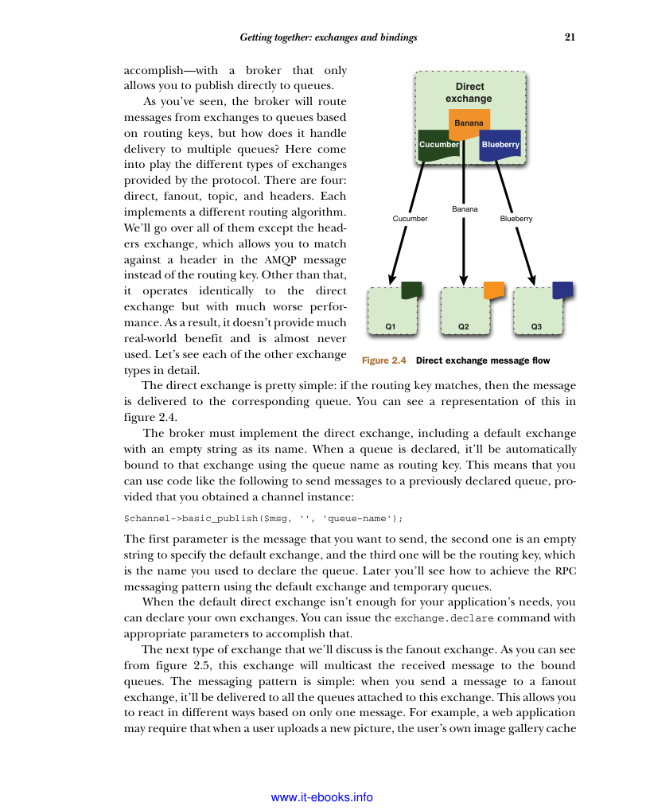

Mô tả hình: Một **Direct exchange** chứa ba message có routing key lần lượt là **Cucumber** (dưa leo, màu xanh đậm), **Banana** (chuối, màu cam) và **Blueberry** (việt quất, màu xanh tím). Có ba binding: khóa `Cucumber` → Q1, khóa `Banana` → Q2, khóa `Blueberry` → Q3. Mỗi message chỉ đi vào đúng queue có binding trùng khóa của nó.

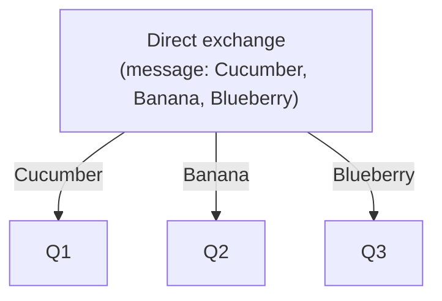

Broker **bắt buộc phải cài đặt** direct exchange, bao gồm một **exchange mặc định** (*default exchange*) có **tên là chuỗi rỗng**. Khi một queue được khai báo, nó sẽ **tự động được gắn** vào exchange này, dùng **tên queue làm routing key**. Điều này có nghĩa là bạn có thể dùng code như sau để gửi message tới một queue đã khai báo trước đó, miễn là bạn đã có một đối tượng channel:

```php
$channel->basic_publish($msg, '', 'queue-name');
```

Tham số thứ nhất là message bạn muốn gửi, tham số thứ hai là một chuỗi rỗng để chỉ định exchange mặc định, và tham số thứ ba là routing key — chính là tên bạn đã dùng để khai báo queue. Ở phần sau, bạn sẽ thấy cách hiện thực mô hình nhắn tin **RPC** (*Remote Procedure Call* – gọi thủ tục từ xa) bằng exchange mặc định và các queue tạm thời.

Khi direct exchange mặc định không đủ cho nhu cầu của ứng dụng, bạn có thể **khai báo exchange của riêng mình**. Bạn có thể phát lệnh **`exchange.declare`** với các tham số phù hợp để làm điều đó.

> 💡 **Ví dụ bổ sung (không có trong sách):** Cùng ý tưởng với dòng PHP ở trên nhưng viết bằng Python/pika:
>
> ```python
> channel.queue_declare(queue="queue-name")
> # exchange="" là exchange mặc định; routing_key = tên queue
> channel.basic_publish(exchange="", routing_key="queue-name", body="xin chào")
>
> # Tự khai báo một direct exchange riêng và gắn queue vào bằng khóa "banana"
> channel.exchange_declare(exchange="fruits", exchange_type="direct")
> channel.queue_bind(queue="queue-name", exchange="fruits", routing_key="banana")
> channel.basic_publish(exchange="fruits", routing_key="banana", body="1 nải chuối")  # → vào queue-name
> channel.basic_publish(exchange="fruits", routing_key="cucumber", body="dưa leo")     # → không queue nào khớp → bị bỏ
> ```

**▸ Fanout exchange**

Loại exchange tiếp theo mà chúng ta sẽ bàn là **fanout exchange** (exchange tỏa ra/phát tán). Như bạn thấy trong hình 2.5, exchange này sẽ **multicast** (phát cho nhiều bên) message nhận được tới **các queue đã gắn vào nó**. Mô hình nhắn tin rất đơn giản: khi bạn gửi một message tới fanout exchange, nó sẽ được giao tới **tất cả** các queue gắn với exchange này. Điều này cho phép bạn **phản ứng theo nhiều cách khác nhau chỉ dựa trên một message**.

Ví dụ, một ứng dụng web có thể yêu cầu rằng khi người dùng tải lên một bức ảnh mới, **bộ nhớ đệm (cache) thư viện ảnh** của chính người dùng đó phải được xóa, đồng thời họ cũng nên được **thưởng một số điểm**. Bạn có thể có hai queue gắn vào exchange `upload-pictures`: một queue có các consumer xóa cache, và queue kia để tăng điểm cho người dùng.

Cũng từ kịch bản này, bạn có thể thấy lợi ích của việc dùng exchange, binding và queue so với publish message trực tiếp vào queue. Giả sử yêu cầu đầu tiên của ứng dụng là sau khi một bức ảnh được tải lên website, cache thư viện ảnh của người dùng sẽ bị xóa. Bạn có thể dễ dàng hiện thực điều đó chỉ bằng một queue. Nhưng điều gì xảy ra khi **chủ sản phẩm** (*product owner*) đến gặp bạn với tính năng mới là **trao thưởng cho người dùng vì các hành động của họ**? Nếu bạn đang gửi message trực tiếp vào queue, bạn sẽ phải **sửa code của publisher** để gửi message tới queue *points* (điểm) mới. Nếu bạn đang dùng fanout exchange, điều duy nhất bạn phải làm là **viết code cho consumer mới**, rồi **khai báo và gắn một queue mới** vào fanout exchange. Như chúng tôi đã nói, code của publisher **hoàn toàn tách rời** khỏi code của consumer, cho phép bạn tăng thêm chức năng cho ứng dụng một cách dễ dàng.

**Hình 2.5 – Luồng message của fanout exchange (Fanout exchange message flow)**


Trang render đầy đủ: 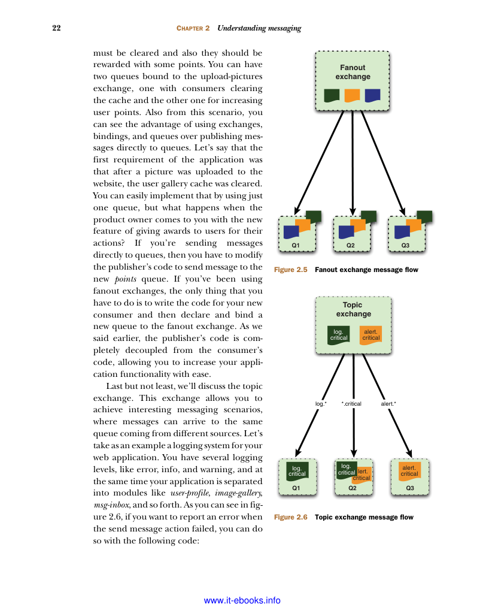

Mô tả hình: Một **Fanout exchange** chứa ba message (xanh đậm, cam, xanh tím). Ba mũi tên đi xuống Q1, Q2, Q3 — và **mỗi queue đều nhận đủ cả ba message** (bản sao), vì fanout không xét routing key mà gửi cho mọi queue đã gắn.

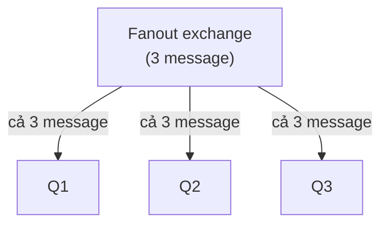

> 💡 **Ví dụ bổ sung (không có trong sách):** Kịch bản `upload-pictures` viết bằng pika. Lúc đầu chỉ có queue xóa cache; khi có yêu cầu "thưởng điểm", ta chỉ **thêm** code phía consumer, publisher giữ nguyên:
>
> ```python
> # --- Publisher (không bao giờ phải sửa) ---
> channel.exchange_declare(exchange="upload-pictures", exchange_type="fanout")
> channel.basic_publish(exchange="upload-pictures", routing_key="",
>                       body='{"user_id": 42, "image_id": 1001}')
>
> # --- Consumer xóa cache (có từ đầu) ---
> channel.queue_declare(queue="clear-gallery-cache")
> channel.queue_bind(queue="clear-gallery-cache", exchange="upload-pictures")
>
> # --- Consumer cộng điểm (thêm sau, theo yêu cầu của product owner) ---
> channel.queue_declare(queue="add-user-points")
> channel.queue_bind(queue="add-user-points", exchange="upload-pictures")
> ```
>
> Với fanout, routing key bị bỏ qua, nên `routing_key=""` hay bất kỳ giá trị nào cũng cho kết quả như nhau.

**▸ Topic exchange**

Cuối cùng nhưng không kém phần quan trọng, chúng ta sẽ bàn về **topic exchange** (exchange theo chủ đề). Exchange này cho phép bạn đạt được những kịch bản nhắn tin thú vị, trong đó message có thể **tới cùng một queue từ nhiều nguồn khác nhau**. Hãy lấy ví dụ một **hệ thống ghi log** (*logging system*) cho ứng dụng web của bạn. Bạn có nhiều mức log (*logging levels*), như `error` (lỗi), `info` (thông tin) và `warning` (cảnh báo), đồng thời ứng dụng của bạn được chia thành các module như `user-profile` (hồ sơ người dùng), `image-gallery` (thư viện ảnh), `msg-inbox` (hộp thư tin nhắn), v.v. Như bạn thấy trong hình 2.6, nếu bạn muốn báo cáo một lỗi khi hành động gửi tin nhắn thất bại, bạn có thể làm như sau:

**Hình 2.6 – Luồng message của topic exchange (Topic exchange message flow)**


Mô tả hình: Một **Topic exchange** chứa hai message có routing key `log.critical` và `alert.critical`. Có ba binding: `log.*` → Q1, `*.critical` → Q2, `alert.*` → Q3. Kết quả: Q1 nhận `log.critical`; Q2 nhận **cả hai** `log.critical` và `alert.critical` (vì cả hai đều kết thúc bằng `.critical`); Q3 nhận `alert.critical`.

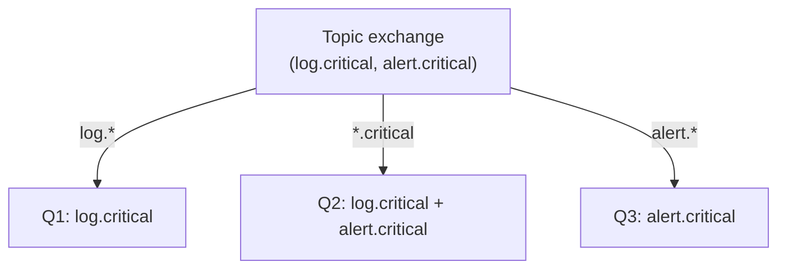

```php
$channel->basic_publish($msg, 'logs-exchange', 'error.msg-inbox');
```

Sau đó, với điều kiện bạn đã khai báo một queue `msg-inbox-errors`, bạn có thể gắn nó vào exchange để nhận các message như sau:

```php
$channel->queue_bind('msg-inbox-errors',
                     'logs-exchange',
                     'error.msg-inbox');
```

Đến đây thì mọi thứ trông rất giống direct exchange. Bạn đã dùng cùng một chuỗi `error.msg-inbox` vừa làm **quy tắc binding** cho thao tác gắn queue, vừa làm **routing key** khi publish message. Điều đó đảm bảo message của bạn được định tuyến vào queue `msg-inbox-errors`, chẳng có gì đặc biệt. Nhưng nếu bạn muốn có một queue lắng nghe **mọi mức log** xảy ra trong module `msg-inbox` thì sao? Bạn có thể làm điều đó với chính exchange đã có, bằng cách gắn một queue mới như sau:

```php
$channel->queue_bind('msg-inbox-logs',
                     'logs-exchange',
                     '*.msg-inbox');
```

Queue `msg-inbox-logs` sẽ nhận tất cả các message log `error`, `warning` và `info` từ module `msg-inbox`. Còn nhận **tất cả** log thì sao? Việc đó cũng dễ. Bạn có thể dùng **ký tự đại diện** (*wildcard*) khi gắn queue vào exchange. Như bạn thấy từ các ví dụ trước, **một dấu chấm `.` chia routing key thành các phần**, và **dấu `*` khớp với bất kỳ đoạn văn bản nào ở đúng vị trí phần đó**. Để tạo một quy tắc **khớp tất cả**, bạn có thể dùng ký tự **`#`**:

```php
$channel->queue_bind('all-logs', 'logs-exchange', '#');
```

Với binding đó, queue `all-logs` sẽ nhận tất cả log được publish bởi ứng dụng web của bạn. Tất nhiên, để mọi ví dụ trên hoạt động, bạn phải **khai báo các queue từ trước** khi thực hiện binding. Khác với toán tử `*` — vốn coi `.` trong routing key là dấu phân cách các phần — **toán tử `#` không có khái niệm "phần"** và coi mọi ký tự `.` chỉ là một phần của khóa cần khớp.

> 📝 **Giải thích thêm (không có trong sách):** Theo đặc tả AMQP 0-9-1 và cách RabbitMQ cài đặt, chính xác hơn: `*` khớp **đúng một từ** (một đoạn giữa hai dấu chấm), còn `#` khớp **không hoặc nhiều từ**. Vì vậy `#` đứng một mình khớp mọi routing key; `log.#` khớp `log`, `log.critical`, `log.critical.disk`; còn `log.*` chỉ khớp `log.critical` chứ **không** khớp `log` hay `log.critical.disk`.

> 💡 **Bài toán ví dụ (không có trong sách):** Exchange `logs-exchange` (kiểu topic) có các binding: `msg-inbox-errors` ← `error.msg-inbox`; `msg-inbox-logs` ← `*.msg-inbox`; `all-logs` ← `#`. Mỗi message dưới đây đi vào những queue nào?
>
> | Routing key của message | `msg-inbox-errors` | `msg-inbox-logs` | `all-logs` |
> |---|---|---|---|
> | `error.msg-inbox` | ✅ | ✅ | ✅ |
> | `info.msg-inbox` | ❌ | ✅ | ✅ |
> | `warning.image-gallery` | ❌ | ❌ | ✅ |
> | `error.msg-inbox.smtp` | ❌ | ❌ (`*` chỉ khớp 1 từ, còn dư `.smtp`) | ✅ |
>
> Lưu ý: dù một message khớp nhiều binding, mỗi queue chỉ nhận **một bản sao**.

Giờ bạn đã biết về ba loại exchange này, bạn có thể thấy sức mạnh mà AMQP mang lại. Bạn có thể **lập trình hành vi của broker** để nó làm việc theo cách bạn muốn. Nó có thể được dùng chỉ như một **queue server**, trong một thiết lập **publish/subscribe**, hoặc như một **RPC server**. Tất cả chỉ phụ thuộc vào cách bạn **nối các mảnh ghép lại với nhau**.

Hãy tóm tắt những gì bạn đã học trong mục này:

- Các thành phần then chốt trong kiến trúc AMQP là **exchange, queue và binding**.
- Bạn **gắn (bind) queue vào exchange** dựa trên các quy tắc binding.
- Message được **gửi tới exchange**.
- Có ba loại exchange: **direct, fanout và topic**.
- Dựa trên **routing key** của message và **loại exchange**, broker sẽ quyết định phải giao message tới queue nào.

---

## 2.4 Nhiều "khách thuê": virtual host và sự tách biệt (Multiple tenants: virtual hosts and separation)

Đã nắm được exchange, binding và queue, có thể bạn nghĩ mình đã hiểu hết mọi điều hay ho của Rabbit. Nhưng nếu bạn đã "vọc" Rabbit đủ nhiều, bạn sẽ biết còn một khái niệm cứ lởn vởn mà chúng ta chưa nói tới: **vhost**. Bên trong mỗi RabbitMQ server đều có khả năng tạo ra các **broker message ảo** gọi là **virtual host** (máy chủ ảo — *vhost*). Về bản chất, mỗi vhost là một **RabbitMQ server thu nhỏ** với queue, exchange và binding của riêng nó… và, quan trọng hơn, **quyền truy cập** (*permissions*) của riêng nó. Điều này cho phép bạn an toàn dùng một RabbitMQ server cho nhiều ứng dụng mà không lo ứng dụng Sudoku của bạn có thể xóa mất các queue được dùng bởi ứng dụng tìm chú chó Fido bị lạc.

**Vhost đối với Rabbit cũng như máy ảo (*virtual machine*) đối với máy chủ vật lý**: chúng cho phép bạn chạy dữ liệu của nhiều ứng dụng một cách an toàn và bảo mật bằng cách cung cấp sự **tách biệt logic** (*logical separation*) giữa các thực thể. Điều này hữu ích cho mọi thứ, từ việc tách biệt nhiều khách hàng trên cùng một Rabbit cho tới việc tránh **xung đột tên** (*naming collisions*) giữa các queue và exchange. Lẽ ra bạn có thể phải chạy nhiều Rabbit và gánh mọi cơn đau đầu quản trị đi kèm, thì giờ bạn có thể chỉ chạy một Rabbit và **tạo hoặc xóa vhost khi cần**.

Vhost là khái niệm nền tảng tới mức **bạn bắt buộc phải chỉ định một vhost khi kết nối** theo AMQP. RabbitMQ giúp bạn bắt đầu dễ dàng bằng cách có sẵn một **vhost mặc định tên là `/`** ngay khi cài đặt. Nếu bạn không cần nhiều vhost, cứ dùng vhost mặc định. Nó có thể được truy cập bằng tên người dùng mặc định **`guest`** với mật khẩu **`guest`**, tuy nhiên bạn nên đổi mật khẩu này vì lý do bảo mật (sẽ nói thêm ở chương 3). Một đặc điểm thú vị của AMQP là nó **không quy định** quyền truy cập là theo từng vhost hay áp dụng toàn server. Việc này được để cho người phát triển broker quyết định, và với RabbitMQ thì **quyền truy cập được đặt theo từng vhost**.

Khi bạn tạo một người dùng trong Rabbit, thông thường người dùng đó được gán cho ít nhất một vhost và **chỉ có thể truy cập** queue, exchange và binding trên những vhost đã được gán. Ngoài ra, khi thiết kế kiến trúc nhắn tin, hãy nhớ rằng **sự tách biệt giữa các vhost là tuyệt đối**. Bạn **không thể** gắn một exchange trên vhost `banana_tree` với một queue trên vhost `oak_tree`. Đây thực ra là điều tốt, không chỉ cho bảo mật mà còn cho **tính di động** (*portability*).

Hãy tưởng tượng trong giây lát rằng bạn đã thiết kế **tầng xử lý đổi séc** (*check cashing tier*) của ứng dụng ngân hàng tuyệt vời của mình để dùng một vhost riêng. Ban đầu, có thể bạn đặt vhost này trên cùng con Rabbit đang chứa vhost của các tầng khác trong ứng dụng. Nhưng rồi một ngày, khách hàng của bạn bắt đầu đổi hàng triệu tấm séc — tốt cho bạn nhưng tệ cho Rabbit server. Tầng đổi séc cần được chuyển sang một Rabbit server ít tải hơn. Nếu tầng đổi séc đã dùng vhost mặc định, bạn sẽ phải lo lắng về xung đột tên (queue và exchange) khi trỏ nó sang Rabbit server mới. Nhưng vì nó có vhost riêng, bạn có thể an toàn chuyển mọi thứ sang bất kỳ Rabbit server nào khác và **ngay lập tức** bắt đầu xử lý lượng tải mới mà không có xung đột tên nào. Do đó, chúng tôi **rất khuyến nghị** bạn xác định các **nhóm chức năng chung** trong hạ tầng của mình (chẳng hạn như ghi log web) và **cho mỗi nhóm một vhost riêng**.

Ngoài ra, hãy nhớ rằng khi bạn tạo một vhost trên một **RabbitMQ cluster** (cụm nhiều node RabbitMQ chạy cùng nhau), vhost đó sẽ được tạo **trên toàn bộ cluster**. Cũng như vhost giúp bạn không phải chạy một RabbitMQ server cho mỗi tầng trong hạ tầng, chúng cũng giúp bạn không phải tạo các cluster khác nhau cho mỗi tầng.

Chúng ta đã nói về mọi lợi ích tuyệt vời của vhost, nhưng **làm sao tạo ra chúng?** Vhost và quyền truy cập là đặc biệt ở chỗ chúng là **những thành phần cơ bản (*primitives*) duy nhất trong AMQP** (khác với queue, exchange và binding) **không thể được tạo bằng giao thức AMQP**. Với RabbitMQ, chúng được tạo bằng công cụ **`rabbitmqctl`** nằm trong thư mục `./sbin/` của bản cài đặt RabbitMQ. Để tạo một vhost, đơn giản chỉ cần chạy `rabbitmqctl add_vhost [vhost_name]`, trong đó `[vhost_name]` là vhost bạn muốn tạo. Xóa một vhost cũng đơn giản tương tự: `rabbitmqctl delete_vhost [vhost_name]`. Khi vhost đã được tạo, bạn có thể kết nối tới nó và bắt đầu thêm queue và exchange. Nếu bạn cần biết những vhost nào đang chạy trên một Rabbit server cụ thể, hãy chạy `rabbitmqctl list_vhosts` và voilà! Chúng đây rồi:

```bash
$ ./sbin/rabbitmqctl list_vhosts
Listing vhosts ...
/
oak
sycamore
...done.
```

> **NOTE (Ghi chú)** Thông thường bạn sẽ chạy `rabbitmqctl` trực tiếp trên server có node RabbitMQ mà bạn muốn quản lý. Nhưng bạn cũng có thể truyền tùy chọn `-n rabbit@[server_name]` trước bất kỳ lệnh nào để quản lý một node RabbitMQ **từ xa**. Định danh node (`rabbit@[server_name]`) được chia làm hai phần tại dấu `@`: nửa bên trái là **tên ứng dụng Erlang** và hầu như luôn là `rabbit`, còn nửa bên phải là **hostname hoặc địa chỉ IP** của server. Bạn cần đảm bảo server chạy node Rabbit và máy trạm nơi bạn chạy `rabbitmqctl` có cài **cùng một Erlang cookie**. Để biết thêm về Erlang cookie, xem mục 3.4.1.

> 💡 **Ví dụ bổ sung (không có trong sách):** Tạo vhost riêng cho tầng đổi séc, cấp quyền cho một user, và kết nối tới nó bằng pika:
>
> ```bash
> $ ./sbin/rabbitmqctl add_vhost check_cashing
> $ ./sbin/rabbitmqctl add_user cheque_app s3cret
> # quyền: configure / write / read – ".*" nghĩa là mọi tài nguyên trong vhost
> $ ./sbin/rabbitmqctl set_permissions -p check_cashing cheque_app ".*" ".*" ".*"
> # quản lý một node từ xa (cần cùng Erlang cookie)
> $ ./sbin/rabbitmqctl -n rabbit@mq-server-02 list_vhosts
> ```
>
> ```python
> import pika
> params = pika.ConnectionParameters(
>     host="localhost",
>     virtual_host="check_cashing",                       # chỉ định vhost khi kết nối
>     credentials=pika.PlainCredentials("cheque_app", "s3cret"))
> conn = pika.BlockingConnection(params)
> ```
>
> Khi cần dời tầng này sang server khác, chỉ cần tạo lại vhost `check_cashing` ở server mới và đổi `host` — không lo trùng tên queue với các ứng dụng khác.

Giờ bạn đã bảo vệ queue và exchange của mình bằng vhost, đã đến lúc nói về việc đảm bảo các message quan trọng **không biến mất** khi Rabbit bị sập hoặc khởi động lại.

---

## 2.5 Message của tôi đâu rồi? Độ bền vững và bạn (Where's my message? Durability and you)

Có một **bí mật đen tối** về việc tạo queue và exchange trong Rabbit: **mặc định, chúng không sống sót qua việc khởi động lại** (*reboot*). Đúng vậy; khởi động lại RabbitMQ server và nhìn các queue và exchange đó "bùm" biến mất (cùng với các message bên trong). Lý do là vì một thuộc tính có trên mọi queue và exchange gọi là **`durable`** (bền vững). Nó mặc định là `false`, và cho RabbitMQ biết queue (hoặc exchange) có nên được **tạo lại** sau khi Rabbit bị sập hoặc khởi động lại hay không. Đặt nó thành `true` và bạn sẽ không phải tạo lại các queue và exchange đó khi bộ nguồn của server "chết". Có thể bạn cũng nghĩ rằng đặt `durable` thành `true` trên exchange và queue là tất cả những gì cần làm để message của bạn sống sót qua reboot, nhưng bạn đã nhầm. Mặc dù queue và exchange **phải** durable để message có thể sống sót qua reboot, **chỉ riêng điều đó là chưa đủ**.

Một message có thể sống sót qua việc broker AMQP bị sập được gọi là **persistent** (bền bỉ/lưu bền). Bạn đánh dấu một message là persistent bằng cách đặt tùy chọn **delivery mode** (chế độ giao) của message thành **`2`** (client AMQP của bạn có thể dùng một hằng số dễ đọc hơn thay vì số 2) trước khi publish nó. Lúc này message đã được đánh dấu là persistent, nhưng để sống sót, nó phải được **publish tới một exchange durable** và **tới được một queue durable**. Nếu không như vậy, thì queue (hoặc exchange) mà message persistent đang nằm trong lúc Rabbit sập sẽ không tồn tại khi Rabbit khởi động lại, khiến message trở thành "trẻ mồ côi" (*orphaning*). Vì vậy, để một message đang "bay" bên trong Rabbit sống sót qua sự cố sập, message phải:

- Có tùy chọn **delivery mode đặt thành 2** (persistent)
- Được **publish vào một exchange durable**
- **Tới được một queue durable**

Làm đủ ba điều này và bạn sẽ không phải chơi trò "Waldo ở đâu?" (*Where's Waldo* — trò tìm nhân vật ẩn trong tranh) với các message quan trọng của mình.

> 💡 **Ví dụ bổ sung (không có trong sách):** Ba điều kiện trên, viết bằng pika:
>
> ```python
> # 1) Exchange durable
> channel.exchange_declare(exchange="payments", exchange_type="direct", durable=True)
> # 2) Queue durable
> channel.queue_declare(queue="payments-q", durable=True)
> channel.queue_bind(queue="payments-q", exchange="payments", routing_key="pay")
> # 3) Message persistent (delivery_mode=2; pika còn có hằng số pika.DeliveryMode.Persistent)
> channel.basic_publish(exchange="payments", routing_key="pay",
>                       body="chuyển 100$ cho Bob",
>                       properties=pika.BasicProperties(delivery_mode=2))
> ```
>
> Thiếu bất kỳ dòng nào trong ba ý trên (ví dụ queue không `durable=True`), message sẽ mất khi broker khởi động lại.

Cách RabbitMQ đảm bảo message persistent sống sót qua việc khởi động lại là **ghi chúng xuống đĩa** bên trong một **file nhật ký lưu bền** (*persistency log file*). Khi bạn publish một message persistent tới một exchange durable, Rabbit sẽ **không gửi phản hồi** cho tới khi message đã được ghi chắc chắn (*committed*) vào file log. Tuy nhiên, hãy nhớ rằng nếu sau đó message được định tuyến tới một **queue không durable**, nó sẽ tự động bị **xóa khỏi persistency log** và sẽ không sống sót qua việc khởi động lại. Khi dùng message persistent, điều tối quan trọng là bạn phải đảm bảo cả ba yếu tố cần thiết để message được lưu bền đều có mặt (chúng tôi không thể nhấn mạnh điều này đủ mức). Khi bạn consume một message persistent từ một queue durable (và xác nhận nó), RabbitMQ sẽ đánh dấu nó trong persistency log để **dọn rác** (*garbage collection*). Nếu Rabbit khởi động lại vào bất kỳ lúc nào trước khi bạn consume một message persistent, nó sẽ tự động **tạo lại** các exchange và queue (và binding) và **phát lại** (*replay*) mọi message trong persistency log vào đúng queue hoặc exchange (tùy thuộc vào việc message đang ở đâu trong quá trình định tuyến khi Rabbit sập).

Có thể bạn đang nghĩ rằng nên dùng nhắn tin persistent cho **tất cả** message của mình. Bạn có thể làm vậy, nhưng bạn sẽ phải trả giá cho việc đảm bảo message sống sót qua các lần Rabbit khởi động lại: **hiệu năng**. Việc ghi message xuống đĩa chậm hơn rất nhiều so với chỉ lưu chúng trong RAM, và sẽ làm giảm đáng kể số message mỗi giây mà RabbitMQ server của bạn có thể xử lý. Không hiếm gặp tình trạng **thông lượng message giảm 10 lần hoặc hơn** khi dùng tính năng lưu bền.¹

Còn một vấn đề nữa: message persistent **không "hợp" lắm với tính năng clustering có sẵn** của RabbitMQ. Mặc dù clustering của RabbitMQ cho phép bạn nói chuyện với bất kỳ queue nào có mặt trong cluster từ bất kỳ node nào, các queue đó thực ra được **phân bố đều giữa các node mà không có dự phòng** (*redundancy*) — không có bản sao lưu nào của bất kỳ queue nào trên một node thứ hai trong cluster. Nếu node trong cluster đang chứa queue `seed_bin` của bạn bị sập, queue đó **biến mất khỏi cluster cho tới khi node được khôi phục**… nếu queue là durable. Quan trọng hơn, trong khi node bị sập, các queue của nó **không khả dụng** và các queue durable **không thể được tạo lại**. Điều này có thể dẫn tới việc message rơi vào hố đen. Chúng tôi sẽ trình bày hành vi này chi tiết hơn và chỉ ra các cách tiếp cận clustering thay thế để vượt qua vấn đề này ở chương 5.

> ¹ **Chú thích 1:** Đặt kho lưu message (*message store*) của RabbitMQ trên ổ **SSD** có thể cải thiện rất nhiều hiệu năng của nhắn tin persistent.

> 📝 **Giải thích thêm (không có trong sách):** Hạn chế "queue không có bản sao trên node khác" là đúng với RabbitMQ thời điểm sách viết. Các phiên bản sau đã bổ sung *mirrored queues* (từ 2.6, nay đã bị loại bỏ) và hiện nay là **quorum queues** (từ 3.8) — loại queue được nhân bản qua nhiều node bằng thuật toán Raft, giải quyết đúng vấn đề này.

Với những đánh đổi như vậy, **khi nào bạn nên dùng nhắn tin persistent/durable?** Trước hết, bạn cần phân tích (và kiểm thử) nhu cầu hiệu năng của mình. Bạn có cần xử lý **100.000 message mỗi giây** trên một Rabbit server duy nhất không? Nếu có, có lẽ bạn nên xem xét các cách khác để đảm bảo message được giao (hoặc sắm một hệ thống lưu trữ cực nhanh). Ví dụ, producer của bạn có thể lắng nghe một **queue trả lời** (*reply queue*) trên một channel riêng. Mỗi lần publish một message, nó kèm theo **tên của queue trả lời** để consumer có thể gửi lại một phản hồi xác nhận đã nhận. Nếu một message không được trả lời trong một khoảng thời gian hợp lý, producer có thể **publish lại** message đó.

> 💡 **Ví dụ bổ sung (không có trong sách):** Phác thảo cơ chế "tự xác nhận qua reply queue" ở trên:
>
> ```python
> import time, uuid
>
> reply_q = channel.queue_declare(queue="", exclusive=True).method.queue
> pending = {}                                   # corr_id -> (body, thời điểm gửi)
>
> def send(body):
>     cid = str(uuid.uuid4())
>     channel.basic_publish(exchange="jobs", routing_key="job", body=body,
>         properties=pika.BasicProperties(reply_to=reply_q, correlation_id=cid))
>     pending[cid] = (body, time.time())
>
> def on_reply(ch, method, props, body):         # consumer gửi lại "đã nhận"
>     pending.pop(props.correlation_id, None)
>     ch.basic_ack(method.delivery_tag)
>
> def resend_timeouts(timeout=30):               # gọi định kỳ
>     for cid, (body, t) in list(pending.items()):
>         if time.time() - t > timeout:
>             pending.pop(cid); send(body)       # publish lại
> ```

Dù vậy, bản chất quan trọng của những message cần **đảm bảo giao** thường có nghĩa là chúng có **khối lượng thấp hơn** các loại message khác (chẳng hạn message log). Vì vậy, nếu nhắn tin persistent đáp ứng được nhu cầu hiệu năng của bạn, nó là một cách tuyệt vời để giúp đảm bảo việc giao nhận. Chúng tôi dùng nó rất nhiều cho các message quan trọng. Chúng tôi chỉ **chọn lọc** loại nội dung nào sẽ dùng nhắn tin persistent. Ví dụ, chúng tôi chạy **hai loại** Rabbit cluster: **clustering RabbitMQ truyền thống** cho nhắn tin không persistent, và **các cặp Rabbit server không cluster theo kiểu active/hot-standby** (một máy chạy chính, một máy dự phòng nóng) cho nhắn tin persistent (dùng bộ cân bằng tải — *load balancer*). Điều này đảm bảo tải xử lý của nhắn tin persistent không làm chậm các message không persistent. Nó cũng có nghĩa là clustering có sẵn của Rabbit sẽ không làm message persistent rơi vào hố đen khi một node chết.

Hãy nhớ rằng, mặc dù Rabbit có thể **giúp** đảm bảo việc giao nhận, nó **không bao giờ có thể bảo đảm tuyệt đối**. Ổ cứng hỏng, consumer có hành vi lỗi, hay những sự kiện cực đoan khác đều có thể phá hỏng/làm mất message persistent. Cuối cùng, **chính bạn** là người phải đảm bảo message tới được nơi cần tới, và nhắn tin persistent là một công cụ tuyệt vời giúp bạn làm được điều đó.

Một khái niệm liên quan tới độ bền vững của message là **transaction** (giao dịch) của AMQP. Đến giờ, chúng ta đã nói về việc đánh dấu message, queue và exchange là durable. Điều đó rất tốt để giữ message an toàn **một khi RabbitMQ đã giữ nó**, nhưng vì thao tác publish **không trả về phản hồi nào cho producer**, làm sao bạn biết broker đã lưu message durable xuống đĩa hay chưa? Nếu broker chết trước khi kịp ghi message xuống đĩa, message sẽ mất và bạn sẽ không hề biết. Đó là lúc transaction xuất hiện. Khi bạn **tuyệt đối cần chắc chắn** rằng broker đã giữ message (và đã định tuyến message tới mọi queue đăng ký phù hợp) trước khi chuyển sang tác vụ khác, bạn cần **bọc nó trong một transaction**.

Nếu bạn có nền tảng về cơ sở dữ liệu, điều quan trọng là **đừng nhầm lẫn** transaction của AMQP với ý nghĩa của "transaction" trong hầu hết các cơ sở dữ liệu. Trong AMQP, sau khi bạn đặt một channel vào **chế độ transaction**, bạn gửi cho nó lệnh publish mà bạn muốn xác nhận, theo sau là **không hoặc nhiều** lệnh AMQP khác — những lệnh này sẽ được thực thi hoặc bỏ qua tùy thuộc vào việc lệnh publish ban đầu có thành công hay không. Khi đã gửi hết các lệnh, bạn **commit** (xác nhận) transaction. Nếu lệnh publish ban đầu của transaction thành công, channel sẽ hoàn tất các lệnh AMQP khác trong transaction. Nếu publish thất bại, **không lệnh AMQP nào khác** được thực thi. Transaction lấp được khoảng trống **"dặm cuối"** (*last mile*) giữa việc producer publish message và việc RabbitMQ ghi chúng xuống đĩa, nhưng có một **cách tốt hơn** để lấp khoảng trống đó.

> 💡 **Ví dụ bổ sung (không có trong sách):** Dùng transaction AMQP với pika (lệnh `tx.select` / `tx.commit` / `tx.rollback`):
>
> ```python
> channel.tx_select()                            # đặt channel vào chế độ transaction
> channel.basic_publish(exchange="payments", routing_key="pay", body="đơn #1",
>                       properties=pika.BasicProperties(delivery_mode=2))
> channel.tx_commit()                            # chặn (đồng bộ) tới khi broker xác nhận
> ```
>
> Mỗi lần `tx_commit()` producer phải **đứng chờ** — đây chính là "tính đồng bộ" làm giảm hiệu năng mà đoạn sau nhắc tới.

Mặc dù transaction là một phần của đặc tả chính thức **AMQP 0-9-1**, chúng có một **gót chân Achilles** (điểm yếu chí mạng): chúng **hút cạn hiệu năng** của Rabbit. Dùng transaction không chỉ có thể làm thông lượng message giảm **từ 2 đến 10 lần**, mà còn khiến ứng dụng producer của bạn trở nên **đồng bộ** (*synchronous*) — đây lại chính là một trong những thứ bạn đang cố loại bỏ khi dùng nhắn tin. Biết tất cả những điều này, đội ngũ RabbitMQ đã quyết định nghĩ ra một cách tốt hơn để đảm bảo việc giao message: **publisher confirms** (xác nhận cho bên publish).²

Tương tự transaction, bạn phải bảo Rabbit đặt channel vào **chế độ confirm** (*confirm mode*), và bạn **không thể tắt nó** nếu không tạo lại channel. Khi một channel đã ở chế độ confirm, mọi message được publish trên channel sẽ được gán một **số ID duy nhất** (bắt đầu từ 1). Khi message đã được giao tới **tất cả các queue có binding khớp** với routing key của message, channel sẽ gửi một **publisher confirm** tới ứng dụng producer (chứa ID duy nhất của message). Điều này cho producer biết message đã được xếp hàng an toàn tại mọi đích đến. **Nếu message và các queue là durable, confirm chỉ được gửi sau khi các queue đã ghi message xuống đĩa.**

Lợi ích lớn nhất của publisher confirm là chúng **bất đồng bộ** (*asynchronous*). Khi một message đã được publish, ứng dụng producer có thể tiếp tục với message tiếp theo trong khi chờ confirm. Khi confirm của message đó cuối cùng được nhận, một **hàm callback** trong ứng dụng producer sẽ được gọi để nó "thức dậy" và xử lý xác nhận. Nếu một lỗi nội bộ xảy ra bên trong Rabbit khiến một message bị mất, Rabbit sẽ gửi một **nack** (*not acknowledged* — không xác nhận) — giống như một publisher confirm (có ID duy nhất của message) nhưng cho biết **message đã bị mất**. Ngoài ra, vì không có khái niệm **rollback** (hoàn tác) message như với transaction, publisher confirm **nhẹ hơn nhiều** và gây ảnh hưởng hiệu năng **gần như không đáng kể** lên broker Rabbit.

> ² **Chú thích 2:** Publisher confirms là một **phần mở rộng chỉ có ở RabbitMQ** cho AMQP (mặc dù các broker khác được tự do thêm nó vào bản cài đặt AMQP của họ). Chúng chỉ có ở **RabbitMQ phiên bản 2.3.1 trở lên**.

> 📝 **Giải thích thêm (không có trong sách):** So sánh nhanh hai cơ chế:
>
> | Tiêu chí | Transaction (`tx.*`) | Publisher confirms (`confirm.select`) |
> |---|---|---|
> | Có trong đặc tả AMQP 0-9-1 | Có | Không (mở rộng của RabbitMQ) |
> | Kiểu hoạt động | Đồng bộ – chờ commit | Bất đồng bộ – callback ack/nack |
> | Rollback | Có | Không |
> | Ảnh hưởng thông lượng | Giảm 2–10 lần | Gần như không đáng kể |
> | Tắt được không? | — | Không, trừ khi tạo lại channel |

Giờ bạn đã nắm được từng phần riêng lẻ của RabbitMQ, từ consumer và producer cho tới nhắn tin durable, nhưng chúng **ráp lại với nhau** thế nào? Vòng đời của một message thực tế từ đầu tới cuối trông ra sao? Cách tốt nhất để trả lời là xem **cuộc đời của một message trong code**.

---
## 2.6 Ráp tất cả lại: một ngày trong đời của một message (Putting it all together: a day in the life of a message)

Chúng ta đã nói về lịch sử của RabbitMQ, đã thảo luận về AMQP cùng các chi tiết của nó, và đã cài đặt xong broker; giờ là lúc xắn tay áo lên và viết code. Chúng tôi sẽ minh họa cách một message được tạo ra, được publish, và sau đó được consume ở đầu bên kia đường truyền. Chúng tôi không muốn phá vỡ truyền thống của ví dụ **Hello World** mở đầu, nên hãy làm đúng bài đó.

Trong cuốn sách này, chúng tôi viết code bằng **PHP** và **Python**, nhưng — như bạn sẽ thấy khi so sánh code Python với code PHP — nhờ có AMQP, các ví dụ rất dễ chuyển sang các thư viện và ngôn ngữ khác. Cho chương trình đầu tiên, chúng ta sẽ dùng **Python** vì code dễ hiểu và dễ đọc ngay cả với những người mới làm quen với Python.

Hãy bắt đầu bằng việc điểm qua những thứ bạn cần để xây dựng chương trình Hello World của mình:

- **Python 2.6 trở lên** — Bạn sẽ cần một phiên bản trình thông dịch Python tương đối mới. Phiên bản (2.6.1) được cài sẵn trên Mac OS X 10.6 là phiên bản chúng tôi sẽ dùng. Bạn có thể cài Python trên bản phân phối Linux mình chọn bằng cách yêu cầu trình quản lý gói (*package manager*) cài gói `python`.
- **`easy_install`** — Chương trình tiện lợi này là một phần của gói Python `setuptools` và sẽ giúp bạn cài thêm các gói phụ trợ cần thiết cho framework của mình.
- **Pika 0.9.6 trở lên** — Ngoài việc là một thành viên dễ thương thuộc họ nhà thỏ (*pika* — loài thỏ đá tai tròn nhỏ sống ở vùng núi), **Pika** còn là thư viện AMQP cho Python chính thức do chính đội ngũ tại Rabbit phát triển.

Để thiết lập môi trường, trước tiên bạn cần cài `easy_install` (tùy hệ điều hành, có thể bạn cần chạy các lệnh này với `sudo`):

```bash
$ wget http://peak.telecommunity.com/dist/ez_setup.py
...
(25.9 KB/s) - ez_setup.py saved [10285/10285]
$ python ez_setup.py
...
Installed /Library/Python/2.6/site-packages/setuptools-0.6...
```

Khi `easy_install` đã sẵn sàng phục vụ, bước tiếp theo là cài Pika:

```bash
$ easy_install pika
...
Installed /Library/Python/2.6/site-packages/pika-0.9.6-py2.6.egg
Processing dependencies for pika
Finished processing dependencies for pika
```

> 📝 **Giải thích thêm (không có trong sách):** Các lệnh `easy_install` và Python 2.6 ở trên phản ánh thời điểm sách xuất bản. Trên máy hiện đại (Python 3.x), bạn chỉ cần cài bằng `pip`:
>
> ```bash
> $ python3 -m venv .venv && source .venv/bin/activate
> $ pip install pika
> ```
>
> Lưu ý nhỏ về API giữa **Pika 0.9.x** (trong sách) và **Pika 1.x** (hiện nay): trong Pika 1.x, tham số `type="direct"` của `exchange_declare` đã đổi tên thành `exchange_type="direct"`, và thứ tự tham số của `basic_consume` đổi thành `channel.basic_consume(queue="hello-queue", on_message_callback=msg_consumer, consumer_tag="hello-consumer")`. Bên dưới chúng tôi giữ nguyên 100% code gốc của sách trong các Listing, đồng thời cung cấp bản tương đương cho Python 3 + Pika 1.x ở phần ví dụ bổ sung.

Bước tiếp theo là tạo một thư mục để lưu code mẫu của bạn:

```bash
$ mkdir chapter-2
$ cd chapter-2
```

Hãy bắt đầu với code cho **publisher**. Nó phải thực hiện các tác vụ sau:

- Kết nối tới RabbitMQ
- Lấy một channel
- Khai báo một exchange
- Tạo một message
- Publish message đó
- Đóng channel
- Đóng kết nối

Giờ khi mọi thứ đã sẵn sàng, hãy mở file `hello_world_producer.py` trong trình soạn thảo văn bản của bạn và gõ đoạn code trong listing sau.

**Listing 2.1 – Hello World producer**

```python
import pika, sys

credentials = pika.PlainCredentials("guest", "guest")
conn_params = pika.ConnectionParameters("localhost",
                                        credentials = credentials)
conn_broker = pika.BlockingConnection(conn_params)          # (1) Thiết lập kết nối tới broker

channel = conn_broker.channel()                             # (2) Lấy channel

channel.exchange_declare(exchange="hello-exchange",         # (3) Khai báo exchange
                         type="direct",
                         passive=False,
                         durable=True,
                         auto_delete=False)

msg = sys.argv[1]
msg_props = pika.BasicProperties()
msg_props.content_type = "text/plain"                       # (4) Tạo message văn bản thuần (plaintext)

channel.basic_publish(body=msg,
                      exchange="hello-exchange",
                      properties=msg_props,
                      routing_key="hola")                   # (5) Publish message
```

**Chú thích các mốc trong Listing 2.1:**

- **(1) Establish connection to broker** — Thiết lập kết nối tới broker.
- **(2) Obtain channel** — Lấy một channel.
- **(3) Declare exchange** — Khai báo exchange.
- **(4) Create plaintext message** — Tạo message văn bản thuần (`text/plain`).
- **(5) Publish message** — Publish message lên exchange.

Đó là một đoạn code kha khá; hãy xem chuyện gì đang diễn ra. Trước hết tại **(1)**, bạn có đoạn code khuôn mẫu (*boilerplate*) để thiết lập kết nối tới RabbitMQ (do không chỉ định virtual host, bạn đang dùng vhost mặc định tại `/`). Bạn sẽ kết nối tới một RabbitMQ server đang chạy trên cổng `5672` ở máy cục bộ (`localhost`). Bạn dùng người dùng và mật khẩu mặc định là `guest`. Sau đó bạn lấy một channel **(2)** để giao tiếp với RabbitMQ.

Bước tiếp theo là khai báo một exchange **(3)** nơi message của bạn sẽ được gửi tới. Tham số đầu tiên là tên exchange, `hello-exchange`; tham số thứ hai là loại exchange, `direct`. Cờ Boolean đầu tiên (`passive=False`) báo cho RabbitMQ biết bạn đang phát lệnh `declare` ở chế độ không thụ động (*nonpassive*) — bạn muốn thực sự khai báo exchange, chứ không phải chỉ lấy thông tin về nó. Hai cờ cuối cùng (`durable=True`, `auto_delete=False`) báo cho RabbitMQ rằng bạn muốn exchange của mình là bền vững (*durable*) và không tự động bị xóa (*auto_delete*).

Sau đó tại **(4)**, bạn tiến hành tạo một message có nội dung là đối số đầu tiên (`sys.argv[1]`) truyền vào script `hello_world_producer.py` của bạn (trong sách in nhầm là `hello_world_consumer.py`). Kiểu nội dung (*content type*) của message sẽ là `text/plain`.

Khi đã có message, bạn publish nó tới `hello-exchange` **(5)** bằng cách phát lệnh `basic_publish`.

Bạn không nhất thiết phải đóng kết nối ngay lập tức sau mỗi lần gửi. Bạn có thể gửi nhiều message qua cùng một channel/kết nối rồi mới đóng chúng khi đã xong việc.

Bạn đã có publisher sẵn sàng; giờ hãy tạo **message consumer**. Nó phải thực hiện các tác vụ sau:

- Kết nối tới RabbitMQ
- Lấy một channel
- Khai báo một exchange
- Khai báo một queue
- Gắn (*bind*) queue với exchange
- Consume các message
- Đóng channel
- Đóng kết nối

Nghe có vẻ nhiều, nhưng thực ra không phải vậy. Bạn đã viết ba bước đầu và hai bước cuối trong ví dụ code trước rồi. Phần mới sẽ là cách khai báo một queue, gắn nó vào một exchange, và bắt đầu consume các message mới.

Hãy tạo một file tên là `hello_world_consumer.py` và thêm đoạn code từ listing sau.

**Listing 2.2 – Hello World consumer**

```python
import pika

credentials = pika.PlainCredentials("guest", "guest")
conn_params = pika.ConnectionParameters("localhost",
                                        credentials = credentials)
conn_broker = pika.BlockingConnection(conn_params)          # (1) Thiết lập kết nối tới broker
channel = conn_broker.channel()                             # (2) Lấy channel

channel.exchange_declare(exchange="hello-exchange",         # (3) Khai báo exchange
                         type="direct",
                         passive=False,
                         durable=True,
                         auto_delete=False)

channel.queue_declare(queue="hello-queue")                  # (4) Khai báo queue

channel.queue_bind(queue="hello-queue",                     # (5) Gắn queue và exchange với khóa "hola"
                   exchange="hello-exchange",
                   routing_key="hola")

def msg_consumer(channel, method, header, body):            # (6) Hàm xử lý các message đến
    channel.basic_ack(delivery_tag=method.delivery_tag)     # (7) Xác nhận (ack) message
    if body == "quit":
        channel.basic_cancel(consumer_tag="hello-consumer") # (8) Dừng consume và thoát
        channel.stop_consuming()
    else:
        print body
    return

channel.basic_consume( msg_consumer,                        # (9) Đăng ký (subscribe) consumer
                       queue="hello-queue",
                       consumer_tag="hello-consumer")

channel.start_consuming()                                   # (10) Bắt đầu consume
```

**Chú thích các mốc trong Listing 2.2:**

- **(1) Establish connection to broker** — Thiết lập kết nối tới broker.
- **(2) Obtain channel** — Lấy channel.
- **(3) Declare exchange** — Khai báo exchange.
- **(4) Declare queue** — Khai báo queue.
- **(5) Bind queue and exchange on key "hola"** — Gắn queue và exchange trên khóa `"hola"`.
- **(6) Function to process incoming messages** — Hàm xử lý các message gửi đến.
- **(7) Message acknowledgement** — Xác nhận đã nhận message.
- **(8) Stop consuming and quit** — Ngừng consume và thoát.
- **(9) Subscribe consumer** — Đăng ký consumer vào queue.
- **(10) Start consuming** — Bắt đầu vòng lặp consume.

Như bạn thấy, bạn có cùng đoạn code như trước để nạp thư viện và định nghĩa một số hằng số cho các tham số kết nối. Bạn có thể tách những định nghĩa đó sang một file `config.py` để tránh lặp code. Chúng tôi để việc đó làm bài tập cho bạn.

Tại điểm **(1)**, bạn thiết lập kết nối tới broker và sau đó **(2)** tạo channel của mình. Sau khi đã có kết nối, tại **(3)** bạn khai báo lại exchange một lần nữa. Vì ngữ nghĩa của các lệnh `declare` là "tạo nếu chưa có; ngược lại thì tiếp tục", nên sẽ không có gì bị hỏng cả. Bạn làm vậy để tránh lỗi khi lát nữa phát lệnh `queue_bind` trong trường hợp exchange chưa được tạo trước đó (ví dụ khi bạn bật consumer trước khi chạy producer).

Tại **(4)**, bạn khai báo một queue có tên `hello-queue` dùng các tùy chọn mặc định của AMQP. Sau đó bạn gắn queue này vào `hello-exchange` **(5)**. Bạn đang dùng routing key là `hola`, vừa đủ dùng cho ví dụ đơn giản này.

Bạn đã gần như sẵn sàng để bắt đầu consume message, nhưng bạn cần một **hàm callback** nơi bạn sẽ xử lý message. Tại điểm **(6)**, bạn tạo một hàm như vậy; hàm này sẽ xác nhận (*acknowledge*) **(7)** message để RabbitMQ có thể xóa nó đi và gửi một message mới tới cho consumer của bạn. Ở cuối hàm callback, bạn in phần thân (*body*) của message ra màn hình. Chẳng bao lâu nữa bạn sẽ thấy đoạn code tại điểm **(8)** làm gì.

Khi đã có hàm callback, bạn có thể phát lệnh `basic_consume` **(9)** để đăng ký (*subscribe*) vào queue. Tham số đầu tiên là hàm callback mà bạn vừa viết. Tiếp theo, bạn truyền vào tên của queue và **thẻ định danh consumer** (*consumer tag*) mà bạn muốn dùng để nhận diện tiến trình của mình (`"hello-consumer"`). Mọi message mà RabbitMQ gửi tới consumer của bạn sẽ được truyền vào hàm callback này.

Với lệnh vừa rồi, bạn đã sẵn sàng nhận message. Giờ bạn phải thực sự bắt đầu nhận. Để làm điều đó, tại **(10)** bạn khởi động một vòng lặp chặn (*blocking loop*) chờ dữ liệu đi vào qua channel. Nếu RabbitMQ gửi cho bạn một message, `pika` sẽ lo việc truyền nó vào hàm callback.

Mảnh ghép cuối cùng của bức tranh là điểm **(8)**. `start_consuming()` là một vòng lặp `while` chặn sẽ chạy mãi không bao giờ kết thúc. Để làm nó kết thúc, bạn đã chèn một điều kiện bên trong callback nói rằng nếu một message có phần thân là chuỗi `'quit'`, thì bạn sẽ phát lệnh `basic_cancel` để ngừng consume (và sau đó đóng channel cùng kết nối). Bạn phải cung cấp `consumer_tag` làm tham số cho `basic_cancel`.

Giờ hãy chạy thử đoạn code này. Trước hết bạn phải khởi động RabbitMQ, vì vậy hãy mở một cửa sổ terminal mới, di chuyển tới thư mục nơi bạn đã cài RabbitMQ và gõ lệnh sau:

```bash
$ sbin/rabbitmq-server
```

Khi RabbitMQ đã chạy, hãy chuyển về cửa sổ terminal trước đó và khởi động consumer bằng lệnh sau (xem hình 2.7):

```bash
$ python ./hello_world_consumer.py
```

Mở một cửa sổ terminal mới, di chuyển vào thư mục `chapter-2` và gõ lệnh sau:

```bash
$ python ./hello_world_producer.py 'Hello World!'
```

Nếu mọi thứ suôn sẻ, bạn sẽ thấy dòng chữ `"Hello World!"` trong cửa sổ terminal nơi bạn đang chạy consumer. Xin chúc mừng, mọi thứ đang hoạt động tốt!

Giờ hãy thử gửi các message khác như sau:

```bash
$ python ./hello_world_producer.py 'Hello Mundo!'
```

Và bạn sẽ thấy dòng chữ này: `"Hello Mundo!"`

Và cuối cùng, bạn dừng consumer bằng lệnh:

```bash
$ python ./hello_world_producer.py 'quit'
```

Hãy nhìn lại những gì bạn vừa làm. Bạn muốn gửi các message qua đường truyền mạng và consume chúng, nên bạn đã khai báo exchange để có một nơi publish message. Bạn cũng đã tạo một queue và gắn nó vào `hello-exchange`. Sau đó, dựa trên văn bản bạn nhập ở dòng lệnh, bạn tạo các thực thể message và gửi chúng qua RabbitMQ. Dựa trên loại direct exchange của bạn, RabbitMQ đã định tuyến message tới `hello-queue`. Vì bạn có một consumer ở đầu bên kia đường truyền, RabbitMQ đã giao message đó và nó được xử lý bởi hàm callback của bạn. (Trong đoạn tóm tắt cuối mục này của sách gốc có viết *"You can see that no routing key was provided... For our example the empty routing key sufficed"* — tức "không cung cấp routing key, khóa rỗng là đủ"; thực tế trong Listing 2.1 và 2.2 ở trên, tác giả đã dùng một khóa cố định đơn giản là `"hola"`, nhưng ý chính vẫn hoàn toàn đúng: với AMQP, cách đặt khóa định tuyến có thể đơn giản hoặc phức tạp tùy theo nhu cầu của bạn).

**Hình 2.7 – RabbitMQ Hello World**

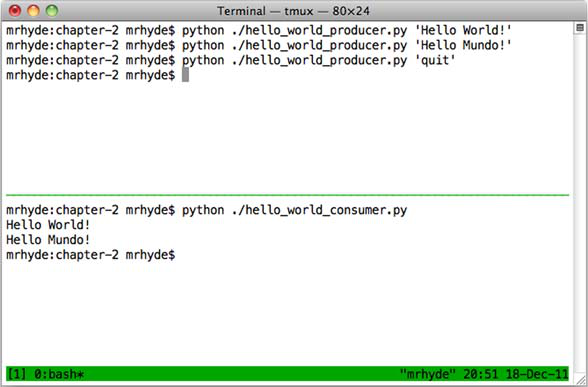

Mô tả hình: Cửa sổ Terminal đang chia đôi bằng `tmux`. Ở khung trên (producer), người dùng chạy lần lượt 3 lệnh:
- `python ./hello_world_producer.py 'Hello World!'`
- `python ./hello_world_producer.py 'Hello Mundo!'`
- `python ./hello_world_producer.py 'quit'`

Ở khung dưới (consumer), lệnh `python ./hello_world_consumer.py` in ra màn hình hai dòng `Hello World!` và `Hello Mundo!`, rồi thoát về dấu nhắc lệnh sau khi nhận được message `'quit'`.

> 💡 **Ví dụ bổ sung (không có trong sách):** Phiên bản chạy trực tiếp trên **Python 3 + Pika 1.x** của bộ đôi `hello_world_producer.py` và `hello_world_consumer.py`:
>
> ```python
> # hello_world_producer_py3.py
> import sys, pika
>
> credentials = pika.PlainCredentials("guest", "guest")
> conn_params = pika.ConnectionParameters("localhost", credentials=credentials)
> conn_broker = pika.BlockingConnection(conn_params)
> channel = conn_broker.channel()
>
> channel.exchange_declare(exchange="hello-exchange",
>                          exchange_type="direct",
>                          passive=False,
>                          durable=True,
>                          auto_delete=False)
>
> msg = sys.argv[1]
> msg_props = pika.BasicProperties(content_type="text/plain")
> channel.basic_publish(body=msg.encode("utf-8"),
>                       exchange="hello-exchange",
>                       properties=msg_props,
>                       routing_key="hola")
> conn_broker.close()
> ```
>
> ```python
> # hello_world_consumer_py3.py
> import pika
>
> credentials = pika.PlainCredentials("guest", "guest")
> conn_params = pika.ConnectionParameters("localhost", credentials=credentials)
> conn_broker = pika.BlockingConnection(conn_params)
> channel = conn_broker.channel()
>
> channel.exchange_declare(exchange="hello-exchange",
>                          exchange_type="direct",
>                          passive=False,
>                          durable=True,
>                          auto_delete=False)
> channel.queue_declare(queue="hello-queue")
> channel.queue_bind(queue="hello-queue",
>                    exchange="hello-exchange",
>                    routing_key="hola")
>
> def msg_consumer(channel, method, header, body):
>     channel.basic_ack(delivery_tag=method.delivery_tag)
>     text = body.decode("utf-8")
>     if text == "quit":
>         channel.basic_cancel(consumer_tag="hello-consumer")
>         channel.stop_consuming()
>     else:
>         print(text)
>
> channel.basic_consume(queue="hello-queue",
>                       on_message_callback=msg_consumer,
>                       consumer_tag="hello-consumer")
> channel.start_consuming()
> ```

---

## 2.7 Dùng publisher confirm để xác minh việc giao nhận (Using publisher confirms to verify delivery)

Vậy là giờ bạn đã biết cách viết một consumer và producer cơ bản, nhưng có thể bạn đang tự hỏi **publisher confirm** và **transaction** sẽ ghép vào bức tranh này như thế nào. Hãy xem cách bạn có thể nâng cấp Hello World producer của mình để tận dụng publisher confirm nhằm theo dõi việc giao nhận message.³ Trước khi đi sâu vào việc cập nhật Hello World producer để dùng publisher confirm, hãy nhìn vào hình 2.8 — hình minh họa cách các ID của message được gán.

> ³ **Chú thích 3:** Vì transaction giết chết hiệu năng, chúng tôi tập trung vào publisher confirm như cách được ưu tiên để bổ sung xác nhận giao nhận cho các producer của bạn. Nếu bạn thực sự cần tìm hiểu cách thêm transaction vào producer, đừng lo. Chúng tôi đã đưa sẵn một phiên bản Hello World producer sử dụng transaction vào kho mã nguồn ví dụ trực tuyến của *RabbitMQ in Action*: `https://github.com/rabbitinaction/sourcecode`.

**Hình 2.8 – Các ID message của publisher confirm (Publisher confirm message IDs)**


Trang render đầy đủ (chứa Hình 2.7 và Hình 2.8): 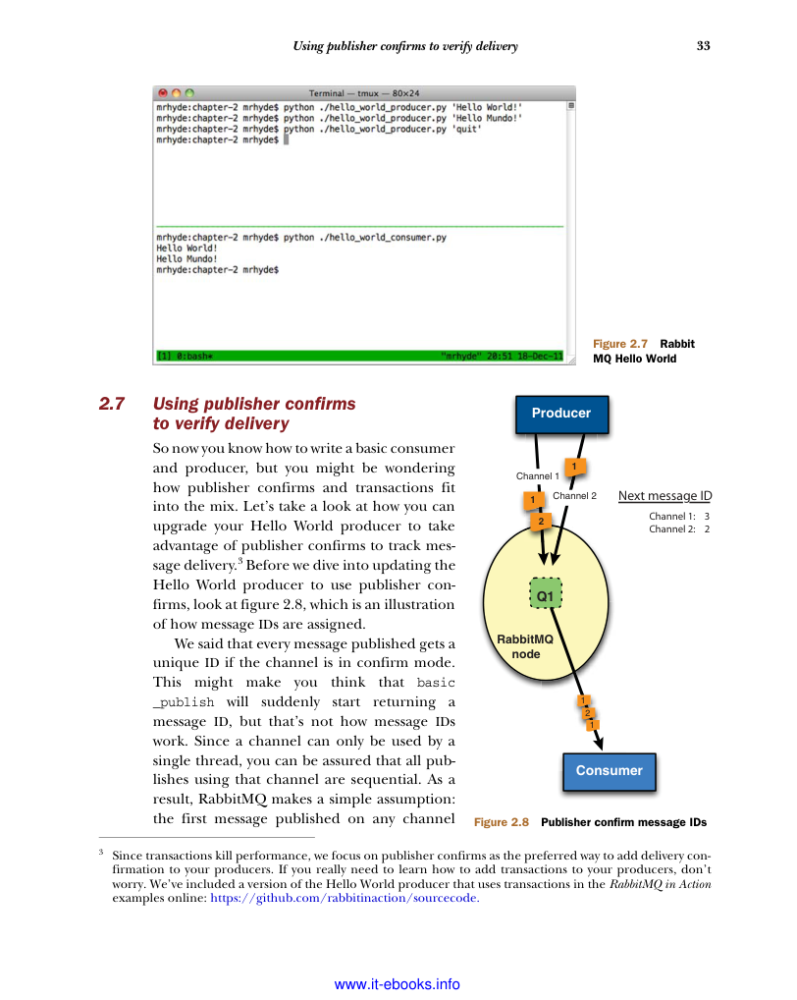

Mô tả hình 2.8: Một **Producer** mở hai channel song song tới một **RabbitMQ node** (bên trong có queue **Q1**) rồi đi tiếp tới **Consumer**:
- Trên **Channel 1**: Producer đã gửi hai message mang ID `1` và `2` vào Q1. Vì vậy, **Next message ID** (ID của message kế tiếp) trên `Channel 1` sẽ là **`3`**.
- Trên **Channel 2**: Producer mới gửi một message mang ID `1` vào Q1. Vì vậy, **Next message ID** trên `Channel 2` sẽ là **`2`**.
- Bên dưới Q1, các message (`1`, `2`, `1`) lần lượt được chuyển xuống **Consumer**. Mỗi channel tự đánh số thứ tự message độc lập bắt đầu từ `1`.

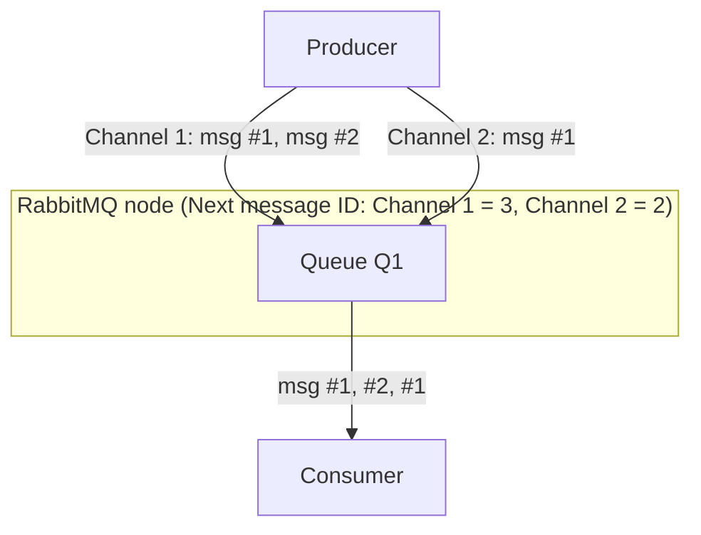

Chúng ta đã nói rằng mọi message được publish đều nhận một ID duy nhất nếu channel đang ở chế độ confirm (*confirm mode*). Điều này có thể khiến bạn nghĩ rằng `basic_publish` sẽ đột nhiên bắt đầu trả về một message ID, nhưng message ID **không hoạt động theo cách đó**. Vì mỗi channel chỉ có thể được sử dụng bởi một luồng (*single thread*) duy nhất, bạn có thể yên tâm rằng mọi thao tác publish dùng channel đó đều diễn ra **tuần tự** (*sequential*). Do đó, RabbitMQ đưa ra một giả định rất đơn giản: **message đầu tiên được publish trên bất kỳ channel nào sẽ có ID là `1`, và mỗi message tiếp theo trên channel đó sẽ tăng ID lên `1`**. Vậy nên message thứ hai được publish trên channel sẽ có ID là `2`, message thứ ba có ID là `3`, và cứ thế tiếp tục.

Các message ID là **duy nhất trong phạm vi từng channel**, vì vậy một khi channel bị đóng, bạn sẽ không thể theo dõi trạng thái của bất kỳ publisher confirm nào còn đang chờ xử lý cho các message đã được publish trên channel đó. Điều này có nghĩa là **RabbitMQ không cần phải báo cho bạn biết ID của message bạn vừa publish**; chính bạn tự theo dõi nó bằng một bộ đếm nội bộ (*internal counter*) trong ứng dụng của mình và tăng bộ đếm đó mỗi lần channel của ứng dụng thực hiện publish. Ngoài ra, vì mọi channel đều bắt đầu đánh số message ID từ `1`, nếu bạn mở nhiều channel song song, bạn cần duy trì một bộ đếm message ID nội bộ **riêng cho từng channel**.

Giờ bạn đã hiểu cách các message ID được gán, hãy xem phiên bản Hello World producer sau đây, nay đã được cập nhật để dùng publisher confirm.

**Listing 2.3 – Hello World producer có sử dụng confirm (Hello World producer with confirms)**

```python
import pika, sys
from pika import spec

credentials = pika.PlainCredentials("guest", "guest")
conn_params = pika.ConnectionParameters("localhost",
                                        credentials = credentials)
conn_broker = pika.BlockingConnection(conn_params)

channel = conn_broker.channel()

def confirm_handler(frame):                                 # (1) Hàm xử lý publisher confirm
    if type(frame.method) == spec.Confirm.SelectOk:
        print "Channel in 'confirm' mode."
    elif type(frame.method) == spec.Basic.Nack:
        if frame.method.delivery_tag in msg_ids:
            print "Message lost!"
    elif type(frame.method) == spec.Basic.Ack:
        if frame.method.delivery_tag in msg_ids:
            print "Confirm received!"
            msg_ids.remove(frame.method.delivery_tag)

channel.confirm_delivery(callback=confirm_handler)          # (2) Đặt channel vào chế độ confirm

msg = sys.argv[1]
msg_props = pika.BasicProperties()
msg_props.content_type = "text/plain"

msg_ids = []                                                # (3) Khởi tạo lại danh sách theo dõi ID message

channel.basic_publish(body=msg,                             # (4) Publish message
                      exchange="hello-exchange",
                      properties=msg_props,
                      routing_key="hola")

msg_ids.append(len(msg_ids) + 1)                            # (5) Thêm ID vào danh sách theo dõi
channel.close()
```

**Chú thích các mốc trong Listing 2.3:**

- **(1) Publisher confirm handler** — Hàm callback xử lý các khung tin (*frame*) xác nhận từ broker.
- **(2) Put channel in confirm mode** — Đặt channel vào chế độ confirm.
- **(3) Reset message ID tracker** — Khởi tạo danh sách theo dõi các message ID đang chờ xác nhận.
- **(4) Publish message** — Publish message.
- **(5) Add ID to tracking list** — Thêm ID của message vừa gửi vào danh sách theo dõi.

Đoạn code này trông tương tự như Hello World producer ban đầu của bạn, nhưng giờ bạn đã thêm một hàm callback **(1)** `confirm_handler` — hàm sẽ được gọi khi ứng dụng nhận được một publisher confirm. Sau đó bạn bảo Pika đặt channel vào chế độ confirm **(2)** và dùng `confirm_handler` làm hàm callback sẽ nhận các publisher confirm khi chúng tới. Khi channel của bạn đã được thiết lập để xử lý publisher confirm, bạn khởi tạo danh sách nội bộ (`msg_ids`) để theo dõi các message ID trên channel **(3)**, rồi publish message **(4)**. Cuối cùng, khi thao tác publish hoàn tất, bạn tăng bộ đếm và thêm vào `msg_ids` để ghi nhận ID của message là `1` **(5)**. Bên trong `confirm_handler` chính là nơi mọi "phép thuật" thú vị với confirm diễn ra.

Khi `confirm_handler` nhận được một publisher confirm, trước tiên nó kiểm tra xem kiểu xác nhận có phải là `Confirm.SelectOk` hay không:

```python
if type(frame.method) == spec.Confirm.SelectOk:
    print "Channel in 'confirm' mode."
```

RabbitMQ gửi một xác nhận kiểu `Confirm.SelectOk` ngay khi bạn mới đặt channel vào chế độ confirm. Đó **không phải** là xác nhận của một message, mà là một thông báo rằng channel của bạn hiện đã được thiết lập để nhận các publisher confirm. Nếu xác nhận không phải là `Confirm.SelectOk`, thì `confirm_handler` kiểm tra xem đó có phải là xác nhận `Basic.Nack` hay không:

```python
elif type(frame.method) == spec.Basic.Nack:
    if frame.method.delivery_tag in msg_ids:
        print "Message lost!"
```

Có thể bạn còn nhớ từ phần giải thích của chúng tôi về publisher confirm rằng `Basic.Nack` cho biết message đã bị mất do một lỗi nội bộ của RabbitMQ. Nhưng trước khi coi message là đã mất, bạn kiểm tra `frame.method.delivery_tag` để lấy message ID của message bị "nack". Nếu message ID đó khớp với ID của một message mà bạn đã publish (nằm trong `msg_ids`), thì bạn báo cho người dùng biết rằng message đã bị mất. Trong một ứng dụng tinh vi hơn, đây chính là nơi bạn sẽ đặt đoạn code để **publish lại** (*republish*) message bị mất đó. Cuối cùng, nếu xác nhận không phải là `Confirm.SelectOk` hay `Basic.Nack`, bạn kiểm tra xem nó có phải là `Basic.Ack` không:

```python
elif type(frame.method) == spec.Basic.Ack:
```

Với điều kiện thông điệp trả về là một xác nhận thành công của publisher confirm (`Basic.Ack`), bạn cần đảm bảo rằng message ID đó nằm trong danh sách các message ID đã publish của mình:

```python
if frame.method.delivery_tag in msg_ids:
    print "Confirm received!"
    msg_ids.remove(frame.method.delivery_tag)
```

Nếu message ID của xác nhận nằm trong những ID bạn đang theo dõi trong `msg_ids`, bạn xác nhận với người dùng rằng message đã được đưa vào hàng đợi thành công, rồi xóa message ID đó khỏi danh sách các ID đang chờ xác nhận giao nhận. Nó chỉ phức tạp hơn một chút so với Hello World producer ban đầu của bạn, nhưng chỉ với 12 dòng code thêm vào, bạn đã bổ sung được khả năng theo dõi việc giao nhận của các message đã publish. Ấn tượng hơn nữa là đoạn code đơn giản này có thể theo dõi việc giao nhận của **hàng triệu message được publish mỗi phút**! Đó chính là mức độ vượt trội về hiệu năng của publisher confirm so với transaction trong AMQP.

> 📝 **Giải thích thêm (không có trong sách):** Trong **Pika 1.x** hiện nay với `BlockingConnection`, API `channel.confirm_delivery()` không nhận callback như bản 0.9.x nữa mà bật chế độ kiểm tra trực tiếp: mỗi lời gọi `channel.basic_publish(...)` sẽ tự ném ngoại lệ `pika.exceptions.UnroutableError` hoặc `NackError` nếu message không được broker xác nhận (khi kết hợp với `mandatory=True`). Nếu muốn dùng callback bất đồng bộ y hệt cơ chế trong sách với tốc độ hàng triệu message/phút, trong Pika 1.x bạn dùng `SelectConnection` hoặc `AsyncioConnection`. Dưới đây là ví dụ minh họa với `BlockingConnection` trong Pika 1.x:
>
> ```python
> import sys, pika
>
> conn = pika.BlockingConnection(pika.ConnectionParameters("localhost"))
> ch = conn.channel()
> ch.confirm_delivery()  # bật chế độ publisher confirm
>
> try:
>     ch.basic_publish(exchange="hello-exchange",
>                      routing_key="hola",
>                      body=sys.argv[1].encode("utf-8"),
>                      properties=pika.BasicProperties(
>                          content_type="text/plain",
>                          delivery_mode=2))
>     print("Confirm received!")
> except pika.exceptions.AMQPError as err:
>     print("Message lost!", err)
> finally:
>     conn.close()
> ```

---

## 2.8 Tóm tắt (Summary)

Chúng ta đã đi qua rất nhiều kiến thức trong chương này. Bạn không chỉ có được nền tảng cần thiết để xây dựng hầu như bất kỳ ứng dụng nhắn tin nào mà bạn có thể mơ tới, mà còn có trong tay một producer và consumer thực thụ đang chạy, bao gồm cả một producer có thể theo dõi việc giao nhận message!

Trong các chương tiếp theo, chúng tôi sẽ trình bày những mẫu thiết kế (*patterns*) cụ thể để xây dựng các ứng dụng nhắn tin giúp ứng dụng của bạn trở nên thanh lịch, hiệu quả và mạnh mẽ. Nhưng chỉ với những gì đã học cho tới lúc này, bạn đã có thể bắt tay ngay vào việc viết code cho bản sao Twitter phân tán (*distributed Twitter clone*) mà bạn hằng ấp ủ.

Trước khi lao vào viết thêm code, hãy cùng xem cách quản lý RabbitMQ server của bạn một cách thành thạo hơn. Ví dụ, có lẽ sẽ chẳng phải là ý hay nếu bất kỳ ai cũng có thể kết nối vào các virtual host của bạn và publish message vào bất kỳ exchange nào họ thích. Đó chính xác là kiểu vấn đề mà chúng tôi sẽ chỉ cho bạn cách phòng tránh tiếp theo bằng việc thiết lập quyền truy cập (*permissions*). Vậy nên hãy cùng tìm hiểu cách khởi động, dừng, và quản trị tổng thể RabbitMQ ở chương tiếp theo!

---

## Bảng thuật ngữ của chương

| Thuật ngữ tiếng Anh | Nghĩa tiếng Việt | Giải thích ngắn |
|---|---|---|
| **AMQP (Advanced Message Queuing Protocol)** | Giao thức hàng đợi thông điệp nâng cao | Giao thức mở chuẩn hóa cấu trúc đường truyền và kiến trúc định tuyến (exchange, binding, queue) mà RabbitMQ cài đặt. |
| **Producer / Publisher** | Bên gửi / Bên xuất bản | Ứng dụng tạo ra message và publish nó vào một exchange trên broker. |
| **Consumer** | Bên tiêu thụ / Bên nhận | Ứng dụng đăng ký (subscribe) vào queue để nhận và xử lý message. |
| **Connection** | Kết nối | Kết nối TCP vật lý dài hạn giữa ứng dụng và RabbitMQ broker. |
| **Channel** | Kênh | Kết nối ảo (logical connection) ghép kênh bên trong một kết nối TCP vật lý; mọi lệnh AMQP đều đi qua một channel. |
| **Queue** | Hàng đợi | "Hộp thư có tên" nơi message dừng chân chờ được các consumer lấy ra xử lý. |
| **Exchange** | Bộ trao đổi / Trạm trung chuyển | Thành phần nhận message từ producer và định tuyến chúng tới không, một hoặc nhiều queue dựa trên loại exchange và các quy tắc binding. |
| **Binding** | Liên kết gắn kết | Quy tắc nối một exchange với một queue, thường đi kèm một khóa định tuyến (binding key / routing key). |
| **Routing key** | Khóa định tuyến | Nhãn chuỗi gắn vào message khi publish (và gắn vào binding) để broker quyết định message sẽ đi vào queue nào. |
| **Direct exchange** | Exchange trực tiếp | Loại exchange định tuyến message vào các queue có khóa binding khớp chính xác với routing key của message. |
| **Fanout exchange** | Exchange phát tán | Loại exchange nhân bản và phát (multicast/broadcast) mọi message nhận được tới tất cả các queue đang gắn vào nó, bỏ qua routing key. |
| **Topic exchange** | Exchange theo chủ đề | Loại exchange định tuyến message dựa trên so khớp mẫu (pattern matching) phân tách bằng dấu chấm `.`, hỗ trợ ký tự đại diện `*` (một phần) và `#` (nhiều phần/tất cả). |
| **Headers exchange** | Exchange theo tiêu đề | Loại exchange định tuyến dựa trên các thuộc tính header của message thay vì routing key (hiệu năng thấp hơn nên rất ít dùng). |
| **Virtual host (vhost)** | Máy chủ ảo | Một broker RabbitMQ ảo độc lập bên trong một RabbitMQ server, có không gian tên exchange/queue/binding và quyền truy cập riêng (mặc định là `/`). |
| **Acknowledgement (`basic.ack` / `auto_ack`)** | Xác nhận nhận message | Tín hiệu từ consumer báo cho RabbitMQ rằng message đã được xử lý xong và broker có thể xóa message khỏi queue một cách an toàn. |
| **Reject (`basic.reject`)** | Từ chối message | Lệnh cho phép consumer từ chối một message đã nhận, kèm tùy chọn đưa lại vào hàng đợi (`requeue=true`) hoặc hủy bỏ/chuyển sang dead-letter (`requeue=false`). |
| **Dead-letter queue** | Hàng đợi thư chết | Hàng đợi đặc biệt dùng để lưu giữ các message bị từ chối không requeue hoặc không thể giao được để phục vụ kiểm tra lỗi. |
| **Durable (exchange / queue)** | Bền vững | Thuộc tính (`durable=True`) giúp exchange hoặc queue tự động được RabbitMQ tạo lại sau khi broker bị sập hoặc khởi động lại. |
| **Persistent message** | Message lưu bền | Message có `delivery_mode = 2`, được RabbitMQ ghi vào nhật ký trên đĩa cứng để sống sót qua sự cố khởi động lại (khi nằm trong exchange và queue durable). |
| **AMQP Transaction (`tx.*`)** | Giao dịch AMQP | Cơ chế đồng bộ xác nhận broker đã nhận và lưu message (cùng các lệnh kèm theo), nhưng làm giảm mạnh thông lượng (2–10 lần). |
| **Publisher confirm (`confirm.select`)** | Xác nhận cho bên gửi | Phần mở rộng bất đồng bộ, nhẹ của RabbitMQ thay thế cho transaction: broker gửi lại `Basic.Ack` (hoặc `Basic.Nack` nếu lỗi) kèm ID tuần tự của message trên channel sau khi message đã được xếp hàng/ghi đĩa an toàn. |
