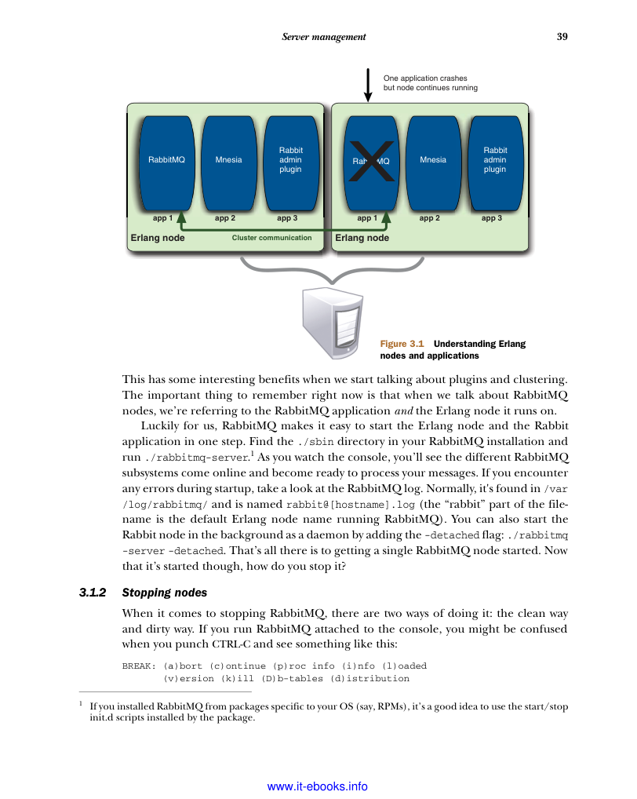
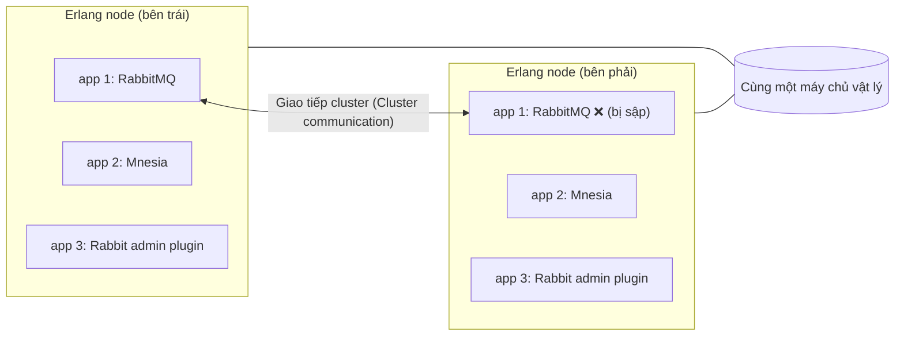
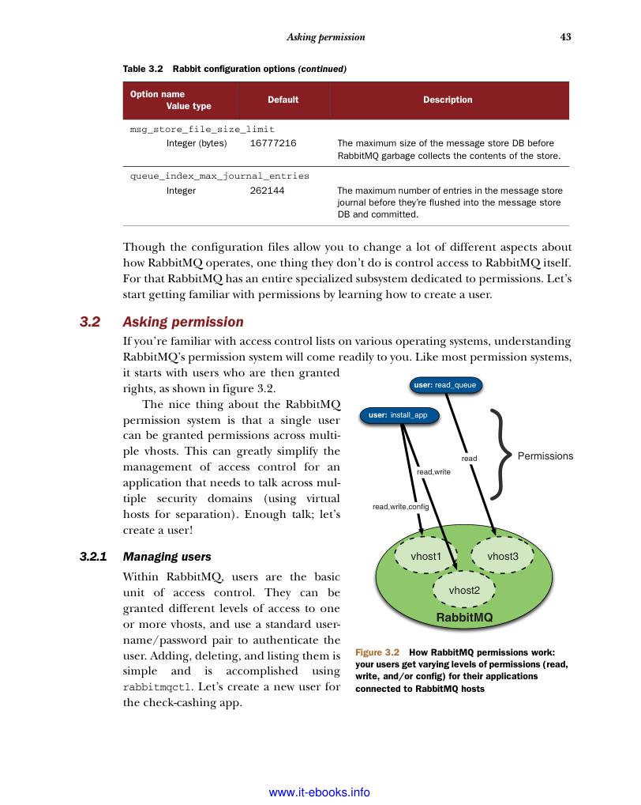
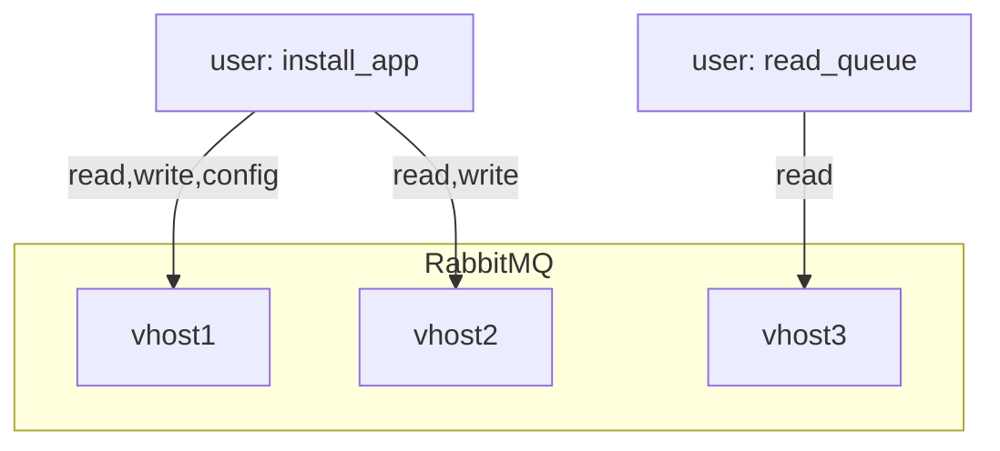

# Chương 3: Vận hành và quản trị Rabbit (Running and administering Rabbit)

## Mục lục chương

- [Mở đầu chương](#mở-đầu-chương)
- [3.1 Quản lý máy chủ (Server management)](#31-quản-lý-máy-chủ-server-management)
  - [3.1.1 Khởi động node (Starting nodes)](#311-khởi-động-node-starting-nodes)
  - [3.1.2 Dừng node (Stopping nodes)](#312-dừng-node-stopping-nodes)
  - [3.1.3 Dừng và khởi động lại ứng dụng: khác nhau ở đâu? (Stopping and restarting the application: what's the difference?)](#313-dừng-và-khởi-động-lại-ứng-dụng-khác-nhau-ở-đâu-stopping-and-restarting-the-application-whats-the-difference)
  - [3.1.4 Các file cấu hình của Rabbit (Rabbit configuration files)](#314-các-file-cấu-hình-của-rabbit-rabbit-configuration-files)
- [3.2 Xin cấp quyền (Asking permission)](#32-xin-cấp-quyền-asking-permission)
  - [3.2.1 Quản lý người dùng (Managing users)](#321-quản-lý-người-dùng-managing-users)
  - [3.2.2 Hệ thống phân quyền của Rabbit (Rabbit's permissions system)](#322-hệ-thống-phân-quyền-của-rabbit-rabbits-permissions-system)
- [3.3 Kiểm tra số liệu thống kê (Checking up on statistics)](#33-kiểm-tra-số-liệu-thống-kê-checking-up-on-statistics)
  - [3.3.1 Xem queue và exchange (Viewing queues and exchanges)](#331-xem-queue-và-exchange-viewing-queues-and-exchanges)
- [3.4 Hiểu các file log của RabbitMQ (Understanding RabbitMQ's logs)](#34-hiểu-các-file-log-của-rabbitmq-understanding-rabbitmqs-logs)
  - [3.4.1 Log ở đâu? (Where are my logs?)](#341-log-ở-đâu-where-are-my-logs)
  - [3.4.2 Hiểu log của RabbitMQ (Understanding RabbitMQ logs)](#342-hiểu-log-của-rabbitmq-understanding-rabbitmq-logs)
  - [3.4.3 Xoay vòng log (Rotating logs)](#343-xoay-vòng-log-rotating-logs)
  - [3.4.4 Đọc log qua exchange amq.rabbitmq.log (Reading logs via the amq.rabbitmq.log exchange)](#344-đọc-log-qua-exchange-amqrabbitmqlog-reading-logs-via-the-amqrabbitmqlog-exchange)
- [3.5 Khắc phục sự cố khi khởi động Rabbit (Troubleshooting Rabbit startup)](#35-khắc-phục-sự-cố-khi-khởi-động-rabbit-troubleshooting-rabbit-startup)
  - [3.5.1 badrpc,nodedown và nodedown](#351-badrpcnodedown-và-nodedown)
  - [3.5.2 Mnesia và tên máy (Mnesia and hostnames)](#352-mnesia-và-tên-máy-mnesia-and-hostnames)
  - [3.5.3 Các vấn đề cài đặt Erlang (Erlang installation problems)](#353-các-vấn-đề-cài-đặt-erlang-erlang-installation-problems)
- [3.6 Tóm tắt (Summary)](#36-tóm-tắt-summary)
- [Bảng thuật ngữ của chương](#bảng-thuật-ngữ-của-chương)

---

## Mở đầu chương

Cho tới giờ, phần lớn thời gian chúng ta đã dành cho các khái niệm về nhắn tin (*messaging*) theo AMQP và cách cài đặt để RabbitMQ chạy được ở mức cơ bản. Giờ là lúc chúng ta sẵn sàng đi sâu hơn: cần những gì để quản trị RabbitMQ hằng ngày? Biết cách khởi động RabbitMQ trên máy trạm của bạn là một chuyện, nhưng làm sao để **dừng** nó một cách sạch sẽ (*cleanly*)? Làm sao để giới hạn lượng RAM nó được dùng, để nó không "bỏ đói" các ứng dụng khác chạy chung trên cùng máy chủ? Đó chính là những vấn đề bạn sẽ gặp khi tới lúc đưa RabbitMQ từ môi trường phát triển (*development*) lên môi trường thật (*production*). Trong chương này, chúng tôi sẽ chỉ cho bạn cách vận hành một môi trường RabbitMQ production hạng nhất, để bạn tránh được những "cú vấp" lớn (*big gotchas*).

**Chương này bao gồm:**

- Quản lý máy chủ — khởi động và dừng các node
- Cấu hình phân quyền (*permission*)
- Số liệu thống kê sử dụng (*usage statistics*)
- Khắc phục sự cố (*troubleshooting*) với RabbitMQ và Erlang

Trong số những thứ chúng ta sẽ đề cập có:

- Một chút kiến thức nền về cách Erlang vận hành, bao gồm cả những "Erlang cookie" bí ẩn
- Kiểm soát quyền truy cập của người dùng thông qua hệ thống phân quyền của RabbitMQ
- Dùng các công cụ dòng lệnh để xem trạng thái của các vhost, queue, exchange và binding
- Phải làm gì khi bạn thấy những thông báo lỗi Erlang đáng sợ như `"badrpc,nodedown"`
- Cách đọc hiểu các loại file log khác nhau của RabbitMQ

Khi chúng ta xong chương này, bạn sẽ là một quản trị viên RabbitMQ hạng nhất, sẵn sàng "xử lý" môi trường Rabbit production của mình. Hãy bắt đầu với những điều cơ bản và đi sâu vào cách quản lý một máy chủ RabbitMQ.

> 📝 **Giải thích thêm (không có trong sách):** Nhắc lại nhanh các thuật ngữ đã gặp ở chương trước:
> - **vhost** (*virtual host* – máy chủ ảo): một "không gian riêng" bên trong một RabbitMQ, có bộ queue/exchange/binding và quyền riêng, giống như mỗi khách thuê một căn hộ trong cùng tòa nhà.
> - **queue** (hàng đợi): nơi chứa message chờ consumer lấy ra.
> - **exchange** (bộ định tuyến): nơi producer gửi message tới; exchange quyết định chuyển message tới queue nào.
> - **binding** (liên kết): quy tắc nối exchange với queue.

---

## 3.1 Quản lý máy chủ (Server management)

Vận hành một máy chủ RabbitMQ hiệu quả có thể khác với các sản phẩm khác mà bạn từng dùng. Nguyên nhân chính là RabbitMQ được viết bằng Erlang, và Erlang làm mọi việc theo cách riêng của nó. Phần lớn thì đây là điều tốt. Erlang được thiết kế ngay từ ngày đầu để cho các ứng dụng nói chuyện với nhau **mà không cần biết** chúng đang ở cùng một máy hay ở các máy khác nhau. Với RabbitMQ, điều này khiến việc gom cụm (*clustering*) và định tuyến message tin cậy trở nên dễ như trở bàn tay. Nhưng để đạt được sự "phân tán dễ dàng" ấy, cần tới hai khái niệm có thể bạn chưa quen: **Erlang node** và **Erlang application** (ứng dụng Erlang). Đừng lo, các khái niệm này không "ngoài hành tinh" như nghe có vẻ. Nếu bạn quen với máy ảo Java (*Java Virtual Machine – JVM*), thì các ý tưởng này rất giống với ý tưởng đằng sau JVM.

Đi qua mục này, bạn sẽ học cách khởi động và dừng các node RabbitMQ, cũng như cách làm việc với file cấu hình của RabbitMQ. Không dài dòng nữa, ta bắt đầu bằng việc xem node là gì và khởi động nó thế nào.

### 3.1.1 Khởi động node (Starting nodes)

Tới giờ, chúng ta thường xuyên dùng từ **node** để chỉ một thực thể (*instance*) máy chủ RabbitMQ. Trên thực tế, cái mà "node" thật sự mô tả là **một Erlang node đang chạy một ứng dụng Erlang**. Đừng sợ khi thấy nhắc tới Erlang — bạn không cần phải là "fan cứng" Erlang để hiểu chuyện gì đang diễn ra. Nó rất giống những gì xảy ra với JVM.

Khi bạn chạy một ứng dụng Java, một thực thể JVM được khởi tạo và bắt đầu thực thi ứng dụng Java được chỉ định. Tương tự, Erlang có một máy ảo, và **mỗi thực thể của máy ảo đó được gọi là một node**. Node rất đặc biệt. Khác với JVM, **nhiều ứng dụng Erlang có thể chạy bên trong cùng một node**, và quan trọng hơn, **các node có thể nói chuyện trực tiếp (native) với nhau** (dù chúng ở cùng máy chủ hay không). Ví dụ, nhờ "phép màu" của Erlang, một ứng dụng trên node `asparagus` (măng tây) có thể gọi các hàm trong ứng dụng chạy trên node `artichoke` (atisô) như thể các hàm đó là hàm cục bộ. Ngoài ra, nếu một ứng dụng bị sập (*crash*) vì bất kỳ lý do gì (chẳng hạn RabbitMQ bị sập), Erlang node sẽ tự động cố gắng khởi động lại ứng dụng đó (với điều kiện bản thân Erlang không bị sập).

**Hình 3.1 – Hiểu về Erlang node và ứng dụng (Understanding Erlang nodes and applications)**



Các mảnh ảnh được trích từ hình 3.1 (các khối ứng dụng, dấu X, biểu tượng máy chủ):


Vẽ lại hình 3.1:



**Mô tả hình:** Có hai Erlang node chạy trên **cùng một máy chủ** (biểu tượng máy chủ ở dưới, có dấu ngoặc nhọn gom cả hai node). Mỗi node chứa ba ứng dụng: *app 1* là RabbitMQ, *app 2* là Mnesia, *app 3* là plugin quản trị của Rabbit (*Rabbit admin plugin*). Mũi tên xanh giữa app 1 của hai node có nhãn "Cluster communication" (giao tiếp cluster). Ở node bên phải, ứng dụng RabbitMQ bị gạch dấu X lớn, kèm mũi tên chú thích phía trên: "One application crashes but node continues running" — **một ứng dụng bị sập nhưng node vẫn tiếp tục chạy**.

Điều này mang lại một số lợi ích thú vị khi chúng ta bắt đầu nói về plugin và clustering. Điều quan trọng cần nhớ lúc này là: khi chúng ta nói về **node RabbitMQ**, ta đang nói tới **ứng dụng RabbitMQ *và* Erlang node mà nó chạy trên đó**.

> 💡 **Ví dụ bổ sung (không có trong sách):** Hãy hình dung Erlang node như một **tòa nhà văn phòng**, còn các ứng dụng Erlang (RabbitMQ, Mnesia, plugin quản trị…) là **các công ty thuê văn phòng** trong tòa nhà. Nếu một công ty "phá sản" (ứng dụng crash), tòa nhà vẫn đứng đó và ban quản lý (Erlang) sẽ cố gắng mời công ty đó hoạt động lại. Các tòa nhà (node) khác nhau có đường dây điện thoại nội bộ nối thẳng với nhau, nên nhân viên ở tòa nhà `asparagus` gọi sang tòa nhà `artichoke` dễ như gọi phòng bên cạnh. Với JVM thì khác: thường mỗi JVM chỉ chạy **một** ứng dụng Java chính, và hai JVM muốn nói chuyện thì phải tự dựng cơ chế (RMI, HTTP, socket…).

May mắn cho chúng ta, RabbitMQ giúp việc khởi động Erlang node và ứng dụng Rabbit trở nên dễ dàng chỉ trong **một bước**. Hãy tìm thư mục `./sbin` trong thư mục cài đặt RabbitMQ của bạn và chạy `./rabbitmq-server`.¹ Khi theo dõi console, bạn sẽ thấy các hệ thống con (*subsystem*) khác nhau của RabbitMQ lần lượt "lên sóng" và sẵn sàng xử lý message của bạn. Nếu gặp lỗi nào trong quá trình khởi động, hãy xem log của RabbitMQ. Thông thường, log nằm ở `/var/log/rabbitmq/` và có tên `rabbit@[hostname].log` (phần "rabbit" trong tên file chính là **tên mặc định của Erlang node** đang chạy RabbitMQ). Bạn cũng có thể khởi động node Rabbit ở chế độ chạy nền như một daemon (*tiến trình nền*) bằng cách thêm cờ `-detached`:

```bash
./rabbitmq-server -detached
```

Đó là tất cả những gì cần làm để khởi động một node RabbitMQ đơn lẻ. Nhưng giờ nó đã chạy rồi, làm sao để dừng nó?

> ¹ *Chú thích chân trang của sách:* Nếu bạn cài RabbitMQ từ các gói dành riêng cho hệ điều hành của mình (ví dụ gói RPM), tốt nhất nên dùng các script khởi động/dừng `init.d` mà gói đó đã cài sẵn.

> 💡 **Ví dụ bổ sung (không có trong sách):** Một phiên làm việc điển hình trên máy Linux có hostname là `mybox`:
> ```bash
> cd /usr/local/rabbitmq/sbin        # thư mục cài đặt (tùy máy bạn)
> ./rabbitmq-server -detached        # chạy nền
> tail -f /var/log/rabbitmq/rabbit@mybox.log   # theo dõi log khởi động
> ```
> Tên file log là `rabbit@mybox.log` vì tên node mặc định là `rabbit`, ghép với hostname `mybox`.

### 3.1.2 Dừng node (Stopping nodes)

Khi nói tới việc dừng RabbitMQ, có hai cách làm: **cách sạch sẽ** và **cách "bẩn"**. Nếu bạn chạy RabbitMQ gắn với console (không chạy nền), bạn có thể bối rối khi bấm CTRL-C và thấy thứ như thế này:

```text
BREAK: (a)bort (c)ontinue (p)roc info (i)nfo (l)oaded
       (v)ersion (k)ill (D)b-tables (d)istribution
```

Trời đất, cái gì thế này? Tất cả những gì bạn muốn chỉ là dừng RabbitMQ thôi mà. Thứ bạn đang nhìn thấy là Erlang node đang hỏi bạn: bạn muốn kill ứng dụng, kill toàn bộ node, hay đây chỉ là bấm nhầm và bạn muốn tiếp tục chạy? Nói chung, bạn muốn kill toàn bộ node, nên **abort** (`a`) là lựa chọn bạn cần. Nhưng có một cách **tốt hơn nhiều** để dừng RabbitMQ — một cách sẽ bảo RabbitMQ tắt máy sạch sẽ và bảo vệ tất cả các queue bền vững (*persistent queues*) của bạn.

> 📝 **Giải thích thêm (không có trong sách):** Ý nghĩa các lựa chọn trong menu BREAK của Erlang: `(a)bort` – thoát ngay máy ảo Erlang (dừng toàn bộ node, "cách bẩn"); `(c)ontinue` – quay lại chạy tiếp như chưa có gì; `(p)roc info` – in thông tin các tiến trình Erlang; `(i)nfo` – thông tin hệ thống; `(l)oaded` – danh sách module đã nạp; `(v)ersion` – phiên bản Erlang; `(k)ill` – kill một tiến trình cụ thể; `(D)b-tables` – thông tin các bảng ETS; `(d)istribution` – thông tin phân tán (kết nối với node khác). Bấm `a` thì node dừng đột ngột, RabbitMQ không có cơ hội ghi dữ liệu xuống đĩa một cách gọn gàng.

`rabbitmqctl` là "cửa hàng một điểm dừng" (*one-stop shop*) cho gần như mọi nhu cầu quản lý RabbitMQ của bạn. Bạn đã thấy nó giúp tạo và liệt kê vhost thế nào. Nó cũng có thể giúp bạn dừng RabbitMQ. Khi bạn chạy `./sbin/rabbitmqctl stop` từ thư mục cài đặt RabbitMQ, `rabbitmqctl` sẽ giao tiếp với node cục bộ và ra lệnh cho nó tắt máy sạch sẽ. Bạn cũng có thể chỉ định một node khác để tắt, kể cả node ở xa (*remote*), bằng cách truyền tùy chọn `-n rabbit@[hostname]`. Nếu theo dõi log RabbitMQ, bạn sẽ thấy thứ như thế này:

```text
=INFO REPORT====
application: rabbit
exited: stopped
type: permanent
=INFO REPORT====
application: mnesia
exited: stopped
type: permanent
=INFO REPORT====
application: os_mon
exited: stopped
type: permanent
```

Khi bạn thấy `rabbit`, `mnesia` và `os_mon` đều đã dừng (*stopped*), node Rabbit đã tắt hoàn toàn. Nếu bạn cài RabbitMQ từ một hệ thống đóng gói như APT trên Ubuntu, có thể bạn cũng có một script khởi động/tắt RabbitMQ được cài trong `/etc/init.d/`. Bạn có thể dùng script đó để làm cùng việc tắt máy này. Lúc này toàn bộ node RabbitMQ đã tắt, bao gồm cả "cha mẹ" Erlang của nó. Tuy nhiên đôi khi, bạn chỉ muốn dừng **ứng dụng** RabbitMQ và để Erlang node cha tiếp tục chạy. Hãy xem cách làm điều đó.

> 💡 **Ví dụ bổ sung (không có trong sách):**
> ```bash
> # Dừng node cục bộ một cách sạch sẽ
> ./sbin/rabbitmqctl stop
>
> # Dừng node RabbitMQ trên máy khác có hostname là "server2"
> ./sbin/rabbitmqctl -n rabbit@server2 stop
>
> # Với bản cài từ gói APT trên Ubuntu
> sudo /etc/init.d/rabbitmq-server stop
> ```
> Lưu ý: để dừng node ở xa, máy của bạn và `server2` phải dùng chung Erlang cookie (sẽ nói ở mục 3.5.1).

> 📝 **Giải thích thêm (không có trong sách) – Quản lý tiến trình trên Linux hiện đại (systemd), Docker và `rabbitmqctl shutdown`:**
> Trong các bản phân phối Linux hiện đại (Ubuntu 16.04+, Debian, RHEL/CentOS 7+) và RabbitMQ 3.8–4.0:
> 1. **Systemd thay thế `/etc/init.d/`:** Khi cài qua gói `apt` hoặc `yum`/`dnf`, bạn quản lý dịch vụ bằng `systemctl`:
>    ```bash
>    sudo systemctl start rabbitmq-server
>    sudo systemctl stop rabbitmq-server
>    sudo systemctl status rabbitmq-server
>    ```
> 2. **`rabbitmqctl shutdown` vs `rabbitmqctl stop`:** Trong RabbitMQ hiện đại, lệnh được khuyến nghị để tắt node từ CLI là `rabbitmqctl shutdown`. Khác với `rabbitmqctl stop` (vốn có thể trả về dấu nhắc lệnh trước khi tiến trình OS thực sự kết thúc nếu không truyền PID file), `rabbitmqctl shutdown` sẽ **chặn (block) và đợi cho tới khi cả ứng dụng RabbitMQ lẫn máy ảo Erlang (BEAM) tắt hoàn toàn** mà không cần biết đường dẫn file PID.
> 3. **Trong môi trường Docker / Kubernetes:** Không dùng `-detached`! Container cần tiến trình chạy ở *foreground* (`rabbitmq-server`) làm PID 1 để nhận tín hiệu `SIGTERM` từ Docker/K8s và tự tắt máy sạch sẽ (*graceful shutdown*).

### 3.1.3 Dừng và khởi động lại ứng dụng: khác nhau ở đâu? (Stopping and restarting the application: what's the difference?)

Cho tới giờ chúng ta đã nói về việc dừng **toàn bộ** node RabbitMQ (ứng dụng và Erlang node cùng lúc). Nhưng đôi khi bạn chỉ muốn khởi động lại **ứng dụng** RabbitMQ và giữ Erlang node tiếp tục chạy. Lợi ích là gì? **Với clustering, điều này là bắt buộc.** Vì `rabbitmq-server` khởi động cả node lẫn ứng dụng, nó cấu hình sẵn ứng dụng RabbitMQ ở **chế độ độc lập** (*standalone mode*). Để thêm node vào một cluster đã có, bạn cần dừng ứng dụng và đặt lại (*reset*) node về trạng thái nguyên sơ (*pristine*) để có thể chuẩn bị nó cho clustering. Nếu bạn dùng `./rabbitmqctl stop`, bạn sẽ tắt cả ứng dụng lẫn node, buộc bạn phải khởi động lại cả hai ở chế độ standalone thông qua `./rabbitmq-server`. Ngoài ra còn có trường hợp bạn đang chạy các ứng dụng Erlang khác ngoài RabbitMQ trên cùng một node, khiến việc dừng cả node là không mong muốn.

Việc chỉ dừng ứng dụng RabbitMQ đơn giản hơn nhiều so với các lý do khiến bạn muốn làm vậy. Chỉ cần chạy `./rabbitmqctl stop_app`. Log của Rabbit sẽ hiển thị cùng các thông báo tắt máy như khi tắt toàn bộ node.

> 💡 **Ví dụ bổ sung (không có trong sách):** Quy trình điển hình khi muốn đưa một node vào cluster (chi tiết sẽ học ở chương về clustering):
> ```bash
> ./rabbitmqctl stop_app     # dừng ứng dụng RabbitMQ, Erlang node vẫn sống
> ./rabbitmqctl reset        # xóa trạng thái, đưa node về "nguyên sơ"
> # ... các lệnh nối node vào cluster ...
> ./rabbitmqctl start_app    # khởi động lại ứng dụng RabbitMQ trên node đang chạy
> ```
> Nếu ở bước đầu bạn dùng `stop` thay cho `stop_app`, Erlang node chết luôn và `rabbitmqctl reset` sẽ không có node nào để nói chuyện.

Khởi động và dừng RabbitMQ thì tốt rồi, nhưng nếu vấn đề của bạn là cấu hình RabbitMQ sao cho nó không "ngốn" hết RAM trên máy chủ thì sao? Hoặc có thể bạn cần đổi cổng (*port*) mà RabbitMQ lắng nghe. Đó là lúc các file cấu hình của RabbitMQ phát huy tác dụng.

### 3.1.4 Các file cấu hình của Rabbit (Rabbit configuration files)

Giống như hầu hết các ứng dụng máy chủ, RabbitMQ cho phép bạn đặt các tham số tinh chỉnh (*tunables*) và thiết lập toàn hệ thống qua một file cấu hình. Thông thường, file này nằm ở `/etc/rabbitmq/rabbitmq.config`, nhưng vị trí của nó có thể thay đổi qua biến môi trường `CONFIG_FILE` được đặt trong script `rabbitmq-server`. Bên trong `rabbitmq.config`, bạn sẽ thấy một định dạng file trông khá "đáng sợ":

```erlang
[ {mnesia, [{dump_log_write_threshold, 1000}]},
  {rabbit, [{vm_memory_high_watermark, 0.4}]} ].
```

Thứ bạn đang nhìn thấy về bản chất là một **cấu trúc dữ liệu Erlang thô**. Nhưng nếu bạn quen với Python, JavaScript hay bất kỳ ngôn ngữ lập trình hiện đại nào khác, thì nó rất dễ hiểu khi bạn "mổ xẻ" ra. Hãy định dạng lại cấu hình cho thân thiện với con người hơn:

```erlang
1) [
2)    {mnesia, [{dump_log_write_threshold, 1000}]},
3)    {rabbit, [{vm_memory_high_watermark, 0.4}]}
4) ].
```

(Các số `1)` … `4)` chỉ là số dòng để giải thích, không phải một phần của file.)

Dễ nhìn hơn rồi. Bạn có thể thấy file cấu hình RabbitMQ thực chất là **một mảng chứa các bảng băm lồng nhau** (*nested hashtables* – còn gọi là từ điển hay mảng có tên). Dòng 1 và dòng 4 mở và đóng mảng cấu hình. Bên trong mảng cấu hình bên ngoài, **mỗi ứng dụng Erlang có một bảng băm riêng** cho các tùy chọn cấu hình của nó (ở đây ta có hai ứng dụng). `mnesia` chỉ định các tùy chọn cấu hình cho cơ sở dữ liệu Mnesia (Mnesia là thứ RabbitMQ dùng để lưu metadata của exchange và queue). `rabbit` chỉ định các tùy chọn cấu hình riêng của RabbitMQ. Mỗi tùy chọn được biểu diễn theo định dạng: `{[option_name], [option_value]}`. Ví dụ, `{dump_log_write_threshold, 1000}` thay đổi tần suất Mnesia đẩy (*flush*) các mục từ file log chỉ-ghi-nối-đuôi (*append-only log*) vào các file cơ sở dữ liệu thật. Để thêm một tùy chọn Mnesia khác, chỉ cần thêm một term `{[option_name], [option_value]}` nữa, ngăn cách với term trước bằng dấu phẩy.

> **NOTE (Ghi chú):** Metadata của mọi queue, exchange và binding trong RabbitMQ (nhưng **không** bao gồm nội dung message) được ghi vào Mnesia — một cơ sở dữ liệu phi SQL (*non-SQL*) được tích hợp sẵn trong Erlang. Mnesia đảm bảo tính toàn vẹn của metadata RabbitMQ qua các lần sập bằng cách **ghi trước vào một file log chỉ-ghi-nối-đuôi**. Sau đó nó định kỳ đổ (*dump*) nội dung của log vào các file cơ sở dữ liệu Mnesia thật. Nếu bạn quen với cách một cơ sở dữ liệu có ghi log như InnoDB của MySQL, hay một hệ thống file có ghi log (*logging filesystem*) như XFS hoạt động, thì đây là cùng một khái niệm. Tùy chọn `dump_log_write_threshold` của Mnesia kiểm soát tần suất việc đổ log diễn ra. Giá trị 1000 bảo Mnesia đổ nội dung log vào các file cơ sở dữ liệu **sau mỗi 1000 mục**.

> 💡 **Ví dụ bổ sung (không có trong sách):** Đối chiếu cấu trúc Erlang ở trên với cách viết trong Python cho dễ hình dung:
> ```python
> config = {
>     "mnesia": {"dump_log_write_threshold": 1000},
>     "rabbit": {"vm_memory_high_watermark": 0.4},
> }
> ```
> Muốn thêm tùy chọn cho `rabbit`, ví dụ đổi cổng lắng nghe thành 5673, trong Erlang bạn viết:
> ```erlang
> [ {mnesia, [{dump_log_write_threshold, 1000}]},
>   {rabbit, [{vm_memory_high_watermark, 0.4},
>             {tcp_listeners, [{"0.0.0.0", 5673}]}]} ].
> ```
> Chú ý ba điểm dễ sai: các term cách nhau bởi **dấu phẩy**, không có dấu phẩy thừa sau phần tử cuối, và toàn bộ file phải kết thúc bằng **dấu chấm** (`.`). Thiếu dấu chấm cuối là lỗi kinh điển khiến RabbitMQ không khởi động được.

Đã nắm xong định dạng file cấu hình Rabbit, vậy những tùy chọn thực tế nào bạn có thể thay đổi? Một số liên quan đến cơ sở dữ liệu Mnesia, một số dành trực tiếp cho Rabbit, như trong bảng 3.1 và 3.2.

**Bảng 3.1 – Các tùy chọn cấu hình Mnesia (Mnesia configuration options)**

| Tên tùy chọn | Kiểu giá trị | Mặc định | Mô tả |
|---|---|---|---|
| `dump_log_write_threshold` | Số nguyên (*Integer*) | 100 | Tần suất đẩy/đổ nội dung của log chỉ-ghi-nối-đuôi vào các file cơ sở dữ liệu thật. Được chỉ định theo **số mục phải có trong log** trước khi một thao tác đổ diễn ra. Đặt con số này cao hơn có thể giảm tải I/O và tăng hiệu năng cho các message bền vững (*persistent messages*). |

**Bảng 3.2 – Các tùy chọn cấu hình Rabbit (Rabbit configuration options)**

| Tên tùy chọn | Kiểu giá trị | Mặc định | Mô tả |
|---|---|---|---|
| `tcp_listeners` | Mảng các `{"ip_address", port_number}` | `[{"0.0.0.0", 5672},]` | Xác định các địa chỉ IP và cổng mà RabbitMQ lắng nghe cho lưu lượng **không** mã hóa SSL. |
| `ssl_listeners` | Mảng các `{"ip_address", port_number}` | NONE (không có) | Xác định các địa chỉ IP và cổng mà RabbitMQ lắng nghe cho lưu lượng **được** mã hóa SSL. |
| `ssl_options` | Mảng các `{"key", value}` | NONE (không có) | Chỉ định các tùy chọn liên quan đến SSL. Các tùy chọn hợp lệ là `cacertfile` (file chứng chỉ CA), `certfile` (file chứng chỉ máy chủ), `keyfile` (file khóa của máy chủ) và `fail_if_no_peer_cert` (yêu cầu client phải có chứng chỉ hợp lệ: True/False). |
| `vm_memory_high_watermark` | Phần trăm dạng thập phân | 0.4 | Kiểm soát lượng RAM mà RabbitMQ được phép tiêu thụ. Được chỉ định bằng một số thập phân biểu thị phần trăm bộ nhớ đã cài đặt mà Rabbit được phép dùng (0.4 = 40%). |
| `msg_store_file_size_limit` | Số nguyên (byte) | 16777216 | Kích thước tối đa của cơ sở dữ liệu kho message (*message store DB*) trước khi RabbitMQ dọn rác (*garbage collect*) nội dung của kho. |
| `queue_index_max_journal_entries` | Số nguyên | 262144 | Số mục tối đa trong nhật ký (*journal*) của kho message trước khi chúng được đẩy vào cơ sở dữ liệu kho message và được xác nhận (*committed*). |

(Hai dòng cuối nằm ở phần "Bảng 3.2 – Các tùy chọn cấu hình Rabbit (tiếp theo)" trên trang sau của sách.)

> 💡 **Ví dụ bổ sung (không có trong sách) – bài toán nhỏ:** Máy chủ có 8 GB RAM, chạy chung RabbitMQ với một cơ sở dữ liệu. Bạn muốn RabbitMQ dùng tối đa khoảng 2 GB, chỉ lắng nghe trên IP nội bộ `10.0.0.5`, và bật thêm SSL trên cổng 5671.
>
> - 2 GB / 8 GB = 0.25 → `vm_memory_high_watermark` = 0.25.
> - File `rabbitmq.config`:
> ```erlang
> [
>   {rabbit, [
>     {vm_memory_high_watermark, 0.25},
>     {tcp_listeners, [{"10.0.0.5", 5672}]},
>     {ssl_listeners, [{"10.0.0.5", 5671}]},
>     {ssl_options, [{cacertfile, "/etc/rabbitmq/ca.pem"},
>                    {certfile,   "/etc/rabbitmq/server.pem"},
>                    {keyfile,    "/etc/rabbitmq/server.key"},
>                    {fail_if_no_peer_cert, false}]}
>   ]}
> ].
> ```
> Khi RabbitMQ chạm ngưỡng 25% RAM, nó sẽ tạm chặn (*throttle*) các publisher để bảo vệ máy chủ, chứ không "ăn" thêm bộ nhớ.

> 📝 **Giải thích thêm (không có trong sách) – Bước ngoặt cấu hình từ RabbitMQ 3.7+ đến 4.0: `rabbitmq.conf` (sysctl) vs `rabbitmq.config` (Erlang tuple):**
>
> Cú pháp Erlang tuple cổ điển trong `/etc/rabbitmq/rabbitmq.config` (với hàng loạt dấu ngoặc vuông `[...]`, ngoặc nhọn `{...}` và dấu chấm `.` bắt buộc ở cuối file) từng là nỗi ám ảnh của các kỹ sư DevOps/SRE vì rất dễ gõ sai cú pháp và khó tự động hóa bằng Ansible/Helm/Terraform.
>
> **Từ RabbitMQ 3.7.0 trở đi (và là chuẩn bắt buộc trên RabbitMQ 3.8–4.0)**, RabbitMQ chuyển sang hệ thống cấu hình hoàn toàn mới gồm 3 thành phần:
> 1. **`/etc/rabbitmq/rabbitmq.conf` (định dạng `sysctl` / INI phẳng `key = value`):** Dùng cho 99% nhu cầu cấu hình hằng ngày. Dễ đọc, dễ kiểm tra hợp lệ (*schema validation* bằng thư viện Cuttlefish lúc khởi động),注释 bằng dấu `#`.
> 2. **`/etc/rabbitmq/advanced.config` (định dạng Erlang term truyền thống):** Chỉ dùng cho một số rất ít thông số nâng cao hoặc cấu hình sâu của Erlang/Mnesia mà cú pháp `key = value` phẳng không biểu diễn hết được. RabbitMQ sẽ tự động trộn (*merge*) `rabbitmq.conf` và `advanced.config` khi khởi động.
> 3. **`/etc/rabbitmq/rabbitmq-env.conf` (hoặc biến môi trường hệ điều hành):** Dùng để cấu hình đường dẫn, tên node (`RABBITMQ_NODENAME`), và truyền cờ trực tiếp cho máy ảo Erlang qua biến **`RABBITMQ_SERVER_ADDITIONAL_ERL_ARGS`** (ví dụ truyền `-mnesia dump_log_write_threshold 1000` hoặc tinh chỉnh bộ cấp phát bộ nhớ của BEAM).
>
> *(Lưu ý lịch sử về kho lưu trữ metadata: Sách giải thích RabbitMQ dùng **Mnesia** để lưu metadata của vhost/exchange/queue/binding. Điều này đúng từ RabbitMQ 1.x đến 3.12. Tuy nhiên, từ **RabbitMQ 3.13 và đặc biệt là RabbitMQ 4.0**, RabbitMQ đã giới thiệu **Khepri** — một kho lưu trữ metadata mới dựa trên thuật toán đồng thuận **Raft** — để thay thế dần Mnesia vốn dễ gặp sự cố split-brain và `timeout_waiting_for_tables` khi mạng chập chờn.)*
>
> **Bảng đối chiếu trực tiếp: `rabbitmq.config` (2012) vs `rabbitmq.conf` (RabbitMQ 3.7–4.0):**
>
> | Tác vụ cấu hình | Cú pháp cũ `rabbitmq.config` (Erlang term) | Cú pháp hiện đại `rabbitmq.conf` (`key = value`) |
> |---|---|---|
> | **Cổng TCP AMQP** (`tcp_listeners`) | `{tcp_listeners, [{"0.0.0.0", 5672}]}` | `listeners.tcp.default = 5672` *(hoặc `10.0.0.5:5672`)* |
> | **Tắt hoàn toàn TCP không mã hóa** | `{tcp_listeners, []}` | `listeners.tcp = none` |
> | **Cổng TLS/SSL** (`ssl_listeners`) | `{ssl_listeners, [{"0.0.0.0", 5671}]}` | `listeners.ssl.default = 5671` |
> | **Chứng chỉ TLS/SSL** (`ssl_options`) | `{ssl_options, [{cacertfile, "/path/ca.pem"}, {certfile, "/path/srv.pem"}, {keyfile, "/path/srv.key"}, {verify, verify_peer}, {fail_if_no_peer_cert, false}]}` | `ssl_options.cacertfile = /path/ca.pem`<br/>`ssl_options.certfile = /path/srv.pem`<br/>`ssl_options.keyfile = /path/srv.key`<br/>`ssl_options.verify = verify_peer`<br/>`ssl_options.fail_if_no_peer_cert = false` |
> | **Ngưỡng RAM theo %** (`vm_memory_high_watermark`) | `{vm_memory_high_watermark, 0.4}` | `vm_memory_high_watermark.relative = 0.4` |
> | **Ngưỡng RAM tuyệt đối** *(Mới)* | `{vm_memory_high_watermark, {absolute, "2GB"}}` | `vm_memory_high_watermark.absolute = 2GB` |
> | **Ngưỡng dung lượng đĩa trống tối thiểu** (`disk_free_limit`) | `{disk_free_limit, 50000000}` *(hoặc `{mem_relative, 1.0}`)* | `disk_free_limit.absolute = 2GB` *(hoặc `disk_free_limit.mem_relative = 1.5`)* |
> | **User & Vhost mặc định khi khởi tạo** | `{default_user, <<"admin">>}, {default_pass, <<"s3cr3t">>}, {default_vhost, <<"/">>}` | `default_user = admin`<br/>`default_pass = s3cr3t`<br/>`default_vhost = /` |
> | **Giới hạn kích thước file message store** | `{msg_store_file_size_limit, 16777216}` | `msg_store_file_size_limit = 16777216` |
> | **Số mục journal tối đa của queue index** | `{queue_index_max_journal_entries, 262144}` | `queue_index_embed_msgs_below = 4096` *(cấu hình nhúng message nhỏ trong RabbitMQ hiện đại)* |
> | **Cấu hình Mnesia (`dump_log_write_threshold`)** | `{mnesia, [{dump_log_write_threshold, 1000}]}` | Đặt trong `/etc/rabbitmq/advanced.config` **hoặc** trong `rabbitmq-env.conf`:<br/>`SERVER_ADDITIONAL_ERL_ARGS="-mnesia dump_log_write_threshold 1000"` |

> 💡 **Ví dụ bổ sung (không có trong sách) – Viết lại bài toán giới hạn 25% RAM + lắng nghe IP nội bộ + TLS bằng `rabbitmq.conf` hiện đại:**
> Thay vì file Erlang `rabbitmq.config` dễ thiếu dấu chấm, trên RabbitMQ 3.8–4.0 bạn chỉ cần tạo `/etc/rabbitmq/rabbitmq.conf` như sau:
> ```ini
> # /etc/rabbitmq/rabbitmq.conf (Định dạng sysctl hiện đại từ RabbitMQ 3.7+)
>
> # 1. Giới hạn RAM ở mức 25% (hoặc dùng vm_memory_high_watermark.absolute = 2GB)
> vm_memory_high_watermark.relative = 0.25
>
> # 2. Bảo vệ ổ đĩa: chặn publisher nếu ổ đĩa còn trống dưới 2GB
> disk_free_limit.absolute = 2GB
>
> # 3. Chỉ lắng nghe AMQP thường trên IP nội bộ 10.0.0.5:5672
> listeners.tcp.1 = 10.0.0.5:5672
>
> # 4. Bật AMQPS (TLS) trên 10.0.0.5:5671
> listeners.ssl.1 = 10.0.0.5:5671
> ssl_options.cacertfile = /etc/rabbitmq/ca.pem
> ssl_options.certfile   = /etc/rabbitmq/server.pem
> ssl_options.keyfile    = /etc/rabbitmq/server.key
> ssl_options.verify     = verify_peer
> ssl_options.fail_if_no_peer_cert = false
> ```
> Và nếu vẫn cần chỉnh `mnesia` ở mức thấp, bạn đặt riêng vào `/etc/rabbitmq/advanced.config`:
> ```erlang
> [
>   {mnesia, [{dump_log_write_threshold, 1000}]}
> ].
> ```

Mặc dù các file cấu hình cho phép bạn thay đổi rất nhiều khía cạnh trong cách RabbitMQ hoạt động, có một việc chúng **không** làm: kiểm soát quyền truy cập vào chính RabbitMQ. Để làm việc đó, RabbitMQ có cả một hệ thống con chuyên biệt dành cho phân quyền. Hãy bắt đầu làm quen với phân quyền bằng cách học cách tạo một người dùng.

---

## 3.2 Xin cấp quyền (Asking permission)

Nếu bạn quen với danh sách kiểm soát truy cập (*access control list – ACL*) trên các hệ điều hành khác nhau, bạn sẽ dễ dàng hiểu hệ thống phân quyền của RabbitMQ. Như hầu hết các hệ thống phân quyền, nó bắt đầu với **người dùng** (*users*), rồi những người dùng này được cấp **quyền** (*rights*), như trong hình 3.2.

Điểm hay của hệ thống phân quyền RabbitMQ là **một người dùng duy nhất có thể được cấp quyền trên nhiều vhost**. Điều này có thể đơn giản hóa rất nhiều việc quản lý kiểm soát truy cập cho một ứng dụng cần giao tiếp xuyên qua nhiều miền bảo mật (*security domains*) (dùng các virtual host để tách biệt). Nói đủ rồi, hãy tạo một người dùng!

**Hình 3.2 – Cách phân quyền của RabbitMQ hoạt động: người dùng của bạn nhận các mức quyền khác nhau (read, write và/hoặc config) cho các ứng dụng của họ kết nối tới các host RabbitMQ (How RabbitMQ permissions work: your users get varying levels of permissions (read, write, and/or config) for their applications connected to RabbitMQ hosts)**


Các mảnh ảnh trích kèm của hình 3.2 (các hình elip vhost):


Toàn trang gốc để tham khảo bố cục: 



**Mô tả hình:** Một khối lớn "RabbitMQ" chứa ba vhost: `vhost1`, `vhost2`, `vhost3`. Người dùng `install_app` có hai mũi tên: tới `vhost1` với quyền `read,write,config` (đọc, ghi, cấu hình) và tới `vhost2` với quyền `read,write`. Người dùng `read_queue` có một mũi tên tới `vhost3` với quyền `read` (chỉ đọc). Các nhãn quyền trên mũi tên được gom lại bằng dấu ngoặc nhọn có chữ "Permissions" (quyền).

> 💡 **Ví dụ bổ sung (không có trong sách):** Một công ty có vhost `/payments` (thanh toán) và vhost `/reports` (báo cáo). Dịch vụ "đối soát" cần đọc message từ cả hai. Thay vì tạo hai tài khoản `reconcile_pay` và `reconcile_rep`, bạn chỉ cần **một** người dùng `reconcile` và cấp quyền đọc cho nó trên cả `/payments` lẫn `/reports`. Đổi mật khẩu một lần là xong cho mọi nơi.

### 3.2.1 Quản lý người dùng (Managing users)

Trong RabbitMQ, **người dùng là đơn vị cơ bản của kiểm soát truy cập**. Họ có thể được cấp các mức truy cập khác nhau tới một hoặc nhiều vhost, và dùng một cặp tên đăng nhập/mật khẩu (*username/password*) tiêu chuẩn để xác thực. Thêm, xóa và liệt kê người dùng đều đơn giản và được thực hiện bằng `rabbitmqctl`. Hãy tạo một người dùng mới cho ứng dụng đổi séc (*check-cashing app*).

Từ thư mục `./sbin` trong thư mục cài đặt RabbitMQ, hãy chạy:

```bash
$ ./rabbitmqctl add_user cashing-tier cashMe1
Creating user "cashing-tier" ...
...done.
```

Lệnh này tạo một người dùng Rabbit mới với tên đăng nhập `cashing-tier` và đặt mật khẩu là `cashMe1`. Nếu muốn xóa người dùng, bạn chỉ cần chạy:

```bash
$ ./rabbitmqctl delete_user cashing-tier
Deleting user "cashing-tier" ...
...done.
```

Xin lưu ý: khi bạn xóa một người dùng, **mọi mục kiểm soát truy cập** (*access control entry*) tham chiếu tới người dùng đó sẽ **tự động bị xóa** khỏi cơ sở dữ liệu phân quyền của Rabbit. `rabbitmqctl` sẽ **không cảnh báo** bạn rằng các mục kiểm soát truy cập liên quan đang bị xóa khi bạn xóa người dùng. Vì vậy hãy cẩn thận khi xóa người dùng; nếu không, bạn có thể thấy mình phải tạo lại cả đống mục kiểm soát truy cập.

Thường thì điều bạn cần biết là hiện có những người dùng nào trên máy chủ Rabbit. Bạn làm điều này bằng cách truyền lệnh `list_users` cho `rabbitmqctl`:

```bash
$ ./rabbitmqctl list_users
Listing users ...
cashing-tier
guest
...done.
```

Có thể bạn đang tự hỏi: "Tuyệt. Nhưng làm sao tôi đổi mật khẩu của một người dùng đã có? Tôi có phải tạo lại người dùng và mất hết các mục kiểm soát truy cập không?" Đừng lo; `rabbitmqctl` đã lo cho bạn. Chỉ cần chạy lệnh `change_password`, chỉ định người dùng bạn muốn đổi mật khẩu và mật khẩu mới là gì:

```bash
$ ./rabbitmqctl change_password cashing-tier compl3xPassword
Changing password for user "cashing-tier" ...
...done.
```

"Ba-da bing!" (xong, nhanh như chớp!) Mật khẩu mới của `cashing-tier` giờ là `compl3xPassword`. Như bạn thấy, quản lý người dùng trong RabbitMQ rất đơn giản. Sự phức tạp chỉ bắt đầu khi bạn gán những người dùng đó vào các mục kiểm soát truy cập.

> 💡 **Ví dụ bổ sung (không có trong sách):** Tình huống thực tế — nhân viên vận hành nghỉ việc và bạn cần "xoay" (*rotate*) mật khẩu của tài khoản dịch vụ mà người đó biết. **Đừng** làm `delete_user` rồi `add_user` lại, vì `delete_user` sẽ lặng lẽ xóa hết các quyền đã cấp cho `cashing-tier` trên mọi vhost. Cách đúng:
> ```bash
> ./rabbitmqctl change_password cashing-tier N3wS3cret!
> ./rabbitmqctl list_user_permissions cashing-tier   # kiểm tra quyền vẫn còn nguyên
> ```
> Một mẹo bảo mật nữa: người dùng `guest` mặc định (mật khẩu `guest`) xuất hiện trong `list_users` ở trên — trên production nên đổi mật khẩu hoặc xóa nó sau khi đã tạo người dùng quản trị riêng.

> 📝 **Giải thích thêm (không có trong sách) – Quản lý người dùng trong RabbitMQ hiện đại (3.8–4.0):**
> 1. **Giới hạn `guest` chỉ đăng nhập từ `localhost` (`loopback_users`):** Trong RabbitMQ 2.x (thời điểm sách viết), user `guest/guest` có thể đăng nhập từ bất kỳ máy nào qua mạng! Từ **RabbitMQ 3.3.0 trở đi**, mặc định `loopback_users.guest = true` (trong `rabbitmq.conf`), nghĩa là tài khoản `guest` **chỉ được phép kết nối từ `localhost` (127.0.0.1 / `::1`)**. Khi kết nối từ container khác hoặc máy khác, bạn bắt buộc phải tạo user mới.
> 2. **Không truyền mật khẩu trực tiếp trên dòng lệnh:** Trên Linux, gõ `rabbitmqctl add_user user pass` sẽ làm lộ mật khẩu trong `.bash_history` và danh sách tiến trình (`ps aux`). Trong RabbitMQ hiện đại, hãy truyền mật khẩu qua `stdin` hoặc dùng lệnh băm mật khẩu:
>    ```bash
>    # Truyền mật khẩu an toàn qua đường ống (pipe) mà không lộ trên ps/history
>    echo -n "compl3xPassword" | rabbitmqctl add_user cashing-tier
>    echo -n "N3wS3cret!"      | rabbitmqctl change_password cashing-tier
>    ```
> 3. **Gắn thẻ vai trò (`user tags`) cho Management UI / HTTP API:** Khi tạo user mới, mặc định họ chưa có thẻ (*tag*) nào nên không đăng nhập được vào giao diện web quản trị (cổng `15672`). Bạn dùng lệnh `set_user_tags`:
>    ```bash
>    # Các tag phổ biến: administrator, monitoring, policymaker, management
>    rabbitmqctl set_user_tags cashing-tier monitoring
>    ```
> 4. **Xác thực hiện đại không cần mật khẩu (`OAuth 2.0 / JWT`, `LDAP`, `x509`):** Trong kiến trúc microservices hiện đại (RabbitMQ 3.8–4.0), thay vì tạo từng user tĩnh bằng `rabbitmqctl add_user`, bạn có thể bật plugin `rabbitmq_auth_backend_oauth2` để ứng dụng gửi trực tiếp **JWT Access Token** (do Keycloak, Auth0, Okta, hoặc Azure AD cấp) làm mật khẩu khi mở kết nối AMQP. Quyền của ứng dụng được mã hóa ngay trong trường `scope` của JWT (ví dụ `rabbitmq.read:*/* rabbitmq.write:*/*`)!

### 3.2.2 Hệ thống phân quyền của Rabbit (Rabbit's permissions system)

Bắt đầu từ phiên bản 1.6.0, RabbitMQ triển khai một hệ thống phân quyền kiểu danh sách kiểm soát truy cập (ACL). Trước đó, người dùng chỉ có thể được **cho phép hoặc từ chối truy cập toàn bộ vhost** (và bên trong những vhost đó, họ làm gì cũng được). Hệ thống mới cho phép phân quyền rất chi tiết (*granularity*), và cho khả năng cấp cho người dùng quyền **đọc** (*read*), **ghi** (*write*) và **cấu hình** (*configure*). Ba quyền này khác nhau thế nào?

- **Read (Đọc)** — Mọi thao tác liên quan tới việc tiêu thụ (*consume*) message, bao gồm cả việc "xóa sạch" (*purging*) toàn bộ một queue (quyền này cũng cần thiết để các thao tác binding thành công).
- **Write (Ghi)** — Publish (phát) message (quyền này cũng cần thiết để các thao tác binding thành công).
- **Configure (Cấu hình)** — Tạo và xóa queue và exchange.

Bảng 3.3 liệt kê các lệnh AMQP khác nhau và quyền mà chúng yêu cầu (đúng tại thời điểm RabbitMQ 2.0.0).

**Bảng 3.3 – Ánh xạ từ thao tác AMQP sang quyền RabbitMQ (AMQP operations-to-RabbitMQ permissions map)**

| Lệnh AMQP | Configure (Cấu hình) | Write (Ghi) | Read (Đọc) |
|---|---|---|---|
| `exchange.declare` | exchange | | |
| `exchange.delete` | exchange | | |
| `queue.declare` | queue | | |
| `queue.delete` | queue | | |
| `queue.bind` | | queue | exchange |
| `basic.publish` | | exchange | |
| `basic.get` | | | queue |
| `basic.consume` | | | queue |
| `queue.purge` | | | queue |

(Ý nghĩa của một ô: ví dụ dòng `queue.bind` — để bind, bạn cần quyền **write** trên **queue** đích và quyền **read** trên **exchange** nguồn. Dòng `basic.publish` — cần quyền **write** trên **exchange** mà bạn publish vào.)

Một mục kiểm soát truy cập gồm bốn phần:

- **Người dùng** được cấp quyền truy cập.
- **Vhost** mà các quyền được áp dụng trên đó.
- **Tổ hợp các quyền** read/write/configure được cấp.
- **Phạm vi quyền** (*permission scope*) — các quyền chỉ áp dụng cho queue/exchange **do client đặt tên** (*client-named*), cho queue/exchange **do server đặt tên** (*server-named*), hay cả hai. *Client-named* nghĩa là ứng dụng của bạn đặt tên cho exchange/queue; *server-named* nghĩa là ứng dụng của bạn không cung cấp tên và để server tự gán một tên ngẫu nhiên cho bạn.

Điều quan trọng cần nhớ là **các mục kiểm soát truy cập không thể trải dài qua nhiều vhost**. Ví dụ, nếu bạn muốn cấp cùng một bộ quyền cho người dùng `cashing-tier` trên vhost `oak` và vhost `sycamore`, bạn cần tạo **hai** mục kiểm soát truy cập (mỗi vhost một mục). Lý thuyết đủ rồi. Hãy tạo một mục kiểm soát truy cập!

> 📝 **Giải thích thêm (không có trong sách):** Hai ý "một người dùng có thể có quyền trên nhiều vhost" (mục 3.2) và "một mục kiểm soát truy cập không thể trải qua nhiều vhost" không mâu thuẫn. Người dùng là một thực thể dùng chung; còn mỗi *mục quyền* là một bộ (người dùng, vhost, quyền). Muốn cho một người dùng vào 3 vhost thì tạo 3 mục quyền.

Trong ví dụ này, giả sử bạn có một vhost tên là `sycamore`, và bạn muốn cấp cho `cashing-tier` toàn quyền (quyền configure, write và read). Để làm việc này, bạn cần lệnh `set_permissions` của `rabbitmqctl`:

```bash
$ ./rabbitmqctl set_permissions -p sycamore \
    cashing-tier ".*" ".*" ".*"
Setting permissions for user "cashing-tier" in vhost "sycamore" ...
...done.
```

Hãy tháo rời lệnh `set_permissions` ra từng mảnh:

- `-p sycamore` — Cho `set_permissions` biết mục quyền này áp dụng cho vhost nào.
- `cashing-tier` — Người dùng được cấp quyền.
- `".*" ".*" ".*"` — Đây là các quyền được cấp. Các giá trị lần lượt tương ứng với **configure, write và read**.

Các giá trị quyền là phần thú vị nhất của lệnh. **Mỗi giá trị trong ba giá trị là một biểu thức chính quy** (*regular expression*). Trong trường hợp này, bạn dùng `".*"` cho mọi quyền (configure, write và read). `".*"` nghĩa là khớp với **bất kỳ** tên queue hay exchange nào, cho phép `cashing-tier` thực hiện bất kỳ lệnh configure, write hay read nào trên bất kỳ queue hay exchange nào. Một ví dụ khác có thể giúp làm rõ.

Giả sử bạn cần cấp cho `cashing-tier` quyền truy cập vhost `oak`. Bạn muốn cho phép người dùng này thực hiện lệnh đọc trên **bất kỳ** queue hay exchange nào, trong khi chỉ cho ghi vào các queue hoặc exchange có tên bắt đầu bằng `checks-`. Ngoài ra, bạn muốn **cấm hoàn toàn** các thao tác cấu hình. Để làm điều này, bạn cần tạo ra ba biểu thức chính quy:²

- `".*"` để khớp với bất kỳ queue hay exchange nào
- `"checks-.*"` để chỉ khớp với các queue và exchange bắt đầu bằng `checks-`
- `""` để không khớp với queue hay exchange nào cả (đây là cách bạn **từ chối** một loại quyền cụ thể đối với một người dùng)

Gộp tất cả lại, bạn sẽ chạy một lệnh `set_permissions` như sau:

```bash
$ ./rabbitmqctl set_permissions -p oak \
    -s all cashing-tier "" "checks-.*" ".*"
Setting permissions for user "cashing-tier" in vhost "oak" ...
...done.
```

(Ở đây, `-s all` chính là **phạm vi quyền** đã nói ở trên: áp dụng cho cả queue/exchange do client lẫn server đặt tên.)

> ² *Chú thích chân trang của sách:* Phân quyền RabbitMQ chấp nhận cú pháp biểu thức chính quy tương thích Perl (*Perl-compatible regular expression – PCRE*) chuẩn.

Bạn có thể xác minh rằng các quyền đã được áp dụng đúng cho vhost `oak` bằng lệnh `list_permissions` của `rabbitmqctl`:

```bash
$ ./rabbitmqctl list_permissions -p oak
Listing permissions in vhost "oak" ...
cashing-tier		checks-.*	.*	all
...done.
```

Cột trống giữa `cashing-tier` và `"checks-.*"` trong output thể hiện giá trị rỗng (`""`) mà bạn đã truyền cho quyền configure. Như bạn thấy, các quyền đã được áp dụng đúng cho vhost `oak` và các queue/exchange của bạn được bảo vệ như bạn muốn. Nếu bạn muốn gỡ bỏ các quyền này thì sao? Bạn có thể gỡ quyền của một người dùng trên bất kỳ vhost nào bằng lệnh `clear_permissions` của `rabbitmqctl`:

```bash
$ ./rabbitmqctl clear_permissions -p oak cashing-tier
Clearing permissions for user "cashing-tier" in vhost "oak" ...
...done.
```

Chạy `list_permissions`, bạn có thể thấy các quyền giờ đã biến mất:

```bash
$ ./rabbitmqctl list_permissions -p oak
Listing permissions in vhost "oak" ...
...done.
```

Cần lưu ý rằng `clear_permissions` sẽ xóa **tất cả** các quyền của người dùng trên vhost được chỉ định. Nếu bạn chỉ muốn **sửa đổi** các quyền hiện có của một người dùng, chỉ cần chạy `set_permissions` với các giá trị quyền mới. Nếu bạn muốn xem một người dùng có những quyền gì trên **tất cả** các vhost của máy chủ RabbitMQ, hãy dùng lệnh `list_user_permissions` của `rabbitmqctl`:

```bash
$ ./rabbitmqctl list_user_permissions cashing-tier
Listing permissions for user "cashing-tier" ...
oak		checks-.*	.*	all
sycamore	.*	.*	.*	all
...done.
```

Phân quyền trong RabbitMQ dễ tạo và rất linh hoạt. Sự linh hoạt cho phép bạn tạo những cấu trúc phân quyền phức tạp cho các vhost — đó có thể là lợi thế khi bạn cần, nhưng cũng có thể khó hiểu nếu chúng trở nên quá phức tạp. Khi có thể, hãy cố gắng **dùng việc tách vhost làm phương pháp chính** để bảo vệ ứng dụng này khỏi ứng dụng khác, và **giữ số mục kiểm soát truy cập trên mỗi vhost ở mức tối thiểu**. Điều này giúp bạn tránh những hành vi phân quyền bất ngờ, vốn rất khó gỡ lỗi.

> 💡 **Ví dụ bổ sung (không có trong sách) – bài toán thiết kế quyền:** Trên vhost `oak` có hệ thống xử lý séc gồm hai dịch vụ:
> - `check-publisher`: chỉ được publish vào exchange `checks-in`, không được tạo/xóa gì, không được đọc.
> - `check-worker`: được tạo queue riêng có tên bắt đầu bằng `worker-`, được bind queue đó vào exchange `checks-in`, và consume từ queue của mình.
>
> Phân tích theo bảng 3.3:
> - `check-publisher` cần **write** trên exchange `checks-in` → configure `""`, write `"^checks-in$"`, read `""`.
> - `check-worker`: `queue.declare` cần **configure** trên queue → configure `"^worker-.*"`; `queue.bind` cần **write** trên queue và **read** trên exchange → write `"^worker-.*"`; `basic.consume` cần **read** trên queue → read phải khớp cả `worker-...` lẫn `checks-in`: `"^(worker-.*|checks-in)$"`.
> ```bash
> ./rabbitmqctl set_permissions -p oak check-publisher "" "^checks-in$" ""
> ./rabbitmqctl set_permissions -p oak check-worker "^worker-.*" "^worker-.*" "^(worker-.*|checks-in)$"
> ```
> Lưu ý: regex không có `^...$` sẽ khớp ở **bất kỳ vị trí nào** trong tên (ví dụ `"checks-in"` cũng khớp `old-checks-in-v1`), nên neo đầu/cuối là thói quen tốt.

> 📝 **Giải thích thêm (không có trong sách) – Phân quyền hiện đại (RabbitMQ 3.7–4.0): Bỏ `-s all` và bổ sung Topic Permissions (`set_topic_permissions`):**
>
> 1. **Cờ `-s all` (permission scope) đã bị loại bỏ:** Trong RabbitMQ hiện đại, lệnh `set_permissions` không còn nhận tùy chọn `-s` (`client-named` / `server-named` / `all`) nữa. Cú pháp chuẩn hiện nay chỉ gồm:
>    ```bash
>    rabbitmqctl set_permissions [-p <vhost>] <user> <conf> <write> <read>
>    ```
> 2. **Vấn đề của `set_permissions` truyền thống trên Topic Exchange:** Lệnh `set_permissions` chỉ kiểm soát quyền ở mức **tên exchange và tên queue**, hoàn toàn không kiểm soát được **routing key**! Giả sử nhiều microservice dùng chung một topic exchange `events`: nếu bạn cấp quyền `write` trên `events` cho `billing-service`, nó có thể giả mạo và publish cả message có routing key `order.created` hay `user.deleted`!
> 3. **Giải pháp từ RabbitMQ 3.7+: Topic Permissions (`set_topic_permissions`):** RabbitMQ bổ sung thêm một tầng kiểm soát thứ hai chuyên cho **topic exchange**, cho phép dùng biểu thức chính quy (regex) để giới hạn chính xác **routing key nào người dùng được phép publish (`write`)** và **binding key nào người dùng được phép bind (`read`)** trên một topic exchange cụ thể:
>    ```bash
>    # Cú pháp: rabbitmqctl set_topic_permissions [-p <vhost>] <user> <exchange> <write_pattern> <read_pattern>
>    ```
>
> | Lệnh phân quyền | Kiểm soát cái gì? | Khi nào được kiểm tra? |
> |---|---|---|
> | `set_permissions` | Tên **Exchange** và tên **Queue** (`configure`, `write`, `read`) | Khi gọi `declare`, `delete`, `bind`, `publish`, `consume`, `get`, `purge`. |
> | `set_topic_permissions` *(RabbitMQ 3.7+)* | **Routing key** (khi publish) và **Binding key** (khi bind queue) trên các **Topic Exchange** | Khi gọi `basic.publish` vào topic exchange (kiểm tra `write_pattern`) và `queue.bind` vào topic exchange (kiểm tra `read_pattern`). |

> 💡 **Ví dụ bổ sung (không có trong sách) – Sử dụng `set_topic_permissions` trong thực tế:**
> Giả sử trên vhost `oak` có topic exchange tên là `amq.topic`. Bạn muốn:
> - User `cashing-tier` chỉ được publish các message có routing key bắt đầu bằng `checks.us.` (ví dụ `checks.us.california`), nhưng được phép bind queue để nhận mọi message thuộc `checks.#`.
> ```bash
> # Bước 1: Cấp quyền mức resource (exchange/queue) như bình thường
> rabbitmqctl set_permissions -p oak cashing-tier "^worker-.*" "^(amq\.topic|worker-.*)$" "^(amq\.topic|worker-.*)$"
>
> # Bước 2: Giới hạn routing key trên topic exchange amq.topic
> rabbitmqctl set_topic_permissions -p oak cashing-tier amq.topic "^checks\.us\..*" "^checks\..*"
>
> # Kiểm tra danh sách topic permissions
> rabbitmqctl list_topic_permissions -p oak
> rabbitmqctl list_user_topic_permissions cashing-tier
>
> # Xóa topic permissions khi không cần nữa
> rabbitmqctl clear_topic_permissions -p oak cashing-tier amq.topic
> ```
> Nếu `cashing-tier` cố tình publish một message với routing key `checks.eu.london` lên `amq.topic`, RabbitMQ sẽ lập tức từ chối và đóng channel với lỗi `ACCESS_REFUSED - access to topic 'checks.eu.london' in exchange 'amq.topic' in vhost 'oak' refused for user 'cashing-tier'`!

Giờ bạn đã có thể kết nối và bảo vệ máy chủ Rabbit của mình, có lẽ bạn muốn xem bên trong đang diễn ra những gì. Có thể bạn cần biết có bao nhiêu message cấp phát tài khoản (*provisioning messages*) đang nằm trong queue tạo người dùng. Có thể bạn muốn xem các exchange của mình có nằm đúng vhost không. Một trong những phần quan trọng nhất của một máy chủ RabbitMQ khỏe mạnh là khả năng **giám sát bên trong** nó. Vậy hãy tìm hiểu cách "khám sức khỏe" cho những chú thỏ (*Rabbits*) của chúng ta!

---

## 3.3 Kiểm tra (Checking up)

Cho tới giờ bạn đã học về quản lý RabbitMQ — cách khởi động và dừng máy chủ, thêm người dùng, quản lý quyền, v.v. — nhưng nếu bạn muốn kiểm tra xem trên máy chủ có những gì, hoặc bạn có bao nhiêu queue thì sao? Cái `logs-exchange` mà bạn tạo ở chương trước: nó là loại *topic* hay *fanout*? Còn message nào chưa được tiêu thụ trong queue `msg-inbox-logs` không? Tất cả những câu hỏi đó đều có thể được trả lời bởi `rabbitmqctl` "hùng mạnh"!

### 3.3.1 Xem số liệu thống kê (Viewing statistics)

Như bạn có thể đã để ý khi chúng ta "nghịch" script `rabbitmqctl` trước đây, nó chấp nhận rất nhiều tùy chọn và lệnh. Một tùy chọn bạn sẽ thường thấy là `-p`. Nó chỉ định virtual host hay đường dẫn (*path*) mà bạn muốn lấy thông tin. Nếu bạn bỏ tùy chọn này, `rabbitmqctl` sẽ lấy `/` làm đường dẫn mặc định.

Để chuẩn bị "mặt bằng" cho việc thử nghiệm `rabbitmqctl`, hãy tạo một exchange và bind nó với vài queue để bạn có dữ liệu mẫu mà nghịch. Như bạn biết, phần lớn các ví dụ trong sách này sẽ viết bằng PHP hoặc Python. Bạn đã cài đặt Python rồi, nên giờ là lúc viết script đơn giản này bằng PHP. Hãy xem bạn cần cài những gì để chuẩn bị môi trường phát triển. Trước tiên, bạn cần một gói PHP phù hợp với hệ điều hành của mình. Vì PHP rất phổ biến, bạn sẽ không gặp khó khăn gì ở đây, và rất có thể hệ điều hành của bạn đã cài sẵn PHP. Nếu vẫn cần cài, chúng tôi khuyên bạn chọn một trong các phiên bản 5.3.x, vì PHP đã có rất nhiều cải tiến liên quan tới quản lý bộ nhớ và dọn rác (*garbage collection*) kể từ bản phát hành 5.3. Khi đã cài xong PHP, đến lúc tải thư viện PHP AMQP mà chúng ta sẽ dùng xuyên suốt cuốn sách. Thư viện có tên là `php-amqplib` và có thể lấy tại https://github.com/videlalvaro/php-amqplib. Hãy tạo một thư mục cho các ví dụ PHP của bạn rồi tải thư viện về đó:

```bash
$ mkdir php
$ cd php
$ wget https://github.com/videlalvaro/php-amqplib/tarball/v1.0 \
    --no-check-certificate
$ tar -xzvf v1.0
$ mv videlalvaro-php-amqplib-b0b8696 php-amqplib
```

Đầu tiên bạn tạo một thư mục tên `php` rồi *chuyển vào* (*changed directory*) thư mục đó. Sau đó bạn lấy file nén tarball của thư viện bằng `wget` và giải nén file nhận được từ GitHub. Cuối cùng, bạn di chuyển thư viện tới vị trí phù hợp nhất để đỡ phải gõ phím về sau.

Giờ bạn đã tải `php-amqplib` về, hãy tạo script PHP để khởi tạo các queue và exchange. Tạo một file mới tên `rabbitmqctl-examples.php` và thêm đoạn code trong listing sau.

**Listing 3.1 – Các ví dụ rabbitmqctl (rabbitmqctl examples)**

```php
<?php
require_once('./php-amqplib/amqp.inc');

define('HOST', 'localhost');
define('PORT', 5672);
define('USER', 'guest');
define('PASS', 'guest');

$conn = new AMQPConnection(HOST, PORT, USER, PASS);      // (1) Lấy connection và channel
$channel = $conn->channel();

$channel->exchange_declare('logs-exchange',               // (2) Khai báo exchange
    'topic', false, true, false);

$channel->queue_declare('msg-inbox-errors',               // (3) Khai báo các queue
    false, true, false, false);

$channel->queue_declare('msg-inbox-logs',
    false, true, false, false);

$channel->queue_declare('all-logs', false,
    true, false, false);

$channel->queue_bind('msg-inbox-errors',                  // (4) Bind các queue vào exchange
    'logs-exchange', 'error.msg-inbox');

$channel->queue_bind('msg-inbox-logs',
    'logs-exchange', '*.msg-inbox');
?>
```

Chú thích các điểm đánh số trong listing:

1. **Obtain connection and channel** – Lấy kết nối (*connection*) và kênh (*channel*).
2. **Declare exchange** – Khai báo exchange.
3. **Declare queues** – Khai báo các queue.
4. **Bind queues to exchange** – Bind các queue vào exchange.

Script này khá đơn giản và chúng tôi sẽ không đi vào chi tiết các phương thức AMQP được gọi ở đây, vì chúng tôi có cả một chương dành riêng cho việc sử dụng AMQP. Bây giờ, hãy cố hiểu những điều cơ bản của script. Đầu tiên bạn kết nối tới broker và lấy một channel (1) để có cách giao tiếp với RabbitMQ. Khi đã có channel, bạn khai báo một exchange tên `logs-exchange` (2) rồi tạo ba queue: `msg-inbox-errors`, `msg-inbox-logs` và `all-logs` (3). Cuối cùng, bạn chỉ bind **hai** trong ba queue vào `logs-exchange`: dùng quy tắc binding `error.msg-inbox` ở trường hợp thứ nhất và `*.msg-inbox` làm quy tắc binding ở ví dụ thứ hai (4). Mục đích của script là có cái gì đó để hiển thị khi bạn chạy các lệnh `rabbitmqctl` liệt kê exchange, queue và binding. Chỉ cần chắc chắn rằng đường dẫn trong dòng `require_once` trỏ tới nơi bạn đã cài thư viện `amqp.inc`. Chạy code bằng lệnh sau:

```bash
$ php ./rabbitmqctl-examples.php
```

Nếu mọi thứ suôn sẻ, bạn đã sẵn sàng tiếp tục thử nghiệm với `rabbitmqctl`.

> 📝 **Giải thích thêm (không có trong sách):** Ý nghĩa các tham số boolean trong listing (theo thư viện php-amqplib thời đó):
> - `exchange_declare(name, type, passive, durable, auto_delete)` → `'topic', false, true, false`: loại topic, không phải passive (tức là tạo nếu chưa có), **bền vững** (*durable*, còn sau khi khởi động lại broker), không tự xóa.
> - `queue_declare(name, passive, durable, exclusive, auto_delete)` → `false, true, false, false`: tạo thật, durable, không độc quyền (*exclusive*), không tự xóa.
>
> Với topic exchange, `*` khớp đúng **một** từ. Nên routing key `error.msg-inbox` sẽ tới **cả hai** queue `msg-inbox-errors` (khớp chính xác) và `msg-inbox-logs` (khớp `*.msg-inbox`); còn `info.msg-inbox` chỉ tới `msg-inbox-logs`. Queue `all-logs` không được bind vào `logs-exchange` nên không nhận gì từ exchange này.

> 💡 **Ví dụ bổ sung (không có trong sách) – Viết lại Listing 3.1 với PHP 8+ và `php-amqplib 3.x` hiện đại:**
> Năm 2012, PHP chưa phổ biến Composer và Namespace nên sách tải tarball `v1.0` bằng `wget` và `require_once('./php-amqplib/amqp.inc')`. Ngày nay, trên PHP 8.x, bạn cài đặt qua **Composer** (`composer require php-amqplib/php-amqplib:^3.6`) và dùng lớp `AMQPStreamConnection`:
> ```php
> <?php
> require_once __DIR__ . '/vendor/autoload.php';
>
> use PhpAmqpLib\Connection\AMQPStreamConnection;
>
> $conn = new AMQPStreamConnection('localhost', 5672, 'guest', 'guest', '/');
> $channel = $conn->channel();
>
> $channel->exchange_declare('logs-exchange', 'topic', false, true, false);
>
> $channel->queue_declare('msg-inbox-errors', false, true, false, false);
> $channel->queue_declare('msg-inbox-logs',   false, true, false, false);
> $channel->queue_declare('all-logs',         false, true, false, false);
>
> $channel->queue_bind('msg-inbox-errors', 'logs-exchange', 'error.msg-inbox');
> $channel->queue_bind('msg-inbox-logs',   'logs-exchange', '*.msg-inbox');
>
> $channel->close();
> $conn->close();
> ```

#### LIỆT KÊ QUEUE VÀ SỐ LƯỢNG MESSAGE (LISTING QUEUES AND MESSAGE COUNTS)

Hãy bắt đầu với lệnh `list_queues`. Trên terminal, chuyển tới thư mục `sbin` (hoặc thư mục chứa `rabbitmqctl`) và gõ:

```bash
$ ./rabbitmqctl list_queues
```

Output của lệnh này sẽ phụ thuộc vào các queue bạn đã khai báo trên máy chủ, nhưng bạn sẽ thấy thứ tương tự như sau:

```text
Listing queues ...
msg-inbox-logs      0
msg-inbox-errors    0
all-logs            3
...done.
```

Ở đó bạn thấy tên queue và số message trong mỗi queue. Như đã nói, thông tin này là của vhost mặc định. Nếu muốn lấy cho một vhost khác, hãy thử thêm tùy chọn `-p` như sau:

```bash
$ ./rabbitmqctl list_queues -p sycamore
```

Các queue của vhost `sycamore` sẽ được hiển thị.

Giờ hãy xem lệnh này còn những tùy chọn nào khác. Nếu bạn chạy `rabbitmqctl` mà không có tùy chọn nào, phần trợ giúp cách dùng (*usage help*) sẽ hiện ra. Trong toàn bộ phần văn bản trợ giúp đó, bạn sẽ thấy dòng này:

```text
list_queues [-p <VHostPath>] [<QueueInfoItem> ...]
```

Bạn đã biết `VHostPath` nghĩa là gì. Cuộn xuống một chút, bạn sẽ thấy những tùy chọn nào được chấp nhận làm `QueueInfoItem`:

```text
<QueueInfoItem> must be a member of the list [name, durable,
auto_delete, arguments, pid, owner_pid, exclusive_consumer_pid,
exclusive_consumer_tag, messages_ready, messages_unacknowledged,
messages_uncommitted, messages, acks_uncommitted, consumers,
transactions, memory]. The default is to display name and (number of)
messages.
```

(Dịch: `<QueueInfoItem>` phải là một phần tử của danh sách [name, durable, auto_delete, arguments, pid, owner_pid, exclusive_consumer_pid, exclusive_consumer_tag, messages_ready, messages_unacknowledged, messages_uncommitted, messages, acks_uncommitted, consumers, transactions, memory]. Mặc định là hiển thị tên và số lượng message.)

Điều này có nghĩa là nếu bạn muốn biết thêm thông tin về các queue, như tên, số message, hay số consumer và bộ nhớ đã dùng, bạn có thể chạy lệnh này:

```bash
$ ./rabbitmqctl list_queues name messages consumers memory
Listing queues ...
msg-inbox-logs      0   2   34632
msg-inbox-errors    0   1   34632
all-logs            3   0   43664
...done.
```

Đúng như mong đợi, `rabbitmqctl` trả về tên queue, `msg-inbox-logs`; số message, 0; số consumer đang gắn vào, 0; và bộ nhớ đã dùng, 43664 byte.

> 📝 **Giải thích thêm (không có trong sách):** Câu diễn giải trong sách có vẻ trộn lẫn giá trị của hai dòng: theo output ở trên, dòng `msg-inbox-logs` có 0 message, **2** consumer và dùng 34632 byte; còn dòng `all-logs` mới là dòng có **0** consumer và 43664 byte (và 3 message). Cách đọc đúng: mỗi dòng là một queue, các cột theo đúng thứ tự bạn yêu cầu: `name messages consumers memory`.

Bạn cũng có thể kiểm tra các thuộc tính đã dùng để khai báo queue:

```bash
$ ./rabbitmqctl list_queues name durable auto_delete
Listing queues ...
msg-inbox-logs      true    false
msg-inbox-errors    true    false
all-logs            true    false
...done.
```

Ở đây bạn thấy các queue đều là durable (bền vững) và thuộc tính `auto_delete` được đặt là `false`.

Tất nhiên, không gì ngăn bạn nghịch với các tùy chọn khác của lệnh. Bạn có thể tự thử nghiệm trên dòng lệnh.

> 💡 **Ví dụ bổ sung (không có trong sách) – bài toán giám sát:** Bạn nghi ngờ consumer của queue `msg-inbox-errors` đang xử lý nhưng không gửi ack (xác nhận). Hãy xem tách riêng message sẵn sàng và message đã giao nhưng chưa được xác nhận:
> ```bash
> ./rabbitmqctl list_queues name messages_ready messages_unacknowledged consumers
> ```
> Nếu `messages_unacknowledged` cứ tăng mãi trong khi `messages_ready` gần 0, nghĩa là consumer nhận message nhưng quên `basic.ack` — message sẽ quay lại queue khi consumer ngắt kết nối. Bạn có thể chạy lặp lại mỗi 5 giây với `watch -n 5 ./rabbitmqctl list_queues name messages_ready messages_unacknowledged`.

#### XEM EXCHANGE VÀ BINDING (VIEWING EXCHANGES AND BINDINGS)

Đến lúc lấy thông tin về các exchange. Trong trường hợp này, lệnh để lấy thông tin mặc định là:

```bash
$ ./rabbitmqctl list_exchanges
Listing exchanges ...
logs-exchange       topic
amq.rabbitmq.log    topic
amq.match           headers
amq.headers         headers
amq.topic           topic
amq.direct          direct
amq.fanout          fanout
                    direct
...done.
```

Mặc định, lệnh này trả về tên exchange và loại exchange. Bạn có thể thấy đã có sẵn vài exchange được khai báo, như `amq.topic`, `amq.direct` và `amq.fanout`. Những exchange đó là **bắt buộc theo đặc tả AMQP**. Ở đầu danh sách, bạn thấy `logs-exchange` của chính mình, và loại của nó là `topic`. Nếu nhìn kỹ phía cuối kết quả, bạn sẽ thấy dòng ghi `direct` nhưng **không có tên exchange**. Đó là exchange ẩn danh (*anonymous exchange*) mà chúng ta đã nhắc tới ở chương 1. Như bạn sẽ thấy ngay sau đây, mọi queue đều được bind mặc định vào exchange đó.

Hãy chạy lệnh `rabbitmqctl` không kèm đối số để tìm hiểu các tùy chọn mà `list_exchanges` chấp nhận:

```text
$ ./rabbitmqctl
...
<ExchangeInfoItem> must be a member of the list [name, type,
durable, auto_delete, arguments]. The default is to display name
and type.
...
```

(Dịch: `<ExchangeInfoItem>` phải là một phần tử của danh sách [name, type, durable, auto_delete, arguments]. Mặc định là hiển thị tên và loại.)

Thông tin bạn có thể lấy liên quan tới các tùy chọn bạn đã dùng khi khai báo exchange. Hãy xem thử:

```bash
$ ./rabbitmqctl list_exchanges name type durable auto_delete
logs-exchange   topic    true   false
amq.topic       topic    true   false
amq.direct      direct   true   false
amq.fanout      fanout   true   false
                direct   true   false
```

Qua các tùy chọn truyền cho lệnh này, bạn có thể biết rằng exchange `logs-exchange` là durable và sẽ không bị server tự động xóa.

Sau khi kiểm tra thông tin về queue và exchange, lẽ tự nhiên bạn sẽ muốn xem các binding của chúng. Hãy gõ lệnh này trên dòng lệnh:

```bash
$ ./rabbitmqctl list_bindings
Listing bindings ...
                all-logs           all-logs           []
                msg-inbox-errors   msg-inbox-errors   []
                msg-inbox-logs     msg-inbox-logs     []
logs-exchange   all-logs           #                  []
logs-exchange   msg-inbox-logs     *.msg-inbox        []
logs-exchange   msg-inbox-errors   error.msg-inbox    []
...done.
```

Lệnh này không nhận thêm tùy chọn nào ngoại trừ `-p` (chỉ định đường dẫn vhost). Output gồm các dòng chứa **tên exchange, tên queue, routing key và các đối số** (*arguments*). Ba dòng đầu trông đặc biệt, như thể thiếu thứ gì đó… Đó lại chính là exchange ẩn danh. Những dòng đó cho thấy **mỗi queue đều được bind vào exchange ẩn danh, dùng chính tên queue làm routing key**. Bạn cũng có `logs-exchange` — một topic exchange — với ba queue được bind vào nó. Queue đầu tiên, `all-logs`, được bind bằng routing key `#` — ký tự đại diện (*wildcard*). Hai queue còn lại lần lượt được bind bằng `*.msg-inbox` và `error.msg-inbox` làm routing key.

> 📝 **Giải thích thêm (không có trong sách):** Listing 3.1 không hề bind `all-logs` vào `logs-exchange`, nhưng output trên lại có dòng `logs-exchange all-logs #`. Điều này cho thấy trên máy của tác giả, binding đó đã được tạo từ trước (ở chương trước, ví dụ về log với topic exchange). Đây cũng là lý do `all-logs` có sẵn 3 message trong output `list_queues`. Nếu bạn chỉ chạy Listing 3.1 trên một broker mới, bạn sẽ không thấy dòng này. Ngoài ra, trong topic exchange: `#` khớp **không hoặc nhiều** từ (nên nhận mọi message), còn `*` khớp **đúng một** từ.

> 💡 **Ví dụ bổ sung (không có trong sách):** Nhờ binding mặc định vào exchange ẩn danh, bạn có thể gửi thẳng message tới một queue chỉ bằng tên của nó — publish vào exchange `""` với routing key là tên queue:
> ```python
> # Python, thư viện pika
> channel.basic_publish(exchange="", routing_key="all-logs", body="hello")
> ```
> Message sẽ vào thẳng queue `all-logs`, đúng như dòng binding ` all-logs all-logs []` trong output trên.

Chúng ta đã đi qua nhiều lệnh của `rabbitmqctl` và — như bạn thấy khi chạy nó không kèm tùy chọn — còn rất nhiều lệnh khác. Bạn sẽ gặp một số lệnh trong đó khi chúng ta nói về clustering và giám sát RabbitMQ.

> 📝 **Giải thích thêm (không có trong sách) – Bộ công cụ CLI hiện đại trong RabbitMQ 3.8–4.0 (`rabbitmq-diagnostics`, `rabbitmq-queues`, `rabbitmq-streams`):**
>
> Trong RabbitMQ 2.x, mọi tác vụ đều dồn vào một script duy nhất là `rabbitmqctl`. Từ **RabbitMQ 3.7 và 3.8+ (đến 4.0)**, bộ công cụ CLI đã được viết lại hoàn toàn bằng Elixir và tách thành các công cụ chuyên biệt theo từng mảng trách nhiệm, đồng thời hỗ trợ xuất kết quả dạng **JSON** (`--formatter=json` hoặc `-s` / `--silent`) để dễ dàng tích hợp với script tự động hóa và hệ thống giám sát:
>
> | Công cụ CLI | Chức năng chính | Các lệnh tiêu biểu |
> |---|---|---|
> | **`rabbitmqctl`** | Quản trị vòng đời node, vhost, user, quyền, policy và liệt kê tài nguyên | `shutdown`, `stop_app`, `start_app`, `add_user`, `set_permissions`, `set_topic_permissions`, `list_queues`, `list_exchanges`, `list_bindings`, `set_policy` |
> | **`rabbitmq-diagnostics`** *(3.7+)* | Kiểm tra sức khỏe (*health check*), chẩn đoán bộ nhớ, mạng, báo động (*alarms*), chứng chỉ TLS | `status`, `check_running`, `check_local_alarms`, `check_port_connectivity`, `memory_breakdown`, `listeners`, `ping`, `erlang_cookie_sources`, `tls_versions` |
> | **`rabbitmq-queues`** *(3.8+)* | Quản trị các loại hàng đợi hiện đại (**Quorum Queues** dựa trên Raft) | `quorum_status`, `rebalance`, `grow`, `shrink`, `add_member`, `delete_member` |
> | **`rabbitmq-streams`** *(3.9+)* | Quản trị **RabbitMQ Streams** (nhật ký phân tán hiệu năng cao) | `stream_status`, `add_replica`, `delete_replica`, `set_stream_retention_policy` |
> | **`rabbitmq-plugins`** | Bật/tắt các plugin mở rộng của RabbitMQ | `enable rabbitmq_management`, `enable rabbitmq_prometheus`, `list` |
>
> **Các cột `<QueueInfoItem>` mới trong `rabbitmqctl list_queues` (RabbitMQ 3.8–4.0):**
> Ngoài các cột cổ điển trong sách, hiện nay bạn có thêm cột **`type`** (`classic`, `quorum`, `stream`), **`state`** (`running`, `flow`, `down`), **`leader`** và **`members`** (cho Quorum Queue):
> ```bash
> # Liệt kê kèm loại queue (classic/quorum/stream) và xuất ra JSON để parse bằng jq
> rabbitmqctl list_queues name type state messages_ready messages_unacknowledged memory --formatter=json | jq .
> ```
> *(Lưu ý: Trong RabbitMQ 4.0, các cột giao dịch cũ kỹ như `messages_uncommitted` và `acks_uncommitted` ít còn ý nghĩa vì Publisher Confirms đã thay thế hoàn toàn AMQP Transactions).*

### 3.3.2 Hiểu log của RabbitMQ (Understanding RabbitMQ's logs)

Ở mục trước, bạn đã học cách dùng script `rabbitmqctl` để lấy thông tin về **những gì có trên** máy chủ; giờ hãy xem làm sao kiểm tra **những gì thực sự đang diễn ra** trong máy chủ — các loại sự kiện đang xảy ra. RabbitMQ ghi log sự kiện vì nhiều lý do, như các lần thử kết nối, việc tạo người dùng, và lỗi khi giải mã yêu cầu. Điều tuyệt vời ở RabbitMQ là bạn có thể lấy toàn bộ dữ liệu này và phản ứng với nó **theo thời gian thực**, bằng chính exchange, queue và binding của AMQP. Nếu muốn theo cách cổ điển, bạn cũng có thể xem các file log trên hệ thống file. Hãy làm cách đó trước, rồi bạn có thể xây một consumer AMQP để hiển thị log của RabbitMQ; về sau bạn có thể tinh chỉnh nó và dựng một hệ thống giám sát cho RabbitMQ.

#### ĐỌC LOG TRÊN HỆ THỐNG FILE (READING THE LOGS ON THE FILESYSTEM)

Thiết lập mà bạn cần quan tâm khi kiểm tra log là biến môi trường `LOG_BASE`. Giá trị mặc định, như xuất hiện trong script `rabbitmq-server`, là:

```bash
LOG_BASE=/var/log/rabbitmq
```

Bên trong thư mục đó, RabbitMQ sẽ tạo hai file log: `RABBITMQ_NODENAME-sasl.log` và `RABBITMQ_NODENAME.log`, trong đó `RABBITMQ_NODENAME` sẽ có dạng như `rabbit@localhost` hoặc chỉ là `rabbit`, tùy cách bạn cấu hình hệ thống.

Log sasl và log kia khác nhau thế nào? **SASL** (*System Application Support Libraries* – các thư viện hỗ trợ ứng dụng hệ thống) là một bộ thư viện thuộc bản phân phối Erlang-OTP. Chúng giúp lập trình viên có một bộ tiêu chuẩn khi phát triển ứng dụng Erlang. Một trong số đó là **định dạng ghi log**. Vì vậy, khi RabbitMQ ghi log các thông tin liên quan đến Erlang, chúng sẽ đi vào các file `rabbit-sasl.log`. Ví dụ, ở đó bạn có thể tìm thấy các báo cáo sập (*crash reports*) của Erlang, rất hữu ích khi gỡ lỗi một node RabbitMQ "không chịu" khởi động.

> 📝 **Giải thích thêm (không có trong sách):** Đừng nhầm SASL ở đây (thư viện của Erlang/OTP) với SASL "Simple Authentication and Security Layer" — cơ chế xác thực mà AMQP dùng khi client đăng nhập. Hai thứ trùng tên viết tắt nhưng hoàn toàn khác nhau.

Giờ nếu muốn xem các sự kiện đang xảy ra ở máy chủ, bạn có thể `tail -f` file `rabbit.log`. Ở đó bạn sẽ thấy những thứ như:

```text
=INFO REPORT==== 10-Sep-2010::13:50:58 ===
accepted TCP connection on 0.0.0.0:5672 from 192.168.1.253:44550
=INFO REPORT==== 10-Sep-2010::13:50:58 ===
starting TCP connection <0.29749.52> from 192.168.1.253:44550
=INFO REPORT==== 10-Sep-2010::13:50:58 ===
closing TCP connection <0.29749.52> from 192.168.1.253:44550
=INFO REPORT==== 10-Sep-2010::13:51:08 ===
Rolling persister log to
"/var/lib/rabbitmq/mnesia/rabbit/rabbit_persister.LOG.previous"
```

Thông tin này có thể hữu ích để gỡ lỗi consumer/producer của bạn; bạn có thể thấy chúng đã kết nối được chưa, kết nối có bị đóng đột ngột không, v.v. Bạn cũng có thể phát hiện có ai đó đang kết nối tới broker của bạn từ một địa chỉ IP lẽ ra không được phép.

> 📝 **Giải thích thêm (không có trong sách):** Đọc từng dòng log mẫu: (1) chấp nhận kết nối TCP trên cổng 5672 từ máy `192.168.1.253`, cổng nguồn 44550; (2) bắt đầu xử lý kết nối đó bằng tiến trình Erlang có mã `<0.29749.52>`; (3) đóng kết nối đó; (4) RabbitMQ "cuộn" (*roll*) log của bộ lưu trữ bền vững (*persister*) sang file `.previous`. Nếu (1) và (3) cách nhau chỉ vài mili giây và lặp đi lặp lại, rất có thể một client đang kết nối rồi bị từ chối (sai mật khẩu, sai vhost…).

Ngoài thông tin về lưu lượng mạng, trong file `rabbit.log` bạn còn thấy các sự kiện như các thao tác trên người dùng, exchange, queue, v.v. Vì vậy nếu vì lý do nào đó AMQP client của bạn không mã hóa (*encode*) được một yêu cầu, hoặc có xung đột khi khai báo một queue, bạn có thể thấy các sự kiện đó được ghi log ở đây.

#### XOAY VÒNG LOG (ROTATING THE LOGS)

Mẩu thông tin cuối cùng cần biết về các file log là cách xoay vòng (*rotate*) chúng. Trước tiên bạn cần biết rằng mỗi khi broker khởi động, nó sẽ tạo các file log mới tinh và gắn thêm một con số vào các file cũ. Bạn sẽ có những file như `rabbit.log.1`. Nếu muốn xoay vòng log thủ công hoặc qua cronjob, bạn có thể làm bằng — bạn đoán đúng rồi đấy — `rabbitmqctl`. Có một lệnh mà bạn có thể chạy như sau,

```bash
$ ./rabbitmqctl rotate_logs suffix
```

trong đó `suffix` là một từ, thường là một con số, mà bạn muốn gắn vào cuối các file log đã được xoay vòng. Bạn có thể thử thế này:

```bash
$ ./rabbitmqctl rotate_logs .1
```

Rồi bạn sẽ thấy các file sau trong thư mục log:

```bash
$ ls /var/log/rabbitmq
rabbit@mrhyde-sasl.log
rabbit@mrhyde-sasl.log.1
rabbit@mrhyde.log
rabbit@mrhyde.log.1
```

> 💡 **Ví dụ bổ sung (không có trong sách):** Xoay vòng log hằng đêm lúc 0h, dùng ngày tháng làm hậu tố, bằng crontab của người dùng chạy RabbitMQ:
> ```bash
> # crontab -e
> 0 0 * * * /usr/local/rabbitmq/sbin/rabbitmqctl rotate_logs .$(date +\%Y\%m\%d)
> ```
> Sau một đêm bạn sẽ có `rabbit@mrhyde.log.20101001` và `rabbit@mrhyde-sasl.log.20101001`, còn `rabbit@mrhyde.log` bắt đầu lại từ đầu. (Trong crontab, ký tự `%` phải được thoát thành `\%`.) Nhớ xóa định kỳ các file cũ để đĩa không đầy.

> 📝 **Giải thích thêm (không có trong sách) – Hệ thống ghi log hiện đại (RabbitMQ 3.7–4.0): Bỏ `*-sasl.log`, xuất Console/JSON và xoay vòng tự động:**
>
> Khi vận hành RabbitMQ 3.8–4.0 ngày nay (đặc biệt trên Docker và Kubernetes), cơ chế ghi log đã thay đổi căn bản so với thời RabbitMQ 2.x trong sách:
>
> 1. **Khai tử file `*-sasl.log` (từ RabbitMQ 3.7.0):**
>    Bạn sẽ **không còn thấy** file `rabbit@hostname-sasl.log` nữa! Toàn bộ báo cáo sự cố (*crash reports*) và sự kiện của máy ảo Erlang/OTP nay đã được hợp nhất vào một luồng log duy nhất (nhờ Lager ở RabbitMQ 3.7–3.9 và bộ `logger` chuẩn của Erlang/OTP 21+ từ RabbitMQ 3.10–4.0). Định dạng log cũng chuyển từ khối nhiều dòng (`=INFO REPORT====`) sang định dạng một dòng chuẩn kèm dấu thời gian ISO-8601:
>    ```text
>    2026-03-15 10:24:05.123456+00:00 [info] <0.654.0> accepting AMQP connection <0.654.0> (192.168.1.253:44550 -> 10.0.0.5:5672)
>    ```
> 2. **Ghi log ra `console` (`stdout`) và định dạng `json` cho Docker / Kubernetes:**
>    Trong môi trường container, thông lệ chuẩn là xuất log ra `stdout` dưới định dạng JSON để FluentBit / Promtail / Datadog / Elasticsearch thu thập, thay vì ghi ra file trong container. Trên ảnh Docker chính thức (`rabbitmq:4.0-management`), ghi log ra console được bật mặc định. Trong `/etc/rabbitmq/rabbitmq.conf`, bạn cấu hình như sau:
>    ```ini
>    # Tắt ghi ra file (nếu chạy trong Docker/K8s) và bật ghi ra console (stdout)
>    log.file = false
>    log.console = true
>    log.console.level = info
>
>    # Định dạng JSON cho hệ thống tập trung log (ELK / Loki / Datadog)
>    log.console.formatter = json
>    ```
> 3. **Xoay vòng log tự động (`log.file.rotation.*`) thay thế `rabbitmqctl rotate_logs`:**
>    Lệnh `rabbitmqctl rotate_logs <suffix>` trong sách đã **bị loại bỏ từ RabbitMQ 3.7.0**! Thay vì phải tự cài cronjob gọi `rabbitmqctl`, RabbitMQ hiện đại tích hợp sẵn bộ xoay vòng log tự động ngay trong `rabbitmq.conf` (hoặc dùng `logrotate` của hệ điều hành):
>    ```ini
>    # Tự động xoay vòng log lúc nửa đêm ($D0) HOẶC khi file đạt 10MB, giữ lại 5 file cũ
>    log.file = rabbit.log
>    log.file.level = info
>    log.file.formatter = json
>    log.file.rotation.date = $D0
>    log.file.rotation.size = 10485760
>    log.file.rotation.count = 5
>    ```
> 4. **Đổi mức log trực tiếp không cần khởi động lại node:**
>    Khi cần gỡ lỗi khẩn cấp trên production, bạn có thể bật mức `debug` ngay lập tức bằng CLI rồi trả về `info` sau khi bắt được lỗi:
>    ```bash
>    rabbitmqctl set_log_level debug
>    # ... thu thập log ...
>    rabbitmqctl set_log_level info
>    ```

#### TRUY CẬP LOG THEO THỜI GIAN THỰC QUA AMQP (ACCESSING THE LOGS IN REAL TIME VIA AMQP)

Giờ hãy xem làm sao lấy toàn bộ thông tin này theo thời gian thực bằng AMQP. Có lẽ khi liệt kê exchange bằng `rabbitmqctl`, bạn đã để ý thấy một exchange tên `amq.rabbitmq.log` có loại `topic`. RabbitMQ sẽ publish log của nó vào exchange đó, **dùng mức độ nghiêm trọng (*severity level*) làm routing key** — bạn sẽ nhận được `error`, `warning` và `info`. Dựa vào những gì đã học ở chương trước, bạn có thể tạo một consumer lắng nghe các log đó và phản ứng tương ứng. Để làm ví dụ, bạn sẽ chỉ in log ra console.

Trước khi viết consumer, hãy tái cấu trúc (*refactor*) một chút. Tạo một file tên `config.php` trong một thư mục tên `config` và đặt đoạn code trong listing sau vào đó.

**Listing 3.2 – File cấu hình mặc định (Default configuration file)**

```php
<?php
define('HOST', 'localhost');
define('PORT', 5672);
define('USER', 'guest');
define('PASS', 'guest');
define('VHOST', '/');
?>
```

Từ giờ trở đi, chúng tôi sẽ giả định rằng file `config.php` và thư viện `amqp.inc` đã được include sẵn, nên sẽ không nhắc đến chúng trong các ví dụ code sau này. Chúng tôi cũng sẽ giả định rằng bạn đã khởi tạo kết nối và đã lấy được một channel để giao tiếp. Với ý đó trong đầu, code của các consumer PHP được trình bày trong listing sau.

**Listing 3.3 – Các trình lắng nghe log (Log listeners)**

```php
// (1) Khai báo ba queue lắng nghe
list($errors_queue, , ) = $ch->queue_declare();
list($warnings_queue, , ) = $ch->queue_declare();
list($info_queue, , ) = $ch->queue_declare();

// (2) Bind các queue vào exchange log
$exchange = 'amq.rabbitmq.log';
$ch->queue_bind($errors_queue, $exchange, "error");
$ch->queue_bind($warnings_queue, $exchange, "warning");
$ch->queue_bind($info_queue, $exchange, "info");

// (3) Tạo các hàm callback
$error_callback = function($msg){
    echo 'error: ', $msg->body, "\n";
    $msg->delivery_info['channel']->basic_ack(
        $msg->delivery_info['delivery_tag']);
};

$warning_callback = function($msg){
    echo 'warning: ', $msg->body, "\n";
    $msg->delivery_info['channel']->basic_ack(
        $msg->delivery_info['delivery_tag']);
};

$info_callback = function($msg){
    echo 'info: ', $msg->body, "\n";
    $msg->delivery_info['channel']->basic_ack(
        $msg->delivery_info['delivery_tag']);
};

// (4) Chuẩn bị các consumer
$ch->basic_consume($errors_queue, "", false,
    false, false, false,
    $error_callback);
$ch->basic_consume($warnings_queue, "", false,
    false, false, false,
    $warning_callback);
$ch->basic_consume($info_queue, "", false,
    false, false, false,
    $info_callback);

// (5) Chờ message
while(count($ch->callbacks)) {
    $ch->wait();
}
```

Chú thích các điểm đánh số trong listing:

1. **Declare three listening queues** – Khai báo ba queue lắng nghe.
2. **Bind queues to log exchange** – Bind các queue vào exchange log.
3. **Create callback functions** – Tạo các hàm callback.
4. **Prepare consumers** – Chuẩn bị các consumer.
5. **Wait for messages** – Chờ message.

Hãy xem script này làm gì. Ở (1), bạn khai báo ba queue. Như bạn thấy, bạn không cung cấp tùy chọn nào cho lệnh declare, nên RabbitMQ sẽ gán một **tên ngẫu nhiên** cho queue của bạn. Ngoài ra, queue sẽ **độc quyền** (*exclusive*) cho consumer của bạn, và nó sẽ bị **tự động xóa** (*auto_deleted*) khi bạn kill script. Bằng cách này, bạn có thể gắn consumer vào RabbitMQ bất cứ lúc nào, "theo dõi lén" xem chuyện gì đang xảy ra, rồi tách ra, và mọi thứ sẽ được dọn dẹp giúp bạn. Bạn sẽ không cần xóa các queue về sau. Bạn cũng lấy giá trị trả về của lệnh này và giữ tên queue trong các biến `$errors_queue`, `$warnings_queue` và `$info_queue`.

Bạn dùng các biến đó ở (2) để bind các queue vào exchange `amq.rabbitmq.log`. Bạn dùng các routing key khác nhau tùy theo log nào bạn muốn định tuyến vào queue nào. Sau đó ở (3), bạn định nghĩa ba hàm callback để xử lý message. Về cơ bản chúng làm cùng một việc: in log ra với mức cảnh báo làm tiền tố. Bạn có thể sửa chúng để làm những tác vụ nâng cao hơn.

Rồi ở (4), bạn gửi các lệnh `basic_consume` và thiết lập các callback để bắt đầu nhận message từ server. Cuối cùng ở (5), bạn lặp, chờ message đến. Nếu chạy script này, bạn sẽ bắt đầu thấy log như sau:

```text
info: closing TCP connection <0.25403.2> from 127.0.0.1:54197
info: accepted TCP connection on 0.0.0.0:5672 from 127.0.0.1:54204
```

Nếu bạn thắc mắc tên của các queue vừa tạo là gì, hãy mở một cửa sổ terminal khác và liệt kê queue bằng `rabbitmqctl`. Bạn sẽ thấy thứ như sau:

```text
Listing queues ...
amq.gen-kkcRbifmFzl4cVI6FLA4fQ==    0
amq.gen-4dngVZQA3QZOUf1obu391w==    0
amq.gen-NeTS98PHQygG3S2ciSzOww==    0
...done.
```

Điều hay của cách tạo queue này là bạn không phải bận tâm về tên queue.

> 📝 **Giải thích thêm (không có trong sách):** Các tham số `basic_consume($queue, $consumer_tag, $no_local, $no_ack, $exclusive, $nowait, $callback)` trong listing: consumer tag rỗng `""` (để server tự sinh), `no_local=false`, `no_ack=false` (tức là **phải ack thủ công** — đó là lý do mỗi callback gọi `basic_ack` với `delivery_tag`), `exclusive=false`, `nowait=false`. Còn `queue_declare()` không đối số trả về một mảng mà phần tử đầu là tên queue do server sinh; cú pháp `list($errors_queue, , ) = ...` chỉ lấy phần tử đầu và bỏ qua hai phần tử sau (số message, số consumer).

> 💡 **Ví dụ bổ sung (không có trong sách):** Cùng ý tưởng viết bằng Python (thư viện pika), nhưng chỉ dùng **một** queue và bind nó với cả ba routing key, rồi in kèm routing key:
> ```python
> import pika
>
> conn = pika.BlockingConnection(pika.ConnectionParameters("localhost"))
> ch = conn.channel()
> q = ch.queue_declare(queue="", exclusive=True).method.queue  # tên do server sinh
> for level in ("error", "warning", "info"):
>     ch.queue_bind(queue=q, exchange="amq.rabbitmq.log", routing_key=level)
>
> def on_log(ch, method, props, body):
>     print(f"{method.routing_key}: {body.decode()}")
>     ch.basic_ack(delivery_tag=method.delivery_tag)
>
> ch.basic_consume(queue=q, on_message_callback=on_log)
> ch.start_consuming()
> ```
> Muốn chỉ cảnh báo khi có lỗi (ví dụ gửi email/Slack), chỉ cần bind với routing key `error`.

Như bạn thấy trong mục này, RabbitMQ cung cấp khá đầy đủ thông tin về những gì đang diễn ra trong máy chủ. Bạn có hai cách kiểm tra chuyện gì đang xảy ra: một là qua các file log truyền thống, hai là dùng exchange AMQP nâng cao hơn — cách này cho bạn sự linh hoạt khi phản ứng với sự kiện và giúp bạn lọc log dễ hơn.

---

## 3.4 Chữa một con Rabbit "hư": khắc phục sự cố (Fixing a bad Rabbit: troubleshooting)

Cho tới giờ mọi thứ đều suôn sẻ, nhưng chuyện gì xảy ra khi con Rabbit của bạn không chịu "thuần hóa"? Bạn thử cách nào nó cũng không chịu khởi động, hoặc nó đang chạy nhưng không chịu trả lời message của bạn. Hãy xem bạn có thể làm gì để khắc phục những vấn đề đó.

### 3.4.1 badrpc,nodedown và các vấn đề khác do Erlang gây ra (badrpc,nodedown and other Erlang-induced problems)

Một điều khiến những người mới làm quen RabbitMQ (*neophytes*) e ngại là những thông báo lỗi kỳ quặc mà nó trả về khi có gì đó hỏng. Điều chúng tôi học được theo thời gian là phần lớn những thông báo khó hiểu đó đến từ hệ thống nền mà RabbitMQ chạy trên: Erlang. Chúng tôi không nói Erlang là vấn đề (hoàn toàn ngược lại); ý chúng tôi là những thông báo như `badrpc,nodedown` được sinh ra trên máy ảo Erlang, và chỉ cần một chút kiến thức về cách mọi thứ vận hành phía Erlang, chúng ta có thể dễ dàng vượt qua những loại vấn đề này.

#### ERLANG COOKIE (ERLANG COOKIES)

Một lỗi phổ biến bạn có thể gặp khi bắt đầu làm việc với RabbitMQ là `badrpc,nodedown`. Nó thường xảy ra khi bạn cố dùng lệnh `rabbitmqctl`, nhưng thay vì nhận kết quả mong đợi, bạn nhận thông báo lỗi đó làm câu trả lời. Ban đầu bạn có thể nghĩ RabbitMQ không chạy, nhưng chạy các lệnh sau sẽ chứng minh điều đó sai:

```bash
$ ps ax | grep rabbit
34373 ?? S 0:01.67 /usr/local/lib/erlang/erts-5.8.5/bin/beam.smp -W
... omitted output ...
dir "/var/lib/rabbitmq/mnesia/rabbit@mrhyde" -noshell -noinput
```

(`... omitted output ...` nghĩa là phần output đã được lược bớt trong sách.)

Một tiến trình máy chủ đang chạy, vậy chuyện gì xảy ra? Hãy thử hiểu lệnh `rabbitmqctl` hoạt động thế nào. `rabbitmqctl` sẽ khởi động **một Erlang node của riêng nó**, và từ đó nó cố giao tiếp với node RabbitMQ bằng hệ thống phân tán của Erlang (*Erlang distribution system*). Để điều này hoạt động, bạn cần hai thứ: **Erlang cookie đúng** và **tên node đúng**. Vậy Erlang cookie là gì? Erlang cookie đóng vai trò như một **mã bí mật** (*secret token*) mà hai Erlang node trao đổi để xác thực lẫn nhau. Vì một khi đã kết nối tới node ở xa, bạn có thể thực thi lệnh trên đó, nên cần đảm bảo rằng bên kia là đáng tin cậy. Erlang lưu những mã như vậy trong một file tên `.erlang.cookie`, thường nằm trong thư mục home của người dùng. Bạn có thể chạy lệnh này để xem nội dung của nó:

```bash
$ cat ~/.erlang.cookie
```

Để `rabbitmqctl` giao tiếp được với node RabbitMQ, nó cần **dùng chung cùng một cookie**. Nếu bạn chạy RabbitMQ bằng chính người dùng mà bạn dùng để chạy lệnh `rabbitmqctl`, bạn sẽ không gặp vấn đề gì; nhưng ở production có lẽ bạn sẽ muốn tạo một người dùng `rabbitmq` và chạy máy chủ bằng người dùng đó. Điều này có nghĩa là bạn phải chia sẻ cookie với người dùng `rabbitmq`, hoặc bạn phải chuyển sang người dùng đó thì mới chạy `rabbitmqctl` thành công được. Khi nói về việc gom cụm nhiều máy chủ RabbitMQ, chúng ta sẽ bàn lại về Erlang cookie.

> 💡 **Ví dụ bổ sung (không có trong sách) – chẩn đoán badrpc,nodedown do cookie:** Máy chủ chạy RabbitMQ bằng người dùng hệ thống `rabbitmq` (home là `/var/lib/rabbitmq`), còn bạn đăng nhập bằng người dùng `alice`:
> ```bash
> # So sánh hai cookie
> sudo cat /var/lib/rabbitmq/.erlang.cookie
> cat ~/.erlang.cookie            # của alice – khác => badrpc,nodedown
>
> # Cách 1: chạy rabbitmqctl dưới danh nghĩa người dùng rabbitmq
> sudo -u rabbitmq rabbitmqctl list_queues
>
> # Cách 2: sao chép cookie cho alice (giữ quyền chỉ chủ sở hữu được đọc)
> sudo cp /var/lib/rabbitmq/.erlang.cookie ~/.erlang.cookie
> sudo chown alice ~/.erlang.cookie && chmod 400 ~/.erlang.cookie
> ```
> Erlang sẽ từ chối dùng file cookie nếu quyền truy cập của nó quá "mở" (ví dụ người khác đọc được), nên đừng quên `chmod 400`.

#### ERLANG NODE (ERLANG NODES)

Còn node thì sao; chúng có vấn đề gì? Khi khởi động một Erlang node, bạn có thể cho nó một trong hai tùy chọn **loại trừ lẫn nhau** (*mutually exclusive*): `name` và `sname`, dùng để chỉ định tên node. Tên node đó có thể dài hoặc ngắn — đó là lý do có chữ `s` (*short*) trong `sname`. Nếu bạn khởi động node với tên dài, nó sẽ có tên dạng `rabbit@hostname.network.tld`. Nếu dùng tên ngắn, bạn sẽ thấy tên tương tự như `rabbit@hostname`. Cách sau là cách mặc định để khởi động RabbitMQ. Khi bạn muốn `rabbitmqctl` giao tiếp được với RabbitMQ, bạn phải làm cho các tùy chọn đó **khớp nhau ở cả hai phía**. Để thử nghiệm, hãy xem chuyện gì xảy ra nếu bạn sửa `rabbitmqctl` và đổi chỗ ghi `-sname rabbitmqctl$` thành `-name rabbitmqctl$`. Lưu lại và chạy lệnh sau:

```bash
./rabbitmqctl list_queues
Listing queues ...
```

Bạn sẽ nhận được một thông báo lỗi "đẹp" như thế này:

```text
=ERROR REPORT==== 21-Sep-2010::16:01:46 ===
** System running to use fully qualified hostnames **
** Hostname mrhyde is illegal **
Error: unable to connect to node rabbit@mrhyde: nodedown
diagnostics:
- nodes and their ports on mrhyde: [{rabbit,54174}...]
- current node: 'rabbitmqctl1027@mrhyde.network.tld'
- current node home dir: /Users/mrhyde
- current node cookie hash: oNANSQ6MP0092ATN9U7Hcc==
```

> 📝 **Giải thích thêm (không có trong sách):** Dịch thông báo lỗi: "Hệ thống đang chạy ở chế độ dùng tên máy đầy đủ (*fully qualified hostnames*)", "Tên máy `mrhyde` là không hợp lệ", "Lỗi: không thể kết nối tới node `rabbit@mrhyde`: node không hoạt động (*nodedown*)". Phần chẩn đoán (*diagnostics*) cho biết: các node và cổng của chúng trên `mrhyde` (có node `rabbit` ở cổng 54174 — tức node RabbitMQ **vẫn đang chạy**); node hiện tại là `rabbitmqctl1027@mrhyde.network.tld` (tên **dài**, vì ta đã đổi sang `-name`); thư mục home của node hiện tại; và mã băm (*hash*) của cookie hiện tại. Mấu chốt: node `rabbitmqctl` dùng tên dài, còn node `rabbit` dùng tên ngắn, nên hai bên không "nói chuyện" được. Phần chẩn đoán này là "kho báu" khi gỡ lỗi: so sánh cookie hash và tên node ở đây với thông tin của node RabbitMQ là ra vấn đề.

Hãy đổi tùy chọn về lại `sname` và mọi thứ sẽ hoạt động bình thường. Một lần nữa, sau này khi nói về clustering, chúng ta sẽ phải tinh chỉnh tùy chọn này.

#### MNESIA VÀ TÊN MÁY (MNESIA AND HOST NAMES)

Tiếp theo, chúng ta phải lo về Mnesia, cơ sở dữ liệu Erlang đã có mặt từ trước cả khi NoSQL trở thành "mốt". RabbitMQ dùng Mnesia để lưu thông tin về queue, exchange, binding, v.v. Một trong những việc RabbitMQ làm lúc khởi động là chạy cơ sở dữ liệu Mnesia. Vì bước này thiết yếu để máy chủ hoạt động đúng, **nếu Mnesia không khởi động được thì RabbitMQ cũng thất bại theo**.

Có vài lý do khiến Mnesia không khởi động được. Lý do đầu tiên và phổ biến nhất là **vấn đề quyền truy cập trên thư mục `MNESIA_BASE`**. Người dùng chạy máy chủ RabbitMQ cần có quyền ghi trên thư mục đó. Một vấn đề phổ biến khác là khi bạn thấy thông báo lỗi như sau:

```text
starting database
...{"init terminating in
do_boot",{{nocatch,{error,
{cannot_start_application,rabbit,
{{timeout_waiting_for_tables [...]
```

Ở đây Mnesia không nạp được các bảng, như bạn thấy trong thông báo (`timeout_waiting_for_tables` – hết thời gian chờ các bảng). Điều này xảy ra nếu **tên máy (*hostname*) đã thay đổi**, hoặc nếu máy chủ đang chạy ở chế độ cluster và **node ngang hàng kia không liên lạc được** trong lúc khởi động. Tại sao bạn phải quan tâm tới hostname? **Mnesia tạo lược đồ (*schema*) cơ sở dữ liệu dựa trên hostname của máy.** Nếu liệt kê nội dung thư mục `MNESIA_BASE`, bạn sẽ thấy một thư mục tên `rabbit@hostname`. Nếu hostname thay đổi do cấu hình lại mạng, Mnesia sẽ không thể nạp được lược đồ cũ. Cũng nhớ rằng RabbitMQ dùng từ `rabbit` làm tên node. Nếu bạn đổi nó bằng tùy chọn `sname` của Erlang, Mnesia cũng sẽ gặp lại đúng vấn đề này.

Vì cùng lý do đó, bạn có thể thấy rằng nếu đổi tên thư mục `rabbit@hostname`, Mnesia sẽ không tìm thấy các file cơ sở dữ liệu cũ. Nó sẽ tạo lại thư mục `rabbit@hostname` và bắt đầu một cơ sở dữ liệu từ đầu. Hãy nhớ rằng bạn vẫn có thể tìm thấy các file cơ sở dữ liệu cũ trong thư mục mà bạn đã đổi tên.

Mnesia xứng đáng có hẳn một cuốn sách riêng, nên nếu muốn tìm hiểu thêm, bạn có thể đọc hướng dẫn sử dụng tại http://www.erlang.org/doc/apps/mnesia/users_guide.html.

> 💡 **Ví dụ bổ sung (không có trong sách) – bài toán đổi hostname:** Máy chủ cũ tên `mq-old`, bạn đổi hostname thành `mq-prod`. Sau khi khởi động lại, RabbitMQ báo `timeout_waiting_for_tables` (hoặc khởi động lên nhưng "mất sạch" queue, exchange, người dùng).
> ```bash
> ls /var/lib/rabbitmq/mnesia/
> # rabbit@mq-old    rabbit@mq-prod    <- thư mục mới, rỗng, vừa được tạo
> ```
> Nguyên nhân: dữ liệu cũ nằm trong `rabbit@mq-old`, còn node giờ tên là `rabbit@mq-prod` nên Mnesia tạo lược đồ mới. Cách xử lý đơn giản nhất là đặt hostname về lại `mq-old` (hoặc khai báo tên node cố định trước khi đổi máy). Bài học: trên production, hãy cố định hostname của máy RabbitMQ, và sao lưu thư mục `MNESIA_BASE` trước khi đụng vào cấu hình mạng.

#### MẸO KHẮC PHỤC SỰ CỐ ERLANG (ERLANG TROUBLESHOOTING TIPS)

Để kết thúc mục này, hãy làm một bài tập Erlang đơn giản giúp bạn hiểu những gì chúng ta vừa nói. Bạn sẽ kết nối một Erlang node tới máy chủ RabbitMQ đang chạy. Bạn có thể dùng kiến thức này để giám sát một broker đang chạy, thực thi các hàm Erlang trên nó từ xa, và nhiều hơn nữa.

Giả sử bạn đã khởi động RabbitMQ bằng tên ngắn, hãy chạy lệnh sau:

```bash
$ erl -sname test
```

Tùy theo hostname và phiên bản Erlang, bạn sẽ thấy thứ như sau:

```text
Erlang R13B04 (erts-5.7.5) [source] [64-bit] [smp:2:2] ...
Eshell V5.7.5 (abort with ^G)
(test@mrhyde)1>
```

Điều này nghĩa là bạn đã khởi động Erlang node với tên node là `test`. Thứ bạn đang thấy là **vòng lặp Đọc–Tính–In** của Erlang (*Read Eval Print Loop*, gọi tắt là **REPL**). Ở đó bạn có thể nhập lệnh, thực thi code Erlang, v.v. Hãy tìm tên node của bạn:

```erlang
(test@mrhyde)1> node().
test@mrhyde
```

Ở đó bạn gõ `node()` tại REPL và nhận lại kết quả `test@mrhyde`. Erlang node của bạn sẽ được các ứng dụng Erlang khác biết đến bằng tên đó. Ví dụ, nếu bạn khởi động cơ sở dữ liệu Mnesia của riêng mình, đó sẽ là tên được dùng cho thư mục lược đồ.

Giờ hãy kiểm tra xem còn những node nào khác đang chạy trên máy của bạn:

```erlang
(test@mrhyde)2> net_adm:names().
{ok,[{"rabbit",59106},{"test",59127}]}
```

Ở đó bạn đã gọi hàm `names` từ module `net_adm`. Như bạn thấy, RabbitMQ đang chạy trên máy của bạn, dùng `rabbit` làm tên node và `59106` làm cổng. Khoan đã… đó đâu phải là cổng bạn dùng để kết nối tới RabbitMQ từ một AMQP client. Chuyện gì đang xảy ra? Đây là lúc một mảnh ghép khác xuất hiện: **Erlang Port Mapper Daemon** (*epmd* – tiến trình nền ánh xạ cổng của Erlang). Mỗi khi bạn khởi động một Erlang node phân tán, nó sẽ đăng ký với tiến trình `epmd`, cung cấp địa chỉ và cổng mà nhân (*kernel*) hệ điều hành đã gán cho nó. Rồi khi một Erlang node khác ra đời, nó cũng làm như vậy. Cuối cùng, nếu node sau muốn kết nối tới node đầu tiên của bạn, nó sẽ đi qua `epmd` để lấy địa chỉ của node kia. Bằng cách đó, bạn không cần tự theo dõi thông tin này. Vậy con số cổng đó (59106 trong ví dụ) là cổng mà hệ điều hành gán cho máy ảo Erlang nơi RabbitMQ đang chạy.

> 📝 **Giải thích thêm (không có trong sách):** Có thể coi `epmd` như **danh bạ điện thoại** của các Erlang node trên một máy: bản thân `epmd` luôn lắng nghe ở một cổng cố định, nổi tiếng là **4369**. Node `rabbitmqctl` hỏi `epmd`: "node `rabbit` ở cổng nào?" → "59106", rồi mới gọi thẳng tới cổng đó. Còn cổng **5672** là cổng giao thức AMQP — hoàn toàn khác, dành cho client như ứng dụng PHP/Python của bạn. Vì vậy khi cấu hình tường lửa giữa các node trong cluster, bạn phải mở cả 4369 và dải cổng phân tán của Erlang, chứ không chỉ 5672. Bạn cũng có thể xem danh bạ này ngay từ shell bằng lệnh `epmd -names`.

Giờ bạn đã biết mình có thể thấy node RabbitMQ, hãy thử thiết lập kết nối tới nó:

```erlang
(test@mrhyde)3> net_adm:ping('rabbit@mrhyde').
pong
```

Bạn dùng hàm `ping` để thử với tới node kia, truyền vào đối số là `'node@hostname'` mà bạn muốn kết nối. Nếu câu trả lời là `pong` thì bạn đã thành công; nếu nhận được `pang` thì nghĩa là bạn không kết nối được tới node kia. Hãy nhớ rằng để tất cả những điều này hoạt động, bạn phải **dùng chung cùng một Erlang cookie**.

Hãy xác nhận rằng bạn đã kết nối tới node `rabbit`:

```erlang
(test@mrhyde)4> nodes().
[rabbit@mrhyde]
```

Thực thi hàm `nodes()` sẽ hiển thị một danh sách — cặp ngoặc vuông dùng để bao danh sách trong Erlang — gồm các node mà bạn đang kết nối tới.

Cuối cùng, hãy thực thi một hàm trên node `rabbit` ở xa:

```erlang
(test@mrhyde)8> rpc:call('rabbit@mrhyde',
                         erlang,
                         system_info,
                         [process_count]).
106
```

Ở đó bạn dùng module `rpc` của Erlang để gọi một hàm trên node `rabbit@mrhyde`. Hàm đó là `erlang:system_info` và bạn dùng nó để lấy **số tiến trình Erlang** đang chạy trên node đó. Bạn có thể dùng cách này để giám sát sức khỏe hệ thống RabbitMQ. Nếu `process_count` vượt quá giá trị `process_limit`, máy chủ của bạn sẽ sập. Điều này khó xảy ra — trên một số máy, giới hạn là 1048576 — nhưng nên ghi nhớ điều này khi mọi thứ trục trặc.

Dùng `rpc:call` và truyền vào node, module, hàm và các đối số làm tham số, bạn có thể thực thi các hàm khác trên node `rabbit` ở xa và lấy các thông tin khác nhau. Ví dụ cuối cùng, hãy thu thập thông tin về hệ thống Mnesia đang chạy trên node `rabbit` ở xa:

```erlang
rpc:call('rabbit@mrhyde', mnesia, info, []).
```

REPL sẽ in ra nhiều dòng thông tin về Mnesia, như các bảng mà RabbitMQ đã tạo, bộ nhớ dùng để giữ thông tin đó, và nhiều hơn nữa.

Cuối cùng, để đóng REPL của Erlang, hãy thực thi hàm `q` và bạn sẽ quay về dấu nhắc lệnh của terminal:

```erlang
(test@mrhyde)11> q().
ok
```

> 💡 **Ví dụ bổ sung (không có trong sách) – kiểm tra "sức khỏe" nhanh:** Ngay trong REPL, bạn có thể so sánh số tiến trình đang chạy với giới hạn để biết node còn "dư địa" bao nhiêu:
> ```erlang
> (test@mrhyde)5> Count = rpc:call('rabbit@mrhyde', erlang, system_info, [process_count]).
> 106
> (test@mrhyde)6> Limit = rpc:call('rabbit@mrhyde', erlang, system_info, [process_limit]).
> 1048576
> (test@mrhyde)7> Count * 100 / Limit.
> 0.010108947753906250
> ```
> Tức là node mới dùng khoảng 0,01% giới hạn tiến trình. Nếu `ping` trả về `pang`, hãy kiểm tra theo thứ tự: cookie có giống nhau không → cả hai dùng `-sname` hay cả hai dùng `-name` → hostname có phân giải được không → `epmd -names` có liệt kê node `rabbit` không.

Gác sang một bên việc Erlang xứng đáng có hẳn một cuốn sách riêng, bạn có thể dùng các kỹ thuật mô tả ở đây để khắc phục sự cố cho bản cài đặt RabbitMQ của mình. Lấy ví dụ, nếu bạn khởi động máy ảo Erlang với cùng tham số như script `rabbitmqctl`, thì bạn phải kết nối được tới node `rabbit`. Nếu không được, bạn có thể bắt đầu tìm xem máy của bạn đang nhận hostname là gì. Rồi bạn có thể tiếp tục bằng cách liệt kê tên các node đã đăng ký với daemon `epmd`, v.v. Với những công cụ đơn giản như vậy, bạn sẽ có thể khắc phục sự cố và giám sát các máy chủ RabbitMQ của mình trong chớp mắt.

> 📝 **Giải thích thêm (không có trong sách) – Chẩn đoán sự cố trong RabbitMQ 3.8–4.0 không cần mở Erlang shell (`rabbitmq-diagnostics` & `RABBITMQ_USE_LONGNAME`):**
>
> Trong RabbitMQ hiện đại, bạn không còn phải tự mở `erl -sname test` hay sửa trực tiếp file script `rabbitmqctl` như trong sách nữa:
>
> 1. **Chuyển đổi tên ngắn (`-sname`) và tên dài FQDN (`-name`) qua biến môi trường:**
>    Tuyệt đối không sửa tay file script `/usr/sbin/rabbitmqctl`! Khi chạy RabbitMQ trên Kubernetes (ví dụ StatefulSet với FQDN `rabbitmq-0.rabbitmq-headless.default.svc.cluster.local`), bạn chỉ cần đặt biến môi trường:
>    ```bash
>    RABBITMQ_USE_LONGNAME=true
>    ```
>    trong `/etc/rabbitmq/rabbitmq-env.conf` (hoặc trong manifest K8s), cả server lẫn mọi công cụ CLI (`rabbitmqctl`, `rabbitmq-diagnostics`) sẽ tự động dùng `-name` đồng bộ với nhau.
> 2. **Thay thế các lệnh Erlang REPL thủ công bằng `rabbitmq-diagnostics`:**
>
> | Thao tác thủ công trong sách (Erlang REPL) | Lệnh hiện đại tương đương (`rabbitmq-diagnostics` / `rabbitmqctl`) |
> |---|---|
> | `net_adm:ping('rabbit@mrhyde').` | `rabbitmq-diagnostics ping` |
> | Kiểm tra vị trí & mã băm của `.erlang.cookie` | `rabbitmq-diagnostics erlang_cookie_sources` |
> | `net_adm:names().` / `epmd -names` | `rabbitmq-diagnostics resolve_hostname` & `epmd -names` |
> | Kiểm tra cổng AMQP, TLS, HTTP, Stream đang mở | `rabbitmq-diagnostics listeners` |
> | `rpc:call(..., erlang, system_info, [process_count])` | `rabbitmq-diagnostics status` *(hiển thị đầy đủ File Descriptors, Erlang Processes, Memory, Disk Free, Uptime)* |
> | Chạy một biểu thức Erlang bất kỳ từ shell | `rabbitmqctl eval 'erlang:system_info(process_count).'` |
> | Kiểm tra tại sao Publisher bị chặn (*blocked*) | `rabbitmq-diagnostics check_local_alarms` & `rabbitmq-diagnostics check_alarms` |
> | Phân tích chi tiết cái gì đang ngốn RAM | `rabbitmq-diagnostics memory_breakdown` |

---

## 3.5 Tóm tắt (Summary)

Trong chương này, chúng ta đã đi qua rất nhiều kỹ thuật thực tế giúp bạn trong công việc hằng ngày với RabbitMQ. Bạn đã thấy cách thực hiện các tác vụ quản lý máy chủ, như làm việc với hệ thống phân quyền của RabbitMQ để thêm và xóa người dùng. Chúng ta đã đi qua các file cấu hình của RabbitMQ và tìm hiểu cách làm việc với lệnh `rabbitmqctl` — "con dao đa năng Thụy Sĩ" để làm việc với máy chủ. Sau đó bạn đã thấy cách lấy số liệu thống kê từ máy chủ để xem các queue và exchange bạn đã tạo cùng mối quan hệ giữa chúng. Cuối cùng nhưng không kém phần quan trọng, chúng ta đã đi qua một số lỗi Erlang kỳ lạ mà RabbitMQ thỉnh thoảng có thể "ném" vào bạn. Vì Erlang là một mảnh ghép nền tảng trong cấu trúc máy chủ, bạn đã học một chút về ngôn ngữ này để thực hiện các tác vụ quản lý nâng cao hơn, cho bạn một nền tảng vững chắc về "cái gì nghĩa là gì" trong cách nói của RabbitMQ và Erlang. Với tất cả kiến thức này, hãy sang chương 4 để xem một số ví dụ thực tế về cách tiếp sức cho ứng dụng của bạn bằng nhắn tin (*messaging*).

> 💡 **Ví dụ bổ sung (không có trong sách) – bảng tra nhanh các lệnh trong chương:**
>
> | Mục đích | Lệnh |
> |---|---|
> | Khởi động node (chạy nền) | `./rabbitmq-server -detached` |
> | Dừng cả node | `./rabbitmqctl stop` (node khác: `-n rabbit@host`) |
> | Chỉ dừng / chạy ứng dụng | `./rabbitmqctl stop_app` / `./rabbitmqctl start_app` |
> | Người dùng | `add_user`, `delete_user`, `list_users`, `change_password` |
> | Quyền | `set_permissions -p <vhost> <user> <conf> <write> <read>`, `list_permissions`, `clear_permissions`, `list_user_permissions` |
> | Thống kê | `list_queues [items]`, `list_exchanges [items]`, `list_bindings` |
> | Log | `rotate_logs <suffix>`, exchange `amq.rabbitmq.log` |
> | Chẩn đoán Erlang | `cat ~/.erlang.cookie`, `erl -sname test`, `net_adm:names()`, `net_adm:ping/1`, `rpc:call/4` |

---

## Bảng thuật ngữ của chương

| Thuật ngữ (Anh) | Nghĩa tiếng Việt | Giải thích ngắn |
|---|---|---|
| Node | Nút / node | Một thực thể máy ảo Erlang; "node RabbitMQ" = ứng dụng RabbitMQ + Erlang node chạy nó. |
| Erlang application | Ứng dụng Erlang | Chương trình chạy bên trong một Erlang node (RabbitMQ, Mnesia, os_mon, plugin…); một node chạy được nhiều ứng dụng. |
| JVM (Java Virtual Machine) | Máy ảo Java | Dùng để so sánh với máy ảo Erlang. |
| Daemon / detached | Tiến trình nền / tách khỏi console | Chạy server ở chế độ nền bằng cờ `-detached`. |
| rabbitmqctl | Công cụ quản trị dòng lệnh | "Con dao đa năng" để dừng node, quản lý người dùng, quyền, xem thống kê, xoay log. |
| stop / stop_app / start_app | Dừng node / dừng ứng dụng / chạy ứng dụng | `stop` tắt cả Erlang node; `stop_app` chỉ tắt RabbitMQ, giữ Erlang node. |
| Standalone mode | Chế độ độc lập | Node chạy một mình, chưa thuộc cluster. |
| Clustering | Gom cụm | Nối nhiều node RabbitMQ thành một cluster. |
| Reset | Đặt lại | Đưa node về trạng thái nguyên sơ. |
| rabbitmq.config | File cấu hình RabbitMQ | Viết dưới dạng cấu trúc dữ liệu Erlang, kết thúc bằng dấu chấm. |
| Tunables | Tham số tinh chỉnh | Các thiết lập có thể điều chỉnh hệ thống. |
| Mnesia | Cơ sở dữ liệu Mnesia | CSDL phi SQL tích hợp trong Erlang, lưu metadata của queue/exchange/binding/người dùng. |
| Append-only log | Log chỉ-ghi-nối-đuôi | File log chỉ được ghi thêm vào cuối; Mnesia ghi vào đây trước rồi mới đổ vào CSDL. |
| dump_log_write_threshold | Ngưỡng đổ log | Số mục log trước khi Mnesia đổ vào file CSDL. |
| vm_memory_high_watermark | Ngưỡng bộ nhớ cao | Tỷ lệ RAM tối đa RabbitMQ được dùng (mặc định 0.4 = 40%). |
| tcp_listeners / ssl_listeners | Bộ lắng nghe TCP / SSL | Địa chỉ IP và cổng RabbitMQ lắng nghe (không mã hóa / có mã hóa SSL). |
| Message store | Kho message | Nơi lưu nội dung message trên đĩa. |
| Journal | Nhật ký | Nơi ghi tạm các mục trước khi đẩy vào kho message. |
| Garbage collection | Dọn rác | Thu hồi không gian/bộ nhớ không còn dùng. |
| Access control list (ACL) | Danh sách kiểm soát truy cập | Mô hình phân quyền theo từng mục (người dùng, tài nguyên, quyền). |
| Access control entry | Mục kiểm soát truy cập | Bộ gồm người dùng, vhost, quyền read/write/configure và phạm vi; không trải qua nhiều vhost. |
| Read / Write / Configure | Đọc / Ghi / Cấu hình | Ba loại quyền: tiêu thụ message; publish message; tạo/xóa queue và exchange. |
| Permission scope | Phạm vi quyền | Áp dụng cho queue/exchange do client đặt tên, do server đặt tên, hay cả hai (`-s all`). |
| Client-named / Server-named | Do client đặt tên / do server đặt tên | Tên do ứng dụng tự đặt, hoặc để server gán ngẫu nhiên (dạng `amq.gen-...`). |
| Regular expression (PCRE) | Biểu thức chính quy (tương thích Perl) | Dùng để khớp tên queue/exchange trong quyền; `""` = không khớp gì (từ chối quyền). |
| Purge | Xóa sạch queue | Xóa toàn bộ message trong một queue; cần quyền read. |
| Durable | Bền vững | Queue/exchange vẫn tồn tại sau khi broker khởi động lại. |
| auto_delete | Tự xóa | Queue/exchange tự bị xóa khi không còn ai dùng. |
| Exclusive queue | Queue độc quyền | Queue chỉ dành cho kết nối đã tạo nó, tự biến mất khi kết nối đóng. |
| Anonymous exchange | Exchange ẩn danh | Exchange direct không tên; mọi queue được bind vào đó với routing key là tên queue. |
| Routing key | Khóa định tuyến | Chuỗi exchange dùng để quyết định gửi message tới queue nào. |
| Wildcard (`#`, `*`) | Ký tự đại diện | Trong topic exchange: `#` khớp 0 hoặc nhiều từ, `*` khớp đúng một từ. |
| LOG_BASE | Thư mục gốc của log | Biến môi trường, mặc định `/var/log/rabbitmq`. |
| SASL (System Application Support Libraries) | Thư viện hỗ trợ ứng dụng hệ thống | Bộ thư viện Erlang-OTP; log Erlang (crash report) ghi vào file `-sasl.log`. |
| Crash report | Báo cáo sập | Thông tin Erlang ghi lại khi một tiến trình/ứng dụng bị sập. |
| Log rotation | Xoay vòng log | Đổi tên file log cũ (thêm hậu tố) và bắt đầu file mới; `rotate_logs`. |
| amq.rabbitmq.log | Exchange log của RabbitMQ | Topic exchange nơi RabbitMQ publish log với routing key `error`/`warning`/`info`. |
| Severity level | Mức độ nghiêm trọng | error, warning, info. |
| Callback | Hàm gọi lại | Hàm được gọi khi consumer nhận message. |
| basic_ack / delivery tag | Xác nhận / thẻ giao | Báo cho broker rằng message (xác định bằng delivery tag) đã xử lý xong. |
| badrpc,nodedown | Lỗi gọi từ xa thất bại, node không hoạt động | Lỗi khi `rabbitmqctl` không kết nối được node (thường do cookie hoặc tên node). |
| Erlang cookie | Cookie Erlang | Mã bí mật trong `~/.erlang.cookie`, hai node phải giống nhau mới kết nối được. |
| Erlang distribution system | Hệ thống phân tán Erlang | Cơ chế giúp các Erlang node giao tiếp với nhau. |
| name / sname | Tên dài / tên ngắn | Tùy chọn đặt tên node: `rabbit@host.network.tld` hoặc `rabbit@host`; hai phía phải cùng kiểu. |
| Fully qualified hostname | Tên máy đầy đủ | Tên máy kèm tên miền (FQDN). |
| MNESIA_BASE | Thư mục gốc Mnesia | Nơi chứa thư mục `rabbit@hostname`; người dùng chạy RabbitMQ cần quyền ghi. |
| Schema | Lược đồ | Cấu trúc CSDL Mnesia, được gắn với tên node/hostname. |
| timeout_waiting_for_tables | Hết thời gian chờ bảng | Lỗi Mnesia không nạp được bảng (đổi hostname, peer trong cluster không liên lạc được). |
| REPL (Read Eval Print Loop) | Vòng lặp Đọc–Tính–In | Shell tương tác của Erlang (`erl`). |
| epmd (Erlang Port Mapper Daemon) | Daemon ánh xạ cổng Erlang | "Danh bạ" giúp các node tìm địa chỉ/cổng của nhau. |
| net_adm:names / ping | Liệt kê node / thử kết nối | `ping` trả `pong` = thành công, `pang` = thất bại. |
| rpc:call | Gọi hàm từ xa | Gọi hàm (node, module, hàm, đối số) trên node khác. |
| process_count / process_limit | Số tiến trình / giới hạn tiến trình | Vượt giới hạn thì node sập. |
