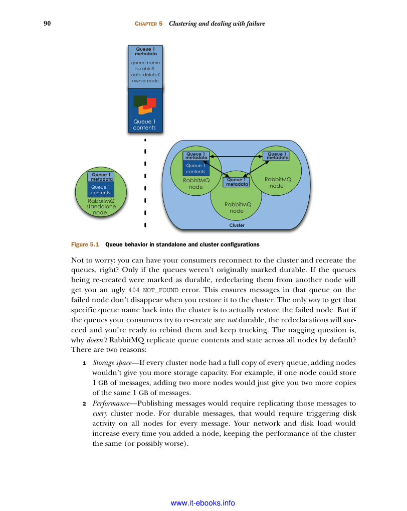
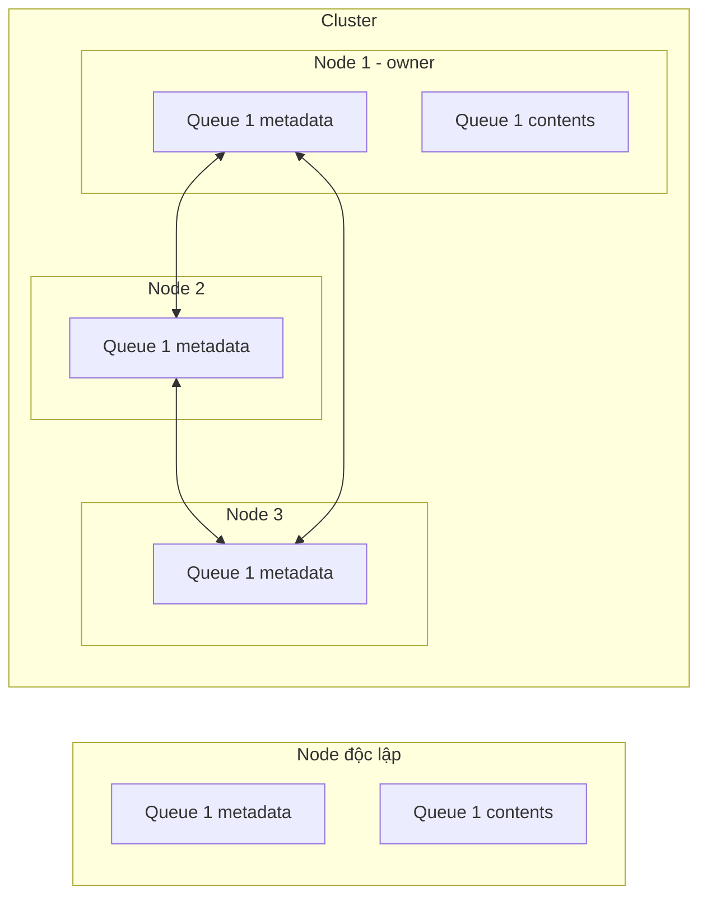
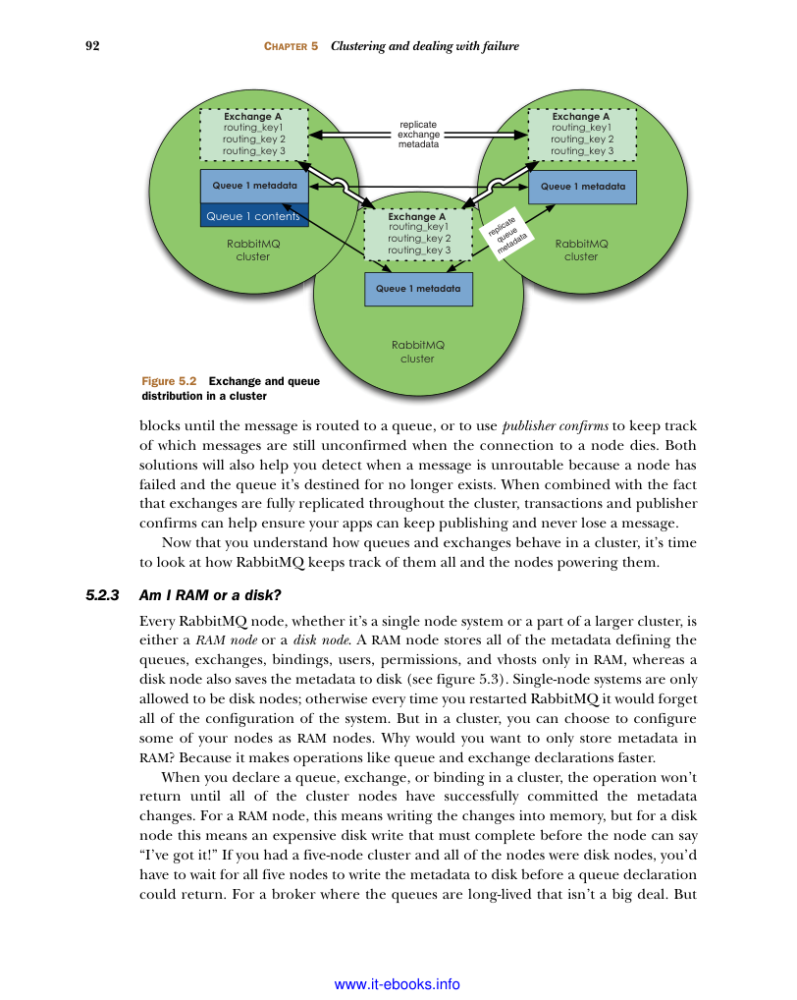
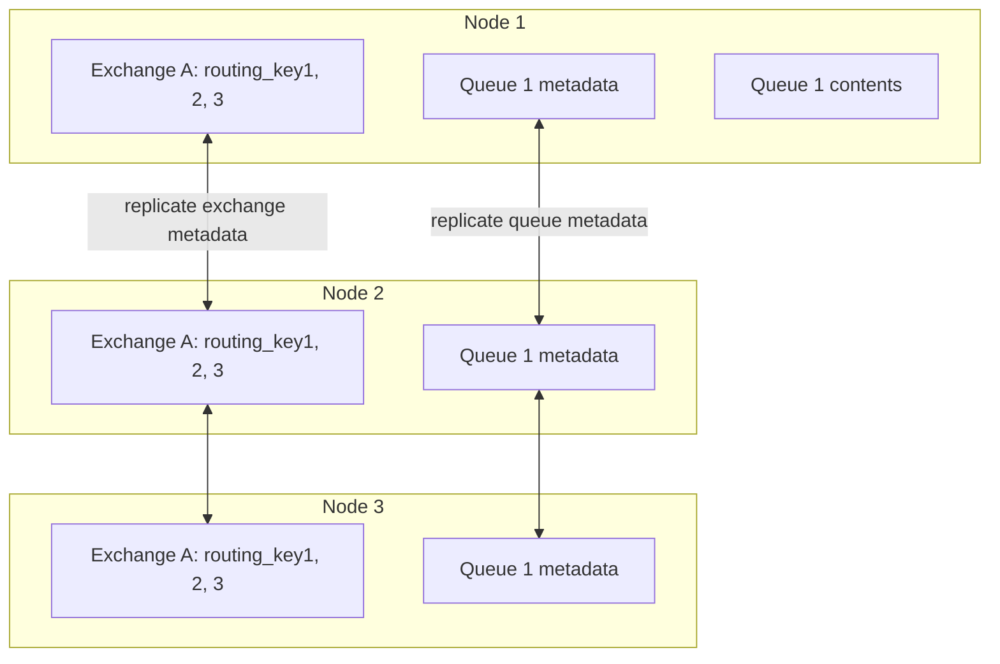
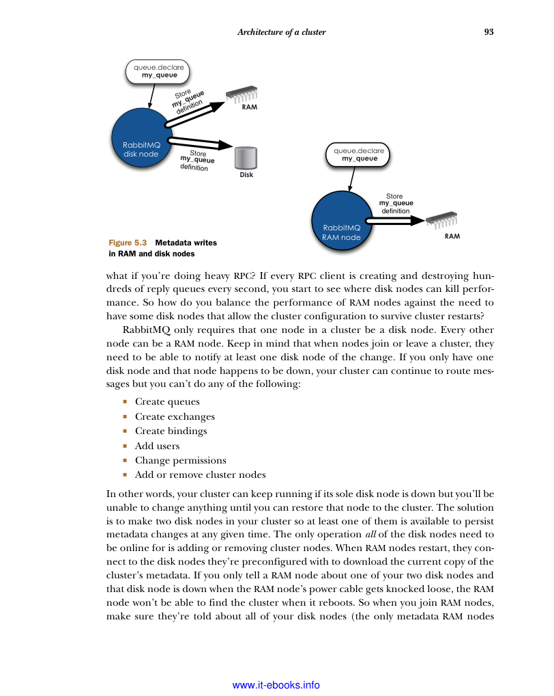
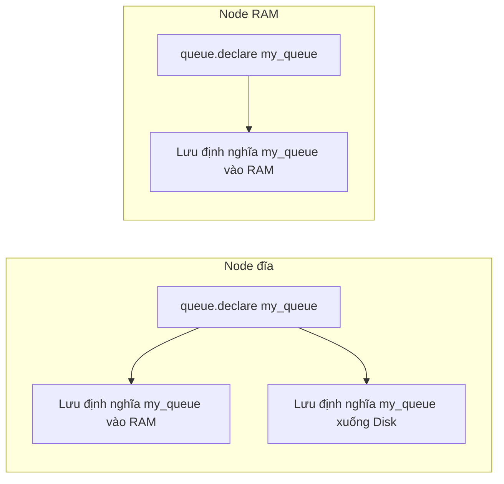
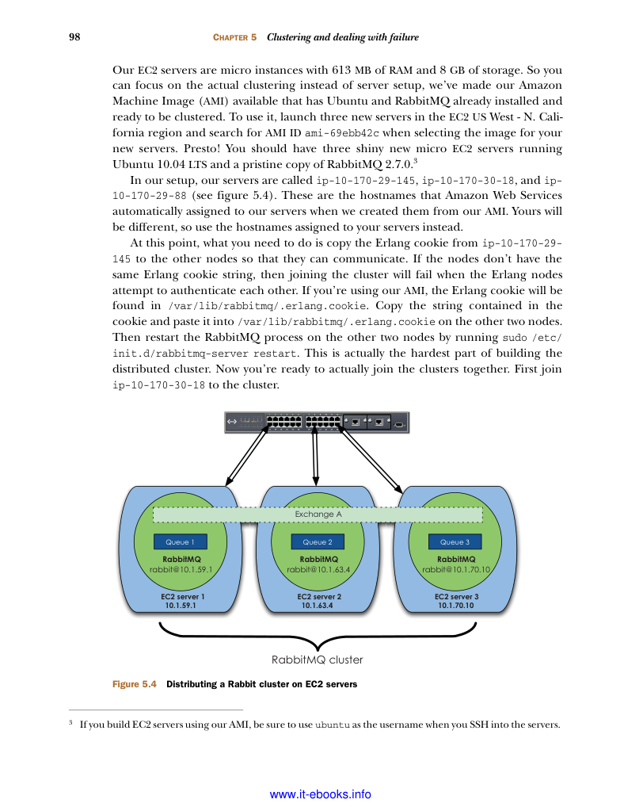
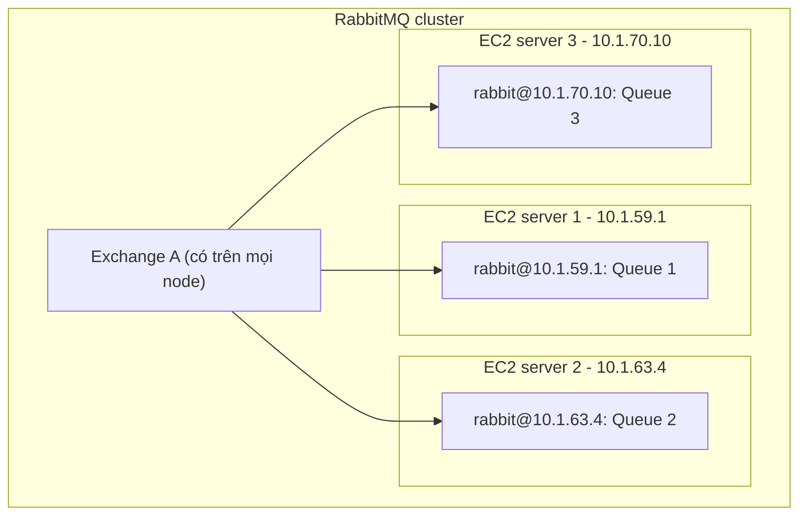
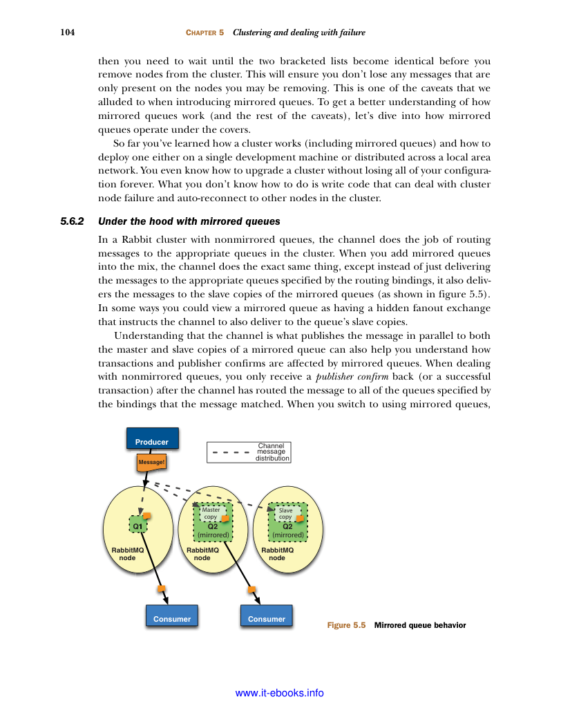
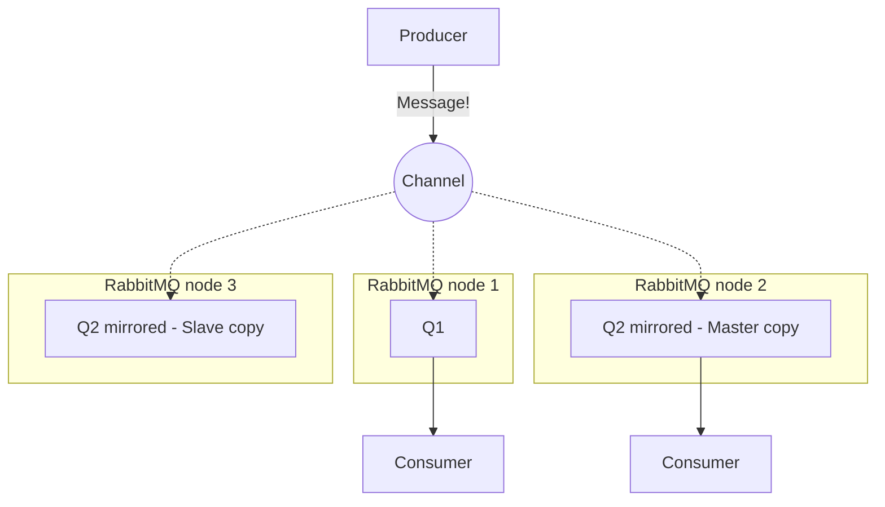

# Chương 5: Clustering và xử lý sự cố (Clustering and dealing with failure)

## Mục lục chương

- [Mở đầu chương](#mở-đầu-chương)
- [5.1 Có sẵn trong hộp: clustering của RabbitMQ (Batteries included: RabbitMQ clustering)](#51-có-sẵn-trong-hộp-clustering-của-rabbitmq-batteries-included-rabbitmq-clustering)
- [5.2 Kiến trúc của một cluster (Architecture of a cluster)](#52-kiến-trúc-của-một-cluster-architecture-of-a-cluster)
  - [5.2.1 Queue trong cluster (Queues in a cluster)](#521-queue-trong-cluster-queues-in-a-cluster)
  - [5.2.2 Phân phối exchange (Distributing exchanges)](#522-phân-phối-exchange-distributing-exchanges)
  - [5.2.3 Tôi là node RAM hay node đĩa? (Am I RAM or a disk?)](#523-tôi-là-node-ram-hay-node-đĩa-am-i-ram-or-a-disk)
- [5.3 Dựng cluster ngay trên laptop của bạn (Setting up a cluster on your laptop)](#53-dựng-cluster-ngay-trên-laptop-của-bạn-setting-up-a-cluster-on-your-laptop)
- [5.4 Phân tán các node ra nhiều máy (Distributing the nodes to more machines)](#54-phân-tán-các-node-ra-nhiều-máy-distributing-the-nodes-to-more-machines)
- [5.5 Nâng cấp các node trong cluster (Upgrading cluster nodes)](#55-nâng-cấp-các-node-trong-cluster-upgrading-cluster-nodes)
- [5.6 Mirrored queue và việc bảo toàn message (Mirrored queues and preserving messages)](#56-mirrored-queue-và-việc-bảo-toàn-message-mirrored-queues-and-preserving-messages)
  - [5.6.1 Khai báo và sử dụng mirrored queue (Declaring and using mirrored queues)](#561-khai-báo-và-sử-dụng-mirrored-queue-declaring-and-using-mirrored-queues)
  - [5.6.2 Bên trong mirrored queue (Under the hood with mirrored queues)](#562-bên-trong-mirrored-queue-under-the-hood-with-mirrored-queues)
- [5.7 Tóm tắt (Summary)](#57-tóm-tắt-summary)
- [Bảng thuật ngữ của chương](#bảng-thuật-ngữ-của-chương)

---

## Mở đầu chương

> **Chương này bao gồm (This chapter covers):**
> - Kiến trúc của một cluster RabbitMQ
> - Dựng một cluster ngay trên laptop của bạn
> - Tạo một cluster với các máy chủ vật lý
> - Nâng cấp các node trong cluster
> - Làm việc với mirrored queue (queue được nhân bản)

Vậy là bạn vừa hoàn thành ứng dụng web mới "đỉnh của chóp", được tiếp sức bởi phép màu xếp hàng (queuing) của RabbitMQ. Giao diện người dùng hiển thị các thông báo thời gian thực (*real-time notifications*) được đẩy từ API backend, và Rabbit chỉ định tuyến tới mỗi client API đúng những thông báo mà client đó quan tâm. Mọi thứ trông thật tuyệt, và Rabbit đã giúp bạn trông như một "cao thủ lập trình" trong mắt sếp. Đến lúc triển khai lên môi trường production rồi; bạn chỉ cần dựng một instance RabbitMQ trên một máy chủ production là xong việc, đúng không? Khoan đã. Phép màu thời gian thực của bạn lúc này có thể làm khách hàng trầm trồ, nhưng chuyện gì sẽ xảy ra khi bộ nhớ của máy chủ RabbitMQ bị hỏng (*memory corrupted*), hoặc máy chủ bị hỏng bộ nguồn? Ứng dụng hiệu năng cao của bạn lập tức trở thành "vết nhơ" của công ty — và là vấn đề của chính bạn.

Có lẽ đã đến lúc chúng ta nói về cách làm cho RabbitMQ có khả năng chống chịu sự cố (*resilient to failure*), để khi Định luật Murphy (*Murphy's Law* — "cái gì có thể hỏng thì sẽ hỏng") tàn phá ứng dụng của bạn, bạn vẫn có thể tin tưởng RabbitMQ tiếp tục "chạy đều" như trái tim của ứng dụng.

Có hai mặt để làm cho RabbitMQ có tính sẵn sàng cao (*highly available*):

- Mặt thứ nhất là thiết lập các "chú thỏ" (các node RabbitMQ) sao cho bạn có thể sống sót khi bất kỳ một chú thỏ nào gặp sự cố, và ứng dụng của bạn vẫn tiếp tục hoạt động mà không bị "khựng" chút nào.
- Mặt thứ hai là xử lý vấn đề hiệu năng khi ứng dụng mở rộng quy mô (*scale*). Một instance RabbitMQ đơn lẻ có thể xử lý được lưu lượng message (*message throughput*) do dịch vụ dắt chó Chihuahua đi dạo của bạn tạo ra hôm nay, nhưng chuyện gì sẽ xảy ra khi bạn đạt tới 1.000.000 yêu cầu dắt chó mỗi giây? Bạn sẽ cần cả một cluster (cụm) các chú thỏ để giữ cho ứng dụng chạy êm ru.

May mắn thay, RabbitMQ đi kèm tính năng clustering tích hợp sẵn có thể giải quyết cả hai vấn đề, và bảo đảm ứng dụng của bạn luôn có một chú thỏ để nói chuyện, bất kể bạn bị "tấn công" bởi sự cố máy chủ hay bởi thành công vang dội. Chúng ta sẽ tìm hiểu tính năng clustering tuyệt vời của RabbitMQ trong chương này. Khi kết thúc chương, bạn sẽ hiểu cluster hoạt động thế nào ở bên trong, và cách tạo cluster trong nhiều môi trường khác nhau: từ một cluster nhỏ trên laptop phát triển cho tới một cluster thực thụ nhiều máy chủ trong production. Bạn thậm chí sẽ biết cách nâng cấp cluster khi phiên bản Rabbit mới ra mắt. Nói vậy đủ rồi; hãy lao vào và xem làm thế nào để biến vài chú thỏ thành một cluster "phun lửa", chuyên chuyền message!

> 📝 **Giải thích thêm (không có trong sách):** *Cluster* (cụm) là một nhóm nhiều máy chủ/tiến trình RabbitMQ (gọi là các *node*) được nối với nhau và hoạt động như **một broker logic duy nhất**: chúng chia sẻ chung danh sách user, vhost, exchange, queue, binding… Client có thể kết nối tới bất kỳ node nào trong cluster. *High availability* (tính sẵn sàng cao) nghĩa là hệ thống vẫn phục vụ được khi một phần của nó bị hỏng. *Scalability* (khả năng mở rộng) nghĩa là có thể tăng năng lực xử lý bằng cách thêm tài nguyên (ở đây là thêm node).

---

## 5.1 Có sẵn trong hộp: clustering của RabbitMQ (Batteries included: RabbitMQ clustering)

> 📝 **Giải thích thêm (không có trong sách):** "Batteries included" là thành ngữ tiếng Anh, nghĩa đen là "đã kèm sẵn pin" — tức là mua về dùng được ngay, không cần mua thêm gì. Ở đây ý nói clustering là tính năng có sẵn của RabbitMQ, không cần cài thêm phần mềm bên ngoài.

Một trong những tính năng tuyệt nhất của RabbitMQ là clustering được tích hợp sẵn. Điều này làm nó khác biệt so với gần như mọi message broker mã nguồn mở khác, và việc bạn có thể dựng một cluster chạy được chỉ trong 5 phút khiến nó khác biệt so với **mọi** broker, chấm hết. Hôm nay bắt đầu với một chú thỏ, rồi thêm các chú thỏ khác "ngay khi đang chạy" (*on-the-fly*) mà không có chút thời gian chết nào (*zero downtime*) để tăng tính sẵn sàng hoặc tăng hiệu năng. Nhưng clustering của RabbitMQ không phải là thuốc chữa bách bệnh (*panacea*). Vậy rốt cuộc clustering của RabbitMQ mang lại cho bạn điều gì?

Clustering tích hợp trong RabbitMQ được thiết kế với hai mục tiêu:

1. Cho phép consumer và producer tiếp tục chạy khi một node Rabbit "chết".
2. Mở rộng tuyến tính (*linearly scaling*) lưu lượng message bằng cách thêm node.

RabbitMQ đáp ứng khéo léo cả hai yêu cầu bằng cách tận dụng framework giao tiếp phân tán Open Telecom Platform (OTP) do Erlang cung cấp. Bạn có thể mất một node RabbitMQ và ứng dụng của bạn có thể kết nối lại tới bất kỳ node nào khác trong cluster rồi tiếp tục produce và consume như chưa có chuyện gì xảy ra. Tương tự, nếu cluster Rabbit của bạn đang "gồng mình" dưới khối lượng message, việc thêm node sẽ tăng năng lực một cách tuyến tính để có thêm hiệu năng. Điều mà clustering của RabbitMQ **không nhất thiết** làm được là bảo đảm không mất message (*guarantees against message loss*).

Ngay cả khi bạn làm mọi thứ đúng (đặt message, queue và exchange ở chế độ durable — bền vững, v.v.), khi một node trong cluster Rabbit chết, các message trong những queue nằm trên node đó có thể biến mất. Lý do là RabbitMQ **mặc định không nhân bản (replicate) nội dung của queue** ra khắp cluster. Nếu không có cấu hình đặc biệt, chúng chỉ sống trên node sở hữu queue đó. Khoan đã… ý bạn là queue chỉ sống trên **một** node trong cluster sao? Vừa đúng vừa không. Để hiểu rõ hơn, hãy cùng xem kiến trúc của một cluster RabbitMQ.

> 💡 **Ví dụ bổ sung (không có trong sách):** Giả sử bạn có cluster 3 node A, B, C. Ứng dụng kết nối tới node A và khai báo queue `orders` (durable), rồi publish 1.000 message persistent vào đó. Nội dung 1.000 message này chỉ nằm trên node A. Nếu node A mất điện:
> - Producer/consumer có thể kết nối lại tới B hoặc C — cluster vẫn "sống" (mục tiêu 1 đạt được).
> - Nhưng queue `orders` cùng 1.000 message tạm thời "biến mất" khỏi cluster cho tới khi A được khôi phục (vì message persistent nằm trên đĩa của A). Nếu đĩa của A hỏng vĩnh viễn thì 1.000 message đó mất luôn.
>
> Đó chính là ý "clustering không nhất thiết bảo đảm không mất message". Mirrored queue ở mục 5.6 sẽ giải quyết phần nào vấn đề này.

---

## 5.2 Kiến trúc của một cluster (Architecture of a cluster)

Cho tới giờ chúng ta vẫn khá mơ hồ về phần bên trong của RabbitMQ. Đúng là bạn đã biết queue và exchange là gì — cách bind (liên kết) chúng với nhau và tại sao bạn lại muốn dùng các loại khác nhau. Nhưng thực sự điều gì đang diễn ra "dưới nắp capô"? RabbitMQ theo dõi tất cả các thành phần cơ bản (*primitives*) bạn đang dùng như thế nào, và làm sao chúng ghép lại với nhau để tạo thành một message broker?

Tại mọi thời điểm, RabbitMQ theo dõi bốn loại siêu dữ liệu nội bộ (*internal metadata*):

- **Metadata của queue (*Queue metadata*)** — Tên queue và các thuộc tính của nó (nó có durable không? có auto-delete không?)
- **Metadata của exchange (*Exchange metadata*)** — Tên exchange, loại exchange, và các thuộc tính của nó (durable, v.v.)
- **Metadata của binding (*Binding metadata*)** — Một bảng đơn giản cho biết cách định tuyến message tới các queue
- **Metadata của vhost (*Vhost metadata*)** — Không gian tên (*namespacing*) và các thuộc tính bảo mật cho các queue, exchange và binding bên trong một vhost (virtual host — "máy chủ ảo", một không gian cô lập bên trong broker)

Với một node đơn lẻ, RabbitMQ lưu toàn bộ thông tin này trong bộ nhớ, đồng thời ghi xuống đĩa đối với mọi queue và exchange (cùng binding của chúng) được đánh dấu durable. Việc ghi xuống đĩa chính là thứ bảo đảm queue và exchange của bạn sẽ được tạo lại khi bạn khởi động lại một node RabbitMQ. Khi bạn đưa clustering vào, RabbitMQ giờ đây phải theo dõi thêm một loại metadata mới: **vị trí của các node trong cluster** và **mối quan hệ của các node với những loại metadata khác** đang được theo dõi. Clustering cũng bổ sung một lựa chọn: lưu metadata trên đĩa (mặc định ở node độc lập) hay chỉ lưu trong RAM. Nhưng trước khi đi sâu vào các node trong cluster và cách chúng lưu metadata, trước hết bạn nên hiểu queue và exchange hành xử thế nào trong một cluster.

> 💡 **Ví dụ bổ sung (không có trong sách):** Hãy hình dung metadata như "sổ đăng ký" của broker. Ví dụ, sau khi bạn chạy vài lệnh khai báo, sổ đăng ký có thể trông như sau:
>
> | Loại metadata | Ví dụ nội dung |
> |---|---|
> | Queue | `orders` (durable=true, auto_delete=false) |
> | Exchange | `shop` (type=direct, durable=true) |
> | Binding | `shop` --[routing key `new_order`]--> `orders` |
> | Vhost | vhost `/shop`, user `app` có quyền configure/write/read trên `/shop` |
>
> Lưu ý: metadata **không** bao gồm nội dung message. Nội dung message (các message đang chờ trong queue `orders`) là *contents* của queue — một thứ khác hẳn, và chính sự khác biệt này là then chốt để hiểu mục 5.2.1.

> 📝 **Giải thích thêm (không có trong sách) — Kiến trúc lưu trữ Metadata: Từ Mnesia (RabbitMQ 2.x–3.x) sang Khepri/Raft (RabbitMQ 4.0):**
>
> Khi cuốn sách này được viết (RabbitMQ 2.7) cho tới tận nhánh RabbitMQ 3.x, toàn bộ metadata của cluster (vhost, user, permission, exchange, queue, binding, policy) được lưu trong **Mnesia** — hệ quản trị cơ sở dữ liệu phân tán tích hợp sẵn trong Erlang/OTP từ thập niên 1990.
>
> Tuy nhiên, sau hơn một thập kỷ vận hành ở quy mô đám mây, đội ngũ RabbitMQ nhận thấy Mnesia có những điểm yếu chí mạng:
> 1. **Rất 취약 trước hiện tượng phân mảnh mạng (*network partition / split-brain*)**: Mnesia được thiết kế cho mạng LAN viễn thông ổn định. Khi mạng chập chờn khiến các node tạm thời mất liên lạc rồi nối lại, hai nửa của cluster có thể tự ý cập nhật bảng Mnesia độc lập. Khi mạng thông trở lại, Mnesia không có cơ chế đồng thuận rõ ràng để tự hòa giải (*reconcile*), dẫn đến trạng thái "split-brain" nghiêm trọng và đòi hỏi quản trị viên phải can thiệp hoặc khởi động lại node.
> 2. **Giao dịch đồng bộ trên toàn bộ node (*All-nodes commit*)**: Khi khai báo queue/exchange hoặc thay đổi binding, Mnesia yêu cầu giao dịch phải hoàn tất trên **tất cả** các node đang chạy. Chỉ cần một node bị nghẽn đĩa hoặc mạng chậm, toàn bộ thao tác metadata trên cả cluster sẽ bị kéo chậm theo.
>
> **Bước ngoặt trong RabbitMQ 3.13 và RabbitMQ 4.0 — Khepri:**
> Từ RabbitMQ 3.13 (thử nghiệm) và **chính thức trở thành mặc định trong RabbitMQ 4.0**, RabbitMQ thay thế Mnesia bằng **Khepri** — một kho lưu trữ metadata dạng cây (*tree-like store*, tương tự ZooKeeper/etcd) được xây dựng trên nền thư viện **Ra** (bản cài đặt thuật toán đồng thuận **Raft** bằng Erlang của chính đội ngũ RabbitMQ).
>
> | Tiêu chí | Mnesia (RabbitMQ 2.x – 3.12) | Khepri + Raft (RabbitMQ 3.13 / 4.0+) |
> |---|---|---|
> | **Cơ chế đồng thuận** | Giao dịch 2 pha / khóa phân tán trên **tất cả** các node đang chạy | Đồng thuận **Raft**: chỉ cần **đa số (*quorum* = $\lfloor N/2 \rfloor + 1$)** node xác nhận |
> | **Chống chịu khi 1 node bị chậm/treo** | Kém — 1 node chậm làm chậm thao tác tạo queue/binding toàn cụm | Tốt — miễn đa số node phản hồi nhanh, cụm vẫn ghi nhận metadata tức thì |
> | **Xử lý đứt mạng (*Network Partition*)** | Dễ bị *split-brain*, khôi phục phức tạp, có nguy cơ lệch metadata | Hành vi xác định (*deterministic*): chỉ nhánh có đa số (*majority*) mới được ghi; nhánh thiểu số tự động đồng bộ lại từ nhật ký Raft khi mạng thông |
> | **Loại node hỗ trợ** | Phân biệt **Disk node** và **RAM node** | **Mọi node đều lưu đĩa** (RAM node bị loại bỏ hoàn toàn từ RabbitMQ 4.0) |
> | **Tốc độ khôi phục khi khởi động** | Chậm khi có hàng chục nghìn queue/binding do phải đồng bộ bảng Mnesia | Nhanh và an toàn nhờ áp dụng lại nhật ký (*Raft WAL / snapshot*) |
>
> Trên RabbitMQ 3.13+ hoặc 4.0, bạn có thể kiểm tra và bật Khepri bằng lệnh:
> ```bash
> # Kiểm tra trạng thái feature flag khepri_db
> rabbitmqctl list_feature_flags
>
> # Bật Khepri để chuyển đổi kho metadata từ Mnesia sang Khepri (Raft)
> rabbitmqctl enable_feature_flag khepri_db
> ```

### 5.2.1 Queue trong cluster (Queues in a cluster)

Ngay khi bạn nối một node với một node khác để tạo thành cluster, có một điều thay đổi đáng kể: **không phải node nào cũng có bản sao đầy đủ của mọi queue**. Trong cấu hình một node, toàn bộ thông tin về một queue (metadata, trạng thái và nội dung) được lưu đầy đủ trong node đó (xem hình 5.1). Nhưng trong một cluster, khi bạn tạo queue, cluster chỉ tạo thông tin đầy đủ về queue (metadata, trạng thái, nội dung) trên **một node duy nhất** trong cluster¹ thay vì trên tất cả các node (queue được tạo trên node mà client khai báo queue đang kết nối tới). Kết quả là chỉ có node sở hữu (*owner node*) của queue mới biết toàn bộ thông tin về queue đó. Tất cả các node không sở hữu chỉ biết metadata của queue và một con trỏ (*pointer*) trỏ tới node nơi queue thực sự "sống". Vì vậy khi một node trong cluster chết, các queue của node đó và các binding liên quan sẽ biến mất. Consumer đang gắn với những queue đó mất đăng ký (*subscription*) của mình, và mọi message mới mà lẽ ra khớp với binding của queue đó sẽ bị rơi vào "hố đen" (*black-holed* — bị vứt bỏ âm thầm, không đi đâu cả).

> ¹ *Chú thích chân trang của sách:* RabbitMQ 2.6.0 trở lên cung cấp mirrored queue (queue được nhân bản), cho phép nội dung queue sống sót khi node trong cluster gặp sự cố. Chúng ta sẽ tìm hiểu mirrored queue trong một mục riêng của chương này.

Đừng lo: bạn có thể cho consumer kết nối lại tới cluster và tạo lại các queue, đúng không? Chỉ được nếu ban đầu các queue **không** được đánh dấu durable. Nếu các queue đang được tạo lại đã được đánh dấu durable, việc khai báo lại chúng từ một node khác sẽ khiến bạn nhận một lỗi khó chịu `404 NOT_FOUND`. Điều này bảo đảm các message trong queue đó trên node bị hỏng sẽ không biến mất khi bạn khôi phục node đó trở lại cluster. Cách duy nhất để lấy lại đúng tên queue đó vào cluster là thực sự khôi phục node bị hỏng. Còn nếu các queue mà consumer cố tạo lại **không** durable, việc khai báo lại sẽ thành công và bạn có thể bind lại chúng rồi tiếp tục "chạy xe".

Câu hỏi dai dẳng là: tại sao RabbitMQ **không** mặc định nhân bản nội dung và trạng thái của queue lên tất cả các node? Có hai lý do:

1. **Dung lượng lưu trữ (*Storage space*)** — Nếu mọi node trong cluster đều có bản sao đầy đủ của mọi queue, việc thêm node sẽ không cho bạn thêm dung lượng lưu trữ. Ví dụ, nếu một node có thể lưu 1 GB message, thêm hai node nữa chỉ cho bạn thêm hai bản sao của cùng 1 GB message đó.
2. **Hiệu năng (*Performance*)** — Publish message sẽ đòi hỏi nhân bản message đó tới **mọi** node trong cluster. Với message durable, điều này đòi hỏi kích hoạt thao tác đĩa trên tất cả các node cho mỗi message. Tải mạng và tải đĩa sẽ tăng lên mỗi khi bạn thêm node, khiến hiệu năng của cluster giữ nguyên (hoặc thậm chí tệ hơn).



**Hình 5.1 – Hành vi của queue trong cấu hình độc lập và cấu hình cluster (Queue behavior in standalone and cluster configurations)**

Các mảnh ảnh trích từ hình 5.1:


*Mô tả hình:* Bên trái là một **node RabbitMQ độc lập (RabbitMQ standalone node)** chứa cả "Queue 1 metadata" (metadata của Queue 1) lẫn "Queue 1 contents" (nội dung của Queue 1). Bên phải là một **Cluster** gồm ba **RabbitMQ node**: chỉ một node chứa cả metadata lẫn nội dung của Queue 1; hai node còn lại chỉ chứa "Queue 1 metadata". Các mũi tên hai chiều nối metadata giữa ba node, thể hiện metadata được đồng bộ khắp cluster. Phía trên có một khung phóng to giải thích "Queue 1 metadata" gồm: *queue name* (tên queue), *durable?* (có bền vững không?), *auto-delete?* (có tự xóa không?), *owner node* (node sở hữu); bên dưới là "Queue 1 contents" (nội dung queue — các message).



> 💡 **Ví dụ bổ sung (không có trong sách):** Hai kịch bản khi node sở hữu queue chết (dùng thư viện Python `pika`, giả sử consumer đã kết nối lại tới một node còn sống):
>
> ```python
> import pika
>
> conn = pika.BlockingConnection(pika.ConnectionParameters("node-b"))
> ch = conn.channel()
>
> # Kịch bản 1: queue KHÔNG durable -> khai báo lại thành công,
> # queue mới (rỗng) được tạo trên node-b, ta bind lại và chạy tiếp.
> ch.queue_declare(queue="notifications", durable=False)
> ch.queue_bind(queue="notifications", exchange="events", routing_key="user.42")
>
> # Kịch bản 2: queue durable "orders" vốn sở hữu bởi node-a (đang chết)
> # -> server trả lỗi 404 NOT_FOUND, channel bị đóng.
> try:
>     ch.queue_declare(queue="orders", durable=True)
> except pika.exceptions.ChannelClosedByBroker as e:
>     print("Không thể khai báo lại:", e)  # (404, "NOT_FOUND - ...")
> ```
>
> RabbitMQ chọn từ chối ở kịch bản 2 để khi node-a quay lại, các message durable của `orders` trên đĩa node-a không bị "đè" bởi một queue rỗng mới.
>
> 📐 **Bài toán nhỏ:** Mỗi node lưu được 1 GB message. Với cluster 3 node: nếu nhân bản toàn bộ, tổng dung lượng hữu ích là 1 GB; nếu mỗi queue chỉ sống trên một node (mặc định), tổng dung lượng hữu ích có thể đạt tới 3 GB (khi các queue được rải đều trên 3 node).

Bằng cách chỉ để một node trong cluster chịu trách nhiệm cho một queue cụ thể, chỉ node chịu trách nhiệm mới phải thực hiện thao tác đĩa cho các message của queue đó. Tất cả các node khác chỉ cần chuyển các message mà chúng nhận được cho queue đó tới node sở hữu. Kết quả là thêm node vào cluster Rabbit đồng nghĩa với việc có thêm node để rải các queue lên, giúp bạn tăng hiệu năng với mỗi node được thêm vào. Điều này khiến clustering của RabbitMQ rất xuất sắc trong việc mở rộng quy mô khi tải tăng lên. Có thể bạn đang tự hỏi liệu exchange có tuân theo cùng luật chơi không. Không đâu, và lý do là vì exchange chỉ là "sản phẩm của trí tưởng tượng" của bạn.

### 5.2.2 Phân phối exchange (Distributing exchanges)

Cho tới giờ chúng ta luôn mô tả exchange như thể nó là một thực thể "sống" giống như queue. Sự thật là, khác với queue — vốn có tiến trình (*process*) riêng — exchange chỉ là **một cái tên và một danh sách các binding tới queue**. Khi bạn publish một message "vào" một exchange, điều thực sự xảy ra là channel mà bạn đang kết nối sẽ so sánh routing key của message với danh sách binding của exchange đó, rồi định tuyến message. Chính **channel** thực hiện việc định tuyến message tới queue theo binding khớp. Tại sao điều này quan trọng? Hiểu rằng channel mới là "bộ định tuyến" thực sự là rất quan trọng, vì nó giải thích tại sao exchange không chịu những giới hạn giống như queue trong một cluster.

> **GHI CHÚ (NOTE):** Cách để hiểu việc định tuyến message hoạt động thế nào bên trong RabbitMQ là hãy nghĩ rằng mỗi queue là một tiến trình đang chạy trên một node, trong đó mỗi tiến trình có mã định danh tiến trình (*process ID — PID*) riêng. Exchange đơn giản chỉ là một danh sách các mẫu định tuyến (*routing patterns*) và PID của các tiến trình queue mà message khớp cần được gửi tới. Khi bạn publish một message khớp với một binding trong exchange, chính channel là thứ thực hiện việc so khớp, và khi đã khớp thì nó thiết lập kết nối tới PID của queue và chuyển message tới đó. PID của queue về bản chất chính là địa chỉ Erlang của nó trong cluster.

Vì exchange chỉ là một bảng tra cứu (*lookup table*) chứ không phải bộ định tuyến message thực sự, nên việc nhân bản exchange ra khắp cluster dễ hơn nhiều (xem hình 5.2). Ví dụ, khi bạn tạo một exchange mới, tất cả những gì RabbitMQ phải làm là thêm bảng tra cứu đó vào tất cả các node trong cluster. Mọi channel trên mọi node khi đó đều truy cập được exchange mới. Vì vậy, trong khi thông tin đầy đủ về một queue mặc định chỉ nằm trên một node của cluster, thì **mọi node trong cluster đều có toàn bộ thông tin về mọi exchange**. Về tính sẵn sàng thì điều này thật tuyệt, vì nghĩa là bạn không cần lo việc khai báo lại exchange khi một node sập. Chỉ cần cho các producer trên node hỏng kết nối lại tới cluster là chúng có thể bắt đầu publish vào exchange ngay lập tức. Nhưng điều gì xảy ra với những message đã được publish vào channel nhưng chưa định tuyến xong thì node gặp sự cố?

Lệnh AMQP `basic.publish` không trả về trạng thái của message. Điều này nghĩa là channel có thể vẫn đang định tuyến message khi node của channel gặp sự cố, trong khi producer của bạn đã chuyển sang tạo message tiếp theo. Trong tình huống này bạn có nguy cơ mất những message đó. Giải pháp là dùng **giao dịch AMQP (*AMQP transaction*)** — sẽ chặn (*block*) cho tới khi message được định tuyến tới một queue — hoặc dùng **xác nhận từ phía publisher (*publisher confirms*)** để theo dõi những message nào vẫn chưa được xác nhận khi kết nối tới một node bị đứt. Cả hai giải pháp cũng giúp bạn phát hiện khi một message không thể định tuyến được (*unroutable*) vì một node đã hỏng và queue đích của nó không còn tồn tại nữa. Kết hợp với việc exchange được nhân bản đầy đủ khắp cluster, transaction và publisher confirm có thể giúp bảo đảm ứng dụng của bạn tiếp tục publish được và không bao giờ mất message.



**Hình 5.2 – Phân phối exchange và queue trong một cluster (Exchange and queue distribution in a cluster)**

Các mảnh ảnh trích từ hình 5.2:


*Mô tả hình:* Ba vòng tròn xanh, mỗi vòng ghi "RabbitMQ cluster" (thực chất là ba node của cùng một cluster). **Cả ba** node đều có khung "Exchange A" với đầy đủ danh sách *routing_key1*, *routing_key 2*, *routing_key 3*; các mũi tên đôi lớn được ghi chú "replicate exchange metadata" (nhân bản metadata của exchange). Cả ba node đều có "Queue 1 metadata", được nối bằng các mũi tên ghi "replicate queue metadata" (nhân bản metadata của queue). Nhưng **chỉ một** node (bên trái) có thêm "Queue 1 contents" (nội dung của Queue 1).



> 💡 **Ví dụ bổ sung (không có trong sách):** Dùng publisher confirms với `pika` để biết chắc message đã được broker nhận và định tuyến:
>
> ```python
> import pika
>
> conn = pika.BlockingConnection(pika.ConnectionParameters("node-a"))
> ch = conn.channel()
> ch.confirm_delivery()  # bật chế độ publisher confirms trên channel này
>
> try:
>     ch.basic_publish(exchange="shop",
>                      routing_key="new_order",
>                      body=b'{"id": 1001}',
>                      properties=pika.BasicProperties(delivery_mode=2),
>                      mandatory=True)  # báo lỗi nếu message không vào queue nào
>     print("Broker đã xác nhận message")
> except pika.exceptions.UnroutableError:
>     print("Không có queue nào nhận message (vd: node sở hữu queue đã chết)")
> except pika.exceptions.NackError:
>     print("Broker từ chối message -> cần gửi lại")
> except pika.exceptions.AMQPConnectionError:
>     print("Mất kết nối trước khi được xác nhận -> kết nối node khác và gửi lại")
> ```
>
> Ở chế độ `BlockingConnection`, `basic_publish` sẽ đợi confirm, nên nếu node chết giữa chừng bạn biết ngay message nào chưa chắc đã an toàn, thay vì "bắn rồi quên" như `basic.publish` trần.

Giờ khi bạn đã hiểu queue và exchange hành xử thế nào trong cluster, đã đến lúc xem RabbitMQ theo dõi tất cả chúng và các node vận hành chúng như thế nào.

### 5.2.3 Tôi là node RAM hay node đĩa? (Am I RAM or a disk?)

Mọi node RabbitMQ, dù là hệ thống một node hay một phần của cluster lớn hơn, đều hoặc là **node RAM (*RAM node*)** hoặc là **node đĩa (*disk node*)**. Node RAM lưu toàn bộ metadata định nghĩa queue, exchange, binding, user, permission (quyền) và vhost **chỉ trong RAM**, trong khi node đĩa **còn lưu** metadata đó xuống đĩa (xem hình 5.3). Hệ thống một node chỉ được phép là node đĩa; nếu không, mỗi lần bạn khởi động lại RabbitMQ, nó sẽ quên sạch toàn bộ cấu hình của hệ thống. Nhưng trong một cluster, bạn có thể chọn cấu hình một số node là node RAM. Tại sao bạn lại muốn chỉ lưu metadata trong RAM? Vì nó làm các thao tác như khai báo queue và exchange nhanh hơn.

Khi bạn khai báo một queue, exchange hoặc binding trong một cluster, thao tác đó sẽ không trả về cho tới khi **tất cả** các node trong cluster đã commit (ghi nhận) thành công thay đổi metadata. Với node RAM, điều này nghĩa là ghi thay đổi vào bộ nhớ, nhưng với node đĩa, điều này nghĩa là một thao tác ghi đĩa tốn kém phải hoàn tất trước khi node có thể nói "Tôi nhận rồi!". Nếu bạn có cluster năm node và tất cả đều là node đĩa, bạn sẽ phải đợi cả năm node ghi metadata xuống đĩa thì một lệnh khai báo queue mới trả về. Với một broker mà queue sống lâu (*long-lived*) thì điều đó chẳng đáng kể. Nhưng nếu bạn đang làm RPC (*Remote Procedure Call* — gọi thủ tục từ xa) với tần suất cao thì sao? Nếu mỗi client RPC tạo và hủy hàng trăm queue trả lời (*reply queue*) mỗi giây, bạn bắt đầu thấy node đĩa có thể "giết chết" hiệu năng như thế nào. Vậy làm sao cân bằng giữa hiệu năng của node RAM với nhu cầu có vài node đĩa để cấu hình cluster sống sót qua các lần khởi động lại cluster?

RabbitMQ chỉ yêu cầu **một** node trong cluster là node đĩa. Mọi node khác có thể là node RAM. Hãy nhớ rằng khi các node tham gia hoặc rời khỏi cluster, chúng cần thông báo được cho ít nhất một node đĩa về thay đổi đó. Nếu bạn chỉ có một node đĩa và node đó tình cờ bị sập, cluster của bạn vẫn có thể tiếp tục định tuyến message nhưng bạn **không thể** làm bất kỳ việc nào sau đây:

- Tạo queue
- Tạo exchange
- Tạo binding
- Thêm user
- Thay đổi permission
- Thêm hoặc gỡ node khỏi cluster

Nói cách khác, cluster của bạn có thể tiếp tục chạy nếu node đĩa duy nhất của nó bị sập, nhưng bạn sẽ không thể thay đổi bất cứ thứ gì cho tới khi khôi phục được node đó vào cluster. Giải pháp là tạo **hai node đĩa** trong cluster để luôn có ít nhất một node sẵn sàng lưu bền các thay đổi metadata tại bất kỳ thời điểm nào. Thao tác duy nhất cần **tất cả** các node đĩa trực tuyến là thêm hoặc gỡ node khỏi cluster. Khi node RAM khởi động lại, chúng kết nối tới các node đĩa đã được cấu hình sẵn để tải về bản sao hiện tại của metadata cluster. Nếu bạn chỉ cho node RAM biết một trong hai node đĩa của bạn, và node đĩa đó lại đang sập đúng lúc dây nguồn của node RAM bị tuột, thì node RAM sẽ không thể tìm thấy cluster khi khởi động lại. Vì vậy khi bạn cho node RAM tham gia cluster, hãy chắc chắn là chúng được cho biết về **tất cả** các node đĩa của bạn (metadata duy nhất mà node RAM lưu xuống đĩa chính là địa chỉ của các node đĩa trong cluster). Chỉ cần node RAM tìm được ít nhất một node đĩa, nó có thể khởi động lại và vui vẻ tham gia lại cluster.



**Hình 5.3 – Ghi metadata ở node RAM và node đĩa (Metadata writes in RAM and disk nodes)**


*Mô tả hình:* Bên trái là **RabbitMQ disk node** (node đĩa): khi nhận lệnh `queue.declare my_queue`, node lưu định nghĩa `my_queue` (*Store my_queue definition*) vào **RAM** và đồng thời lưu định nghĩa `my_queue` vào **Disk** (đĩa). Bên phải là **RabbitMQ RAM node** (node RAM): khi nhận cùng lệnh `queue.declare my_queue`, node chỉ lưu định nghĩa `my_queue` vào **RAM**.



> 💡 **Ví dụ bổ sung (không có trong sách):** Thiết kế cluster 4 node cho một hệ thống RPC nặng:
>
> | Node | Loại | Lý do |
> |---|---|---|
> | rabbit@a | disk | Giữ metadata bền vững |
> | rabbit@b | disk | Dự phòng cho rabbit@a: nếu a sập vẫn tạo được queue/exchange |
> | rabbit@c | RAM | Khai báo reply queue nhanh |
> | rabbit@d | RAM | Khai báo reply queue nhanh |
>
> Khi join `rabbit@c` và `rabbit@d`, phải liệt kê **cả** `rabbit@a` và `rabbit@b`. Nếu chỉ liệt kê `rabbit@a`, rồi một hôm `rabbit@a` đang bảo trì đúng lúc `rabbit@c` khởi động lại, `rabbit@c` sẽ không tìm thấy cluster.
>
> 📐 **Bài toán nhỏ:** Nếu chỉ có một node đĩa và nó sập, những thao tác nào vẫn làm được? Đáp: publish/consume vào các queue và exchange **đã có** vẫn chạy (định tuyến vẫn hoạt động); nhưng không tạo được queue/exchange/binding mới, không thêm user, không đổi quyền, không thêm/gỡ node.

> 📝 **Giải thích thêm (không có trong sách) — CẬP NHẬT QUAN TRỌNG: RAM Nodes đã bị XÓA HOÀN TOÀN trong RabbitMQ 4.0!**
>
> Lời khuyên dùng RAM node trong mục 5.2.3 ở trên là của thời RabbitMQ 2.7 (năm 2012), khi ổ cứng cơ học (HDD) rất chậm và Mnesia phải ghi đĩa đồng bộ trên mọi disk node mỗi khi khai báo một queue tạm cho RPC. **Trong RabbitMQ hiện đại, khái niệm RAM node đã lỗi thời và bị khai tử hoàn toàn:**
>
> 1. **Trong RabbitMQ 3.x (3.8–3.13) — Khuyến cáo KHÔNG dùng RAM node:**
>    - Đội ngũ phát triển RabbitMQ chính thức cảnh báo rằng RAM node mang lại rất ít lợi ích hiệu năng trên phần cứng SSD/NVMe hiện đại, nhưng lại tạo ra **rủi ro vận hành cực lớn** (nếu tắt/khởi động lại cluster sai thứ tự hoặc mất node đĩa cuối cùng, toàn bộ topology trên RAM node sẽ bốc hơi hoặc node không thể tự khởi động lại).
>    - Quan trọng hơn: kể cả trên một RAM node, **nội dung message persistent và queue index vẫn được ghi xuống đĩa** như bình thường — từ "RAM node" chỉ có nghĩa là *metadata trong Mnesia* được giữ trên RAM mà thôi!
>    - Đối với bài toán **RPC tần suất cao** mà sách nêu (tạo/hủy hàng trăm reply queue mỗi giây), từ RabbitMQ 3.4.0+ đã có tính năng **Direct Reply-to (`amq.rabbitmq.reply-to`)**: client RPC nhận phản hồi trực tiếp qua channel mà **không cần khai báo hay xóa bất kỳ queue tạm nào trong cluster metadata**!
> 2. **Từ RabbitMQ 4.0 — Xóa bỏ hoàn toàn RAM node:**
>    - Trong RabbitMQ 4.0, **RAM nodes đã bị gỡ bỏ hoàn toàn**. Tùy chọn `--ram` trong lệnh `rabbitmqctl join_cluster` và lệnh `rabbitmqctl change_cluster_node_type` không còn tồn tại.
>    - **Mọi node trong cluster đều là Disk node.** Nhờ chuyển từ Mnesia sang **Khepri (dựa trên Raft)** cùng cơ chế gom lô (*batching*) ghi nhật ký Raft WAL, việc cập nhật metadata trên đĩa vừa an toàn tuyệt đối vừa đạt tốc độ cực cao mà chỉ cần đa số (*quorum*) node xác nhận.
>
> **Bảng đối chiếu tiến hóa của Node Types & RPC Reply Queue:**
>
> | Khía cạnh | RabbitMQ 2.7 (trong sách) | RabbitMQ 3.8 – 3.13 | RabbitMQ 4.0+ |
> |---|---|---|---|
> | **Loại node trong cluster** | Khuyến khích pha trộn Disk node (1–2 node) + RAM node | Khuyến cáo **100% Disk node**; RAM node bị đánh dấu *deprecated* | **Chỉ có Disk node** (RAM node bị xóa hoàn toàn) |
> | **Lệnh join RAM node** | Không liệt kê tên node mới trong `rabbitmqctl cluster ...` | `rabbitmqctl join_cluster --ram rabbit@node1` | Không còn hỗ trợ (mọi node đều lưu đĩa) |
> | **Giải pháp cho RPC tạo nhiều reply queue** | Dùng RAM node để giảm ghi đĩa Mnesia khi `queue.declare` | Dùng **Direct Reply-to (`amq.rabbitmq.reply-to`)** — không tốn metadata | Dùng **Direct Reply-to (`amq.rabbitmq.reply-to`)** + Khepri/Raft |
>
> 💡 **Ví dụ bổ sung (không có trong sách) — Dùng `amq.rabbitmq.reply-to` trong Python 3 (`pika 1.x`) để làm RPC tốc độ cao mà không cần tạo reply queue hay dùng RAM node:**
> ```python
> import uuid
> import pika
>
> conn = pika.BlockingConnection(pika.ConnectionParameters("localhost"))
> ch = conn.channel()
>
> # 1. Consume trực tiếp từ pseudo-queue "amq.rabbitmq.reply-to" với auto_ack=True
> #    (Không hề gọi queue_declare -> Không gây bất kỳ thao tác ghi metadata nào lên cluster!)
> def on_rpc_response(channel, method, props, body):
>     print(f"Nhận phản hồi RPC [corr_id={props.correlation_id}]: {body.decode()}")
>     channel.stop_consuming()
>
> ch.basic_consume(
>     queue="amq.rabbitmq.reply-to",
>     on_message_callback=on_rpc_response,
>     auto_ack=True,  # Bắt buộc auto_ack=True với amq.rabbitmq.reply-to
> )
>
> # 2. Gửi request RPC với reply_to="amq.rabbitmq.reply-to"
> corr_id = str(uuid.uuid4())
> ch.basic_publish(
>     exchange="",
>     routing_key="rpc_tasks",
>     body=b'{"action": "walk_chihuahua", "dogs": 2}',
>     properties=pika.BasicProperties(
>         reply_to="amq.rabbitmq.reply-to",
>         correlation_id=corr_id,
>     ),
> )
> ch.start_consuming()
> ```

Lý thuyết vậy là đủ. Hãy cùng ráp một cluster!

---

## 5.3 Dựng cluster ngay trên laptop của bạn (Setting up a cluster on your laptop)

Hiểu cách RabbitMQ xử lý clustering bên trong mới là phần khó; còn dựng một cluster thì dễ! Dễ tới mức bạn có thể dựng một cluster hoạt động đầy đủ ngay trên máy phát triển của mình. Điều này rất tuyệt vì nghĩa là trong lúc viết code, bạn có thể thử nghiệm các kịch bản sự cố và xem chúng thực sự sẽ được xử lý ra sao trong production. Từ chương 1, bạn đã có một node RabbitMQ cài trên máy phát triển. Trước khi bắt đầu cấu hình cluster, trước hết bạn cần chắc chắn node Rabbit hiện có **không** đang chạy. Để dừng node, hãy chuyển tới thư mục cài đặt RabbitMQ và chạy `sbin/rabbitmqctl stop`.² Bạn sẽ thấy một thông báo như sau cho biết node đã dừng:

```bash
Stopping and halting node rabbit@Phantome ... ...done.
```

> ² *Chú thích chân trang của sách:* Cũng có thể cấu hình thành viên cluster bằng file cấu hình trung tâm của RabbitMQ thay vì dùng `rabbitmqctl`. Chúng tôi sẽ không trình bày cách này vì nó dễ gây lỗi và khó gỡ lỗi.

Giờ node đã dừng, bạn có thể khởi tạo (*bootstrap*) cluster. Bình thường bạn sẽ khởi động một node bằng lệnh `rabbitmq-server` và thế là xong. Nhưng nếu không có tham số bổ sung, lệnh này sẽ mặc định cho node Rabbit dùng tên node `rabbit` và cổng lắng nghe (*listener port*) `5672`. Nếu bạn thử khởi động ba node trên cùng một máy theo cách này, node thứ hai và thứ ba sẽ crash ngay khi khởi động vì trùng tên node và trùng cổng. Cách chúng ta lách vấn đề này là dùng hai biến môi trường `RABBITMQ_NODENAME` và `RABBITMQ_NODE_PORT` để chỉ định tên node và cổng riêng biệt trước mỗi lần gọi `rabbitmq-server`. Trong trường hợp này, bạn sẽ bắt đầu cổng từ 5672 và tăng thêm một cho mỗi node khởi động. Tương tự, node đầu tiên sẽ tên là `rabbit`, còn node thứ hai và thứ ba sẽ tên là `rabbit_1` và `rabbit_2`. Bạn có thể dùng tên node và cổng khác, miễn là chúng duy nhất cho mỗi node. Hãy khởi động ba node trên hệ thống phát triển và bắt đầu, như trong listing sau (nhớ gỡ bỏ [với bản trước 2.7.0] hoặc vô hiệu hóa [với bản 2.7.0 trở về sau] mọi plugin trong bản cài RabbitMQ của bạn trước).

> **GHI CHÚ (NOTE):** Chúng ta chưa nói về các plugin của RabbitMQ, nhưng có thể bạn đã bật vài cái rồi. Nếu vậy, bạn sẽ muốn tắt chúng trước khi khởi động các node của cluster. Lý do là các plugin như plugin quản trị RabbitMQ (*RabbitMQ management plugin*) sẽ lắng nghe trên những cổng riêng để cung cấp dịch vụ của chúng (ví dụ giao diện web của plugin quản trị). Chúng ta chưa đề cập cách bảo một số plugin lắng nghe trên cổng khác, nên khi node thứ hai và các node sau khởi động plugin của chúng, chúng sẽ xung đột với plugin đang chạy trên node đầu tiên và các node sẽ crash.

**Listing 5.1 – Khởi động một cluster ba node trên hệ thống phát triển của bạn (Starting a three-node cluster on your development system)**

```bash
$ RABBITMQ_NODE_PORT=5672 RABBITMQ_NODENAME=rabbit \
./sbin/rabbitmq-server -detached
Activating RabbitMQ plugins ...
0 plugins activated:
$ RABBITMQ_NODE_PORT=5673 RABBITMQ_NODENAME=rabbit_1 \
./sbin/rabbitmq-server -detached
Activating RabbitMQ plugins ...
0 plugins activated:
$ RABBITMQ_NODE_PORT=5674 RABBITMQ_NODENAME=rabbit_2 \
./sbin/rabbitmq-server -detached
Activating RabbitMQ plugins ...
0 plugins activated:
```

Giải thích: mỗi lệnh khởi động một node với cổng AMQP (5672, 5673, 5674) và tên node (`rabbit`, `rabbit_1`, `rabbit_2`) riêng; cờ `-detached` cho node chạy ngầm ở chế độ nền. Dòng `0 plugins activated:` xác nhận không có plugin nào được bật (tránh xung đột cổng như ghi chú ở trên).

Giờ bạn có ba node Rabbit đang chạy trên hệ thống phát triển, tên là `rabbit`, `rabbit_1` và `rabbit_2` (mỗi tên sẽ được nối thêm tên máy — hostname — của hệ thống ở cuối sau ký tự `@`). Nhưng mỗi node vẫn là một node độc lập với metadata riêng và không hề biết các node kia tồn tại. Node đầu tiên của cluster là node mang metadata ban đầu vào cluster và không cần được bảo "hãy tham gia". Ngược lại, node thứ hai và các node sau sẽ được nối vào nó và tiếp nhận metadata của nó. Để nối node thứ hai và thứ ba, trước hết bạn cần dừng ứng dụng RabbitMQ đang chạy trên Erlang node của chúng và reset (làm rỗng) metadata của chúng để chúng có thể được nối vào và tiếp nhận metadata của cluster. Tiện ích `rabbitmqctl` cho phép bạn giao tiếp với từng node và thực hiện từng việc này. Hãy bắt đầu bằng việc dừng ứng dụng RabbitMQ trên node thứ hai:

```bash
$ ./sbin/rabbitmqctl -n rabbit_1@Phantome stop_app
Stopping node rabbit_1@Phantome ...
...done.
```

Tiếp theo, bạn cần reset metadata và trạng thái của node thứ hai về rỗng:

```bash
$ ./sbin/rabbitmqctl -n rabbit_1@Phantome reset
Resetting node rabbit_1@Phantome ...
...done.
```

Giờ bạn đã có một ứng dụng Rabbit đã dừng (và rỗng), bạn sẵn sàng nối nó vào node đầu tiên của cluster:

```bash
$ ./sbin/rabbitmqctl -n rabbit_1@Phantome cluster rabbit@Phantome \
rabbit_1@Phantome
Clustering node rabbit_1@Phantome with [rabbit@Phantome,
rabbit_1@Phantome] ...
...done.
```

Cuối cùng bạn có thể khởi động lại ứng dụng của node thứ hai để nó bắt đầu là một thành viên hoạt động của cluster:

```bash
$ ./sbin/rabbitmqctl -n rabbit_1@Phantome start_app
Starting node rabbit_1@Phantome ...
...
broker running
...done.
```

> 📝 **Giải thích thêm (không có trong sách):** Cần phân biệt **Erlang node** và **ứng dụng RabbitMQ** chạy bên trong nó. `stop_app` chỉ dừng ứng dụng RabbitMQ, còn máy ảo Erlang (Erlang VM) vẫn chạy, nhờ vậy `rabbitmqctl` vẫn nói chuyện được với node để ra lệnh `reset`, `cluster`, `start_app`. Còn `stop` (dùng ở đầu mục) thì dừng cả Erlang node. Lưu ý thêm: lệnh `rabbitmqctl cluster` là cú pháp của các phiên bản RabbitMQ 2.x mà sách dùng; từ RabbitMQ 3.0 trở đi, lệnh này được thay bằng `rabbitmqctl join_cluster rabbit@Phantome` (thêm cờ `--ram` nếu muốn node RAM).

Có thể bạn đã để ý rằng khi ra lệnh `cluster` cho node thứ hai, bạn nhận được phản hồi `Clustering node rabbit_1@Phantome with [rabbit@Phantome,rabbit_1@Phantome]`. Lạ nhỉ; ngoài node đầu tiên, bạn còn đang cluster node thứ hai **với chính nó**? Đúng vậy, và lý do là bạn muốn `rabbit_1` là một node đĩa. Khi bạn nối một node mới vào cluster, bạn phải liệt kê **tất cả** các node đĩa trong cluster làm tham số cho lệnh `cluster`. Đây là cách một node RAM biết lấy metadata và trạng thái ban đầu ở đâu nếu nó khởi động lại. Nếu một trong những node đĩa mà bạn khai báo cho node mới lại chính là nó, `rabbitmqctl` đủ thông minh để hiểu rằng bạn muốn node mới cũng là một node đĩa. Thông tin quan trọng khác mà bạn truyền cho `rabbitmqctl` là tham số `-n rabbit_1@Phantome`. Tham số này bảo `rabbitmqctl` rằng bạn muốn nó thực thi lệnh trên một node khác với node mặc định (`rabbit@`). Bạn có thể dùng tham số `-n` để chỉ định bất kỳ node RabbitMQ nào, dù trên hệ thống phát triển của bạn hay trên bất kỳ hệ thống nào khác có thể truy cập qua mạng.

> **GHI CHÚ (NOTE):** Hãy nhớ rằng cách các Erlang node xác thực rằng chúng được phép nói chuyện với nhau là thông qua Erlang cookie của chúng. Vì `rabbitmqctl` dùng cơ chế giao tiếp Erlang OTP để nói chuyện với các node Rabbit, nên máy bạn chạy `rabbitmqctl` và các node Rabbit mà bạn muốn nói chuyện phải dùng **cùng một Erlang cookie**. Nếu không, bạn sẽ nhận lỗi.

Đến đây bạn đã có một cluster Rabbit hai node chạy trên hệ thống phát triển, cùng với một node Rabbit thứ ba độc lập đang chờ được đưa vào cluster. Đừng để node thứ ba đứng ngoài trời lạnh! Nối node thứ ba, như trong listing sau, gần như y hệt nối node thứ hai.

**Listing 5.2 – Nối node thứ ba vào cluster (Joining the third node to the cluster)**

```bash
$ ./sbin/rabbitmqctl -n rabbit_2@Phantome stop_app
Stopping node rabbit_2@Phantome ...
...done.
$ ./sbin/rabbitmqctl -n rabbit_2@Phantome reset
Resetting node rabbit_2@Phantome ...
...done.
$ ./sbin/rabbitmqctl -n rabbit_2@Phantome cluster rabbit@Phantome \
rabbit_1@Phantome
Clustering node rabbit_2@Phantome with [rabbit@Phantome,
rabbit_1@Phantome] ...
...done.
$ ./sbin/rabbitmqctl -n rabbit_2@Phantome start_app
Starting node rabbit_2@Phantome ...
...
broker running
...done.
```

Khi bạn chạy cùng các lệnh để nối node thứ ba, thứ duy nhất thay đổi là tham số `-n` để chỉ định node thứ ba. Có thể bạn cũng để ý rằng bạn đã chỉ định `rabbit` và `rabbit_1` làm tham số cho lệnh `cluster` nhưng **không** có `rabbit_2`. Kết quả là `rabbit_2` sẽ biết về hai node đĩa trong cluster, nhưng bản thân nó sẽ không phải node đĩa. Thay vào đó, do không được chỉ định làm tham số, `rabbit_2` sẽ trở thành một node RAM.

Với tất cả các node đang chạy và đã được nối cluster thành công, hãy xem thành quả và hỏi `rabbitmqctl` cluster của bạn trông thế nào:

```bash
$ ./sbin/rabbitmqctl cluster_status
Cluster status of node rabbit@Phantome ...
[{nodes,[{disc,[rabbit2@Phantome,rabbit@Phantome]}]},
{running_nodes,[rabbit2@Phantome,rabbit@Phantome]}]
...done.
```

Phần quan trọng là mục `nodes`:

```erlang
{nodes,[{disc,[rabbit_1@Phantome,rabbit@Phantome]},
{ram,[rabbit_2@Phantome]}]},
```

> 📝 **Giải thích thêm (không có trong sách):** Output mẫu ở khối lệnh phía trên (in nguyên văn như trong sách) có vẻ được chụp từ một cluster khác (tên node `rabbit2@Phantome`, chỉ có 2 node). Đoạn `nodes` ngay bên dưới mới khớp với cluster ba node bạn vừa dựng. Khi bạn tự chạy, output đầy đủ sẽ có dạng: `[{nodes,[{disc,[rabbit_1@Phantome,rabbit@Phantome]},{ram,[rabbit_2@Phantome]}]},{running_nodes,[rabbit_2@Phantome,rabbit_1@Phantome,rabbit@Phantome]}]`.

`rabbitmqctl` đang cho bạn biết có ba node đã tham gia cluster:

- Hai node đĩa ("disc"): `rabbit` và `rabbit_1`
- Một node RAM: `rabbit_2`

Mục `running_nodes` cho bạn biết node nào trong số các node của cluster hiện đang chạy. Ngay lúc này bạn có thể kết nối tới bất kỳ node nào trong ba `running_nodes` và bắt đầu tạo queue, publish message, hoặc thực hiện bất kỳ tác vụ AMQP nào khác mà bạn đã làm cho tới giờ. Nhưng trước khi bắt đầu dùng cluster để học cách viết chương trình có thể kết nối lại và xử lý sự cố node, bạn nên mang kỹ năng dựng cluster vừa học được để xem cách áp dụng chúng nhằm tạo một cluster trải trên nhiều máy tính.

> 💡 **Ví dụ bổ sung (không có trong sách):** Thử nghiệm sự cố ngay trên laptop với cluster vừa dựng:
>
> ```bash
> # 1. Tạo một queue trên node rabbit_1 (cổng 5673) bằng một script Python nhỏ
> python -c "import pika; c=pika.BlockingConnection(pika.ConnectionParameters('localhost',5673)); c.channel().queue_declare(queue='test-q', durable=True)"
>
> # 2. Xem queue đó thuộc node nào (pid chứa tên node sở hữu)
> ./sbin/rabbitmqctl list_queues name pid
>
> # 3. "Giết" ứng dụng trên node sở hữu
> ./sbin/rabbitmqctl -n rabbit_1@Phantome stop_app
>
> # 4. Liệt kê lại từ node rabbit: queue test-q không còn được liệt kê
> ./sbin/rabbitmqctl list_queues name pid
>
> # 5. Khôi phục node -> queue durable test-q quay trở lại
> ./sbin/rabbitmqctl -n rabbit_1@Phantome start_app
> ```
>
> Đây chính là hành vi đã mô tả ở mục 5.2.1, quan sát được tận mắt.

> 📝 **Giải thích thêm (không có trong sách) — Đối chiếu lệnh ghép cụm từ RabbitMQ 2.x sang 3.x / 4.0 & Dựng Cluster bằng Docker Compose:**
>
> Toàn bộ các lệnh `rabbitmqctl cluster ...` trong mục 5.3 và 5.4 là cú pháp cũ của **RabbitMQ 2.x** và sẽ báo lỗi `Error: unknown command 'cluster'` trên RabbitMQ 3.0 trở lên. Dưới đây là bảng đối chiếu cú pháp CLI qua các thế hệ:
>
> | Thao tác | RabbitMQ 2.x (trong sách) | RabbitMQ 3.0 – 3.13 | RabbitMQ 4.0+ |
> |---|---|---|---|
> | **Ghép node vào cluster (Disk node)** | `rabbitmqctl cluster rabbit@node1 rabbit_1@node1` *(phải tự liệt kê chính nó)* | `rabbitmqctl join_cluster rabbit@node1` *(mặc định là disk node, chỉ cần trỏ tới 1 node bất kỳ trong cụm)* | `rabbitmqctl join_cluster rabbit@node1` *(mọi node đều là disk node)* |
> | **Ghép node vào cluster (RAM node)** | `rabbitmqctl cluster rabbit@node1` *(không liệt kê chính nó)* | `rabbitmqctl join_cluster --ram rabbit@node1` | **Đã bị xóa bỏ** (không còn cờ `--ram`) |
> | **Xem trạng thái cluster** | `rabbitmqctl cluster_status` *(trả về Erlang tuple)* | `rabbitmqctl cluster_status` hoặc `rabbitmq-diagnostics cluster_status` *(định dạng dễ đọc hoặc `--formatter json`)* | `rabbitmqctl cluster_status` (hiển thị thêm thông tin Feature Flags & Khepri) |
> | **Tránh xung đột cổng Management Plugin khi chạy nhiều node trên 1 máy** | Phải tắt hết plugin như ghi chú của sách | Dùng biến môi trường `RABBITMQ_SERVER_ADDITIONAL_ERL_ARGS="-rabbitmq_management listener [{port,15673}]"` | Dùng Docker Compose ánh xạ cổng (`15672:15672`, `15673:15672`, `15674:15672`) — giữ nguyên plugin trên cả 3 node! |
>
> 💡 **Ví dụ bổ sung (không có trong sách) — Dựng Cluster 3 node RabbitMQ 4.0 trên laptop bằng Docker Compose (Tự động ghép cụm không cần gõ `join_cluster`):**
>
> Thay vì chạy 3 tiến trình trên cùng hệ điều hành dễ đụng cổng và phải tắt plugin quản trị như trong sách, ngày nay bạn chỉ cần một file `docker-compose.yml` kèm cấu hình `cluster_formation`:
> ```yaml
> # File: docker-compose.yml
> services:
>   rmq1: &rmq-base
>     image: rabbitmq:4.0-management
>     hostname: rmq1
>     environment:
>       RABBITMQ_ERLANG_COOKIE: "SUPER_SECRET_CLUSTER_COOKIE"
>       RABBITMQ_SERVER_ADDITIONAL_ERL_ARGS: >-
>         -rabbit cluster_formation.peer_discovery_backend rabbit_peer_discovery_classic_config
>         -rabbit cluster_formation.classic_config.nodes.1 rabbit@rmq1
>         -rabbit cluster_formation.classic_config.nodes.2 rabbit@rmq2
>         -rabbit cluster_formation.classic_config.nodes.3 rabbit@rmq3
>     ports:
>       - "5672:5672"
>       - "15672:15672"
>
>   rmq2:
>     <<: *rmq-base
>     hostname: rmq2
>     ports:
>       - "5673:5672"
>       - "15673:15672"
>
>   rmq3:
>     <<: *rmq-base
>     hostname: rmq3
>     ports:
>       - "5674:5672"
>       - "15674:15672"
> ```
> Chỉ cần chạy `docker compose up -d`, cả 3 node sẽ tự động tìm thấy nhau, ghép thành một cluster 3 node hoàn chỉnh và bật sẵn giao diện Management UI ở các cổng `15672`, `15673`, `15674`!

---

## 5.4 Phân tán các node ra nhiều máy (Distributing the nodes to more machines)

Chạy một cluster RabbitMQ trên nhiều máy vật lý không khó hơn bao nhiêu so với dựng cluster trên hệ thống phát triển của bạn. Điều đầu tiên bạn cần biết là **clustering của RabbitMQ nhạy cảm với độ trễ (*latency*) và chỉ nên dùng trong mạng cục bộ (*local area network — LAN*)**. Dùng nó để cung cấp tính sẵn sàng/định tuyến theo địa lý qua mạng diện rộng (*WAN*) sẽ gây ra timeout và các hành vi kỳ lạ của cluster, nên đó là điều không nên làm. Với lưu ý đó, chúng ta sẽ tạo một cluster phân tán trong mạng LAN trông như sau:

- Ba node trên ba máy vật lý riêng biệt (các instance/máy chủ micro của Amazon EC2)
- Mỗi node chạy RabbitMQ 2.7.0 trên Ubuntu 10.04 LTS 64-bit
- Erlang R13B04

Trước tiên bạn cần cài hệ điều hành cho ba máy và một bản RabbitMQ 2.7.0 đang chạy (dùng hướng dẫn từ chương 1 trên mỗi hệ thống). Dù ở đây chúng ta dùng Ubuntu, mục này sẽ hoạt động trên mọi hệ điều hành họ UNIX. Ngoài ra, để việc thiết lập ba hệ thống được dễ dàng, chúng ta tạo các máy chủ bằng dịch vụ EC2 của Amazon Web Services (http://aws.amazon.com/ec2). Các máy chủ EC2 của chúng tôi là instance micro với 613 MB RAM và 8 GB lưu trữ. Để bạn có thể tập trung vào việc clustering thực sự thay vì thiết lập máy chủ, chúng tôi đã công khai Amazon Machine Image (AMI — ảnh máy dựng sẵn của Amazon) có cài sẵn Ubuntu và RabbitMQ, sẵn sàng để clustering. Để dùng nó, hãy khởi chạy ba máy chủ mới ở vùng (*region*) EC2 US West - N. California và tìm AMI ID `ami-69ebb42c` khi chọn image cho các máy chủ mới. Hô biến! Bạn sẽ có ba máy chủ EC2 micro mới cáu chạy Ubuntu 10.04 LTS và một bản RabbitMQ 2.7.0 nguyên sơ.³

> ³ *Chú thích chân trang của sách:* Nếu bạn dựng máy chủ EC2 bằng AMI của chúng tôi, hãy nhớ dùng `ubuntu` làm tên người dùng khi SSH vào máy chủ.

Trong thiết lập của chúng tôi, các máy chủ có tên `ip-10-170-29-145`, `ip-10-170-30-18` và `ip-10-170-29-88` (xem hình 5.4). Đây là các hostname mà Amazon Web Services tự động gán cho máy chủ khi chúng tôi tạo chúng từ AMI. Của bạn sẽ khác, nên hãy dùng hostname được gán cho máy chủ của bạn.



**Hình 5.4 – Phân tán một cluster Rabbit trên các máy chủ EC2 (Distributing a Rabbit cluster on EC2 servers)**


*Mô tả hình:* Một khung lớn ghi "RabbitMQ cluster" bao quanh ba máy: **EC2 server 1** (IP 10.1.59.1) chạy node RabbitMQ `rabbit@10.1.59.1` chứa **Queue 1**; **EC2 server 2** (IP 10.1.63.4) chạy node `rabbit@10.1.63.4` chứa **Queue 2**; **EC2 server 3** (IP 10.1.70.10) chạy node `rabbit@10.1.70.10` chứa **Queue 3**. **Exchange A** được vẽ trải chung cho cả cluster (vì exchange có mặt trên mọi node), còn mỗi queue chỉ nằm trên một máy.



Lúc này, việc bạn cần làm là sao chép Erlang cookie từ `ip-10-170-29-145` sang các node khác để chúng có thể giao tiếp. Nếu các node không có cùng chuỗi Erlang cookie, việc tham gia cluster sẽ thất bại khi các Erlang node cố xác thực lẫn nhau. Nếu bạn dùng AMI của chúng tôi, Erlang cookie nằm ở `/var/lib/rabbitmq/.erlang.cookie`. Sao chép chuỗi trong file cookie và dán vào `/var/lib/rabbitmq/.erlang.cookie` trên hai node còn lại. Sau đó khởi động lại tiến trình RabbitMQ trên hai node kia bằng cách chạy `sudo /etc/init.d/rabbitmq-server restart`. Đây thực ra là phần khó nhất của việc dựng cluster phân tán. Giờ bạn đã sẵn sàng thực sự nối các máy vào cluster. Đầu tiên hãy nối `ip-10-170-30-18` vào cluster.

> 💡 **Ví dụ bổ sung (không có trong sách):** Một cách sao chép cookie bằng dòng lệnh (giả sử bạn SSH được giữa các máy). Lưu ý file cookie phải thuộc sở hữu user `rabbitmq` và chỉ chủ sở hữu được đọc (quyền 400), nếu không Erlang sẽ từ chối dùng nó:
>
> ```bash
> # Trên ip-10-170-29-145: xem cookie
> sudo cat /var/lib/rabbitmq/.erlang.cookie
> # -> ví dụ: XQZJBLPHNCWAKFRDYTUE
>
> # Trên mỗi node còn lại:
> sudo /etc/init.d/rabbitmq-server stop
> echo -n "XQZJBLPHNCWAKFRDYTUE" | sudo tee /var/lib/rabbitmq/.erlang.cookie > /dev/null
> sudo chown rabbitmq:rabbitmq /var/lib/rabbitmq/.erlang.cookie
> sudo chmod 400 /var/lib/rabbitmq/.erlang.cookie
> sudo /etc/init.d/rabbitmq-server start
> ```
>
> Ngoài ra, các máy phải phân giải (resolve) được hostname của nhau (qua DNS hoặc `/etc/hosts`), vì tên node `rabbit@ip-10-170-29-145` chứa hostname.

```bash
ubuntu@ip-10-170-30-18:~# sudo rabbitmqctl stop_app
Stopping node 'rabbit@ip-10-170-30-18' ...
...done.
ubuntu@ip-10-170-30-18:~# sudo rabbitmqctl reset
Resetting node 'rabbit@ip-10-170-30-18' ...
...done.
ubuntu@ip-10-170-30-18:~# sudo rabbitmqctl cluster \
rabbit@ip-10-170-29-145 \
rabbit@ip-10-170-30-18
Clustering node 'rabbit@ip-10-170-30-18' with
['rabbit@ip-10-170-29-145',
'rabbit@ip-10-170-30-18'] ...
...done.
ubuntu@ip-10-170-30-18:~# sudo rabbitmqctl start_app
Starting node 'rabbit@ip-10-170-30-18' ...
...done.
```

Bạn sẽ để ý rằng bạn đã biến `rabbit@ip-10-170-30-18` thành một node đĩa (vì nó có mặt trong danh sách tham số của lệnh `cluster`), và cũng để ý rằng bản thân node RabbitMQ có tên là `rabbit` chứ không phải `rabbit_1` như node thứ hai trong cluster trên máy phát triển. Trên các hệ thống vật lý riêng biệt, node RabbitMQ đầu tiên trên hệ thống đó sẽ luôn có tên `rabbit`. Chỉ khi bạn có nhiều node Rabbit trên cùng một hệ thống thì các node mới bắt đầu được đặt tên `rabbit_1`, `rabbit_2`, v.v. Xong node thứ hai, hãy thêm node thứ ba, `ip-10-170-29-88`:

```bash
ubuntu@ip-10-170-29-88:~$ sudo rabbitmqctl stop_app
Stopping node 'rabbit@ip-10-170-29-88' ...
...done.
ubuntu@ip-10-170-29-88:~$ sudo rabbitmqctl reset
Resetting node 'rabbit@ip-10-170-29-88' ...
...done.
ubuntu@ip-10-170-29-88:~$ sudo rabbitmqctl cluster \
rabbit@ip-10-170-29-145 \
rabbit@ip-10-170-30-18
Clustering node 'rabbit@ip-10-170-29-88' with
['rabbit@ip-10-170-29-145',
'rabbit@ip-10-170-30-18'] ...
...done.
ubuntu@ip-10-170-29-88:~$ sudo rabbitmqctl start_app
Starting node 'rabbit@ip-10-170-29-88' ...
...done.
```

Nếu bạn chạy `sudo rabbitmqctl cluster_status` trên bất kỳ node nào, bạn sẽ thấy mình giờ đã có một cluster ba node:

```bash
Cluster status of node rabbit@ip-10-170-29-88 ...
[{nodes,[{disc,['rabbit@ip-10-170-30-18','rabbit@ip-10-170-29-145']},
{ram,['rabbit@ip-10-170-29-88']}]},
{running_nodes,['rabbit@ip-10-170-29-145','rabbit@ip-10-170-30-18',
'rabbit@ip-10-170-29-88']}]
...done.
```

Kết quả: hai node đĩa (`ip-10-170-30-18` và `ip-10-170-29-145`) và một node RAM (`ip-10-170-29-88`, vì nó không có tên mình trong danh sách tham số `cluster`), cả ba đều đang chạy.

Đến đây bạn đã dựng được hai cluster RabbitMQ khác nhau: một cluster phân tán trên nhiều máy chủ, và một cluster nằm gọn trên một máy. Nhưng có một điều chúng ta chưa nói tới là **gỡ node khỏi cluster**. Chuyện gì xảy ra nếu bạn muốn thu nhỏ cluster hoặc thay một node bằng node có phần cứng tốt hơn? Trong cả hai trường hợp, việc bạn cần làm là bảo node đó rời khỏi cluster. Thao tác này tương tự như nối node vào cluster, chỉ là không có bước `rabbitmqctl cluster`. Hãy gỡ `ip-10-170-29-88` khỏi cluster và biến nó trở lại thành node độc lập:

```bash
ubuntu@ip-10-170-29-88:~$ sudo rabbitmqctl stop_app
Stopping node 'rabbit@ip-10-170-29-88' ...
...done.
ubuntu@ip-10-170-29-88:~$ sudo rabbitmqctl reset
Resetting node 'rabbit@ip-10-170-29-88' ...
...done.
ubuntu@ip-10-170-29-88:~$ sudo rabbitmqctl start_app
Starting node 'rabbit@ip-10-170-29-88' ...
...done.
```

Lệnh then chốt là `rabbitmqctl reset`. Trước đây chúng tôi đã nói rằng `reset` làm rỗng metadata của node và đưa nó về trạng thái trống. Điều đó đúng, nhưng khi node bị reset là một phần của cluster, lệnh này còn liên lạc với các node đĩa trong cluster để báo rằng node đang rời đi. Điều này quan trọng vì nếu không, cluster sẽ coi node đó là bị hỏng và chờ đợi nó cuối cùng sẽ được khôi phục. Việc rời cluster một cách chính thức đặc biệt quan trọng khi node đó là node đĩa. Như bạn nhớ, node đĩa là bắt buộc cho mọi thay đổi metadata, nhưng **tất cả** các node đĩa đều phải có mặt để một node tham gia hoặc rời cluster. Vì vậy nếu bạn không gỡ một node đĩa một cách chính thức, cluster sẽ coi nó là bị hỏng và sẽ đợi nó được khôi phục trước khi cho phép bất kỳ node mới nào tham gia cluster. Kết quả là, chỉ đơn giản "giật phăng" một node đĩa ra khỏi cluster mà không gỡ chính thức có thể khiến cluster **vĩnh viễn** không thể thay đổi được. Vì vậy hãy cẩn thận luôn reset node khi gỡ chúng khỏi cluster.

Nếu kiểm tra trạng thái cluster từ node vừa bị gỡ, bạn sẽ thấy nó giờ coi mình là độc lập:

```bash
Cluster status of node rabbit@ip-10-170-29-88 ...
[{nodes,[{disc,['rabbit@ip-10-170-29-88']}]},
{running_nodes,['rabbit@ip-10-170-29-88']}]
...done.
```

(Lưu ý: giờ nó là node `disc` — vì như mục 5.2.3 đã nói, hệ thống một node chỉ được phép là node đĩa.)

Ngoài ra, nếu kiểm tra trạng thái cluster từ bất kỳ node nào còn lại trong cluster, bạn sẽ thấy chúng không còn coi `ip-10-170-29-88` là một phần của cluster:

```bash
Cluster status of node rabbit@ip-10-170-30-18 ...
[{nodes,[{disc,['rabbit@ip-10-170-30-18','rabbit@ip-10-170-29-145']}]},
{running_nodes,['rabbit@ip-10-170-29-145','rabbit@ip-10-170-30-18']}]
...done.
```

> 💡 **Ví dụ bổ sung (không có trong sách):** Bài toán: bạn muốn thay node đĩa `rabbit@old-box` (phần cứng cũ) bằng `rabbit@new-box` mà cluster không bị "kẹt". Trình tự an toàn:
>
> 1. Trên `old-box`: `rabbitmqctl stop_app` → `rabbitmqctl reset` → (tắt máy). Cluster được báo chính thức rằng `old-box` đã rời đi.
> 2. Trên `new-box` (đã có cùng Erlang cookie): `stop_app` → `reset` → `cluster <các node đĩa còn lại> rabbit@new-box` → `start_app`, để `new-box` trở thành node đĩa mới.
> 3. Chạy `cluster_status` để kiểm tra.
>
> Nếu bạn bỏ qua bước 1 và chỉ rút điện `old-box`, cluster sẽ nghĩ `old-box` "đang hỏng tạm thời" và (theo hành vi mô tả trong sách) không cho `new-box` tham gia vì thiếu một node đĩa.
>
> 📝 Ở RabbitMQ 3.x, nếu lỡ mất hẳn một node, có thể gỡ nó từ xa bằng `rabbitmqctl forget_cluster_node rabbit@old-box` chạy trên một node còn sống — lệnh này không có trong phiên bản sách dùng.

> 📝 **Giải thích thêm (không có trong sách) — Tự động hóa Ghép Cụm trong Production hiện đại với Peer Discovery (RabbitMQ 3.7 – 4.0):**
>
> Chú thích chân trang số 2 ở mục 5.3 nói rằng *"cấu hình thành viên cluster bằng file cấu hình trung tâm dễ gây lỗi và khó gỡ lỗi"* là nhận định của năm 2012 (thời file `rabbitmq.config` viết bằng cú pháp Erlang tuple phức tạp).
>
> Ngày nay, trong môi trường Cloud (AWS EC2, GCP, Azure) và Container/Kubernetes, **không ai SSH vào từng máy chủ để chạy `stop_app` → `reset` → `join_cluster` → `start_app` thủ công nữa!** Từ RabbitMQ 3.7 trở đi, RabbitMQ cung cấp hệ thống **Peer Discovery** tích hợp sẵn trong file cấu hình `rabbitmq.conf` (cú pháp `key = value` cực kỳ dễ đọc), cho phép các node tự động tìm nhau và ghép cụm ngay khi khởi động lần đầu:
>
> | Môi trường | Backend (`cluster_formation.peer_discovery_backend`) | Cơ chế tự động tìm node |
> |---|---|---|
> | **Máy chủ tĩnh / VM cố định** | `classic_config` (tích hợp sẵn) | Liệt kê danh sách `cluster_formation.classic_config.nodes.N = rabbit@hostN` trong `rabbitmq.conf` |
> | **Kubernetes (K8s)** | `k8s` (`rabbitmq_peer_discovery_k8s` hoặc **RabbitMQ Cluster Operator**) | Truy vấn Kubernetes API qua Headless Service + StatefulSet để tìm các Pod cùng nhãn |
> | **Amazon EC2 / Auto Scaling** | `aws` (`rabbitmq_peer_discovery_aws`) | Truy vấn AWS EC2 API theo EC2 Tags (ví dụ `service=rabbitmq`) hoặc Auto Scaling Group |
> | **HashiCorp Consul / etcd** | `consul` / `etcd` | Đăng ký dịch vụ và khóa phân tán để bầu node khởi tạo cụm |
>
> 💡 **Ví dụ bổ sung (không có trong sách) — Cấu hình `rabbitmq.conf` tự động ghép cụm trên AWS EC2 và Kubernetes:**
>
> ```ini
> # --- Kịch bản A: Cụm 3 máy chủ tĩnh (classic_config) trong /etc/rabbitmq/rabbitmq.conf ---
> cluster_formation.peer_discovery_backend = classic_config
> cluster_formation.classic_config.nodes.1 = rabbit@rmq-node1.internal
> cluster_formation.classic_config.nodes.2 = rabbit@rmq-node2.internal
> cluster_formation.classic_config.nodes.3 = rabbit@rmq-node3.internal
>
> # --- Kịch bản B: Tự động khám phá node trên AWS EC2 theo Tag (cần bật plugin rabbitmq_peer_discovery_aws) ---
> # cluster_formation.peer_discovery_backend = aws
> # cluster_formation.aws.region = us-west-1
> # cluster_formation.aws.instance_tags.environment = production
> # cluster_formation.aws.instance_tags.role = rabbitmq
>
> # --- Kịch bản C: Tự động khám phá Pod trên Kubernetes (cần bật plugin rabbitmq_peer_discovery_k8s) ---
> # cluster_formation.peer_discovery_backend = k8s
> # cluster_formation.k8s.host = kubernetes.default.svc.cluster.local
> # cluster_formation.k8s.address_type = hostname
> # cluster_formation.k8s.service_name = rabbitmq-headless
> ```
> Ngoài ra, khi triển khai trên Kubernetes, giải pháp chuẩn công nghiệp hiện nay là sử dụng **RabbitMQ Cluster Kubernetes Operator** (`rabbitmq.com/v1beta1`): bạn chỉ cần khai báo một đối tượng YAML `kind: RabbitmqCluster` với `replicas: 3`, Operator sẽ tự động tạo StatefulSet, đồng bộ Erlang Cookie qua Secret, cấu hình Peer Discovery và quản lý lưu trữ bền vững (PVC).

Đã nắm được cách dựng một cluster phân tán và gỡ node một cách chính thức, hãy cùng nói về việc nâng cấp một cluster lên phiên bản RabbitMQ mới nghĩa là gì.

---

## 5.5 Nâng cấp các node trong cluster (Upgrading cluster nodes)

Nói chung, nâng cấp lên phiên bản RabbitMQ mới trên các hệ thống độc lập là dễ. Bạn chỉ cần giải nén phiên bản mới và chạy nó.⁴ Dữ liệu cũ sẽ được giữ lại và bạn sẽ chạy phiên bản RabbitMQ mới nhất, xịn nhất.

> ⁴ *Chú thích chân trang của sách:* Nâng cấp từ các phiên bản trước 2.1.0 là quy trình nâng cấp thủ công, vì định dạng lưu trữ của RabbitMQ đã thay đổi giữa 1.x và 2.0, rồi lại thay đổi giữa 2.1.0 và 2.1.1. Nếu bạn chuyển giữa các phiên bản RabbitMQ có định dạng lưu trữ không tương thích, RabbitMQ sẽ tự động sao chép các file lưu trữ cũ sang một vị trí sao lưu và tạo các file rỗng mới.

Nhưng nâng cấp một cluster thì không đơn giản như vậy. Nâng cấp cluster là **bán tự động** (*semi-automatic*). Chỉ đơn giản giải nén phiên bản RabbitMQ mới lên các node trong cluster rồi khởi động lại chúng sẽ **xóa sạch** mọi cấu hình và dữ liệu trong cluster. Nếu bạn không lưu trong cluster thứ gì không thể tạo lại được thì đây không phải vấn đề lớn. Nếu có, thì việc nâng cấp là một quy trình phức tạp hơn:

1. Trước hết bạn cần sao lưu cấu hình hiện tại thông qua plugin quản trị RabbitMQ (*RabbitMQ management plugin*) theo hướng dẫn ở chương 6.
2. Sau đó tắt mọi producer và đợi các consumer "rút cạn" (*drain*) tất cả các queue (dùng `rabbitmqctl` theo dõi trạng thái queue cho tới khi tất cả đều rỗng).⁵
3. Giờ hãy tắt các node và giải nén phiên bản RabbitMQ mới vào các thư mục cài đặt hiện có.
4. Đến đây, hãy chọn một trong các node đĩa làm **node nâng cấp** (*upgrader node*). Khi khởi động, node này sẽ nâng cấp dữ liệu cluster đã lưu bền lên phiên bản mới.
5. Sau đó bạn có thể khởi động các node đĩa còn lại của cluster; chúng sẽ tiếp nhận dữ liệu cluster đã được nâng cấp.
6. Cuối cùng, khởi động các node RAM của cluster, và bạn sẽ có cluster chạy phiên bản RabbitMQ mới cáu, đồng thời mọi metadata/cấu hình của bạn đều được giữ lại.

> ⁵ *Chú thích chân trang của sách:* Việc rút cạn queue không bắt buộc với các phiên bản RabbitMQ mới hơn 2.6.0, vì broker sẽ tự động nâng cấp chúng. Nhưng đó vẫn là một biện pháp an toàn tốt, phòng khi có gì trục trặc trong quá trình nâng cấp.

> 💡 **Ví dụ bổ sung (không có trong sách):** Theo dõi các queue đã cạn chưa (bước 2) bằng một vòng lặp shell đơn giản:
>
> ```bash
> # In ra các queue còn message; lặp mỗi 5 giây cho tới khi không còn dòng nào
> while true; do
>   NONEMPTY=$(sudo rabbitmqctl -q list_queues name messages | awk '$2 > 0')
>   if [ -z "$NONEMPTY" ]; then echo "Tất cả queue đã rỗng"; break; fi
>   echo "$NONEMPTY"; sleep 5
> done
> ```
>
> Với cluster 2 node đĩa (A, B) + 1 node RAM (C): sau khi giải nén bản mới lên cả ba, khởi động **A** trước (upgrader node), rồi **B**, cuối cùng **C**. Thứ tự này quan trọng vì node RAM không có metadata trên đĩa, nó phải tải metadata (đã được nâng cấp) từ một node đĩa.

> 📝 **Giải thích thêm (không có trong sách) — Nâng cấp cuốn chiếu không thời gian chết (*Rolling Upgrade*) & Cơ chế Feature Flags trong RabbitMQ 3.8 – 4.0:**
>
> Quy trình nâng cấp "tắt toàn bộ producer, rút cạn toàn bộ queue, dừng toàn bộ cluster rồi bật lại theo thứ tự" trong mục 5.5 là giới hạn của thời RabbitMQ 2.x. Từ **RabbitMQ 3.8 trở đi (đến 3.13 và 4.0)**, bạn có thể thực hiện **Nâng cấp cuốn chiếu (*Rolling Upgrade*) từng node một mà không cần ngừng hệ thống (*zero downtime*)** nhờ cơ chế **Feature Flags** và công cụ `rabbitmq-upgrade`:
>
> 1. **Trước khi nâng cấp**: Bật tất cả các *Feature Flags* ổn định trên phiên bản hiện tại (bắt buộc trước khi lên nhánh minor/major mới, ví dụ từ 3.12 → 3.13 → 4.0):
>    ```bash
>    rabbitmqctl list_feature_flags
>    rabbitmqctl enable_feature_flag all
>    ```
> 2. **Trên từng node cần nâng cấp (lần lượt từng node một)**:
>    - Chuyển node sang chế độ bảo trì (*maintenance / drain mode*) để node ngừng nhận kết nối mới và chủ động chuyển giao vai trò Leader của các Quorum Queue sang node khác:
>      ```bash
>      rabbitmq-upgrade drain
>      ```
>    - Dừng dịch vụ RabbitMQ trên node đó, cài đặt gói RabbitMQ + Erlang phiên bản mới, rồi khởi động lại node.
>    - Kiểm tra node đã đồng bộ xong và đưa node trở lại trạng thái phục vụ bình thường:
>      ```bash
>      rabbitmq-upgrade post_upgrade_rebalance
>      rabbitmq-upgrade revive
>      ```
> 3. **Sau khi toàn bộ các node đã lên phiên bản mới**: Chạy lại `rabbitmqctl enable_feature_flag all` để kích hoạt các tính năng mới của phiên bản vừa nâng cấp.

Đã nắm được việc nâng cấp và vận hành một cluster truyền thống, đã đến lúc xem cách mở rộng cluster đó để bảo toàn nội dung của queue khi node gặp sự cố.

---

## 5.6 Mirrored queue và việc bảo toàn message (Mirrored queues and preserving messages)

Khi bắt đầu nói về clustering, có thể bạn còn nhớ chúng tôi đã nói rằng mặc định queue chỉ sống trên một node trong cluster. Điều đó vẫn đúng, và nếu bạn đang dùng bất kỳ phiên bản RabbitMQ nào trước 2.6.0, đó là lựa chọn duy nhất bạn có. Nhưng với phiên bản 2.6.0, đội ngũ Rabbit đã cho chúng ta một tùy chọn dự phòng chủ động–chủ động (*active-active redundancy*) tích hợp sẵn cho queue: **mirrored queue** (queue được nhân bản/"soi gương"). Giống như queue thông thường, bản chính (*primary copy*) của một mirrored queue chỉ sống trên một node (gọi là **master** — bản chủ), nhưng khác với queue thông thường, mirrored queue có các bản sao **slave** (bản phụ) trên các node khác trong cluster. Trong trường hợp node chứa master của queue không còn khả dụng, **slave lâu đời nhất** sẽ được bầu làm master mới. Nghe có vẻ như đây chính là "thuốc tiên" cho tính sẵn sàng cao mà chúng ta tìm kiếm kể từ khi bước chân vào clustering, nhưng có vài lưu ý (*caveats*) bạn cần biết. Trước khi đi vào các lưu ý, hãy xem cách bạn có thể viết ứng dụng consumer tận dụng mirrored queue.

> 📝 **Giải thích thêm (không có trong sách):** Các khái niệm "master/slave" ở đây là thuật ngữ của sách và của RabbitMQ thời đó; tài liệu RabbitMQ hiện đại gọi là "leader/mirror". Ngoài ra, mirrored queue cổ điển đã bị đánh dấu lỗi thời (deprecated) và bị gỡ bỏ trong RabbitMQ 4.0; thay thế hiện nay là **quorum queue** (dựa trên thuật toán đồng thuận Raft). Tuy vậy, các ý tưởng trong mục này (bản chính/bản phụ, đồng bộ, failover, consumer cancellation) vẫn rất hữu ích để hiểu quorum queue.

### 5.6.1 Khai báo và sử dụng mirrored queue (Declaring and using mirrored queues)

Giống như nhiều khía cạnh khác của AMQP, chính **ứng dụng** của bạn định nghĩa một queue là mirrored, chứ không phải `rabbitmqctl`. Khai báo một mirrored queue giống hệt khai báo queue thông thường; bạn truyền thêm một tham số tên là `x-ha-policy` vào lời gọi `queue.declare`. Để xem điều này trông thế nào trong code thực tế, hãy cập nhật chương trình consumer Hello World bạn đã viết ở chương 2 để khai báo một mirrored queue thay vì queue thường. Thay đổi khai báo queue từ thường sang mirrored đơn giản là thay `channel.queue_declare(queue="hello-queue")` bằng đoạn sau:

```python
queue_args = {"x-ha-policy" : "all" }
channel.queue_declare(queue="hello-queue", arguments=queue_args)
```

`queue_args` đơn giản là một dictionary (hay hash — bảng băm) chứa các tham số bổ sung cho việc khai báo queue. Trong trường hợp này, bạn thêm một tham số tên `x-ha-policy` và đặt giá trị của nó là `all`. Khi đặt là `all`, `x-ha-policy` báo cho Rabbit biết rằng bạn muốn queue được nhân bản trên **tất cả** các node trong cluster. Điều này nghĩa là nếu một node mới được thêm vào cluster sau khi queue đã được khai báo, node đó sẽ tự động bắt đầu chứa một bản slave của queue. Để thử consumer mirrored queue mới của bạn, hãy chạy nó trong một terminal và dùng `rabbitmqctl` trong một terminal khác để xem queue có thực sự được nhân bản không:

```bash
(terminal 1)> python hello_world_mirrored_queue_consumer.py
(terminal 2)> rabbitmqctl list_queues name pid slave_pids
Listing queues ...
hello-queue
<rabbit@Phantome.1.7429.1> [<rabbit2@Phantome.1.7...
...done.
```

Lệnh này bảo `rabbitmqctl` hiển thị các trường `name`, `pid` và `slave_pids` khi liệt kê các queue trong cluster. Khi làm việc với mirrored queue, `pid` là ID tiến trình Erlang của **bản master** của queue, còn `slave_pids` là danh sách các bản slave và node mà chúng nằm trên đó. Trong trường hợp này, bạn có một bản master nằm ở ID `1.7429.1` trên node `rabbit@Phantome`, và một bản slave nằm ở ID `1.7431.1` trên node `rabbit2@Phantome`. Tuyệt vời; consumer Hello World của bạn giờ đã dùng một mirrored queue! Nhưng bạn làm gì nếu không muốn queue được nhân bản trên **mọi** node trong cluster, mà chỉ trên vài node?

> 📝 **Giải thích thêm (không có trong sách):** Một PID Erlang như `<rabbit@Phantome.1.7429.1>` gồm tên node (`rabbit@Phantome`) và các con số định danh tiến trình bên trong node đó. Nhìn phần tên node trong PID là bạn biết master/slave đang nằm ở node nào.

Đây là chỗ mọi thứ trở nên khó hơn. Vì tính chất "mirrored" của một queue được ứng dụng chỉ định lúc chạy (*runtime*), các kỹ sư ở "tổng hành dinh" Rabbit đã quyết định rằng bạn cũng sẽ chỉ định mirrored queue sống trên những node nào ngay lúc chạy. Vì vậy, để mirrored queue chỉ sống trên một tập con các node trong cluster, bạn phải chỉ định trong ứng dụng **tên chính xác** của các node trong cluster mà bạn muốn queue sống trên đó (thay vì chỉ định `all`). Đây là phần khó, vì nghĩa là bạn đang "viết cứng" (*hardcoding*) tên node vào ứng dụng. Nếu bất kỳ node nào trong số đó bị sập (hoặc đã bị gỡ khỏi cluster) khi ứng dụng cố khai báo queue, việc khai báo sẽ thất bại. Trong Rabbit không có khái niệm **nhóm sẵn sàng** (*availability group*) để trừu tượng hóa tập các node mà bạn muốn mirrored queue sống trên đó thành một cái tên chung không thay đổi nếu đội vận hành (*ops team*) quyết định xáo trộn lại cluster Rabbit của bạn. Do đó, chúng tôi rất khuyến nghị bạn dùng thiết lập `all` cho `x-ha-policy` bất cứ khi nào có thể, để việc khai báo mirrored queue của bạn không bị viết cứng vào những tên node cụ thể có thể thay đổi. Nhưng giả sử bạn tuyệt đối cần chỉ định một tập con các node trong cluster cho mirrored queue của mình. Làm thế nào đây?

Bạn chỉ cần thực hiện hai thay đổi đối với khai báo mirrored queue để nó dùng một tập con node, thay vì tất cả các node trong cluster. Thứ nhất, bạn cần đổi `x-ha-policy` thành `nodes`⁶ thay vì `all`. Điều này báo cho RabbitMQ biết bạn sẽ đưa cho nó một danh sách tên node cụ thể trong cluster để nhân bản queue lên đó. Thứ hai, bạn thêm một tham số khác vào khai báo queue tên là `x-ha-policy-params`, và đặt giá trị của nó là danh sách tên các node bạn muốn nhân bản queue lên. Trong code, nó trông như thế này:

```python
queue_args = {"x-ha-policy" : "nodes",
              "x-ha-policy-params" : ["rabbit@Phantome"]}
channel.queue_declare(queue="hello-queue", arguments=queue_args)
```

> ⁶ *Chú thích chân trang của sách:* Ở các phiên bản 2.6.0 và 2.6.1, chính sách phân phối bản sao queue `nodes` không hoạt động. Nó hoạt động đúng ở các phiên bản 2.7.0 trở lên.

Nếu bạn xóa mirrored queue (`hello-queue`) đã tạo trong lần đầu chạy consumer Hello World đã cập nhật rồi chạy lại nó, bạn sẽ thấy mirrored queue giờ chỉ sống trên một node duy nhất trong cluster:

```bash
(terminal 1)> python hello_world_mirrored_queue_consumer.py
(terminal 2)> rabbitmqctl list_queues name pid slave_pids
Listing queues ...
hello-queue
<rabbit@Phantome.1.7429.1>
[]
...done.
```

Đúng như dự đoán, `hello-queue` chỉ có một bản master và không có slave nào (`[]`), dù có hai node trong cluster này. Chuyện gì sẽ xảy ra nếu bạn thêm một node slave mới cho queue vào lúc này? Bản slave mới sẽ chỉ chứa những message mà mirrored queue nhận được **sau khi** slave được thêm vào. RabbitMQ chưa (tính đến bản 2.7.0) đồng bộ nội dung hiện có của mirrored queue sang các bản slave mới thêm. Lý thuyết là khi các message được tiêu thụ từ bản master và các bản slave hiện có, tất cả các message cũ mà slave mới không biết sẽ bị xóa đi, và bản slave mới cuối cùng sẽ có cùng trạng thái với các bản sao queue hiện có. Nhưng nếu bạn gỡ tất cả các node chứa bản master và slave hiện có **trước khi** những message cũ này được tiêu thụ, và bản slave mới được thăng cấp làm master, bạn sẽ mất những message cũ đó. Vì vậy, cho tới khi RabbitMQ hỗ trợ đồng bộ nội dung hiện có của mirrored queue sang slave mới, việc có thể biết tất cả các slave có cùng nội dung hay không là rất quan trọng. Để kiểm tra trạng thái đồng bộ của một mirrored queue, chỉ cần yêu cầu `rabbitmqctl` cho bạn biết `synchronised_slave_pids` khi liệt kê queue:

```bash
> rabbitmqctl list_queues name pid slave_pids synchronised_slave_pids
Listing queues ...
hello-queue
<rabbit@Phantome.1.7429.1>
[<rabbit2@Phantome.1.74...
[<rabbit2@Phantome.1.74...
...done.
```

Nếu danh sách PID trong cặp ngoặc vuông thứ nhất (`slave_pids`) và thứ hai (`synchronised_slave_pids`) giống hệt nhau (ví dụ `[<rabbit2@Phantome.1.7431.1>]`), thì tất cả các slave của bạn đã được đồng bộ. Nhưng nếu bất kỳ PID nào trong danh sách thứ nhất không có mặt trong danh sách thứ hai, thì các PID slave bị thiếu đó chưa có nội dung giống hệt các bản slave cũ hơn. Nếu vậy, bạn cần đợi tới khi hai danh sách trong ngoặc trở nên giống nhau rồi mới gỡ node khỏi cluster. Điều này bảo đảm bạn không mất bất kỳ message nào chỉ có mặt trên những node mà bạn có thể sắp gỡ bỏ. Đây là một trong những lưu ý mà chúng tôi đã ám chỉ khi giới thiệu mirrored queue. Để hiểu rõ hơn cách mirrored queue hoạt động (và các lưu ý còn lại), hãy đi sâu vào cách mirrored queue vận hành bên trong.

> 💡 **Ví dụ bổ sung (không có trong sách):** Minh họa vấn đề "slave mới chưa đồng bộ" theo dòng thời gian, với cluster gồm node X và Y:
>
> | Thời điểm | Sự kiện | Master (X) | Slave (Y) | Đồng bộ? |
> |---|---|---|---|---|
> | t1 | Queue có message m1, m2, m3; chưa có slave | m1 m2 m3 | — | — |
> | t2 | Y được thêm làm slave | m1 m2 m3 | (rỗng) | Không |
> | t3 | Publish m4 | m1 m2 m3 m4 | m4 | Không |
> | t4 | Consumer lấy và ack m1, m2, m3 | m4 | m4 | **Có** |
>
> Nếu X chết ở thời điểm t3 (trước t4), Y được thăng cấp làm master và m1, m2, m3 bị mất. Ở t3, `slave_pids` chứa PID của Y nhưng `synchronised_slave_pids` chưa chứa → đừng gỡ X lúc này! Một đoạn kiểm tra nhanh:
>
> ```bash
> rabbitmqctl -q list_queues name slave_pids synchronised_slave_pids
> # So sánh cột 2 và cột 3 của mỗi dòng; khác nhau => queue đó chưa đồng bộ xong.
> ```

> 📝 **Giải thích thêm (không có trong sách) — CẬP NHẬT CỰC KỲ QUAN TRỌNG: `x-ha-policy` và Classic Mirrored Queues ĐÃ BỊ XÓA, thay thế bằng Quorum Queues & RabbitMQ Streams!**
>
> Toàn bộ mục 5.6 phản ánh thế hệ đầu tiên của queue nhân bản trong RabbitMQ 2.6–2.8. Nếu bạn mang đoạn code `arguments={"x-ha-policy": "all"}` chạy trên RabbitMQ hiện đại, nó sẽ **không có tác dụng gì cả**. Hãy nắm rõ **3 giai đoạn tiến hóa lịch sử** của Queue High Availability trong RabbitMQ:
>
> 1. **Giai đoạn 1 — RabbitMQ 2.6 – 2.8 (như trong sách):**
>    - Khai báo nhân bản ngay trong code ứng dụng bằng tham số `arguments={"x-ha-policy": "all"}` hoặc `{"x-ha-policy": "nodes", "x-ha-policy-params": [...]}`.
>    - Nhược điểm lớn (như chính tác giả than phiền ở trên): buộc developer phải viết cứng cấu hình hạ tầng vào code ứng dụng, và chưa hỗ trợ đồng bộ dữ liệu cũ sang slave mới.
> 2. **Giai đoạn 2 — RabbitMQ 3.0 – 3.13 (Chuyển sang Server-side Policy):**
>    - Từ RabbitMQ 3.0, tham số `x-ha-policy` trong `queue.declare` **bị bãi bỏ hoàn toàn**. Thay vào đó, đội vận hành (Ops) cấu hình nhân bản từ phía server bằng **Policy** (áp dụng theo biểu thức chính quy khớp tên queue) và bổ sung cơ chế đồng bộ chủ động (`ha-sync-mode`):
>      ```bash
>      # Cú pháp của RabbitMQ 3.x (KHÔNG còn hoạt động trên RabbitMQ 4.0!):
>      rabbitmqctl set_policy ha-two "^orders\." \
>        '{"ha-mode":"exactly","ha-params":2,"ha-sync-mode":"automatic"}' \
>        --apply-to queues
>      ```
>    - Dù đã tách được cấu hình HA ra khỏi code, bản thân kiến trúc **Classic Mirrored Queue** vẫn mang những khuyết tật thiết kế không thể cứu vãn:
>      - Khi một node mới tham gia và đồng bộ (`ha-sync-mode: automatic`), **toàn bộ queue bị đóng băng (block)** không thể nhận hay giao message cho tới khi sao chép xong từng message qua mạng.
>      - Mọi thao tác publish/ack phải truyền qua vòng nhân bản tới **tất cả** các mirror, khiến độ trễ tăng vọt khi thêm node.
>      - Thuật toán bầu chọn master và khôi phục khi đứt mạng (*network partition*) dễ dẫn đến mất dữ liệu hoặc *split-brain*.
> 3. **Giai đoạn 3 — RabbitMQ 3.8 – 3.13 và RabbitMQ 4.0+ (Quorum Queues & RabbitMQ Streams):**
>    - RabbitMQ 3.8 ra mắt **Quorum Queue** (dựa trên thuật toán đồng thuận **Raft**).
>    - RabbitMQ 3.9 ra mắt **RabbitMQ Stream** và chính thức đánh dấu **deprecated** đối với Classic Mirrored Queue.
>    - **Từ RabbitMQ 4.0: Classic Queue Mirroring bị XÓA HOÀN TOÀN!** (Classic Queue vẫn tồn tại cho nhu cầu queue 1 node không nhân bản, nhưng mọi nhu cầu nhân bản HA bắt buộc dùng **Quorum Queue** hoặc **Stream**).
>
> **Bảng đối chiếu 3 loại Queue nhân bản qua các thế hệ RabbitMQ:**
>
> | Tiêu chí | Classic Mirrored Queue *(RabbitMQ 2.6–3.x, ĐÃ XÓA ở 4.0)* | Quorum Queue *(RabbitMQ 3.8 – 4.0+, Khuyên dùng mặc định cho HA)* | RabbitMQ Stream *(RabbitMQ 3.9 – 4.0+, Cho Big Data / Event Log)* |
> |---|---|---|---|
> | **Cách khai báo** | `x-ha-policy` (2.x) hoặc Policy `ha-mode` (3.x) | `arguments={"x-queue-type": "quorum"}` + `durable=True` | `arguments={"x-queue-type": "stream"}` + `durable=True` |
> | **Thuật toán nhân bản** | Nhân bản vòng (*Ring / GM broadcast*) độc quyền | Đồng thuận **Raft** (1 *Leader* + $N-1$ *Followers*) | Đồng thuận **Raft** trên nhật ký nối tiếp (*append-only log*) |
> | **Điều kiện xác nhận ghi (*Publisher Confirm*)** | Phải chờ **TẤT CẢ (100%)** các bản sao đang sống ghi xong | Chỉ cần **ĐA SỐ (*Quorum* = $\lfloor N/2 \rfloor + 1$)** xác nhận (vd: 2/3 hoặc 3/5 node) | Chỉ cần **ĐA SỐ (*Quorum*)** ghi vào nhật ký |
> | **Hiện tượng khi 1 node mới gia nhập / đồng bộ lại** | **Đóng băng toàn bộ queue** trong suốt quá trình đồng bộ | Đồng bộ ngầm bằng Raft log/snapshot, **queue vẫn chạy bình thường** | Đồng bộ ngầm từ các segment file, không chặn queue |
> | **Hành vi khi đọc message** | Đọc hủy (*destructive*): ack xong là xóa message khỏi queue | Đọc hủy (*destructive*): ack xong là xóa message khỏi queue | **Đọc không hủy (*non-destructive*)**: giữ lại message, cho phép nhiều consumer đọc lại (*replay*) từ offset bất kỳ |
> | **Xử lý "Tin nhắn độc" (*Poison Message*)** | Không có sẵn (dễ lặp vô hạn khi consumer crash và requeue) | Tích hợp sẵn **`x-delivery-limit`** và header `x-delivery-count` | Consumer tự quản lý vị trí đọc (*offset tracking*) |
>
> 💡 **Ví dụ bổ sung (không có trong sách) — Cách 1: Khai báo và sử dụng Quorum Queue trong Python 3 (`pika 1.x`) trên RabbitMQ 3.8 – 4.0:**
>
> Quorum Queue là sự thay thế trực tiếp 1-1 cho Mirrored Queue trong sách. Lưu ý: Quorum Queue **bắt buộc** phải có `durable=True`, `exclusive=False`, `auto_delete=False`:
> ```python
> import pika
>
> conn = pika.BlockingConnection(pika.ConnectionParameters("localhost"))
> ch = conn.channel()
>
> # 1. Khai báo Dead Letter Exchange (DLX) để hứng các "tin nhắn độc" (poison messages)
> ch.exchange_declare(exchange="orders.dlx", exchange_type="direct", durable=True)
> ch.queue_declare(
>     queue="orders.failed",
>     durable=True,
>     arguments={"x-queue-type": "quorum"},
> )
> ch.queue_bind(queue="orders.failed", exchange="orders.dlx", routing_key="orders")
>
> # 2. Khai báo Quorum Queue chính (mặc định nhân bản trên 3 hoặc 5 node trong cluster)
> ch.queue_declare(
>     queue="orders.processing",
>     durable=True,  # BẮT BUỘC durable=True với Quorum Queue
>     arguments={
>         "x-queue-type": "quorum",
>         "x-quorum-initial-group-size": 3,         # Nhân bản trên 3 node (cần tối thiểu 2/3 node đồng thuận)
>         "x-delivery-limit": 5,                    # Sau 5 lần bị nack(requeue=True), tự động chuyển sang DLX!
>         "x-dead-letter-exchange": "orders.dlx",
>         "x-dead-letter-routing-key": "orders",
>     },
> )
>
> def on_order(channel, method, props, body):
>     # Quorum Queue tự động đính kèm số lần giao lại trong header "x-delivery-count"
>     delivery_count = (props.headers or {}).get("x-delivery-count", 0)
>     print(f"Xử lý đơn hàng (lần thử #{delivery_count + 1}): {body.decode()}")
>     channel.basic_ack(delivery_tag=method.delivery_tag)
>
> ch.basic_qos(prefetch_count=10)
> ch.basic_consume(queue="orders.processing", on_message_callback=on_order, auto_ack=False)
> print("Đang lắng nghe Quorum Queue 'orders.processing'...")
> ch.start_consuming()
> ```
>
> 💡 **Ví dụ bổ sung (không có trong sách) — Cách 2: Khai báo và sử dụng RabbitMQ Stream (`x-queue-type: stream`) trong Python 3 (`pika 1.x`):**
>
> Khi bạn cần lưu lượng cực lớn (hàng trăm nghìn message/giây), muốn nhiều dịch vụ cùng đọc một dòng sự kiện mà không cần tạo nhiều queue, hoặc muốn **tua lại (*replay*)** lịch sử message từ đầu / từ một mốc thời gian, hãy dùng **RabbitMQ Stream**:
> ```python
> import pika
>
> conn = pika.BlockingConnection(pika.ConnectionParameters("localhost"))
> ch = conn.channel()
>
> # 1. Khai báo Stream (nhật ký append-only được nhân bản bằng Raft)
> ch.queue_declare(
>     queue="audit.events.stream",
>     durable=True,  # BẮT BUỘC durable=True với Stream
>     arguments={
>         "x-queue-type": "stream",
>         "x-max-length-bytes": 5_000_000_000,  # Giữ tối đa 5 GB nhật ký
>         "x-max-age": "7D",                    # Hoặc tự động cắt bỏ các segment cũ hơn 7 ngày
>     },
> )
>
> # 2. Publish sự kiện vào Stream (dùng basic_publish y hệt queue thường!)
> ch.basic_publish(
>     exchange="",
>     routing_key="audit.events.stream",
>     body=b'{"event": "USER_LOGIN", "user_id": 42}',
> )
>
> # 3. Consume từ Stream: BẮT BUỘC đặt basic_qos(prefetch_count) và auto_ack=False
> ch.basic_qos(prefetch_count=100)
>
> def on_stream_event(channel, method, props, body):
>     offset = (props.headers or {}).get("x-stream-offset")
>     print(f"[Offset={offset}] Sự kiện: {body.decode()}")
>     channel.basic_ack(delivery_tag=method.delivery_tag)
>
> ch.basic_consume(
>     queue="audit.events.stream",
>     on_message_callback=on_stream_event,
>     auto_ack=False,
>     arguments={
>         # "first": đọc lại từ đầu stream | "last": đọc từ chunk cuối | "next": chỉ đọc message mới
>         # Hoặc truyền một số nguyên (vd: 1500) để đọc tiếp từ offset 1500!
>         "x-stream-offset": "first"
>     },
> )
> ch.start_consuming()
> ```

Cho tới giờ bạn đã học cách một cluster hoạt động (bao gồm cả mirrored queue) và cách triển khai nó trên một máy phát triển hoặc phân tán trong mạng LAN. Bạn thậm chí còn biết cách nâng cấp cluster mà không mất vĩnh viễn toàn bộ cấu hình. Điều bạn chưa biết là cách viết code có thể xử lý sự cố của node trong cluster và tự động kết nối lại tới các node khác trong cluster.

### 5.6.2 Bên trong mirrored queue (Under the hood with mirrored queues)

Trong một cluster Rabbit với các queue không mirrored, channel làm nhiệm vụ định tuyến message tới các queue thích hợp trong cluster. Khi bạn đưa mirrored queue vào, channel vẫn làm đúng việc đó, chỉ khác là thay vì chỉ giao message tới các queue thích hợp theo binding định tuyến, nó **còn** giao message tới các bản slave của các mirrored queue (như trong hình 5.5). Theo một nghĩa nào đó, bạn có thể xem như một mirrored queue có một **fanout exchange ẩn** chỉ thị cho channel giao message thêm tới các bản slave của queue.



**Hình 5.5 – Hành vi của mirrored queue (Mirrored queue behavior)**


*Mô tả hình:* Một **Producer** gửi một **Message!** (message). Có ba **RabbitMQ node**: node thứ nhất chứa **Q1** (queue thường); node thứ hai chứa **Q2 (mirrored)** với nhãn **Master copy** (bản master); node thứ ba chứa **Q2 (mirrored)** với nhãn **Slave copy** (bản slave). Các đường nét đứt (chú giải: *Channel message distribution* — phân phối message của channel) cho thấy channel gửi message song song tới Q1, tới bản master của Q2 và cả tới bản slave của Q2. Bên dưới có hai **Consumer**: một consumer nhận từ Q1, một consumer nhận từ **bản master** của Q2 (không ai consume trực tiếp từ bản slave).



Hiểu rằng chính channel là thứ publish message **song song** tới cả bản master lẫn các bản slave của một mirrored queue cũng giúp bạn hiểu transaction và publisher confirm bị ảnh hưởng thế nào bởi mirrored queue. Khi làm việc với queue không mirrored, bạn chỉ nhận lại một publisher confirm (hoặc một transaction thành công) sau khi channel đã định tuyến message tới tất cả các queue được chỉ định bởi các binding mà message khớp. Khi bạn chuyển sang dùng mirrored queue, Rabbit dùng cùng khái niệm đó, nhưng mở rộng nó ra cả các bản slave của queue. Vì vậy, nếu bạn cần bảo đảm một message không bị mất, bạn có thể dùng publisher confirmation cho message đó và Rabbit sẽ thông báo cho bạn khi **tất cả** các queue **và** các bản slave của chúng đã nhận message một cách an toàn. Nhưng nếu master của một mirrored queue gặp sự cố trước khi message được định tuyến tới slave sẽ trở thành master mới, publisher confirmation sẽ không bao giờ tới và bạn sẽ biết rằng message có thể đã bị mất. Nhưng đó mới chỉ là cách publisher xử lý sự cố của node master của mirrored queue. Còn những consumer đang gắn với bản master bị hỏng thì sao?

Nếu một mirrored queue mất một node slave, các consumer đang gắn với mirrored queue sẽ không nhận ra sự mất mát đó. Đó là vì về mặt kỹ thuật, chúng gắn với bản master của queue. Nhưng nếu node chứa bản master gặp sự cố, tất cả consumer của queue cần gắn lại (*reattach*) để bắt đầu lắng nghe master mới của queue. Với những consumer kết nối qua chính node bị hỏng, việc này không khó. Vì chúng đã mất kết nối TCP tới node, chúng sẽ tự động nhận master mới của queue khi gắn lại vào một node mới trong cluster. Nhưng với những consumer gắn với mirrored queue thông qua một node **không** bị hỏng, RabbitMQ sẽ gửi cho các consumer đó một **thông báo hủy consumer** (*consumer cancellation notification*) cho biết chúng không còn gắn với master của queue nữa. Nếu thư viện client AMQP của bạn hiểu thông báo hủy consumer, nó sẽ ném ra một exception và ứng dụng của bạn sẽ biết rằng nó không còn gắn với queue và cần gắn lại. Ngược lại, nếu thư viện client của bạn không hiểu thông báo hủy consumer, bạn sẽ gặp rắc rối. Client không có cách nào báo cho ứng dụng rằng các vòng lặp consume của nó đang trỏ tới một bản master không còn tồn tại. Vì vậy ứng dụng của bạn sẽ cứ ngồi đó "ngây thơ và vui vẻ", nghĩ rằng chẳng có gì trong queue để consume. Tiếc thay, không có cách nào khéo léo để lách tình huống này (chẳng hạn như Rabbit đóng channel của consumer để buộc ném exception). Vì vậy nếu thư viện client của bạn không hiểu thông báo hủy consumer, bạn nên tránh dùng mirrored queue cho tới khi nó hỗ trợ. Nếu không, bạn có thể nhận một cuộc gọi đánh thức lúc nửa đêm từ hệ thống giám sát báo rằng các queue của bạn đầy ứ message chưa được consume.

> 💡 **Ví dụ bổ sung (không có trong sách):** Với `pika`, consumer phải báo cho broker rằng nó hiểu consumer cancellation (pika tự gửi capability `consumer_cancel_notify` khi kết nối) và đăng ký callback để xử lý:
>
> ```python
> import pika
>
> def on_message(ch, method, props, body):
>     print("Nhận:", body)
>     ch.basic_ack(delivery_tag=method.delivery_tag)
>
> def start_consuming(ch):
>     queue_args = {"x-ha-policy": "all"}
>     ch.queue_declare(queue="hello-queue", arguments=queue_args)
>     ch.basic_consume(queue="hello-queue", on_message_callback=on_message)
>
> def on_cancel(frame):
>     # Broker gửi basic.cancel: master của mirrored queue đã chết,
>     # một slave vừa được bầu làm master mới -> đăng ký consume lại.
>     print("Consumer bị hủy bởi broker, đăng ký lại...")
>     start_consuming(channel)
>
> conn = pika.BlockingConnection(pika.ConnectionParameters("node-b"))
> channel = conn.channel()
> channel.add_on_cancel_callback(on_cancel)
> start_consuming(channel)
> channel.start_consuming()
> ```
>
> Nếu không có `on_cancel`, consumer kết nối qua node-b (node không hỏng) sẽ im lặng "treo" khi master trên node-a chết — đúng tình huống "ngây thơ và vui vẻ" mà sách cảnh báo.

Sau thông báo hủy consumer, điều duy nhất còn lại cần lưu ý với mirrored queue là những message **đã được consume nhưng chưa được xác nhận (*acknowledged*)**. Khi node master của mirrored queue gặp sự cố, Rabbit phải ra quyết định về mọi message đã được giao cho consumer nhưng consumer chưa xác nhận. Dù các message đó đã được giao cho consumer, Rabbit không thể phân biệt giữa những xác nhận (*acknowledgement*) bị mất trong quá trình chuyển đổi dự phòng (*failover*) và những message hoàn toàn chưa được xác nhận. Vì vậy, để an toàn, các message đã consume nhưng chưa ack sẽ được đưa lại vào queue (*requeue*) ở **đúng vị trí ban đầu** của chúng trong queue (hoặc ở **cuối** queue với các phiên bản trước 2.7.0).

> 💡 **Ví dụ bổ sung (không có trong sách):** Hệ quả thực tế: sau failover, consumer có thể nhận **lại** một message mà nó đã xử lý xong nhưng ack chưa kịp tới broker (giao "ít nhất một lần" — *at-least-once delivery*). Vì vậy logic xử lý nên **idempotent** (xử lý lặp lại không gây hại). Ví dụ: khi xử lý message "trừ 100.000đ cho đơn hàng #1001", hãy lưu `order_id` đã xử lý vào cơ sở dữ liệu; nếu nhận lại message có `order_id` đã có thì chỉ ack mà không trừ tiền lần nữa. Ngoài ra, trường `redelivered` trong `method` (`method.redelivered == True`) là dấu hiệu message có thể đã từng được giao trước đó.

> 📝 **Giải thích thêm (không có trong sách) — Bên dưới nắp capô của Quorum Queue hiện đại (So sánh với Hình 5.5):**
>
> Khác với **Classic Mirrored Queue** ở Hình 5.5 (nơi Channel gửi message song song tới cả Master lẫn mọi Slave, và chỉ trả về Publisher Confirm khi **100% các bản sao** đã ghi xong), **Quorum Queue** vận hành theo giao thức đồng thuận **Raft**:
>
> ```mermaid
> flowchart TB
>     P["Producer"] -->|"1. basic.publish"| CH(("Channel"))
>     CH -->|"2. Chuyển tới Raft Leader"| QL
>     subgraph N1["RabbitMQ Node 1 (Leader)"]
>         QL["Quorum Queue Leader<br/>(Ghi vào Raft WAL)"]
>     end
>     subgraph N2["RabbitMQ Node 2 (Follower 1)"]
>         QF1["Follower 1<br/>(Ghi vào Raft WAL)"]
>     end
>     subgraph N3["RabbitMQ Node 3 (Follower 2 - Đang chậm/nghẽn)"]
>         QF2["Follower 2<br/>(Chưa kịp phản hồi)"]
>     end
>     QL -->|"3a. AppendEntries RPC"| QF1
>     QL -.->|"3b. AppendEntries RPC"| QF2
>     QF1 -->|"4. ACK (Đạt đa số 2/3!)"| QL
>     QL -->|"5. Publisher Confirm ngay lập tức"| P
>     QL -->|"6. Giao message"| C["Consumer"]
> ```
>
> **3 điểm vượt trội về kiến trúc bên trong của Quorum Queue:**
> 1. **Không bị kéo chậm bởi node yếu nhất (*Tail-latency tolerance*)**: Trong cụm 3 node, ngay khi **Leader** và **1 Follower** (tức $2/3$ = đa số *quorum*) ghi xong vào nhật ký *Write-Ahead Log (WAL)*, Leader lập tức gửi `basic.ack` (Publisher Confirm) về cho Producer mà không cần đợi node thứ 3 đang bị nghẽn đĩa/mạng.
> 2. **Không dùng giao dịch AMQP (`tx_select`), chỉ dùng Publisher Confirms**: Quorum Queue chủ đích không hỗ trợ giao dịch AMQP nặng nề mà tối ưu hóa hoàn toàn cho **Publisher Confirms** bất đồng bộ tốc độ cao.
> 3. **Bộ công cụ CLI mới `rabbitmq-queues`**: Thay vì kiểm tra `pid`, `slave_pids`, `synchronised_slave_pids` như với mirrored queue cũ, trên RabbitMQ 3.8–4.0 bạn quản trị Quorum Queue bằng công cụ chuyên dụng `rabbitmq-queues`:
>    ```bash
>    # Xem chi tiết trạng thái Raft (Leader, Followers, Raft term, Log index) của một Quorum Queue
>    rabbitmq-queues quorum_status "orders.processing"
>
>    # Liệt kê leader và các thành viên (members) của các queue
>    rabbitmqctl list_queues name type leader members online
>
>    # Cân bằng lại (rebalance) vị trí các Raft Leader cho đều khắp các node trong cluster
>    rabbitmq-queues rebalance "all"
>    ```

---

## 5.7 Tóm tắt (Summary)

Khi bắt đầu chương này, bạn hoàn toàn phụ thuộc vào "lòng thương xót" của một node Rabbit duy nhất để giữ cho các ứng dụng của bạn chạy và giao tiếp được. Giờ bạn không còn cần sợ Rabbit gặp sự cố nữa, vì cluster RabbitMQ của bạn sẽ giữ cho hạ tầng của bạn được cấp năng lượng và chạy êm ru. Quan trọng hơn, bạn hiểu tường tận cách clustering được triển khai bên trong, nhờ đó bạn có thể đưa ra những lựa chọn thiết kế thông minh cho kiến trúc RabbitMQ của mình. Những lựa chọn đó có thể tối đa hóa thời gian hoạt động (*uptime*) và khả năng mở rộng, đồng thời giảm thiểu nguy cơ mất message. Nhưng clustering RabbitMQ mới chỉ là một nửa trận chiến. Ngay cả khi có một cluster Rabbit "sung sức" ở trung tâm hạ tầng, các ứng dụng của bạn vẫn chỉ kết nối tới **một** node. Nếu node đó chết, chúng sẽ "lạc trôi", không biết kết nối tới đâu tiếp theo trong cluster để tiếp tục hoạt động mà không bị khựng. Clustering là phần việc mà Rabbit đảm nhận trong "thỏa thuận" về tính sẵn sàng cao. Đã đến lúc nói về cách viết ứng dụng sao cho chúng sống sót qua sự cố của từng node riêng lẻ và làm tròn phần việc của mình trong thỏa thuận đó.

> 📝 **Giải thích thêm (không có trong sách):** Tóm lược các ý chính của chương để ôn tập:
> - Exchange, binding, user, vhost, metadata của queue → có trên **mọi** node.
> - Nội dung queue → mặc định chỉ trên **node sở hữu**; muốn sống sót khi node chết thì dùng mirrored queue (`x-ha-policy`).
> - Nên có **ít nhất 2 node đĩa**; node RAM giúp khai báo nhanh; khi join node RAM phải liệt kê mọi node đĩa.
> - Gỡ node luôn dùng `stop_app` + `reset`, đặc biệt với node đĩa.
> - Dùng publisher confirms/transaction để không mất message khi publish; consumer phải xử lý consumer cancellation và chuẩn bị nhận lại message chưa ack.
> - Ứng dụng phải tự biết kết nối lại tới node khác — nội dung của chương tiếp theo.

---

## Bảng thuật ngữ của chương

| Thuật ngữ (Anh) | Nghĩa tiếng Việt | Giải thích ngắn |
|---|---|---|
| Cluster / Clustering | Cụm / Ghép cụm | Nhiều node RabbitMQ nối lại, hoạt động như một broker logic |
| Node | Nút | Một tiến trình Erlang chạy RabbitMQ, có tên dạng `rabbit@hostname` |
| High availability | Tính sẵn sàng cao | Hệ thống tiếp tục phục vụ khi một phần bị hỏng |
| Scale / Linear scaling | Mở rộng / Mở rộng tuyến tính | Tăng năng lực tỷ lệ thuận với số node thêm vào |
| Metadata | Siêu dữ liệu | Thông tin định nghĩa queue, exchange, binding, vhost, user, quyền |
| Queue contents | Nội dung queue | Các message đang nằm trong queue |
| Owner node | Node sở hữu | Node chứa đầy đủ thông tin và nội dung của một queue |
| Black-holed | Rơi vào hố đen | Message bị bỏ âm thầm vì không còn queue đích |
| Durable | Bền vững | Queue/exchange được lưu xuống đĩa, tồn tại sau khi khởi động lại |
| `404 NOT_FOUND` | Lỗi không tìm thấy | Lỗi khi khai báo lại queue durable mà node sở hữu đang chết |
| Process ID (PID) | Mã định danh tiến trình | Địa chỉ Erlang của một tiến trình (vd: tiến trình queue) trong cluster |
| Lookup table | Bảng tra cứu | Bản chất của exchange: tên + danh sách binding |
| AMQP transaction | Giao dịch AMQP | Cơ chế chặn tới khi message được định tuyến xong |
| Publisher confirms | Xác nhận phía publisher | Broker báo lại cho producer khi message đã được nhận an toàn |
| Unroutable | Không định tuyến được | Message không khớp/không tới được queue nào |
| RAM node | Node RAM | Node chỉ lưu metadata trong bộ nhớ |
| Disk (disc) node | Node đĩa | Node lưu metadata cả trong RAM và trên đĩa |
| RPC (Remote Procedure Call) | Gọi thủ tục từ xa | Mô hình yêu cầu–phản hồi, thường tạo nhiều reply queue tạm |
| Erlang cookie | Cookie Erlang | Chuỗi bí mật dùng để các Erlang node xác thực lẫn nhau |
| OTP (Open Telecom Platform) | Nền tảng OTP | Framework của Erlang cho hệ thống phân tán |
| `stop_app` / `start_app` | Dừng/chạy ứng dụng | Dừng/chạy ứng dụng RabbitMQ nhưng giữ Erlang node |
| `reset` | Đặt lại | Xóa metadata của node; nếu trong cluster thì báo rời cluster |
| `cluster_status` | Trạng thái cluster | Lệnh xem các node (disc/ram) và node đang chạy |
| LAN / WAN | Mạng cục bộ / Mạng diện rộng | Clustering chỉ nên dùng trong LAN do nhạy với độ trễ |
| AMI (Amazon Machine Image) | Ảnh máy Amazon | Mẫu máy chủ dựng sẵn trên EC2 |
| Upgrader node | Node nâng cấp | Node đĩa được khởi động đầu tiên để nâng cấp dữ liệu cluster |
| Drain (queues) | Rút cạn (queue) | Để consumer tiêu thụ hết message trong queue |
| Mirrored queue | Queue nhân bản | Queue có bản master và các bản slave trên node khác |
| Master / Slave copy | Bản chủ / Bản phụ | Bản chính của mirrored queue / các bản sao dự phòng |
| Active-active redundancy | Dự phòng chủ động–chủ động | Các bản sao cùng hoạt động, nhận message song song |
| `x-ha-policy` | Chính sách HA | Tham số khai báo queue: `all` hoặc `nodes` |
| `x-ha-policy-params` | Tham số chính sách HA | Danh sách tên node khi dùng chính sách `nodes` |
| Availability group | Nhóm sẵn sàng | Khái niệm (Rabbit không có) gom nhóm node dưới một tên chung |
| `synchronised_slave_pids` | PID slave đã đồng bộ | Danh sách slave đã có nội dung giống master |
| Failover | Chuyển đổi dự phòng | Chuyển vai trò sang bản sao khác khi bản chính hỏng |
| Consumer cancellation notification | Thông báo hủy consumer | Broker báo consumer rằng nó không còn gắn với queue master |
| Acknowledgement (ack) | Xác nhận | Consumer báo đã xử lý xong message |
| Requeue | Đưa lại vào queue | Đưa message chưa ack trở lại queue |
| Uptime | Thời gian hoạt động | Khoảng thời gian hệ thống chạy liên tục |
