# Chương 8: Quản trị RabbitMQ từ giao diện Web (Administering RabbitMQ from the Web)

## Mục lục chương

- [Chương này đề cập đến những gì (This chapter covers)](#chương-này-đề-cập-đến-những-gì-this-chapter-covers)
- [8.1 Vượt ra ngoài rabbitmqctl: plugin RabbitMQ Management (Beyond rabbitmqctl: the RabbitMQ Management plugin)](#81-vượt-ra-ngoài-rabbitmqctl-plugin-rabbitmq-management-beyond-rabbitmqctl-the-rabbitmq-management-plugin)
  - [8.1.1 Vì sao bạn cần plugin Management (Why you need the Management plugin)](#811-vì-sao-bạn-cần-plugin-management-why-you-need-the-management-plugin)
  - [8.1.2 Các tính năng của plugin Management (Management plugin features)](#812-các-tính-năng-của-plugin-management-management-plugin-features)
  - [8.1.3 Bật plugin Management (Enabling the Management plugin)](#813-bật-plugin-management-enabling-the-management-plugin)
- [8.2 Quản lý RabbitMQ từ web console (Managing RabbitMQ from the web console)](#82-quản-lý-rabbitmq-từ-web-console-managing-rabbitmq-from-the-web-console)
  - [8.2.1 Giám sát máy ảo Erlang (Monitoring the Erlang VM)](#821-giám-sát-máy-ảo-erlang-monitoring-the-erlang-vm)
  - [8.2.2 Nhập cấu hình từ file JSON (Importing configuration from JSON files)](#822-nhập-cấu-hình-từ-file-json-importing-configuration-from-json-files)
- [8.3 Quản lý người dùng từ web console (Managing users from the web console)](#83-quản-lý-người-dùng-từ-web-console-managing-users-from-the-web-console)
  - [8.3.1 Tạo người dùng (Creating users)](#831-tạo-người-dùng-creating-users)
  - [8.3.2 Quản lý quyền của người dùng (Managing users' permissions)](#832-quản-lý-quyền-của-người-dùng-managing-users-permissions)
- [8.4 Quản lý exchange và queue từ web console (Managing exchanges and queues from the web console)](#84-quản-lý-exchange-và-queue-từ-web-console-managing-exchanges-and-queues-from-the-web-console)
  - [8.4.1 Liệt kê các queue (Listing queues)](#841-liệt-kê-các-queue-listing-queues)
  - [8.4.2 Tạo queue (Creating queues)](#842-tạo-queue-creating-queues)
- [8.5 Quay lại với dòng lệnh (Back to the command line)](#85-quay-lại-với-dòng-lệnh-back-to-the-command-line)
  - [8.5.1 Tại sao lại thêm một CLI nữa? (Why another CLI?)](#851-tại-sao-lại-thêm-một-cli-nữa-why-another-cli)
  - [8.5.2 Quản trị bằng CLI theo cách dễ hơn (CLI administration the easier way)](#852-quản-trị-bằng-cli-theo-cách-dễ-hơn-cli-administration-the-easier-way)
  - [8.5.3 Cài đặt script rabbitmqadmin (Installing rabbitmqadmin script)](#853-cài-đặt-script-rabbitmqadmin-installing-rabbitmqadmin-script)
  - [8.5.4 Xóa sạch queue, tạo exchange và nhiều hơn nữa (Purging queues, creating exchanges, and more)](#854-xóa-sạch-queue-tạo-exchange-và-nhiều-hơn-nữa-purging-queues-creating-exchanges-and-more)
- [8.6 Tóm tắt (Summary)](#86-tóm-tắt-summary)
- [Bảng thuật ngữ của chương](#bảng-thuật-ngữ-của-chương)

---

## Chương này đề cập đến những gì (This chapter covers)

- Ưu điểm của plugin Management so với script `rabbitmqctl`
- Bật (kích hoạt) plugin RabbitMQ Management
- Các tính năng của plugin Management
- Quản lý người dùng, queue và exchange từ web console (bảng điều khiển trên web)
- Giới thiệu giao diện REST của plugin Management

---

Cho tới giờ, cách chúng ta quản trị RabbitMQ đều dựa trên dòng lệnh, thông qua script `rabbitmqctl`. Sau khi đã gõ `rabbitmqctl` nhiều lần đến vậy, có lẽ bạn đã từng mơ về một cách quản trị server bằng giao diện đồ họa — giống như MySQL có phpMyAdmin hay CouchDB có Futon. Chính nhu cầu về một giao diện đồ họa như thế đã khiến cộng đồng RabbitMQ tạo ra khá nhiều công cụ quản trị web (*web admin*) cho RabbitMQ, với các tính năng na ná nhau: hiển thị thống kê queue, thêm người dùng, tạo vhost, v.v. Thật may là đội ngũ phát triển RabbitMQ đã lắng nghe tiếng gọi của cộng đồng và phát triển plugin RabbitMQ Management. Trong quá trình đó, họ cũng cải tiến API Erlang của server để thu thập được nhiều số liệu thống kê hơn về việc sử dụng broker, chẳng hạn số message được gửi mỗi giây, tốc độ sử dụng queue, và nhiều thứ khác.

> 📝 **Giải thích thêm (không có trong sách):** Nhắc lại một số khái niệm sẽ dùng xuyên suốt chương:
> - **broker**: chính là server RabbitMQ — "người môi giới" nhận message từ producer và chuyển tới consumer.
> - **queue** (hàng đợi): nơi message nằm chờ cho tới khi consumer lấy ra xử lý.
> - **exchange**: "bộ định tuyến" nhận message từ producer và quyết định gửi message vào queue nào, dựa trên các **binding** (quy tắc liên kết giữa exchange và queue).
> - **vhost** (*virtual host*, máy chủ ảo): một "không gian tên" riêng bên trong cùng một server RabbitMQ, có tập exchange/queue/quyền riêng — giống như mỗi vhost là một RabbitMQ thu nhỏ độc lập.
> - **plugin**: phần mở rộng gắn thêm vào server để bổ sung tính năng.

Trong chương này, bạn sẽ học cách sử dụng plugin này — từ việc bật nó lên cho tới việc dùng giao diện web của nó để quản lý người dùng, queue và exchange. Tiếp theo, bạn sẽ tìm hiểu về REST API mới, thứ có thể truy cập dễ dàng thông qua script mới tên là `rabbitmqadmin`.

## 8.1 Vượt ra ngoài rabbitmqctl: plugin RabbitMQ Management (Beyond rabbitmqctl: the RabbitMQ Management plugin)

Việc đầu tiên cần làm trước: cho tới giờ chúng ta chưa bàn nhiều về plugin. Plugin là một cách để mở rộng hành vi của server theo những hướng mà chính những người tạo ra nó chưa hề hình dung trước. Plugin của RabbitMQ được viết bằng Erlang và chạy cùng với server trong cùng một máy ảo Erlang (*Erlang VM*). Ở phần sau của sách sẽ có hẳn một chương dành cho việc tự xây dựng plugin RabbitMQ; vì vậy trong chương này, ta chỉ tập trung vào việc bật và làm việc với một plugin cụ thể. Hãy cùng xem vì sao bạn cần plugin Management, nó có những tính năng gì, và làm sao để bật nó lên và chạy trên máy của bạn.

> 📝 **Giải thích thêm (không có trong sách):** Vì plugin chạy *chung* Erlang VM với RabbitMQ, nó có thể gọi trực tiếp các hàm nội bộ của broker (ví dụ để lấy thống kê queue) mà không cần đi qua mạng hay giao thức AMQP. Đó là lý do plugin Management có thể hiển thị được những số liệu mà client AMQP thông thường không lấy được.

### 8.1.1 Vì sao bạn cần plugin Management (Why you need the Management plugin)

Giả sử bạn rất yêu script `rabbitmqctl` của mình (chúng tôi cũng vậy). Chúng tôi hiểu nếu bạn thắc mắc vì sao mình lại cần đến plugin này. Dưới đây là một vài lý do.

Script `rabbitmqctl` rất hay, nó cho phép bạn làm rất nhiều việc để quản lý server, nhưng nó có một vài nhược điểm. **Thứ nhất**, để chạy được `rabbitmqctl`, người dùng Linux hiện tại của bạn cần có quyền truy cập vào Erlang cookie (*Erlang cookie*) đã được dùng khi khởi động server. Vì server thường sẽ chạy dưới quyền `root` hoặc dưới một user tên `rabbit`, bạn cần truy cập được vào file của các user đó. Điều này không thành vấn đề nếu nhóm bạn chỉ có một người hoặc vài lập trình viên, nhưng với những nhóm lớn thì sao? Việc quản lý quyền truy cập cho file đó có thể trở nên rối rắm. Bạn có chia sẻ mật khẩu giữa các nhóm không? Và câu chuyện chưa dừng ở đó. Khi bạn đọc được nội dung file `.erlang.cookie`, điều đó có nghĩa là bạn có thể kết nối trực tiếp từ một Erlang console vào tiến trình RabbitMQ. Tức là bạn có thể thực hiện những thao tác cực kỳ "phá hoại" trên server — dù cố ý hay vô tình — và chẳng ai ngăn bạn lại cả.

> 📝 **Giải thích thêm (không có trong sách):** Erlang cookie là một chuỗi bí mật (thường nằm ở `~/.erlang.cookie` của user chạy RabbitMQ, ví dụ `/var/lib/rabbitmq/.erlang.cookie`). Hai node Erlang chỉ được phép nói chuyện với nhau nếu có *cùng* cookie. `rabbitmqctl` thực chất là một node Erlang nhỏ kết nối tới node RabbitMQ, nên nó cần cookie này. Ai có cookie thì coi như có "chìa khóa vạn năng": có thể mở shell Erlang ngay bên trong broker và gọi bất kỳ hàm nào, kể cả xóa toàn bộ dữ liệu.

Ngoài các vấn đề về bảo mật, không phải ai trong dự án cũng là "con nghiện" giao diện dòng lệnh (*CLI – command-line interface*). Chúng tôi từng làm những dự án mà ngay cả product owner cũng muốn biết còn bao nhiêu thông báo chạy nền (*background notifications*) đang nằm trong queue. Bên cạnh đó, đôi khi bạn chỉ muốn click chuột và xem thông tin với màu sắc đẹp đẽ; như vậy dễ hiểu hơn nhiều so với đống văn bản do script `rabbitmqctl` in ra.

> 💡 **Ví dụ bổ sung (không có trong sách):** Hãy hình dung một công ty có 30 lập trình viên, 3 nhóm vận hành và 1 nhóm marketing. Nếu chỉ dùng `rabbitmqctl`, bạn phải cấp cho *tất cả* những ai cần xem độ dài queue quyền đọc file `.erlang.cookie` — tức là trao cho họ toàn quyền trên broker. Với plugin Management, bạn chỉ cần tạo cho nhóm marketing một tài khoản web với vai trò `monitoring` hoặc `management`: họ xem được số liệu, nhưng không thể chạm vào máy chủ ở mức Erlang.

### 8.1.2 Các tính năng của plugin Management (Management plugin features)

Plugin Management trông như thế nào? Hình 8.1 cho thấy một giao diện web đẹp mắt, nơi bạn có thể truy cập các tính năng sau:

- **Tổng quan thống kê server** — số message đã được chuyển đi, thông tin bộ nhớ của server, số tiến trình Erlang, v.v.
- **Nhập/Xuất (Import/Export)** cấu hình server
- **Giám sát các kết nối** (*connection*) tới server
- **Liệt kê các channel** đang mở
- **Liệt kê/Thêm exchange**
- **Liệt kê/Thêm queue**
- **Sửa đổi binding của queue**
- **Liệt kê/Thêm người dùng**
- **Liệt kê/Thêm vhost**

> 📝 **Giải thích thêm (không có trong sách):** *Connection* là một kết nối TCP thật giữa ứng dụng và broker. *Channel* là một "kết nối ảo" nhẹ chạy bên trong một connection; một connection có thể chứa nhiều channel. Ứng dụng thường mở 1 connection và nhiều channel (ví dụ mỗi luồng một channel) để tiết kiệm tài nguyên.

Giờ thì hãy bắt tay vào việc và bật plugin lên.

**Hình 8.1 – Giao diện chính của plugin RabbitMQ Management**

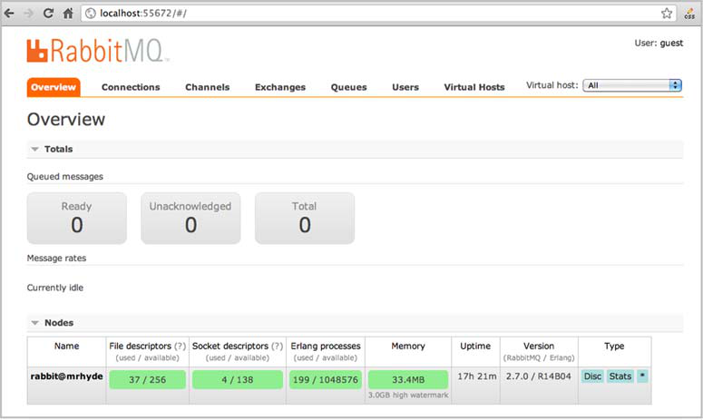

*Mô tả hình:* Trình duyệt mở địa chỉ `localhost:55672/#/`. Góc phải trên ghi "User: guest" (đang đăng nhập bằng user guest). Thanh menu trên cùng gồm các mục: **Overview** (Tổng quan, đang được chọn), **Connections** (Kết nối), **Channels**, **Exchanges**, **Queues**, **Users** (Người dùng), **Virtual Hosts** (Máy chủ ảo), và ô chọn **Virtual host: All** (lọc theo vhost, đang chọn "Tất cả"). Phần **Totals** (Tổng số) có mục **Queued messages** (message đang nằm trong queue) với ba ô: **Ready** (sẵn sàng giao) = 0, **Unacknowledged** (chưa được xác nhận) = 0, **Total** (tổng) = 0. Mục **Message rates** (tốc độ message) ghi "Currently idle" (hiện đang rảnh). Phần **Nodes** là bảng có các cột: **Name** = `rabbit@mrhyde`; **File descriptors (used / available)** = 37 / 256; **Socket descriptors (used / available)** = 4 / 138; **Erlang processes (used / available)** = 199 / 1048576; **Memory** = 33.4MB (kèm dòng "3.0GB high watermark" – ngưỡng bộ nhớ cao là 3.0GB); **Uptime** (thời gian chạy) = 17h 21m; **Version (RabbitMQ / Erlang)** = 2.7.0 / R14B04; **Type** = Disc, Stats, `*` (node lưu trên đĩa, node thu thập thống kê, và dấu `*` cho biết đây là node hiện tại).

> 📝 **Giải thích thêm (không có trong sách) – Giao diện Web Management trong RabbitMQ hiện đại (3.8–4.0) có gì mới so với Hình 8.1?**
>
> So với giao diện của RabbitMQ 2.7.0 trong Hình 8.1, giao diện Web Management ở RabbitMQ 3.8–3.13 và RabbitMQ 4.0 đã tiến hóa mạnh mẽ với nhiều tab và tính năng quản trị hiện đại:
>
> | Thành phần | RabbitMQ 2.7 (Hình 8.1 trong sách) | RabbitMQ hiện đại (3.8–3.13 & 4.0) |
> |---|---|---|
> | **Thanh điều hướng chính** | `Overview`, `Connections`, `Channels`, `Exchanges`, `Queues`, `Users`, `Virtual Hosts` | `Overview`, `Connections`, `Channels`, `Exchanges`, **`Queues and Streams`**, **`Admin`** (gom chung `Users`, `Virtual Hosts`, `Feature Flags`, `Policies`, `Limits`, `Cluster`, `Shovel`, `Federation`) |
> | **Tab Queues → Queues and Streams** | Chỉ quản lý Classic Queue truyền thống | Hỗ trợ đầy đủ **Quorum Queues** (hiển thị node *Leader* và các *Follower/Members*), **Streams**, **Classic Queues (CQv2)**, và hiển thị trạng thái **Single Active Consumer (SAC)** |
> | **Quản lý Giới hạn (`Limits`)** | Chưa có | Tab **Admin → Limits** cho phép đặt **Virtual Host Limits** (`max-connections`, `max-queues`) và **User Limits** (`max-connections`, `max-channels`) để chống một app làm cạn kiệt tài nguyên broker |
> | **Quản lý Chính sách (`Policies`) & `Feature Flags`** | Chưa có | Tab **Admin → Policies** (áp dụng TTL, DLX, max-length, Quorum/Federation động theo regex) và **Admin → Feature Flags** (bật tính năng mới sau khi nâng cấp cụm) |
> | **Kiến trúc thu thập thống kê (`Stats` node)** | Một node duy nhất trong cụm đóng vai trò `Stats` (nút cổ chai lớn!) | Từ RabbitMQ 3.6.7+, cơ chế thu thập metrics đã được **phân tán đều trên mọi node** trong cluster (không còn nút cổ chai `Stats node` đơn lẻ) |
>
> **⚠️ Khuyến cáo vận hành quan trọng cho cụm Production lớn (RabbitMQ 3.8–4.0):**
> Trên các cụm RabbitMQ lớn (có hàng nghìn kết nối, channel hoặc hàng chục nghìn queue), việc để plugin `rabbitmq_management` liên tục tổng hợp biểu đồ tốc độ chi tiết cho từng queue/channel có thể tiêu tốn rất nhiều RAM và CPU. Trong hệ thống hiện đại, chuẩn công nghiệp là:
> 1. Bật plugin **`rabbitmq_prometheus`** (`rabbitmq-plugins enable rabbitmq_prometheus`, lắng nghe ở cổng **`15692/metrics`**) kết hợp với **Prometheus + Grafana** để giám sát biểu đồ theo thời gian thực.
> 2. Giữ lại Web Management UI chỉ để thao tác quản trị (xem topology, tạo user/policy/shovel) và tắt bộ thu thập metrics chi tiết của Management UI trong `/etc/rabbitmq/rabbitmq.conf` nếu cụm quá tải:
>    ```ini
>    # Chỉ dùng khi đã có Prometheus + Grafana và muốn giảm tải CPU/RAM cho Management UI
>    management_agent.disable_metrics_collector = true
>    ```

### 8.1.3 Bật plugin Management (Enabling the Management plugin)

Với bản phát hành mới nhất của RabbitMQ (2.7.0 ở thời điểm viết sách), việc cài plugin đã trở nên đơn giản. Thực tế là chẳng còn gì phải cài nữa, vì các gói server mới đã đóng gói sẵn các plugin bên trong bản phân phối. Việc duy nhất bạn cần làm là bật chúng lên. Nếu đi tới thư mục nơi bạn cài RabbitMQ, bạn có thể xem các plugin đang có sẵn bằng lệnh sau:

```bash
$ ls plugins/
README
amqp_client-2.7.0.ez
eldap-2.7.0-git.ez
erlando-2.7.0.ez
mochiweb-1.3-rmq2.7.0-git.ez
rabbitmq_auth_backend_ldap-2.7.0.ez
rabbitmq_auth_mechanism_ssl-2.7.0.ez
rabbitmq_consistent_hash_exchange-2.7.0.ez
rabbitmq_federation-2.7.0.ez
rabbitmq_jsonrpc-2.7.0.ez
rabbitmq_jsonrpc_channel-2.7.0.ez
rabbitmq_jsonrpc_channel_examples-2.7.0.ez
rabbitmq_management-2.7.0.ez
rabbitmq_management_agent-2.7.0.ez
rabbitmq_management_visualiser-2.7.0.ez
rabbitmq_mochiweb-2.7.0.ez
rabbitmq_shovel-2.7.0.ez
rabbitmq_shovel_management-2.7.0.ez
rabbitmq_stomp-2.7.0.ez
rabbitmq_tracing-2.7.0.ez
rfc4627_jsonrpc-2.7.0-git.ez
webmachine-1.7.0-rmq2.7.0-hg.ez
```

Các file có đuôi `.ez` chính là các plugin và các thư viện hỗ trợ cho chúng. Ví dụ, plugin management mà bạn muốn bật phụ thuộc vào những plugin khác như Erlang client của AMQP `amqp_client-2.7.0.ez` và plugin webmachine `webmachine-1.7.0-rmq2.7.0-hg.ez`, cùng một số plugin khác nữa. Để bật plugin Management, bạn phải chạy lệnh sau từ thư mục `sbin` của broker:

```bash
$ ./rabbitmq-plugins enable rabbitmq_management
The following plugins have been enabled:
  mochiweb
  webmachine
  rabbitmq_mochiweb
  amqp_client
  rabbitmq_management_agent
  rabbitmq_management
Plugin configuration has changed. Restart RabbitMQ
for changes to take effect.
```

(Output nói rằng: "Các plugin sau đã được bật: … Cấu hình plugin đã thay đổi. Hãy khởi động lại RabbitMQ để thay đổi có hiệu lực.")

Như bạn thấy, plugin `rabbitmq_management` đã được bật¹ cùng với các plugin hỗ trợ, nhưng bạn vẫn cần khởi động lại broker để thay đổi có hiệu lực:

```bash
./rabbitmqctl stop
$ ./rabbitmq-server -detached
Activating RabbitMQ plugins ...
6 plugins activated:
* amqp_client-2.7.0
* mochiweb-1.3-rmq2.7.0-git
* rabbitmq_management-2.7.0
* rabbitmq_management_agent-2.7.0
* rabbitmq_mochiweb-2.7.0
* webmachine-1.7.0-rmq2.7.0-hg
```

(Output: "Đang kích hoạt các plugin RabbitMQ… 6 plugin đã được kích hoạt: …". Tùy chọn `-detached` cho server chạy nền, tách khỏi terminal.)

Nếu mọi thứ suôn sẻ, bạn có thể mở trình duyệt tới `http://localhost:55672/mgmt/`, nơi bạn sẽ được chào đón bằng một hộp thoại xác thực yêu cầu username và password. Tạm thời bạn có thể dùng `guest` cho cả user lẫn password. Sau khi gửi thông tin, bạn sẽ thấy giao diện quản lý như trong hình 8.1. Nếu bạn không chạy server ở `localhost`, bạn sẽ phải sửa URL đó cho phù hợp với môi trường của mình.

> ¹ **Chú thích chân trang 1:** Nếu sau khi chạy lệnh `./rabbitmq-plugins enable rabbitmq_management` bạn gặp lỗi liên quan đến quyền truy cập file, thì có lẽ bạn cần sửa quyền của thư mục `/etc/rabbitmq/`. Hãy làm điều đó bằng cách `chown` thư mục đó cho user đang chạy tiến trình rabbitmq, rồi thử bật lại plugin.

> 💡 **Ví dụ bổ sung (không có trong sách):** Chú thích chân trang trên trong thực tế sẽ trông như sau (giả sử RabbitMQ chạy dưới user `rabbitmq`):
>
> ```bash
> $ sudo chown -R rabbitmq:rabbitmq /etc/rabbitmq/
> $ sudo -u rabbitmq ./rabbitmq-plugins enable rabbitmq_management
> ```
>
> Lý do: `rabbitmq-plugins` ghi danh sách plugin đã bật vào một file (ở bản 2.7 là `/etc/rabbitmq/enabled_plugins`), nên user chạy lệnh phải có quyền ghi vào thư mục đó.

> 📝 **Giải thích thêm (không có trong sách):** Cổng `55672` và đường dẫn `/mgmt/` là của RabbitMQ 2.x (thời điểm sách viết). Từ RabbitMQ 3.0 trở đi, giao diện quản lý chuyển sang cổng **15672** và truy cập trực tiếp tại `http://localhost:15672/`. Ngoài ra, ở các bản mới, user `guest` mặc định chỉ được đăng nhập từ `localhost`. Nếu bạn đang thực hành trên RabbitMQ đời mới, hãy thay `55672` bằng `15672` trong mọi ví dụ của chương.

> 📝 **Giải thích thêm (không có trong sách) – Ba thay đổi cốt lõi khi bật và truy cập Management UI trên RabbitMQ hiện đại (3.0–4.0):**
>
> Khi làm theo mục 8.1.3 trên RabbitMQ hiện đại (3.8–3.13 hoặc RabbitMQ 4.0), bạn cần nắm rõ **3 thay đổi quan trọng** sau để không bị bỡ ngỡ:
>
> **1. Cổng mặc định đổi từ `55672` sang `15672` (và bỏ đường dẫn `/mgmt/`):**
> - Ở RabbitMQ 2.x, cổng của Management UI là `55672` (`5` + `5672`).
> - Từ **RabbitMQ 3.0 đến 4.0**, đội ngũ phát triển chuẩn hóa quy tắc đánh số cổng: lấy cổng giao thức chính cộng thêm **`10000`**. Do cổng AMQP chuẩn là `5672`, cổng HTTP của Management UI là **`15672`** (`http://localhost:15672/`, hoặc `15671` khi bật HTTPS/TLS), và truy cập thẳng ở gốc `/` thay vì `/mgmt/`.
> - Đồng thời, HTTP server bên dưới cũng đã chuyển từ `mochiweb`/`webmachine` sang **`cowboy`** (`rabbitmq_web_dispatch`), và lệnh `rabbitmq-plugins enable rabbitmq_management` sẽ **bật giao diện web ngay lập tức mà không cần khởi động lại RabbitMQ**! (Nếu dùng Docker, bạn chỉ cần chạy image có đuôi `-management` như `rabbitmq:4.0-management` là plugin đã được bật sẵn).
>
> **2. Tài khoản `guest`/`guest` bị khóa đăng nhập từ xa (`loopback_users`):**
> - Trong sách, tác giả viết: *"Nếu bạn không chạy server ở `localhost`, bạn sẽ phải sửa URL đó... Tạm thời bạn có thể dùng `guest` cho cả user lẫn password"*.
> - **Từ RabbitMQ 3.3.0+ trở đi**, vì lý do bảo mật (tránh việc hacker quét mạng thấy cổng `5672`/`15672` mở với mật khẩu mặc định `guest`/`guest`), RabbitMQ cấu hình sẵn `loopback_users.guest = true`. Nghĩa là tài khoản `guest` **chỉ được phép đăng nhập khi kết nối xuất phát từ chính `localhost` (`127.0.0.1` hoặc `::1`)** — áp dụng cho cả AMQP lẫn Web Management UI!
> - Nếu bạn truy cập Web UI từ máy khác qua IP mạng LAN/WAN (ví dụ `http://192.168.1.50:15672/`), việc đăng nhập bằng `guest`/`guest` sẽ báo lỗi: **`User can only log in via localhost`**.
>
> **3. Cách tạo tài khoản Admin chuẩn mực (hoặc mở khóa `guest` cho môi trường Dev):**
> Để đăng nhập từ xa vào Web Management UI hiện đại, bạn hãy chạy 3 lệnh sau trên server để tạo một tài khoản quản trị riêng:
> ```bash
> # 1. Tạo tài khoản admin với mật khẩu mạnh
> $ sudo rabbitmqctl add_user admin StrongPass123!
>
> # 2. Gán nhãn (tag) administrator để có toàn quyền trên Web Management UI
> $ sudo rabbitmqctl set_user_tags admin administrator
>
> # 3. Cấp quyền đọc/ghi/cấu hình trên vhost mặc định "/"
> $ sudo rabbitmqctl set_permissions -p / admin ".*" ".*" ".*"
> ```
> *(Chỉ dành cho môi trường Dev/Docker nội bộ)* Nếu bạn thực sự muốn cho phép `guest` đăng nhập từ xa trong môi trường thử nghiệm cô lập, bạn có thể thêm dòng sau vào `/etc/rabbitmq/rabbitmq.conf`:
> ```ini
> # CẢNH BÁO: Chỉ dùng trong môi trường Dev/Test nội bộ, tuyệt đối không dùng trên Production!
> loopback_users.guest = false
> ```

Chỉ với những bước đơn giản như vậy, bạn đã có plugin chạy ngon lành. Giờ là lúc học cách sử dụng nó, vậy hãy chuyển sang phần tiếp theo để bắt đầu "nghịch" với nó. Hãy quản lý RabbitMQ chỉ bằng vài cú click chuột.

## 8.2 Quản lý RabbitMQ từ web console (Managing RabbitMQ from the web console)

Hãy xem lại hình 8.1. Như bạn thấy, có một menu điều hướng ở phía trên, nơi bạn có thể duyệt tới nhiều mục như Connections, Exchanges hay Queues. Tiếp đó, giao diện trình bày tổng quan chung về trạng thái của server. Bạn có thể thấy có bao nhiêu message đang sẵn sàng (*ready*) để được giao từ tất cả các queue, bao nhiêu message đang chờ được xác nhận (*acknowledged*, thường gọi tắt là *ack*), và tổng số message. Thông tin này có thể rất hữu ích khi gỡ lỗi ứng dụng, vì chẳng hạn, số lượng message chưa được ack (*unacked*) cho bạn biết về khối lượng công việc mà các consumer đang thực hiện. Nếu con số này bắt đầu tăng quá cao, đó có thể là dấu hiệu các consumer của bạn đang trở nên chậm chạp. Điều tốt là bạn có thể thấy thông tin này ngay trên trang đầu, không cần click 20 lần mới tới được. Web console còn nhiều thứ hơn thế; trong phần này bạn sẽ học cách giám sát máy ảo Erlang để biết số tiến trình đang chạy trên nó, đồng thời xem cách xuất cấu hình của bạn ra định dạng JSON, cũng như cách nhập cấu hình ngược trở lại server.

> 💡 **Ví dụ bổ sung (không có trong sách) – Đọc số liệu Ready/Unacked:** Giả sử bạn có một hệ thống gửi email. Trên trang Overview bạn thấy:
>
> | Thời điểm | Ready | Unacknowledged | Total |
> |---|---|---|---|
> | 9:00 | 50 | 10 | 60 |
> | 9:10 | 2.000 | 10 | 2.010 |
> | 9:20 | 8.000 | 10 | 8.010 |
>
> - **Unacked** đứng yên ở 10: mỗi consumer đang cầm (prefetch) một số message cố định và vẫn đang xử lý bình thường.
> - **Ready** tăng vọt: message đổ vào nhanh hơn tốc độ consumer xử lý. Đây là tín hiệu cần thêm consumer hoặc tối ưu code xử lý.
>
> Ngược lại, nếu **Unacked** tăng liên tục trong khi consumer không ack, có thể consumer đã bị treo hoặc quên gọi `basic_ack` — message sẽ bị giữ lại mãi cho tới khi connection của consumer đó đóng.

### 8.2.1 Giám sát máy ảo Erlang (Monitoring the Erlang VM)

Nếu cuộn xuống một chút, bạn sẽ thấy một số thông tin hữu ích về node Erlang nơi RabbitMQ đang chạy. Như bạn đã thấy ở chương 3, bạn có thể dùng thông tin tên node (*node name*) để kết nối từ xa tới RabbitMQ và thực hiện các thao tác quản trị nâng cao trên nó. Một giá trị thú vị khác là số tiến trình Erlang (*Erlang processes*): nếu con số này chạm tới giới hạn, RabbitMQ sẽ ngừng hoạt động. Bạn có thể tăng giới hạn bằng cách sửa tùy chọn `+P` trong biến `SERVER_ERL_ARGS` của script khởi động `rabbitmq-server`.² Những giá trị quan trọng khác mà bạn có thể thấy ở đó là phiên bản RabbitMQ và Erlang đã cài. Bất cứ khi nào gửi báo cáo lỗi lên mailing list của RabbitMQ, bạn nên đính kèm các giá trị này, vì nó giúp mọi người chẩn đoán vấn đề dễ hơn và có thể giúp bạn.

Ở bảng tiếp theo, bạn có thể thấy RabbitMQ đang lắng nghe trên cổng (*port*) và host nào. Đã bao nhiêu lần bạn phải gãi đầu vì không thể kết nối tới server, để rồi cuối cùng hóa ra vấn đề là sai tùy chọn kết nối? Ở đây bạn có thể thấy các tùy chọn đúng để tránh những rắc rối như vậy.

> ² **Chú thích chân trang 2:** File chứa tùy chọn này sẽ khác nhau tùy theo cách bạn cài RabbitMQ. Nếu bạn làm theo hướng dẫn cài đặt ở chương 1, thì script `rabbitmq-server` sẽ nằm trong thư mục `sbin`.

> 📝 **Giải thích thêm (không có trong sách):** "Tiến trình Erlang" không phải tiến trình của hệ điều hành mà là các tiến trình siêu nhẹ do Erlang VM tự quản lý. RabbitMQ tạo tiến trình cho mỗi connection, mỗi channel, mỗi queue… Vì vậy một broker có hàng chục nghìn queue/connection sẽ tiêu tốn rất nhiều tiến trình. Trong hình 8.1, cột *Erlang processes* hiển thị `199 / 1048576` — đang dùng 199 trên giới hạn 1.048.576.

> 💡 **Ví dụ bổ sung (không có trong sách):** Tăng giới hạn tiến trình Erlang lên khoảng 2 triệu. Trong script `sbin/rabbitmq-server` của RabbitMQ 2.x có một dòng dạng:
>
> ```bash
> SERVER_ERL_ARGS="+K true +A30 +P 1048576 \
>     -kernel inet_default_connect_options [{nodelay,true}]"
> ```
>
> Bạn chỉ cần đổi `+P 1048576` thành `+P 2097152`, rồi khởi động lại broker. Sau đó vào trang Overview, cột *Erlang processes* sẽ hiển thị con số "available" mới.

> 📝 **Giải thích thêm (không có trong sách) – Cách cấu hình tham số Erlang VM (`+P`) và kiểm tra cổng lắng nghe trong RabbitMQ hiện đại (3.8–4.0):**
>
> Trong RabbitMQ hiện đại, bạn **không bao giờ nên sửa trực tiếp script `sbin/rabbitmq-server`**, vì mọi thay đổi trong file đó sẽ bị ghi đè mất sạch khi bạn nâng cấp gói cài đặt (`apt` / `yum` / `dnf`).
> - Thay vào đó, để tăng giới hạn tiến trình Erlang (`+P`), bạn đặt biến `SERVER_ADDITIONAL_ERL_ARGS` trong file **`/etc/rabbitmq/rabbitmq-env.conf`**:
>   ```bash
>   # /etc/rabbitmq/rabbitmq-env.conf
>   SERVER_ADDITIONAL_ERL_ARGS="+P 2097152"
>   ```
> - Ngoài ra, để kiểm tra nhanh các cổng đang lắng nghe, phiên bản RabbitMQ/Erlang và chi tiết bộ nhớ từ dòng lệnh mà không cần mở trình duyệt, RabbitMQ hiện đại cung cấp bộ công cụ chuyên dụng **`rabbitmq-diagnostics`**:
>   ```bash
>   $ rabbitmq-diagnostics listeners
>   $ rabbitmq-diagnostics erlang_version
>   $ rabbitmq-diagnostics memory_breakdown
>   ```

### 8.2.2 Nhập cấu hình từ file JSON (Importing configuration from JSON files)

Khi xuống tới cuối trang Overview, bạn sẽ thấy một tính năng hay: bạn có thể xuất (*export*) cấu hình server ra một file JSON. Sau đó bạn có thể chỉnh sửa và nhập (*import*) nó trở lại. Hãy xem file này trông như thế nào với bản cài đặt trên máy bạn lúc này. Hãy click vào **Download Broker Configuration** (Tải cấu hình broker) và lưu file vào ổ cứng. Listing dưới đây là một phiên bản đã được định dạng lại của file đó. File của bạn sẽ hơi khác một chút, tùy vào thiết lập của bạn.

**Listing 8.1 – File cấu hình JSON của RabbitMQ**

```json
{
  "rabbit_version":"2.3.1",
  "users":
    [{"name":"guest",
      "password_hash":"6r578x5zS5/8oo1acUUiebYkRiU=",
      "administrator":true}],
  "vhosts":[{"name":"/"}],
  "permissions":[{"user":"guest", "vhost":"/", "configure":".*",
                  "write":".*", "read":".*"}],
  "queues":[
    {"name":"smart_proxy", "vhost":"/", "durable":true,
     "auto_delete":false, "arguments":{}},
    {"name":"control", "vhost":"/", "durable":true,
     "auto_delete":false, "arguments":{}}],
  "exchanges":[
    {"name":"char_count_server", "vhost":"/", "type":"direct",
     "durable":true, "auto_delete":false, "internal":false,
     "arguments":{}},
    {"name":"control", "vhost":"/", "type":"topic",
     "durable":true, "auto_delete":false, "internal":false,
     "arguments":{}},
    {"name":"char_count", "vhost":"/", "type":"direct",
     "durable":true, "auto_delete":false, "internal":false,
     "arguments":{}}],
  "bindings":[]}
```

> 📝 **Giải thích thêm (không có trong sách) – Đọc hiểu Listing 8.1:**
> - `rabbit_version`: phiên bản RabbitMQ đã xuất file.
> - `users`: danh sách người dùng. Mật khẩu không lưu dạng rõ mà lưu dạng băm (`password_hash`). `"administrator":true` cho biết guest là quản trị viên (ở bản mới hơn trường này được thay bằng `"tags":"administrator"`).
> - `vhosts`: danh sách vhost; ở đây chỉ có vhost mặc định `/`.
> - `permissions`: quyền của user trên từng vhost, gồm ba biểu thức chính quy (*regular expression*): `configure` (được tạo/xóa tài nguyên nào), `write` (được ghi/publish vào đâu), `read` (được đọc/consume từ đâu). `".*"` nghĩa là "khớp với mọi tên" → toàn quyền.
> - `queues`: hai queue `smart_proxy` và `control`, đều *durable* (bền vững – vẫn còn sau khi broker khởi động lại) và không *auto_delete* (không tự xóa khi consumer cuối cùng ngắt).
> - `exchanges`: ba exchange; `internal:false` nghĩa là client có thể publish trực tiếp vào exchange này.
> - `bindings`: rỗng – chưa có binding nào được khai báo (ngoài binding mặc định).

Để thử nghiệm, hãy thử thêm một virtual host mới tên là `book`. Sửa dòng `vhosts` như trong đoạn mã sau:

```json
"vhosts":[{"name":"/"}, {"name":"book"}],
```

Lưu thay đổi và tải file mới lên bằng cách click nút **Upload** rồi chọn file `.json` đã sửa. Sau khi chọn file, click nút **Upload Broker Configuration** (Tải lên cấu hình broker). Nếu mọi thứ suôn sẻ, bạn sẽ thấy thông báo xác nhận như trong hình 8.2. Với cơ chế đơn giản này, bạn có thể cập nhật cấu hình server một cách dễ dàng. Bạn cũng có thể xuất và quản lý phiên bản (*version*) các file cấu hình, nhờ vậy có thể theo dõi cấu hình server tại các thời điểm khác nhau. Mỗi khi thay đổi cấu hình, bạn có thể giữ lại thiết lập cũ, phòng khi cần đến.

**Hình 8.2 – Nhập cấu hình JSON**

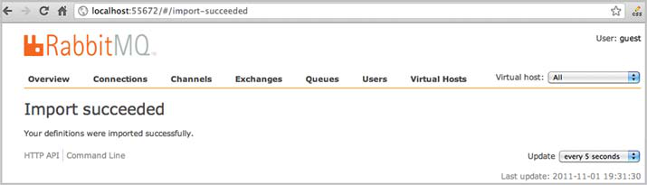

*Mô tả hình:* Trình duyệt ở địa chỉ `localhost:55672/#/import-succeeded`, tiêu đề trang **Import succeeded** (Nhập thành công), dòng chữ "Your definitions were imported successfully." (Các định nghĩa của bạn đã được nhập thành công). Phía dưới có liên kết **HTTP API** | **Command Line**, ô **Update: every 5 seconds** (tự làm mới mỗi 5 giây) và dòng "Last update: 2011-11-01 19:31:30" (lần cập nhật gần nhất).

> 💡 **Ví dụ bổ sung (không có trong sách) – Quản lý phiên bản cấu hình bằng Git:** Một quy trình đơn giản để "version" cấu hình broker:
>
> ```bash
> $ mkdir rabbit-config && cd rabbit-config && git init
> # Mỗi lần thay đổi cấu hình trên giao diện web, tải file về và lưu đè:
> $ mv ~/Downloads/rabbit_localhost_*.json broker.json
> $ git add broker.json
> $ git commit -m "Thêm vhost book"
> # Khi cần quay lại cấu hình cũ:
> $ git checkout HEAD~1 -- broker.json   # rồi upload broker.json qua giao diện web
> ```
>
> Lưu ý: import chỉ *thêm/cập nhật* các định nghĩa có trong file; nó không tự xóa những thứ đang có trên server mà file không nhắc tới.

> 📝 **Giải thích thêm (không có trong sách) – Quản lý Definitions JSON và Băm mật khẩu trong RabbitMQ hiện đại (3.8–4.0):**
>
> Trong RabbitMQ hiện đại, tính năng **Definitions Export/Import** (trên giao diện mới đổi tên nút thành **Export definitions** / **Import definitions**) đã trở thành nền tảng cho việc triển khai hạ tầng dưới dạng mã (*Infrastructure as Code / GitOps*) trên Docker và Kubernetes:
>
> **1. Tự động nạp file `definitions.json` khi khởi động (`load_definitions`):**
> Thay vì phải mở trình duyệt bấm nút Upload thủ công, trong `/etc/rabbitmq/rabbitmq.conf` hiện đại bạn chỉ cần khai báo:
> ```ini
> # /etc/rabbitmq/rabbitmq.conf (RabbitMQ 3.8.2+ đến 4.0)
> load_definitions = /etc/rabbitmq/definitions.json
> # (Hoặc dùng khóa cũ: management.load_definitions = /etc/rabbitmq/definitions.json)
> ```
> Ngay khi khởi động, RabbitMQ sẽ tự động tạo toàn bộ user, vhost, permission, policy, parameter, exchange, queue và binding có trong file JSON. Bạn cũng có thể xuất/nhập trực tiếp từ CLI mà không cần bật plugin Management:
> ```bash
> $ rabbitmqctl export_definitions /tmp/definitions.json
> $ rabbitmqctl import_definitions /tmp/definitions.json
> ```
>
> **2. Thuật toán băm mật khẩu (`password_hash`) chuyển từ MD5 sang SHA-256 / SHA-512:**
> - Ở Listing 8.1 (RabbitMQ 2.3/2.7), `password_hash` được tính bằng thuật toán **MD5 có muối (salted MD5)** (`rabbit_password_hashing_md5`), và trường quyền admin viết là `"administrator": true`.
> - Từ **RabbitMQ 3.6.0+ (và bắt buộc ở 3.8–4.0)**, thuật toán băm mặc định là **SHA-256** (`rabbit_password_hashing_sha256`, hoặc `rabbit_password_hashing_sha512`), đồng thời trường `"administrator": true` đã bị thay bằng mảng `"tags": ["administrator"]`.
> - Để tạo chuỗi `password_hash` chuẩn SHA-256 đem điền vào file `definitions.json`, bạn dùng lệnh có sẵn của RabbitMQ:
>   ```bash
>   $ rabbitmqctl hash_password "StrongPassword123!"
>   m5p8tG7x9... (chuỗi Base64 gồm 4 byte salt + 32 byte SHA-256 hash)
>   ```
>
> **3. Ví dụ file `definitions.json` chuẩn RabbitMQ hiện đại (3.13 / 4.0):**
> ```json
> {
>   "rabbitmq_version": "4.0.0",
>   "users": [
>     {
>       "name": "admin",
>       "password_hash": "k8F3vN9qL2pX7wR4tY6uI1oP0aS5dF8gH3jK6lZ9xC2vB5nM=",
>       "hashing_algorithm": "rabbit_password_hashing_sha256",
>       "tags": ["administrator"]
>     }
>   ],
>   "vhosts": [
>     {
>       "name": "/",
>       "default_queue_type": "quorum"
>     },
>     {
>       "name": "book",
>       "default_queue_type": "quorum"
>     }
>   ],
>   "permissions": [
>     {
>       "user": "admin",
>       "vhost": "/",
>       "configure": ".*",
>       "write": ".*",
>       "read": ".*"
>     }
>   ],
>   "policies": [
>     {
>       "vhost": "/",
>       "name": "dlx-policy",
>       "pattern": "^orders\\.",
>       "apply-to": "queues",
>       "definition": {
>         "dead-letter-exchange": "orders.dlx"
>       },
>       "priority": 1
>     }
>   ],
>   "queues": [
>     {
>       "name": "smart_proxy",
>       "vhost": "/",
>       "durable": true,
>       "auto_delete": false,
>       "arguments": {
>         "x-queue-type": "quorum"
>       }
>     }
>   ],
>   "exchanges": [],
>   "bindings": []
> }
> ```

Hãy tiếp tục khám phá các tính năng mà plugin Management cung cấp; lần này, hãy xem cách bạn quản lý những người dùng có thể truy cập server của mình.

## 8.3 Quản lý người dùng từ web console (Managing users from the web console)

Bước tiếp theo của bạn là học cách quản lý người dùng từ giao diện web. Trong suốt cuốn sách bạn vẫn dùng user mặc định `guest`; điều đó ổn cho mục đích học tập, nhưng nếu muốn chạy RabbitMQ trong môi trường production (môi trường thật), bạn cần đề phòng bằng cách tạo user và mật khẩu riêng của mình. Vì vậy trong phần này, bạn sẽ học cách làm việc đó một cách dễ dàng qua web console. Việc quản lý người dùng không dừng lại ở chỗ tạo user; bạn còn phải cấp quyền (*permission*) cho họ. Phần thứ hai của mục này sẽ giải quyết nhiệm vụ đó.

### 8.3.1 Tạo người dùng (Creating users)

Bạn còn nhớ lần đầu mở trang quản lý, bạn được yêu cầu nhập user và mật khẩu, và bạn đã trả lời bằng `guest:guest` chứ? Đã đến lúc thay đổi điều đó, vì bạn không muốn hệ thống của mình chạy với thiết lập user mặc định. Hãy click vào liên kết **Users** trên menu điều hướng phía trên, bạn sẽ thấy hộp thoại như trong hình 8.3.

Bạn sẽ thấy danh sách các user hiện có trên hệ thống. Bên dưới danh sách là một form để thêm user mới. Như trong hình 8.3, hãy tạo một user tên là `rmqinaction`, dùng luôn `rmqinaction` làm mật khẩu. Cuối cùng, đặt user này làm quản trị viên bằng cách nhập `administrator` vào ô **tags**. Plugin Management hỗ trợ khái niệm vai trò người dùng (*user roles*), quyết định user được làm gì trong giao diện quản lý. User của bạn có thể thuộc vai trò **management**, nghĩa là họ có thể đăng nhập vào giao diện này. Nếu bạn đặt user thuộc vai trò **monitoring**, họ có thể xem các kết nối và thông tin liên quan tới node. User `rmqinaction` của bạn được đặt làm **administrator** để được quyền truy cập mọi tính năng mà plugin Management cung cấp. Trong hình 8.4 bạn có thể thấy xác nhận về user mới của mình.

**Hình 8.3 – Tạo người dùng mới**

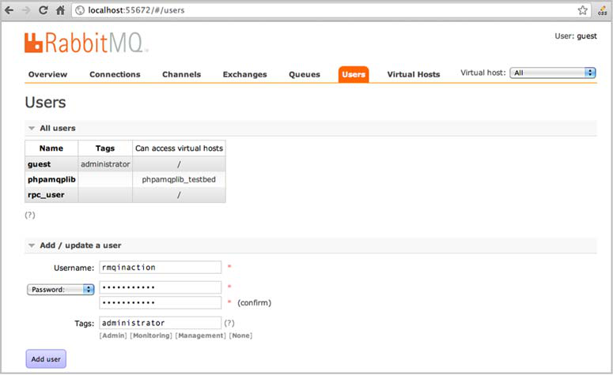

*Mô tả hình:* Trang `localhost:55672/#/users`, tab **Users** đang được chọn. Mục **All users** (Tất cả người dùng) là bảng ba cột **Name** (Tên), **Tags** (Nhãn/vai trò), **Can access virtual hosts** (Được truy cập vhost nào): `guest` – administrator – `/`; `phpamqplib` – (trống) – `phpamqplib_testbed`; `rpc_user` – (trống) – `/`. Mục **Add / update a user** (Thêm / cập nhật người dùng) có các ô: **Username** = `rmqinaction`; **Password** (nhập mật khẩu hai lần, ô thứ hai có chữ "(confirm)" – xác nhận); **Tags** = `administrator`, bên dưới có các gợi ý nhanh **[Admin] [Monitoring] [Management] [None]**. Dấu `*` đỏ đánh dấu trường bắt buộc. Cuối form là nút **Add user** (Thêm người dùng).

**Hình 8.4 – Xác nhận người dùng mới**

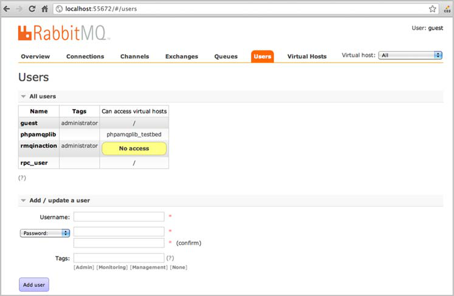

*Mô tả hình:* Cùng trang Users, bảng **All users** giờ có thêm dòng `rmqinaction` với Tags = administrator và cột **Can access virtual hosts** hiển thị ô vàng **No access** (Không có quyền truy cập vhost nào). Form **Add / update a user** đã được làm trống để nhập user tiếp theo.

> 📝 **Giải thích thêm (không có trong sách) – Các vai trò (tag) của plugin Management:**
>
> | Tag | Được làm gì trong giao diện quản lý |
> |---|---|
> | (không có tag / None) | Không đăng nhập được giao diện quản lý; vẫn dùng AMQP bình thường nếu có quyền trên vhost |
> | `management` | Đăng nhập được; xem/quản lý queue, exchange, binding trong các vhost mà user có quyền |
> | `monitoring` | Mọi thứ của `management` + xem tất cả connection, channel, và thông tin về node (bộ nhớ, tiến trình…) |
> | `administrator` | Toàn quyền: tạo/xóa user, vhost, đặt quyền, import cấu hình… |
>
> Lưu ý quan trọng: **tag** chỉ quyết định user thấy/làm được gì *trong giao diện quản lý*; còn quyền thao tác trên tài nguyên trong một vhost cụ thể là chuyện của **permission** (mục 8.3.2). Vì thế dù `rmqinaction` là administrator, hình 8.4 vẫn ghi "No access".

> 💡 **Ví dụ bổ sung (không có trong sách):** Tương đương bằng dòng lệnh (với `rabbitmqctl` ở bản có hỗ trợ tag, từ 2.6 trở đi):
>
> ```bash
> $ ./rabbitmqctl add_user rmqinaction rmqinaction
> $ ./rabbitmqctl set_user_tags rmqinaction administrator
> ```
>
> Còn một user chỉ dành cho nhóm marketing xem số liệu thì có thể tạo với tag `monitoring` hoặc `management`.

### 8.3.2 Quản lý quyền của người dùng (Managing users' permissions)

Như bạn thấy ở hình 8.5, user bạn vừa tạo chưa có quyền truy cập bất kỳ virtual host nào, vậy nên đã đến lúc thay đổi điều đó. Hãy cấp cho user quyền cấu hình server cũng như quyền ghi và đọc từ các queue. Click vào tên user để tới hộp thoại thiết lập quyền, như trong hình 8.5.

Hãy dùng các thiết lập mặc định mà plugin Management đưa ra, như trong hình, tức là bạn chỉ việc click nút **Set Permission** (Đặt quyền) để lưu thay đổi.

Một lưu ý cuối về quản lý người dùng: bạn cũng có thể xóa user ngay từ trang này bằng cách click nút **Delete** như trong hình 8.6.

**Hình 8.5 – Quản lý quyền của người dùng**

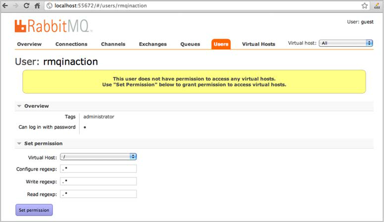

*Mô tả hình:* Trang `localhost:55672/#/users/rmqinaction`, tiêu đề **User: rmqinaction**. Một khung vàng thông báo: "This user does not have permission to access any virtual hosts. Use "Set Permission" below to grant permission to access virtual hosts." (User này chưa có quyền truy cập vhost nào. Hãy dùng "Set Permission" bên dưới để cấp quyền truy cập vhost.) Mục **Overview**: **Tags** = administrator; **Can log in with password** (Có thể đăng nhập bằng mật khẩu) = `•` (có). Mục **Set permission** (Đặt quyền): **Virtual Host** = `/`; **Configure regexp** (biểu thức chính quy cho quyền cấu hình) = `.*`; **Write regexp** (quyền ghi) = `.*`; **Read regexp** (quyền đọc) = `.*`; và nút **Set permission**.

**Hình 8.6 – Xóa người dùng**

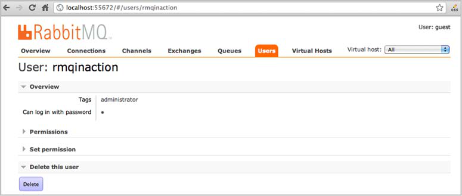

*Mô tả hình:* Cũng trang **User: rmqinaction**, mục **Overview** (Tags = administrator, Can log in with password = có), các mục thu gọn **Permissions** (Các quyền) và **Set permission**, và mục **Delete this user** (Xóa người dùng này) với nút **Delete**.

> 💡 **Ví dụ bổ sung (không có trong sách) – Thiết kế quyền bằng regexp:** Giả sử bạn muốn user `report_reader` chỉ được *đọc* từ các queue có tên bắt đầu bằng `report.` trong vhost `/`, không được tạo/xóa gì và không được publish:
>
> | Trường | Giá trị | Ý nghĩa |
> |---|---|---|
> | Configure regexp | `^$` | Chỉ khớp với chuỗi rỗng → không được tạo/xóa tài nguyên nào |
> | Write regexp | `^$` | Không được ghi vào đâu |
> | Read regexp | `^report\..*` | Chỉ được consume từ queue `report.*` |
>
> Lệnh tương đương: `./rabbitmqctl set_permissions -p / report_reader '^$' '^$' '^report\..*'`. Còn thiết lập mặc định `.*` / `.*` / `.*` trong hình 8.5 là toàn quyền trên vhost `/`, tương đương `./rabbitmqctl set_permissions -p / rmqinaction ".*" ".*" ".*"`.

> 📝 **Giải thích thêm (không có trong sách) – Các tính năng phân quyền và giới hạn mới trên trang User/Limits hiện đại (RabbitMQ 3.8–4.0):**
>
> Khi bạn vào mục **Admin → Users** trên RabbitMQ 3.8–4.0, ngoài 4 tag cơ bản trong sách (`None`, `management`, `monitoring`, `administrator`), hệ thống đã bổ sung thêm **2 tag mới** và **2 cơ chế bảo vệ quan trọng**:
> 1. **Hai User Tag mới:**
>    - **`policymaker`**: Có mọi quyền của `management`, cộng thêm quyền tạo/sửa/xóa **Policies** và **Runtime Parameters** (ví dụ tạo Dynamic Shovel hoặc Federation) trên những vhost mà user đó được cấp quyền, nhưng không có quyền tạo/xóa user hay vhost như `administrator`.
>    - **`impersonator`**: Cho phép một hệ thống trung gian (gateway/proxy) gắn thuộc tính `user_id` của người dùng khác vào tin nhắn khi publish.
> 2. **Topic Permissions (Phân quyền chi tiết tới từng Routing Key trên Topic Exchange):**
>    Ở RabbitMQ 2.7, nếu một user có quyền `write` vào exchange `amq.topic`, họ có thể publish với **bất kỳ routing key nào**. Từ RabbitMQ 3.7.0+, ngay bên dưới mục *Permissions* của trang User có thêm mục **Topic permissions**, cho phép giới hạn chính xác biểu thức chính quy của `routing_key` được phép publish hoặc consume (ví dụ chỉ cho phép publish vào `amq.topic` với routing key khớp `^order\.eu\..*`):
>    ```bash
>    $ rabbitmqctl set_topic_permissions -p / report_user amq.topic "^order\.eu\..*" "^order\..*"
>    ```
> 3. **User Limits & Virtual Host Limits (Chống cạn kiệt tài nguyên):**
>    Trên giao diện **Admin → Limits** (hoặc ngay trong trang chi tiết User/Vhost), bạn có thể giới hạn số lượng kết nối và kênh tối đa mà một user hoặc một vhost được phép mở, ngăn chặn lỗi rò rỉ kết nối (*connection leak*) từ một ứng dụng làm sập cả broker:
>    ```bash
>    # Giới hạn user rmqinaction chỉ được mở tối đa 50 connection và 200 channel
>    $ rabbitmqctl set_user_limits rmqinaction '{"max-connections": 50, "max-channels": 200}'
>
>    # Giới hạn vhost "/" tối đa 1000 connection và 500 queue
>    $ rabbitmqctl set_vhost_limits -p / '{"max-connections": 1000, "max-queues": 500}'
>    ```

Khi đã thiết lập xong người dùng, bước tiếp theo là học cách quản lý queue và exchange. Hãy làm việc đó ngay từ sự tiện lợi của trình duyệt.

## 8.4 Quản lý exchange và queue từ web console (Managing exchanges and queues from the web console)

Những gì bạn làm cho tới giờ có thể dễ dàng thực hiện bằng script `rabbitmqctl`; nhưng với `rabbitmqctl`, nếu muốn tạo exchange hay queue, bạn phải nhờ tới thư viện client mà bạn chọn và viết một script để làm việc đó. Với plugin Management, bạn có thể tạo exchange ngay từ trình duyệt. Hãy click vào **Exchanges** trên menu điều hướng. Bạn sẽ nhận được danh sách các exchange hiện có trên server, như trong hình 8.7.

Trong danh sách exchange, bạn có các thông tin sau:

- Virtual host nơi exchange tồn tại
- Tên exchange
- Kiểu exchange
- Danh sách tham số (*parameters*); ví dụ, **D** nghĩa là *durable* (bền vững).
- Tốc độ message (*message rate*) (trong trường hợp bạn đang publish message tới exchange này)

Bằng cách click vào tên exchange, bạn có thể xem thêm chi tiết về nó, chẳng hạn các binding của exchange. Bạn cũng có thể thêm binding mới, thậm chí xóa hẳn exchange. Xem hình 8.8 để có ví dụ.

**Hình 8.7 – Liệt kê các exchange**

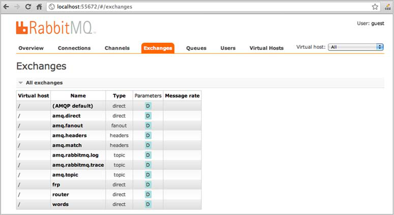

*Mô tả hình:* Trang `localhost:55672/#/exchanges`, tab **Exchanges** được chọn, tiêu đề **Exchanges**, mục **All exchanges** (Tất cả exchange). Bảng có các cột **Virtual host**, **Name**, **Type**, **Parameters**, **Message rate**. Tất cả đều thuộc vhost `/` và đều có tham số **D** (durable):

| Name | Type |
|---|---|
| (AMQP default) | direct |
| amq.direct | direct |
| amq.fanout | fanout |
| amq.headers | headers |
| amq.match | headers |
| amq.rabbitmq.log | topic |
| amq.rabbitmq.trace | topic |
| amq.topic | topic |
| frp | direct |
| router | direct |
| words | direct |

Cột Message rate trống vì không có message nào đang được publish.

> 📝 **Giải thích thêm (không có trong sách):** "(AMQP default)" là exchange mặc định, có tên là chuỗi rỗng `""`. Mọi queue tự động được bind vào nó với routing key bằng chính tên queue, nên publish vào exchange `""` với routing key `"task_queue"` sẽ đưa message thẳng vào queue `task_queue`. Các exchange `amq.*` là những exchange do broker tạo sẵn theo chuẩn AMQP (riêng `amq.rabbitmq.log` và `amq.rabbitmq.trace` là exchange đặc thù của RabbitMQ dùng cho log và tracing). `frp`, `router`, `words` là các exchange do ứng dụng của tác giả tạo ra.

**Hình 8.8 – Xem chi tiết exchange**

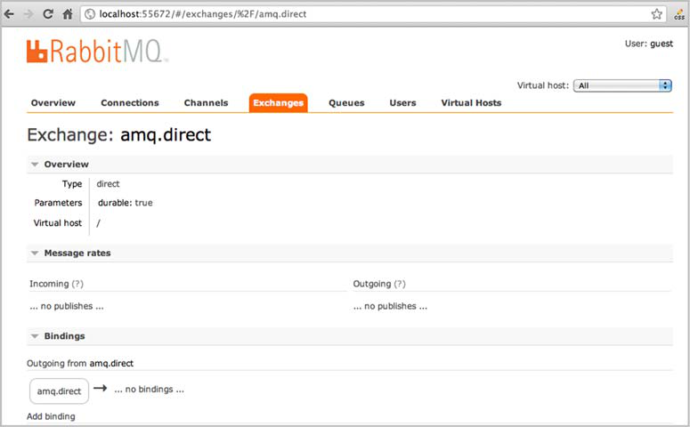

*Mô tả hình:* Trang `localhost:55672/#/exchanges/%2F/amq.direct` (`%2F` là ký tự `/` – tên vhost – đã được mã hóa URL), tiêu đề **Exchange: amq.direct**. Mục **Overview**: **Type** = direct; **Parameters** = durable: true; **Virtual host** = `/`. Mục **Message rates**: **Incoming** (message đi vào) "... no publishes ..." (không có publish nào) và **Outgoing** (message đi ra) "... no publishes ...". Mục **Bindings**: "Outgoing from amq.direct" (các binding đi ra từ amq.direct), một ô `amq.direct` → "... no bindings ..." (không có binding nào), và bên dưới là liên kết/form **Add binding** (Thêm binding).

Cuối cùng, nếu quay lại trang danh sách exchange và cuộn xuống, bạn sẽ thấy form cho phép tạo exchange, như bạn thấy trong hình 8.9.

Hãy tạo một exchange với tên là `test`, kiểu `direct`, và để nguyên mọi tùy chọn khác như trên form. Click **Add Exchange** (Thêm exchange) và "ta-da"! Trong hình 8.10 bạn có thể thấy exchange mới của mình được tạo ra chỉ với vài cú click chuột và vài lần gõ phím.

**Hình 8.9 – Thêm một exchange**

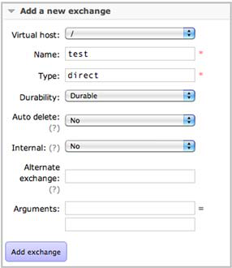

*Mô tả hình:* Form **Add a new exchange** (Thêm exchange mới) gồm: **Virtual host** = `/`; **Name** = `test` (bắt buộc, dấu `*`); **Type** = `direct` (bắt buộc); **Durability** (Độ bền) = Durable; **Auto delete** (Tự xóa khi không còn queue nào bind) = No; **Internal** (Exchange nội bộ – client không publish trực tiếp được) = No; **Alternate exchange** (Exchange dự phòng – nhận các message không định tuyến được) = để trống; **Arguments** (Tham số bổ sung, dạng khóa = giá trị) = để trống; nút **Add exchange**.

**Hình 8.10 – Exchange mới**

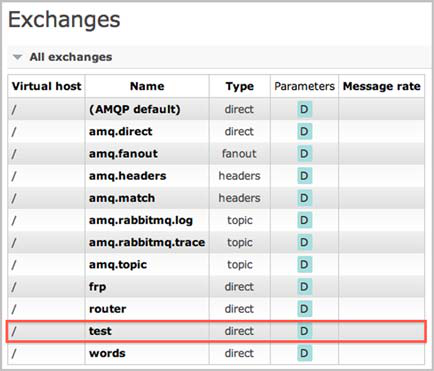

*Mô tả hình:* Bảng **All exchanges** giống hình 8.7 nhưng có thêm dòng `test` (vhost `/`, kiểu direct, tham số D) được khoanh viền đỏ, nằm giữa `router` và `words` (danh sách sắp theo thứ tự chữ cái).

> 💡 **Ví dụ bổ sung (không có trong sách) – So sánh với cách làm bằng code:** Trước khi có plugin Management, để tạo exchange `test` bạn phải viết một script nhỏ, ví dụ bằng Python với thư viện `pika`:
>
> ```python
> import pika
>
> conn = pika.BlockingConnection(pika.ConnectionParameters("localhost"))
> ch = conn.channel()
> ch.exchange_declare(exchange="test", exchange_type="direct",
>                     durable=True, auto_delete=False)
> conn.close()
> ```
>
> Form trong hình 8.9 làm đúng việc tương đương với lời gọi `exchange_declare` này, chỉ là không cần viết dòng code nào.

### 8.4.1 Liệt kê các queue (Listing queues)

Trong chương này bạn đã thấy plugin Management giúp bạn hiểu kiến trúc RabbitMQ của mình dễ hơn như thế nào, bằng cách cung cấp hình ảnh trực quan của "kết cấu" (*fabric* – mạng lưới exchange, queue, binding) mà bạn đã và đang xây dựng. Để chốt lại luận điểm này, hãy so sánh việc liệt kê queue bằng `rabbitmqctl` với việc liệt kê queue bằng web console quản lý.

Hãy chuyển tới thư mục `sbin` của bản cài RabbitMQ và chạy lệnh sau:

```bash
$ ./rabbitmqctl list_queues -p '/' name messages_ready \
    messages_unacknowledged messages
Listing queues ...
char_count_server-queue    0    0    0
myQueueDE                  0    0    0
smart_proxy                0    0    0
myQueueEN                  0    0    0
control                    0    0    0
...done.
```

(Các cột lần lượt là: tên queue, số message sẵn sàng giao – `messages_ready`, số message chưa được ack – `messages_unacknowledged`, và tổng số message – `messages`.)

Sau đó quay lại trình duyệt và click vào liên kết **Queues**. Hãy so sánh kết quả trên với bảng bạn thấy trong hình 8.11.

Bạn thậm chí còn có thêm vài "món quà" khác như thông tin cho biết queue có phải *exclusive* (độc quyền) hay không, trạng thái của queue, và tốc độ message của queue — thứ thông tin sau cùng này chỉ có thể lấy được qua plugin Management. Tính năng cuối này có lẽ đã đủ thuyết phục bạn dùng plugin!

**Hình 8.11 – Danh sách queue**

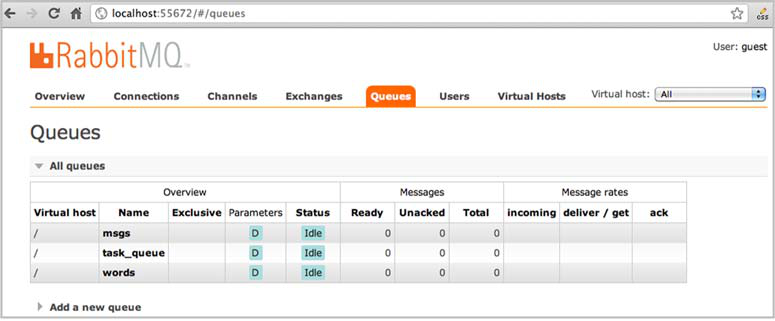

*Mô tả hình:* Trang `localhost:55672/#/queues`, tab **Queues** được chọn, mục **All queues** (Tất cả queue). Bảng chia ba nhóm cột: **Overview** (Tổng quan: **Virtual host**, **Name**, **Exclusive**, **Parameters**, **Status**), **Messages** (**Ready**, **Unacked**, **Total**) và **Message rates** (**incoming** – tốc độ vào, **deliver / get** – tốc độ giao/lấy, **ack** – tốc độ xác nhận). Ba dòng dữ liệu:

| Virtual host | Name | Exclusive | Parameters | Status | Ready | Unacked | Total |
|---|---|---|---|---|---|---|---|
| / | msgs | | D | Idle | 0 | 0 | 0 |
| / | task_queue | | D | Idle | 0 | 0 | 0 |
| / | words | | D | Idle | 0 | 0 | 0 |

Các cột tốc độ đều trống (không có lưu lượng). Cuối trang có mục thu gọn **Add a new queue** (Thêm queue mới). (Lưu ý: hình chụp từ một môi trường khác nên tên queue không trùng với output `rabbitmqctl` phía trên.)

> 📝 **Giải thích thêm (không có trong sách):** Queue *exclusive* là queue chỉ thuộc về một connection duy nhất và sẽ tự bị xóa khi connection đó đóng — thường dùng cho queue tạm (ví dụ queue nhận phản hồi trong mô hình RPC). Trạng thái *Idle* nghĩa là queue đang "rảnh", không có hoạt động gần đây.

### 8.4.2 Tạo queue (Creating queues)

Một việc khác mà bạn không thể làm từ script `rabbitmqctl` là tạo queue. Nhưng từ web console của plugin thì chắc chắn được. Giống như khi tạo exchange, hãy gõ `test` làm tên queue rồi click nút **Add Queue** (Thêm queue). Trong hình 8.12 bạn có thể thấy form trông như thế nào sau khi điền xong.

Queue mới của bạn sẽ xuất hiện trong danh sách. Nếu click vào nó, bạn có thể xem chi tiết các thuộc tính của nó. Một tính năng thú vị ở đây là bạn có thể xóa (*delete*) hoặc xóa sạch nội dung (*purge*) queue ngay từ trình duyệt. Điều đó có nghĩa là nếu trên server có queue nào đó nằm vạ vật mà không còn được dùng nữa, bạn chỉ cần click **Delete** là queue biến mất.

Trong hình 8.13 bạn có thể thấy chi tiết về trạng thái của một queue cụ thể, ví dụ có bao nhiêu message đang sẵn sàng để giao cho consumer, hay bao nhiêu message đang chờ ack. Với công cụ này, bạn dễ dàng thấy queue này đang dùng bao nhiêu bộ nhớ, nhờ đó có thể dùng thông tin này để giám sát "sức khỏe" của hệ thống theo những cách trước đây không thể làm được nếu chỉ dùng script `rabbitmqctl`.

**Hình 8.12 – Thêm một queue**

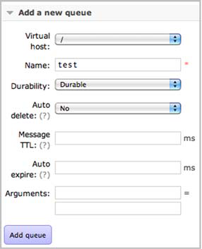

*Mô tả hình:* Form **Add a new queue** (Thêm queue mới) gồm: **Virtual host** = `/`; **Name** = `test` (bắt buộc); **Durability** = Durable; **Auto delete** (Tự xóa khi consumer cuối cùng hủy đăng ký) = No; **Message TTL** (thời gian sống của message, đơn vị ms) = để trống; **Auto expire** (queue tự hết hạn sau bao nhiêu ms không được dùng) = để trống; **Arguments** = để trống; nút **Add queue**.

**Hình 8.13 – Chi tiết queue**

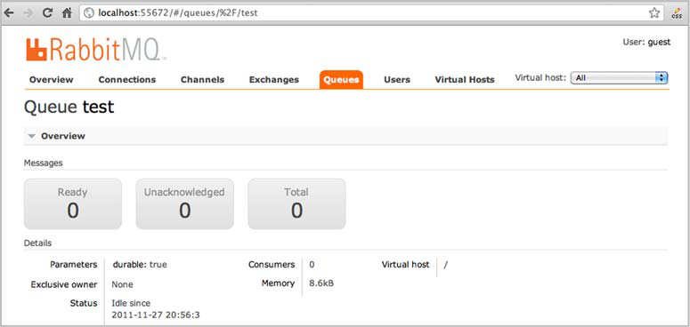

*Mô tả hình:* Trang `localhost:55672/#/queues/%2F/test`, tiêu đề **Queue test**. Mục **Overview** → **Messages** với ba ô **Ready** = 0, **Unacknowledged** = 0, **Total** = 0. Mục **Details** (Chi tiết): **Parameters** = durable: true; **Exclusive owner** (connection sở hữu độc quyền) = None (không có); **Status** = Idle since 2011-11-27 20:56:3… (rảnh từ thời điểm đó); **Consumers** (số consumer) = 0; **Memory** (bộ nhớ queue đang dùng) = 8.6kB; **Virtual host** = `/`.

> 💡 **Ví dụ bổ sung (không có trong sách) – Purge khác Delete thế nào?**
> - **Purge**: xóa *toàn bộ message* đang ready trong queue, nhưng queue vẫn còn đó, các binding và consumer vẫn giữ nguyên. Giống như đổ hết nước trong xô nhưng giữ lại cái xô.
> - **Delete**: xóa *chính queue* (kèm toàn bộ message và binding). Consumer đang subscribe sẽ bị hủy. Giống như vứt luôn cái xô.
>
> Tình huống: queue `test` có 10.000 message lỗi do một bug ở producer. Bạn đã sửa bug và muốn hệ thống tiếp tục chạy bình thường → dùng **Purge**. Nếu queue `test` chỉ là đồ thử nghiệm không còn ai dùng → dùng **Delete**.

> 📝 **Giải thích thêm (không có trong sách) – Tạo Queue trong giao diện Web hiện đại (3.8–4.0): Quorum Queues, Streams & Single Active Consumer:**
>
> Trên giao diện **Queues and Streams → Add a new queue** của RabbitMQ 3.8–4.0, form tạo queue đã khác khá nhiều so với Hình 8.12:
> 1. **Ô chọn `Type` (Kiểu hàng đợi) nằm ngay đầu form:**
>    - **`Quorum`** (`x-queue-type: quorum`): Hàng đợi bền vững, nhân bản theo thuật toán đồng thuận Raft — lựa chọn mặc định cho mọi nghiệp vụ quan trọng.
>    - **`Stream`** (`x-queue-type: stream`): Nhật ký bất biến (*append-only log*) hiệu năng cực cao, cho phép đọc lại (*replay*) tin nhắn nhiều lần từ bất kỳ vị trí (offset/timestamp) nào.
>    - **`Classic`** (`x-queue-type: classic`): Hàng đợi truyền thống như trong sách (ở RabbitMQ 3.12+ và 4.0 có phiên bản lưu trữ mới cực nhanh là `classic` v2 - CQv2, dùng tốt cho queue tạm thời hoặc không cần nhân bản).
> 2. **Tùy chọn `Single active consumer` (`x-single-active-consumer: true`):**
>    Khi bật cờ này trên queue, dù bạn có kết nối 10 consumer vào cùng một queue để dự phòng (HA), RabbitMQ đảm bảo tại mỗi thời điểm **chỉ có duy nhất 1 consumer nhận tin nhắn** (giữ đúng thứ tự FIFO tuyệt đối). Nếu consumer đó sập, broker tự động chuyển sang consumer dự phòng tiếp theo trong danh sách!
> 3. **Dùng Policies thay vì gõ cứng Arguments lúc tạo Queue:**
>    Ở Hình 8.12, sách điền trực tiếp `Message TTL` và `Auto expire` vào `Arguments` của queue. Nhược điểm là `Arguments` của queue **bất biến (immutable)** — muốn đổi TTL từ 60s sang 120s, bạn buộc phải xóa queue đi tạo lại! Trong RabbitMQ hiện đại, người ta để trống `Arguments` lúc tạo queue và cấu hình `message-ttl`, `max-length`, `dead-letter-exchange` thông qua **Admin → Policies** để có thể thay đổi động bất kỳ lúc nào mà không cần xóa queue.

Plugin Management không dừng lại ở giao diện web. Để thật sự hữu ích với các sysadmin (quản trị viên hệ thống), nó phải cung cấp các công cụ dòng lệnh cho phép truy cập các tính năng của nó từ một máy không có hệ thống cửa sổ (giao diện đồ họa), như phần lớn các server *nix. Plugin Management cũng đi kèm một giao diện dòng lệnh mới, giúp tăng tính linh hoạt cho quy trình quản lý, "giải phóng" các sysadmin khỏi con chuột của họ.

## 8.5 Quay lại với dòng lệnh (Back to the command line)

Sẽ thật tuyệt nếu bạn có thể tự động hóa tất cả những gì đã thấy cho tới giờ — chẳng hạn viết một script lấy một số thông tin chi tiết của queue, như số message đang nằm trong bộ nhớ chờ được ack, rồi đẩy số liệu đó lên một công cụ vẽ biểu đồ như Ganglia hay Graphite. Nếu muốn làm điều đó thông qua giao diện web của plugin Management, bạn sẽ phải "lấm tay" bằng kỹ thuật cào dữ liệu màn hình (*screen scraping* – đọc HTML của trang web rồi bóc tách số liệu). Điều đó có nghĩa là nếu giao diện web thay đổi ở phiên bản plugin mới, script của bạn sẽ hỏng. Hẳn phải có cách tốt hơn. Vâng, đừng khổ sở nữa, vì đã có một công cụ dòng lệnh mới: RabbitMQ Management CLI. Trong phần này chúng ta sẽ đi qua lý do vì sao lại cần thêm một công cụ dòng lệnh nữa. Sau đó bạn sẽ cài script mới `rabbitmqadmin` và dùng nó để tự động hóa các tác vụ như xóa sạch queue (*purge*), tạo exchange, và nhiều việc khác.

### 8.5.1 Tại sao lại thêm một CLI nữa? (Why another CLI?)

"Khoan đã… lại thêm một công cụ CLI nữa à? Nhưng ở chương 2 các anh đã dạy tôi về `rabbitmqctl` rồi mà." Chúng tôi hiểu thắc mắc của bạn, và chúng hoàn toàn hợp lý. Như đã nói ở đầu chương, script `rabbitmqctl` là cách mặc định để quản trị RabbitMQ, nhưng nó có những nhược điểm riêng, ví dụ như chuyện phải xử lý Erlang cookie. Ngoài ra, nó khó tích hợp với các ngôn ngữ lập trình và công cụ khác, vì bạn phải tự phân tích (*parse*) output mà nó in ra theo định dạng riêng của nó. Sẽ tốt hơn nhiều nếu, chẳng hạn, bạn có thể lấy danh sách queue ở định dạng JSON và để thư viện JSON yêu thích của bạn phân tích kết quả, trả về cho bạn một hash (dictionary) của Python. Những tính năng như vậy đáng để bạn đầu tư học API CLI này. Hãy xem nó hoạt động thế nào.

Mở trình duyệt tới `http://localhost:55672/`. Bạn sẽ thấy ba lựa chọn ở đó:

- **Management: Web UI** (Giao diện web quản lý)
- **Management: HTTP API** (API HTTP quản lý)
- **Management: Command Line Tool** (Công cụ dòng lệnh quản lý)

Chúng ta đã "chơi" với lựa chọn đầu tiên rồi, giờ hãy xem hai lựa chọn còn lại mang tới gì. Nếu click vào **HTTP API**, bạn sẽ được đưa tới trang tài liệu của giao diện REST này. Bất cứ việc gì bạn làm được với plugin Management (Management Web UI), bạn cũng có thể làm bằng cách dùng `curl`³ để gọi các lệnh trên API này. Ví dụ, nếu muốn liệt kê các vhost trên server, hãy chạy lệnh sau trong terminal:

```bash
$ curl -i -u guest:guest http://localhost:55672/api/vhosts
```

Bạn sẽ nhận được output sau:

```
HTTP/1.1 200 OK
Server: MochiWeb/1.1 WebMachine/1.7 (participate in the frantic)
Date: Wed, 23 Mar 2011 20:07:22 GMT
Content-Type: application/json
Content-Length: 30
Cache-Control: no-cache

[{"name":"/"},{"name":"book"}]
```

> ³ **Chú thích chân trang 3:** `curl` là một công cụ dòng lệnh để truyền dữ liệu với cú pháp URL. Nó hỗ trợ nhiều giao thức như HTTP, RTMP, IMAP và nhiều nữa. Trong trường hợp cần cài nó trên máy, bạn có thể tải chương trình từ website của nó: http://curl.haxx.se/.

> 📝 **Giải thích thêm (không có trong sách) – Các tùy chọn curl dùng trong chương:**
> - `-i`: in cả phần header của phản hồi HTTP (vì thế ta thấy dòng `HTTP/1.1 200 OK`, `Content-Type`…).
> - `-u guest:guest`: xác thực HTTP Basic với user `guest`, mật khẩu `guest`.
> - `-H "content-type:application/json"`: thêm header cho biết dữ liệu gửi lên là JSON.
> - `-XPUT` / `-XDELETE`: chọn phương thức HTTP (mặc định là GET). Theo phong cách REST: **GET** = đọc, **PUT** = tạo/cập nhật, **DELETE** = xóa.
>
> Mã `200 OK` nghĩa là thành công và có dữ liệu trả về; `204 No Content` nghĩa là thành công nhưng không có nội dung trả về. Lưu ý: vhost `book` xuất hiện trong danh sách chính là vhost bạn đã thêm bằng cách import JSON ở mục 8.2.2.

Bạn cũng có thể thêm vhost mới từ đây:

```bash
$ curl -i -u guest:guest -H "content-type:application/json" \
    -XPUT http://localhost:55672/api/vhosts/rmqinaction
HTTP/1.1 204 No Content
Server: MochiWeb/1.1 WebMachine/1.7 (participate in the frantic)
Date: Wed, 23 Mar 2011 20:12:28 GMT
Content-Type: application/json
Content-Length: 0
```

Và liệt kê lại tất cả vhost để thấy cái bạn vừa tạo:

```bash
curl -i -u guest:guest \
    http://localhost:55672/api/vhosts
HTTP/1.1 200 OK
Server: MochiWeb/1.1 WebMachine/1.7 (participate in the frantic)
Date: Wed, 23 Mar 2011 20:12:57 GMT
Content-Type: application/json
Content-Length: 53
Cache-Control: no-cache

[{"name":"/"},{"name":"book"},{"name":"rmqinaction"}]
```

Tất nhiên bạn có thể xóa nó nếu không còn cần nữa:

```bash
$ curl -i -u guest:guest -H "content-type:application/json" \
    -XDELETE http://localhost:55672/api/vhosts/rmqinaction
HTTP/1.1 204 No Content
Server: MochiWeb/1.1 WebMachine/1.7 (participate in the frantic)
Date: Wed, 23 Mar 2011 20:14:05 GMT
Content-Type: application/json
Content-Length: 0
```

Bằng cách dùng REST API này, bạn có thể dễ dàng tự động hóa những tác vụ mà trước giờ chỉ làm được qua giao diện click chuột. Chắc chắn các sysadmin sẽ vui hơn với công cụ này. Nếu muốn tìm hiểu các phương thức có sẵn của REST API, bạn có thể mở trình duyệt tới bộ tài liệu tuyệt vời được phân phối kèm plugin Management, tại `http://localhost:55672/api`. Một điều thú vị cần chú ý, nếu bạn để ý tới các header của phản hồi, là phản hồi được gửi dưới dạng `application/json`. Điều đó có nghĩa là việc phân tích kết quả chỉ "khó" bằng việc biết cách dùng một thư viện JSON trong ngôn ngữ bạn chọn (thứ mà có lẽ bạn đã biết rồi).

> 💡 **Ví dụ bổ sung (không có trong sách) – Bài toán: đẩy số message chưa ack lên Graphite:** Đây chính là tình huống mà đầu mục 8.5 nêu ra. Với REST API, không cần screen scraping nữa. Một script Python 3 chỉ dùng thư viện chuẩn:
>
> ```python
> import base64
> import json
> import socket
> import time
> import urllib.request
>
> API = "http://localhost:55672/api/queues"
> auth = base64.b64encode(b"guest:guest").decode()
>
> req = urllib.request.Request(API, headers={"Authorization": "Basic " + auth})
> with urllib.request.urlopen(req) as resp:
>     queues = json.loads(resp.read())   # list các dict, mỗi dict là 1 queue
>
> now = int(time.time())
> lines = []
> for q in queues:
>     unacked = q.get("messages_unacknowledged", 0)
>     vhost = q["vhost"].replace("/", "root")   # "/" không hợp lệ trong tên metric
>     lines.append(f"rabbitmq.{vhost}.{q['name']}.unacked {unacked} {now}\n")
>
> # Graphite nhận dữ liệu dạng text qua cổng 2003: "<metric> <giá trị> <timestamp>"
> with socket.create_connection(("graphite.example.com", 2003)) as s:
>     s.sendall("".join(lines).encode())
> ```
>
> Chạy script này mỗi phút bằng cron là bạn có biểu đồ số message chưa ack của từng queue. Vì dữ liệu là JSON có cấu trúc ổn định, script không bị hỏng khi giao diện web đổi giao diện.

> 📝 **Giải thích thêm (không có trong sách) – HTTP API và Giám sát Metrics trong RabbitMQ hiện đại (3.8–4.0):**
>
> 1. **Lưu ý cổng `15672` và tài liệu API:** Trên RabbitMQ hiện đại, mọi lệnh `curl` ở trên đều dùng cổng **`15672`** (ví dụ `http://localhost:15672/api/vhosts`) và trang tài liệu REST API nằm ở `http://localhost:15672/api/index.html`.
> 2. **Phân trang và lọc khi gọi `/api/queues`:** Trên cụm có hàng nghìn queue, gọi thẳng `GET /api/queues` không tham số sẽ trả về payload JSON khổng lồ và gây tốn CPU cho broker. Trong RabbitMQ 3.8–4.0, hãy dùng tham số phân trang và tắt bớt thống kê chi tiết nếu không cần:
>    ```bash
>    $ curl -s -u admin:StrongPass123! \
>      "http://localhost:15672/api/queues?page=1&page_size=100&disable_stats=true"
>    ```
> 3. **Các endpoint Health Check chuẩn hiện đại:** Thay vì dùng endpoint cũ `/api/aliveness-test/%2f` (vốn tạo queue thử nghiệm và publish/consume thật gây tốn tài nguyên), RabbitMQ 3.8.10+ và 4.0 cung cấp bộ endpoint `/api/health/checks/...` trả về HTTP `200 OK` (khỏe) hoặc `503 Service Unavailable` (có sự cố):
>    ```bash
>    # Kiểm tra xem cụm có đang bị cảnh báo hết RAM hoặc hết ổ cứng không
>    $ curl -i -u admin:StrongPass123! http://localhost:15672/api/health/checks/alarms
>
>    # Kiểm tra xem node hiện tại có phải là leader của quá nhiều Quorum Queue hay đang bảo trì không
>    $ curl -i -u admin:StrongPass123! http://localhost:15672/api/health/checks/local-alarms
>    ```
> 4. **Prometheus thay thế cho việc tự viết script đẩy lên Graphite/Ganglia:** Ngày nay bạn không cần tự viết script Python cronjob gọi `/api/queues` để đẩy sang Graphite nữa. Chỉ cần chạy `rabbitmq-plugins enable rabbitmq_prometheus`, RabbitMQ sẽ xuất sẵn toàn bộ metrics chuẩn OpenMetrics/Prometheus tại **`http://localhost:15692/metrics`** (hoặc **`http://localhost:15692/metrics/per-object`** cho từng queue) với hiệu năng cao hơn gấp nhiều lần so với Management HTTP API!

### 8.5.2 Quản trị bằng CLI theo cách dễ hơn (CLI administration the easier way)

Phương pháp trên tiện lợi và linh hoạt, nhưng vẫn còn một cách dễ hơn nữa để quản trị server: công cụ dòng lệnh. Công cụ dòng lệnh này là một script Python mà bạn có thể tải trực tiếp từ bản cài plugin RabbitMQ Management và chạy trên máy của mình. Ưu điểm của script này so với API dựa trên REST là bạn không cần tự tay "chế" các request. `rabbitmqadmin` sẽ bọc (*wrap*) REST API và cho bạn một giao diện gọn gàng để tương tác với nó. Vì vậy, thay vì chạy lệnh sau để liệt kê các queue trên server,

```bash
$ curl -i -u guest:guest http://localhost:55672/api/queues
```

bạn có thể làm thế này:

```bash
./rabbitmqadmin list queues
```

Tốt hơn nhiều, phải không? Vậy thì hãy cài nó thôi.

### 8.5.3 Cài đặt script rabbitmqadmin (Installing rabbitmqadmin script)

Thiết lập script quản trị `rabbitmqadmin` đơn giản đến khó tin: yêu cầu duy nhất là máy phải có Python. Giả sử bạn đã cài Python, việc bạn cần làm là lấy script từ plugin Management về và cấp quyền thực thi cho nó. Bạn làm việc đó bằng hai lệnh sau:

```bash
$ wget http://localhost:55672/cli/rabbitmqadmin
$ chmod +x rabbitmqadmin
```

Thao tác này sẽ đặt một script `rabbitmqadmin` vào thư mục hiện tại, có thể dễ dàng gọi từ terminal. Dùng nó, bạn có thể tránh phải học mọi sự rắc rối phức tạp của `curl`. Hãy xem nó hoạt động:

```bash
$ ./rabbitmqadmin -V "/" list exchanges
+-------+------------------+---------+--------+---------+----------+
| vhost |       name       |  type   |  auto  | durable | internal |
|       |                  |         | delete |         |          |
+-------+------------------+---------+--------+---------+----------+
| /     |                  | direct  | False  | True    | False    |
| /     | amq.direct       | direct  | False  | True    | False    |
| /     | amq.fanout       | fanout  | False  | True    | False    |
| /     | amq.headers      | headers | False  | True    | False    |
| /     | amq.match        | headers | False  | True    | False    |
| /     | amq.rabbitmq.log | topic   | False  | True    | False    |
| /     | amq.topic        | topic   | False  | True    | False    |
| /     | test             | direct  | False  | True    | False    |
+-------+------------------+---------+--------+---------+----------+
```

Như bạn thấy, output được định dạng sẵn, trả về những bảng đẹp mắt chứa thông tin về các exchange thuộc vhost `"/"`. Hãy mổ xẻ lệnh bạn vừa gọi: `rabbitmqadmin` là tên file thực thi, chính là script Python bạn vừa tải về; `-V "/"` là tùy chọn dùng để chỉ định vhost bạn muốn dùng; cuối cùng, `list exchanges` là lệnh bạn muốn thực thi.

> 📝 **Giải thích thêm (không có trong sách):** Dòng đầu tiên có cột *name* trống chính là exchange mặc định (tên rỗng `""`), mà giao diện web hiển thị là "(AMQP default)" ở hình 8.7. Dòng `test` là exchange bạn đã tạo qua giao diện web ở mục 8.4. Ở các bản RabbitMQ mới, tùy chọn chọn vhost được viết là `-V` hoặc `--vhost`, và script được tải tại `http://localhost:15672/cli/rabbitmqadmin`.

> 📝 **Giải thích thêm (không có trong sách) – Sự lột xác của `rabbitmqadmin` v2 trong RabbitMQ 4.0 (Viết lại bằng Rust):**
>
> Từ RabbitMQ 2.x đến 3.13, `rabbitmqadmin` (v1) là một script Python đơn lẻ được tải từ `http://localhost:15672/cli/rabbitmqadmin` (yêu cầu máy phải cài sẵn Python 3).
>
> Đến **RabbitMQ 4.0+**, đội ngũ phát triển đã giới thiệu **`rabbitmqadmin` v2** — được viết lại hoàn toàn bằng ngôn ngữ **Rust** dưới dạng một file thực thi độc lập (standalone native binary):
> - **Không cần cài Python trên server/container** nữa.
> - Cấu trúc lệnh phân cấp rõ ràng theo nhóm tài nguyên (`queues`, `exchanges`, `vhosts`, `users`, `policies`, `shovels`, `federation`, `streams`...).
>
> **So sánh cú pháp `rabbitmqadmin` v1 (Python – trong sách) và `rabbitmqadmin` v2 (Rust – RabbitMQ 4.0+):**
>
> | Thao tác | `rabbitmqadmin` v1 (Python script – 2.7 đến 3.13) | `rabbitmqadmin` v2 (Rust binary – RabbitMQ 4.0+) |
> |---|---|---|
> | **Liệt kê exchange** | `rabbitmqadmin -V "/" list exchanges` | `rabbitmqadmin --vhost "/" exchanges list` |
> | **Tạo Quorum Queue** | `rabbitmqadmin declare queue name=orders durable=true arguments='{"x-queue-type":"quorum"}'` | `rabbitmqadmin queues declare --name orders --type quorum --durable true` |
> | **Xóa sạch (Purge) queue** | `rabbitmqadmin purge queue name=test` | `rabbitmqadmin queues purge --name test` |
> | **Tạo exchange** | `rabbitmqadmin declare exchange name=cli_test type=direct` | `rabbitmqadmin exchanges declare --name cli_test --type direct` |
> | **Đóng kết nối** | `rabbitmqadmin close connection name="127.0.0.1:64659"` | `rabbitmqadmin connections close --name "127.0.0.1:64659"` |

> 💡 **Ví dụ bổ sung (không có trong sách):** `rabbitmqadmin` cũng có thể in ra định dạng dễ cho máy đọc thay vì bảng, rất tiện khi viết script:
>
> ```bash
> $ ./rabbitmqadmin -f tsv -q list queues name messages
> # In mỗi queue một dòng: <tên>\t<số message>, không có tiêu đề bảng
> $ ./rabbitmqadmin -f raw_json list queues | python -m json.tool
> # In JSON gốc rồi định dạng lại cho dễ đọc
> ```
>
> (Tùy chọn `-f/--format` có các giá trị như `table`, `tsv`, `raw_json`, `pretty_json`…; có thể chạy `./rabbitmqadmin --help` để xem danh sách đúng với phiên bản của bạn.)

### 8.5.4 Xóa sạch queue, tạo exchange và nhiều hơn nữa (Purging queues, creating exchanges, and more)

Giả sử vì lý do nào đó bạn có một consumer hoạt động "lệch pha", không thể consume và ack message từ queue mà nó đã subscribe (đăng ký nhận). Tới lúc bạn phát hiện ra vấn đề thì queue đã đầy những message không còn giá trị gì nữa. Bạn có thể viết một script đơn giản để purge queue bằng AMQP, hoặc bạn chỉ cần gọi lệnh sau:

```bash
$ ./rabbitmqadmin purge queue name=test
queue purged
```

Hãy quay lại ví dụ tạo exchange mới. Hãy xem cách bạn khai báo một exchange kiểu direct tên `cli_test`, xác thực bằng user `guest` và mật khẩu `guest`:

```bash
$ ./rabbitmqadmin -u guest -p guest declare exchange \
    name=cli_test type=direct
exchange declared
```

Một lệnh thú vị khác là khả năng đóng kết nối, chẳng hạn vì có những consumer "cư xử tệ" không ack được message, làm gián đoạn luồng message. Trước tiên, bạn lấy danh sách các kết nối, chỉ lấy thuộc tính tên (`name`) của kết nối:

```bash
$ ./rabbitmqadmin list connections name
+-----------------+
|      name       |
+-----------------+
| 127.0.0.1:64659 |
+-----------------+
```

Nếu muốn ngắt kết nối consumer nói trên, bạn có thể làm bằng cách gọi lệnh `close connection`:

```bash
$ ./rabbitmqadmin close connection name="127.0.0.1:64659"
connection closed
```

Dù chúng tôi không mô tả chi tiết từng lệnh, chúng tôi đã trình bày những điều cơ bản về cách dùng script `rabbitmqadmin`, và từ đây bạn sẽ dễ dàng bắt đầu và thực hiện các tác vụ khác.

> 💡 **Ví dụ bổ sung (không có trong sách) – Bài toán dựng nhanh môi trường thử nghiệm:** Bạn cần tạo một exchange `orders` kiểu `topic`, một queue `orders.eu`, và bind chúng với routing key `order.eu.*`, sau đó gửi thử một message. Tất cả chỉ bằng `rabbitmqadmin`:
>
> ```bash
> $ ./rabbitmqadmin declare exchange name=orders type=topic
> $ ./rabbitmqadmin declare queue name=orders.eu durable=true
> $ ./rabbitmqadmin declare binding source=orders destination=orders.eu \
>     routing_key="order.eu.*"
> $ ./rabbitmqadmin publish exchange=orders routing_key=order.eu.fr \
>     payload="hello"
> $ ./rabbitmqadmin get queue=orders.eu
> ```
>
> Lệnh cuối lấy thử một message ra khỏi queue để kiểm tra — bạn sẽ thấy payload `hello`. Lưu ý: khi consumer bị ngắt bằng `close connection`, các message nó đang giữ mà chưa ack sẽ được RabbitMQ đưa trở lại queue (requeue) để consumer khác xử lý, nên không bị mất.

## 8.6 Tóm tắt (Summary)

Khi nói tới quản trị hệ thống, có người thích công cụ dòng lệnh, có người lại thích chương trình có giao diện đồ họa (*GUI*). Trong chương này, bạn đã thấy rằng có rất nhiều lựa chọn khi quản trị một server RabbitMQ. Điều tốt là các công cụ chúng tôi giới thiệu trong chương này đều do chính các nhà phát triển RabbitMQ làm ra, nghĩa là chúng được bảo trì và luôn theo kịp các tính năng mới nhất. Tùy sở thích, bạn sẽ có xu hướng dùng giao diện web (*web UI*), thứ tiện lợi cho công việc phát triển hằng ngày, để có hình ảnh trực quan về những gì đang diễn ra trên server. Giao diện web sẽ giúp làm việc nhóm dễ dàng hơn, và ngay cả những người làm marketing giờ đây cũng có thể xem bao nhiêu email chiến dịch đã được gửi tới khách hàng. Nếu muốn tự động hóa những tác vụ như vậy, bạn có thể dùng API dựa trên REST, gọi qua `curl`. Vì nhận được phản hồi dưới dạng đối tượng JSON, việc tích hợp với các công cụ và ngôn ngữ hiện có của bạn trở nên dễ dàng. Cuối cùng, nếu muốn lấy thông tin từ server nhưng cần thứ gì đó đơn giản hơn việc tự tay dựng request HTTP bằng `curl`, bạn có thể dùng script `rabbitmqadmin` để có output được định dạng đẹp, giúp bạn quản lý và giám sát các bản cài RabbitMQ của mình.

Trong chương tiếp theo, chúng ta sẽ đào sâu hơn vào REST API, học cách tự động hóa nhiều tác vụ quản trị như cấp phát (*provisioning*) user và vhost. Hãy bắt đầu khởi động mấy ngón tay đi, vì chúng ta sẽ "xắn tay áo" với code Python.

> 📝 **Giải thích thêm (không có trong sách) – Chọn công cụ nào?**
>
> | Nhu cầu | Công cụ phù hợp |
> |---|---|
> | Xem nhanh tình trạng server, làm việc nhóm, người không rành CLI | Web UI (Management plugin) |
> | Tích hợp vào chương trình, giám sát tự động, vẽ biểu đồ | REST API (`/api/...`) qua `curl` hoặc thư viện HTTP |
> | Thao tác nhanh trên terminal, viết shell script đơn giản | `rabbitmqadmin` |
> | Thao tác cấp thấp trên node (dừng/khởi động app, cluster…) | `rabbitmqctl` (cần Erlang cookie) |

---

## Bảng thuật ngữ của chương

| Thuật ngữ (Anh) | Nghĩa tiếng Việt | Giải thích ngắn |
|---|---|---|
| Management plugin | Plugin quản lý | Plugin chính thức của RabbitMQ cung cấp giao diện web, REST API và CLI `rabbitmqadmin` |
| Plugin | Phần mở rộng | Mã Erlang chạy cùng Erlang VM với RabbitMQ để bổ sung tính năng |
| `rabbitmqctl` | (giữ nguyên) | Script dòng lệnh mặc định để quản trị RabbitMQ; cần Erlang cookie |
| `rabbitmq-plugins` | (giữ nguyên) | Lệnh bật/tắt plugin |
| `rabbitmqadmin` | (giữ nguyên) | Script Python bọc REST API của plugin Management |
| Erlang cookie | Cookie Erlang | Chuỗi bí mật dùng để xác thực giữa các node Erlang (file `.erlang.cookie`) |
| Erlang VM | Máy ảo Erlang | Môi trường chạy RabbitMQ và plugin |
| Erlang process | Tiến trình Erlang | Tiến trình nhẹ do Erlang VM quản lý; có giới hạn số lượng (tùy chọn `+P`) |
| Node | Nút | Một instance Erlang/RabbitMQ đang chạy, ví dụ `rabbit@mrhyde` |
| Web console / Web UI | Bảng điều khiển web / giao diện web | Giao diện quản trị qua trình duyệt |
| CLI (command-line interface) | Giao diện dòng lệnh | Cách tương tác bằng lệnh gõ trong terminal |
| GUI | Giao diện đồ họa | Chương trình có cửa sổ, nút bấm |
| REST API / HTTP API | API REST / API HTTP | Giao diện lập trình qua HTTP: GET đọc, PUT tạo, DELETE xóa |
| JSON | (giữ nguyên) | Định dạng dữ liệu văn bản có cấu trúc, dễ phân tích bằng thư viện |
| Export / Import | Xuất / Nhập | Tải cấu hình broker ra file JSON / nạp lại file JSON vào broker |
| Broker | Máy chủ trung gian | Server RabbitMQ |
| vhost (virtual host) | Máy chủ ảo | Không gian tách biệt chứa exchange, queue, quyền riêng |
| Queue | Hàng đợi | Nơi chứa message chờ consumer xử lý |
| Exchange | (giữ nguyên) | Thành phần nhận message và định tuyến vào queue |
| Binding | Liên kết | Quy tắc nối exchange với queue |
| Connection | Kết nối | Kết nối TCP giữa client và broker |
| Channel | Kênh | Kết nối ảo bên trong một connection |
| Consumer | Bên tiêu thụ | Ứng dụng nhận và xử lý message |
| Ready (messages) | Message sẵn sàng | Message đang chờ được giao cho consumer |
| Unacknowledged / unacked | Chưa được xác nhận | Message đã giao cho consumer nhưng chưa được ack |
| Ack (acknowledgement) | Xác nhận | Tín hiệu consumer gửi để báo đã xử lý xong message |
| Message rate | Tốc độ message | Số message/giây đi vào, được giao, được ack |
| Durable (D) | Bền vững | Tồn tại qua lần khởi động lại broker |
| Auto delete | Tự xóa | Tự xóa khi không còn ai dùng |
| Exclusive | Độc quyền | Queue chỉ thuộc một connection, bị xóa khi connection đóng |
| Internal exchange | Exchange nội bộ | Exchange client không publish trực tiếp được |
| Alternate exchange | Exchange dự phòng | Nhận các message không định tuyến được |
| Message TTL | Thời gian sống của message | Sau thời gian này message bị loại bỏ |
| Auto expire | Tự hết hạn | Queue tự xóa sau một thời gian không dùng |
| Purge | Xóa sạch | Xóa toàn bộ message trong queue nhưng giữ queue |
| User role / tag | Vai trò / nhãn người dùng | `management`, `monitoring`, `administrator` – quyết định quyền trong giao diện quản lý |
| Permission | Quyền | Ba regexp configure / write / read trên một vhost |
| Regular expression (regexp) | Biểu thức chính quy | Mẫu khớp tên tài nguyên, ví dụ `.*` khớp mọi tên |
| Screen scraping | Cào dữ liệu màn hình | Bóc tách dữ liệu từ HTML của trang web; dễ hỏng khi giao diện đổi |
| `curl` | (giữ nguyên) | Công cụ dòng lệnh truyền dữ liệu theo cú pháp URL |
| Provisioning | Cấp phát | Tạo sẵn user, vhost… một cách tự động |
| Sysadmin | Quản trị viên hệ thống | Người vận hành server |
