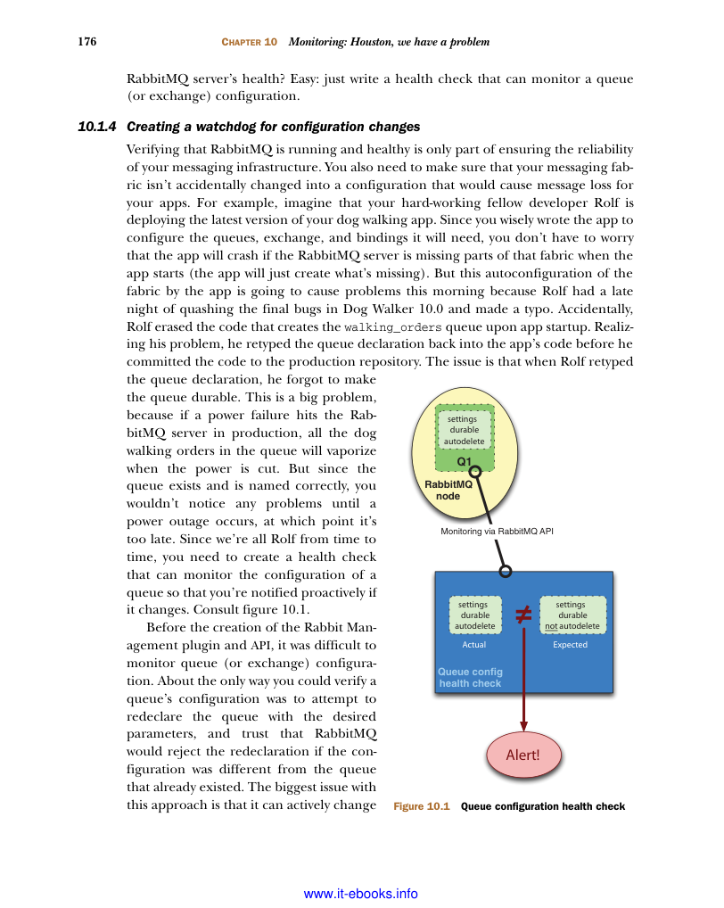
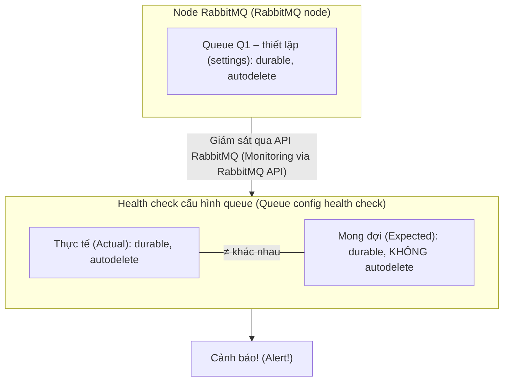
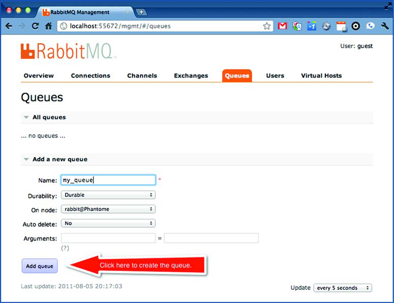
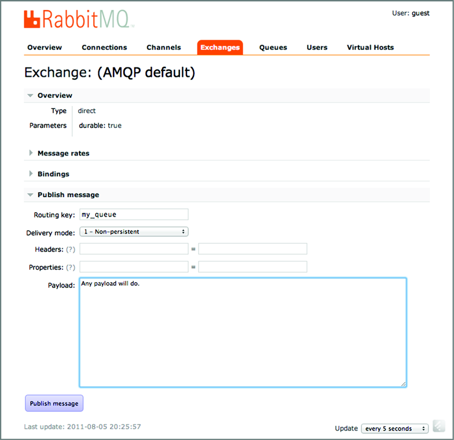

# Chương 10: Giám sát – "Houston, chúng ta gặp sự cố rồi" (Monitoring: Houston, we have a problem)

## Mục lục chương

- [Mở đầu chương](#mở-đầu-chương)
- [10.1 Giám sát RabbitMQ: để mắt tới "hang thỏ" của bạn (RabbitMQ monitoring: keeping an eye on your warren)](#101-giám-sát-rabbitmq-để-mắt-tới-hang-thỏ-của-bạn-rabbitmq-monitoring-keeping-an-eye-on-your-warren)
  - [10.1.1 Viết health check cho Nagios (Writing health checks for Nagios)](#1011-viết-health-check-cho-nagios-writing-health-checks-for-nagios)
  - [10.1.2 Kiểm tra RabbitMQ còn sống bằng check mô phỏng AMQP (Checking that RabbitMQ is alive with AMQP simulation checks)](#1012-kiểm-tra-rabbitmq-còn-sống-bằng-check-mô-phỏng-amqp-checking-that-rabbitmq-is-alive-with-amqp-simulation-checks)
  - [10.1.3 Kiểm tra "còn sống" bằng REST API (Checking aliveness with the REST API)](#1013-kiểm-tra-còn-sống-bằng-rest-api-checking-aliveness-with-the-rest-api)
  - [10.1.4 Tạo "chó canh" theo dõi thay đổi cấu hình (Creating a watchdog for configuration changes)](#1014-tạo-chó-canh-theo-dõi-thay-đổi-cấu-hình-creating-a-watchdog-for-configuration-changes)
- [10.2 Đảm bảo consumer đang làm việc (Making sure consumers are consuming)](#102-đảm-bảo-consumer-đang-làm-việc-making-sure-consumers-are-consuming)
  - [10.2.1 Giám sát số lượng message trong queue bằng AMQP (Monitoring queue levels with AMQP)](#1021-giám-sát-số-lượng-message-trong-queue-bằng-amqp-monitoring-queue-levels-with-amqp)
  - [10.2.2 Dùng REST API để theo dõi số lượng message trong queue (Using the REST API to watch queue levels)](#1022-dùng-rest-api-để-theo-dõi-số-lượng-message-trong-queue-using-the-rest-api-to-watch-queue-levels)
- [10.3 Tóm tắt (Summary)](#103-tóm-tắt-summary)
- [Bảng thuật ngữ của chương](#bảng-thuật-ngữ-của-chương)

---

## Mở đầu chương

**Chương này đề cập đến (*This chapter covers*):**

- Những điều cơ bản khi viết health check (chương trình kiểm tra sức khỏe dịch vụ) cho Nagios
- Dùng cả AMQP lẫn REST API để giám sát "nội tạng" bên trong Rabbit
- Xác minh rằng Rabbit đang sẵn sàng (*available*) và có phản hồi
- Theo dõi số lượng message trong queue (*queue levels*) để phát hiện sớm các sự cố của consumer
- Kiểm tra xem có những thay đổi cấu hình không mong muốn trong "tấm vải" message (*messaging fabric* – toàn bộ tập hợp exchange, queue, binding) hay không

Server RabbitMQ của bạn đã chạy ngon lành, và ứng dụng dắt chó đi dạo "xịn sò" của bạn đang mang về hàng nghìn đơn hàng trên khắp cả nước. Mọi thứ có vẻ rất tuyệt, cho đến khi bạn bất ngờ nhận được một cuộc gọi: khách hàng đang gặp lỗi trên web app, và dòng đơn hàng đã dừng hẳn. Server RabbitMQ đã "chết", và tệ hơn nữa, có vẻ như nó đã nằm im như vậy hàng giờ liền. Giá mà bạn được thông báo *chủ động* (*proactively*) ngay khoảnh khắc RabbitMQ ngừng hoạt động, thay vì phải chờ khách hàng báo cho bạn biết – và mất hàng nghìn đô-la tiền đơn hàng trong lúc đó.

Thiết lập Rabbit có tính sẵn sàng cao (*highly available*) và viết ứng dụng biết tận dụng điều đó mới chỉ là hai chân của chiếc ghế đẩu (ghế ba chân – thiếu một chân là đổ). Mọi thứ vẫn có thể "kêu cái bụp lúc nửa đêm" (*things can still go bump in the night* – sự cố vẫn có thể xảy ra bất ngờ). Nếu bạn muốn vận hành một hệ thống thật sự tin cậy, bạn cần giám sát Rabbit để chắc chắn rằng nó đang chạy, và các message bạn publish vào nó đang được consume (tiêu thụ) như mong đợi.

Khi được giám sát đúng cách, bạn không chỉ biết khi nào mọi thứ đã hỏng một cách thảm hại (như server Rabbit chết), mà còn biết khi nào hạ tầng messaging của bạn đang "ốm yếu" – từ rất lâu trước khi nó kéo sập khách hàng và lợi nhuận của bạn. Ví dụ:

- Chẳng phải sẽ rất tuyệt nếu bạn biết rằng queue đơn hàng dắt chó của bạn đột nhiên có 10 triệu message đang chờ được consume, trong khi bình thường nó chỉ trung bình khoảng 1.000 message?
- Hoặc có lẽ cũng nên biết khi nào queue đơn hàng đó đột nhiên bị đổi thiết lập từ durable (bền vững – tồn tại qua lần khởi động lại) sang transient (tạm thời) – *trước khi* một trận mất điện ập đến và làm toàn bộ đơn hàng biến mất?

Trong chương này, bạn sẽ học cách viết các chương trình có thể giám sát Rabbit và tất cả những khía cạnh nói trên của hạ tầng messaging. Sau đó, bạn có thể lấy các chương trình giám sát này và cắm chúng vào framework giám sát và cảnh báo (*monitoring and alerting framework*) mà bạn chọn, để được cảnh báo khi hệ thống messaging đi chệch hướng. Hãy bắt đầu bằng việc học cách giám sát nội bộ RabbitMQ qua cả AMQP và REST API.

---

## 10.1 Giám sát RabbitMQ: để mắt tới "hang thỏ" của bạn (RabbitMQ monitoring: keeping an eye on your warren)

> 📝 **Giải thích thêm (không có trong sách):** *warren* là "hang thỏ / khu hang thỏ" – tác giả chơi chữ với tên RabbitMQ (rabbit = con thỏ).

Giám sát RabbitMQ không chỉ đơn giản là đảm bảo cổng 5672 đang mở và chấp nhận kết nối TCP. Với một hệ thống phức tạp như Rabbit, tốt hơn hết là bạn có thể *mô phỏng một AMQP client* để chắc chắn rằng bạn thực sự có thể lấy được một channel (kênh) sau khi kết nối. Cũng sẽ rất tuyệt nếu bạn có thể dùng REST API để tìm hiểu xem tất cả các thành phần Erlang khác nhau cấu thành nên Rabbit có đang chạy và giao tiếp đúng với nhau hay không.

Để làm được bất kỳ điều nào trong số này, trước tiên bạn phải hiểu cách viết một health check mà hệ thống giám sát của bạn có thể hiểu được. Trong trường hợp này, hệ thống đó sẽ là **Nagios**, vì vậy hãy cùng xem Nagios là gì và một health check phải làm gì để "nói chuyện" được với nó.

### 10.1.1 Viết health check cho Nagios (Writing health checks for Nagios)

Ngày nay có rất nhiều framework giám sát thương mại và mã nguồn mở. Trong số đó, một trong những cái phổ biến nhất là Nagios. Nó được cung cấp miễn phí tại http://nagios.org và có một API linh hoạt, giúp bạn dễ dàng viết chương trình health check của riêng mình bằng bất kỳ ngôn ngữ nào bạn chọn. Ngoài ra, nhiều framework giám sát mã nguồn mở khác (như Zenoss và Zabbix) cũng hỗ trợ API health check của Nagios, nhờ đó các health check viết cho Rabbit của bạn có thể dùng được với nhiều hệ thống giám sát khác ngoài Nagios. Vậy health check của Nagios là gì và nó hoạt động thế nào?

Một **health check của Nagios** là một chương trình độc lập (*standalone program*): khi được chạy, nó giám sát một dịch vụ và cho biết dịch vụ đó khỏe mạnh (hay không khỏe) thông qua **mã thoát** (*exit code*) khi chương trình kết thúc. Về mặt kỹ thuật, bạn thậm chí không cần Nagios để chạy một health check – bạn có thể chạy nó bất kỳ lúc nào từ dòng lệnh và tự mình quan sát output. Một health check của Nagios có thể được viết bằng bất cứ thứ gì, từ một chương trình Python đến một script BASH, miễn là nó **in trạng thái dễ đọc cho con người** của thứ nó đang giám sát ra STDOUT và **trả về một trong bốn mã thoát số nguyên** sau:

- **0 — OK** — Dịch vụ được kiểm tra đang hoạt động bình thường và hoàn toàn nằm trong mọi ngưỡng (*threshold*) được truyền cho health check qua tham số dòng lệnh.
- **1 — WARNING (cảnh báo)** — Dịch vụ đang chạy ở trạng thái suy giảm (*degraded*) (hoặc đã gặp một vấn đề) nhưng vấn đề đó chưa khẩn cấp. Ví dụ, giả sử bạn đang giám sát mức dùng RAM. Nếu bạn cấu hình health check với ngưỡng cảnh báo là 2 GB và ngưỡng nguy cấp là 4 GB, thì mã thoát WARNING sẽ được trả về với bất kỳ mức dùng RAM nào nằm trong khoảng từ 2 GB đến 4 GB.
- **2 — CRITICAL (nguy cấp)** — Dịch vụ đã sập, không phản hồi, và/hoặc đã vượt qua ngưỡng nguy cấp của chỉ số đang được giám sát. Với ví dụ về RAM ở trên, health check sẽ trả về mã thoát CRITICAL khi mức dùng RAM vượt quá 4 GB.
- **3 — UNKNOWN (không xác định)** — Về mặt kỹ thuật, điều này có nghĩa là không thể xác định được trạng thái của dịch vụ hoặc chỉ số đang được giám sát. Ví dụ, nếu health check đang giám sát số lượng message trong một queue mà nó không kết nối được tới server, thay vì trả về trạng thái critical, nó có thể trả về unknown. Trả về trạng thái unknown chỉ hợp lý khi bạn **không thể lấy mẫu** (*sample*) trạng thái hiện tại của chỉ số. Còn nếu chỉ số bạn đang giám sát chính là *khả năng kết nối* và bạn không kết nối được, thì chắc chắn phải trả về critical chứ không phải unknown.

> 💡 **Ví dụ bổ sung (không có trong sách):** Hãy hình dung bạn viết một check giám sát RAM với ngưỡng `-w 2GB -c 4GB`:
>
> | RAM đo được | Exit code | Trạng thái |
> |---|---|---|
> | 1,2 GB | 0 | OK |
> | 3,1 GB | 1 | WARNING |
> | 4,5 GB | 2 | CRITICAL |
> | Không đọc được (lệnh `free` lỗi) | 3 | UNKNOWN |
>
> Ngược lại, với check "server có kết nối được không", việc không kết nối được **chính là** sự cố, nên phải trả về 2 (CRITICAL), không phải 3.

Giờ thì bạn đã hiểu Nagios trông đợi gì ở một chương trình health check, hãy cùng xây dựng một cái trong listing sau. Dù bạn có thể dùng bất kỳ ngôn ngữ nào để viết health check, trong các ví dụ này bạn sẽ lại dùng Python và thư viện AMQP Pika mà bạn đã cài ở chương 4. Health check đầu tiên của bạn sẽ rất đơn giản – nó *chẳng kiểm tra gì cả*. Nó sẽ nhận một trong các giá trị `warning`, `critical`, `unknown` hoặc `ok` làm tham số và thoát với đúng mã trạng thái Nagios tương ứng.

**Listing 10.1 – nagios_check.py: health check trả về các mã trạng thái Nagios**

```python
import sys, json, httplib, base64

status = sys.argv[1]

# Trả về mã trạng thái Nagios được yêu cầu
if status.lower() == "warning":
    print "Status is WARN"
    exit(1)
elif status.lower() == "critical":
    print "Status is CRITICAL"
    exit(2)
elif status.lower() == "unknown":
    print "Status is UNKNOWN"
    exit(3)
else:
    print "Status is OK"
    exit(0)
```

*Chú thích trong sách:* khối `if/elif/else` – **Trả về mã trạng thái Nagios được yêu cầu**.

> 📝 **Giải thích thêm (không có trong sách):** Code trong sách viết cho **Python 2** (`print "..."` không có ngoặc, module `httplib`). Nếu bạn dùng Python 3, hãy đổi thành `print("...")`, `http.client` thay cho `httplib`, `urllib.parse.quote` thay cho `urllib.quote`, và dùng `sys.exit()` thay cho `exit()`.

Nếu bạn chạy `python nagios_check.py critical`, bạn sẽ nhận được một thông điệp dễ đọc trên STDOUT và mã thoát là 2:

```bash
> python nagios_check.py critical
Status is CRITICAL
> echo $?
2
```

Tuyệt vời! Health check của bạn trả về đúng thông điệp trạng thái, và `echo $?` cho bạn biết mã thoát là đúng với trạng thái critical (2). Nếu Nagios tự chạy health check này, bạn sẽ nhận được một cảnh báo có nội dung `Status is CRITICAL`. Mặc dù Nagios không hiểu thông điệp đó có nghĩa là gì, nhưng nó *hiểu* rằng mã thoát 2 cho biết health check đang ở trạng thái critical. Tất cả các health check của chúng ta sẽ được xây dựng dựa trên ví dụ này: thêm logic để thực sự kiểm tra một dịch vụ đang chạy, đồng thời nhận tham số dòng lệnh để bạn có thể chỉ cho health check biết cần giám sát dịch vụ nào và thế nào thì được coi là vượt ngưỡng critical hay warning.

Trước khi lao vào viết một health check có thể xem RabbitMQ còn sống và còn khả năng tạo channel hay không, chúng ta cần nói về bản thân Nagios. Mặc dù bạn sẽ xây dựng các health check mà Nagios có thể dùng, chúng ta sẽ **không** đề cập đến việc cấu hình Nagios để dùng chúng. Điều này giúp chúng ta tập trung vào cách giám sát các khía cạnh khác nhau của Rabbit. Nếu bạn muốn tìm hiểu thêm về Nagios và cách cài đặt nó, một nơi tuyệt vời để bắt đầu là trang tài liệu: http://www.nagios.org/documentation.

> 💡 **Ví dụ bổ sung (không có trong sách):** Chỉ để bạn hình dung check sẽ được "cắm" vào Nagios như thế nào, một cấu hình tối giản thường trông như sau (đặt trong file `.cfg` của Nagios):
>
> ```bash
> define command {
>     command_name    check_amqp_ping
>     command_line    /usr/bin/python /opt/checks/amqp_ping_check.py $HOSTADDRESS$:5672 / guest guest
> }
>
> define service {
>     use                  generic-service
>     host_name            rabbit01
>     service_description  RabbitMQ AMQP ping
>     check_command        check_amqp_ping
> }
> ```
>
> Nagios sẽ chạy lệnh định kỳ, đọc exit code (0–3) và dòng output đầu tiên để hiển thị/cảnh báo.

> 📝 **Giải thích thêm (không có trong sách) — Kiến trúc Giám sát RabbitMQ Hiện đại (Prometheus + Grafana thay thế Nagios/Munin):**
>
> Vào năm 2012 khi cuốn sách này ra đời, mô hình giám sát phổ biến là dùng **Nagios / Munin / Cacti** khởi chạy định kỳ các script Python/Bash từ bên ngoài để gọi REST API (`/api/queues`, `/api/nodes` trên cổng `55672`/`15672`) hoặc cào kết quả lệnh `rabbitmqctl list_queues`.
>
> Từ **RabbitMQ 3.8 trở đi (3.8–3.13 và RabbitMQ 4.0)**, kiến trúc giám sát tiêu chuẩn công nghiệp đã thay đổi hoàn toàn nhờ plugin **`rabbitmq_prometheus`** được tích hợp sẵn trong nhân RabbitMQ:
>
> ```bash
> # Bật plugin Prometheus chính chủ (không cần cài exporter bên thứ ba!)
> rabbitmq-plugins enable rabbitmq_prometheus
> ```
>
> Ngay khi bật plugin này, mỗi node RabbitMQ sẽ mở cổng **`15692`** và phơi bày toàn bộ chỉ số (metrics) chuẩn OpenMetrics / Prometheus:
>
> | Tiêu chí | Cách làm năm 2012 (Nagios / Munin + `rabbitmq_management`) | Cách làm hiện đại trên RabbitMQ 3.8–4.0 (`rabbitmq_prometheus` + Grafana) |
> |---|---|---|
> | **Cổng & Giao thức thu thập** | Cổng `55672` (nay là `15672`), trả về JSON từ `rabbitmq_management` hoặc chạy CLI `rabbitmqctl`. | Cổng **`15692`**, trả về định dạng văn bản Prometheus siêu nhẹ (không cần xác thực HTTP Basic mặc định, tách biệt hoàn toàn với cổng quản trị `15672`). |
> | **Chi phí hiệu năng (Overhead) trên Broker** | **Cao**: `rabbitmq_management` phải duy trì cơ sở dữ liệu thống kê nội bộ (Stats DB), tổng hợp số liệu từ các node. Gọi `/api/queues` liên tục trên cụm nhiều queue rất dễ gây nghẽn RAM/CPU. | **Cực thấp**: `rabbitmq_prometheus` đọc trực tiếp các bộ đếm nguyên tử từ bảng bộ nhớ ETS của máy ảo Erlang ngay tại node đang được scrape mà không qua Management DB! |
> | **Các Endpoint Prometheus trên cổng `15692`** | Không có. | 1. **`GET /metrics`**: Metrics đã gộp (aggregated) ở mức node/cluster — cực nhanh, độ dài cố định bất kể số lượng queue.<br>2. **`GET /metrics/per-object`**: Xuất metrics chi tiết cho từng queue/channel riêng lẻ.<br>3. **`GET /metrics/detailed?family=queue_coarse_metrics&vhost=%2F`**: Cho phép lọc đúng nhóm metric và vhost cần lấy trên các cụm lớn hàng vạn queue! |
> | **Trực quan hóa & Cảnh báo** | Tự viết từng script Python kiểm tra ngưỡng tĩnh (`nagios_check.py`) và đẩy tay sang Cacti/Graphite. | **Prometheus + Alertmanager** tự động đánh giá biểu thức truy vấn chuỗi thời gian (**PromQL**), kết hợp bộ **Grafana Dashboards chính chủ** do đội ngũ RabbitMQ phát triển (Grafana Dashboard ID **`10991`** cho *RabbitMQ-Overview* và **`11340`** cho *Quorum Queues / Raft*). |

> 💡 **Ví dụ bổ sung (không có trong sách):** Thử kiểm tra endpoint Prometheus trên RabbitMQ 3.8–4.0 và cấu hình `prometheus.yml` + `Alertmanager`:
>
> ```bash
> # Xem các chỉ số tổng hợp của node RabbitMQ tại cổng 15692
> $ curl -s http://localhost:15692/metrics | grep -E "^rabbitmq_(queue_messages|process_resident_memory|alarms)"
> rabbitmq_alarms_memory_used_watermark 0
> rabbitmq_alarms_free_disk_space_watermark 0
> rabbitmq_process_resident_memory_bytes 142606336
> rabbitmq_queue_messages_ready 4
> rabbitmq_queue_messages_unacked 3
> rabbitmq_queue_messages 7
> ```
>
> Thay vì phải duy trì hàng chục script Python cho Nagios như trong chương này, một file quy tắc cảnh báo của Prometheus (`rabbitmq-alerts.yml`) cho RabbitMQ hiện đại chỉ gọn nhẹ như sau:
>
> ```yaml
> groups:
>   - name: rabbitmq-production-alerts
>     rules:
>       # Thay cho cluster_health_check.py (kiểm tra Memory / Disk Alarm)
>       - alert: RabbitMQMemoryOrDiskAlarmTriggered
>         expr: rabbitmq_alarms_memory_used_watermark == 1 or rabbitmq_alarms_free_disk_space_watermark == 1
>         for: 1m
>         labels:
>           severity: critical
>         annotations:
>           summary: "Node {{ $labels.instance }} đang bật cảnh báo cạn RAM hoặc đầy ổ đĩa (Producer bị chặn!)"
>
>       # Thay cho api_queue_count_check.py (kiểm tra Unacked & Ready messages)
>       - alert: RabbitMQQueueUnackedMessagesHigh
>         expr: rabbitmq_queue_messages_unacked > 100
>         for: 5m
>         labels:
>           severity: warning
>         annotations:
>           summary: "Queue {{ $labels.queue }} có {{ $value }} message chưa được ack trong hơn 5 phút"
> ```
>
> Tuy nhiên, việc nắm vững cơ chế kiểm tra qua AMQP và REST API trong chương này vẫn rất có giá trị khi bạn cần viết các **Liveness/Readiness Probes**, các công cụ kiểm tra tự động trong pipeline CI/CD, hoặc các script chẩn đoán chuyên sâu.

Dọn dẹp thế là đủ rồi! Hãy xem server RabbitMQ của bạn có còn sống và khỏe mạnh không nào!

### 10.1.2 Kiểm tra RabbitMQ còn sống bằng check mô phỏng AMQP (Checking that RabbitMQ is alive with AMQP simulation checks)

Không cần viết một dòng code nào, bạn vẫn có thể dùng health check TCP đi kèm với hầu hết các hệ thống giám sát để thực hiện một lần kết nối TCP đơn giản, nhằm kiểm tra xem Rabbit có phản hồi trên cổng 5762 hay không. (*Ghi chú của người dịch: sách in "5762", nhưng cổng AMQP mặc định thực tế là 5672 – nhiều khả năng đây là lỗi đánh máy.*) Điều này sẽ cho bạn biết daemon RabbitMQ *đang chạy*, nhưng nó không cho bạn biết daemon đó có đang *hoạt động được* hay không. Ví dụ, nếu RabbitMQ đang cạn kiệt bộ nhớ thì sao? Có khả năng daemon vẫn đủ sức hoàn tất màn bắt tay TCP (*TCP handshake*) nhưng không đủ bộ nhớ để thực sự phản hồi các lệnh AMQP. Để thật sự xác định được Rabbit có khả năng phục vụ yêu cầu hay không, bạn cần *thực sự gửi các lệnh AMQP*. Vì vậy, hãy xây dựng một health check "AMQP ping". Nó sẽ trả về trạng thái critical nếu **bất kỳ** điều kiện nào sau đây đúng:

- Server RabbitMQ không phản hồi các kết nối TCP.
- Khi gửi một lệnh AMQP, thư viện Pika hết thời gian chờ (*times out*) trước khi nhận được phản hồi.
- Bạn gặp lỗi giao thức (*protocol error*) trong khi tạo một channel AMQP.

Chỉ khi không có điều kiện nào ở trên xảy ra thì chương trình mới trả về trạng thái OK từ health check. Bản thân code của health check trông giống như một phiên bản đơn giản hóa của consumer Hello World đầu tiên của bạn.

**Listing 10.2 – amqp_ping_check.py**

```python
import sys, pika

# (B) Các mã trạng thái Nagios
EXIT_OK = 0
EXIT_WARNING = 1
EXIT_CRITICAL = 2
EXIT_UNKNOWN = 3

# (C) Phân tích tham số dòng lệnh
server, port = sys.argv[1].split(":")
vhost = sys.argv[2]
username = sys.argv[3]
password = sys.argv[4]

# (D) Thiết lập kết nối tới broker
creds_broker = pika.PlainCredentials(username, password)
conn_params = pika.ConnectionParameters(server,
                                        virtual_host = vhost,
                                        credentials = creds_broker)
try:
    conn_broker = pika.BlockingConnection(conn_params)
    channel = conn_broker.channel()
except Exception:
    # (E) Kết nối thất bại, trả về trạng thái CRITICAL
    print "CRITICAL: Could not connect to %s:%s!" % \
          (server, port)
    exit(EXIT_CRITICAL)

# (F) Kết nối OK, trả về trạng thái OK
print "OK: Connect to %s:%s successful." % (server, port)
exit(EXIT_OK)
```

Các chú thích đánh dấu trong listing:

- **(B)** Các mã trạng thái Nagios.
- **(C)** Phân tích tham số dòng lệnh.
- **(D)** Thiết lập kết nối tới broker.
- **(E)** Kết nối thất bại, trả về trạng thái CRITICAL.
- **(F)** Kết nối OK, trả về trạng thái OK.

Sau khi tạo vài hằng số để chỉ các mã trạng thái **(B)** mà Nagios trông đợi health check trả về, bạn bắt tay ngay vào việc phân tích các tham số dòng lệnh được truyền cho check **(C)**. Vì health check này chỉ đơn giản xác minh rằng server RabbitMQ có khả năng phản hồi các lệnh AMQP, nó chỉ cần được truyền bốn tham số khi được gọi: tên server và cổng của server RabbitMQ, virtual host (vhost) nơi sẽ tạo channel, và username cùng password được phép truy cập vhost đó. Khoan đã – thế là năm tham số chứ đâu phải bốn. Để giảm bớt số tham số bạn phải truyền cho check, hãy gộp hostname và port thành một tham số duy nhất, ngăn cách bằng dấu hai chấm. Ví dụ, nếu server Rabbit mà bạn muốn kiểm tra sức khỏe đang chạy ở localhost trên cổng 5672, bạn sẽ truyền tham số là `localhost:5672`.

Khi đã phân tích xong các tham số kết nối từ dòng lệnh, bạn thử kết nối tới server **(D)** bằng thông tin xác thực đó rồi tạo một channel: `channel = conn_broker.channel()`. Điểm khác so với các ví dụ trước là: nếu có một exception được ném ra vì *bất kỳ lý do gì* khi bạn cố kết nối, bạn **thoát ngay lập tức** với mã thoát critical **(E)** (và in ra rằng bạn không thể kết nối). Trong các ví dụ trước, khi có lỗi xảy ra, bạn sẽ bắt lỗi và lập tức thử kết nối lại để giữ cho consumer tiếp tục chạy. Trong trường hợp này, vì một kết nối hỏng chính là điều bạn đang muốn báo cho Nagios biết, bạn không muốn "giấu nhẹm" lỗi đi. Thay vào đó, bằng cách bắt lớp lỗi chung `Exception`, mọi exception đều sẽ khớp với đoạn xử lý lỗi của bạn và trả về trạng thái critical (mã thoát 2) cho Nagios với bất kỳ vấn đề nào liên quan đến việc kết nối tới server Rabbit (kể cả lỗi timeout). Cuối cùng, nếu việc tạo kết nối và channel không gây ra lỗi nào, bạn trả về **(F)** với mã thoát 0 (giá trị của `EXIT_OK`) để báo cho Nagios biết health check đã thành công.

Điều quan trọng cần để ý trong health check đơn giản này là Nagios **không hề có hiểu biết sâu** gì về RabbitMQ ở bất kỳ bước nào trong quá trình. Thực ra, Nagios thậm chí không bao giờ biết RabbitMQ là gì. Tất cả những gì Nagios biết là mã thoát hoặc là 2 nếu health check xác định có lỗi nguy cấp, hoặc là 0 nếu mọi thứ đang chạy trơn tru. Đó chính là điều khiến việc viết chương trình health check cho Nagios đơn giản đến vậy, và là lý do có rất nhiều framework giám sát khác hỗ trợ mô hình health check của Nagios: các chương trình độc lập trả về mã thoát từ 0 đến 3. Với health check mới toanh trong tay, hãy chạy thử nó và xem điều gì xảy ra với một server RabbitMQ khỏe mạnh:

```bash
$ python amqp_ping_check.py localhost:5672 / guest guest
OK: Connect to localhost:5672 successful.
$ echo $?
0
```

Tuyệt vời, server RabbitMQ chạy trên máy phát triển cục bộ của bạn đang chạy và có thể xử lý các lệnh AMQP. Ngoài ra, đúng như yêu cầu, mã thoát khi check thành công là 0 (`echo $?` luôn cho bạn thấy mã thoát của lệnh vừa chạy trước đó). Nhưng làm sao để kiểm thử xem health check có phát hiện được một server RabbitMQ *không khỏe* hay không? Để mô phỏng một sự cố bên trong Rabbit, bạn sẽ dùng lệnh `rabbitmqctl stop_app` mà bạn đã học khi làm việc với clustering:

```bash
$ rabbitmqctl stop_app
Stopping node rabbit@Phantome ...
...done.
$ python amqp_ping_check.py localhost:5672 / guest guest
CRITICAL: Could not connect to localhost:5672!
$ echo $?
2
```

Đúng như mong muốn, health check dựa trên AMQP mới của bạn phát hiện thành công một Rabbit bị hỏng và trả về mã lỗi 2 để báo một sự cố nguy cấp cho framework giám sát. Với health check mới này, bạn có thể dễ dàng cấu hình framework giám sát mà bạn chọn để bắt đầu giám sát server Rabbit và thông báo cho bạn khi nó không thể phục vụ kết nối.

Nhưng nếu bạn muốn health check không dừng lại ở việc chỉ tạo channel, mà muốn kiểm tra đầy đủ rằng bạn có thể publish một message và consume nó thì sao? Bạn có thể mở rộng health check AMQP với chức năng bổ sung này, nhưng nếu bạn đã cài API quản trị của Rabbit (*Rabbit management API*), bạn có trong tay một lựa chọn còn tốt hơn. Hãy xem cách xây dựng một health check dùng REST API để thực hiện trọn vẹn một bài kiểm tra produce/consume giúp bạn và cho health check biết kết quả.

> 💡 **Ví dụ bổ sung (không có trong sách):** Listing 10.2 chưa đặt timeout, nên nếu server "treo" (nhận TCP nhưng không trả lời AMQP), check có thể đứng rất lâu và Nagios sẽ tự kill nó. Với Pika 1.x/Python 3, bạn có thể viết phiên bản tương đương có timeout và đóng kết nối gọn gàng:
>
> ```python
> import sys, pika
>
> server, port = sys.argv[1].split(":")
> vhost, username, password = sys.argv[2], sys.argv[3], sys.argv[4]
>
> params = pika.ConnectionParameters(host=server, port=int(port),
>                                    virtual_host=vhost,
>                                    credentials=pika.PlainCredentials(username, password),
>                                    socket_timeout=5,
>                                    blocked_connection_timeout=5)
> try:
>     conn = pika.BlockingConnection(params)
>     conn.channel()
>     conn.close()
> except Exception as e:
>     print("CRITICAL: Could not connect to %s:%s! (%s)" % (server, port, e))
>     sys.exit(2)
> print("OK: Connect to %s:%s successful." % (server, port))
> sys.exit(0)
> ```
>
> Lưu ý thêm: listing gốc tách `port` nhưng không truyền nó vào `ConnectionParameters`, nên thực tế luôn dùng cổng mặc định 5672; bản trên truyền `port=int(port)` để tham số có hiệu lực.

### 10.1.3 Kiểm tra "còn sống" bằng REST API (Checking aliveness with the REST API)

Kiểm tra rằng RabbitMQ đang chấp nhận kết nối mới và có thể tạo một channel AMQP là một cách tốt để kiểm tra một server Rabbit có khỏe hay không. Nhưng như tất cả chúng ta đã học được qua những bài học "xương máu", nếu bạn không kiểm tra *mọi phần* của một quy trình mà bạn phụ thuộc vào, bạn có thể bị "cắn" khi chính phần bạn không kiểm tra bị hỏng. Với suy nghĩ đó, hãy đẩy việc giám sát đi thêm một bước: kiểm tra quy trình publish một message vào RabbitMQ rồi consume message đó để xác minh rằng nó đã được định tuyến (*routed*) đúng.

Bạn có thể đơn giản mở rộng health check AMQP để kiểm tra đầy đủ quy trình định tuyến, nhưng khi đó check của bạn sẽ phức tạp thêm vì phải tạo queue và phải đảm bảo message không bị dồn ứ nếu health check không chạy xong. May mắn là bạn còn một lựa chọn khác. Một trong những tính năng của REST API đi kèm plugin quản trị của Rabbit (*Rabbit management plugin*) là một lời gọi API kiểm tra sức khỏe của server Rabbit *từ bên trong*. Lời gọi này được gọi là **`aliveness-test`**, và nó thực hiện ba bước để xác minh sức khỏe của một server Rabbit:

1. Tạo một queue mới để nhận message kiểm tra.
2. Publish một message kiểm tra vào exchange mặc định (*default exchange*), với routing key là tên của queue đó.
3. Consume message khi nó đến queue, và báo lỗi nếu nó không đến.

Vì check này chạy *bên trong* máy ảo Erlang (cùng với RabbitMQ), nó không bị ảnh hưởng bởi các sự cố mạng có thể ngăn bạn kết nối tới cổng của Rabbit (5672) từ bên ngoài. Điều này có nghĩa là dùng API để health check Rabbit cho phép bạn tập trung vào những sự cố định tuyến message nội bộ có thể đang xảy ra; nhưng nó cũng có nghĩa là check sẽ **không** cho bạn biết liệu có một quy tắc tường lửa (*firewall rule*) nào đang ngăn các consumer bên ngoài (như ứng dụng dắt chó của bạn) kết nối tới Rabbit hay không. Vì vậy, trên thực tế, bạn nên dùng health check AMQP đã xây dựng ở mục trước **kết hợp** với một health check dựa trên API, để đảm bảo bạn có độ phủ giám sát đầy đủ cho server Rabbit.

Cũng cần lưu ý rằng lời gọi API `aliveness-test` dùng một cách cài đặt thông minh cho quy trình kiểm tra của nó: nó **không xóa** queue mà nó tạo ra. Điều đó có nghĩa là bạn sẽ không làm đầy cơ sở dữ liệu Mnesia bằng hàng nghìn giao dịch (*transaction*) metadata của queue nếu health check chạy lặp đi lặp lại với khoảng cách ngắn.

> 📝 **Giải thích thêm (không có trong sách):** Mnesia là cơ sở dữ liệu phân tán tích hợp sẵn của Erlang, nơi RabbitMQ lưu metadata (định nghĩa queue, exchange, binding, user, vhost...). Mỗi lần tạo/xóa queue là một giao dịch ghi vào Mnesia (và đồng bộ khắp cluster). Nếu check cứ 10 giây lại tạo rồi xóa một queue, mỗi ngày sẽ có hơn 17.000 giao dịch vô ích. Việc tái sử dụng một queue cố định (tên là `aliveness-test`) tránh được chi phí đó.

Vậy làm sao viết một health check xoay quanh lời gọi API `aliveness-test`? Dùng HTTP để gửi một yêu cầu API có dạng `/api/aliveness-test/<vhost>`, trong đó `<vhost>` là tên của virtual host nơi API sẽ tạo queue kiểm tra. Listing sau cho thấy đoạn code.

**Listing 10.3 – api_ping_check.py: health check dựa trên REST API cho RabbitMQ**

```python
import sys, json, httplib, urllib, base64, socket

# (B) Các mã trạng thái Nagios
EXIT_OK = 0
EXIT_WARNING = 1
EXIT_CRITICAL = 2
EXIT_UNKNOWN = 3

# (C) Phân tích tham số
server, port = sys.argv[1].split(":")
vhost = sys.argv[2]
username = sys.argv[3]
password = sys.argv[4]

# (D) Kết nối tới server
conn = httplib.HTTPConnection(server, port)

# (E) Dựng đường dẫn API
path = "/api/aliveness-test/%s" % urllib.quote(vhost, safe="")
method = "GET"

# (F) Gửi yêu cầu API
credentials = base64.b64encode("%s:%s" % (username, password))
try:
    conn.request(method, path, "",
                 {"Content-Type" : "application/json",
                  "Authorization" : "Basic " + credentials})
except socket.error:
    # (G) Không kết nối được, trả về trạng thái critical
    print "CRITICAL: Could not connect to %s:%s" % (server, port)
    exit(EXIT_CRITICAL)

response = conn.getresponse()

# (H) RabbitMQ không phản hồi/không còn sống, trả về trạng thái critical
if response.status > 299:
    print "CRITICAL: Broker not alive: %s" % response.read()
    exit(EXIT_CRITICAL)

# (I) RabbitMQ còn sống, trả về trạng thái OK
print "OK: Broker alive: %s" % response.read()
exit(EXIT_OK)
```

Các chú thích đánh dấu trong listing:

- **(B)** Các mã trạng thái Nagios.
- **(C)** Phân tích tham số.
- **(D)** Kết nối tới server.
- **(E)** Dựng đường dẫn API.
- **(F)** Gửi yêu cầu API.
- **(G)** Không kết nối được, trả về trạng thái critical.
- **(H)** RabbitMQ không phản hồi/không còn sống, trả về trạng thái critical.
- **(I)** RabbitMQ còn sống, trả về trạng thái OK.

Cũng như với health check AMQP, những việc đầu tiên bạn làm là thiết lập các hằng số **(B)** cho các mã thoát và phân tích **(C)** các tham số dòng lệnh. Health check này nhận chính xác các tham số giống như health check AMQP, chỉ khác là server và port bây giờ là của **server API** (thay vì của chính server RabbitMQ). Điểm bạn bắt đầu rẽ khỏi health check AMQP là bạn tạo một kết nối HTTP **(D)** tới server API thay vì một kết nối AMQP. Khi đã có kết nối HTTP tới server API, bạn tạo đường dẫn yêu cầu (*request path*) cho lời gọi `aliveness-test` **(E)**. Ở cuối đường dẫn, bạn nối thêm tên vhost sẽ được dùng để tạo queue kiểm tra. Vì có thể có một vhost tên là `/` (chính là ký tự phân tách đường dẫn của HTTP), bạn cũng cần thoát (*escape*) mọi ký tự đặc biệt trong tên vhost bằng `urllib.quote` trước khi nối nó vào đường dẫn. Tham số `safe=""` báo cho `urllib.quote` biết rằng nó phải escape *tất cả* ký tự đặc biệt không trừ cái nào (mặc định `urllib.quote` sẽ không escape ký tự `/`). Ngoài ra, bạn đặt phương thức yêu cầu là `GET` vì bạn đang *lấy* thông tin qua API chứ không phải sửa đổi hay tạo mới.

> 💡 **Ví dụ bổ sung (không có trong sách):** Tác dụng của `safe=""`:
>
> ```python
> >>> import urllib
> >>> urllib.quote("/")            # mặc định safe="/"
> '/'
> >>> urllib.quote("/", safe="")
> '%2F'
> >>> urllib.quote("dog/walker", safe="")
> 'dog%2Fwalker'
> ```
>
> Nếu không có `safe=""`, đường dẫn sẽ thành `/api/aliveness-test//` – server API sẽ hiểu sai và trả về lỗi; còn với `safe=""` ta có đúng `/api/aliveness-test/%2F`.

Khi đã tạo xong kết nối HTTP và đường dẫn yêu cầu, bạn sẵn sàng mã hóa thông tin xác thực **(F)** và gửi yêu cầu tới server API.¹ Nếu bạn không thể kết nối tới server API **(G)**, bạn trả về `EXIT_CRITICAL` làm mã thoát trạng thái. Bạn có thể trả về trạng thái warning hoặc unknown, vì về mặt kỹ thuật bạn chỉ biết là *server API* bị sập chứ không phải chính server RabbitMQ. Nhưng vì API chạy như một plugin của RabbitMQ, rất khó có chuyện server API sập mà server RabbitMQ lại không sập theo.

> ¹ *Chú thích chân trang:* Chương 9 về REST API có thêm thông tin về cách tạo header xác thực HTTP Basic (*HTTP Basic authentication header*).

Miễn là bạn kết nối được tới server API và gửi được yêu cầu, bạn sẽ nhận lại một đối tượng response. Đối tượng response lưu mã trạng thái HTTP trong `response.status`, và phần thân (*body*) của response dưới dạng một file descriptor mà bạn có thể truy cập bằng `response.read()`. Tất cả những gì bạn quan tâm là mã trạng thái HTTP. Nếu lời gọi `aliveness-test` thành công, nó sẽ trả về một mã trạng thái HTTP thuộc nhóm 200. Bất kỳ mã nào khác lớn hơn 299 thì hoặc là lỗi, hoặc là các chỉ dẫn bổ sung cho client. Kết quả là, nếu bạn nhận được mã trạng thái HTTP lớn hơn 299 **(H)**, bạn có thể trả về trạng thái critical (`EXIT_CRITICAL`) cho Nagios để báo rằng health check thất bại. Ngược lại, lời gọi đã thành công và broker còn sống **(I)**. Vì phần thân của một lời gọi thành công chỉ đơn giản là chuỗi JSON `{'status' : 'ok'}` (một trạng thái bạn đã biết từ mã HTTP), bạn có thể bỏ qua hoàn toàn phần thân, hoặc như trong trường hợp này, nối nó vào thông điệp dễ đọc mà health check in ra.

Vậy điều gì xảy ra nếu bạn chạy health check API ping này trên máy phát triển cục bộ?

```bash
> python api_ping_check.py localhost:55672 / guest guest
OK: Broker alive: {"status":"ok"}
> echo $?
0
```

Health check xác định đúng rằng server RabbitMQ còn sống và có khả năng produce và consume message. Nhưng điều gì xảy ra nếu bạn mô phỏng một node bị hỏng rồi chạy lại health check?

```bash
> rabbitmqctl -n rabbit@Phantome stop_app
Stopping node rabbit@Phantome ...
...done.
> python api_ping_check.py localhost:55672 / guest guest
CRITICAL: Broker not alive: <html><head><title>500 Internal
Server Error</title></head><body><h1>Internal Server Error</h1>The
server encountered an error while processing this request:<br><pre>
{exit,{aborted,{no_exists,[rabbit_user,<<"guest">>]}},
 [{mnesia,abort,1},
  {rabbit_misc,dirty_read,1},
  {rabbit_auth_backend_internal,internal_check_user_login,2},
  {rabbit_access_control,'-check_user_login/2-fun-0-',4},
  {lists,foldl,3},
  {rabbit_mgmt_util,is_authorized,3},
  {webmachine_resource,resource_call,3},
  {webmachine_resource,do,3}]}</pre><P><HR>
<ADDRESS>mochiweb+webmachine
web server</ADDRESS></body></html>
> echo $?
2
```

Chà, output dài thật. Nagios chỉ tìm mã thoát (2) để xác định rằng health check đã thất bại, nhưng nó sẽ gửi cho bạn *toàn bộ* mọi thứ từ `CRITICAL:...` cho đến `...</html>` trong cảnh báo mà nó tạo ra. Thứ mà lời gọi `aliveness-test` trả về cho bạn trong phần thân – và health check của bạn in ra nguyên văn – chính là **báo cáo crash nội bộ của Erlang** (*Erlang crash report*) được tạo ra vì API không thể nói chuyện với RabbitMQ. Vì vậy, nếu ai đó dừng node RabbitMQ, hệ thống giám sát không chỉ cảnh báo được cho bạn nhờ health check mới, mà còn đưa cho bạn bản báo cáo crash Erlang chi tiết để bạn lần ra nguyên nhân khiến Rabbit gặp sự cố.

> 📝 **Giải thích thêm (không có trong sách):** Đọc nhanh crash report trên: `{aborted,{no_exists,[rabbit_user,<<"guest">>]}}` nghĩa là khi API cố kiểm tra đăng nhập của user `guest`, bảng `rabbit_user` trong Mnesia "không tồn tại" (vì ứng dụng Rabbit đã bị `stop_app`, Mnesia đã dừng). Chuỗi `[{mnesia,abort,1}, ...]` là stack trace – hàm nào gọi hàm nào. Cổng `55672` là cổng của plugin quản trị trong các phiên bản RabbitMQ thời điểm sách viết (từ RabbitMQ 3.0 trở đi là `15672`).

> 📝 **Giải thích thêm (không có trong sách) — Thay đổi lớn về Health Checks trong RabbitMQ 3.8–4.0 (`/api/health/checks/...` và `rabbitmq-diagnostics` thay thế `/api/aliveness-test`):**
>
> Trong sách, tác giả hướng dẫn dùng `/api/aliveness-test/%2f` để kiểm tra sức khỏe RabbitMQ. Tuy nhiên, trong **RabbitMQ 3.8–3.13 và RabbitMQ 4.0**, đội ngũ phát triển RabbitMQ khuyến cáo **tránh lạm dụng `/api/aliveness-test/<vhost>` ở tần suất cao** (chẳng hạn mỗi 2–5 giây từ HAProxy/Envoy hoặc Kubernetes `livenessProbe`), vì:
> 1. Mỗi lần gọi `/api/aliveness-test/%2f`, broker phải mở một channel nội bộ, khai báo queue `aliveness-test` (dạng Classic Queue), publish 1 message, định tuyến và consume message đó.
> 2. Nếu node đang chịu tải cực cao hoặc đang bật Memory/Disk Alarm (khiến thao tác publish bị chặn — *blocked*), `/api/aliveness-test` sẽ bị **timeout**. Nếu bạn gắn nó vào `livenessProbe` của Kubernetes, Kubernetes sẽ tưởng node bị chết và giết (kill/restart) pod RabbitMQ ngay lập tức, gây ra hiệu ứng dây chuyền (cascading failure) làm sập cả cụm!
>
> Thay vào đó, RabbitMQ hiện đại cung cấp hai bộ công cụ kiểm tra sức khỏe chuyên biệt, phân tách rõ ràng từng khía cạnh:
>
> **1. Bộ Endpoint HTTP `/api/health/checks/...` (Cổng `15672` — trả về `200 OK` hoặc `503 Service Unavailable`):**
>
> | Endpoint trên RabbitMQ 3.8–4.0 | Ý nghĩa kiểm tra | Khi nào nên dùng? |
> |---|---|---|
> | **`GET /api/health/checks/local-alarms`** | Trả về `200 OK` nếu **bản thân node đang gọi** không bị cảnh báo hết RAM hay đầy ổ cứng. | **Tốt nhất cho Load Balancer (HAProxy/ALB) & Kubernetes `readinessProbe`**: Nếu 1 node khác bị đầy đĩa, endpoint này vẫn trả về `200` để Load Balancer không cắt nhầm toàn bộ kết nối consumer khỏi cả cluster! |
> | **`GET /api/health/checks/alarms`** | Trả về `200 OK` nếu **toàn bộ cluster** không có bất kỳ alarm RAM/đĩa nào đang bật. | Dùng cho hệ thống cảnh báo vận hành hoặc kiểm tra trước khi chạy batch job đẩy lượng lớn message. |
> | **`GET /api/health/checks/port-listener/5672`**<br>`GET /api/health/checks/protocol-listener/amqp091` | Kiểm tra node đang lắng nghe kết nối TCP/AMQP trên cổng `5672`. | Dùng cho `startupProbe` / `readinessProbe` để biết node đã khởi động xong và sẵn sàng nhận client. |
> | **`GET /api/health/checks/is-in-service`** | Kiểm tra node có đang hoạt động bình thường (không đang trong trạng thái bảo trì `maintenance mode` hoặc đang tắt). | Dùng cho Load Balancer để rút êm (drain) kết nối trước khi bảo trì node. |
> | **`GET /api/health/checks/virtual-hosts`** | Kiểm tra tất cả các virtual host trên node đều đang chạy (`running`). | Phát hiện trường hợp một vhost bị crash message store nhưng node vẫn sống. |
> | **`GET /api/health/checks/node-is-quorum-critical`** | Kiểm tra xem có Quorum Queue hay Stream nào sẽ **mất đa số (quorum)** nếu tắt node này hay không. | **Bắt buộc kiểm tra trong kịch bản Rolling Upgrade / PreStop hook** trước khi khởi động lại một node trong cluster! |
>
> **2. Bộ lệnh CLI `rabbitmq-diagnostics` (Thay thế các script tự viết):**
> Trên dòng lệnh (hoặc trong Kubernetes `exec` probe), RabbitMQ 3.8–4.0 cung cấp công cụ `rabbitmq-diagnostics` trả về exit code `0` khi khỏe mạnh và khác `0` khi có lỗi:
> - `rabbitmq-diagnostics -q ping`: Kiểm tra cực nhẹ xem máy ảo Erlang (BEAM) và ứng dụng `rabbit` có đang chạy không (phù hợp nhất cho Kubernetes **`livenessProbe`**).
> - `rabbitmq-diagnostics check_running`, `rabbitmq-diagnostics check_local_alarms`, `rabbitmq-diagnostics check_virtual_hosts`, `rabbitmq-diagnostics check_port_connectivity`.
> - `rabbitmq-diagnostics check_if_node_is_quorum_critical`: Chốt chặn an toàn khi nâng cấp cụm.
> - `rabbitmq-diagnostics quorum_status <queue_name>`: Xem trạng thái Raft (Leader, Followers, Log index, Term) của một Quorum Queue.
> - `rabbitmq-diagnostics consume_event_stream`: Lắng nghe luồng sự kiện nội bộ theo thời gian thực (tạo/xóa queue, kết nối mở/đóng, alarm bật/tắt).

> 💡 **Ví dụ bổ sung (không có trong sách):** Sử dụng các endpoint `/api/health/checks/...` bằng `curl` và cấu hình chuẩn cho Kubernetes / HAProxy trên RabbitMQ 3.8–4.0:
>
> ```bash
> # 1. Kiểm tra node hiện tại có bị alarm bộ nhớ/ổ đĩa không (trả về JSON {"status":"ok"})
> $ curl -i -u monitor:monitorMe http://localhost:15672/api/health/checks/local-alarms
> HTTP/1.1 200 OK
> content-type: application/json
> {"status":"ok"}
>
> # 2. Kiểm tra cổng AMQP 5672 đã mở chưa
> $ curl -s -u monitor:monitorMe http://localhost:15672/api/health/checks/port-listener/5672
> {"status":"ok","port":5672}
>
> # 3. Kiểm tra bằng CLI trước khi khởi động lại node để nâng cấp
> $ rabbitmq-diagnostics check_if_node_is_quorum_critical
> Node rabbit@node1 reported no quorum-critical queues (streams)
> ```
>
> Nếu bạn viết script kiểm tra sức khỏe cho hệ thống giám sát bằng **Python 3 (`requests`)**, hãy gọi `/api/health/checks/local-alarms` và `/api/health/checks/port-listener/5672` thay cho `/api/aliveness-test`:
>
> ```python
> #!/usr/bin/env python3
> """modern_health_check.py — Kiểm tra sức khỏe node RabbitMQ 3.8–4.0."""
> import sys
> import requests
>
> base_url = sys.argv[1] if len(sys.argv) > 1 else "http://localhost:15672"
> auth = (sys.argv[2], sys.argv[3]) if len(sys.argv) > 3 else ("monitor", "monitorMe")
>
> for check in ("local-alarms", "virtual-hosts", "port-listener/5672"):
>     url = f"{base_url.rstrip('/')}/api/health/checks/{check}"
>     try:
>         resp = requests.get(url, auth=auth, timeout=5.0)
>         if resp.status_code != 200:
>             data = resp.json()
>             print(f"CRITICAL: Health check '{check}' failed ({resp.status_code}): {data.get('reason', resp.text)}")
>             sys.exit(2)
>     except requests.RequestException as exc:
>         print(f"CRITICAL: Cannot reach {url}: {exc}")
>         sys.exit(2)
>
> print("OK: Node is in service, no local alarms, vhosts running, port 5672 listening.")
> sys.exit(0)
> ```

Giờ bạn đã có khả năng giám sát không chỉ việc RabbitMQ có chấp nhận kết nối hay không, mà còn việc nó có định tuyến message thành công hay không. Nhưng điều gì xảy ra nếu ai đó đổi một trong các queue durable của bạn thành nondurable (không bền vững), khiến nó dễ bị mất message? Làm sao bạn tự bảo vệ trước những thay đổi nguy hiểm đối với cấu hình Rabbit – những thay đổi mà bình thường sẽ không bị phát hiện khi chỉ kiểm tra sức khỏe của server RabbitMQ? Dễ thôi: chỉ cần viết một health check có thể giám sát cấu hình của một queue (hoặc exchange).

### 10.1.4 Tạo "chó canh" theo dõi thay đổi cấu hình (Creating a watchdog for configuration changes)

Xác minh rằng RabbitMQ đang chạy và khỏe mạnh mới chỉ là một phần của việc đảm bảo độ tin cậy cho hạ tầng messaging. Bạn còn cần chắc chắn rằng messaging fabric của bạn không vô tình bị đổi sang một cấu hình có thể gây mất message cho ứng dụng.

Ví dụ, hãy tưởng tượng đồng nghiệp chăm chỉ Rolf của bạn đang triển khai phiên bản mới nhất của ứng dụng dắt chó. Vì bạn đã khôn ngoan viết ứng dụng sao cho nó tự cấu hình các queue, exchange và binding mà nó cần, bạn không phải lo ứng dụng sẽ crash nếu server RabbitMQ thiếu phần nào của fabric đó khi ứng dụng khởi động (ứng dụng sẽ tự tạo những gì còn thiếu). Nhưng chính việc ứng dụng tự cấu hình fabric này sẽ gây rắc rối sáng nay, vì Rolf đã thức khuya diệt những con bug cuối cùng của Dog Walker 10.0 và gõ nhầm. Rolf đã vô tình xóa mất đoạn code tạo queue `walking_orders` khi ứng dụng khởi động. Nhận ra vấn đề, anh ấy gõ lại lệnh khai báo queue vào code của ứng dụng trước khi commit code lên repository production. Vấn đề là khi gõ lại lệnh khai báo queue, Rolf đã **quên đặt queue là durable**. Đây là một vấn đề lớn, vì nếu server RabbitMQ ở production bị mất điện, toàn bộ đơn hàng dắt chó trong queue sẽ "bốc hơi" ngay khi điện bị cắt. Nhưng vì queue vẫn tồn tại và được đặt tên đúng, bạn sẽ không nhận ra vấn đề gì cho đến khi mất điện xảy ra – lúc đó thì đã quá muộn. Vì thỉnh thoảng tất cả chúng ta đều là Rolf, bạn cần tạo một health check có thể giám sát cấu hình của một queue để được thông báo chủ động nếu nó thay đổi. Hãy xem hình 10.1.

**Hình 10.1 – Health check cấu hình queue (Queue configuration health check)**

Các ảnh trích từ trang 201 (các mảnh ghép của hình 10.1):


Hình hoàn chỉnh (render từ trang PDF 201):



Vẽ lại hình bằng sơ đồ:



*Mô tả hình:* Bên trên là một node RabbitMQ chứa queue Q1 với các thiết lập (*settings*) là `durable` và `autodelete`. Health check cấu hình queue (khối màu xanh bên dưới) đọc cấu hình đó thông qua API RabbitMQ ("Monitoring via RabbitMQ API"). Bên trong health check có hai bộ thiết lập: **Actual** (thực tế, lấy từ API: durable, autodelete) và **Expected** (mong đợi, do bạn cấu hình: durable, *not* autodelete – không tự xóa). Hai bộ này **khác nhau** (dấu ≠), nên health check phát ra **Alert!** (cảnh báo).

Trước khi có plugin quản trị và API của Rabbit, rất khó để giám sát cấu hình của queue (hoặc exchange). Gần như cách duy nhất để bạn xác minh cấu hình của một queue là thử **khai báo lại** (*redeclare*) queue đó với các tham số mong muốn, và tin rằng RabbitMQ sẽ từ chối lời khai báo lại nếu cấu hình khác với queue đã tồn tại. Vấn đề lớn nhất của cách làm này là nó có thể *chủ động làm thay đổi* messaging fabric, vì bạn đang khai báo một queue để xem có xảy ra lỗi hay không. Nói cách khác, nếu bản thân health check có bug, nó có thể gây ra chính tình trạng (một queue bị thay đổi cấu hình theo hướng bất lợi) mà nó đang cố phát hiện. May mắn thay, với sự ra đời của API RabbitMQ, giờ đây bạn có một cách tốt hơn.

> 📝 **Giải thích thêm (không có trong sách):** Ngày nay AMQP còn có tùy chọn `passive=True` cho `queue_declare` – chỉ kiểm tra queue có tồn tại hay không, không tạo mới. Nhưng khai báo passive **không trả về** các cờ `durable`/`auto_delete` của queue, nên nó vẫn không giúp bạn kiểm tra cấu hình. Đó là lý do API quản trị hữu ích hơn hẳn cho bài toán này.

Một trong các lời gọi mà API quản trị của Rabbit cung cấp cho phép bạn xem cấu hình của bất kỳ queue nào trong bất kỳ vhost nào: `/api/queues/<vhost>/<queue>`. Không chỉ xem được cấu hình, bạn còn có thể xem các số liệu thống kê về queue, như nó đang tiêu tốn bao nhiêu bộ nhớ hay thông lượng message trung bình của queue. Trong listing sau, hãy dùng `curl` để xem nhanh cấu hình và trạng thái của một queue mẫu tên là `my_queue` trong vhost `/` (lưu ý rằng `/` được mã hóa trong URL thành `%2F`).

**Listing 10.4 – Output của curl khi gọi /api/queues/<vhost>/<queue>**

```bash
$ curl -i -u guest:guest http://localhost:55672/api/queues/%2F/my_queue
HTTP/1.1 200 OK
Server: MochiWeb/1.1 WebMachine/1.7 (participate in the frantic)
Date: Tue, 16 Aug 2011 23:25:14 GMT
Content-Type: application/json
Content-Length: 670
Cache-Control: no-cache
```

```json
{
  "memory":8400,
  "idle_since":"2011-8-16 17:24:46",
  "exclusive_consumer_pid":"",
  "exclusive_consumer_tag":"",
  "messages_ready":0,
  "messages_unacknowledged":0,
  "messages":0,
  "consumers":0,
  "backing_queue_status":
  {
    "q1":0,
    ...
  },
  ...
  "name":"my_queue",
  "vhost":"/",
  "durable":true,
  "auto_delete":false,
  "arguments":
  {
  },
  "node":"rabbit@Phantome"
}
```

Các chú thích đánh dấu trong listing:

- **(B)** `"memory":8400` – Mức dùng bộ nhớ của queue (*Queue memory usage*).
- **(C)** `messages_ready`, `messages_unacknowledged`, `messages`, `consumers` – Số lượng message (*Message counts*).
- **(D)** `name`, `vhost`, `durable`, `auto_delete`, `arguments`, `node` – Cấu hình của queue (*Queue configuration*).

(Phần `...` là chỗ sách đã lược bớt một số số liệu, không phải cú pháp JSON hợp lệ.)

Dù bạn đã cắt bớt một số số liệu cho gọn (các phần `...`), bạn vẫn có thể biết được nhiều điều về queue. Ví dụ, bạn có thể thấy `my_queue` đang tiêu tốn 8400 byte bộ nhớ **(B)**, và không có message nào đang chờ trong queue **(C)**. Với nhu cầu hiện tại, bạn quan tâm đến các thành phần cấu hình queue ở cuối output JSON **(D)**. Ở đây bạn có thể thấy `my_queue` được tạo với `durable` đặt là `true` và `auto_delete` đặt là `false` (mảng `arguments` chứa danh sách các tham số cấu hình tùy chọn của queue). Có trong tay loại thông tin này, health check mới của bạn có thể dễ dàng giám sát các tham số `durable` và `auto_delete` trong output của lời gọi API để cảnh báo bạn khi một trong hai thay đổi.

Giống như các health check trước bạn đã viết, bạn sẽ dùng tham số dòng lệnh để cho check biết cần kiểm tra server API nào. Nhưng lần này bạn cần thêm vài tham số. Ngoài các thông tin quen thuộc như server, port, vhost, username và password, bạn còn cần biết:

- Tên của queue sẽ được giám sát cấu hình
- Queue đó có phải được bật `durable` và/hoặc `autodelete` hay không

Vì lời gọi API sẽ trả về giá trị của `durable` và `auto_delete` dưới dạng Boolean được mã hóa JSON, bạn sẽ yêu cầu `true` hoặc `false` trên dòng lệnh theo định dạng JSON:

```python
server, port = sys.argv[1].split(":")
vhost = sys.argv[2]
username = sys.argv[3]
password = sys.argv[4]
queue_name = sys.argv[5]
auto_delete = json.loads(sys.argv[6].lower())
durable = json.loads(sys.argv[7].lower())
```

Điều này cho phép bạn giải mã JSON các tham số và so sánh chúng với giá trị của các tham số tương ứng trong output của lời gọi API. Code tạo yêu cầu HTTP cho lời gọi API cũng giống đến bất ngờ so với health check API ping. Thay đổi duy nhất là ở chính đường dẫn yêu cầu, giờ trỏ tới lời gọi kiểm tra queue (*queue inspection call*):

```python
conn = httplib.HTTPConnection(server, port)
path = "/api/queues/%s/%s" % (urllib.quote(vhost, safe=""),
                              urllib.quote(queue_name))
method = "GET"
credentials = base64.b64encode("%s:%s" % (username, password))
try:
    # Gửi yêu cầu API (Issue API request)
    conn.request(method, path, "",
                 {"Content-Type" : "application/json",
                  "Authorization" : "Basic " + credentials})
except socket.error:
    print "UNKNOWN: Could not connect to %s:%s" % (server, port)
    exit(EXIT_UNKNOWN)
response = conn.getresponse()
```

*Chú thích trong sách:* khối `try: conn.request(...)` – **Gửi yêu cầu API**.

Có lẽ bạn đã để ý một thay đổi khác so với đoạn code kết nối HTTP trong health check API ping: health check mới trả về `EXIT_UNKNOWN` nếu nó không kết nối được tới server API. Với health check API ping, bạn đang xác minh *tính sẵn sàng của chính server RabbitMQ*, nên việc server API không sẵn sàng có nghĩa là health check đã thất bại và phải trả về `EXIT_CRITICAL`. Nhưng nhiệm vụ của health check mới này không phải là giám sát tính sẵn sàng của server Rabbit, mà là để mắt tới *cấu hình của một queue*. Do đó, nếu bạn không kết nối được tới server API, bạn nên trả về `EXIT_UNKNOWN`, vì health check của bạn không thể xác định cấu hình của queue theo hướng này hay hướng khác. Việc bạn có nhận được cảnh báo từ hệ thống giám sát khi check mới này rơi vào trạng thái unknown hay không là tùy cách bạn cấu hình hệ thống giám sát (Nagios) xử lý UNKNOWN. Bằng cách trả về UNKNOWN thay vì CRITICAL, bạn đang đưa ra một phản hồi chính xác hơn và cho người quản trị hệ thống giám sát sự linh hoạt để cấu hình hệ thống xử lý UNKNOWN theo cách họ cho là tốt nhất.

Điểm mà check này thực sự khác biệt so với các check bạn đã viết đến giờ là cách nó xử lý response HTTP từ lời gọi API, như trong listing sau.

**Listing 10.5 – queue_config_check.py: xử lý response của API**

```python
if response.status == 404:
    # (B) Queue không tồn tại, trả về critical
    print "CRITICAL: Queue %s does not exist." % \
          queue_name
    exit(EXIT_CRITICAL)
elif response.status > 299:
    # (C) Lỗi API không mong đợi, trả về unknown
    print "UNKNOWN: Unexpected API error: %s" % \
          response.read()
    exit(EXIT_UNKNOWN)

# (D) Phân tích response của API
response = json.loads(response.read())

if response["auto_delete"] != auto_delete:
    # (E) Cờ auto_delete của queue không đúng, trả về warning
    print "WARN: Queue '%s' - auto_delete flag is NOT %s." % \
          (queue_name, auto_delete)
    exit(EXIT_WARNING)

if response["durable"] != durable:
    # (F) Cờ durable của queue không đúng, trả về warning
    print "WARN: Queue '%s' - durable flag is NOT %s." % \
          (queue_name, durable)
    exit(EXIT_WARNING)

# (G) Queue tồn tại và các cờ đều đúng, trả về OK
print "OK: Queue %s configured correctly." % queue_name
exit(EXIT_OK)
```

Các chú thích đánh dấu trong listing:

- **(B)** Queue không tồn tại, trả về critical.
- **(C)** Lỗi API không mong đợi, trả về unknown.
- **(D)** Phân tích response của API.
- **(E)** Cờ `auto_delete` của queue không đúng, trả về warning.
- **(F)** Cờ `durable` của queue không đúng, trả về warning.
- **(G)** Queue tồn tại và các cờ đều đúng, trả về OK.

Health check API ping chỉ có thành công hoặc thất bại, không phân biệt giữa các mã lỗi. Nhưng lời gọi API kiểm tra queue cho bạn nhiều thông tin hơn qua mã trạng thái HTTP khi nó thất bại. Nếu mã trạng thái HTTP là **404**, bạn biết rằng queue mà check này đang cố xác minh **không tồn tại (B)**. Vì việc queue không tồn tại là vi phạm cách bạn muốn queue được cấu hình, khi thấy 404, bạn đặt mã thoát là `EXIT_CRITICAL` và in ra một thông điệp dễ đọc cho biết check thất bại vì queue bị thiếu. Với bất kỳ mã trạng thái HTTP nào khác lớn hơn 299, bạn đặt mã thoát là `EXIT_UNKNOWN` **(C)** và in ra một thông điệp dễ đọc cho biết đã xảy ra một lỗi API mà bạn không lường trước, kèm theo phần thân của response HTTP từ lời gọi. `EXIT_UNKNOWN` là mã thoát phù hợp cho health check vì – cũng như lần dùng trạng thái unknown trước đó – một lỗi bạn không lường trước khiến check không thể xác định cấu hình của queue theo hướng này hay hướng khác.

Trong phần còn lại của health check mới, bạn giải mã JSON **(D)** response HTTP và so sánh các tham số `auto_delete` **(E)** và `durable` **(F)** với các giá trị được cung cấp cho health check qua tham số dòng lệnh. Nếu `auto_delete` hoặc `durable` không khớp với những gì tham số dòng lệnh nói rằng chúng phải là, bạn đặt mã thoát là `EXIT_WARNING` và đưa ra một thông điệp mô tả dễ đọc. Giờ có thể bạn sẽ thắc mắc tại sao lại đặt trạng thái của health check là warning thay vì critical khi các tham số cấu hình bạn đang xác minh không đúng. Thành thật mà nói, điều đó tùy thuộc vào bạn và môi trường của bạn. Nếu bạn quan tâm nhiều hơn đến việc queue *tồn tại* và ít quan tâm đến cấu hình thực tế của nó, thì trạng thái warning khi `durable` hoặc `auto_delete` không khớp là ổn. Nhưng nếu việc queue không durable khi mất điện xảy ra là *chết người* (như với queue đơn hàng dắt chó), thì bạn chắc chắn nên dùng mã thoát `EXIT_CRITICAL`.

Nếu mọi thứ về cấu hình của queue đều đúng, bạn thoát bình thường **(G)**. Với health check này, bạn có thể dễ dàng thiết lập nhiều phiên bản (*instance*) trong hệ thống giám sát để giám sát cấu hình của tất cả các queue quan trọng sống còn với ứng dụng của bạn. Tương tự, nếu bạn cần đảm bảo một số exchange luôn được cấu hình theo một cách cụ thể, bạn có thể viết lại check này để dùng lời gọi API `/api/exchanges/<vhost>/<exchange>` và giám sát các tham số cấu hình của exchange trong response.

> 💡 **Ví dụ bổ sung (không có trong sách):** Ghép các mảnh code ở trên lại, `queue_config_check.py` hoàn chỉnh (Python 2, như sách) sẽ là:
>
> ```python
> import sys, json, httplib, urllib, base64, socket
>
> EXIT_OK, EXIT_WARNING, EXIT_CRITICAL, EXIT_UNKNOWN = 0, 1, 2, 3
>
> server, port = sys.argv[1].split(":")
> vhost, username, password = sys.argv[2], sys.argv[3], sys.argv[4]
> queue_name = sys.argv[5]
> auto_delete = json.loads(sys.argv[6].lower())
> durable = json.loads(sys.argv[7].lower())
>
> conn = httplib.HTTPConnection(server, port)
> path = "/api/queues/%s/%s" % (urllib.quote(vhost, safe=""),
>                               urllib.quote(queue_name))
> credentials = base64.b64encode("%s:%s" % (username, password))
> try:
>     conn.request("GET", path, "",
>                  {"Content-Type": "application/json",
>                   "Authorization": "Basic " + credentials})
> except socket.error:
>     print "UNKNOWN: Could not connect to %s:%s" % (server, port)
>     exit(EXIT_UNKNOWN)
> response = conn.getresponse()
> # ... phần xử lý response như Listing 10.5 ...
> ```
>
> Chạy thử với kịch bản của Rolf (queue `walking_orders` lẽ ra phải durable, không auto-delete):
>
> ```bash
> $ python queue_config_check.py localhost:55672 / guest guest walking_orders false true
> WARN: Queue 'walking_orders' - durable flag is NOT True.
> $ echo $?
> 1
> ```
>
> Lưu ý: `json.loads("true")` cho ra `True` của Python, nên thông điệp in ra là `True`/`False` viết hoa chữ đầu.

> 📝 **Giải thích thêm (không có trong sách) — Giám sát Cấu hình Queue trên RabbitMQ 3.8–4.0 (`type`, `policy`, và Default Queue Type):**
>
> Trong RabbitMQ hiện đại (3.8–4.0), ngoài hai cờ cơ bản `durable` và `auto_delete`, khi kiểm tra cấu hình một queue quan trọng qua `/api/queues/<vhost>/<name>`, có thêm **3 trường sống còn** mà bạn cần giám sát (hoặc ép buộc ngay từ phía broker):
> 1. **`type` (`"quorum"`, `"stream"`, hoặc `"classic"`)**: Trên RabbitMQ 4.0, Classic Queue Mirroring đã bị gỡ bỏ. Các queue quan trọng cần chống mất dữ liệu khi chết node bắt buộc phải có `"type": "quorum"` (hoặc `"stream"`). Để ngăn chặn triệt để sai lầm kiểu "anh chàng Rolf quên truyền `x-queue-type: quorum`", RabbitMQ 3.11+ và 4.0 cho phép đặt **`default_queue_type: quorum`** ở cấp độ Virtual Host!
> 2. **`policy` và `effective_policy_definition`**: Cho biết queue hiện đang chịu tác động của Policy / Operator Policy nào (ví dụ `max-length`, `dead-letter-exchange`, `delivery-limit`).
> 3. **`leader` và `online` (với Quorum Queue)**: Danh sách các node thành viên Raft đang sống (`online`). Nếu `len(online) < (len(members) // 2) + 1`, queue đó đã mất đa số (quorum) và ngừng phục vụ!

Như phần lớn những cuộc phiêu lưu trong sách đến giờ, bạn đã tập trung giám sát các khía cạnh của server Rabbit áp dụng như nhau dù bạn chạy một server độc lập hay một cluster. Nhưng nếu bạn đang chạy một cluster, việc biết khi nào từng node riêng lẻ biến mất, hoặc khi nào các số liệu thống kê nội bộ của chúng vượt quá mức mong muốn, cũng quan trọng không kém. Vậy hãy xem cần những gì để tạo một check có thể giám sát sức khỏe của toàn bộ một cluster RabbitMQ.

### 10.1.5 Giám sát trạng thái cluster (Monitoring your cluster status)

Có thể bạn đang thắc mắc: tạo thêm một health check nữa chỉ để giám sát cluster RabbitMQ thì có ích gì? Rốt cuộc, chẳng lẽ bạn không thể dùng các health check ping dựa trên AMQP hoặc API mà bạn đã viết để giám sát tất cả các node trong cluster sao? Có, bạn có thể, và bạn sẽ biết ngay khi bất kỳ node nào trong số đó sập – không cần health check đặc biệt nào cho cluster cả.

Nhưng hãy tưởng tượng một chút: bạn đang cài đặt một server thay thế cho một node đã sập do hỏng ổ cứng. Server mới này là một bản thay thế giống hệt, đến tận địa chỉ IP và tên node Erlang của hệ thống đã chết. Khi bạn cài xong RabbitMQ lên server mới, bạn nhận được một cảnh báo từ hệ thống giám sát. Nó cho biết health check AMQP ping của node đó giờ báo rằng RabbitMQ đã chạy trở lại. Tuyệt vời! Cluster của bạn lại chạy với đầy đủ sức mạnh và công việc của bạn đã xong! Hay là chưa? Trong vòng một giờ, bạn bắt đầu nhận được báo cáo từ khách hàng rằng đơn hàng dắt chó của họ không xuất hiện trong queue, dù web app vẫn xác nhận đơn hàng. Đột nhiên bạn nhận ra sai lầm của mình – bạn đã cài lại server như một bản thay thế giống hệt cho node RabbitMQ đã chết, nhưng **quên gia nhập nó vào cluster**! Nó đang hoạt động như một server Rabbit độc lập, nên bất kỳ đơn hàng nào được gửi tới node thay thế đều không hiển thị với các ứng dụng đang kết nối tới phần còn lại của cluster. Trong suốt thời gian đó, health check AMQP ping vẫn báo mọi thứ "A-OK" (hoàn toàn ổn) trên node thay thế.

Khi bạn dựa vào một cluster RabbitMQ để vận hành ứng dụng, chỉ đảm bảo tất cả các node đang chạy và chấp nhận lệnh AMQP là chưa đủ. Bạn cần đảm bảo chúng đang hoạt động cùng nhau như **một khối thống nhất**, và mỗi node đều đã gia nhập cluster. Còn một lý do khác để tạo một health check đặc biệt cho việc giám sát cluster RabbitMQ: bạn cần được cảnh báo chủ động khi một node trong cluster đang chạm tới giới hạn bộ nhớ tối đa của nó.

Có nhiều lý do khiến RabbitMQ có thể dùng quá nhiều bộ nhớ và chạm vào mức trần bộ nhớ tối đa được đặt trong file cấu hình của Rabbit. Đây là một vài lý do phổ biến nhất:

- Ứng dụng của bạn có bug: nó consume một message nhưng quên gửi xác nhận (*acknowledgement*) trở lại RabbitMQ. Trong một môi trường có lưu lượng lớn, điều này có thể khiến hàng nghìn hoặc hàng triệu message dồn lại và làm cạn kiệt RAM của Rabbit.
- Bạn đã viết một ứng dụng dùng RabbitMQ để định tuyến dữ liệu lớn (như hình ảnh) tới các node xử lý. Chẳng cần nhiều ảnh 100 MB lắm cũng đủ làm cạn một server chỉ có 8 GB RAM.
- Có một tính năng mới sáng bóng mà bạn đang dùng trong phiên bản RabbitMQ mới nhất, nhưng nó có một bug gây rò rỉ bộ nhớ chậm (*slow memory leak*).

Bất kể lý do là gì, một khi RabbitMQ hết RAM, những điều tồi tệ thường bắt đầu xảy ra – như RabbitMQ hoàn toàn không phản hồi hoặc bị crash. Đúng là RabbitMQ sẽ cố dùng ổ đĩa để lưu message khi gặp tình trạng cạn bộ nhớ, nhưng nếu bạn đang chạy trong một môi trường có lưu lượng message đáng kể, ổ đĩa của bạn sẽ không theo kịp.

Khi tình trạng cạn bộ nhớ xảy ra với một node thuộc cluster, bạn có thể bắt đầu thấy những hành vi kỳ lạ, chập chờn và có vẻ vô lý. Ví dụ, channel AMQP của bạn có vẻ bị treo khi một message được publish tới một fanout exchange trên node A, nhưng node A trông vẫn ổn. Thực tế, channel bị kẹt không phải do node A có vấn đề gì, mà vì node A có một binding chuyển message tới một queue trên node B – và node B đã hết RAM. Vì node A không thể khiến node B nhận message, channel tới node A có vẻ bị treo trong lúc bạn chờ thao tác publish hết thời gian. Sẽ tốt hơn nhiều nếu có một health check có thể giám sát cluster và cho bạn biết một trong các node sắp hết RAM, để bạn khắc phục vấn đề trước khi node đó ngừng phản hồi.

> 💡 **Ví dụ bổ sung (không có trong sách):** Minh họa tình huống "node A trông khỏe nhưng channel bị treo":
>
> ```mermaid
> flowchart LR
>     P["Producer"] -->|"publish"| A["Node A: fanout exchange 'orders'"]
>     A -->|"binding"| QA["Queue trên node A (khỏe)"]
>     A -->|"binding"| QB["Queue trên node B (HẾT RAM)"]
>     QB -.->|"không nhận được message → publish treo"| P
> ```
>
> Health check ping trên node A vẫn trả về OK, chỉ một check nhìn vào **toàn cluster** (như check dưới đây) mới phát hiện được node B sắp/đã cạn bộ nhớ.

May mắn là bạn không cần các health check riêng biệt để giám sát tư cách thành viên cluster (*cluster membership*) và mức dùng RAM của các thành viên. Đó là vì những "anh chàng thông minh" ở trụ sở Rabbit (*Rabbit HQ*) đã cho bạn một lời gọi API duy nhất cho biết mọi thứ bạn có thể muốn biết về một cluster và các thành viên của nó: **`/api/nodes`**. Nếu bạn dùng `curl` để truy vấn `/api/nodes` thủ công, bạn sẽ nhận được một mảng JSON với một dictionary cho mỗi node trong cluster:

```bash
$ curl -i -u guest:guest http://localhost:55672/api/nodes
HTTP/1.1 200 OK
Server: MochiWeb/1.1 WebMachine/1.7 (participate in the frantic)
Date: Thu, 18 Aug 2011 02:15:10 GMT
Content-Type: application/json
Content-Length: 4254
Cache-Control: no-cache
[
 {
  "name":"rabbit@Phantome",
  "type":"disc",
  "running":true,
  ...
  "mem_used":31537360,
  "mem_limit":1675968512,
  "mem_alarm":false,
  ...
```

Dictionary của mỗi node chứa các số liệu thống kê và các thành phần cấu hình của node đó. Ví dụ, bạn có thể thấy node `rabbit@Phantome` là một disc node (node lưu metadata trên đĩa) và đang dùng 31537360 byte (30 MB) RAM (`mem_used`). Nếu bạn đang dùng một server Rabbit độc lập, bạn cũng có thể truy vấn `/api/nodes` để lấy thông tin về server đó, khác biệt duy nhất là bạn sẽ nhận được một dictionary node duy nhất thay vì nhiều dictionary cho các node trong cluster.

> 📝 **Giải thích thêm (không có trong sách):** Hai trường hữu ích khác trong output: `mem_limit` là ngưỡng "high watermark" bộ nhớ (ở đây ≈ 1,6 GB, mặc định bằng 40% RAM máy), còn `mem_alarm` chuyển thành `true` khi `mem_used` vượt `mem_limit` – lúc đó RabbitMQ sẽ chặn (block) các producer. Check bên dưới tự đặt ngưỡng riêng để cảnh báo **trước** khi chạm tới mức đó.

Với kiến thức cơ bản về những gì sẽ có trong response của `/api/nodes`, bạn đã sẵn sàng bắt đầu xây dựng health check cho cluster. Vì health check dựa trên `/api/nodes` sẽ giám sát cả tư cách thành viên của node lẫn mức dùng bộ nhớ, trước hết check của bạn cần biết nó phải trông đợi những thành viên cluster nào, và mức bộ nhớ nào bạn cho là đáng để cảnh báo (warning) hoặc nguy cấp (critical). Để có được các thiết lập này, bạn sẽ thêm ba tham số mới (danh sách node, ngưỡng cảnh báo mức dùng RAM, ngưỡng nguy cấp mức dùng RAM) vào các tham số server, port và thông tin xác thực mà bạn thường yêu cầu:

```python
server, port = sys.argv[1].split(":")
username = sys.argv[2]
password = sys.argv[3]
node_list = sys.argv[4].split(",")
mem_critical = int(sys.argv[5])
mem_warning = int(sys.argv[6])
```

Tham số danh sách node đặc biệt ở chỗ check sẽ trông đợi nó là một danh sách các node phân tách bằng dấu phẩy (ví dụ `rabbit@node1,rabbit@node2`). Điều này cho phép người dùng truyền danh sách node dưới dạng một tham số duy nhất thay vì nhiều tham số – vốn khó phân tích hơn. Khi đã có các thiết lập cấu hình cho check, bạn sẵn sàng tạo kết nối tới server API trong listing sau và gửi yêu cầu tới `/api/nodes`.

**Listing 10.6 – cluster_health_check.py: gửi yêu cầu tới /api/nodes**

```python
# (B) Kết nối tới server
conn = httplib.HTTPConnection(server, port)

# (C) Dựng đường dẫn API
path = "/api/nodes"
method = "GET"

# (D) Gửi yêu cầu API
credentials = base64.b64encode("%s:%s" % (username, password))
try:
    conn.request(method, path, "",
                 {"Content-Type" : "application/json",
                  "Authorization" : "Basic " + credentials})
except socket.error:
    print "UNKNOWN: Could not connect to %s:%s" % (server, port)
    exit(EXIT_UNKNOWN)

response = conn.getresponse()
if response.status > 299:
    print "UNKNOWN: Unexpected API error: %s" % response.read()
    exit(EXIT_UNKNOWN)
```

Các chú thích đánh dấu trong listing:

- **(B)** Kết nối tới server.
- **(C)** Dựng đường dẫn API.
- **(D)** Gửi yêu cầu API.

Cũng như các health check dựa trên API trước, bạn kết nối tới server API qua HTTP **(B)** và gửi thông tin xác thực qua một header được mã hóa Base64 **(D)**. Khác biệt duy nhất là với health check này, bạn gửi yêu cầu tới endpoint `/api/nodes` **(C)**. Khi yêu cầu đã được gửi, bạn sẵn sàng bắt đầu xử lý response của server API trong listing tiếp theo. Vì bạn cần kiểm tra cả tư cách thành viên (xem có thành viên nào bị thiếu không) lẫn mức dùng RAM của từng node, bạn sẽ duyệt **hai lượt** qua mảng các dictionary node chứa số liệu thống kê và cấu hình.

**Listing 10.7 – cluster_health_check.py: xử lý danh sách node**

```python
# (B) Phân tích response của API
response = json.loads(response.read())

# (C) Cluster thiếu node, trả về warning
for node in response:
    if node["name"] in node_list and node["running"] != False:
        node_list.remove(node["name"])

if len(node_list):
    print "WARNING: Cluster missing nodes: %s" % str(node_list)
    exit(EXIT_WARNING)

# (D) Node dùng bộ nhớ vượt giới hạn
for node in response:
    if node["mem_used"] > mem_critical:
        print "CRITICAL: Node %s memory usage is %d." % \
              (node["name"], node["mem_used"])
        exit(EXIT_CRITICAL)
    elif node["mem_used"] > mem_warning:
        print "WARNING: Node %s memory usage is %d." % \
              (node["name"], node["mem_used"])
        exit(EXIT_WARNING)

# (E) Mọi node đều có mặt, bộ nhớ dùng dưới giới hạn
print "OK: %d nodes. All memory usage below %d." % (len(response),
                                                     mem_warning)
exit(EXIT_OK)
```

Các chú thích đánh dấu trong listing:

- **(B)** Phân tích response của API.
- **(C)** Cluster thiếu node, trả về warning.
- **(D)** Node dùng bộ nhớ vượt giới hạn.
- **(E)** Mọi node đều có mặt, bộ nhớ dùng dưới giới hạn.

Sau khi giải mã mảng JSON chứa các dictionary node thành các đối tượng Python tương ứng **(B)**, bạn cố gắng so khớp phần tử `name` của từng dictionary **(C)** với danh sách các node thành viên được trông đợi đã truyền trên dòng lệnh. Khi duyệt qua các dictionary node, nếu phần tử `name` trong dictionary đó khớp với một tên node được trông đợi (và node đó được ghi nhận là đang chạy), bạn loại tên đó khỏi danh sách node được trông đợi. Kết quả là, nếu tất cả các node thành viên được trông đợi đều có mặt, danh sách node trông đợi của bạn sẽ **rỗng** khi duyệt xong. Ngược lại, nếu danh sách tên node trông đợi vẫn còn phần tử nào, bạn biết rằng theo `/api/nodes`, những node đó không có mặt hoặc không chạy. Nếu check xác định có node bị thiếu khỏi cluster, bạn đặt mã thoát là `EXIT_WARNING` và thoát mà không phân tích gì thêm. Lý do bạn đặt trạng thái là warning là vì một node cluster bị thiếu làm *giảm hiệu năng* của cluster nhưng không nhất thiết ngăn cluster làm việc. Nếu bạn thấy một node cluster bị thiếu là chuyện nghiêm trọng hơn, hãy đặt mã thoát là `EXIT_CRITICAL`.

Khi đã xác minh tất cả các node trông đợi đều có mặt trong cluster, bạn duyệt lại từng dictionary node một lần nữa để đánh giá mỗi node đang dùng bao nhiêu RAM **(D)**. Nếu phần tử `mem_used` trong bất kỳ dictionary node nào lớn hơn ngưỡng nguy cấp về mức dùng RAM được đặt qua dòng lệnh, bạn thoát với mã trạng thái `EXIT_CRITICAL` và in ra một thông điệp dễ đọc cho biết mức dùng RAM hiện tại (tính bằng byte) của node bị ảnh hưởng. Nếu `mem_used` của node không vượt ngưỡng nguy cấp nhưng vượt ngưỡng cảnh báo, bạn thoát với mã trạng thái `EXIT_WARNING` nhưng vẫn in ra mức dùng RAM hiện tại của node bị ảnh hưởng. Cuối cùng, nếu tất cả các thành viên cluster được trông đợi đều có mặt và không có node nào vượt ngưỡng cảnh báo hay nguy cấp về RAM, bạn thoát với mã trạng thái `EXIT_OK` **(E)** và in ra rằng mức dùng RAM của tất cả các node đều dưới ngưỡng cảnh báo. Hãy chạy nhanh health check và xem chuyện gì xảy ra:

```bash
$ python cluster_health_check.py localhost:55672 guest guest \
    rabbit@Phantome,rabbit2@Phantome 34000000 33000000
OK: 2 nodes. All memory usage below 33000000.
$ echo $?
0
```

Tuyệt, health check của bạn đã xác nhận cả hai node `rabbit@Phantome` và `rabbit2@Phantome` đều là thành viên của cluster, và mức dùng RAM của cả hai đều dưới ngưỡng nguy cấp (34 MB) và ngưỡng cảnh báo (33 MB). Nhưng hãy xem check của bạn xử lý thế nào khi một trong các node cluster biến mất:

```bash
$ rabbitmqctl -n rabbit2@Phantome stop_app
Stopping node rabbit2@Phantome ...
...done.
$ python cluster_health_check.py localhost:55672 guest guest \
    rabbit@Phantome,rabbit2@Phantome 34000000 33000000
WARNING: Cluster missing nodes: ['rabbit2@Phantome']
$ echo $?
1
```

Đến giờ vẫn ổn; health check của bạn không chỉ phát hiện ra rằng một node (*sách in nhầm là "mode"*) cluster được trông đợi bị thiếu, mà còn cho bạn biết chính xác node nào bị thiếu. Cuối cùng, bạn cần chắc chắn check phát hiện đúng các node vượt qua cả ngưỡng cảnh báo lẫn ngưỡng nguy cấp về RAM mà bạn đặt:

```bash
$ python cluster_health_check.py localhost:55672 guest guest \
    rabbit@Phantome,rabbit2@Phantome 32000000 31000000
WARNING: Node rabbit2@Phantome memory usage is 31785552.
$ echo $?
1
$ python cluster_health_check.py localhost:55672 guest guest \
    rabbit@Phantome,rabbit2@Phantome 31000000 30000000
CRITICAL: Node rabbit2@Phantome memory usage is 31834792.
$ echo $?
2
```

Bằng cách đổi ngưỡng nguy cấp/cảnh báo về RAM giữa 32 MB/31 MB và 31 MB/30 MB, bạn có thể thấy check mới phát hiện và báo cáo chính xác khi RabbitMQ dùng nhiều RAM hơn mức nên dùng.

> 💡 **Bài toán ví dụ (không có trong sách):** Server có 8 GB RAM, `mem_limit` mặc định của RabbitMQ là 40% ≈ 3,2 GB (3.435.973.836 byte). Bạn muốn được cảnh báo ở 70% và nguy cấp ở 90% của `mem_limit`. Ngưỡng cần truyền cho check:
>
> - critical = 0,9 × 3.435.973.836 ≈ **3092376452**
> - warning = 0,7 × 3.435.973.836 ≈ **2405181685**
>
> ```bash
> $ python cluster_health_check.py rabbit01:15672 monitor s3cret \
>     rabbit@rabbit01,rabbit@rabbit02,rabbit@rabbit03 3092376452 2405181685
> ```
>
> Chú ý thứ tự tham số: **critical đứng trước warning** (đúng như `sys.argv[5]` và `sys.argv[6]` trong code).

> 📝 **Giải thích thêm (không có trong sách) — Các Chỉ số Sống còn khác trong `/api/nodes` trên RabbitMQ 3.8–4.0 (Ổ đĩa, File Descriptors và Network Partitions):**
>
> Trong sách, `cluster_health_check.py` mới chỉ kiểm tra `running` và `mem_used`. Trên môi trường production với **RabbitMQ 3.8–4.0**, chỉ kiểm tra RAM là chưa đủ vì có **4 sát thủ thầm lặng** khác nằm ngay trong kết quả JSON của `/api/nodes` có thể làm tê liệt toàn bộ cluster:
>
> | Trường trong `/api/nodes` | Ý nghĩa trên RabbitMQ 3.8–4.0 | Ngưỡng cảnh báo khuyến nghị |
> |---|---|---|
> | **`mem_alarm`** (`true`/`false`) | Cảnh báo vượt ngưỡng `vm_memory_high_watermark` (`mem_used > mem_limit`). Khi `true`, toàn bộ producer trên cả cluster bị chặn! | `CRITICAL` ngay lập tức nếu `mem_alarm == True`. |
> | **`disk_free`**, **`disk_free_limit`**, **`disk_free_alarm`** | Dung lượng ổ cứng còn trống (byte). Mặc định `disk_free_limit` là 50 MB (trên production nên cấu hình `disk_free_limit.relative = 1.5` lần RAM). Nếu `disk_free < disk_free_limit`, `disk_free_alarm` bật thành `true` và **chặn toàn bộ producer** giống hệt hết RAM! | `WARNING` khi `disk_free < 2 * disk_free_limit`; `CRITICAL` khi `disk_free_alarm == True`. |
> | **`fd_used`** / **`fd_total`** | Số lượng File Descriptors đang dùng / tối đa của tiến trình OS. Mỗi kết nối TCP, mỗi file segment của Quorum Queue / Stream đều tốn FD. Khi hết FD, node không thể mở kết nối mới hay ghi đĩa! | `WARNING` ở mức 70% (`fd_used / fd_total > 0.7`), `CRITICAL` ở mức 85%. (Nên đặt `ulimit -n 65536` trở lên cho systemd unit `rabbitmq-server`). |
> | **`partitions`** (Mảng tên node, vd `[]`) | Danh sách các node bị mất liên lạc mạng dẫn đến **chia cắt mạng (Network Partition / Split-brain)**. | `CRITICAL` ngay lập tức nếu `len(node["partitions"]) > 0`! |
> | **`proc_used`** / **`proc_total`** | Số lượng tiến trình Erlang (Erlang processes) đang chạy trong máy ảo BEAM (mặc định tối đa ~1 triệu). | `WARNING` khi vượt 70%. |

Giờ bạn đã có một bộ health check đầy đủ hướng tới Rabbit, có thể cho bạn biết không chỉ khi các server RabbitMQ riêng lẻ không còn sẵn sàng, mà còn có thể cảnh báo khi cluster Rabbit bị thiếu thành viên hoặc có thành viên nào đang tiến gần đến mức cạn RAM. Nhưng nếu vấn đề không nằm ở sức khỏe của Rabbit, mà ở chỗ ứng dụng của bạn có đang consume đúng các message chúng phải consume hay không thì sao? Health check cluster có thể báo cho bạn về tình trạng cạn RAM, nhưng nếu vấn đề là ứng dụng dắt chó của bạn không consume đúng cách các đơn hàng từ queue đơn hàng, chẳng phải sẽ tốt hơn nếu biết điều đó *trước khi* việc cạn RAM trở thành vấn đề? Nếu lưu lượng (hoặc kích thước) message của bạn thấp, việc giám sát có bao nhiêu message trong một queue cụ thể thậm chí còn quan trọng hơn, vì việc message dồn ứ có thể hoàn toàn không ai nhận ra cho đến khi một khách hàng phàn nàn rằng đơn hàng của họ chưa được xử lý. Với suy nghĩ đó, đã đến lúc xem cách xây dựng các health check có thể cho bạn biết khi nào consumer ngừng consume.

---

## 10.2 Đảm bảo consumer đang làm việc (Making sure consumers are consuming)

Cho đến lúc này, chúng ta chủ yếu quan tâm đến việc đảm bảo các server RabbitMQ đang chạy, có thể định tuyến message và được tạo cluster đúng cách. Nhưng chúng ta chưa nói đến một trong số ít nhược điểm của việc dùng messaging: **việc giám sát consumer trở nên khó hơn**.

Hãy lấy trang web dắt chó làm ví dụ. Một phần then chốt của trang là daemon chạy liên tục ở hậu trường để xử lý các đơn hàng được ghi nhận bởi web app phía người dùng. Nếu bạn không có messaging, nhiều khả năng bạn sẽ thiết kế daemon xử lý đơn hàng như một ứng dụng server giao tiếp qua HTTP. Sau khi thu thập thông tin đơn hàng từ khách, web app sẽ kết nối tới cổng server mà ứng dụng xử lý đơn hàng đang lắng nghe, và khi đã kết nối, sẽ truyền đơn hàng đi. Như chúng ta đã bàn trước đây, nhược điểm lớn của cách tiếp cận này là web app không thể quay lại nhận đơn hàng khác cho đến khi ứng dụng xử lý đơn hàng xác nhận đã "tiếp quản" đơn hàng – thường là sau khi xử lý xong.

Việc tách rời (*decoupling*) web app phía front-end khỏi bộ xử lý đơn hàng phía backend là một lợi ích to lớn của messaging, nhưng câu hỏi đặt ra là làm sao giám sát xem bộ xử lý đơn hàng có đang hoạt động hay không. Khi nói đến giám sát, các ứng dụng kiểu server chấp nhận kết nối TCP rất dễ giám sát. Một khi bạn chuyển ứng dụng đó sang dùng messaging, bạn không còn có thể chỉ kết nối tới cổng lắng nghe (*listener port*) của ứng dụng server để chắc chắn nó đang chạy và có thể xử lý lưu lượng. **Chẳng còn cổng nào để kết nối cả!**

Đừng sợ! Bạn vẫn có thể giám sát ứng dụng xử lý đơn hàng dùng messaging; bạn chỉ cần nghĩ khác đi về *cái gì* cần giám sát. Hệ quả tự nhiên của việc bất kỳ consumer nào không thể consume và xử lý message là **message sẽ dồn lại trong các queue cung cấp message cho consumer đó**. Có thể bạn còn nhớ, trước đây trong sách chúng tôi đã khuyến khích viết consumer sao cho chúng không xác nhận (*acknowledge*) các message đã nhận cho đến khi xử lý xong thành công. Một trong những lý do chúng tôi khuyến khích cách này (ngoài việc đảm bảo message của bạn không bị rơi vào "hố đen" – *black-holed*) là: nếu consumer liên tục crash khi xử lý message, những message đó sẽ dồn lại trong queue và một health check có thể kích hoạt cảnh báo. Vậy, như bạn có lẽ đã đoán ra, cách bạn sẽ giám sát xem consumer có hoạt động đúng không là **giám sát số lượng message (*message count*) trong một queue** và kích hoạt cảnh báo khi số lượng đó vượt ngưỡng cảnh báo hoặc ngưỡng nguy cấp mà bạn đặt.

> 💡 **Ví dụ bổ sung (không có trong sách):** Hình dung queue `walking_orders` bình thường dao động 0–50 message vì consumer xử lý kịp. Lúc 2 giờ sáng, consumer bị crash do một bản deploy lỗi:
>
> | Thời điểm | Message trong queue | Trạng thái check (warn=100, crit=200) |
> |---|---|---|
> | 02:00 | 30 | OK |
> | 02:05 | 120 | WARNING |
> | 02:10 | 250 | CRITICAL → gọi người trực |
>
> Không cần biết consumer chạy ở đâu hay có cổng nào – chỉ cần nhìn "triệu chứng" là message dồn ứ.

Cũng như với các health check ping đã viết trước đó, có hai cách để bạn giám sát số lượng message trong queue:

1. Dùng lệnh AMQP `queue_declare()` với tham số `passive=True` để khai báo lại một queue đã tồn tại. Khi bạn khai báo một queue trong AMQP, kết quả của lệnh sẽ chứa số lượng message trong queue nếu tham số `passive` được đặt là `True`.
2. Tận dụng người bạn cũ – API quản trị của Rabbit – để lấy các số liệu thống kê về queue, trong đó có số lượng message hiện tại của queue.

Sau khi bạn học cách xây dựng từng phiên bản của check đếm queue (và lợi ích của mỗi cách), chúng ta sẽ xem cách phân tích lưu lượng messaging để tìm ra ngưỡng cảnh báo và nguy cấp nên đặt cho từng queue mà ứng dụng của bạn dùng. Không dài dòng nữa, hãy lao vào việc dùng AMQP để giám sát số lượng message trong các queue.

### 10.2.1 Giám sát số lượng message trong queue qua AMQP (Monitoring queue levels through AMQP)

Có thể bạn đang tự hỏi: "Sao lại dùng AMQP cho việc này? Chẳng phải API sẽ cung cấp nhiều chi tiết hơn sao?" Nói ngắn gọn: đúng vậy, API cung cấp chi tiết hơn rất nhiều về số lượng message đang chờ được consume so với số lượng message đã được giao cho consumer nhưng chưa được xác nhận. Dùng AMQP để giám sát số lượng message chỉ cho bạn thấy **tổng số** message trong queue, không phân biệt giữa message chưa được consume (*unconsumed*) và message chưa được xác nhận (*unacknowledged*). Nhưng nếu bạn đang dùng một phiên bản RabbitMQ cũ không chạy được với plugin Management, hoặc vì lý do kỹ thuật/bảo mật mà bạn không thể cài plugin Management, thì dùng AMQP để giám sát số lượng message là lựa chọn duy nhất của bạn. Giữa việc không giám sát queue và việc dùng một check dựa trên AMQP để giám sát, thì đó gần như chẳng phải là một sự lựa chọn nếu độ tin cậy của ứng dụng là điều quan trọng với bạn.

Giống như health check ping dựa trên AMQP bạn đã viết, check đếm queue qua AMQP sẽ yêu cầu các tham số server, port, vhost và thông tin xác thực trên dòng lệnh. Nó cũng cần thêm các tham số để biết cần giám sát queue nào và ở ngưỡng nào thì trả về trạng thái warning hoặc critical:

```python
server, port = sys.argv[1].split(":")
vhost = sys.argv[2]
username = sys.argv[3]
password = sys.argv[4]
queue_name = sys.argv[5]
max_critical = int(sys.argv[6])
max_warn = int(sys.argv[7])
```

Health check mới cũng sẽ tạo kết nối tới Rabbit y hệt như check AMQP ping. Nhưng khi đã kết nối, nó sẽ gọi `channel.queue_declare` cho queue được chỉ định để lấy số lượng message hiện tại:

```python
creds_broker = pika.PlainCredentials(username, password)
conn_params = pika.ConnectionParameters(server,
                                        virtual_host = vhost,
                                        credentials = creds_broker)
try:
    conn_broker = pika.BlockingConnection(conn_params)
    channel = conn_broker.channel()
except socket.timeout:
    print "Unknown: Could not connect to %s:%s!" % (server, port)
    exit(EXIT_UNKNOWN)

try:
    response = channel.queue_declare(queue=queue_name,
                                     passive=True)
except pika.exceptions.AMQPChannelError:
    print "CRITICAL: Queue %s does not exist." % queue_name
    exit(EXIT_CRITICAL)
```

Bên trong đối tượng `response` có chứa số lượng message hiện tại của queue đang được giám sát. Nhưng trước khi xem cách truy cập số lượng message đó, cần lưu ý tham số `passive=True` truyền cho `queue_declare`. Tham số `passive` báo cho RabbitMQ biết rằng bạn **không muốn thực sự khai báo queue**; bạn chỉ muốn biết nó có tồn tại hay không. Với `passive` đặt là `True`, `queue_declare` sẽ ném ra một exception nếu queue không tồn tại, và sẽ trả về số lượng message hiện tại trong queue nếu queue tồn tại. Việc đảm bảo có tham số `passive` là cực kỳ quan trọng, không chỉ vì đó là cách duy nhất để lấy số lượng message của queue, mà còn vì nếu thiếu nó, check sẽ thực sự cố *khai báo* queue. Khi thao tác `queue_declare` ở chế độ passive hoàn tất, bạn có trong tay đối tượng `response`, mà số lượng message được "chôn" bên trong. Để truy cập số lượng message đó, bạn tham chiếu thuộc tính `.method.message_count` như trong listing sau.

> 📝 **Giải thích thêm (không có trong sách):** Hai chi tiết đáng chú ý trong đoạn code trên:
> - Đoạn này dùng module `socket` (bắt `socket.timeout`), nên dòng import đầu file cần là `import sys, socket, pika`.
> - Theo giao thức AMQP 0-9-1, khi khai báo passive một queue không tồn tại, broker sẽ **đóng channel** với mã lỗi 404 (NOT_FOUND). Pika biến việc đó thành exception `pika.exceptions.ChannelClosed` (một lớp con của `AMQPChannelError`), vì vậy `except pika.exceptions.AMQPChannelError` bắt được nó. Nếu thiếu `passive=True`, lệnh sẽ âm thầm *tạo* một queue mới rỗng – check sẽ báo "OK: 0 message" trong khi queue thật đã mất!

**Listing 10.8 – amqp_queue_count_check.py: xác thực số lượng message trong queue**

```python
# (B) Số lượng message vượt giới hạn nguy cấp
if response.method.message_count >= max_critical:
    print "CRITICAL: Queue %s message count: %d" % \
          (queue_name, response.method.message_count)
    exit(EXIT_CRITICAL)

# (C) Số lượng message vượt ngưỡng cảnh báo
if response.method.message_count >= max_warn:
    print "WARN: Queue %s message count: %d" % \
          (queue_name, response.method.message_count)
    exit(EXIT_WARNING)

# (D) Mọi thứ OK, trả về OK
print "OK: Queue %s message count: %d" % \
      (queue_name, response.method.message_count)
exit(EXIT_OK)
```

Các chú thích đánh dấu trong listing:

- **(B)** Số lượng message vượt giới hạn nguy cấp.
- **(C)** Số lượng message vượt ngưỡng cảnh báo.
- **(D)** Kết nối OK, trả về OK (nguyên văn chú thích trong sách là "Connection OK, return OK" – ý là mọi kiểm tra đều đạt).

Thuộc tính `message_count` là một số nguyên nên rất dễ so sánh với các ngưỡng số lượng message của check. Nếu `message_count` lớn hơn (*chính xác là lớn hơn hoặc bằng, theo toán tử `>=` trong code*) ngưỡng nguy cấp **(B)**, thoát với mã trạng thái `EXIT_CRITICAL`; nếu không vượt ngưỡng nguy cấp nhưng vượt ngưỡng cảnh báo, thoát **(C)** với mã trạng thái `EXIT_WARNING`. Ngược lại, nếu `message_count` không vượt cả ngưỡng nguy cấp lẫn ngưỡng cảnh báo, bạn đặt mã trạng thái là `EXIT_OK` **(D)** và thoát. Ngoài phần code thiết lập kết nối AMQP tới Rabbit, health check này rất đơn giản.

Để thử check này, trước tiên bạn sẽ dùng giao diện web quản trị của Rabbit (đã được giới thiệu ở chương 8) để tạo một queue tên là `my_queue`, như minh họa trong hình 10.2.

**Hình 10.2 – Tạo my_queue (Create my_queue)**



*Mô tả hình:* Ảnh chụp giao diện web RabbitMQ Management tại địa chỉ `localhost:55672/mgmt/#/queues`, đăng nhập với user `guest`. Thanh menu gồm các tab: Overview (Tổng quan), Connections (Kết nối), Channels (Kênh), Exchanges, **Queues** (đang chọn), Users (Người dùng), Virtual Hosts. Trang **Queues** có phần **All queues** (Tất cả queue) hiện "... no queues ..." (chưa có queue nào). Phần **Add a new queue** (Thêm queue mới) được điền: Name (Tên) = `my_queue`; Durability (Độ bền) = `Durable`; On node (Trên node) = `rabbit@Phantome`; Auto delete (Tự xóa) = `No`; Arguments (Tham số) để trống. Một mũi tên đỏ chỉ vào nút **Add queue** với chú thích "Click here to create the queue." (Bấm vào đây để tạo queue). Phía dưới: "Last update: 2011-08-05 20:17:03" (Lần cập nhật cuối) và "Update every 5 seconds" (Cập nhật mỗi 5 giây).

Khi đã tạo queue, tiếp theo bạn bấm vào tab **Exchanges** trong giao diện web quản trị, rồi bấm vào **(AMQP default)** trong danh sách hiện ra. Bạn dùng exchange (AMQP default) vì việc publish message kiểm tra vào exchange này với routing key `my_queue` sẽ tự động định tuyến message tới `my_queue` mà không cần thiết lập binding tường minh. Dùng các ô điều khiển **Publish Message** trên trang (AMQP default) của giao diện web quản trị, hãy publish một message với payload (nội dung) là `Any payload will do.` (Payload nào cũng được.) và routing key là `my_queue`. Sau khi nhận được thông báo *Message published* (Đã publish message), bấm **Publish Message** thêm một lần nữa để đưa bản sao thứ hai của message vào `my_queue`, như trong hình 10.3.

**Hình 10.3 – Publish message kiểm tra vào my_queue (Publish test message into my_queue.)**



*Mô tả hình:* Trang **Exchange: (AMQP default)** trong giao diện quản trị (tab Exchanges đang chọn). Phần **Overview**: Type (Kiểu) = `direct`; Parameters (Tham số) = `durable: true`. Các phần thu gọn: **Message rates** (Tốc độ message), **Bindings**. Phần **Publish message** (Publish message) được mở: Routing key = `my_queue`; Delivery mode (Chế độ giao) = `1 - Non-persistent` (không bền vững); Headers và Properties (Thuộc tính) để trống; Payload = `Any payload will do.`. Bên dưới là nút **Publish message**, dòng "Last update: 2011-08-05 20:25:57" và "Update every 5 seconds".

Giờ bạn đã có hai message đang chờ trong `my_queue`, vậy hãy chạy health check để xem nó có thấy chúng không:

```bash
$ python amqp_queue_count_check.py localhost:5672 / guest \
    guest my_queue 4 3
OK: Queue my_queue message count: 2
$ echo $?
0
```

Bạn đã bảo health check coi từ bốn message trở lên là trạng thái critical và từ ba message trở lên là warning. Kết quả là check trả về trạng thái OK và cho bạn biết chính xác có hai message trong `my_queue`. Hãy đổi ngưỡng nguy cấp và cảnh báo lần lượt thành ba và hai message, rồi chạy lại check:

```bash
$ python amqp_queue_count_check.py localhost:5672 / guest \
    guest my_queue 3 2
WARN: Queue my_queue message count: 2
$ echo $?
1
```

Đúng như phải thế, health check giờ trả về warning vì hai message là ngưỡng cảnh báo mới cho số lượng message trong queue, nhưng bạn chưa vượt ngưỡng nguy cấp ba message. Nếu bạn giảm tiếp ngưỡng nguy cấp và cảnh báo, lần này xuống hai và một message, check sẽ trả về trạng thái critical:

```bash
$ python amqp_queue_count_check.py localhost:5672 / guest \
    guest my_queue 2 1
CRITICAL: Queue my_queue message count: 2
$ echo $?
2
```

Với chưa tới 50 dòng code, giờ bạn đã có cách giám sát số lượng message trong bất kỳ queue nào và biết một cách chủ động khi nào cần kiểm tra consumer, vì số lượng message trong queue của chúng đã tăng tới mức nguy hiểm. Đôi khi, số lượng message tăng quá cao không phải vì consumer bị crash, mà có thể do một bug khiến consumer không xác nhận những message mà chúng đã xử lý thành công. Chẳng phải sẽ hữu ích nếu biết số lượng message cao là do message *chưa được consume* (consumer bị crash) hay chỉ đơn giản là *chưa được xác nhận* (consumer có bug)? Dù check dựa trên AMQP không thể cho bạn thông tin đó, API của Rabbit chắc chắn có thể. Hãy xem cách bạn tạo một check đếm queue tốt hơn, trả lời được những câu hỏi đó nhờ dùng API quản trị của Rabbit.

### 10.2.2 Dùng REST API để theo dõi số lượng message trong queue (Using the REST API to watch queue levels)

Khi xây dựng health check giám sát cấu hình queue qua API, có thể bạn còn nhớ rằng có những số liệu thống kê được rải rác lẫn với thông tin cấu hình mà `/api/queues/<vhost>/<queue_name>` trả về. Trong số đó có số lượng message hiện đang có trong queue:

```json
...
"messages_ready":0,
"messages_unacknowledged":0,
"messages":0,
...
```

Nhưng output từ `/api/queues/<vhost>/<queue_name>` không chỉ cho bạn biết **tổng** số message (`messages`) trong queue. Nó còn chia nhỏ tổng số đó thành message chưa được consume (`messages_ready`) và message chưa được xác nhận (`messages_unacknowledged`). Đây có thể là thông tin hữu ích.

Ví dụ, giả sử ứng dụng đặt dịch vụ dắt chó của bạn có những đợt tăng đột biến đơn hàng tạm thời mỗi ngày sau khi quảng cáo của bạn phát trong chương trình *The Dog Whisperer* (một chương trình truyền hình nổi tiếng về huấn luyện chó). Trong khoảng thời gian sau quảng cáo, các queue đơn hàng của bạn có số lượng message tăng gấp 10 lần. Với health check AMQP, điều này chắc chắn sẽ vượt ngưỡng nguy cấp và gây ra cảnh báo nhầm (*false positive alert*) mỗi ngày. Ngược lại, nếu kiểm tra số lượng message bằng API, bạn có thể thấy mức tăng gấp 10 lần đó chỉ giới hạn ở `messages_ready` (message chưa được consume). Bằng cách tạo một health check đếm message mới dùng API, bạn có thể đặt ngưỡng nguy cấp cao hơn nhiều cho message chưa được consume, trong khi vẫn giữ ngưỡng thấp cho message chưa được xác nhận. Điều này giúp bạn loại bỏ báo động giả về số lượng message chưa được consume, mà vẫn được thông báo nhanh chóng về các bug trong consumer – vốn biểu hiện bằng số lượng message chưa được xác nhận tăng cao.

> 📝 **Giải thích thêm (không có trong sách):** Phân biệt hai con số:
> - `messages_ready`: message đang nằm trong queue, **chưa giao** cho consumer nào. Tăng cao ⇒ consumer không theo kịp tải, hoặc không có consumer nào đang chạy.
> - `messages_unacknowledged`: message **đã giao** cho consumer nhưng consumer chưa gửi `basic.ack`. Tăng cao trong khi tải bình thường ⇒ consumer bị treo hoặc có bug quên ack. Số này còn bị chặn trên bởi `prefetch_count` × số consumer (nếu có đặt QoS), nên ngưỡng cho nó thường nhỏ.
> - `messages` = `messages_ready` + `messages_unacknowledged`.

Như với mọi health check cho đến giờ, đầu tiên bạn cần lấy thông tin kết nối và xác thực RabbitMQ từ dòng lệnh. Nhưng ngoài ra, bạn cũng cần lấy tên của queue cần giám sát cũng như các ngưỡng nguy cấp và cảnh báo cho cả số lượng message chưa được consume (ready) lẫn chưa được xác nhận:

```python
server, port = sys.argv[1].split(":")
vhost = sys.argv[2]
username = sys.argv[3]
password = sys.argv[4]
queue_name = sys.argv[5]
max_unack_critical = int(sys.argv[6])
max_unack_warn = int(sys.argv[7])
max_ready_critical = int(sys.argv[8])
max_ready_warn = int(sys.argv[9])
```

*(Ghi chú của người dịch: trong sách, dòng `max_ready_critical = int(sys.argv[8]` bị thiếu dấu ngoặc đóng – đây là lỗi in ấn; bản trên đã sửa để code chạy được.)*

Có các thiết lập cho health check trong tay, bạn sẵn sàng kết nối tới server API. Bạn sẽ dùng cùng đoạn code kết nối như các health check dựa trên API trước, ngoại trừ lần này bạn sẽ kết nối tới endpoint `/api/queues/<vhost>/<queue_name>`:

```python
conn = httplib.HTTPConnection(server, port)
path = "/api/queues/%s/%s" % (urllib.quote(vhost, safe=""),
                              queue_name)
method = "GET"
credentials = base64.b64encode("%s:%s" % (username, password))
try:
    conn.request(method, path, "",
                 {"Content-Type" : "application/json",
                  "Authorization" : "Basic " + credentials})
except socket.error:
    print "UNKNOWN: Could not connect to %s:%s" % (server, port)
    exit(EXIT_UNKNOWN)
response = conn.getresponse()
if response.status > 299:
    print "UNKNOWN: Unexpected API error: %s" % response.read()
    exit(EXIT_UNKNOWN)
```

Giả sử kết nối API thành công và yêu cầu của bạn không gây ra lỗi HTTP, giờ bạn có thể phân tích response để xác định mức số lượng message hiện tại của queue. Sau khi giải mã JSON response, bạn sẽ trích các phần tử `messages_unacknowledged` và `messages_ready` từ dictionary của response:

```python
resp_payload = json.loads(response.read())
msg_cnt_unack = resp_payload["messages_unacknowledged"]
msg_cnt_ready = resp_payload["messages_ready"]
msg_cnt_total = resp_payload["messages"]
```

Cuối cùng, với số lượng message chưa được consume (ready) và chưa được xác nhận đã được trích ra, bạn có thể so sánh chúng với các ngưỡng được cung cấp, như trong listing sau.

**Listing 10.9 – api_queue_count_check.py: kiểm tra số lượng message**

```python
# (B) Số message đã consume nhưng chưa được xác nhận vượt ngưỡng
if msg_cnt_unack >= max_unack_critical:
    print "CRITICAL: %s - %d unack'd messages." % (queue_name,
                                                   msg_cnt_unack)
    exit(EXIT_CRITICAL)
elif msg_cnt_unack >= max_unack_warn:
    print "WARN: %s - %d unack'd messages." % (queue_name,
                                               msg_cnt_unack)
    exit(EXIT_WARNING)

# (C) Số message sẵn sàng để consume vượt ngưỡng
if msg_cnt_ready >= max_ready_critical:
    print "CRITICAL: %s - %d unconsumed messages." % (queue_name,
                                                      msg_cnt_ready)
    exit(EXIT_CRITICAL)
elif msg_cnt_ready >= max_ready_warn:
    print "WARN: %s - %d unconsumed messages." % (queue_name,
                                                  msg_cnt_ready)
    exit(EXIT_WARNING)

# (D) Số lượng message dưới ngưỡng, trả về OK
print "OK: %s - %d in-flight messages. %dB used memory." % \
      (queue_name, msg_cnt_total, resp_payload["memory"])
exit(EXIT_OK)
```

Các chú thích đánh dấu trong listing:

- **(B)** Số lượng message đã consume nhưng chưa được xác nhận vượt ngưỡng.
- **(C)** Số lượng message sẵn sàng để consume (*ready-to-be-consumed*) vượt ngưỡng.
- **(D)** Số lượng message dưới ngưỡng, trả về OK.

Điều đầu tiên cần kiểm tra là số lượng message chưa được xác nhận có vượt mức nguy cấp hoặc cảnh báo hay không **(B)**. Nếu có, bạn đặt mã thoát là `EXIT_CRITICAL` hoặc `EXIT_WARNING` (tùy theo nó vượt ngưỡng nào), và in ra số message chưa được xác nhận hiện có trong queue. Miễn là không có ngưỡng nào về số message chưa được xác nhận bị vượt, tiếp theo bạn phân tích số lượng message chưa được consume (ready) **(C)**. Tương tự, nếu ngưỡng nguy cấp hoặc cảnh báo cho message chưa được consume bị vượt, bạn lại đặt mã thoát là `EXIT_CRITICAL` hoặc `EXIT_WARNING` rồi in ra số message chưa được consume. Cuối cùng, nếu cả số lượng message chưa được consume lẫn chưa được xác nhận đều không vượt ngưỡng nguy cấp hay cảnh báo, bạn đặt mã thoát là `EXIT_OK` để báo cho Nagios biết mọi thứ khỏe mạnh **(D)**, rồi in ra tổng số message (chưa consume + chưa xác nhận) trong queue cùng lượng RAM mà queue hiện đang tiêu tốn.

Dù việc kiểm thử các ngưỡng message chưa được xác nhận khá phức tạp, bạn vẫn có thể dùng các message còn nằm trong `my_queue` từ lần kiểm thử check đếm message dựa trên AMQP để xác minh phiên bản check dựa trên API mới. Nếu bạn đặt ngưỡng nguy cấp/cảnh báo cho message chưa được consume lần lượt là hai và một message, check đếm message qua API sẽ phát hiện chính xác số lượng message chưa được consume (ready) quá mức:

```bash
$ python api_queue_count_check.py localhost:55672 / guest \
    guest my_queue 2 1 2 1
CRITICAL: my_queue - 2 unconsumed messages.
$ echo $?
2
```

Nếu bạn nâng ngưỡng nguy cấp/cảnh báo cho message chưa được consume lên lần lượt bốn và ba message, check giờ sẽ coi số lượng message chưa được consume trong queue là khỏe mạnh trở lại:

```bash
$ python api_queue_count_check.py localhost:55672 / guest \
    guest my_queue 4 3 4 3
OK: my_queue - 2 in-flight messages. 9800B used memory.
$ echo $?
0
```

Đúng như phải thế, check báo rằng bạn có tổng cộng hai message trong queue, và queue đang tiêu tốn 9800 byte bộ nhớ (mức dùng bộ nhớ chính xác sẽ khác nhau tùy máy). Giờ bạn đã có một health check có thể phân biệt giữa số lượng message chưa được xác nhận quá mức với số lượng message chưa được consume quá mức trong các queue. Điều đó sẽ giúp bạn nhanh chóng xác định số lượng message trong queue đang phản ánh *tải tăng lên* hay chỉ đơn giản là *lỗi trong ứng dụng*. Câu hỏi còn lại là: làm sao xác định số lượng message cơ sở (*baseline*) cho các queue để bạn đặt ngưỡng nguy cấp và cảnh báo cho health check?

> 💡 **Ví dụ bổ sung (không có trong sách):** Cách test ngưỡng *unacknowledged* mà sách nói là "phức tạp": mở một consumer nhận message nhưng **cố tình không ack** và giữ kết nối mở. Ví dụ (Python 3, Pika 1.x):
>
> ```python
> import pika
> conn = pika.BlockingConnection(pika.ConnectionParameters("localhost"))
> ch = conn.channel()
> ch.basic_consume(queue="my_queue",
>                  on_message_callback=lambda ch, m, p, body: None,  # không gọi basic_ack
>                  auto_ack=False)
> ch.start_consuming()   # giữ chạy; 2 message sẽ ở trạng thái unacked
> ```
>
> Trong lúc script trên chạy, ở terminal khác:
>
> ```bash
> $ python api_queue_count_check.py localhost:55672 / guest guest my_queue 2 1 4 3
> CRITICAL: my_queue - 2 unack'd messages.
> ```
>
> Khi bạn dừng consumer (Ctrl+C), kết nối đóng lại, RabbitMQ đưa 2 message trở về trạng thái ready.
>
> (Lưu ý: số liệu thống kê của API quản trị được cập nhật theo chu kỳ vài giây, nên có thể cần đợi một chút trước khi chạy check.)

### 10.2.3 Các quy tắc kinh nghiệm để xác lập mức cơ sở cho số lượng message trong queue (Rules of thumb for establishing a queue count baseline)

Có một số cách tiếp cận để xác định những gì nên được coi là ngưỡng nguy cấp và cảnh báo cho số lượng message trong queue. Nếu bạn đang chuyển một ứng dụng sẵn có sang dùng messaging, log của ứng dụng đó có thể là một nguồn thông tin khá chính xác. Ví dụ, nếu ứng dụng của bạn xử lý đơn hàng thanh toán bằng thẻ tín dụng, nhiều khả năng bạn đã ghi log mỗi đơn hàng kèm dấu thời gian (*timestamp*) vào một cơ sở dữ liệu. Một quy tắc kinh nghiệm (*rule of thumb*) tốt nói chung là dùng các log đó để xem bạn xử lý bao nhiêu đơn hàng **trong một khoảng 10 giây**. Con số này nói chung nên là **ngưỡng cảnh báo**, vì health check chụp một "ảnh chụp nhanh" (*snapshot*) số lượng message trong queue khi nó chạy, và ảnh chụp đó thường đại diện cho một khoảng thời gian 1 giây hoặc ngắn hơn. Sẽ là bất thường nếu số message trong queue tại bất kỳ thời điểm nào lại vượt quá số message/đơn hàng được xử lý trong 10 giây. Tương tự, hãy đặt **ngưỡng nguy cấp** bằng số đơn hàng/message được xử lý **trong 20 giây**. Hãy nhớ rằng cách tiếp cận này chỉ là ước lượng, và bạn cần theo dõi mức số lượng message thực tế trong queue để chắc chắn các ngưỡng này đúng với môi trường của bạn.

Cách tốt nhất để xác định ngưỡng cảnh báo và nguy cấp về số lượng message cho môi trường của bạn là giám sát các queue bằng một hệ thống giám sát có vẽ biểu đồ (*graphing monitoring system*) như **Cacti** hoặc **Graphite**. Bằng cách sửa các check đếm message cho chạy được với những hệ thống này, chúng có thể vẽ biểu đồ số lượng message thực tế trong queue bằng cách lấy mẫu số lượng ở những khoảng thời gian đều đặn. Các biểu đồ thu được sẽ cho bạn biết gần như chính xác số lượng message chưa được consume và chưa được xác nhận trung bình thực tế của bạn là bao nhiêu. Có những con số đó trong tay, hãy **cộng thêm 20%** để có ngưỡng cảnh báo và **cộng thêm 100%** để có ngưỡng nguy cấp. Nói chung, bất kỳ mức nào cao hơn bình thường từ 20% đến 99% đều có thể chỉ là dao động thường ngày. Nhưng cao hơn bình thường từ 100% trở lên thì chắc chắn đáng để điều tra, như một dấu hiệu cho thấy có gì đó đã trục trặc.

> 💡 **Bài toán ví dụ (không có trong sách):** Ứng dụng dắt chó trong giờ cao điểm xử lý 1.800 đơn/phút = 30 đơn/giây.
>
> **Cách 1 – dựa vào log (quy tắc 10 giây / 20 giây):**
> - Ngưỡng cảnh báo = 30 × 10 = **300** message
> - Ngưỡng nguy cấp = 30 × 20 = **600** message
>
> **Cách 2 – dựa vào biểu đồ Graphite:** biểu đồ cho thấy `messages_ready` trung bình là 120 và `messages_unacknowledged` trung bình là 15.
> - `messages_ready`: cảnh báo = 120 × 1,2 = **144**; nguy cấp = 120 × 2 = **240**
> - `messages_unacknowledged`: cảnh báo = 15 × 1,2 = **18**; nguy cấp = 15 × 2 = **30**
>
> Lệnh check tương ứng (thứ tự: unack_critical, unack_warn, ready_critical, ready_warn):
>
> ```bash
> $ python api_queue_count_check.py rabbit01:55672 / monitor s3cret walking_orders 30 18 240 144
> ```
>
> Để đẩy số liệu sang Graphite, bạn có thể gửi theo giao thức plaintext (cổng 2003) với định dạng `<tên metric> <giá trị> <timestamp>`:
>
> ```bash
> $ echo "rabbitmq.walking_orders.messages_ready 120 $(date +%s)" | nc graphite.local 2003
> ```

> 📝 **Giải thích thêm (không có trong sách) — Giám sát Consumer Hiện đại trên RabbitMQ 3.8–4.0 (`consumer_capacity`, `consumer_utilisation` và PromQL):**
>
> Trong sách (năm 2012), tác giả dựa vào số lượng message tĩnh (`messages_ready`, `messages_unacknowledged`) vẽ trên **Cacti / Graphite** để phát hiện consumer chậm. Trong **RabbitMQ 3.8–4.0**, bạn có thêm những chỉ số và công cụ thông minh hơn rất nhiều:
>
> 1. **Chỉ số `consumer_capacity` (tên cũ ở 3.x là `consumer_utilisation`)**:
>    Trả về trong `/api/queues/<vhost>/<name>` (và trong Prometheus dưới tên `rabbitmq_queue_consumer_capacity`), chỉ số này là một số thực từ **`0.0` đến `1.0` (0% đến 100%)** đo tỷ lệ thời gian mà queue có thể đẩy ngay lập tức message mới tới các consumer mà không bị chặn bởi giới hạn `prefetch_count` (QoS).
>    - Nếu `consumer_capacity == 1.0` (100%): Các consumer đang xử lý cực nhanh, luôn còn chỗ trống trong bộ đệm prefetch để nhận thêm message ngay khi message tới.
>    - Nếu `consumer_capacity` tụt xuống gần `0.0` (ví dụ `< 0.2`) trong khi `messages_ready > 0`: Toàn bộ consumer đều đang bị **bão hòa (saturated)** — bộ đệm prefetch của chúng luôn đầy ắp `unacknowledged` messages! Đây là chỉ báo sớm chính xác nhất để **Auto-scaling (KEDA / Kubernetes Horizontal Pod Autoscaler)** tự động tăng số lượng pod consumer trước khi hàng đợi kịp dồn ứ!
> 2. **Dự đoán thời gian cạn hàng đợi bằng PromQL (Thay thế Cacti / Graphite)**:
>    Với **Prometheus + Grafana**, thay vì chỉ cảnh báo khi `messages_ready > 240` (dễ báo động giả khi có đợt flash sale hợp lệ nhưng consumer vẫn đang tiêu thụ rất nhanh), bạn có thể kết hợp **tốc độ tăng giảm (`deriv` / `rate`)** và **`consumer_capacity`**:
>
> ```yaml
> # Quy tắc cảnh báo Prometheus thông minh cho Consumer trên RabbitMQ 3.8–4.0
> groups:
>   - name: rabbitmq-consumer-health
>     rules:
>       # 1. Queue có message chờ nhưng KHÔNG CÓ consumer nào đang kết nối!
>       - alert: RabbitMQQueueNoConsumers
>         expr: rabbitmq_queue_messages_ready > 0 and rabbitmq_queue_consumers == 0
>         for: 1m
>         labels:
>           severity: critical
>         annotations:
>           summary: "Queue {{ $labels.queue }} có {{ $value }} message đang chờ nhưng consumers = 0!"
>
>       # 2. Consumer bị bão hòa: năng lực tiếp nhận < 20% và số message chờ đang tăng liên tục trong 5 phút
>       - alert: RabbitMQConsumersSaturated
>         expr: |
>           rabbitmq_queue_consumer_capacity < 0.2
>           and rabbitmq_queue_messages_ready > 100
>           and deriv(rabbitmq_queue_messages_ready[5m]) > 0
>         for: 5m
>         labels:
>           severity: warning
>         annotations:
>           summary: "Consumer của queue {{ $labels.queue }} đang quá tải (capacity={{ $value | humanizePercentage }})"
> ```

---

## 10.3 Tóm tắt (Summary)

Khi chúng ta bắt đầu, có thể bạn đã xây dựng được một kiến trúc RabbitMQ vững chắc, nhưng bạn không có cách nào để giám sát nó nhằm đảm bảo nó thật sự tin cậy. Giờ đây bạn đã xây dựng được các chương trình health check không chỉ có thể truy vấn một server RabbitMQ để chắc chắn nó có khả năng xử lý lệnh AMQP, mà còn có thể giám sát mức số lượng message thực tế để xác định sức khỏe của các chương trình đang consume từ các queue của bạn. Ngoài ra, bạn còn có thể để mắt tới cấu hình của các queue để đảm bảo lỗi của con người không biến queue của bạn từ durable thành nondurable và đẩy bạn vào thảm họa trong lần server gặp sự cố tiếp theo. Giám sát RabbitMQ là một phần sống còn để đảm bảo nó đang chạy đúng và vận hành ứng dụng của bạn một cách hiệu quả. Nhưng một khi bạn bắt đầu giám sát RabbitMQ, những health check đó có thể giúp bạn "sáng mắt" ra trước những điểm kém hiệu quả và những vấn đề có thể khắc phục bằng cách tinh chỉnh (*tuning*) Rabbit. Với suy nghĩ đó, đã đến lúc bạn tìm hiểu các cách phân tích hiệu năng và hành vi của RabbitMQ để có thể tối đa hóa cả hai trong ứng dụng của mình.

> 💡 **Ví dụ bổ sung (không có trong sách) – Tổng hợp các health check trong chương:**
>
> | Script | Giám sát cái gì | Qua kênh | Không kết nối được thì trả về | Tham số |
> |---|---|---|---|---|
> | `nagios_check.py` | Không gì (demo mã thoát) | – | – | `status` |
> | `amqp_ping_check.py` | Rabbit nhận lệnh AMQP, tạo được channel | AMQP (5672) | CRITICAL | `host:port vhost user pass` |
> | `api_ping_check.py` | Định tuyến nội bộ (publish/consume) qua `aliveness-test` | HTTP API | CRITICAL | `host:port vhost user pass` |
> | `queue_config_check.py` | Cờ `durable`/`auto_delete` của queue | HTTP API | UNKNOWN | `... queue auto_delete durable` |
> | `cluster_health_check.py` | Thành viên cluster + RAM từng node | HTTP API | UNKNOWN | `host:port user pass nodes mem_crit mem_warn` |
> | `amqp_queue_count_check.py` | Tổng số message trong queue | AMQP | UNKNOWN (timeout) | `... queue max_crit max_warn` |
> | `api_queue_count_check.py` | Số message unacked và ready, riêng biệt | HTTP API | UNKNOWN | `... queue unack_crit unack_warn ready_crit ready_warn` |

---

## Bảng thuật ngữ của chương

| Thuật ngữ (English) | Nghĩa tiếng Việt | Giải thích ngắn |
|---|---|---|
| Monitoring | Giám sát | Theo dõi liên tục trạng thái hệ thống để phát hiện sự cố. |
| Alerting | Cảnh báo | Gửi thông báo (email, SMS...) khi phát hiện bất thường. |
| Health check | Kiểm tra sức khỏe | Chương trình độc lập kiểm tra một dịch vụ và báo kết quả qua exit code. |
| Nagios | Nagios | Framework giám sát mã nguồn mở phổ biến; Zenoss, Zabbix cũng hỗ trợ API health check của nó. |
| Exit code | Mã thoát | Số nguyên chương trình trả về khi kết thúc; với Nagios: 0 OK, 1 WARNING, 2 CRITICAL, 3 UNKNOWN. |
| Threshold | Ngưỡng | Giá trị giới hạn để quyết định trạng thái warning/critical. |
| Degraded | Suy giảm | Dịch vụ vẫn chạy nhưng không ở trạng thái tốt nhất. |
| STDOUT | Đầu ra chuẩn | Nơi health check in thông điệp dễ đọc cho người. |
| Proactive | Chủ động | Được báo trước khi sự cố ảnh hưởng tới khách hàng. |
| Messaging fabric | "Tấm vải" messaging | Toàn bộ exchange, queue, binding cấu thành hệ thống định tuyến message. |
| Durable / Transient (nondurable) | Bền vững / Tạm thời | Queue durable tồn tại qua lần khởi động lại broker; queue transient thì mất. |
| Auto-delete | Tự xóa | Queue tự bị xóa khi consumer cuối cùng ngắt kết nối. |
| Pika | Pika | Thư viện AMQP cho Python dùng trong sách. |
| Management plugin / API | Plugin / API quản trị | Plugin của RabbitMQ cung cấp giao diện web và REST API. |
| aliveness-test | Kiểm tra còn sống | Lời gọi API `/api/aliveness-test/<vhost>`: tạo queue, publish rồi consume một message thử. |
| Mnesia | Mnesia | Cơ sở dữ liệu tích hợp của Erlang, nơi RabbitMQ lưu metadata. |
| Erlang crash report | Báo cáo crash Erlang | Thông tin lỗi và stack trace do máy ảo Erlang sinh ra. |
| URL encoding (`urllib.quote`) | Mã hóa URL | Thoát ký tự đặc biệt, ví dụ `/` → `%2F`. |
| HTTP Basic authentication | Xác thực HTTP Basic | Gửi `user:pass` mã hóa Base64 trong header `Authorization`. |
| Watchdog | "Chó canh" | Check theo dõi để phát hiện thay đổi không mong muốn (ở đây là cấu hình queue). |
| Redeclare | Khai báo lại | Khai báo lại một queue đã tồn tại; nếu khác cấu hình, RabbitMQ từ chối. |
| Passive declare (`passive=True`) | Khai báo thụ động | Chỉ kiểm tra queue có tồn tại không (và lấy message count), không tạo mới. |
| Cluster membership | Tư cách thành viên cluster | Việc một node đã thực sự gia nhập cluster hay chưa. |
| Disc node | Node đĩa | Node lưu metadata của cluster trên đĩa. |
| `mem_used` / `mem_limit` / `mem_alarm` | Bộ nhớ đã dùng / giới hạn / báo động | Các trường trong `/api/nodes` về bộ nhớ của node. |
| Memory leak | Rò rỉ bộ nhớ | Bộ nhớ bị chiếm dần mà không được giải phóng. |
| Acknowledgement (ack) | Xác nhận | Consumer báo cho broker biết đã xử lý xong message. |
| Black-holed | Rơi vào hố đen | Message bị mất mà không ai hay biết. |
| Decoupling | Tách rời | Front-end và back-end không phụ thuộc trực tiếp vào nhau nhờ messaging. |
| Queue level / message count | Mức queue / số lượng message | Số message đang có trong queue. |
| `messages_ready` (unconsumed) | Message sẵn sàng (chưa consume) | Message trong queue chưa giao cho consumer nào. |
| `messages_unacknowledged` | Message chưa xác nhận | Message đã giao cho consumer nhưng chưa được ack. |
| In-flight messages | Message đang "bay" | Tổng message trong queue (ready + unacked). |
| False positive | Cảnh báo nhầm | Cảnh báo khi thực tế không có sự cố. |
| Baseline | Mức cơ sở | Mức bình thường của một chỉ số, dùng để đặt ngưỡng. |
| Rule of thumb | Quy tắc kinh nghiệm | Cách ước lượng thực dụng, không tuyệt đối chính xác. |
| Snapshot | Ảnh chụp nhanh | Giá trị đo tại một thời điểm. |
| Cacti / Graphite | Cacti / Graphite | Hệ thống giám sát có vẽ biểu đồ theo thời gian. |
| Tuning | Tinh chỉnh | Điều chỉnh cấu hình để tối ưu hiệu năng. |
