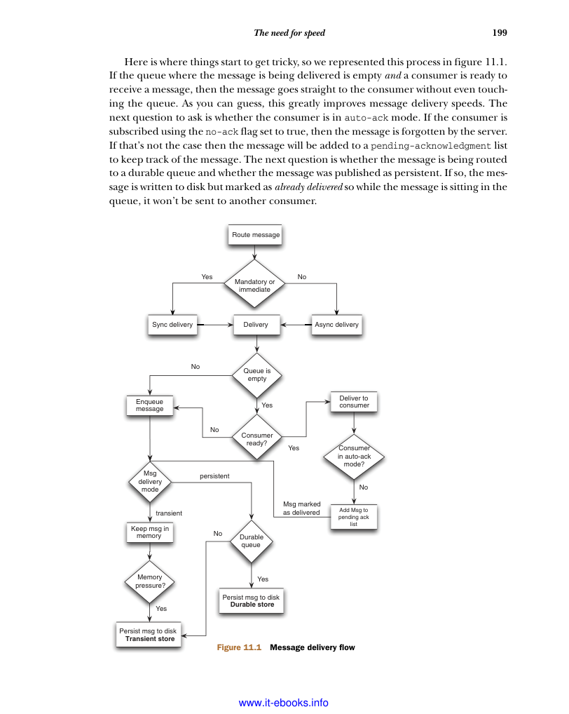
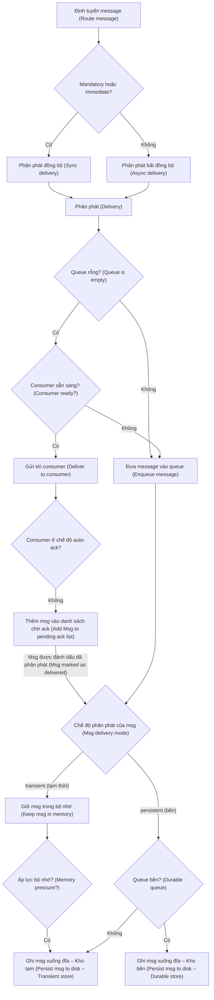
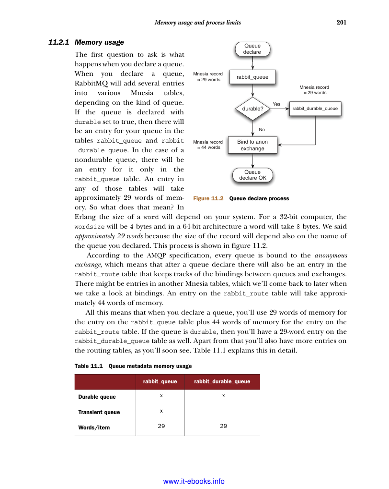
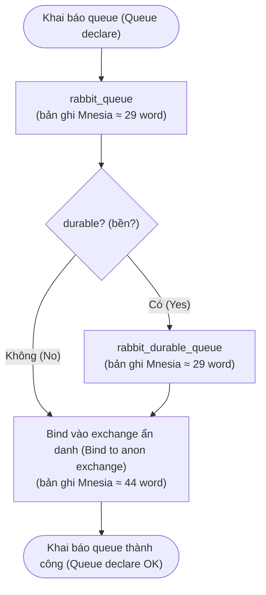
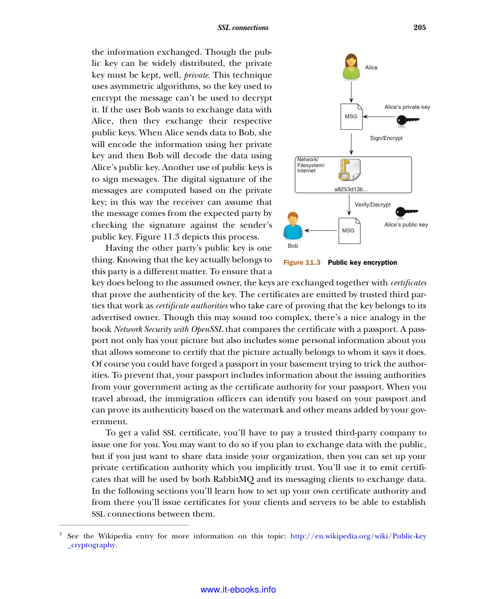
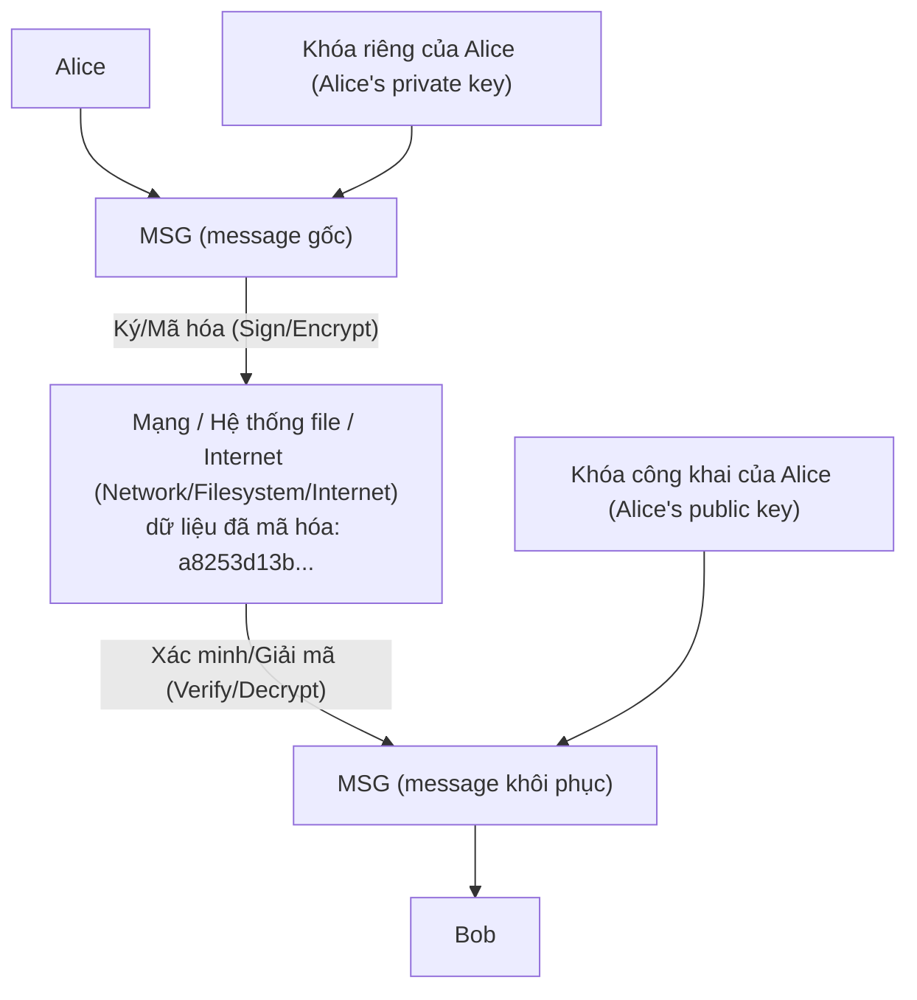

# Chương 11: Tăng tốc và bảo mật "chú thỏ" RabbitMQ của bạn (Supercharging and securing your Rabbit)

## Mục lục chương

- [Chương này đề cập đến](#chương-này-đề-cập-đến-this-chapter-covers)
- [Mở đầu](#mở-đầu)
- [11.1 Nhu cầu về tốc độ (The need for speed)](#111-nhu-cầu-về-tốc-độ-the-need-for-speed)
  - [11.1.1 Độ bền của message (Message durability)](#1111-độ-bền-của-message-message-durability)
  - [11.1.2 Xác nhận message (Message acknowledgment)](#1112-xác-nhận-message-message-acknowledgment)
  - [11.1.3 Thuật toán định tuyến và binding (Routing algorithm and bindings)](#1113-thuật-toán-định-tuyến-và-binding-routing-algorithm-and-bindings)
  - [11.1.4 Phân phát message (Delivering messages)](#1114-phân-phát-message-delivering-messages)
- [11.2 Mức dùng bộ nhớ và giới hạn tiến trình (Memory usage and process limits)](#112-mức-dùng-bộ-nhớ-và-giới-hạn-tiến-trình-memory-usage-and-process-limits)
  - [11.2.1 Mức dùng bộ nhớ (Memory usage)](#1121-mức-dùng-bộ-nhớ-memory-usage)
  - [11.2.2 Số lượng tiến trình Erlang (Erlang process count)](#1122-số-lượng-tiến-trình-erlang-erlang-process-count)
- [11.3 Kết nối SSL (SSL connections)](#113-kết-nối-ssl-ssl-connections)
  - [11.3.1 Chứng chỉ SSL (SSL certificates)](#1131-chứng-chỉ-ssl-ssl-certificates)
  - [11.3.2 Thiết lập một tổ chức cấp chứng chỉ (Setting up a certificate authority)](#1132-thiết-lập-một-tổ-chức-cấp-chứng-chỉ-setting-up-a-certificate-authority)
  - [11.3.3 Tạo chứng chỉ gốc (Generating the root certificate)](#1133-tạo-chứng-chỉ-gốc-generating-the-root-certificate)
  - [11.3.4 Tạo chứng chỉ cho server (Generating the server certificates)](#1134-tạo-chứng-chỉ-cho-server-generating-the-server-certificates)
  - [11.3.5 Tạo chứng chỉ cho client (Generating the client certificates)](#1135-tạo-chứng-chỉ-cho-client-generating-the-client-certificates)
  - [11.3.6 Bật SSL listener trong RabbitMQ (Enabling SSL listeners in RabbitMQ)](#1136-bật-ssl-listener-trong-rabbitmq-enabling-ssl-listeners-in-rabbitmq)
  - [11.3.7 Kiểm thử thiết lập SSL của RabbitMQ (Testing your RabbitMQ SSL setup)](#1137-kiểm-thử-thiết-lập-ssl-của-rabbitmq-testing-your-rabbitmq-ssl-setup)
- [11.4 Tóm tắt (Summary)](#114-tóm-tắt-summary)
- [Bảng thuật ngữ của chương](#bảng-thuật-ngữ-của-chương)

---

## Chương này đề cập đến (This chapter covers)

- Lượng bộ nhớ chiếm dụng (*memory footprint*) của exchange, queue và binding
- Độ bền của message (*message durability*) và thao tác đọc/ghi đĩa (*disk I/O*)
- Kết nối SSL với RabbitMQ
- Thiết lập hạ tầng khóa riêng/khóa công khai (*private key infrastructure*)

## Mở đầu

Ở các chương trước, bạn đã thấy cách thiết kế kiến trúc xoay quanh việc nhắn tin (*messaging*). Bạn đã thấy rất nhiều cách hiện thực các mẫu nhắn tin (*messaging pattern*) bằng những "viên gạch" của AMQP như exchange (bộ trao đổi – nơi nhận message và quyết định chuyển nó đi đâu), queue (hàng đợi – nơi chứa message chờ được xử lý) và binding (liên kết – quy tắc nối exchange với queue). Tùy vấn đề cụ thể, bạn chọn một tổ hợp các thành phần đó để tạo ra lời giải. Nếu cần phân phối log tới nhiều máy, bạn dùng mẫu pub-sub (xuất bản – đăng ký) với exchange kiểu topic hoặc fanout; nếu cần giao tiếp điểm-tới-điểm (*point-to-point*), bạn dùng exchange kiểu direct, v.v.

Trong chương này, chúng ta sẽ xem xét **đặc tính hiệu năng** của những quyết định thiết kế đó. Bạn sẽ thấy:

- ưu và nhược điểm của việc dùng exchange direct so với exchange topic;
- lượng bộ nhớ tối thiểu mà một exchange, một queue hay một binding chiếm;
- chuyện gì xảy ra khi một exchange topic có hàng trăm binding, so với một exchange fanout;
- và nhiều điều khác nữa.

Có thể bạn cũng sẽ thắc mắc: khi nào thì một message được ghi xuống đĩa? Server xoay xở thế nào khi có rất nhiều queue nằm trong bộ nhớ? Mục tiêu của chúng tôi là cung cấp đủ thông tin để bạn ra quyết định khi **lập kế hoạch dung lượng** (*capacity planning* – ước tính trước tài nguyên máy chủ cần có để chịu được tải dự kiến). Chúng tôi sẽ làm điều đó bằng cách phân tích hành trình mà một message đi qua, từ producer (bên gửi message) tới consumer (bên nhận/tiêu thụ message), tùy theo các tùy chọn AMQP khác nhau.

Sau phần hiệu năng, bạn sẽ thấy cách bảo mật bản cài đặt RabbitMQ, cụ thể hơn là cách dùng SSL để thiết lập kênh liên lạc đáng tin cậy với broker (máy chủ trung gian nhận và chuyển message – ở đây chính là RabbitMQ). Chúng tôi sẽ đề cập tới các khía cạnh cấu hình để bật các SSL listener (cổng lắng nghe kết nối SSL) trong RabbitMQ, cách tạo chứng chỉ SSL (*SSL certificate*) và cách kết nối tới broker qua SSL.

Hãy chuyển sang mục đầu tiên, nơi bạn sẽ thấy những gì ảnh hưởng tới tốc độ phân phát message, nhìn từ góc độ AMQP.

---

## 11.1 Nhu cầu về tốc độ (The need for speed)

Có nhiều yếu tố có thể làm thay đổi tốc độ RabbitMQ phân phát message, tùy vào cấu hình phần cứng và phần mềm.

- **Về phần cứng**, có các yếu tố như cấu hình mạng, cách bố trí ổ đĩa, số lõi CPU, v.v.
- **Về phần mềm**, bạn có thể cấu hình nhiều tham số AMQP như: độ bền của message, thuật toán định tuyến (*routing algorithm*), số lượng binding và chiến lược xác nhận message (*message acknowledgment strategy*).

Vì các yếu tố phần cứng hoàn toàn phụ thuộc vào hệ thống riêng của bạn, chúng tôi sẽ không bàn đến chúng trong chương này. Chúng ta sẽ tập trung vào các chi tiết của AMQP và những gì RabbitMQ làm với chúng.

Hãy bắt đầu bằng việc xem độ bền của message và cơ chế xác nhận message ảnh hưởng tới tốc độ phân phát như thế nào.

### 11.1.1 Độ bền của message (Message durability)

Khi bàn về hiệu năng phần mềm, mọi thứ đều phải được "nghe với một hạt muối, thậm chí hai hạt" (thành ngữ tiếng Anh *take with a grain of salt* – nghĩa là đừng tin tuyệt đối, phải cân nhắc). Vì sao? Vì bất cứ quyết định nào bạn đưa ra cũng phải tính đến **bối cảnh** áp dụng nó. Mỗi quyết định đều có mặt lợi và mặt hại.

Ví dụ, bạn có thể tăng tốc việc phân phát message cho log hệ thống – thứ mà có khi bạn còn chẳng cần lưu xuống đĩa. Nhưng khi nói tới xử lý đơn hàng cho giỏ mua sắm, bạn nên chắc chắn rằng không có gì bị mất trong quá trình xử lý. Vì vậy, dù bạn có thể gửi log dưới dạng message không bền (*nonpersistent*) và tiêu thụ chúng mà không cần xác nhận, bạn không thể cho phép mình "xa xỉ" như thế khi có tiền của khách hàng liên quan. Nên mỗi khi làm những tinh chỉnh hiệu năng kiểu này, bạn phải nghĩ tới sự đánh đổi (*trade-off*) mà mình đang chấp nhận.

Khi publish (xuất bản/gửi) message, bạn phải quyết định xem có chấp nhận được việc mất một vài message hay không:

- Nếu việc mất vài message trên hàng nghìn message (vì bất cứ lý do gì) là chấp nhận được, bạn có thể publish chúng với thuộc tính `delivery-mode` đặt bằng **1**, nghĩa là **không bền** (*nonpersistent*).
- Thông thường, bạn sẽ gửi message ở dạng **bền** (*persistent*) bằng cách đặt `delivery-mode` bằng **2**, nhưng cái giá phải trả là buộc broker phải ghi chúng xuống đĩa.

Ví dụ, trên một máy Mac, RabbitMQ có thể dễ dàng phân phát tới khoảng **12.000 message mỗi giây**. Nếu bật chế độ lưu bền message, con số đó giảm xuống khoảng **4.000 message mỗi giây**. Số lượng vẫn cao, nhưng đã giảm đáng kể.

Làm sao để quản lý thiết lập này? Bạn phải chỉ định nó như một phần của thuộc tính message (*message properties*) cho **từng** message mà bạn publish lên server. Đoạn code sau là ví dụ cách tạo một message không bền bằng thư viện PHP:

```php
$msg = new AMQPMessage("Test Message", array('delivery_mode' => 1));
```

> 📝 **Giải thích thêm (không có trong sách):** Lưu ý rằng một message chỉ thực sự "sống sót" sau khi RabbitMQ khởi động lại nếu **cả hai** điều kiện đều đúng: message được publish với `delivery_mode = 2` **và** nó nằm trong một queue được khai báo `durable = true`. Message bền nằm trong queue không bền vẫn mất khi broker restart (vì chính queue biến mất); ngược lại message không bền nằm trong queue bền cũng mất. Phần 11.1.4 bên dưới sẽ cho bạn thấy đúng logic này trong Hình 11.1.

> 💡 **Ví dụ bổ sung (không có trong sách):** Cùng một ý trên nhưng viết bằng Python với thư viện `pika` (bản hiện đại), tạo hai loại message cho hai nhu cầu khác nhau:
>
> ```python
> import pika
>
> conn = pika.BlockingConnection(pika.ConnectionParameters("localhost"))
> ch = conn.channel()
> ch.queue_declare(queue="logs", durable=False)
> ch.queue_declare(queue="orders", durable=True)
>
> # Log hệ thống: mất vài cái cũng không sao -> delivery_mode=1 (nhanh hơn)
> ch.basic_publish(exchange="", routing_key="logs", body="disk 80% full",
>                  properties=pika.BasicProperties(delivery_mode=1))
>
> # Đơn hàng: không được mất -> delivery_mode=2 + queue durable (chậm hơn nhưng an toàn)
> ch.basic_publish(exchange="", routing_key="orders", body='{"order_id": 42}',
>                  properties=pika.BasicProperties(delivery_mode=2))
> conn.close()
> ```
>
> Bài toán nhỏ: nếu hệ thống của bạn cần xử lý 9.000 message/giây và (theo số liệu của sách) một máy chỉ đạt khoảng 4.000 message/giây khi bật lưu bền, thì nếu bắt buộc mọi message đều bền bạn sẽ cần chia tải ra ít nhất ⌈9.000 / 4.000⌉ = 3 máy (hoặc tách riêng luồng log không bền để giảm tải phần bền).

Một thiết lập khác cũng ảnh hưởng tới tốc độ nhắn tin là xác nhận message (*message acknowledgment*). Hãy cùng xem xét nó.

### 11.1.2 Xác nhận message (Message acknowledgment)

Ở mục trước, chúng ta đã xem các thiết lập liên quan đến việc **publish** message; giờ là lúc xem bạn có thể cấu hình gì khi **tiêu thụ** (*consume*) message.

Một thiết lập giúp tăng tốc phân phát message là cờ `no-ack` mà bạn có thể chỉ định lúc đăng ký (*subscribe*) vào queue. Nếu đặt nó bằng `true`, server sẽ **tự động lấy message ra khỏi queue** (*dequeue*) ngay sau khi gửi cho client. Nếu vì lý do nào đó kết nối bị mất hoặc ứng dụng client của bạn bị chết, message đó sẽ **mất vĩnh viễn**.

Lợi thế tốc độ của việc subscribe với `no-ack = true` đến từ chỗ bạn không cần gửi thông báo xác nhận (*acknowledgment*, gọi tắt là *ack*) về server sau khi xử lý xong message, nhờ vậy consumer của bạn chạy nhanh hơn. Phía server, mọi thứ cũng đơn giản hơn vì RabbitMQ có thể "quên" message ngay sau khi đã gửi đi.

Đây là một đoạn Python minh họa cách consume từ một queue với `no-ack = true`:

```python
channel.basic_consume( critical_notify,
                       queue="critical",
                       no_ack=True,
                       consumer_tag="critical")
```

Bạn sẽ consume từ queue `critical`, đồng thời dùng `critical` làm consumer tag (nhãn định danh consumer). Với mỗi message nhận được, hàm callback `critical_notify` sẽ được gọi.

> 📝 **Giải thích thêm (không có trong sách):** Đoạn code trên dùng API của các phiên bản pika cũ (thời điểm sách viết). Trong pika 1.x trở lên, tham số đổi tên thành `auto_ack` và thứ tự tham số khác:
>
> ```python
> channel.basic_consume(queue="critical",
>                       on_message_callback=critical_notify,
>                       auto_ack=True,
>                       consumer_tag="critical")
> ```

> 💡 **Ví dụ bổ sung (không có trong sách):** So sánh hai cách consume:
>
> ```python
> # Cách 1: auto-ack (no_ack=True) – nhanh, nhưng nếu process chết giữa chừng thì message mất.
> def critical_notify(ch, method, props, body):
>     send_sms(body)            # nếu dòng này ném exception, message đã bị xóa khỏi queue rồi!
>
> # Cách 2: ack thủ công – chậm hơn một chút (thêm một frame basic.ack mỗi message),
> # nhưng an toàn: chỉ khi gọi basic_ack thì RabbitMQ mới xóa message.
> def critical_notify_safe(ch, method, props, body):
>     send_sms(body)
>     ch.basic_ack(delivery_tag=method.delivery_tag)
> ```
>
> Nếu process ở Cách 2 chết trước khi gọi `basic_ack`, RabbitMQ sẽ đưa message trở lại queue và giao cho consumer khác.

Giờ là lúc xem điều gì xảy ra khi định tuyến (*routing*) message. Trong mục tiếp theo, chúng ta sẽ lần lượt xem từng thuật toán định tuyến chính mà RabbitMQ sử dụng.

### 11.1.3 Thuật toán định tuyến và binding (Routing algorithm and bindings)

Trong sách này, chúng ta đã bàn về ba loại exchange: **direct**, **fanout** và **topic**. Bạn biết rằng mỗi loại exchange tương ứng với một thuật toán định tuyến cụ thể do server hiện thực. Khi exchange cần định tuyến một message, nó sẽ chọn các queue mà message cần tới dựa trên **routing key** (khóa định tuyến) của message và các **binding** mà exchange đang giữ tới các queue. Quá trình chọn lựa sẽ khác nhau tùy loại exchange, vì mỗi loại exchange xử lý routing key của message theo cách khác nhau.

Ở phía server, exchange và binding là các **bản ghi** (*record entry*) trong **Mnesia**. Điều đó có nghĩa là khi RabbitMQ so khớp routing key của message, thực chất nó đang cố tìm một binding tương ứng với routing key đó. Mnesia là một cơ sở dữ liệu hiệu năng rất cao, lưu trữ dựa trên các bảng **ETS** và **DETS** của Erlang.¹

- **ETS** là viết tắt của *Erlang term storage* – kho lưu trữ dữ liệu **trong bộ nhớ**.
- **DETS** là phiên bản tương ứng nhưng **lưu trên đĩa**.

Ưu điểm của Mnesia so với việc gọi trực tiếp các hàm ETS là Mnesia có thể **điều phối truy cập tới các bảng trong một cluster** (cụm nhiều node RabbitMQ). Ví dụ, khi bạn tạo một exchange trên một node thuộc cluster, Mnesia sẽ lo việc sao chép (*replicate*) thông tin đó sang tất cả các node khác trong cluster; điều tương tự cũng diễn ra khi thêm binding, khai báo queue, v.v.

> ¹ *Chú thích chân trang:* Thông tin thêm về ETS có tại http://erlang.org/doc/man/ets.html.

Dù Mnesia rất tốt trong việc duy trì tính nhất quán (*consistency*), lớp phụ trợ nằm trên ETS có thể làm chậm mọi thứ khi bạn cần thực hiện một số loại truy vấn, chẳng hạn như so khớp routing key. Phần đó của quy trình đã được **tối ưu cho exchange direct và fanout** để bạn không phải chịu "khoản phạt" do điều phối của Mnesia.

Với các loại exchange này, binding được lưu trong bảng `rabbit_route`, là bảng kiểu `ordered_set`. Theo tài liệu của bảng ETS, thời gian truy cập với loại bảng này là **logarit** theo số lượng bản ghi trong cơ sở dữ liệu. Ngoài ra, do bản chất của kiểu bảng `ordered_set`, các nhà phát triển RabbitMQ đã có thể thực hiện một số tối ưu thú vị khi chọn dữ liệu từ bảng, cho phép họ **bỏ qua Mnesia** đối với những truy vấn kiểu này. Điều này có nghĩa là các bảng định tuyến của RabbitMQ vừa có **bảo đảm nhất quán** do Mnesia cung cấp, vừa giữ được **tốc độ truy xuất** của bảng ETS thuần.

> 📝 **Giải thích thêm (không có trong sách):** "Thời gian truy cập logarit" (O(log n)) nghĩa là khi số binding tăng gấp đôi, thời gian tìm chỉ tăng thêm khoảng một bước so sánh. Ví dụ: với 1.000 binding cần khoảng log₂(1.000) ≈ 10 bước; với 1.000.000 binding cũng chỉ cần khoảng 20 bước. Vì vậy dù bạn có rất nhiều binding trên exchange direct, việc tra cứu vẫn rất nhanh.

#### Exchange direct và fanout (DIRECT AND FANOUT EXCHANGES)

Khác biệt giữa exchange direct và exchange fanout là exchange fanout **bỏ qua routing key** khi truy vấn bảng `rabbit_route`. Vì vậy, dù bạn có thể cung cấp một routing key khi bind queue vào exchange fanout, hãy nhớ rằng routing key đó sẽ bị phớt lờ khi định tuyến message. Điều tương tự xảy ra khi publish message kèm routing key tới exchange fanout: routing key bị bỏ qua.

#### Exchange topic (TOPIC EXCHANGE)

Trường hợp exchange topic thì hoàn toàn khác, vì thông tin định tuyến được lưu phức tạp hơn. Việc so khớp routing key của message không chỉ là so sánh chuỗi đơn giản, vì routing key có thể gồm nhiều từ ngăn cách bởi dấu chấm (`.`). Vì lý do đó, RabbitMQ hiện thực một cấu trúc dữ liệu **trie** (cây tiền tố), trong đó các mẫu binding key (*binding key pattern*) được lưu theo định dạng cho phép truy vấn nhanh.

Loạt hai bài blog sau giải thích chi tiết cách hiện thực exchange topic và đặc tính hiệu năng của nó:

- http://www.rabbitmq.com/blog/2010/09/14/very-fast-and-scalable-topic-routing-part-1/
- http://www.rabbitmq.com/blog/2011/03/28/very-fast-and-scalable-topic-routing-part-2/

Trong bài thứ hai, bạn có thể thấy hiện thực exchange topic của RabbitMQ có thể so khớp **1.000.000 topic với 2.000 mẫu trong khoảng 11 giây** trên một máy 2,3 GHz – nghĩa là exchange topic thừa sức dùng cho các tình huống nhắn tin hằng ngày của bạn. Hãy nhớ rằng, thông thường, **binding trên exchange topic tốn bộ nhớ hơn** binding trên exchange direct hoặc fanout.

> 💡 **Ví dụ bổ sung (không có trong sách):** Hình dung cây trie khi có ba binding key: `order.*.created`, `order.eu.#` và `user.signup`:
>
> ```text
> (gốc)
>  ├── order
>  │    ├── *  ── created      ← khớp "order.vn.created", "order.us.created"
>  │    └── eu ── #            ← khớp "order.eu", "order.eu.paid", "order.eu.x.y"
>  └── user
>       └── signup             ← chỉ khớp đúng "user.signup"
> ```
>
> Khi message có routing key `order.eu.created` đến, RabbitMQ đi từ gốc theo từng từ `order` → `eu` → `created`, đồng thời thử các nhánh `*` (đúng một từ) và `#` (không hoặc nhiều từ). Kết quả: khớp cả `order.*.created` lẫn `order.eu.#`, nên message được gửi tới cả hai queue tương ứng. Nhờ cây này, RabbitMQ không phải so từng mẫu một với routing key. Mỗi "cạnh" và mỗi binding là một bản ghi trong Mnesia – đó là lý do binding topic tốn bộ nhớ hơn (xem mục 11.2.1).

Tìm được nơi nhận message là một chuyện; phân phát message lại là chuyện khác. Hãy xem điều gì xảy ra sau khi exchange xử lý xong thông tin định tuyến của message.

### 11.1.4 Phân phát message (Delivering messages)

Sau khi exchange đã tìm ra nơi message cần được định tuyến tới, nó sẽ trả về một danh sách các đích đến cho `rabbit_router`, rồi sau đó tiến hành gửi bản sao của message tới từng đích (queue hoặc exchange). Nếu bạn publish message với cờ `mandatory` và `immediate` đặt bằng `false`, quá trình này có thể được thực hiện **bất đồng bộ** (*asynchronously*), và server sẽ chạy nhanh hơn từ góc nhìn của client.

> 📝 **Giải thích thêm (không có trong sách):** Cờ `mandatory` yêu cầu broker trả message lại cho producer (qua `basic.return`) nếu không có queue nào nhận được nó; cờ `immediate` yêu cầu trả lại nếu không có consumer nào sẵn sàng nhận ngay. Vì broker phải kiểm tra rồi phản hồi lại, việc phân phát trở thành đồng bộ. Lưu ý: cờ `immediate` đã bị RabbitMQ **loại bỏ từ phiên bản 3.0** (2012), nên trên các bản hiện đại chỉ còn `mandatory`.

Đây là chỗ mọi thứ bắt đầu rắc rối, nên chúng tôi đã biểu diễn quá trình này trong Hình 11.1.

- Nếu queue mà message được gửi tới đang **rỗng** *và* có một consumer **sẵn sàng** nhận message, thì message đi **thẳng tới consumer** mà thậm chí không chạm vào queue. Như bạn có thể đoán, điều này cải thiện đáng kể tốc độ phân phát message.
- Câu hỏi tiếp theo là consumer có đang ở chế độ `auto-ack` (tự động xác nhận) hay không. Nếu consumer subscribe với cờ `no-ack` đặt bằng `true`, server sẽ quên message đó luôn.
- Nếu không phải vậy, message sẽ được thêm vào danh sách `pending-acknowledgment` (chờ xác nhận) để theo dõi.
- Câu hỏi tiếp theo là message có được định tuyến tới một **queue bền** (*durable queue*) không và message có được publish ở dạng **bền** (*persistent*) không. Nếu có, message được ghi xuống đĩa nhưng được đánh dấu là **đã phân phát** (*already delivered*), để trong khi message còn nằm trong queue, nó sẽ không bị gửi cho một consumer khác.

**Hình 11.1 – Luồng phân phát message (Message delivery flow)**



Các ảnh dưới đây được trích ra từ hình vẽ gốc – chúng chỉ là các khối hình thoi (bóng đổ của các ô quyết định "Có/Không") trong sơ đồ, không chứa chữ:


Sơ đồ được vẽ lại bằng mermaid (chữ đã dịch):



**Mô tả Hình 11.1:** Message sau khi được định tuyến (*Route message*) sẽ đi qua ô quyết định "Mandatory hoặc immediate?". Nếu **Có** → phân phát đồng bộ (*Sync delivery*); nếu **Không** → phân phát bất đồng bộ (*Async delivery*); cả hai cùng dẫn tới bước *Delivery*. Tiếp theo là câu hỏi "Queue có rỗng không?": nếu **Không** → message được đưa vào queue (*Enqueue message*); nếu **Có** thì hỏi tiếp "Consumer có sẵn sàng không?" – **Không** thì cũng đưa vào queue, **Có** thì gửi thẳng tới consumer (*Deliver to consumer*). Sau khi gửi tới consumer, hỏi "Consumer có ở chế độ auto-ack không?" – nếu **Không** thì thêm message vào danh sách chờ ack (*Add Msg to pending ack list*), và message (được đánh dấu "đã phân phát" – *Msg marked as delivered*) tiếp tục đi vào nhánh xét chế độ phân phát (*Msg delivery mode*), giống như message được đưa vào queue. Ở nhánh *Msg delivery mode*: nếu **transient** (tạm thời, không bền) → giữ trong bộ nhớ (*Keep msg in memory*), và chỉ khi có **áp lực bộ nhớ** (*Memory pressure?* – Có) mới ghi xuống đĩa vào **kho tạm** (*Transient store*). Nếu **persistent** (bền) → hỏi "Queue có bền không?" (*Durable queue*): **Có** → ghi xuống đĩa vào **kho bền** (*Durable store*); **Không** → ghi xuống đĩa vào **kho tạm** (*Transient store*).

Giờ hãy quay ngược thời gian về thời điểm RabbitMQ kiểm tra xem queue có rỗng không. Nếu queue **không rỗng**, message được đưa vào queue.

- Nếu message **không bền**, nó chỉ được giữ trong bộ nhớ khi còn đủ bộ nhớ để chứa. Nếu không đủ bộ nhớ, message sẽ được ghi xuống đĩa vào **kho tạm** (*transient store*).
- Với message **bền**, chúng sẽ được ghi xuống đĩa và **đồng thời** được giữ trong bộ nhớ để tăng tốc phân phát. Nếu xảy ra áp lực bộ nhớ (*memory pressure*), các message sẽ bị đẩy (*flush*) xuống đĩa.

Bằng cách làm như vậy, server bảo đảm các thuộc tính của message như tính bền, trong khi vẫn phân phát message nhanh nhất có thể.

Như bạn thấy trong Hình 11.1, nếu message được định tuyến tới một **queue bền**, thì khi được ghi xuống đĩa nó sẽ vào **kho bền** (*durable store*); ngược lại nó sẽ vào **kho tạm** (*transient store*). Nếu RabbitMQ phải khởi động lại và khôi phục các queue bền, nó chỉ cần đi qua nội dung của kho bền, và có thể xóa sạch kho tạm mà không cần lo lắng gì.

Một điều cần ghi nhớ: **RabbitMQ được tối ưu để phân phát message tới consumer nhanh nhất có thể.** Nếu bạn lập kế hoạch dung lượng và tính toán tốc độ message vào/ra (*ingress/egress rate*), bạn nên cố gắng **giữ các queue càng rỗng càng tốt**; dù đây không phải phát hiện gì mới mẻ, nó sẽ giúp bạn có một broker chạy nhanh. Nhưng nếu consumer bắt đầu tụt lại phía sau và queue bắt đầu đầy lên, đến một lúc nào đó **cảnh báo bộ nhớ** (*memory alarm*) trên server sẽ được kích hoạt và server sẽ bắt đầu đẩy message xuống đĩa **bất kể** message được publish với thuộc tính gì. Bài học rút ra: **luôn để mắt tới kích thước các queue của bạn.**

> 💡 **Ví dụ bổ sung (không có trong sách):** Bài toán tốc độ vào/ra. Producer gửi 5.000 message/giây vào queue `orders`; 4 consumer, mỗi consumer xử lý được 1.000 message/giây.
>
> - Tốc độ ra = 4 × 1.000 = 4.000 msg/s < tốc độ vào 5.000 msg/s.
> - Queue tăng thêm 1.000 message mỗi giây → sau 1 giờ có 3.600.000 message tồn đọng. Với message trung bình 2 KB, đó là khoảng 7,2 GB – gần như chắc chắn sẽ kích hoạt memory alarm và RabbitMQ sẽ đẩy message xuống đĩa (chậm đi) và chặn producer.
> - Giải pháp: thêm ít nhất 1 consumer (5 × 1.000 = 5.000 msg/s), tốt hơn là 6 để có dư địa. Có thể theo dõi độ dài queue bằng lệnh `rabbitmqctl list_queues name messages`.

> 📝 **Giải thích thêm (không có trong sách) – Kiến trúc lưu trữ Queue, Quản lý bộ nhớ và Tốc độ cực đại trong RabbitMQ hiện đại (3.10–3.13 & RabbitMQ 4.0):**
>
> Cơ chế lưu trữ và phân phát message mô tả ở Hình 11.1 phản ánh **Classic Queue v1 (CQv1)** và **Message Store v1** của RabbitMQ 2.7 (năm 2012). Kể từ RabbitMQ 3.10 đến **RabbitMQ 4.0**, toàn bộ tầng lưu trữ và kiểm soát tài nguyên đã được thiết kế lại với những bước nhảy vọt về hiệu năng:
>
> **1. Classic Queue v2 (CQv2), Message Store v2 và sự hợp nhất của Lazy Queues (`x-queue-mode: lazy`):**
> - **Vấn đề của CQv1 (thời 2.7–3.9):** CQv1 cố gắng giữ càng nhiều message (hoặc chỉ mục message) trong RAM càng tốt. Khi hàng triệu message tồn đọng và chạm ngưỡng bộ nhớ (*paging threshold*), tiến trình queue phải dừng việc nhận/phát để đẩy (*page out*) từng đợt message xuống đĩa, gây hiện tượng "đóng băng" thông lượng (*latency spikes*) và ngốn RAM dữ dội. Để khắc phục tạm thời, RabbitMQ 3.6 từng giới thiệu **Lazy Queues** (`x-queue-mode: lazy`) — ghi thẳng mọi message xuống đĩa ngay khi nhận.
> - **Bước ngoặt ở RabbitMQ 3.10–3.12 và RabbitMQ 4.0:** RabbitMQ ra mắt **Classic Queue storage version 2 (`CQv2`)** kết hợp **Message Store v2** (nhúng trực tiếp message kích thước nhỏ vào chỉ mục của queue thay vì qua kho lưu trữ trung gian).
>   - **Giảm 40%–80% RAM và tăng thông lượng tới 30–50%** so với CQv1.
>   - **Hợp nhất tự động Lazy Queue vào CQv2 (từ RabbitMQ 3.12+ và 4.0):** CQv2 tự động chỉ giữ một bộ đệm siêu nhỏ trong RAM cho các consumer đang bắt kịp tốc độ, và chủ động ghi thẳng phần còn lại xuống đĩa cực kỳ mượt mà. Do đó, từ **RabbitMQ 3.12 và 4.0**, tham số `x-queue-mode: lazy` đã trở nên **dư thừa (deprecated/no-op)** vì mọi Classic Queue (mặc định là CQv2 ở RabbitMQ 4.0) đều đã mang sẵn ưu điểm của Lazy Queue mà vẫn giữ được độ trễ thấp khi queue rỗng!
>
> | Tiêu chí | RabbitMQ 2.7 (CQv1 – Trong sách) | RabbitMQ 3.6–3.11 (`lazy` mode) | RabbitMQ 3.12–4.0 (CQv2 & Quorum/Streams) |
> |---|---|---|---|
> | **Cơ chế RAM vs Đĩa** | Giữ tối đa trong RAM; chỉ đẩy xuống đĩa (*page out*) khi áp lực bộ nhớ cao | Phải khai báo `x-queue-mode: lazy` để ép ghi thẳng xuống đĩa | **CQv2 tự động hóa hoàn toàn:** chỉ đệm lượng nhỏ trong RAM cho consumer đang hoạt động, ghi đĩa tuần tự siêu nhanh |
> | **Tác dụng của `x-queue-mode: lazy`** | Chưa tồn tại | Bật chế độ Lazy Queue | **Không cần nữa (No-op):** CQv2 mặc định đã hoạt động tốt hơn cả Lazy Queue cũ |
> | **Độ ổn định khi tồn đọng hàng triệu msg** | Dễ bị khựng (*paging pause*) hàng chục giây | Ổn định bộ nhớ nhưng giảm tốc độ khi queue ngắn | Ổn định bộ nhớ tuyệt đối, không bị khựng, tốc độ cao ngay cả khi queue ngắn |
>
> **2. Credit-based Flow Control (Kiểm soát luồng theo từng kết nối) và Cảnh báo tài nguyên (`rabbitmq.conf`):**
> - **Per-connection Credit Flow (từ RabbitMQ 2.8+ → 4.0):** Bên cạnh cảnh báo bộ nhớ toàn cục (*global memory alarm*), RabbitMQ áp dụng cơ chế cấp phát "tín dụng" (*credit*) nội bộ giữa các tiến trình Erlang: ` TCP Reader → Channel → Queue → Message Store`. Nếu một queue bị nghẽn khi ghi đĩa, nó ngừng cấp credit cho Channel đang bắn message vào queue đó, và Channel ngừng đọc socket của riêng Producer đó (trạng thái `flow` trên Management UI) mà **không làm đóng băng các kết nối Producer khác** đang gửi vào những queue khỏe mạnh!
> - **Cấu hình giới hạn bộ nhớ và ổ đĩa trong `rabbitmq.conf` hiện đại:** Khi RAM vượt ngưỡng `vm_memory_high_watermark` (mặc định `0.4` tức 40% RAM hệ thống) hoặc dung lượng đĩa trống tụt xuống dưới `disk_free_limit` (khuyến nghị đặt theo GB cố định hoặc tỷ lệ RAM), RabbitMQ sẽ bật **Resource Alarm** và tạm chặn (*block* qua frame `connection.blocked`) mọi kết nối đang publish:
>
> ```ini
> # /etc/rabbitmq/rabbitmq.conf (RabbitMQ 3.8–4.0)
>
> # 1. Ngưỡng cảnh báo RAM (40% tổng RAM vật lý hoặc giới hạn container)
> vm_memory_high_watermark.relative = 0.4
> # Hoặc đặt giá trị tuyệt đối:
> # vm_memory_high_watermark.absolute = 4GB
>
> # 2. Tỷ lệ bắt đầu đẩy dữ liệu từ RAM xuống đĩa sớm trước khi chạm ngưỡng alarm (mặc định 0.5)
> vm_memory_high_watermark_paging_ratio = 0.5
>
> # 3. Ngưỡng cảnh báo ổ đĩa trống tối thiểu (nên đặt >= 2GB cho môi trường Production)
> disk_free_limit.absolute = 2GB
>
> # 4. Chọn phiên bản lưu trữ Classic Queue v2 làm mặc định (mặc định sẵn trên 3.12+ / 4.0)
> classic_queue.default_version = 2
> ```
>
> **3. Khi cần tốc độ cực đại: RabbitMQ Streams (`x-queue-type: stream`) vs AMQP 0-9-1 truyền thống:**
> Sách dẫn số liệu 4.000–12.000 msg/s trên một máy Mac năm 2012. Ngày nay, nếu bài toán của bạn cần thông lượng cực lớn (log, telemetry, clickstream, event sourcing), bạn có 3 cấp độ lựa chọn trên RabbitMQ 3.9–4.0:
>
> | Kiểu Queue & Giao thức | Độ bền & An toàn dữ liệu | Thông lượng điển hình (1 node hiện đại) | Khi nào nên dùng? |
> |---|---|---|---|
> | **Classic Queue v2 (AMQP 0-9-1)** | 1 node (không nhân bản vì Classic Mirroring đã bị xóa ở 4.0) | ~30.000 – 80.000 msg/s | Queue tạm thời, RPC, tác vụ cục bộ không yêu cầu HA nhiều node |
> | **Quorum Queue (`x-queue-type: quorum`, AMQP 0-9-1)** | Nhân bản đồng thuận Raft (3–5 node), an toàn dữ liệu cao nhất | ~20.000 – 60.000 msg/s (khi bật Publisher Confirms + Consumer Ack) | **Mặc định cho mọi workload nghiệp vụ quan trọng** (đơn hàng, thanh toán, microservice) |
> | **RabbitMQ Streams (`x-queue-type: stream` + Stream Protocol cổng `5552`)** | Append-only log trên đĩa, hỗ trợ nhân bản, dùng `sendfile` zero-copy | **> 1.000.000 msg/s** (hàng triệu message/giây) | **Tốc độ cực đại**, fan-out lớn, cần đọc lại lịch sử (*replay/time-travel*), dữ liệu lớn |

> 💡 **Ví dụ bổ sung (không có trong sách) – Khai báo Quorum Queue và RabbitMQ Stream bằng Python 3 (`pika 1.x`):**
>
> ```python
> import pika
>
> conn = pika.BlockingConnection(pika.ConnectionParameters("localhost"))
> ch = conn.channel()
>
> # 1. Khai báo Quorum Queue (chuẩn bền vững hiện đại thay cho Classic Durable Queue)
> ch.queue_declare(
>     queue="orders.quorum",
>     durable=True,
>     arguments={"x-queue-type": "quorum"}
> )
>
> # 2. Khai báo RabbitMQ Stream (log bất biến tốc độ cao, tự cắt dọn khi đạt 10GB)
> ch.queue_declare(
>     queue="events.stream",
>     durable=True,
>     arguments={
>         "x-queue-type": "stream",
>         "x-max-length-bytes": 10_000_000_000,  # Giữ tối đa 10 GB trên đĩa
>         "x-stream-max-segment-size-bytes": 500_000_000
>     }
> )
>
> # Lưu ý: Để đạt > 1.000.000 msg/s với Stream, bạn nên bật plugin:
> #   rabbitmq-plugins enable rabbitmq_stream
> # và kết nối qua cổng 5552 bằng thư viện chuyên dụng như rstream (Python),
> # stream-java-client (Java) hoặc RabbitMQ.Stream.Client (.NET).
> conn.close()
> ```

Trong mục này, bạn đã thấy các thuật toán khác nhau và các thiết lập khi publish/subscribe có thể ảnh hưởng tới tốc độ chung của hệ thống ra sao, và một thiết lập cờ khác đi như chế độ `auto-ack` có thể ảnh hưởng **cực lớn** tới hiệu năng hệ thống. Trong mục tiếp theo, chúng ta sẽ xem các **giới hạn cứng** (*hard limit*) mà phần cứng (RAM) và chính máy ảo Erlang (*Erlang virtual machine*) áp đặt lên server RabbitMQ.

---

## 11.2 Mức dùng bộ nhớ và giới hạn tiến trình (Memory usage and process limits)

Khi thiết kế ứng dụng, bạn thường có hai ràng buộc cơ bản:

1. công nghệ bạn chọn **cho phép** bạn làm gì;
2. cấu hình phần cứng hiện tại **cho phép** bạn làm gì.

Ở mục trước – và xuyên suốt cuốn sách – chúng ta đã đề cập tới điểm thứ nhất khi xem các thuật toán định tuyến và phân phát message khác nhau ảnh hưởng thế nào tới quyết định thiết kế. Trong mục này, chúng ta sẽ xem một số giới hạn cứng mà phần cứng hoặc máy ảo Erlang áp đặt lên RabbitMQ, để bạn có thể lên kế hoạch trước và biết mình có thể mở rộng (*scale up*) RabbitMQ tới mức nào trên **một máy duy nhất**.

Ví dụ, một chỉ số thú vị cần biết về RabbitMQ là **lượng bộ nhớ cần để tạo mỗi thành phần AMQP** như queue, exchange và binding. Một giá trị khác cần tính đến là **số tiến trình Erlang** (*Erlang process*) mà RabbitMQ tạo ra cho các thành phần đó, vì máy ảo Erlang có giới hạn cứng về số tiến trình bạn có thể tạo. Hãy xem chi tiết từng yếu tố để bạn có nền tảng vững chắc khi tính toán kế hoạch dung lượng.

> 📝 **Giải thích thêm (không có trong sách):** "Tiến trình Erlang" không phải là tiến trình của hệ điều hành (như process bạn thấy trong `ps` hay Task Manager). Nó là một đơn vị thực thi siêu nhẹ do máy ảo Erlang (BEAM) tự quản lý – mỗi tiến trình chỉ tốn vài trăm byte đến vài KB ban đầu. Toàn bộ RabbitMQ chạy trong **một** tiến trình hệ điều hành, bên trong có hàng trăm đến hàng triệu tiến trình Erlang.

### 11.2.1 Mức dùng bộ nhớ (Memory usage)

Câu hỏi đầu tiên cần đặt ra là: điều gì xảy ra khi bạn khai báo (*declare*) một queue?

Khi bạn khai báo một queue, RabbitMQ sẽ thêm vài bản ghi vào các bảng Mnesia khác nhau, tùy loại queue:

- Nếu queue được khai báo với `durable` đặt bằng `true`, sẽ có một bản ghi cho queue của bạn trong cả hai bảng `rabbit_queue` và `rabbit_durable_queue`.
- Với queue **không bền** (*nondurable*), chỉ có một bản ghi trong bảng `rabbit_queue`.

Một bản ghi trong bất kỳ bảng nào kể trên chiếm **xấp xỉ 29 word** bộ nhớ. Vậy điều đó có nghĩa là gì? Trong Erlang, kích thước của một **word** (từ máy) phụ thuộc vào hệ thống của bạn. Với máy tính 32-bit, `wordsize` là **4 byte**, còn trên kiến trúc 64-bit, một word chiếm **8 byte**. Chúng tôi nói *xấp xỉ 29 word* vì kích thước bản ghi còn phụ thuộc vào **tên** của queue bạn khai báo. Quá trình này được thể hiện trong Hình 11.2.

**Hình 11.2 – Quá trình khai báo queue (Queue declare process)**


*(Ảnh trên là khối hình thoi được trích ra từ sơ đồ gốc; toàn bộ hình gốc nằm ở trang render dưới đây.)*





**Mô tả Hình 11.2:** Khi nhận lệnh *Queue declare*, RabbitMQ tạo bản ghi trong `rabbit_queue` (bản ghi Mnesia ≈ 29 word). Sau đó kiểm tra "durable?": nếu **Có**, tạo thêm bản ghi trong `rabbit_durable_queue` (≈ 29 word). Dù có hay không, bước tiếp theo là bind queue vào exchange ẩn danh (*Bind to anon exchange*), tạo một bản ghi Mnesia ≈ 44 word. Cuối cùng trả về *Queue declare OK*.

Theo đặc tả AMQP, **mọi queue đều được bind vào exchange ẩn danh** (*anonymous exchange* – exchange mặc định, tên là chuỗi rỗng `""`). Điều đó có nghĩa là sau khi khai báo queue, cũng sẽ có một bản ghi trong bảng `rabbit_route`, bảng theo dõi các binding giữa queue và exchange. Có thể có bản ghi ở những bảng Mnesia khác nữa, chúng ta sẽ quay lại sau khi xem xét binding. Một bản ghi trong bảng `rabbit_route` chiếm **xấp xỉ 44 word** bộ nhớ.

Tất cả điều này có nghĩa là khi khai báo một queue, bạn sẽ dùng **29 word** cho bản ghi trong bảng `rabbit_queue` **cộng 44 word** cho bản ghi trong bảng `rabbit_route`. Nếu queue là `durable`, bạn sẽ có thêm một bản ghi **29 word** trong bảng `rabbit_durable_queue`. Ngoài ra bạn còn có thêm các bản ghi khác trong các bảng định tuyến, như bạn sẽ thấy ngay sau đây. Bảng 11.1 giải thích chi tiết điều này.

**Bảng 11.1 – Mức dùng bộ nhớ cho siêu dữ liệu của queue (Queue metadata memory usage)**

| | `rabbit_queue` | `rabbit_durable_queue` |
|---|:---:|:---:|
| **Queue bền (Durable queue)** | x | x |
| **Queue tạm thời (Transient queue)** | x | |
| **Số word/mục (Words/item)** | 29 | 29 |

Dấu **x** cho biết bảng nào sẽ có bản ghi mới khi khai báo queue; bạn cũng có thể thấy kích thước (tính bằng word) của mỗi mục lưu trong các bảng đó.

Khi bạn khai báo một exchange, điều tương tự xảy ra, nhưng đơn giản hơn. Mỗi khi khai báo exchange mới, RabbitMQ tạo một bản ghi trong bảng `rabbit_exchange`, chiếm xấp xỉ **29 word** bộ nhớ. Nếu exchange là bền (*durable*), một bản ghi trong `rabbit_durable_exchange` cũng sẽ được tạo. Điều này thể hiện trong Bảng 11.2.

**Bảng 11.2 – Mức dùng bộ nhớ cho siêu dữ liệu của exchange (Exchange metadata memory usage)**

| | `rabbit_exchange` | `rabbit_durable_exchange` |
|---|:---:|:---:|
| **Exchange bền (Durable exchange)** | x | x |
| **Exchange tạm thời (Transient exchange)** | x | |
| **Số word/mục (Words/item)** | 29 | 29 |

Giờ là lúc xem chuyện gì xảy ra khi bạn **bind một queue vào một exchange**. Ở đây có hai tình huống: bind queue vào exchange direct hoặc fanout, hoặc bind queue vào exchange topic. Trường hợp sau phức tạp hơn để giải thích, nên chúng ta sẽ phân tích nó sau cùng.

Khi một queue được bind vào exchange direct hoặc fanout, RabbitMQ sẽ tạo bản ghi trong **ít nhất hai** bảng Mnesia để theo dõi binding. Đó là bảng `rabbit_route` và `rabbit_reverse_route`. Kích thước các bản ghi này là **44 word** bộ nhớ. Có một số tổ hợp sẽ khiến RabbitMQ tạo thêm bản ghi trong các bảng khác. Những tổ hợp đó phụ thuộc vào thuộc tính bền của queue và exchange tham gia vào binding:

- Một **queue bền** bind vào một **exchange tạm thời** sẽ có thêm bản ghi trong bảng `rabbit_semi_durable_route`.
- Cuối cùng, khi bạn bind một **queue bền** vào một **exchange bền**, RabbitMQ sẽ tạo một bản ghi trong bảng `rabbit_durable_route`.

Cả hai loại bản ghi này đều chiếm **44 word** bộ nhớ mỗi bản ghi. Trong Bảng 11.3 bạn có thể xem chi tiết hơn.

**Bảng 11.3 – Mức dùng bộ nhớ cho siêu dữ liệu của binding (Bindings metadata memory usage)**

| | `rabbit_route` | `rabbit_durable_route` | `rabbit_semi_durable_route` | `rabbit_reverse_route` |
|---|:---:|:---:|:---:|:---:|
| **Queue bền → exchange bền (Durable queue to durable exchange)** | x | x | x | x |
| **Queue bền → exchange tạm thời (Durable queue to transient exchange)** | x | | x | x |
| **Queue tạm thời → exchange tạm thời (Transient queue to transient exchange)** | x | | | x |
| **Queue tạm thời → exchange bền (Transient queue to durable exchange)** | x | | | x |
| **Số word/mục (Words/item)** | 44 | 44 | 44 | 44 |

> 📝 **Giải thích thêm (không có trong sách):** Vị trí chính xác của các dấu x trong Bảng 11.3 được dựng lại từ bảng gốc: hàng "durable queue → durable exchange" có 4 dấu x (đánh dấu cả 4 bảng), hàng "durable queue → transient exchange" có 3 dấu x, hai hàng còn lại có 2 dấu x (chính là hai bảng tối thiểu `rabbit_route` và `rabbit_reverse_route`). Điều này khớp với phần chữ: mọi binding đều nằm trong `rabbit_route` + `rabbit_reverse_route`; queue bền thì có thêm `rabbit_semi_durable_route`; nếu cả exchange cũng bền thì có thêm `rabbit_durable_route`. Đây cũng là lý do ví dụ của sách bên dưới tính 4 × 44 = 176 word cho các bảng `*_route`.

Trường hợp bind vào **exchange topic** có đủ mọi "nguyên liệu" bạn đã thấy với binding vào exchange direct và fanout, và còn liên quan tới thêm hai bảng Mnesia nữa: `rabbit_topic_trie_binding` và `rabbit_topic_trie_edge`. Như tên bảng gợi ý, bản thân binding sẽ được lưu trong `rabbit_topic_trie_binding`. Một bản ghi trong bảng đó chiếm xấp xỉ **45 word** bộ nhớ. Số phần (số từ) trong mẫu topic của bạn sẽ quyết định số bản ghi được chèn vào `rabbit_topic_trie_binding`. Vì vậy một mẫu như `a.b.c.d` sẽ tạo **bốn** bản ghi trong bảng đó, mỗi bản ghi **38 word** bộ nhớ.

> 📝 **Giải thích thêm (không có trong sách):** Đoạn này của sách có chút không nhất quán: câu trước nói bản ghi `rabbit_topic_trie_binding` ≈ 45 word, câu sau nói mẫu `a.b.c.d` tạo bốn bản ghi "trong bảng đó" mỗi bản ghi 38 word. Về mặt cấu trúc trie, các bản ghi tương ứng với *từng phần* của mẫu (mỗi từ là một cạnh của cây) thực ra nằm trong bảng `rabbit_topic_trie_edge`, còn `rabbit_topic_trie_binding` lưu binding ở nút cuối. Cách hiểu hợp lý: mỗi binding topic tốn ≈ 45 word cho bản ghi binding, cộng khoảng 38 word cho mỗi cạnh (mỗi từ) của mẫu chưa có sẵn trong cây. Bản dịch giữ nguyên số liệu của sách.

Với những con số đó, bạn có thể lập kế hoạch dung lượng cho ứng dụng nhắn tin của mình và xác định **giới hạn trên** của RabbitMQ về mức dùng RAM. Như bạn thấy, lượng bộ nhớ chiếm dụng của queue, exchange và binding là **rất nhỏ**. Ví dụ, trên hệ thống 64-bit, một queue bền bind vào một exchange bền sẽ tốn **58 word** cho các bản ghi queue trong `rabbit_queue` và `rabbit_durable_queue`, và **176 word** cho các bản ghi tương ứng trong các bảng `*_route`. Tổng cộng là **234 word**, hay tính ra byte: 234 word × 8 byte/word = **1872 byte**.

> 💡 **Ví dụ bổ sung (không có trong sách):** Bài toán lập kế hoạch dung lượng. Một hệ thống IoT có 50.000 thiết bị, mỗi thiết bị có một queue riêng (bền), bind vào một exchange direct bền `devices`, trên máy 64-bit.
>
> - Mỗi queue bền + binding vào exchange bền: 234 word (theo sách). Lưu ý con số này chưa tính bản ghi 44 word của binding tới exchange ẩn danh; để an toàn ta cộng thêm: 234 + 44 = 278 word ≈ 278 × 8 = 2.224 byte.
> - 50.000 queue × 2.224 byte ≈ 111 MB.
> - Exchange `devices`: 2 × 29 = 58 word = 464 byte – không đáng kể.
>
> Kết luận: phần siêu dữ liệu chỉ cần khoảng 110 MB RAM – rất nhỏ. Thứ thực sự tốn RAM là **nội dung message** nằm chờ trong queue và các tiến trình Erlang (xem mục tiếp theo), nên khi lập kế hoạch bạn cần cộng thêm phần đó.

Một yếu tố khác đặt ra giới hạn cứng cho RabbitMQ là **số tiến trình Erlang tối đa trên mỗi node Erlang**. Hãy cùng xem xét.

### 11.2.2 Số lượng tiến trình Erlang (Erlang process count)

Số tiến trình Erlang tối đa có thể chạy trong một node Erlang được chỉ định **khi bạn khởi động node**, mà trong trường hợp này là lúc bạn khởi chạy RabbitMQ, ví dụ bằng lệnh `./sbin/rabbitmq-server -detached`. Giá trị mặc định đặt cho RabbitMQ là **1048576**, tức **2²⁰** tiến trình mỗi node Erlang – con số này lẽ ra là quá đủ.

Các ứng dụng Erlang tạo và hủy tiến trình rất nhiều lần trong suốt vòng đời của chúng. Ví dụ:

- khi RabbitMQ chấp nhận một kết nối TCP tới AMQP client của bạn, một tiến trình Erlang sẽ được sinh ra (*spawn*) để quản lý kết nối đó;
- đồng thời, có những tiến trình Erlang xử lý logic của kho lưu trữ message (*message store*) của RabbitMQ;
- những tiến trình khác thì giám sát các tiến trình con để bảo đảm chúng luôn sống, v.v.

Nếu bạn chỉ vừa khởi động một server RabbitMQ, bạn sẽ có khoảng **126 tiến trình** nằm sẵn đó – khá ít đối với một server như RabbitMQ. Nhưng điều gì xảy ra nếu bạn **vượt quá** giới hạn mặc định 2²⁰? Đáng buồn là Erlang sẽ **sập** (*crash*), và do đó RabbitMQ cũng sẽ sập theo – nghĩa là bạn cần đặt con số đó một cách hợp lý. Hiện tại 2²⁰ tiến trình là rất nhiều và đủ tốt với hầu hết người dùng, nhưng "mỗi người một cảnh" (*your mileage may vary* – kết quả của bạn có thể khác). Hãy xem những sự kiện nào làm tăng con số đó để bạn biết cần đưa gì vào tính toán kế hoạch dung lượng.

Những sự kiện mà bạn – với tư cách người dùng RabbitMQ – có thể tạo ra làm tăng số tiến trình là: **kết nối mới** tới broker, **tạo channel mới** và **khai báo queue**.

- Một kết nối mới sẽ tạo **bốn** tiến trình mới.
- Mở một channel mới trên kết nối đó cũng tạo **bốn** tiến trình mới.
- Chi phí cho mỗi queue là tối thiểu: chỉ **một** tiến trình cho mỗi queue.

Bảng 11.4 trình bày điều này rõ ràng.

**Bảng 11.4 – Số tiến trình Erlang được dùng bởi kết nối, channel và queue (Erlang process used by connections, channels, and queues)**

| | Số tiến trình (Processes) |
|---|:---:|
| **Kết nối mới (New connection)** | 4 |
| **Channel mới (New channel)** | 4 |
| **Khai báo queue (Queue declare)** | 1 |

Như chúng tôi đã nói, giới hạn 2²⁰ tiến trình là quá đủ trong hầu hết trường hợp; dù vậy, làm vài phép tính khi lên kế hoạch kiến trúc nhắn tin cũng chẳng hại ai.

> 💡 **Ví dụ bổ sung (không có trong sách):** Bài toán tính số tiến trình. Một hệ thống có 20.000 client, mỗi client mở 1 kết nối và 5 channel; tổng cộng có 30.000 queue.
>
> - Kết nối: 20.000 × 4 = 80.000 tiến trình
> - Channel: 20.000 × 5 × 4 = 400.000 tiến trình
> - Queue: 30.000 × 1 = 30.000 tiến trình
> - Nền tảng lúc khởi động: ≈ 126 tiến trình
>
> Tổng ≈ 510.126 tiến trình, tức khoảng 49% giới hạn 1.048.576. Vẫn an toàn, nhưng nếu số client tăng gấp đôi thì sẽ vượt giới hạn và node Erlang sẽ crash. Khi đó bạn nên giảm số channel mỗi client, tách sang nhiều node, hoặc tăng giới hạn tiến trình khi khởi động máy ảo Erlang (cờ `+P` của `erl`; với RabbitMQ có thể truyền qua biến môi trường `RABBITMQ_SERVER_ERL_ARGS`, ví dụ `RABBITMQ_SERVER_ERL_ARGS="+P 2097152"`).

> 📝 **Giải thích thêm (không có trong sách) – Mnesia vs Khepri và Mức chiếm dụng tài nguyên trong RabbitMQ 3.12–4.0:**
>
> Các số liệu chi tiết trong Mục 11.2.1 và 11.2.2 (số word trong bảng Mnesia `rabbit_queue`, `rabbit_route` và số tiến trình Erlang) đã có những thay đổi kiến trúc quan trọng ở các phiên bản RabbitMQ hiện đại:
>
> | Thành phần | RabbitMQ 2.7 (Trong sách) | RabbitMQ 3.8–3.13 & RabbitMQ 4.0 |
> |---|---|---|
> | **Kho lưu trữ Metadata (Exchange, Queue, Binding, User)** | **Mnesia** (dựa trên ETS/DETS, dễ gặp split-brain khi đứt mạng trong cluster) | **Khepri** (kho lưu trữ dạng cây dựa trên thuật toán đồng thuận **Raft**, ra mắt ở 3.12/3.13 và trở thành chuẩn trong **RabbitMQ 4.0** thay thế Mnesia). Metadata nhất quán tuyệt đối, phục hồi sau sự cố mạng nhanh hơn nhiều |
> | **Số tiến trình Erlang mỗi kết nối / channel** | 4 tiến trình/connection, 4 tiến trình/channel | Đã được tối ưu giảm xuống (đặc biệt từ RabbitMQ 3.12+, một channel tiêu tốn ít tiến trình phụ trợ hơn và giảm đáng kể lượng RAM trên mỗi kết nối nhàn rỗi) |
> | **Chi phí bộ nhớ của mỗi Queue** | Classic Queue v1 (~1.8 KB metadata + vài chục KB state) | - **Classic Queue v2 (CQv2):** Rất nhẹ (~vài KB khi rỗng), phù hợp khi cần hàng chục nghìn queue trên 1 node.<br/>- **Quorum Queue:** Mỗi replica là một tiến trình Raft (`ra` server) riêng và dùng chung bộ ghi đĩa WAL (*Write-Ahead Log*), tốn nhiều RAM/CPU hơn Classic Queue nên khuyến nghị giữ dưới vài nghìn Quorum Queue mỗi cluster.<br/>- **Stream:** Lưu log phân đoạn trên đĩa, cực kỳ tiết kiệm RAM cho dữ liệu khổng lồ |
> | **Công cụ phân tích bộ nhớ chi tiết** | Chỉ xem tổng RAM qua `rabbitmqctl status` | Có lệnh chuyên sâu `rabbitmq-diagnostics memory_breakdown` và biểu đồ **Memory Breakdown** trực quan ngay trên Management UI / Prometheus (`rabbitmq_process_resident_memory_bytes`) |

Giờ bạn đã có khái niệm về những gì diễn ra bên trong RabbitMQ với các thao tác AMQP khác nhau mà bạn có thể thực hiện, đã đến lúc xem cách bảo mật hệ thống RabbitMQ của bạn bằng cách bật SSL.

---

## 11.3 Kết nối SSL (SSL connections)

Khi bạn làm việc trong một mạng khép kín bên trong một tập đoàn – nơi bạn triển khai ứng dụng – bạn gần như có thể chắc chắn 100% rằng có thể tin tưởng các bên liên quan. Nếu `app_a` yêu cầu kết nối tới broker RabbitMQ của bạn, bạn có thể dễ dàng giả định rằng đúng là `app_a` đang gửi yêu cầu. Phần lớn thời gian chẳng có lý do gì để nghi ngờ yêu cầu đó. Nhưng khi bạn bắt đầu làm việc với **dữ liệu nhạy cảm** như thông tin thẻ tín dụng, có thể bạn cần hạn chế truy cập vào một số khu vực của ứng dụng.

Vì không muốn để lộ những thông tin như vậy, bạn cần một cách để thiết lập **kết nối được mã hóa** với RabbitMQ nhằm truyền dữ liệu an toàn. Bạn có thể dùng **SSL**² làm giao thức truyền dữ liệu giữa các điểm đầu cuối nhắn tin (*messaging endpoint*) như consumer và producer. RabbitMQ hỗ trợ SSL sẵn ngay khi cài (*out of the box*), nên về phía bạn, bạn chỉ cần dựng toàn bộ "bộ máy" SSL để sử dụng hạ tầng đó.

> ² *Chú thích chân trang:* SSL là viết tắt của *Secure Sockets Layer* (Tầng socket bảo mật). Đây là một giao thức mật mã cho phép liên lạc mạng an toàn.

> 📝 **Giải thích thêm (không có trong sách):** Ngày nay SSL đã được thay thế bởi người kế nhiệm là **TLS** (*Transport Layer Security*); các phiên bản SSL 2.0/3.0 và TLS 1.0/1.1 đều đã bị coi là không an toàn. Tuy nhiên tên "SSL" vẫn được dùng quen miệng, và trong cấu hình RabbitMQ các khóa vẫn tên là `ssl_listeners`, `ssl_options`. Thực tế kết nối sẽ dùng TLS 1.2/1.3.

Trong mục này, chúng ta sẽ tìm hiểu cách thiết lập kết nối an toàn tới bản cài đặt RabbitMQ bằng SSL. Chúng ta sẽ dùng thư viện **OpenSSL**, vốn hỗ trợ hầu hết các hệ điều hành họ *nix (Unix/Linux/macOS) cũng như Windows. Bạn có thể tìm hiểu thêm về OpenSSL tại trang web www.openssl.org/. OpenSSL và bản thân chủ đề bảo mật là những chủ đề rộng mà chúng tôi không thể trình bày chi tiết trong chương này. Nếu bạn muốn tìm hiểu kỹ cách bảo mật mạng bằng OpenSSL, chúng tôi khuyên bạn đọc cuốn *Network Security with OpenSSL* (Viega và cộng sự, 2002, O'Reilly Media).

Trong các mục tiếp theo, bạn sẽ thấy cách tạo một **tổ chức cấp chứng chỉ SSL** (*SSL Certificate Authority*, viết tắt CA) và từ đó tạo chứng chỉ cho client và server của bạn. Một hệ thống như vậy thường được gọi là **hạ tầng khóa công khai** (*public key infrastructure*, viết tắt **PKI**). Cuối cùng, bạn sẽ dùng các chứng chỉ đó để thiết lập kết nối SSL với RabbitMQ.

### 11.3.1 Chứng chỉ SSL (SSL certificates)

Một cách để trao đổi thông tin an toàn là mã hóa nó bằng **mật mã khóa công khai** (*public key cryptography*).³ Trong kỹ thuật này, các bên trao đổi thông tin đều có một **khóa riêng** (*private key*) và một **khóa công khai** (*public key*), có liên hệ toán học với nhau để có thể dùng mã hóa và giải mã thông tin được trao đổi. Khóa công khai có thể được phân phát rộng rãi, còn khóa riêng thì phải được giữ, ừm, *riêng tư*.

Kỹ thuật này dùng các **thuật toán bất đối xứng** (*asymmetric algorithm*), nên khóa dùng để mã hóa message **không thể** dùng để giải mã nó. Nếu người dùng Bob muốn trao đổi dữ liệu với Alice, họ trao đổi khóa công khai của nhau. Khi Alice gửi dữ liệu cho Bob, cô ấy sẽ mã hóa thông tin bằng **khóa riêng của mình**, rồi Bob sẽ giải mã dữ liệu bằng **khóa công khai của Alice**.

Một ứng dụng khác của khóa công khai là để **ký** (*sign*) message. Chữ ký số (*digital signature*) của message được tính dựa trên khóa riêng; nhờ đó người nhận có thể tin rằng message đến từ đúng bên mong đợi bằng cách kiểm tra chữ ký với khóa công khai của người gửi. Hình 11.3 mô tả quá trình này.

> ³ *Chú thích chân trang:* Xem mục Wikipedia để biết thêm về chủ đề này: http://en.wikipedia.org/wiki/Public-key_cryptography.

**Hình 11.3 – Mã hóa khóa công khai (Public key encryption)**

*(Hình này là hình vector, không có ảnh trích riêng; dưới đây là trang sách được render và sơ đồ vẽ lại.)*





**Mô tả Hình 11.3:** Alice tạo một message (MSG), dùng **khóa riêng của Alice** để **ký/mã hóa** (*Sign/Encrypt*) nó. Kết quả là một khối dữ liệu đã mã hóa (trong hình là chuỗi `a8253d13b...` kèm biểu tượng chiếc chìa khóa) được truyền qua **mạng / hệ thống file / Internet**. Ở đầu kia, dữ liệu được **xác minh/giải mã** (*Verify/Decrypt*) bằng **khóa công khai của Alice**, khôi phục lại MSG và giao cho Bob.

> 📝 **Giải thích thêm (không có trong sách):** Cần phân biệt rõ hai tình huống:
>
> - **Ký số (bảo đảm tính xác thực):** người gửi dùng *khóa riêng của mình* để ký; ai có khóa công khai của người gửi cũng xác minh được. Đây chính là điều Hình 11.3 minh họa. Lưu ý: vì khóa công khai của Alice ai cũng có, nên "mã hóa bằng khóa riêng" như trong hình **không giữ bí mật** nội dung – nó chỉ chứng minh message đúng là của Alice.
> - **Mã hóa để giữ bí mật:** người gửi dùng *khóa công khai của người nhận* để mã hóa; chỉ người nhận (có khóa riêng tương ứng) mới giải mã được. Ví dụ Alice muốn chỉ Bob đọc được thì mã hóa bằng khóa công khai của Bob.
>
> Trong thực tế, SSL/TLS kết hợp cả hai: dùng mật mã bất đối xứng + chứng chỉ để xác thực và thỏa thuận một khóa phiên (*session key*), rồi dùng mật mã đối xứng (như AES) với khóa phiên đó để mã hóa dữ liệu, vì mật mã đối xứng nhanh hơn nhiều.

Có khóa công khai của bên kia là một chuyện. **Biết chắc khóa đó thật sự thuộc về bên ấy** lại là chuyện khác. Để bảo đảm một khóa thực sự thuộc về chủ sở hữu được cho là của nó, các khóa được trao đổi kèm theo **chứng chỉ** (*certificate*) chứng minh tính xác thực của khóa. Các chứng chỉ được phát hành bởi những bên thứ ba đáng tin cậy, đóng vai trò **tổ chức cấp chứng chỉ** (*certificate authority*), những tổ chức lo việc chứng minh rằng khóa thuộc về đúng chủ sở hữu được công bố.

Nghe có vẻ quá phức tạp, nhưng cuốn *Network Security with OpenSSL* có một phép so sánh rất hay: chứng chỉ giống như **hộ chiếu**. Hộ chiếu không chỉ có ảnh của bạn mà còn có thông tin cá nhân về bạn, cho phép người khác xác nhận rằng tấm ảnh đúng là của người mà hộ chiếu nói tới. Tất nhiên, bạn có thể làm giả một cuốn hộ chiếu dưới tầng hầm nhà mình để lừa nhà chức trách. Để ngăn chuyện đó, hộ chiếu của bạn có thông tin về cơ quan cấp phát thuộc chính phủ nước bạn – cơ quan này đóng vai trò tổ chức cấp chứng chỉ cho hộ chiếu của bạn. Khi bạn ra nước ngoài, nhân viên xuất nhập cảnh có thể nhận diện bạn dựa trên hộ chiếu, và chứng minh tính xác thực của nó dựa vào hình chìm (*watermark*) và các biện pháp khác do chính phủ nước bạn thêm vào.

Để có một chứng chỉ SSL hợp lệ, bạn sẽ phải trả tiền cho một công ty bên thứ ba đáng tin cậy để họ cấp cho bạn. Bạn có thể muốn làm vậy nếu định trao đổi dữ liệu với công chúng; nhưng nếu chỉ muốn chia sẻ dữ liệu trong nội bộ tổ chức, bạn có thể dựng **tổ chức cấp chứng chỉ riêng** (*private certification authority*) mà bạn mặc nhiên tin tưởng. Bạn sẽ dùng nó để phát hành các chứng chỉ được dùng bởi cả RabbitMQ lẫn các client nhắn tin để trao đổi dữ liệu. Trong các mục tiếp theo, bạn sẽ học cách dựng tổ chức cấp chứng chỉ của riêng mình và từ đó phát hành chứng chỉ cho client và server để chúng có thể thiết lập kết nối SSL với nhau.

> 💡 **Ví dụ bổ sung (không có trong sách):** Hình dung chuỗi tin cậy (*chain of trust*) mà bạn sắp dựng:
>
> ```text
>               CA gốc "RMQCA"  (cacert.pem – mọi bên đều tin tưởng nó)
>               /                       \
>        ký (sign)                     ký (sign)
>             /                           \
>  Chứng chỉ server (server/cert.pem)   Chứng chỉ client (client/cert.pem)
>  dùng cho RabbitMQ                    dùng cho ứng dụng PHP
> ```
>
> Khi client kết nối, RabbitMQ đưa ra `server/cert.pem`. Client kiểm tra: "chữ ký trên chứng chỉ này có phải của RMQCA – CA mà tôi tin – không?" Nếu đúng, client tin đó là server thật. Theo chiều ngược lại, server cũng làm y hệt với chứng chỉ của client. Giống như nhân viên hải quan tin hộ chiếu vì tin chính phủ đã cấp nó.

### 11.3.2 Thiết lập một tổ chức cấp chứng chỉ (Setting up a certificate authority)

Để dựng tổ chức cấp chứng chỉ, bạn sẽ dùng tiện ích dòng lệnh `openssl`. Tiện ích này nhận vô số tùy chọn khó nhớ. Để mọi việc dễ dàng hơn, `openssl` có thể làm việc với **file cấu hình**, nơi bạn chỉ định các tùy chọn mong muốn dưới dạng cặp khóa/giá trị (*key/value*). Bạn cũng có thể biết được những tham số nào đã được dùng để tạo chứng chỉ bằng cách xem file cấu hình này. Hãy bắt đầu bằng việc tạo môi trường cơ bản cho tổ chức cấp chứng chỉ (CA) của bạn.

> **GHI CHÚ (NOTE):** Như bạn đã biết, RabbitMQ chạy trên nền Erlang, nên ngay cả trước khi thử dùng OpenSSL trong ứng dụng của mình, bạn cần có hỗ trợ OpenSSL trong Erlang. Nếu bạn đã cài OpenSSL trước khi build Erlang thì có lẽ bạn đã sẵn sàng để dùng nó. Nếu hệ thống của bạn chưa có OpenSSL, bạn sẽ phải cài nó rồi cài lại Erlang với OpenSSL được bật.

> 💡 **Ví dụ bổ sung (không có trong sách):** Cách nhanh để kiểm tra Erlang của bạn có hỗ trợ SSL/crypto hay không:
>
> ```bash
> $ erl -noshell -eval 'io:format("~p~n", [crypto:info_lib()]), halt().'
> [{<<"OpenSSL">>,...,<<"OpenSSL 3.0.13 30 Jan 2024">>}]
> ```
>
> Nếu lệnh báo lỗi kiểu `undef` hay không tải được module `crypto`, nghĩa là Erlang được build không có OpenSSL và bạn cần cài lại như ghi chú ở trên.

Bạn cần tạo một thư mục để chứa chứng chỉ cùng các file cấu hình của CA. Mở cửa sổ terminal và gõ các lệnh sau:

```bash
$ mkdir rmqca
$ cd rmqca
$ mkdir certs private
$ chmod 700 private
```

Đầu tiên bạn tạo thư mục `rmqca` để chứa các file. Chúng tôi dùng tên `rmqca`, viết tắt của *RabbitMQ certificate authority*, nhưng bạn cứ tự nhiên đặt tên phù hợp với tổ chức của mình. Khi đã tạo thư mục đó, bạn tạo thêm hai thư mục: `certs` và `private`; thư mục thứ nhất chứa các chứng chỉ do CA của bạn tạo ra, thư mục thứ hai chứa **khóa riêng của CA**. Hãy nhớ rằng khóa riêng của CA **không được tiết lộ** cho bên thứ ba; vì vậy bạn dùng `chmod` để thư mục `private` chỉ người dùng hiện tại mới truy cập được.

Để có thể tạo chứng chỉ, OpenSSL còn cần thêm vài file nữa. Vì các chứng chỉ do cùng một CA tạo ra không được trùng **số sê-ri** (*serial number*), bạn cần tạo một file để theo dõi số sê-ri của chứng chỉ gần nhất. Mỗi lần bạn phát hành chứng chỉ mới, OpenSSL sẽ lo việc tăng số này lên. OpenSSL yêu cầu số này ở dạng **thập lục phân** (*hexadecimal*) và có **ít nhất hai chữ số**, nên khi tạo file lần đầu bạn phải thêm số 0 vào bên trái như sau:

```bash
$ echo 01 > serial
```

File cuối cùng bạn cần tạo hoạt động như một **cơ sở dữ liệu**, nơi OpenSSL theo dõi các chứng chỉ do CA của bạn phát hành. Chúng ta sẽ gọi file này là `index.txt`; vì bạn chưa tạo chứng chỉ nào nên file này sẽ rỗng. Bạn có thể tạo nó bằng lệnh sau:

```bash
$ touch index.txt
```

Giờ bạn đã có môi trường cơ bản để làm việc với OpenSSL, bạn cần tạo file cấu hình. File này sẽ được dùng để cung cấp giá trị mặc định cho các lệnh `openssl` khác nhau mà bạn cần chạy để tạo tổ chức cấp chứng chỉ và sau đó phát hành chứng chỉ bằng nó. Như bạn sẽ thấy, cấu hình được chia thành nhiều phần (*section*) tương ứng với từng lệnh, giúp dễ theo dõi hơn. Một trong các lệnh đó tên là `ca`, được dùng để thiết lập một CA và một **danh sách thu hồi chứng chỉ** (*certificate revocation list*, CRL).⁴ Hãy tạo một file tên `openssl.conf` bên trong thư mục `rmqca` và thêm nội dung sau cho phần của lệnh `ca`.

> ⁴ *Chú thích chân trang:* Danh sách thu hồi chứng chỉ được dùng để thông báo cho client khi các chứng chỉ do CA của bạn phát hành đã hết hiệu lực. Client có thể tải danh sách này từ CA và từ chối những chứng chỉ bị thu hồi có trong CRL của bạn.

**Listing 11.1 – Cấu hình lệnh CA trong openssl.conf (openssl.conf CA command configuration)**

```ini
# (B) Tên section
[ ca ]
default_ca = rmqca

# (C) Cấu hình CA
[ rmqca ]
dir = .
certificate = $dir/cacert.pem
database = $dir/index.txt
new_certs_dir = $dir/certs
private_key = $dir/private/cakey.pem
serial = $dir/serial

# (D) Cấu hình thời hạn
default_crl_days = 7
default_days = 365
default_md = sha1

# (E) Cấu hình chính sách
policy = rmqca_policy
x509_extensions = certificate_extensions

[ rmqca_policy ]
commonName = supplied
stateOrProvinceName = optional
countryName = optional
emailAddress = optional
organizationName = optional
organizationalUnitName = optional

# (F) Section phần mở rộng
[ certificate_extensions ]
basicConstraints = CA:false
```

Chú thích callout trong sách:

- **(B) Tên section** (*Section name*) – phần `[ ca ]`.
- **(C) Cấu hình CA** (*CA configuration*) – phần `[ rmqca ]` với các đường dẫn.
- **(D) Cấu hình thời hạn** (*Expiration configuration*) – `default_crl_days`, `default_days`, `default_md`.
- **(E) Cấu hình chính sách** (*Policy configuration*) – `policy`, `x509_extensions` và phần `[ rmqca_policy ]`.
- **(F) Section phần mở rộng** (*Extensions section*) – phần `[ certificate_extensions ]`.

Trong file này, bạn cung cấp các tùy chọn mặc định cho lệnh `ca`, những tùy chọn mà bạn vẫn có thể ghi đè trên dòng lệnh khi gọi `openssl`. Như bạn thấy, các phần (*section*) của file `.conf` được đánh dấu bằng tiêu đề nằm giữa cặp ngoặc vuông (`[]`). File cấu hình là một tập các cặp khóa/giá trị chứa các tùy chọn cấu hình của bạn.

Bạn bắt đầu bằng việc khai báo phần `ca` **(B)**, nơi bạn bảo `openssl` rằng CA mặc định của bạn sẽ có tên `rmqca`. Khi đó OpenSSL sẽ tìm một phần có tên đó để nạp phần còn lại của các tùy chọn cấu hình.

Trong phần `rmqca` **(C)**, bạn thiết lập một biến tên `dir` trỏ tới chính thư mục chứa file `.conf`. Biến này được tham chiếu ở vài dòng tiếp theo nên bạn không cần gõ đường dẫn đầy đủ tới thư mục hiện tại mỗi lần. Ở đó bạn bảo `openssl` rằng chứng chỉ sẽ được lưu trong file `cacert.pem` ở cùng thư mục với file cấu hình. Sau đó bạn đặt cơ sở dữ liệu nằm trong `index.txt`. Các chứng chỉ do CA của bạn phát hành sẽ được giữ trong thư mục `certs`; khóa riêng của bạn phải được lấy từ file `private/cakey.pem`, và số sê-ri dùng để tạo chứng chỉ sẽ là số được lưu trong file `serial` mà bạn đã tạo lúc trước.

Tiếp theo bạn cần cấu hình thời hạn hết hiệu lực cho chứng chỉ **(D)**. Ở đó bạn nói rằng chứng chỉ sẽ hết hạn sau **một năm**, rằng bạn sẽ cung cấp file CRL **mỗi bảy ngày**, và chứng chỉ sẽ được tạo bằng **sha1**⁵ làm hàm băm (*hash function*).

> ⁵ *Chú thích chân trang:* Thông tin thêm về SHA1 có tại http://en.wikipedia.org/wiki/SHA-1.

> 📝 **Giải thích thêm (không có trong sách):** SHA-1 đã bị coi là **không an toàn** cho chữ ký chứng chỉ (đã có tấn công va chạm thực tế năm 2017) và các thư viện/trình duyệt hiện đại thường từ chối chứng chỉ ký bằng SHA-1. Khi làm thật ngày nay, bạn nên đổi `default_md = sha1` thành `default_md = sha256` (ở cả Listing 11.1 lẫn Listing 11.2).

Phần tiếp theo của file cấu hình **chính sách CA** **(E)**, nơi bạn cho `openssl` biết những trường nào là **bắt buộc** trong chứng chỉ. Với CA này, `commonName` phải được cung cấp (*supplied*), còn các trường khác như `countryName` hay `emailAddress` là **tùy chọn** (*optional*). (Chi tiết hơn, xem http://www.openssl.org/docs/apps/ca.html#POLICY_FORMAT.) Trong phần đó, bạn chỉ định những phần mở rộng **x509**⁶ nào được CA của bạn hỗ trợ; ở đây chúng được chỉ định trong phần `certificate_extensions` của file cấu hình **(F)**. Ở đó bạn đặt `basicConstraints` thành `CA:false`. Về cơ bản, điều đó nghĩa là các chứng chỉ do CA của bạn phát hành **không thể tự dùng làm tổ chức cấp chứng chỉ** – chúng không thể được dùng để ký và phát hành chứng chỉ mới.

> ⁶ *Chú thích chân trang:* Thông tin thêm về các phần mở rộng x509 có trên trang web OpenSSL: http://www.openssl.org/docs/apps/x509.html.

Giờ bạn cần cấu hình lệnh `req`, lệnh được dùng để tạo chứng chỉ. Bạn sẽ thêm các phần mới vào `openssl.conf` với những cặp khóa/giá trị mới. Hãy thêm nội dung sau vào file `openssl.conf`.

**Listing 11.2 – Cấu hình lệnh req trong openssl.conf (openssl.conf req command configuration)**

```ini
# (B) Section cấu hình req
[ req ]
default_bits = 2048
default_keyfile = ./private/cakey.pem
default_md = sha1
prompt = yes
distinguished_name = root_ca_distinguished_name
x509_extensions = root_ca_extensions

[ root_ca_distinguished_name ]
commonName = hostname

# (C) Phần mở rộng cho chứng chỉ gốc
[ root_ca_extensions ]
basicConstraints = CA:true
keyUsage = keyCertSign, cRLSign

# (D) Phần mở rộng cho client
[ client_ca_extensions ]
basicConstraints = CA:false
keyUsage = digitalSignature
extendedKeyUsage = 1.3.6.1.5.5.7.3.2

# (E) Phần mở rộng cho server
[ server_ca_extensions ]
basicConstraints = CA:false
keyUsage = keyEncipherment
extendedKeyUsage = 1.3.6.1.5.5.7.3.1
```

Chú thích callout trong sách:

- **(B) Section cấu hình req** (*req configuration section*).
- **(C) Phần mở rộng gốc** (*root extensions*).
- **(D) Phần mở rộng cho client** (*client extensions*).
- **(E) Phần mở rộng cho server** (*server extensions*).

Trong phần này **(B)**, bạn bắt đầu cấu hình lệnh `req` bằng cách chỉ định rằng bạn muốn tạo khóa **2048-bit** cho chứng chỉ. Đó là con số tối thiểu được khuyến nghị để coi khóa của bạn là an toàn; khóa của bạn sẽ được ghi vào file `./private/cakey.pem` và dùng `sha1` làm hàm băm mặc định. Bằng việc đặt `prompt` thành `yes`, bạn bảo lệnh `req` rằng nó nên hỏi bạn mỗi khi cần điền các giá trị được chỉ định bởi `distinguished_name`. Như bạn thấy, `distinguished_name` (tên định danh phân biệt) sẽ được lấy từ phần tiếp theo tên là `root_ca_distinguished_name`, nơi bạn đặt `hostname` làm `commonName`.

Tiếp theo là phần cung cấp một số phần mở rộng cho **chứng chỉ gốc** (*root certificate*) **(C)**. Ở đây bạn đặt rằng chứng chỉ gốc **có thể được dùng để ký các chứng chỉ khác** (đó chính là mục đích của toàn bộ thiết lập này). Khi thiết lập phần mở rộng cho client **(D)**, bạn nói rằng chứng chỉ client không thể tự dùng làm tổ chức cấp chứng chỉ, nhưng có thể dùng để **ký dữ liệu** mà chúng gửi qua lại. Trường `extendedKeyUsage` có một bộ số đặc biệt⁷, trong trường hợp này cho biết chứng chỉ có thể được dùng để **xác thực client** (*client authentication*). Cuối cùng là phần mở rộng cho server **(E)**, nơi bạn muốn các chứng chỉ được dùng để **mã hóa dữ liệu** và **xác thực server**. Như bạn thấy, bạn chỉ định thông tin đó bằng một bộ giá trị khác cho khóa `extendedKeyUsage`.

> ⁷ *Chú thích chân trang:* Để biết thêm chi tiết, chúng tôi một lần nữa giới thiệu bạn cuốn *Network Security with OpenSSL* của Viega và cộng sự. OpenSSL là một chủ đề rộng nên nếu muốn học kỹ, cách tốt nhất là đọc cuốn sách đó.

> 📝 **Giải thích thêm (không có trong sách):** Các "bộ số đặc biệt" kia là **OID** (*Object Identifier* – mã định danh đối tượng theo chuẩn quốc tế):
>
> | OID | Tên viết tắt OpenSSL tương đương | Ý nghĩa |
> |---|---|---|
> | `1.3.6.1.5.5.7.3.1` | `serverAuth` | Xác thực server TLS (TLS Web Server Authentication) |
> | `1.3.6.1.5.5.7.3.2` | `clientAuth` | Xác thực client TLS (TLS Web Client Authentication) |
>
> Vì vậy bạn cũng có thể viết `extendedKeyUsage = clientAuth` hoặc `extendedKeyUsage = serverAuth` cho dễ đọc; kết quả như nhau.

Với những thiết lập này, bạn đã hoàn tất việc dựng môi trường OpenSSL và sẵn sàng bắt đầu tạo chứng chỉ. Dù quá trình này phức tạp, bạn chỉ phải làm **một lần**, với lợi thế là nhờ giữ các tùy chọn cấu hình trong file này, bạn không cần nhớ thuộc lòng mọi thiết lập. Hãy chuyển sang mục tiếp theo để xem cách tạo chứng chỉ của riêng bạn.

### 11.3.3 Tạo chứng chỉ gốc (Generating the root certificate)

Việc đầu tiên bạn cần làm là tạo một chứng chỉ CA (*CA certificate*). Đây sẽ là chứng chỉ mà bạn mặc nhiên tin tưởng. Tất cả các chứng chỉ khác của bạn sẽ bắt nguồn từ chứng chỉ này, và nó sẽ được dùng để thiết lập **chuỗi tin cậy** (*chain of trust*) giữa các ứng dụng khác nhau. Hãy chạy lệnh sau:

```bash
$ openssl req -x509 -config openssl.conf -newkey rsa:2048 -days 365 \
-out cacert.pem -outform PEM -subj /CN=RMQCA/ -nodes
```

Bạn sẽ thấy kết quả đầu ra tương tự như sau:

```text
Generating a 2048 bit RSA private key
.........................+++
............................
.........................+++
writing new private key to './private/cakey.pem'
-----
```

Với lệnh đó, bạn đã tạo ra chứng chỉ của mình và lưu trong file `cacert.pem`. Định dạng sẽ là `PEM` có sử dụng các phần mở rộng `x509`. Khóa sẽ được mã hóa bằng thuật toán `rsa:2048` và có hiệu lực trong `365` ngày. Để biết chi tiết cụ thể về lệnh `req` và các tùy chọn của nó, bạn có thể tham khảo tài liệu tại `http://www.openssl.org/docs/apps/req.html`.

Việc tiếp theo bạn sẽ làm là tạo cùng chứng chỉ đó nhưng ở định dạng `DER` — định dạng được các sản phẩm của Microsoft ưa chuộng hơn. Hãy chạy lệnh sau:

```bash
$ openssl x509 -in cacert.pem -out cacert.cer -outform DER
```

Giờ đã có chứng chỉ gốc, đã đến lúc tạo các chứng chỉ cho client và server.

### 11.3.4 Tạo chứng chỉ cho server (Generating the server certificates)

Để cấp chứng chỉ cho server, bạn cần tạo một thư mục để lưu trữ nó. Sau đó bạn sẽ tiến hành tạo khóa cho server và cuối cùng là chứng thực (*certify*) nó bằng chứng chỉ gốc của bạn:

```bash
$ cd ..
$ mkdir server
$ cd server
$ openssl genrsa -out key.pem 2048
Generating RSA private key, 2048 bit long modulus
........................+++
...........................
........................+++
e is 65537 (0x10001)
```

Trước tiên bạn lùi ra thư mục chứa `rmqca`, tạo thư mục `server` ở đó rồi chuyển vào bên trong. Tại đây, bạn gọi lệnh `openssl` để tạo khóa RSA. Việc tiếp theo cần làm là tạo một **yêu cầu cấp chứng chỉ** (*certificate request* – thường gọi là CSR) cho khóa đó:

```bash
$ openssl req -new -key key.pem -out req.pem -outform PEM \
-subj /CN=$(hostname)/O=server/ -nodes
```

Yêu cầu cấp chứng chỉ này giờ có thể được tổ chức cấp chứng chỉ (CA) của bạn dùng để cấp chứng chỉ cho server RabbitMQ. Hãy tạo chứng chỉ server đó:

```bash
$ cd ../rmqca/
$ openssl ca -config openssl.conf -in ../server/req.pem -out \
../server/cert.pem -notext -batch -extensions server_ca_extensions
Using configuration from openssl.conf
Check that the request matches the signature
Signature ok
The Subject's Distinguished Name is as follows
commonName            :ASN.1 12:'mrhyde'
organizationName      :ASN.1 12:'server'
Certificate is to be certified until Oct  5 23:10:35 2012 GMT (365 days)

Write out database with 1 new entries
Data Base Updated
```

Những gì bạn vừa làm là chuyển về thư mục `rmqca` và từ đó chạy lệnh `openssl ca` sử dụng file `openssl.conf` của bạn. File đầu vào là `req.pem` mà bạn đã tạo trước đó, và file đầu ra là chứng chỉ `cert.pem` nằm bên trong thư mục `server`. Giờ bạn cần lặp lại quy trình tương tự để tạo chứng chỉ cho client.

### 11.3.5 Tạo chứng chỉ cho client (Generating the client certificates)

Vì quy trình gần như giống hệt, lần này chúng tôi sẽ không giải thích chi tiết từng bước nữa. Giống như trường hợp trước, đầu tiên bạn tạo khóa cho client, sau đó tạo yêu cầu cấp chứng chỉ dựa trên khóa đó, và cuối cùng đưa yêu cầu cấp chứng chỉ này cho tổ chức cấp chứng chỉ (CA) của bạn để cấp chứng chỉ client nằm trong file `cert.pem` bên trong thư mục `client`. Dưới đây là các lệnh cần chạy và kết quả đầu ra (có thể hơi khác trên máy của bạn):

```bash
$ cd ..
$ mkdir client
$ cd client
$ openssl genrsa -out key.pem 2048
Generating RSA private key, 2048 bit long modulus
...........................
........................+++
........................+++
e is 65537 (0x10001)
$ openssl req -new -key key.pem -out req.pem -outform PEM \
-subj /CN=$(hostname)/O=client/ -nodes
$ cd ../rmqca/
$ openssl ca -config openssl.conf -in ../client/req.pem -out \
../client/cert.pem -notext -batch -extensions client_ca_extensions
Using configuration from openssl.conf
Check that the request matches the signature
Signature ok
The Subject's Distinguished Name is as follows
commonName            :ASN.1 12:'mrhyde'
organizationName      :ASN.1 12:'client'
Certificate is to be certified until Oct  5 23:14:50 2012 GMT (365 days)

Write out database with 1 new entries
Data Base Updated
```

Giờ khi mọi chứng chỉ đã sẵn sàng, đã đến lúc cấu hình RabbitMQ để có thể dùng SSL khi tiếp nhận các kết nối đến. Cũng đáng lưu ý rằng nếu kiểm tra nội dung hai file `serial` và `index.txt` bên trong thư mục `rmqca`, bạn sẽ thấy file `serial` hiện chứa con số `03` (vì tính đến lúc này bạn đã xử lý qua các chứng chỉ của mình) và file `index.txt` liệt kê danh sách các chứng chỉ bạn đã cấp.

> 💡 **Ví dụ bổ sung (không có trong sách):** Nếu bạn mở file `rmqca/index.txt` và `rmqca/serial` ngay sau khi cấp xong chứng chỉ server và client, bạn sẽ thấy nội dung trông giống như sau:
>
> ```bash
> $ cat serial
> 03
> $ cat index.txt
> V	121005231035Z		01	unknown	/CN=mrhyde
> V	121005231450Z		02	unknown	/CN=mrhyde
> ```
>
> Trong `index.txt`, chữ `V` ở cột đầu nghĩa là **Valid** (hợp lệ; nếu bị thu hồi sẽ đổi thành `R` – Revoked, hết hạn là `E` – Expired), cột thứ hai là ngày hết hạn theo chuẩn ASN.1 UTC (`YYMMDDHHMMSSZ`), cột thứ ba là số serial (`01` cho server, `02` cho client, và số tiếp theo trong `serial` chờ cấp là `03`). Toàn bộ cấu trúc thư mục lúc này của bạn sẽ là:
>
> ```text
> .
> ├── rmqca/
> │   ├── cacert.cer
> │   ├── cacert.pem          # Chứng chỉ gốc của CA (công khai)
> │   ├── certs/
> │   │   ├── 01.pem
> │   │   └── 02.pem
> │   ├── index.txt
> │   ├── openssl.conf
> │   ├── private/
> │   │   └── cakey.pem       # Khóa riêng của CA (tuyệt mật!)
> │   └── serial
> ├── server/
> │   ├── cert.pem            # Chứng chỉ của RabbitMQ server
> │   ├── key.pem             # Khóa riêng của RabbitMQ server
> │   └── req.pem
> └── client/
>     ├── cert.pem            # Chứng chỉ của AMQP client
>     ├── key.pem             # Khóa riêng của AMQP client
>     └── req.pem
> ```

> 📝 **Giải thích thêm (không có trong sách) – Cảnh báo Bảo mật: Vì sao các lệnh OpenSSL trong sách sẽ lỗi trên hệ thống hiện đại và Cách tạo chứng chỉ chuẩn (SAN, SHA-256, `tls-gen`):**
>
> Nếu bạn làm đúng từng câu lệnh `openssl` và file `openssl.conf` trong các mục 11.3.2–11.3.5 trên máy chủ hiện đại (OpenSSL 3.x, Erlang/OTP 25–27, Python 3.10+, Java 17+, Go 1.15+), kết nối TLS sẽ **bị từ chối ngay lập tức** vì 3 lý do bảo mật lớn:
>
> | Tiêu chí | Trong sách (Năm 2012) | Chuẩn bắt buộc hiện đại (RabbitMQ 3.8–4.0) |
> |---|---|---|
> | **Thuật toán băm chữ ký (`default_md`)** | Dùng `sha1` (`default_md = sha1`) | **Bắt buộc tối thiểu `sha256` (`-sha256`)**. OpenSSL 3.x và Erlang `ssl` hiện đại từ chối thẳng thừng chứng chỉ ký bằng SHA-1 |
> | **Độ dài khóa & Thuật toán khóa** | RSA 1024-bit (thời 2.x) hoặc RSA 2048-bit | Tối thiểu **RSA 2048-bit / 4096-bit** hoặc ưu tiên **ECDSA (đường cong `prime256v1` / P-256 hoặc P-384)** để bắt tay TLS nhanh hơn và khóa gọn hơn |
> | **Định danh máy chủ: `CN` vs `SAN` (`subjectAltName`)** | Chỉ đặt `/CN=$(hostname)/`, hoàn toàn **không có `subjectAltName` (SAN)** | **Bắt buộc phải có phần mở rộng X.509 `subjectAltName` (SAN)** (ví dụ `subjectAltName = DNS:localhost, DNS:rabbitmq.internal, IP:127.0.0.1`). Từ RFC 6125 / RFC 2818, Python 3.7+, Go 1.15+ và các client hiện đại đã bỏ việc kiểm tra hostname qua `Common Name (CN)` — chứng chỉ thiếu SAN sẽ báo lỗi `SSLCertVerificationError: certificate verify failed: IP address / Hostname mismatch`! |
> | **Công cụ tạo bộ chứng chỉ PKI cho RabbitMQ** | Gõ tay hàng chục lệnh `openssl` dễ nhầm lẫn | Đội ngũ RabbitMQ cung cấp công cụ chính thức **`tls-gen`** (`https://github.com/rabbitmq/tls-gen`) tự động sinh đầy đủ Root CA, Server cert + key, Client cert + key đúng chuẩn SHA-256 + SAN chỉ bằng 1 lệnh |

> 💡 **Ví dụ bổ sung (không có trong sách) – Hai cách tạo chứng chỉ TLS chuẩn hiện đại (có đầy đủ SAN & SHA-256):**
>
> **Cách 1 (Khuyến nghị bởi đội ngũ RabbitMQ): Dùng bộ công cụ chính thức `tls-gen`**
> ```bash
> git clone https://github.com/rabbitmq/tls-gen.git
> cd tls-gen/basic
> # Tự động tạo CA, server cert/key và client cert/key với RSA 2048/4096, SHA-256 và SAN đầy đủ:
> make CN=localhost SERVER_ALT_NAME=localhost
> ls result/
> # ca_certificate.pem  client_certificate.pem  client_key.pem
> # server_certificate.pem  server_key.pem
> ```
>
> **Cách 2: Dùng trực tiếp `openssl` (từ OpenSSL 1.1.1+ / 3.x hỗ trợ cờ `-addext` cực gọn, không cần file `openssl.conf` dài dòng):**
> ```bash
> # 1. Tạo Root CA (ECDSA P-256 hoặc RSA 4096, băm SHA-256)
> openssl req -x509 -newkey rsa:4096 -sha256 -days 3650 -nodes \
>   -keyout ca_key.pem -out ca_certificate.pem \
>   -subj "/CN=RabbitMQ-Root-CA" \
>   -addext "basicConstraints=critical,CA:TRUE" \
>   -addext "keyUsage=critical,keyCertSign,cRLSign"
>
> # 2. Tạo Server key + CSR kèm SAN (Subject Alternative Name)
> openssl req -newkey rsa:2048 -sha256 -nodes \
>   -keyout server_key.pem -out server.csr \
>   -subj "/CN=localhost/O=server" \
>   -addext "subjectAltName=DNS:localhost,DNS:$(hostname),IP:127.0.0.1"
>
> # 3. Ký chứng chỉ Server bằng Root CA (giữ nguyên SAN và bật serverAuth)
> openssl x509 -req -in server.csr -CA ca_certificate.pem -CAkey ca_key.pem \
>   -CAcreateserial -out server_certificate.pem -days 365 -sha256 \
>   -copy_extensions copy \
>   -extfile <(printf "basicConstraints=CA:FALSE\nkeyUsage=digitalSignature,keyEncipherment\nextendedKeyUsage=serverAuth\nsubjectAltName=DNS:localhost,DNS:%s,IP:127.0.0.1\n" "$(hostname)")
>
> # 4. Tạo và ký chứng chỉ Client (bật clientAuth)
> openssl req -newkey rsa:2048 -sha256 -nodes \
>   -keyout client_key.pem -out client.csr \
>   -subj "/CN=app_client_1/O=client"
> openssl x509 -req -in client.csr -CA ca_certificate.pem -CAkey ca_key.pem \
>   -CAcreateserial -out client_certificate.pem -days 365 -sha256 \
>   -extfile <(printf "basicConstraints=CA:FALSE\nkeyUsage=digitalSignature\nextendedKeyUsage=clientAuth\n")
> ```

### 11.3.6 Bật SSL listener trong RabbitMQ (Enabling SSL listeners in RabbitMQ)

Để bật SSL với RabbitMQ, bạn cần thêm một vài giá trị cấu hình vào file `rabbitmq.config`. Nếu bạn chưa tạo file đó thì đây là lúc để tạo. Vị trí của file này sẽ khác nhau tùy thuộc vào hệ điều hành và bản phân phối RabbitMQ mà bạn đang dùng. Ví dụ, trong một bản cài đặt Unix tiêu chuẩn, file đó sẽ nằm bên trong thư mục `/etc/rabbitmq`. Để biết thêm thông tin về nơi đặt file này tùy theo thiết lập hiện tại của bạn, hãy tham khảo tài liệu trực tuyến của RabbitMQ tại `http://www.rabbitmq.com/configure.html#config-location`.

Sau khi đã tạo file đó, bạn cần thêm hai mục vào nó: `ssl_listeners` và `ssl_options`. Mục thứ nhất sẽ bật bộ lắng nghe TCP (*TCP listener*) cho các kết nối SSL đến, và mục thứ hai sẽ cho RabbitMQ biết nơi tìm các chứng chỉ server cũng như những yêu cầu xác thực nào sẽ được áp đặt lên các client kết nối qua SSL. Nếu bạn đã có sẵn file này trên hệ thống, hãy thêm các mục cấu hình ngay sau những mục hiện có. Khi đó cấu hình của bạn sẽ trông giống như listing sau.

**Listing 11.3 – Bật SSL với RabbitMQ (Enabling SSL with RabbitMQ)**

```erlang
[
  {rabbit, [
     {ssl_listeners, [5671]},                                   % (B) Bật SSL listener
     {ssl_options, [{cacertfile,"/path/to/rmqca/cacert.pem"},   % (C) Cấu hình SSL & xác thực đối tác
                    {certfile,"/path/to/server/cert.pem"},
                    {keyfile,"/path/to/server/key.pem"},
                    {verify,verify_peer},
                    {fail_if_no_peer_cert,false}]}
   ]}
].
```

Chú thích callout trong sách:

- **(B) Bật các SSL listener** (*Enable SSL listeners*).
- **(C) Cấu hình xác thực đối tác SSL** (*Configure SSL Peer validation*).

Như bạn đã biết, file `rabbitmq.config` dùng cú pháp Erlang để chỉ định các tùy chọn cấu hình. Đầu tiên bạn thiết lập `ssl_listeners` **(B)**, nơi bạn quy định rằng RabbitMQ sẽ lắng nghe các kết nối SSL trên cổng `5671`. Sau đó bạn cung cấp các giá trị cho khóa `ssl_options`, thứ mà RabbitMQ sử dụng nội bộ để cấu hình ứng dụng `new_ssl` của Erlang⁸.

> ⁸ *Chú thích chân trang:* Để biết thêm chi tiết về ứng dụng `new_ssl`, hãy tham khảo sổ tay trực tuyến tại `http://www.erlang.org/documentation/doc-5.7.5/lib/ssl-3.10.8/doc/html/new_ssl.html`. Tại đó bạn có thể tìm thấy mô tả về tất cả các tùy chọn mà nó chấp nhận.

Các tùy chọn `cacertfile`, `certfile` và `keyfile` có tên gọi tự giải thích: `cacertfile` là chứng chỉ riêng của CA của bạn, `certfile` là chứng chỉ của chính server, và `keyfile` là khóa của server. Chúng sẽ được dùng để xác thực server với client và cũng để kiểm tra tính xác thực của client. Các tham số cuối cùng là `verify` và `fail_if_no_peer_cert` **(C)**; chúng bảo server rằng nếu client có gửi chứng chỉ lên thì server cần kiểm tra tính xác thực của nó (`verify_peer`), nhưng nếu client không gửi chứng chỉ thì server cũng sẽ không từ chối client đó (`fail_if_no_peer_cert, false`). Hãy nhớ rằng bạn đang dùng SSL để thiết lập kết nối mã hóa — do đó server trình diện chứng chỉ của nó cho client — nhưng bạn cũng có thể muốn server thiết lập được chuỗi tin cậy với cả client bằng cách yêu cầu chứng chỉ của client. Cách này tương tự như cách trình duyệt web hoạt động, khi server gửi chứng chỉ về nhưng trình duyệt không bắt buộc phải gửi chứng chỉ của bạn ngược lên (hầu hết mọi người đều không có chứng chỉ SSL cá nhân khi lướt web).

> 📝 **Giải thích thêm (không có trong sách) – Đối chiếu cấu hình TLS/SSL trong `rabbitmq.config` cũ với `rabbitmq.conf` hiện đại (RabbitMQ 3.8–4.0):**
>
> Nếu bạn muốn bắt buộc **mTLS** (*mutual TLS* – xác thực hai chiều nghiêm ngặt, tức chỉ những client có chứng chỉ hợp lệ do CA ký mới được phép kết nối vào cổng `5671`), bạn chỉ cần đổi `fail_if_no_peer_cert` từ `false` sang `true`. Khi đó bất kỳ client nào kết nối mà không xuất trình chứng chỉ client sẽ bị RabbitMQ từ chối ngay trong bước bắt tay TLS (*TLS handshake*).
>
> Kể từ RabbitMQ 3.7 trở đi (đến **RabbitMQ 3.13 & 4.0**), định dạng Erlang tuple trong `rabbitmq.config` đã được thay thế bởi định dạng `key = value` trong **`/etc/rabbitmq/rabbitmq.conf`**. Ngoài ra, trên môi trường Production hiện đại, bạn nên khóa chặt các phiên bản giao thức chỉ cho phép **TLS 1.3 và TLS 1.2** (vô hiệu hóa hoàn toàn TLS 1.0/1.1):
>
> ```ini
> # /etc/rabbitmq/rabbitmq.conf (RabbitMQ 3.8–4.0)
> listeners.ssl.default = 5671
> ssl_options.cacertfile = /path/to/ca_certificate.pem
> ssl_options.certfile   = /path/to/server_certificate.pem
> ssl_options.keyfile    = /path/to/server_key.pem
> ssl_options.verify     = verify_peer
> ssl_options.fail_if_no_peer_cert = true
> ssl_options.versions.1 = tlsv1.3
> ssl_options.versions.2 = tlsv1.2
> ```
>
> | Tùy chọn | `rabbitmq.config` cũ (RabbitMQ 2.x–3.6) | `rabbitmq.conf` hiện đại (RabbitMQ 3.7–4.0) | Giải thích |
> |---|---|---|---|
> | **Cổng lắng nghe TLS** | `{ssl_listeners, [5671]}` | `listeners.ssl.default = 5671` | Mở cổng AMQPS chuẩn (`5671`) |
> | **Chứng chỉ CA, Server & Key** | `{cacertfile, "..."}, {certfile, "..."}, {keyfile, "..."}` | `ssl_options.cacertfile = ...`<br/>`ssl_options.certfile = ...`<br/>`ssl_options.keyfile = ...` | Đường dẫn tới file PEM của CA, Server cert và khóa riêng Server |
> | **Bắt buộc mTLS (Xác thực chứng chỉ Client)** | `{verify, verify_peer}, {fail_if_no_peer_cert, true}` | `ssl_options.verify = verify_peer`<br/>`ssl_options.fail_if_no_peer_cert = true` | Từ chối kết nối ngay ở tầng TLS nếu client không gửi chứng chỉ hợp lệ |
> | **Giới hạn phiên bản TLS an toàn** | Chưa cấu hình sẵn (dễ lọt SSLv3/TLSv1.0 cũ) | `ssl_options.versions.1 = tlsv1.3`<br/>`ssl_options.versions.2 = tlsv1.2` | Chỉ cho phép TLS 1.3 và TLS 1.2 theo chuẩn bảo mật hiện hành |
> | **Nạp lại chứng chỉ không cần restart** | Phải restart toàn bộ broker | Tự động nạp lại hoặc chạy `rabbitmqctl eval 'ssl:clear_pem_cache().'` | RabbitMQ 3.8–4.0 cho phép xoay vòng (*rotate*) chứng chỉ TLS đang chạy mà không cần dừng broker |

Giờ là lúc áp dụng cấu hình này vào bản cài đặt RabbitMQ của bạn. Hãy khởi động lại RabbitMQ (hoặc bật lên nếu nó chưa chạy) và bạn sẽ thấy các dòng sau trong `rabbit.log` báo rằng bộ lắng nghe SSL mới đã được khởi động:

```bash
$ tail -f /var/log/rabbitmq/rabbit@host.log
=INFO REPORT==== 9-Oct-2011::17:52:08 ===
started TCP Listener on 0.0.0.0:5672
=INFO REPORT==== 9-Oct-2011::17:52:08 ===
started SSL Listener on 0.0.0.0:5671
```

Việc tiếp theo cần làm là kiểm thử cấu hình mới của bạn bằng cách kết nối tới RabbitMQ sử dụng thư viện client PHP.

### 11.3.7 Kiểm thử thiết lập SSL của RabbitMQ (Testing your RabbitMQ SSL setup)

Để kiểm thử và dùng thử thiết lập SSL của bạn, bạn sẽ kết nối tới RabbitMQ bằng thư viện `php-amqplib`. Bản hiện thực SSL của PHP yêu cầu khóa client, chứng chỉ client và chứng chỉ CA của bạn phải nằm chung trong cùng một file, vì vậy bạn sẽ tạo một file như thế cho PHP. Hãy ra dòng lệnh và gõ các lệnh sau:

```bash
$ cat client/key.pem > phpcert.pem
$ cat client/cert.pem >> phpcert.pem
$ cat rmqca/cacert.pem >> phpcert.pem
```

Client PHP của bạn sẽ dùng file `phpcert.pem` khi xử lý các kết nối SSL với RabbitMQ. Hãy viết code cho client. Thêm nội dung sau vào một file tên là `ssl_connection.php`.

**Listing 11.4 – Kết nối OpenSSL bằng PHP (PHP OpenSSL connection)**

```php
<?php

require_once(__DIR__ . '/path/to/php-amqplib/amqp.inc');

// (B) Các tùy chọn kết nối
define('HOST', 'localhost');
define('PORT', 5671);
define('USER', 'guest');
define('PASS', 'guest');
define('VHOST', '/');
define('AMQP_DEBUG', true);
define('CERTS_PATH',
  '/path/to/ca/folder/');

// (C) Các tùy chọn SSL
$ssl_options = array(
    'cafile' => CERTS_PATH . '/rmqca/cacert.pem',
    'local_cert' => CERTS_PATH . '/phpcert.pem',
    'verify_peer' => true
);

// (D) Tạo kết nối
$conn = new AMQPSSLConnection(HOST, PORT, USER, PASS,
     VHOST, $ssl_options);

// (E) Dọn dẹp kết nối
function shutdown($conn){
    $conn->close();
}

register_shutdown_function('shutdown', $conn);

while(1){}
?>
```

Chú thích callout trong sách:

- **(B) Các tùy chọn kết nối** (*Connection options*).
- **(C) Các tùy chọn SSL** (*SSL options*).
- **(D) Tạo kết nối** (*Create connection*).
- **(E) Dọn dẹp kết nối** (*Connection cleanup*).

Nếu chạy script này, bạn sẽ bắt đầu thấy thông tin gỡ lỗi (*debug*) từ thư viện AMQP cho thấy cách nó thương lượng kết nối với RabbitMQ. Sau khi kết nối được thiết lập thành công, nếu theo dõi log của RabbitMQ bằng `tail`, bạn sẽ thấy các thông báo tương tự như sau, cho thấy RabbitMQ đã thiết lập kết nối với script PHP của bạn rồi nâng cấp (*upgrade*) kết nối đó lên giao thức SSL:

```bash
$ tail -f /var/log/rabbitmq/rabbit@host.log
=INFO REPORT==== 9-Oct-2011::21:01:03 ===
accepted TCP connection on 0.0.0.0:5671 from 127.0.0.1:64940
=INFO REPORT==== 9-Oct-2011::21:01:03 ===
starting TCP connection <0.16304.0> from 127.0.0.1:64940
=INFO REPORT==== 9-Oct-2011::21:01:03 ===
upgraded TCP connection <0.16304.0> to SSL
```

Hãy xem script đang làm gì. Trước tiên, bạn nạp thư viện AMQP như thường lệ rồi khai báo **(B)** một số hằng số dùng làm cấu hình kết nối. Điều quan trọng cần lưu ý ở đây là bạn đã dùng cổng `5671` cho kết nối SSL thay vì dùng cổng mặc định của RabbitMQ (`5672`). Tiếp theo, bạn tạo một mảng chứa các tùy chọn SSL cho PHP **(C)** để nó biết nơi tìm thông tin khóa và chứng chỉ của bạn. Bạn mở kết nối bằng cách sử dụng class `AMQPSSLConnection` **(D)**, truyền thêm đối số thứ sáu là các tùy chọn SSL. Cuối cùng, bạn chuẩn bị phần dọn dẹp kết nối **(E)** bằng cách đăng ký một hàm `shutdown` để đảm nhiệm việc đóng kết nối khi script kết thúc — chẳng hạn khi bạn nhấn `Ctrl-C` để dừng script.

> 💡 **Ví dụ bổ sung (không có trong sách):** Nếu bạn dùng Python với thư viện `pika`, việc kết nối SSL sử dụng bộ chứng chỉ vừa tạo ở trên sẽ không cần gộp file như PHP mà truyền riêng từng đường dẫn `ca_certs`, `certfile`, `keyfile`.
>
> Tuy nhiên, hãy đặc biệt lưu ý **sự thay đổi API breaking change giữa `pika 0.9.x` (thời sách viết) và `pika 1.x` hiện đại trên Python 3**:
> - Ở **`pika 0.9.x` cũ**: dùng `ssl=True` và truyền một `dict` vào `ssl_options={...}`. Nếu bạn chạy code này trên `pika 1.x`, Python sẽ ném lỗi `TypeError: ConnectionParameters.__init__() got an unexpected keyword argument 'ssl'`!
> - Ở **`pika 1.x` hiện đại (Python 3)**: bạn khởi tạo đối tượng chuẩn `ssl.SSLContext` bằng `ssl.create_default_context()`, nạp chứng chỉ client qua `context.load_cert_chain()`, rồi bọc vào `pika.SSLOptions(context, server_hostname=...)`:
>
> ```python
> # --- CÁCH CŨ (pika 0.9.x / Python 2 – ĐÃ BỊ XÓA Ở PIKA 1.x) ---
> # ssl_options = {
> #     "ca_certs": "/path/to/rmqca/cacert.pem",
> #     "certfile": "/path/to/client/cert.pem",
> #     "keyfile": "/path/to/client/key.pem",
> #     "cert_reqs": ssl.CERT_REQUIRED,
> # }
> # params = pika.ConnectionParameters(host="localhost", port=5671, ssl=True, ssl_options=ssl_options)
>
> # --- CÁCH HIỆN ĐẠI (Python 3.8+ & pika 1.x) ---
> import ssl
> import pika
>
> # 1. Tạo SSLContext chuẩn của Python 3 và nạp chứng chỉ Root CA để xác minh Server
> context = ssl.create_default_context(cafile="/path/to/ca_certificate.pem")
> context.minimum_version = ssl.TLSVersion.TLSv1_2
> context.verify_mode = ssl.CERT_REQUIRED
> context.check_hostname = True  # Kiểm tra khớp SAN (Subject Alternative Name) trên chứng chỉ Server
>
> # 2. Nạp chứng chỉ và khóa riêng của Client (dùng cho xác thực hai chiều mTLS)
> context.load_cert_chain(
>     certfile="/path/to/client_certificate.pem",
>     keyfile="/path/to/client_key.pem",
> )
>
> # 3. Bọc context vào pika.SSLOptions và truyền vào ConnectionParameters
> ssl_options = pika.SSLOptions(context, server_hostname="localhost")
>
> params = pika.ConnectionParameters(
>     host="localhost",
>     port=5671,
>     virtual_host="/",
>     credentials=pika.PlainCredentials("guest", "guest"),
>     ssl_options=ssl_options,
> )
>
> with pika.BlockingConnection(params) as connection:
>     channel = connection.channel()
>     print("Đã kết nối TLS 1.2/1.3 (mTLS) thành công tới RabbitMQ trên cổng 5671!")
> ```
>
> > 📝 **Giải thích thêm (không có trong sách) – Xác thực không cần mật khẩu bằng chứng chỉ TLS (`rabbitmq_auth_mechanism_ssl`):**
> > Khi đã bật mTLS (`fail_if_no_peer_cert = true`), bạn thậm chí có thể bỏ hẳn mật khẩu `guest/guest` bằng cách bật plugin chính thức:
> > ```bash
> > rabbitmq-plugins enable rabbitmq_auth_mechanism_ssl
> > ```
> > Và cấu hình trong `rabbitmq.conf`:
> > ```ini
> > auth_mechanisms.1 = EXTERNAL
> > auth_mechanisms.2 = PLAIN
> > ssl_cert_login_from = common_name
> > ```
> > Khi đó RabbitMQ sẽ lấy trực tiếp trường `CN` (hoặc SAN) trong chứng chỉ đã ký của Client làm username đăng nhập (cơ chế SASL `EXTERNAL`), giúp hệ thống microservices đạt chuẩn bảo mật Zero-Trust mà không phải lưu mật khẩu dạng văn bản!

Đến đây, chúng ta đã hoàn tất phần tìm hiểu về SSL với RabbitMQ. Giờ bạn có thể thiết lập kết nối giữa broker và các client nhắn tin của nó với sự yên tâm rằng cả hai đầu đều có thể chứng thực danh tính của đối tác. Bằng cách kiểm tra chứng chỉ của server khi mở kết nối tới broker, bạn có thể chắc chắn rằng các message đang đến từ một nguồn đáng tin cậy. Đồng thời, broker cũng có thể xác minh chứng chỉ của client để không chấp nhận kết nối từ các bên không đáng tin cậy.

Như chúng tôi đã nhắc lại nhiều lần, đây là một chủ đề lớn vượt xa những gì có thể gói gọn trong một cuốn sách về RabbitMQ. Lưu ý rằng tùy thuộc vào ngôn ngữ lập trình bạn sử dụng, bạn sẽ phải xem cách mở kết nối SSL cụ thể cho nền tảng của mình, bởi chi tiết hiện thực khác nhau giữa các nhà cung cấp. Hãy nhớ rằng thiết lập PKI mà chúng ta đã chuẩn bị trong mục này có thể được sử dụng ở nhiều nơi trong tổ chức của bạn, vượt xa phạm vi dùng cho RabbitMQ. Tổ chức cấp chứng chỉ (CA) của bạn không chỉ giới hạn ở việc chứng thực các broker RabbitMQ và những client tương ứng; bạn còn có thể dùng nó để chứng thực giao tiếp giữa các ứng dụng khác. Ví dụ, bạn có thể cấp chứng chỉ cho mạng nội bộ (*intranet*) để bật duyệt web an toàn (dùng HTTPS) cho các trang web nội bộ của công ty.

---

## 11.4 Tóm tắt (Summary)

Trong chương này, chúng ta đã đi qua một số chủ đề thú vị như hiệu năng, lập kế hoạch dung lượng và bảo mật. Có một điều rõ ràng là: **không có công thức thần kỳ nào** khi nói đến việc mở rộng quy mô (*scaling*) bản cài đặt RabbitMQ của bạn. Tất cả đều phụ thuộc vào bài toán thực tế (*use case*) của bạn; bạn sẽ luôn phải cân nhắc các sự đánh đổi (*trade-offs*).

- Nếu muốn vắt thêm hiệu năng từ RabbitMQ, bạn cần phân tích kỹ lưỡng ưu và nhược điểm của từng thuật toán định tuyến do các kiểu exchange khác nhau cung cấp. Hơn nữa, bạn đã thấy tổ hợp các thuộc tính như độ bền của message (*message persistence*), độ bền của queue (*queue durability*) và chế độ xác nhận của consumer (*consumer acknowledgment mode*) ảnh hưởng thế nào đến đường đi của một message xuyên qua broker, từ đó làm thay đổi đặc tính hiệu năng của ứng dụng.
- Về việc lập kế hoạch dung lượng (*capacity planning*), bạn đã thấy rằng để tính toán mức dùng bộ nhớ cho hạ tầng nhắn tin của mình, bạn phải xét đến những yếu tố như loại queue hoặc exchange đang sử dụng, cũng như thành phần AMQP nào sẽ sinh thêm tiến trình Erlang trên broker. Dù giới hạn tiến trình trong Erlang là rất cao nhưng không phải vô hạn, vì vậy bằng vài phép tính đơn giản, bạn có thể tìm ra con số phù hợp với nhu cầu của mình.
- Cuối cùng, chúng ta đã điểm qua những điều cốt lõi nhất của một chủ đề rộng lớn là OpenSSL. Bạn đã cấu hình broker để có thể chấp nhận các kết nối SSL và xác thực các client. Để chạy thử thiết lập của mình, bạn đã dùng một client PHP kết nối tới server qua SSL — dù phải tốn một chút công sức nhỏ để PHP chấp nhận chứng chỉ của bạn. Những điểm "khó chiều" như vậy hầu như nền tảng nào dùng OpenSSL cũng gặp phải.

Trong chương tiếp theo, chúng ta sẽ bước vào thế giới của các **plugin RabbitMQ**. Bạn sẽ thấy những plugin nào có thể lấy về để mở rộng năng lực cho broker của mình, nhưng chúng ta sẽ không dừng lại ở đó... bạn còn sẽ tự tay xây dựng plugin của riêng mình. Hãy thắt chặt dây an toàn vì ở chương tới bạn sẽ lập trình bằng **Erlang**. Bạn đọc không nhầm đâu: Erlang đấy.

---

## Bảng thuật ngữ của chương

| Thuật ngữ tiếng Anh | Nghĩa tiếng Việt | Giải thích ngắn |
|---|---|---|
| **Acknowledgment (`basic.ack`)** | Xác nhận đã nhận/xử lý message | Tín hiệu do consumer gửi về broker để báo đã xử lý xong message, cho phép broker xóa message khỏi queue (hoặc đánh dấu xóa trên đĩa). |
| **Asymmetric Cryptography / Public Key Cryptography** | Mật mã học bất đối xứng / Mật mã khóa công khai | Kỹ thuật mã hóa sử dụng một cặp khóa có liên hệ toán học (khóa công khai và khóa riêng); khóa dùng để mã hóa không thể dùng để giải mã trực tiếp. |
| **Binding** | Liên kết định tuyến | Quy tắc nối một exchange với một queue (kèm khóa định tuyến hoặc đối số khớp mẫu). |
| **Capacity Planning** | Lập kế hoạch dung lượng | Quá trình ước tính trước lượng bộ nhớ RAM, số tiến trình Erlang, ổ đĩa và băng thông cần thiết cho tải dự kiến của hệ thống. |
| **Certificate Authority (CA)** | Tổ chức cấp chứng chỉ | Thực thể được tin cậy chuyên ký và cấp chứng chỉ số để chứng nhận một khóa công khai thực sự thuộc về chủ sở hữu được khai báo. |
| **Certificate Revocation List (CRL)** | Danh sách thu hồi chứng chỉ | Danh sách do CA phát hành định kỳ để thông báo các chứng chỉ đã bị thu hồi hoặc hết hiệu lực trước hạn. |
| **Certificate Signing Request (CSR)** | Yêu cầu ký/cấp chứng chỉ | File chứa khóa công khai và thông tin định danh của server/client gửi lên CA để xin cấp chứng chỉ (`req.pem`). |
| **Chain of Trust** | Chuỗi tin cậy | Cơ chế xác minh chứng chỉ từ chứng chỉ đầu cuối (server/client) ngược lên chứng chỉ gốc (Root CA) mà các bên cùng tin tưởng. |
| **Delivery Mode (`delivery_mode`)** | Chế độ phân phát | Thuộc tính của message: `1` là tạm thời (*non-persistent*, chỉ ưu tiên giữ trong RAM), `2` là bền vững (*persistent*, được ghi xuống đĩa). |
| **DER (Distinguished Encoding Rules)** | Định dạng nhị phân DER | Định dạng nhị phân của chứng chỉ X.509 (thường có đuôi `.cer` hoặc `.der`), hay được các hệ thống Microsoft sử dụng. |
| **Digital Signature** | Chữ ký số | Giá trị được tính toán dựa trên khóa riêng của người gửi và nội dung message, giúp người nhận dùng khóa công khai kiểm tra tính xác thực và toàn vẹn. |
| **Durable Queue / Durable Exchange** | Queue bền vững / Exchange bền vững | Queue hoặc exchange có siêu dữ liệu được lưu trong bảng Mnesia ghi đĩa, tồn tại qua các lần khởi động lại broker. |
| **Erlang Process** | Tiến trình Erlang | Tiến trình siêu nhẹ do máy ảo Erlang quản lý (mỗi kết nối AMQP tạo 4 tiến trình, mỗi channel tạo 4 tiến trình, mỗi queue tạo 1 tiến trình). |
| **Erlang Word** | Đơn vị từ nhớ của Erlang | Đơn vị đo bộ nhớ của máy ảo Erlang: 4 byte trên hệ thống 32-bit và 8 byte trên hệ thống 64-bit. |
| **Memory Footprint** | Lượng bộ nhớ chiếm dụng | Dung lượng RAM tối thiểu mà các cấu trúc dữ liệu (queue, exchange, binding) chiếm giữ trong bộ nhớ. |
| **Mnesia** | Cơ sở dữ liệu Mnesia | Hệ quản trị cơ sở dữ liệu phân tán tích hợp sẵn trong Erlang, được RabbitMQ dùng để lưu siêu dữ liệu của exchange, queue và binding. |
| **Pattern Matching** | Đối sánh mẫu | Kỹ thuật khớp chuỗi có ký tự đại diện (`*`, `#`) mà exchange kiểu `topic` dùng để tìm binding phù hợp. |
| **PEM (Privacy Enhanced Mail)** | Định dạng văn bản PEM | Định dạng mã hóa Base64 có dòng tiêu đề `-----BEGIN ...-----`, phổ biến nhất khi lưu chứng chỉ và khóa trong OpenSSL. |
| **Public Key Infrastructure (PKI)** | Hạ tầng khóa công khai | Toàn bộ hệ thống gồm CA, chứng chỉ gốc, chứng chỉ server/client, chính sách và quy trình cấp phát/thu hồi chứng chỉ. |
| **Root Certificate** | Chứng chỉ gốc | Chứng chỉ tự ký của CA (`cacert.pem`), đứng đầu chuỗi tin cậy và dùng để ký các chứng chỉ con. |
| **SSL / TLS (Secure Sockets Layer / Transport Layer Security)** | Tầng socket bảo mật / Bảo mật tầng giao vận | Giao thức mật mã giúp mã hóa kênh truyền mạng và xác thực các đầu cuối (RabbitMQ lắng nghe SSL mặc định ở cổng `5671`). |
| **Transient Queue / Transient Exchange** | Queue tạm thời / Exchange tạm thời | Queue hoặc exchange chỉ lưu siêu dữ liệu trong RAM, sẽ biến mất khi broker khởi động lại. |
| **X.509 Extensions** | Phần mở rộng chuẩn X.509 | Các trường bổ sung trong chứng chỉ số quy định mục đích sử dụng của chứng chỉ (như được làm CA hay chỉ dùng xác thực client/server). |
