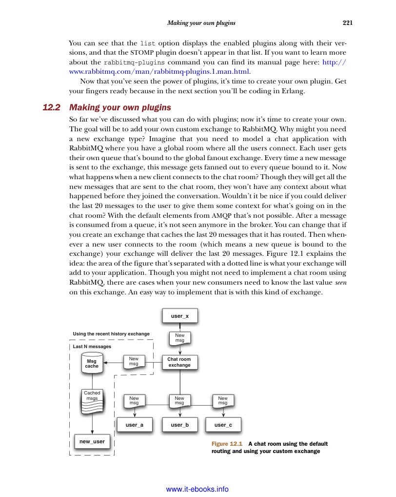
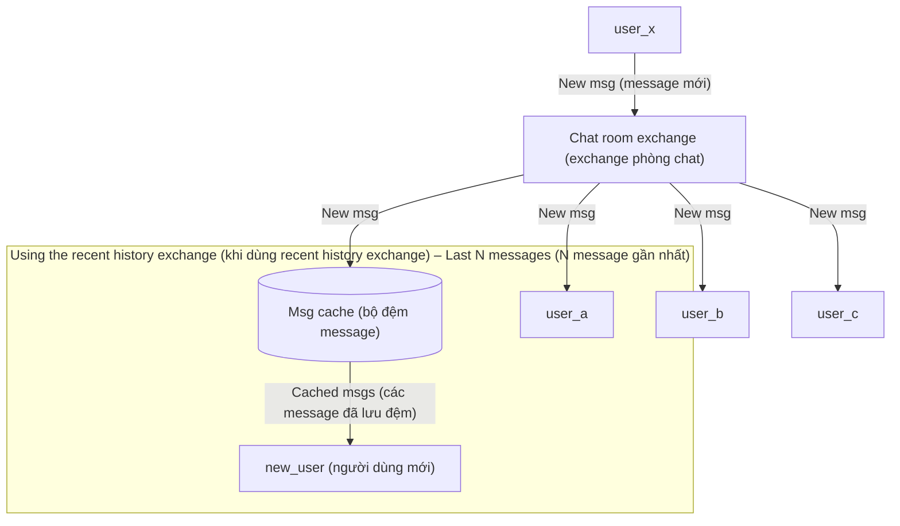
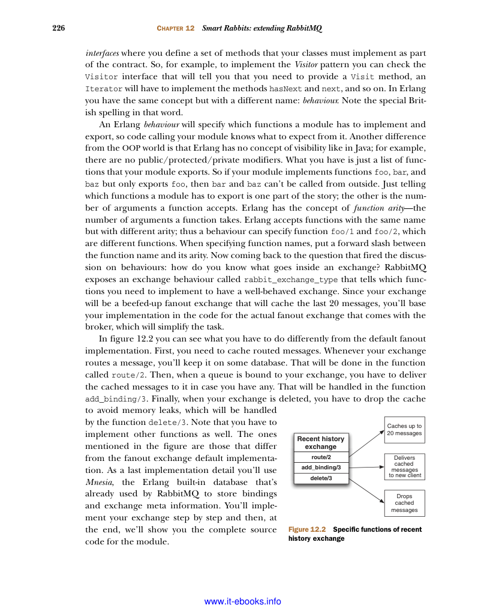
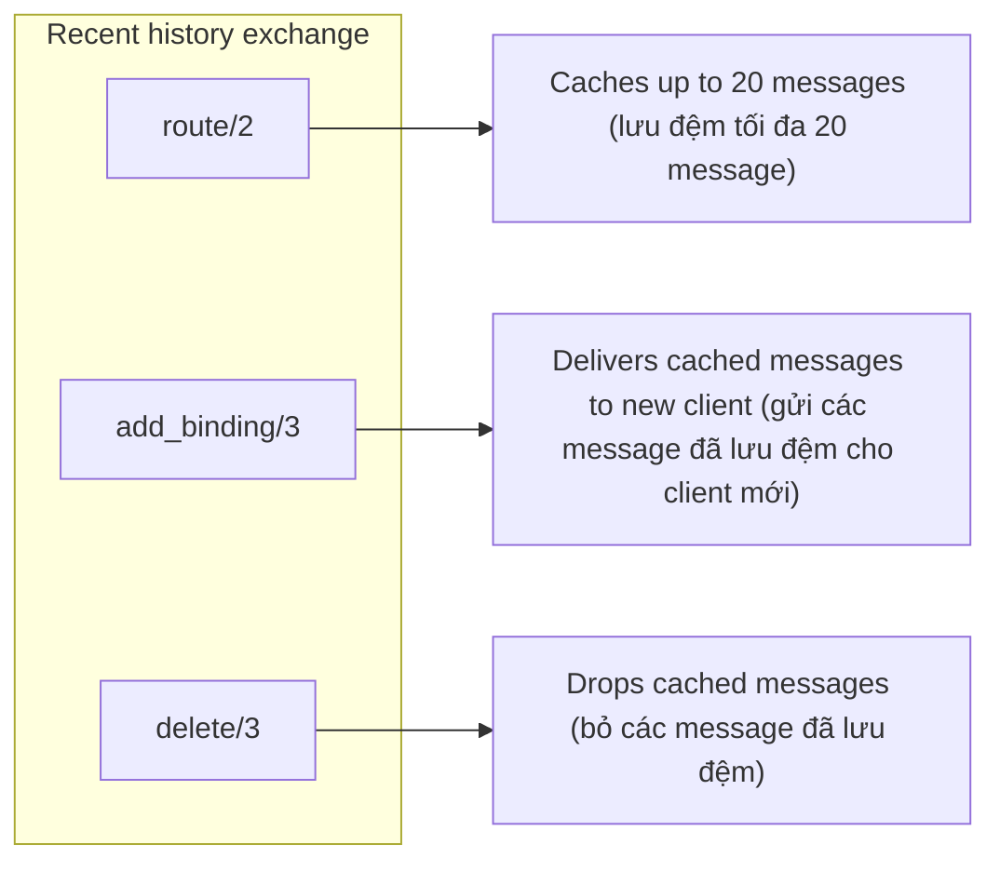
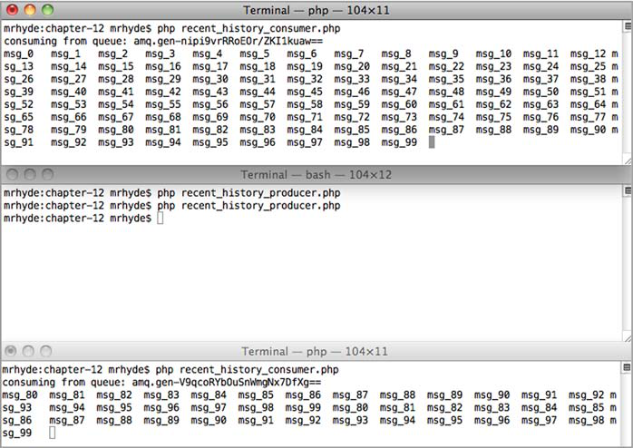

# Chương 12: Những chú thỏ thông minh – mở rộng RabbitMQ (Smart Rabbits: extending RabbitMQ)

## Mục lục chương

- [Chương này đề cập](#chương-này-đề-cập-this-chapter-covers)
- [12.1 Các plugin của RabbitMQ (RabbitMQ plugins)](#121-các-plugin-của-rabbitmq-rabbitmq-plugins)
  - [12.1.1 Plugin giúp bạn làm được gì? (What can you do with plugins?)](#1211-plugin-giúp-bạn-làm-được-gì-what-can-you-do-with-plugins)
  - [12.1.2 Tìm plugin ở đâu? (Where do you find plugins?)](#1212-tìm-plugin-ở-đâu-where-do-you-find-plugins)
  - [12.1.3 Cài đặt plugin (Installing plugins)](#1213-cài-đặt-plugin-installing-plugins)
  - [12.1.4 Gỡ bỏ plugin (Removing plugins)](#1214-gỡ-bỏ-plugin-removing-plugins)
- [12.2 Tự viết plugin của riêng bạn (Making your own plugins)](#122-tự-viết-plugin-của-riêng-bạn-making-your-own-plugins)
  - [12.2.1 Lấy RabbitMQ Public Umbrella (Getting the RabbitMQ Public Umbrella)](#1221-lấy-rabbitmq-public-umbrella-getting-the-rabbitmq-public-umbrella)
  - [12.2.2 Dựng cấu trúc thư mục (Setting up the folder structure)](#1222-dựng-cấu-trúc-thư-mục-setting-up-the-folder-structure)
  - [12.2.3 Đưa hệ thống build plugin vào dự án (Including the plugin build system)](#1223-đưa-hệ-thống-build-plugin-vào-dự-án-including-the-plugin-build-system)
  - [12.2.4 Tạo file ứng dụng Erlang (Creating the Erlang application file)](#1224-tạo-file-ứng-dụng-erlang-creating-the-erlang-application-file)
- [12.3 Tạo module exchange tùy biến (Creating your custom exchange module)](#123-tạo-module-exchange-tùy-biến-creating-your-custom-exchange-module)
  - [12.3.1 Đăng ký exchange của bạn với RabbitMQ (Registering your exchange with RabbitMQ)](#1231-đăng-ký-exchange-của-bạn-với-rabbitmq-registering-your-exchange-with-rabbitmq)
  - [12.3.2 Hiện thực behaviour của exchange (Implementing the exchange behaviour)](#1232-hiện-thực-behaviour-của-exchange-implementing-the-exchange-behaviour)
  - [12.3.3 Biên dịch exchange tùy biến (Compiling your custom exchange)](#1233-biên-dịch-exchange-tùy-biến-compiling-your-custom-exchange)
  - [12.3.4 Chạy thử plugin (Taking your plugin for a test drive)](#1234-chạy-thử-plugin-taking-your-plugin-for-a-test-drive)
- [12.4 Tóm tắt (Summary)](#124-tóm-tắt-summary)
- [Bảng thuật ngữ của chương](#bảng-thuật-ngữ-của-chương)

---

## Chương này đề cập (This chapter covers)

- Cài đặt các plugin của RabbitMQ
- Điểm qua một số plugin thú vị
- Tự hiện thực một plugin exchange tùy biến (*custom exchange*) của riêng bạn

---

Tới thời điểm này, bạn đã học cách dùng RabbitMQ như một message broker AMQP (*message broker* – “người môi giới thông điệp”, tức máy chủ trung gian nhận và chuyển phát message) với những gì có sẵn ngay khi cài đặt (*out of the box*). Ở chương 8, bạn đã thấy rằng cần có một chút tùy biến để việc quản trị broker trở nên dễ dàng hơn. Bạn đã bật plugin Management – plugin này kèm theo một giao diện web rất bóng bẩy, bổ sung hàng loạt chức năng cho máy chủ. Quy trình bật plugin rất đơn giản: bạn chạy đúng một lệnh trên shell, `rabbitmq-plugins enable rabbitmq_management`, và plugin đã sẵn sàng để dùng. Nghĩ đến điều đó, chẳng phải sẽ rất tuyệt nếu bạn có thể tự thêm các hành vi tùy biến vào broker hay sao?

Trong chương này, chúng ta sẽ đi sâu vào thế giới plugin của RabbitMQ: xem bạn có thể làm gì với chúng và chúng mang lại những tính năng gì. Bạn sẽ học cách bật plugin, và trong trường hợp không cần chức năng của chúng nữa, bạn cũng sẽ thấy cách gỡ bỏ chúng. Có thể bạn đang thắc mắc lấy plugin cho RabbitMQ ở đâu. Đừng lo, chúng tôi đã lo cho bạn phần đó rồi. Ngoài kia có rất nhiều plugin hay ho và bạn sẽ thấy lấy chúng ở đâu.

Tìm hiểu các plugin có sẵn chưa phải là tất cả. Trong phần thứ hai của chương, bạn sẽ tự làm plugin của riêng mình. Đúng vậy, bạn không đọc nhầm đâu. Bạn sẽ “xắn tay áo” lập trình bằng Erlang và tạo ra plugin của chính bạn. Đừng lo nếu bạn chưa biết Erlang; chúng tôi sẽ trình bày vừa đủ để bạn bắt đầu, nhưng nếu đã biết Erlang thì bạn sẽ thấy thoải mái hơn. Vậy hãy chuyển sang phần tiếp theo để “độ” lại chú thỏ của chúng ta (*pimp up our rabbit*)!

## 12.1 Các plugin của RabbitMQ (RabbitMQ plugins)

Nếu nhìn vào một hệ thống như RabbitMQ, bạn sẽ thấy các tính năng được phát hành kèm theo là những tính năng hữu ích cho một nhóm lớn người dùng. Điều tương tự cũng đúng với cấu hình mặc định của máy chủ, hay với những đặc tính mới đi kèm các phiên bản broker mới. Nhưng chuyện gì xảy ra khi bạn cần một thứ không có sẵn? Cho tình huống đó, RabbitMQ có thể được tăng cường bằng cách thêm **plugin** (*plugin* – gói mở rộng, cài thêm vào để bổ sung chức năng cho phần mềm gốc). Bạn có thể tìm plugin trên internet hoặc tự tạo. Trước tiên hãy xem khi nào bạn có thể cần một plugin, rồi sau đó chúng ta sẽ xem lấy plugin mới cho broker ở đâu.

### 12.1.1 Plugin giúp bạn làm được gì? (What can you do with plugins?)

Vậy những trường hợp sử dụng (*use case*) nào vượt ra ngoài những gì RabbitMQ cung cấp sẵn? Đây là danh sách các kịch bản hoặc nhu cầu có thể giải quyết bằng cách cài plugin:

- Hỗ trợ các giao thức (*protocol*) khác ngoài AMQP
- Các cơ chế xác thực (*authentication*) khác (LDAP, cơ sở dữ liệu tùy biến)
- Nhân bản message (*message replication*)
- Các exchange mới và thuật toán định tuyến (*routing*) mới
- Ghi log và kiểm toán (*audition/audit*) message

Hãy cùng điểm qua một vài trường hợp trong số đó.

#### CÁC GIAO THỨC KHÁC – STOMP (DIFFERENT PROTOCOLS—STOMP)

Một lĩnh vực đã có rất nhiều thử nghiệm là bổ sung hỗ trợ các giao thức khác chạy bên trên RabbitMQ. Như bạn đã biết, AMQP là giao thức mặc định mà RabbitMQ hỗ trợ, nhưng “một cỡ không vừa cho tất cả” (*one size doesn't fit all*), vì vậy còn có một plugin cho giao thức STOMP. STOMP là một giao thức đơn giản, dựa trên văn bản (*text-based*), dùng để truyền dữ liệu giữa các ứng dụng. Một ưu điểm của STOMP là nó cũng hoạt động với các broker khác như ActiveMQ. Nếu bạn có một codebase nhắm tới ActiveMQ và STOMP, và bạn muốn chỉ dùng RabbitMQ, thì bạn có thể bắt đầu chuyển đổi (*migrate*) từng bước bằng cách dùng plugin STOMP. Hoặc nếu bạn làm việc với một ngôn ngữ lập trình thiếu client AMQP nhưng lại có client cho STOMP, thì bạn có thể bắt đầu dùng RabbitMQ bằng cách cài plugin này. Nếu muốn tìm hiểu thêm về STOMP, bạn có thể vào trang web của nó: http://stomp.github.com/.

#### XÁC THỰC BẰNG LDAP (LDAP AUTHENTICATION)

Một trường hợp sử dụng khác cho plugin RabbitMQ là nhu cầu xác thực với broker theo một phương thức nào đó khác với AMQP thông thường. Giả sử toàn bộ việc quản lý người dùng trong các hệ thống của bạn được thực hiện qua LDAP và bạn muốn tiếp tục dùng nó khi kết nối tới RabbitMQ. Điều đó giờ đã khả thi nhờ backend xác thực LDAP (*LDAP authentication backend*): http://www.rabbitmq.com/plugins.html#rabbitmq-auth-backend-ldap. Cài plugin, thêm cấu hình phù hợp, và bạn có thể bắt đầu xác thực bằng LDAP.

> 📝 **Giải thích thêm (không có trong sách):** LDAP (*Lightweight Directory Access Protocol*) là giao thức truy cập “danh bạ” tập trung – nơi doanh nghiệp lưu tài khoản người dùng, nhóm, mật khẩu (ví dụ Microsoft Active Directory, OpenLDAP). Khi dùng plugin LDAP, thay vì tạo user riêng trong RabbitMQ bằng `rabbitmqctl add_user`, broker sẽ hỏi máy chủ LDAP xem tên đăng nhập/mật khẩu mà client gửi lên có hợp lệ không. Nhờ vậy, khi nhân viên nghỉ việc và bị khóa tài khoản LDAP, họ cũng tự động mất quyền kết nối vào RabbitMQ.

#### CÁC KIỂU EXCHANGE TÙY BIẾN (CUSTOM EXCHANGE TYPES)

Giao thức mới và cơ chế xác thực khác không phải là những thứ duy nhất bạn có thể thêm lên trên RabbitMQ. Bạn có thể đi sâu xuống tầng thấp của AMQP và tự hiện thực exchange (*exchange* – thành phần nhận message từ producer và quyết định chuyển message vào queue nào) với các luật định tuyến tùy biến. Một ví dụ thú vị về exchange tùy biến là Riak Exchange của Jon Brisbin (https://github.com/jbrisbin/riak-exchange). Riak là một kho lưu trữ khóa/giá trị (*key/value store*) lấy cảm hứng từ Dynamo, cung cấp khả năng chịu lỗi (*fault tolerance*) ngay từ đầu. Nếu bạn cần ghi log mọi message đi qua một exchange của RabbitMQ cho mục đích kiểm toán thì sao? Một cách làm là dùng một exchange kiểu fanout, bind (*bind* – gắn/ràng buộc queue vào exchange) thêm một queue nữa vào nó, rồi hiện thực bộ ghi log bằng một consumer AMQP bình thường… hoặc bạn có thể để máy chủ lo việc đó giúp bạn bằng cách dùng Riak Exchange – nó sẽ làm đúng việc đó: ghi log mọi message vào một bucket của Riak.¹

Nếu bạn cần nhân bản message từ một broker sang một broker khác nằm ở một trung tâm dữ liệu cách xa hàng dặm thì sao? Cho những trường hợp như vậy đã có plugin shovel của RabbitMQ (*shovel* – nghĩa đen là “cái xẻng”). Bạn chỉ định một tên queue trong cấu hình của plugin và một exchange đích trên broker ở xa, và plugin sẽ lo việc “xúc” (*shoveling*) các message qua đường truyền sang exchange ở xa đó.

Đó chưa phải là tất cả những gì bạn có thể làm với plugin. Bạn không phải tự giới hạn mình ở việc thêm kiểu exchange mới hay phương thức xác thực mới. Với plugin, bạn có thể làm gần như mọi thứ mà Erlang cho phép; giới hạn chỉ là trí tưởng tượng của bạn – và sự phán đoán của bạn. Suy cho cùng, bạn không muốn broker bị sập chỉ vì bạn thử hiện thực vài ý tưởng điên rồ bên trên nó. Giờ bạn đã biết những gì có thể làm được với plugin RabbitMQ, hãy xem tìm chúng ở đâu.

> ¹ *Chú thích chân trang:* Bucket trong Riak là một cách tổ chức dữ liệu, tương tự như việc dùng bảng (*table*) trong các cơ sở dữ liệu SQL.

> 💡 **Ví dụ bổ sung (không có trong sách):** So sánh hai cách ghi log kiểm toán mọi message của exchange `orders`:
>
> | Cách | Cách làm | Ưu / nhược |
> |---|---|---|
> | Dùng AMQP thuần | Khai báo `orders` là fanout, bind thêm queue `audit-log`, viết một chương trình consumer đọc `audit-log` và ghi vào cơ sở dữ liệu | Không cần sửa broker; nhưng phải viết, triển khai và giám sát thêm một tiến trình consumer |
> | Dùng exchange tùy biến (như Riak Exchange) | Khai báo exchange có kiểu do plugin cung cấp; chính broker ghi message vào Riak khi định tuyến | Không cần consumer riêng; nhưng logic chạy bên trong broker – nếu plugin lỗi có thể ảnh hưởng tới broker |
>
> Đây chính là lý do tác giả nhắc “giới hạn là trí tưởng tượng – và sự phán đoán”: code plugin chạy trong cùng máy ảo Erlang với broker.

### 12.1.2 Tìm plugin ở đâu? (Where do you find plugins?)

Nơi đầu tiên để tìm plugin RabbitMQ là trang dành riêng cho chúng trên website của RabbitMQ: www.rabbitmq.com/plugins.html. Ở đó bạn có thể tìm thấy một danh sách các plugin được bảo trì (*maintained plugins*) và một danh sách thứ hai gồm các plugin được gọi là plugin thử nghiệm (*experimental plugins*). Nhóm thứ nhất được đội ngũ RabbitMQ bảo trì và luôn được cập nhật theo các phiên bản broker mới. Bạn cũng có thể báo lỗi (*file bugs*) và đề xuất tính năng qua mailing list của RabbitMQ tại http://lists.rabbitmq.com/cgi-bin/mailman/listinfo/rabbitmq-discuss. Dù bạn cũng có thể làm vậy với các plugin thử nghiệm, nhưng bạn không thể chắc chắn sẽ có người trả lời các vấn đề của bạn với chúng.

> 📝 **Giải thích thêm (không có trong sách) – Hệ sinh thái Plugin chính thức (Tier-1) và Cộng đồng trong RabbitMQ 3.8–4.0:**
>
> Thời điểm sách viết (RabbitMQ 2.7), nhiều plugin hữu ích như `rabbitmq_consistent_hash_exchange` hay chính `rabbitmq_recent_history_exchange` (bài tập của chương này!) vẫn còn nằm rải rác trên máy chủ Mercurial cũ (`hg.rabbitmq.com`) và người dùng phải tự tải mã nguồn về biên dịch. Ngày nay, trong **RabbitMQ 3.8–3.13 và RabbitMQ 4.0**, toàn bộ các plugin cốt lõi (**Tier-1 Plugins**) đều nằm chung trong một **Git monorepo duy nhất tại `https://github.com/rabbitmq/rabbitmq-server`** và **được đóng gói sẵn 100% trong mọi bản cài đặt chuẩn (APT/RPM/Docker/Homebrew)**!
>
> Dưới đây là bảng tổng hợp các plugin mở rộng quan trọng nhất mà mọi kỹ sư RabbitMQ hiện đại cần biết:
>
> | Tên Plugin | Trạng thái đóng gói | Kiểu Exchange / Tính năng cung cấp | Giải quyết bài toán gì? |
> |---|---|---|---|
> | **`rabbitmq_consistent_hash_exchange`** | Có sẵn (Tier-1), bật bằng `rabbitmq-plugins enable` | Exchange `x-consistent-hash` | Chia tải đều message (sharding/partitioning) vào nhiều queue theo băm nhất quán (*consistent hashing*) của routing key, header hoặc message property — đảm bảo các message cùng `user_id`/`order_id` luôn vào đúng một queue theo thứ tự! |
> | **`rabbitmq_recent_history_exchange`** | Có sẵn (Tier-1), bật bằng `rabbitmq-plugins enable` | Exchange `x-recent-history` | Chính là plugin mẫu được viết ở Mục 12.2–12.3 của chương này! Nay đã được đóng gói sẵn trong RabbitMQ (hỗ trợ tham số `x-recent-history-length` tùy chỉnh số message lưu đệm). |
> | **`rabbitmq_event_exchange`** | Có sẵn (Tier-1), bật bằng `rabbitmq-plugins enable` | Exchange topic `amq.rabbitmq.event` | Phát sự kiện nội bộ của broker (tạo/xóa queue, exchange, binding, client connect/disconnect, user login/auth) thành message AMQP với routing key như `queue.created`, `connection.created`, `user.authentication.failure` — giúp giám sát/audit mà **không cần viết plugin Erlang**! |
> | **`rabbitmq_sharding`** | Có sẵn (Tier-1), bật bằng `rabbitmq-plugins enable` | Exchange `x-modulus-hash` + tự động quản lý shard | Tự động chia một "logical queue" thành nhiều queue vật lý trên khắp các node trong cluster để tăng thông lượng ghi/đọc song song. |
> | **`rabbitmq_delayed_message_exchange`** | Plugin cộng đồng chính thức (`github.com/rabbitmq/rabbitmq-delayed-message-exchange`) | Exchange `x-delayed-message` | Trì hoãn việc định tuyến message một khoảng thời gian tùy ý tính bằng mili-giây qua header `x-delay` (scheduled/delayed jobs, retry backoff) mà không làm tắc nghẽn đầu queue như TTL + DLX. |
> | **`rabbitmq_stream` & `rabbitmq_stream_management`** | Có sẵn (Tier-1, từ 3.9–4.0) | Giao thức nhị phân Stream (`5552`) | Biến RabbitMQ thành nền tảng streaming đạt >1 triệu msg/s và cho phép consumer đọc lại lịch sử từ bất kỳ thời điểm/offset nào. |
> | **`rabbitmq_prometheus`** | Có sẵn & **bật mặc định** ở 3.8–4.0 | Endpoint `/metrics` (cổng `15692`) | Xuất hàng trăm chỉ số vận hành chuẩn Prometheus/Grafana mà không tốn RAM như `rabbitmq_management` cũ. |
> | **`rabbitmq_auth_backend_oauth2`** | Có sẵn (Tier-1) | Xác thực OAuth 2.0 / JWT (Keycloak, Auth0, Okta, Entra ID) | Thay thế mật khẩu tĩnh hoặc LDAP truyền thống bằng JWT access token có thời hạn ngắn. |

> 💡 **Ví dụ bổ sung (không có trong sách) – Sử dụng `x-delayed-message`, `x-consistent-hash` và `amq.rabbitmq.event` bằng Python 3 (`pika 1.x`):**
>
> ```python
> import pika
>
> conn = pika.BlockingConnection(pika.ConnectionParameters("localhost"))
> ch = conn.channel()
>
> # --- 1. Lắng nghe sự kiện nội bộ của Broker qua rabbitmq_event_exchange ---
> # (Chạy trước: rabbitmq-plugins enable rabbitmq_event_exchange)
> res = ch.queue_declare(queue="", exclusive=True)
> audit_queue = res.method.queue
> # Bắt mọi sự kiện tạo/xóa queue và đăng nhập thất bại:
> ch.queue_bind(exchange="amq.rabbitmq.event", queue=audit_queue, routing_key="queue.*")
> ch.queue_bind(exchange="amq.rabbitmq.event", queue=audit_queue, routing_key="user.authentication.#")
>
> # --- 2. Chia tải theo Consistent Hashing (rabbitmq_consistent_hash_exchange) ---
> # (Chạy trước: rabbitmq-plugins enable rabbitmq_consistent_hash_exchange)
> ch.exchange_declare(exchange="orders.chash", exchange_type="x-consistent-hash", durable=True)
> for shard in ("orders.shard.1", "orders.shard.2"):
>     ch.queue_declare(queue=shard, durable=True)
>     # Trong x-consistent-hash, routing_key khi bind chính là "trọng số" (weight, ví dụ "10" điểm trên vòng hash)
>     ch.queue_bind(exchange="orders.chash", queue=shard, routing_key="10")
>
> # Mọi message có cùng routing_key (ví dụ customer_id="cust-99") sẽ luôn vào CÙNG một queue shard!
> ch.basic_publish(exchange="orders.chash", routing_key="cust-99", body=b'{"step": 1}')
> ch.basic_publish(exchange="orders.chash", routing_key="cust-99", body=b'{"step": 2}')
>
> # --- 3. Đặt lịch gửi message trễ 5 giây với rabbitmq_delayed_message_exchange ---
> # (Sau khi cài file .ez và chạy: rabbitmq-plugins enable rabbitmq_delayed_message_exchange)
> ch.exchange_declare(
>     exchange="notifications.delayed",
>     exchange_type="x-delayed-message",
>     durable=True,
>     arguments={"x-delayed-type": "direct"},  # Thuật toán định tuyến bên dưới khi hết thời gian chờ
> )
> ch.queue_declare(queue="reminders", durable=True)
> ch.queue_bind(exchange="notifications.delayed", queue="reminders", routing_key="remind")
>
> ch.basic_publish(
>     exchange="notifications.delayed",
>     routing_key="remind",
>     body=b"Nhac thanh toan don hang sau 5 giay!",
>     properties=pika.BasicProperties(headers={"x-delay": 5000}),  # Trễ 5000 ms (5 giây)
> )
> conn.close()
> ```

### 12.1.3 Cài đặt plugin (Installing plugins)

Bạn đã thấy rằng kể từ RabbitMQ phiên bản 2.7.0, việc cài plugin rất dễ: chỉ cần chạy một lệnh như `./rabbitmq-plugins enable rabbitmq_management`, khởi động lại máy chủ, và gần như vậy là xong. Plugin đã sẵn sàng để dùng! Câu hỏi bây giờ là: chuyện gì xảy ra khi bạn muốn bật một plugin không nằm trong bản phân phối (*distribution*) của broker?

Trước tiên bạn sẽ phải tải các file `.ez` của plugin vào thư mục `plugins`² trong thư mục cài đặt RabbitMQ của bạn, và sau khi file đã ở đó, chạy lệnh quen thuộc `./rabbitmq-plugins enable plugin_name`.

> ² *Chú thích chân trang:* Nếu bạn không có thư mục `plugins`, chỉ cần tạo nó bên trong thư mục cài đặt của RabbitMQ. Thư mục này cũng có thể được xóa an toàn về sau, trong trường hợp bạn không muốn dùng plugin nào.

> 📝 **Giải thích thêm (không có trong sách):** File `.ez` là một “Erlang archive” – thực chất là file ZIP chứa một ứng dụng Erlang đã biên dịch (các file `.beam`, file `.app`, thư mục `include`, `priv`...). Máy ảo Erlang có thể nạp code trực tiếp từ file nén này mà không cần giải nén, giống như Java nạp class từ file `.jar`.

Hãy thử các hướng dẫn này bằng cách bật plugin STOMP. Di chuyển vào thư mục `sbin` của bản cài RabbitMQ và gõ:

```bash
$ ./rabbitmq-plugins enable rabbitmq_stomp
The following plugins have been enabled:
  rabbitmq_stomp
Plugin configuration has changed. Restart RabbitMQ
for changes to take effect.
```

(Kết quả: “Các plugin sau đã được bật: rabbitmq_stomp. Cấu hình plugin đã thay đổi. Hãy khởi động lại RabbitMQ để thay đổi có hiệu lực.”)

Bây giờ hãy dừng broker trong trường hợp nó đang chạy:

```bash
$ ./rabbitmqctl stop
Stopping and halting node rabbit@mrhyde ...
...done.
```

Rồi khởi động lại để nạp plugin mới:

```bash
$ ./rabbitmq-server -detached
Activating RabbitMQ plugins ...
7 plugins activated:
* amqp_client-2.7.0
* mochiweb-1.3-rmq2.7.0-git
* rabbitmq_management-2.7.0
* rabbitmq_management_agent-2.7.0
* rabbitmq_mochiweb-2.7.0
* rabbitmq_stomp-2.7.0
* webmachine-1.7.0-rmq2.7.0-hg
```

Như bạn thấy, bên cạnh các plugin khác đã được cài từ trước, máy chủ liệt kê plugin `rabbitmq_stomp-2.7.0` cùng với các plugin đã được kích hoạt. Plugin STOMP sẽ hoạt động với cấu hình mặc định của nó. Để kiểm tra nó chạy đúng như mong đợi, hãy kết nối tới RabbitMQ bằng giao thức STOMP với thông tin đăng nhập mặc định. Ta sẽ dùng `nc`, tiện ích dòng lệnh netcat:

```bash
$ nc localhost 61613
```

Lệnh trên sẽ mở một kết nối tới máy chủ. Mọi thứ bạn gõ từ giờ sẽ được gửi tới bộ chuyển đổi STOMP (*STOMP adapter*), bộ này sẽ cố gắng phân tích (*parse*) các frame (*frame* – khung dữ liệu, đơn vị thông điệp của giao thức). Giờ hãy nhập nội dung sau để bắt đầu một phiên làm việc (*session*):

```text
CONNECT
login:guest
passcode:guest

^@
```

Sau khi nhập thông tin đăng nhập, bạn cần thêm một dòng trống, báo hiệu phần thân (*body*) rỗng, rồi nhập `^@` (phím Control cùng với ký hiệu a còng `@`), báo hiệu kết thúc frame. Nếu mọi thứ suôn sẻ, bạn sẽ nhận được phản hồi với một phiên mới như sau:

```text
CONNECTED
session:session-ds/mGfvEV6TkPXPVcUv8YA==
heart-beat:0,0
version:1.0
```

Với ví dụ nhỏ này, chúng ta kết thúc phần thử nghiệm plugin STOMP. Mục tiêu của chúng ta là cài nó và thấy rằng không cần cấu hình gì (*zero configuration*) bạn vẫn có thể cho nó chạy. Bạn có thể thoát phiên bằng cách nhấn `^c` (Ctrl+C). Nếu muốn tìm hiểu thêm về cách dùng STOMP với RabbitMQ, bạn có thể tham khảo tài liệu tại http://www.rabbitmq.com/stomp.html.

> 💡 **Ví dụ bổ sung (không có trong sách):** Tiếp tục phiên netcat ở trên, bạn có thể thử gửi và nhận message thật bằng STOMP. Mỗi frame vẫn kết thúc bằng dòng trống + `^@`:
>
> ```text
> SUBSCRIBE
> destination:/queue/test
>
> ^@
> SEND
> destination:/queue/test
>
> hello from STOMP
> ^@
> ```
>
> Ngay sau frame `SEND`, máy chủ sẽ đẩy về một frame `MESSAGE` chứa `hello from STOMP`. Trong RabbitMQ, đích `/queue/test` được ánh xạ thành một queue AMQP tên `test`, nên một client AMQP (ví dụ PHP, Python) cũng có thể consume chính queue đó – đây là cách STOMP và AMQP “nói chuyện” với nhau qua cùng một broker.

### 12.1.4 Gỡ bỏ plugin (Removing plugins)

Giờ giả sử bạn không cần plugin STOMP nữa và muốn gỡ nó. Việc này dễ dàng thực hiện bằng chính các lệnh `rabbitmq-plugins` mà bạn đã dùng nãy giờ. Trước tiên bạn phải tắt (*disable*) plugin bằng cách chạy lệnh sau từ thư mục `sbin`:

```bash
$ ./rabbitmq-plugins disable rabbitmq_stomp
The following plugins have been disabled:
  rabbitmq_stomp
Plugin configuration has changed. Restart RabbitMQ
for changes to take effect.
```

Sau đó bạn phải dừng máy chủ:

```bash
$ ./rabbitmqctl stop
Stopping and halting node rabbit@mrhyde ...
...done.
```

Và rồi bạn có thể khởi động lại máy chủ:

```bash
$ ./rabbitmq-server -detached
Activating RabbitMQ plugins ...
6 plugins activated:
* amqp_client-2.7.0
* mochiweb-1.3-rmq2.7.0-git
* rabbitmq_management-2.7.0
* rabbitmq_management_agent-2.7.0
* rabbitmq_mochiweb-2.7.0
* webmachine-1.7.0-rmq2.7.0-hg
```

Bạn có thể liệt kê các plugin đã bật để chắc chắn plugin STOMP đã bị tắt:

```bash
$ ./rabbitmq-plugins list -e
[e] amqp_client               2.7.0
[e] mochiweb                  1.3-rmq2.7.0-git
[E] rabbitmq_management       2.7.0
[e] rabbitmq_management_agent 2.7.0
[e] rabbitmq_mochiweb         2.7.0
[e] webmachine                1.7.0-rmq2.7.0-hg
```

Bạn có thể thấy tùy chọn `list` hiển thị các plugin đã bật cùng với phiên bản của chúng, và plugin STOMP không xuất hiện trong danh sách đó. Nếu muốn tìm hiểu thêm về lệnh `rabbitmq-plugins`, bạn có thể tìm trang hướng dẫn (*manual page*) của nó tại đây: http://www.rabbitmq.com/man/rabbitmq-plugins.1.man.html.

> 📝 **Giải thích thêm (không có trong sách):** Trong output của `rabbitmq-plugins list`, ký hiệu `[E]` (chữ hoa) nghĩa là plugin được bật **trực tiếp** (explicitly – bạn đã chạy `enable` cho nó), còn `[e]` (chữ thường) nghĩa là plugin được bật **gián tiếp** vì là phụ thuộc (*dependency*) của một plugin khác. Ở đây chỉ `rabbitmq_management` có `[E]`; các plugin như `mochiweb`, `webmachine`, `amqp_client`... được bật kéo theo vì Management cần chúng. Tùy chọn `-e` nghĩa là chỉ liệt kê các plugin đang bật.
>
> **Khác biệt quan trọng trên RabbitMQ 3.x–4.0 (Bật/tắt plugin nóng không cần restart):**
> Trong RabbitMQ 2.7 (thời điểm sách viết), sau khi chạy `rabbitmq-plugins enable` hoặc `disable`, bạn bắt buộc phải `rabbitmqctl stop` rồi khởi động lại broker. Kể từ RabbitMQ 3.0 trở đi (và trên **RabbitMQ 3.8–4.0**), `rabbitmq-plugins` mặc định thực hiện **kích hoạt nóng lúc runtime (*online activation*)**:
> - Chạy `rabbitmq-plugins enable rabbitmq_stomp` khi broker đang chạy sẽ **nạp và khởi chạy ứng dụng Erlang của plugin ngay lập tức** mà không làm gián đoạn bất kỳ kết nối AMQP nào!
> - Nếu broker đang dừng và bạn chỉ muốn ghi trước danh sách plugin vào file `/etc/rabbitmq/enabled_plugins` cho lần khởi động tới (ví dụ khi đóng gói Dockerfile), hãy truyền cờ `--offline`:
>   ```bash
>   rabbitmq-plugins enable --offline rabbitmq_management rabbitmq_prometheus rabbitmq_stream
>   ```
> - Ngoài ra, các thư viện web nội bộ cũ như `mochiweb`, `webmachine`, `rabbitmq_mochiweb` trong output năm 2011 ở trên đã được thay thế hoàn toàn bởi HTTP server **Cowboy (`cowboy`, `cowlib`, `ranch`)** hiệu năng cao hơn nhiều trong RabbitMQ hiện đại.

Giờ bạn đã thấy sức mạnh của plugin, đã đến lúc tạo plugin của riêng bạn. Hãy chuẩn bị sẵn những ngón tay, vì trong phần tiếp theo bạn sẽ lập trình bằng Erlang.

## 12.2 Tự viết plugin của riêng bạn (Making your own plugins)

Đến giờ chúng ta đã bàn về những gì bạn có thể làm với plugin; giờ là lúc tự tạo plugin của bạn. Mục tiêu sẽ là thêm một exchange tùy biến của riêng bạn vào RabbitMQ. Tại sao bạn lại cần một kiểu exchange mới? Hãy tưởng tượng bạn cần mô hình hóa một ứng dụng chat bằng RabbitMQ, trong đó có một phòng chung (*global room*) mà mọi người dùng đều kết nối vào. Mỗi người dùng có queue riêng của mình, được bind vào exchange fanout chung đó. Mỗi khi có message mới gửi tới exchange, message này được “phát tán” (*fanned out*) tới mọi queue đang bind vào nó. Vậy chuyện gì xảy ra khi một client mới kết nối vào phòng chat? Dù họ sẽ nhận được mọi message mới gửi vào phòng, họ sẽ không có chút ngữ cảnh nào về những gì đã diễn ra trước khi họ tham gia cuộc trò chuyện. Chẳng phải sẽ rất hay nếu bạn có thể gửi cho người dùng 20 message gần nhất để họ nắm được bối cảnh trong phòng chat hay sao? Với những thành phần mặc định của AMQP thì điều đó không thể. Sau khi một message được consume khỏi queue, broker sẽ không còn thấy nó nữa. Bạn có thể thay đổi điều đó nếu bạn tạo một exchange lưu đệm (*cache*) 20 message gần nhất mà nó đã định tuyến. Khi đó, mỗi khi có người dùng mới kết nối vào phòng (nghĩa là một queue mới được bind vào exchange), exchange của bạn sẽ gửi 20 message gần nhất. Hình 12.1 giải thích ý tưởng này: vùng của hình được tách ra bằng đường nét đứt chính là phần mà exchange của bạn sẽ bổ sung vào ứng dụng. Dù có thể bạn không cần hiện thực một phòng chat bằng RabbitMQ, vẫn có những trường hợp mà consumer mới cần biết giá trị cuối cùng đã *được thấy* trên exchange này. Một cách dễ dàng để hiện thực điều đó chính là dùng loại exchange như thế này.



**Hình 12.1 – Một phòng chat dùng định tuyến mặc định và dùng exchange tùy biến của bạn**

Sơ đồ vẽ lại:



Mô tả hình: `user_x` gửi một message mới (*New msg*) tới **Chat room exchange**. Phần bên phải là định tuyến mặc định kiểu fanout: exchange chép message mới đó tới `user_a`, `user_b`, `user_c`. Phần nằm trong khung nét đứt, có nhãn “*Using the recent history exchange*” và “*Last N messages*”, là phần mà exchange tùy biến bổ sung: mỗi message mới cũng được ghi vào **Msg cache** (bộ đệm message); khi `new_user` (người dùng mới) tham gia, bộ đệm gửi cho họ các message đã lưu (*Cached msgs*).

Trong phần này bạn sẽ hiện thực một exchange như vậy, đặt tên là **RabbitMQ Recent History Exchange** (exchange “lịch sử gần đây”). Như thường lệ, toàn bộ mã nguồn của dự án này có trong phần code đi kèm cuốn sách. Hãy tìm thư mục có tên `rabbitmq-recent-history-exchange`. Trong phần tiếp theo, bạn sẽ dựng môi trường phát triển để sẵn sàng bắt đầu tạo plugin. Hãy nhớ rằng bạn sẽ lập trình bằng Erlang.

> 💡 **Ví dụ bổ sung (không có trong sách):** Ngoài phòng chat, một bài toán thực tế khác là **bảng giá chứng khoán**. Exchange `stock.prices` liên tục nhận giá mới của mã VNM, FPT... Một màn hình giao dịch vừa mở lên sẽ trống trơn cho tới khi có lần cập nhật giá kế tiếp (có thể vài giây, thậm chí vài phút với mã ít giao dịch). Nếu exchange lưu đệm N message gần nhất, ngay khi queue của màn hình mới được bind vào, nó nhận luôn các giá gần nhất và hiển thị được ngay. Đây chính là ý “consumer mới cần biết giá trị cuối cùng đã được thấy” (*last value cache*) mà tác giả nhắc tới.

### 12.2.1 Lấy RabbitMQ Public Umbrella (Getting the RabbitMQ Public Umbrella)

Để viết plugin của riêng mình, bạn sẽ cần dựng một môi trường phát triển cơ bản để làm nền xây dựng plugin. Các nhà phát triển RabbitMQ đã giúp bạn việc này bằng cách tạo sẵn một môi trường gọi là **RabbitMQ Public Umbrella** (“chiếc ô công khai” của RabbitMQ – từ giờ ta gọi tắt là *umbrella*). Cài đặt nó chỉ đơn giản là checkout (*check out* – lấy mã nguồn về) repository của nó rồi thêm plugin của bạn vào cấu trúc dự án đó. Để lấy mã của umbrella, bạn sẽ phải cài Mercurial – một hệ thống quản lý phiên bản phân tán (*distributed revision control system*) tương tự Git. Mercurial là hệ thống mà các nhà phát triển RabbitMQ dùng để công bố và quản lý mã nguồn mở của họ. Nếu bạn đã cài nó rồi thì cứ thế tiếp tục. Mercurial là hệ thống đa nền tảng, nên bạn có thể cài nó trên nền tảng của mình. Quy trình cài đặt đơn giản; hãy vào website của Mercurial (http://mercurial.selenic.com/) và tải phiên bản phù hợp với máy tính của bạn. Đừng lo nếu bạn chưa từng dùng Mercurial; bạn sẽ chỉ dùng vài lệnh để lấy mã nguồn của umbrella.

Nếu bạn đã làm theo các ví dụ code trong sách, có lẽ bạn đã cài Python rồi; nếu chưa, đây là lúc cài vì một số công cụ trong umbrella cần nó (kể cả bản thân Mercurial). Xem hướng dẫn cài đặt trên website của Python: http://www.python.org/. Yêu cầu cuối cùng là máy bạn phải cài Erlang; nếu bạn chạy được RabbitMQ thì hẳn bạn đã cài nó. Tương tự Python, hãy xem website của Erlang để biết hướng dẫn cài đặt: http://www.erlang.org/.

Bây giờ hãy lấy mã nguồn của umbrella. Giả sử bạn đã cài Mercurial, bạn có thể lấy code bằng lệnh sau:

```bash
$ hg clone http://hg.rabbitmq.com/rabbitmq-public-umbrella/
```

Khi repository đã được clone về máy, đến lúc lấy các dự án chứa bên trong nó. Hãy chạy các lệnh sau, nhưng nhớ pha sẵn một tách cà phê vì có thể mất khá lâu:

```bash
$ cd rabbitmq-public-umbrella
$ make co
```

Như một bước tùy chọn để kiểm tra môi trường đã hoạt động đúng chưa, bạn có thể chạy hai lệnh sau để biên dịch plugin `rabbitmq-stomp`:

```bash
$ cd rabbitmq-stomp/
$ make
```

Nếu mọi thứ suôn sẻ, bạn sẽ thấy output trên console kết thúc như sau:

```text
[elided] generate deps
[elided] fix test deps
sed -i -e 's|build/deps.mk|$(DEPS_FILE)|' build/deps.mk
rm -rf build/dep-ezs
mkdir -p build/dep-ezs
....
many lines trimmed out
....
touch dist/.done.0.0.0
touch dist/.done
```

(“`[elided]`” và “`many lines trimmed out`” nghĩa là nhiều dòng đã được lược bớt trong sách.)

Việc tiếp theo cần làm là tạo cấu trúc thư mục cho plugin của bạn. Gõ `cd ..` để quay về thư mục umbrella trước khi tiếp tục sang phần sau.

> 📝 **Giải thích thêm (không có trong sách) – Sự khai tử của Mercurial (`hg.rabbitmq.com`) & `rabbitmq-public-umbrella`, và Kiến trúc Git Monorepo hiện đại:**
>
> Lệnh `make co` (viết tắt của *checkout*) trong sách là một target trong Makefile của umbrella thời năm 2012: nó lần lượt clone hàng chục repository Mercurial con (`rabbitmq-server`, `rabbitmq-codegen`, `rabbitmq-erlang-client`, `rabbitmq-stomp`, `rabbitmq-management`...) từ `http://hg.rabbitmq.com/` vào bên trong thư mục `rabbitmq-public-umbrella`.
>
> **Cập nhật quan trọng cho độc giả hiện nay (RabbitMQ 3.8–3.13 & RabbitMQ 4.0):**
> 1. **Máy chủ Mercurial `hg.rabbitmq.com` và dự án `rabbitmq-public-umbrella` đã ngừng hoạt động từ lâu!** Nếu bạn gõ lệnh `hg clone http://hg.rabbitmq.com/rabbitmq-public-umbrella/` ngày nay, lệnh sẽ báo lỗi không thể kết nối (`HTTP Error 404 / Name or service not known`).
> 2. **Chuyển sang Git Monorepo duy nhất (`https://github.com/rabbitmq/rabbitmq-server`):** Toàn bộ mã nguồn lõi của RabbitMQ cùng tất cả các plugin chính thức (Tier-1 plugins nằm trong thư mục `deps/` của monorepo, bao gồm cả `rabbitmq_recent_history_exchange` và `rabbitmq_consistent_hash_exchange`) nay đều được quản lý trong **một kho Git duy nhất trên GitHub**.
> 3. **Plugin `rabbitmq_recent_history_exchange` và `rabbitmq_consistent_hash_exchange` đã được cài sẵn!** Bạn **không cần** phải tải mã nguồn hay tự biên dịch bài tập của chương này để sử dụng trong thực tế nữa — chỉ cần chạy một lệnh duy nhất:
>    ```bash
>    rabbitmq-plugins enable rabbitmq_recent_history_exchange
>    rabbitmq-plugins enable rabbitmq_consistent_hash_exchange
>    ```
>
> | Tiêu chí | RabbitMQ 2.7 (Trong sách – 2012) | RabbitMQ 3.8–3.13 & RabbitMQ 4.0 (Hiện đại) |
> |---|---|---|
> | **Hệ thống quản lý mã nguồn** | Mercurial (`hg clone http://hg.rabbitmq.com/...`) | **Git Monorepo** (`git clone https://github.com/rabbitmq/rabbitmq-server.git`) |
> | **Tổ chức kho chứa plugin** | Tách rời hàng chục repo con, ghép bằng `rabbitmq-public-umbrella` (`make co`) | Gom toàn bộ vào thư mục `deps/` ngay trong monorepo `rabbitmq-server` |
> | **`rabbitmq_recent_history_exchange` & `rabbitmq_consistent_hash_exchange`** | Phải tự clone và build từ mã nguồn | **Đóng gói sẵn (Tier-1)** trong mọi bản cài đặt, bật ngay bằng `rabbitmq-plugins enable` |
> | **Hệ thống Build (Build System)** | `umbrella.mk` + `package.mk` | **`erlang.mk` / `Bazel`** (cho monorepo & plugin Erlang) hoặc **`rebar3` / `Mix` (Elixir)** cho plugin độc lập |

### 12.2.2 Dựng cấu trúc thư mục (Setting up the folder structure)

Bạn sẽ xây dựng plugin theo các chuẩn viết code của **Open Telecom Platform (OTP)** – bạn sẽ tuân theo một cấu trúc thư mục nhất định, các quy ước đặt tên file, và cách tổ chức mã nguồn sử dụng một số mẫu lập trình (*programming pattern*) phù hợp với Erlang. Vì đây là sách về RabbitMQ, chúng tôi không có thời gian trình bày Erlang chi tiết, nhưng nếu bạn tò mò và muốn tìm hiểu thêm, chúng tôi giới thiệu cuốn *Erlang and OTP in Action* của Manning (http://manning.com/logan/) hoặc *Learn You Some Erlang for Great Good* (http://learnyousomeerlang.com/). Code được trình bày sẽ dễ nắm bắt ngay cả khi bạn chưa có kinh nghiệm Erlang, nhưng xin báo trước là một số kỹ thuật có thể trông lạ lẫm nếu bạn chưa từng dùng Erlang hay lập trình hàm (*functional programming*).

Cấu trúc thư mục cho plugin rất đơn giản. Vì bạn sẽ đặt tên nó là RabbitMQ Recent History Exchange, hãy tạo một thư mục bên trong dự án umbrella tên là `rabbitmq-recent-history-exchange`. Bên trong nó, bạn cần một thư mục để chứa mã nguồn, tên là `src`. Đơn giản vậy thôi:

```bash
cd ..
mkdir rabbitmq-recent-history-exchange
cd rabbitmq-recent-history-exchange
mkdir src
```

Bước tiếp theo là đưa hệ thống build của umbrella vào dự án của bạn.

### 12.2.3 Đưa hệ thống build plugin vào dự án (Including the plugin build system)

Để có thể dùng hệ thống build của umbrella, bạn cần thêm vài file vào thư mục gốc của dự án. File đầu tiên tên là `Makefile` và sẽ tham chiếu tới make file của umbrella. Thêm nội dung sau vào nó:

```makefile
include ../umbrella.mk
```

Bằng cách tham chiếu tới file `umbrella.mk`, bạn được hưởng toàn bộ các lệnh đã được tạo sẵn cho bạn. Có những lệnh có thể đóng gói plugin thành file `.ez`, và những lệnh khác có thể chạy plugin bên trong broker trực tiếp từ thư mục dự án, giúp bạn kiểm thử plugin dễ dàng hơn. Có các lệnh dọn dẹp các file đã build và còn nhiều nữa. Để xem danh sách đầy đủ các tùy chọn, hãy tham khảo file `README.makefiles` bên trong thư mục umbrella.

Giờ khi `Makefile` đã có, bạn có thể thêm file `package.mk` – file này chứa các tùy chọn cấu hình riêng cho plugin dành cho hệ thống build. Hãy tạo file đó trong thư mục dự án và thêm nội dung sau:

```makefile
DEPS:=rabbitmq-server rabbitmq-erlang-client
RETAIN_ORIGINAL_VERSION:=true
```

Như bạn thấy, không thể đơn giản hơn được nữa. Những gì bạn làm ở đây là chỉ định các phụ thuộc của plugin trong macro `DEPS` và đặt macro `RETAIN_ORIGINAL_VERSION` thành `true` để báo cho hệ thống build lấy số phiên bản của plugin từ số phiên bản mà bạn sắp gán cho plugin. Vì bạn sẽ xây dựng một exchange tùy biến, bạn cần một số chức năng đã có sẵn trong dự án `rabbitmq-server` và một số tính năng khác từ `rabbitmq-erlang-client`; do đó bạn chỉ định trong file `package.mk` rằng plugin của bạn phụ thuộc vào hai dự án đó. Điều hay ở đây là hệ thống build của umbrella sẽ lo việc giải quyết các phụ thuộc giúp bạn. Giờ bạn đã có đủ mọi thứ để bắt đầu viết plugin, hãy tiếp tục bằng việc viết file đặc tả ứng dụng (*application specification file*).

> 💡 **Ví dụ bổ sung (không có trong sách):** Sau bước này, cây thư mục của bạn trong umbrella trông như sau:
>
> ```text
> rabbitmq-public-umbrella/
> ├── umbrella.mk
> ├── rabbitmq-server/
> ├── rabbitmq-erlang-client/
> ├── rabbitmq-stomp/
> └── rabbitmq-recent-history-exchange/
>     ├── Makefile        # include ../umbrella.mk
>     ├── package.mk      # DEPS và RETAIN_ORIGINAL_VERSION
>     └── src/            # sắp chứa .app.src và .erl
> ```
>
> Lưu ý `include ../umbrella.mk` dùng đường dẫn tương đối, nên thư mục plugin **bắt buộc** phải nằm ngay bên trong thư mục umbrella; nếu đặt chỗ khác, `make` sẽ báo lỗi không tìm thấy `umbrella.mk`.

> 📝 **Giải thích thêm (không có trong sách) – Hệ thống Build Plugin hiện đại (`erlang.mk`, `rebar3`, `Mix` / Elixir) trong RabbitMQ 3.8–4.0:**
>
> Trong RabbitMQ hiện đại, bộ đôi `umbrella.mk` + `package.mk` đã bị loại bỏ hoàn toàn. Nếu bạn tự viết một plugin cho RabbitMQ 3.8–4.0 ngày nay, quy trình chuẩn dùng **`erlang.mk`** (hoặc **`rebar3`**, thậm chí viết bằng ngôn ngữ **Elixir** với công cụ **`Mix`** vì cả Erlang và Elixir đều biên dịch ra bytecode `.beam` chạy trên máy ảo BEAM!):
>
> ```makefile
> # Makefile chuẩn của một plugin RabbitMQ hiện đại (dùng erlang.mk)
> PROJECT = rabbitmq_recent_history_exchange
> PROJECT_DESCRIPTION = RabbitMQ Recent History Exchange
> PROJECT_MOD = rabbit_exchange_type_recent_history
>
> # Khai báo các ứng dụng phụ thuộc từ monorepo rabbitmq-server
> DEPS = rabbit_common rabbit amqp_client
> TEST_DEPS = rabbitmq_ct_helpers rabbitmq_ct_client_helpers
>
> DEP_EARLY_PLUGINS = rabbit_common/mk/rabbitmq-early-plugin.mk
> DEP_PLUGINS = rabbit_common/mk/rabbitmq-plugin.mk
>
> include rabbitmq-components.mk
> include erlang.mk
> ```
>
> Các lệnh phát triển và chạy thử cũng thay đổi tương ứng:
> - Thay cho `make run-in-broker` cũ (ở mục 12.3.3), trong `erlang.mk` hiện đại bạn dùng:
>   ```bash
>   make run-broker          # Khởi chạy node RabbitMQ kèm plugin đang phát triển trong shell Erlang
>   make dist                # Đóng gói file .ez vào thư mục plugins/
>   make ct                  # Chạy bộ kiểm thử tự động Common Test
>   ```

### 12.2.4 Tạo file ứng dụng Erlang (Creating the Erlang application file)

Giờ khi các yêu cầu cơ bản đã sẵn sàng, hãy tạo file đặc tả ứng dụng. Có thể bạn đang thắc mắc đó là gì – rốt cuộc *ứng dụng* (*application*) là gì? Các chương trình Erlang được tổ chức thành các ứng dụng, nơi chứa các module hiện thực chức năng của nó. Những thứ như danh sách các module Erlang có trong ứng dụng, hay các tùy chọn cấu hình, được chỉ định trong file đặc tả ứng dụng. Khi tạo file đặc tả ứng dụng, bạn cần liệt kê các module Erlang có trong ứng dụng – một việc hơi nhàm chán. May thay, bước này có thể được đơn giản hóa bằng cách dùng các **mẫu đặc tả ứng dụng** (*application specification templates*), về sau sẽ được hệ thống build của umbrella tự động điền các thông tin đó. Điều này có nghĩa là bạn không phải lo việc giữ danh sách module luôn cập nhật; hệ thống build sẽ làm điều đó cho bạn. Vì vậy, dù trong một dự án Erlang thông thường bạn sẽ tạo một file ứng dụng thuần, trong trường hợp này bạn sẽ tạo một template cho nó và để hệ thống umbrella tự động điền thông tin. Hãy tạo file template này bên trong thư mục `src` và đặt tên là `rabbitmq_recent_history_exchange.app.src`. File có nội dung như sau:

```erlang
{application, rabbitmq_recent_history_exchange,
 [{description, "RabbitMQ Recent History Exchange"},
  {vsn, "0.1.0"},
  {modules, []},
  {registered, []},
  {applications, [kernel, stdlib, rabbit, mnesia]}]}.
```

Những gì bạn có ở đây là một **tuple** của Erlang – một kiểu dữ liệu phức hợp chứa một số lượng cố định các giá trị Erlang (gọi là *term*).³ Nếu đơn giản hóa cấu trúc đó, bạn sẽ thấy nó có hình dạng sau:

```erlang
{application, application_name, [{key1, val1}, ..., {keyN, valN}]}.
```

> ³ *Chú thích chân trang:* Nếu bạn muốn biết thêm về các kiểu dữ liệu của Erlang, hãy tham khảo http://www.erlang.org/doc/reference_manual/data_types.html.

Đó là một tuple với phần tử đầu tiên là **atom** có tên `application` – atom giống như *symbol* trong Ruby hay *keyword* trong Clojure. Phần tử thứ hai là một atom chứa tên ứng dụng. Cuối cùng, phần tử thứ ba là một **list** (danh sách) của Erlang, được giới hạn bởi các ký tự `[` và `]`. List này được gọi là **property list** (danh sách thuộc tính) vì nó chứa các tuple gồm khóa và giá trị. Nếu xem chi tiết nội dung, bạn có, ví dụ, thuộc tính description `{description, "RabbitMQ Recent History Exchange"}` mang thông tin ứng dụng đang làm gì. Bạn có thể đặt bất kỳ chuỗi nào ở đó để làm mô tả. Giá trị `vsn` chỉ định số phiên bản ứng dụng. Vì bạn vừa mới tạo nó, bạn đánh dấu là `0.1.0`. Tiếp theo là list sẽ chứa các module Erlang mà ứng dụng dùng. Như đã nói, list này sẽ được hệ thống build của umbrella tự động điền. Thuộc tính `registered` cho biết những tiến trình (*process*) nào sẽ được ứng dụng của bạn đăng ký; trong ví dụ này bạn để nó là list rỗng. Cuối cùng, bạn chỉ định những ứng dụng nào phải đang chạy để plugin hoạt động đúng. Bạn cần nhân Erlang `kernel` và thư viện chuẩn `stdlib`. Về phía RabbitMQ, bạn cần broker đang chạy; vì vậy bạn thêm ứng dụng `rabbit` vào đó. Yêu cầu cuối cùng: vì bạn sẽ dùng cơ sở dữ liệu Mnesia của Erlang, bạn cũng thêm nó vào.

> 📝 **Giải thích thêm (không có trong sách):** Để dễ hình dung, có thể so sánh với các ngôn ngữ quen thuộc:
>
> | Erlang | Tương đương gần đúng | Ví dụ |
> |---|---|---|
> | atom `ok`, `application` | hằng enum / symbol Ruby `:ok` | `ok`, `error`, `fanout` |
> | tuple `{a, b}` | một bản ghi cố định số phần tử (như tuple Python) | `{vsn, "0.1.0"}` |
> | list `[...]` | danh sách liên kết, độ dài tùy ý | `[kernel, stdlib]` |
> | property list `[{k, v}, ...]` | gần giống dictionary/map dạng danh sách cặp | `[{vsn, "0.1.0"}, {modules, []}]` |
>
> Nếu viết file này bằng JSON thì đại ý sẽ là: `{"application": "rabbitmq_recent_history_exchange", "description": "...", "vsn": "0.1.0", "modules": [], "registered": [], "applications": ["kernel","stdlib","rabbit","mnesia"]}`. Dấu chấm `.` ở cuối là bắt buộc trong Erlang – nó kết thúc một “term” hoặc một biểu thức cấp cao nhất.

Trước khi bắt đầu viết logic của exchange, hãy chắc chắn `Makefile` đã được thiết lập đúng. Gõ `make` bên trong thư mục plugin. Bạn sẽ bắt đầu thấy rất nhiều output trên dòng lệnh. Điều đó là bình thường: đó là hệ thống build đang build mọi phụ thuộc của plugin, như client AMQP cho Erlang và cả bản thân broker. Sau khi quá trình kết thúc, bạn sẽ để ý thấy có vài thư mục mới trong thư mục gốc dự án. Thư mục thú vị nhất tên là `dist`, hay thư mục phân phối (*distribution folder*), nơi các file plugin cuối cùng sẽ được đặt vào. Hãy thử lệnh sau trên terminal:

```bash
$ ls dist
amqp_client-0.0.0.ez
rabbit_common-0.0.0.ez
rabbitmq_recent_history_exchange-0.1.0-rmq.ez
```

Đó là các file plugin của bạn cùng với các phụ thuộc của nó. Dù plugin vẫn chưa có chức năng gì, ít nhất bạn đã kiểm tra được rằng hệ thống build được thiết lập đúng. Khi đã có phiên bản cuối cùng của plugin, bạn sẽ phải chép các file đó vào thư mục `plugins` của bản cài RabbitMQ. Giờ hãy bắt đầu viết code Erlang.

## 12.3 Tạo module exchange tùy biến (Creating your custom exchange module)

Mã nguồn Erlang được tổ chức bên trong các **module**. Module chứa các hàm hiện thực những tính năng mà ứng dụng của bạn cung cấp. Không có class hay package như trong Java hoặc C#, điều này khiến cấu trúc phẳng và đơn giản. Plugin của bạn chỉ cần một module chứa phần hiện thực exchange tùy biến. Bạn sẽ tạo một file tên là `rabbit_exchange_type_recent_history.erl` bên trong thư mục `src` và sẽ thêm nội dung vào nó dần dần trong suốt phần này.

Làm sao bạn biết bên trong một exchange có những gì? Làm sao RabbitMQ biết cần gọi những hàm nào trong module của bạn để định tuyến message qua exchange, bind queue vào nó, v.v.? Trong lập trình hướng đối tượng (OOP), bạn có khái niệm **interface** – nơi bạn định nghĩa một tập phương thức mà các class phải hiện thực như một phần của “hợp đồng” (*contract*). Ví dụ, để hiện thực mẫu *Visitor*, bạn có thể xem interface `Visitor`, nó sẽ cho bạn biết cần cung cấp phương thức `Visit`; một `Iterator` sẽ phải hiện thực các phương thức `hasNext` và `next`, v.v. Trong Erlang bạn có cùng khái niệm đó nhưng với tên khác: **behaviour**. Hãy để ý cách viết kiểu Anh đặc biệt của từ này (*behaviour* chứ không phải *behavior*).

Một *behaviour* của Erlang sẽ chỉ định những hàm nào một module phải hiện thực và export (*export* – công khai ra ngoài), để code gọi tới module của bạn biết mong đợi gì từ nó. Một khác biệt nữa so với thế giới OOP là Erlang không có khái niệm phạm vi truy cập (*visibility*) như trong Java; ví dụ, không có các bổ từ public/protected/private. Những gì bạn có chỉ là một danh sách các hàm mà module export. Vì vậy nếu module của bạn hiện thực các hàm `foo`, `bar` và `baz` nhưng chỉ export `foo`, thì `bar` và `baz` không thể được gọi từ bên ngoài. Việc chỉ ra module phải export hàm nào mới là một phần câu chuyện; phần còn lại là số lượng đối số mà một hàm nhận. Erlang có khái niệm **arity của hàm** (*function arity*) – số đối số một hàm nhận. Erlang chấp nhận các hàm cùng tên nhưng khác arity; do đó một behaviour có thể chỉ định hàm `foo/1` và `foo/2`, và đó là hai hàm khác nhau. Khi ghi tên hàm, hãy đặt một dấu gạch chéo giữa tên hàm và arity của nó. Giờ quay lại câu hỏi đã khơi mào cuộc thảo luận về behaviour: làm sao bạn biết bên trong một exchange có gì? RabbitMQ cung cấp một behaviour dành cho exchange tên là `rabbit_exchange_type`, cho biết bạn cần hiện thực những hàm nào để có một exchange “ngoan ngoãn” (*well-behaved*). Vì exchange của bạn sẽ là một exchange fanout được “tăng lực” (*beefed-up*), có thêm khả năng lưu đệm 20 message gần nhất, bạn sẽ dựa phần hiện thực của mình vào code của exchange fanout thật đi kèm broker, điều này giúp đơn giản hóa công việc.

> 💡 **Ví dụ bổ sung (không có trong sách):** Một ví dụ nhỏ về export và arity:
>
> ```erlang
> -module(greet).
> -export([hello/0, hello/1]).   %% hello/0 và hello/1 là HAI hàm khác nhau
>
> hello() -> hello("world").                 %% arity 0
> hello(Name) -> io:format("Hello, ~s!~n", [Name]), secret().  %% arity 1
>
> secret() -> ok.                             %% không export => "private"
> ```
>
> Trong shell Erlang: `greet:hello().` in `Hello, world!`; `greet:hello("Rabbit").` in `Hello, Rabbit!`; còn `greet:secret().` sẽ báo lỗi `undef` vì `secret/0` không được export. Tương tự, nếu module exchange của bạn quên export `route/2`, RabbitMQ sẽ không gọi được nó.

Trong hình 12.2 bạn có thể thấy những gì bạn phải làm khác so với phần hiện thực fanout mặc định. Thứ nhất, bạn cần lưu đệm các message đã được định tuyến. Mỗi khi exchange của bạn định tuyến một message, bạn sẽ giữ nó trong một cơ sở dữ liệu nào đó. Việc này sẽ được làm trong hàm có tên `route/2`. Tiếp theo, khi một queue được bind vào exchange của bạn, bạn phải gửi các message đã lưu đệm cho nó, nếu có. Việc đó sẽ được xử lý trong hàm `add_binding/3`. Cuối cùng, khi exchange của bạn bị xóa, bạn phải bỏ bộ đệm đi để tránh rò rỉ bộ nhớ (*memory leak*); việc này sẽ do hàm `delete/3` đảm nhận. Lưu ý rằng bạn cũng phải hiện thực các hàm khác nữa. Những hàm được nhắc trong hình là những hàm khác với phần hiện thực mặc định của exchange fanout. Như một chi tiết hiện thực cuối cùng, bạn sẽ dùng **Mnesia** – cơ sở dữ liệu tích hợp sẵn của Erlang, vốn đã được RabbitMQ dùng để lưu binding và thông tin meta của exchange. Bạn sẽ hiện thực exchange từng bước một, và sau đó, ở cuối, chúng tôi sẽ cho bạn xem toàn bộ mã nguồn của module.



**Hình 12.2 – Các hàm đặc thù của recent history exchange**

Sơ đồ vẽ lại:



Mô tả hình: hộp “Recent history exchange” chứa ba hàm. `route/2` → lưu đệm tối đa 20 message; `add_binding/3` → gửi các message đã lưu đệm cho client mới; `delete/3` → xóa bỏ các message đã lưu đệm.

Giờ hãy tạo file `rabbit_exchange_type_recent_history.erl` bên trong thư mục `src` và thêm nội dung sau vào đó.

**Listing 12.1 – rabbit_exchange_type_recent_history.erl**

```erlang
-module(rabbit_exchange_type_recent_history).                          %% (1) Khai báo module

-include_lib("rabbit_common/include/rabbit.hrl").                      %% (2) Nạp các header cần thiết
-include_lib("rabbit_common/include/rabbit_exchange_type_spec.hrl").

-behaviour(rabbit_exchange_type).                                      %% (3) Chỉ định behaviour

-export([description/0, serialise_events/0, route/2]).                 %% (4) Các hàm module export
-export([validate/1, create/2, delete/3, add_binding/3,
         remove_bindings/3, assert_args_equivalence/2]).
-export([setup_schema/0]).
```

Chú thích:
1. **Khai báo module** (*Module declaration*).
2. **Nạp các header cần thiết** (*Import required headers*).
3. **Chỉ định behaviour** (*Specify behaviour*).
4. **Các hàm được module export** (*Module exported functions*).

Trước hết, bạn cung cấp tên module (1), tên này phải trùng với tên file bỏ đi phần mở rộng `.erl`. Sau đó, bạn nạp (*include*) vài thư viện mà module cần (2) và khai báo rằng module của bạn hiện thực behaviour `rabbit_exchange_type` (3). Cuối cùng, bạn khai báo danh sách các hàm mà module export (4). Hãy để ý rằng trong code này có nhiều khai báo `export`. Bạn làm vậy cho dễ đọc, vì bạn hoàn toàn có thể chỉ dùng một `export` duy nhất với tất cả các hàm. Mỗi `export` chứa một list của Erlang được giới hạn bởi cặp ngoặc vuông `[]`, trong đó là danh sách các tên hàm cách nhau bởi dấu phẩy, có dạng `function_name/arity`. Ví dụ, bạn phải hiện thực một hàm tên `description` không nhận đối số nào, một hàm tên `route` nhận hai đối số, v.v. Hai khai báo export đầu tiên là những gì behaviour `rabbit_exchange_type` yêu cầu, còn khai báo cuối cùng, chứa `setup_schema`, chỉ liên quan tới riêng module của bạn. Như bạn thấy, bạn có thể export nhiều hàm hơn số hàm mà behaviour bạn đang hiện thực yêu cầu. Giờ hãy tiếp tục với phần còn lại của code.

### 12.3.1 Đăng ký exchange của bạn với RabbitMQ (Registering your exchange with RabbitMQ)

Để RabbitMQ nhận ra exchange của bạn và có thể dùng nó, nó phải biết exchange đó tồn tại. RabbitMQ duy trì một **sổ đăng ký** (*registry*), nơi theo dõi mọi kiểu exchange cùng với tên module tương ứng của chúng. Giả sử bạn publish một message tới một exchange fanout. Điều RabbitMQ sẽ làm là vào sổ đăng ký và kiểm tra module nào hiện thực exchange fanout. Khi đã có tên module, nó sẽ tiến hành gọi hàm định tuyến trên module đó. Trong trường hợp này, bạn cần tìm cách thêm exchange của mình vào sổ đăng ký đó để broker có thể dùng nó. RabbitMQ hỗ trợ khái niệm **boot step** (bước khởi động) – một chuỗi các bước phải được gọi khi máy chủ khởi động. Bạn sẽ thêm một boot step vào module của mình, và rồi RabbitMQ sẽ “thần kỳ” thực thi nó và thêm exchange của bạn vào `rabbit_registry`. Hãy thêm đoạn code sau vào module để làm điều đó.

**Listing 12.2 – rabbit_exchange_type_recent_history.erl**

```erlang
%% (1) Đăng ký exchange
-rabbit_boot_step({rabbit_exchange_type_rh_registry,
                   [{description, "recent history exchange type: registry"},
                    {mfa, {rabbit_registry, register,
                           [exchange, <<"x-recent-history">>,
                            ?MODULE]}},
                    {requires, rabbit_registry},
                    {enables, kernel_ready}]}).

%% (2) Khởi tạo cơ sở dữ liệu
-rabbit_boot_step({rabbit_exchange_type_rh_mnesia,
                   [{description, "recent history exchange type: mnesia"},
                    {mfa, {?MODULE, setup_schema, []}},
                    {requires, database},
                    {enables, external_infrastructure}]}).

%% (3) Định nghĩa hằng số và record
-define(KEEP_NB, 20).
-define(RH_TABLE, rh_exchange_table).
-record(cached, {key, content}).
```

Chú thích:
1. **Đăng ký exchange** (*Register exchange*).
2. **Khởi tạo cơ sở dữ liệu** (*Initialize database*).
3. **Định nghĩa hằng số và record** (*Define constants and records*).

Một `rabbit_boot_step` (1) gồm các thành phần sau: một `description` mô tả boot step này làm gì (lưu ý đây chỉ để làm tài liệu; bạn đặt gì ở đó cũng không quan trọng, miễn là một chuỗi). Tiếp theo là phần `mfa` hay *module function arguments* (module – hàm – đối số), nơi bạn gọi hàm `register` trong `rabbit_registry`, truyền vào đối số là kiểu exchange của bạn và module liên quan đến nó. Kiểu exchange của bạn ở tầng AMQP sẽ có tên `x-recent-history`. Theo đặc tả AMQP, mọi thành phần tùy biến bạn thêm vào giao thức đều phải có tiền tố `x-`. Cuối cùng là các phần `requires` và `enables`, nơi bạn báo cho RabbitMQ rằng để đăng ký exchange của bạn, `rabbit_registry` phải đang chạy rồi (điều hiển nhiên), và exchange của bạn là một điều kiện cần để sự kiện `kernel_ready` được phát ra – các boot step phụ thuộc vào sự kiện `kernel_ready` sẽ phải chờ exchange của bạn được khởi tạo xong.⁴

Bạn cũng tận dụng hệ thống `rabbit_boot_step` để khởi tạo plugin của mình (2). Vì plugin sẽ dùng Mnesia để lưu các message đệm, bạn thêm một bước nữa ở đây để thiết lập lược đồ (*schema*) cơ sở dữ liệu cho plugin; phần `mfa` của boot step này sẽ gọi hàm `setup_schema` thuộc module exchange của bạn. Mẩu `?MODULE` bạn thấy ở đó hoạt động giống một macro của C, nên trong trường hợp này nó sẽ được khai triển thành tên module của bạn. Vì hàm `setup_schema` không cần đối số nào, bạn truyền một list rỗng `[]`.

Cuối cùng, bạn định nghĩa vài macro, `KEEP_NB` và `RH_TABLE` (3), lần lượt là số message bạn muốn giữ trong bộ đệm và tên bảng Mnesia mà bạn sẽ tạo. Nói tới bảng Mnesia, bạn cần định nghĩa lược đồ cho một bảng, và bạn làm điều đó bằng khai báo `-record` ở cuối. Các bản ghi (*record*) bạn lưu sẽ có tên `cached` và có hai phần tử: `key` và `content`. Trong thuộc tính `key`, bạn sẽ lưu tên exchange, còn trong thuộc tính `content` bạn sẽ giữ một list gồm 20 message gần nhất đã đi qua exchange. Điều đó cho bạn một ánh xạ dễ truy cập từ tên exchange tới các message đã lưu đệm. Khi tới lúc gửi 20 message gần nhất từ bộ đệm, bạn sẽ cần tra cứu list message theo tên exchange. Giờ hãy xem hàm `setup_schema/0`.

> ⁴ *Chú thích chân trang:* Nếu muốn tìm hiểu thêm về quá trình khởi động của RabbitMQ, bạn có thể tham khảo tài liệu sau: https://github.com/videlalvaro/rabbit-internals/blob/master/rabbit_boot_process.md.

> 📝 **Giải thích thêm (không có trong sách):** Có thể hình dung các boot step như một **đồ thị phụ thuộc** mà RabbitMQ sắp xếp tô-pô (*topological sort*) rồi chạy lần lượt lúc khởi động:
>
> ```mermaid
> flowchart LR
>     DB["database"] --> RHM["rabbit_exchange_type_rh_mnesia (setup_schema)"] --> EI["external_infrastructure"]
>     REG["rabbit_registry"] --> RHR["rabbit_exchange_type_rh_registry (register x-recent-history)"] --> KR["kernel_ready"]
> ```
>
> `requires` = “tôi chạy SAU bước này”, `enables` = “tôi phải chạy TRƯỚC bước này”. Nhờ vậy bảng Mnesia chắc chắn được tạo sau khi cơ sở dữ liệu sẵn sàng, và kiểu exchange chắc chắn được đăng ký trước khi broker bắt đầu nhận kết nối của client (vốn diễn ra sau `kernel_ready`). Còn `<<"x-recent-history">>` là một *binary* (chuỗi byte) – xem thêm chú thích 5 ở phần sau.

**Listing 12.3 – rabbit_exchange_type_recent_history.erl**

```erlang
setup_schema() ->                                              %% (1) Định nghĩa hàm
    case mnesia:create_table(?RH_TABLE,                        %% (2) Tạo bảng
                             [{attributes, record_info(fields, cached)},
                              {record_name, cached},
                              {type, set}]) of
        {atomic, ok} -> ok;                                    %% (3) Tạo thành công
        {aborted, {already_exists, ?RH_TABLE}} -> ok           %% (4) Tạo thất bại
    end.
```

Chú thích:
1. **Định nghĩa hàm** (*Function definition*).
2. **Tạo bảng** (*Create table*).
3. **Tạo thành công** (*Creation succeeded*).
4. **Tạo thất bại** (*Creation failed*).

Code trong hàm này đơn giản, dễ hiểu. Trước hết bạn có phần đầu hàm (1) với tên hàm, danh sách đối số đặt giữa cặp ngoặc tròn (trường hợp này không có đối số nào), và mũi tên `->` cho biết phần theo sau là thân hàm. Ở đó bạn có một biểu thức `case` với hình dạng như sau:

```erlang
case Expr of
    Pattern1 ->
        Body1;
    ...;
    PatternN ->
        BodyN
end
```

Erlang sẽ đánh giá `Expr`, và phần `Body` nào được thực thi sẽ tùy thuộc vào kết quả của biểu thức đó; bạn đánh dấu kết thúc biểu thức `case` bằng từ `end`. Như bạn thấy, nó hoạt động tương tự câu lệnh `switch/case` trong các ngôn ngữ khác. Trong hàm này, `Expr` chính là lời gọi `mnesia:create_table` (2). Hãy xem nó chi tiết:

```erlang
mnesia:create_table(?RH_TABLE,
                    [{attributes, record_info(fields, cached)},
                     {record_name, cached},
                     {type, set}])
```

Ở đây bạn tạo một bảng có tên `rh_exchange_table`, vì đó là giá trị mà macro `?RH_TABLE` sẽ được khai triển thành. Các thuộc tính (*attributes*), hay các cột, của bảng sẽ là các trường của record `cached` – tức các trường `key` và `content` bạn đã định nghĩa trước đó. Bạn báo cho Mnesia rằng tên record được dùng sẽ là `cached` và kiểu bảng sẽ là `set`, nghĩa là sẽ không có giá trị trùng lặp. Nếu bạn lưu một giá trị mới với cùng khóa, giá trị cũ sẽ bị giá trị mới ghi đè.

Quay lại hàm `setup_schema`: nếu kết quả của `Expr` là `{atomic, ok}` (3), điều đó có nghĩa bảng đã được tạo, nên bạn trả về `ok`. Lưu ý rằng trong Erlang, cũng như nhiều ngôn ngữ hàm khác, không có từ khóa `return`. Hàm ngầm định trả về kết quả của biểu thức cuối cùng. Còn nếu `mnesia:create_table` trả về `{aborted, {already_exists, ?RH_TABLE}}` (4), bạn cũng trả về `ok`, vì bảng đã có sẵn trong Mnesia, có lẽ là từ một lần khởi động RabbitMQ trước đó, nên chẳng còn gì phải làm ở đây nữa.

> 💡 **Ví dụ bổ sung (không có trong sách):** Cùng logic `setup_schema` nếu viết bằng Python (giả định có một thư viện `db` tương tự) sẽ là:
>
> ```python
> def setup_schema():
>     try:
>         db.create_table("rh_exchange_table", fields=["key", "content"], unique_key=True)
>         return "ok"            # {atomic, ok} -> ok
>     except TableAlreadyExists:
>         return "ok"            # {aborted, {already_exists, ...}} -> ok
> ```
>
> Điểm khác là Erlang không dùng ngoại lệ ở đây mà dùng **giá trị trả về có hình dạng khác nhau** (`{atomic, ok}` hoặc `{aborted, Reason}`) và **khớp mẫu** để rẽ nhánh. Lưu ý: nếu `create_table` trả về một lỗi khác (ví dụ `{aborted, {bad_type, ...}}`), không nhánh nào khớp và Erlang ném lỗi `case_clause` – khiến boot step thất bại ngay, điều này giúp phát hiện lỗi sớm thay vì âm thầm bỏ qua.

### 12.3.2 Hiện thực behaviour của exchange (Implementing the exchange behaviour)

Giờ là lúc bắt đầu hiện thực behaviour của exchange. Bạn sẽ thêm một loạt hàm có phần hiện thực đơn giản, vì bạn sẽ tái sử dụng phần hiện thực mặc định mà RabbitMQ cung cấp. Hãy thêm các hàm sau vào module.

**Listing 12.4 – rabbit_exchange_type_recent_history.erl**

```erlang
description() ->                                                   %% (1) Mô tả exchange
    [{name, <<"recent-history">>},
     {description, <<"List of Last-value caches exchange.">>}].

serialise_events() -> false.                                       %% (2) Tuần tự hóa sự kiện binding

remove_bindings(_Tx, _X, _Bs) -> ok.                               %% (3) Các hàm linh tinh
validate(_X) -> ok.
create(_Tx, _X) -> ok.

assert_args_equivalence(X, Args) ->                                %% (4) Kiểm tra tương đương đối số exchange
    rabbit_exchange:assert_args_equivalence(X, Args).
```

Chú thích:
1. **Mô tả exchange** (*Exchange description*).
2. **Tuần tự hóa sự kiện binding** (*Binding event serialization*).
3. **Các hàm linh tinh** (*Miscellaneous functions*).
4. **Tính tương đương của đối số exchange** (*Exchange argument equivalence*).

Đầu tiên bạn có một hàm tên `description` (1), chỉ dùng cho mục đích cung cấp thông tin. Nó trả về một property list gồm tên exchange và phần mô tả. Đơn giản! Hàm tiếp theo là `serialise_events` (2), được RabbitMQ dùng để xác định xem nó có phải tuần tự hóa (*serialize*) các sự kiện binding mà exchange của bạn nhận hay không; vì trong trường hợp này bạn không cần chức năng đó, bạn trả về `false`. Phần hiện thực của `remove_bindings`, `validate` và `create` (3) rất thẳng thắn. Bạn trả về atom `ok` vì bạn không cần ghi chép gì thêm (*bookkeeping*) khi các thao tác đó xảy ra với exchange của bạn; RabbitMQ sẽ thực hiện các hành động mặc định. Cuối cùng, bạn ủy thác (*delegate*) lời gọi `assert_args_equivalence` cho phần hiện thực do module `rabbit_exchange` của RabbitMQ cung cấp (4). Chúng ta sẽ không đi vào chi tiết các hàm này, nhưng nếu muốn biết thêm, hãy tham khảo file `rabbit_exchange_type.erl` trong mã nguồn máy chủ, file đó có giải thích cho từng hàm của behaviour.

> 📝 **Giải thích thêm (không có trong sách):** Dấu gạch dưới ở đầu tên biến như `_Tx`, `_X`, `_Bs` là quy ước Erlang cho “biến không dùng tới” – trình biên dịch sẽ không cảnh báo *unused variable*. Behaviour bắt buộc hàm có đúng arity (ví dụ `create/2`), nên bạn vẫn phải khai báo đủ tham số dù không dùng. `_Tx` là thông tin giao dịch (transaction), `_X` là record exchange, `_Bs` là danh sách binding. Còn `assert_args_equivalence` được gọi khi một client khai báo lại (*redeclare*) một exchange đã tồn tại: RabbitMQ kiểm tra xem các đối số mới có khớp với đối số cũ không, nếu không sẽ trả lỗi `PRECONDITION_FAILED`.
>
> **Sự tiến hóa của Behaviour `rabbit_exchange_type` và Kho lưu trữ Metadata trong RabbitMQ 3.8–4.0:**
> Nếu bạn đọc mã nguồn thực tế của `rabbit_exchange_type_recent_history.erl` trong monorepo của **RabbitMQ 3.12–4.0** ngày nay, bạn sẽ thấy một số thay đổi quan trọng so với bản RabbitMQ 2.7 trong sách:
> 1. **Các hàm callback mới trong `rabbit_exchange_type`:** Bên cạnh `description/0`, `serialise_events/0`, `route/2`, `validate/1`, `create/2`, `delete/3`, `add_binding/3`, `remove_bindings/3`, `assert_args_equivalence/2`, behaviour hiện đại bổ sung thêm:
>    - `validate_binding/2`: kiểm tra tính hợp lệ của tham số binding ngay trước khi gắn queue vào exchange.
>    - `info/1` và `info/2`: trả về thông tin trạng thái của exchange cho CLI/Management UI.
>    - Chữ ký `route/2` hoặc `route/3` nhận thêm tham số tùy chọn (`Opts`), và việc đẩy message vào queue dùng cơ chế mới (hỗ trợ cả Classic Queue, Quorum Queue và Stream thông qua module `rabbit_amqqueue` / `rabbit_fifo_client` thay vì chỉ gửi tới một `QPid` đơn lẻ như thời 2.7!).
> 2. **Chuyển dịch lưu trữ từ Mnesia sang Khepri (Raft-based store) trong RabbitMQ 3.13 & 4.0:**
>    - Trong sách, plugin gọi trực tiếp `mnesia:create_table`, `mnesia:write`, `mnesia:read` bên trong `rabbit_misc:execute_mnesia_transaction/1`.
>    - Từ **RabbitMQ 3.13 và RabbitMQ 4.0**, RabbitMQ chuyển sang **Khepri** (cơ sở dữ liệu phân tán dựa trên thuật toán đồng thuận **Raft**) để lưu trữ metadata và dữ liệu của các plugin nội bộ (bao gồm cả `rabbitmq_recent_history_exchange` và `rabbitmq_consistent_hash_exchange`). Các plugin viết riêng phụ thuộc cứng vào bảng Mnesia sẽ khó nâng cấp lên RabbitMQ 4.x.

Giờ bạn đã hiện thực xong những phần cơ bản, đã đến lúc định nghĩa các hàm sẽ bổ sung bộ chức năng thêm đó cho exchange của bạn. Như bạn biết, bạn cần thay đổi cách các hàm `route/2`, `delete/3` và `add_binding/3` hoạt động. Hãy bắt đầu bằng việc thêm code cho `route/2`.

**Listing 12.5 – Định tuyến message — rabbit_exchange_type_recent_history.erl**

```erlang
route(#exchange{name = XName},                        %% (1) Trích tên exchange
      #delivery{message = #basic_message{
                            content = Content         %% (2) Trích nội dung message
                          }}) ->
    cache_msg(XName, Content),                        %% (3) Lưu đệm message
    rabbit_router:match_routing_key(XName, ['_']).    %% (4) Định tuyến message
```

Chú thích:
1. **Trích tên exchange** (*Extract exchange name*).
2. **Trích nội dung message** (*Extract message content*).
3. **Lưu đệm message** (*Cache message*).
4. **Định tuyến message** (*Route message*).

Đúng như tên gọi, `route` nhận hai tham số: record của exchange và message đang được định tuyến. Một **record** trong Erlang hoạt động tương tự một `struct` trong C: nó là một cấu trúc dữ liệu có các trường ánh xạ tới giá trị. Một trong những ưu điểm của record là bạn có thể truy cập giá trị của chúng theo tên trường. Erlang có một kỹ thuật gọi là **khớp mẫu** (*pattern matching*) có thể dùng để trích các mẩu thông tin ra khỏi cấu trúc dữ liệu, giúp đơn giản hóa việc truy cập dữ liệu và loại bỏ nhu cầu dùng biến tạm. Trong trường hợp này bạn chỉ quan tâm tới tên exchange, nên dù hàm nhận một record chứa toàn bộ thông tin về exchange, bằng cách đặt đoạn code `#exchange{name = XName}` vào phần đầu hàm, bạn có thể trích giá trị `name` và gắn (*bind*) nó vào biến `XName` (1). Sau đó bạn có thể dùng biến chứa tên exchange này trong phần còn lại của thân hàm. Khi đã quen với kỹ thuật này của Erlang, bạn sẽ thấy nó đơn giản hóa code thế nào. Bạn dùng cùng ý tưởng để trích nội dung message ở đối số thứ hai của hàm (2) và gắn giá trị đó vào biến `Content`. Biến đó sẽ nhận nội dung phát chuyển (*delivery content*) của message – tức các thuộc tính (*properties*) của message AMQP và phần dữ liệu (*payload*).

Thân hàm thì đơn giản. Trước hết bạn gọi hàm `cache_msg/2`, truyền tên exchange và nội dung message (3). Bạn sẽ sớm thấy code của hàm đó. Khi message đã được lưu đệm, bạn gọi `rabbit_router` mặc định (4) để cung cấp cho exchange của bạn hành vi giống như exchange fanout. Bước tiếp theo là viết code cho `cache_msg/2` và hàm phụ trợ tên `store_msg/2`. Hãy thêm code sau vào file module.

> 💡 **Ví dụ bổ sung (không có trong sách):** Khớp mẫu trên record giống “destructuring” trong JavaScript. Đoạn đầu hàm `route` ở trên tương đương đại ý:
>
> ```javascript
> function route({ name: XName }, { message: { content: Content } }) {
>   cacheMsg(XName, Content);
>   return matchRoutingKey(XName, ['_']);
> }
> ```
>
> `rabbit_router:match_routing_key(XName, ['_'])` trả về danh sách mọi queue đang bind vào exchange `XName` với **bất kỳ** routing key nào (`'_'` là ký tự đại diện “khớp tất cả” trong truy vấn Mnesia) – chính là hành vi fanout. Giá trị trả về của `route/2` là danh sách queue đích; RabbitMQ sẽ dùng nó để chuyển message đi.

**Listing 12.6 – rabbit_exchange_type_recent_history.erl**

```erlang
cache_msg(XName, Content) ->
    rabbit_misc:execute_mnesia_transaction(
      fun () ->                                         %% Hàm ẩn danh làm đối số
              Cached = get_msgs_from_cache(XName),      %% Lấy các message đã lưu đệm
              store_msg(XName, Cached, Content)         %% Lưu các message
      end).

store_msg(Key, Cached, Content) ->
    mnesia:write(?RH_TABLE,
                 #cached{key = Key,
                         content = [Content|lists:sublist(Cached, ?KEEP_NB-1)]},  %% Thêm message vào đầu list
                 write).
```

Chú thích:
- **Hàm ẩn danh làm đối số** (*Anonymous function as argument*) – khối `fun () -> ... end`.
- **Lấy các message đã lưu đệm** (*Get cached messages*) – dòng `Cached = get_msgs_from_cache(XName)`.
- **Lưu các message** (*Store messages*) – dòng `store_msg(XName, Cached, Content)`.
- **Thêm message vào đầu list** (*Prepend message to list*) – biểu thức `[Content|lists:sublist(Cached, ?KEEP_NB-1)]`.

Hàm đầu tiên, `cache_msg/2`, nhận hai tham số: tên exchange và nội dung message. Trong hàm này bạn cần truy cập Mnesia để lấy các message có thể đang nằm trong bộ đệm và nối thêm message mới nhất vào đó. Vì exchange của bạn có thể được gọi đồng thời (*concurrently*), bạn cần chạy các thao tác đọc và cập nhật bên trong một **giao dịch** (*transaction*) để đảm bảo dữ liệu nhất quán. RabbitMQ cung cấp một hàm hỗ trợ cho việc đó tên là `rabbit_misc:execute_mnesia_transaction/1`. Hàm đó nhận một hàm làm đối số và chạy nó trong ngữ cảnh của một giao dịch Mnesia. Giống như nhiều ngôn ngữ hàm khác, Erlang cho phép định nghĩa **hàm ẩn danh** (*anonymous function*), hay **fun** như cách gọi trong thế giới Erlang. Hàm là “công dân hạng nhất” (*first-class citizens*), nghĩa là chúng có thể được truyền như những giá trị bình thường vào hàm khác và cũng có thể được hàm khác trả về. Nếu bạn đã dùng JavaScript, có lẽ bạn đã dùng hàm ẩn danh khi làm việc với callback. Cú pháp giản lược của một fun trong Erlang như sau:

```erlang
fun(Arg1, Arg2, ...., ArgN) ->
    Expr1,
    Expr2
    ...,
    ExprN
end
```

Fun trong đoạn code trên không nhận đối số nào, vì nó “bao đóng” (*closes over* – tạo closure) các đối số được truyền vào hàm `cache_msg`. Việc đầu tiên fun này làm là lấy các message đã lưu đệm bằng cách gọi hàm phụ trợ `get_msgs_from_cache/1`, hàm này nhận tên exchange làm đối số. Bạn gắn kết quả của lời gọi đó vào biến `Cached` rồi truyền nó cho hàm `store_msg/3`, hàm sẽ lo việc lưu dữ liệu. Nhờ tách thành hai bước riêng biệt, bạn có thể tái sử dụng cả code lấy dữ liệu từ Mnesia lẫn code lưu dữ liệu vào Mnesia.

Hàm `store_msg/3` cũng đơn giản. Nó gọi hàm `write/3` từ module `mnesia`. Đối số thứ nhất là tên bảng; đối số thứ hai là record bạn muốn lưu. Lưu ý rằng bạn dùng tên exchange làm giá trị cho trường `key`. Để lưu nội dung đệm, bạn tạo động một list Erlang bằng cú pháp `[Head|Tail]`. Phần đầu (*head*) của list sẽ là phần tử mới được lưu đệm, còn phần đuôi (*tail*) sẽ là một list con gồm `?KEEP_NB - 1` phần tử đã được lưu đệm trước đó. Làm vậy, bạn bảo đảm bộ đệm có tối đa 20 phần tử. Có thể bạn thắc mắc vì sao lại thêm phần tử mới vào **đầu** list. List trong Erlang được hiện thực dưới dạng danh sách liên kết (*linked list*), nên thêm phần tử vào đầu list rồi đảo ngược list khi bạn muốn gửi các message theo đúng thứ tự chúng đến sẽ rẻ hơn. Tham số cuối cùng của hàm Mnesia là `write`, dùng để yêu cầu Mnesia cấp một khóa ghi (*write lock*) trên bảng `?RH_TABLE`. Giờ hãy xem code của hàm `get_msgs_from_cache/1`. Thêm code sau vào file module của bạn.

> 📝 **Giải thích thêm (không có trong sách):** Sách gọi hàm phụ trợ là `store_msg/2` ở một chỗ, nhưng code thực tế định nghĩa `store_msg(Key, Cached, Content)` với **ba** tham số, tức `store_msg/3` – đây là cách gọi đúng (và cũng là tên mà phần giải thích tiếp theo của sách dùng).

> 💡 **Ví dụ bổ sung (không có trong sách):** Mô phỏng bộ đệm với `?KEEP_NB = 3` cho dễ theo dõi (thực tế là 20). Bảng sau cho thấy trường `content` trong Mnesia sau mỗi message tới exchange:
>
> | Message tới | `Cached` trước đó | `lists:sublist(Cached, 2)` | `content` mới lưu |
> |---|---|---|---|
> | m1 | `[]` | `[]` | `[m1]` |
> | m2 | `[m1]` | `[m1]` | `[m2, m1]` |
> | m3 | `[m2, m1]` | `[m2, m1]` | `[m3, m2, m1]` |
> | m4 | `[m3, m2, m1]` | `[m3, m2]` | `[m4, m3, m2]` (m1 bị loại) |
>
> List luôn được giữ theo thứ tự **mới nhất trước**. Khi gửi cho queue mới, code gọi `lists:reverse/1` để có `[m2, m3, m4]` – đúng thứ tự cũ → mới. Thêm vào đầu linked list tốn O(1), còn nối vào cuối (`Cached ++ [Content]`) tốn O(n) vì phải chép cả list – đó là lý do tác giả chọn cách “prepend rồi reverse”.

**Listing 12.7 – rabbit_exchange_type_recent_history.erl**

```erlang
get_msgs_from_cache(XName) ->
    rabbit_misc:execute_mnesia_transaction(
      fun () ->
              case mnesia:read(?RH_TABLE, XName) of
                  [] ->
                      [];                                         %% (1) Trả về list rỗng
                  [#cached{key = XName, content=Cached}] ->
                      Cached                                      %% (2) Trả về nội dung đã lưu đệm
              end
      end).
```

Chú thích:
1. **Trả về một list rỗng** (*Return an empty list*).
2. **Trả về nội dung đã lưu đệm** (*Return the cached content*).

Code trong hàm này cũng khá đơn giản. Một lần nữa bạn dùng hàm `execute_mnesia_transaction/1`, truyền vào một fun có chứa một biểu thức `case`. Biểu thức `case` sẽ gọi `mnesia:read/2`, cung cấp cho nó tên bảng và tên exchange. Nếu cơ sở dữ liệu trả về một list rỗng, ký hiệu là `[]`, bạn trả về đúng list rỗng đó (1). Nếu bạn nhận được một list có một phần tử là record `#cached`, bạn trích từ record đó tên exchange và nội dung. Giờ có thể bạn đang thắc mắc tại sao lại gắn giá trị của trường `key` với biến `XName`. Điều này lại liên quan tới khớp mẫu trong Erlang. Trong trường hợp này bạn dùng kỹ thuật đó như một bước kiểm tra hợp lý (*sanity check*) để bảo đảm rằng giá trị bạn nhận được gắn với đúng tên exchange. Nó hoạt động thế nào? Khi hàm của bạn được gọi, biến `XName` (đối số duy nhất mà hàm nhận) sẽ được gắn với giá trị được truyền vào hàm. Trong Erlang, cũng như nhiều ngôn ngữ hàm khác, **biến không thay đổi** (*variables don't vary*). Biến hoạt động giống như biến trong môn toán ở trường phổ thông. Giá trị đã gắn vào `XName` không thể bị thay đổi trong suốt phạm vi và vòng đời thực thi của hàm. Vì vậy cách duy nhất để nhánh thứ hai của `case` khớp là khi giá trị chứa trong trường `key` trùng với nội dung của biến `XName`. Làm như vậy, bạn bảo đảm rằng thứ nhận về từ Mnesia đúng là các giá trị bạn đã lưu đệm cho exchange hiện tại. Dù thoạt đầu điều này có vẻ phức tạp, về sau nó sẽ đơn giản hóa code của bạn rất nhiều; bạn sẽ không cần thêm những nhánh if/then/else thừa thãi vì bạn đã khớp mẫu các biến từ trước. Nếu khớp mẫu thất bại, code của bạn sẽ hoàn toàn không được thực thi. Quay lại code, bạn có thể thấy nhánh thứ hai của biểu thức `case` trả về nội dung đã lưu đệm (2).

> 💡 **Ví dụ bổ sung (không có trong sách):** Thử trong shell Erlang để thấy “biến không thay đổi” và vai trò kiểm tra của khớp mẫu:
>
> ```erlang
> 1> XName = <<"chat">>.
> <<"chat">>
> 2> {cached, XName, Msgs} = {cached, <<"chat">>, [m2, m1]}.
> {cached,<<"chat">>,[m2,m1]}
> 3> Msgs.
> [m2,m1]
> 4> {cached, XName, Other} = {cached, <<"news">>, [x]}.
> ** exception error: no match of right hand side value {cached,<<"news">>,[x]}
> ```
>
> Ở dòng 4, vì `XName` đã mang giá trị `<<"chat">>`, mẫu chỉ khớp khi phần tử thứ hai cũng là `<<"chat">>`. Đây đúng là cơ chế mà `[#cached{key = XName, content=Cached}]` dùng để chắc chắn bản ghi đọc được thuộc về exchange hiện tại.

Hàm `get_msgs_from_cache/1` khép lại phần mô tả code mà exchange cần để định tuyến và lưu đệm message. Giờ là lúc xem bạn phải làm gì khi ai đó xóa một trong các exchange tùy biến của bạn. Đoạn code sau hiện thực hàm `delete/3`. Hãy thêm nó vào module.

**Listing 12.8 – rabbit_exchange_type_recent_history.erl**

```erlang
delete(_Tx, #exchange{ name = XName }, _Bs) ->
    rabbit_misc:execute_mnesia_transaction(
      fun() ->
              mnesia:delete(?RH_TABLE, XName, write)
      end),
    ok.
```

Hàm `delete/1` cũng đơn giản. (Ở đây sách viết `delete/1`, nhưng theo code và danh sách export, đó chính là hàm `delete/3`.) RabbitMQ sẽ gọi nó mỗi khi exchange cần bị xóa. Dù trong trường hợp này nó nhận ba đối số, bạn chỉ dùng đối số thứ hai để trích ra giá trị tên exchange, rồi dùng tên đó để xóa khỏi Mnesia các thông tin thuộc về exchange đó. Hãy nhớ rằng có thể có nhiều thể hiện (*instance*) của kiểu exchange tùy biến của bạn, mỗi cái lưu đệm những message khác nhau. Để ngăn rò rỉ bộ nhớ, mỗi khi bất kỳ thể hiện nào của kiểu exchange của bạn bị xóa khỏi máy chủ, bạn phải chú ý xóa các message gắn với tên của nó. Callback tiếp theo cần hiện thực là callback dùng để bind queue vào exchange của bạn. Hãy thêm code này vào file nguồn.

**Listing 12.9 – rabbit_exchange_type_recent_history.erl**

```erlang
add_binding(_Tx, #exchange{ name = XName },
            #binding{ destination = QName }) ->
    case rabbit_amqqueue:lookup(QName) of                 %% (1) Lấy Pid của queue
        {error, not_found} ->
            queue_not_found_error(QName);
        {ok, #amqqueue{ pid = QPid }} ->
            Cached = get_msgs_from_cache(XName),
            Msgs = msgs_from_content(XName, Cached),      %% (2) Chuyển đổi message
            deliver_messages(QPid, Msgs)
    end,
    ok.
```

Chú thích:
1. **Lấy Pid của queue** (*Obtain queue Pid*).
2. **Chuyển đổi message** (*Convert messages*).

Hàm `add_binding/3` sẽ được RabbitMQ gọi mỗi khi một binding được thêm vào exchange của bạn, và cho phép bạn thực hiện các thao tác bổ sung cho binding đó. Với trường hợp sử dụng này, một binding mới nghĩa là một client mới đã kết nối vào exchange, nên đã đến lúc gửi các message trong bộ đệm Mnesia. Về cơ bản, toàn bộ code bạn thấy trước đó đều để phục vụ hàm này. Để gửi message tới một queue, bạn cần **Pid** của nó, tức mã định danh tiến trình (*process ID*). Một Pid đóng vai trò như một địa chỉ mà bạn có thể gửi message tới (message của Erlang, không phải message AMQP). Bạn có thể dùng Pid của queue để gửi message bằng cách ủy thác cho module queue việc thực sự phát message tới consumer. Hãy nhớ rằng trong RabbitMQ, consumer đăng ký (*subscribe*) vào queue, nên ở tầng exchange không có khái niệm consumer. Để lấy Pid của queue, bạn gọi hàm hỗ trợ `rabbit_amqqueue:lookup/1`, hàm nhận tên queue làm tham số (1) và trả về hoặc Pid của nó, hoặc một tuple chứa các atom `{error, not_found}`. Nếu RabbitMQ không tìm thấy queue bạn đang tìm, bạn trả về một lỗi giao thức (*protocol error*) cho người dùng bằng cách gọi hàm `queue_not_found_error/1`. Nếu bạn nhận được `QPid` thật, hãy lấy nội dung các message chứa trong bộ đệm và biến chúng thành message AMQP thật bằng cách gọi hàm `msgs_from_content/2` (2), hàm này sẽ trả về một list các message AMQP. Cuối cùng, bạn chuyển các message đó cho hàm `deliver_messages/2`, hàm này sẽ duyệt qua list message và gửi từng cái vào queue. Sau khi xử lý xong việc gửi message, bạn trả atom `ok` về cho broker để báo hiệu thao tác binding đã thành công.

> 📝 **Giải thích thêm (không có trong sách):** Trong RabbitMQ, **mỗi queue là một tiến trình Erlang** riêng (nhẹ, không phải tiến trình của hệ điều hành). Tiến trình này giữ message của queue và đẩy chúng tới consumer. Vì vậy “gửi message vào queue” thực chất là gửi một message Erlang (kiểu `QPid ! {deliver, ...}`, được bọc trong `rabbit_amqqueue:deliver/2`) tới tiến trình có địa chỉ `QPid`. Lưu ý quan trọng: message chỉ được gửi cho **queue vừa được bind** (`QPid` của binding mới), không phải mọi queue – nên những người dùng cũ không nhận lại 20 message cũ.

Để hoàn tất phần hiện thực, hãy xem các hàm phụ trợ được dùng trong đoạn code trước.

**Listing 12.10 – rabbit_exchange_type_recent_history.erl**

```erlang
queue_not_found_error(QName) ->
    rabbit_misc:protocol_error(                                        %% (1) Lỗi giao thức
      internal_error,
      "could not find queue '~s'",
      [QName]).

msgs_from_content(XName, Cached) ->
    lists:map(
      fun(Content) ->
              {Props, Payload} = rabbit_basic:from_content(Content),     %% (2) Tạo thuộc tính và nội dung message
              rabbit_basic:message(XName, <<"">>, Props, Payload)        %% (3) Tạo một message AMQP
      end, Cached).

deliver_messages(Queue, Msgs) ->
    lists:map(
      fun (Msg) ->
              Delivery = rabbit_basic:delivery(false, false, Msg, undefined),  %% (4) Bọc message thành một "delivery"
              rabbit_amqqueue:deliver(Queue, Delivery)                         %% (5) Gửi message tới queue
      end,  lists:reverse(Msgs)).
```

Chú thích:
1. **Lỗi giao thức** (*Protocol error*).
2. **Tạo thuộc tính và nội dung message** (*Creates message properties and content*).
3. **Tạo một message AMQP** (*Creates an AMQP message*).
4. **Bọc message thành một “delivery”** (*Wraps message as a "delivery"*).
5. **Gửi message tới queue** (*Delivers message to queue*).

Hàm đầu tiên là một hàm hỗ trợ đơn giản dùng để gửi lỗi giao thức về cho client (1). Nó nhận tên queue làm đối số và dùng tên đó để định dạng một chuỗi báo cho người dùng rằng không tìm thấy queue. Tiếp theo bạn có hàm `msgs_from_content/2`, sinh ra một list các message AMQP từ nội dung nhận được. Hãy nhớ rằng bạn truyền vào hàm này một list các giá trị `Content`; vì vậy bạn phải “map” qua list đó, áp dụng fun bạn định nghĩa ở đó cho từng phần tử của list. Khi gọi hàm map, bạn phải nhớ đảo ngược list message để chúng có cùng thứ tự như lúc được nhận. Để có list theo thứ tự đảo ngược, bạn gọi hàm Erlang `lists:reverse/1`. (Trong code, việc đảo ngược thực tế được thực hiện ở `deliver_messages/2`: `lists:reverse(Msgs)`.)

Một message AMQP gồm một tập thuộc tính và phần payload. Bạn trích những thứ đó ra từ nội dung đã lưu đệm bằng cách gọi `rabbit_basic:from_content/1` (2) (sách viết là `rabbit_basic/from_content/1`), hàm này trả về một tuple gồm payload của message và các thuộc tính của nó. Việc tiếp theo cần làm là thêm vào message tên của exchange đã định tuyến nó và routing key (*routing key* – khóa định tuyến) đã dùng để định tuyến message. Trong trường hợp này bạn có một routing key trống, ký hiệu bằng term binary rỗng: `<<"">>`.⁵ Bạn làm điều đó bằng cách gọi hàm `rabbit_basic:message/4` (3), truyền vào thuộc tính và payload của message, và nhận về một message AMQP đúng chuẩn.

Cuối cùng nhưng không kém phần quan trọng, bạn có hàm hỗ trợ `deliver_messages/2`, nhận một Pid của queue và một list message, rồi map qua list đó để gửi từng message tới queue. Việc đầu tiên hàm làm là bọc message thành một *delivery* (4) bằng cách gọi hàm `rabbit_basic:delivery/4`. Hàm này nhận bốn đối số: đối số đầu cho biết việc phát message có bắt buộc (*mandatory*) hay không, bạn đặt là `false`; đối số thứ hai nói rằng message không phải loại tức thời (*immediate*); đối số thứ ba là message thực sự; và tham số cuối cùng là mã số thứ tự (*sequence ID*) của message, trong trường hợp này là `undefined`. Sau khi đã tạo delivery cho message, cuối cùng bạn gửi nó tới queue bằng cách gọi hàm `rabbit_amqqueue:deliver/2`, nhận Pid của queue và `Delivery` làm tham số (5).

> ⁵ *Chú thích chân trang:* Trong phạm vi chương này, hãy tạm hiểu binary là một cách hiệu quả để biểu diễn chuỗi trong Erlang. Để biết thêm về binary và các kiểu dữ liệu khác của Erlang, hãy xem phần giới thiệu rất hay trong cuốn *Learn You Some Erlang for Great Good*: http://learnyousomeerlang.com/starting-out-for-real#bit-syntax.

> 💡 **Ví dụ bổ sung (không có trong sách):** `lists:map/2` áp dụng một hàm cho từng phần tử và trả về list kết quả – giống `map` trong Python/JavaScript:
>
> ```erlang
> 1> lists:map(fun(X) -> X * 10 end, [1, 2, 3]).
> [10,20,30]
> 2> lists:reverse([m4, m3, m2]).
> [m2,m3,m4]
> ```
>
> Ghép lại, luồng xử lý khi một queue mới được bind vào exchange `chat` có bộ đệm `[m4, m3, m2]` là:
>
> ```mermaid
> sequenceDiagram
>     participant C as Client (queue_bind)
>     participant X as add_binding/3
>     participant M as Mnesia (rh_exchange_table)
>     participant Q as Tiến trình queue (QPid)
>     C->>X: bind queue Q vào exchange chat
>     X->>X: rabbit_amqqueue:lookup(QName) → QPid
>     X->>M: get_msgs_from_cache(chat)
>     M-->>X: [m4, m3, m2]
>     X->>X: msgs_from_content → 3 message AMQP
>     X->>Q: deliver m2, rồi m3, rồi m4 (sau lists:reverse)
>     X-->>C: ok
> ```
>
> (Trong `deliver_messages/2`, dùng `lists:foreach/2` sẽ đúng ý nghĩa hơn `lists:map/2` vì kết quả không được dùng, nhưng `map` vẫn chạy đúng.)

### 12.3.3 Biên dịch exchange tùy biến (Compiling your custom exchange)

Đoạn code đó đã hoàn thiện exchange tùy biến của bạn. Như bạn thấy, mở rộng RabbitMQ và thêm các kiểu exchange mới rất dễ. Bạn chỉ cần tuân theo một vài quy tắc do behaviour Erlang mà bạn muốn hiện thực đặt ra. Để việc hiện thực nhẹ nhàng hơn, bạn thậm chí có thể xây dựng exchange của mình dựa trên kiểu fanout, giúp mọi thứ càng đơn giản. Hãy điểm lại những gì bạn vừa làm: bạn đã ghi đè (*override*) phần hiện thực cho việc định tuyến message, gắn kết (*binding*) queue và xóa exchange để có thể lưu đệm và chuyển phát message. Để giữ cho code sạch sẽ và các hàm ngắn gọn, bạn đã viết một vài hàm hỗ trợ truy cập Mnesia mỗi khi cần ghi vào bộ đệm hoặc đọc message từ đó.

Bây giờ hãy thử biên dịch và chạy RabbitMQ cùng với plugin exchange tùy biến của bạn. May mắn là hệ thống build umbrella có sẵn một lệnh cho phép chạy plugin trực tiếp bên trong broker bằng cách tự động cài đặt plugin của bạn. Hãy gõ lệnh sau trong thư mục plugin của bạn:

```bash
$ make run-in-broker
```

Bạn sẽ thấy rất nhiều dòng kết quả hiện ra khi nhấn Enter. Trước tiên plugin của bạn sẽ được build, và nếu mọi thứ suôn sẻ, RabbitMQ sẽ được khởi chạy. Bạn sẽ thấy một thông báo giống như sau xác nhận rằng plugin của bạn đã được bật:

```text
Activating RabbitMQ plugins ...
2 plugins activated:
* amqp_client-0.0.0
* rabbitmq_recent_history_exchange-0.1.0-rmq
```

Logo quen thuộc của RabbitMQ sẽ xuất hiện và sau khi rabbit registry được khởi động, bạn sẽ thấy kết quả đầu ra như sau:

```text
external infrastructure ready
starting plugin registry
...done
starting auth mechanism cr-demo
...done
starting auth mechanism amqplain
...done
starting auth mechanism plain
...done
starting statistics event manager
...done
starting logging server
...done
starting exchange type direct
...done
starting exchange type fanout
...done
starting exchange type headers
...done
starting recent history exchange type: registry
...done
starting exchange type topic
...done
```

Hãy chú ý tới dòng ghi: `starting recent history exchange type: registry ...done`. Đó chính là plugin của bạn đã được tích hợp mượt mà với broker. Cuối cùng bạn sẽ được đưa về dòng lệnh Erlang. Hiện tại, đừng gõ gì vào đó cả. Lát nữa bạn sẽ thấy cách đóng nó và thoát khỏi Erlang. Trước khi viết một consumer và một publisher, hãy xem toàn bộ listing hoàn chỉnh cho module exchange tùy biến của bạn.

**Listing 12.11 – `rabbit_exchange_type_recent_history.erl`**

```erlang
-module(rabbit_exchange_type_recent_history).
-include_lib("rabbit_common/include/rabbit.hrl").
-include_lib("rabbit_common/include/rabbit_exchange_type_spec.hrl").

-behaviour(rabbit_exchange_type).

-export([description/0, serialise_events/0, route/2]).
-export([validate/1, create/2, delete/3, add_binding/3,
         remove_bindings/3, assert_args_equivalence/2]).
-export([setup_schema/0]).

-rabbit_boot_step({rabbit_exchange_type_rh_registry,
                   [{description, "recent history exchange type: registry"},
                    {mfa, {rabbit_registry, register,
                           [exchange, <<"x-recent-history">>,
                            ?MODULE]}},
                    {requires, rabbit_registry},
                    {enables, kernel_ready}]}).

-rabbit_boot_step({rabbit_exchange_type_rh_mnesia,
                   [{description, "recent history exchange type: mnesia"},
                    {mfa, {?MODULE, setup_schema, []}},
                    {requires, database},
                    {enables, external_infrastructure}]}).

-define(KEEP_NB, 20).
-define(RH_TABLE, rh_exchange_table).
-record(cached, {key, content}).

description() ->
    [{name, <<"recent-history">>},
     {description, <<"List of Last-value caches exchange.">>}].

serialise_events() -> false.

route(#exchange{name = XName},
      #delivery{message = #basic_message{
                  content = Content
                 }}) ->
    cache_msg(XName, Content),
    rabbit_router:match_routing_key(XName, ['_']).

validate(_X) -> ok.
create(_Tx, _X) -> ok.

delete(_Tx, #exchange{ name = XName }, _Bs) ->
    rabbit_misc:execute_mnesia_transaction(
      fun() ->
              mnesia:delete(?RH_TABLE, XName, write)
      end),
    ok.

add_binding(_Tx, #exchange{ name = XName },
            #binding{ destination = QName }) ->
    case rabbit_amqqueue:lookup(QName) of
        {error, not_found} ->
            queue_not_found_error(QName);
        {ok, #amqqueue{ pid = QPid }} ->
            Cached = get_msgs_from_cache(XName),
            Msgs = msgs_from_content(XName, Cached),
            deliver_messages(QPid, Msgs)
    end,
    ok.

remove_bindings(_Tx, _X, _Bs) -> ok.

assert_args_equivalence(X, Args) ->
    rabbit_exchange:assert_args_equivalence(X, Args).

setup_schema() ->
    case mnesia:create_table(?RH_TABLE,
                             [{attributes, record_info(fields, cached)},
                              {record_name, cached},
                              {type, set}]) of
        {atomic, ok} -> ok;
        {aborted, {already_exists, ?RH_TABLE}} -> ok
    end.

%%private
cache_msg(XName, Content) ->
    rabbit_misc:execute_mnesia_transaction(
      fun () ->
              Cached = get_msgs_from_cache(XName),
              store_msg(XName, Cached, Content)
      end).

get_msgs_from_cache(XName) ->
    rabbit_misc:execute_mnesia_transaction(
      fun () ->
              case mnesia:read(?RH_TABLE, XName) of
                  [] ->
                      [];
                  [#cached{key = XName, content=Cached}] ->
                      Cached
              end
      end).

store_msg(Key, Cached, Content) ->
    mnesia:write(?RH_TABLE,
                 #cached{key     = Key,
                         content = [Content|lists:sublist(Cached, ?KEEP_NB-1)]},
                 write).

msgs_from_content(XName, Cached) ->
    lists:map(
      fun(Content) ->
              {Props, Payload} = rabbit_basic:from_content(Content),
              rabbit_basic:message(XName, <<"">>, Props, Payload)
      end, Cached).

deliver_messages(Queue, Msgs) ->
    lists:map(
      fun (Msg) ->
              Delivery = rabbit_basic:delivery(false, false, Msg, undefined),
              rabbit_amqqueue:deliver(Queue, Delivery)
      end,
      lists:reverse(Msgs)).

queue_not_found_error(QName) ->
    rabbit_misc:protocol_error(
      internal_error,
      "could not find queue '~s'",
      [QName]).
```

Bây giờ exchange của bạn đã đang chạy, đã đến lúc kiểm thử nó. Hãy viết một publisher và một consumer để dùng thử.

### 12.3.4 Chạy thử plugin (Taking your plugin for a test drive)

Để kiểm thử exchange tùy biến, bạn sẽ tạo một cặp script PHP: một script chứa consumer và script kia chứa producer. Bài kiểm thử của bạn sẽ gồm việc khởi chạy một consumer rồi chạy producer trong một cửa sổ terminal riêng để publish 100 message vào exchange lịch sử gần đây (*recent history exchange*) của bạn. Kết quả kỳ vọng là consumer nhận và tiêu thụ toàn bộ các message đó. Trong một kịch bản AMQP bình thường, bạn sẽ không còn thấy những message đó trên máy chủ nữa. Nhưng trong trường hợp này, vì đang dùng exchange tùy biến của mình, bạn vẫn sẽ còn 20 message cuối cùng nằm sẵn trong bộ đệm của exchange. Để chứng minh điều đó, bạn sẽ khởi chạy một consumer thứ hai trong một cửa sổ riêng và bind queue của nó vào exchange. Khi làm vậy, bạn kỳ vọng sẽ nhận được 20 message cuối cùng. Hãy tạo một file tên là `recent_history_consumer.php` và thêm đoạn code sau vào đó.

**Listing 12.12 – Consumer cho exchange lịch sử gần đây (Recent history exchange consumer)**

```php
<?php
require_once('../path/to/lib/php-amqplib/amqp.inc');

define('HOST', 'localhost');
define('PORT', 5672);
define('USER', 'guest');
define('PASS', 'guest');
define('VHOST', '/');

$exchange = 'rh-exchange';

$conn = new AMQPConnection(HOST, PORT, USER, PASS, VHOST);
$ch = $conn->channel();

$ch->exchange_declare($exchange,        // (1) Khai báo exchange lịch sử gần đây
                      'x-recent-history',
                      false,
                      true,
                      false);

list($queue,,) = $ch->queue_declare('');

$ch->queue_bind($queue, $exchange);     // (2) Bind queue vào exchange

$consumer = function($msg){
    echo $msg->body, "\t";
};

$ch->basic_consume(                     // (3) Đăng ký nhận message từ queue
    $queue,
    '',
    false,
    true,
    false,
    false,
    $consumer);

echo "consuming from queue: ", $queue, "\n";

function shutdown($conn, $ch){
    $ch->close();
    $conn->close();
}

register_shutdown_function('shutdown', $conn, $ch);

while(count($ch->callbacks)) {          // (4) Chờ các message gửi tới
    $ch->wait();
}
?>
```

Chú thích:
1. **Khai báo exchange lịch sử gần đây** (*Declare recent history exchange*).
2. **Bind queue vào exchange** (*Bind queue to exchange*).
3. **Đăng ký nhận message từ queue** (*Subscribe to queue*).
4. **Chờ các message gửi tới** (*Wait for incoming messages*).

Đoạn code ở đây tương tự các consumer trước mà bạn đã thấy trong sách. Một chi tiết quan trọng là khi khai báo exchange (1), bạn chỉ định kiểu của nó là `x-recent-history` để báo cho RabbitMQ biết rằng bạn muốn dùng exchange tùy biến của mình. Hãy lưu ý rằng nếu bạn đang chạy broker mà chưa cài plugin này, đoạn code sẽ ném ra một ngoại lệ (*exception*) và thất bại vì RabbitMQ không thể tìm thấy module cho kiểu exchange đó. Sau khi tạo exchange, bạn khai báo một queue ẩn danh (*anonymous queue*) và bind nó vào exchange (2). Tiếp đó bạn bắt đầu tiêu thụ từ queue (3), truyền callback `$consumer` (trong sách viết là `$consume`) vào phương thức `basic_consume`. Callback của bạn sẽ in (`echo`) ra `STD_OUT` nội dung của các message nhận được. Cuối cùng, bạn chờ trên channel để đón các message gửi tới (4).

Hãy tiếp tục viết code cho producer bằng cách tạo một file tên là `recent_history_producer.php` với đoạn code sau bên trong.

**Listing 12.13 – Producer cho exchange lịch sử gần đây (Recent history exchange producer)**

```php
<?php
require_once('../path/to/lib/php-amqplib/amqp.inc');

define('HOST', 'localhost');
define('PORT', 5672);
define('USER', 'guest');
define('PASS', 'guest');
define('VHOST', '/');

$conn = new AMQPConnection(HOST, PORT, USER, PASS, VHOST);
$channel = $conn->channel();

for($i=0; $i<100; $i++) {               // (1) Publish 100 message
    $msg = new AMQPMessage('msg_'.$i,
                           array('content_type' => 'text/plain'));
    $channel->basic_publish($msg, 'rh-exchange');
}

$channel->close();
$conn->close();
?>
```

Chú thích:
1. **Publish 100 message** (*Publish 100 messages*).

Cũng giống như consumer của bạn, đoạn code này tương tự các producer khác mà bạn đã tạo trong sách. Những gì bạn làm ở đây là gửi 100 message (1) tới exchange tên là `rh-exchange` mà bạn đã tạo ở script trước. Để nhận diện được từng message, bạn gắn nhãn cho chúng bằng giá trị của biến vòng lặp. Bây giờ hãy mở ba cửa sổ terminal để kiểm thử đoạn code này. Hãy nhớ rằng bạn vẫn phải để RabbitMQ chạy từ lệnh `make run-in-broker` trước đó.

Mở một cửa sổ terminal, `cd` vào thư mục nơi bạn đã lưu code PHP vừa rồi, và gõ:

```bash
$ php recent_history_consumer.php
consuming from queue: amq.gen-C56UdaXBTQdIeSEkiUPiZQ==
```

Lệnh đó sẽ khởi chạy một consumer và in ra tên của queue mà nó đang tiêu thụ. Lưu ý rằng tên queue trên máy của bạn có thể khác.

Sau đó, trên một terminal khác, bạn có thể khởi chạy producer và gửi 100 message qua RabbitMQ. Hãy gõ lệnh sau:

```bash
$ php recent_history_producer.php
```

Nếu mọi thứ diễn ra suôn sẻ và các message được định tuyến qua exchange tới consumer của bạn, thì ở cửa sổ đầu tiên bạn sẽ thấy kết quả đầu ra giống như sau:

```text
$ php recent_history_consumer.php
consuming from queue: amq.gen-nipi9vrRRoEOr/ZKI1kuaw==
msg_0
msg_1
msg_2
msg_3
msg_4
msg_5
msg_6
msg_7
msg_8
msg_9
msg_10
msg_11
msg_12
msg_13
msg_14
msg_15
msg_16
msg_17
msg_18
msg_19
... omitted output
msg_71
msg_72
msg_73
msg_74
msg_75
msg_76
msg_77
msg_78
msg_79
msg_80
msg_81
msg_82
msg_83
msg_84
msg_85
msg_86
msg_87
msg_88
msg_89
msg_90
msg_91
msg_92
msg_93
msg_94
msg_95
msg_96
msg_97
msg_98
msg_99
```

Bây giờ nếu bạn chuyển sang cửa sổ cuối cùng và khởi chạy một consumer thứ hai, bạn sẽ nhận được 20 message cuối cùng. Hãy thử xem:

```text
$ php recent_history_consumer.php
consuming from queue: amq.gen-V9qcoRYbOuSnWmgNx7DfXg==
msg_80
msg_81
msg_82
msg_83
msg_84
msg_85
msg_86
msg_87
msg_88
msg_89
msg_90
msg_91
msg_92
msg_93
msg_94
msg_95
msg_96
msg_97
msg_98
msg_99
msg_80
msg_81
msg_82
msg_83
msg_84
msg_85
msg_86
msg_87
msg_88
msg_89
msg_90
msg_91
msg_92
msg_93
msg_94
msg_95
msg_96
msg_97
msg_98
msg_99
```

Chà! Thí nghiệm đã hoạt động ngay tức khắc! Hãy xem chuyện gì đã xảy ra. Đầu tiên, bạn khởi chạy consumer thứ nhất; nó khai báo exchange tên là `rh-exchange`, bind một queue ẩn danh vào đó rồi đăng ký nhận message từ queue đó. Tiếp theo, bạn mở một cửa sổ riêng, publish 100 message, và đúng như kỳ vọng, các message đó được chuyển phát tới consumer ban đầu của bạn. Cuối cùng, bạn khởi chạy một consumer khác trong một cửa sổ riêng và không cần publish thêm bất kỳ message mới nào, 20 message cuối cùng vẫn được chuyển phát tới consumer mới này. Hãy nhìn vào Hình 12.3 để thấy cả hai bài kiểm thử trông như thế nào khi chạy cùng lúc.

**Hình 12.3 – Kiểm thử exchange lịch sử gần đây (Testing the recent history exchange)**



*Mô tả Hình 12.3:* Hình chụp ba cửa sổ Terminal xếp chồng nhau khi chạy thử plugin `x-recent-history`:
- Cửa sổ trên cùng (`Terminal — php — 104×11`): chạy `php recent_history_consumer.php`, tiêu thụ từ queue `amq.gen-nipi9vrRRoEOr/ZKI1kuaw==` và nhận đủ 100 message từ `msg_0` đến `msg_99`.
- Cửa sổ ở giữa (`Terminal — bash — 104×12`): chạy `php recent_history_producer.php` hai lần để phát các loạt message vào exchange.
- Cửa sổ dưới cùng (`Terminal — php — 104×11`): chạy consumer thứ hai (`php recent_history_consumer.php`) tiêu thụ từ queue `amq.gen-V9qcoRYbOuSnWmgNx7DfXg==`; ngay khi bind vào exchange nó nhận ngay 20 message lịch sử gần nhất (`msg_80` đến `msg_99`), và khi producer ở cửa sổ giữa chạy thêm lần nữa thì nó nhận tiếp các message mới.

> 📝 **Giải thích thêm (không có trong sách):** Nếu bạn để ý trong kết quả in ra của consumer thứ hai (cả ở đoạn text lẫn trong Hình 12.3), dãy `msg_80` .. `msg_99` xuất hiện hai lần. Lý do là trong ảnh chụp của tác giả (cửa sổ giữa của Hình 12.3), lệnh `php recent_history_producer.php` được chạy lần thứ hai sau khi consumer thứ hai đã bind; hoặc khi chạy thử, nếu consumer thứ hai được khởi chạy sau khi đã có message trong cache, ngay lúc `queue_bind` nó nhận 20 message từ cache (`msg_80`..`msg_99`).

Với bước này, bạn đã hoàn tất bài tập tự tạo plugin của riêng mình, cụ thể là một exchange tùy biến. Bây giờ đã đến lúc dừng thực thể (*instance*) RabbitMQ mà bạn vừa dùng để kiểm thử plugin. Để làm vậy, hãy gõ `q().` tại dòng lệnh Erlang. Lưu ý rằng dấu chấm `.` ở cuối là bắt buộc. Nếu bạn không gõ dấu chấm đó, trình thông dịch Erlang sẽ tiếp tục chờ bạn nhập thêm. Khi đã quay lại dòng lệnh shell, bạn có thể gõ `ls dist/` để xem thành quả lao động vất vả của mình: các file `.ez` của plugin.

```bash
$ ls dist/
amqp_client-0.0.0.ez
rabbit_common-0.0.0.ez
rabbitmq_recent_history_exchange-0.1.0-rmq.ez
```

Nếu muốn cài đặt plugin vào broker của mình, bạn hãy chép file `rabbitmq_recent_history_exchange-0.0.0.ez` (hoặc `rabbitmq_recent_history_exchange-0.1.0-rmq.ez` tùy tên file được sinh ra trong `dist/`) vào thư mục plugin⁶ của bản cài đặt RabbitMQ rồi chạy lệnh sau, tiếp theo là khởi động lại máy chủ:

```bash
rabbitmq-plugins enable rabbitmq_recent_history_exchange
```

Nếu bạn muốn gỡ cài đặt (*uninstall*) plugin, trước hết bạn phải xóa mọi exchange đã khai báo với kiểu `x-recent-history`, sau đó bạn mới có thể tiến hành tắt (*disable*) plugin rồi khởi động lại máy chủ. Nếu muốn, bạn cũng có thể xóa các file plugin `rabbitmq_recent_history_exchange` khỏi thư mục `plugins`.

> ⁶ *Chú thích chân trang:* Các file `rabbit_common-0.0.0.ez` và `amqp_client-0.0.0.ez` chỉ cần thiết trong quá trình build plugin của bạn; chúng không cần được triển khai vào thư mục plugin của máy chủ vì nội dung của những file đó đã được đóng gói sẵn cùng với RabbitMQ.

> 💡 **Ví dụ bổ sung (không có trong sách):** Nếu bạn đang dùng Python với thư viện `pika` (như ở các chương trước) thay vì PHP, bạn cũng có thể kiểm thử hệt như vậy với `exchange_type='x-recent-history'`:
>
> ```python
> import pika
>
> conn = pika.BlockingConnection(pika.ConnectionParameters('localhost'))
> ch = conn.channel()
>
> # Khai báo exchange dùng kiểu tùy biến x-recent-history
> ch.exchange_declare(exchange='rh-exchange',
>                     exchange_type='x-recent-history',
>                     durable=True)
>
> # Tạo queue ẩn danh và bind vào rh-exchange
> result = ch.queue_declare(queue='', exclusive=True)
> queue_name = result.method.queue
> ch.queue_bind(exchange='rh-exchange', queue=queue_name)
>
> # Ngay khi queue_bind hoàn tất, 20 message gần nhất trong Mnesia
> # đã được add_binding/3 đẩy thẳng vào queue_name!
> ```

> 📝 **Giải thích thêm (không có trong sách) – Lời khuyên Kiến trúc thực chiến (RabbitMQ 3.9–4.0): Khi nào nên viết Custom Erlang Plugin và Khi nào nên dùng tính năng sẵn có (Streams / Event Exchange)?**
>
> Tự viết một plugin Erlang như trong chương này là cách tuyệt vời để hiểu sâu nội tạng của RabbitMQ. Tuy nhiên, trong môi trường Production hiện đại (**RabbitMQ 3.9–4.0**), **95% trường hợp bạn KHÔNG NÊN tự viết custom exchange bằng Erlang chạy trong BEAM VM của broker**, vì:
> 1. **Rủi ro ổn định hệ thống:** Code plugin chạy chung không gian địa chỉ và máy ảo Erlang với broker; một lỗi rò rỉ bộ nhớ ETS/Mnesia hoặc giao dịch chậm trong `route/2` sẽ kéo sập toàn bộ cụm RabbitMQ.
> 2. **Gánh nặng nâng cấp phiên bản:** Nội bộ RabbitMQ thay đổi khá nhiều qua các bản lớn (ví dụ Erlang/OTP 26–27 và sự chuyển dịch từ Mnesia sang Khepri ở RabbitMQ 4.0). Mỗi lần nâng cấp RabbitMQ, bạn phải biên dịch lại file `.ez` của custom plugin.
>
> Thay vào đó, hãy ưu tiên các giải pháp chuẩn đã tích hợp sẵn trong RabbitMQ hiện đại:
>
> | Nhu cầu thực tế | Cách làm thời RabbitMQ 2.7 (2012) | Giải pháp hiện đại (RabbitMQ 3.9–4.0 – Không cần tự viết plugin!) |
> |---|---|---|
> | **Gửi N message gần nhất cho người dùng mới vào phòng chat / bảng giá** | Viết plugin Erlang `x-recent-history` lưu message trong RAM của Mnesia | Dùng plugin có sẵn `rabbitmq_recent_history_exchange` (tham số `x-recent-history-length`), **HOẶC tốt hơn nhiều: dùng RabbitMQ Streams (`x-queue-type: stream`)** — lưu hàng triệu message trên đĩa và mỗi client mới chỉ cần đọc từ `x-stream-offset: last` hoặc mốc thời gian! |
> | **Ghi log kiểm toán (Audit) sự kiện tạo queue, kết nối, xác thực** | Viết plugin Erlang hook vào nội bộ broker | Bật plugin có sẵn **`rabbitmq_event_exchange`** và consume từ exchange `amq.rabbitmq.event` |
> | **Chia tải theo khóa (Consistent Hashing / Sharding)** | Tự tải và biên dịch từ Mercurial | Bật plugin có sẵn **`rabbitmq_consistent_hash_exchange`** (`x-consistent-hash`) hoặc dùng **Single Active Consumer (SAC)** kết hợp Super Streams |
> | **Biến đổi nội dung / lọc message phức tạp (Enrichment / Transformation)** | Nhúng logic vào `route/2` của custom exchange | Xử lý ở tầng ứng dụng (Microservice / Consumer pipeline) để dễ mở rộng ngang và độc lập với phiên bản RabbitMQ |

> 💡 **Ví dụ bổ sung (không có trong sách) – Giải bài toán "Phòng Chat / Lịch sử gần đây" của Chương 12 bằng RabbitMQ Streams hiện đại (Python 3 + `pika 1.x`):**
>
> Thay vì lưu 20 message vào bảng Mnesia trong RAM như `x-recent-history`, với **RabbitMQ Streams** (từ RabbitMQ 3.9–4.0), mọi message gửi vào phòng chat được lưu bền vững dạng append-only log trên đĩa. Mọi người dùng cùng đọc chung **một** Stream (không cần tạo hàng nghìn queue riêng lẻ!), và người dùng mới vào phòng chỉ cần chỉ định `x-stream-offset` để tua lại lịch sử ngay lập tức:
>
> ```python
> import time
> import pika
>
> conn = pika.BlockingConnection(pika.ConnectionParameters("localhost"))
> ch = conn.channel()
>
> # 1. Khai báo một RabbitMQ Stream duy nhất cho phòng chat (tự xóa message cũ hơn 7 ngày)
> ch.queue_declare(
>     queue="chat.global.stream",
>     durable=True,
>     arguments={
>         "x-queue-type": "stream",
>         "x-max-age": "7D",
>     },
> )
>
> # 2. Khi một người dùng mới mở ứng dụng chat, họ chỉ cần consume từ Stream
> # với x-stream-offset đặt về 10 phút trước (hoặc "first", "last", hoặc số offset cụ thể):
> ten_minutes_ago_ms = int((time.time() - 600) * 1000)
>
> ch.basic_qos(prefetch_count=100)  # Bắt buộc phải đặt prefetch_count khi consume Stream qua AMQP 0-9-1
> ch.basic_consume(
>     queue="chat.global.stream",
>     on_message_callback=lambda ch, method, props, body: (
>         print(f"[Offset={props.headers.get('x-stream-offset')}] {body.decode()}"),
>         ch.basic_ack(delivery_tag=method.delivery_tag),
>     ),
>     arguments={"x-stream-offset": ten_minutes_ago_ms},  # Nhận lại toàn bộ lịch sử 10 phút qua + các tin nhắn mới!
> )
> print("Đang nhận lịch sử phòng chat và tin nhắn thời gian thực từ Stream...")
> # ch.start_consuming()
> conn.close()
> ```

---

## 12.4 Tóm tắt (Summary)

Nếu bạn từng nghĩ rằng khi dùng RabbitMQ mình chỉ bị giới hạn trong những tính năng mặc định của nhà sản xuất (*factory defaults*), thì qua chương này bạn đã biết điều ngược lại. Có rất nhiều plugin dành cho RabbitMQ ngoài kia, bao gồm các plugin được hỗ trợ chính thức như plugin Management hay plugin STOMP – giúp bổ sung tính năng và giao thức mới cho máy chủ – cũng như các plugin do cộng đồng cung cấp như Riak Exchange. Bạn cũng đã đi sâu xuống tận “hang thỏ” (*down the rabbit hole*) và tự hiện thực plugin của riêng mình. Tất nhiên chúng tôi muốn mang đến cho bạn một thứ vượt xa một dự án Hello World đơn thuần, vì vậy bạn đã tự tạo ra exchange tùy biến của chính mình. Trên chặng đường đó, bạn đã có một cái nhìn tổng quan nhanh về lập trình Erlang – kiến thức này sẽ rất có ích về sau nếu có lúc nào đó bạn muốn đào sâu hơn vào mã nguồn của RabbitMQ để tìm hiểu thêm về hành vi nội tại của nó. Để tạo plugin, bạn đã tìm hiểu về hệ thống build RabbitMQ Public Umbrella, thứ có thể dùng để build cả broker từ mã nguồn lẫn các plugin khác. Tóm lại, giờ đây bạn đã có thể khiến chú thỏ nhỏ cư xử theo đúng ý mình.

Việc có thể uốn nắn RabbitMQ hoàn toàn theo ý muốn thông qua những dòng code tùy biến của riêng bạn chính là đỉnh cao của kiến thức về Rabbit… và cũng là điểm kết thúc cho cuộc hành trình của chúng ta. Bạn đã bắt đầu với những dự định khiêm tốn: giải phóng mình khỏi sự gắn kết chặt (*tight coupling*) và kiểu giao tiếp đồng bộ (*synchronous communications*) giữa các ứng dụng. Giờ đây bạn có thể tiến xa hơn thế rất nhiều và xây dựng những kiến trúc nhắn tin (*messaging architectures*) đạt chuẩn công nghiệp, đủ sức vận hành ứng dụng làm thay đổi thế giới tiếp theo. Cho dù bạn đang thực sự viết ứng dụng dắt chó đi dạo thành công tiếp theo, đang thay đổi cách các bác sĩ hỗ trợ bệnh nhân, hay đang giúp một người cha đi công tác xa nhìn thấy con gái mình trên đường đi, chúng tôi hy vọng bạn sẽ nhìn thấy những khả năng ứng dụng messaging ở khắp mọi nơi bạn xây dựng phần mềm. Hơn hết thảy, chúng tôi hy vọng những gì chúng tôi viết ra đã giúp ích cho bạn, để bạn có thể tập trung vào việc sử dụng RabbitMQ thay vì phải tự mình mày mò đào bới mọi thứ từ đầu. Khi cuộc hành trình chung của chúng ta khép lại, cuộc hành trình của riêng bạn với Rabbit mới chỉ bắt đầu, và cả một thế giới messaging rộng lớn đang ở phía trước. Nếu bạn cần bất kỳ sự trợ giúp nào trên chặng đường đó, chúng tôi rất mong được lắng nghe bạn (và giúp đỡ ở bất cứ đâu chúng tôi có thể) trên diễn đàn *RabbitMQ in Action*. Chúc bạn vui vẻ với Rabbit! (*Enjoy Rabbit!*)

---

## Bảng thuật ngữ của chương

| Thuật ngữ tiếng Anh | Nghĩa tiếng Việt | Giải thích ngắn |
|---|---|---|
| **Plugin** | Gói mở rộng / phần cắm thêm | Gói phần mềm cài thêm vào RabbitMQ (dưới dạng file nén `.ez`) để bổ sung giao thức, kiểu exchange, cơ chế xác thực hoặc công cụ quản trị mới mà không cần sửa mã nguồn lõi của broker. |
| **STOMP (Simple Text Oriented Messaging Protocol)** | Giao thức nhắn tin hướng văn bản đơn giản | Giao thức truyền thông điệp dựa trên văn bản, giúp kết nối hoặc chuyển đổi từ các broker khác (như ActiveMQ) hoặc từ các ngôn ngữ chưa có thư viện AMQP sang RabbitMQ thông qua plugin `rabbitmq_stomp`. |
| **LDAP (Lightweight Directory Access Protocol)** | Giao thức truy cập thư mục hạng nhẹ | Giao thức chuẩn dùng để truy vấn và xác thực thông tin người dùng/nhóm tập trung trong doanh nghiệp; được tích hợp vào RabbitMQ qua plugin `rabbitmq-auth-backend-ldap`. |
| **Riak** | Hệ cơ sở dữ liệu phân tán Riak | Cơ sở dữ liệu NoSQL kiểu key/value có tính sẵn sàng cao và khả năng chịu lỗi của Basho, viết bằng Erlang, có thể nhận và lưu trữ trực tiếp message từ RabbitMQ thông qua plugin `riak-exchange`. |
| **Erlang Archive (`.ez`)** | File nén ứng dụng Erlang (`.ez`) | Định dạng đóng gói thực chất là file zip chứa mã bytecode đã biên dịch (`.beam`) và metadata (`.app`) của một ứng dụng/plugin Erlang để RabbitMQ nạp khi khởi động. |
| **RabbitMQ Public Umbrella** | Hệ thống build tổng (Umbrella) của RabbitMQ | Bộ công cụ và Makefile chính thức dùng để tải mã nguồn, quản lý phụ thuộc, biên dịch broker RabbitMQ và đóng gói các plugin từ mã nguồn. |
| **OTP (Open Telecom Platform)** | Nền tảng viễn thông mở (Erlang/OTP) | Bộ thư viện, quy ước thiết kế (*behaviour*) và môi trường runtime chuẩn của Erlang, là nền tảng để xây dựng các ứng dụng phân tán chịu lỗi như RabbitMQ. |
| **Erlang Application (`.app`)** | Ứng dụng Erlang | Thành phần/thư viện trong Erlang/OTP được mô tả bởi file metadata `.app` (phiên bản, danh sách module, các ứng dụng phụ thuộc, biến môi trường). |
| **Erlang Behaviour** | Khuôn mẫu hành vi trong Erlang | Khái niệm tương tự *interface* trong Java: định nghĩa một tập hợp các hàm callback mà một module phải hiện thực (ví dụ `rabbit_exchange_type` cho các kiểu exchange của RabbitMQ). |
| **Boot step (`-rabbit_boot_step`)** | Bước khởi động của RabbitMQ | Thuộc tính tùy biến trong mã nguồn Erlang của RabbitMQ dùng để đăng ký một tác vụ (qua tuple `mfa`, `requires`, `enables`) sẽ được thực thi theo đúng thứ tự phụ thuộc trong đồ thị khởi động của broker. |
| **MFA (Module, Function, Arguments)** | Bộ ba Module – Hàm – Đối số | Quy ước chuẩn trong Erlang dùng một tuple `{Module, Function, Args}` để chỉ định hàm cần gọi động vào lúc chạy. |
| **Mnesia** | Cơ sở dữ liệu Mnesia | Hệ quản trị cơ sở dữ liệu phân tán thời gian thực đi kèm sẵn trong Erlang/OTP, được RabbitMQ dùng để lưu thông tin queue, exchange, binding và dữ liệu đệm của plugin. |
| **Atom** | Nguyên tử (hằng tên trong Erlang) | Kiểu dữ liệu nguyên thủy trong Erlang biểu diễn một hằng số mà giá trị chính là tên của nó (bắt đầu bằng chữ thường hoặc đặt trong dấu nháy đơn), thường dùng để gắn nhãn trạng thái và khớp mẫu. |
| **Tuple** | Bộ giá trị cố định | Kiểu dữ liệu hợp thành trong Erlang, gom một số lượng phần tử cố định trong cặp ngoặc nhọn `{...}`. |
| **Record** | Bản ghi trong Erlang | Cú pháp đặt tên cho các trường của một tuple (ví dụ `#exchange{name = XName}`), khi biên dịch sẽ được chuyển thành tuple thông thường. |
| **Pattern Matching** | Khớp mẫu | Cơ chế cốt lõi của Erlang dùng toán tử `=` hoặc đầu hàm/`case` để vừa kiểm tra cấu trúc dữ liệu vừa trích xuất (gán) giá trị vào các biến chưa có giá trị. |
| **Fun (Anonymous Function)** | Hàm ẩn danh | Hàm không tên trong Erlang (`fun(...) -> ... end`), là công dân hạng nhất (*first-class citizen*), có thể truyền làm đối số cho các hàm bậc cao như `lists:map/2` hoặc transaction Mnesia. |
| **Arity** | Số lượng đối số của hàm | Số lượng tham số mà một hàm Erlang nhận vào, viết kèm sau tên hàm theo dạng `ten_ham/N` (ví dụ `route/2`, `delete/3`). |
| **Delivery** | Gói chuyển phát message nội bộ | Cấu trúc dữ liệu nội bộ của RabbitMQ (tạo bởi `rabbit_basic:delivery/4`) bọc lấy message AMQP kèm các cờ chuyển phát (`mandatory`, `immediate`, sequence ID) trước khi đưa vào tiến trình queue. |
