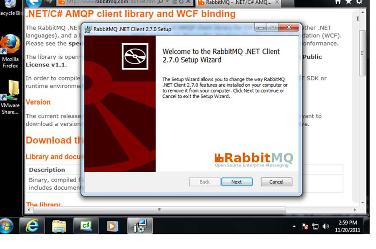
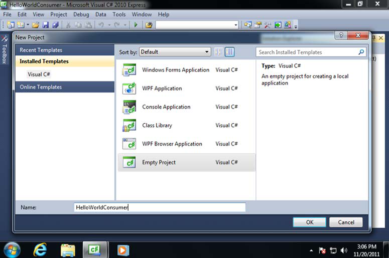
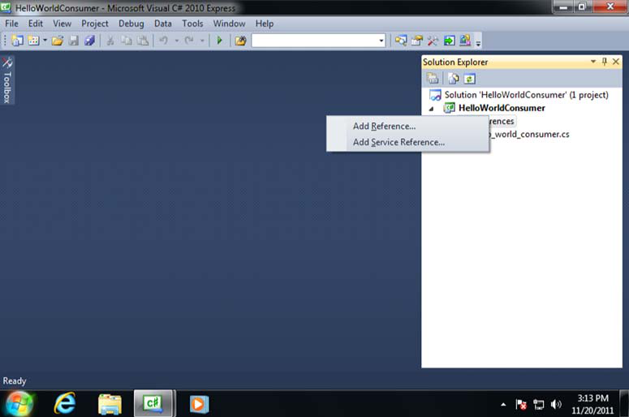
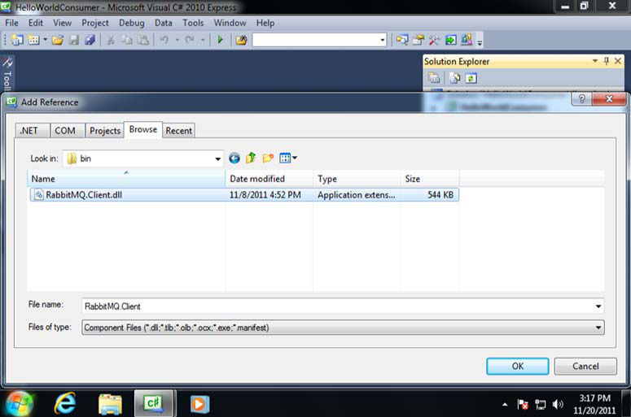
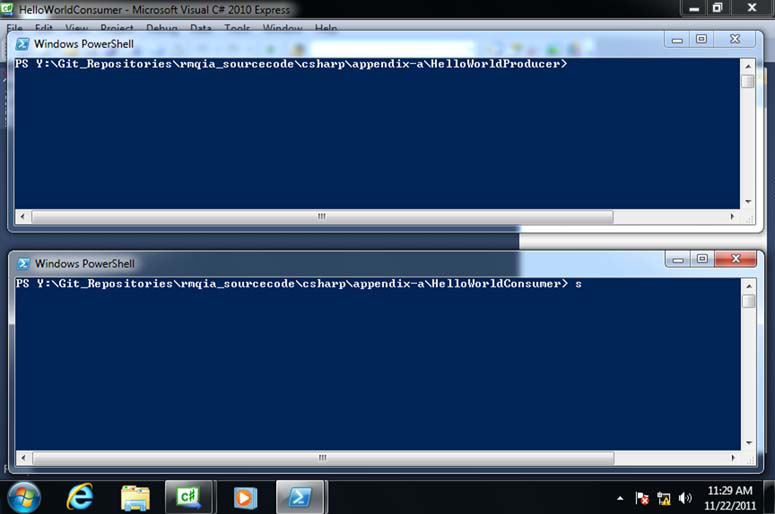
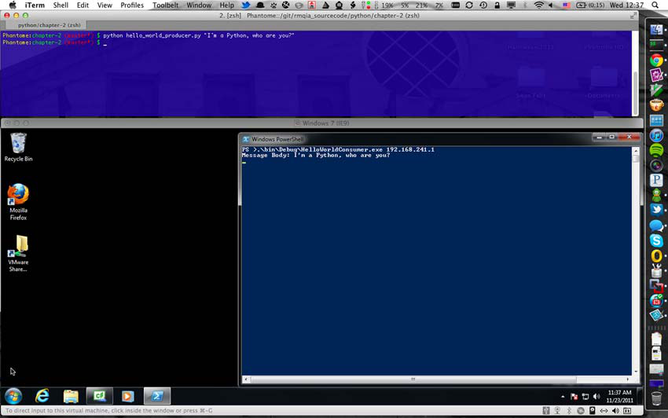

# Phụ lục A: Dùng Rabbit từ Java và .NET (Using Rabbit from Java and .NET)

## Mục lục phụ lục

- [Lời mở đầu phụ lục](#lời-mở-đầu-phụ-lục)
- [A.1 Chào lại lần nữa (các lựa chọn thư viện và Hello World) (Saying hello again (library options and Hello World))](#a1-chào-lại-lần-nữa-các-lựa-chọn-thư-viện-và-hello-world-saying-hello-again-library-options-and-hello-world)
- [A.2 Cảnh báo bằng .NET (Alerting in .NET)](#a2-cảnh-báo-bằng-net-alerting-in-net)
- [A.3 RPC bằng Java (RPC in Java)](#a3-rpc-bằng-java-rpc-in-java)
- [A.4 Tổng kết (Summary)](#a4-tổng-kết-summary)
- [Bảng thuật ngữ của chương](#bảng-thuật-ngữ-của-chương)

---

## Lời mở đầu phụ lục

Chúng tôi chọn Python và PHP cho cuốn sách vì chúng rõ ràng, dễ đọc và rất hợp để làm ngôn ngữ giảng dạy. Nhưng chúng tôi cũng biết ngoài kia có rất nhiều lập trình viên .NET và Java. Thêm nữa, phần lớn các thư viện client AMQP (*AMQP client* – thư viện phía ứng dụng dùng để nói chuyện với broker theo giao thức AMQP) cho các ngôn ngữ khác nhau đều có giao diện khá giống nhau. Riêng client Java và client .NET thì lại **khác biệt đáng kể** so với client của các ngôn ngữ còn lại — đủ khác để đáng có vài lời khuyên về cách "ánh xạ" (*map*) các ví dụ trong cuốn *RabbitMQ in Action* sang hai ngôn ngữ này.

Với suy nghĩ đó, chúng ta sẽ chuyển (dịch) một vài ví dụ trong sách sang phiên bản tương đương bằng .NET và Java. Cụ thể:

- Chúng tôi sẽ cho bạn thấy ví dụ **Hello World** trông như thế nào khi viết bằng **C#**.
- Chúng tôi sẽ "tái hiện" ví dụ **cảnh báo** (*alerting*) của chương 4 bằng **C#**, và ví dụ **RPC** của chương 4 bằng **Java**.

Trong mỗi trường hợp, mục tiêu của chúng tôi là bám sát **nhiều nhất có thể** cấu trúc, chú thích (comment) và quy ước đặt tên của các ví dụ Python và PHP gốc. Chúng tôi hy vọng điều này giúp bạn xây dựng một "bản đồ trong đầu" (*mental map*), để khi nhìn vào bất kỳ ví dụ nào khác trong sách, bạn có thể dễ dàng hình dung nó sẽ được viết ra sao bằng Java hay .NET.

Giống như các ví dụ khác trong sách, toàn bộ mã nguồn của phụ lục này có thể tải về từ kho GitHub của sách: https://github.com/rabbitinaction/sourcecode. Trong kho đó, bạn sẽ thấy không chỉ các file nguồn `.java` và `.cs`, mà còn có cả các project Visual Studio cho ví dụ .NET, sẵn sàng để build bằng `msbuild`. Không dài dòng nữa, hãy cùng xem cách chuyển ví dụ Hello World của chương 2 sang C#.

> 📝 **Giải thích thêm (không có trong sách):** Phụ lục này viết cho thời điểm RabbitMQ .NET client phiên bản 2.7.0 và Java client đời 2.x. Các API như `IModel`, `QueueingBasicConsumer`, `ExchangeDeclare(..., null)` đã thay đổi ở các phiên bản mới (ví dụ .NET client 7.x đổi `IModel` thành `IChannel` và chuyển sang API bất đồng bộ `async`; `QueueingBasicConsumer` đã bị loại bỏ, thay bằng `EventingBasicConsumer`/`AsyncEventingBasicConsumer`; Java client 5.x bỏ `QueueingConsumer`, khuyến nghị `DefaultConsumer` hoặc `DeliverCallback`). Khi đọc phụ lục, hãy tập trung vào **khái niệm** và **cách ánh xạ** từ Python/PHP sang C#/Java; nếu chạy thực tế với thư viện mới, bạn cần điều chỉnh tên API cho phù hợp. Ở một vài chỗ bên dưới, chúng tôi sẽ đưa ví dụ bổ sung theo API hiện đại để bạn đối chiếu.

---

## A.1 Chào lại lần nữa (các lựa chọn thư viện và Hello World) (Saying hello again (library options and Hello World))

Thế giới .NET có vô số ngôn ngữ có thể tận dụng client RabbitMQ.NET, nhưng ở đây chúng ta sẽ tập trung vào **C#**. Đặc biệt, mọi ví dụ .NET trong phụ lục này đều giả định bạn dùng **.NET Framework phiên bản 4.0** (bao gồm C# 4.0). Nhưng trước khi lao vào viết chương trình Hello World bằng C#, bạn phải cài đặt client RabbitMQ.NET đã.

Phiên bản mới nhất của client Rabbit cho .NET luôn có tại http://www.rabbitmq.com/dotnet.html; trong trường hợp của chúng tôi, ta dùng phiên bản **2.7.0**. Trên trang tải client .NET, bạn sẽ thấy cả bản cài tự động (*autoinstaller*, file `.MSI`) lẫn bản đóng gói `.ZIP`. Chúng tôi khuyên dùng bản `.MSI` cho tiện, vậy hãy tải bộ cài `.MSI` về và chạy nó (xem hình A.1). Các ví dụ sẽ giả định rằng client được cài vào vị trí mặc định (`C:\Program Files\RabbitMQ\DotNetClient`).



**Hình A.1 – Cài đặt client Rabbit cho .NET**

*Mô tả hình:* Ảnh chụp màn hình trình cài đặt (installer wizard) của Windows cho client RabbitMQ .NET. Cửa sổ cài đặt hướng dẫn người dùng từng bước (chào mừng, chọn thư mục cài đặt, bấm Next/Install) để cài thư viện vào thư mục mặc định `C:\Program Files\RabbitMQ\DotNetClient`.

Giờ bạn đã cài client, hãy tạo project Visual Studio (chọn **Empty Project** – project rỗng) cho consumer Hello World của bạn, như trong hình A.2.

> 📝 **Giải thích thêm (không có trong sách):** *Consumer* (bên tiêu thụ) là chương trình nhận và xử lý message từ một queue; *producer* (bên sản xuất/phát hành) là chương trình gửi (publish) message tới một exchange. Đây là hai vai trò bạn đã gặp từ chương 2.

Việc cuối cùng cần làm trước khi bắt tay viết code là **thêm tham chiếu** (*reference*) tới client RabbitMQ.NET vào project. Nếu không, Visual Studio (hoặc `msbuild`) sẽ không tìm thấy thư viện. Đầu tiên, nhấp chuột phải vào mục **References** bên dưới project mới trong **Solution Explorer** và chọn **Add Reference** (xem hình A.3).

Tiếp theo, chọn thẻ **Browse** (xem hình A.4) và duyệt tới `C:\Program Files\RabbitMQ\DotNetClient\bin` (hoặc tới vị trí khác nếu bạn cài client ở chỗ khác). Sau đó chọn `RabbitMQ.Client.dll` và bấm **OK**.

Khi đã thêm RabbitMQ.Net vào project, hãy tạo một file mới trong project tên là `hello_world_consumer.cs` để chứa consumer Hello World. Đầu tiên, bạn đặt các lệnh import (trong C# là `using`) vào consumer:

```csharp
using System;
using System.Text;
using RabbitMQ.Client;
using RabbitMQ.Client.Events;
```

Import `RabbitMQ.Client` cho bạn quyền truy cập các class dùng để tạo kết nối và channel (`IConnection` và `IModel`), cũng như để quản lý việc đăng ký tiêu thụ message (*consumption subscription*) (`QueueingBasicConsumer`). Bạn cũng phải import `RabbitMQ.Client.Events` để truy cập được các đối số (*arguments*) được truyền lại cho consumer mỗi khi xảy ra sự kiện giao message (*message delivery event*).



**Hình A.2 – Tạo project HelloWorldConsumer**

*Mô tả hình:* Hộp thoại **New Project** của Visual Studio. Người dùng chọn mẫu (template) **Empty Project** dưới nhóm Visual C#, đặt tên project là `HelloWorldConsumer`, chọn thư mục lưu và bấm OK.



**Hình A.3 – Thêm tham chiếu vào project Visual Studio**

*Mô tả hình:* Cửa sổ Visual Studio với khung **Solution Explorer**; người dùng nhấp chuột phải vào nút **References** của project và menu ngữ cảnh hiện ra mục **Add Reference...** để chọn.



**Hình A.4 – Chọn tham chiếu tới client RabbitMQ.Net**

*Mô tả hình:* Hộp thoại **Add Reference** đang mở thẻ **Browse**; người dùng đã điều hướng tới thư mục `C:\Program Files\RabbitMQ\DotNetClient\bin` và chọn file `RabbitMQ.Client.dll`, sau đó bấm OK.

> 💡 **Ví dụ bổ sung (không có trong sách):** Với .NET hiện đại (.NET 6/7/8, dùng dòng lệnh `dotnet`), bạn không cần cài file `.MSI` hay thêm reference bằng tay nữa. Chỉ cần dùng NuGet:
>
> ```bash
> dotnet new console -n HelloWorldConsumer
> cd HelloWorldConsumer
> dotnet add package RabbitMQ.Client
> ```
>
> Lệnh `dotnet add package` tự tải thư viện `RabbitMQ.Client` từ NuGet và ghi tham chiếu vào file `.csproj` — tương đương với các bước ở hình A.1, A.3 và A.4.

Vì nhiều khả năng server RabbitMQ của bạn không nằm cùng máy với consumer, bạn sẽ nhận tên máy chủ (host) Rabbit cần kết nối thông qua **đối số dòng lệnh** (*command-line argument*) của consumer:

```csharp
namespace HelloWorld {
    class Consumer {
        public static void Main(string[] args) {
            if(args.Length < 1) {
                Console.WriteLine("Must supply hostname.");
                Environment.Exit(-1);
            }
```

(Đoạn này in ra thông báo "Must supply hostname." – "Phải cung cấp tên máy chủ." – rồi thoát với mã `-1` nếu người dùng không truyền đối số nào.)

Giờ bạn đã bắt đầu viết class (`HelloWorld.Consumer`) sẽ tạo thành consumer và đã nhận được tên máy chủ RabbitMQ cần kết nối, hãy kết nối tới server và bắt đầu dựng "kết cấu" nhắn tin (*messaging fabric* – tập hợp exchange, queue và binding mà ứng dụng cần).

**Listing A.1 – Tạo kết cấu nhắn tin (messaging fabric) cho consumer**

```csharp
            var conn_factory
                = new ConnectionFactory();
            conn_factory.HostName = args[0];
            conn_factory.UserName = "guest";
            conn_factory.Password = "guest";
            IConnection
                conn = conn_factory.CreateConnection();   // (B) Thiết lập kết nối tới broker
            IModel chan = conn.CreateModel();             // (C) Lấy channel
            chan.ExchangeDeclare("hello-exchange",        // (D) Khai báo exchange
                                 ExchangeType.Direct,
                                 true,
                                 false,
                                 null);
            chan.QueueDeclare("hello-queue",              // (E) Khai báo queue
                              false,
                              false,
                              false,
                              null);
            chan.QueueBind("hello-queue",                 // (F) Bind queue với exchange
                           "hello-exchange",              //     trên routing key "hola"
                           "hola");
```

Chú thích các điểm đánh dấu trong listing:

- **(B)** Thiết lập kết nối (*connection*) tới broker.
- **(C)** Lấy (mở) một channel.
- **(D)** Khai báo exchange.
- **(E)** Khai báo queue.
- **(F)** Bind (gắn) queue với exchange trên routing key `hola`.

Việc đầu tiên consumer làm là tạo một đối tượng `ConnectionFactory` — đối tượng này sẽ sinh ra và quản lý kết nối thực sự tới broker. Sau khi dùng factory để tạo kết nối **(B)**, bạn dùng đối tượng kết nối (`conn`) được trả về để tạo channel **(C)**. Có thể bạn để ý rằng đối tượng channel (`chan`) có kiểu `IModel`, kiểu này đại diện cho channel AMQP mà bạn sẽ dùng. Điều này **không giống bất kỳ thư viện client Rabbit nào khác** (kể cả client Java) — tất cả các client kia đều dùng từ *channel* để mô tả đại diện của chúng cho một channel AMQP.¹ Vì vậy đừng bối rối khi thấy từ *model* xuất hiện trong nhiều class của client RabbitMQ.NET; nó **luôn luôn ám chỉ một channel**.

> ¹ *Chú thích của sách:* Việc dùng từ *model* để mô tả channel trong client .NET là một "di sản lịch sử" từ thời kỳ đầu của AMQP, khi người ta nghĩ rằng ngoài TCP còn có thể dùng các tầng vận chuyển (*transport*) khác cho AMQP (HTTP, SCTP, v.v.). Vì khái niệm channel là đặc thù của tầng vận chuyển TCP, client .NET được thiết kế để dùng từ tổng quát hơn là *model* cho cùng khái niệm đó. Giờ đây khi TCP là tầng vận chuyển duy nhất của AMQP, tất cả các client mới hơn đều dùng thuật ngữ *channel*.

Khi đã tạo xong channel, bạn sẵn sàng khai báo exchange và queue — những thứ sẽ tạo thành kết cấu cho consumer và producer Hello World. Giống như consumer Hello World gốc ở chương 2, bạn muốn exchange (`hello-exchange`) được khai báo **(D)** là một exchange kiểu **direct**, **bền vững** (*durable* – tồn tại qua lần khởi động lại broker) nhưng **không tự xóa** (*not auto-delete*). Đối số thứ hai trong lời gọi `ExchangeDeclare` chỉ định kiểu exchange là direct (`ExchangeType.Direct`). Trong client RabbitMQ.NET, kiểu exchange được chỉ định bằng các hằng số của class `ExchangeType`. Ví dụ, nếu muốn `hello-exchange` là exchange kiểu fanout thay vì direct, bạn sẽ dùng `ExchangeType.Fanout`.²

> ² *Chú thích của sách:* `ExchangeType` là một class cho tiện (*convenience class*). Bạn cũng có thể truyền thẳng một chuỗi chứa tên kiểu exchange cho `ExchangeDeclare`. Ví dụ, thay vì chỉ định `ExchangeType.Direct`, bạn có thể truyền chuỗi `"direct"` cho `ExchangeDeclare`.

Sau đó bạn tạo **(E)** một queue không bền vững, không tự xóa (`hello-queue`) bằng `QueueDeclare`, và bind nó **(F)** vào `hello-exchange` trên routing key `hola`.

> 📝 **Giải thích thêm (không có trong sách):** Ý nghĩa từng đối số vị trí trong hai lời gọi trên (API .NET client 2.x):
>
> | Lời gọi | Đối số | Giá trị trong ví dụ | Ý nghĩa |
> |---|---|---|---|
> | `ExchangeDeclare` | `exchange` | `"hello-exchange"` | Tên exchange |
> | | `type` | `ExchangeType.Direct` | Kiểu exchange (direct/fanout/topic/headers) |
> | | `durable` | `true` | Exchange tồn tại sau khi broker khởi động lại |
> | | `autoDelete` | `false` | Không tự xóa khi không còn queue nào bind |
> | | `arguments` | `null` | Tham số mở rộng (không dùng) |
> | `QueueDeclare` | `queue` | `"hello-queue"` | Tên queue |
> | | `durable` | `false` | Queue mất đi khi broker khởi động lại |
> | | `exclusive` | `false` | Không độc quyền cho một connection |
> | | `autoDelete` | `false` | Không tự xóa khi consumer cuối cùng rời đi |
> | | `arguments` | `null` | Tham số mở rộng (không dùng) |
>
> So sánh với Python (Pika) ở chương 2: `channel.exchange_declare(exchange="hello-exchange", type="direct", passive=False, durable=True, auto_delete=False)` — C# truyền theo **vị trí**, còn Python thường truyền theo **tên** nên dễ đọc hơn. Khi chuyển ví dụ từ sách sang C#, mẹo là mở tài liệu API để xem thứ tự tham số.

Cuối cùng, bạn đã sẵn sàng đăng ký (*subscribe*) vào `hello-queue` và bắt đầu xử lý message.

**Listing A.2 – Đăng ký và xử lý message**

```csharp
            QueueingBasicConsumer
                consumer = new QueueingBasicConsumer(chan);          // (B) Đăng ký consumer
            String consumer_tag = chan.BasicConsume("hello-queue",   // (C) Bắt đầu tiêu thụ
                                                    false,
                                                    consumer);
            while(true) {
                BasicDeliverEventArgs
                    evt_args = (BasicDeliverEventArgs)
                                   consumer.Queue.Dequeue();         // (D) Xử lý message đến
                IBasicProperties msg_props = evt_args.BasicProperties;
                String
                    msg_body = Encoding.ASCII.GetString(evt_args.Body);
                chan.BasicAck(evt_args.DeliveryTag,                  // (E) Xác nhận (ack) message
                              false);
                if(msg_body == "quit") {
                    chan.BasicCancel(consumer_tag);                  // (F) Ngừng nhận thêm message và thoát
                    break;
                } else
                    Console.WriteLine("Message Body: " + msg_body);
            }
            Environment.Exit(0);
        }
    }
}
```

Chú thích các điểm đánh dấu trong listing:

- **(B)** Đăng ký (tạo) consumer.
- **(C)** Bắt đầu tiêu thụ message.
- **(D)** Xử lý các message đến.
- **(E)** Xác nhận đã nhận message (*message acknowledgement*).
- **(F)** Ngừng nhận thêm message và thoát.

Phần cuối này của consumer có rất nhiều "bộ phận chuyển động", nên hãy mổ xẻ từng phần.

Đầu tiên, bạn thiết lập **(B)** đối tượng consumer (`consumer`) bằng class tiện ích `QueueingBasicConsumer`. `QueueingBasicConsumer` **tách rời** việc message đã đăng ký *đến nơi* khỏi việc *xử lý* chúng bằng code của bạn. Khi đối tượng channel nhận được một message mới mà `consumer` đã đăng ký, nó sẽ kích hoạt phương thức `HandleBasicDeliver` của `consumer`. Phương thức này nhận message và nhét nó vào một thể hiện `SharedQueue` an toàn đa luồng (*thread-safe*) nằm bên trong đối tượng consumer. Điều đó có nghĩa là các message mới có thể liên tục "chảy" vào `consumer` mà không bị chặn bởi những gì code của bạn đang làm khi xử lý các message lấy ra từ `SharedQueue`. Khi đã tạo `consumer`, bạn bắt đầu tiêu thụ bằng cách gọi `BasicConsume` trên channel với `consumer` làm đối số. Lệnh này bảo channel đăng ký vào `hello-queue` và, khi message đến từ đăng ký đó, nhét chúng vào `SharedQueue` của `consumer`.

Mặc dù `consumer` đảm nhận phần việc nặng nhọc là nhận các message đã đăng ký, bạn vẫn phải tự xử lý những message đó và xác nhận (*acknowledge*) việc đã nhận với broker. Trong Python với client Pika, bạn sẽ tạo một hàm để xử lý rồi truyền nó làm callback cho `basic_consume`. Nhưng như bạn đã thấy ở **(B)**, `QueueingBasicConsumer` **không** dùng mô hình callback/sự kiện. Thay vào đó, khi message đến, chúng được đặt vào một `SharedQueue` bên trong `consumer`, và việc **thăm dò** (*poll*) `SharedQueue` đó để lấy message ra xử lý là việc của bạn. Cơ chế thăm dò ở đây là **(C)** một vòng lặp `while` vô hạn (`while(true) {}`) liên tục lấy message kế tiếp từ `consumer`, xử lý nó, rồi lặp lại. Để lấy một message ra khỏi hàng đợi **(D)**, bạn gọi `Dequeue()` trên thuộc tính `Queue` của `consumer`. Lời gọi này trả về một đối tượng `BasicDeliverEventArgs` (`evt_args`) chứa các thuộc tính message AMQP (bao gồm header), thân message (*body*) và thẻ giao hàng (*delivery tag*) mà bạn sẽ cần để xác nhận message.

> **Khung: BasicConsume**
>
> Bạn có thể gọi `BasicConsume` nhiều lần với các queue khác nhau để đăng ký chúng vào **cùng một** đối tượng consumer. Khi đó, mọi message từ các đăng ký khác nhau đều được đặt vào cùng một `SharedQueue` trong đối tượng consumer. Lúc xử lý, bạn có thể dùng đối tượng `BasicDeliverEventArgs` đi kèm mỗi message để xác định nó đến từ queue nào (vì tất cả sẽ bị trộn lẫn trong `SharedQueue`).
>
> Tại sao lại muốn làm vậy? Vì `consumer.Queue.Dequeue()` sẽ **dừng thực thi để chờ** message nếu `SharedQueue` đang rỗng. Hệ quả là nếu bạn có nhiều lời gọi `Dequeue()` tuần tự trên các đối tượng consumer khác nhau, thì `Dequeue()` trên đối tượng consumer đầu tiên sẽ ngăn chương trình chạy tới các lời gọi `Dequeue()` của những consumer tiếp theo, cho tới khi consumer/đăng ký đầu tiên nhận được một message. Bằng cách dùng **một** đối tượng consumer duy nhất cho nhiều đăng ký, bạn chỉ cần **một** lời gọi `Dequeue()` để phục vụ tất cả đăng ký mà chúng không chặn lẫn nhau.

> 💡 **Ví dụ bổ sung (không có trong sách):** Minh họa khung trên — một consumer duy nhất nghe hai queue `orders` và `refunds`, rồi phân biệt nguồn gốc message bằng `evt_args.RoutingKey`/`evt_args.Exchange` (với .NET client 2.x, `BasicDeliverEventArgs` còn có `ConsumerTag`, nên cách chắc chắn nhất là so sánh consumer tag trả về từ mỗi lần `BasicConsume`):
>
> ```csharp
> var consumer = new QueueingBasicConsumer(chan);
> string tagOrders  = chan.BasicConsume("orders",  false, consumer);
> string tagRefunds = chan.BasicConsume("refunds", false, consumer);
> while (true) {
>     var ea = (BasicDeliverEventArgs)consumer.Queue.Dequeue(); // chỉ một chỗ chờ
>     if (ea.ConsumerTag == tagOrders)
>         Console.WriteLine("Đơn hàng: " + Encoding.UTF8.GetString(ea.Body));
>     else if (ea.ConsumerTag == tagRefunds)
>         Console.WriteLine("Hoàn tiền: " + Encoding.UTF8.GetString(ea.Body));
>     chan.BasicAck(ea.DeliveryTag, false);
> }
> ```
>
> Nếu thay vào đó bạn tạo hai consumer riêng và gọi `c1.Queue.Dequeue()` rồi `c2.Queue.Dequeue()` liên tiếp, thì khi `orders` không có message, chương trình kẹt ở dòng đầu và các yêu cầu hoàn tiền sẽ bị "bỏ đói" dù đang chất đống.

Sau khi có `evt_args`, bạn tách nó ra thành một đối tượng `IBasicProperties` (`msg_props`) chứa header và các thuộc tính message (như `.ContentType` và `.DeliveryMode`), cùng với thân message (`msg_body`) — trong trường hợp này là một chuỗi mã hóa ASCII.

Tới đây, bạn đã giải mã thành công thân message và trích xuất các thuộc tính của nó, nên bạn có thể báo cho Rabbit biết message đã được tiêu thụ thành công **(E)** bằng cách gọi `chan.BasicAck` với delivery tag của message (`evt_args.DeliveryTag`). Có thể bạn để ý rằng bạn còn truyền đối số thứ hai là `false` cho `BasicAck`. Đối số này nói với `BasicAck` rằng bạn chỉ xác nhận **một message mỗi lần** (không xác nhận gộp nhiều message). Cuối cùng, việc duy nhất còn lại với message đã giải mã là in nội dung ra cho người dùng, hoặc kết thúc **(F)** ứng dụng nếu message chứa chữ `quit`.

> 📝 **Giải thích thêm (không có trong sách):** Đối số thứ hai của `BasicAck` là `multiple`. Nếu đặt `true`, broker sẽ coi **mọi** message có delivery tag nhỏ hơn hoặc bằng tag được truyền vào (trên cùng channel) là đã được xác nhận. Ví dụ bạn đã nhận các message có tag 1, 2, 3, 4, 5 mà chưa ack cái nào; gọi `BasicAck(5, true)` sẽ ack cả 5 message trong một lệnh. Còn `BasicAck(5, false)` chỉ ack đúng message số 5. Đối số thứ hai `false` trong `BasicConsume("hello-queue", false, consumer)` là `noAck` — đặt `false` nghĩa là bạn **phải** ack thủ công, đúng như code đang làm.
>
> ⚠️ **CẢNH BÁO QUAN TRỌNG VỀ `RabbitMQ.Client` HIỆN ĐẠI (6.x & 7.x):**
>
> **1. `QueueingBasicConsumer` ĐÃ BỊ XÓA HOÀN TOÀN (từ `RabbitMQ.Client` 6.0+)!**
> Trong sách (dùng bản 2.7.0), tác giả dùng `QueueingBasicConsumer` và vòng lặp `consumer.Queue.Dequeue()`. Tuy nhiên, lớp này đã bị đánh dấu lỗi thời (*deprecated*) ở bản 5.x và **bị xóa sổ hoàn toàn từ `RabbitMQ.Client` 6.0 trở đi**. Lý do kiến trúc khiến nhóm phát triển RabbitMQ loại bỏ nó:
> - **Nguy cơ tràn bộ nhớ (`OutOfMemoryException`)**: `SharedQueue` bên trong `QueueingBasicConsumer` là một hàng đợi trong RAM không giới hạn kích thước (*unbounded*). Nếu lập trình viên quên cấu hình `BasicQos(prefetchCount)` mà queue trên RabbitMQ đang tồn đọng hàng triệu message, broker sẽ đẩy toàn bộ xuống tiến trình .NET nhanh hơn tốc độ vòng lặp `while` xử lý, làm đầy bộ nhớ Heap của CLR và đánh sập ứng dụng.
> - **Lãng phí luồng (Thread Blocking)**: Gọi `Dequeue()` làm khóa cứng (*block*) một luồng hệ điều hành khi chờ mạng I/O, đi ngược lại mô hình bất đồng bộ non-blocking (`async/await` và `Task`) của .NET hiện đại.
> - **Xung đột với Automatic Recovery**: Khi kết nối mạng đứt và tự động khôi phục (tính năng bật mặc định từ `RabbitMQ.Client` 5.0+), trạng thái nội bộ của `SharedQueue` và delivery tag cũ không thể đồng bộ an toàn.
>
> **2. Sự tiến hóa lớn giữa `RabbitMQ.Client` 2.7 (Sách) → 6.x → 7.0+ (Mới nhất trên .NET 8):**
>
> | Thành phần / Thao tác | `RabbitMQ.Client` 2.7 (Trong sách) | `RabbitMQ.Client` 6.x (Đồng bộ / Event) | `RabbitMQ.Client` 7.0+ (Async-first toàn diện) |
> |---|---|---|---|
> | **Tạo kết nối** | `factory.CreateConnection()` | `using var conn = factory.CreateConnection();` | `await using var conn = await factory.CreateConnectionAsync();` |
> | **Kiểu dữ liệu Channel** | `IModel` (`conn.CreateModel()`) | `IModel` (`using var ch = conn.CreateModel();`) | **`IChannel`** (`await using var ch = await conn.CreateChannelAsync();`) — *chấm dứt di sản lịch sử `IModel` ở chú thích 1!* |
> | **Khai báo Exchange/Queue** | `chan.ExchangeDeclare(...)` / `chan.QueueDeclare(...)` | `ch.ExchangeDeclare(...)` / `ch.QueueDeclare(...)` | `await ch.ExchangeDeclareAsync(...)` / `await ch.QueueDeclareAsync(...)` |
> | **Lớp Consumer chuẩn** | `QueueingBasicConsumer` (Đã xóa!) | `EventingBasicConsumer` hoặc `AsyncEventingBasicConsumer` | **`AsyncEventingBasicConsumer`** (`ReceivedAsync += async (m, ea) => ...`) |
> | **Kiểu dữ liệu `ea.Body`** | `byte[]` | `ReadOnlyMemory<byte>` (dùng `ea.Body.ToArray()` hoặc `ea.Body.Span` để zero-copy) | `ReadOnlyMemory<byte>` (`Encoding.UTF8.GetString(ea.Body.Span)`) |
> | **Tạo `BasicProperties`** | `chan.CreateBasicProperties()` (`IBasicProperties`) | `ch.CreateBasicProperties()` (`IBasicProperties`) | `new BasicProperties { ... }` (khởi tạo trực tiếp, không cần gọi qua channel) |
> | **Tự động kết nối lại** | Không có (phải tự code) | **Bật mặc định** (`AutomaticRecoveryEnabled = true`) | **Bật mặc định** (`AutomaticRecoveryEnabled = true`, `TopologyRecoveryEnabled = true`) |
>
> 💡 **Ví dụ bổ sung (không có trong sách) – Viết lại Listing A.1 & A.2 (Hello World Consumer) bằng C# (.NET 8) hiện đại:**
>
> **Cách 1: Dùng `RabbitMQ.Client` 6.x (Sự kiện đồng bộ với `EventingBasicConsumer`):**
> ```csharp
> using System.Text;
> using RabbitMQ.Client;
> using RabbitMQ.Client.Events;
>
> var factory = new ConnectionFactory {
>     HostName = args.Length > 0 ? args[0] : "localhost",
>     UserName = "guest",
>     Password = "guest"
> };
>
> using IConnection conn = factory.CreateConnection();
> using IModel channel = conn.CreateModel();
>
> channel.ExchangeDeclare("hello-exchange", ExchangeType.Direct, durable: true, autoDelete: false);
> channel.QueueDeclare("hello-queue", durable: false, exclusive: false, autoDelete: false);
> channel.QueueBind("hello-queue", "hello-exchange", "hola");
>
> // Luôn đặt prefetch (QoS) để tránh consumer bị ngập message trong RAM
> channel.BasicQos(prefetchSize: 0, prefetchCount: 10, global: false);
>
> var quitSignal = new ManualResetEventSlim(false);
> var consumer = new EventingBasicConsumer(channel);
>
> consumer.Received += (model, ea) => {
>     // Trong 6.x+, ea.Body là ReadOnlyMemory<byte>, dùng .ToArray() hoặc .Span
>     string msgBody = Encoding.UTF8.GetString(ea.Body.ToArray());
>     channel.BasicAck(ea.DeliveryTag, multiple: false);
>
>     if (msgBody == "quit") {
>         channel.BasicCancel(ea.ConsumerTag);
>         quitSignal.Set();
>     } else {
>         Console.WriteLine($"Message Body: {msgBody}");
>     }
> };
>
> channel.BasicConsume(queue: "hello-queue", autoAck: false, consumer: consumer);
> quitSignal.Wait(); // Giữ tiến trình chạy cho tới khi nhận được message "quit"
> ```
>
> **Cách 2: Dùng `RabbitMQ.Client` 7.0+ (Mới nhất – Bất đồng bộ `async/await` hoàn toàn với `IChannel`):**
> ```csharp
> using System.Text;
> using RabbitMQ.Client;
> using RabbitMQ.Client.Events;
>
> var factory = new ConnectionFactory {
>     HostName = args.Length > 0 ? args[0] : "localhost",
>     UserName = "guest",
>     Password = "guest"
> };
>
> await using IConnection conn = await factory.CreateConnectionAsync();
> await using IChannel channel = await conn.CreateChannelAsync();
>
> await channel.ExchangeDeclareAsync("hello-exchange", ExchangeType.Direct, durable: true, autoDelete: false);
> await channel.QueueDeclareAsync("hello-queue", durable: false, exclusive: false, autoDelete: false);
> await channel.QueueBindAsync("hello-queue", "hello-exchange", "hola");
> await channel.BasicQosAsync(prefetchSize: 0, prefetchCount: 10, global: false);
>
> var tcs = new TaskCompletionSource();
> var consumer = new AsyncEventingBasicConsumer(channel);
>
> consumer.ReceivedAsync += async (model, ea) => {
>     string msgBody = Encoding.UTF8.GetString(ea.Body.Span);
>     await channel.BasicAckAsync(ea.DeliveryTag, multiple: false);
>
>     if (msgBody == "quit") {
>         await channel.BasicCancelAsync(ea.ConsumerTag);
>         tcs.TrySetResult();
>     } else {
>         Console.WriteLine($"Message Body: {msgBody}");
>     }
> };
>
> await channel.BasicConsumeAsync(queue: "hello-queue", autoAck: false, consumer: consumer);
> await tcs.Task; // Chờ bất đồng bộ không chiếm dụng thread
> ```

Khi consumer Hello World đã được chuyển sang .NET, bạn cần chuyển cả producer để có cái mà tiêu thụ chứ! Như đã thấy suốt các ví dụ, producer đơn giản hơn consumer nhiều. Bạn sẽ dùng các lệnh import y như trước, nhưng thêm class `Producer` (bạn có thể tạo file `hello_world_producer.cs` trong một project Visual Studio mới hoặc thêm nó vào project đã tạo cho consumer).

**Listing A.3 – Publish message bằng .NET**

```csharp
namespace HelloWorld {
    class Producer {
        public static void Main(string[] args) {
            if(args.Length < 2) {                                  // (B) Nhận server và message
                Console.WriteLine("Must supply hostname and " +
                                  "message text.");
                Environment.Exit(-1);
            }
            var conn_factory
                = new ConnectionFactory();
            conn_factory.HostName = args[0];
            conn_factory.UserName = "guest";
            conn_factory.Password = "guest";
            IConnection conn = conn_factory.CreateConnection();   // (C) Thiết lập kết nối tới broker
            IModel chan = conn.CreateModel();
            chan.ExchangeDeclare("hello-exchange",                // (D) Khai báo exchange
                                 ExchangeType.Direct,
                                 true,
                                 false,
                                 null);
            string msg_body = args[1];                            // (E) Tạo message văn bản thuần
            IBasicProperties msg_props = chan.CreateBasicProperties();
            msg_props.ContentType = "text/plain";
            chan.BasicPublish("hello-exchange",                   // (F) Publish message
                              "hola",
                              msg_props,
                              Encoding.ASCII.GetBytes(msg_body));
            Environment.Exit(0);
        }
    }
}
```

Chú thích các điểm đánh dấu trong listing:

- **(B)** Nhận địa chỉ server và nội dung message (từ dòng lệnh). Thông báo lỗi "Must supply hostname and message text." nghĩa là "Phải cung cấp tên máy chủ và nội dung message."
- **(C)** Thiết lập kết nối tới broker.
- **(D)** Khai báo exchange.
- **(E)** Tạo message dạng văn bản thuần (*plaintext*).
- **(F)** Publish (phát hành) message.

Ngoài broker cần kết nối, bạn còn cần nhận message cần publish từ dòng lệnh **(B)**. Sau đó bạn sẵn sàng kết nối **(C)** và khai báo `hello-exchange` **(D)** để chắc chắn có chỗ mà publish vào. Việc tạo message **(E)** để publish giống các bước bạn đã dùng để xử lý message, chỉ là theo chiều ngược lại. Đầu tiên, bạn lấy nội dung message từ dòng lệnh và lưu vào chuỗi `msg_body`. Tiếp theo, bạn tạo một đối tượng `IBasicProperties` (`msg_props`) để lưu các thuộc tính publish của message, và đặt content type của message là `text/plain` để consumer biết thân message là văn bản ASCII thuần. Cuối cùng, bạn publish **(F)** message (`msg_body`) vào `hello-exchange` với routing key `hola`, cùng với các thuộc tính message đã đặt trong `msg_props`.

Có thể bạn để ý rằng trong quá trình publish, trước tiên bạn chuyển message thành một mảng byte bằng `Encoding.ASCII.GetBytes`. AMQP (và do đó cả RabbitMQ) **không quan tâm** (*agnostic*) tới nội dung của thân message. Yêu cầu duy nhất là nó phải là một dãy các byte 8-bit. Chính vì vậy, lệnh `BasicPublish` trong client Rabbit .NET chỉ chấp nhận **mảng byte** cho thân message.

> 💡 **Ví dụ bổ sung (không có trong sách):** Vì thân message chỉ là byte, bạn có thể gửi bất cứ thứ gì miễn hai bên thống nhất cách mã hóa. Ví dụ gửi JSON bằng UTF-8 (hỗ trợ tiếng Việt, điều mà ASCII không làm được):
>
> ```csharp
> string json = "{\"ten\":\"Nguyễn Văn A\",\"tuoi\":30}";
> IBasicProperties props = chan.CreateBasicProperties();
> props.ContentType = "application/json";
> props.ContentEncoding = "utf-8";
> chan.BasicPublish("hello-exchange", "hola", props, Encoding.UTF8.GetBytes(json));
> ```
>
> Nếu bạn lỡ dùng `Encoding.ASCII.GetBytes` với chuỗi trên, các ký tự có dấu như "ễ", "ă" sẽ bị thay bằng dấu `?` — dữ liệu bị hỏng ngay từ phía producer. Phía consumer cũng phải dùng `Encoding.UTF8.GetString` tương ứng.
>
> 💡 **Ví dụ bổ sung (không có trong sách) – Viết lại Listing A.3 (Hello World Producer) bằng `RabbitMQ.Client` 6.x và 7.0+ (.NET 8):**
>
> **Với `RabbitMQ.Client` 6.x:**
> ```csharp
> using System.Text;
> using RabbitMQ.Client;
>
> var factory = new ConnectionFactory { HostName = args[0] };
> using IConnection conn = factory.CreateConnection();
> using IModel channel = conn.CreateModel();
>
> channel.ExchangeDeclare("hello-exchange", ExchangeType.Direct, durable: true, autoDelete: false);
>
> var props = channel.CreateBasicProperties();
> props.ContentType = "text/plain";
> props.DeliveryMode = 2; // 2 = persistent
>
> byte[] body = Encoding.UTF8.GetBytes(args[1]);
> channel.BasicPublish(exchange: "hello-exchange",
>                      routingKey: "hola",
>                      basicProperties: props,
>                      body: body);
> ```
>
> **Với `RabbitMQ.Client` 7.0+ (Mới nhất – Bất đồng bộ hoàn toàn):**
> ```csharp
> using System.Text;
> using RabbitMQ.Client;
>
> var factory = new ConnectionFactory { HostName = args[0] };
> await using IConnection conn = await factory.CreateConnectionAsync();
> await using IChannel channel = await conn.CreateChannelAsync();
>
> await channel.ExchangeDeclareAsync("hello-exchange", ExchangeType.Direct, durable: true, autoDelete: false);
>
> // Trong 7.x, BasicProperties được new trực tiếp và dùng enum DeliveryModes rõ ràng
> var props = new BasicProperties {
>     ContentType = "text/plain",
>     DeliveryMode = DeliveryModes.Persistent
> };
>
> byte[] body = Encoding.UTF8.GetBytes(args[1]);
> await channel.BasicPublishAsync(
>     exchange: "hello-exchange",
>     routingKey: "hola",
>     mandatory: false,
>     basicProperties: props,
>     body: body);
> ```

Khi đã viết xong consumer và producer bằng C#, hãy build và thử chúng! Trong ví dụ này, broker RabbitMQ nằm trên một máy ảo khác (`192.168.241.1`) so với hệ thống Windows chạy consumer và producer. Trước tiên, mở hai cửa sổ PowerShell³ (xem hình A.5), cho một cửa sổ chuyển tới thư mục project consumer Hello World và cửa sổ kia tới project producer Hello World.

> ³ *Chú thích của sách:* Có thể bạn cần thêm đường dẫn đầy đủ tới .NET framework vào biến môi trường `PATH` của hệ thống. Ví dụ, đường dẫn tới .NET framework trên hệ thống thử nghiệm dùng cho ví dụ là `C:\Windows\Microsoft.NET\Framework\v4.0.30319`.

Đầu tiên, build và khởi động consumer:

```powershell
PS > msbuild
Microsoft (R) Build Engine Version 4.0.30319.1
[Microsoft .NET Framework, Version 4.0.30319.1]
Copyright (C) Microsoft Corporation 2007. All rights reserved.
...
Done Building Project "\HelloWorldConsumer.csproj" ...
Done Building Project "\HelloWorldConsumer.sln" (default targets).
Build succeeded.
    0 Warning(s)
    0 Error(s)
Time Elapsed 00:00:00.17
PS > .\bin\Debug\HelloWorldConsumer.exe 192.168.241.1
```

Giờ ở terminal còn lại, build producer và gửi một message thử nghiệm:

```powershell
PS \HelloWorldProducer> msbuild
Microsoft (R) Build Engine Version 4.0.30319.1
[Microsoft .NET Framework, Version 4.0.30319.1]
Copyright (C) Microsoft Corporation 2007. All rights reserved.
...
Done Building Project "\HelloWorldProducer.csproj" ...
Done Building Project "\HelloWorldProducer.sln" (default targets).
Build succeeded.
    0 Warning(s)
    0 Error(s)
PS > .\bin\Debug\HelloWorldProducer.exe 192.168.241.1 \
"Hello there world!"
PS >
```

Quay lại terminal của consumer — message đã đến chưa?

```powershell
PS > .\bin\Debug\HelloWorldConsumer.exe 192.168.241.1
Message Body: Hello there world!
```



**Hình A.5 – Tạo các terminal để thử nghiệm consumer và producer**

*Mô tả hình:* Ảnh chụp màn hình máy Windows với hai cửa sổ **Windows PowerShell** mở cạnh nhau: một cửa sổ đặt ở thư mục project `HelloWorldConsumer`, cửa sổ kia ở thư mục project `HelloWorldProducer`, sẵn sàng để chạy `msbuild` và khởi động từng chương trình.

"Ba-da bing!" — xong ngay tắp lự! Consumer và producer C# của bạn đã chạy được! Vì các ứng dụng Hello World bằng C# là bản chuyển thể trực tiếp từ các ứng dụng Python gốc, chúng cũng sẽ **hoạt động được với nhau**! Để thử chút "phép màu" giao tiếp xuyên ngôn ngữ (như trong hình A.6), hãy dùng `hello_world_producer.py` từ chương 2 để publish một message tới consumer C# đang chạy!



**Hình A.6 – Nhắn tin đa nền tảng trong thực tế!**

*Mô tả hình:* Ảnh chụp màn hình một máy Mac. Ở nửa trên là cửa sổ terminal iTerm (zsh) trong thư mục `chapter-2` của mã nguồn sách, chạy lệnh `python hello_world_producer.py "I'm a Python, who are you?"` ("Tôi là Python, bạn là ai?"). Ở nửa dưới là máy ảo Windows 7 (chạy trong VMware) với cửa sổ Windows PowerShell đang chạy `.\bin\Debug\HelloWorldConsumer.exe 192.168.241.1` và in ra `Message Body: I'm a Python, who are you?`. Tức là message do producer Python gửi đi đã được consumer C# nhận đúng — minh chứng rằng AMQP không phụ thuộc ngôn ngữ hay hệ điều hành.

> 💡 **Ví dụ bổ sung (không có trong sách):** Bạn cũng có thể kiểm tra theo chiều ngược lại hoặc dùng công cụ dòng lệnh. Ví dụ với plugin quản lý (`rabbitmqadmin`), bạn publish thẳng vào `hello-exchange` mà không cần viết producer nào:
>
> ```bash
> rabbitmqadmin -H 192.168.241.1 publish exchange=hello-exchange routing_key=hola payload="Xin chao tu bash"
> ```
>
> Consumer C# sẽ in `Message Body: Xin chao tu bash`. Gửi `payload="quit"` sẽ làm consumer hủy đăng ký (`BasicCancel`) và thoát. Điều này nhấn mạnh rằng thứ duy nhất ràng buộc hai bên là **tên exchange, routing key và định dạng thân message** — không phải ngôn ngữ lập trình.

Giờ bạn đã nắm vững những điều cơ bản khi dùng RabbitMQ với .NET, hãy cùng lướt nhanh qua việc chuyển server cảnh báo (*alerting server*) từ phiên bản ở chương 4 sang C#.

---

## A.2 Cảnh báo bằng .NET (Alerting in .NET)

*Tiêu đề đầy đủ trong sách: "Ghé lại ví dụ cảnh báo: chuyển ứng dụng cảnh báo sang .NET hướng sự kiện" (Alerting revisited: porting the alert app to event-oriented .NET).*

Đã "bỏ túi" xong Hello World, có thể bạn nghĩ chúng ta đã nói đủ những điều cơ bản về RabbitMQ.NET để bạn tự hình dung cách dịch các ví dụ còn lại trong sách. Điều đó **đúng tới 90%**. Phần chúng ta chưa đề cập là cách tiêu thụ message theo **hướng sự kiện** (*event-based approach*).

Trong client Python Pika, mọi consumer đều được xây dựng bằng **callback** (hướng sự kiện): các callback được đăng ký cho từng subscription, rồi được gọi (kích hoạt) khi có message của subscription đó đến. Như bạn đã thấy với consumer Hello World bằng C#, việc dùng `QueueingBasicConsumer` để quản lý subscription và tiêu thụ message đòi hỏi cách tiếp cận dựa trên **thăm dò** (*poll-based*). Nhưng nếu bạn là lập trình viên .NET và cũng thích lập trình hướng sự kiện giống chúng tôi, thì bạn gặp may rồi — Rabbit.NET hỗ trợ tiêu thụ hướng sự kiện thông qua `EventingBasicConsumer`.⁴

> ⁴ *Chú thích của sách:* Đáng tiếc là client Java của RabbitMQ (ở thời điểm viết sách) không có giao diện tiêu thụ hướng sự kiện.

> 📝 **Giải thích thêm (không có trong sách):** Chú thích 4 phản ánh client Java 2.7. Thực ra ngay cả khi đó, Java client đã có class `DefaultConsumer` với phương thức `handleDelivery(...)` có thể ghi đè (override) — một dạng callback. Từ Java client 5.x trở đi còn có `DeliverCallback` dùng được với lambda, ví dụ: `channel.basicConsume("critical", false, (tag, delivery) -> { ... }, tag -> {});`. Vì vậy ngày nay cả hai client đều hỗ trợ kiểu hướng sự kiện.

Để minh họa cách tiêu thụ hướng sự kiện trong .NET, chúng tôi sẽ trình bày những phần liên quan của ví dụ server cảnh báo ở chương 4 sau khi chuyển sang C#. Để xem bản đầy đủ của consumer (và producer) server cảnh báo bằng C#, hãy xem code trong kho mã ví dụ đi kèm sách: https://github.com/rabbitinaction/sourcecode.

Trước khi bắt đầu, bạn cần chọn một thư viện JSON cho .NET vì các ví dụ cảnh báo gốc giao tiếp bằng JSON. Ở đây bạn sẽ dùng thư viện **JSON.NET 4.0** của James Newton-King: http://json.codeplex.com/. Sau khi cài phiên bản mới nhất từ Codeplex, nhớ thêm tham chiếu tới thư viện JSON.NET vào project (bộ cài mặc định đặt nó ở `C:\Program Files\JSON.NET\Bin\Net35`).

> 📝 **Giải thích thêm (không có trong sách):** Codeplex đã ngừng hoạt động từ 2017. Ngày nay JSON.NET có tên gói NuGet là `Newtonsoft.Json` (`dotnet add package Newtonsoft.Json`); ngoài ra .NET Core 3.0+ còn có sẵn `System.Text.Json`.

Thay đổi chính khi chuyển sang tiêu thụ hướng sự kiện trong .NET là dùng class `EventingBasicConsumer` cho đối tượng consumer thay vì `QueueingBasicConsumer`:

```csharp
EventingBasicConsumer
    c_consumer = new EventingBasicConsumer {Model = chan};
```

Lưu ý rằng `EventingBasicConsumer` (trong phiên bản này) không định nghĩa constructor nhận tham số, nên bạn gán thuộc tính `Model` của `c_consumer` trỏ trực tiếp tới đối tượng channel (`chan`) ngay lúc khởi tạo (dùng cú pháp *object initializer* `{Model = chan}` của C#). Điều làm cho `EventingBasicConsumer` trở thành "hướng sự kiện" là nó dùng **event** và **delegate** của C# ở bên trong, và gọi một danh sách các callback đã định nghĩa khi có message đến cho subscription của consumer. Để thêm một hàm (ở đây là `critical_notify`) vào danh sách callback đó, bạn cộng nó vào thuộc tính `Received` của đối tượng consumer, rồi gọi `BasicConsume`:

```csharp
c_consumer.Received += critical_notify;
chan.BasicConsume("critical",
                  false,
                  c_consumer);
```

Yêu cầu duy nhất đối với một hàm callback của `EventingBasicConsumer` là kiểu trả về phải là `void` và nó phải nhận hai đối số là một đối tượng `IBasicConsumer` và một đối tượng `BasicDeliverEventArgs`. Hãy xem điều này trông như thế nào trong phiên bản C# của `critical_notify`.

**Listing A.4 – Hàm xử lý callback cho subscription critical_notify**

```csharp
private static void critical_notify(IBasicConsumer consumer,
                                    BasicDeliverEventArgs eargs) {
    string[] EMAIL_RECIPS = new string[]
        {"ops.team@ourcompany.com"};
    IBasicProperties msg_props = eargs.BasicProperties;          // (B) Trích xuất thân
    String msg_body = Encoding.ASCII.GetString(eargs.Body);       //     và thuộc tính message
    msg_body = JsonConvert.DeserializeObject                      // (C) Giải mã JSON
        <string>(msg_body);                                       //     thân message
    send_mail(EMAIL_RECIPS,                                       // (D) Gửi email nội dung
              "CRITICAL ALERT",                                   //     message đã giải mã
              msg_body);
    Console.WriteLine("Sent alert via e-mail! Alert Text: " +
                      msg_body + " Recipients: " +
                      string.Join(",", EMAIL_RECIPS));
    consumer.Model.BasicAck(eargs.DeliveryTag,                    // (E) Xác nhận message
                            false);
}
```

Chú thích các điểm đánh dấu trong listing:

- **(B)** Trích xuất thân (*body*) và các thuộc tính (*properties*) của message.
- **(C)** Giải mã JSON (*JSON-decode*) thân message.
- **(D)** Gửi email với nội dung thân message đã giải mã (tiêu đề "CRITICAL ALERT" – "CẢNH BÁO NGHIÊM TRỌNG"; dòng in ra màn hình "Sent alert via e-mail! Alert Text: ... Recipients: ..." nghĩa là "Đã gửi cảnh báo qua email! Nội dung cảnh báo: ... Người nhận: ...").
- **(E)** Xác nhận (ack) message.

Callback `critical_notify` được `EventingBasicConsumer` gọi cho mọi message nhận được trong queue `critical` (giống như bản gốc ở chương 4). Đối tượng `EventingBasicConsumer` truyền vào một tham chiếu tới chính nó qua đối số `consumer`, và một bản sao của message nhận được qua đối số `eargs`. Như trước, bạn trích xuất **(B)** các thuộc tính message và thân message. Nhưng vì thân message thực chất được mã hóa JSON, bạn dùng thư viện JSON.NET **(C)** để giải mã tiếp thân message thành một kiểu dữ liệu .NET. Sau đó bạn gửi email cảnh báo **(D)** và thông báo cho người dùng trên màn hình.

Điều thú vị nằm ở **(E)**, nơi bạn xác nhận message. Vì `BasicAck` là phương thức của đối tượng channel, bạn cần truy cập được đối tượng đó mới ack được message. Bạn làm điều này thông qua thuộc tính `Model` trên đối tượng consumer được truyền vào. Như bạn còn nhớ, client .NET gọi channel AMQP là *model*, và thuộc tính `Model` của `consumer` chứa tham chiếu tới channel đã nhận message đang được tiêu thụ. Vì vậy, việc xác nhận message đơn giản chỉ là gọi `consumer.Model.BasicAck()` và cung cấp `DeliveryTag` của message chứa trong `eargs`. Viết một hàm callback cho `EventingBasicConsumer` chỉ có vậy thôi.

Dùng kiểu tiêu thụ message hướng sự kiện trong .NET thực sự đơn giản như thế. Nhất định hãy xem toàn bộ code của consumer C# này trong kho ví dụ của *RabbitMQ in Action*. Đủ .NET rồi; hãy dành chút tình cảm cho Java và xem cách dùng Rabbit với "trình thông dịch bytecode phổ biến nhất thế giới".

> 💡 **Ví dụ bổ sung (không có trong sách):** Đặt hai cách tiêu thụ cạnh nhau để thấy sự khác biệt giữa **poll** và **event**:
>
> | Tiêu chí | `QueueingBasicConsumer` (poll) | `EventingBasicConsumer` (event) |
> |---|---|---|
> | Ai chủ động lấy message? | Code của bạn, gọi `consumer.Queue.Dequeue()` trong vòng lặp | Thư viện tự gọi hàm bạn đăng ký vào `Received` |
> | Luồng chính bị chặn? | Có, khi `SharedQueue` rỗng | Không; luồng chính rảnh để làm việc khác |
> | Tương đương Python (Pika) | Gần giống `basic_get` lặp lại | `basic_consume(callback, ...)` |
> | Ack bằng cách nào? | `chan.BasicAck(...)` (biến `chan` có sẵn) | `consumer.Model.BasicAck(...)` |
>
> Với .NET client hiện đại (6.x), chữ ký callback đổi thành `(object sender, BasicDeliverEventArgs ea)` và constructor nhận channel:
>
> ```csharp
> var c = new EventingBasicConsumer(chan);
> c.Received += (sender, ea) => {
>     var body = Encoding.UTF8.GetString(ea.Body.ToArray());
>     Console.WriteLine("Nhận cảnh báo: " + body);
>     chan.BasicAck(ea.DeliveryTag, false);
> };
> chan.BasicConsume("critical", false, c);
> ```
>
> Lưu ý: vì callback chạy trên luồng của thư viện, chương trình chính cần được giữ sống (ví dụ `Console.ReadLine();`), nếu không `Main` kết thúc và tiến trình thoát trước khi nhận được message.
>
> 📝 **Giải thích thêm (không có trong sách) – `AsyncEventingBasicConsumer` trong `RabbitMQ.Client` 7.x và hệ sinh thái MassTransit trên .NET hiện đại:**
>
> **1. Viết lại Listing A.4 với `RabbitMQ.Client` 7.0+ và `System.Text.Json` (.NET 8):**
> Khi gửi email cảnh báo (`SendMailAsync`) hoặc gọi HTTP/Database bên trong hàm xử lý message, bạn nên dùng I/O bất đồng bộ (`async/await`). Trong `RabbitMQ.Client` 7.0+, `AsyncEventingBasicConsumer` là lớp tiêu chuẩn duy nhất:
>
> ```csharp
> using System.Text.Json;
> using RabbitMQ.Client;
> using RabbitMQ.Client.Events;
>
> var consumer = new AsyncEventingBasicConsumer(channel);
> consumer.ReceivedAsync += async (object sender, BasicDeliverEventArgs ea) => {
>     string[] emailRecips = ["ops.team@ourcompany.com"];
>
>     // Giải mã trực tiếp từ ReadOnlySpan<byte> không cần cấp phát chuỗi trung gian!
>     string? alertText = JsonSerializer.Deserialize<string>(ea.Body.Span);
>
>     await SendMailAsync(emailRecips, "CRITICAL ALERT", alertText ?? "");
>     Console.WriteLine($"Sent alert via e-mail! Alert Text: {alertText} " +
>                       $"Recipients: {string.Join(",", emailRecips)}");
>
>     // Trong 7.x, gọi BasicAckAsync trực tiếp trên channel (hoặc ((AsyncEventingBasicConsumer)sender).Channel)
>     await channel.BasicAckAsync(ea.DeliveryTag, multiple: false);
> };
>
> await channel.BasicConsumeAsync(queue: "critical", autoAck: false, consumer: consumer);
> ```
>
> **2. Thực tế doanh nghiệp .NET hiện đại: Dùng thư viện `MassTransit`**
> Trong các dự án .NET Core / .NET 8 thực tế (Microservices, ASP.NET Core Worker Service), rất ít khi lập trình viên viết code `RabbitMQ.Client` cấp thấp để tự quản lý `IConnection`, `IChannel`, serialize byte hay gọi `BasicAck` thủ công. Thay vào đó, cộng đồng .NET sử dụng rộng rãi **MassTransit** (`dotnet add package MassTransit.RabbitMQ`) — một framework *Distributed Application / Service Bus* mã nguồn mở cực mạnh chạy trên nền `RabbitMQ.Client`:
> - **Tự động hóa Topology, JSON & Ack/Nack**: Bạn chỉ cần định nghĩa C# `record` cho message và class `IConsumer<T>`. Nếu hàm `Consume` chạy xong không ném ngoại lệ, MassTransit tự động gửi `BasicAck`; nếu ném ngoại lệ, nó tự động retry theo chính sách cấu hình hoặc đẩy message sang queue lỗi (`_error` / Dead-Letter).
> - **Hỗ trợ sẵn các mẫu nâng cao**: Request/Response (RPC bất đồng bộ), Saga State Machine, Transactional Outbox (EF Core / MongoDB), OpenTelemetry tracing.
>
> ```csharp
> // Ví dụ ứng dụng Cảnh báo (Alerting) viết bằng MassTransit trên .NET 8:
> using MassTransit;
> using Microsoft.Extensions.DependencyInjection;
> using Microsoft.Extensions.Hosting;
>
> // 1. Định nghĩa hợp đồng dữ liệu (Message Contract)
> public record CriticalAlert(string Message, DateTime Timestamp);
>
> // 2. Định nghĩa Consumer (tương đương critical_notify ở Listing A.4)
> public class CriticalAlertConsumer : IConsumer<CriticalAlert> {
>     public async Task Consume(ConsumeContext<CriticalAlert> context) {
>         var alert = context.Message;
>         Console.WriteLine($"[MassTransit] Đã gửi email CRITICAL ALERT: {alert.Message}");
>         await Task.CompletedTask; // Tự động BasicAck khi hàm kết thúc thành công!
>     }
> }
>
> // 3. Đăng ký vào Dependency Injection của .NET Host
> var builder = Host.CreateApplicationBuilder(args);
> builder.Services.AddMassTransit(x => {
>     x.AddConsumer<CriticalAlertConsumer>();
>     x.UsingRabbitMq((context, cfg) => {
>         cfg.Host("localhost", "/", h => {
>             h.Username("guest");
>             h.Password("guest");
>         });
>         cfg.ConfigureEndpoints(context); // Tự khai báo Exchange, Queue và Binding!
>     });
> });
> await builder.Build().RunAsync();
> ```

---

## A.3 RPC bằng Java (RPC in Java)

*Tiêu đề đầy đủ trong sách: "RPC cùng ly cà phê: hiện thực AMQP RPC bằng Java" (RPC with your coffee: implementing AMQP RPC with Java) — chơi chữ vì "Java" cũng là tên một loại cà phê.*

Trong phần cuối của phụ lục, bạn sẽ hiện thực lại RPC client và server ở mục 4.3 bằng client RabbitMQ cho Java. Client sẽ gửi một message chứa phiên bản client và dấu thời gian (*timestamp*) hiện tại, được mã hóa thành một đối tượng JSON. Message sẽ trông như sau:

```json
{"client_name": "RPC Client 1.0",
 "time" : 1320846509}
```

Khi yêu cầu đã được gửi tới server, client sẽ chờ phản hồi từ server. Server sẽ lấy đối tượng JSON ra khỏi message AMQP, trích xuất timestamp của message, rồi trả lời bằng từ `Pong!` theo sau là timestamp gốc mà client đã gửi.⁵

> ⁵ *Chú thích của sách:* Trong mục này bạn sẽ hiện thực một RPC client và server để minh họa cách chuyển các ví dụ từ chương 4. Dù vậy, cũng đáng nói rằng client Java chính thức của RabbitMQ có hiện thực sẵn chức năng RPC cơ bản như mô tả tại: http://www.rabbitmq.com/api-guide.html#rpc.

> 📝 **Giải thích thêm (không có trong sách):** Nhắc lại cơ chế RPC qua AMQP ở chương 4: client tạo một queue riêng, tạm thời (exclusive, auto-delete) để nhận trả lời, rồi publish yêu cầu kèm thuộc tính `reply_to` = tên queue đó. Server xử lý xong sẽ publish câu trả lời vào **exchange mặc định** (exchange không tên `""`) với routing key = giá trị `reply_to`. Exchange mặc định có đặc điểm: mọi queue tự động được bind vào nó với routing key bằng chính tên queue, nên câu trả lời đi thẳng về queue của client.
>
> ```mermaid
> sequenceDiagram
>     participant C as Client (Java)
>     participant X as Exchange "rpc" (direct)
>     participant Q as Queue "ping"
>     participant S as Server (Java)
>     participant R as Queue trả lời (tên do broker tự sinh)
>     C->>X: publish {"client_name","time"}, routing key "ping", reply_to = R
>     X->>Q: định tuyến theo key "ping"
>     Q->>S: giao message
>     S->>S: ack, đọc "time"
>     S->>R: publish "Pong!<time>" vào exchange "" với routing key = reply_to
>     R->>C: client nhận câu trả lời
> ```

### A.3.1 Lấy các thư viện Java (Obtaining the Java libraries)

Việc đầu tiên bạn cần làm là tải phiên bản mới nhất của client RabbitMQ cho Java. Bạn có thể vào thẳng trang tải client tại địa chỉ sau rồi chọn gói phù hợp với nền tảng của mình: http://www.rabbitmq.com/java-client.html.

Trong ví dụ này, bạn sẽ tải gói có tên **Binary, compiled for Java 1.5 or newer (zip)** (bản nhị phân, biên dịch cho Java 1.5 trở lên, dạng zip). Tạo một thư mục tên `java-rpc` rồi tải thư viện bằng `wget`. Hoặc bạn có thể "trỏ và bấm" bằng trình duyệt để tải file về thư mục mới:

```bash
$ mkdir java-rpc
$ cd java-rpc
$ wget http://www.rabbitmq.com/releases/rabbitmq-java-client/\
v2.7.0/rabbitmq-java-client-bin-2.7.0.zip
```

Giờ bạn đã tải thư viện, hãy giải nén nội dung của nó rồi sao chép các file `*.jar` vào một thư mục tên `lib` — thư mục bạn dùng để chứa các thư viện mà ứng dụng sử dụng:

```bash
$ unzip rabbitmq-java-client-bin-2.7.0.zip
$ mkdir lib
$ cp rabbitmq-java-client-bin-2.7.0/*.jar lib/
```

Vì bạn còn cần gửi message JSON, hãy tải thư viện Java `org.json` của Douglas Crockford:

```bash
$ wget http://search.maven.org/remotecontent\
?filepath=org/json/json/20090211/json-20090211.jar \
-O lib/json-20090211.jar
```

Nếu gõ `ls lib`, bạn sẽ thấy các file sau bên trong:

```bash
$ ls lib/
commons-cli-1.1.jar
commons-io-1.2.jar
json-20090211.jar
junit.jar
rabbitmq-client-tests.jar
rabbitmq-client.jar
```

> 💡 **Ví dụ bổ sung (không có trong sách):** Ngày nay, thay vì tải `.jar` bằng tay, người ta thường dùng Maven hoặc Gradle. Khai báo tương đương trong `pom.xml`:
>
> ```xml
> <dependencies>
>   <dependency>
>     <groupId>com.rabbitmq</groupId>
>     <artifactId>amqp-client</artifactId>
>     <version>5.20.0</version>
>   </dependency>
>   <dependency>
>     <groupId>org.json</groupId>
>     <artifactId>json</artifactId>
>     <version>20240303</version>
>   </dependency>
> </dependencies>
> ```
>
> Maven sẽ tự tải thư viện và các phụ thuộc (như `slf4j-api` mà client 5.x cần) rồi tự lo class path — bạn không phải làm bước A.3.2 bằng tay.

### A.3.2 Thiết lập class path (Setting up the class path)

Như bạn đã biết, mỗi lần chạy một chương trình Java, bạn phải chỉ định **class path** để JVM (máy ảo Java) biết tìm các package và class mà chương trình cần ở đâu. Class path rất dễ trở nên dài dòng, vì vậy bạn sẽ tạo một biến shell để giữ thông tin class path, khỏi phải gõ đi gõ lại. Trên các hệ thống kiểu Unix, bạn có thể tạo biến chứa class path như sau:

```bash
$ export CP=.:./lib/commons-io-1.2.jar:./lib/commons-cli-1.1.jar:\
./lib/rabbitmq-client.jar:./lib/json-20090211.jar
```

Trên Windows, bạn phải thay dấu hai chấm (`:`) bằng dấu chấm phẩy (`;`) để phân tách các file `.jar`. Lệnh dùng là `set` thay vì `export`:

```bat
set CP=.;./lib/commons-io-1.2.jar;./lib/commons-cli-1.1.jar;\
./lib/rabbitmq-client.jar;./lib/json-20090211.jar
```

> 📝 **Giải thích thêm (không có trong sách):** Dấu `\` ở cuối dòng chỉ là ký hiệu "nối dòng" để vừa trang sách (có tác dụng trong shell Unix). Trong `cmd.exe` của Windows, `\` **không** có tác dụng nối dòng (ký tự nối dòng của cmd là `^`), nên khi gõ thực tế trên Windows, hãy viết toàn bộ lệnh `set CP=...` trên **một dòng**. Dấu chấm `.` đầu tiên trong class path nghĩa là "thư mục hiện tại", nơi chứa các file `.class` bạn sẽ biên dịch.

Bất cứ khi nào muốn chạy một consumer/producer Java của mình, bạn sẽ dùng biến class path đó. Giờ đã xong phần thiết lập cơ bản, đến lúc viết code cho RPC server và client. Trong phần còn lại của mục này, bạn sẽ nhảy thẳng vào code Java. Nếu muốn tìm hiểu thêm về thư viện, bạn có thể đọc hướng dẫn API trực tuyến tại http://www.rabbitmq.com/api-guide.html, còn Javadoc nằm ở đây: http://www.rabbitmq.com/releases/rabbitmq-java-client/v2.7.0/rabbitmq-java-client-javadoc-2.7.0/.

### A.3.3 Tạo RPC Server (Creating an RPC Server)

Như mọi chương trình Java, trước tiên bạn cần import các class sẽ dùng trong chương trình, vậy hãy tạo một file tên `Client.java` bên trong thư mục `java-rpc`. Chúng tôi sẽ mô tả code của class này từng bước, rồi cuối cùng sẽ đưa ra toàn bộ file nguồn. Hãy bắt đầu bằng việc mô tả các chỉ thị import:

> 📝 **Giải thích thêm (không có trong sách):** Sách ghi tên file là `Client.java`, nhưng mục này đang viết class `Server` (khai báo `public class Server`). Trong Java, class `public` phải nằm trong file trùng tên, nên file đúng phải là **`Server.java`** — đây có vẻ là lỗi đánh máy trong sách. File `Client.java` sẽ được tạo ở mục A.3.4.

```java
import com.rabbitmq.client.ConnectionFactory;
import com.rabbitmq.client.Connection;
import com.rabbitmq.client.Channel;
import com.rabbitmq.client.QueueingConsumer;
import com.rabbitmq.client.QueueingConsumer.Delivery;
import com.rabbitmq.client.AMQP.BasicProperties;
import org.json.JSONObject;
```

Như bạn thấy trong đoạn trên, bạn import các class `ConnectionFactory`, `Connection` và `Channel` từ client RabbitMQ — chúng cần thiết để thiết lập kết nối tới broker và sau đó lấy một channel. Các class `QueueingConsumer` và `QueueingConsumer.Delivery` lần lượt được dùng để có một consumer RabbitMQ và để quản lý các lần giao message (*message delivery*). Với class `AMQP.BasicProperties`, bạn sẽ tạo các thuộc tính AMQP cho message. Class cuối cùng bạn đưa vào là `JSONObject` từ package `org.json`, dùng để nạp các đối tượng JSON vào bộ nhớ.

Giờ hãy xem phương thức `init()` của class, nơi bạn sẽ tạo kết nối AMQP, lấy một channel, rồi dùng channel đó để dựng kết cấu AMQP bằng cách khai báo exchange, queue và cuối cùng là bind chúng với nhau. Code như sau.

**Listing A.5 – Phương thức init của server**

```java
public Server init()
    throws Exception {
    ConnectionFactory factory = new ConnectionFactory();
    factory.setUsername("rpc_user");
    factory.setPassword("rpcme");
    connection = factory.newConnection();              // (B) Tạo kết nối
    channel = connection.createChannel();              // (C) Tạo channel
    channel.exchangeDeclare("rpc", "direct");          // (D) Dựng kết cấu AMQP
    channel.queueDeclare("ping", false, false, false, null);
    channel.queueBind("ping", "rpc", "ping");
    consumer = new QueueingConsumer(channel);          // (E) Khởi động consumer
    channel.basicConsume("ping", false, "ping", consumer);
    System.out.println(
        "Waiting for RPC calls..."
    );
    return this;
}
```

Chú thích các điểm đánh dấu trong listing:

- **(B)** Tạo một kết nối.
- **(C)** Tạo một channel.
- **(D)** Dựng kết cấu AMQP (exchange, queue, binding).
- **(E)** Khởi động consumer. (Dòng in ra "Waiting for RPC calls..." nghĩa là "Đang chờ các lời gọi RPC...".)

Việc đầu tiên bạn phải làm là tạo một thể hiện của class `ConnectionFactory` **(B)** để dùng cho việc thiết lập kết nối. Như bạn thấy, factory chấp nhận các lời gọi phương thức như `setUsername` và `setPassword`, nơi bạn cung cấp thông tin kết nối cần thiết. Class `ConnectionFactory` còn có các phương thức như `setVirtualHost`, v.v. Trong trường hợp này, bạn kết nối bằng tên người dùng `rpc_user` và mật khẩu `rpcme`. Khi factory đã được thiết lập, bạn có thể gọi phương thức `newConnection` để có đối tượng kết nối, rồi dùng nó để lấy một đối tượng channel **(C)**. Như bạn thấy, bạn không khai báo kiểu cho biến `connection` hay `channel` ở đây, vì bạn sẽ thêm chúng làm **thành viên** (*member*/field) của class.

Sau đó bạn dùng channel để dựng kết cấu AMQP **(D)**. Đầu tiên bạn khai báo một exchange bằng cách gọi `exchangeDeclare` trên đối tượng channel. Các tham số truyền cho phương thức này là tên và kiểu của exchange. Tiếp theo bạn khai báo một queue tên là `ping`. Các tham số còn lại lần lượt là `durable` (bền vững), `exclusive` (độc quyền), `autodelete` (tự xóa) và các đối số bổ sung (*extra arguments*). Như bạn thấy, bạn đã tạo một queue không bền vững, không tự xóa, không độc quyền. Sau khi queue được tạo, bạn bind nó vào exchange `ping` bằng routing key `ping`.

> 📝 **Giải thích thêm (không có trong sách):** Câu "bind nó vào exchange `ping`" trong sách thực ra nên hiểu là bind queue `ping` vào exchange **`rpc`** với routing key `ping` — đúng như code `channel.queueBind("ping", "rpc", "ping")` (thứ tự tham số: tên queue, tên exchange, routing key).

Bước cuối cùng của phương thức `init` là khởi động consumer. Đầu tiên bạn tạo một thể hiện mới của `QueueingConsumer` bằng cách truyền cho nó đối tượng channel **(E)**. Sau đó bạn đăng ký vào queue `ping` bằng cách gọi phương thức `basicConsume`. Bạn cũng dùng chuỗi `ping` làm consumer tag (thẻ định danh consumer) và truyền đối tượng consumer làm callback nhận message, để mỗi khi có message mới được giao, nó sẽ được gửi tới consumer của bạn. Tham số thứ hai "bí ẩn" của phương thức `basicConsume` chỉ định rằng bạn tiêu thụ ở chế độ **không tự động ack** (*non-auto-ack*) — bạn sẽ tự gửi xác nhận cho từng lần giao message nhận được.

> 💡 **Ví dụ bổ sung (không có trong sách):** Bảng ánh xạ nhanh từ Python (Pika, như chương 4) sang Java cho cùng các thao tác trong `init()`:
>
> | Thao tác | Python (Pika, chương 4) | Java (client 2.7) |
> |---|---|---|
> | Thông tin đăng nhập | `pika.PlainCredentials("rpc_user", "rpcme")` | `factory.setUsername("rpc_user"); factory.setPassword("rpcme");` |
> | Mở kết nối | `pika.BlockingConnection(conn_params)` | `factory.newConnection()` |
> | Mở channel | `conn_broker.channel()` | `connection.createChannel()` |
> | Khai báo exchange | `channel.exchange_declare(exchange="rpc", type="direct", auto_delete=False)` | `channel.exchangeDeclare("rpc", "direct")` |
> | Khai báo queue | `channel.queue_declare(queue="ping", auto_delete=False)` | `channel.queueDeclare("ping", false, false, false, null)` |
> | Bind | `channel.queue_bind(queue="ping", exchange="rpc", routing_key="ping")` | `channel.queueBind("ping", "rpc", "ping")` |
> | Đăng ký tiêu thụ | `channel.basic_consume(api_ping, queue="ping", consumer_tag="ping")` | `channel.basicConsume("ping", false, "ping", consumer)` |
>
> Điểm khác lớn nhất: Pika truyền **hàm callback**, còn Java 2.7 truyền **đối tượng `QueueingConsumer`** rồi tự kéo message ra bằng `nextDelivery()` — y hệt kiểu poll của `QueueingBasicConsumer` trong .NET.

**Listing A.6 – Phục vụ các yêu cầu RPC**

```java
public void serveRequests() {
    while (true) {
        try {
            Delivery delivery = consumer.nextDelivery();              // (B) Lấy message kế tiếp
            BasicProperties props = delivery.getProperties();
            channel.basicAck(delivery.getEnvelope().getDeliveryTag(), // (C) Xác nhận message
                             false);
            System.out.println(
                "Received API call...replying..."
            );
            channel.basicPublish(                                     // (D) Trả lời lại client
                "",
                props.getReplyTo(),
                null,
                getResponse(delivery).getBytes("UTF-8")
            );
        } catch (Exception e){
            System.out.println(e.toString());
        }
    }
}
```

Chú thích các điểm đánh dấu trong listing:

- **(B)** Lấy message kế tiếp.
- **(C)** Xác nhận (ack) message.
- **(D)** Trả lời lại cho client. (Dòng in ra "Received API call...replying..." nghĩa là "Đã nhận lời gọi API... đang trả lời...".)

Trong phương thức này, bạn đi vào một vòng lặp vô tận, xử lý từng message một. Bạn lấy message mới nhất mà server gửi tới bằng cách gọi `nextDelivery` trên đối tượng consumer **(B)**. Đối tượng `delivery` chứa cả nội dung (*payload*) lẫn các thuộc tính của message mà bạn sẽ dùng sau trong phương thức. Sau đó bạn xác nhận message với server bằng cách gọi `basicAck` **(C)**, truyền vào delivery tag của message — thứ bạn lấy được bằng cách trước hết lấy **phong bì** (*envelope*) của message ra khỏi đối tượng delivery, rồi gọi nối tiếp `getDeliveryTag`. Bạn cũng có thể dùng đối tượng `Envelope` để lấy exchange đã dùng để định tuyến message (gọi `getExchange`) hoặc routing key của message (gọi `getRoutingKey`), v.v.

Cuối cùng, bạn gửi câu trả lời lại cho client bằng cách gọi `basicPublish` để gửi một message **(D)** tới exchange **ẩn danh** (*anonymous exchange* – exchange mặc định, tên là chuỗi rỗng `""`), dùng thuộc tính `reply_to` của yêu cầu gốc từ client làm routing key. Tham số `null` cho biết message **không** có thuộc tính đặc biệt nào; sách diễn đạt là "message không mandatory".

> 📝 **Giải thích thêm (không có trong sách):** Xét chính xác theo API Java, overload `basicPublish(String exchange, String routingKey, BasicProperties props, byte[] body)` có tham số thứ ba là **`props`** (thuộc tính message), nên `null` ở đây nghĩa là "không gửi thuộc tính nào cho message trả lời". Overload này mặc định `mandatory = false`, vì vậy kết luận "message không mandatory" vẫn đúng về mặt hành vi. *Mandatory* = `true` nghĩa là nếu message không định tuyến được tới queue nào thì broker trả nó về cho người gửi thay vì âm thầm bỏ đi.

Bản thân message phản hồi được tạo bằng cách gọi phương thức `getResponse`, mà bạn sẽ hiện thực ngay sau đây. Tóm tắt những gì diễn ra trong phương thức này: Đầu tiên bạn lấy lần giao kế tiếp ra khỏi consumer. Bạn dùng delivery đó để trích xuất các thuộc tính message. Bạn xác nhận message, dùng phong bì của message để lấy delivery tag, và sau đó publish câu trả lời lại cho client. Giờ hãy xem code của phương thức `getResponse`.

**Listing A.7 – Tạo phản hồi RPC**

```java
private String getResponse(Delivery delivery) {
    String response = null;
    try {
        String message = new String(delivery.getBody(), "UTF-8");  // (B) Lấy thân message dưới dạng String
        JSONObject jsonobject = new JSONObject(message);            // (C) Chuyển sang JSON
        response = "Pong!" + jsonobject.getString("time");          // (D) Trích xuất giá trị time
    }
    catch (Exception e){
        System.out.println(e.toString());
        response = "";
    }
    return response;
}
```

Chú thích các điểm đánh dấu trong listing:

- **(B)** Lấy thân message dưới dạng `String`.
- **(C)** Chuyển đổi sang JSON.
- **(D)** Trích xuất giá trị `time`.

Phương thức nhận một đối tượng `Delivery` làm tham số để có thể trích xuất thân message **(B)** và lưu nó vào biến `message` dưới dạng chuỗi. Việc tiếp theo bạn cần làm là phân tích (*parse*) chuỗi đó thành một đối tượng JSON để lấy được timestamp mà client gửi **(C)**, rồi gửi nó trở lại cùng với chuỗi `Pong!` **(D)**. Để trích xuất một thuộc tính từ một thể hiện `JSONObject`, bạn gọi phương thức `getString`, nhận khóa (*key*) của thuộc tính làm tham số và trả về giá trị của nó.

> 💡 **Bài toán ví dụ (không có trong sách):** Giả sử server nhận message có thân là `{"client_name": "RPC Client 1.0", "time": "1320846509"}`. Hỏi `getResponse` trả về gì, và message trả lời đi đâu nếu thuộc tính `reply_to` của yêu cầu là `amq.gen-Xa2...`?
>
> **Lời giải:** `new JSONObject(message).getString("time")` trả về chuỗi `"1320846509"`, nên `response = "Pong!1320846509"` (lưu ý: không có khoảng trắng giữa `Pong!` và timestamp vì code nối chuỗi trực tiếp). Server publish chuỗi này (dạng byte UTF-8) tới exchange `""` với routing key `amq.gen-Xa2...`; exchange mặc định chuyển thẳng nó vào queue cùng tên — chính là queue trả lời mà client đang nghe. Nếu thân message không phải JSON hợp lệ, khối `catch` in lỗi và `response = ""`, nên client nhận một message rỗng chứ không bị treo chờ mãi.

Cuối cùng, hãy xem phương thức `main` của class `Server`, nơi bạn tạo thể hiện server để nó có thể chờ yêu cầu từ client. Code như sau.

**Listing A.8 – Phương thức main của server**

```java
public static void main(String[] args) {
    Server server = null;
    try {
        server = new Server();
        server.init().serveRequests();
    } catch(Exception e) {
        e.printStackTrace();
    } finally {
        if(server != null) {
            server.closeConnection();
        }
    }
}
```

Code ở đây rất đơn giản. Ngoài phần logic `try/catch/finally`, bạn chỉ tạo một thể hiện của class `Server`, khởi tạo nó bằng cách gọi `init`, rồi gọi nối tiếp (*chain*) phương thức `serveRequests` để bắt đầu xử lý message. (Việc nối được `server.init().serveRequests()` là nhờ `init()` trả về `this`.) Toàn bộ code của class được trình bày tiếp theo, bao gồm cả phương thức `closeConnection` mà bạn dùng trong khối `finally`.

**Listing A.9 – Toàn bộ code của RPC Server**

```java
import com.rabbitmq.client.ConnectionFactory;
import com.rabbitmq.client.Connection;
import com.rabbitmq.client.Channel;
import com.rabbitmq.client.QueueingConsumer;
import com.rabbitmq.client.QueueingConsumer.Delivery;
import com.rabbitmq.client.AMQP.BasicProperties;
import org.json.JSONObject;

public class Server
{
    private Connection connection;
    private Channel channel;
    private QueueingConsumer consumer;

    public Server Server(){
        return this;
    }

    // Khởi tạo server (Server initialization)
    public Server init()
        throws Exception {
        ConnectionFactory factory = new ConnectionFactory();
        factory.setUsername("rpc_user");
        factory.setPassword("rpcme");
        connection = factory.newConnection();
        channel = connection.createChannel();
        channel.exchangeDeclare("rpc", "direct");
        channel.queueDeclare("ping", false, false, false, null);
        channel.queueBind("ping", "rpc", "ping");
        consumer = new QueueingConsumer(channel);
        channel.basicConsume("ping", false, "ping", consumer);
        System.out.println(
            "Waiting for RPC calls..."
        );
        return this;
    }

    // Dọn dẹp tài nguyên (Resources cleanup)
    public void closeConnection() {
        if (connection != null) {
            try {
                connection.close();
            }
            catch (Exception ignore) {}
        }
    }

    public void serveRequests() {
        while (true) {
            try {
                Delivery delivery = consumer.nextDelivery();
                BasicProperties props = delivery.getProperties();
                channel.basicAck(delivery.getEnvelope().getDeliveryTag(),
                                 false);
                System.out.println(
                    "Received API call...replying..."
                );
                channel.basicPublish(
                    "",
                    props.getReplyTo(),
                    null,
                    getResponse(delivery).getBytes("UTF-8")
                );
            } catch (Exception e){
                System.out.println(e.toString());
            }
        }
    }

    private String getResponse(Delivery delivery) {
        String response = null;
        try {
            String message = new String(delivery.getBody(), "UTF-8");
            JSONObject jsonobject = new JSONObject(message);
            response = "Pong!" + jsonobject.getString("time");
        }
        catch (Exception e){
            System.out.println(e.toString());
            response = "";
        }
        return response;
    }

    public static void main(String[] args) {
        Server server = null;
        try {
            server = new Server();
            server.init().serveRequests();
        } catch(Exception e) {
            e.printStackTrace();
        } finally {
            if(server != null) {
                server.closeConnection();
            }
        }
    }
}
```

Chú thích các điểm đánh dấu trong listing:

- **Server initialization** – Khởi tạo server (phương thức `init()`).
- **Resources cleanup** – Dọn dẹp tài nguyên (phương thức `closeConnection()`, đóng kết nối và bỏ qua mọi ngoại lệ khi đóng).

> 📝 **Giải thích thêm (không có trong sách):** Dòng `public Server Server(){ return this; }` trong code gốc **không phải constructor** — vì nó có kiểu trả về (`Server`), Java coi nó là một **phương thức thường** tình cờ trùng tên với class (hợp lệ nhưng gây nhầm lẫn, trình biên dịch/IDE thường cảnh báo). Khi gọi `new Server()`, Java dùng constructor mặc định không tham số do trình biên dịch tự sinh. Phương thức `Server()` này thực tế không được dùng ở đâu; bạn có thể xóa nó mà chương trình vẫn chạy y như cũ. Chúng tôi giữ nguyên để trung thành với sách.
>
> ⚠️ **CẢNH BÁO QUAN TRỌNG VỀ JAVA CLIENT HIỆN ĐẠI (`com.rabbitmq:amqp-client` 5.x vs 2.7 trong sách):**
>
> **1. `QueueingConsumer` ĐÃ BỊ XÓA HOÀN TOÀN trong `amqp-client` 5.0+!**
> Nếu bạn biên dịch `Server.java` (Listing A.9) hay `Client.java` (Listing A.16) với thư viện `amqp-client` 5.x hiện nay, trình biên dịch `javac` sẽ báo lỗi ngay lập tức: `cannot find symbol: class QueueingConsumer`.
> - **Tại sao `QueueingConsumer` bị loại bỏ?** Bên trong `QueueingConsumer`, thư viện dùng một cấu trúc dữ liệu `LinkedBlockingQueue` **không giới hạn kích thước (*unbounded*)** nằm ngay trên bộ nhớ Heap của JVM. Khi bạn gọi `channel.basicConsume("ping", false, consumer)` mà **chưa đặt `channel.basicQos(prefetchCount)`**, nếu trên queue `ping` của RabbitMQ đang tồn đọng 1 triệu message, broker sẽ lập tức đẩy (*push*) dồn dập cả 1 triệu message đó qua mạng vào `LinkedBlockingQueue` của client nhanh hơn rất nhiều so với tốc độ vòng lặp `while (true)` gọi `consumer.nextDelivery()`. Hậu quả: bộ nhớ RAM của JVM phình to không kiểm soát và ứng dụng chết đột ngột với lỗi kinh điển **`java.lang.OutOfMemoryError: Java heap space`**!
> - Ngoài ra, `QueueingConsumer` chặn luồng (*thread-blocking*) và không tương thích tốt với cơ chế **Automatic Connection Recovery** (tự động khôi phục kết nối và consumer khi rớt mạng).
>
> **2. Những thay đổi cốt lõi trong `amqp-client` 4.x / 5.x (Java 8 / 17 / 21):**
>
> | Tính năng | `amqp-client` 2.7 (Trong sách) | `amqp-client` 5.x (Hiện đại – Java 17/21) |
> |---|---|---|
> | **Tiêu thụ message** | `QueueingConsumer` + vòng lặp `consumer.nextDelivery()` (Đã xóa!) | **Lambda `DeliverCallback` & `CancelCallback`** hoặc kế thừa **`DefaultConsumer`** |
> | **Quản lý đóng kết nối** | Tự viết `finally { connection.close(); }` dễ rò rỉ tài nguyên | `Connection` và `Channel` cài đặt **`AutoCloseable`** → dùng `try (Connection conn = ...; Channel ch = ...)` (*try-with-resources*) |
> | **Automatic Recovery** | Không có (mất mạng là văng exception, phải tự kết nối lại) | **Bật mặc định từ bản 4.0+** (`AutomaticRecoveryEnabled = true` & `TopologyRecoveryEnabled = true`): tự kết nối lại, mở lại channel, khai báo lại queue/exchange/binding và đăng ký lại consumer! |
> | **Kiểu exchange chuẩn** | Truyền chuỗi `"direct"` | Dùng enum `BuiltinExchangeType.DIRECT` để an toàn kiểu (*type-safe*) |
>
> 💡 **Ví dụ bổ sung (không có trong sách) – Viết lại Listing A.9 (`Server.java`) bằng `amqp-client` 5.x hiện đại (Java 17/21):**
>
> **Cách 1: Dùng Lambda `DeliverCallback` & `CancelCallback` + `try-with-resources` (Khuyên dùng):**
> ```java
> import com.rabbitmq.client.*;
> import org.json.JSONObject;
> import java.nio.charset.StandardCharsets;
> import java.util.concurrent.CountDownLatch;
>
> public class ModernRpcServer {
>     public static void main(String[] args) throws Exception {
>         ConnectionFactory factory = new ConnectionFactory();
>         factory.setHost("localhost");
>         factory.setUsername("rpc_user");
>         factory.setPassword("rpcme");
>         // Lưu ý: Automatic Recovery & Topology Recovery đã được BẬT MẶC ĐỊNH từ amqp-client 4.0+
>
>         // Connection và Channel đều implement AutoCloseable -> tự động đóng an toàn
>         try (Connection connection = factory.newConnection();
>              Channel channel = connection.createChannel()) {
>
>             channel.exchangeDeclare("rpc", BuiltinExchangeType.DIRECT);
>             channel.queueDeclare("ping", false, false, false, null);
>             channel.queueBind("ping", "rpc", "ping");
>
>             // BẮT BUỘC trong thực tế: giới hạn prefetch để bảo vệ bộ nhớ JVM và chia tải đều
>             channel.basicQos(1);
>
>             System.out.println("Waiting for RPC calls...");
>
>             // DeliverCallback (Lambda) thay thế hoàn toàn cho QueueingConsumer.nextDelivery()
>             DeliverCallback deliverCallback = (consumerTag, delivery) -> {
>                 AMQP.BasicProperties reqProps = delivery.getProperties();
>                 // Sao chép correlationId từ request sang response để client ghép cặp chính xác
>                 AMQP.BasicProperties replyProps = new AMQP.BasicProperties.Builder()
>                         .correlationId(reqProps.getCorrelationId())
>                         .contentType("text/plain")
>                         .build();
>
>                 String response = "";
>                 try {
>                     String message = new String(delivery.getBody(), StandardCharsets.UTF_8);
>                     JSONObject json = new JSONObject(message);
>                     response = "Pong!" + json.get("time").toString();
>                     System.out.println("Received API call...replying...");
>                 } catch (Exception e) {
>                     System.err.println("Error parsing request: " + e.getMessage());
>                 } finally {
>                     // Trả lời về queue reply_to qua Default Exchange ("") rồi mới ack
>                     channel.basicPublish("", reqProps.getReplyTo(), replyProps,
>                             response.getBytes(StandardCharsets.UTF_8));
>                     channel.basicAck(delivery.getEnvelope().getDeliveryTag(), false);
>                 }
>             };
>
>             CancelCallback cancelCallback = consumerTag ->
>                     System.out.println("Consumer cancelled: " + consumerTag);
>
>             channel.basicConsume("ping", false, "ping", deliverCallback, cancelCallback);
>
>             // Giữ luồng main sống để lắng nghe yêu cầu (non-busy wait)
>             new CountDownLatch(1).await();
>         }
>     }
> }
> ```
>
> **Cách 2: Kế thừa lớp `DefaultConsumer` (Khi cần quản lý trạng thái phức tạp hoặc nhiều sự kiện vòng đời):**
> ```java
> Consumer consumer = new DefaultConsumer(channel) {
>     @Override
>     public void handleDelivery(String consumerTag, Envelope envelope,
>                                AMQP.BasicProperties properties, byte[] body) throws java.io.IOException {
>         String msg = new String(body, StandardCharsets.UTF_8);
>         String reply = "Pong!" + new JSONObject(msg).get("time").toString();
>         channel.basicPublish("", properties.getReplyTo(), null, reply.getBytes(StandardCharsets.UTF_8));
>         channel.basicAck(envelope.getDeliveryTag(), false);
>     }
> };
> channel.basicConsume("ping", false, "ping", consumer);
> ```

Giờ server đã được hiện thực đầy đủ, hãy biên dịch nó bằng lệnh sau:

```bash
$ javac -cp ./lib/rabbitmq-client.jar:./lib/json-20090211.jar \
Server.java
```

Lệnh đó sẽ tạo ra file `Server.class`:

```bash
$ ls Server.class
Server.class
```

### A.3.4 Tạo RPC client (Creating your RPC client)

Giờ hãy tiếp tục để bạn bắt đầu viết code cho client. Bạn sẽ tạo một file tên `Client.java` và thêm code vào đó. Như thường lệ, mã nguồn đầy đủ sẽ được đưa ra ở cuối mục này. Thứ đầu tiên cần thêm là danh sách import:

```java
import com.rabbitmq.client.ConnectionFactory;
import com.rabbitmq.client.Connection;
import com.rabbitmq.client.Channel;
import com.rabbitmq.client.QueueingConsumer;
import com.rabbitmq.client.QueueingConsumer.Delivery;
import com.rabbitmq.client.AMQP.BasicProperties;
import org.json.JSONStringer;
import org.json.JSONException;
```

Khác biệt duy nhất so với code server trước đó là các thư viện JSON cần import. Vì ở phía client bạn phải **tạo** một đối tượng JSON, bạn import đối tượng `JSONStringer`, cho phép tạo chuỗi JSON theo phong cách hướng đối tượng (OOP). `JSONException` là cần thiết vì khi chuyển đối tượng JSON thành chuỗi, thao tác này có thể ném ra ngoại lệ. Tiếp theo là phương thức `init` của class:

**Listing A.10 – Phương thức init của client**

```java
public Client init()
    throws Exception {
    ConnectionFactory factory = new ConnectionFactory();
    factory.setUsername("rpc_user");
    factory.setPassword("rpcme");
    connection = factory.newConnection();
    channel = connection.createChannel();
    return this;
}
```

Code ở đây tương tự code server dùng. Bạn tạo một thể hiện của đối tượng `ConnectionFactory` rồi đặt tên người dùng và mật khẩu. Bạn lấy một thể hiện `Connection` và từ đó lấy một đối tượng channel. Bạn giữ đối tượng channel và connection làm thành viên của class. Sau khi có kết nối, bạn cần thiết lập consumer.

**Listing A.11 – Thiết lập consumer cho client**

```java
public Client setupConsumer()
    throws Exception {
    replyQueueName = channel.queueDeclare().getQueue();
    consumer = new QueueingConsumer(channel);
    channel.basicConsume(replyQueueName, false, consumer);
    return this;
}
```

Điểm quan trọng của phương thức này là bạn khai báo một **queue ẩn danh** (*anonymous queue*) và để RabbitMQ tự sinh tên queue cho bạn. Bạn giữ tên đó trong biến thành viên `replyQueueName`. Sau này bạn sẽ dùng biến đó làm giá trị cho thuộc tính message `reply_to`.

> 📝 **Giải thích thêm (không có trong sách):** `channel.queueDeclare()` không đối số sẽ tạo một queue có tên do server sinh ra (dạng `amq.gen-...`), với các thuộc tính **exclusive** (chỉ connection này dùng được), **auto-delete** và **không bền vững**. Nhờ vậy, khi client đóng kết nối, queue trả lời tự biến mất — đúng thứ mà một RPC client "dùng một lần" cần. `getQueue()` lấy tên queue từ phản hồi `Queue.DeclareOk` của broker.

**Listing A.12 – Gửi yêu cầu RPC**

```java
public String call(String message) throws Exception {
    String response = null;
    channel.basicPublish(                    // (B) Gửi yêu cầu RPC
        "rpc",
        "ping",
        getRequestProperties(),              // (C) Thêm thuộc tính cho yêu cầu
        message.getBytes()
    );
    System.out.println("Sent 'ping' RPC call. Waiting for reply...");
    while (true) {                           // (D) Chờ câu trả lời RPC
        Delivery delivery = consumer.nextDelivery();
        response = new String(delivery.getBody(), "UTF-8");
        break;
    }
    return response;
}
```

Chú thích các điểm đánh dấu trong listing:

- **(B)** Gửi yêu cầu RPC.
- **(C)** Thêm các thuộc tính cho yêu cầu.
- **(D)** Chờ câu trả lời RPC. (Dòng in ra "Sent 'ping' RPC call. Waiting for reply..." nghĩa là "Đã gửi lời gọi RPC 'ping'. Đang chờ trả lời...".)

Phương thức `call` nhận một chuỗi làm tham số, đại diện cho nội dung (payload) message mà bạn muốn gửi tới server. Bạn publish message đó **(B)** tới exchange `rpc`, dùng chuỗi `ping` làm routing key. Bạn tạo đối tượng thuộc tính message bằng cách gọi phương thức `getRequestProperties` **(C)**. Sau đó bạn chờ câu trả lời bên trong vòng lặp `while (true)` **(D)**. Để nhận message từ RabbitMQ, bạn dùng đúng kỹ thuật đã dùng trong code server. Sau khi có delivery, bạn lấy thân message dưới dạng chuỗi và trả phản hồi đó về cho bên nào đã gọi phương thức. Giờ hãy xem cách tạo thuộc tính message chứa `replyQueueName` như một phần của thuộc tính cơ bản `reply_to` của message.

> 📝 **Giải thích thêm (không có trong sách):** Vòng `while (true)` có lệnh `break` ngay sau message đầu tiên, nên thực chất nó chỉ chạy đúng **một lần**: `nextDelivery()` chặn cho tới khi có câu trả lời, rồi thoát. Trong hệ thống thật, nếu một client gửi nhiều yêu cầu song song, người ta thêm thuộc tính `correlationId` vào yêu cầu và trong vòng lặp chỉ `break` khi `delivery.getProperties().getCorrelationId()` khớp với ID đã gửi — đây chính là cách mà hướng dẫn RPC chính thức của RabbitMQ (được nhắc ở chú thích 5) làm.

**Listing A.13 – Tạo thuộc tính cơ bản (basic properties) của message**

```java
private BasicProperties
    getRequestProperties() {
    return new BasicProperties
        .Builder()
        .replyTo(replyQueueName)
        .build();
}
```

Phương thức này đơn giản. Bạn tạo một đối tượng `BasicProperties` dùng kỹ thuật **builder** (mẫu thiết kế *Builder*), cho phép gọi nối tiếp các lời gọi để đặt từng thuộc tính cơ bản mà bạn có thể cần. Trong trường hợp này bạn chỉ đặt thuộc tính `replyTo`, nhưng bạn cũng có thể dùng kỹ thuật này để đặt các thuộc tính như `correlationId` hay `deliveryMode`.

> 💡 **Ví dụ bổ sung (không có trong sách):** Builder giúp đặt nhiều thuộc tính một cách dễ đọc. Ví dụ một yêu cầu RPC "đầy đủ" hơn:
>
> ```java
> String corrId = java.util.UUID.randomUUID().toString();
> BasicProperties props = new BasicProperties
>     .Builder()
>     .replyTo(replyQueueName)       // trả lời về queue nào
>     .correlationId(corrId)         // ghép cặp yêu cầu - trả lời
>     .contentType("application/json")
>     .deliveryMode(2)               // 2 = persistent (lưu xuống đĩa)
>     .expiration("5000")            // hết hạn sau 5 giây nếu chưa ai xử lý
>     .build();
> ```
>
> So sánh với Python/Pika ở chương 4: `pika.BasicProperties(reply_to=..., correlation_id=..., content_type=..., delivery_mode=2)` — Python dùng tham số đặt tên, Java dùng builder; cả hai cùng sinh ra một khung thuộc tính AMQP giống hệt nhau trên đường truyền.

Giờ hãy xem phương thức `main`.

**Listing A.14 – Phương thức main của client**

```java
public static void main(String[] args) {
    Client client = null;
    String response = null;
    try {
        client = new Client();
        client.init().setupConsumer();
        response = client.call(Client.createRequest());   // (B) Gọi RPC server
        System.out.println("RPC Reply --- " + response);
    }
    catch
        (Exception e) {
        e.printStackTrace();
    }
    finally {
        if (client!= null) {
            try {
                client.close();
            }
            catch (Exception ignore) {}
        }
    }
}
```

Chú thích điểm đánh dấu trong listing:

- **(B)** Gọi RPC server. (Dòng in ra "RPC Reply --- ..." nghĩa là "Trả lời RPC --- ...".)

Code ở đây tương tự đoạn khởi tạo server. Điểm thú vị là cách bạn gọi server **(B)**. Sau khi có thể hiện consumer, bạn thực thi phương thức `call` rồi chờ câu trả lời từ server. Lưu ý rằng đối với người dùng RPC client của bạn, **không có khác biệt nào nhìn thấy được** giữa việc gọi một phương thức cục bộ và một lời gọi RPC. Vì vậy hãy cẩn thận ở điểm này, vì một lời gọi RPC **chậm hơn nhiều bậc độ lớn** (*many orders of magnitude*) so với một lời gọi phương thức cục bộ.

> 💡 **Ví dụ bổ sung (không có trong sách):** Hình dung về "nhiều bậc độ lớn": một lời gọi phương thức Java cục bộ tốn cỡ vài **nano giây**. Một lời gọi RPC qua RabbitMQ trong cùng mạng LAN phải đi: client → mạng → broker → mạng → server → xử lý → mạng → broker → mạng → client, thường mất cỡ **0,5–5 mili giây** — tức chậm hơn khoảng 100.000 đến 1.000.000 lần (5–6 bậc độ lớn). Nếu bạn vô tình đặt `client.call(...)` trong một vòng lặp 10.000 lần như thể nó là hàm cục bộ, đoạn code vốn mất vài micro giây có thể kéo dài tới hàng chục giây. Đó là lý do tác giả cảnh báo.

Mảnh ghép còn thiếu là code `Client.createRequest` mà bạn dùng để sinh chuỗi JSON gửi tới server. Hãy xem code đó ngay bây giờ.

**Listing A.15 – Sinh yêu cầu JSON**

```java
public static String createRequest()
    throws JSONException {
    float epoch = System.currentTimeMillis()/1000;
    JSONStringer msg = new JSONStringer();
    return msg
        .object()
            .key("client_name")
            .value("RPC Client 1.0")
            .key("time")
            .value(Float.toString(epoch))
        .endObject().toString();
}
```

Đầu tiên bạn lấy timestamp UNIX hiện tại (số giây tính từ 1/1/1970), thứ bạn cần gửi kèm message RPC. Sau đó bạn tạo một thể hiện của đối tượng `JSONStringer`, cung cấp giao diện hướng đối tượng để dựng đối tượng JSON. Như bạn thấy, bạn tạo đối tượng JSON và đặt các thuộc tính `client_name` và `time` lần lượt với giá trị `RPC Client 1.0` và `Float.toString(epoch)`.

> 📝 **Giải thích thêm (không có trong sách):** `System.currentTimeMillis()/1000` là phép chia **số nguyên** (`long`), cho ra số giây; sau đó gán vào `float`. Kiểu `float` chỉ có khoảng 7 chữ số có nghĩa, nên một timestamp như `1320874750` sẽ bị làm tròn và `Float.toString` in ra dạng khoa học `1.32087475E9`. Đó chính là lý do bạn sẽ thấy output `Pong!1.32087475E...` ở mục A.3.5 thay vì một số nguyên đẹp. Nếu muốn giữ nguyên số giây chính xác, có thể dùng `long epoch = System.currentTimeMillis()/1000;` và `.value(Long.toString(epoch))`. Lưu ý thêm: client gửi `time` dưới dạng **chuỗi**, nên phía server dùng `jsonobject.getString("time")` là khớp.

Hãy tóm tắt cách client hoạt động. Đầu tiên bạn phải tạo thể hiện RPC client bên trong phương thức `main` của class. Sau khi có thể hiện `Client`, bạn có thể dùng phương thức `call` để nhận câu trả lời từ server. Đối tượng JSON mà bạn gửi làm message được dựng bên trong phương thức `createRequest`. Trong quá trình khởi tạo client, bạn cũng đã khai báo trên server (broker) một queue dành cho client và giữ tên queue trong trạng thái của đối tượng. Tên đó được gửi kèm đối tượng JSON tới server để server biết phải trả lời về đâu. Khi nhận được câu trả lời từ server, bạn in nó ra console và thoát chương trình. Trước khi kết thúc ứng dụng, bạn chú ý dọn dẹp tài nguyên bằng cách đóng kết nối. Dưới đây là code đầy đủ của RPC client, bao gồm cả phương thức `Client.close`.

**Listing A.16 – Toàn bộ code của RPC client**

```java
import com.rabbitmq.client.ConnectionFactory;
import com.rabbitmq.client.Connection;
import com.rabbitmq.client.Channel;
import com.rabbitmq.client.QueueingConsumer;
import com.rabbitmq.client.QueueingConsumer.Delivery;
import com.rabbitmq.client.AMQP.BasicProperties;
import org.json.JSONStringer;
import org.json.JSONException;

public class Client {
    private Connection connection;
    private Channel channel;
    private String replyQueueName;
    private QueueingConsumer consumer;

    public Client init()
        throws Exception {
        ConnectionFactory factory = new ConnectionFactory();
        factory.setUsername("rpc_user");
        factory.setPassword("rpcme");
        connection = factory.newConnection();
        channel = connection.createChannel();
        return this;
    }

    public Client setupConsumer()
        throws Exception {
        replyQueueName = channel.queueDeclare().getQueue();
        consumer = new QueueingConsumer(channel);
        channel.basicConsume(replyQueueName, false, consumer);
        return this;
    }

    public String call(String message) throws Exception {
        String response = null;
        channel.basicPublish(
            "rpc",
            "ping",
            getRequestProperties(),
            message.getBytes()
        );
        System.out.println("Sent 'ping' RPC call. Waiting for reply...");
        while (true) {
            Delivery delivery = consumer.nextDelivery();
            response = new String(delivery.getBody(), "UTF-8");
            break;
        }
        return response;
    }

    public void close() throws Exception {
        connection.close();
    }

    private BasicProperties
        getRequestProperties() {
        return new BasicProperties
            .Builder()
            .replyTo(replyQueueName)
            .build();
    }

    public static String createRequest()
        throws JSONException {
        float epoch = System.currentTimeMillis()/1000;
        JSONStringer msg = new JSONStringer();
        return msg
            .object()
                .key("client_name")
                .value("RPC Client 1.0")
                .key("time")
                .value(Float.toString(epoch))
            .endObject().toString();
    }

    public static void main(String[] args) {
        Client client = null;
        String response = null;
        try {
            client = new Client();
            client.init().setupConsumer();
            response = client.call(Client.createRequest());
            System.out.println("RPC Reply --- " + response);
        }
        catch
            (Exception e) {
            e.printStackTrace();
        }
        finally {
            if (client!= null) {
                try {
                    client.close();
                }
                catch (Exception ignore) {}
            }
        }
    }
}
```

Hãy biên dịch code đó bằng cách chạy lệnh sau:

```bash
$ javac -cp ./lib/rabbitmq-client.jar:./lib/json-20090211.jar \
Client.java
```

Nếu biên dịch thành công, bạn sẽ có một file `Client.class` mới:

```bash
$ ls Client.class
Client.class
```

Giờ hãy khởi động server RabbitMQ để chạy thử RPC client và server. Hãy nhớ rằng bạn cần cấu hình giống như ở chương 4 — tức là phải có người dùng `rpc_user` được cấu hình trong broker.

> 💡 **Ví dụ bổ sung (không có trong sách):** Nếu chưa có người dùng `rpc_user`, bạn có thể tạo bằng `rabbitmqctl` (mật khẩu `rpcme`, cấp toàn quyền trên vhost mặc định `/`):
>
> ```bash
> $ rabbitmqctl add_user rpc_user rpcme
> $ rabbitmqctl set_permissions -p / rpc_user ".*" ".*" ".*"
> ```
>
> Ba biểu thức `".*"` lần lượt là quyền **configure** (khai báo/xóa exchange, queue), **write** (publish) và **read** (consume, bind) — client và server cần cả ba vì chúng khai báo queue, publish và consume.
>
> 💡 **Ví dụ bổ sung (không có trong sách) – Viết lại Listing A.16 (`Client.java`) bằng `amqp-client` 5.x (Java 17/21) và tính năng Direct Reply-to:**
>
> Trong `amqp-client` 5.x, để thay thế `QueueingConsumer.nextDelivery()` ở phía RPC Client, ta dùng **`CompletableFuture<String>`** kết hợp với **`DeliverCallback`**. Đồng thời, từ RabbitMQ 3.4+ (cho tới 3.13 / 4.0 hiện nay), RabbitMQ cung cấp queue ảo đặc biệt tên là **`amq.rabbitmq.reply-to`** (*Direct Reply-to*): RPC Client có thể tiêu thụ trực tiếp từ `amq.rabbitmq.reply-to` ở chế độ `autoAck = true` mà **không cần tạo/xóa một queue tạm thời thật sự trên broker** cho mỗi kết nối RPC, giúp tăng tốc độ RPC và giảm tải metadata cho cluster!
>
> ```java
> import com.rabbitmq.client.*;
> import org.json.JSONObject;
> import java.nio.charset.StandardCharsets;
> import java.util.UUID;
> import java.util.concurrent.CompletableFuture;
> import java.util.concurrent.TimeUnit;
>
> public class ModernRpcClient implements AutoCloseable {
>     private final Connection connection;
>     private final Channel channel;
>     // Có thể dùng channel.queueDeclare().getQueue() hoặc dùng thẳng "amq.rabbitmq.reply-to"
>     private static final String REPLY_QUEUE = "amq.rabbitmq.reply-to";
>
>     public ModernRpcClient() throws Exception {
>         ConnectionFactory factory = new ConnectionFactory();
>         factory.setHost("localhost");
>         factory.setUsername("rpc_user");
>         factory.setPassword("rpcme");
>         this.connection = factory.newConnection();
>         this.channel = connection.createChannel();
>     }
>
>     public String call(String message) throws Exception {
>         final String corrId = UUID.randomUUID().toString();
>         CompletableFuture<String> responseFuture = new CompletableFuture<>();
>
>         // 1. Đăng ký DeliverCallback trước khi publish (Direct Reply-to bắt buộc autoAck = true)
>         String ctag = channel.basicConsume(REPLY_QUEUE, true, (consumerTag, delivery) -> {
>             if (corrId.equals(delivery.getProperties().getCorrelationId())) {
>                 responseFuture.complete(new String(delivery.getBody(), StandardCharsets.UTF_8));
>             }
>         }, consumerTag -> {});
>
>         // 2. Tạo thuộc tính với replyTo và correlationId
>         AMQP.BasicProperties props = new AMQP.BasicProperties.Builder()
>                 .correlationId(corrId)
>                 .replyTo(REPLY_QUEUE)
>                 .contentType("application/json")
>                 .build();
>
>         // 3. Publish yêu cầu RPC
>         channel.basicPublish("rpc", "ping", props, message.getBytes(StandardCharsets.UTF_8));
>         System.out.println("Sent 'ping' RPC call. Waiting for reply...");
>
>         try {
>             // Chờ kết quả có timeout (tránh treo vĩnh viễn nếu server chết)
>             return responseFuture.get(5, TimeUnit.SECONDS);
>         } finally {
>             channel.basicCancel(ctag);
>         }
>     }
>
>     public static String createRequest() {
>         long epoch = System.currentTimeMillis() / 1000L;
>         return new JSONObject()
>                 .put("client_name", "RPC Client 2.0 (Java 21)")
>                 .put("time", Long.toString(epoch))
>                 .toString();
>     }
>
>     @Override
>     public void close() throws Exception {
>         channel.close();
>         connection.close();
>     }
>
>     public static void main(String[] args) {
>         try (ModernRpcClient client = new ModernRpcClient()) {
>             String response = client.call(createRequest());
>             System.out.println("RPC Reply --- " + response);
>         } catch (Exception e) {
>             e.printStackTrace();
>         }
>     }
> }
> ```
>
> 📝 **Giải thích thêm (không có trong sách) – Cách chuẩn trong hệ sinh thái Java doanh nghiệp hiện nay: Spring Boot 3 & Spring AMQP (`RabbitTemplate` & `@RabbitListener`):**
>
> Trong thực tế phát triển ứng dụng Java hiện đại, hơn 85% dự án doanh nghiệp không gọi trực tiếp `amqp-client` cấp thấp mà dùng **Spring Boot (`spring-boot-starter-amqp`)**. Toàn bộ gần 200 dòng code của cả `Server.java` (Listing A.9) và `Client.java` (Listing A.16) — bao gồm quản lý Connection Pool, khai báo Topology, chuyển đổi JSON (qua Jackson), tạo `reply_to`, khớp `correlation_id`, dùng `amq.rabbitmq.reply-to` và đóng mở tài nguyên — được rút gọn chỉ còn vài chục dòng code khai báo rõ ràng:
>
> ```java
> package com.example.rpc;
>
> import org.springframework.amqp.core.*;
> import org.springframework.amqp.rabbit.annotation.RabbitListener;
> import org.springframework.amqp.rabbit.core.RabbitTemplate;
> import org.springframework.amqp.support.converter.Jackson2JsonMessageConverter;
> import org.springframework.context.annotation.Bean;
> import org.springframework.context.annotation.Configuration;
> import org.springframework.stereotype.Service;
>
> // 1. DTO cho Request (Java 17+ Record, tự động serialize/deserialize JSON qua Jackson)
> public record PingRequest(String client_name, long time) {}
>
> // 2. Cấu hình Topology (Spring RabbitAdmin tự động khai báo lên Broker khi ứng dụng khởi động)
> @Configuration
> class RabbitRpcConfig {
>     @Bean DirectExchange rpcExchange() { return new DirectExchange("rpc", false, false); }
>     @Bean Queue pingQueue()            { return new Queue("ping", false, false, false); }
>     @Bean Binding pingBinding(Queue pingQueue, DirectExchange rpcExchange) {
>         return BindingBuilder.bind(pingQueue).to(rpcExchange).with("ping");
>     }
>     @Bean Jackson2JsonMessageConverter jsonConverter() {
>         return new Jackson2JsonMessageConverter();
>     }
> }
>
> // 3. RPC Server: Phương thức có kiểu trả về khác void sẽ được Spring tự động
> //    publish ngược về queue reply_to kèm đúng correlationId!
> @Service
> class PingRpcServer {
>     @RabbitListener(queues = "ping", concurrency = "2-5")
>     public String handlePing(PingRequest req) {
>         System.out.println("Received API call from " + req.client_name() + "...replying...");
>         return "Pong!" + req.time();
>     }
> }
>
> // 4. RPC Client: Dùng convertSendAndReceive (mặc định dùng Direct Reply-to "amq.rabbitmq.reply-to")
> @Service
> class PingRpcClient {
>     private final RabbitTemplate rabbitTemplate;
>     public PingRpcClient(RabbitTemplate rabbitTemplate) {
>         this.rabbitTemplate = rabbitTemplate;
>         this.rabbitTemplate.setReplyTimeout(5000); // Timeout 5 giây
>     }
>     public String sendPing() {
>         var req = new PingRequest("Spring Boot RPC Client", System.currentTimeMillis() / 1000L);
>         return (String) rabbitTemplate.convertSendAndReceive("rpc", "ping", req);
>     }
> }
> ```

### A.3.5 Kiểm thử RPC client và server (Testing your RPC client and server)

Mở hai cửa sổ terminal rồi gõ lệnh sau ở cửa sổ thứ nhất để khởi động server:

```bash
$ java -cp $CP Server
Waiting for RPC calls...
```

Server của bạn giờ đã sẵn sàng nhận yêu cầu từ client. Hãy chuyển sang cửa sổ terminal thứ hai, thiết lập biến `CP` như đã giải thích trước đó, rồi gõ:

```bash
$ java -cp $CP Client
Sent 'ping' RPC call. Waiting for reply...
RPC Reply --- Pong!1.32087475E
```

Bạn sẽ thấy câu trả lời được in ra màn hình ngay lập tức. (Output gốc trong sách bị cắt ở `1.32087475E`; giá trị đầy đủ thường có dạng `1.32087475E9` — xem giải thích về kiểu `float` ở trên.) Mặt khác, trong cửa sổ terminal nơi server đang chạy, bạn sẽ thấy output sau:

```text
Received API call...replying...
```

Với ví dụ này, chúng ta kết thúc phần giới thiệu client RabbitMQ cho Java. Như một **bài tập**, hãy thử chạy RPC server Python với client Java hoặc ngược lại để kiểm tra khả năng tương tác (*interoperability*) giữa hai client AMQP.

> 💡 **Ví dụ bổ sung (không có trong sách) – gợi ý giải bài tập:** Để client Java nói chuyện với server Python của chương 4 (`rpc_server.py`), cả hai phải thống nhất: exchange `rpc` (direct), queue `ping`, routing key `ping`, người dùng `rpc_user`/`rpcme`, và câu trả lời được gửi về `reply_to` qua exchange mặc định. Các bước:
>
> 1. Terminal 1: `python rpc_server.py` (server Python khai báo exchange `rpc`, queue `ping` và chờ).
> 2. Terminal 2: `java -cp $CP Client`.
>
> Server Python đọc trường `time` từ JSON và trả về chuỗi `"Pong!" + str(time)`, nên client Java sẽ in `RPC Reply --- Pong!1.32087475E9`. Chiều ngược lại (`rpc_client.py` gọi `Server` Java) cũng hoạt động — chỉ cần lưu ý `Server` Java dùng `getString("time")`, trong khi client Python ở chương 4 gửi `time` là **số** (`time.time()`); thư viện `org.json` vẫn chuyển được số sang chuỗi khi gọi `getString` ở các bản cũ (bản `20090211` dùng trong sách), nhưng các bản `org.json` mới hơn có thể ném `JSONException` — khi đó hãy đổi thành `jsonobject.get("time").toString()`. Đây là bài học điển hình về tương tác đa ngôn ngữ: **hợp đồng dữ liệu** (kiểu của từng trường JSON) quan trọng không kém tên exchange/queue.

---

## A.4 Tổng kết (Summary)

Khi bắt đầu phụ lục này, có thể bạn đã nắm vững những điều cơ bản về RabbitMQ, nhưng việc áp dụng chúng từ Java và .NET có lẽ vẫn còn khá mơ hồ. Giờ đây, bạn đã chuyển các ví dụ Hello World (chương 2) và server cảnh báo (chương 4) sang .NET, và có một RPC client cùng server hoạt động được bằng Java, tương tác trọn vẹn với các bản gốc bằng Python (chương 4). Chúng tôi hy vọng chuyến "du hành chớp nhoáng" qua việc dùng Rabbit với Java và .NET này đã cung cấp cho bạn tấm bản đồ trong đầu cần thiết để vận dụng mọi khái niệm và ví dụ trong sách với ngôn ngữ bytecode thông dịch mà bạn chọn.

> 💡 **Ví dụ bổ sung (không có trong sách) – bảng "tra cứu nhanh" ánh xạ Python → C# → Java (theo phiên bản client dùng trong sách):**
>
> | Khái niệm | Python (Pika) | C# (.NET client 2.7) | Java (client 2.7) |
> |---|---|---|---|
> | Tạo kết nối | `pika.BlockingConnection(params)` | `new ConnectionFactory().CreateConnection()` | `new ConnectionFactory().newConnection()` |
> | Channel | `conn.channel()` | `conn.CreateModel()` → `IModel` | `connection.createChannel()` → `Channel` |
> | Khai báo exchange | `exchange_declare(...)` | `ExchangeDeclare(name, ExchangeType.Direct, durable, autoDelete, args)` | `exchangeDeclare(name, "direct")` |
> | Khai báo queue | `queue_declare(...)` | `QueueDeclare(name, durable, exclusive, autoDelete, args)` | `queueDeclare(name, durable, exclusive, autoDelete, args)` |
> | Bind | `queue_bind(...)` | `QueueBind(queue, exchange, key)` | `queueBind(queue, exchange, key)` |
> | Publish | `basic_publish(body=..., exchange=..., routing_key=..., properties=...)` | `BasicPublish(exchange, key, props, byte[])` | `basicPublish(exchange, key, props, byte[])` |
> | Thuộc tính message | `pika.BasicProperties(...)` | `chan.CreateBasicProperties()` | `new BasicProperties.Builder()...build()` |
> | Tiêu thụ kiểu poll | — | `QueueingBasicConsumer` + `Queue.Dequeue()` | `QueueingConsumer` + `nextDelivery()` |
> | Tiêu thụ kiểu callback | `basic_consume(callback, queue=...)` | `EventingBasicConsumer` + `Received +=` | (sách: chưa có; thực tế: `DefaultConsumer.handleDelivery`) |
> | Ack | `basic_ack(delivery_tag=...)` | `BasicAck(tag, false)` | `basicAck(tag, false)` |
> | Hủy đăng ký | `basic_cancel(tag)` | `BasicCancel(tag)` | `basicCancel(tag)` |
>
> 📝 **Giải thích thêm (không có trong sách) – Bảng "tra cứu nhanh" ánh xạ các thư viện HIỆN ĐẠI (Pika 1.x ↔ .NET `RabbitMQ.Client` 7.x ↔ Java `amqp-client` 5.x):**
>
> | Khái niệm | Python 3 (`pika` 1.x) | C# .NET 8 (`RabbitMQ.Client` 7.x) | Java 17/21 (`amqp-client` 5.x) |
> |---|---|---|---|
> | **Tạo kết nối** | `pika.BlockingConnection(params)` | `await factory.CreateConnectionAsync()` (`IConnection`) | `try (Connection c = factory.newConnection())` |
> | **Mở Channel** | `conn.channel()` | `await conn.CreateChannelAsync()` (**`IChannel`**, bỏ `IModel`) | `try (Channel ch = c.createChannel())` |
> | **Khai báo Exchange** | `exchange_declare(exchange=..., exchange_type=...)` *(bỏ `type=`)* | `await ch.ExchangeDeclareAsync(name, ExchangeType.Direct, ...)` | `ch.exchangeDeclare(name, BuiltinExchangeType.DIRECT)` |
> | **Khai báo Queue** | `queue_declare(queue=..., durable=..., arguments={"x-queue-type": "quorum"})` | `await ch.QueueDeclareAsync(name, durable, exclusive, autoDelete, args)` | `ch.queueDeclare(name, durable, exclusive, autoDelete, args)` |
> | **Bind Queue** | `queue_bind(queue=..., exchange=..., routing_key=...)` | `await ch.QueueBindAsync(queue, exchange, key)` | `ch.queueBind(queue, exchange, key)` |
> | **Publish Message** | `basic_publish(exchange=..., routing_key=..., body=..., properties=...)` | `await ch.BasicPublishAsync(exchange, key, mandatory, props, body)` | `ch.basicPublish(exchange, key, props, byte[])` |
> | **Thuộc tính Message** | `pika.BasicProperties(...)` | `new BasicProperties { ContentType = ..., DeliveryMode = DeliveryModes.Persistent }` | `new AMQP.BasicProperties.Builder()...build()` |
> | **Tiêu thụ (Consumer)** | `basic_consume(queue=..., on_message_callback=..., auto_ack=False)` | `new AsyncEventingBasicConsumer(ch)` + `ReceivedAsync += async (s, ea) => ...` *(đã xóa `QueueingBasicConsumer`)* | `ch.basicConsume(q, false, deliverCallback, cancelCallback)` hoặc `DefaultConsumer` *(đã xóa `QueueingConsumer`)* |
> | **Xác nhận (Ack)** | `basic_ack(delivery_tag=...)` | `await ch.BasicAckAsync(ea.DeliveryTag, false)` | `ch.basicAck(delivery.getEnvelope().getDeliveryTag(), false)` |
> | **Framework bậc cao** | `Celery` / `FastStream` / `aio-pika` | **`MassTransit`** / `NServiceBus` / `Wolverine` | **`Spring AMQP` (`@RabbitListener`, `RabbitTemplate`)** |

---

## Bảng thuật ngữ của chương

| Thuật ngữ (Anh) | Nghĩa tiếng Việt | Giải thích ngắn |
|---|---|---|
| AMQP client | Thư viện client AMQP | Thư viện phía ứng dụng để giao tiếp với broker theo giao thức AMQP |
| Broker | Máy chủ môi giới message | Server RabbitMQ nhận, định tuyến và lưu message |
| Producer | Bên sản xuất / phát hành | Chương trình publish message tới exchange |
| Consumer | Bên tiêu thụ | Chương trình nhận và xử lý message từ queue |
| Exchange | Bộ định tuyến message | Nhận message từ producer và chuyển tới queue theo quy tắc binding |
| Direct exchange | Exchange trực tiếp | Định tuyến theo khớp chính xác routing key |
| Fanout exchange | Exchange phát tán | Gửi message tới mọi queue được bind, bỏ qua routing key |
| Anonymous/default exchange | Exchange ẩn danh / mặc định | Exchange tên `""`; mọi queue tự bind vào nó với routing key = tên queue |
| Queue | Hàng đợi | Nơi lưu message chờ consumer lấy |
| Anonymous queue | Queue ẩn danh | Queue do broker tự đặt tên (`amq.gen-...`), thường exclusive và auto-delete |
| Binding | Liên kết | Quy tắc nối queue với exchange qua routing key |
| Routing key | Khóa định tuyến | Chuỗi gắn với message để exchange quyết định gửi tới queue nào |
| Messaging fabric | Kết cấu nhắn tin | Tập hợp exchange, queue, binding mà ứng dụng cần |
| Channel | Kênh | Kết nối logic bên trong một kết nối TCP; mọi lệnh AMQP đi qua channel |
| Model (`IModel`) | Model (= channel trong .NET) | Tên gọi channel trong client .NET, di sản lịch sử của AMQP thời đầu |
| Connection / `ConnectionFactory` | Kết nối / nhà máy tạo kết nối | Đối tượng cấu hình (host, user, password, vhost) và tạo kết nối tới broker |
| Durable | Bền vững | Exchange/queue tồn tại sau khi broker khởi động lại |
| Auto-delete | Tự xóa | Tự xóa khi không còn được sử dụng |
| Exclusive | Độc quyền | Queue chỉ dùng được bởi connection đã tạo ra nó |
| Subscription | Đăng ký tiêu thụ | Việc consumer đăng ký nhận message từ một queue (`basic.consume`) |
| Consumer tag | Thẻ consumer | Định danh của một subscription, dùng để hủy (`BasicCancel`) |
| Delivery tag | Thẻ giao hàng | Số định danh một lần giao message trên channel, dùng để ack |
| Acknowledgement (ack) | Xác nhận | Báo broker rằng message đã được xử lý xong, có thể xóa |
| Auto-ack / no-ack | Tự động xác nhận | Chế độ broker coi message là đã xử lý ngay khi giao |
| Envelope | Phong bì | Đối tượng Java chứa delivery tag, exchange, routing key của một lần giao |
| Basic properties | Thuộc tính cơ bản | Siêu dữ liệu của message: content type, delivery mode, reply_to, correlation id... |
| `reply_to` | Địa chỉ trả lời | Thuộc tính cho biết queue mà bên nhận nên gửi câu trả lời về |
| `correlation_id` | Mã tương quan | Thuộc tính dùng để ghép cặp yêu cầu và trả lời trong RPC |
| Payload / body | Nội dung / thân message | Dữ liệu chính của message, luôn là dãy byte |
| Poll-based | Dựa trên thăm dò | Code tự chủ động hỏi/lấy message (ví dụ `Dequeue()`, `nextDelivery()`) |
| Event-oriented / callback | Hướng sự kiện / hàm gọi lại | Thư viện tự gọi hàm của bạn khi có message đến |
| `SharedQueue` | Hàng đợi dùng chung | Hàng đợi an toàn đa luồng trong `QueueingBasicConsumer` chứa message đã nhận |
| Delegate / event (C#) | Ủy nhiệm / sự kiện | Cơ chế C# để đăng ký danh sách hàm được gọi khi sự kiện xảy ra |
| RPC (Remote Procedure Call) | Lời gọi thủ tục từ xa | Gọi chức năng ở tiến trình/máy khác như thể gọi hàm cục bộ |
| Builder pattern | Mẫu Builder | Kỹ thuật tạo đối tượng bằng chuỗi lời gọi nối tiếp rồi `build()` |
| Class path | Đường dẫn lớp | Danh sách thư mục/file `.jar` để JVM tìm class |
| JVM | Máy ảo Java | Môi trường thực thi bytecode Java |
| Interoperability | Khả năng tương tác | Các client viết bằng ngôn ngữ khác nhau giao tiếp được với nhau qua AMQP |
| Mental map | Bản đồ trong đầu | Hình dung giúp ánh xạ ví dụ từ ngôn ngữ này sang ngôn ngữ khác |
