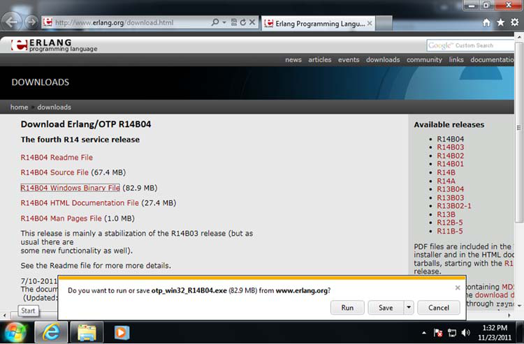
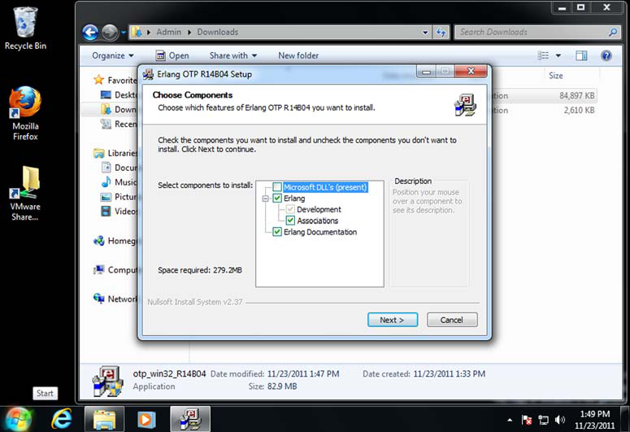
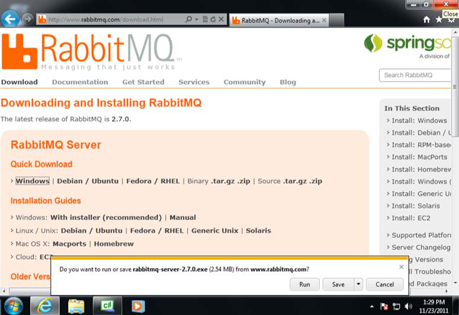
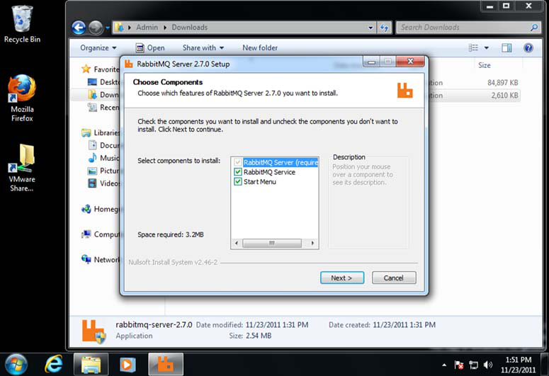
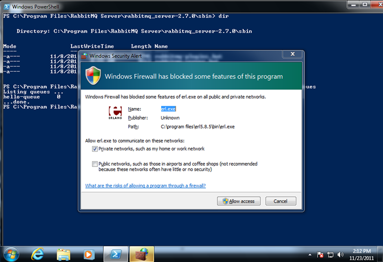

# Phụ lục B–C

> Tệp này gồm hai phụ lục của sách *RabbitMQ in Action*:
> - **Phụ lục B: Tài nguyên trực tuyến (*Appendix B: Online resources*)**
> - **Phụ lục C: Cài đặt RabbitMQ trên Windows (*Appendix C: Installing RabbitMQ on Windows*)**

## Mục lục

- [Phụ lục B: Tài nguyên trực tuyến (Online resources)](#phụ-lục-b-tài-nguyên-trực-tuyến-online-resources)
  - [B.1 Những website bạn nên biết (Websites you should know)](#b1-những-website-bạn-nên-biết-websites-you-should-know)
  - [B.2 Blog (Blogs)](#b2-blog-blogs)
  - [B.3 Thư viện AMQP và các dự án mã nguồn mở liên quan (AMQP libraries and related OSS projects)](#b3-thư-viện-amqp-và-các-dự-án-mã-nguồn-mở-liên-quan-amqp-libraries-and-related-oss-projects)
    - [B.3.1 Thư viện client (Client libraries)](#b31-thư-viện-client-client-libraries)
  - [B.4 Thảo luận và mailing list (Discussions and mailing lists)](#b4-thảo-luận-và-mailing-list-discussions-and-mailing-lists)
  - [B.5 Tóm tắt (Summary)](#b5-tóm-tắt-summary)
- [Phụ lục C: Cài đặt RabbitMQ trên Windows (Installing RabbitMQ on Windows)](#phụ-lục-c-cài-đặt-rabbitmq-trên-windows-installing-rabbitmq-on-windows)
- [Bảng thuật ngữ của chương](#bảng-thuật-ngữ-của-chương)

> 📝 **Giải thích thêm (không có trong sách):** Sách được viết vào khoảng năm 2011–2012, nên nhiều đường link dưới đây có thể đã cũ, đã chuyển chỗ hoặc không còn hoạt động (ví dụ kho Mercurial `hg.rabbitmq.com` đã được thay bằng GitHub `github.com/rabbitmq`, mạng IRC freenode đã ngừng phổ biến, mailing list đã chuyển sang Google Groups / GitHub Discussions, `rubyamqp.info` nay là `rubybunny.info`...). Bản dịch **giữ nguyên toàn bộ URL gốc của sách**; các ghi chú về link hiện đại chỉ mang tính tham khảo.

---

# Phụ lục B: Tài nguyên trực tuyến (Online resources)

Trong phụ lục này, chúng tôi gom lại một số tài nguyên trực tuyến thú vị. Chúng sẽ giúp cuộc sống của bạn dễ dàng hơn mỗi khi bạn cần tìm thông tin liên quan đến RabbitMQ — dù đó là một thư viện client (*client library* – thư viện để ứng dụng kết nối tới broker) cho ngôn ngữ lập trình bạn yêu thích, hay là mẫu thiết kế nhắn tin (*messaging design pattern*) mới nhất để giải bài toán bạn đang gặp. Nhưng thôi, nói cho công bằng: chúng tôi không thể đáp ứng mọi nhu cầu của bạn, nhưng sẽ cố gắng bằng cách liệt kê những tài nguyên đã từng giúp ích cho chính chúng tôi.

## B.1 Những website bạn nên biết (Websites you should know)

Hãy bắt đầu bằng việc điểm qua một vài website:

- **Tài liệu chính thức của RabbitMQ** (*RabbitMQ official documentation*) — Đây là nơi bạn nên tìm đến đầu tiên nếu cần thông tin về RabbitMQ. Kể từ khi chúng tôi bắt đầu viết cuốn sách này, lượng tài nguyên trên website chính thức đã tăng lên đáng kể. Xem chi tiết tại: http://www.rabbitmq.com/documentation.html.

- **Tài liệu tham khảo về AMQP** (*AMQP references*) — Nếu muốn hiểu sâu hơn về AMQP (giao thức hàng đợi thông điệp nâng cao mà RabbitMQ cài đặt), bạn có thể ghé website chính thức của giao thức (http://amqp.org/). Ở đó bạn sẽ tìm thấy đặc tả (*specification*) của các phiên bản khác nhau (http://amqp.org/resources/download). Ngoài những link đó, các lập trình viên RabbitMQ còn tạo ra một trang **Tra cứu nhanh AMQP** (*AMQP Quick Reference*) tại http://www.rabbitmq.com/amqp-0-9-1-quickref.html. Bất cứ khi nào bạn muốn biết "tham số thứ tư của phương thức AMQP kia nghĩa là gì", hãy vào xem trang đó.

- **Enterprise Integration Patterns** (Các mẫu tích hợp doanh nghiệp) — Nếu bạn muốn tìm hiểu thêm về các mẫu nhắn tin và tích hợp (*messaging and integration patterns*), thì cuốn sách *Enterprise Integration Patterns* của Gregor Hohpe và Bobby Woolf chính là cuốn nên đọc. Có một lưu ý nhỏ dành cho người dùng AMQP: toàn bộ ví dụ trong sách nhắm vào các công nghệ như JMS hay MSMQ, nên bạn sẽ phải "chuyển ngữ" khái niệm một chút. Ngoài ra, nhiều mẫu trong đó vốn đã là một phần sẵn có của chính RabbitMQ. Tin tốt là bạn không cần mua sách mới có thể bắt đầu: phần mô tả các mẫu và sơ đồ được phát hành theo giấy phép Creative Commons Attribution License, nên bạn có thể đọc trực tuyến tại http://www.eaipatterns.com/eaipatterns.html. Các mẫu như Publish Subscribe (Xuất bản – Đăng ký), Competing Consumers (Các consumer cạnh tranh) và nhiều mẫu khác đã được đề cập trong các ví dụ chúng tôi trình bày ở chương 4.

- **Trang tài liệu của Ruby AMQP gem** (*Ruby AMQP gem documentation site*) — Website của Ruby AMQP gem chứa đầy tài liệu và ví dụ về cách dùng RabbitMQ và AMQP. Các ví dụ thậm chí còn có cả hình vẽ chú thỏ ngộ nghĩnh: http://rubyamqp.info/.

- **RSS feed phát triển RabbitMQ** (*RabbitMQ development RSS feed*) — Kho mã Mercurial của RabbitMQ cung cấp một RSS feed liệt kê những thay đổi mã nguồn mới nhất của server. Nó thú vị nếu bạn muốn theo kịp những gì đang diễn ra ở "mũi nhọn" phát triển (*bleeding edge* – phiên bản mới nhất, chưa ổn định): http://hg.rabbitmq.com/rabbitmq-server/rss-log.

> 💡 **Ví dụ bổ sung (không có trong sách):** Cách dùng AMQP Quick Reference trong thực tế. Giả sử bạn đọc đoạn Python dùng Pika:
>
> ```python
> channel.queue_declare(queue="orders", passive=False, durable=True,
>                       exclusive=False, auto_delete=False)
> ```
>
> và thắc mắc `exclusive` khác `auto_delete` ở chỗ nào. Mở trang Quick Reference, tìm lớp `queue` → phương thức `declare`, bạn sẽ thấy danh sách tham số theo đúng thứ tự trong giao thức: `reserved-1`, `queue`, `passive`, `durable`, `exclusive`, `auto-delete`, `no-wait`, `arguments`, kèm mô tả: `exclusive` = queue chỉ dùng được bởi connection đã khai báo nó và bị xóa khi connection đóng; `auto-delete` = queue bị xóa khi consumer cuối cùng hủy đăng ký. Đó chính là ý "tham số thứ tư nghĩa là gì" mà tác giả nhắc tới.
>
> 📝 **Giải thích thêm (không có trong sách) – Cập nhật các đường dẫn tài liệu chính thức của RabbitMQ 3.13 & 4.0 hiện nay:**
>
> Sau hơn một thập kỷ, trang web của RabbitMQ đã được thiết kế lại hoàn toàn (sử dụng HTTPS và cấu trúc `/docs` mới). Dưới đây là bảng ánh xạ trực tiếp từ các URL năm 2012 trong sách sang tài nguyên hiện đại:
>
> | Tài nguyên trong sách (2012) | Đường dẫn & Tài nguyên hiện đại (RabbitMQ 3.13 / 4.0) | Ghi chú quan trọng |
> |---|---|---|
> | `http://www.rabbitmq.com/documentation.html` | **https://www.rabbitmq.com/docs** | Cổng tài liệu chính thức mới của RabbitMQ 3.13 & 4.0 |
> | `http://www.rabbitmq.com/amqp-0-9-1-quickref.html` | **https://www.rabbitmq.com/docs/amqp-0-9-1-quickref** | Bảng tra cứu nhanh các lớp/phương thức AMQP 0-9-1 |
> | *(Chưa có năm 2012)* | **https://www.rabbitmq.com/docs/amqp** | Tài liệu **AMQP 1.0 Native** (trở thành giao thức cốt lõi ngang hàng AMQP 0-9-1 từ RabbitMQ 4.0) |
> | *(Chưa có năm 2012)* | **https://www.rabbitmq.com/docs/quorum-queues** & **https://www.rabbitmq.com/docs/streams** | Tài liệu về **Quorum Queues** (Raft) và **RabbitMQ Streams** |
> | `http://rubyamqp.info/` | **https://rubybunny.info/** | Gem `amqp` cũ (dựa trên EventMachine) đã ngừng phát triển; được thay thế bởi gem **`Bunny`** của cùng nhóm tác giả |
> | `http://hg.rabbitmq.com/rabbitmq-server/rss-log` | **https://github.com/rabbitmq/rabbitmq-server** (RSS phát hành: `https://github.com/rabbitmq/rabbitmq-server/releases.atom`) | Kho Mercurial (`hg.rabbitmq.com`) đã bị đóng; toàn bộ mã nguồn server và các plugin cốt lõi nay nằm trong một **GitHub Monorepo** duy nhất |

## B.2 Blog (Blogs)

- **Blog chính thức của RabbitMQ** (*RabbitMQ official blog*) — Nhóm RabbitMQ duy trì một blog tại http://www.rabbitmq.com/blog/, nơi họ bàn về những phát triển mới trong broker, chia sẻ mẹo về hiệu năng và nhiều thứ khác nữa. Hãy nhớ thường xuyên để mắt tới blog này.

- **Jason's plans** (Blog của Jason) — Chính blog của Jason là thứ khởi đầu mọi chuyện, hồi năm 2009 khi chúng tôi đang đi tìm ví dụ về cách dùng RabbitMQ và AMQP. Bài viết "Rabbits and warrens" (Thỏ và hang thỏ) của anh đã truyền cảm hứng cho rất nhiều người qua nhiều năm. Thỉnh thoảng lại có ai đó "khai quật" lại nó và bài viết lại nổi lên trên Twitter. Hãy xem tại: http://blogs.digitar.com/jjww/2009/01/rabbits-and-warrens/.

- **Blog của Alvaro** (*Alvaro's blog*) — Alvaro duy trì một blog, nơi anh bàn về nhắn tin (*messaging*) và nhiều chủ đề phần mềm khác. Ở đó bạn có thể tìm thấy các bài viết ngắn giải thích những thứ như cài đặt RPC với RabbitMQ và Haskell: http://videlalvaro.github.com/2010/10/rpc-over-rabbitmq.html.

## B.3 Thư viện AMQP và các dự án mã nguồn mở liên quan (AMQP libraries and related OSS projects)

- **Công cụ cho nhà phát triển và tài liệu học tập** (*Developer tools and learning material*) — Website chính thức của RabbitMQ có một danh sách các dự án mã nguồn mở (*open source projects*, OSS) liên quan đến RabbitMQ theo cách này hay cách khác: http://www.rabbitmq.com/devtools.html. Ở đó bạn có thể tìm thấy đủ loại link, từ các thư viện AMQP cho tới các kho GitHub cung cấp những bản cài đặt exchange thay thế (*alternate exchange implementations* – các loại exchange tùy biến viết dưới dạng plugin) — thậm chí cả video hướng dẫn do cộng đồng tự làm!

### B.3.1 Thư viện client (Client libraries)

Dưới đây chúng tôi liệt kê một số thư viện thú vị dành cho AMQP, và cho RabbitMQ nói riêng:

- **Java** — Ngoài client Java chính thức, bạn còn có những lựa chọn khác để tích hợp Java với RabbitMQ. Framework Spring cung cấp thư viện Spring AMQP: http://www.springsource.org/spring-amqp.

  Mule ESB (một *Enterprise Service Bus* – "trục dịch vụ doanh nghiệp") cũng cung cấp khả năng tích hợp với AMQP và RabbitMQ. Bạn có thể tìm thêm chi tiết tại https://github.com/mulesoft/mule-transport-amqp/blob/master/GUIDE.md.

  Cuối cùng, LShift — công ty ban đầu đã tạo ra RabbitMQ — có một component RabbitMQ mang tính thử nghiệm dành cho Apache Camel: https://github.com/lshift/camel-rabbitmq.

- **.Net/C#** — Với C#, bạn có client chính thức đã được trình bày ở phụ lục trước (phụ lục A). Ngoài ra Spring AMQP cũng cung cấp một thư viện để dùng với framework Spring Integration của họ. Link giống hệt như cho Java: http://www.springsource.org/spring-amqp.

  Bên cạnh thư viện đó, Mike Hadlow đã tạo một thư viện tên là EasyNetQ, được anh giới thiệu tại https://github.com/mikehadlow/EasyNetQ/wiki/Introduction. Mục tiêu của thư viện này là "Không cần cấu hình, hoặc ít nhất là cấu hình tối thiểu" (*Zero or at least minimal configuration*) và "API đơn giản" (*Simple API*).

- **Python** — Trong sách chúng tôi đã dùng thư viện Pika. Marek Majkowski, một trong những lập trình viên RabbitMQ, đã bắt đầu viết một thư viện mới tên là Puka, và anh giải thích lý do thiết kế đằng sau thư viện mới này tại http://www.rabbitmq.com/blog/2011/07/08/puka-rethinking-amqp-clients/.

- **C** — Với C có một thư viện tên là rabbitmq-c, do David Wragg viết và duy trì, cũng hoạt động với RabbitMQ. Thư viện này còn được người dùng C++ và Objective-C bọc lại (*wrap*) để dùng. Thư viện được lưu trữ tại kho Mercurial của RabbitMQ: http://hg.rabbitmq.com/rabbitmq-c/.

- **PHP** — Với PHP, chúng tôi đã dùng thư viện client php-amqplib, là một bản cài đặt thuần PHP (*pure PHP implementation* – viết hoàn toàn bằng PHP, không cần extension C). Ngoài ra còn có một PECL extension cho AMQP mà bạn có thể tìm tại http://pecl.php.net/package/amqp. Tại thời điểm viết sách, thư viện đó vẫn đang được phát triển rất tích cực. Hãy nhớ rằng nó phụ thuộc vào thư viện rabbitmq-c.

  Một thư viện thuần PHP khác cũng đáng nhắc tới nhờ việc được tác giả phát triển tích cực và chăm chút tài liệu. Nó tên là amqphp và có thể tìm thấy tại https://github.com/braveSirRobin/amqphp.

- **Ruby** — Với Ruby, bạn có thể thử Ruby AMQP Gem mà chúng tôi đã nhắc ở trên (http://rubyamqp.info/). Nếu bạn dùng JRuby (Ruby chạy trên JVM) thì có một thư viện thay thế tên là hot_bunnies, có thể tìm tại https://github.com/ruby-amqp/hot_bunnies. Tin tốt là nó cũng được duy trì bởi một trong các tác giả của AMQP Gem.

- **Erlang** — Nếu bạn cần dùng RabbitMQ từ Erlang — chính là ngôn ngữ dùng để viết RabbitMQ — thì nhóm RabbitMQ có cung cấp một thư viện client. Thư viện này được phần lớn các plugin của RabbitMQ sử dụng, nên rất có thể bạn đang gián tiếp dùng nó trong bản cài đặt RabbitMQ của mình. Chi tiết về cách dùng có trên website chính thức của RabbitMQ: http://www.rabbitmq.com/erlang-client-user-guide.html.

- **JavaScript, Node.js và nhắn tin trên web** (*web messaging*) — Mặc dù JavaScript là một ngôn ngữ frontend, gần đây đã xuất hiện các framework phía server cho thấy ngôn ngữ này là một lựa chọn thú vị cho lập trình backend. Node.js là một server cho phép bạn viết mã phía server bằng JavaScript, và như bạn có thể đoán, chẳng phải đợi lâu đã có người viết một client AMQP cho nó. Thư viện chính tên là node-amqp, được duy trì bởi Theo Schlossnagle, tác giả cuốn sách *Scalable Internet Architectures*. Xem thêm về thư viện tại: https://github.com/postwait/node-amqp.

  Ngoài ra còn có một thư viện tên là Rabbit.js, cài đặt sẵn một số mẫu nhắn tin cho web. Nó được tạo bởi Michael Bridgen, một trong các lập trình viên RabbitMQ. Chi tiết tại https://github.com/squaremo/rabbit.js.

- **Clojure** — Với Clojure có một thư viện tên là langohr, do Michael Klishin tạo ra — anh là một trong những người duy trì Ruby AMQP Gem và thư viện hot_bunnies. Thiết kế của thư viện được xây dựng dựa trên kinh nghiệm của anh khi viết các client Ruby. Thư viện bọc thư viện Java chính thức thành Clojure theo đúng phong cách thành ngữ (*idiomatic*) của Clojure. Đây là kho GitHub: https://github.com/michaelklishin/langohr.

- **Scala** — Với Scala có một thư viện AMQP có thể dùng trực tiếp với framework mở rộng AKKA (*AKKA Scalability framework*). Tài liệu của thư viện có trong kho của nó tại http://doc.akka.io/docs/akka-modules/1.3.1/modules/amqp.html.

- **Haskell** — Nếu muốn dùng RabbitMQ với Haskell, hãy xem package này trên Hackage (kho package của Haskell): http://hackage.haskell.org/package/amqp. Có một hướng dẫn bắt đầu ở đây: http://videlalvaro.github.com/2010/09/haskell-and-rabbitmq.html.

- **NoSQL** — RabbitMQ cũng đã được tích hợp với một số cơ sở dữ liệu NoSQL; đáng chú ý nhất là công việc của Jon Brisbin, người đã làm cầu nối giữa RabbitMQ và Riak. Có một exchange RabbitMQ thay thế ghi (log) các thông điệp vào Riak tại https://github.com/jbrisbin/riak-exchange. Ngoài ra, nếu bạn muốn nhận thông báo thay đổi về những gì đang diễn ra trong cơ sở dữ liệu Riak của mình, Jon đã viết một Riak post-commit-hook (móc chạy sau khi commit dữ liệu). Thông tin thêm tại: https://github.com/jbrisbin/riak-rabbitmq-commit-hooks.

> 💡 **Ví dụ bổ sung (không có trong sách):** Bảng tóm tắt nhanh các thư viện vừa nêu, giúp bạn chọn theo ngôn ngữ (theo đúng nội dung sách):
>
> | Ngôn ngữ / nền tảng | Thư viện được nhắc tới | Ghi chú theo sách |
> |---|---|---|
> | Java | client chính thức, Spring AMQP, Mule ESB transport, camel-rabbitmq (LShift) | camel-rabbitmq là thử nghiệm |
> | .NET/C# | client chính thức (phụ lục A), Spring AMQP (Spring Integration), EasyNetQ | EasyNetQ: cấu hình tối thiểu, API đơn giản |
> | Python | Pika (dùng trong sách), Puka | Puka do Marek Majkowski viết |
> | C | rabbitmq-c | được bọc cho C++ và Objective-C |
> | PHP | php-amqplib (dùng trong sách), PECL amqp, amqphp | PECL amqp phụ thuộc rabbitmq-c |
> | Ruby / JRuby | Ruby AMQP Gem, hot_bunnies | hot_bunnies dành cho JRuby |
> | Erlang | Erlang client chính thức | dùng bởi đa số plugin |
> | JavaScript / Node.js | node-amqp, Rabbit.js | Rabbit.js: mẫu nhắn tin cho web |
> | Clojure | langohr | bọc client Java |
> | Scala | AKKA AMQP module | |
> | Haskell | package `amqp` trên Hackage | |
> | NoSQL (Riak) | riak-exchange, riak-rabbitmq-commit-hooks | của Jon Brisbin |
>
> Điểm mấu chốt: vì AMQP là một **giao thức dây** (*wire protocol*) chuẩn, một producer viết bằng PHP (php-amqplib) có thể gửi thông điệp mà consumer viết bằng Node.js (node-amqp) hay Haskell nhận được bình thường — miễn là cả hai cùng nói AMQP 0-9-1 với cùng một broker.
>
> 📝 **Giải thích thêm (không có trong sách) – Cập nhật hệ sinh thái thư viện Client hiện đại (2026) so với năm 2012:**
>
> Trang tổng hợp công cụ và thư viện chính thức hiện nay đã chuyển về **https://www.rabbitmq.com/client-libraries/devtools**. Rất nhiều thư viện được nhắc tới trong sách năm 2012 (như `Puka`, `node-amqp`, `amqphp`, `hot_bunnies`, `lshift/camel-rabbitmq`) **đã ngừng phát triển (archived/abandoned)** và không còn tương thích với RabbitMQ 3.13 / 4.0. Nếu bắt đầu dự án mới ngày nay, hãy dùng các thư viện tiêu chuẩn sau:
>
> | Ngôn ngữ | Thư viện trong sách (2012) | Thư viện chuẩn hiện đại (2026) | Ghi chú thực tế |
> |---|---|---|---|
> | **Java / JVM** | `amqp-client` 2.x, Spring AMQP, `lshift/camel-rabbitmq` | **`com.rabbitmq:amqp-client` 5.x**, **`com.rabbitmq:stream-client`**, **Spring Boot (`spring-boot-starter-amqp`)**, Apache Camel `camel-spring-rabbitmq`, Quarkus Reactive Messaging | `lshift/camel-rabbitmq` đã bị thay bằng component chính thức của Apache Camel |
> | **.NET / C#** | `RabbitMQ.Client` 2.x, Spring.NET AMQP, EasyNetQ | **`RabbitMQ.Client` 6.x / 7.x**, **`RabbitMQ.Stream.Client`**, **MassTransit**, NServiceBus, Wolverine, EasyNetQ | **MassTransit** hiện là framework messaging phổ biến số 1 trong hệ sinh thái .NET Core / .NET 8 |
> | **Python** | `pika` 0.9.x, `Puka` | **`pika` 1.x** (đồng bộ), **`aio-pika`** (`asyncio`), **Celery / Kombu**, **FastStream** | `Puka` đã ngừng phát triển; với ứng dụng FastAPI / `asyncio` hiện đại, **`aio-pika`** hoặc **FastStream** là lựa chọn tốt nhất |
> | **Node.js / TS** | `postwait/node-amqp`, `rabbit.js` | **`amqplib`** (`amqp.node`), **`rabbitmq-client`**, **NestJS Microservices (`@nestjs/microservices`)** | `postwait/node-amqp` đã bị bỏ hoang nhiều năm; **`amqplib`** (do chính Michael Bridgen – tác giả `rabbit.js` – viết) là thư viện chuẩn cho Node.js |
> | **Go (Golang)** | *(Chưa có trong sách)* | **`github.com/rabbitmq/amqp091-go`**, **`rabbitmq-stream-go-client`**, **Watermill** | Đội ngũ RabbitMQ đã fork `streadway/amqp` cũ thành **`rabbitmq/amqp091-go`** để bảo trì chính thức |
> | **Rust** | *(Chưa có trong sách)* | **`lapin`** (`crates.io/crates/lapin`), `amqprs` | Hỗ trợ đầy đủ `tokio` / `async-std` hiệu năng cao |
> | **PHP** | `php-amqplib`, PECL `amqp`, `amqphp` | **`php-amqplib/php-amqplib`** (Composer), PECL `ext-amqp`, **Symfony Messenger**, **Laravel Queue** | `amqphp` đã ngừng phát triển; `php-amqplib` (do chính tác giả sách Alvaro Videla khởi xướng) vẫn là chuẩn mực của PHP |
> | **Ruby / JRuby** | `amqp` gem (`rubyamqp.info`), `hot_bunnies` | **`Bunny`** (`rubybunny.info` cho CRuby) & **`March Hare`** (`rubymarchhare.info` cho JRuby) | `amqp` gem và `hot_bunnies` đã được chính tác giả Michael Klishin thay thế bằng `Bunny` và `March Hare` |
> | **C / C++** | `hg.rabbitmq.com/rabbitmq-c` | **`alanxz/rabbitmq-c`** (GitHub), **`CopernicaMarketingSoftware/AMQP-CPP`** | `rabbitmq-c` đã chuyển sang GitHub tại `https://github.com/alanxz/rabbitmq-c` |

## B.4 Thảo luận và mailing list (Discussions and mailing lists)

- **Mailing list** (danh sách thư thảo luận) — Nếu bạn muốn liên lạc với cộng đồng RabbitMQ, kể cả các lập trình viên của nó, có một vài nơi bạn có thể tìm tới. Đầu tiên là mailing list chính thức tại http://lists.rabbitmq.com/cgi-bin/mailman/listinfo/rabbitmq-discuss. Danh sách này rất sôi động và bạn có thể tìm được câu trả lời cho thắc mắc của mình, đôi khi ngay trong buổi chiều hôm đó. Nếu bạn đang gặp rắc rối với RabbitMQ, đó là nơi tốt nhất để đến xin trợ giúp.

- **Kênh IRC** (*IRC channel*) — Nếu bạn thích giao tiếp trực tiếp, tức thời hơn, có kênh IRC #rabbitmq trên mạng http://freenode.net/. Cứ thoải mái tham gia trò chuyện; luôn có những thành viên trong cộng đồng sẵn lòng giúp đỡ.

- **Twitter** — Cuối cùng, nếu bạn muốn biết mọi người đang nói gì về RabbitMQ theo thời gian thực, bạn có thể theo dõi hashtag #rabbitmq trên Twitter: http://twitter.com/#!/search?q=%23rabbitmq.

> 💡 **Ví dụ bổ sung (không có trong sách):** Một câu hỏi "tốt" gửi lên mailing list để được trả lời nhanh nên có: (1) phiên bản RabbitMQ và Erlang (lấy từ `rabbitmqctl status`), (2) hệ điều hành, (3) thư viện client và phiên bản, (4) đoạn code tối thiểu tái hiện lỗi, (5) trích đoạn log của broker quanh thời điểm lỗi. Ví dụ tiêu đề: *"Consumer Pika 0.9.5 không nhận được message sau khi broker 2.7.0 restart (queue durable)"* — rõ ràng hơn nhiều so với *"RabbitMQ không chạy, giúp với!"*.
>
> 📝 **Giải thích thêm (không có trong sách) – Các kênh thảo luận và hỗ trợ cộng đồng RabbitMQ hiện nay:**
>
> Cả máy chủ Mailman (`lists.rabbitmq.com`) lẫn mạng IRC Freenode đều đã ngừng hoạt động cho cộng đồng RabbitMQ. Ngày nay, khi cần hỏi đáp hoặc trao đổi trực tiếp với các kỹ sư phát triển cốt lõi (*core maintainers*) của RabbitMQ, bạn hãy truy cập các kênh chính thức sau (tổng hợp tại **https://www.rabbitmq.com/contact**):
>
> 1. **GitHub Discussions (Kênh hỏi đáp chính thức số 1 hiện nay):**
>    - Địa chỉ: **https://github.com/rabbitmq/rabbitmq-server/discussions**
>    - Đây là nơi đội ngũ kỹ sư RabbitMQ trực tiếp trả lời các câu hỏi về thiết kế kiến trúc, nâng cấp phiên bản (3.12 → 3.13 → 4.0), gỡ lỗi Quorum Queues / Streams và hiệu năng.
> 2. **Mailing List trên Google Groups (`rabbitmq-users`):**
>    - Địa chỉ: **https://groups.google.com/g/rabbitmq-users** (thay thế hoàn toàn cho `rabbitmq-discuss` trên `lists.rabbitmq.com` cũ).
> 3. **Chat thời gian thực (Discord, Slack & IRC Libera.Chat):**
>    - **RabbitMQ Community Discord & Slack**: Đường dẫn mời tham gia được cập nhật tại `https://www.rabbitmq.com/contact#community-support`.
>    - **IRC**: Chuyển từ Freenode sang mạng **Libera.Chat** (`irc.libera.chat`, kênh `#rabbitmq`).

## B.5 Tóm tắt (Summary)

Với hơn 30 đường link tới các tài nguyên mới trong phụ lục này, bạn có thừa thứ để đọc nếu muốn "đào sâu hơn nữa vào hang thỏ" (*dig even deeper into the rabbit hole* — chơi chữ: vừa là thành ngữ "đi sâu vào một chủ đề", vừa ám chỉ con thỏ của RabbitMQ). Chúng tôi đã cung cấp một tuyển tập các link từ những website và blog thú vị, kèm một vài nhận xét ngắn về từng thư viện được nhắc tới ở đây. Bạn có thể thấy rằng với RabbitMQ và AMQP, bạn không bị trói buộc (*locked into*) vào giải pháp của một ngôn ngữ cụ thể nào. Cuối cùng, nếu muốn liên lạc với cộng đồng, bạn có thể làm điều đó qua email truyền thống, chat IRC trực tiếp, hoặc theo dõi theo thời gian thực những gì đang diễn ra với người dùng RabbitMQ qua Twitter.

---

# Phụ lục C: Cài đặt RabbitMQ trên Windows (Installing RabbitMQ on Windows)

Giống như hầu hết các chương trình có nguồn gốc từ UNIX, việc cài đặt RabbitMQ trên Windows khác với hướng dẫn cài đặt mà chúng ta đã xem ở chương 1. May mắn thay, những người tốt bụng ở "tổng hành dinh Rabbit" (*Rabbit HQ* – nhóm phát triển RabbitMQ) đã cung cấp bộ cài dựa trên MSI (*MSI-based installers* – trình cài đặt chuẩn của Windows), khiến quá trình này khá "không đau đớn". Nhưng trước khi cài Rabbit, bạn phải cài một phiên bản Erlang gần đây từ http://www.erlang.org/download.html. Nhìn chung, phiên bản Erlang mới nhất có trên erlang.org sẽ chạy được với phiên bản RabbitMQ mới nhất. Vậy hãy tải bản có nhãn **Windows Binary File** (xem hình C.1).



**Hình C.1 – Tải bộ cài Erlang cho Windows**

*Mô tả hình:* Ảnh chụp trình duyệt Internet Explorer đang mở trang `http://www.erlang.org/download.html`. Trang có tiêu đề "Download Erlang/OTP R14B04 — The fourth R14 service release" (Tải Erlang/OTP R14B04 — bản phát hành dịch vụ thứ tư của dòng R14) với các link: R14B04 Readme File (tệp đọc trước), R14B04 Source File (mã nguồn, 67.4 MB), **R14B04 Windows Binary File** (bản nhị phân cho Windows, 82.9 MB — link đang được chọn), R14B04 HTML Documentation File (tài liệu HTML, 27.4 MB), R14B04 Man Pages File (trang man, 1.0 MB). Cột bên phải "Available releases" liệt kê các bản phát hành khác (R14B04, R14B03, … R11B-5). Ở dưới cùng là thanh hỏi của trình duyệt: "Do you want to run or save otp_win32_R14B04.exe (82.9 MB) from www.erlang.org?" (Bạn muốn chạy hay lưu tệp otp_win32_R14B04.exe từ www.erlang.org?) với các nút Run (Chạy) / Save (Lưu) / Cancel (Hủy).

Sau khi đã tải về bộ cài Erlang (trong trường hợp này là `otp_win32_R14B04.exe`), bạn mở thư mục Downloads và chạy nó (xem hình C.2).

Mọi giá trị mặc định trong bộ cài Erlang cho Windows đều chấp nhận được khi dùng với Rabbit, nên cứ bấm Next (hoặc Finish) ở tất cả các bước của trình hướng dẫn cài đặt (*installer wizard*) để triển khai một bản cài Erlang mặc định.



**Hình C.2 – Cài đặt Erlang cho Windows**

*Mô tả hình:* Cửa sổ "Erlang OTP R14B04 Setup", bước "Choose Components" (Chọn thành phần) — "Choose which features of Erlang OTP R14B04 you want to install" (Chọn các tính năng của Erlang OTP R14B04 bạn muốn cài). Hướng dẫn: "Check the components you want to install and uncheck the components you don't want to install. Click Next to continue." (Đánh dấu thành phần muốn cài, bỏ dấu thành phần không muốn cài. Bấm Next để tiếp tục.) Danh sách "Select components to install": Microsoft DLL's (present) — không đánh dấu (đã có sẵn); **Erlang** (gồm Development, Associations) — đánh dấu; **Erlang Documentation** — đánh dấu. "Space required: 279.2MB" (dung lượng cần: 279,2 MB). Phía sau là cửa sổ Explorer thư mục Downloads, chứa tệp `otp_win32_R14B04` (Application, 82.9 MB).

Tiếp theo, tải bộ cài RabbitMQ cho Windows (xem hình C.3) từ http://www.rabbitmq.com/download.html.

Dùng bộ cài RabbitMQ cho Windows cũng dễ như bộ cài Erlang: chạy tệp cài đặt đã tải (xem hình C.4) và bấm qua các bước với giá trị mặc định.



**Hình C.3 – Tải bộ cài RabbitMQ cho Windows**

*Mô tả hình:* Trình duyệt mở `http://www.rabbitmq.com/download.html`, trang "Downloading and Installing RabbitMQ" (Tải và cài đặt RabbitMQ), ghi "The latest release of RabbitMQ is 2.7.0" (bản mới nhất là 2.7.0). Mục "RabbitMQ Server → Quick Download" (Tải nhanh) có các lựa chọn: **Windows** (đang chọn) | Debian / Ubuntu | Fedora / RHEL | Binary .tar.gz .zip | Source .tar.gz .zip. Mục "Installation Guides" (Hướng dẫn cài đặt): Windows: With installer (recommended – dùng bộ cài, khuyến nghị) | Manual (thủ công); Linux / Unix: Debian / Ubuntu | Fedora / RHEL | Generic Unix | Solaris; Mac OS X: Macports | Homebrew; Cloud: EC2. Thanh hỏi của trình duyệt: "Do you want to run or save rabbitmq-server-2.7.0.exe (2.54 MB) from www.rabbitmq.com?" với các nút Run / Save / Cancel.



**Hình C.4 – Cài đặt RabbitMQ cho Windows**

*Mô tả hình:* Cửa sổ "RabbitMQ Server 2.7.0 Setup", bước "Choose Components" — "Choose which features of RabbitMQ Server 2.7.0 you want to install". Danh sách thành phần: RabbitMQ Server (required – bắt buộc, đánh dấu mờ không bỏ được), **RabbitMQ Service** (cài thành dịch vụ Windows — đánh dấu), **Start Menu** (tạo lối tắt trong Start Menu — đánh dấu). "Space required: 3.2MB". Phía sau là thư mục Downloads chứa tệp `rabbitmq-server-2.7.0` (Application, 2.54 MB).

Khi bộ cài chạy xong, bạn sẽ có một bản RabbitMQ hoạt động đầy đủ, chạy dưới dạng một dịch vụ Windows (*Windows service*)! Nếu mở command prompt và chạy lệnh dưới đây, bạn sẽ thấy cấu trúc thư mục giống hệt như trên mọi nền tảng khác mà RabbitMQ hỗ trợ:

```bat
cd C:\Program Files\RabbitMQ Server\rabbitmq_server-2.7.0
```

Một điểm khác so với các phiên bản RabbitMQ trên UNIX là các tiện ích trong thư mục con `.\sbin` có phần đuôi `.bat`. Ví dụ, thay vì chạy `.\sbin\rabbitmqctl`, trên Windows bạn sẽ chạy `.\sbin\rabbitmqctl.bat`. Ngoài ra, lần đầu tiên bạn chạy bất kỳ tiện ích nào (như `rabbitmqctl.bat`) có giao tiếp với Rabbit thông qua Erlang, bạn sẽ nhận được cảnh báo từ Windows Firewall (tường lửa Windows — xem hình C.5) hỏi có cho phép `erl.exe` truy cập mạng hay không. Cứ cho phép `erl.exe` truy cập các mạng "riêng tư" (*private networks*).

Chỉ có vậy thôi! Giờ bạn đã có một bản RabbitMQ hoạt động đầy đủ trên hệ thống Windows của mình! Mọi ví dụ trong sách này đều chạy tốt trên bản Rabbit cho Windows (đặc biệt là các ví dụ .NET trong phụ lục A) y như trên bản UNIX. Đó chính là vẻ đẹp của Rabbit!



**Hình C.5 – Cho phép erl.exe truy cập mạng trong Windows Firewall.**

*Mô tả hình:* Phía sau là cửa sổ Windows PowerShell ở thư mục `C:\Program Files\RabbitMQ Server\rabbitmq_server-2.7.0\sbin`, đã chạy `dir` (liệt kê các tệp `.bat`) và một lệnh liệt kê queue cho kết quả:

```text
Listing queues ...
hello-queue     0
...done.
```

Phía trước là hộp thoại "Windows Security Alert" (Cảnh báo bảo mật Windows): "Windows Firewall has blocked some features of this program" (Tường lửa Windows đã chặn một số tính năng của chương trình này) — "Windows Firewall has blocked some features of erl.exe on all public and private networks." Thông tin: Name (Tên): erl.exe; Publisher (Nhà phát hành): Unknown (Không rõ); Path (Đường dẫn): `C:\program files\erl5.8.5\bin\erl.exe`. Mục "Allow erl.exe to communicate on these networks" (Cho phép erl.exe giao tiếp trên các mạng sau): ☑ **Private networks, such as my home or work network** (Mạng riêng, như mạng gia đình hoặc nơi làm việc) — đã đánh dấu; ☐ Public networks, such as those in airports and coffee shops (not recommended because these networks often have little or no security) (Mạng công cộng như ở sân bay, quán cà phê — không khuyến nghị vì các mạng này thường có ít hoặc không có bảo mật) — không đánh dấu. Nút **Allow access** (Cho phép truy cập) và Cancel (Hủy).

> 💡 **Ví dụ bổ sung (không có trong sách):** Kiểm tra nhanh broker sau khi cài trên Windows (chạy trong command prompt, thư mục cài của bản 2.7.0 như trong sách):
>
> ```bat
> cd "C:\Program Files\RabbitMQ Server\rabbitmq_server-2.7.0\sbin"
> rabbitmqctl.bat status
> rabbitmqctl.bat list_queues
> rabbitmqctl.bat list_users
> ```
>
> - `status` in ra thông tin node (phiên bản Erlang, các ứng dụng đang chạy, bộ nhớ…). Nếu lỗi "unable to connect to node", hãy kiểm tra dịch vụ "RabbitMQ" trong `services.msc` đã chạy chưa.
> - `list_queues` liệt kê queue và số message — đúng kiểu output "Listing queues ... hello-queue 0 ...done." thấy trong hình C.5.
> - `list_users` sẽ thấy user mặc định `guest`.
>
> Lưu ý: nếu bạn mở PowerShell (như trong hình C.5) thay vì cmd, hãy gọi `.\rabbitmqctl.bat` (có `.\` phía trước) vì PowerShell không tự chạy chương trình ở thư mục hiện tại.

> 📝 **Giải thích thêm (không có trong sách):** Vì sao phải cài Erlang trước? RabbitMQ được viết bằng Erlang và chạy bên trong máy ảo Erlang (BEAM). `erl.exe` chính là máy ảo đó — vì thế tường lửa hỏi quyền cho `erl.exe` chứ không phải cho "rabbitmq". Các công cụ như `rabbitmqctl.bat` thực chất khởi động một node Erlang nhỏ để nói chuyện với node RabbitMQ qua cơ chế phân tán của Erlang (dùng `epmd`, cổng 4369), còn client ứng dụng kết nối qua cổng AMQP 5672. Chỉ cho phép "mạng riêng" là lựa chọn an toàn cho máy phát triển.
>
> 📝 **Giải thích thêm (không có trong sách) – Cài đặt RabbitMQ 3.13 / 4.0 trên Windows và môi trường hiện đại (Docker, Chocolatey, Winget, WSL2):**
>
> Quy trình tải tay từng file `.exe` (Erlang R14B04 32-bit + RabbitMQ 2.7.0) trong sách phản ánh bối cảnh năm 2012. Ngày nay, việc dựng môi trường phát triển hoặc triển khai RabbitMQ trên Windows 10/11 và Windows Server đã thay đổi toàn diện, nhanh gọn và ít lỗi hơn rất nhiều:
>
> | Phương pháp | Lệnh thực thi tiêu biểu | Khi nào nên dùng? |
> |---|---|---|
> | **1. Docker / Docker Compose** *(Khuyên dùng số 1)* | `docker run -d --name rabbitmq -p 5672:5672 -p 15672:15672 -p 15692:15692 rabbitmq:4-management` | Phát triển cục bộ trên Windows/macOS/Linux, CI/CD, container hóa (không lo xung đột phiên bản Erlang hay rác registry Windows) |
> | **2. Chocolatey (Windows Package Manager)** | `choco install rabbitmq -y` | Cài đặt gốc (*native Windows Service*) nhanh nhất trên Windows 10/11 & Windows Server; tự động cài bản Erlang 64-bit tương thích và bật sẵn Management UI |
> | **3. Winget (Có sẵn trên Windows 10/11)** | `winget install Ericsson.ErlangOTP` rồi `winget install OpenJS.RabbitMQ` | Khi không dùng Chocolatey nhưng muốn cài qua trình quản lý gói chính chủ của Microsoft |
> | **4. WSL2 (Ubuntu trên Windows)** | Cài gói `.deb` qua Cloudsmith apt repo trong WSL2 | Khi muốn môi trường Linux chuẩn 100% ngay bên trong máy Windows |
>
> ---
>
> 💡 **Ví dụ bổ sung (không có trong sách) – 3 cách cài đặt RabbitMQ hiện đại trên Windows & xử lý lỗi kinh điển `.erlang.cookie`:**
>
> #### Cách 1: Chạy bằng Docker / Docker Compose (Khuyên dùng số 1 cho cả Windows, macOS, Linux)
> Chỉ với một lệnh duy nhất, bạn có ngay **RabbitMQ 4.0** kèm sẵn giao diện quản trị Web (**Management UI** ở cổng `15672`) và **Prometheus metrics** (ở cổng `15692`) mà không cần cài Erlang lên máy thật:
>
> ```powershell
> # Khởi chạy nhanh bằng Docker CLI:
> docker run -d --name rabbitmq `
>   -p 5672:5672 -p 15672:15672 -p 15692:15692 `
>   -e RABBITMQ_DEFAULT_USER=admin `
>   -e RABBITMQ_DEFAULT_PASS=secret123 `
>   rabbitmq:4-management
> ```
>
> Hoặc dùng file `docker-compose.yml` chuẩn cho dự án thực tế (lưu trữ dữ liệu bền vững qua volume):
>
> ```yaml
> services:
>   rabbitmq:
>     image: rabbitmq:4-management
>     container_name: rabbitmq
>     hostname: rabbit-node1
>     ports:
>       - "5672:5672"   # AMQP 0-9-1 & AMQP 1.0
>       - "15672:15672" # Management UI & HTTP API (http://localhost:15672)
>       - "15692:15692" # Prometheus metrics (/metrics)
>     environment:
>       RABBITMQ_DEFAULT_USER: admin
>       RABBITMQ_DEFAULT_PASS: secret123
>     volumes:
>       - rabbitmq_data:/var/lib/rabbitmq
>     healthcheck:
>       test: ["CMD", "rabbitmq-diagnostics", "-q", "ping"]
>       interval: 10s
>       timeout: 5s
>       retries: 5
>
> volumes:
>   rabbitmq_data:
> ```
>
> #### Cách 2: Cài đặt gốc (Native) trên Windows bằng Chocolatey hoặc Winget
> Nếu bắt buộc phải chạy RabbitMQ dưới dạng **Windows Service** trực tiếp trên máy chủ Windows (không dùng Docker):
> - **Lưu ý bắt buộc về phiên bản Erlang 64-bit**: RabbitMQ 3.13 yêu cầu Erlang 26.x, còn **RabbitMQ 4.0 yêu cầu Erlang 26.2+ hoặc 27.x (chỉ hỗ trợ bản 64-bit `win64`)**. Luôn kiểm tra bảng tương thích tại `https://www.rabbitmq.com/docs/which-erlang` trước khi nâng cấp.
> - Mở **PowerShell (Run as Administrator)** và chạy:
>
> ```powershell
> # Cách 2A: Dùng Chocolatey (tự động cài Erlang 64-bit tương thích + RabbitMQ Service + bật rabbitmq_management)
> choco install rabbitmq -y
>
> # Cách 2B: Dùng Winget tích hợp sẵn trên Windows 10/11
> winget install Ericsson.ErlangOTP
> winget install OpenJS.RabbitMQ
> ```
>
> - **Thay đổi về thư mục dữ liệu trên Windows hiện đại**: Từ RabbitMQ 3.x trở đi, thư mục `C:\Program Files\RabbitMQ Server\...` chỉ chứa code thực thi, còn toàn bộ cơ sở dữ liệu Mnesia/Khepri, file log và file cấu hình (`rabbitmq.conf`, `enabled_plugins`) nằm tại **`%APPDATA%\RabbitMQ`** (tức `C:\Users\<User>\AppData\Roaming\RabbitMQ`).
>
> ---
>
> #### ⚠️ Cách xử lý lỗi kinh điển trên Windows: Lệch `.erlang.cookie` khiến `rabbitmqctl` báo lỗi `Authentication failed (rejected by the remote node)`
>
> Khi cài RabbitMQ dưới dạng Windows Service trên Windows, rất nhiều lập trình viên gặp tình huống: dịch vụ RabbitMQ vẫn đang chạy bình thường trong `services.msc`, nhưng khi mở Command Prompt hoặc PowerShell gõ `rabbitmqctl.bat status` (hoặc `rabbitmq-plugins.bat enable rabbitmq_management`), màn hình lại báo lỗi đỏ:
>
> ```text
> Error: unable to perform an operation on node 'rabbit@HOSTNAME'. Please see diagnostics information and suggestions below.
> Most common reasons for this are:
>  * Target node is unreachable (e.g. due to hostname resolution, TCP connection or firewall issues)
>  * CLI tool fails to authenticate with the server (e.g. due to CLI tool's Erlang cookie not matching that of the server)
>  * Target node is not running
>
> In addition to the diagnostics info below:
>  * See the CLI, clustering and networking guides on https://rabbitmq.com/documentation.html to learn more
>  * Consult server logs on node rabbit@HOSTNAME
>
> DIAGNOSTICS
> ===========
> attempted to contact: ['rabbit@HOSTNAME']
> rabbit@HOSTNAME:
>   * connected to epmd (port 4369) on HOSTNAME
>   * epmd reports node 'rabbit' uses port 25672 for inter-node and CLI tool traffic
>   * TCP connection succeeded but Erlang distribution connection failed
>   * Authentication failed (rejected by the remote node), please check the Erlang cookie
> ```
>
> **Nguyên nhân gốc rễ:**
> - Dịch vụ Windows (**RabbitMQ Service**) chạy dưới tài khoản hệ thống `LocalSystem`, nên máy ảo Erlang của broker sinh ra và đọc khóa bí mật **`.erlang.cookie`** tại thư mục hệ thống:
>   - `C:\Windows\System32\config\systemprofile\.erlang.cookie` *(trên Windows 64-bit)*
>   - *(Hoặc `C:\Windows\SysWOW64\config\systemprofile\.erlang.cookie` nếu từng cài Erlang 32-bit cũ)*
> - Trong khi đó, khi bạn mở terminal để chạy `rabbitmqctl.bat`, công cụ CLI chạy dưới tài khoản người dùng Windows hiện tại của bạn nên lại đọc file `.erlang.cookie` tại:
>   - `C:\Users\<Ten_User_Cua_Ban>\.erlang.cookie` (`%HOMEDRIVE%%HOMEPATH%\.erlang.cookie`)
> - Vì hai file `.erlang.cookie` này chứa hai chuỗi ngẫu nhiên khác nhau, node RabbitMQ từ chối kết nối từ `rabbitmqctl.bat`!
>
> **Cách khắc phục triệt để (chạy trong PowerShell với quyền Administrator):**
> Sao chép đè file `.erlang.cookie` của dịch vụ hệ thống về thư mục người dùng hiện tại của bạn (không cần khởi động lại dịch vụ RabbitMQ):
>
> ```powershell
> # Chạy trong PowerShell (Run as Administrator):
> Copy-Item -Path "C:\Windows\System32\config\systemprofile\.erlang.cookie" `
>           -Destination "$env:USERPROFILE\.erlang.cookie" -Force
>
> # Kiểm tra lại ngay lập tức:
> rabbitmqctl.bat status
> rabbitmq-plugins.bat enable rabbitmq_management
> ```

---

## Bảng thuật ngữ của chương

| Thuật ngữ (Anh) | Nghĩa tiếng Việt | Giải thích ngắn |
|---|---|---|
| Client library | Thư viện client | Thư viện giúp ứng dụng kết nối và nói chuyện với broker qua AMQP |
| Messaging design pattern | Mẫu thiết kế nhắn tin | Cách giải quyết đã được đúc kết cho các bài toán trao đổi thông điệp |
| AMQP Quick Reference | Tra cứu nhanh AMQP | Trang của RabbitMQ liệt kê các lớp/phương thức/tham số AMQP 0-9-1 |
| Specification | Đặc tả | Tài liệu định nghĩa chính thức của giao thức |
| Enterprise Integration Patterns | Các mẫu tích hợp doanh nghiệp | Sách của Hohpe & Woolf về mẫu nhắn tin/tích hợp |
| Publish Subscribe | Xuất bản – Đăng ký | Một thông điệp được phát tới nhiều bên đăng ký |
| Competing Consumers | Các consumer cạnh tranh | Nhiều consumer cùng lấy việc từ một queue để chia tải |
| Bleeding edge | Mũi nhọn phát triển | Mã mới nhất, có thể chưa ổn định |
| RSS feed | Nguồn tin RSS | Luồng cập nhật tự động để theo dõi thay đổi |
| Mercurial | Mercurial | Hệ quản lý phiên bản phân tán (RabbitMQ từng dùng) |
| OSS (Open Source Software) | Phần mềm mã nguồn mở | Phần mềm công khai mã nguồn |
| Alternate exchange implementation | Bản cài đặt exchange thay thế | Loại exchange tùy biến bổ sung qua plugin |
| ESB (Enterprise Service Bus) | Trục dịch vụ doanh nghiệp | Hạ tầng tích hợp các hệ thống, ví dụ Mule |
| Pure PHP implementation | Cài đặt thuần PHP | Viết hoàn toàn bằng PHP, không cần extension C |
| PECL extension | Extension PECL | Phần mở rộng PHP viết bằng C, phân phối qua PECL |
| Wrap / wrapper | Bọc / lớp bọc | Lớp mã bao quanh thư viện khác để dùng ở ngôn ngữ khác |
| Idiomatic | Đúng phong cách (thành ngữ) | Viết theo lối tự nhiên, quen thuộc của ngôn ngữ đó |
| Post-commit hook | Móc sau commit | Đoạn mã tự chạy sau khi dữ liệu được ghi |
| Mailing list | Danh sách thư thảo luận | Nhóm thảo luận qua email |
| IRC channel | Kênh IRC | Phòng chat trực tuyến thời gian thực |
| Hashtag | Thẻ bắt đầu bằng # | Dùng để gom các tweet cùng chủ đề |
| Locked into | Bị trói buộc | Phụ thuộc vào một giải pháp/ngôn ngữ duy nhất |
| MSI-based installer | Bộ cài dựa trên MSI | Trình cài đặt chuẩn của Windows |
| Windows Binary File | Tệp nhị phân cho Windows | Bản Erlang đã biên dịch sẵn cho Windows |
| Installer wizard | Trình hướng dẫn cài đặt | Chuỗi màn hình Next/Finish khi cài phần mềm |
| Windows service | Dịch vụ Windows | Chương trình chạy nền, tự khởi động cùng hệ thống |
| Windows Firewall | Tường lửa Windows | Thành phần chặn/cho phép truy cập mạng của chương trình |
| erl.exe | erl.exe | Tệp thực thi máy ảo Erlang mà RabbitMQ chạy bên trong |
| Private / Public networks | Mạng riêng / mạng công cộng | Phân loại mạng của Windows để áp quy tắc tường lửa |
