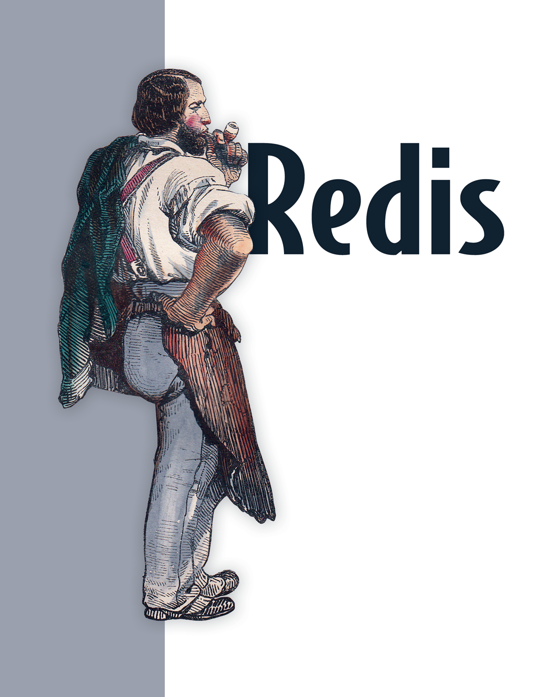
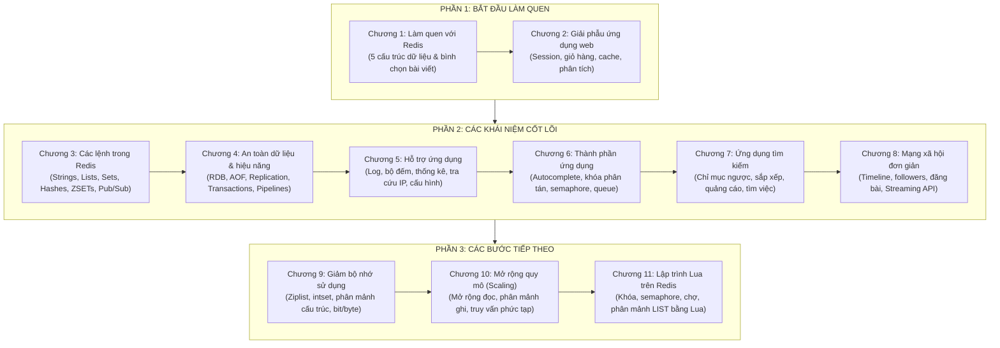

# Lời mở đầu (Front matter)

> Phần này là toàn bộ "phần đầu sách" (PDF trang 1–27) của cuốn **Redis in Action** (*Redis thực chiến*) của Tiến sĩ Josiah L. Carlson, Manning Publications, 2013: trang bìa, trang tiêu đề, trang bản quyền, lời đề tặng, mục lục tóm tắt, mục lục chi tiết, lời tựa (bởi Salvatore Sanfilippo – người sáng tạo ra Redis), lời nói đầu, lời cảm ơn, phần giới thiệu về cuốn sách và phần nói về hình minh họa trên bìa.

## Mục lục của phần này

- [Trang bìa (Cover)](#trang-bìa-cover)
- [Trang tiêu đề (Title page)](#trang-tiêu-đề-title-page)
- [Trang bản quyền (Copyright page)](#trang-bản-quyền-copyright-page)
- [Lời đề tặng (Dedication)](#lời-đề-tặng-dedication)
- [Mục lục tóm tắt (Brief contents)](#mục-lục-tóm-tắt-brief-contents)
- [Mục lục chi tiết (Contents)](#mục-lục-chi-tiết-contents)
- [Lời tựa (Foreword)](#lời-tựa-foreword)
- [Lời nói đầu (Preface)](#lời-nói-đầu-preface)
- [Lời cảm ơn (Acknowledgments)](#lời-cảm-ơn-acknowledgments)
- [Về cuốn sách này (About this book)](#về-cuốn-sách-này-about-this-book)
  - [Lộ trình của cuốn sách (Roadmap)](#lộ-trình-của-cuốn-sách-roadmap)
  - [Quy ước trình bày mã nguồn và tải mã nguồn (Code conventions and downloads)](#quy-ước-trình-bày-mã-nguồn-và-tải-mã-nguồn-code-conventions-and-downloads)
  - [Diễn đàn tác giả trực tuyến (Author Online)](#diễn-đàn-tác-giả-trực-tuyến-author-online)
  - [Về tác giả (About the author)](#về-tác-giả-about-the-author)
- [Về hình minh họa trên bìa (About the cover illustration)](#về-hình-minh-họa-trên-bìa-about-the-cover-illustration)
- [Bảng thuật ngữ của chương](#bảng-thuật-ngữ-của-chương)

---

## Trang bìa (Cover)

*(PDF trang 1)*

Trang bìa ghi:

- Nhà xuất bản: **MANNING**
- Tác giả: **Josiah L. Carlson**
- **Lời tựa bởi** (*Foreword by*) **Salvatore Sanfilippo**
- Tên sách: **Redis IN ACTION** (*Redis thực chiến*)

*Ảnh bìa: hình minh họa cổ điển từ thế kỷ XIX với chú thích "Một người đàn ông của nhân dân" (A Man of the People), được vẽ tay và tô màu tỉ mỉ theo truyền thống trang phục vùng miền của bộ sách Manning (xem phần "Về hình minh họa trên bìa" ở cuối).*

*Logo của nhà xuất bản Manning: chữ "M" cách điệu màu trắng trên nền đen.*

> 📝 **Giải thích thêm (không có trong sách):** Tên "Redis" là viết tắt của **RE**mote **DI**ctionary **S**erver (*Máy chủ từ điển từ xa*). Khác với các hệ thống lưu trữ khóa-giá trị (*key-value store*) đơn thuần chỉ ánh xạ chuỗi sang chuỗi như Memcached, Redis hoạt động như một máy chủ cấu trúc dữ liệu trong bộ nhớ (*in-memory data structure server*), hỗ trợ trực tiếp các cấu trúc dữ liệu bậc cao như `STRING` (chuỗi), `LIST` (danh sách), `SET` (tập hợp), `HASH` (bảng băm) và `ZSET` / *sorted set* (tập hợp có thứ tự).

---

## Trang tiêu đề (Title page)

*(PDF trang 2–4)*

Trang 2 chỉ ghi tên sách: **Redis in Action**. Trang 3 để trống.

Trang 4 (trang tiêu đề chính) ghi:

**Redis in Action** (*Redis thực chiến*)

**JOSIAH L. CARLSON**

**MANNING**
SHELTER ISLAND

---

## Trang bản quyền (Copyright page)

*(PDF trang 5)*

Để biết thông tin trực tuyến và đặt mua cuốn sách này cũng như các sách khác của Manning, vui lòng truy cập www.manning.com. Nhà xuất bản có chiết khấu cho cuốn sách này khi đặt mua số lượng lớn. Để biết thêm thông tin, xin liên hệ:

> Special Sales Department (Phòng Bán hàng Đặc biệt)
> Manning Publications Co.
> 20 Baldwin Road
> PO Box 261
> Shelter Island, NY 11964
> Email: orders@manning.com

©2013 bởi Manning Publications Co. Bảo lưu mọi quyền (*All rights reserved*).

Không được sao chép, lưu trữ trong hệ thống truy xuất, hoặc truyền tải bất kỳ phần nào của ấn phẩm này dưới bất kỳ hình thức nào – điện tử, cơ học, photocopy hay cách khác – khi chưa có sự cho phép trước bằng văn bản của nhà nhánh xuất bản.

Nhiều tên gọi mà các nhà sản xuất và người bán dùng để phân biệt sản phẩm của họ được tuyên bố là nhãn hiệu thương mại (*trademarks*). Khi những tên gọi đó xuất hiện trong sách, và Manning Publications biết về tuyên bố nhãn hiệu thương mại đó, các tên gọi này đã được in với chữ cái đầu viết hoa hoặc viết hoa toàn bộ.

Nhận thức được tầm quan trọng của việc bảo tồn những gì đã được viết ra, Manning có chính sách in các sách mình xuất bản trên giấy không chứa axit (*acid-free paper*), và chúng tôi nỗ lực hết sức để đạt mục tiêu đó. Đồng thời, nhận thức được trách nhiệm bảo tồn tài nguyên của hành tinh, sách của Manning được in trên giấy có ít nhất 15 phần trăm là giấy tái chế và được xử lý không dùng clo nguyên tố (*elemental chlorine*).

| Vai trò | Người thực hiện |
|---|---|
| Biên tập viên phát triển (*Development editor*) | Elizabeth Lexleigh |
| Người hiệu đính kỹ thuật (*Technical proofreaders*) | James Philips, Kevin Chang, và Nicholas Lindgren |
| Người chuyển ngữ sang Java (*Java translator*) | Eric Van Dewoestine |
| Biên tập viên bản thảo (*Copyeditor*) | Benjamin Berg |
| Người đọc soát (*Proofreader*) | Katie Tennant |
| Người dàn trang (*Typesetter*) | Gordan Salinovic |
| Thiết kế bìa (*Cover designer*) | Marija Tudor |

Manning Publications Co., 20 Baldwin Road, PO Box 261, Shelter Island, NY 11964

ISBN 9781935182054
In tại Hoa Kỳ (*Printed in the United States of America*)
1 2 3 4 5 6 7 8 9 10 – MAL – 18 17 16 15 14 13

---

## Lời đề tặng (Dedication)

*(PDF trang 6)*

> Gửi người vợ thân yêu của tôi, See Luan,
> và gửi cô con gái bé bỏng của chúng tôi, Mikela
>
> (*To my dear wife, See Luan, and to our baby girl, Mikela*)

*(PDF trang 7 để trống.)*

---

## Mục lục tóm tắt (Brief contents)

*(PDF trang 8 – số trang La Mã vii)*

| Phần / Chương | Tên gốc | Tên tiếng Việt | Trang |
|---|---|---|---|
| **PART 1** | **GETTING STARTED** | **PHẦN 1: BẮT ĐẦU LÀM QUEN** | **1** |
| 1 | Getting to know Redis | Làm quen với Redis | 3 |
| 2 | Anatomy of a Redis web application | Giải phẫu một ứng dụng web dùng Redis | 24 |
| **PART 2** | **CORE CONCEPTS** | **PHẦN 2: CÁC KHÁI NIỆM CỐT LÕI** | **37** |
| 3 | Commands in Redis | Các lệnh trong Redis | 39 |
| 4 | Keeping data safe and ensuring performance | Giữ an toàn dữ liệu và đảm bảo hiệu năng | 63 |
| 5 | Using Redis for application support | Sử dụng Redis để hỗ trợ ứng dụng | 90 |
| 6 | Application components in Redis | Các thành phần ứng dụng trong Redis | 110 |
| 7 | Search-based applications | Các ứng dụng dựa trên tìm kiếm | 154 |
| 8 | Building a simple social network | Xây dựng một mạng xã hội đơn giản | 185 |
| **PART 3** | **NEXT STEPS** | **PHẦN 3: CÁC BƯỚC TIẾP THEO** | **207** |
| 9 | Reducing memory use | Giảm mức sử dụng bộ nhớ | 209 |
| 10 | Scaling Redis | Mở rộng quy mô (Scaling) Redis | 228 |
| 11 | Scripting Redis with Lua | Viết kịch bản (Scripting) cho Redis bằng Lua | 249 |

> 📝 **Giải thích thêm (không có trong sách):** Cấu trúc 3 phần của cuốn sách được thiết kế theo lộ trình từ trực quan đến chuyên sâu:
> - **Phần 1 (Chương 1–2):** Giới thiệu tổng quan 5 cấu trúc dữ liệu cốt lõi và đi thẳng vào các bài toán thực tế thường gặp trong ứng dụng web (quản lý phiên đăng nhập, giỏ hàng, bộ nhớ đệm trang web/dòng cơ sở dữ liệu, phân tích số liệu).
> - **Phần 2 (Chương 3–8):** Đi sâu vào toàn bộ tập lệnh của Redis, cơ chế lưu trữ bền vững (*persistence*: RDB snapshot & AOF), nhân bản (*replication*), giao dịch (*transactions*), đường ống (*pipelining*), và từng bước xây dựng các thành phần hạ tầng phức tạp (khóa phân tán, semaphore đếm, hàng đợi tác vụ, tìm kiếm chỉ mục ngược, nhắm mục tiêu quảng cáo, mạng xã hội giống Twitter).
> - **Phần 3 (Chương 9–11):** Tối ưu hóa bộ nhớ ở quy mô lớn, phân mảnh ngang (*horizontal sharding*), mở rộng đọc/ghi và lập trình kịch bản Lua chạy trực tiếp trên máy chủ Redis.

*(PDF trang 9 để trống.)*

---

## Mục lục chi tiết (Contents)

*(PDF trang 10–14 – số trang La Mã ix–xiii. Số sau dấu gạch ngang là số trang trong sách gốc. Mỗi chương được trình bày với các mục đánh số; các tiểu mục không đánh số trong sách gốc được liệt kê dạng gạch đầu dòng bên dưới mục tương ứng.)*

**Phần đầu sách:**

- Lời tựa (*foreword*) — tr. xv
- Lời nói đầu (*preface*) — tr. xvii
- Lời cảm ơn (*acknowledgments*) — tr. xix
- Về cuốn sách này (*about this book*) — tr. xxi
- Về hình minh họa trên bìa (*about the cover illustration*) — tr. xxv

---

**PHẦN 1: BẮT ĐẦU LÀM QUEN (PART 1: GETTING STARTED) — tr. 1**

### Chương 1 – Làm quen với Redis (Getting to know Redis) — tr. 3

#### 1.1 Redis là gì? (What is Redis?) — tr. 4

- So sánh Redis với các cơ sở dữ liệu và phần mềm khác (*Redis compared to other databases and software*) — tr. 4
- Các tính năng khác (*Other features*) — tr. 6
- Tại sao lại là Redis? (*Why Redis?*) — tr. 6

#### 1.2 Các cấu trúc dữ liệu của Redis trông như thế nào (What Redis data structures look like) — tr. 7

- Chuỗi trong Redis (*Strings in Redis*) — tr. 9
- Danh sách trong Redis (*Lists in Redis*) — tr. 10
- Tập hợp trong Redis (*Sets in Redis*) — tr. 11
- Bảng băm trong Redis (*Hashes in Redis*) — tr. 12
- Tập hợp có thứ tự trong Redis (*Sorted sets in Redis*) — tr. 13

#### 1.3 Xin chào Redis (Hello Redis) — tr. 15

- Bình chọn bài viết (*Voting on articles*) — tr. 15
- Đăng và lấy bài viết (*Posting and fetching articles*) — tr. 19
- Nhóm các bài viết (*Grouping articles*) — tr. 20

#### 1.4 Tìm kiếm sự trợ giúp (Getting help) — tr. 22

#### 1.5 Tóm tắt (Summary) — tr. 22

### Chương 2 – Giải phẫu một ứng dụng web dùng Redis (Anatomy of a Redis web application) — tr. 24

#### 2.1 Lưu đệm thông tin đăng nhập và cookie (Login and cookie caching) — tr. 25

#### 2.2 Giỏ hàng mua sắm trong Redis (Shopping carts in Redis) — tr. 29

#### 2.3 Lưu đệm trang web (Web page caching) — tr. 30

#### 2.4 Lưu đệm dòng dữ liệu của cơ sở dữ liệu (Database row caching) — tr. 31

#### 2.5 Phân tích trang web (Web page analytics) — tr. 34

#### 2.6 Tóm tắt (Summary) — tr. 36

---

**PHẦN 2: CÁC KHÁI NIỆM CỐT LÕI (PART 2: CORE CONCEPTS) — tr. 37**

### Chương 3 – Các lệnh trong Redis (Commands in Redis) — tr. 39

#### 3.1 Chuỗi (Strings) — tr. 40

#### 3.2 Danh sách (Lists) — tr. 43

#### 3.3 Tập hợp (Sets) — tr. 46

#### 3.4 Bảng băm (Hashes) — tr. 48

#### 3.5 Tập hợp có thứ tự (Sorted sets) — tr. 50

#### 3.6 Xuất bản/đăng ký (Publish/subscribe) — tr. 54

#### 3.7 Các lệnh khác (Other commands) — tr. 57

- Sắp xếp (*Sorting*) — tr. 57
- Giao dịch Redis cơ bản (*Basic Redis transactions*) — tr. 58
- Cho khóa hết hạn (*Expiring keys*) — tr. 61

#### 3.8 Tóm tắt (Summary) — tr. 62

### Chương 4 – Giữ an toàn dữ liệu và đảm bảo hiệu năng (Keeping data safe and ensuring performance) — tr. 63

#### 4.1 Các tùy chọn lưu trữ bền vững (Persistence options) — tr. 64

- Lưu bền vững xuống đĩa bằng ảnh chụp nhanh (*Persisting to disk with snapshots*) — tr. 65
- Lưu bền vững bằng tệp chỉ ghi nối thêm (*Append-only file persistence*) — tr. 68
- Viết lại/nén gọn tệp chỉ ghi nối thêm (*Rewriting/compacting append-only files*) — tr. 70

#### 4.2 Nhân bản (Replication) — tr. 70

- Cấu hình Redis cho việc nhân bản (*Configuring Redis for replication*) — tr. 71
- Quy trình khởi động nhân bản của Redis (*Redis replication startup process*) — tr. 72
- Chuỗi master/slave (*Master/slave chains*) — tr. 73
- Xác minh việc ghi xuống đĩa (*Verifying disk writes*) — tr. 74

#### 4.3 Xử lý sự cố hệ thống (Handling system failures) — tr. 75

- Xác minh ảnh chụp nhanh và tệp chỉ ghi nối thêm (*Verifying snapshots and append-only files*) — tr. 76
- Thay thế một master bị lỗi (*Replacing a failed master*) — tr. 77

#### 4.4 Giao dịch trong Redis (Redis transactions) — tr. 78

- Định nghĩa người dùng và túi đồ của họ (*Defining users and their inventory*) — tr. 79
- Niêm yết vật phẩm lên chợ (*Listing items in the marketplace*) — tr. 80
- Mua vật phẩm (*Purchasing items*) — tr. 82

#### 4.5 Đường ống không dùng giao dịch (Non-transactional pipelines) — tr. 84

#### 4.6 Các cân nhắc về hiệu năng (Performance considerations) — tr. 87

#### 4.7 Tóm tắt (Summary) — tr. 89

### Chương 5 – Sử dụng Redis để hỗ trợ ứng dụng (Using Redis for application support) — tr. 90

#### 5.1 Ghi nhật ký (log) vào Redis (Logging to Redis) — tr. 91

- Nhật ký gần đây (*Recent logs*) — tr. 91
- Nhật ký phổ biến (*Common logs*) — tr. 92

#### 5.2 Bộ đếm và số liệu thống kê (Counters and statistics) — tr. 93

- Lưu trữ bộ đếm trong Redis (*Storing counters in Redis*) — tr. 94
- Lưu trữ số liệu thống kê trong Redis (*Storing statistics in Redis*) — tr. 98
- Đơn giản hóa việc ghi nhận và khám phá số liệu thống kê (*Simplifying our statistics recording and discovery*) — tr. 100

#### 5.3 Tra cứu địa chỉ IP sang thành phố và quốc gia (IP-to-city and -country lookup) — tr. 102

- Nạp các bảng vị trí (*Loading the location tables*) — tr. 102
- Tra cứu thành phố (*Looking up cities*) — tr. 104

#### 5.4 Khám phá dịch vụ và cấu hình (Service discovery and configuration) — tr. 104

- Sử dụng Redis để lưu thông tin cấu hình (*Using Redis to store configuration information*) — tr. 105
- Một máy chủ Redis cho mỗi thành phần ứng dụng (*One Redis server per application component*) — tr. 106
- Quản lý kết nối Redis tự động (*Automatic Redis connection management*) — tr. 107

#### 5.5 Tóm tắt (Summary) — tr. 109

### Chương 6 – Các thành phần ứng dụng trong Redis (Application components in Redis) — tr. 110

#### 6.1 Tự động hoàn thành (Autocomplete) — tr. 111

- Tự động hoàn thành cho các liên hệ gần đây (*Autocomplete for recent contacts*) — tr. 111
- Tự động hoàn thành sổ địa chỉ (*Address book autocomplete*) — tr. 113

#### 6.2 Khóa phân tán (Distributed locking) — tr. 116

- Tại sao khóa lại quan trọng (*Why locks are important*) — tr. 117
- Khóa đơn giản (*Simple locks*) — tr. 119
- Xây dựng khóa trong Redis (*Building a lock in Redis*) — tr. 120
- Khóa chi tiết (*Fine-grained locking*) — tr. 123
- Khóa có thời gian chờ hết hạn (*Locks with timeouts*) — tr. 126

#### 6.3 Semaphore đếm (Counting semaphores) — tr. 127

- Xây dựng một semaphore đếm cơ bản (*Building a basic counting semaphore*) — tr. 127
- Semaphore công bằng (*Fair semaphores*) — tr. 129
- Làm mới semaphore (*Refreshing semaphores*) — tr. 132
- Ngăn chặn điều kiện tranh chấp (*Preventing race conditions*) — tr. 132

#### 6.4 Hàng đợi tác vụ (Task queues) — tr. 134

- Hàng đợi vào trước, ra trước (*First-in, first-out queues*) — tr. 134
- Tác vụ trì hoãn (*Delayed tasks*) — tr. 137

#### 6.5 Nhắn tin kiểu kéo (Pull messaging) — tr. 140

- Thay thế publish/subscribe cho một người nhận (*Single-recipient publish/subscribe replacement*) — tr. 140
- Thay thế publish/subscribe cho nhiều người nhận (*Multiple-recipient publish/subscribe replacement*) — tr. 141

#### 6.6 Phân phối tệp bằng Redis (Distributing files with Redis) — tr. 146

- Tổng hợp người dùng theo vị trí (*Aggregating users by location*) — tr. 146
- Gửi tệp (*Sending files*) — tr. 148
- Nhận tệp (*Receiving files*) — tr. 149
- Xử lý tệp (*Processing files*) — tr. 150

#### 6.7 Tóm tắt (Summary) — tr. 152

### Chương 7 – Các ứng dụng dựa trên tìm kiếm (Search-based applications) — tr. 154

#### 7.1 Tìm kiếm trong Redis (Searching in Redis) — tr. 155

- Lý thuyết tìm kiếm cơ bản (*Basic search theory*) — tr. 155
- Sắp xếp kết quả tìm kiếm (*Sorting search results*) — tr. 161

#### 7.2 Chỉ mục có thứ tự (Sorted indexes) — tr. 163

- Sắp xếp kết quả tìm kiếm bằng ZSET (*Sorting search results with ZSETs*) — tr. 163
- Sắp xếp phi số học bằng ZSET (*Non-numeric sorting with ZSETs*) — tr. 165

#### 7.3 Nhắm mục tiêu quảng cáo (Ad targeting) — tr. 167

- Máy chủ quảng cáo là gì? (*What’s an ad server?*) — tr. 168
- Đánh chỉ mục quảng cáo (*Indexing ads*) — tr. 168
- Nhắm mục tiêu quảng cáo (*Targeting ads*) — tr. 171
- Học từ hành vi người dùng (*Learning from user behavior*) — tr. 175

#### 7.4 Tìm kiếm việc làm (Job search) — tr. 181

- Tiếp cận bài toán theo từng công việc một (*Approaching the problem one job at a time*) — tr. 181
- Tiếp cận bài toán như bài toán tìm kiếm (*Approaching the problem like search*) — tr. 182

#### 7.5 Tóm tắt (Summary) — tr. 183

### Chương 8 – Xây dựng một mạng xã hội đơn giản (Building a simple social network) — tr. 185

#### 8.1 Người dùng và trạng thái (Users and statuses) — tr. 186

- Thông tin người dùng (*User information*) — tr. 186
- Thông điệp trạng thái (*Status messages*) — tr. 187

#### 8.2 Dòng thời gian trang chủ (Home timeline) — tr. 188

#### 8.3 Danh sách người theo dõi/đang theo dõi (Followers/following lists) — tr. 190

#### 8.4 Đăng hoặc xóa một cập nhật trạng thái (Posting or deleting a status update) — tr. 192

#### 8.5 API truyền luồng dữ liệu (Streaming API) — tr. 196

- Dữ liệu cần truyền luồng (*Data to be streamed*) — tr. 196
- Phục vụ dữ liệu (*Serving the data*) — tr. 197
- Lọc các thông điệp truyền luồng (*Filtering streamed messages*) — tr. 200

#### 8.6 Tóm tắt (Summary) — tr. 206

---

**PHẦN 3: CÁC BƯỚC TIẾP THEO (PART 3: NEXT STEPS) — tr. 207**

### Chương 9 – Giảm mức sử dụng bộ nhớ (Reducing memory use) — tr. 209

#### 9.1 Cấu trúc ngắn (Short structures) — tr. 210

- Biểu diễn ziplist (*The ziplist representation*) — tr. 210
- Mã hóa intset cho SET (*The intset encoding for SETs*) — tr. 212
- Các vấn đề hiệu năng với ziplist và intset dài (*Performance issues for long ziplists and intsets*) — tr. 213

#### 9.2 Cấu trúc được phân mảnh (Sharded structures) — tr. 215

- HASH (*HASHes*) — tr. 216
- SET (*SETs*) — tr. 219

#### 9.3 Đóng gói bit và byte (Packing bits and bytes) — tr. 222

- Chúng ta nên lưu thông tin vị trí nào? (*What location information should we store?*) — tr. 222
- Lưu trữ dữ liệu đã đóng gói (*Storing packed data*) — tr. 224
- Tính toán số liệu tổng hợp trên các STRING đã phân mảnh (*Calculating aggregates over sharded STRINGs*) — tr. 225

#### 9.4 Tóm tắt (Summary) — tr. 227

### Chương 10 – Mở rộng quy mô Redis (Scaling Redis) — tr. 228

#### 10.1 Mở rộng quy mô đọc (Scaling reads) — tr. 228

#### 10.2 Mở rộng quy mô ghi và dung lượng bộ nhớ (Scaling writes and memory capacity) — tr. 232

- Xử lý cấu hình phân mảnh (*Handling shard configuration*) — tr. 233
- Tạo một decorator kết nối phân mảnh theo máy chủ (*Creating a server-sharded connection decorator*) — tr. 234

#### 10.3 Mở rộng quy mô các truy vấn phức tạp (Scaling complex queries) — tr. 236

- Mở rộng khối lượng truy vấn tìm kiếm (*Scaling search query volume*) — tr. 236
- Mở rộng kích thước chỉ mục tìm kiếm (*Scaling search index size*) — tr. 236
- Mở rộng quy mô một mạng xã hội (*Scaling a social network*) — tr. 241

#### 10.4 Tóm tắt (Summary) — tr. 248

### Chương 11 – Viết kịch bản cho Redis bằng Lua (Scripting Redis with Lua) — tr. 249

#### 11.1 Bổ sung tính năng mà không cần viết mã C (Adding functionality without writing C) — tr. 250

- Nạp kịch bản Lua vào Redis (*Loading Lua scripts into Redis*) — tr. 250
- Tạo một thông điệp trạng thái mới (*Creating a new status message*) — tr. 252

#### 11.2 Viết lại khóa và semaphore bằng Lua (Rewriting locks and semaphores with Lua) — tr. 255

- Tại sao lại viết khóa bằng Lua? (*Why locks in Lua?*) — tr. 255
- Viết lại khóa của chúng ta (*Rewriting our lock*) — tr. 256
- Semaphore đếm bằng Lua (*Counting semaphores in Lua*) — tr. 258

#### 11.3 Loại bỏ WATCH/MULTI/EXEC (Doing away with WATCH/MULTI/EXEC) — tr. 260

- Xem lại tính năng tự động hoàn thành theo nhóm (*Revisiting group autocomplete*) — tr. 260
- Cải tiến chợ mua bán một lần nữa (*Improving the marketplace, again*) — tr. 262

#### 11.4 Phân mảnh LIST bằng Lua (Sharding LISTs with Lua) — tr. 265

- Cấu trúc một LIST phân mảnh (*Structuring a sharded LIST*) — tr. 265
- Đẩy phần tử vào LIST phân mảnh (*Pushing items onto the sharded LIST*) — tr. 266
- Lấy phần tử ra khỏi LIST phân mảnh (*Popping items from the sharded LIST*) — tr. 268
- Thực hiện thao tác lấy có chặn (blocking pop) từ LIST phân mảnh (*Performing blocking pops from the sharded LIST*) — tr. 269

#### 11.5 Tóm tắt (Summary) — tr. 271

### Phụ lục và chỉ mục

- **Phụ lục A** – Cài đặt nhanh gọn (*appendix A – Quick and dirty setup*) — tr. 273
- **Phụ lục B** – Các tài nguyên và tài liệu tham khảo khác (*appendix B – Other resources and references*) — tr. 281
- **Chỉ mục** (*index*) — tr. 284

*(PDF trang 15 để trống.)*

---

## Lời tựa (Foreword)

*(PDF trang 16–17 – số trang La Mã xv–xvi)*

Redis được tạo ra cách đây khoảng ba năm vì những lý do hết sức thực tế: về cơ bản, tôi đã cố làm một điều bất khả thi với một cơ sở dữ liệu SQL lưu trên đĩa (*on-disk SQL database*). Khi đó tôi đang phải xử lý một khối lượng tải nặng về ghi (*write-heavy load*) lớn chỉ với phần cứng duy nhất mà tôi đủ tiền thuê — một máy ảo (*virtualized instance*) nhỏ bé.

Bài toán của tôi về mặt khái niệm rất đơn giản: máy chủ của tôi nhận một luồng lượt xem trang (*page views*) từ nhiều trang web thông qua một đoạn mã theo dõi nhỏ viết bằng JavaScript. Tôi cần lưu lại *n* lượt xem trang mới nhất cho mỗi trang web và hiển thị chúng theo thời gian thực cho những người dùng đang kết nối tới một giao diện web, đồng thời duy trì một lịch sử nhỏ.

Với tải đỉnh điểm lên tới vài nghìn lượt xem trang mỗi giây, bất kể lược đồ cơ sở dữ liệu (*database schema*) của tôi được thiết kế ra sao, và bất kể tôi sẵn sàng chấp nhận những đánh đổi (*trade-offs*) nào, kho lưu trữ SQL của tôi cũng không có cách nào gánh nổi khối lượng tải đó trên một phần cứng nghèo nàn đến vậy. Việc tôi không thể nâng cấp phần cứng vì lý do chi phí, cộng với cảm giác rằng suy cho cùng việc xử lý một danh sách giá trị có giới hạn độ dài (*capped list*) lẽ ra không nên khó đến thế, đã nảy sinh trong tôi ý tưởng tạo ra một bản mẫu dùng rồi bỏ (*throw-away prototype*) của một kho lưu trữ dữ liệu trong bộ nhớ (*in-memory data store*) có thể xử lý danh sách (*list*) như một kiểu dữ liệu nguyên bản (*native data type*), với các thao tác lấy ra (*pop*) và đẩy vào (*push*) có độ phức tạp thời gian hằng số $O(1)$ ở cả hai đầu danh sách. Nói ngắn gọn, ý tưởng đó đã hoạt động hiệu quả; tôi viết lại bản mẫu đầu tiên bằng ngôn ngữ C, bổ sung tính năng lưu trữ bền vững dựa trên lời gọi hệ thống `fork` (*fork-based persistence*), và thế là Redis ra đời.

> 📝 **Giải thích thêm (không có trong sách):** Dự án phân tích thời gian thực mà Salvatore Sanfilippo (thường được biết đến với biệt danh **antirez**) nhắc tới ở đây là **LLOOGG**. Bản mẫu đầu tiên của Redis được ông viết bằng ngôn ngữ kịch bản **Tcl**, sau đó viết lại bằng **C** và phát hành mã nguồn mở vào đầu năm 2009. Thao tác "danh sách có giới hạn độ dài" (*capped list*) với thời gian hằng số chính là sự kết hợp kinh điển giữa hai lệnh `LPUSH` (đẩy phần tử mới vào đầu danh sách) và `LTRIM` (cắt giữ lại đúng $n$ phần tử đầu tiên) trong Redis. Còn cơ chế lưu bền vững dựa trên `fork()` là cơ chế chụp ảnh nhanh RDB (`BGSAVE`): tiến trình cha tạo tiến trình con qua `fork()`, tận dụng cơ chế *copy-on-write* của hệ điều hành để ghi dữ liệu xuống đĩa mà không làm gián đoạn việc phục vụ client.

Tua nhanh đến hiện tại. Sau ba năm, dự án đã tiến hóa theo những cách đầy ý nghĩa. Giờ đây chúng ta có một hệ thống vững chắc hơn nhiều, và với việc Redis 2.6 vừa được phát hành còn các công việc lớn đang triển khai là tính năng phân cụm (*cluster*) và tính sẵn sàng cao (*HA – High Availability*), Redis đang bước vào giai đoạn trưởng thành của mình. Theo ý kiến của tôi, một trong những bước tiến đáng kể nhất trong hệ sinh thái Redis chính là cộng đồng người dùng và những người đóng góp của nó, từ trang web `redis.io` cho tới nhóm thảo luận Redis Google Group. Bắt nguồn từ hệ thống quản lý vấn đề (*issues*) trên GitHub, có hàng nghìn người đang tham gia vào dự án, viết các thư viện phía máy khách (*client libraries*), đóng góp các bản vá lỗi, và giúp đỡ những người dùng khác.

Redis vẫn là một dự án cộng đồng: nó được cấp phép theo giấy phép BSD. Không hề có các tiện ích mở rộng mã nguồn đóng hay các phiên bản nâng cao mà bạn phải trả tiền mới có được. Tài liệu tham chiếu được duy trì chính xác nhất có thể, và việc tìm kiếm sự trợ giúp cũng như liên hệ với các nhà phát triển hoặc chuyên gia Redis là vô cùng dễ dàng.

Redis đã khởi đầu theo một cách thực dụng, từ một lập trình viên cần giải quyết công việc cho xong mà không tìm được công cụ phù hợp cho tác vụ trước mắt. Đó là lý do tôi nghĩ một cuốn sách nặng về lý thuyết sẽ không phục vụ tốt cho Redis, và cũng là lý do tôi thích *Redis in Action*: đây là một cuốn sách dành cho những người muốn bắt tay vào giải quyết công việc thực tế. Nó không tự giới hạn mình trong việc mô tả khô khan về API; các tính năng và kiểu dữ liệu của Redis được khám phá sâu sắc thông qua những ví dụ đầy thuyết phục.

Đồng thời, *Redis in Action* bước ra từ chính cộng đồng Redis, và cụ thể hơn là từ một người mà trước khi xuất bản cuốn sách này đã giúp đỡ hàng trăm người dùng Redis theo nhiều cách khác nhau — từ thiết kế lược đồ dữ liệu cho tới các vấn đề về độ trễ phần cứng. Nhóm thảo luận Redis Group tràn ngập những lời khuyên và đóng góp của Josiah.

Việc các chủ đề về vận hành hệ thống (*system operations*) cũng được đề cập trong sách là một điểm cộng rất lớn. Thực tế là hầu hết mọi người đều cần vừa phát triển phần mềm ứng dụng vừa đảm nhận việc triển khai máy chủ. Và tôi có thể nói rằng bạn cần phải hiểu về vận hành hệ thống cũng như những giới hạn nền tảng của phần cứng và phần mềm hệ thống mà bạn đang sử dụng để có thể viết ra một ứng dụng tận dụng tối đa cả hai.

Thành quả của những nỗ lực này là một cuốn sách sẽ đưa bạn đến với Redis một cách trực diện, hướng sự chú ý của bạn đi đúng hướng để tránh những cạm bẫy thường gặp. Tôi nghĩ *Redis in Action* là một sự bổ sung tuyệt vời cho hệ sinh thái Redis và sẽ được cộng đồng người dùng Redis nồng nhiệt đón nhận.

**SALVATORE SANFILIPPO**
NGƯỜI SÁNG TẠO RA REDIS (*CREATOR OF REDIS*)

---

## Lời nói đầu (Preface)

*(PDF trang 18–19 – số trang La Mã xvii–xviii)*

Vào tháng 3 năm 2010, tôi bắt đầu làm việc tại Beverly Hills cùng với Chris Testa, một người bạn mà tôi đã gặp khi còn làm việc tại Google ở Santa Monica. Anh ấy đã tuyển tôi làm kiến trúc sư trưởng (*architect*) cho một công ty khởi nghiệp nhỏ nơi anh giữ vai trò trưởng nhóm kiêm giám đốc; tôi đảm nhiệm mảng nghiên cứu của công ty.

Trong một buổi chiều nọ, khi đang trò chuyện về cách giải quyết một vấn đề không liên quan, Chris đã nhắc tới Redis như một cơ sở dữ liệu mà có thể tôi sẽ thấy thú vị (với nền tảng học vấn của tôi về khoa học máy tính lý thuyết). Vài tuần sau đó, sau khi sử dụng và viết các bản vá (*patch*) cho Redis để phục vụ mục đích của chúng tôi, tôi bắt đầu tham gia vào danh sách thư chung (*mailing list*), đưa ra lời khuyên và đóng góp một vài bản vá.

Theo thời gian, tôi đã sử dụng Redis cho ngày càng nhiều dự án đa dạng hơn tại công ty khởi nghiệp của chúng tôi: tìm kiếm, một công cụ nhắm mục tiêu quảng cáo (*ad targeting engine*), một công cụ phân tích dữ liệu Twitter (*Twitter analytics engine*), và nhiều mảnh ghép để kết nối các phần khác nhau trong hạ tầng của chúng tôi. Mỗi dự án lại buộc tôi phải tìm hiểu sâu hơn về Redis. Và khi thấy những người khác trên danh sách thư sử dụng Redis và đặt câu hỏi, tôi không thể ngăn mình đưa ra ngày càng nhiều lời khuyên hơn (bài toán yêu thích nhất mọi thời đại của tôi thực ra là một bài toán tìm kiếm việc làm, sau này đã trở thành mục 7.4 trong sách), để rồi trở thành một trong những người đăng bài tích cực nhất trên danh sách thư của Redis.

Vào cuối tháng 9 năm 2011, khi đang đi hưởng tuần trăng mật ở Paris, tôi nhận được một cuộc gọi từ biên tập viên săn tìm bản thảo (*acquisitions editor*) của Manning Publications tên là Michael Stephens. Tôi đã không nhận được cuộc gọi ngay lập tức, vì điện thoại của tôi không hoạt động bên ngoài nước Mỹ. Và do lỗi trong phần mềm cơ sở (*firmware*) của điện thoại, mãi đến tuần thứ hai của tháng 10 tôi mới nhận được tin nhắn thoại đó.

Khi cuối cùng cũng nhận được tin nhắn và nói chuyện với Michael, tôi được biết ai đó tại Manning đã quyết định rằng đã đến lúc xuất bản cuốn *Redis in Action*. Sau khi đọc các danh sách thư liên quan và hỏi thăm xung quanh để xin gợi ý xem ai nên là người viết cuốn sách này, cái tên của tôi đã được nhắc đến. May mắn thay, Manning vẫn đang nhận đề cương sách (*book proposals*) vào lúc tôi gọi lại.

Sau vài tuần thảo luận và vài lần chỉnh sửa đề cương sách (chủ yếu được tổng hợp từ hàng chục bài đăng tư vấn trước đây của tôi trên danh sách thư Redis), Manning đã chấp nhận đề cương của tôi, và tôi bắt đầu viết. Tính đến nay đã khoảng 17 tháng kể từ lần đầu tiên tôi nói chuyện với Michael, và *Redis in Action* về cơ bản đã hoàn tất, chỉ còn thiếu một vài chi tiết nhỏ mà tôi đang hoàn thiện nốt ngay lúc này. Tôi đã dành trọn một năm với những buổi tối và những ngày cuối tuần để tạo ra một cuốn sách giúp những người khác hiểu và tận dụng một trong những công nghệ thú vị nhất mà tôi từng bắt gặp — thú vị hơn hầu hết mọi thứ tôi từng gặp kể từ ngày tôi ngồi xuống trước chiếc máy tính đầu tiên của gia đình mình vào dịp Giáng sinh cách đây tròn 20 năm.

Điều tiếc nuối duy nhất của tôi trong tất cả chuyện này là đã không có tầm nhìn xa để tự mình phát minh ra Redis ngay từ đầu. Nhưng ít nhất tôi cũng đã có cơ hội viết nên cuốn sách về nó!

---

## Lời cảm ơn (Acknowledgments)

*(PDF trang 20–21 – số trang La Mã xix–xx)*

Tôi xin cảm ơn biên tập viên của tôi tại Manning, Beth Lexleigh, vì sự giúp đỡ của cô trong suốt quá trình viết sách: sự kiên nhẫn và những lời thúc giục nhẹ nhàng của cô đã giữ cho tôi đi đúng hướng.

Tôi cũng xin cảm ơn biên tập viên phát triển nội dung Bert Bates: cảm ơn anh vì đã chỉ ra rằng văn phong của tôi cần phải thay đổi để phù hợp với độc giả đọc sách. Ảnh hưởng của anh đối với cách viết của tôi ngay từ giai đoạn đầu đã tiếp tục theo tôi trong suốt quá trình thực hiện toàn bộ cuốn sách, mà tôi hy vọng là đủ dễ tiếp cận đối với độc giả ở nhiều trình độ chuyên môn khác nhau.

Cảm ơn anh, Salvatore Sanfilippo: không có anh thì sẽ chẳng có Redis, và cũng sẽ chẳng có ai đang đọc những dòng này. Và xin gửi một lời cảm ơn khổng lồ tới anh vì đã viết lời tựa cho cuốn sách trong một khoảng thời gian báo trước gấp gáp như vậy.

Cảm ơn anh, Pieter Noordhuis: bên cạnh việc làm việc phát triển Redis, anh đã cùng tôi nâng vài ly tại hội nghị RedisConf 2012 trong khi lắng nghe những ý tưởng của tôi về cách bố trí cấu trúc dữ liệu của Redis. Ngay cả khi không có ý tưởng nào trong số đó trở thành hiện thực (điều rất có khả năng xảy ra), thì việc có cơ hội gặp gỡ và trò chuyện về cơ chế bên trong của Redis cũng đã là điều vô cùng tuyệt vời.

Một lời cảm ơn to lớn xin gửi tới nhóm hiệu đính kỹ thuật của tôi (xếp theo thứ tự bảng chữ cái của tên gọi): James Phillips, Kevin Chang, và Nicholas Lindgren. Các bạn đã giúp đỡ ngay khi tôi cần sự trợ giúp, và thông qua nỗ lực chung của các bạn, *Redis in Action* đã được trau chuốt hoàn thiện hơn nữa.

Cảm ơn người bạn và đồng nghiệp của tôi, Eric Van Dewoestine: bạn đã dành thời gian viết các phiên bản ngôn ngữ Java cho các ví dụ trong sách, hiện có sẵn trên GitHub tại địa chỉ: https://github.com/josiahcarlson/redis-in-action.

Cảm ơn tất cả những người thẩm định bản thảo (*reviewers*) của tôi trong các đợt đánh giá thứ nhất, thứ hai và thứ ba trong quá trình phát triển bản thảo, cũng như người kiểm định chất lượng (*QA reviewer*) cuối cùng của tôi. Tôi đã cố gắng cân nhắc và tiếp thu tất cả lời khuyên của các bạn bất cứ khi nào có thể. Xin cảm ơn Amit Nandi, Bennett Andrews, Bobby Abraham, Brian Forester, Brian Gyss, Brian McNamara, Daniel Sundman, David Miller, Felipe Gutierrez, Filippo Pacini, Gerard O’ Sullivan, JC Pretorius, Jonathan Crawley, Joshua White, Leo Cassarani, Mark Wigmans, Richard Clayton, Scott Lyons, Thomas O’Rourke, và Todd Fiala.

Cảm ơn những độc giả đã đóng góp ý kiến phản hồi trên diễn đàn Manning *Redis in Action* Author Online; đôi mắt tinh tường của các bạn đã bắt được một số lỗi ẩn nấp khỏi chúng tôi.

Và trên hết, tôi muốn nói lời cảm ơn tới vợ tôi, See Luan, người đã rộng lượng cho phép tôi dành biết bao buổi tối và ngày cuối tuần trong suốt một năm rưỡi qua để viết nên bản thảo mà bạn đang đọc — những buổi tối và những ngày cuối tuần khi cô ấy phải chịu đựng sự mệt mỏi và vất vả của thai kỳ và, gần đây hơn, là chăm sóc cô con gái sơ sinh của chúng tôi trong lúc tôi làm việc với những bản chỉnh sửa cuối cùng.

Và lời cảm ơn cuối cùng xin gửi tới gia đình và bạn bè của tôi, những người đã luôn kiên nhẫn với tôi khi tôi quá bận rộn với việc viết cuốn sách này.

---

## Về cuốn sách này (About this book)

*(PDF trang 22–25 – số trang La Mã xxi–xxiv)*

Cuốn sách này trình bày cách sử dụng Redis, một máy chủ cơ sở dữ liệu/cấu trúc dữ liệu trong bộ nhớ (*in-memory database/data structure server*), ban đầu được viết bởi Salvatore Sanfilippo, nhưng gần đây được đóng góp các bản vá thông qua quy trình mã nguồn mở. Mặc dù bạn không nhất thiết phải biết bất cứ điều gì về Redis từ trước, nhưng để thu nhận được nhiều giá trị nhất từ cuốn sách này, bạn nên có ít nhất một mức độ quen thuộc vừa phải với ngôn ngữ lập trình Python, bởi vì hầu hết mọi ví dụ trong sách đều sử dụng Python để tương tác với Redis.

Bạn có thể học đủ kiến thức về Python bằng cách đọc qua tài liệu hướng dẫn ngôn ngữ Python (*Python language tutorial*) dành cho phiên bản Python 2.7.x và đọc tài liệu Python về một số cấu trúc cú pháp nhất định khi tôi nhắc đến chúng. Mặc dù các đoạn mã nguồn (*source code listings*) sẽ lần lượt được chuyển ngữ sang Java, JavaScript và Ruby theo thời gian, nhưng chúng có thể không rõ ràng hoặc ngắn gọn súc tích bằng đoạn mã Python đã được in trong sách. Và chúng thậm chí có thể chưa kịp hoàn thành vào thời điểm ấn bản in của *Redis in Action* ra mắt.

> 📝 **Giải thích thêm (không có trong sách):** Khi cuốn sách xuất bản năm 2013, tác giả sử dụng **Python 2.7** và thư viện **`redis-py` 2.x** cùng với **Redis 2.6**. Trong quá trình dịch cuốn sách này, toàn bộ các đoạn mã gốc (*Listings*) của tác giả đều được giữ nguyên 100% để đảm bảo tính trung thực tuyệt đối với nguyên tác; đồng thời ở những chỗ có sự thay đổi trong **Python 3** và **`redis-py` 4.x/5.x** hoặc **Redis 6/7/8** hiện đại (chẳng hạn thứ tự tham số của `zadd`, `StrictRedis` hợp nhất với `Redis`, hay `listpack` thay thế `ziplist`), chúng tôi sẽ đính kèm các hộp `> 📝 Giải thích thêm` để bạn dễ dàng chạy mã trên môi trường mới nhất.

Nếu bạn chưa từng có kinh nghiệm làm việc với Redis, bạn nên đọc ít nhất chương 1 và chương 2 trước khi đọc bất kỳ chương nào khác (ngoại trừ phụ lục A, nơi bao gồm các hướng dẫn cài đặt cơ bản). Hai chương đầu tiên sẽ mang lại cho bạn cái nhìn tổng quan về việc Redis là gì, nó làm được gì, và tại sao bạn có thể muốn sử dụng nó. Từ đó, chương 3 là phần giới thiệu về những gì mỗi cấu trúc dữ liệu có thể làm và các khái niệm chung xoay quanh chúng, còn chương 4 nói về việc quản trị Redis và đưa ra các lựa chọn liên quan đến lưu trữ dữ liệu bền vững (*data persistence*).

Nếu bạn đã có kinh nghiệm với Redis rồi, bạn có thể bỏ qua chương 1 và chương 3 — chúng chủ yếu là các chủ đề ở mức độ nhập môn dành cho những người chưa biết Redis là gì hoặc nó làm được những gì. Mặc dù chương 2 cũng ở cùng mức độ nhập môn đó, nhưng nó giới thiệu một phong cách trình bày được sử dụng xuyên suốt phần còn lại của cuốn sách: đưa ra một bài toán, giải quyết bài toán đó, quay lại bài toán đó ở các chương sau để cải tiến nó, và chỉ ra rằng vẫn còn những giải pháp tốt hơn nữa nếu bạn tiếp tục suy nghĩ về nó.

Khi chúng ta quay lại một chủ đề, tôi đều nêu rõ nơi chúng ta đã thảo luận về chủ đề hoặc bài toán đó lần đầu tiên. Không phải tất cả các chủ đề đều đòi hỏi bạn phải đọc mục trước đó mới hiểu được những gì đang diễn ra, nhưng hãy tin tôi khi tôi nói rằng bạn sẽ thu hoạch được nhiều hơn rất nhiều từ một mục nói về việc cải tiến giải pháp X từ mục Y trước đó nếu bạn đã đọc và nhớ nội dung từ mục Y. Điều này sẽ giúp bạn nhận diện được những trường hợp tương tự trong chính mã nguồn của mình nơi bạn có thể thực hiện những cải tiến tương đương. Nhưng việc nhận diện này sẽ trở nên khó khăn hơn rất nhiều nếu bạn không hiểu ví dụ ban đầu.

Nếu trong khi đọc một chủ đề mà bạn tự nhủ: "Có một phương pháp (tốt hơn/nhanh hơn/đơn giản hơn) để giải quyết bài toán này", thì thật tuyệt vời! Rất ít giải pháp được liệt kê trong cuốn sách này nhất thiết là giải pháp "tốt nhất" cho một bài toán cụ thể trong Redis (hoặc bằng công nghệ khác). Các ví dụ được chọn nhằm mục đích kích thích bạn suy nghĩ về việc giải quyết một lớp các bài toán, và xây dựng giải pháp cho các bài toán theo cả những cách trực quan lẫn những cách không dễ nhìn thấy ngay bằng trực giác.

Hãy nhớ rằng nếu bạn gặp khó khăn trong việc hiểu một ví dụ hoặc cách thức nó hoạt động, mã nguồn đi kèm của mỗi chương đều bao gồm một trình chạy kiểm thử (*test runner*), cung cấp các ví dụ sử dụng cho hầu hết mọi hàm và phương thức được định nghĩa trong chương đó (bao gồm cả lời giải cho phần lớn các bài tập).

### Lộ trình của cuốn sách (Roadmap)

Cuốn sách này được chia thành ba phần. Phần 1 giới thiệu những kiến thức cơ bản về việc Redis là gì và một số ví dụ về cách sử dụng nó. Phần 2 bắt đầu bằng tài liệu hướng dẫn về nhiều lệnh hiện có trong Redis, sau đó mở rộng sang việc quản trị Redis và các thành phần ứng dụng ngày càng phong phú hơn mà Redis có thể hỗ trợ. Phần 3 khép lại nội dung cuốn sách bằng các phương pháp giúp bạn mở rộng quy mô (*scale*) Redis thông qua các kỹ thuật tiết kiệm bộ nhớ, phân mảnh ngang (*horizontal sharding*), và viết kịch bản Lua (*Lua scripting*).

**Chương 1** là phần giới thiệu cơ bản về việc Redis là gì. Chương này giới thiệu năm cấu trúc dữ liệu hiện có trong Redis, so sánh Redis với các cơ sở dữ liệu khác, và hiện thực hóa một trang web tổng hợp bài viết đơn giản cho phép bình chọn trên các bài viết được gửi lên.

**Chương 2** đẩy nhanh nhịp độ lên một chút, nơi chúng ta sử dụng Redis để cải thiện hiệu năng ứng dụng và cung cấp một số tính năng phân tích web cơ bản. Nếu bạn có rất ít hoặc chưa có nền tảng nào về Redis, bạn có thể muốn bắt đầu với chương 2 để hiểu tại sao Redis lại trở nên phổ biến đến vậy trong những năm gần đây (nhờ sự đơn giản và hiệu năng cao).

**Chương 3** chủ yếu là một tài liệu tham chiếu lệnh với các ví dụ cho hầu hết mọi lệnh thường dùng, bao gồm các giao dịch cơ bản (*basic transactions*), sắp xếp (*sorting*), và thiết lập thời gian hết hạn cho khóa (*expiring keys*).

**Chương 4** kết hợp các khái niệm về lưu trữ dữ liệu bền vững (*data persistence*), hiệu năng, phục hồi sau sự cố (*failure recovery*), và bảo vệ chống mất mát dữ liệu. Mặc dù một số mục chủ yếu hướng tới khía cạnh quản trị hệ thống, nhưng mục 4.4 và 4.5 thảo luận sâu về giao dịch trong Redis và hiệu năng của lệnh truyền qua đường ống (*pipelined commands*) — đây là phần bắt buộc phải đọc đối với người dùng Redis ở trình độ mới bắt đầu và trung cấp, bởi chúng ta sẽ quay lại bài toán được giới thiệu trong mục 4.4 ở phần sau của cuốn sách.

**Chương 5** là nơi chúng ta thảo luận về Redis như một cơ sở dữ liệu hỗ trợ việc ghi nhật ký (*logging*), các bộ đếm (*counters*), tra cứu địa chỉ IP sang vị trí địa lý, và cấu hình các dịch vụ khác.

Sang **chương 6**, tôi giới thiệu các thành phần cực kỳ hữu ích khi làm việc với các ứng dụng đang phát triển lớn dần, bao gồm tự động hoàn thành (*autocomplete*), khóa phân tán (*locking*), hàng đợi tác vụ (*task queues*), nhắn tin (*messaging*), và thậm chí cả phân phối tệp (*file distribution*).

Xuyên suốt **chương 7**, tôi giới thiệu và khảo sát sâu một lớp các bài toán và giải pháp dựa trên tìm kiếm có thể làm thay đổi cách bạn suy nghĩ về việc truy vấn và lọc dữ liệu.

**Chương 8** đi sâu vào việc xây dựng một mạng xã hội hoàn chỉnh giống như Twitter, và bao gồm các phần hiện thực hóa cho toàn bộ hệ thống phụ trợ phía sau (*back end*), kể cả một API truyền luồng dữ liệu (*streaming API*).

**Chương 9** thảo luận về các kỹ thuật chính nhằm giảm mức sử dụng bộ nhớ khi vận hành Redis ở quy mô lớn, bao gồm việc phân mảnh cấu trúc dữ liệu (*structure sharding*) và sử dụng các cấu trúc ngắn (*short structures*).

**Chương 10** thảo luận về việc phân mảnh ngang (*horizontal sharding*) và thiết lập máy chủ phụ thuộc (*slaving*) cho Redis nhằm mang lại hiệu năng cao hơn và tiếp cận dung lượng bộ nhớ lớn hơn khi một máy chủ Redis đơn lẻ không thể đáp ứng nổi nhu cầu của bạn.

**Chương 11** thảo luận về việc sử dụng kịch bản Lua (*Lua scripting*) như một phương pháp phía máy chủ để mở rộng tính năng của Redis, và trong một số trường hợp là một cách để cải thiện hiệu năng.

**Phụ lục A** chủ yếu thảo luận về cách cài đặt cơ bản cho Redis, Python, và thư viện máy khách Redis dành cho Python trên Linux, OS X, và Windows.

**Phụ lục B** là phần tham chiếu tới nhiều tài nguyên khác nhau có thể hữu ích khi sử dụng Redis. Phụ lục này bao gồm các tài liệu tham khảo cho một số cấu trúc ngôn ngữ Python mà chúng ta sử dụng, các liên kết tham khảo tới những ví dụ sử dụng Redis khác, các thư viện bên thứ ba dùng Redis cho nhiều tác vụ đa dạng, và nhiều nội dung khác nữa.

### Quy ước trình bày mã nguồn và tải mã nguồn (Code conventions and downloads)

Toàn bộ mã nguồn trong các đoạn mã đánh số (*listings*) hoặc nằm trong văn bản đều được in bằng `phông chữ có độ rộng cố định như thế này` (*fixed-width font*) để tách biệt nó khỏi văn bản thông thường. Các chú thích mã (*code annotations*) đi kèm với nhiều đoạn mã, làm nổi bật những khái niệm quan trọng. Trong một số trường hợp, các ký hiệu đánh số liên kết tới phần giải thích nằm ngay bên dưới đoạn mã.

Bạn có thể tải xuống mã nguồn cho tất cả các đoạn mã trong sách từ trang web của Manning tại địa chỉ `www.manning.com/RedisinAction`. Nếu bạn muốn xem các bản chuyển ngữ sang những ngôn ngữ lập trình khác hoặc muốn duyệt xem mã nguồn Python trực tuyến, bạn có thể tìm thấy mã nguồn trong kho lưu trữ GitHub tại địa chỉ: `https://github.com/josiahcarlson/redis-in-action`.

### Diễn đàn tác giả trực tuyến (Author Online)

Việc mua cuốn *Redis in Action* bao gồm quyền truy cập miễn phí vào một diễn đàn web riêng tư do Manning Publications vận hành, nơi bạn có thể đưa ra nhận xét về cuốn sách, đặt các câu hỏi kỹ thuật, và nhận sự trợ giúp từ tác giả cũng như từ những người dùng khác. Để truy cập diễn đàn và đăng ký theo dõi, hãy trỏ trình duyệt web của bạn tới địa chỉ `www.manning.com/RedisinAction`. Trang này cung cấp thông tin về cách tham gia vào diễn đàn sau khi bạn đã đăng ký, những hình thức trợ giúp nào hiện có, và các quy tắc ứng xử trên diễn đàn.

Cam kết của Manning đối với độc giả là cung cấp một không gian nơi có thể diễn ra cuộc đối thoại ý nghĩa giữa các cá nhân độc giả với nhau và giữa độc giả với tác giả. Đây không phải là một cam kết về bất kỳ mức độ tham gia cụ thể nào từ phía tác giả, người mà sự đóng góp cho diễn đàn hoàn toàn mang tính tự nguyện (và không được trả thù lao). Chúng tôi gợi ý bạn hãy thử đặt cho tác giả một vài câu hỏi thật hóc búa kẻo sự hứng thú của anh ấy lại đi chệch hướng mất!

Diễn đàn trực tuyến cùng tác giả (*Author Online*) và kho lưu trữ của các cuộc thảo luận trước đó sẽ có thể truy cập được từ trang web của nhà xuất bản chừng nào cuốn sách còn được in hành.

### Về tác giả (About the author)

Sau khi tốt nghiệp đại học, Tiến sĩ Josiah Carlson tiếp tục việc học của mình tại Đại học California ở Irvine (UC Irvine), nơi ông nghiên cứu về khoa học máy tính lý thuyết (*theoretical computer science*). Trong khi áp dụng lý thuyết vào thời gian rảnh rỗi, ông từng làm trợ giảng (*teaching assistant*) theo từng đợt, đồng thời nhận các công việc lập trình theo hợp đồng. Gần cuối chặng đường học cao học và nghiên cứu sinh, Josiah nhận thấy các vị trí giảng dạy học thuật rất hiếm hoi, vì vậy ông đã bắt đầu sự nghiệp chuyên môn của mình tại công ty Networks in Motion, nơi ông làm việc trên phần mềm định vị dẫn đường GPS thời gian thực và hệ thống thông báo sự cố giao thông.

Kể từ khi rời Networks in Motion, Josiah đã làm việc cho Google, và sau đó là cho Adly, nơi lần đầu tiên ông biết đến và bắt đầu sử dụng Redis cho các nền tảng quảng cáo nhắm mục tiêu theo nội dung (*content-targeting advertising*) và phân tích dữ liệu Twitter (*Twitter analytics*). Vài tháng sau, Josiah đã trở thành một thành viên tham gia thường xuyên trên danh sách thư của Redis (*Redis mailing list*), nơi ông trả lời hàng trăm câu hỏi về việc sử dụng và cấu hình Redis. Không lâu sau khi rời Adly để sang ChowNow — nơi Josiah giữ vai trò Kiến trúc sư trưởng (*Chief Architect*) kiêm nhà đồng sáng lập — ông đã bắt đầu viết cuốn *Redis in Action* mà bạn đang đọc ngay lúc này.

---

## Về hình minh họa trên bìa (About the cover illustration)

*(PDF trang 26 – số trang La Mã xxv)*

Nhân vật trên trang bìa của cuốn *Redis in Action* có chú thích là "Một người đàn ông của nhân dân" (*A Man of the People*). Hình minh họa này được lấy từ một ấn bản thế kỷ XIX của bộ sưu tập gồm bốn tập về phong tục trang phục vùng miền của Sylvain Maréchal được xuất bản tại Pháp. Mỗi hình minh họa đều được vẽ nét tinh xảo và tô màu thủ công bằng tay. Sự đa dạng phong phú trong bộ sưu tập của Maréchal nhắc nhở chúng ta một cách sống động về việc các thị trấn và vùng miền trên thế giới đã từng khác biệt nhau về mặt văn hóa đến nhường nào chỉ mới 200 năm trước đây thôi. Sống biệt lập với nhau, người dân ở mỗi nơi nói những phương ngữ và ngôn ngữ khác nhau. Trên đường phố hay ở miền thôn quê, người ta có thể dễ dàng nhận biết họ sống ở đâu và nghề nghiệp hay địa vị xã hội của họ là gì chỉ qua trang phục họ mặc.

Các quy chuẩn trang phục đã thay đổi kể từ thời đó và sự đa dạng theo vùng miền, vốn vô cùng phong phú vào thời điểm ấy, nay đã phai nhạt dần. Giờ đây thật khó để phân biệt cư dân của các châu lục khác nhau, chứ chưa nói đến cư dân của các thị trấn hay vùng miền khác nhau. Có lẽ chúng ta đã đánh đổi sự đa dạng văn hóa để lấy một đời sống cá nhân phong phú hơn — và chắc chắn là để lấy một đời sống công nghệ đa dạng hơn với nhịp độ nhanh hơn.

Vào một thời điểm mà người ta khó lòng phân biệt được cuốn sách máy tính này với cuốn sách máy tính khác, Manning tôn vinh óc sáng tạo và tinh thần chủ động của ngành công nghiệp máy tính bằng những trang bìa sách dựa trên sự đa dạng phong phú của đời sống vùng miền cách đây hai thế kỷ, được hồi sinh trở lại qua những bức tranh của Maréchal.

*(PDF trang 27 để trống.)*

---

## Bảng thuật ngữ của chương

| Thuật ngữ tiếng Anh | Nghĩa tiếng Việt | Giải thích ngắn |
|---|---|---|
| In-memory database / Data structure server | Cơ sở dữ liệu trong bộ nhớ / Máy chủ cấu trúc dữ liệu | Hệ thống lưu trữ dữ liệu chủ yếu trên RAM và cung cấp sẵn các cấu trúc dữ liệu (String, List, Set, Hash, Sorted Set) thông qua mạng. |
| On-disk SQL database | Cơ sở dữ liệu SQL lưu trên đĩa | Hệ quản trị cơ sở dữ liệu quan hệ truyền thống lưu trữ dữ liệu chính trên ổ đĩa cứng. |
| Write-heavy load | Tải nặng về ghi | Khối lượng công việc có tỷ lệ thao tác thêm/sửa/xóa dữ liệu rất lớn mỗi giây. |
| Capped list | Danh sách có giới hạn độ dài | Danh sách chỉ giữ lại tối đa $n$ phần tử mới nhất (trong Redis thường dùng cặp lệnh `LPUSH` + `LTRIM`). |
| Fork-based persistence | Lưu trữ bền vững dựa trên `fork` | Cơ chế tạo tiến trình con bằng lời gọi hệ thống `fork()` để ghi ảnh chụp bộ nhớ (RDB snapshot) xuống đĩa mà không chặn tiến trình chính. |
| Snapshot (RDB) | Ảnh chụp nhanh | Phương pháp sao lưu toàn bộ dữ liệu trong bộ nhớ của Redis tại một thời điểm xuống tệp trên đĩa. |
| Append-only file (AOF) | Tệp chỉ ghi nối thêm | Phương pháp lưu bền vững bằng cách ghi nối tiếp mọi lệnh làm thay đổi dữ liệu vào cuối tệp nhật ký. |
| Replication (Master/Slave) | Nhân bản (Chủ/Phụ) | Cơ chế sao chép dữ liệu tự động từ máy chủ gốc (master/primary) sang một hoặc nhiều máy chủ bản sao (slave/replica). |
| Redis transactions (`WATCH`/`MULTI`/`EXEC`) | Giao dịch trong Redis | Cơ chế gom nhóm nhiều lệnh để thực thi tuần tự nguyên tử cùng với khóa lạc quan (*optimistic locking*) qua lệnh `WATCH`. |
| Non-transactional pipeline | Đường ống không dùng giao dịch | Kỹ thuật gửi hàng loạt lệnh tới Redis trong một lần truyền mạng duy nhất để giảm độ trễ vòng lặp mạng (*round-trip time*). |
| Distributed lock | Khóa phân tán | Cơ chế đồng bộ hóa quyền truy cập tài nguyên dùng chung giữa nhiều tiến trình/máy chủ khác nhau thông qua Redis. |
| Counting semaphore | Semaphore đếm | Cơ chế giới hạn tối đa $k$ tiến trình được phép truy cập đồng thời vào một tài nguyên dùng chung. |
| Inverted index / Search index | Chỉ mục ngược / Chỉ mục tìm kiếm | Cấu trúc dùng SET hoặc ZSET trong Redis để ánh xạ mỗi từ khóa sang tập hợp các tài liệu chứa từ khóa đó. |
| Ziplist / Intset | Cấu trúc nén ziplist / intset | Các định dạng biểu diễn dữ liệu thu gọn trong bộ nhớ của Redis dành cho các LIST, HASH, ZSET nhỏ và SET chỉ chứa số nguyên. |
| Horizontal sharding | Phân mảnh ngang | Kỹ thuật chia nhỏ dữ liệu ra nhiều máy chủ hoặc nhiều cấu trúc con để mở rộng dung lượng RAM và thông lượng ghi. |
| Lua scripting | Viết kịch bản bằng ngôn ngữ Lua | Khả năng nạp và chạy mã Lua trực tiếp bên trong tiến trình máy chủ Redis một cách nguyên tử (*atomic*). |
