# Phần 1: Bắt đầu với Redis (Part 1: Getting started)

Hai chương đầu tiên này là phần giới thiệu tổng quan về Redis và trình bày một số trường hợp sử dụng (use cases) cơ bản dành cho Redis. Sau khi đọc xong hai chương này, bạn sẽ bắt đầu hình dung được những điểm tối ưu hóa dễ triển khai nhưng mang lại hiệu quả tức thì (low-hanging optimizations) mà Redis có thể đáp ứng rất tốt trong các dự án hiện tại của bạn.

---

# Chương 1: Làm quen với Redis (Chapter 1: Getting to know Redis)

**Nội dung chính trong chương này (This chapter covers):**
- Điểm giống và khác nhau giữa Redis với các phần mềm khác mà bạn từng sử dụng (*How Redis is like and unlike other software you’ve used*)
- Cách sử dụng Redis (*How to use Redis*)
- Các tương tác đơn giản với Redis thông qua mã nguồn ví dụ bằng Python (*Simple interactions with Redis using example Python code*)
- Giải quyết các bài toán thực tế bằng Redis (*Solving real problems with Redis*)

---

Redis là một cơ sở dữ liệu từ xa lưu trữ trên bộ nhớ trong (in-memory remote database), cung cấp hiệu năng cao, cơ chế sao chép dữ liệu (replication) và một mô hình dữ liệu độc đáo nhằm tạo ra một nền tảng giải quyết các bài toán đa dạng. Bằng cách hỗ trợ năm kiểu cấu trúc dữ liệu (data structures) khác nhau, Redis đáp ứng được hàng loạt bài toán có thể ánh xạ một cách tự nhiên vào những gì Redis cung cấp, cho phép bạn giải quyết vấn đề của mình mà không cần phải thực hiện những "màn nhào lộn về mặt tư duy" (conceptual gymnastics) như khi làm việc với các cơ sở dữ liệu khác. Các tính năng bổ sung như sao chép (replication), lưu trữ bền vững (persistence) và phân mảnh phía client (client-side sharding) cho phép Redis mở rộng quy mô từ một công cụ tiện lợi để tạo mẫu thử nghiệm (prototype) hệ thống, cho tới quy mô hàng trăm gigabyte dữ liệu và hàng triệu yêu cầu (requests) mỗi giây.

Trải nghiệm đầu tiên của tôi với Redis là tại một công ty cần tìm kiếm trên một cơ sở dữ liệu chứa thông tin liên hệ của khách hàng. Chức năng tìm kiếm cần tra cứu thông tin liên hệ theo tên, địa chỉ email, vị trí địa lý và số điện thoại. Hệ thống ban đầu được viết để sử dụng một cơ sở dữ liệu SQL thực hiện một chuỗi các truy vấn mất từ 10–15 giây để tìm ra các kết quả khớp trong số 60.000 khách hàng. Sau khi dành một tuần tìm hiểu những kiến thức cơ bản về những gì có sẵn trong Redis, tôi đã xây dựng một công cụ tìm kiếm (search engine) có khả năng lọc và sắp xếp trên tất cả các trường đó và hơn thế nữa, trả về phản hồi chỉ trong vòng 50 mili-giây. Chỉ với vài tuần nỗ lực bao gồm việc kiểm thử và đưa hệ thống đạt chuẩn vận hành thực tế (production-worthy), hiệu năng đã được cải thiện gấp 200 lần. Khi đọc cuốn sách này, bạn có thể học hỏi được nhiều mẹo, thủ thuật và các bài toán phổ biến đã được giải quyết thành công bằng Redis.

Chương này sẽ giúp bạn hiểu được vị trí của Redis trong thế giới cơ sở dữ liệu, cũng như cách Redis trở nên hữu ích để giải quyết các bài toán trong nhiều ngữ cảnh khác nhau (giao tiếp giữa các thành phần và ngôn ngữ lập trình khác nhau, v.v.). Các chương còn lại sẽ trình bày hàng loạt bài toán cụ thể cùng giải pháp tương ứng sử dụng Redis.

Giờ bạn đã biết đôi chút về cơ duyên tôi bắt đầu sử dụng Redis và những nội dung chúng ta sẽ tìm hiểu, hãy cùng thảo luận sâu hơn về việc Redis là gì, và tại sao nó rất có thể chính là thứ mà bạn luôn cần đến dù bản thân chưa nhận ra.

> 📌 **CÀI ĐẶT REDIS VÀ PYTHON (INSTALLING REDIS AND PYTHON)**
> Hãy xem Phụ lục A để biết hướng dẫn cài đặt nhanh gọn (quick and dirty) cho cả Redis và Python.

> 📌 **SỬ DỤNG REDIS TỪ CÁC NGÔN NGỮ KHÁC (USING REDIS FROM OTHER LANGUAGES)**
> Mặc dù không được đưa trực tiếp vào trong cuốn sách này, mã nguồn cho tất cả các ví dụ có thể chuyển đổi sẽ được cung cấp bằng Ruby, Java và JavaScript (Node.js) ngay sau khi toàn bộ các chương được hoàn thành. Đối với những người dùng Spring framework, tác giả giao diện Redis của Spring Data là Costin Leau đã hợp tác cùng tác giả của Redis là Salvatore Sanfilippo để thực hiện một video giới thiệu dài một giờ về cách sử dụng Spring với Redis tại địa chỉ: http://www.springsource.org/spring-data/redis.

---

## 1.1 Redis là gì? (What is Redis?)

Khi tôi nói rằng Redis là một cơ sở dữ liệu, tôi mới chỉ nói một phần sự thật. Redis là một cơ sở dữ liệu phi quan hệ (non-relational database) cực kỳ nhanh, lưu trữ ánh xạ từ các khóa (keys) tới năm kiểu giá trị (values) khác nhau. Redis hỗ trợ lưu trữ bền vững dữ liệu từ bộ nhớ xuống đĩa cứng (in-memory persistent storage on disk), sao chép dữ liệu (replication) để mở rộng hiệu năng đọc, và phân mảnh phía client (client-side sharding)[^1] để mở rộng hiệu năng ghi. Nghe có vẻ khá nhiều khái niệm trong một câu, nhưng tôi sẽ bóc tách từng phần ngay sau đây.

[^1]: **Chú thích 1:** Phân mảnh (*Sharding*) là một phương pháp mà qua đó bạn phân vùng dữ liệu của mình thành các mảnh khác nhau. Trong trường hợp này, bạn phân vùng dữ liệu dựa trên các định danh (ID) được nhúng trong các khóa (keys), dựa trên giá trị băm (hash) của các khóa, hoặc kết hợp cả hai cách. Thông qua việc phân vùng dữ liệu, bạn có thể lưu trữ và truy xuất dữ liệu từ nhiều máy chủ khác nhau, cho phép mở rộng hiệu năng một cách tuyến tính (linear scaling) đối với một số miền bài toán nhất định.

### 1.1.1 So sánh Redis với các cơ sở dữ liệu và phần mềm khác (Redis compared to other databases and software)

Nếu bạn đã quen thuộc với các cơ sở dữ liệu quan hệ (relational databases), chắc chắn bạn đã từng viết các câu truy vấn SQL để liên kết dữ liệu giữa các bảng. Redis là một loại cơ sở dữ liệu thường được gọi là NoSQL hay phi quan hệ (non-relational). Trong Redis, không có khái niệm bảng (tables), và cũng không có cách thức nào do cơ sở dữ liệu định nghĩa sẵn hay ép buộc để liên kết dữ liệu này với dữ liệu khác bên trong Redis.

Không hiếm khi người ta nghe thấy Redis được đem ra so sánh với `memcached` — vốn là một máy chủ bộ nhớ đệm khóa-giá trị (key-value cache server) có hiệu năng rất cao. Giống như `memcached`, Redis cũng có thể lưu trữ ánh xạ từ các khóa sang các giá trị và thậm chí có thể đạt được mức hiệu năng tương đương với `memcached`. Nhưng những điểm tương đồng đó kết thúc rất nhanh — Redis hỗ trợ việc tự động ghi dữ liệu xuống đĩa cứng theo hai cách khác nhau, và có thể lưu trữ dữ liệu trong bốn cấu trúc dữ liệu khác ngoài kiểu chuỗi văn bản thuần túy (plain string keys) như `memcached` vẫn làm. Những điểm khác biệt này cùng nhiều tính năng khác cho phép Redis giải quyết một phạm vi bài toán rộng lớn hơn nhiều, đồng thời cho phép Redis được sử dụng như một cơ sở dữ liệu chính (primary database) hoặc như một cơ sở dữ liệu phụ trợ (auxiliary database) đi kèm với các hệ thống lưu trữ khác.

Trong các chương sau, chúng ta sẽ tìm hiểu các ví dụ cho thấy Redis được sử dụng làm cả phương tiện lưu trữ dữ liệu chính lẫn phụ, hỗ trợ nhiều trường hợp sử dụng và mẫu truy vấn (query patterns) khác nhau. Nhìn chung, nhiều người dùng Redis sẽ lựa chọn chỉ lưu trữ dữ liệu trong Redis khi thực sự cần đến hiệu năng hoặc tính năng đặc thù của Redis, và sử dụng các hệ thống lưu trữ dữ liệu quan hệ hoặc phi quan hệ khác cho những dữ liệu mà hiệu năng chậm hơn là có thể chấp nhận được, hoặc khi dữ liệu quá lớn không thể đưa hết vào bộ nhớ RAM một cách kinh tế. Trong thực tế, bạn sẽ sử dụng sự đánh giá của riêng mình để quyết định nơi bạn muốn lưu trữ dữ liệu (chủ yếu trong Redis, hay chủ yếu ở một nơi khác kèm theo một bản sao trong Redis), cách đảm bảo tính toàn vẹn dữ liệu (sao chép - replication, độ bền vững - durability, và giao dịch - transactions), cũng như liệu Redis có phù hợp với nhu cầu của bạn hay không.

Để hình dung cách Redis định vị giữa vô vàn các phần mềm cơ sở dữ liệu và bộ nhớ đệm hiện có, bạn có thể xem danh sách (chưa đầy đủ) một vài loại máy chủ bộ nhớ đệm hoặc cơ sở dữ liệu mà tính năng của Redis có sự giao thoa trong **Bảng 1.1**.

**Bảng 1.1 – Tính năng và chức năng của một số máy chủ cơ sở dữ liệu và bộ nhớ đệm (Table 1.1 Features and functionality of some databases and cache servers)**

| Tên (Name) | Loại (Type) | Tùy chọn lưu trữ dữ liệu (Data storage options) | Các kiểu truy vấn (Query types) | Tính năng bổ sung (Additional features) |
| :--- | :--- | :--- | :--- | :--- |
| **Redis** | Cơ sở dữ liệu phi quan hệ trong bộ nhớ (*In-memory non-relational database*) | Chuỗi (`STRING`), danh sách (`LIST`), tập hợp (`SET`), bảng băm (`HASH`), tập hợp có thứ tự (`ZSET` / sorted sets) | Các lệnh chuyên biệt cho từng kiểu dữ liệu phục vụ các mẫu truy cập phổ biến, kèm theo các thao tác hàng loạt (bulk operations) và hỗ trợ giao dịch một phần (partial transaction support) | Publish/Subscribe, sao chép master/slave, lưu trữ bền vững trên đĩa (disk persistence), kịch bản lệnh (scripting / stored procedures) |
| **memcached** | Bộ nhớ đệm khóa-giá trị trong bộ nhớ (*In-memory key-value cache*) | Ánh xạ từ khóa sang giá trị (*Mapping of keys to values*) | Các lệnh tạo (create), đọc (read), cập nhật (update), xóa (delete) và một vài lệnh khác | Máy chủ đa luồng (multithreaded server) để tăng cường hiệu năng |
| **MySQL** | Cơ sở dữ liệu quan hệ (*Relational database*) | Các cơ sở dữ liệu chứa các bảng gồm nhiều dòng (rows), khung nhìn (views) trên bảng, các tiện ích mở rộng không gian (spatial) và của bên thứ ba | `SELECT`, `INSERT`, `UPDATE`, `DELETE`, các hàm (functions), thủ tục lưu trữ (stored procedures) | Tuân thủ ACID (với InnoDB), sao chép master/slave và master/master |
| **PostgreSQL** | Cơ sở dữ liệu quan hệ (*Relational database*) | Các cơ sở dữ liệu chứa các bảng gồm nhiều dòng, khung nhìn trên bảng, các tiện ích mở rộng không gian và của bên thứ ba, các kiểu dữ liệu tùy chỉnh (customizable types) | `SELECT`, `INSERT`, `UPDATE`, `DELETE`, các hàm dựng sẵn (built-in functions), thủ tục lưu trữ tùy chỉnh | Tuân thủ ACID, sao chép master/slave, sao chép đa master (multi-master replication thông qua bên thứ ba) |
| **MongoDB** | Kho lưu trữ tài liệu phi quan hệ trên đĩa (*On-disk non-relational document store*) | Các cơ sở dữ liệu chứa các bảng gồm các tài liệu BSON không cố định lược đồ (schema-less BSON documents) | Các lệnh tạo, đọc, cập nhật, xóa, truy vấn có điều kiện (conditional queries), và nhiều lệnh khác | Hỗ trợ các thao tác map-reduce, sao chép master/slave, phân mảnh (sharding), chỉ mục không gian (spatial indexes) |

> 📝 **Giải thích thêm (không có trong sách) — Đối chiếu với Redis 6/7/8 & redis-py 5.x hiện đại:**
> Kể từ khi cuốn sách này được xuất bản (thời điểm Redis 2.6), hệ sinh thái Redis đã phát triển mạnh mẽ qua các phiên bản Redis 3.x, 4.x, 5.x, 6.x, 7.x và **Redis 8**:
> - **Các cấu trúc dữ liệu mới:** Ngoài 5 cấu trúc dữ liệu cốt lõi (`STRING`, `LIST`, `SET`, `HASH`, `ZSET`), Redis hiện đại bổ sung thêm **Bitmaps** và **Bitfields** (thao tác bit trên nền `STRING`), **HyperLogLog** (ước lượng số phần tử duy nhất với bộ nhớ siêu nhỏ ~12KB), **Geospatial indexes** (truy vấn tọa độ địa lý trên nền `ZSET`), **Streams** (ra mắt từ Redis 5.0, hỗ trợ nhật ký sự kiện phân tán tương tự Apache Kafka), và từ **Redis 8** tích hợp sẵn luôn các cấu trúc từ bộ Redis Stack gồm **JSON**, **TimeSeries**, **Probabilistic (Bloom/Cuckoo Filter, Count-Min Sketch, t-digest)** cùng **Vector Set & RediSearch**.
> - **Phân mảnh tự động với Redis Cluster:** Ở thời điểm viết sách, tác giả nhấn mạnh vào *client-side sharding* (tự chia shard ở tầng ứng dụng). Từ Redis 3.0 trở đi, **Redis Cluster** đã được tích hợp sẵn, hỗ trợ phân mảnh tự động phía server thành 16.384 hash slots cùng khả năng tự động chuyển đổi dự phòng (auto-failover).
> - **I/O đa luồng (Threaded I/O) và cải tiến hiệu năng:** Dù luồng thực thi lệnh chính của Redis vẫn giữ kiến trúc đơn luồng (single-threaded) để đảm bảo tính nguyên tử không cần khóa (lock-free), từ **Redis 6.0+** và đặc biệt là **Redis 8**, tầng đọc/ghi mạng (network I/O) và giải mã giao thức (RESP3) đã được đa luồng hóa, giúp thông lượng đạt hàng triệu thao tác/giây trên một instance.
> - **Thuật ngữ Master/Slave:** Trong các phiên bản Redis mới (từ Redis 5.0+), thuật ngữ `master/slave` và lệnh `SLAVEOF` đã được đổi thành `primary/replica` và lệnh `REPLICAOF` (dù `SLAVEOF` vẫn được giữ lại để tương thích ngược). Trong bản dịch này, chúng tôi giữ nguyên thuật ngữ của sách khi dịch sát nguyên bản và chú thích thêm ở những phần liên quan.

### 1.1.2 Các tính năng khác (Other features)

Khi sử dụng một cơ sở dữ liệu lưu trên bộ nhớ trong (in-memory database) như Redis, một trong những câu hỏi đầu tiên thường được đặt ra là: *"Chuyện gì sẽ xảy ra khi máy chủ của tôi bị tắt nguồn?"* Redis có sẵn hai hình thức lưu trữ bền vững (persistence) khác nhau để ghi dữ liệu trong bộ nhớ xuống đĩa cứng dưới định dạng nhỏ gọn. Phương pháp đầu tiên là tạo bản chụp tại một thời điểm (point-in-time dump / snapshot) khi thỏa mãn các điều kiện nhất định (chẳng hạn đạt một số lượng thao tác ghi trong một khoảng thời gian cho trước) hoặc khi một trong hai lệnh kết xuất dữ liệu xuống đĩa (dump-to-disk commands) được gọi. Phương pháp thứ hai sử dụng một tệp chỉ ghi nối thêm (append-only file - AOF), ghi lại mọi lệnh làm thay đổi dữ liệu trong Redis xuống đĩa ngay khi lệnh đó diễn ra. Tùy thuộc vào mức độ cẩn trọng mà bạn mong muốn đối với dữ liệu của mình, cơ chế ghi nối thêm (append-only writing) có thể được cấu hình để không bao giờ chủ động đồng bộ (never sync - để hệ điều hành tự quyết định), đồng bộ mỗi giây một lần (sync once per second), hoặc đồng bộ ngay sau khi hoàn tất mỗi thao tác (sync at the completion of every operation). Chúng ta sẽ thảo luận chi tiết hơn về các tùy chọn lưu trữ bền vững này trong Chương 4.

Mặc dù Redis có khả năng hoạt động với hiệu năng rất cao nhờ thiết kế lưu trữ trên bộ nhớ trong, vẫn có những tình huống bạn cần Redis xử lý số lượng truy vấn đọc nhiều hơn khả năng đáp ứng của một máy chủ Redis đơn lẻ. Để hỗ trợ tốc độ đọc cao hơn (đồng thời xử lý chuyển đổi dự phòng - failover nếu máy chủ đang chạy Redis gặp sự cố sập nguồn), Redis hỗ trợ cơ chế sao chép chủ/tớ (master/slave replication), trong đó các máy chủ tớ (slaves) kết nối tới máy chủ chính (master) và nhận về một bản sao đầy đủ ban đầu của toàn bộ cơ sở dữ liệu. Khi các thao tác ghi được thực hiện trên master, chúng sẽ được gửi tới tất cả các slave đang kết nối để cập nhật tập dữ liệu trên các slave theo thời gian thực (in real time). Nhờ dữ liệu được cập nhật liên tục trên các slave, các máy khách (clients) sau đó có thể kết nối tới bất kỳ slave nào để thực hiện truy vấn đọc thay vì gửi toàn bộ yêu cầu tới master. Chúng ta sẽ thảo luận kỹ lưỡng hơn về các Redis slave trong Chương 4.

### 1.1.3 Tại sao lại chọn Redis? (Why Redis?)

Nếu trước đây bạn từng sử dụng `memcached`, có lẽ bạn đã biết rằng mình có thể nối thêm dữ liệu vào cuối một chuỗi hiện có bằng lệnh `APPEND`. Tài liệu của `memcached` nêu rõ rằng `APPEND` có thể được dùng để quản lý các danh sách phần tử (lists of items). Tuyệt vời! Bạn thêm các phần tử vào cuối chuỗi mà bạn đang coi như một danh sách. Nhưng sau đó làm thế nào để bạn xóa các phần tử? Câu trả lời của `memcached` là sử dụng một danh sách đen (blacklist) để ẩn các phần tử đi, nhằm tránh chu trình đọc/cập nhật/ghi (read/update/write) tốn kém (hoặc phải thực hiện một truy vấn cơ sở dữ liệu kèm một lệnh ghi vào `memcached`). Trong Redis, bạn chỉ cần sử dụng cấu trúc `LIST` hoặc `SET` rồi trực tiếp thêm và xóa các phần tử.

Bằng cách sử dụng Redis thay vì `memcached` cho bài toán này và nhiều bài toán khác, mã nguồn của bạn không chỉ ngắn gọn hơn, dễ hiểu hơn và dễ bảo trì hơn, mà còn chạy nhanh hơn (bởi vì bạn không cần phải đọc cơ sở dữ liệu để cập nhật dữ liệu của mình). Bạn sẽ thấy rằng còn có rất nhiều trường hợp khác mà ở đó Redis hoạt động hiệu quả hơn và/hoặc dễ sử dụng hơn so với các cơ sở dữ liệu quan hệ.

Một ứng dụng phổ biến của cơ sở dữ liệu là lưu trữ dữ liệu báo cáo dài hạn dưới dạng các số liệu tổng hợp (aggregates) theo những khoảng thời gian cố định. Để thu thập các số liệu tổng hợp này, cách làm thường thấy là chèn các dòng (rows) vào một bảng báo cáo và sau đó quét qua các dòng đó để gom dữ liệu tổng hợp, rồi mới cập nhật vào các dòng hiện có trong một bảng tổng hợp (aggregation table). Sở dĩ người ta chọn chèn các dòng mới là vì, đối với hầu hết các cơ sở dữ liệu, việc chèn dòng mới là một thao tác rất nhanh (thao tác chèn chỉ việc ghi nối vào cuối một tệp trên đĩa cứng, khá giống với nhật ký chỉ ghi nối thêm - append-only log của Redis). Tuy nhiên, việc cập nhật một dòng đã tồn tại trong bảng lại khá chậm (nó có thể gây ra một thao tác đọc ngẫu nhiên - random read và có thể kéo theo một thao tác ghi ngẫu nhiên - random write trên đĩa). Trong Redis, bạn sẽ tính toán các số liệu tổng hợp một cách trực tiếp bằng cách sử dụng một trong các lệnh tăng giá trị nguyên tử (atomic `INCR` commands) — các thao tác ghi ngẫu nhiên vào dữ liệu Redis luôn diễn ra cực nhanh vì dữ liệu luôn nằm trong bộ nhớ RAM[^2], và các truy vấn gửi tới Redis không cần phải đi qua bộ phân tích cú pháp hay bộ tối ưu hóa truy vấn (query parser/optimizer) điển hình như ở hệ quản trị cơ sở dữ liệu quan hệ.

[^2]: **Chú thích 2:** Công bằng mà nói, `memcached` cũng có thể được sử dụng trong kịch bản đơn giản này, nhưng với Redis, các số liệu tổng hợp của bạn có thể được đặt trong các cấu trúc giúp giữ các số liệu liên quan nằm cạnh nhau để dễ dàng truy cập; các số liệu tổng hợp có thể là một phần của một chuỗi được sắp xếp nhằm duy trì bảng xếp hạng (toplist) theo thời gian thực; và các số liệu tổng hợp có thể là số nguyên (integer) hoặc số thực dấu phẩy động (floating point).

Bằng việc sử dụng Redis thay cho một cơ sở dữ liệu quan hệ hoặc cơ sở dữ liệu lưu trữ chủ yếu trên đĩa khác, bạn có thể tránh được việc phải ghi những dữ liệu tạm thời không cần thiết, tránh việc phải quét qua và xóa bỏ lượng dữ liệu tạm thời này, và cuối cùng là cải thiện đáng kể hiệu năng. Đây đều là hai ví dụ đơn giản, nhưng chúng minh họa rõ nét việc lựa chọn công cụ của bạn có thể ảnh hưởng lớn đến nhường nào tới cách bạn giải quyết bài toán của mình.

Khi tiếp tục đọc về Redis, hãy luôn ghi nhớ rằng hầu như mọi thứ chúng ta làm đều là nỗ lực nhằm giải quyết bài toán theo thời gian thực (in real time) — ngoại trừ phần hàng đợi tác vụ (task queues) ở Chương 6. Tôi sẽ trình bày các kỹ thuật và cung cấp mã nguồn hoạt động thực tế để giúp bạn loại bỏ các điểm nghẽn cổ chai (bottlenecks), đơn giản hóa mã nguồn, thu thập dữ liệu, phân phối dữ liệu, xây dựng các tiện ích, và nhìn chung là làm cho công việc xây dựng phần mềm của bạn trở nên dễ dàng hơn. Khi được thực hiện đúng cách, phần mềm của bạn thậm chí có thể mở rộng tới những quy mô khiến người dùng của những công nghệ tự xưng là "web-scale" khác cũng phải đỏ mặt.

Chúng ta có thể cứ nói mãi về những gì Redis có, những gì nó có thể làm, hay thậm chí là tại sao nên dùng nó. Hoặc tôi có thể chỉ trực tiếp cho bạn thấy. Trong phần tiếp theo, chúng ta sẽ thảo luận về các cấu trúc dữ liệu có sẵn trong Redis, những gì chúng có thể làm được, và một số lệnh dùng để truy cập chúng.

---

## 1.2 Hình dạng các cấu trúc dữ liệu của Redis (What Redis data structures look like)

Như đã trình bày trong **Bảng 1.1**, Redis cho phép chúng ta lưu trữ các khóa (keys) ánh xạ tới bất kỳ kiểu nào trong năm kiểu cấu trúc dữ liệu khác nhau: `STRING`, `LIST`, `SET`, `HASH`, và `ZSET`. Mỗi cấu trúc trong năm cấu trúc này đều có một số lệnh dùng chung (`DEL`, `TYPE`, `RENAME`, và các lệnh khác), cũng như một số lệnh chỉ có thể được sử dụng riêng cho một hoặc hai cấu trúc nhất định. Chúng ta sẽ đào sâu hơn vào các lệnh hiện có trong Chương 3.

Trong số năm cấu trúc có sẵn trong Redis, `STRING`, `LIST`, và `HASH` hẳn đã quen thuộc với hầu hết các lập trình viên. Cách triển khai và ngữ nghĩa (semantics) của chúng tương tự như các cấu trúc cùng tên được xây dựng trong nhiều ngôn ngữ lập trình khác. Một số ngôn ngữ lập trình cũng có cấu trúc dữ liệu tập hợp (set), tương đương với `SET` của Redis cả về cách triển khai lẫn ngữ nghĩa. `ZSET` (tập hợp có thứ tự) là cấu trúc có phần độc đáo riêng của Redis, nhưng lại vô cùng tiện lợi khi chúng ta bắt tay vào sử dụng chúng. Bảng so sánh năm cấu trúc có sẵn trong Redis, những gì chúng chứa bên trong và mô tả ngắn gọn về ngữ nghĩa của chúng có thể được xem trong **Bảng 1.2**.

> 📌 **DANH SÁCH LỆNH (COMMAND LISTING)**
> Khi chúng ta thảo luận về từng kiểu dữ liệu trong phần này, bạn sẽ thấy các bảng nhỏ liệt kê các lệnh. Một danh sách đầy đủ hơn (nhưng vẫn chưa phải toàn bộ) các lệnh cho từng kiểu dữ liệu có thể được tìm thấy trong Chương 3. Nếu bạn cần danh sách toàn bộ các lệnh kèm tài liệu chi tiết, bạn có thể truy cập http://redis.io/commands.

Xuyên suốt phần này, bạn sẽ thấy cách biểu diễn cả năm cấu trúc dữ liệu trên, và sẽ có cơ hội bắt đầu sử dụng các lệnh Redis để chuẩn bị cho các chương sau. Trong cuốn sách này, tất cả các ví dụ đều được cung cấp bằng ngôn ngữ Python. Nếu bạn đã cài đặt Redis như mô tả trong Phụ lục A, hẳn bạn cũng đã cài đặt Python cùng các thư viện cần thiết để sử dụng Redis từ Python như một phần của quy trình đó. Nếu có thể, bạn nên chuẩn bị sẵn một máy tính đã cài đặt Redis, Python và thư viện `redis-py` để có thể tự mình chạy thử mọi thứ trong lúc đọc sách.

> 📌 **NHẮC NHỞ VỀ VIỆC CÀI ĐẶT REDIS VÀ PYTHON (REMINDER ABOUT INSTALLING REDIS AND PYTHON)**
> Trước khi tiếp tục, bạn sẽ muốn cài đặt Redis và Python. Một lần nữa, hướng dẫn cài đặt nhanh gọn cho cả Redis và Python có thể được tìm thấy trong Phụ lục A. Hướng dẫn thậm chí còn nhanh gọn hơn nữa dành cho các bản phân phối Linux dựa trên Debian như sau: tải Redis từ http://redis.io/download, giải nén, chạy lệnh `make && sudo make install`, và sau đó chạy `sudo python -m easy_install redis hiredis` (`hiredis` là một thư viện C tùy chọn giúp cải thiện hiệu năng).

Nếu bạn đã quen thuộc với các ngôn ngữ lập trình thủ tục (procedural) hoặc hướng đối tượng (object-oriented), Python sẽ rất dễ hiểu ngay cả khi bạn chưa từng sử dụng nó trước đây. Nếu bạn đang sử dụng một ngôn ngữ khác với Redis, bạn hoàn toàn có thể chuyển ngữ mọi thứ chúng ta đang làm với Python sang ngôn ngữ của bạn, mặc dù tên các phương thức (method names) tương ứng với các lệnh Redis và các đối số (arguments) mà chúng nhận vào có thể được viết (hoặc sắp xếp thứ tự) khác đi đôi chút.

> 📌 **SỬ DỤNG REDIS VỚI CÁC NGÔN NGỮ KHÁC (REDIS WITH OTHER LANGUAGES)**
> Mặc dù không được in trong cuốn sách này, tất cả các đoạn mã (code listings) có thể chuyển đổi đều có bản dịch sang Ruby, JavaScript và Java để tải về từ trang web của nhà xuất bản Manning hoặc được liên kết từ diễn đàn Manning của cuốn sách này. Mã nguồn chuyển ngữ này cũng bao gồm các chú thích mô tả tương tự để bạn có thể theo dõi bằng ngôn ngữ mình lựa chọn.

Về mặt phong cách viết mã, tôi cố gắng giữ việc sử dụng các tính năng nâng cao của Python ở mức tối thiểu, viết các hàm (functions) để thực hiện các thao tác với Redis thay vì xây dựng các lớp (classes) hay các cấu trúc phức tạp khác. Tôi làm điều này nhằm giữ cho cú pháp của Python không làm lu mờ trọng tâm chính của cuốn sách — vốn là giải quyết các bài toán bằng Redis, chứ không phải là *"hãy nhìn những thứ hay ho mà chúng ta có thể làm với Python này"*. Trong phần này, chúng ta sẽ sử dụng giao diện dòng lệnh `redis-cli` để tương tác với Redis. Hãy bắt đầu với cấu trúc đầu tiên và đơn giản nhất có sẵn trong Redis: `STRING`.

**Bảng 1.2 – Năm cấu trúc dữ liệu có sẵn trong Redis (Table 1.2 The five structures available in Redis)**

| Kiểu cấu trúc (Structure type) | Nội dung chứa bên trong (What it contains) | Khả năng đọc/ghi của cấu trúc (Structure read/write ability) |
| :--- | :--- | :--- |
| **`STRING`** | Chuỗi ký tự (strings), số nguyên (integers), hoặc số thực dấu phẩy động (floating-point values) | Thao tác trên toàn bộ chuỗi, trên từng phần của chuỗi, tăng/giảm (increment/decrement) các số nguyên và số thực |
| **`LIST`** | Danh sách liên kết các chuỗi (*Linked list of strings*) | Đẩy (push) hoặc lấy (pop) các phần tử từ cả hai đầu, cắt tỉa (trim) dựa trên vị trí (offsets), đọc từng phần tử hoặc nhiều phần tử, tìm hoặc xóa phần tử theo giá trị |
| **`SET`** | Tập hợp không có thứ tự gồm các chuỗi duy nhất (*Unordered collection of unique strings*) | Thêm, lấy ra, hoặc xóa từng phần tử, kiểm tra sự tồn tại (membership), tính giao (intersect), hợp (union), hiệu (difference), lấy phần tử ngẫu nhiên |
| **`HASH`** | Bảng băm không có thứ tự ánh xạ từ các khóa sang các giá trị (*Unordered hash table of keys to values*) | Thêm, lấy ra, hoặc xóa từng phần tử, lấy toàn bộ bảng băm |
| **`ZSET`** (*sorted set*) | Ánh xạ có thứ tự từ các thành viên dạng chuỗi (string members) sang điểm số dạng số thực dấu phẩy động (floating-point scores), được sắp xếp theo điểm số | Thêm, lấy ra, hoặc xóa từng giá trị, lấy các phần tử dựa trên khoảng điểm số (score ranges) hoặc giá trị của thành viên (member value) |

> 📝 **Giải thích thêm (không có trong sách) — Đối chiếu với Redis 6/7/8 & redis-py 5.x hiện đại: Các cấu trúc dữ liệu mới từ sau Redis 2.6 đến Redis 8**
>
> Bên cạnh 5 cấu trúc dữ liệu kinh điển trong **Bảng 1.2** (vốn vẫn là nền tảng của hơn 80% tác vụ Redis ngày nay), các phiên bản từ Redis 2.8 đến **Redis 6/7/8** đã bổ sung thêm nhiều cấu trúc dữ liệu chuyên biệt giúp bạn giải quyết các bài toán hiện đại mà không cần tự cài đặt thủ công:
>
> | Cấu trúc dữ liệu / Tính năng | Phiên bản ra mắt | Nhóm lệnh tiêu biểu (`Redis CLI` / `redis-py 5.x`) | Bản chất lưu trữ & Ứng dụng thực tế |
> | :--- | :--- | :--- | :--- |
> | **Bitmap & Bitfield** | Redis 2.2+ / `BITFIELD` từ **3.2+** | `SETBIT`, `GETBIT`, `BITCOUNT`, `BITOP`, `BITFIELD` (`r.setbit()`, `r.bitcount()`, `r.bitfield()`) | Thao tác mảng bit và các trường số nguyên độ dài bit tùy ý ngay trên nền `STRING`. Dùng để điểm danh người dùng hoạt động theo ngày (DAU), lưu cờ trạng thái (feature flags) siêu tiết kiệm RAM. |
> | **HyperLogLog (HLL)** | **Redis 2.8.9+** | `PFADD`, `PFCOUNT`, `PFMERGE` (`r.pfadd()`, `r.pfcount()`, `r.pfmerge()`) | Cấu trúc xác suất đếm số lượng phần tử duy nhất (*cardinality estimation* — ví dụ đếm Unique Visitors) với sai số chuẩn chỉ `0.81%` và tốn tối đa **12 KB** bộ nhớ cho hàng trăm triệu phần tử (thay vì dùng `SET` tốn hàng trăm MB). |
> | **Geospatial Index** | **Redis 3.2+** / `GEOSEARCH` từ **6.2+** | `GEOADD`, `GEODIST`, `GEOPOS`, `GEOSEARCH`, `GEOSEARCHSTORE` (`r.geoadd()`, `r.geosearch()`) | Lưu trữ tọa độ kinh độ/vĩ độ (longitude/latitude) dưới dạng mã Geohash 52-bit bên trong một `ZSET`. Cho phép tìm kiếm điểm lân cận trong bán kính hoặc khung chữ nhật (`GEOSEARCH` thay thế lệnh `GEORADIUS` cũ đã bị deprecated từ Redis 6.2). |
> | **Streams** | **Redis 5.0+** (nâng cấp ở **6.2 / 7.0**) | `XADD`, `XREAD`, `XGROUP CREATE`, `XREADGROUP`, `XACK`, `XAUTOCLAIM` (`r.xadd()`, `r.xreadgroup()`) | Nhật ký sự kiện chỉ ghi nối thêm (*append-only log*) hỗ trợ Consumer Groups, xác nhận xử lý (`XACK`), và thu hồi tin nhắn treo (`XAUTOCLAIM`). Giải pháp chuẩn hiện đại thay cho việc tự ghép `LIST` + `PUBSUB` làm Message Broker / Event Streaming. |
> | **JSON (RedisJSON)** | Tích hợp sẵn trong **Redis 8** (trước đó là module Redis Stack) | `JSON.SET`, `JSON.GET`, `JSON.NUMINCRBY`, `JSON.ARRAPPEND` (`r.json().set()`, `r.json().get()`) | Lưu trữ tài liệu JSON dưới dạng cây nhị phân trong RAM, cho phép đọc/ghi/tăng giảm từng trường lồng sâu qua cú pháp JSONPath (`$.user.profile.score`) mà không cần kéo toàn bộ chuỗi JSON về client. |
> | **TimeSeries** | Tích hợp sẵn trong **Redis 8** (module RedisTimeSeries) | `TS.CREATE`, `TS.ADD`, `TS.MADD`, `TS.RANGE`, `TS.MRANGE` (`r.ts().add()`, `r.ts().range()`) | Lưu trữ dữ liệu chuỗi thời gian (metrics IoT, giám sát hệ thống, giá cổ phiếu) với khả năng nén bộ nhớ, tự động tổng hợp giảm mẫu (*downsampling/compaction* theo `AVG`, `MAX`, `SUM`) và lọc theo nhãn (`LABELS`). |
> | **Probabilistic (Bloom / Cuckoo / CMS / t-digest)** | Tích hợp sẵn trong **Redis 8** (module RedisBloom) | `BF.ADD`, `BF.EXISTS`, `CF.ADD`, `CF.DEL`, `CMS.INCRBY`, `TDIGEST.ADD`, `TDIGEST.QUANTILE` | Kiểm tra phần tử đã tồn tại hay chưa với bộ nhớ cực nhỏ (**Bloom Filter** `BF.*`, **Cuckoo Filter** `CF.*` hỗ trợ xóa), đếm tần suất xấp xỉ (**Count-Min Sketch**), và tính phân vị P95/P99 trực tuyến (**t-digest**). |
> | **Search & Vector Set** | **RediSearch** & **Vector Set** tích hợp trong **Redis 8** | `FT.CREATE`, `FT.SEARCH`, `FT.AGGREGATE`, `VADD`, `VSIM` (`r.ft().search()`) | Đánh chỉ mục toàn văn (*Full-text search*) và tìm kiếm tương đồng vector (*Vector Similarity Search* — HNSW/FLAT cùng kiểu dữ liệu `Vector Set` mới trong Redis 8) trên dữ liệu `HASH` và `JSON` cho các ứng dụng AI/RAG. |

---

### 1.2.1 Chuỗi trong Redis (Strings in Redis)

Trong Redis, `STRING` tương tự như kiểu chuỗi mà chúng ta thấy trong các ngôn ngữ lập trình khác hoặc các kho lưu trữ khóa-giá trị (key-value stores) khác. Nhìn chung, khi tôi trình bày các sơ đồ biểu diễn khóa và giá trị, các sơ đồ đó sẽ có tên khóa (key name) và kiểu của giá trị (type of value) nằm dọc theo phía trên của một khung hình chữ nhật, còn giá trị (value) nằm bên trong khung. Tôi đã gắn nhãn chú thích từng thành phần làm ví dụ trong **Hình 1.1**, biểu diễn một `STRING` có khóa là `hello` và giá trị là `world`.

**Hình 1.1 – Ví dụ về một STRING có giá trị `world` được lưu dưới khóa `hello` (Figure 1.1 An example of a STRING, world, stored under a key, hello)**

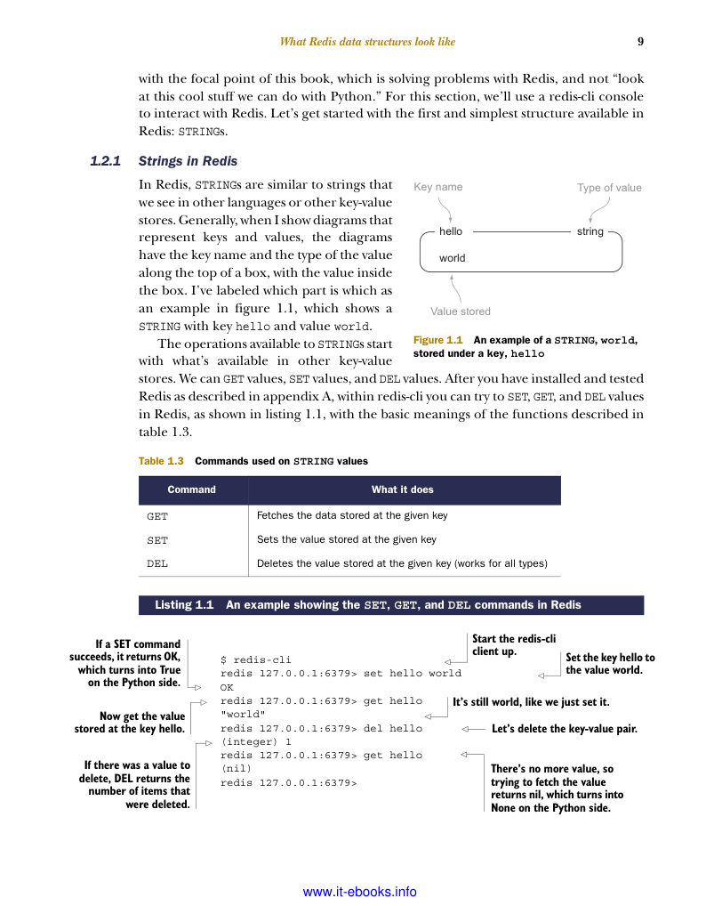

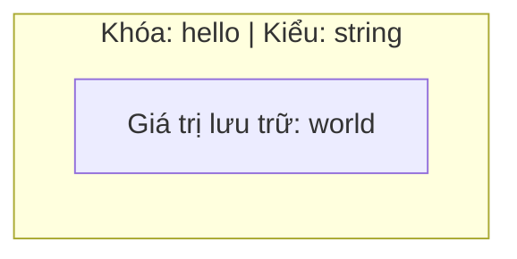

Các thao tác có sẵn dành cho `STRING` bắt đầu bằng những thao tác quen thuộc có ở các kho lưu trữ khóa-giá trị khác. Chúng ta có thể lấy giá trị bằng `GET`, gán giá trị bằng `SET`, và xóa giá trị bằng `DEL`. Sau khi bạn đã cài đặt và kiểm tra Redis như mô tả trong Phụ lục A, bên trong trình khách `redis-cli`, bạn có thể thử thực hiện `SET`, `GET`, và `DEL` các giá trị trong Redis như minh họa trong **Listing 1.1**, với ý nghĩa cơ bản của các lệnh được mô tả trong **Bảng 1.3**.

**Bảng 1.3 – Các lệnh được sử dụng trên giá trị STRING (Table 1.3 Commands used on STRING values)**

| Lệnh (Command) | Chức năng thực hiện (What it does) |
| :--- | :--- |
| `GET` | Lấy dữ liệu được lưu trữ tại khóa đã cho (*Fetches the data stored at the given key*) |
| `SET` | Gán giá trị được lưu trữ tại khóa đã cho (*Sets the value stored at the given key*) |
| `DEL` | Xóa giá trị được lưu trữ tại khóa đã cho — hoạt động cho tất cả các kiểu dữ liệu (*Deletes the value stored at the given key (works for all types)*) |

**Listing 1.1 – Ví dụ minh họa các lệnh SET, GET và DEL trong Redis (An example showing the SET, GET, and DEL commands in Redis)**

```bash
$ redis-cli                                 # 1
redis 127.0.0.1:6379> set hello world       # 2
OK                                          # 3
redis 127.0.0.1:6379> get hello             # 4
"world"                                     # 5
redis 127.0.0.1:6379> del hello             # 6
(integer) 1                                 # 7
redis 127.0.0.1:6379> get hello             # 8
(nil)
redis 127.0.0.1:6379>
```

**Giải thích mã nguồn:**
1. Khởi động trình khách `redis-cli` (*Start the redis-cli client up*).
2. Gán khóa `hello` thành giá trị `world` (*Set the key hello to the value world*).
3. Nếu một lệnh `SET` thành công, nó trả về `OK`, giá trị này sẽ được chuyển thành `True` ở phía Python (*If a SET command succeeds, it returns OK, which turns into True on the Python side*).
4. Bây giờ hãy lấy giá trị được lưu trữ tại khóa `hello` (*Now get the value stored at the key hello*).
5. Giá trị vẫn là `"world"`, đúng như những gì chúng ta vừa thiết lập (*It’s still world, like we just set it*).
6. Hãy xóa cặp khóa-giá trị này (*Let’s delete the key-value pair*).
7. Nếu có một giá trị để xóa, `DEL` sẽ trả về số lượng phần tử đã bị xóa (*If there was a value to delete, DEL returns the number of items that were deleted*).
8. Không còn giá trị nào nữa, vì vậy việc cố gắng lấy giá trị sẽ trả về `(nil)`, giá trị này sẽ được chuyển thành `None` ở phía Python (*There’s no more value, so trying to fetch the value returns nil, which turns into None on the Python side*).

> 📌 **SỬ DỤNG REDIS-CLI (USING REDIS-CLI)**
> Trong chương đầu tiên này, tôi giới thiệu Redis và một số lệnh bằng cách sử dụng trình khách tương tác `redis-cli` đi kèm sẵn với Redis. Công cụ này cho phép bạn bắt đầu tương tác với Redis một cách nhanh chóng và dễ dàng.

Ngoài khả năng `GET`, `SET`, và `DEL` các giá trị `STRING`, còn có một loạt các lệnh khác để đọc và ghi từng phần của `STRING`, cũng như các lệnh cho phép chúng ta coi chuỗi như những con số để tăng/giảm (increment/decrement) chúng. Chúng ta sẽ bàn về nhiều lệnh trong số đó ở Chương 3. Nhưng chúng ta vẫn còn rất nhiều nội dung cần khám phá, vì vậy hãy tiếp tục chuyển sang tìm hiểu sơ lược về `LIST` và những gì chúng ta có thể làm với chúng.

---

### 1.2.2 Danh sách trong Redis (Lists in Redis)

Trong thế giới của các kho lưu trữ khóa-giá trị, Redis rất độc đáo ở chỗ nó hỗ trợ cấu trúc danh sách liên kết (linked-list structure). `LIST` trong Redis lưu trữ một chuỗi các phần tử kiểu string theo thứ tự (ordered sequence of strings), và giống như `STRING`, tôi biểu diễn hình minh họa của `LIST` dưới dạng một khung hình chữ nhật có gắn nhãn với các phần tử danh sách nằm bên trong. Một ví dụ về `LIST` có thể được nhìn thấy trong **Hình 1.2**.

**Hình 1.2 – Ví dụ về một LIST gồm ba phần tử dưới khóa `list-key`. Lưu ý rằng `item` có thể xuất hiện trong danh sách nhiều hơn một lần (Figure 1.2 An example of a LIST with three items under the key, list-key. Note that item can be in the list more than once.)**

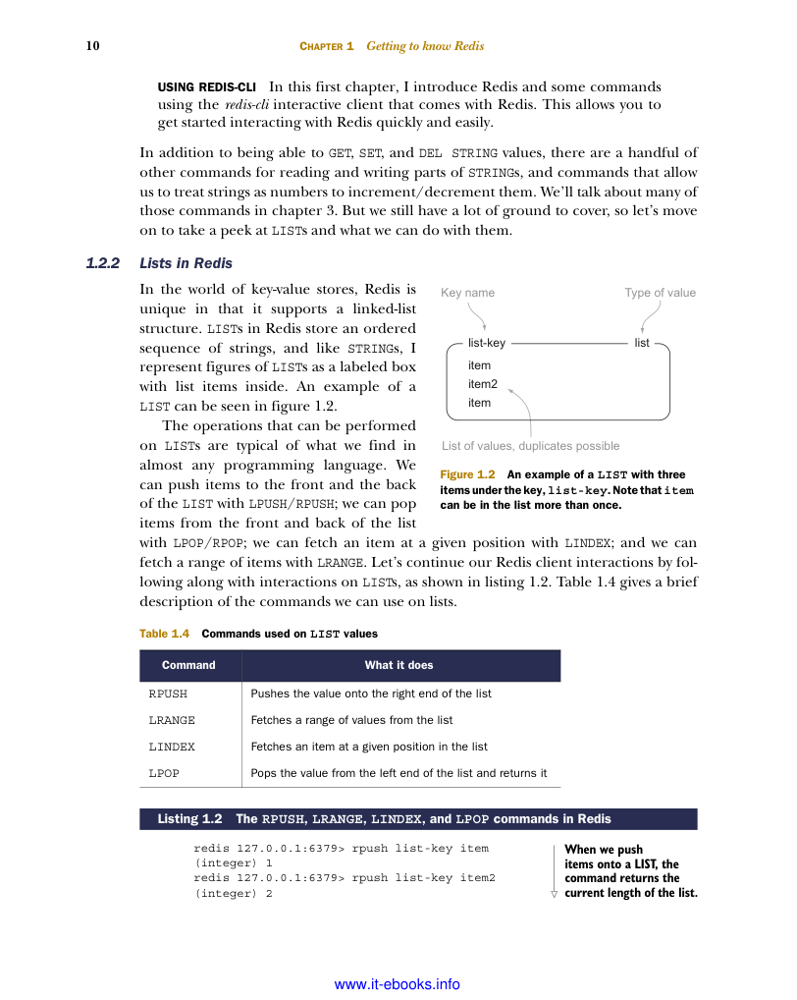

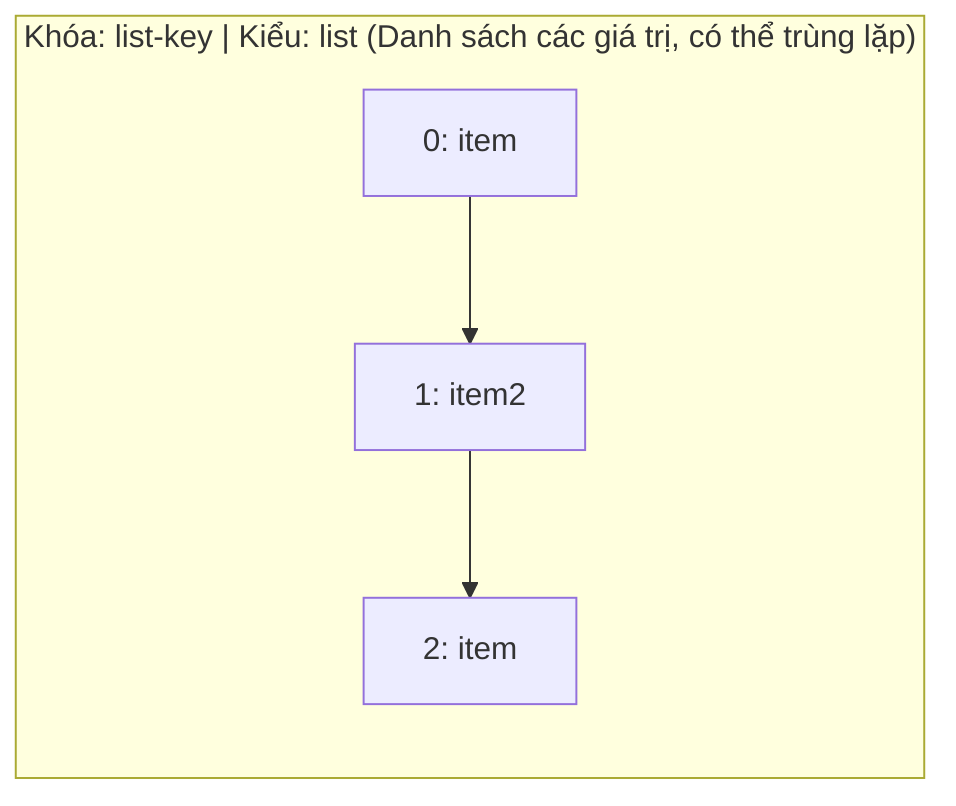

Các thao tác có thể được thực hiện trên `LIST` là những thao tác điển hình mà chúng ta bắt gặp trong hầu hết mọi ngôn ngữ lập trình. Chúng ta có thể đẩy (push) các phần tử vào đầu và cuối của `LIST` bằng `LPUSH`/`RPUSH`; chúng ta có thể lấy và xóa (pop) các phần tử từ đầu và cuối danh sách bằng `LPOP`/`RPOP`; chúng ta có thể lấy một phần tử tại một vị trí cho trước bằng `LINDEX`; và chúng ta có thể lấy một dải các phần tử bằng `LRANGE`. Hãy tiếp tục các tương tác trên trình khách Redis bằng cách làm theo các thao tác trên `LIST` như minh họa trong **Listing 1.2**. **Bảng 1.4** cung cấp mô tả ngắn gọn về các lệnh chúng ta có thể sử dụng trên danh sách.

**Bảng 1.4 – Các lệnh được sử dụng trên giá trị LIST (Table 1.4 Commands used on LIST values)**

| Lệnh (Command) | Chức năng thực hiện (What it does) |
| :--- | :--- |
| `RPUSH` | Đẩy giá trị vào đầu bên phải (cuối) của danh sách (*Pushes the value onto the right end of the list*) |
| `LRANGE` | Lấy một dải các giá trị từ danh sách (*Fetches a range of values from the list*) |
| `LINDEX` | Lấy một phần tử tại vị trí cho trước trong danh sách (*Fetches an item at a given position in the list*) |
| `LPOP` | Lấy giá trị từ đầu bên trái (đầu) của danh sách ra và trả về giá trị đó (*Pops the value from the left end of the list and returns it*) |

**Listing 1.2 – Các lệnh RPUSH, LRANGE, LINDEX và LPOP trong Redis (The RPUSH, LRANGE, LINDEX, and LPOP commands in Redis)**

```bash
redis 127.0.0.1:6379> rpush list-key item       # 1
(integer) 1
redis 127.0.0.1:6379> rpush list-key item2      # 1
(integer) 2
redis 127.0.0.1:6379> rpush list-key item       # 1
(integer) 3
redis 127.0.0.1:6379> lrange list-key 0 -1      # 2
1) "item"
2) "item2"
3) "item"
redis 127.0.0.1:6379> lindex list-key 1         # 3
"item2"
redis 127.0.0.1:6379> lpop list-key             # 4
"item"
redis 127.0.0.1:6379> lrange list-key 0 -1      # 4
1) "item2"
2) "item"
redis 127.0.0.1:6379>
```

**Giải thích mã nguồn:**
1. Khi chúng ta đẩy các phần tử vào một `LIST`, lệnh sẽ trả về độ dài hiện tại của danh sách (*When we push items onto a LIST, the command returns the current length of the list*).
2. Chúng ta có thể lấy toàn bộ danh sách bằng cách truyền vào một khoảng với `0` là chỉ số bắt đầu (start index) và `-1` là chỉ số cuối cùng (last index) (*We can fetch the entire list by passing a range of 0 for the start index and -1 for the last index*).
3. Chúng ta có thể lấy từng phần tử riêng lẻ từ danh sách bằng lệnh `LINDEX` (*We can fetch individual items from the list with LINDEX*).
4. Việc lấy (`LPOP`) một phần tử ra khỏi danh sách sẽ khiến phần tử đó không còn nằm trong danh sách nữa (*Popping an item from the list makes it no longer available*).

Ngay cả khi đó là tất cả những gì chúng ta có thể làm với `LIST`, Redis cũng đã là một nền tảng hữu ích để giải quyết nhiều bài toán khác nhau. Nhưng chúng ta còn có thể xóa các phần tử, chèn các phần tử vào giữa danh sách, cắt tỉa (trim) danh sách về một kích thước cụ thể (loại bỏ các phần tử ở một hoặc cả hai đầu), và nhiều thao tác khác nữa. Chúng ta sẽ thảo luận về nhiều lệnh trong số đó ở Chương 3, nhưng hiện tại hãy tiếp tục đi tiếp để xem cấu trúc `SET` có thể mang lại cho chúng ta những gì.

---

### 1.2.3 Tập hợp trong Redis (Sets in Redis)

Trong Redis, `SET` tương tự như `LIST` ở điểm chúng đều là một tập các chuỗi, nhưng không giống như `LIST`, `SET` của Redis sử dụng một bảng băm (hash table) để giữ cho tất cả các chuỗi là duy nhất (mặc dù không có các giá trị đi kèm với khóa như trong `HASH`). Cách biểu diễn trực quan của tôi đối với `SET` sẽ tương tự như `LIST`, và **Hình 1.3** minh họa một `SET` ví dụ gồm ba phần tử.

**Hình 1.3 – Ví dụ về một SET gồm ba phần tử dưới khóa `set-key` (Figure 1.3 An example of a SET with three items under the key, set-key)**

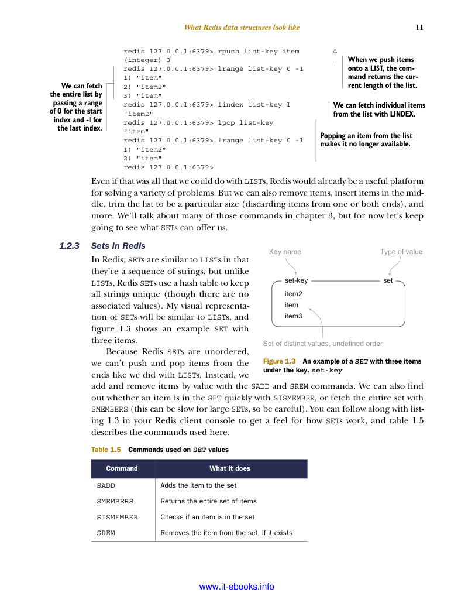

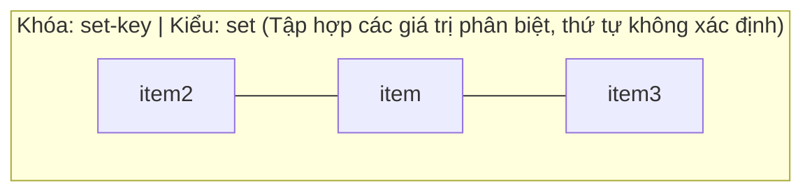

Bởi vì `SET` trong Redis không có thứ tự (unordered), chúng ta không thể đẩy (push) và lấy (pop) các phần tử từ hai đầu như đã làm với `LIST`. Thay vào đó, chúng ta thêm và xóa các phần tử theo giá trị bằng hai lệnh `SADD` và `SREM`. Chúng ta cũng có thể nhanh chóng kiểm tra xem một phần tử có nằm trong `SET` hay không bằng lệnh `SISMEMBER`, hoặc lấy toàn bộ tập hợp bằng lệnh `SMEMBERS` (lệnh này có thể chạy chậm đối với các `SET` kích thước lớn, vì vậy hãy cẩn thận). Bạn có thể thực hành theo **Listing 1.3** trong cửa sổ dòng lệnh trình khách Redis của mình để cảm nhận cách hoạt động của `SET`, và **Bảng 1.5** mô tả các lệnh được sử dụng tại đây.

**Bảng 1.5 – Các lệnh được sử dụng trên giá trị SET (Table 1.5 Commands used on SET values)**

| Lệnh (Command) | Chức năng thực hiện (What it does) |
| :--- | :--- |
| `SADD` | Thêm phần tử vào tập hợp (*Adds the item to the set*) |
| `SMEMBERS` | Trả về toàn bộ tập hợp các phần tử (*Returns the entire set of items*) |
| `SISMEMBER` | Kiểm tra xem một phần tử có nằm trong tập hợp hay không (*Checks if an item is in the set*) |
| `SREM` | Xóa phần tử khỏi tập hợp, nếu phần tử đó tồn tại (*Removes the item from the set, if it exists*) |

**Listing 1.3 – Các lệnh SADD, SMEMBERS, SISMEMBER và SREM trong Redis (The SADD, SMEMBERS, SISMEMBER, and SREM commands in Redis)**

```bash
redis 127.0.0.1:6379> sadd set-key item         # 1
(integer) 1
redis 127.0.0.1:6379> sadd set-key item2        # 1
(integer) 1
redis 127.0.0.1:6379> sadd set-key item3        # 1
(integer) 1
redis 127.0.0.1:6379> sadd set-key item         # 1
(integer) 0
redis 127.0.0.1:6379> smembers set-key          # 2
1) "item"
2) "item2"
3) "item3"
redis 127.0.0.1:6379> sismember set-key item4   # 3
(integer) 0
redis 127.0.0.1:6379> sismember set-key item    # 3
(integer) 1
redis 127.0.0.1:6379> srem set-key item2        # 4
(integer) 1
redis 127.0.0.1:6379> srem set-key item2        # 4
(integer) 0
redis 127.0.0.1:6379> smembers set-key
1) "item"
2) "item3"
redis 127.0.0.1:6379>
```

**Giải thích mã nguồn:**
1. Khi thêm một phần tử vào `SET`, Redis sẽ trả về `1` nếu phần tử đó là mới đối với tập hợp và `0` nếu nó đã tồn tại sẵn trong `SET` (*When adding an item to a SET, Redis will return a 1 if the item is new to the set and 0 if it was already in the SET*).
2. Chúng ta có thể lấy tất cả các phần tử trong `SET`, lệnh này trả về chúng dưới dạng một danh sách liệt kê các phần tử, và sẽ được chuyển đổi thành một đối tượng `set` của Python khi gọi từ Python (*We can fetch all of the items in the SET, which returns them as a sequence of items, which is turned into a Python set from Python*).
3. Chúng ta cũng có thể hỏi Redis xem liệu một phần tử có nằm trong `SET` hay không, kết quả này sẽ được chuyển thành kiểu `Boolean` (`True`/`False`) trong Python (*We can also ask Redis whether an item is in the SET, which turns into a Boolean in Python*).
4. Khi chúng ta thực hiện xóa các phần tử, lệnh sẽ trả về số lượng phần tử đã thực sự bị xóa (*When we attempt to remove items, our commands return the number of items that were removed*).

Như bạn có thể đoán được dựa trên các phần viết về `STRING` và `LIST`, `SET` còn có nhiều công dụng khác ngoài việc thêm và xóa các phần tử. Ba thao tác thường được sử dụng với `SET` bao gồm phép giao (intersection), phép hợp (union), và phép hiệu (difference) — tương ứng với các lệnh `SINTER`, `SUNION`, và `SDIFF`. Chúng ta sẽ đi vào chi tiết hơn về các lệnh của `SET` trong Chương 3, và hơn một nửa nội dung của Chương 7 liên quan đến các bài toán có thể được giải quyết gần như hoàn toàn bằng `SET` của Redis. Nhưng đừng vội đi quá xa; chúng ta vẫn còn hai cấu trúc dữ liệu nữa cần tìm hiểu. Hãy tiếp tục đọc để khám phá về `HASH` trong Redis.

---

### 1.2.4 Bảng băm trong Redis (Hashes in Redis)

Trong khi `LIST` và `SET` trong Redis lưu giữ các chuỗi phần tử, thì `HASH` trong Redis lưu trữ một ánh xạ từ các khóa con (keys/fields) sang các giá trị (values). Các giá trị có thể được lưu trữ trong `HASH` cũng giống như những gì có thể được lưu trữ dưới dạng `STRING` thông thường: bản thân các chuỗi ký tự, hoặc nếu một giá trị có thể được diễn giải thành một con số, giá trị đó có thể được tăng (incremented) hoặc giảm (decremented). **Hình 1.4** trình bày sơ đồ của một bảng băm gồm hai giá trị.

**Hình 1.4 – Ví dụ về một HASH gồm hai cặp khóa/giá trị dưới khóa `hash-key` (Figure 1.4 An example of a HASH with two keys/values under the key hash-key)**

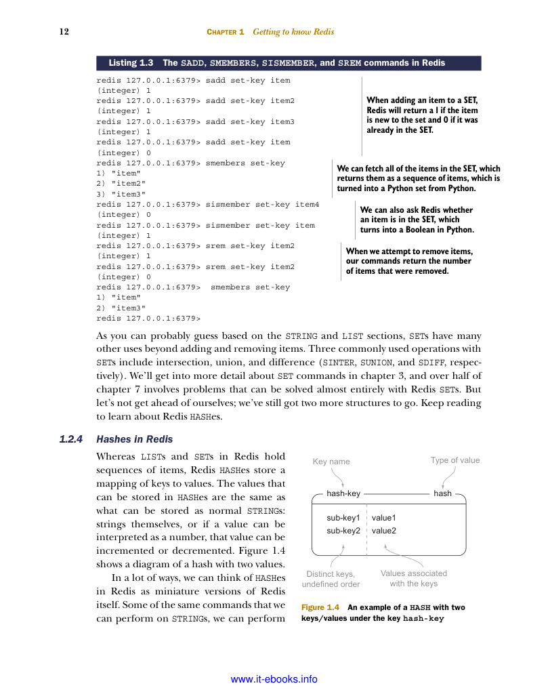

| Khóa chính: `hash-key` | Kiểu: `hash` |
| :--- | :--- |
| **Các khóa con phân biệt, thứ tự không xác định (*Distinct keys, undefined order*)** | **Các giá trị gắn với khóa con (*Values associated with the keys*)** |
| `sub-key1` | `value1` |
| `sub-key2` | `value2` |

Ở nhiều khía cạnh, chúng ta có thể hình dung các `HASH` trong Redis giống như những phiên bản thu nhỏ của chính Redis vậy. Một số lệnh tương tự như các lệnh chúng ta có thể thực hiện trên `STRING` cũng có thể được thực hiện trên các giá trị bên trong `HASH` với tên lệnh hơi khác một chút. Hãy thử làm theo **Listing 1.4** để xem một số lệnh mà chúng ta có thể sử dụng để chèn, lấy ra và xóa các phần tử khỏi `HASH`. **Bảng 1.6** mô tả các lệnh này.

**Bảng 1.6 – Các lệnh được sử dụng trên giá trị HASH (Table 1.6 Commands used on HASH values)**

| Lệnh (Command) | Chức năng thực hiện (What it does) |
| :--- | :--- |
| `HSET` | Lưu trữ giá trị tại khóa con (field) trong bảng băm (*Stores the value at the key in the hash*) |
| `HGET` | Lấy giá trị tại khóa con đã cho trong bảng băm (*Fetches the value at the given hash key*) |
| `HGETALL` | Lấy toàn bộ bảng băm (*Fetches the entire hash*) |
| `HDEL` | Xóa một khóa con khỏi bảng băm, nếu nó tồn tại (*Removes a key from the hash, if it exists*) |

**Listing 1.4 – Các lệnh HSET, HGET, HGETALL và HDEL trong Redis (The HSET, HGET, HGETALL, and HDEL commands in Redis)**

```bash
redis 127.0.0.1:6379> hset hash-key sub-key1 value1     # 1
(integer) 1
redis 127.0.0.1:6379> hset hash-key sub-key2 value2     # 1
(integer) 1
redis 127.0.0.1:6379> hset hash-key sub-key1 value1     # 1
(integer) 0
redis 127.0.0.1:6379> hgetall hash-key                  # 2
1) "sub-key1"
2) "value1"
3) "sub-key2"
4) "value2"
redis 127.0.0.1:6379> hdel hash-key sub-key2            # 3
(integer) 1
redis 127.0.0.1:6379> hdel hash-key sub-key2            # 3
(integer) 0
redis 127.0.0.1:6379> hget hash-key sub-key1            # 4
"value1"
redis 127.0.0.1:6379> hgetall hash-key
1) "sub-key1"
2) "value1"
```

**Giải thích mã nguồn:**
1. Khi chúng ta thêm các phần tử vào một bảng băm (`HASH`), một lần nữa chúng ta nhận được một giá trị trả về cho biết liệu phần tử (khóa con) đó có phải là mới trong bảng băm hay không (*When we add items to a hash, again we get a return value that tells whether the item is new in the hash*).
2. Chúng ta có thể lấy tất cả các phần tử trong `HASH`, kết quả này sẽ được biên dịch thành một kiểu từ điển (`dict` / dictionary) ở phía Python (*We can fetch all of the items in the HASH, which gets translated into a dictionary on the Python side of things*).
3. Khi chúng ta xóa các phần tử khỏi bảng băm, lệnh sẽ trả về cho biết liệu phần tử đó có tồn tại trước khi chúng ta cố gắng xóa nó hay không (*When we delete items from the hash, the command returns whether the item was there before we tried to remove it*).
4. Chúng ta cũng có thể lấy từng trường (field) riêng lẻ từ các bảng băm (*We can also fetch individual fields from hashes*).

Đối với những ai đã quen thuộc với các kho lưu trữ tài liệu (document stores) hoặc cơ sở dữ liệu quan hệ (relational databases), chúng ta có thể coi một `HASH` trong Redis tương tự như một tài liệu (document) trong kho lưu trữ tài liệu, hoặc một dòng (row) trong cơ sở dữ liệu quan hệ, ở điểm chúng ta có thể truy cập hoặc thay đổi từng trường hoặc nhiều trường cùng một lúc.

Giờ chỉ còn đúng một cấu trúc nữa là chúng ta đã điểm qua toàn bộ các cấu trúc có sẵn trong Redis. Hãy tiếp tục đọc để tìm hiểu xem `ZSET` là gì và một vài điều chúng ta có thể làm với chúng.

---

### 1.2.5 Tập hợp có thứ tự trong Redis (Sorted sets in Redis)

Giống như `HASH` trong Redis, `ZSET` cũng lưu giữ một dạng khóa và giá trị. Các khóa (được gọi là các thành viên - *members*) là duy nhất, và các giá trị (được gọi là điểm số - *scores*) được giới hạn ở kiểu số thực dấu phẩy động (floating-point numbers). `ZSET` có một đặc tính độc đáo trong Redis là vừa có thể được truy cập theo thành viên (giống như một `HASH`), nhưng các phần tử lại vừa có thể được truy cập theo thứ tự đã sắp xếp và theo giá trị của điểm số (scores). **Hình 1.5** minh họa một `ZSET` ví dụ gồm hai phần tử.

**Hình 1.5 – Ví dụ về một ZSET gồm hai cặp thành viên/điểm số dưới khóa `zset-key` (Figure 1.5 An example of a ZSET with two members/scores under the key zset-key)**

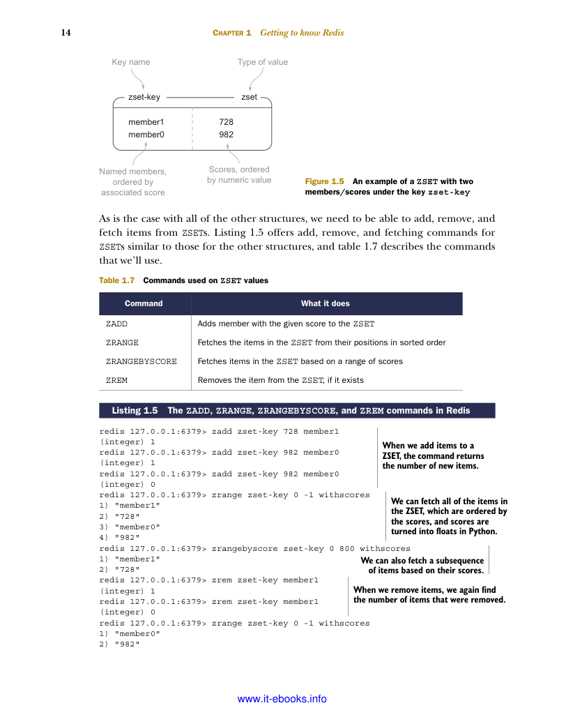

| Khóa chính: `zset-key` | Kiểu: `zset` |
| :--- | :--- |
| **Các thành viên có định danh, được sắp xếp theo điểm số đi kèm (*Named members, ordered by associated score*)** | **Điểm số, được sắp xếp theo giá trị số học (*Scores, ordered by numeric value*)** |
| `member1` | `728` |
| `member0` | `982` |

Cũng như đối với tất cả các cấu trúc khác, chúng ta cần có khả năng thêm, xóa và lấy các phần tử từ `ZSET`. **Listing 1.5** cung cấp các lệnh thêm, xóa và lấy dữ liệu cho `ZSET` tương tự như các lệnh dành cho những cấu trúc khác, và **Bảng 1.7** mô tả các lệnh mà chúng ta sẽ sử dụng.

**Bảng 1.7 – Các lệnh được sử dụng trên giá trị ZSET (Table 1.7 Commands used on ZSET values)**

| Lệnh (Command) | Chức năng thực hiện (What it does) |
| :--- | :--- |
| `ZADD` | Thêm thành viên (member) với điểm số (score) đã cho vào `ZSET` (*Adds member with the given score to the ZSET*) |
| `ZRANGE` | Lấy các phần tử trong `ZSET` dựa theo vị trí của chúng trong thứ tự đã sắp xếp (*Fetches the items in the ZSET from their positions in sorted order*) |
| `ZRANGEBYSCORE` | Lấy các phần tử trong `ZSET` dựa trên một khoảng điểm số (*Fetches items in the ZSET based on a range of scores*) |
| `ZREM` | Xóa phần tử khỏi `ZSET`, nếu phần tử đó tồn tại (*Removes the item from the ZSET, if it exists*) |

**Listing 1.5 – Các lệnh ZADD, ZRANGE, ZRANGEBYSCORE và ZREM trong Redis (The ZADD, ZRANGE, ZRANGEBYSCORE, and ZREM commands in Redis)**

```bash
redis 127.0.0.1:6379> zadd zset-key 728 member1                 # 1
(integer) 1
redis 127.0.0.1:6379> zadd zset-key 982 member0                 # 1
(integer) 1
redis 127.0.0.1:6379> zadd zset-key 982 member0                 # 1
(integer) 0
redis 127.0.0.1:6379> zrange zset-key 0 -1 withscores           # 2
1) "member1"
2) "728"
3) "member0"
4) "982"
redis 127.0.0.1:6379> zrangebyscore zset-key 0 800 withscores   # 3
1) "member1"
2) "728"
redis 127.0.0.1:6379> zrem zset-key member1                     # 4
(integer) 1
redis 127.0.0.1:6379> zrem zset-key member1                     # 4
(integer) 0
redis 127.0.0.1:6379> zrange zset-key 0 -1 withscores
1) "member0"
2) "982"
```

**Giải thích mã nguồn:**
1. Khi chúng ta thêm các phần tử vào một `ZSET`, lệnh sẽ trả về số lượng phần tử mới được thêm vào (*When we add items to a ZSET, the command returns the number of new items*).
2. Chúng ta có thể lấy tất cả các phần tử trong `ZSET`, chúng được sắp xếp theo điểm số (scores), và các điểm số sẽ được chuyển thành kiểu số thực (`float`) trong Python (*We can fetch all of the items in the ZSET, which are ordered by the scores, and scores are turned into floats in Python*).
3. Chúng ta cũng có thể lấy một dãy con các phần tử dựa trên điểm số của chúng (*We can also fetch a subsequence of items based on their scores*).
4. Khi chúng ta xóa các phần tử, một lần nữa chúng ta nhận được số lượng phần tử đã bị xóa (*When we remove items, we again find the number of items that were removed*).

Bây giờ, sau khi bạn đã làm quen với `ZSET` và một chút về những gì chúng có thể làm được, bạn đã nắm được những kiến thức cơ bản về các cấu trúc dữ liệu có sẵn trong Redis. Trong phần tiếp theo, chúng ta sẽ kết hợp khả năng lưu trữ dữ liệu của `HASH` với khả năng sắp xếp tích hợp sẵn của `ZSET` để giải quyết một bài toán thực tế rất phổ biến.

> 📝 **Giải thích thêm (không có trong sách) — Đối chiếu với Redis 6/7/8 & redis-py 5.x hiện đại:**
> - **Lệnh `ZRANGE` hợp nhất từ Redis 6.2+:** Trong Redis 2.6 của sách, để lấy phần tử theo khoảng điểm số hoặc theo thứ tự đảo ngược, bạn phải nhớ nhiều lệnh riêng biệt (`ZRANGE`, `ZREVRANGE`, `ZRANGEBYSCORE`, `ZREVRANGEBYSCORE`, `ZRANGEBYLEX`). Từ **Redis 6.2+**, lệnh `ZRANGE` đã được nâng cấp hợp nhất toàn bộ qua các cờ `BYSCORE`, `BYLEX`, `REV` và `LIMIT`:
>   ```bash
>   # Thay cho: zrangebyscore zset-key 0 800 withscores (Redis 2.6)
>   ZRANGE zset-key 0 800 BYSCORE WITHSCORES
>   # Thay cho: zrevrange zset-key 0 -1 withscores (Redis 2.6)
>   ZRANGE zset-key 0 -1 REV WITHSCORES
>   ```
>   (Các lệnh cũ như `ZRANGEBYSCORE` và `ZREVRANGE` vẫn hoạt động bình thường để tương thích ngược, nhưng tài liệu Redis 6.2/7/8 khuyến khích dùng `ZRANGE` thống nhất).

> 💡 **Ví dụ bổ sung (không có trong sách): Tương tác với 5 cấu trúc dữ liệu từ Python (`redis-py`)**
> Dưới đây là đoạn mã Python minh họa cách các lệnh `redis-cli` ở các mục 1.2.1–1.2.5 được gọi thông qua thư viện `redis-py` hiện đại (phiên bản 4.x/5.x với `decode_responses=True`):
>
> ```python
> import redis
>
> # Kết nối tới Redis với decode_responses=True để nhận về kiểu str thay vì bytes
> r = redis.Redis(host='localhost', port=6379, decode_responses=True)
>
> # 1. STRING
> r.set('hello', 'world')
> print(r.get('hello'))          # 'world'
> r.delete('hello')
>
> # 2. LIST
> r.rpush('list-key', 'item', 'item2', 'item')
> print(r.lrange('list-key', 0, -1))  # ['item', 'item2', 'item']
> print(r.lpop('list-key'))           # 'item'
>
> # 3. SET
> r.sadd('set-key', 'item', 'item2', 'item3')
> print(r.smembers('set-key'))        # {'item', 'item2', 'item3'}
> print(r.sismember('set-key', 'item'))  # True (hoặc 1)
>
> # 4. HASH (Dùng hset với mapping=... thay cho hmset đã bị xóa trong redis-py 5.x)
> r.hset('hash-key', mapping={'sub-key1': 'value1', 'sub-key2': 'value2'})
> print(r.hgetall('hash-key'))        # {'sub-key1': 'value1', 'value2': 'value2'}
>
> # 5. ZSET (Trong redis-py >= 3.0, zadd bắt buộc nhận một dict {member: score})
> r.zadd('zset-key', {'member1': 728, 'member0': 982})
> print(r.zrange('zset-key', 0, -1, withscores=True))
> # [('member1', 728.0), ('member0', 982.0)]
> print(r.zrange('zset-key', 0, 800, byscore=True, withscores=True))
> # [('member1', 728.0)]
> ```

---

## 1.3 Xin chào Redis (Hello Redis)

Giờ đây khi bạn đã quen thuộc hơn với các cấu trúc dữ liệu mà Redis cung cấp, đã đến lúc sử dụng Redis để giải quyết một bài toán thực tế. Trong những năm gần đây, ngày càng có nhiều trang web cung cấp khả năng bình chọn (vote) cho các liên kết trang web, bài viết hoặc câu hỏi, bao gồm những trang như Reddit và Stack Overflow, như minh họa trong **Hình 1.6** và **Hình 1.7**. Bằng cách tính đến các lượt bình chọn đã được gửi, các bài đăng được xếp hạng và hiển thị dựa trên một điểm số kết hợp giữa số lượt bình chọn đó và thời điểm liên kết được đăng lên. Trong phần này, chúng ta sẽ xây dựng một hệ thống phụ trợ (back end) dựa trên Redis cho một phiên bản đơn giản của loại trang web này.

### 1.3.1 Bình chọn cho bài viết (Voting on articles)

Trước tiên, hãy bắt đầu với một số con số và giới hạn cho bài toán của chúng ta, để chúng ta có thể giải quyết vấn đề mà không bị chệch hướng khỏi mục tiêu đang hướng tới. Giả sử có 1.000 bài viết được gửi lên mỗi ngày. Trong số 1.000 bài viết đó, có khoảng 50 bài đủ thú vị đến mức chúng ta muốn chúng nằm trong top 100 bài viết hàng đầu trong ít nhất một ngày. Tất cả 50 bài viết đó sẽ nhận được ít nhất 200 lượt bình chọn ủng hộ (up votes). Chúng ta sẽ tạm thời chưa bận tâm đến các lượt bình chọn phản đối (down votes) trong phiên bản này.

**Hình 1.6 – Reddit, một trang web cung cấp khả năng bình chọn cho các bài viết: Các bài viết có thể được bình chọn bằng cách nhấp vào các mũi tên lên và xuống (Figure 1.6 Reddit, a site that offers the ability to vote on articles: Articles can be voted on by clicking on up and down arrows)**


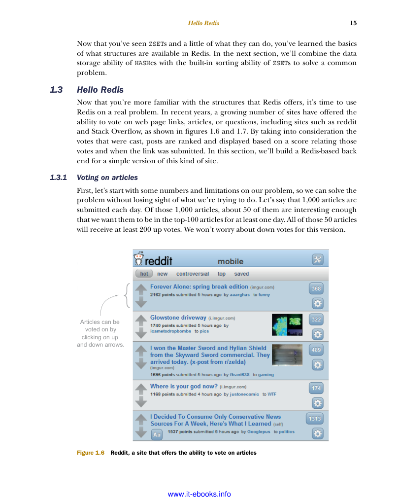

Khi xử lý các điểm số giảm dần theo thời gian (decaying scores over time), chúng ta cần làm cho thời điểm đăng bài (posting time), thời điểm hiện tại (current time), hoặc cả hai trở thành yếu tố quyết định tới tổng điểm số. Để giữ cho mọi thứ đơn giản, chúng ta sẽ quy ước rằng điểm số (score) của một bài viết là một hàm của thời điểm bài viết được đăng, cộng với một hệ số nhân không đổi (constant multiplier) nhân với số lượt bình chọn mà bài viết đó đã nhận được.

Đối với thời gian, chúng ta sẽ sử dụng số giây tính từ ngày 1 tháng 1 năm 1970 theo múi giờ UTC, thường được gọi là thời gian Unix (Unix time / Epoch time). Chúng ta sẽ sử dụng thời gian Unix vì nó có thể được lấy một cách dễ dàng trong hầu hết các ngôn ngữ lập trình và trên mọi nền tảng mà chúng ta có thể chạy Redis. Đối với hằng số của mình, chúng ta sẽ lấy số giây trong một ngày (`86.400`) chia cho số lượt bình chọn cần thiết (`200`) để duy trì vị trí trong suốt một ngày trọn vẹn, kết quả mang lại cho chúng ta `432` "điểm" (points) được cộng thêm vào điểm số (score) cho mỗi lượt bình chọn.

**Hình 1.7 – Stack Overflow, một trang web cung cấp khả năng bình chọn cho các câu hỏi: Việc bình chọn diễn ra sau khi bạn đã nhấp vào để đọc một câu hỏi và bất kỳ câu trả lời hiện có nào (Figure 1.7 Stack Overflow, a site that offers the ability to vote on questions: Voting occurs after you have clicked through to read a question and any existing answers)**

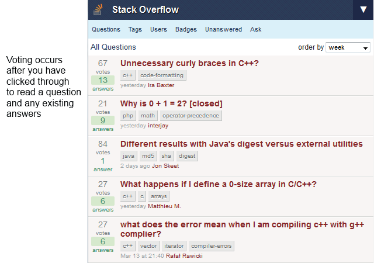

Để thực sự xây dựng hệ thống này, chúng ta cần bắt đầu suy nghĩ về các cấu trúc dữ liệu sẽ sử dụng trong Redis. Trước hết, chúng ta cần lưu trữ thông tin bài viết như tiêu đề (`title`), đường dẫn liên kết tới bài viết (`link`), người đã đăng bài (`poster`), thời điểm bài viết được đăng (`time`), và số lượt bình chọn đã nhận được (`votes`). Chúng ta có thể sử dụng một `HASH` của Redis để lưu trữ thông tin này, và một bài viết ví dụ có thể được nhìn thấy trong **Hình 1.8**.

**Hình 1.8 – Một bài viết ví dụ được lưu trữ dưới dạng một HASH cho hệ thống bình chọn bài viết của chúng ta (Figure 1.8 An example article stored as a HASH for our article voting system)**

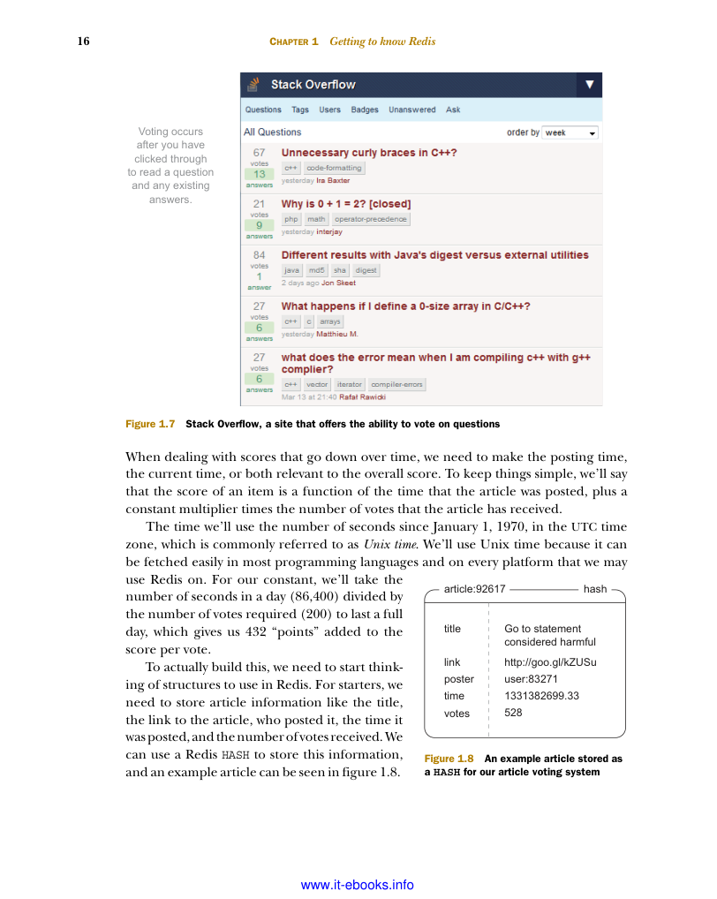

| Khóa: `article:92617` | Kiểu: `hash` |
| :--- | :--- |
| **`title`** | `Go to statement considered harmful` |
| **`link`** | `http://goo.gl/kZUSu` |
| **`poster`** | `user:83271` |
| **`time`** | `1331382699.33` |
| **`votes`** | `528` |

> 📌 **SỬ DỤNG KÝ TỰ DẤU HAI CHẤM LÀM DẤU PHÂN CÁCH (USING THE COLON CHARACTER AS A SEPARATOR)**
> Xuyên suốt chương này và các chương khác, bạn sẽ thấy rằng chúng ta sử dụng ký tự dấu hai chấm (`:`) làm dấu phân cách giữa các phần của tên khóa; ví dụ, trong **Hình 1.8**, chúng ta đã sử dụng nó để phân tách từ `article` với ID của bài viết (`92617`), tạo ra một dạng không gian tên (namespace). Việc lựa chọn dấu `:` mang tính chủ quan, nhưng là quy ước phổ biến trong cộng đồng người dùng Redis. Các lựa chọn phổ biến khác bao gồm dấu chấm (`.`), dấu gạch chéo xuôi (`/`), và đôi khi cả ký tự gạch đứng (`|`). Bất kể bạn chọn ký tự nào, hãy sử dụng một cách nhất quán, và hãy lưu ý cách chúng ta sử dụng dấu hai chấm để định nghĩa các không gian tên lồng nhau (nested namespaces) xuyên suốt các ví dụ trong cuốn sách.

Để lưu trữ một tập hợp có thứ tự của chính các bài viết, chúng ta sẽ sử dụng một `ZSET`, cấu trúc giúp giữ các phần tử được sắp xếp theo điểm số của phần tử (item scores). Chúng ta có thể sử dụng ID bài viết của mình (ví dụ `article:100408`) làm thành viên (member), với điểm số trong `ZSET` chính là điểm số của bài viết (article score). Tiện thể, chúng ta sẽ tạo thêm một `ZSET` thứ hai với điểm số chỉ đơn thuần là thời điểm các bài viết được đăng lên, mang lại cho chúng ta tùy chọn duyệt xem các bài viết dựa trên điểm số bài viết hoặc dựa trên thời gian đăng. Chúng ta có thể xem một ví dụ nhỏ về các `ZSET` chứa bài viết được sắp xếp theo thời gian và theo điểm số trong **Hình 1.9**.

Để ngăn người dùng bình chọn cho cùng một bài viết nhiều hơn một lần, chúng ta cần lưu trữ một danh sách duy nhất gồm những người dùng đã bình chọn cho mỗi bài viết. Cho mục đích này, chúng ta sẽ sử dụng một `SET` cho mỗi bài viết, và lưu trữ ID thành viên của tất cả những người dùng đã bình chọn cho bài viết đã cho. Một `SET` ví dụ gồm những người dùng đã bình chọn cho một bài viết được minh họa trong **Hình 1.10**.

**Hình 1.9 – Hai tập hợp có thứ tự (ZSET) biểu diễn các chỉ mục bài viết được sắp xếp theo thời gian và theo điểm số (Figure 1.9 Two sorted sets representing time-ordered and score-ordered article indexes)**
**Hình 1.10 – Một số người dùng đã bình chọn cho bài viết 100408 (Figure 1.10 Some users who have voted for article 100408)**

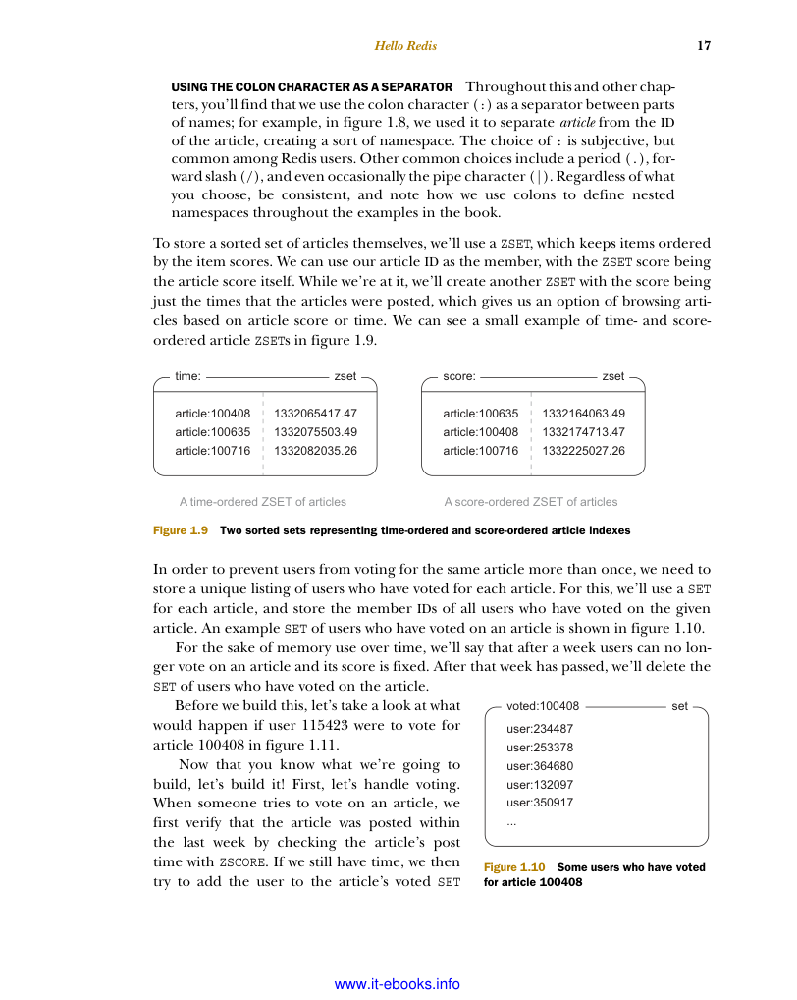

*Chi tiết dữ liệu trong **Hình 1.9** (Hai ZSET chỉ mục):*

| Một ZSET các bài viết sắp xếp theo thời gian (`time:` \| `zset`) | Điểm số (Unix timestamp) | Một ZSET các bài viết sắp xếp theo điểm số (`score:` \| `zset`) | Điểm số (Time + Votes × 432) |
| :--- | :--- | :--- | :--- |
| `article:100408` | `1332065417.47` | `article:100635` | `1332164063.49` |
| `article:100635` | `1332075503.49` | `article:100408` | `1332174713.47` |
| `article:100716` | `1332082035.26` | `article:100716` | `1332225027.26` |

*Chi tiết dữ liệu trong **Hình 1.10** (`voted:100408` \| `set`):*
- Các phần tử thành viên: `user:234487`, `user:253378`, `user:364680`, `user:132097`, `user:350917`, `...`

Vì lợi ích tiết kiệm bộ nhớ sử dụng theo thời gian, chúng ta sẽ quy định rằng sau một tuần, người dùng không thể tiếp tục bình chọn cho bài viết đó nữa và điểm số của nó sẽ được cố định. Sau khi một tuần đó trôi qua, chúng ta sẽ xóa `SET` chứa danh sách những người dùng đã bình chọn cho bài viết.

Trước khi bắt tay vào viết mã xây dựng tính năng này, hãy cùng xem điều gì sẽ xảy ra nếu người dùng `115423` bình chọn cho bài viết `100408` trong **Hình 1.11**.

**Hình 1.11 – Chuyện gì xảy ra với các cấu trúc dữ liệu của chúng ta khi người dùng 115423 bình chọn cho bài viết 100408 (Figure 1.11 What happens to our structures when user 115423 votes for article 100408)**

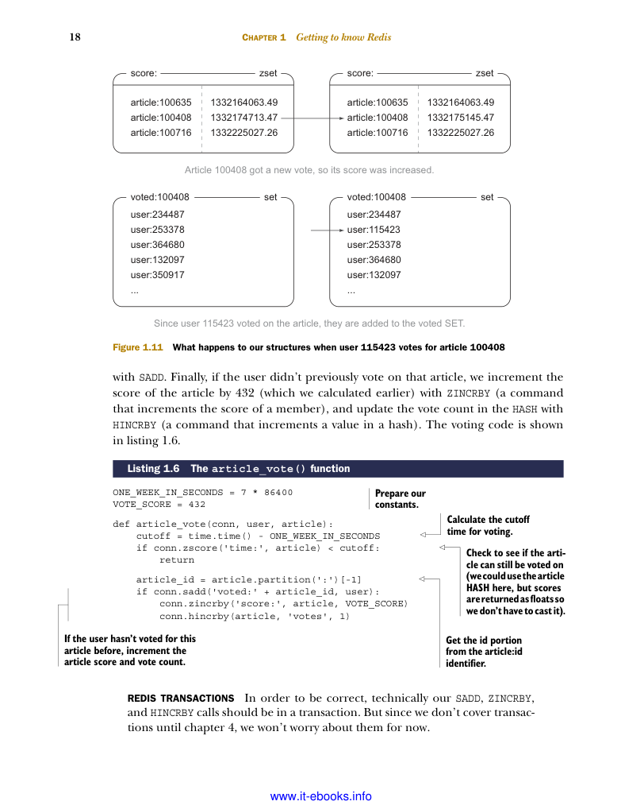

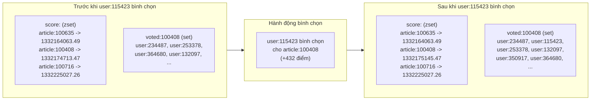

- **Trên `score:` (`zset`):** Bài viết `100408` nhận được một lượt bình chọn mới, vì vậy điểm số của nó được tăng thêm `432` (từ `1332174713.47` lên `1332175145.47`) (*Article 100408 got a new vote, so its score was increased*).
- **Trên `voted:100408` (`set`):** Vì người dùng `115423` đã bình chọn cho bài viết, định danh `user:115423` của họ được thêm vào `SET` lưu danh sách đã bình chọn (*Since user 115423 voted on the article, they are added to the voted SET*).

Giờ bạn đã biết những gì chúng ta chuẩn bị xây dựng, hãy bắt tay vào viết mã! Trước tiên, hãy xử lý việc bình chọn. Khi ai đó cố gắng bình chọn cho một bài viết, đầu tiên chúng ta xác minh xem bài viết đó có được đăng trong vòng một tuần trở lại đây hay không bằng cách kiểm tra thời gian đăng của bài viết thông qua lệnh `ZSCORE`. Nếu vẫn còn trong thời hạn cho phép, chúng ta tiếp tục thử thêm người dùng vào `SET` `voted` của bài viết bằng lệnh `SADD`. Cuối cùng, nếu người dùng đó trước đây chưa từng bình chọn cho bài viết này (`SADD` trả về `1`/`True`), chúng ta tăng điểm số của bài viết thêm `432` (con số chúng ta đã tính toán ở phần trước) bằng lệnh `ZINCRBY` (một lệnh dùng để tăng điểm số của một thành viên trong `ZSET`), và cập nhật số lượng phiếu bầu trong `HASH` bằng lệnh `HINCRBY` (một lệnh dùng để tăng giá trị của một trường trong bảng băm). Đoạn mã xử lý bình chọn được trình bày trong **Listing 1.6**.

**Listing 1.6 – Hàm `article_vote()` (The article_vote() function)**

```python
ONE_WEEK_IN_SECONDS = 7 * 86400                                     # 1
VOTE_SCORE = 432                                                    # 1

def article_vote(conn, user, article):
    cutoff = time.time() - ONE_WEEK_IN_SECONDS                      # 2
    if conn.zscore('time:', article) < cutoff:                      # 3
        return

    article_id = article.partition(':')[-1]                         # 4
    if conn.sadd('voted:' + article_id, user):                      # 5
        conn.zincrby('score:', article, VOTE_SCORE)                 # 5
        conn.hincrby(article, 'votes', 1)                           # 5
```

**Giải thích mã nguồn:**
1. Chuẩn bị các hằng số của chúng ta (*Prepare our constants*).
2. Tính toán mốc thời gian giới hạn (cutoff time) cho việc bình chọn (*Calculate the cutoff time for voting*).
3. Kiểm tra xem bài viết có còn trong thời hạn được phép bình chọn hay không — chúng ta có thể lấy thời gian từ `HASH` của bài viết ở đây, nhưng điểm số từ `ZSET` được trả về sẵn dưới dạng số thực (`float`) nên chúng ta không cần phải ép kiểu (*Check to see if the article can still be voted on (we could use the article HASH here, but scores are returned as floats so we don’t have to cast it)*).
4. Lấy phần định danh `id` từ chuỗi định danh `article:id` (*Get the id portion from the article:id identifier*).
5. Nếu người dùng chưa từng bình chọn cho bài viết này trước đó, hãy tăng điểm số của bài viết và tăng bộ đếm số lượt bình chọn (*If the user hasn’t voted for this article before, increment the article score and vote count*).

> 📌 **GIAO DỊCH TRONG REDIS (REDIS TRANSACTIONS)**
> Để đảm bảo tính chính xác tuyệt đối, về mặt kỹ thuật, các lệnh gọi `SADD`, `ZINCRBY` và `HINCRBY` của chúng ta nên được đặt bên trong một giao dịch (transaction). Tuy nhiên, vì chúng ta chưa tìm hiểu về giao dịch cho tới Chương 4, nên hiện tại chúng ta sẽ tạm thời chưa bận tâm đến chúng.

> 📝 **Giải thích thêm (không có trong sách) — Đối chiếu với Redis 6/7/8 & redis-py 5.x hiện đại (Bảng tổng hợp Breaking Changes cho Mục 1.3):**
> Trong cuốn sách này, tác giả viết mã trên **Python 2.7** và **`redis-py` 2.x** (cụ thể là lớp `redis.Redis` cũ trước khi hợp nhất với `StrictRedis`). Nếu bạn chạy nguyên văn các đoạn mã từ **Listing 1.6 đến Listing 1.10** trên **Python 3** và **`redis-py` 4.x/5.x**, chương trình sẽ báo lỗi ngay lập tức do 4 thay đổi lớn (*breaking changes*) sau đây:
>
> | Thao tác | Code trong sách (`redis-py` 2.x / Python 2) | Code hiện đại (`redis-py` 4.x/5.x / Python 3) | Lý do thay đổi & Lỗi gặp phải nếu giữ code cũ |
> | :--- | :--- | :--- | :--- |
> | **Khởi tạo kết nối** | `conn = redis.Redis()` | `conn = redis.Redis(decode_responses=True)` | Trong Python 3, mặc định `redis-py` trả về kiểu `bytes` (ví dụ `b'article:1'`). Nếu không bật `decode_responses=True`, các phép nối chuỗi hoặc thao tác chuỗi như `'voted:' + article_id` hay `conn.hgetall(id)` sẽ gây lỗi `TypeError: can only concatenate str (not "bytes") to str` hoặc trả về dict có key là `b'title'`. |
> | **Tăng điểm `ZSET` (`ZINCRBY`)** | `conn.zincrby('score:', article, VOTE_SCORE)` *(name, value, amount)* | `conn.zincrby('score:', VOTE_SCORE, article)` *(name, amount, value)* | Từ `redis-py` 3.0+, lớp `Redis` hợp nhất với `StrictRedis` và **đảo ngược thứ tự 2 tham số cuối** để khớp với cú pháp Redis gốc (`ZINCRBY key increment member`). Giữ code cũ sẽ truyền nhầm tên bài viết vào vị trí số điểm tăng thêm (`ResponseError: value is not a valid float`)! |
> | **Thêm vào `ZSET` (`ZADD`)** | `conn.zadd('score:', article, now + VOTE_SCORE)` | `conn.zadd('score:', {article: now + VOTE_SCORE})` | Từ `redis-py` 3.0+, `zadd()` bắt buộc nhận đối số thứ hai là một `dict` ánh xạ `{member: score}` để hỗ trợ thêm nhiều phần tử cùng lúc và truyền các cờ `nx=True`, `xx=True`, `gt=True`, `lt=True` (Redis 6.2+). Giữ code cũ sẽ gây lỗi `DataError` / `AttributeError: 'str' object has no attribute 'items'`. |
> | **Gán nhiều trường `HASH` (`HMSET` -> `HSET`)** | `conn.hmset(article, {'title': title, ...})` | `conn.hset(article, mapping={'title': title, ...})` | Lệnh `HMSET` đã bị đánh dấu lỗi thời (*deprecated*) từ **Redis 4.0** (vì bản thân lệnh `HSET` từ Redis 4.0 đã nhận được nhiều cặp field-value) và phương thức `hmset()` đã **bị xóa hoàn toàn** trong `redis-py` 5.x (`AttributeError: 'Redis' object has no attribute 'hmset'`). |
> | **Lấy dải `ZSET` giảm dần** | `conn.zrevrange(order, start, end)` | `conn.zrange(order, start, end, desc=True)` *(hoặc giữ `zrevrange`)* | Từ **Redis 6.2+**, lệnh `ZRANGE` hợp nhất cả `ZREVRANGE` thông qua cờ `REV` (`desc=True` trong `redis-py`). |

Việc bình chọn cũng không quá phức tạp phải không nào? Vậy còn việc đăng một bài viết mới thì sao?

---

### 1.3.2 Đăng và lấy danh sách bài viết (Posting and fetching articles)

Để đăng một bài viết mới, trước tiên chúng ta tạo một ID bài viết bằng cách tăng một bộ đếm thông qua lệnh `INCR`. Sau đó, chúng ta tạo `SET` `voted` bằng cách thêm ID của người đăng bài vào `SET` đó với lệnh `SADD`. Để đảm bảo rằng `SET` này sẽ được xóa bỏ sau một tuần, chúng ta sẽ gán cho nó một thời gian hết hạn (expiration time) bằng lệnh `EXPIRE`, cho phép Redis tự động xóa nó khi hết hạn. Tiếp theo, chúng ta lưu trữ thông tin chi tiết của bài viết bằng lệnh `HMSET`. Cuối cùng, chúng ta thêm điểm số ban đầu và thời gian đăng bài vào các `ZSET` tương ứng bằng lệnh `ZADD`. Chúng ta có thể xem mã nguồn để đăng một bài viết trong **Listing 1.7**.

**Listing 1.7 – Hàm `post_article()` (The post_article() function)**

```python
def post_article(conn, user, title, link):
    article_id = str(conn.incr('article:'))                         # 1

    voted = 'voted:' + article_id
    conn.sadd(voted, user)                                          # 2
    conn.expire(voted, ONE_WEEK_IN_SECONDS)                         # 2

    now = time.time()
    article = 'article:' + article_id
    conn.hmset(article, {                                           # 3
        'title': title,
        'link': link,
        'poster': user,
        'time': now,
        'votes': 1,
    })

    conn.zadd('score:', article, now + VOTE_SCORE)                  # 4
    conn.zadd('time:', article, now)                                # 4

    return article_id
```

**Giải thích mã nguồn:**
1. Sinh một ID bài viết mới (*Generate a new article id*).
2. Bắt đầu bằng việc ghi nhận người dùng đăng bài đã bình chọn cho bài viết đó, và thiết lập thông tin bình chọn của bài viết tự động hết hạn sau một tuần — chúng ta sẽ thảo luận chi tiết về cơ chế hết hạn (expiration) trong Chương 3 (*Start with the posting user having voted for the article, and set the article voting information to automatically expire in a week (we discuss expiration in chapter 3)*).
3. Tạo bảng băm (`HASH`) lưu thông tin bài viết (*Create the article hash*).
4. Thêm bài viết vào các `ZSET` được sắp xếp theo thời gian (`time:`) và theo điểm số (`score:`) (*Add the article to the time and score ordered ZSETs*).

> 📝 **Giải thích thêm (không có trong sách) — Đối chiếu Listing 1.7 với `redis-py` 5.x:**
> Trong `post_article()` phía trên, khi chạy trên `redis-py` 5.x, bạn cần thay `conn.hmset(article, {...})` ở bước `#3` bằng `conn.hset(article, mapping={...})`, và thay hai lệnh `conn.zadd(...)` ở bước `#4` sang cú pháp truyền dict:
> ```python
> conn.hset(article, mapping={
>     'title': title,
>     'link': link,
>     'poster': user,
>     'time': now,
>     'votes': 1,
> })
> conn.zadd('score:', {article: now + VOTE_SCORE})
> conn.zadd('time:', {article: now})
> ```

Được rồi, vậy là chúng ta đã có thể bình chọn và có thể đăng bài viết. Nhưng còn việc lấy danh sách các bài viết có điểm số cao nhất hiện tại hoặc các bài viết mới đăng gần đây nhất thì sao? Để làm việc đó, chúng ta có thể sử dụng `ZRANGE` để lấy các ID bài viết, và sau đó thực hiện các lệnh gọi `HGETALL` để lấy thông tin chi tiết về từng bài viết. Điểm lắt léo duy nhất là chúng ta phải nhớ rằng các `ZSET` được sắp xếp theo thứ tự tăng dần (ascending order) của điểm số. Nhưng chúng ta hoàn toàn có thể lấy các phần tử dựa theo thứ tự đảo ngược (từ cao xuống thấp) bằng lệnh `ZREVRANGE` (hoặc `ZREVRANGEBYSCORE`). Hàm để lấy một trang các bài viết được trình bày trong **Listing 1.8**.

**Listing 1.8 – Hàm `get_articles()` (The get_articles() function)**

```python
ARTICLES_PER_PAGE = 25

def get_articles(conn, page, order='score:'):
    start = (page-1) * ARTICLES_PER_PAGE                            # 1
    end = start + ARTICLES_PER_PAGE - 1                             # 1

    ids = conn.zrevrange(order, start, end)                         # 2
    articles = []
    for id in ids:                                                  # 3
        article_data = conn.hgetall(id)                             # 3
        article_data['id'] = id                                     # 3
        articles.append(article_data)                               # 3

    return articles
```

**Giải thích mã nguồn:**
1. Thiết lập chỉ số bắt đầu (`start`) và chỉ số kết thúc (`end`) để lấy danh sách bài viết theo phân trang (*Set up the start and end indexes for fetching the articles*).
2. Lấy danh sách các định danh (ID) bài viết theo thứ tự điểm số giảm dần (*Fetch the article ids*).
3. Lấy thông tin chi tiết của từng bài viết từ danh sách các ID bài viết vừa thu được (*Get the article information from the list of article ids*).

> 📝 **Giải thích thêm (không có trong sách) — Đối chiếu Listing 1.8 với Redis 6.2+/7/8 & `redis-py` 5.x:**
> - Nhờ khởi tạo `conn = redis.Redis(decode_responses=True)`, `ids = conn.zrange(order, start, end, desc=True)` (hoặc `conn.zrevrange(order, start, end)`) sẽ trả về danh sách các chuỗi `['article:100716', ...]` và `conn.hgetall(id)` trả về `dict` có khóa/giá trị kiểu `str`, giúp dòng `article_data['id'] = id` hoạt động trơn tru không bị trộn lẫn `bytes` (`b'title'`) với `str` (`'id'`).
> - Ngoài ra, trong môi trường thực tế, vòng lặp gọi `conn.hgetall(id)` 25 lần liên tiếp sẽ tốn 25 chuyến khứ hồi mạng (*network round-trips*). Như tác giả sẽ giới thiệu ở Chương 4, bạn có thể bọc vòng lặp này trong `pipeline()` để gom toàn bộ 25 lệnh `HGETALL` vào **1 chuyến mạng duy nhất**.

> 📌 **ĐỐI SỐ MẶC ĐỊNH VÀ ĐỐI SỐ TỪ KHÓA (DEFAULT ARGUMENTS AND KEYWORD ARGUMENTS)**
> Bên trong **Listing 1.8**, chúng ta đã sử dụng một đối số có tên là `order`, và gán cho nó một giá trị mặc định là `'score:'`. Một số chi tiết về đối số mặc định (default arguments) và việc truyền đối số theo tên (thay vì theo vị trí) có thể hơi lạ lẫm đối với những người mới làm quen với ngôn ngữ Python. Nếu bạn gặp khó khăn trong việc hiểu những gì đang diễn ra với việc định nghĩa hàm hoặc truyền đối số, tài liệu hướng dẫn ngôn ngữ Python (Python language tutorial) cung cấp một phần giới thiệu rất hay về cơ chế này, và bạn có thể truy cập thẳng tới mục đó qua đường dẫn rút gọn sau: http://mng.bz/KM5x.

Bây giờ chúng ta đã có thể lấy được các bài viết có điểm số cao nhất trên toàn bộ trang web. Tuy nhiên, nhiều trang web bình chọn bài viết kiểu này có các hội nhóm/chuyên mục (groups) chỉ chuyên về các bài viết thuộc một chủ đề cụ thể như thú cưng dễ thương, chính trị, lập trình Java, và thậm chí là cách sử dụng Redis. Làm thế nào chúng ta có thể bổ sung hoặc sửa đổi mã nguồn của mình để cung cấp các nhóm theo chủ đề này?

---

### 1.3.3 Nhóm các bài viết theo chủ đề (Grouping articles)

Để cung cấp tính năng nhóm (groups) đòi hỏi hai bước. Bước đầu tiên là thêm thông tin về việc bài viết nào nằm trong nhóm nào, và bước thứ hai là thực sự lấy các bài viết từ một nhóm cụ thể ra. Chúng ta sẽ sử dụng một `SET` cho mỗi nhóm, lưu trữ các ID bài viết của tất cả các bài viết thuộc nhóm đó. Trong **Listing 1.9**, chúng ta thấy một hàm cho phép thêm và xóa một bài viết khỏi các nhóm.

**Listing 1.9 – Hàm `add_remove_groups()` (The add_remove_groups() function)**

```python
def add_remove_groups(conn, article_id, to_add=[], to_remove=[]):
    article = 'article:' + article_id                               # 1
    for group in to_add:
        conn.sadd('group:' + group, article)                        # 2
    for group in to_remove:
        conn.srem('group:' + group, article)                        # 3
```

**Giải thích mã nguồn:**
1. Xây dựng chuỗi định danh bài viết (`article:id`) giống như cách chúng ta đã làm trong hàm `post_article` (*Construct the article information like we did in post_article*).
2. Thêm bài viết vào các nhóm mà nó thuộc về (*Add the article to groups that it should be a part of*).
3. Xóa bài viết khỏi các nhóm mà nó cần được gỡ bỏ (*Remove the article from groups that it should be removed from*).

Thoạt nhìn, các `SET` chứa thông tin bài viết này có vẻ không mấy hữu ích. Cho đến lúc này, bạn mới chỉ thấy khả năng kiểm tra xem một `SET` có chứa một phần tử hay không. Nhưng Redis có khả năng thực hiện các phép toán liên quan đến nhiều `SET` cùng lúc, và trong một số trường hợp, Redis có thể thực hiện các phép toán kết hợp giữa cả `SET` và `ZSET`.

Khi chúng ta đang duyệt xem một nhóm cụ thể, chúng ta muốn có thể nhìn thấy điểm số của tất cả các bài viết trong nhóm đó. Hay thực chất là chúng ta muốn chúng nằm trong một `ZSET` để có sẵn điểm số đã được sắp xếp và sẵn sàng cho việc phân trang (paging). Redis có một lệnh tên là `ZINTERSTORE`, khi được cung cấp đầu vào là các `SET` và `ZSET`, lệnh này sẽ tìm ra những phần tử xuất hiện trong tất cả các `SET` và `ZSET` đó, đồng thời kết hợp điểm số của chúng theo một vài cách khác nhau (các phần tử trong `SET` được coi như có điểm số bằng `1`). Trong trường hợp của chúng ta, chúng ta muốn lấy điểm số lớn nhất (`MAX` / maximum score) từ mỗi phần tử (đó sẽ là điểm số của bài viết hoặc thời điểm bài viết được đăng, tùy thuộc vào tùy chọn sắp xếp được chọn, vì cả hai giá trị này đều lớn hơn `1` rất nhiều).

Để hình dung trực quan những gì đang diễn ra, hãy nhìn vào **Hình 1.12**. Hình này minh họa một thao tác `ZINTERSTORE` ví dụ giữa một nhóm nhỏ các bài viết được lưu dưới dạng một `SET` với một `ZSET` lớn hơn nhiều (nhưng không được hiển thị đầy đủ) chứa các bài viết đã được chấm điểm. Bạn có nhận thấy chỉ những bài viết nào nằm trong cả `SET` lẫn `ZSET` mới được đưa vào `ZSET` kết quả hay không?

**Hình 1.12 – ZSET mới được tạo ra, `score:programming`, là phép giao (intersection) của SET và ZSET. Phép giao sẽ chỉ giữ lại các thành viên từ các SET/ZSET khi các thành viên đó tồn tại trong tất cả các SET/ZSET đầu vào. Khi lấy giao giữa SET và ZSET, các SET hoạt động như thể chúng có điểm số bằng 1, vì vậy khi thực hiện phép giao với hàm tổng hợp là MAX, chúng ta thực chất chỉ sử dụng điểm số từ ZSET đầu vào `score:`, bởi vì tất cả các điểm số đó đều lớn hơn 1 (Figure 1.12 The newly created ZSET, score:programming, is an intersection of the SET and ZSET...)**

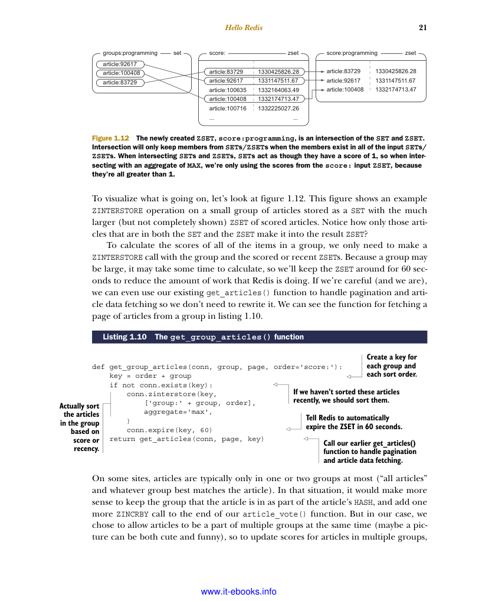

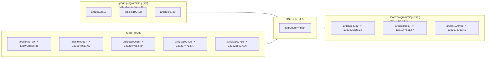

Để tính toán điểm số của tất cả các bài viết trong một nhóm, chúng ta chỉ cần thực hiện một lệnh gọi `ZINTERSTORE` giữa `SET` của nhóm đó và `ZSET` sắp xếp theo điểm số (`score:`) hoặc theo thời gian gần đây (`time:`). Bởi vì một nhóm có thể có kích thước lớn, việc tính toán có thể mất một chút thời gian, do đó chúng ta sẽ giữ lại `ZSET` kết quả này trong bộ nhớ đệm suốt 60 giây để giảm khối lượng công việc mà Redis phải thực hiện. Nếu chúng ta khéo léo (và thực tế là chúng ta đã làm vậy), chúng ta thậm chí có thể tái sử dụng hàm `get_articles()` hiện có của mình để xử lý việc phân trang và lấy dữ liệu bài viết mà không cần phải viết lại. Chúng ta có thể xem hàm lấy một trang các bài viết từ một nhóm trong **Listing 1.10**.

**Listing 1.10 – Hàm `get_group_articles()` (The get_group_articles() function)**

```python
def get_group_articles(conn, group, page, order='score:'):
    key = order + group                                             # 1
    if not conn.exists(key):                                        # 2
        conn.zinterstore(key,                                       # 3
            ['group:' + group, order],                              # 3
            aggregate='max',                                        # 3
        )
        conn.expire(key, 60)                                        # 4
    return get_articles(conn, page, key)                            # 5
```

**Giải thích mã nguồn:**
1. Tạo một tên khóa (key) cho mỗi nhóm và mỗi thứ tự sắp xếp (ví dụ: `score:programming` hoặc `time:programming`) (*Create a key for each group and each sort order*).
2. Nếu gần đây chúng ta chưa sắp xếp các bài viết này (khóa chưa tồn tại hoặc đã hết hạn), chúng ta cần thực hiện sắp xếp chúng (*If we haven’t sorted these articles recently, we should sort them*).
3. Thực sự sắp xếp các bài viết trong nhóm dựa trên điểm số hoặc độ mới (thời gian đăng) bằng lệnh `ZINTERSTORE` (*Actually sort the articles in the group based on score or recency*).
4. Yêu cầu Redis tự động làm hết hạn (xóa) `ZSET` tạm thời này sau 60 giây (*Tell Redis to automatically expire the ZSET in 60 seconds*).
5. Gọi hàm `get_articles()` đã viết trước đó của chúng ta để xử lý việc phân trang và lấy dữ liệu chi tiết của bài viết (*Call our earlier get_articles() function to handle pagination and article data fetching*).

Trên một số trang web, các bài viết thường chỉ thuộc về tối đa một hoặc hai nhóm ("tất cả bài viết" và một nhóm bất kỳ phù hợp nhất với bài viết đó). Trong tình huống đó, sẽ hợp lý hơn nếu lưu trữ tên nhóm mà bài viết thuộc về như một trường bên trong `HASH` của bài viết, và chỉ cần thêm một lệnh gọi `ZINCRBY` nữa vào cuối hàm `article_vote()` của chúng ta. Tuy nhiên, trong trường hợp của mình, chúng ta đã chọn cho phép các bài viết có thể thuộc về nhiều nhóm cùng một lúc (có thể một bức ảnh vừa dễ thương lại vừa hài hước), vì vậy để cập nhật điểm số cho các bài viết trong nhiều nhóm, chúng ta sẽ phải tăng điểm đồng thời trên tất cả các nhóm đó mỗi khi có lượt vote. Đối với một bài viết nằm trong nhiều nhóm, thao tác đó có thể trở nên tốn kém, do đó thay vào đó chúng ta chọn cách định kỳ thực hiện phép giao (`ZINTERSTORE`) và lưu đệm kết quả. Cách chúng ta lựa chọn giữa việc cung cấp sự linh hoạt hay áp đặt các giới hạn có thể làm thay đổi cách chúng ta lưu trữ và cập nhật dữ liệu trong bất kỳ cơ sở dữ liệu nào, và Redis cũng không phải là ngoại lệ.

Giờ đây khi chúng ta đã có thể lấy danh sách bài viết, đăng bài viết, bình chọn cho bài viết, và thậm chí có khả năng phân nhóm bài viết, chúng ta đã xây dựng xong một hệ thống phụ trợ (back end) hoàn chỉnh để làm nổi bật các liên kết hoặc bài viết phổ biến. Xin chúc mừng bạn đã đi được tới bước này! Nếu bạn gặp bất kỳ khó khăn nào trong việc theo dõi nội dung, hiểu các ví dụ, hoặc chạy thử các giải pháp, hãy đọc tiếp phần sau để biết nơi bạn có thể nhận được sự trợ giúp.

> 💡 **Ví dụ bổ sung (không có trong sách): Toàn bộ hệ thống bình chọn bài viết (Listing 1.6 – 1.10) viết lại chuẩn Python 3 & `redis-py` 5.x (Redis 6/7/8)**
>
> Dưới đây là mã nguồn hoàn chỉnh, chạy được ngay trên **Python 3.10+** và **`redis-py` 5.x**, đã cập nhật toàn bộ các thay đổi cú pháp (`decode_responses=True`, `zadd` truyền `dict`, `zincrby` đảo tham số `(name, amount, value)`, `hset(..., mapping=...)` thay cho `hmset`, và tránh dùng `list` khả biến `[]` làm đối số mặc định trong `add_remove_groups`):
>
> ```python
> import time
> import redis
>
> ONE_WEEK_IN_SECONDS = 7 * 86400
> VOTE_SCORE = 432
> ARTICLES_PER_PAGE = 25
>
> # Bắt buộc bật decode_responses=True trong Python 3 để nhận str thay vì bytes
> conn = redis.Redis(host='localhost', port=6379, decode_responses=True)
>
>
> def article_vote(conn: redis.Redis, user: str, article: str) -> None:
>     """Listing 1.6 (Chuẩn redis-py 5.x): Bình chọn cho bài viết."""
>     cutoff = time.time() - ONE_WEEK_IN_SECONDS
>     posted_time = conn.zscore('time:', article)
>     if posted_time is None or posted_time < cutoff:
>         return
>
>     article_id = article.partition(':')[-1]
>     if conn.sadd('voted:' + article_id, user):
>         # LƯU Ý: Trong redis-py 3.0+/5.x, thứ tự là (name, amount, value)
>         conn.zincrby('score:', VOTE_SCORE, article)
>         conn.hincrby(article, 'votes', 1)
>
>
> def post_article(conn: redis.Redis, user: str, title: str, link: str) -> str:
>     """Listing 1.7 (Chuẩn redis-py 5.x): Đăng bài viết mới."""
>     article_id = str(conn.incr('article:'))
>
>     voted = 'voted:' + article_id
>     conn.sadd(voted, user)
>     conn.expire(voted, ONE_WEEK_IN_SECONDS)
>
>     now = time.time()
>     article = 'article:' + article_id
>     # LƯU Ý: Dùng hset(..., mapping=...) thay cho hmset() đã bị xóa ở redis-py 5.x
>     conn.hset(article, mapping={
>         'title': title,
>         'link': link,
>         'poster': user,
>         'time': now,
>         'votes': 1,
>     })
>
>     # LƯU Ý: Trong redis-py 3.0+/5.x, zadd nhận một dict {member: score}
>     conn.zadd('score:', {article: now + VOTE_SCORE})
>     conn.zadd('time:', {article: now})
>
>     return article_id
>
>
> def get_articles(conn: redis.Redis, page: int, order: str = 'score:') -> list[dict]:
>     """Listing 1.8 (Chuẩn redis-py 5.x): Lấy danh sách bài viết phân trang."""
>     start = (page - 1) * ARTICLES_PER_PAGE
>     end = start + ARTICLES_PER_PAGE - 1
>
>     # Trong Redis 6.2+ có thể dùng conn.zrange(order, start, end, desc=True)
>     ids = conn.zrevrange(order, start, end)
>     articles = []
>     for article_id in ids:
>         article_data = conn.hgetall(article_id)
>         article_data['id'] = article_id
>         articles.append(article_data)
>
>     return articles
>
>
> def add_remove_groups(
>     conn: redis.Redis,
>     article_id: str,
>     to_add: list[str] | None = None,
>     to_remove: list[str] | None = None,
> ) -> None:
>     """Listing 1.9 (Chuẩn redis-py 5.x): Thêm/xóa bài viết khỏi các nhóm."""
>     article = 'article:' + article_id
>     for group in (to_add or []):
>         conn.sadd('group:' + group, article)
>     for group in (to_remove or []):
>         conn.srem('group:' + group, article)
>
>
> def get_group_articles(
>     conn: redis.Redis, group: str, page: int, order: str = 'score:'
> ) -> list[dict]:
>     """Listing 1.10 (Chuẩn redis-py 5.x): Lấy bài viết theo nhóm dùng ZINTERSTORE."""
>     key = order + group
>     if not conn.exists(key):
>         conn.zinterstore(key, ['group:' + group, order], aggregate='max')
>         conn.expire(key, 60)
>     return get_articles(conn, page, key)
> ```

---

## 1.4 Nhận trợ giúp ở đâu (Getting help)

Nếu bạn đang gặp vấn đề với Redis, đừng ngần ngại tìm kiếm hoặc đặt câu hỏi nhờ trợ giúp. Rất nhiều người khác có lẽ cũng đã từng gặp phải vấn đề tương tự. Trước tiên, hãy thử tìm kiếm bằng công cụ tìm kiếm yêu thích của bạn với thông báo lỗi cụ thể mà bạn đang gặp phải.

Nếu bạn không thể tìm thấy giải pháp cho vấn đề của mình và đang gặp trục trặc với một ví dụ trong cuốn sách này, hãy cứ tự nhiên đặt câu hỏi trên diễn đàn của nhà xuất bản Manning tại địa chỉ: http://www.manning-sandbox.com/forum.jspa?forumID=809. Tôi hoặc một ai đó quen thuộc với cuốn sách sẽ có thể hỗ trợ bạn.

Nếu bạn đang gặp vấn đề với Redis hoặc đang giải quyết một bài toán bằng Redis không nằm trong cuốn sách này, vui lòng tham gia và đăng câu hỏi của bạn lên danh sách gửi thư (mailing list) của Redis tại: https://groups.google.com/d/forum/redis-db/. Một lần nữa, tôi hoặc một ai đó am hiểu về Redis sẽ có thể giúp đỡ bạn.

Và cuối cùng, nếu bạn đang gặp khó khăn với một ngôn ngữ lập trình hoặc một thư viện cụ thể, bạn cũng có thể thử hỏi trên danh sách gửi thư của Redis, nhưng bạn có thể sẽ gặp may mắn hơn khi tìm kiếm trên danh sách gửi thư hoặc diễn đàn dành riêng cho thư viện mà bạn đang sử dụng.

---

## 1.5 Tóm tắt chương (Summary)

Trong chương này, chúng ta đã tìm hiểu những kiến thức cơ bản về việc Redis là gì, cũng như những điểm vừa tương đồng vừa khác biệt giữa nó với các cơ sở dữ liệu khác. Chúng ta cũng đã trao đổi về một vài lý do tại sao bạn sẽ muốn sử dụng Redis trong dự án tiếp theo của mình. Khi đọc qua các chương tiếp theo, hãy cố gắng ghi nhớ rằng chúng ta không hướng tới việc xây dựng một ứng dụng hay công cụ tối thượng duy nhất nào; mà chúng ta đang xem xét hàng loạt bài toán thực tế khác nhau mà Redis có thể giúp bạn giải quyết.

> 🧩 **Bài tập: Bình chọn phản đối (Exercise: Down-voting)**
> Trong ví dụ của chúng ta, chúng ta mới chỉ đếm những người đã bình chọn tích cực (up-vote) cho một bài viết. Tuy nhiên, trên nhiều trang web, các lượt bình chọn tiêu cực (negative votes / down-votes) có thể mang lại phản hồi hữu ích cho tất cả mọi người. Bạn có thể nghĩ ra cách nào để bổ sung hỗ trợ bình chọn phản đối (down-voting) vào hai hàm `article_vote()` và `post_article()` hay không? Nếu có thể, hãy thử cho phép người dùng chuyển đổi lá phiếu của họ (từ ủng hộ sang phản đối và ngược lại). **Gợi ý:** nếu bạn gặp bế tắc ở phần chuyển đổi lá phiếu (vote switching), hãy tìm hiểu lệnh `SMOVE` mà tôi có giới thiệu ngắn gọn trong Chương 3.

> 💡 **Ví dụ bổ sung (không có trong sách): Lời giải gợi ý cho bài tập Down-voting & Vote Switching**
> Để hỗ trợ cả bình chọn ủng hộ (`up`) và bình chọn phản đối (`down`) cũng như cho phép đổi ý, chúng ta có thể duy trì hai tập hợp `SET` cho mỗi bài viết:
> - `voted:up:<article_id>`: lưu những người dùng đã up-vote.
> - `voted:down:<article_id>`: lưu những người dùng đã down-vote.
>
> Khi người dùng thực hiện bình chọn:
> 1. Nếu họ chọn `up` và đang nằm trong `voted:down:<id>`, chúng ta dùng lệnh `SMOVE voted:down:<id> voted:up:<id> user` để di chuyển nguyên tử (atomic) người dùng từ tập phản đối sang tập ủng hộ. Khi đó điểm số bài viết cần tăng gấp đôi (`2 * VOTE_SCORE`: bù lại `-432` trước đó và cộng thêm `+432` mới) và trường `votes` trong `HASH` tăng thêm `2` (hoặc tách riêng hai trường `up_votes` và `down_votes`).
> 2. Nếu họ chưa từng nằm trong tập nào, chỉ cần `SADD` vào tập tương ứng và cộng/trừ `VOTE_SCORE` (`+432` hoặc `-432`).
>
> ```python
> def article_vote_with_downvote(conn, user, article, vote_type='up'):
>     cutoff = time.time() - ONE_WEEK_IN_SECONDS
>     if conn.zscore('time:', article) < cutoff:
>         return
>
>     article_id = article.partition(':')[-1]
>     up_set = 'voted:up:' + article_id
>     down_set = 'voted:down:' + article_id
>
>     if vote_type == 'up':
>         # Nếu trước đó đã down-vote, chuyển từ down_set sang up_set bằng SMOVE
>         if conn.smove(down_set, up_set, user):
>             conn.zincrby('score:', 2 * VOTE_SCORE, article)
>             conn.hincrby(article, 'votes', 2)
>         elif conn.sadd(up_set, user):
>             conn.zincrby('score:', VOTE_SCORE, article)
>             conn.hincrby(article, 'votes', 1)
>     elif vote_type == 'down':
>         # Nếu trước đó đã up-vote, chuyển từ up_set sang down_set bằng SMOVE
>         if conn.smove(up_set, down_set, user):
>             conn.zincrby('score:', -2 * VOTE_SCORE, article)
>             conn.hincrby(article, 'votes', -2)
>         elif conn.sadd(down_set, user):
>             conn.zincrby('score:', -VOTE_SCORE, article)
>             conn.hincrby(article, 'votes', -1)
> ```
> Lưu ý: Trong hàm `post_article()`, khi tạo bài viết mới, chúng ta cũng cần khởi tạo thời gian hết hạn (`EXPIRE`) cho các tập `voted:up:<id>` và `voted:down:<id>`.

Nếu có một khái niệm cốt lõi mà bạn nên đúc kết được từ chương này, thì đó là: Redis là một công cụ đắc lực khác mà bạn có thể sử dụng để giải quyết các bài toán. Redis sở hữu những cấu trúc dữ liệu mà không một cơ sở dữ liệu nào khác cung cấp, và bởi vì Redis lưu trữ trong bộ nhớ (giúp nó cực nhanh), truy cập từ xa (giúp nhiều máy khách/máy chủ có thể truy cập đồng thời), bền vững (mang lại cho bạn cơ hội giữ lại dữ liệu giữa các lần khởi động lại), và có khả năng mở rộng (thông qua sao chép slave và phân mảnh sharding), bạn có thể xây dựng giải pháp cho hàng loạt bài toán theo những cách thức vốn đã rất quen thuộc với mình.

Khi đọc phần còn lại của cuốn sách, hãy thử chú ý xem cách tiếp cận của bạn trong việc giải quyết vấn đề thay đổi như thế nào. Bạn có thể sẽ nhận thấy lối tư duy của mình trước các bài toán hướng dữ liệu dịch chuyển từ câu hỏi *"Làm thế nào để tôi uốn nắn ý tưởng của mình cho vừa vặn với thế giới của các bảng và dòng?"* sang câu hỏi *"Những cấu trúc dữ liệu nào trong Redis sẽ mang lại một giải pháp dễ bảo trì hơn?"*

Trong Chương 2, chúng ta sẽ sử dụng Redis để giải quyết các bài toán phát sinh trong thế giới của các ứng dụng web, vì vậy hãy tiếp tục đọc để cảm nhận rõ nét hơn nữa những gì Redis có thể giúp bạn thực hiện.

---

## Bảng thuật ngữ Chương 1 (Glossary)

| Thuật ngữ tiếng Anh | Thuật ngữ tiếng Việt | Giải thích ngắn gọn |
| :--- | :--- | :--- |
| **In-memory database** | Cơ sở dữ liệu trong bộ nhớ | Hệ quản trị cơ sở dữ liệu lưu trữ và thao tác dữ liệu trực tiếp trên RAM thay vì đĩa cứng để đạt độ trễ cực thấp. |
| **Persistence** | Lưu trữ bền vững | Cơ chế ghi dữ liệu từ bộ nhớ RAM xuống đĩa cứng (qua RDB snapshot hoặc AOF) để không mất dữ liệu khi khởi động lại máy chủ. |
| **Point-in-time dump (Snapshotting)** | Bản chụp tại một thời điểm | Cơ chế sao lưu toàn bộ dữ liệu trong bộ nhớ của Redis xuống một tệp nhị phân nhỏ gọn (`.rdb`) tại một thời điểm nhất định. |
| **Append-only file (AOF)** | Tệp chỉ ghi nối thêm | Cơ chế lưu trữ bền vững ghi lại tuần tự mọi lệnh làm thay đổi dữ liệu vào cuối tệp nhật ký để có thể phát lại khi khôi phục. |
| **Master/Slave replication** | Sao chép chủ/tớ (nay gọi là Primary/Replica) | Cơ chế đồng bộ dữ liệu một chiều từ máy chủ chính (master/primary) sang một hoặc nhiều máy chủ bản sao (slaves/replicas) để mở rộng khả năng đọc và dự phòng sự cố. |
| **Client-side sharding** | Phân mảnh phía client | Kỹ thuật chia nhỏ dữ liệu ra nhiều máy chủ Redis độc lập, trong đó tầng ứng dụng (client) tự tính toán xem khóa nào thuộc về máy chủ nào. |
| **ZSET (Sorted Set)** | Tập hợp có thứ tự | Cấu trúc dữ liệu đặc trưng của Redis lưu các phần tử chuỗi duy nhất (`member`), mỗi phần tử gắn với một điểm số thực (`score`) và luôn được sắp xếp tự động theo `score`. |
| **Namespace** | Không gian tên | Quy ước đặt tiền tố cho khóa (thường phân tách bằng dấu `:`, ví dụ `article:92617`) để phân loại và tổ chức các khóa trong Redis. |
| **TTL / Expiration** | Thời gian sống / Hết hạn | Khoảng thời gian được thiết lập (qua lệnh `EXPIRE`) để Redis tự động xóa một khóa khỏi bộ nhớ khi hết hạn. |
