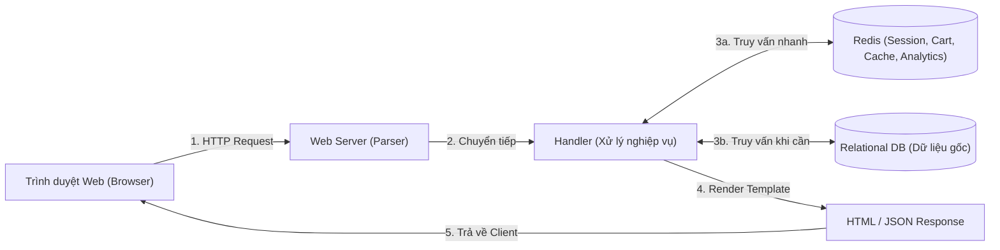
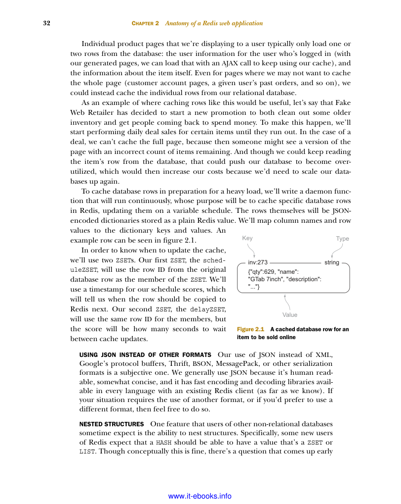
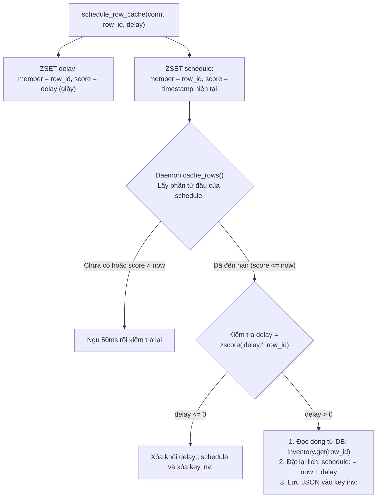

# Chương 2: Giải phẫu một ứng dụng web dùng Redis (Anatomy of a Redis web application)

## Mục lục chương

- [Mở đầu chương](#mở-đầu-chương)
- [2.1 Lưu đệm thông tin đăng nhập và cookie (Login and cookie caching)](#21-lưu-đệm-thông-tin-đăng-nhập-và-cookie-login-and-cookie-caching)
- [2.2 Giỏ hàng mua sắm trong Redis (Shopping carts in Redis)](#22-giỏ-hàng-mua-sắm-trong-redis-shopping-carts-in-redis)
- [2.3 Lưu đệm trang web (Web page caching)](#23-lưu-đệm-trang-web-web-page-caching)
- [2.4 Lưu đệm dòng dữ liệu từ cơ sở dữ liệu (Database row caching)](#24-lưu-đệm-dòng-dữ-liệu-từ-cơ-sở-dữ-liệu-database-row-caching)
- [2.5 Phân tích lượt xem trang web (Web page analytics)](#25-phân-tích-lượt-xem-trang-web-web-page-analytics)
- [2.6 Tóm tắt (Summary)](#26-tóm-tắt-summary)
- [Bảng thuật ngữ của chương](#bảng-thuật-ngữ-của-chương)

---

## Mở đầu chương

**Chương này bao gồm (This chapter covers):**

- Cookie đăng nhập (*Login cookies*)
- Cookie giỏ hàng mua sắm (*Shopping cart cookies*)
- Lưu đệm các trang web được sinh động (*Caching generated web pages*)
- Lưu đệm các dòng dữ liệu từ cơ sở dữ liệu (*Caching database rows*)
- Phân tích lượt truy cập trang web (*Analyzing web page visits*)

Trong chương đầu tiên, tôi đã giới thiệu với bạn Redis là gì và những gì nó có thể làm được. Trong chương này, tôi sẽ tiếp tục đi theo hướng đó, bắt đầu đào sâu vào một số ví dụ xuất hiện trong bối cảnh của một vài loại ứng dụng web. Mặc dù tôi đã đơn giản hóa các bài toán đi khá nhiều so với những gì diễn ra trong thực tế, nhưng từng mảnh ghép này thực sự có thể được sử dụng trực tiếp trong ứng dụng của bạn mà chỉ cần chỉnh sửa rất ít. Chương này chủ yếu đóng vai trò là một cẩm nang thực hành về những gì bạn có thể làm với Redis, còn chương 3 sẽ nghiêng về tài liệu tham chiếu lệnh (*command reference*) hơn.

Để bắt đầu, hãy cùng nhìn vào khái niệm ứng dụng web (*web application*) ở mức tổng quan (*high level*). Nhìn chung, chúng ta muốn nói đến một máy chủ (*server*) hoặc dịch vụ (*service*) phản hồi qua giao thức HTTP cho các yêu cầu (*requests*) được gửi từ trình duyệt web (*web browsers*). Dưới đây là các bước điển hình mà một máy chủ web trải qua để phản hồi một yêu cầu:

1. Máy chủ phân tích cú pháp (*parses*) yêu cầu.
2. Yêu cầu được chuyển tiếp (*forwarded*) đến một bộ xử lý (*handler*) đã được định nghĩa trước.
3. Bộ xử lý có thể thực hiện các truy vấn để lấy dữ liệu từ cơ sở dữ liệu (*database*).
4. Với dữ liệu thu thập được, bộ xử lý sau đó kết xuất (*renders*) một khuôn mẫu (*template*) thành phản hồi (*response*).
5. Bộ xử lý trả về phản hồi đã kết xuất, và phản hồi này được truyền ngược về cho trình khách (*client*).

Danh sách này là cái nhìn tổng quan ở mức cao về những gì diễn ra trong một máy chủ web điển hình. Các yêu cầu web trong tình huống kiểu này được coi là phi trạng thái (*stateless*), nghĩa là bản thân các máy chủ web không lưu giữ thông tin về những yêu cầu trong quá khứ, nhằm mục đích cho phép thay thế dễ dàng các máy chủ bị lỗi. Đã có nhiều cuốn sách được viết về cách tối ưu hóa từng bước trong quy trình đó, và cuốn sách này cũng làm điều tương tự. Điểm khác biệt của cuốn sách này là nó giải thích cách thay thế một số truy vấn vào cơ sở dữ liệu quan hệ (*relational database*) điển hình bằng các truy vấn nhanh hơn vào Redis, cũng như cách sử dụng Redis với những mẫu truy cập (*access patterns*) vốn sẽ quá tốn kém nếu dùng cơ sở dữ liệu quan hệ.



Xuyên suốt chương này, chúng ta sẽ xem xét và giải quyết các vấn đề phát sinh trong bối cảnh của **Fake Web Retailer** (Nhà bán lẻ Web Giả định) — một cửa hàng web (giả định) khá lớn nhận khoảng 100 triệu lượt truy cập (*hits*) mỗi ngày từ khoảng 5 triệu người dùng duy nhất (*unique users*), những người mua hơn 100.000 mặt hàng mỗi ngày. Những con số này rất lớn, nhưng nếu chúng ta có thể giải quyết các bài toán lớn một cách dễ dàng, thì các bài toán nhỏ và vừa sẽ còn dễ hơn nữa. Và mặc dù các giải pháp này nhắm đến một nhà bán lẻ web quy mô lớn, tất cả ngoại trừ một giải pháp trong số đó đều có thể được xử lý bởi một máy chủ Redis chỉ với vài gigabyte bộ nhớ, và được thiết kế để cải thiện hiệu năng của một hệ thống phản hồi yêu cầu theo thời gian thực (*real time*).

Mỗi giải pháp được trình bày (hoặc một biến thể nào đó của chúng) đều đã được sử dụng để giải quyết các bài toán thực tế trong môi trường vận hành (*production environments*). Cụ thể hơn, bằng cách giảm tải cho cơ sở dữ liệu truyền thống thông qua việc chuyển giao (*offloading*) một số tác vụ xử lý và lưu trữ sang Redis, các trang web đã được tải nhanh hơn với ít tài nguyên hơn.

Bài toán đầu tiên của chúng ta là sử dụng Redis để hỗ trợ quản lý các phiên đăng nhập (*login sessions*) của người dùng.

---

## 2.1 Lưu đệm thông tin đăng nhập và cookie (Login and cookie caching)

Mỗi khi chúng ta đăng nhập vào các dịch vụ trên internet, chẳng hạn như tài khoản ngân hàng hoặc web mail, các dịch vụ này ghi nhớ chúng ta là ai bằng cách sử dụng *cookie*. Cookie là những mẩu dữ liệu nhỏ mà các trang web yêu cầu trình duyệt web của chúng ta lưu trữ và gửi lại trong mọi yêu cầu gửi tới dịch vụ đó. Đối với cookie đăng nhập (*login cookies*), có hai phương pháp phổ biến để lưu thông tin đăng nhập trong cookie: **cookie có chữ ký** (*signed cookie*) hoặc **cookie dạng mã thông báo** (*token cookie*).

**Cookie có chữ ký** (*signed cookies*) thường lưu tên người dùng, có thể kèm theo ID người dùng (*user ID*), thời điểm họ đăng nhập lần cuối, và bất kỳ thông tin nào khác mà dịch vụ thấy hữu ích. Cùng với thông tin đặc thù của người dùng này, cookie còn chứa một chữ ký (*signature*) cho phép máy chủ xác minh rằng thông tin mà trình duyệt gửi lên không bị chỉnh sửa trái phép (chẳng hạn như thay thế tên đăng nhập của người dùng này bằng người dùng khác).

**Cookie dạng mã thông báo** (*token cookies*) sử dụng một chuỗi các byte ngẫu nhiên làm dữ liệu bên trong cookie. Trên máy chủ, token này được dùng làm khóa (*key*) để tra cứu người dùng sở hữu token đó bằng cách truy vấn một cơ sở dữ liệu nào đó. Theo thời gian, các token cũ có thể bị xóa đi để nhường chỗ cho các token mới. Một số ưu điểm và nhược điểm của cả cookie có chữ ký lẫn cookie dạng token trong việc tham chiếu thông tin được thể hiện trong **Bảng 2.1**.

**Bảng 2.1 – Ưu và nhược điểm của cookie có chữ ký và cookie dạng token (Table 2.1 Pros and cons of signed cookies and token cookies)**

| Loại cookie (Cookie type) | Ưu điểm (Pros) | Nhược điểm (Cons) |
| :--- | :--- | :--- |
| **Cookie có chữ ký (Signed cookie)** | - Mọi thứ cần thiết để xác minh cookie đều nằm ngay trong cookie.<br>- Thông tin bổ sung có thể được đưa thêm vào và ký một cách dễ dàng. | - Việc xử lý chữ ký đúng cách rất khó.<br>- Rất dễ quên ký và/hoặc quên xác minh dữ liệu, tạo ra các lỗ hổng bảo mật (*security vulnerabilities*). |
| **Cookie dạng token (Token cookie)** | - Việc thêm thông tin rất dễ dàng.<br>- Cookie rất nhỏ gọn, nhờ đó các thiết bị di động và client có mạng chậm có thể gửi yêu cầu nhanh hơn. | - Phải lưu trữ nhiều thông tin hơn ở phía máy chủ.<br>- Nếu sử dụng cơ sở dữ liệu quan hệ, việc tải/lưu trữ cookie có thể rất tốn kém (*expensive*). |

> 📝 **Giải thích thêm (không có trong sách):** Trong phát triển web hiện đại, khái niệm **Signed cookie** tương ứng trực tiếp với **JWT (JSON Web Token)** hoặc session cookie được ký bằng HMAC/RSA (như trong Flask, Rails, Express `cookie-session`). Dù JWT giúp xác thực không trạng thái (*stateless*), nó gặp đúng nhược điểm lớn khi cần thu hồi quyền tức thì (*token revocation*) hoặc lưu trạng thái hành vi liên tục. Ngược lại, **Token cookie** (hay *opaque session token*) kết hợp với **Redis** khắc phục hoàn toàn nhược điểm "truy vấn cơ sở dữ liệu quan hệ tốn kém", vì thao tác tra cứu trên bộ nhớ RAM của Redis chỉ mất chưa tới 1 mili-giây và hỗ trợ thu hồi phiên (*revoke session*) ngay lập tức.

Để không phải tự cài đặt cơ chế cookie có chữ ký, Fake Web Retailer đã chọn sử dụng một cookie dạng token để tham chiếu đến một bản ghi trong bảng của cơ sở dữ liệu quan hệ, nơi lưu trữ thông tin đăng nhập của người dùng. Bằng cách lưu thông tin này trong cơ sở dữ liệu, Fake Web Retailer cũng có thể lưu thêm các thông tin như người dùng đã duyệt web bao lâu, hoặc họ đã xem bao nhiêu mặt hàng, và sau đó phân tích những thông tin này để tìm cách tiếp thị (*market*) tốt hơn tới người dùng của mình.

Như có thể dự đoán, mọi người thường sẽ xem qua rất nhiều mặt hàng khác nhau trước khi chọn mua một (hoặc một vài) món, và việc ghi nhận thông tin về tất cả các mặt hàng khác nhau đã xem, thời điểm người dùng truy cập trang lần cuối, v.v., có thể dẫn đến một lượng lớn thao tác ghi vào cơ sở dữ liệu (*database writes*). Về lâu dài, dữ liệu đó rất hữu ích, nhưng ngay cả khi đã tinh chỉnh cơ sở dữ liệu (*database tuning*), hầu hết các cơ sở dữ liệu quan hệ cũng chỉ giới hạn ở mức chèn (*inserting*), cập nhật (*updating*), hoặc xóa (*deleting*) khoảng 200–2.000 dòng riêng lẻ mỗi giây trên mỗi máy chủ cơ sở dữ liệu. Mặc dù các thao tác chèn/cập nhật/xóa hàng loạt (*bulk inserts/updates/deletes*) có thể được thực hiện nhanh hơn, nhưng một khách hàng sẽ chỉ cập nhật một vài dòng dữ liệu cho mỗi lượt xem trang web, do đó kỹ thuật chèn hàng loạt tốc độ cao không giúp ích được gì ở đây.

Hiện tại, do tải lượng khá lớn trong suốt cả ngày (trung bình khoảng 1.200 thao tác ghi mỗi giây, gần 6.000 thao tác ghi mỗi giây vào giờ cao điểm), Fake Web Retailer đã phải dựng tới 10 máy chủ cơ sở dữ liệu quan hệ để đối phó với mức tải trong giờ cao điểm. Nhiệm vụ của chúng ta là loại bỏ các cơ sở dữ liệu quan hệ ra khỏi bài toán cookie đăng nhập và thay thế chúng bằng Redis.

Để bắt đầu, chúng ta sẽ sử dụng một cấu trúc `HASH` để lưu ánh xạ (*mapping*) từ các token của cookie đăng nhập sang người dùng đã đăng nhập. Để kiểm tra trạng thái đăng nhập, chúng ta cần lấy thông tin người dùng dựa trên token và trả về kết quả đó nếu có. Đoạn mã dưới đây cho thấy cách chúng ta kiểm tra cookie đăng nhập.

**Listing 2.1 – Hàm `check_token()` (The check_token() function)**

```python
def check_token(conn, token):
    return conn.hget('login:', token)
```

**Giải thích mã nguồn:**

- `return conn.hget('login:', token)`: Lấy và trả về người dùng tương ứng, nếu tồn tại (*Fetch and return the given user, if available*).

Việc kiểm tra token không có gì quá thú vị, bởi vì tất cả những phần hấp dẫn đều diễn ra khi chúng ta cập nhật chính token đó. Với mỗi lượt truy cập, chúng ta sẽ cập nhật `HASH` đăng nhập (`login:`) cho người dùng và ghi lại dấu thời gian (*timestamp*) hiện tại của token vào trong `ZSET` chứa những người dùng gần đây (`recent:`). Nếu người dùng đang xem một mặt hàng, chúng ta cũng thêm mặt hàng đó vào `ZSET` chứa các mặt hàng đã xem gần đây của người dùng đó (`viewed:<token>`) và cắt bớt (*trim*) `ZSET` đó nếu nó vượt quá 25 mặt hàng. Hàm thực hiện tất cả những việc này được trình bày ngay sau đây.

**Listing 2.2 – Hàm `update_token()` (The update_token() function)**

```python
def update_token(conn, token, user, item=None):
    timestamp = time.time()
    conn.hset('login:', token, user)
    conn.zadd('recent:', token, timestamp)
    if item:
        conn.zadd('viewed:' + token, item, timestamp)
        conn.zremrangebyrank('viewed:' + token, 0, -26)
```

**Giải thích mã nguồn:**

- `timestamp = time.time()`: Lấy dấu thời gian hiện tại (*Get the timestamp*).
- `conn.hset('login:', token, user)`: Duy trì ánh xạ từ token sang người dùng đã đăng nhập (*Keep a mapping from the token to the logged-in user*).
- `conn.zadd('recent:', token, timestamp)`: Ghi lại thời điểm nhìn thấy token lần cuối (*Record when the token was last seen*).
- `conn.zadd('viewed:' + token, item, timestamp)`: Ghi nhận rằng người dùng đã xem mặt hàng này (*Record that the user viewed the item*).
- `conn.zremrangebyrank('viewed:' + token, 0, -26)`: Xóa các mặt hàng cũ, chỉ giữ lại 25 mặt hàng gần nhất (*Remove old items, keeping the most recent 25*).

> 📝 **Giải thích thêm (không có trong sách) — Đối chiếu với Redis 6/7/8 & redis-py 5.x hiện đại (Listing 2.1 – 2.2):**
> 1. **Cách hoạt động của `zremrangebyrank('viewed:' + token, 0, -26)`:** Trong Redis `ZSET`, các phần tử được sắp xếp theo `score` (ở đây là `timestamp`) tăng dần: phần tử cũ nhất nằm ở chỉ số `0`, còn phần tử mới nhất nằm ở chỉ số `-1` (cuối danh sách). Chỉ số `-25` là phần tử thứ 25 tính từ cuối lên, và `-26` là phần tử thứ 26 tính từ cuối lên. Do đó, xóa dải từ `0` đến `-26` (bao gồm cả hai đầu mút) sẽ xóa sạch mọi phần tử cũ hơn, giữ lại đúng 25 phần tử có timestamp lớn nhất (tức từ `-25` đến `-1`).
> 2. **Lưu ý tương thích `redis-py` hiện đại (v3.0+ / v4.x / v5.x) & Python 3:**
>    - **Giải mã chuỗi (`decode_responses=True`):** Trong Python 3, bạn cần khởi tạo `conn = redis.Redis(decode_responses=True)` để `check_token()` trả về `str` (thay vì `bytes` như `b'user:123'`).
>    - **Thay đổi chữ ký hàm `zadd()`:** Sách sử dụng `redis-py` phiên bản 2.x với lớp `Redis` cũ, trong đó cú pháp là `conn.zadd(name, member, score)`. Từ `redis-py` 3.0 trở đi (và trong `redis-py` 5.x), tham số thứ hai bắt buộc phải là một `dict` ánh xạ `{member: score}`:
>
> ```python
> # Code viết lại chuẩn Python 3 & redis-py 5.x cho Listing 2.1 và 2.2:
> def check_token(conn, token: str) -> str | None:
>     return conn.hget('login:', token)
>
> def update_token(conn, token: str, user: str, item: str | None = None) -> None:
>     timestamp = time.time()
>     conn.hset('login:', token, user)
>     conn.zadd('recent:', {token: timestamp})
>     if item:
>         conn.zadd('viewed:' + token, {item: timestamp})
>         conn.zremrangebyrank('viewed:' + token, 0, -26)
> ```

Và bạn biết gì không? Chỉ có vậy thôi. Giờ đây chúng ta đã ghi lại được thời điểm một người dùng với phiên (*session*) cho trước xem một mặt hàng lần cuối cùng và mặt hàng mà người dùng đó vừa xem gần nhất. Trên một máy chủ được sản xuất trong vài năm trở lại đây, bạn có thể ghi nhận thông tin này cho ít nhất 20.000 lượt xem mặt hàng mỗi giây — cao gấp hơn 3 lần mức chúng ta cần thực hiện trên cơ sở dữ liệu. Thao tác này thậm chí còn có thể làm cho nhanh hơn nữa, điều mà chúng ta sẽ bàn tới ở phần sau (sử dụng *pipeline* trong Chương 4). Nhưng ngay cả với phiên bản hiện tại, chúng ta đã cải thiện hiệu năng gấp 10–100 lần so với một cơ sở dữ liệu quan hệ điển hình trong bối cảnh này.

Theo thời gian, mức sử dụng bộ nhớ sẽ tăng lên, và chúng ta sẽ muốn dọn dẹp dữ liệu cũ. Để giới hạn dung lượng dữ liệu, chúng ta sẽ chỉ giữ lại 10 triệu phiên gần nhất.¹ Đối với tác vụ dọn dẹp (*cleanup*), chúng ta sẽ kiểm tra kích thước của `ZSET` trong một vòng lặp. Nếu `ZSET` quá lớn, chúng ta sẽ lấy ra các phần tử cũ nhất tối đa 100 phần tử mỗi lần (vì chúng ta đang sử dụng dấu thời gian làm điểm số, nên đây chính là 100 phần tử đầu tiên trong `ZSET`), xóa chúng khỏi `ZSET` `recent:`, xóa các token đăng nhập tương ứng khỏi `HASH` `login:`, và xóa các `ZSET` `viewed:` có liên quan. Nếu `ZSET` chưa vượt quá giới hạn, chúng ta sẽ tạm nghỉ (*sleep*) 1 giây và thử lại sau. Mã nguồn để dọn dẹp các phiên cũ được trình bày dưới đây.

> ¹ Hãy nhớ rằng những giới hạn kiểu này đóng vai trò là ví dụ mà bạn có thể dùng trong tình huống vận hành thực tế ở quy mô lớn (*large-scale production*). Bạn hoàn toàn có thể giảm các con số này xuống mức nhỏ hơn nhiều trong quá trình kiểm thử và phát triển để quan sát cách chúng hoạt động.

**Listing 2.3 – Hàm `clean_sessions()` (The clean_sessions() function)**

```python
QUIT = False
LIMIT = 10000000

def clean_sessions(conn):
    while not QUIT:
        size = conn.zcard('recent:')
        if size <= LIMIT:
            time.sleep(1)
            continue

        end_index = min(size - LIMIT, 100)
        tokens = conn.zrange('recent:', 0, end_index-1)

        session_keys = []
        for token in tokens:
            session_keys.append('viewed:' + token)

        conn.delete(*session_keys)
        conn.hdel('login:', *tokens)
        conn.zrem('recent:', *tokens)
```

**Giải thích mã nguồn:**

- `size = conn.zcard('recent:')`: Kiểm tra xem hiện có bao nhiêu token đã biết (*Find out how many tokens are known*).
- `if size <= LIMIT:` / `time.sleep(1)` / `continue`: Chúng ta vẫn đang ở dưới ngưỡng giới hạn; ngủ 1 giây rồi thử lại (*We’re still under our limit; sleep and try again*).
- `end_index = min(size - LIMIT, 100)` / `tokens = conn.zrange('recent:', 0, end_index-1)`: Lấy danh sách các ID của token cần phải xóa bỏ (*Fetch the token IDs that should be removed*).
- `for token in tokens:` / `session_keys.append('viewed:' + token)`: Chuẩn bị tên các khóa (*key names*) cho những token cần xóa (*Prepare the key names for the tokens to delete*).
- `conn.delete(*session_keys)` / `conn.hdel('login:', *tokens)` / `conn.zrem('recent:', *tokens)`: Xóa bỏ các token cũ nhất (*Remove the oldest tokens*).

Làm thế nào mà một đoạn mã đơn giản như vậy lại có thể mở rộng quy mô (*scale*) để xử lý 5 triệu người dùng mỗi ngày? Hãy cùng kiểm tra các con số. Nếu chúng ta kỳ vọng có 5 triệu người dùng duy nhất mỗi ngày, thì sau 2 ngày (giả sử ngày nào chúng ta cũng có toàn người dùng mới), chúng ta sẽ chạm ngưỡng giới hạn dung lượng (10 triệu phiên) và cần bắt đầu xóa bớt token. Trong một ngày có `24 x 3600 = 86.400` giây, vậy trung bình có `5.000.000 / 86.400 < 58` phiên mới mỗi giây. Nếu chúng ta chạy hàm dọn dẹp mỗi giây một lần (như mã nguồn của chúng ta đang cài đặt), chúng ta sẽ chỉ cần dọn dẹp gần 60 token mỗi giây. Thế nhưng đoạn mã này thực tế có thể dọn dẹp hơn 10.000 token mỗi giây qua mạng (*across a network*), và hơn 60.000 token mỗi giây khi chạy cục bộ (*locally*), tức là nhanh hơn từ 150 đến 1.000 lần so với mức chúng ta cần.

> 📌 **CHẠY CÁC HÀM DỌN DẸP Ở ĐÂU (WHERE TO RUN CLEANUP FUNCTIONS)**
>
> Ví dụ này và các ví dụ khác trong cuốn sách đôi khi sẽ bao gồm các hàm dọn dẹp giống như **Listing 2.3**. Tùy thuộc vào từng hàm dọn dẹp, nó có thể được viết để chạy như một tiến trình nền (*daemon process* — giống như Listing 2.3), chạy định kỳ thông qua một tác vụ *cron job*, hoặc thậm chí được chạy ngay trong mỗi lần thực thi nghiệp vụ (mục 6.3 thực tế gộp luôn thao tác dọn dẹp làm một phần của thao tác "chiếm giữ khóa" — *acquire*). Theo quy tắc chung, nếu hàm có chứa dòng `while not QUIT:`, nó được thiết kế để chạy như một tiến trình nền (*daemon*), mặc dù có thể dễ dàng sửa đổi để chạy định kỳ tùy theo mục đích sử dụng.

> 📌 **CÚ PHÁP PYTHON ĐỂ TRUYỀN VÀ NHẬN SỐ LƯỢNG ĐỐI SỐ BIẾN ĐỔI (PYTHON SYNTAX FOR PASSING AND RECEIVING A VARIABLE NUMBER OF ARGUMENTS)**
>
> Bên trong **Listing 2.3**, bạn sẽ nhận thấy chúng ta đã gọi ba hàm với cú pháp tương tự như `conn.delete(*vtokens)` (hay `conn.delete(*session_keys)`). Về cơ bản, chúng ta đang truyền một chuỗi (*sequence*) các đối số vào hàm bên dưới mà không cần phải giải nén (*unpacking*) các đối số đó từ trước. Để biết thêm chi tiết về ngữ nghĩa (*semantics*) của cách thức hoạt động này, bạn có thể truy cập trang web hướng dẫn ngôn ngữ Python thông qua đường dẫn rút gọn: `http://mng.bz/8I7W`.

> 📌 **LÀM HẾT HẠN DỮ LIỆU TRONG REDIS (EXPIRING DATA IN REDIS)**
>
> Khi tìm hiểu sâu hơn về Redis, rất có thể bạn sẽ khám phá ra rằng một số giải pháp chúng tôi trình bày không phải là cách duy nhất để giải quyết vấn đề. Trong trường hợp này, chúng ta có thể bỏ qua `ZSET` `recent:`, lưu các token đăng nhập dưới dạng các cặp khóa-giá trị (*key-value pairs*) thông thường, và sử dụng lệnh `EXPIRE` của Redis để đặt một ngày hoặc thời điểm trong tương lai nhằm tự động dọn dẹp cả phiên đăng nhập lẫn các `ZSET` chứa mặt hàng đã xem gần đây (`viewed:`). Nhưng việc sử dụng `EXPIRE` sẽ ngăn cản chúng ta giới hạn một cách tường minh thông tin phiên ở đúng con số 10 triệu người dùng, đồng thời ngăn chúng ta thực hiện phân tích giỏ hàng bị bỏ quên (*abandoned shopping cart analysis*) tại thời điểm phiên hết hạn nếu cần tới trong tương lai.

> 📝 **Giải thích thêm (không có trong sách) — Đối chiếu với Redis 6/7/8 & redis-py 5.x hiện đại (Kiến trúc dọn rác phiên đăng nhập Listing 2.3 – 2.5):**
>
> Khi đối chiếu mô hình tiến trình nền `clean_sessions()` (dùng `ZSET` + `HGET`/`HDEL` + `DEL`) của sách với các tính năng trong **Redis 4.0 / 6.x / 7.4+ / 8.x** và **`redis-py` 5.x**, có 4 điểm nâng cấp quan trọng bạn cần nắm vững:
>
> | Khía cạnh | Cách làm trong sách (Redis 2.6 / `redis-py` 2.x) | Giải pháp hiện đại trong Redis 6/7/8 & `redis-py` 5.x |
> | :--- | :--- | :--- |
> | **1. Hết hạn trực tiếp trên từng field của `HASH` (Redis 7.4+)** | Trong Redis 2.6, lệnh `EXPIRE` chỉ đặt được trên toàn bộ key (không đặt được trên từng field bên trong `HASH` `login:`), nên tác giả phải tạo thêm `ZSET` `recent:` và viết daemon `clean_sessions()` để quét xóa thủ công bằng `HDEL`. | Từ **Redis 7.4+**, tính năng **Hash Field Expiration** đã ra đời với các lệnh **`HEXPIRE`**, **`HPEXPIRE`**, **`HTTL`**. Bạn có thể đặt TTL trực tiếp cho từng `token` bên trong `HASH` `login:` ngay khi người dùng truy cập: `HEXPIRE login: 86400 FIELDS 1 <token>` (hoặc lưu mỗi phiên thành một key độc lập `session:<token>` kèm `EXPIRE`). |
> | **2. Chính sách thu hồi bộ nhớ tự động (`maxmemory-policy`)** | Phải tự đếm `conn.zcard('recent:') > LIMIT` (10 triệu phiên) trong vòng lặp Python để tránh tràn RAM. | Từ **Redis 4.0+**, ngoài `allkeys-lru` / `volatile-lru`, Redis bổ sung thuật toán **LFU (Least Frequently Used)** gồm **`allkeys-lfu`** và **`volatile-lfu`**, giúp Redis tự động đẩy các phiên ít được truy cập nhất ra khỏi RAM khi chạm ngưỡng `maxmemory` mà không cần chạy tiến trình Python bên ngoài. |
> | **3. Xóa bất đồng bộ không chặn luồng (`UNLINK` thay cho `DEL`)** | Dùng `conn.delete(*session_keys)` (lệnh `DEL`). Nếu một `viewed:<token>` hoặc `cart:<token>` chứa nhiều phần tử, việc xóa đồng bộ hàng trăm key cùng lúc có thể gây khựng (*latency spike*) trên luồng chính của Redis. | Từ **Redis 4.0+**, lệnh **`UNLINK`** (`conn.unlink(*session_keys)` trong `redis-py` 5.x) chỉ tháo liên kết key khỏi không gian khóa ở thời gian $O(1)$ rồi giao việc giải phóng vùng nhớ RAM cho một luồng nền (*lazyfree background thread*) xử lý bất đồng bộ. |
> | **4. Tránh lỗi nối chuỗi `bytes` trong Python 3** | `tokens = conn.zrange('recent:', 0, end_index-1)` rồi nối `'viewed:' + token`. | Trong Python 3, nếu không bật `decode_responses=True`, `token` là `bytes` (`b'...'`) nên phép cộng `'viewed:' + token` sẽ văng lỗi `TypeError: can only concatenate str (not "bytes") to str`. |
>
> **Khi nào vẫn nên giữ mô hình `ZSET` `recent:` + `clean_sessions()` của tác giả?**
> Dù Redis 7.4+ đã có `HEXPIRE` và `volatile-lfu`, cách thiết kế dùng `ZSET` `recent:` trong chương này vẫn cực kỳ giá trị khi bạn cần một **hàng đợi ưu tiên theo thời gian có kiểm soát chủ động**: trước khi xóa một phiên trong `clean_sessions()`, worker của bạn có thể đọc dữ liệu giỏ hàng (`cart:<token>`) và lịch sử xem (`viewed:<token>`), đẩy sự kiện sang Kafka / Data Warehouse để phân tích hành vi "bỏ giỏ hàng" (*abandoned cart analysis*), rồi mới gọi lệnh xóa khỏi Redis. Nếu dùng `EXPIRE` / `HEXPIRE` tự động của Redis, dữ liệu sẽ âm thầm biến mất khi hết hạn mà ứng dụng không kịp thu thập lại ngữ cảnh đầy đủ của phiên đó.

Những ai quen thuộc với lập trình đa luồng (*threaded*) hoặc lập trình đồng thời (*concurrent programming*) có thể đã nhận ra rằng hàm dọn dẹp phía trên tồn tại một **điều kiện tranh chấp** (*race condition*): về mặt kỹ thuật, có khả năng một người dùng truy cập vào trang web đúng vào phần nhỏ của một giây khi chúng ta đang xóa thông tin của họ. Chúng ta sẽ không bận tâm về điều đó ở đây vì khả năng xảy ra là rất thấp, và vì nó sẽ không gây ra sự thay đổi đáng kể nào đối với dữ liệu mà chúng ta đang ghi nhận (ngoài việc yêu cầu người dùng đó phải đăng nhập lại). Chúng ta sẽ thảo luận về cách phòng chống điều kiện tranh chấp (*race conditions*) cũng như cách tăng tốc hơn nữa thao tác xóa trong chương 3 và chương 4.

Chúng ta đã giảm lượng dữ liệu phải ghi vào cơ sở dữ liệu đi hàng triệu dòng mỗi ngày. Điều này thật tuyệt vời, nhưng đó mới chỉ là bước đầu tiên hướng tới việc sử dụng Redis trong ứng dụng web của chúng ta. Trong mục tiếp theo, chúng ta sẽ sử dụng Redis để xử lý một loại cookie khác.

---

## 2.2 Giỏ hàng mua sắm trong Redis (Shopping carts in Redis)

Một trong những ứng dụng đầu tiên của cookie trên web đã được Netscape tiên phong từ giữa những năm 1990, và cuối cùng đã dẫn đến sự ra đời của các cookie phiên đăng nhập mà chúng ta vừa trao đổi. Ban đầu, cookie được tạo ra nhằm cung cấp một cách thức để nhà bán lẻ web lưu giữ một dạng giỏ hàng mua sắm (*shopping cart*) cho người dùng, nhằm theo dõi những mặt hàng mà họ muốn mua. Trước khi có cookie, đã có một vài giải pháp khác nhau để theo dõi giỏ hàng, nhưng không có giải pháp nào thực sự dễ sử dụng.

Việc sử dụng cookie giỏ hàng là rất phổ biến, cũng như việc lưu trữ toàn bộ bản thân giỏ hàng ngay bên trong cookie. Một ưu điểm khổng lồ của việc lưu giỏ hàng trong cookie là bạn không cần phải ghi vào cơ sở dữ liệu để duy trì chúng. Nhưng một trong những nhược điểm là bạn phải liên tục phân tích lại cú pháp (*reparsing*) và xác thực (*validating*) cookie đó để đảm bảo nó có định dạng hợp lệ và chứa những mặt hàng thực sự có thể mua được. Một nhược điểm khác nữa là cookie được truyền đi cùng với mọi yêu cầu HTTP, điều này có thể làm chậm quá trình gửi và xử lý yêu cầu đối với những cookie có kích thước lớn.

Vì chúng ta đã thu được kết quả rất tốt với cookie phiên đăng nhập và danh sách mặt hàng đã xem gần đây, chúng ta sẽ đẩy luôn thông tin giỏ hàng vào Redis. Do chúng ta vốn đã lưu cookie phiên của người dùng trong Redis (cùng với các mặt hàng đã xem gần đây), chúng ta có thể sử dụng lại chính ID của cookie đó để tham chiếu tới giỏ hàng.

Giỏ hàng mà chúng ta sẽ sử dụng rất đơn giản: nó là một `HASH` ánh xạ từ ID mặt hàng (*item ID*) sang số lượng (*quantity*) của mặt hàng đó mà khách hàng muốn mua. Chúng ta sẽ để tầng ứng dụng web xử lý việc kiểm tra tính hợp lệ (*validation*) đối với số lượng mặt hàng, nên chúng ta chỉ cần cập nhật số lượng trong giỏ hàng khi chúng thay đổi. Nếu người dùng muốn mua nhiều hơn 0 đơn vị của một mặt hàng, chúng ta thêm mặt hàng đó vào `HASH` (ghi đè lên số lượng trước đó nếu đã tồn tại). Ngược lại (nếu số lượng nhỏ hơn hoặc bằng 0), chúng ta xóa mục đó khỏi `HASH`. Hàm `add_to_cart()` của chúng ta có thể được thấy trong đoạn mã dưới đây.

**Listing 2.4 – Hàm `add_to_cart()` (The add_to_cart() function)**

```python
def add_to_cart(conn, session, item, count):
    if count <= 0:
        conn.hrem('cart:' + session, item)
    else:
        conn.hset('cart:' + session, item, count)
```

**Giải thích mã nguồn:**

- `conn.hrem('cart:' + session, item)`: Xóa mặt hàng khỏi giỏ hàng (*Remove the item from the cart*).
- `conn.hset('cart:' + session, item, count)`: Thêm mặt hàng (cùng số lượng) vào giỏ hàng (*Add the item to the cart*).

> 📝 **Giải thích thêm (không có trong sách):** Trong bản in gốc của sách *Redis in Action*, dòng thứ 3 của Listing 2.4 viết là `conn.hrem('cart:' + session, item)`. Tuy nhiên, lệnh xóa một trường khỏi `HASH` trong Redis là `HDEL`, và trong thư viện `redis-py` (cả bản 2.x lẫn 3.x/4.x/5.x), phương thức chuẩn trên đối tượng kết nối là **`conn.hdel('cart:' + session, item)`** (chính tác giả cũng đã dùng `conn.hdel(...)` ở Listing 2.3 và Listing 2.5). Khi viết mã thực tế với `redis-py`, bạn hãy gọi `conn.hdel('cart:' + session, item)`.

Nhân tiện đang làm việc này, chúng ta sẽ cập nhật luôn hàm dọn dẹp phiên để bao gồm cả việc xóa các giỏ hàng cũ, tạo thành hàm `clean_full_sessions()` trong đoạn mã tiếp theo.

**Listing 2.5 – Hàm `clean_full_sessions()` (The clean_full_sessions() function)**

```python
def clean_full_sessions(conn):
    while not QUIT:
        size = conn.zcard('recent:')
        if size <= LIMIT:
            time.sleep(1)
            continue

        end_index = min(size - LIMIT, 100)
        sessions = conn.zrange('recent:', 0, end_index-1)

        session_keys = []
        for sess in sessions:
            session_keys.append('viewed:' + sess)
            session_keys.append('cart:' + sess)

        conn.delete(*session_keys)
        conn.hdel('login:', *sessions)
        conn.zrem('recent:', *sessions)
```

**Giải thích mã nguồn:**

- `session_keys.append('cart:' + sess)`: Dòng mã bắt buộc phải thêm vào để xóa giỏ hàng của các phiên cũ (*The required added line to delete the shopping cart for old sessions*).

> 💡 **Ví dụ bổ sung (không có trong sách): Mã nguồn chuẩn Python 3 & `redis-py` 5.x cho Listing 2.4 – 2.5 (Kết hợp `hdel` và `unlink` của Redis 4.0+)**
>
> ```python
> def add_to_cart(conn, session: str, item: str, count: int) -> None:
>     """Listing 2.4 (Chuẩn redis-py 5.x): Sửa conn.hrem thành conn.hdel."""
>     if count <= 0:
>         conn.hdel('cart:' + session, item)
>     else:
>         conn.hset('cart:' + session, item, count)
>
>
> def clean_full_sessions(conn) -> None:
>     """Listing 2.5 (Chuẩn redis-py 5.x + Redis 4.0+ UNLINK)."""
>     while not QUIT:
>         size = conn.zcard('recent:')
>         if size <= LIMIT:
>             time.sleep(1)
>             continue
>
>         end_index = min(size - LIMIT, 100)
>         # Yêu cầu conn = redis.Redis(decode_responses=True) để sess là kiểu str
>         sessions = conn.zrange('recent:', 0, end_index - 1)
>
>         session_keys = []
>         for sess in sessions:
>             session_keys.append('viewed:' + sess)
>             session_keys.append('cart:' + sess)
>
>         # Dùng UNLINK (Redis 4.0+) thay cho DELETE để giải phóng bộ nhớ bất đồng bộ không chặn luồng
>         conn.unlink(*session_keys)
>         conn.hdel('login:', *sessions)
>         conn.zrem('recent:', *sessions)
> ```

Giờ đây chúng ta đã có cả phiên đăng nhập lẫn giỏ hàng được lưu trữ trong Redis, điều này vừa giúp giảm kích thước yêu cầu mạng (*request size*), vừa cho phép thực hiện các phép tính thống kê trên khách truy cập trang web dựa vào những mặt hàng họ đã xem, những mặt hàng đã nằm trong giỏ hàng của họ, và những mặt hàng cuối cùng họ đã mua. Tất cả những dữ liệu này cho phép chúng ta xây dựng (nếu muốn) các tính năng tương tự như nhiều nhà bán lẻ web lớn khác: *"Những người đã xem mặt hàng này cuối cùng đã mua mặt hàng này trong X% số lần"*, và *"Những người đã mua mặt hàng này cũng đã mua những mặt hàng khác sau đây"*. Điều này giúp mọi người tìm thấy các mặt hàng liên quan khác, và suy cho cùng là rất tốt cho hoạt động kinh doanh.

Với cả cookie phiên và cookie giỏ hàng đều đã nằm trong Redis, giờ đây chúng ta đã có hai mảnh ghép quan trọng để thực hiện phân tích dữ liệu hữu ích. Tiếp theo, hãy cùng xem cách chúng ta có thể giảm tải hơn nữa cho cơ sở dữ liệu và tầng giao diện web (*web front-end*) bằng kỹ thuật lưu đệm (*caching*).

---

## 2.3 Lưu đệm trang web (Web page caching)

Khi tạo các trang web một cách linh hoạt (*dynamically*), người ta thường sử dụng một ngôn ngữ khuôn mẫu (*templating language*) để đơn giản hóa việc sinh trang. Đã qua rồi cái thời mà mỗi trang web đều phải được viết thủ công bằng tay. Các trang web hiện đại được sinh ra từ các khuôn mẫu trang (*page templates*) với phần đầu trang (*headers*), chân trang (*footers*), trình đơn bên (*side menus*), thanh công cụ (*toolbars*), vùng nội dung (*content areas*), và thậm chí có thể cả mã JavaScript được sinh tự động.

Mặc dù có khả năng sinh nội dung động, phần lớn các trang được phục vụ trên trang web của Fake Web Retailer không thay đổi nhiều một cách thường xuyên. Chắc chắn rồi, một số mặt hàng mới được thêm vào danh mục (*catalog*), các mặt hàng cũ bị gỡ bỏ, đôi khi có các chương trình khuyến mãi đặc biệt, và đôi khi có cả những trang "mặt hàng đang sốt" (*hot items*). Nhưng thực sự thì chỉ có một số ít trang như cài đặt tài khoản, đơn hàng trong quá khứ, trang giỏ hàng/thanh toán (*shopping cart/checkout*), và các trang tương tự mới có nội dung cần phải được sinh mới trong mỗi lần tải trang.

Bằng cách nhìn vào số liệu lượt xem của mình, Fake Web Retailer đã xác định được rằng 95% số trang web mà họ phục vụ thay đổi tối đa một lần mỗi ngày, và thực sự không đòi hỏi nội dung phải được sinh động ở mọi lượt truy cập. Nhiệm vụ của chúng ta là ngừng việc sinh lại 95% số trang đó trong mỗi lần tải trang. Bằng cách giảm lượng thời gian tiêu tốn vào việc sinh nội dung tĩnh (*static content*), chúng ta có thể giảm số lượng máy chủ cần thiết để xử lý cùng một mức tải, đồng thời phục vụ trang web nhanh hơn. (Các nghiên cứu đã chỉ ra rằng việc giảm thời gian người dùng phải chờ trang tải xong sẽ làm tăng mong muốn sử dụng trang web và cải thiện mức độ đánh giá của họ về trang web đó.)

Tất cả các bộ khung ứng dụng (*application frameworks*) Python tiêu chuẩn đều cung cấp khả năng thêm vào các tầng (*layers*) có thể tiền xử lý (*pre-process*) hoặc hậu xử lý (*post-process*) các yêu cầu khi chúng được xử lý. Các tầng này thường được gọi là *middleware* (phần mềm trung gian) hoặc *plugins* (trình cắm). Hãy tạo một trong những tầng như vậy để gọi tới hàm lưu đệm Redis của chúng ta. Nếu một yêu cầu web không thể lưu đệm, chúng ta sẽ sinh trang và trả về nội dung. Nếu một yêu cầu có thể lưu đệm, chúng ta sẽ thử lấy và trả về trang đó từ bộ nhớ đệm (*cache*); nếu chưa có trong bộ nhớ đệm, chúng ta sẽ sinh trang, lưu kết quả vào bộ nhớ đệm trong Redis trong thời gian tối đa 5 phút, và trả về nội dung. Phương thức lưu đệm đơn giản của chúng ta có thể được thấy trong đoạn mã tiếp theo.

**Listing 2.6 – Hàm `cache_request()` (The cache_request() function)**

```python
def cache_request(conn, request, callback):
    if not can_cache(conn, request):
        return callback(request)

    page_key = 'cache:' + hash_request(request)
    content = conn.get(page_key)

    if not content:
        content = callback(request)
        conn.setex(page_key, content, 300)

    return content
```

**Giải thích mã nguồn:**

- `if not can_cache(conn, request):` / `return callback(request)`: Nếu chúng ta không thể lưu đệm yêu cầu này, hãy gọi ngay hàm `callback` để sinh trang (*If we can’t cache the request, immediately call the callback*).
- `page_key = 'cache:' + hash_request(request)`: Chuyển đổi yêu cầu thành một khóa chuỗi đơn giản để phục vụ tra cứu về sau (*Convert the request into a simple string key for later lookups*).
- `content = conn.get(page_key)`: Lấy nội dung đã lưu đệm nếu chúng ta có thể, và nếu nội dung đó đang có sẵn (*Fetch the cached content if we can, and it’s available*).
- `if not content:` / `content = callback(request)`: Sinh nội dung nếu chúng ta không thể lưu đệm trang, hoặc nếu trang đó chưa có trong bộ nhớ đệm (*Generate the content if we can’t cache the page, or if it wasn’t cached*).
- `conn.setex(page_key, content, 300)`: Lưu đệm nội dung vừa mới sinh ra (với thời gian sống 300 giây = 5 phút) nếu trang có thể lưu đệm (*Cache the newly generated content if we can cache it*).
- `return content`: Trả về nội dung (*Return the content*).

> 📝 **Giải thích thêm (không có trong sách) — Đối chiếu với Redis 6/7/8 & redis-py 5.x hiện đại (Listing 2.6: Thứ tự tham số của `setex`):**
> Trong `redis-py` cũ (lớp `Redis` của phiên bản 2.x được dùng trong sách), thứ tự tham số của `setex` là `conn.setex(name, value, time)`. Tuy nhiên, từ `redis-py` 3.0 trở đi (và trong **`redis-py` 4.x / 5.x**), lớp `Redis` đã hợp nhất hoàn toàn với `StrictRedis` để tuân theo chuẩn lệnh Redis gốc (`SETEX key seconds value`). Do đó, thứ tự tham số bắt buộc phải là **`conn.setex(name, time, value)`**, hoặc gọn hơn là dùng trực tiếp **`conn.set(page_key, content, ex=300)`** (cờ `EX` đã được tích hợp vào lệnh `SET` từ Redis 2.6.12+):
>
> ```python
> # Code viết lại chuẩn Python 3 & redis-py 5.x cho Listing 2.6:
> def cache_request(conn, request, callback):
>     if not can_cache(conn, request):
>         return callback(request)
>
>     page_key = 'cache:' + hash_request(request)
>     content = conn.get(page_key)
>
>     if not content:
>         content = callback(request)
>         # LƯU Ý: Trong redis-py 3.0+/5.x, thứ tự của setex là (name, time, value)
>         conn.setex(page_key, 300, content)
>         # Hoặc cách viết hiện đại tương đương: conn.set(page_key, content, ex=300)
>
>     return content
> ```

Đối với 95% nội dung có thể lưu đệm và được tải thường xuyên đó, đoạn mã nhỏ này loại bỏ nhu cầu phải sinh động các trang được xem trong vòng 5 phút. Tùy thuộc vào độ phức tạp của nội dung, chỉ riêng một thay đổi này có thể giảm độ trễ (*latency*) của một trang nặng về dữ liệu từ khoảng 20–50ms xuống chỉ còn một chuyến khứ hồi (*round trip*) tới Redis (dưới 1ms đối với kết nối cục bộ, dưới 5ms đối với các máy tính đặt gần nhau trong cùng một trung tâm dữ liệu — *data center*). Đối với những trang trước đây phải truy vấn cơ sở dữ liệu để lấy dữ liệu, cách làm này còn giúp giảm thêm thời gian tải trang cũng như tải lượng trên cơ sở dữ liệu.

Giờ đây khi chúng ta đã cắt giảm được thời gian tải cho những trang ít thay đổi, liệu chúng ta có thể tiếp tục sử dụng Redis để cắt giảm thời gian tải cho những trang **thường xuyên thay đổi** hay không? Tất nhiên là có thể! Hãy đọc tiếp để khám phá cách thực hiện.

---

## 2.4 Lưu đệm dòng dữ liệu từ cơ sở dữ liệu (Database row caching)

Cho đến thời điểm này trong chương, chúng ta đã chuyển các phiên đăng nhập và phiên khách truy cập từ cơ sở dữ liệu quan hệ và trình duyệt web sang Redis, chúng ta đã đưa giỏ hàng ra khỏi cơ sở dữ liệu quan hệ và đặt vào trong Redis, và chúng ta đã lưu đệm toàn bộ các trang web trong Redis. Điều này đã giúp chúng ta cải thiện hiệu năng và giảm tải cho cơ sở dữ liệu quan hệ, qua đó cũng làm giảm chi phí vận hành của chúng ta.

Các trang chi tiết sản phẩm riêng lẻ mà chúng ta hiển thị cho người dùng thường chỉ tải một hoặc hai dòng dữ liệu từ cơ sở dữ liệu: thông tin người dùng của người đang đăng nhập (với các trang đã được lưu đệm tĩnh của chúng ta, ta có thể tải thông tin đó bằng một lời gọi AJAX để tiếp tục tận dụng bộ nhớ đệm trang), và thông tin về bản thân mặt hàng đó. Ngay cả đối với những trang mà chúng ta có thể không muốn lưu đệm toàn bộ trang (các trang tài khoản khách hàng, lịch sử đơn hàng của một người dùng cụ thể, v.v.), thay vào đó chúng ta có thể lưu đệm từng dòng dữ liệu riêng lẻ (*individual rows*) từ cơ sở dữ liệu quan hệ của mình.

Để lấy một ví dụ về trường hợp mà việc lưu đệm các dòng dữ liệu như thế này sẽ phát huy tác dụng, giả sử Fake Web Retailer đã quyết định tung ra một chương trình khuyến mãi mới nhằm vừa giải phóng một số hàng tồn kho (*inventory*) cũ, vừa thu hút khách hàng quay lại chi tiêu. Để thực hiện điều này, chúng ta sẽ bắt đầu tổ chức các đợt giảm giá chớp nhoáng hằng ngày (*daily deal sales*) cho một số mặt hàng nhất định cho đến khi chúng bán hết sạch. Trong trường hợp một đợt giảm giá (*deal*), chúng ta không thể lưu đệm toàn bộ trang web, bởi vì khi đó ai đó có thể nhìn thấy một phiên bản trang web hiển thị sai số lượng mặt hàng còn lại. Và mặc dù chúng ta có thể liên tục đọc dòng dữ liệu của mặt hàng đó từ cơ sở dữ liệu, việc đó có thể đẩy cơ sở dữ liệu của chúng ta vào tình trạng quá tải (*over-utilized*), kéo theo việc làm tăng chi phí vì chúng ta sẽ lại phải nâng cấp mở rộng (*scale up*) các máy chủ cơ sở dữ liệu.

Để lưu đệm các dòng dữ liệu của cơ sở dữ liệu nhằm chuẩn bị đón nhận mức tải nặng, chúng ta sẽ viết một hàm tiến trình nền (*daemon function*) chạy liên tục, với mục đích lưu đệm các dòng dữ liệu cụ thể vào Redis, cập nhật chúng theo một lịch trình biến thiên (*variable schedule*). Bản thân các dòng dữ liệu sẽ là các từ điển (*dictionaries*) được mã hóa dưới dạng JSON và được lưu như một giá trị chuỗi (`string`) thông thường trong Redis. Chúng ta sẽ ánh xạ tên cột (*column names*) và giá trị dòng (*row values*) sang các khóa (*keys*) và giá trị (*values*) của từ điển. Một dòng dữ liệu ví dụ có thể được thấy trong **Hình 2.1**.

**Hình 2.1 – Một dòng cơ sở dữ liệu được lưu đệm cho một mặt hàng được bán trực tuyến (Figure 2.1 A cached database row for an item to be sold online)**



| Khóa (Key) | Kiểu (Type) | Giá trị (Value) |
| :--- | :--- | :--- |
| `inv:273` | `string` | `{"qty":629, "name": "GTab 7inch", "description": "..."}` |

Để biết khi nào cần cập nhật bộ nhớ đệm, chúng ta sẽ sử dụng hai cấu trúc `ZSET`. Cấu trúc `ZSET` thứ nhất của chúng ta, `ZSET` lịch trình (`schedule:` — *schedule ZSET*), sẽ sử dụng ID dòng (*row ID*) từ dòng cơ sở dữ liệu gốc làm thành viên (*member*) của `ZSET`. Chúng ta sẽ sử dụng một dấu thời gian (*timestamp*) làm điểm số (*score*) cho lịch trình, cho chúng ta biết thời điểm tiếp theo dòng dữ liệu đó cần được sao chép sang Redis. Cấu trúc `ZSET` thứ hai của chúng ta, `ZSET` độ trễ (`delay:` — *delay ZSET*), sẽ sử dụng cùng ID dòng đó làm thành viên, nhưng điểm số sẽ là số giây cần chờ giữa các lần cập nhật bộ nhớ đệm.



> 📌 **SỬ DỤNG JSON THAY VÌ CÁC ĐỊNH DẠNG KHÁC (USING JSON INSTEAD OF OTHER FORMATS)**
>
> Việc chúng tôi sử dụng JSON thay vì XML, Protocol Buffers của Google, Thrift, BSON, MessagePack, hay các định dạng tuần tự hóa (*serialization formats*) khác là một lựa chọn mang tính chủ quan. Chúng tôi thường sử dụng JSON vì nó dễ đọc đối với con người (*human readable*), khá ngắn gọn (*somewhat concise*), và có sẵn các thư viện mã hóa (*encoding*) cũng như giải mã (*decoding*) tốc độ cao trong mọi ngôn ngữ lập trình hiện có thư viện trình khách Redis (theo như những gì chúng tôi biết). Nếu tình huống của bạn đòi hỏi phải sử dụng một định dạng khác, hoặc nếu bạn thích dùng một định dạng khác hơn, bạn hoàn toàn có thể tự do lựa chọn.

> 📌 **CÁC CẤU TRÚC LỒNG NHAU (NESTED STRUCTURES)**
>
> Một tính năng mà người dùng của các cơ sở dữ liệu phi quan hệ (*non-relational databases*) khác đôi khi kỳ vọng là khả năng lồng các cấu trúc dữ liệu vào nhau (*nest structures*). Cụ thể, một số người dùng mới của Redis kỳ vọng rằng một `HASH` phải có khả năng chứa một giá trị là một `ZSET` hoặc một `LIST`. Mặc dù về mặt khái niệm thì điều này hoàn toàn ổn, nhưng có một câu hỏi sớm nảy sinh trong những cuộc thảo luận như vậy, quy về một ví dụ đơn giản: *"Làm thế nào để tôi tăng giá trị của một phần tử bên trong một `HASH` được lồng sâu 5 tầng?"* Để giữ cho cú pháp của các câu lệnh được đơn giản, Redis không cho phép các cấu trúc lồng nhau. Nếu cần thiết, bạn có thể sử dụng quy ước đặt tên khóa (*key names*) cho việc này (ví dụ `user:123` có thể là một `HASH` và `user:123:posts` có thể là một `ZSET` chứa các bài viết gần đây của người dùng đó). Hoặc bạn có thể lưu trữ tường minh các cấu trúc lồng nhau của mình bằng cách sử dụng JSON hay một thư viện tuần tự hóa nào khác tùy bạn chọn (kịch bản Lua — *Lua scripting*, được trình bày trong chương 11, hỗ trợ thao tác trực tiếp phía máy chủ trên dữ liệu được mã hóa bằng JSON và MessagePack).

> 📝 **Giải thích thêm (không có trong sách):** Trong hệ sinh thái Redis hiện đại (Redis Stack / **Redis 8**), mô-đun **RedisJSON** đã được tích hợp sẵn, bổ sung kiểu dữ liệu JSON bản địa hỗ trợ lưu trữ dạng cây nhị phân và truy vấn/cập nhật trực tiếp từng trường lồng sâu bằng đường dẫn JSONPath (như `JSON.SET`, `JSON.GET`, `JSON.NUMINCRBY inv:273 $.qty -1`) mà không cần đọc toàn bộ chuỗi JSON về phía client rồi ghi đè lại. Tuy nhiên, với các bài toán chỉ cần đọc/ghi nguyên bản ghi (*row-level caching*), việc dùng chuỗi JSON thuần (`SET` / `GET`) như trong chương này vẫn cực kỳ nhanh, đơn giản và tiết kiệm bộ nhớ.

Để các dòng dữ liệu được lưu đệm một cách đều đặn bởi hàm lưu đệm, trước tiên chúng ta sẽ thêm ID dòng vào `ZSET` `delay:` cùng với độ trễ (*delay*) được chỉ định. Sở dĩ làm vậy trước là vì hàm lưu đệm thực sự của chúng ta sẽ cần đến giá trị độ trễ này, và nếu không tìm thấy độ trễ, nó sẽ xóa mục đã lên lịch đó đi. Khi ID dòng đã nằm trong `ZSET` `delay:`, tiếp theo chúng ta sẽ thêm ID dòng vào `ZSET` `schedule:` với dấu thời gian hiện tại. Nếu chúng ta muốn ngừng đồng bộ một dòng dữ liệu sang Redis và xóa nó khỏi bộ nhớ đệm, chúng ta có thể đặt độ trễ nhỏ hơn hoặc bằng `0`, và hàm lưu đệm của chúng ta sẽ tự động xử lý việc dọn dẹp đó. Hàm để lên lịch hoặc dừng lưu đệm của chúng ta được trình bày trong đoạn mã dưới đây.

**Listing 2.7 – Hàm `schedule_row_cache()` (The schedule_row_cache() function)**

```python
def schedule_row_cache(conn, row_id, delay):
    conn.zadd('delay:', row_id, delay)
    conn.zadd('schedule:', row_id, time.time())
```

**Giải thích mã nguồn:**

- `conn.zadd('delay:', row_id, delay)`: Đặt độ trễ cho mục dữ liệu trước tiên (*Set the delay for the item first*).
- `conn.zadd('schedule:', row_id, time.time())`: Lên lịch để mục dữ liệu được lưu đệm ngay bây giờ (*Schedule the item to be cached now*).

Giờ đây khi chúng ta đã hoàn thành phần lên lịch, làm thế nào để chúng ta thực sự lưu đệm các dòng dữ liệu? Chúng ta sẽ lấy phần tử đầu tiên từ `ZSET` `schedule:` kèm theo điểm số của nó. Nếu không có phần tử nào, hoặc nếu dấu thời gian trả về nằm ở trong tương lai, chúng ta sẽ đợi 50 mili-giây rồi thử lại. Khi chúng ta có một mục dữ liệu cần được cập nhật ngay bây giờ, chúng ta sẽ kiểm tra độ trễ của dòng đó. Nếu độ trễ cho lần lưu đệm tiếp theo nhỏ hơn hoặc bằng `0`, chúng ta sẽ xóa ID dòng đó khỏi cả hai `ZSET` `delay:` và `schedule:`, đồng thời xóa dòng dữ liệu đã lưu đệm trong Redis rồi tiếp tục vòng lặp. Cuối cùng, đối với bất kỳ dòng dữ liệu nào cần được lưu đệm, chúng ta sẽ cập nhật lịch trình tiếp theo của dòng đó, lấy dòng dữ liệu từ cơ sở dữ liệu ra, và lưu phiên bản đã mã hóa JSON của dòng đó vào Redis. Hàm thực hiện công việc này được trình bày trong đoạn mã sau đây.

**Listing 2.8 – Hàm tiến trình nền `cache_rows()` (The cache_rows() daemon function)**

```python
def cache_rows(conn):
    while not QUIT:
        next = conn.zrange('schedule:', 0, 0, withscores=True)
        now = time.time()
        if not next or next[0][1] > now:
            time.sleep(.05)
            continue

        row_id = next[0][0]
        delay = conn.zscore('delay:', row_id)
        if delay <= 0:
            conn.zrem('delay:', row_id)
            conn.zrem('schedule:', row_id)
            conn.delete('inv:' + row_id)
            continue

        row = Inventory.get(row_id)
        conn.zadd('schedule:', row_id, now + delay)
        conn.set('inv:' + row_id, json.dumps(row.to_dict()))
```

**Giải thích mã nguồn:**

- `next = conn.zrange('schedule:', 0, 0, withscores=True)`: Tìm dòng dữ liệu tiếp theo cần được lưu đệm (nếu có), bao gồm cả dấu thời gian, dưới dạng một danh sách các bộ giá trị (*list of tuples*) chứa 0 hoặc 1 phần tử (*Find the next row that should be cached (if any), including the timestamp, as a list of tuples with zero or one items*).
- `if not next or next[0][1] > now:` / `time.sleep(.05)` / `continue`: Hiện chưa có dòng nào cần được lưu đệm ngay lúc này, vì vậy hãy đợi 50 mili-giây rồi thử lại (*No rows can be cached now, so wait 50 milliseconds and try again*).
- `delay = conn.zscore('delay:', row_id)`: Lấy độ trễ trước lần lên lịch tiếp theo (*Get the delay before the next schedule*).
- `if delay <= 0:` / `conn.zrem('delay:', row_id)` / `conn.zrem('schedule:', row_id)` / `conn.delete('inv:' + row_id)`: Mục dữ liệu này không còn cần được lưu đệm nữa; hãy xóa nó khỏi bộ nhớ đệm (*The item shouldn’t be cached anymore; remove it from the cache*).
- `row = Inventory.get(row_id)`: Lấy dòng dữ liệu từ cơ sở dữ liệu (*Get the database row*).
- `conn.zadd('schedule:', row_id, now + delay)` / `conn.set('inv:' + row_id, json.dumps(row.to_dict()))`: Cập nhật lại lịch trình và gán giá trị vào bộ nhớ đệm (*Update the schedule and set the cache value*).

> 📝 **Giải thích thêm (không có trong sách) — Đối chiếu với Redis 6/7/8 & redis-py 5.x hiện đại (Listing 2.7 – 2.8):**
> Khi chuyển `schedule_row_cache()` và `cache_rows()` sang **Python 3 + `redis-py` 5.x (Redis 6/7/8)**:
> 1. **Bắt buộc bật `decode_responses=True`:** Trong `cache_rows()`, dòng `row_id = next[0][0]` lấy phần tử đầu tiên từ `conn.zrange('schedule:', 0, 0, withscores=True)`. Nếu không có `decode_responses=True`, `row_id` sẽ là kiểu `bytes` (`b'273'`), khiến hai lệnh `'inv:' + row_id` bên dưới lập tức văng lỗi `TypeError: can only concatenate str (not "bytes") to str`.
> 2. **Cú pháp `zadd()` truyền `dict`:** Đổi `conn.zadd('delay:', row_id, delay)` và `conn.zadd('schedule:', row_id, ...)` sang `conn.zadd('delay:', {row_id: delay})` và `conn.zadd('schedule:', {row_id: ...})`.
> 3. **Kiểm tra `delay is None`:** Nếu `row_id` chưa kịp có trong `delay:`, `conn.zscore('delay:', row_id)` trả về `None`; trong Python 3, phép so sánh `None <= 0` sẽ gây lỗi `TypeError: '<=' not supported between instances of 'NoneType' and 'int'` (trong Python 2 cũ, `None <= 0` trả về `True`!). Do đó cần kiểm tra `if delay is None or delay <= 0:`.
>
> ```python
> # Code viết lại chuẩn Python 3 & redis-py 5.x cho Listing 2.7 và 2.8:
> def schedule_row_cache(conn, row_id: str, delay: float) -> None:
>     conn.zadd('delay:', {row_id: delay})
>     conn.zadd('schedule:', {row_id: time.time()})
>
>
> def cache_rows(conn) -> None:
>     while not QUIT:
>         next_item = conn.zrange('schedule:', 0, 0, withscores=True)
>         now = time.time()
>         if not next_item or next_item[0][1] > now:
>             time.sleep(0.05)
>             continue
>
>         row_id = next_item[0][0]  # Kiểu str nhờ decode_responses=True
>         delay = conn.zscore('delay:', row_id)
>         if delay is None or delay <= 0:
>             conn.zrem('delay:', row_id)
>             conn.zrem('schedule:', row_id)
>             conn.unlink('inv:' + row_id)
>             continue
>
>         row = Inventory.get(row_id)
>         conn.zadd('schedule:', {row_id: now + delay})
>         conn.set('inv:' + row_id, json.dumps(row.to_dict()))
>         # Hoặc trong Redis 8 (tích hợp sẵn RedisJSON):
>         # conn.json().set('inv:' + row_id, '$', row.to_dict())
> ```

Với sự kết hợp giữa một hàm lên lịch và một hàm lưu đệm chạy liên tục, chúng ta đã bổ sung được một cơ chế tự động lưu đệm lặp lại theo lịch trình (*repeating scheduled autocaching mechanism*). Với hai hàm này, các dòng dữ liệu tồn kho (*inventory rows*) có thể được cập nhật thường xuyên ở bất kỳ mức độ nào mà chúng ta cho là hợp lý. Đối với một chương trình giảm giá hằng ngày (*daily deal*) mà số lượng hàng tồn kho liên tục giảm xuống và ảnh hưởng trực tiếp đến việc liệu ai đó có thể mua được mặt hàng hay không, có lẽ sẽ hợp lý nếu cập nhật dòng dữ liệu được lưu đệm sau mỗi vài giây khi có nhiều người mua. Nhưng nếu dữ liệu không thay đổi thường xuyên, hoặc khi việc đặt hàng trước (*back-ordered items*) được chấp nhận, thì có thể chỉ cần cập nhật bộ nhớ đệm mỗi phút một lần là đủ. Cả hai kịch bản đều khả thi với phương pháp đơn giản này.

Giờ đây khi chúng ta đã lưu đệm từng dòng dữ liệu riêng lẻ trong Redis, liệu có thể giảm thêm tải lượng bộ nhớ bằng cách chỉ lưu đệm **một số** trang web nhất định của chúng ta hay không?

---

## 2.5 Phân tích lượt xem trang web (Web page analytics)

Khi mọi người truy cập vào các trang web mà chúng ta xây dựng, tương tác với chúng, và thậm chí có thể mua một thứ gì đó từ chúng, chúng ta có thể thu thập được những thông tin vô cùng giá trị. Ví dụ, nếu chúng ta chỉ tập trung chú ý vào những trang nhận được nhiều lượt xem nhất, chúng ta có thể thử thay đổi cách định dạng trang, màu sắc đang được sử dụng, hoặc thậm chí thay đổi những liên kết (*links*) khác được hiển thị trên trang. Mỗi một thay đổi trong số này đều có thể dẫn đến trải nghiệm tốt hơn hoặc tệ hơn trên trang đó hoặc các trang tiếp theo, hay thậm chí ảnh hưởng đến hành vi mua hàng.

Trong mục 2.1 và 2.2, chúng ta đã bàn về việc thu thập thông tin về những mặt hàng mà một người dùng đã xem hoặc đã thêm vào giỏ hàng của họ. Trong mục 2.3, chúng ta đã bàn về việc lưu đệm các trang web được sinh ra nhằm giảm thời gian tải trang và cải thiện độ phản hồi (*responsiveness*). Thật không may, chúng ta đã làm hơi quá tay với việc lưu đệm cho Fake Web Retailer; chúng ta đã lưu đệm tất cả 100.000 trang sản phẩm hiện có, và giờ đây chúng ta đang cạn kiệt bộ nhớ (*running out of memory*). Sau một hồi tính toán, chúng ta xác định rằng mình chỉ có thể lưu giữ một cách hợp lý khoảng 10.000 trang trong bộ nhớ đệm.

Nếu bạn còn nhớ từ mục 2.1, chúng ta đã lưu giữ một tham chiếu tới mọi mặt hàng được truy cập (trong các `ZSET` `viewed:<token>`). Mặc dù chúng ta có thể sử dụng trực tiếp thông tin đó để giúp quyết định xem nên lưu đệm những trang nào, nhưng việc thực sự tính toán tổng hợp từ đó có thể mất rất nhiều thời gian mới thu được những con số chuẩn xác. Thay vào đó, hãy thêm đúng một dòng mã vào hàm `update_token()` từ **Listing 2.2**, như chúng ta thấy dưới đây.

**Listing 2.9 – Hàm `update_token()` đã được cập nhật (The updated update_token() function)**

```python
def update_token(conn, token, user, item=None):
    timestamp = time.time()
    conn.hset('login:', token, user)
    conn.zadd('recent:', token, timestamp)
    if item:
        conn.zadd('viewed:' + token, item, timestamp)
        conn.zremrangebyrank('viewed:' + token, 0, -26)
        conn.zincrby('viewed:', item, -1)
```

**Giải thích mã nguồn:**

- `conn.zincrby('viewed:', item, -1)`: Dòng mã chúng ta cần thêm vào hàm `update_token()` (*The line we need to add to update_token()*).

> 📝 **Giải thích thêm (không có trong sách) — Đối chiếu với Redis 6/7/8 & redis-py 5.x hiện đại (Listing 2.9 – 2.11):**
> 1. **Tại sao lại tăng điểm số thêm `-1` (`zincrby('viewed:', item, -1)`) thay vì `+1`?**
>    Các phần tử trong `ZSET` luôn được sắp xếp theo điểm số (`score`) từ **nhỏ nhất đến lớn nhất** (tăng dần). Bằng cách cộng `-1` mỗi khi mặt hàng được xem, mặt hàng được xem **nhiều lần nhất** sẽ có điểm số **âm nhất (nhỏ nhất)**, và do đó tự động nằm ở vị trí đầu tiên của `ZSET` (chỉ số `rank = 0`). Nhờ mẹo rất khéo léo này, chúng ta có thể dùng ngay `zrank('viewed:', item_id)` để biết thứ hạng phổ biến của sản phẩm (từ `0` đến `9999` là Top 10.000), và dùng `zremrangebyrank('viewed:', 20000, -1)` để cắt bỏ phần đuôi gồm các mặt hàng ít người xem nhất!
> 2. **Lưu ý tương thích `redis-py` hiện đại (v3.0+ / v4.x / v5.x) cho `update_token()`:**
>    Trong `redis-py` 2.x (lớp `Redis`), cú pháp là `conn.zincrby(name, value, amount)` và `conn.zadd(name, member, score)`. Từ `redis-py` 3.0 trở đi (và trong `redis-py` 5.x), `zadd` nhận `dict` còn `zincrby` **đã đảo thứ tự tham số** theo đúng lệnh Redis gốc (`ZINCRBY key increment member`), tức là `amount` (`-1`) đứng trước `value` (`item`):
>
>    ```python
>    # Listing 2.9 viết lại chuẩn Python 3 & redis-py 5.x:
>    def update_token(conn, token: str, user: str, item: str | None = None) -> None:
>        timestamp = time.time()
>        conn.hset('login:', token, user)
>        conn.zadd('recent:', {token: timestamp})
>        if item:
>            conn.zadd('viewed:' + token, {item: timestamp})
>            conn.zremrangebyrank('viewed:' + token, 0, -26)
>            # LƯU Ý: Trong redis-py 3.0+/5.x, -1 (amount) đứng trước item (value)!
>            conn.zincrby('viewed:', -1, item)
>    ```

Chỉ với một dòng mã được thêm vào này, giờ đây chúng ta đã có một bản ghi nhận tất cả các mặt hàng được xem. Hữu ích hơn nữa, danh sách các mặt hàng đó được sắp xếp theo số lần mọi người đã xem chúng, trong đó mặt hàng được xem nhiều nhất có điểm số thấp nhất, và do đó có chỉ số (*index/rank*) bằng `0`. Theo thời gian, một số mặt hàng sẽ được xem rất nhiều lần còn những mặt hàng khác thì hiếm khi được xem. Rõ ràng chúng ta chỉ muốn lưu đệm những mặt hàng thường xuyên được xem, nhưng chúng ta cũng muốn có khả năng phát hiện ra những mặt hàng mới đang dần trở nên phổ biến, để biết khi nào cần đưa chúng vào bộ nhớ đệm.

Để giữ cho danh sách các trang hàng đầu của chúng ta luôn mới mẻ (*fresh*), chúng ta cần cắt gọn (*trim*) danh sách các mặt hàng đã xem, đồng thời điều chỉnh lại điểm số để tạo cơ hội cho các mặt hàng mới vươn lên trở nên phổ biến. Bạn đã biết cách xóa các phần tử khỏi `ZSET` từ mục 2.1, nhưng việc **co giãn lại tỷ lệ điểm số** (*rescaling*) là một kỹ thuật mới. Các cấu trúc `ZSET` có một lệnh gọi là `ZINTERSTORE`, cho phép chúng ta kết hợp một hoặc nhiều `ZSET` và nhân mọi điểm số trong các `ZSET` đầu vào với một con số cho trước. (Mỗi `ZSET` đầu vào có thể được nhân với một hệ số khác nhau.) Cứ mỗi 5 phút, chúng ta hãy tiến hành xóa bất kỳ mặt hàng nào không nằm trong top 20.000 mặt hàng đầu bảng, và thu nhỏ số lượt xem xuống còn một nửa so với trước đó. Đoạn mã dưới đây sẽ thực hiện cả việc xóa bớt các mặt hàng lẫn co giãn lại điểm số của các mặt hàng còn lại.

**Listing 2.10 – Hàm tiến trình nền `rescale_viewed()` (The rescale_viewed() daemon function)**

```python
def rescale_viewed(conn):
    while not QUIT:
        conn.zremrangebyrank('viewed:', 20000, -1)
        conn.zinterstore('viewed:', {'viewed:': .5})
        time.sleep(300)
```

**Giải thích mã nguồn:**

- `conn.zremrangebyrank('viewed:', 20000, -1)`: Xóa bất kỳ mặt hàng nào không nằm trong top 20.000 mặt hàng được xem nhiều nhất (*Remove any item not in the top 20,000 viewed items*).
- `conn.zinterstore('viewed:', {'viewed:': .5})`: Co giãn lại tất cả số đếm xuống còn 1/2 so với giá trị trước đó (*Rescale all counts to be 1/2 of what they were before*).
- `time.sleep(300)`: Thực hiện lại quy trình này sau 5 phút (*Do it again in 5 minutes*).

> 💡 **Ví dụ bổ sung (không có trong sách): Cơ chế suy giảm theo hàm mũ (Exponential Decay) bằng `ZINTERSTORE`**
> Kỹ thuật truyền chính một `ZSET` duy nhất làm cả đầu vào lẫn đầu ra cho `ZINTERSTORE` kèm trọng số `0.5` (`ZINTERSTORE viewed: 1 viewed: WEIGHTS 0.5`) là một mẫu thiết kế (*design pattern*) kinh điển trong Redis để cài đặt **bộ đếm suy giảm theo thời gian** (*time-decaying counter*).
> Giả sử mặt hàng A từng rất "hot" vào hôm qua với 10.000 lượt xem (`score = -10000`), nhưng hôm nay không ai xem nữa. Sau mỗi 5 phút, điểm của nó giảm đi một nửa: `-5000` -> `-2500` -> `-1250`... Chỉ sau một tiếng (12 chu kỳ), điểm của A chỉ còn khoảng `-2.4`, tự động nhường chỗ trong Top 10.000 cho các mặt hàng mới đang được xem thực tế trong những phút gần đây!

Với cơ chế co giãn tỷ lệ và đếm lượt xem này, giờ đây chúng ta đã có một danh sách được cập nhật liên tục gồm những mặt hàng được xem thường xuyên nhất tại Fake Web Retailer. Bây giờ, tất cả những gì chúng ta cần làm là cập nhật hàm `can_cache()` để tính đến phương pháp mới trong việc quyết định xem một trang có thể được lưu đệm hay không, thế là hoàn tất. Bạn có thể xem hàm `can_cache()` mới của chúng ta ngay dưới đây.

**Listing 2.11 – Hàm `can_cache()` (The can_cache() function)**

```python
def can_cache(conn, request):
    item_id = extract_item_id(request)
    if not item_id or is_dynamic(request):
        return False
    rank = conn.zrank('viewed:', item_id)
    return rank is not None and rank < 10000
```

**Giải thích mã nguồn:**

- `item_id = extract_item_id(request)`: Lấy ID mặt hàng của trang web, nếu có (*Get the item ID for the page, if any*).
- `if not item_id or is_dynamic(request):` / `return False`: Kiểm tra xem trang này có thể được lưu đệm tĩnh hay không và liệu đây có phải là một trang mặt hàng hay không (*Check whether the page can be statically cached and whether this is an item page*).
- `rank = conn.zrank('viewed:', item_id)`: Lấy thứ hạng (*rank*) của mặt hàng (*Get the rank of the item*).
- `return rank is not None and rank < 10000`: Trả về kết quả liệu mặt hàng này có số lượt xem đủ cao để được lưu đệm hay không (*Return whether the item has a high enough view count to be cached*).

Và với mảnh ghép cuối cùng đó, giờ đây chúng ta đã có thể lấy số liệu thống kê lượt xem thực tế và chỉ lưu đệm những trang nằm trong top 10.000 trang sản phẩm hàng đầu. Nếu chúng ta muốn lưu trữ nhiều trang hơn nữa với công sức tối thiểu, chúng ta có thể nén (*compress*) các trang trước khi lưu chúng vào Redis, sử dụng một công nghệ gọi là *Edge Side Includes* (ESI) để tách bỏ một số phần động ra khỏi trang, hoặc chúng ta có thể tiền tối ưu hóa (*pre-optimize*) các khuôn mẫu (*templates*) để loại bỏ các khoảng trắng không cần thiết. Mỗi kỹ thuật này và nhiều kỹ thuật khác nữa đều có thể giúp giảm mức sử dụng bộ nhớ và tăng số lượng trang mà chúng ta có thể lưu trữ trong Redis, tất cả đều mang lại những cải thiện hiệu năng bổ sung khi trang web của chúng ta phát triển lớn mạnh.

---

## 2.6 Tóm tắt (Summary)

Trong chương này, chúng ta đã tìm hiểu một số phương pháp nhằm giảm tải cho cơ sở dữ liệu và máy chủ web của Fake Web Retailer. Những ý tưởng và phương pháp được sử dụng trong các ví dụ này hiện đang được áp dụng trong các ứng dụng web thực tế ngày nay.

Nếu có một bài học quan trọng mà bạn nên đúc kết từ chương này, thì đó là khi bạn đang xây dựng những mảnh ghép mới ăn khớp vào bên trong ứng dụng của mình, bạn đừng ngại quay lại xem xét và cập nhật những thành phần cũ mà bạn đã viết trước đó. Đôi khi bạn sẽ nhận thấy rằng các giải pháp trước đó đã đưa bạn tiến được vài bước tới gần thứ bạn đang cần ngay lúc này (giống như trường hợp của cả cookie giỏ hàng lẫn phân tích trang web khi kết hợp với mã nguồn cookie phiên đăng nhập ban đầu của chúng ta). Khi tiếp tục đi qua các chương của cuốn sách này, chúng ta sẽ liên tục giới thiệu các chủ đề mới, và thỉnh thoảng sẽ quay lại các chủ đề cũ để cải thiện hiệu năng hoặc chức năng, hay để tái sử dụng những ý tưởng mà chúng ta đã nắm vững.

Giờ đây khi bạn đã nếm trải hương vị về những gì Redis có thể làm được như một phần của ứng dụng thực tế, chương tiếp theo sẽ điểm qua một loạt các câu lệnh đa dạng hơn hiện có trong Redis. Sau khi tìm hiểu sâu hơn về từng cấu trúc dữ liệu và những gì có thể làm được với chúng, bạn sẽ sẵn sàng để xây dựng thêm nhiều thành phần hữu ích hơn nữa cho các tầng khác trong ứng dụng hoặc ngăn xếp dịch vụ (*stack of services*) của mình. Vậy bạn còn chần chừ gì nữa? Hãy tiếp tục đọc sang chương sau!

---

## Bảng thuật ngữ của chương

| Thuật ngữ tiếng Anh | Dịch nghĩa / Giải thích tiếng Việt |
| :--- | :--- |
| **Signed cookie** | Cookie có chữ ký số — lưu trực tiếp dữ liệu người dùng kèm chữ ký mật mã trên trình duyệt để chống giả mạo. |
| **Token cookie** | Cookie dạng mã thông báo — chỉ lưu một chuỗi byte ngẫu nhiên (token ID) trên trình duyệt và dùng làm khóa tra cứu dữ liệu phiên trên máy chủ. |
| **Session cleanup** | Dọn dẹp phiên — quy trình xóa bỏ các phiên hết hạn hoặc vượt quá giới hạn bộ nhớ cho phép. |
| **Race condition** | Điều kiện tranh chấp — lỗi tiềm ẩn khi nhiều luồng/tiến trình cùng đọc và ghi một dữ liệu đồng thời khiến kết quả phụ thuộc vào thứ tự thực thi. |
| **Middleware / Plugin** | Phần mềm trung gian / Trình cắm — tầng xử lý nằm xen giữa máy chủ web và bộ xử lý chính để tiền xử lý hoặc hậu xử lý request/response (như kiểm tra cache). |
| **Database row caching** | Lưu đệm dòng cơ sở dữ liệu — kỹ thuật đọc bản ghi từ DB quan hệ, tuần tự hóa (như sang JSON) và lưu vào Redis theo lịch trình. |
| **Rescaling scores** | Co giãn lại tỷ lệ điểm số — kỹ thuật nhân toàn bộ điểm số trong `ZSET` với một hệ số (ví dụ `0.5` qua lệnh `ZINTERSTORE`) để làm suy giảm trọng số của dữ liệu cũ theo thời gian. |
| **Edge Side Includes (ESI)** | Kỹ thuật đánh dấu cho phép máy chủ đệm (cache server / CDN) lắp ghép các mảnh nội dung động vào bên trong một trang web đã được lưu đệm tĩnh. |
