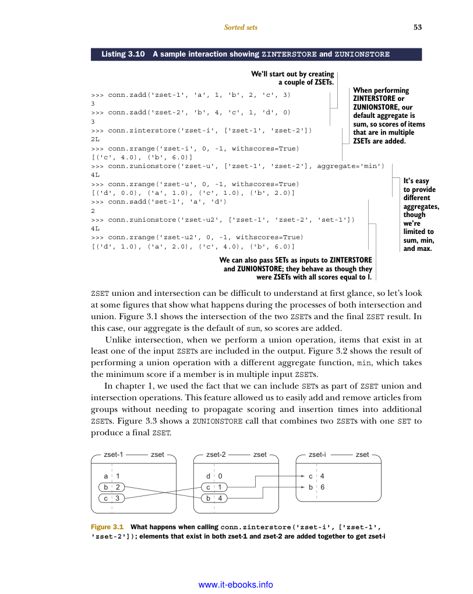
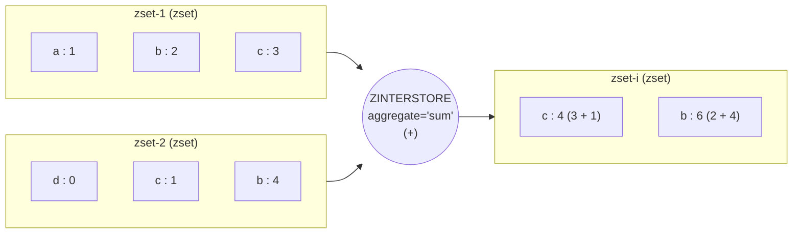
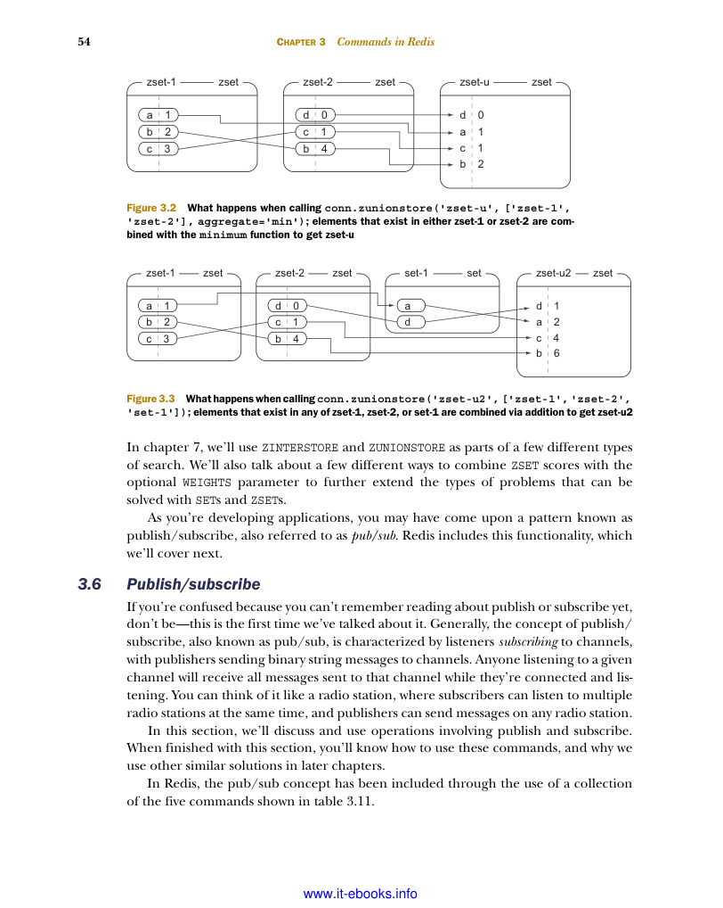
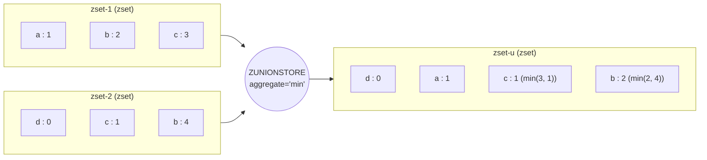
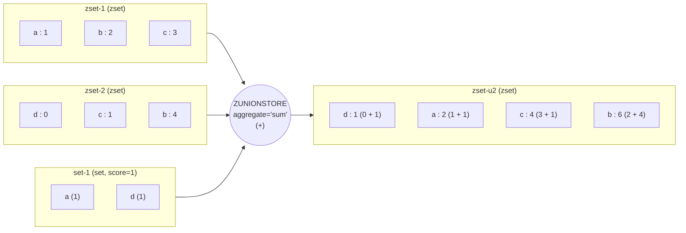

# Phần 2: Các khái niệm cốt lõi (Part 2: Core concepts)

Xuyên suốt một vài chương tiếp theo, chúng ta sẽ đi sâu vào các lệnh tiêu chuẩn của Redis, cách chúng thao tác với dữ liệu, cũng như cách cấu hình Redis. Ở những chương sau đó, chúng ta sẽ xây dựng các mảnh ghép công cụ hỗ trợ và ứng dụng ngày càng hoàn chỉnh hơn, cho đến khi cuối cùng xây dựng được một mạng xã hội đơn giản hoàn toàn bên trong Redis.

---

# Chương 3: Các lệnh trong Redis (Chapter 3: Commands in Redis)

> **Nội dung chương này (This chapter covers)**
> - Các lệnh làm việc với chuỗi (String), danh sách (List) và tập hợp (Set)
> - Các lệnh làm việc với bảng băm (Hash) và tập hợp có thứ tự (Sorted Set)
> - Các lệnh xuất bản/đăng ký (Publish/Subscribe)
> - Các lệnh khác (Sắp xếp, giao dịch cơ bản, và hết hạn khóa)

Trong chương này, chúng ta sẽ chủ yếu tìm hiểu những lệnh chưa được đề cập ở Chương 1 và Chương 2. Bằng cách tìm hiểu về Redis thông qua hệ thống lệnh của nó, bạn sẽ có thể phát triển thêm từ các ví dụ được cung cấp và hiểu rõ hơn cách giải quyết những bài toán thực tế của riêng mình. Nếu bạn đang tìm kiếm những ví dụ ngắn gọn nhưng mang tính ứng dụng cao hơn các tương tác đơn giản mà tôi trình bày ở đây, bạn có thể xem lại một số ví dụ trong Chương 2.

Các lệnh được làm nổi bật trong chương này được phân chia theo cấu trúc dữ liệu hoặc khái niệm, và được lựa chọn vì chúng chiếm đến 95% hoặc nhiều hơn các lời gọi Redis điển hình trong nhiều loại ứng dụng khác nhau. Các ví dụ đều là những tương tác trực tiếp trên giao diện dòng lệnh (console), tương tự như cách tôi đã giới thiệu từng cấu trúc dữ liệu trong Chương 1. Ở những nơi phù hợp, tôi sẽ tham chiếu đến các mục trước đó hoặc các mục ở những chương sau có sử dụng những lệnh này.

Trong mục dành riêng cho từng kiểu dữ liệu khác nhau, tôi sẽ trình bày các lệnh đặc trưng của từng cấu trúc, tập trung chủ yếu vào những điểm làm nên sự khác biệt của các cấu trúc và tập lệnh đó. Hãy bắt đầu bằng việc khám phá xem kiểu `STRING` trong Redis mang lại những gì vượt xa hai thao tác `GET` và `SET` cơ bản.

> [!NOTE]
> **TÀI LIỆU BỔ SUNG CHO CÁC LỆNH KHÔNG ĐƯỢC ĐỀ CẬP (ADDITIONAL DOCUMENTATION FOR COMMANDS NOT COVERED)**
> Trong chương này, tôi chỉ trình bày những lệnh được sử dụng phổ biến nhất hoặc những lệnh mà chúng ta sẽ dùng ở các chương sau. Nếu bạn cần một tài liệu tham khảo đầy đủ về toàn bộ các lệnh và hướng dẫn chi tiết của chúng, bạn có thể truy cập http://redis.io/commands.

> [!NOTE]
> **REDIS 2.4 VÀ 2.6 (REDIS 2.4 AND 2.6)**
> Như đã đề cập trong Phụ lục A, tại thời điểm viết cuốn sách này, các phiên bản biên dịch sẵn (precompiled) của Redis dành cho Windows thuộc nhánh 2.4. Trong chương này và các chương khác, chúng ta sử dụng những tính năng chỉ có từ Redis 2.6 trở lên. Những điểm khác biệt chính giữa Redis 2.4 và 2.6 bao gồm (nhưng không giới hạn ở): kịch bản Lua — Lua scripting (chúng ta sẽ thảo luận trong Chương 11), độ chính xác tới cấp độ mili-giây cho thời gian hết hạn khóa (`PTTL`, `PEXPIRE`, và `PEXPIREAT`, được mô tả trong chương này), một số thao tác trên bit (`BITOP` và `BITCOUNT`), và việc một số lệnh hiện đã nhận nhiều đối số cùng lúc trong khi trước đây chỉ nhận một đối số duy nhất (`RPUSH`, `LPUSH`, `SADD`, `SREM`, `HDEL`, `ZADD`, và `ZREM`).

> 📝 **Giải thích thêm (không có trong sách):**
> Trong các phiên bản Redis hiện đại (Redis 6, 7, 8) và thư viện Python `redis-py` hiện nay (v4.x / v5.x), toàn bộ các tính năng của Redis 2.6 đều đã trở thành tiêu chuẩn từ lâu. Tuy nhiên, có một số thay đổi quan trọng về mặt cú pháp trong thư viện `redis-py` hiện đại so với phiên bản `redis-py` 2.x dùng trong sách:
> 1. **Lớp kết nối `Redis` và `StrictRedis`**: Trong `redis-py` 2.x (thời điểm sách viết), `redis.Redis()` giữ một số hành vi tương thích ngược cũ (như đảo ngược thứ tự `member, score` trong `zadd`, hay đổi thứ tự đối số của `lrem`, `setex`), còn `redis.StrictRedis()` tuân thủ chuẩn lệnh Redis gốc. Từ `redis-py` 3.0 trở đi, `redis.Redis` và `redis.StrictRedis` đã được hợp nhất thành một (theo chuẩn `StrictRedis`).
> 2. **Kiểu trả về trong Python 3**: Mặc định `redis.Redis()` trả về kiểu `bytes` (ví dụ `b'11'`) thay vì `str` như trong Python 2. Để nhận chuỗi `str` tự động trong Python 3, bạn có thể khởi tạo `conn = redis.Redis(decode_responses=True)`.

---

## 3.1 Chuỗi — Strings (Strings)

Bạn hẳn còn nhớ từ Chương 1 và Chương 2 rằng kiểu `STRING` lưu trữ các chuỗi byte (sequences of bytes), không khác biệt nhiều so với kiểu chuỗi trong nhiều ngôn ngữ lập trình, hoặc thậm chí là mảng ký tự (`char` arrays) theo phong cách C/C++. Trong Redis, `STRING` được sử dụng để lưu trữ ba loại giá trị:

- Giá trị chuỗi byte (Byte string values)
- Giá trị số nguyên (Integer values)
- Giá trị số thực dấu phẩy động (Floating-point values)

Các số nguyên và số thực dấu phẩy động có thể được tăng (increment) hoặc giảm (decrement) theo một giá trị số tùy ý (số nguyên sẽ tự động chuyển thành số thực dấu phẩy động khi cần thiết). Số nguyên có phạm vi giá trị tương đương với phạm vi số nguyên dài (`long` integer) của nền tảng hệ thống (số nguyên có dấu 32-bit trên nền tảng 32-bit, và số nguyên có dấu 64-bit trên nền tảng 64-bit), còn số thực dấu phẩy động có phạm vi và giá trị giới hạn theo chuẩn số thực độ chính xác kép IEEE 754 (`double`). Khả năng nhìn nhận giá trị đơn giản nhất của Redis theo ba cách này mang lại một lợi thế lớn; nó cung cấp sự linh hoạt trong việc biểu diễn dữ liệu cao hơn nhiều so với việc chỉ cho phép các giá trị chuỗi byte thuần túy.

Trong mục này, chúng ta sẽ nói về cấu trúc đơn giản nhất hiện có trong Redis: `STRING`. Chúng ta sẽ tìm hiểu các thao tác tăng và giảm số học cơ bản, tiếp theo sau đó là các lời gọi thao tác trên bit và chuỗi con (substring), và bạn sẽ nhận ra rằng ngay cả cấu trúc đơn giản nhất này cũng ẩn chứa vài điều bất ngờ giúp nó trở nên hữu ích theo nhiều cách đầy sức mạnh.

Trong **Bảng 3.1**, bạn có thể thấy các thao tác tăng/giảm số nguyên và số thực hiện có trên kiểu `STRING` của Redis.

**Bảng 3.1 – Các lệnh tăng và giảm trong Redis (Table 3.1 Increment and decrement commands in Redis)**

| Lệnh (Command) | Ví dụ sử dụng và mô tả (Example use and description) |
| :--- | :--- |
| `INCR` | `INCR key-name` — Tăng giá trị được lưu tại khóa lên 1 |
| `DECR` | `DECR key-name` — Giảm giá trị được lưu tại khóa đi 1 |
| `INCRBY` | `INCRBY key-name amount` — Tăng giá trị được lưu tại khóa thêm một lượng số nguyên được cung cấp |
| `DECRBY` | `DECRBY key-name amount` — Giảm giá trị được lưu tại khóa đi một lượng số nguyên được cung cấp |
| `INCRBYFLOAT` | `INCRBYFLOAT key-name amount` — Tăng giá trị được lưu tại khóa thêm một lượng số thực dấu phẩy động được cung cấp (có sẵn từ Redis 2.6 trở lên) |

Khi thiết lập một giá trị `STRING` trong Redis, nếu giá trị đó có thể được diễn giải dưới dạng một số nguyên hệ cơ số 10 hoặc một giá trị số thực dấu phẩy động, Redis sẽ phát hiện ra điều này và cho phép bạn thao tác trên giá trị đó bằng các lệnh `INCR*` và `DECR*` khác nhau. Nếu bạn cố gắng tăng hoặc giảm một khóa không tồn tại hoặc đang chứa một chuỗi rỗng, Redis sẽ xử lý như thể giá trị của khóa đó đang bằng `0`. Nếu bạn cố gắng tăng hoặc giảm một khóa có giá trị không thể diễn giải thành số nguyên hay số thực, bạn sẽ nhận được một thông báo lỗi. Trong đoạn mã dưới đây, bạn có thể xem một số tương tác với các lệnh này.

**Listing 3.1 – Một tương tác mẫu minh họa các thao tác INCR và DECR trong Redis (Listing 3.1 A sample interaction showing INCR and DECR operations in Redis)**

```python
>>> conn = redis.Redis()
>>> conn.get('key')             # 1
>>> conn.incr('key')            # 2
1
>>> conn.incr('key', 15)        # 2
16
>>> conn.decr('key', 5)         # 3
11
>>> conn.get('key')             # 4
'11'
>>> conn.set('key', '13')       # 5
True
>>> conn.incr('key')            # 5
14
```

1. Khi chúng ta lấy một khóa không tồn tại, chúng ta nhận được giá trị `None` (giá trị này không hiển thị trên giao diện console tương tác của Python).
2. Chúng ta có thể tăng các khóa chưa tồn tại, và có thể truyền thêm một giá trị tùy chọn để tăng nhiều hơn 1 đơn vị.
3. Giống như khi tăng, thao tác giảm cũng nhận một đối số tùy chọn chỉ định lượng giá trị cần giảm đi.
4. Khi chúng ta lấy giá trị của khóa ra, nó hoạt động giống như một chuỗi ký tự (`'11'`).
5. Khi thiết lập khóa, chúng ta có thể gán nó dưới dạng một chuỗi (`'13'`), nhưng vẫn thao tác được với nó như một số nguyên.

Sau khi đọc các chương khác, bạn có thể nhận thấy rằng chúng ta thực chất chỉ toàn gọi hàm `incr()`. Ở bên trong, thư viện Redis của Python sẽ gọi lệnh `INCRBY` với giá trị thứ hai tùy chọn được truyền vào, hoặc truyền `1` nếu giá trị đó bị lược bỏ. Tại thời điểm viết sách này, thư viện Redis client cho Python hỗ trợ đầy đủ tập lệnh của Redis 2.6, và cung cấp hỗ trợ cho `INCRBYFLOAT` thông qua phương thức `incrbyfloat()` hoạt động tương tự như `incr()`.

Ngoài ra, Redis còn cung cấp các phương thức để đọc và ghi từng phần của giá trị chuỗi byte (các giá trị số nguyên và số thực cũng có thể được truy cập như thể chúng là chuỗi byte, mặc dù cách dùng đó khá hiếm gặp). Tính năng này có thể rất hữu ích nếu chúng ta dùng giá trị `STRING` của Redis để đóng gói dữ liệu có cấu trúc (pack structured data) một cách tiết kiệm bộ nhớ, chủ đề mà chúng ta sẽ bàn tới trong Chương 9. **Bảng 3.2** liệt kê một số phương thức có thể dùng để thao tác với chuỗi con (substring) và từng bit riêng lẻ của `STRING` trong Redis.

**Bảng 3.2 – Các lệnh thao tác chuỗi con có sẵn trong Redis (Table 3.2 Substring manipulation commands available to Redis)**

| Lệnh (Command) | Ví dụ sử dụng và mô tả (Example use and description) |
| :--- | :--- |
| `APPEND` | `APPEND key-name value` — Nối giá trị được cung cấp vào cuối chuỗi hiện đang được lưu tại khóa chỉ định |
| `GETRANGE` | `GETRANGE key-name start end` — Lấy chuỗi con, bao gồm tất cả các ký tự từ vị trí độ lệch `start` đến vị trí `end` (bao gồm cả hai đầu mút - inclusive) |
| `SETRANGE` | `SETRANGE key-name offset value` — Ghi đè chuỗi con bắt đầu tại vị trí độ lệch (`offset`) được cung cấp bằng giá trị mới |
| `GETBIT` | `GETBIT key-name offset` — Coi chuỗi byte như một chuỗi bit, và trả về giá trị của bit (`0` hoặc `1`) trong chuỗi tại vị trí độ lệch bit được cung cấp |
| `SETBIT` | `SETBIT key-name offset value` — Coi chuỗi byte như một chuỗi bit, và thiết lập giá trị của bit trong chuỗi tại vị trí độ lệch bit được cung cấp |
| `BITCOUNT` | `BITCOUNT key-name [start end]` — Đếm số lượng bit có giá trị `1` trong chuỗi, với tùy chọn bắt đầu và kết thúc tại các vị trí độ lệch byte (`byte offsets`) được cung cấp |
| `BITOP` | `BITOP operation dest-key key-name [key-name ...]` — Thực hiện một trong các phép toán trên bit (`AND`, `OR`, `XOR`, hoặc `NOT`) trên các chuỗi được cung cấp, rồi lưu kết quả vào khóa đích (`dest-key`) |

> [!NOTE]
> **GETRANGE VÀ SUBSTR (GETRANGE AND SUBSTR)**
> Trước đây, lệnh `GETRANGE` từng có tên là `SUBSTR`, và thư viện Python client vẫn tiếp tục giữ tên phương thức `substr()` để lấy các khoảng ký tự từ chuỗi. Khi sử dụng phiên bản Redis từ 2.6 trở lên, bạn nên dùng phương thức `getrange()`, và chỉ dùng `substr()` cho các phiên bản Redis trước 2.6.

Khi ghi vào chuỗi bằng `SETRANGE` và `SETBIT`, nếu `STRING` trước đó chưa đủ dài, Redis sẽ tự động mở rộng `STRING` bằng các byte rỗng (`null` / `\x00`) trước khi cập nhật và ghi dữ liệu mới vào. Khi đọc `STRING` bằng `GETRANGE`, bất kỳ yêu cầu lấy dữ liệu nào vượt quá điểm cuối của `STRING` sẽ không được trả về (chỉ trả về đến hết chuỗi hiện có), nhưng khi đọc bit bằng `GETBIT`, bất kỳ bit nào nằm ngoài độ dài hiện tại của `STRING` đều được coi là bằng `0`. Trong đoạn mã dưới đây, bạn có thể thấy một số cách sử dụng các lệnh thao tác `STRING` này.

**Listing 3.2 – Một tương tác mẫu minh họa các thao tác chuỗi con và bit trong Redis (Listing 3.2 A sample interaction showing substring and bit operations in Redis)**

```python
>>> conn.append('new-string-key', 'hello ')             # 1
6L                                                      # 2
>>> conn.append('new-string-key', 'world!')
12L
>>> conn.substr('new-string-key', 3, 7)                 # 3
'lo wo'                                                 # 4
>>> conn.setrange('new-string-key', 0, 'H')             # 5
12                                                      # 6
>>> conn.setrange('new-string-key', 6, 'W')
12
>>> conn.get('new-string-key')                          # 7
'Hello World!'                                          # 8
>>> conn.setrange('new-string-key', 11, ', how are you?') # 9
25
>>> conn.get('new-string-key')
'Hello World, how are you?'                             # 10
>>> conn.setbit('another-key', 2, 1)                    # 11
0                                                       # 12
>>> conn.setbit('another-key', 7, 1)                    # 13
0
>>> conn.get('another-key')
'!'                                                     # 14
```

1. Hãy nối chuỗi `'hello '` vào khóa `'new-string-key'` vốn chưa tồn tại trước đó.
2. Khi nối thêm một giá trị, Redis trả về độ dài hiện tại của chuỗi tính đến thời điểm đó.
3. Redis sử dụng cách đánh chỉ mục bắt đầu từ 0 (`0-indexing`), và khi truy cập theo khoảng (range), mặc định sẽ bao gồm cả hai điểm đầu mút (`inclusive`).
4. Chuỗi `'lo wo'` được trích ra từ phần giữa của `'hello world!'`.
5. Hãy thiết lập (ghi đè) một vài khoảng ký tự trong chuỗi.
6. Khi thiết lập một khoảng bên trong chuỗi bằng `setrange`, Redis cũng trả về tổng độ dài hiện tại của chuỗi.
7. Hãy xem bây giờ chúng ta có gì nào!
8. Đúng vậy, chúng ta đã viết hoa chữ `H` và chữ `W`.
9. Với `setrange`, chúng ta có thể thay thế bất kỳ vị trí nào bên trong chuỗi, và chúng ta cũng có thể làm cho chuỗi dài thêm ra.
10. Chúng ta đã thay thế dấu chấm than (`!`) ở vị trí 11 và nối thêm nội dung mới vào cuối chuỗi.
11. Nếu chúng ta ghi vào một bit nằm ngoài kích thước hiện tại của chuỗi, phần mở rộng sẽ được lấp đầy bằng các byte null (`\x00`).
12. Việc thiết lập bit cũng trả về giá trị của bit đó trước khi nó được thay đổi.
13. Nếu bạn muốn giải mã các bit được lưu trong Redis, hãy nhớ rằng độ lệch (`offset`) của bit được tính từ bit bậc cao nhất (most significant bit - MSB) xuống bit bậc thấp nhất (least significant bit - LSB).
14. Chúng ta đã đặt bit thứ 2 và bit thứ 7 thành `1` (tức `00100001` ở hệ nhị phân), kết quả tạo thành ký tự `'!'`, hay mã ASCII 33.

> 📝 **Giải thích thêm (không có trong sách) — Đối chiếu với Redis 6/7/8 & redis-py 5.x hiện đại:**
> Hãy nhìn kỹ cách `SETBIT` đánh số thứ tự bit trong ví dụ trên:
> Một byte gồm 8 bit được đánh chỉ số từ trái sang phải (`offset` từ `0` đến `7`), tương ứng với giá trị lũy thừa giảm dần của 2:
>
> | Bit offset | 0 | 1 | 2 | 3 | 4 | 5 | 6 | 7 |
> | :--- | :---: | :---: | :---: | :---: | :---: | :---: | :---: | :---: |
> | Trọng số ($2^{7-\text{offset}}$) | $2^7 = 128$ | $2^6 = 64$ | $2^5 = 32$ | $2^4 = 16$ | $2^3 = 8$ | $2^2 = 4$ | $2^1 = 2$ | $2^0 = 1$ |
> | Giá trị sau `setbit(..., 2, 1)` và `setbit(..., 7, 1)` | `0` | `0` | `1` | `0` | `0` | `0` | `0` | `1` |
>
> Tổng giá trị byte là $32 + 1 = 33$, chính là ký tự `'!'` trong bảng mã ASCII.
>
> **Bảng đối chiếu các lệnh `STRING` giữa Redis 2.6 (`redis-py` 2.x) và Redis 6/7/8 (`redis-py` 5.x):**
>
> | Thao tác / Nhu cầu | Thời Redis 2.6 + `redis-py` 2.x (trong sách) | Redis 6/7/8 + `redis-py` 5.x hiện đại |
> | :--- | :--- | :--- |
> | **Gán có điều kiện + TTL + lấy giá trị cũ** | Phải dùng rời rạc `SETNX`, `SETEX`, `GETSET` (không thể kết hợp nguyên tử) | `SET key val [NX\|XX] [EX sec\|PX ms\|EXAT ts\|PXAT ms-ts\|KEEPTTL] [GET]` (`conn.set(key, val, nx=True, ex=60, get=True)`) — gộp `SETNX` + `SETEX` + `GETSET` trong 1 lệnh nguyên tử (`GETSET`, `SETNX`, `SETEX`, `PSETEX` được xem là lỗi thời từ Redis 6.2+) |
> | **Đọc kèm đặt/xóa TTL hoặc đọc kèm xóa khóa** | Phải gọi 2 lệnh (`GET` + `EXPIRE` hoặc `GET` + `DEL`) trong pipeline | **`GETEX`** (`conn.getex(key, ex=60)`) và **`GETDEL`** (`conn.getdel(key)`) — ra mắt từ **Redis 6.2+** |
> | **Lấy chuỗi con (Substring)** | `conn.substr(key, start, end)` (tên cũ từ Redis 1.x/2.0) | `conn.getrange(key, start, end)` (`GETRANGE key start end`) |
> | **Tìm chuỗi con chung dài nhất (Diff/LCS)** | Phải tải 2 chuỗi về ứng dụng Python để tự tính | **`LCS key1 key2 [LEN] [IDX] [MINMATCHLEN len] [WITHMATCHLEN]`** (`conn.lcs(key1, key2)`) — ra mắt từ **Redis 7.0+** |
> | **Đếm bit theo đơn vị bit & thao tác trường bit** | `BITCOUNT key [start end]` chỉ tính `start`/`end` theo **byte** | `BITCOUNT key [start end [BYTE \| BIT]]` (**Redis 7.0+** hỗ trợ chỉ mục bit) và **`BITFIELD` / `BITFIELD_RO`** (**Redis 3.2+ / 6.0+**) cho phép đọc/ghi/tăng các số nguyên độ dài bit tùy ý (`u5`, `i12`,...) |
>
> > 💡 **Ví dụ bổ sung (không có trong sách) — Viết lại Listing 3.1 & 3.2 và các lệnh `STRING` mới trên `redis-py` 5.x:**
> > ```python
> > import redis
> >
> > conn = redis.Redis(decode_responses=True)
> >
> > # Listing 3.2 với getrange() chuẩn và các lệnh Redis 6.2+ / 7.0+:
> > conn.delete('new-string-key', 'another-key')
> > conn.append('new-string-key', 'hello ')       # Trả về 6 (int, không còn hậu tố L của Python 2)
> > conn.append('new-string-key', 'world!')       # Trả về 12
> > print(conn.getrange('new-string-key', 3, 7))  # 'lo wo' (thay cho conn.substr)
> >
> > # Gộp SETNX + SETEX + GETSET nguyên tử bằng cờ của SET (Redis 6.2+):
> > old_val = conn.set('lock:item1', 'owner-A', nx=True, ex=30, get=True)
> >
> > # Lấy giá trị và xóa luôn khóa nguyên tử bằng GETDEL (Redis 6.2+):
> > one_time_code = conn.getdel('otp:user:1001')
> >
> > # Tìm chuỗi con chung dài nhất bằng LCS (Redis 7.0+):
> > conn.mset({'dna:1': 'AGTACGTAG', 'dna:2': 'GTCGTACGA'})
> > print(conn.lcs('dna:1', 'dna:2'))             # 'GTACGTA'
> > ```

Trong nhiều cơ sở dữ liệu key-value khác, dữ liệu chỉ được lưu dưới dạng một chuỗi thuần túy mà không có cơ hội nào để thao tác trực tiếp bên trong. Một số cơ sở dữ liệu key-value khác có cho phép bạn nối thêm byte vào đầu (prepend) hoặc vào cuối (append), nhưng Redis là duy nhất ở khả năng đọc và ghi các chuỗi con tại vị trí bất kỳ. Xét trên nhiều khía cạnh, ngay cả khi Redis chỉ cung cấp kiểu `STRING` cùng các phương thức thao tác chuỗi này, Redis vẫn sẽ mạnh mẽ hơn nhiều hệ thống khác; những người dùng sáng tạo có thể kết hợp các lời gọi thao tác chuỗi con và bit cùng với `WATCH`/`MULTI`/`EXEC` (mà chúng ta sẽ giới thiệu ngắn gọn trong mục 3.7.2 và thảo luận sâu rộng trong Chương 4) để xây dựng nên các cấu trúc dữ liệu tùy ý. Trong Chương 9, chúng ta sẽ bàn về việc sử dụng `STRING` để lưu trữ một dạng ánh xạ đơn giản giúp giảm đáng kể lượng bộ nhớ sử dụng trong một số tình huống.

Chỉ cần bỏ thêm chút công sức, chúng ta có thể lưu trữ một số dạng chuỗi phần tử nối tiếp nhau trong `STRING`, nhưng chúng ta sẽ bị giới hạn về các kiểu thao tác có thể thực hiện. Tuy nhiên, nếu sử dụng `LIST`, chúng ta sẽ có một tập lệnh phong phú hơn cùng nhiều cách thức linh hoạt hơn để thao tác với các phần tử trong danh sách.

---

## 3.2 Danh sách — Lists (Lists)

Như bạn có thể còn nhớ từ Chương 1, kiểu `LIST` cho phép bạn đẩy (push) và lấy (pop) các phần tử từ cả hai đầu của một chuỗi danh sách, lấy từng phần tử riêng lẻ, và thực hiện nhiều thao tác khác vốn được kỳ vọng ở một cấu trúc danh sách. Bản thân `LIST` đã rất tuyệt vời để lưu trữ hàng đợi công việc (work queue), danh sách các bài viết vừa xem gần đây, hoặc danh bạ yêu thích.

Trong mục này, chúng ta sẽ nói về `LIST`, cấu trúc lưu trữ một chuỗi có thứ tự các giá trị `STRING`. Chúng ta sẽ tìm hiểu một số lệnh thao tác `LIST` thông dụng nhất để đẩy và lấy phần tử khỏi `LIST`. Sau khi đọc xong mục này, bạn sẽ nắm được cách điều khiển `LIST` bằng những lệnh phổ biến nhất. Hãy bắt đầu bằng cách xem **Bảng 3.3**, nơi liệt kê một số lệnh `LIST` được sử dụng thường xuyên nhất.

**Bảng 3.3 – Một số lệnh LIST thường dùng (Table 3.3 Some commonly used LIST commands)**

| Lệnh (Command) | Ví dụ sử dụng và mô tả (Example use and description) |
| :--- | :--- |
| `RPUSH` | `RPUSH key-name value [value ...]` — Đẩy một hoặc nhiều giá trị vào đầu bên phải (cuối) của danh sách |
| `LPUSH` | `LPUSH key-name value [value ...]` — Đẩy một hoặc nhiều giá trị vào đầu bên trái (đầu) của danh sách |
| `RPOP` | `RPOP key-name` — Xóa và trả về phần tử ngoài cùng bên phải khỏi danh sách |
| `LPOP` | `LPOP key-name` — Xóa và trả về phần tử ngoài cùng bên trái khỏi danh sách |
| `LINDEX` | `LINDEX key-name offset` — Trả về phần tử nằm tại vị trí độ lệch (`offset`) đã cho |
| `LRANGE` | `LRANGE key-name start end` — Trả về các phần tử trong danh sách tại các vị trí từ `start` đến `end` (bao gồm cả hai đầu mút) |
| `LTRIM` | `LTRIM key-name start end` — Cắt gọn danh sách để chỉ giữ lại các phần tử nằm ở chỉ mục từ `start` đến `end` (bao gồm cả hai đầu mút) |

Ngữ nghĩa của các lệnh đẩy phần tử vào `LIST` không có gì đáng ngạc nhiên, và các lệnh lấy phần tử ra cũng vậy. Chúng ta đã điểm qua một vài lệnh trong số này, cùng với cả `LINDEX` và `LRANGE`, ở Chương 1. Đoạn mã tiếp theo minh họa một số cách sử dụng các lệnh đẩy và lấy phần tử này.

**Listing 3.3 – Một tương tác mẫu minh họa các lệnh đẩy (push) và lấy (pop) của LIST trong Redis (Listing 3.3 A sample interaction showing LIST push and pop commands in Redis)**

```python
>>> conn.rpush('list-key', 'last')              # 1
1L
>>> conn.lpush('list-key', 'first')             # 2
2L
>>> conn.rpush('list-key', 'new last')
3L
>>> conn.lrange('list-key', 0, -1)              # 3
['first', 'last', 'new last']
>>> conn.lpop('list-key')                       # 4
'first'
>>> conn.lpop('list-key')
'last'
>>> conn.lrange('list-key', 0, -1)
['new last']
>>> conn.rpush('list-key', 'a', 'b', 'c')       # 5
4L
>>> conn.lrange('list-key', 0, -1)
['new last', 'a', 'b', 'c']
>>> conn.ltrim('list-key', 2, -1)               # 6
True
>>> conn.lrange('list-key', 0, -1)
['b', 'c']
```

1. Khi chúng ta đẩy các phần tử vào danh sách, lệnh sẽ trả về độ dài của danh sách sau khi thao tác đẩy hoàn tất.
2. Chúng ta có thể dễ dàng đẩy phần tử vào cả hai đầu của danh sách.
3. Về mặt ngữ nghĩa, đầu bên trái của danh sách là điểm bắt đầu (đầu danh sách), và đầu bên phải của danh sách là điểm kết thúc (cuối danh sách).
4. Việc lấy (`lpop`) liên tiếp các phần tử ở đầu bên trái sẽ trả về các phần tử theo thứ tự từ trái sang phải.
5. Chúng ta có thể đẩy nhiều phần tử vào cùng một lúc.
6. Chúng ta có thể cắt bỏ (`ltrim`) bất kỳ số lượng phần tử nào từ đầu, từ cuối, hoặc từ cả hai đầu danh sách.

Lệnh `LTRIM` là điểm mới trong ví dụ này, và chúng ta có thể kết hợp nó với `LRANGE` để tạo ra một cơ chế hoạt động rất giống với một lời gọi `LPOP` hoặc `RPOP` nhưng trả về và xóa nhiều phần tử cùng một lúc. Chúng ta sẽ nói kỹ hơn về cách làm cho những nhóm lệnh kết hợp như thế này mang tính nguyên tử (atomic)[^1] ở phần sau của chương này, cũng như đi sâu hơn vào các giao dịch nâng cao theo phong cách Redis trong Chương 4.

[^1]: Trong Redis, khi nói một nhóm các lệnh có tính nguyên tử (*atomic*), chúng ta muốn nói rằng không một client nào khác có thể đọc hoặc thay đổi dữ liệu trong khi chúng ta đang đọc hoặc thay đổi chính dữ liệu đó.

> 📝 **Giải thích thêm (không có trong sách):**
> Từ phiên bản **Redis 6.2** trở đi, hai lệnh `LPOP` và `RPOP` đã được nâng cấp để nhận thêm đối số `count` tùy chọn (`LPOP key [count]` và `RPOP key [count]`), cho phép lấy và xóa nhiều phần tử cùng lúc một cách nguyên tử mà không cần phải ghép `LRANGE` với `LTRIM` nữa! Tuy nhiên, kỹ thuật kết hợp `LRANGE` + `LTRIM` trong giao dịch / pipeline của tác giả vẫn rất đáng học hỏi để hiểu cách xây dựng các thao tác phức tạp trong Redis.

Trong số các lệnh `LIST` mà chúng ta chưa giới thiệu ở Chương 1, có một vài lệnh cho phép bạn di chuyển các phần tử từ danh sách này sang danh sách khác, và thậm chí chặn (block — tạm dừng chờ) trong lúc đợi các client khác thêm phần tử vào `LIST`. **Bảng 3.4** trình bày các lệnh lấy phần tử có chặn (blocking pop) và di chuyển phần tử.

**Bảng 3.4 – Một số lệnh LIST cho thao tác lấy phần tử có chặn (blocking pop) và di chuyển phần tử giữa các LIST (Table 3.4 Some LIST commands for blocking LIST pops and moving items between LISTs)**

| Lệnh (Command) | Ví dụ sử dụng và mô tả (Example use and description) |
| :--- | :--- |
| `BLPOP` | `BLPOP key-name [key-name ...] timeout` — Lấy phần tử ngoài cùng bên trái từ `LIST` không rỗng đầu tiên, hoặc chờ tối đa `timeout` giây cho đến khi có một phần tử xuất hiện |
| `BRPOP` | `BRPOP key-name [key-name ...] timeout` — Lấy phần tử ngoài cùng bên phải từ `LIST` không rỗng đầu tiên, hoặc chờ tối đa `timeout` giây cho đến khi có một phần tử xuất hiện |
| `RPOPLPUSH` | `RPOPLPUSH source-key dest-key` — Lấy phần tử ngoài cùng bên phải từ danh sách nguồn (`source-key`) và thực hiện `LPUSH` đẩy phần tử đó vào đầu bên trái của danh sách đích (`dest-key`), đồng thời trả về phần tử đó cho người dùng |
| `BRPOPLPUSH` | `BRPOPLPUSH source-key dest-key timeout` — Lấy phần tử ngoài cùng bên phải từ danh sách nguồn và `LPUSH` phần tử đó vào danh sách đích, đồng thời trả về phần tử đó cho người dùng, và chờ tối đa `timeout` giây nếu danh sách nguồn đang rỗng |

Nhóm lệnh này đặc biệt hữu ích khi chúng ta thảo luận về hàng đợi (queues) trong Chương 6. Đoạn mã dưới đây minh họa một số ví dụ về việc di chuyển các phần tử bằng `BRPOPLPUSH` và lấy phần tử từ nhiều danh sách bằng `BLPOP`.

**Listing 3.4 – Các lệnh lấy phần tử có chặn và di chuyển phần tử của LIST trong Redis (Listing 3.4 Blocking LIST pop and movement commands in Redis)**

```python
>>> conn.rpush('list', 'item1')                 # 1
1
>>> conn.rpush('list', 'item2')
2
>>> conn.rpush('list2', 'item3')
1
>>> conn.brpoplpush('list2', 'list', 1)         # 2
'item3'
>>> conn.brpoplpush('list2', 'list', 1)         # 3
>>> conn.lrange('list', 0, -1)                  # 4
['item3', 'item1', 'item2']
>>> conn.brpoplpush('list', 'list2', 1)
'item2'
>>> conn.blpop(['list', 'list2'], 1)            # 5
('list', 'item3')
>>> conn.blpop(['list', 'list2'], 1)
('list', 'item1')
>>> conn.blpop(['list', 'list2'], 1)
('list2', 'item2')
>>> conn.blpop(['list', 'list2'], 1)
>>>
```

1. Hãy thêm một vài phần tử vào hai danh sách để bắt đầu.
2. Hãy di chuyển một phần tử từ danh sách này sang danh sách kia, đồng thời trả về phần tử đó.
3. Khi một danh sách bị rỗng, lệnh lấy phần tử có chặn (blocking pop) sẽ tạm dừng chờ trong khoảng thời gian `timeout`, rồi trả về `None` (giá trị này không được hiển thị trong giao diện console tương tác).
4. Chúng ta đã lấy phần tử ngoài cùng bên phải từ `"list2"` và đẩy nó vào đầu bên trái của `"list"`.
5. Việc gọi `blpop` trên nhiều danh sách sẽ kiểm tra các danh sách theo đúng thứ tự mà chúng được truyền vào cho đến khi tìm thấy phần tử hoặc cho đến khi tất cả đều rỗng.

> 📝 **Giải thích thêm (không có trong sách) — Đối chiếu với Redis 6/7/8 & redis-py 5.x hiện đại:**
> Trong Redis 6/7/8 và `redis-py` 5.x, nhóm lệnh `LIST` có những nâng cấp và thay đổi cú pháp cực kỳ quan trọng so với thời điểm viết sách:
>
> | Thao tác / Nhu cầu | Thời Redis 2.6 + `redis-py` 2.x (trong sách) | Redis 6/7/8 + `redis-py` 5.x hiện đại |
> | :--- | :--- | :--- |
> | **Xóa phần tử theo giá trị (`LREM`)** | `conn.lrem(name, value, num=0)` (lớp `redis.Redis` cũ đảo thứ tự `value` trước `num`) | **`conn.lrem(name, count, value)`** — tuân thủ đúng thứ tự lệnh Redis gốc `LREM key count element` (`count` đứng trước `value`) |
> | **Di chuyển phần tử giữa 2 danh sách** | `RPOPLPUSH source dest` và `BRPOPLPUSH source dest timeout` (chỉ hỗ trợ chiều cố định `RIGHT` -> `LEFT`, đã **deprecated từ Redis 6.2+**) | **`LMOVE source destination LEFT\|RIGHT LEFT\|RIGHT`** (`conn.lmove(src, dst, 'RIGHT', 'LEFT')`) và **`BLMOVE`** (`conn.blmove(src, dst, timeout, 'RIGHT', 'LEFT')`) — **Redis 6.2+** |
> | **Lấy nhiều phần tử cùng lúc (Pop multiple)** | Phải kết hợp `LRANGE` + `LTRIM` trong giao dịch `MULTI`/`EXEC` | `LPOP key [count]` / `RPOP key [count]` (**Redis 6.2+**) hoặc **`LMPOP` / `BLMPOP numkeys key [key ...] LEFT\|RIGHT [COUNT count]`** (**Redis 7.0+**) |
> | **Tìm vị trí (index) của phần tử trong `LIST`** | Không có lệnh hỗ trợ (phải tải cả danh sách về bằng `LRANGE` rồi tìm trong Python) | **`LPOS key element [RANK rank] [COUNT num-matches] [MAXLEN len]`** (`conn.lpos(key, element)`) — ra mắt từ **Redis 6.0.6+** |
> | **Thời gian chờ `timeout` của `BLPOP` / `BRPOP` / `BLMOVE`** | Chỉ nhận số nguyên giây (`int`) | Từ **Redis 6.0+**, `timeout` hỗ trợ số thực dấu phẩy động (`float`, ví dụ `0.5` giây) |
>
> > 💡 **Ví dụ bổ sung (không có trong sách) — Sử dụng `lmove`, `blmove`, `lpos`, `lmpop` trong `redis-py` 5.x:**
> > ```python
> > import redis
> >
> > conn = redis.Redis(decode_responses=True)
> > conn.delete('list', 'list2')
> > conn.rpush('list', 'item1', 'item2')
> > conn.rpush('list2', 'item3')
> >
> > # Thay thế brpoplpush('list2', 'list', 1) bằng blmove (Redis 6.2+):
> > moved = conn.blmove('list2', 'list', timeout=1, src='RIGHT', dest='LEFT')
> > print(moved)                        # 'item3'
> > print(conn.lrange('list', 0, -1))   # ['item3', 'item1', 'item2']
> >
> > # Tìm vị trí của phần tử bằng LPOS (Redis 6.0.6+):
> > print(conn.lpos('list', 'item1'))   # 1
> >
> > # Lấy nhiều phần tử từ danh sách không rỗng đầu tiên bằng LMPOP (Redis 7.0+):
> > print(conn.lmpop(2, 'list2', 'list', direction='LEFT', count=2))
> > # ['list', ['item3', 'item1']]
> > ```

Trường hợp sử dụng phổ biến nhất cho các lệnh lấy phần tử có chặn cũng như các lệnh kết hợp lấy/đẩy (pop/push) là trong việc phát triển hệ thống nhắn tin (messaging) và hàng đợi tác vụ (task queues), chủ đề mà chúng ta sẽ tìm hiểu chi tiết trong Chương 6.

> [!TIP]
> **Bài tập: Giảm mức sử dụng bộ nhớ bằng LIST (Exercise: Reducing memory use with LISTs)**
> Quay lại mục 2.1 và 2.5, chúng ta đã sử dụng `ZSET` để lưu danh sách các mặt hàng được xem gần đây. Những mặt hàng được xem gần đây đó bao gồm cả dấu thời gian (timestamp) làm điểm số (score) để cho phép chúng ta thực hiện phân tích dữ liệu (analytics) trong quá trình dọn dẹp hoặc sau khi mua hàng. Nhưng việc lưu kèm các dấu thời gian này tốn thêm dung lượng, và nếu dấu thời gian không thực sự cần thiết cho việc phân tích của chúng ta, thì dùng `ZSET` chỉ gây lãng phí bộ nhớ. Hãy thử thay thế việc sử dụng `ZSET` trong hàm `update_token()` bằng `LIST`, trong khi vẫn giữ nguyên ngữ nghĩa hoạt động. *Gợi ý: Nếu bạn gặp khó khăn, bạn có thể xem trước mục 6.1.1 để có hướng giải quyết đúng đắn.*

> 💡 **Ví dụ bổ sung (không có trong sách) – Gợi ý giải bài tập `update_token()` dùng `LIST`:**
> Trong Chương 2, khi người dùng xem một mặt hàng `item`, chúng ta muốn lưu tối đa 25 mặt hàng xem gần nhất. Nếu thay `ZSET` bằng `LIST`, ta có thể dùng `LREM` để xóa `item` cũ (nếu đã có trong danh sách nhằm tránh trùng lặp), sau đó dùng `LPUSH` đẩy `item` lên đầu danh sách và `LTRIM` để giữ lại đúng 25 phần tử đầu tiên:
> ```python
> def update_token_with_list(conn, token, user, item=None):
>     timestamp = time.time()
>     conn.hset('login:', token, user)
>     conn.zadd('recent:', {token: timestamp})  # Cú pháp redis-py 3.0+
>     if item:
>         key = 'viewed:' + token
>         # Xóa mặt hàng nếu đã tồn tại trong LIST trước đó
>         conn.lrem(key, 0, item)
>         # Đẩy mặt hàng vừa xem vào đầu bên trái của LIST
>         conn.lpush(key, item)
>         # Cắt gọn LIST để chỉ giữ lại 25 mặt hàng mới nhất (từ chỉ mục 0 đến 24)
>         conn.ltrim(key, 0, 24)
>         conn.zincrby('viewed:', -1, item)
> ```

Một trong những lợi ích chính của `LIST` là chúng có thể chứa nhiều giá trị chuỗi, cho phép bạn gom nhóm dữ liệu lại với nhau. Kiểu `SET` cũng cung cấp một tính năng tương tự, nhưng với một điều kiện quan trọng là tất cả các phần tử trong một `SET` nhất định đều là duy nhất (không trùng lặp). Hãy cùng xem đặc điểm đó làm thay đổi những gì chúng ta có thể làm với `SET` như thế nào.

---

## 3.3 Tập hợp — Sets (Sets)

Bạn hẳn còn nhớ từ Chương 1 rằng kiểu `SET` lưu trữ các phần tử duy nhất theo cách không có thứ tự (unordered). Bạn có thể nhanh chóng thêm, xóa, và kiểm tra xem một phần tử có nằm trong `SET` hay không. Trong số rất nhiều ứng dụng của `SET`, có thể kể đến việc lưu trữ danh sách những người đã bình chọn cho một bài viết và những bài viết nào thuộc về một nhóm cụ thể, như đã thấy ở Chương 1.

Trong mục này, chúng ta sẽ thảo luận về một số lệnh được sử dụng thường xuyên nhất khi thao tác trên `SET`. Bạn sẽ tìm hiểu về các thao tác chuẩn để chèn, xóa, và di chuyển các thành viên giữa các `SET`, cũng như các lệnh thực hiện phép giao (intersection), phép hợp (union), và phép hiệu (difference) trên các `SET`. Khi hoàn thành mục này, bạn sẽ có sự chuẩn bị tốt hơn để hiểu trọn vẹn cách hoạt động của các ví dụ tìm kiếm trong Chương 7.

Hãy cùng xem **Bảng 3.5** để điểm qua một số lệnh làm việc với tập hợp (`SET`) thường dùng hơn cả.

**Bảng 3.5 – Một số lệnh SET thường dùng (Table 3.5 Some commonly used SET commands)**

| Lệnh (Command) | Ví dụ sử dụng và mô tả (Example use and description) |
| :--- | :--- |
| `SADD` | `SADD key-name item [item ...]` — Thêm các phần tử vào tập hợp và trả về số lượng phần tử thực sự được thêm mới (chưa từng có mặt trước đó) |
| `SREM` | `SREM key-name item [item ...]` — Xóa các phần tử khỏi tập hợp và trả về số lượng phần tử đã bị xóa |
| `SISMEMBER` | `SISMEMBER key-name item` — Trả về kết quả cho biết phần tử có nằm trong `SET` hay không |
| `SCARD` | `SCARD key-name` — Trả về số lượng phần tử hiện có trong `SET` (lực lượng của tập hợp - cardinality) |
| `SMEMBERS` | `SMEMBERS key-name` — Trả về tất cả các phần tử trong `SET` dưới dạng một kiểu `set` của Python |
| `SRANDMEMBER` | `SRANDMEMBER key-name [count]` — Trả về một hoặc nhiều phần tử ngẫu nhiên từ `SET`. Khi `count` là số dương, Redis sẽ trả về `count` phần tử ngẫu nhiên phân biệt (không trùng nhau), và khi `count` là số âm, Redis sẽ trả về `|count|` phần tử được chọn ngẫu nhiên nhưng có thể trùng lặp nhau. |
| `SPOP` | `SPOP key-name` — Xóa và trả về một phần tử ngẫu nhiên từ `SET` |
| `SMOVE` | `SMOVE source-key dest-key item` — Nếu phần tử có mặt trong tập nguồn (`source-key`), xóa phần tử đó khỏi tập nguồn và thêm nó vào tập đích (`dest-key`), trả về kết quả cho biết phần tử có được di chuyển thành công hay không |

Một số lệnh trong bảng trên hẳn đã quen thuộc với bạn từ Chương 1, vì vậy hãy chuyển ngay sang đoạn mã tiếp theo để xem các lệnh này hoạt động trong thực tế.

**Listing 3.5 – Một tương tác mẫu minh họa một số lệnh SET phổ biến trong Redis (Listing 3.5 A sample interaction showing some common SET commands in Redis)**

```python
>>> conn.sadd('set-key', 'a', 'b', 'c')         # 1
3
>>> conn.srem('set-key', 'c', 'd')              # 2
True
>>> conn.srem('set-key', 'c', 'd')              # 2
False
>>> conn.scard('set-key')                       # 3
2
>>> conn.smembers('set-key')                    # 4
set(['a', 'b'])
>>> conn.smove('set-key', 'set-key2', 'a')      # 5
True
>>> conn.smove('set-key', 'set-key2', 'c')      # 6
False
>>> conn.smembers('set-key2')
set(['a'])
```

1. Việc thêm các phần tử vào `SET` sẽ trả về số lượng phần tử trước đó chưa có mặt trong `SET`.
2. Việc xóa các phần tử khỏi `SET` trả về giá trị cho biết có phần tử nào được xóa hay không; lưu ý rằng thư viện Python client thời điểm đó có một lỗi nhỏ ở điểm này (khi dùng lớp `Redis` cũ nó ép kiểu kết quả sang `bool` `True`/`False`) — bản thân máy chủ Redis thực chất trả về tổng số lượng phần tử đã bị xóa (số nguyên).
3. Chúng ta có thể lấy số lượng phần tử hiện có trong `SET`.
4. Chúng ta cũng có thể lấy toàn bộ các thành viên của `SET`.
5. Chúng ta có thể dễ dàng di chuyển các phần tử từ một `SET` này sang một `SET` khác.
6. Khi một phần tử không tồn tại trong tập hợp đầu tiên trong quá trình gọi `SMOVE`, nó sẽ không được thêm vào `SET` đích.

Chỉ cần sử dụng những lệnh này, chúng ta đã có thể theo dõi các sự kiện và phần tử duy nhất giống như cách chúng ta đã làm trong Chương 1 với tính năng bình chọn và phân nhóm bài viết. Nhưng sức mạnh thực sự của `SET` nằm ở những lệnh kết hợp nhiều `SET` cùng một lúc. **Bảng 3.6** trình bày một số cách giúp bạn liên kết nhiều `SET` lại với nhau.

**Bảng 3.6 – Các thao tác kết hợp và xử lý nhiều SET trong Redis (Table 3.6 Operations for combining and manipulating SETs in Redis)**

| Lệnh (Command) | Ví dụ sử dụng và mô tả (Example use and description) |
| :--- | :--- |
| `SDIFF` | `SDIFF key-name [key-name ...]` — Trả về các phần tử có trong `SET` đầu tiên nhưng không nằm trong bất kỳ `SET` nào khác được liệt kê theo sau (phép hiệu tập hợp trong toán học) |
| `SDIFFSTORE` | `SDIFFSTORE dest-key key-name [key-name ...]` — Lưu vào khóa đích (`dest-key`) các phần tử có trong `SET` đầu tiên nhưng không nằm trong bất kỳ `SET` nào khác (phép hiệu tập hợp trong toán học) |
| `SINTER` | `SINTER key-name [key-name ...]` — Trả về các phần tử cùng có mặt trong tất cả các `SET` được truyền vào (phép giao tập hợp trong toán học) |
| `SINTERSTORE` | `SINTERSTORE dest-key key-name [key-name ...]` — Lưu vào khóa đích (`dest-key`) các phần tử cùng có mặt trong tất cả các `SET` (phép giao tập hợp trong toán học) |
| `SUNION` | `SUNION key-name [key-name ...]` — Trả về các phần tử có mặt trong ít nhất một trong số các `SET` được truyền vào (phép hợp tập hợp trong toán học) |
| `SUNIONSTORE` | `SUNIONSTORE dest-key key-name [key-name ...]` — Lưu vào khóa đích (`dest-key`) các phần tử có mặt trong ít nhất một trong số các `SET` (phép hợp tập hợp trong toán học) |

Nhóm lệnh này đại diện cho ba phép toán tập hợp nền tảng, với cả hai phiên bản "trả về kết quả trực tiếp" và "lưu kết quả vào khóa mới". Hãy xem một ví dụ mẫu về những gì các lệnh này có thể làm được.

**Listing 3.6 – Một tương tác mẫu minh họa phép hiệu, giao và hợp của SET trong Redis (Listing 3.6 A sample interaction showing SET difference, intersection, and union in Redis)**

```python
>>> conn.sadd('skey1', 'a', 'b', 'c', 'd')      # 1
4
>>> conn.sadd('skey2', 'c', 'd', 'e', 'f')      # 1
4
>>> conn.sdiff('skey1', 'skey2')                # 2
set(['a', 'b'])
>>> conn.sinter('skey1', 'skey2')               # 3
set(['c', 'd'])
>>> conn.sunion('skey1', 'skey2')               # 4
set(['a', 'c', 'b', 'e', 'd', 'f'])
```

1. Trước tiên chúng ta sẽ thêm một vài phần tử vào hai `SET`.
2. Chúng ta có thể tính toán kết quả của việc loại bỏ tất cả các phần tử thuộc `SET` thứ hai ra khỏi `SET` thứ nhất (`sdiff`).
3. Chúng ta cũng có thể tìm ra những phần tử nào cùng tồn tại trong cả hai `SET` (`sinter`).
4. Và chúng ta có thể tìm ra tất cả các phần tử tồn tại trong ít nhất một trong hai `SET` (`sunion`).

Nếu đem so sánh với kiểu `set` của Python, `SET` trong Redis cung cấp nhiều ngữ nghĩa và chức năng tương đương, nhưng lại có thể truy cập từ xa bởi hàng loạt client cùng lúc. Chúng ta sẽ đào sâu hơn nữa vào những gì `SET` có thể làm được trong Chương 7, nơi chúng ta xây dựng một dạng công cụ tìm kiếm (search engine) bằng chính cấu trúc này.

> 📝 **Giải thích thêm (không có trong sách) — Đối chiếu với Redis 6/7/8 & redis-py 5.x hiện đại:**
> Trong các phiên bản Redis mới hơn và `redis-py` 5.x, tập lệnh `SET` đã được bổ sung thêm nhiều cải tiến lớn về hiệu năng và chuẩn hóa kiểu trả về:
>
> | Thao tác / Nhu cầu | Thời Redis 2.6 + `redis-py` 2.x (trong sách) | Redis 6/7/8 + `redis-py` 5.x hiện đại |
> | :--- | :--- | :--- |
> | **Kiểu trả về của `conn.srem()`** | Trả về `bool` (`True`/`False` trong lớp `redis.Redis` cũ của `redis-py` 2.x như ở Listing 3.5) | Trả về **`int`** (số lượng phần tử thực tế đã bị xóa khỏi `SET`, ví dụ `1`, `0`) |
> | **Lấy và xóa ngẫu nhiên nhiều phần tử** | `SPOP key` chỉ lấy được **1** phần tử duy nhất mỗi lần gọi | **`SPOP key [count]`** (`conn.spop(key, count=3)`) — lấy và xóa ngẫu nhiên nhiều phần tử cùng lúc (**Redis 3.2+**) |
> | **Kiểm tra nhiều phần tử thuộc `SET` cùng lúc** | Phải gọi `SISMEMBER` nhiều lần (hoặc bọc trong pipeline) | **`SMISMEMBER key member [member ...]`** (`conn.smismember(key, ['a', 'b', 'z'])` $\rightarrow$ `[1, 1, 0]`) — ra mắt từ **Redis 6.2+** |
> | **Đếm số phần tử giao nhau của nhiều `SET`** | Phải gọi `SINTER` (tốn băng thông mạng) hoặc `SINTERSTORE` + `SCARD` (tốn RAM ghi khóa tạm) | **`SINTERCARD numkeys key [key ...] [LIMIT limit]`** (`conn.sintercard(2, ['skey1', 'skey2'], limit=100)`) — chỉ đếm lực lượng tập giao ngay trên server và hỗ trợ dừng sớm khi chạm ngưỡng `LIMIT` (**Redis 7.0+**) |
> | **Duyệt `SET` kích thước lớn an toàn** | `SMEMBERS key` (chặn luồng chính của Redis nếu `SET` có hàng triệu phần tử) | **`SSCAN key cursor [MATCH pattern] [COUNT count]`** (`conn.sscan_iter(key)`) — duyệt từng lô không chặn server (**Redis 2.8+**) |
>
> > 💡 **Ví dụ bổ sung (không có trong sách) — Sử dụng `smismember`, `sintercard`, `spop(count)` và `sscan_iter` trong `redis-py` 5.x:**
> > ```python
> > import redis
> >
> > conn = redis.Redis(decode_responses=True)
> > conn.delete('skey1', 'skey2')
> > conn.sadd('skey1', 'a', 'b', 'c', 'd')
> > conn.sadd('skey2', 'c', 'd', 'e', 'f')
> >
> > # Kiểm tra nhiều phần tử cùng lúc bằng SMISMEMBER (Redis 6.2+):
> > print(conn.smismember('skey1', ['a', 'c', 'x']))  # [1, 1, 0]
> >
> > # Đếm nhanh số phần tử giao nhau mà không tạo tập kết quả bằng SINTERCARD (Redis 7.0+):
> > print(conn.sintercard(2, ['skey1', 'skey2']))     # 2 (gồm 'c' và 'd')
> >
> > # Duyệt tập hợp lớn an toàn bằng iterator SSCAN thay cho SMEMBERS:
> > for member in conn.sscan_iter('skey1', match='*', count=100):
> >     pass
> > ```

Tiếp theo đây, chúng ta sẽ nói về các lệnh thao tác với `HASH`, cấu trúc cho phép chúng ta gom nhóm các cặp khóa-giá trị (key-value) có liên quan lại với nhau để lấy và cập nhật một cách dễ dàng.

---

## 3.4 Bảng băm — Hashes (Hashes)

Như đã giới thiệu trong Chương 1, kiểu `HASH` trong Redis cho phép bạn lưu trữ các nhóm cặp khóa-giá trị (key-value pairs / field-value pairs) bên trong một khóa Redis cấp cao hơn duy nhất. Về mặt chức năng, các giá trị trong `HASH` cung cấp một số tính năng tương tự như các giá trị trong `STRING` và rất hữu ích để gom nhóm các dữ liệu có liên quan lại với nhau. Cách gom nhóm dữ liệu này có thể được hình dung tương tự như một dòng (row) trong cơ sở dữ liệu quan hệ hoặc một tài liệu (document) trong hệ quản trị cơ sở dữ liệu hướng tài liệu (document store).

Trong mục này, chúng ta sẽ nói về các lệnh được sử dụng phổ biến nhất để thao tác với `HASH`. Bạn sẽ tìm hiểu thêm về các thao tác thêm và xóa các cặp khóa-giá trị đối với `HASH`, cũng như các lệnh lấy toàn bộ nội dung của `HASH` cùng với khả năng tăng hoặc giảm giá trị số bên trong trường. Khi hoàn thành mục này, bạn sẽ hiểu rõ hơn về tính hữu dụng của việc lưu trữ dữ liệu trong `HASH` cũng như cách thức thực hiện điều đó. Hãy xem **Bảng 3.7** để biết một số lệnh `HASH` thường dùng.

**Bảng 3.7 – Các thao tác thêm và xóa phần tử khỏi HASH (Table 3.7 Operations for adding and removing items from HASHes)**

| Lệnh (Command) | Ví dụ sử dụng và mô tả (Example use and description) |
| :--- | :--- |
| `HMGET` | `HMGET key-name key [key ...]` — Lấy các giá trị tại một hoặc nhiều trường (`key`) bên trong `HASH` |
| `HMSET` | `HMSET key-name key value [key value ...]` — Thiết lập giá trị cho một hoặc nhiều trường (`key`) bên trong `HASH` |
| `HDEL` | `HDEL key-name key [key ...]` — Xóa một hoặc nhiều cặp khóa-giá trị trong `HASH`, trả về số lượng cặp đã được tìm thấy và xóa đi |
| `HLEN` | `HLEN key-name` — Trả về số lượng cặp khóa-giá trị hiện có trong `HASH` |

Một số lệnh trong bảng trên hẳn đã quen thuộc từ Chương 1, nhưng chúng ta có thêm một vài lệnh mới để lấy và thiết lập nhiều trường (fields/keys) cùng một lúc. Những lệnh thao tác hàng loạt (bulk commands) này chủ yếu nhằm mang lại sự tiện lợi và cải thiện hiệu năng của Redis bằng cách giảm số lượng lời gọi hàm cũng như số vòng truyền nhận mạng (round trips) giữa client và Redis. Hãy xem đoạn mã tiếp theo để thấy một số lệnh hoạt động trong thực tế.

**Listing 3.7 – Một tương tác mẫu minh họa một số lệnh HASH phổ biến trong Redis (Listing 3.7 A sample interaction showing some common HASH commands in Redis)**

```python
>>> conn.hmset('hash-key', {'k1':'v1', 'k2':'v2', 'k3':'v3'})   # 1
True
>>> conn.hmget('hash-key', ['k2', 'k3'])                        # 2
['v2', 'v3']
>>> conn.hlen('hash-key')                                       # 3
3
>>> conn.hdel('hash-key', 'k1', 'k3')                           # 4
True
```

1. Chúng ta có thể thêm nhiều phần tử (cặp trường-giá trị) vào bảng băm chỉ trong một lời gọi duy nhất.
2. Chúng ta có thể lấy một tập con các giá trị chỉ trong một lời gọi duy nhất.
3. Lệnh `HLEN` thường được sử dụng để gỡ lỗi (debug) các `HASH` có kích thước rất lớn.
4. Lệnh `HDEL` xử lý được nhiều đối số cùng lúc mà không cần phải có một lệnh `HMDEL` riêng biệt, và trả về `True` (hoặc số lượng trường đã xóa trong `redis-py` mới) nếu có bất kỳ trường nào được xóa bỏ.

Các lệnh `HMGET`/`HMSET` tương tự như các phiên bản đơn đối số (`HGET`/`HSET`) mà chúng ta đã giới thiệu ở Chương 1, chỉ khác ở chỗ chúng nhận một danh sách (`list`) hoặc từ điển (`dict`) làm đối số thay vì các mục đơn lẻ.

> 📝 **Giải thích thêm (không có trong sách):**
> Kể từ **Redis 4.0**, lệnh `HSET` gốc của Redis đã được nâng cấp để nhận nhiều cặp `field value` cùng lúc (`HSET key field value [field value ...]`), khiến lệnh `HMSET` trở nên dư thừa và chính thức bị đánh dấu lỗi thời (deprecated).
> Trong thư viện **`redis-py` 3.0+ / 4.x / 5.x**, phương thức `conn.hmset()` đã bị loại bỏ. Thay vào đó, bạn truyền trực tiếp từ điển vào tham số `mapping` của `conn.hset()`:
> ```python
> # Thay cho conn.hmset('hash-key', {'k1': 'v1', 'k2': 'v2', 'k3': 'v3'})
> conn.hset('hash-key', mapping={'k1': 'v1', 'k2': 'v2', 'k3': 'v3'})
> ```

**Bảng 3.8** trình bày thêm một số lệnh hàng loạt khác và các thao tác mang phong cách giống `STRING` trên `HASH`.

**Bảng 3.8 – Các thao tác hàng loạt khác và các lời gọi giống STRING trên HASH (Table 3.8 More bulk operations and STRING-like calls over HASHes)**

| Lệnh (Command) | Ví dụ sử dụng và mô tả (Example use and description) |
| :--- | :--- |
| `HEXISTS` | `HEXISTS key-name key` — Trả về kết quả cho biết trường (`key`) đã cho có tồn tại trong `HASH` hay không |
| `HKEYS` | `HKEYS key-name` — Lấy danh sách tất cả các tên trường (`keys`) có trong `HASH` |
| `HVALS` | `HVALS key-name` — Lấy danh sách tất cả các giá trị (`values`) có trong `HASH` |
| `HGETALL` | `HGETALL key-name` — Lấy tất cả các cặp khóa-giá trị từ `HASH` |
| `HINCRBY` | `HINCRBY key-name key increment` — Tăng giá trị được lưu tại trường (`key`) chỉ định thêm một lượng số nguyên `increment` |
| `HINCRBYFLOAT` | `HINCRBYFLOAT key-name key increment` — Tăng giá trị được lưu tại trường (`key`) chỉ định thêm một lượng số thực `increment` |

Với sự hiện diện của `HGETALL`, thoạt nhìn có vẻ như `HKEYS` và `HVALS` (trong văn bản gốc tác giả đôi khi viết là `HVALUES`) sẽ không mấy hữu dụng, nhưng khi bạn dự kiến các giá trị lưu trong `HASH` có kích thước rất lớn, bạn có thể chỉ lấy danh sách các khóa (`HKEYS`) trước, rồi sau đó mới lấy từng giá trị một bằng `HGET` để tránh làm tắc nghẽn (block) các yêu cầu khác.

Hai lệnh `HINCRBY` và `HINCRBYFLOAT` hẳn sẽ gợi cho bạn nhớ đến các thao tác `INCRBY` và `INCRBYFLOAT` có sẵn trên các khóa `STRING`, và chúng mang ngữ nghĩa hoạt động hoàn toàn giống hệt, chỉ khác là được áp dụng lên các giá trị bên trong `HASH`. Hãy cùng xem một số lệnh này được sử dụng trong đoạn mã tiếp theo.

**Listing 3.8 – Một tương tác mẫu minh họa một số tính năng nâng cao hơn của HASH trong Redis (Listing 3.8 A sample interaction showing some more advanced features of Redis HASHes)**

```python
>>> conn.hmset('hash-key2', {'short':'hello', 'long':1000*'1'})
True
>>> conn.hkeys('hash-key2')                     # 1
['long', 'short']
>>> conn.hexists('hash-key2', 'num')            # 2
False
>>> conn.hincrby('hash-key2', 'num')            # 3
1L
>>> conn.hexists('hash-key2', 'num')
True
```

1. Việc chỉ lấy danh sách các khóa (`hkeys`) có thể rất hữu ích để tránh phải truyền tải những giá trị có dung lượng lớn qua mạng khi chúng ta đang khảo sát các `HASH`.
2. Chúng ta cũng có thể kiểm tra sự tồn tại của các khóa (trường) cụ thể bằng `hexists`.
3. Việc tăng giá trị của một khóa chưa từng tồn tại trước đó bên trong một bảng băm hoạt động giống hệt như trên chuỗi (`STRING`); Redis sẽ xử lý như thể giá trị ban đầu của trường đó là `0`.

Như chúng ta đã mô tả trước đó, khi phải đối mặt với một giá trị lớn nằm trong một `HASH`, chúng ta có thể lấy danh sách các khóa trước và chỉ lấy về những giá trị nào mà chúng ta thực sự quan tâm nhằm giảm thiểu lượng dữ liệu phải truyền qua mạng. Chúng ta cũng có thể thực hiện kiểm tra sự tồn tại của khóa bằng `HEXISTS`, tương tự như cách chúng ta kiểm tra thành viên trên `SET` bằng `SISMEMBER`. Và quay lại Chương 1, chúng ta đã từng sử dụng `HINCRBY` để theo dõi số lượng phiếu bầu mà một bài viết nhận được — thao tác mà chúng ta vừa mới ôn lại.

> 📝 **Giải thích thêm (không có trong sách) — Đối chiếu với Redis 6/7/8 & redis-py 5.x hiện đại:**
> Trong các phiên bản Redis hiện đại và `redis-py` 5.x, kiểu `HASH` đã có những bước tiến mang tính bước ngoặt — đặc biệt là khả năng đặt TTL cho từng trường riêng lẻ trong Redis 7.4+:
>
> | Thao tác / Nhu cầu | Thời Redis 2.6 + `redis-py` 2.x (trong sách) | Redis 6/7/8 + `redis-py` 5.x hiện đại |
> | :--- | :--- | :--- |
> | **Thiết lập nhiều trường cùng lúc** | `HMSET key f1 v1 f2 v2` / `conn.hmset(key, {'k1': 'v1', ...})` (**đã bị loại bỏ trong `redis-py` 5.x**) | **`HSET key f1 v1 [f2 v2 ...]`** / **`conn.hset(key, mapping={'k1': 'v1', ...})`** (`HSET` hỗ trợ đa trường từ Redis 4.0+, `HMSET` bị deprecated) |
> | **Kiểu trả về của `conn.hdel()`** | Trả về `bool` (`True`/`False`) trong lớp `redis.Redis` cũ của `redis-py` 2.x (như ở Listing 3.7) | Trả về **`int`** (số lượng trường thực tế đã bị xóa khỏi `HASH`) |
> | **Kiểm tra độ dài giá trị của 1 trường** | Phải gọi `HGET` tải cả giá trị về client rồi đo độ dài | **`HSTRLEN key field`** (`conn.hstrlen(key, field)`) — trả về độ dài chuỗi của trường ngay trên server (**Redis 3.2+**) |
> | **Lấy ngẫu nhiên trường trong `HASH`** | Không có lệnh hỗ trợ | **`HRANDFIELD key [count [WITHVALUES]]`** (`conn.hrandfield(key, count=2, withvalues=True)`) — **Redis 6.2+** |
> | **Đặt thời gian hết hạn (TTL) cho từng trường (`field`) bên trong `HASH`** | **Không thể thực hiện** (như tác giả nêu ở Mục 3.7.3, Redis thời đó chỉ đặt `EXPIRE` được cho cả khóa `HASH`, buộc phải dùng `ZSET` phụ để tự dọn dẹp) | **Hash Field Expiration (Redis 7.4+)**: **`HEXPIRE`**, **`HPEXPIRE`**, **`HEXPIREAT`**, **`HPEXPIREAT`**, **`HTTL`**, **`HPTTL`**, **`HPERSIST`** (`HEXPIRE key seconds [NX\|XX\|GT\|LT] FIELDS numfields field [field ...]`) |
> | **Duyệt `HASH` lớn an toàn** | `HGETALL` hoặc `HKEYS` (dễ gây nghẽn nếu `HASH` có hàng trăm nghìn trường) | **`HSCAN key cursor [MATCH pattern] [COUNT count] [NOVALUES]`** (`conn.hscan_iter(key)`, cờ `NOVALUES` mới có từ **Redis 7.4+**) |
>
> > 💡 **Ví dụ bổ sung (không có trong sách) — Viết lại Listing 3.7 & 3.8 và đặt TTL cho từng trường `HASH` (Redis 7.4+) với `redis-py` 5.x:**
> > ```python
> > import redis
> >
> > conn = redis.Redis(decode_responses=True)
> > conn.delete('hash-key', 'hash-key2', 'session:tokens')
> >
> > # Thay thế conn.hmset() bằng conn.hset(..., mapping=...):
> > conn.hset('hash-key', mapping={'k1': 'v1', 'k2': 'v2', 'k3': 'v3'})  # Trả về 3
> > print(conn.hmget('hash-key', ['k2', 'k3']))                           # ['v2', 'v3']
> > print(conn.hdel('hash-key', 'k1', 'k3'))                              # 2 (int)
> >
> > # Lấy ngẫu nhiên trường trong HASH bằng HRANDFIELD (Redis 6.2+):
> > conn.hset('hash-key2', mapping={'short': 'hello', 'long': 1000 * '1'})
> > print(conn.hstrlen('hash-key2', 'long'))                              # 1000
> > print(conn.hrandfield('hash-key2', 1, withvalues=True))
> >
> > # Đặt TTL 60 giây cho riêng trường 'token_abc' bên trong HASH (Redis 7.4+):
> > conn.hset('session:tokens', 'token_abc', 'user:42')
> > # Cú pháp lệnh gốc Redis 7.4+: HEXPIRE session:tokens 60 FIELDS 1 token_abc
> > # conn.hexpire('session:tokens', 60, 'token_abc')
> > ```

Bây giờ, hãy cùng tìm hiểu một cấu trúc mà chúng ta sẽ sử dụng khá thường xuyên trong các chương còn lại: tập hợp có thứ tự (sorted sets).

---

## 3.5 Tập hợp có thứ tự — Sorted sets (Sorted sets)

Kiểu `ZSET` cung cấp khả năng lưu trữ một ánh xạ từ các thành viên (members) tới các điểm số (scores) — tương tự như các khóa và giá trị của `HASH`. Các ánh xạ này cho phép chúng ta thao tác trên các điểm số dạng số học[^2], đồng thời lấy và quét qua cả thành viên lẫn điểm số dựa trên thứ tự đã được sắp xếp của điểm số đó. Trong Chương 1, chúng ta đã trình bày một ví dụ ngắn sử dụng `ZSET` làm cách sắp xếp các bài viết được gửi lên dựa theo thời gian và số lượng phiếu bầu ủng hộ (up-votes) mà chúng nhận được; và trong Chương 2, chúng ta đã có một ví dụ sử dụng `ZSET` làm công cụ xử lý việc hết hạn của các cookie cũ.

[^2]: Điểm số (scores) thực chất được lưu trữ bên trong Redis dưới dạng số thực dấu phẩy động độ chính xác kép chuẩn IEEE 754 (`double`).

Trong mục này, chúng ta sẽ nói về các lệnh thao tác trên `ZSET`. Bạn sẽ học cách thêm và cập nhật các phần tử trong `ZSET`, cũng như cách sử dụng các lệnh giao (intersection) và hợp (union) trên `ZSET`. Khi hoàn thành mục này, bạn sẽ hiểu rõ hơn nhiều về cách thức hoạt động của `ZSET`, điều này sẽ giúp bạn nắm bắt sâu sắc hơn những gì chúng ta đã làm với chúng trong Chương 1, và cách chúng ta sẽ sử dụng chúng trong các Chương 5, 6 và 7.

Hãy cùng xem một số lệnh `ZSET` thường dùng trong **Bảng 3.9**.

**Bảng 3.9 – Một số lệnh ZSET phổ biến (Table 3.9 Some common ZSET commands)**

| Lệnh (Command) | Ví dụ sử dụng và mô tả (Example use and description) |
| :--- | :--- |
| `ZADD` | `ZADD key-name score member [score member ...]` — Thêm các thành viên với điểm số tương ứng đã cho vào `ZSET` |
| `ZREM` | `ZREM key-name member [member ...]` — Xóa các thành viên khỏi `ZSET`, trả về số lượng thành viên đã bị xóa |
| `ZCARD` | `ZCARD key-name` — Trả về số lượng thành viên hiện có trong `ZSET` |
| `ZINCRBY` | `ZINCRBY key-name increment member` — Tăng điểm số của thành viên (`member`) trong `ZSET` thêm một lượng `increment` |
| `ZCOUNT` | `ZCOUNT key-name min max` — Trả về số lượng thành viên có điểm số nằm trong khoảng giữa mức tối thiểu (`min`) và tối đa (`max`) được cung cấp |
| `ZRANK` | `ZRANK key-name member` — Trả về vị trí thứ hạng (chỉ mục bắt đầu từ 0 theo thứ tự tăng dần) của thành viên đã cho trong `ZSET` |
| `ZSCORE` | `ZSCORE key-name member` — Trả về điểm số của thành viên trong `ZSET` |
| `ZRANGE` | `ZRANGE key-name start stop [WITHSCORES]` — Trả về các thành viên và (tùy chọn) điểm số của các thành viên có thứ hạng nằm trong khoảng từ `start` đến `stop` |

Chúng ta đã sử dụng một số lệnh này trong Chương 1 và Chương 2, nên hẳn chúng đã quen thuộc với bạn. Hãy nhanh chóng ôn lại cách sử dụng một vài lệnh trong số đó.

**Listing 3.9 – Một tương tác mẫu minh họa một số lệnh ZSET phổ biến trong Redis (Listing 3.9 A sample interaction showing some common ZSET commands in Redis)**

```python
>>> conn.zadd('zset-key', 'a', 3, 'b', 2, 'c', 1)       # 1
3
>>> conn.zcard('zset-key')                              # 2
3
>>> conn.zincrby('zset-key', 'c', 3)                    # 3
4.0
>>> conn.zscore('zset-key', 'b')                        # 4
2.0
>>> conn.zrank('zset-key', 'c')                         # 5
2
>>> conn.zcount('zset-key', 0, 3)                       # 6
2L
>>> conn.zrem('zset-key', 'b')                          # 7
True
>>> conn.zrange('zset-key', 0, -1, withscores=True)     # 8
[('a', 3.0), ('c', 4.0)]
```

1. Việc thêm các thành viên vào `ZSET` trong Python (với lớp `redis.Redis` của `redis-py` 2.x) có thứ tự đối số bị đảo ngược (`member, score`) so với lệnh Redis tiêu chuẩn (`score, member`), nhằm làm cho thứ tự này giống với cách truyền khóa-giá trị của `HASH`.
2. Việc biết được một `ZSET` lớn cỡ nào (`zcard`) trong một số trường hợp có thể cho chúng ta biết liệu có cần phải cắt gọn (trim) `ZSET` đó hay không.
3. Chúng ta cũng có thể tăng điểm số của các thành viên (`zincrby`) giống như cách làm với giá trị trong `STRING` và `HASH`.
4. Việc lấy điểm số của từng thành viên riêng lẻ (`zscore`) có thể rất hữu ích nếu chúng ta đang lưu các bộ đếm (counters) hoặc bảng xếp hạng (toplists).
5. Bằng cách lấy vị trí đánh chỉ mục từ 0 (`0-indexed position`) của một thành viên thông qua `zrank`, sau đó chúng ta có thể dùng `ZRANGE` để lấy một dải các giá trị xung quanh một cách dễ dàng.
6. Việc đếm số lượng phần tử có điểm số nằm trong một khoảng nhất định (`zcount`) có thể cực kỳ hữu ích cho một số tác vụ.
7. Việc xóa các thành viên (`zrem`) cũng dễ dàng như khi thêm chúng vào.
8. Để phục vụ việc gỡ lỗi (debugging), chúng ta thường lấy toàn bộ `ZSET` bằng lời gọi `ZRANGE` từ `0` đến `-1` này, nhưng các trường hợp sử dụng thực tế thường sẽ chỉ lấy các phần tử theo từng nhóm tương đối nhỏ mỗi lần.

> [!WARNING]
> **📝 Giải thích thêm (không có trong sách) – Sự thay đổi quan trọng của `zadd()` và `zincrby()` trong `redis-py` 3.0+ / 4.x / 5.x:**
> Trong đoạn mã Listing 3.9 ở trên, tác giả sử dụng thư viện `redis-py` 2.x với lớp `redis.Redis()`. Khi chuyển sang **`redis-py` 3.0 trở lên (bao gồm 4.x và 5.x hiện nay)**, có hai thay đổi bắt buộc mà bạn cần lưu ý khi chạy mã trên máy:
> 1. **`conn.zadd()` nhận một `dict` (`mapping`)**: Thay vì truyền các đối số rời rạc `'a', 3, 'b', 2, 'c', 1`, bạn phải truyền một từ điển `{member: score}`:
>    ```python
>    # Cú pháp redis-py 2.x trong sách:
>    conn.zadd('zset-key', 'a', 3, 'b', 2, 'c', 1)
>
>    # Cú pháp redis-py 3.0+ / 4.x / 5.x hiện đại:
>    conn.zadd('zset-key', {'a': 3, 'b': 2, 'c': 1})
>    ```
> 2. **Thứ tự đối số của `conn.zincrby()`**: Trong `redis-py` 3.0+, thứ tự đối số của `zincrby` đã được chuẩn hóa theo đúng lệnh Redis gốc là `zincrby(name, amount, value)` (tức `increment` đứng trước `member`):
>    ```python
>    # Cú pháp redis-py 2.x trong sách:
>    conn.zincrby('zset-key', 'c', 3)
>
>    # Cú pháp redis-py 3.0+ / 4.x / 5.x hiện đại:
>    conn.zincrby('zset-key', 3, 'c')
>    ```

Bạn có thể vẫn nhớ cách chúng ta sử dụng `ZADD`, `ZREM`, `ZINCRBY`, `ZSCORE`, và `ZRANGE` từ Chương 1 và Chương 2, nên ngữ nghĩa của chúng hẳn không có gì bất ngờ. Lệnh `ZCOUNT` hơi khác một chút so với các lệnh còn lại, chủ yếu nhằm giúp bạn khám phá số lượng các thành viên có điểm số nằm giữa mức điểm tối thiểu và tối đa được cung cấp.

**Bảng 3.10** giới thiệu thêm một số lệnh `ZSET` khác trong Redis mà bạn sẽ thấy rất hữu ích.

**Bảng 3.10 – Các lệnh lấy và xóa phạm vi dữ liệu từ ZSET và cung cấp phép giao kiểu SET (Table 3.10 Commands for fetching and deleting ranges of data from ZSETs and offering SET-like intersections)**

| Lệnh (Command) | Ví dụ sử dụng và mô tả (Example use and description) |
| :--- | :--- |
| `ZREVRANK` | `ZREVRANK key-name member` — Trả về vị trí thứ hạng của thành viên trong `ZSET`, với các thành viên được sắp xếp theo thứ tự đảo ngược (từ điểm cao nhất xuống thấp nhất) |
| `ZREVRANGE` | `ZREVRANGE key-name start stop [WITHSCORES]` — Lấy các thành viên đã cho từ `ZSET` theo thứ hạng (`rank`), với các thành viên ở thứ tự đảo ngược |
| `ZRANGEBYSCORE` | `ZRANGEBYSCORE key min max [WITHSCORES] [LIMIT offset count]` — Lấy các thành viên có điểm số nằm trong khoảng từ `min` đến `max` (theo thứ tự tăng dần) |
| `ZREVRANGEBYSCORE` | `ZREVRANGEBYSCORE key max min [WITHSCORES] [LIMIT offset count]` — Lấy các thành viên theo thứ tự đảo ngược (giảm dần) có điểm số nằm giữa `max` và `min` |
| `ZREMRANGEBYRANK` | `ZREMRANGEBYRANK key-name start stop` — Xóa các phần tử khỏi `ZSET` có thứ hạng nằm trong khoảng từ `start` đến `stop` |
| `ZREMRANGEBYSCORE` | `ZREMRANGEBYSCORE key-name min max` — Xóa các phần tử khỏi `ZSET` có điểm số nằm trong khoảng từ `min` đến `max` |
| `ZINTERSTORE` | `ZINTERSTORE dest-key key-count key [key ...] [WEIGHTS weight [weight ...]] [AGGREGATE SUM\|MIN\|MAX]` — Thực hiện phép giao tương tự như `SET` trên các `ZSET` được cung cấp và lưu kết quả vào `dest-key` |
| `ZUNIONSTORE` | `ZUNIONSTORE dest-key key-count key [key ...] [WEIGHTS weight [weight ...]] [AGGREGATE SUM\|MIN\|MAX]` — Thực hiện phép hợp tương tự như `SET` trên các `ZSET` được cung cấp và lưu kết quả vào `dest-key` |

Đây là lần đầu tiên bạn bắt gặp một vài lệnh trong số này. Nếu một số lệnh bắt đầu bằng `ZREV*` khiến bạn bối rối, hãy nhớ rằng chúng hoạt động giống hệt như các lệnh tương ứng không có `REV`, ngoại trừ việc `ZSET` lúc này hành xử như thể nó đang được sắp xếp theo thứ tự đảo ngược (sắp xếp theo điểm số từ cao xuống thấp). Bạn có thể xem một vài ví dụ về cách sử dụng chúng trong đoạn mã tiếp theo.

**Listing 3.10 – Một tương tác mẫu minh họa ZINTERSTORE và ZUNIONSTORE (Listing 3.10 A sample interaction showing ZINTERSTORE and ZUNIONSTORE)**

```python
>>> conn.zadd('zset-1', 'a', 1, 'b', 2, 'c', 3)                         # 1
3
>>> conn.zadd('zset-2', 'b', 4, 'c', 1, 'd', 0)                         # 1
3
>>> conn.zinterstore('zset-i', ['zset-1', 'zset-2'])                    # 2
2L
>>> conn.zrange('zset-i', 0, -1, withscores=True)
[('c', 4.0), ('b', 6.0)]
>>> conn.zunionstore('zset-u', ['zset-1', 'zset-2'], aggregate='min')   # 3
4L
>>> conn.zrange('zset-u', 0, -1, withscores=True)
[('d', 0.0), ('a', 1.0), ('c', 1.0), ('b', 2.0)]
>>> conn.sadd('set-1', 'a', 'd')                                        # 4
2
>>> conn.zunionstore('zset-u2', ['zset-1', 'zset-2', 'set-1'])          # 4
4L
>>> conn.zrange('zset-u2', 0, -1, withscores=True)
[('d', 1.0), ('a', 2.0), ('c', 4.0), ('b', 6.0)]
```

1. Chúng ta sẽ bắt đầu bằng việc tạo ra hai `ZSET` (`zset-1` và `zset-2`).
2. Khi thực hiện `ZINTERSTORE` hoặc `ZUNIONSTORE`, hàm tổng hợp (`aggregate`) mặc định của chúng ta là `sum` (tổng), vì vậy điểm số của các phần tử cùng có mặt trong nhiều `ZSET` sẽ được cộng lại với nhau.
3. Rất dễ dàng để cung cấp các hàm tổng hợp khác nhau, mặc dù chúng ta chỉ giới hạn trong ba lựa chọn là `sum` (tổng), `min` (nhỏ nhất), và `max` (lớn nhất).
4. Chúng ta cũng có thể truyền các `SET` thông thường làm đầu vào cho `ZINTERSTORE` và `ZUNIONSTORE`; chúng sẽ hoạt động như thể chúng là các `ZSET` mà mọi thành viên đều có điểm số bằng `1`.

Phép hợp (union) và phép giao (intersection) trên `ZSET` có thể hơi khó hiểu ngay từ cái nhìn đầu tiên, vì vậy hãy cùng xem một số hình minh họa quá trình diễn ra trong cả phép giao lẫn phép hợp. **Hình 3.1** biểu diễn phép giao của hai `ZSET` và kết quả `ZSET` cuối cùng. Trong trường hợp này, hàm tổng hợp (`aggregate`) của chúng ta là giá trị mặc định `sum`, nên các điểm số được cộng lại với nhau.

**Hình 3.1 – Điều gì xảy ra khi gọi conn.zinterstore('zset-i', ['zset-1', 'zset-2']); các phần tử tồn tại trong cả zset-1 và zset-2 được cộng điểm lại với nhau để tạo ra zset-i (Figure 3.1 What happens when calling conn.zinterstore('zset-i', ['zset-1', 'zset-2']); elements that exist in both zset-1 and zset-2 are added together to get zset-i)**





Khác với phép giao, khi chúng ta thực hiện một thao tác hợp (`union`), những phần tử tồn tại trong ít nhất một trong các `ZSET` đầu vào đều sẽ được đưa vào kết quả đầu ra. **Hình 3.2** biểu diễn kết quả của việc thực hiện phép hợp với một hàm tổng hợp khác là `min`, hàm này sẽ lấy điểm số nhỏ nhất nếu một thành viên xuất hiện trong nhiều `ZSET` đầu vào.

**Hình 3.2 – Điều gì xảy ra khi gọi conn.zunionstore('zset-u', ['zset-1', 'zset-2'], aggregate='min'); các phần tử tồn tại trong zset-1 hoặc zset-2 được kết hợp bằng hàm tìm giá trị nhỏ nhất (min) để tạo ra zset-u (Figure 3.2 What happens when calling conn.zunionstore('zset-u', ['zset-1', 'zset-2'], aggregate='min'); elements that exist in either zset-1 or zset-2 are combined with the minimum function to get zset-u)**





Trong Chương 1, chúng ta đã tận dụng việc có thể đưa cả các `SET` vào làm một phần của các thao tác hợp và giao trên `ZSET`. Tính năng này cho phép chúng ta dễ dàng thêm và xóa các bài viết khỏi các nhóm mà không cần phải sao chép và cập nhật điểm số hay thời gian đăng bài vào những `ZSET` phụ trợ. **Hình 3.3** minh họa một lời gọi `ZUNIONSTORE` kết hợp hai `ZSET` với một `SET` để tạo ra một `ZSET` cuối cùng.

**Hình 3.3 – Điều gì xảy ra khi gọi conn.zunionstore('zset-u2', ['zset-1', 'zset-2', 'set-1']); các phần tử tồn tại trong bất kỳ zset-1, zset-2 hoặc set-1 nào được kết hợp thông qua phép cộng để tạo ra zset-u2 (Figure 3.3 What happens when calling conn.zunionstore('zset-u2', ['zset-1', 'zset-2', 'set-1']); elements that exist in any of zset-1, zset-2, or set-1 are combined via addition to get zset-u2)**




Trong Chương 7, chúng ta sẽ sử dụng `ZINTERSTORE` và `ZUNIONSTORE` làm thành phần cốt lõi cho một vài kiểu tìm kiếm khác nhau. Chúng ta cũng sẽ bàn về một số cách kết hợp điểm số `ZSET` bằng tham số `WEIGHTS` (trọng số) tùy chọn nhằm mở rộng hơn nữa các dạng bài toán có thể giải quyết bằng `SET` và `ZSET`.

> 📝 **Giải thích thêm (không có trong sách) — Đối chiếu với Redis 6/7/8 & redis-py 5.x hiện đại:**
> Trong Redis 6/7/8 và `redis-py` 5.x, tập lệnh `ZSET` vừa có sự thay đổi cú pháp bắt buộc trong Python client, vừa được hợp nhất và mở rộng mạnh mẽ ở phía máy chủ:
>
> | Thao tác / Nhu cầu | Thời Redis 2.6 + `redis-py` 2.x (trong sách) | Redis 6/7/8 + `redis-py` 5.x hiện đại |
> | :--- | :--- | :--- |
> | **Thêm/cập nhật phần tử (`ZADD`)** | `conn.zadd('zset-key', 'a', 3, 'b', 2)` (truyền các đối số rời rạc, không có cờ điều kiện) | **`conn.zadd('zset-key', {'a': 3, 'b': 2}, nx=False, xx=False, gt=False, lt=False, ch=False)`** (`NX`/`XX`/`CH`/`INCR` từ Redis 3.0.2+, `GT`/`LT` từ **Redis 6.2+**) |
> | **Tăng điểm số (`ZINCRBY`)** | `conn.zincrby('zset-key', 'c', 3)` (`member` trước `amount`) | **`conn.zincrby('zset-key', 3, 'c')`** (`amount` đứng trước `value`/`member`, chuẩn hóa theo lệnh Redis gốc) |
> | **Truy vấn theo khoảng thứ hạng / điểm số / từ điển & chiều ngược** | Phải nhớ 6 lệnh rời rạc: `ZRANGE`, `ZREVRANGE`, `ZRANGEBYSCORE`, `ZREVRANGEBYSCORE`, `ZRANGEBYLEX`, `ZREVRANGEBYLEX` (4 lệnh sau đã **deprecated từ Redis 6.2+**) | **Lệnh `ZRANGE` hợp nhất (Redis 6.2+)**: `ZRANGE key min max [BYSCORE \| BYLEX] [REV] [LIMIT offset count] [WITHSCORES]` (`conn.zrange(key, min, max, desc=True, byscore=True, withscores=True, offset=0, num=10)`) |
> | **Lấy và xóa phần tử điểm nhỏ nhất / lớn nhất (Priority Queue)** | Phải kết hợp `ZRANGE` + `ZREM` trong giao dịch `MULTI`/`EXEC` | **`ZPOPMIN`**, **`ZPOPMAX`**, **`BZPOPMIN`**, **`BZPOPMAX`** (**Redis 5.0+**) và **`ZMPOP` / `BZMPOP`** (**Redis 7.0+**) |
> | **Giao / Hợp / Hiệu trả về trực tiếp hoặc chỉ đếm** | Chỉ có `ZINTERSTORE` và `ZUNIONSTORE` (bắt buộc phải ghi ra khóa đích trên RAM) | **`ZINTER`**, **`ZUNION`**, **`ZDIFF`**, **`ZDIFFSTORE`** (**Redis 6.2+**) và **`ZINTERCARD numkeys key [key ...] [LIMIT limit]`** (**Redis 7.0+**) |
> | **Lấy điểm của nhiều phần tử / phần tử ngẫu nhiên** | Phải gọi `ZSCORE` nhiều lần | **`ZMSCORE key member [member ...]`** và **`ZRANDMEMBER key [count [WITHSCORES]]`** (**Redis 6.2+**) |
>
> > 💡 **Ví dụ bổ sung (không có trong sách) — Viết lại Listing 3.9 & 3.10 và dùng `ZRANGE` hợp nhất, `ZPOPMIN`/`ZPOPMAX` trong `redis-py` 5.x:**
> > ```python
> > import redis
> >
> > conn = redis.Redis(decode_responses=True)
> > conn.delete('zset-key', 'zset-1', 'zset-2', 'zset-i', 'zset-u')
> >
> > # Listing 3.9 với cú pháp redis-py 5.x:
> > conn.zadd('zset-key', {'a': 3, 'b': 2, 'c': 1})
> > conn.zincrby('zset-key', 3, 'c')                          # Tăng 'c' thêm 3 -> 4.0
> >
> > # Dùng ZRANGE hợp nhất (Redis 6.2+) lấy theo điểm số giảm dần (thay cho ZREVRANGEBYSCORE):
> > top_items = conn.zrange('zset-key', 10, 0, desc=True, byscore=True, withscores=True)
> > print(top_items)                                          # [('c', 4.0), ('a', 3.0), ('b', 2.0)]
> >
> > # Lấy và xóa phần tử có điểm nhỏ nhất / lớn nhất bằng ZPOPMIN / ZPOPMAX (Redis 5.0+):
> > print(conn.zpopmin('zset-key', count=1))                  # [('b', 2.0)]
> >
> > # Listing 3.10 với zadd mapping và zinter trả về trực tiếp (Redis 6.2+):
> > conn.zadd('zset-1', {'a': 1, 'b': 2, 'c': 3})
> > conn.zadd('zset-2', {'b': 4, 'c': 1, 'd': 0})
> > print(conn.zinter(['zset-1', 'zset-2'], withscores=True)) # [('c', 4.0), ('b', 6.0)]
> > ```

Trong quá trình phát triển ứng dụng, hẳn bạn đã từng bắt gặp một mẫu thiết kế (pattern) được gọi là xuất bản/đăng ký (publish/subscribe), hay thường gọi tắt là *pub/sub*. Redis có tích hợp sẵn chức năng này, và chúng ta sẽ tìm hiểu nó ngay tiếp theo đây.

---

## 3.6 Xuất bản/Đăng ký — Publish/subscribe (Publish/subscribe)

Nếu bạn cảm thấy bối rối vì không nhớ mình đã đọc về publish hay subscribe ở đâu trước đó chưa, thì đừng lo — đây là lần đầu tiên chúng ta nói về nó. Nhìn chung, khái niệm xuất bản/đăng ký (publish/subscribe), còn gọi là *pub/sub*, có đặc trưng là các trình lắng nghe (listeners / subscribers) đăng ký theo dõi các kênh (channels), còn các trình xuất bản (publishers) gửi các thông điệp chuỗi nhị phân (binary string messages) tới các kênh đó. Bất kỳ ai đang lắng nghe trên một kênh nhất định sẽ nhận được tất cả các thông điệp được gửi tới kênh đó trong suốt thời gian họ đang kết nối và lắng nghe. Bạn có thể hình dung nó giống như một đài phát thanh (radio station), nơi người nghe có thể dò sóng và nghe nhiều đài phát thanh cùng một lúc, còn người phát sóng có thể gửi thông điệp trên bất kỳ kênh đài nào.

Trong mục này, chúng ta sẽ thảo luận và sử dụng các thao tác liên quan đến publish và subscribe. Khi hoàn thành mục này, bạn sẽ biết cách sử dụng các lệnh này, đồng thời hiểu được lý do tại sao chúng ta lại chọn sử dụng những giải pháp tương tự khác trong các chương sau.

Trong Redis, khái niệm pub/sub được tích hợp thông qua một tập hợp gồm năm lệnh được trình bày trong **Bảng 3.11**.

**Bảng 3.11 – Các lệnh xử lý pub/sub trong Redis (Table 3.11 Commands for handling pub/sub in Redis)**

| Lệnh (Command) | Ví dụ sử dụng và mô tả (Example use and description) |
| :--- | :--- |
| `SUBSCRIBE` | `SUBSCRIBE channel [channel ...]` — Đăng ký lắng nghe một hoặc nhiều kênh đã cho |
| `UNSUBSCRIBE` | `UNSUBSCRIBE [channel [channel ...]]` — Hủy đăng ký khỏi các kênh được cung cấp, hoặc hủy đăng ký khỏi tất cả các kênh nếu không chỉ định tên kênh nào |
| `PUBLISH` | `PUBLISH channel message` — Xuất bản (gửi) một thông điệp tới kênh đã cho |
| `PSUBSCRIBE` | `PSUBSCRIBE pattern [pattern ...]` — Đăng ký nhận các thông điệp được phát tới bất kỳ kênh nào khớp với mẫu (pattern) đã cho |
| `PUNSUBSCRIBE` | `PUNSUBSCRIBE [pattern [pattern ...]]` — Hủy đăng ký khỏi các mẫu kênh được cung cấp, hoặc hủy đăng ký khỏi tất cả các mẫu đang đăng ký nếu không truyền đối số nào |

Với cách thức mà các lệnh `PUBLISH` và `SUBSCRIBE` được triển khai ở phía thư viện Python, việc minh họa tính năng này sẽ dễ dàng hơn nếu chúng ta sử dụng một luồng phụ trợ (helper thread) để đảm nhận công việc xuất bản (`PUBLISH`). Bạn có thể xem một ví dụ về `PUBLISH`/`SUBSCRIBE` trong đoạn mã tiếp theo.[^3]

[^3]: Nếu bạn muốn tự mình chạy đoạn mã này, bạn hoàn toàn có thể: tôi đã đưa sẵn hai hàm `publisher()` và `run_pubsub()` vào trong mã nguồn đi kèm của chương này.

**Listing 3.11 – Sử dụng PUBLISH và SUBSCRIBE trong Redis (Listing 3.11 Using PUBLISH and SUBSCRIBE in Redis)**

```python
>>> def publisher(n):
...     time.sleep(1)                                       # 1
...     for i in xrange(n):
...         conn.publish('channel', i)                      # 2
...         time.sleep(1)                                   # 2
...
>>> def run_pubsub():
...     threading.Thread(target=publisher, args=(3,)).start() # 3
...     pubsub = conn.pubsub()                              # 4
...     pubsub.subscribe(['channel'])                       # 4
...     count = 0
...     for item in pubsub.listen():                        # 5
...         print item                                      # 6
...         count += 1
...         if count == 4:                                  # 7
...             pubsub.unsubscribe()                        # 7
...         if count == 5:                                  # 8
...             break                                       # 8
...
>>> run_pubsub()                                            # 9
{'pattern': None, 'type': 'subscribe', 'channel': 'channel', 'data': 1L}    # 10
{'pattern': None, 'type': 'message', 'channel': 'channel', 'data': '0'}     # 11
{'pattern': None, 'type': 'message', 'channel': 'channel', 'data': '1'}     # 11
{'pattern': None, 'type': 'message', 'channel': 'channel', 'data': '2'}     # 11
{'pattern': None, 'type': 'unsubscribe', 'channel': 'channel', 'data': 0L}  # 12
```

1. Chúng ta tạm nghỉ (`sleep`) ở đầu hàm để cho phép phía `SUBSCRIBE` kịp kết nối và bắt đầu lắng nghe thông điệp.
2. Sau khi xuất bản mỗi thông điệp, chúng ta tạm dừng một lát để có thể quan sát quá trình này diễn ra theo thời gian.
3. Hãy khởi chạy luồng `publisher` để gửi đi ba thông điệp.
4. Chúng ta thiết lập đối tượng `pubsub` và đăng ký theo dõi một kênh (`'channel'`).
5. Chúng ta có thể lắng nghe các thông điệp đăng ký bằng cách lặp qua kết quả của `pubsub.listen()`.
6. Chúng ta sẽ in ra mọi thông điệp mà mình nhận được.
7. Chúng ta sẽ ngừng lắng nghe các thông điệp mới sau khi nhận được 1 thông điệp xác nhận đăng ký (`subscribe`) và 3 thông điệp thực sự bằng cách gọi `pubsub.unsubscribe()`.
8. Khi chúng ta nhận được thông điệp xác nhận hủy đăng ký (`unsubscribe` — thông điệp thứ 5), chúng ta cần thoát khỏi vòng lặp để ngừng nhận thông điệp.
9. Thực sự chạy các hàm để xem chúng hoạt động như thế nào.
10. Khi đăng ký kênh, chúng ta nhận được một thông điệp phản hồi ngay trên kênh lắng nghe (`type: 'subscribe'`, với `data: 1L` là số kênh hiện đang đăng ký).
11. Đây là các cấu trúc từ điển được tạo ra làm phần tử khi chúng ta lặp qua `pubsub.listen()`.
12. Khi hủy đăng ký, chúng ta nhận được một thông điệp cho biết chúng ta vừa hủy đăng ký khỏi kênh nào và số lượng kênh mà chúng ta hiện vẫn còn đang đăng ký (`0L`).

Mẫu thiết kế publish/subscribe và bản triển khai của nó trong Redis có thể rất hữu ích. Tuy nhiên, nếu bạn lướt nhanh qua các chương khác trong sách, bạn sẽ nhận thấy rằng chúng ta chỉ sử dụng publish/subscribe ở duy nhất một mục khác là mục 8.5. Nếu `PUBLISH` và `SUBSCRIBE` hữu ích đến vậy, tại sao chúng ta lại không sử dụng chúng nhiều hơn? Có hai lý do chính sau đây.

Lý do thứ nhất liên quan đến *độ tin cậy của hệ thống Redis (Redis system reliability)*. Trong các phiên bản Redis cũ hơn, một client đã đăng ký các kênh nhưng lại không đọc các thông điệp được gửi tới đủ nhanh có thể khiến bản thân máy chủ Redis phải duy trì một bộ đệm đầu ra (outgoing buffer) khổng lồ. Nếu bộ đệm đầu ra này phình quá lớn, nó có thể khiến Redis bị chậm đi nghiêm trọng hoặc bị sập (crash), có thể khiến hệ điều hành buộc phải tiêu diệt tiến trình Redis (OOM killer), và thậm chí có thể làm cho chính hệ điều hành rơi vào trạng thái không thể sử dụng được. Các phiên bản Redis hiện đại (từ Redis 2.6+) không còn gặp vấn đề này nữa, và sẽ chủ động ngắt kết nối các client đang đăng ký nào không theo kịp tốc độ thông qua tùy chọn cấu hình `client-output-buffer-limit pubsub` (chúng ta sẽ thảo luận chi tiết trong Chương 8).

Lý do thứ hai liên quan đến *độ tin cậy trong truyền tải dữ liệu (data transmission reliability)*. Trong bất kỳ hệ thống mạng nào, bạn luôn phải vận hành dưới giả định rằng kết nối mạng của bạn có thể bị đứt ở một thời điểm nào đó. Thông thường, sự cố này được xử lý bằng cách một trong hai phía sẽ tự động kết nối lại khi phát hiện lỗi kết nối. Thư viện Python Redis client của chúng ta bình thường xử lý các sự cố kết nối rất tốt bằng cách tự động kết nối lại khi gặp lỗi, tự động quản lý vùng chứa kết nối — connection pooling (chúng ta sẽ nói thêm về điều này trong Chương 4), v.v. Nhưng đối với trường hợp các client đang ở trạng thái đăng ký kênh (`SUBSCRIBE`), nếu client đó bị mất kết nối và có một thông điệp được gửi đi trước khi nó kịp kết nối lại, client đó sẽ không bao giờ nhìn thấy thông điệp kia. Khi bạn phụ thuộc vào việc bắt buộc phải nhận được đầy đủ các thông điệp qua một kênh, ngữ nghĩa hoạt động của `PUBLISH`/`SUBSCRIBE` trong Redis có thể sẽ làm bạn thất vọng.

Chính vì hai lý do này mà chúng ta sẽ tự viết hai phương pháp khác nhau để xử lý việc truyền nhận thông điệp đáng tin cậy (reliable message delivery) trong Chương 6 — những phương pháp vẫn hoạt động tốt ngay cả khi xảy ra mất kết nối mạng, và sẽ không làm bộ nhớ của Redis phình to (kể cả trên các phiên bản Redis cũ) trừ khi bạn chủ đích muốn lưu giữ chúng.

Nếu bạn yêu thích sự đơn giản của việc sử dụng `PUBLISH`/`SUBSCRIBE`, và bạn chấp nhận được rủi ro có thể bị mất một chút dữ liệu khi rớt mạng, thì hãy thoải mái sử dụng pub/sub thay cho các phương pháp của chúng ta, giống như cách chúng ta cũng áp dụng trong mục 8.5; chỉ cần nhớ cấu hình thông số `client-output-buffer-limit pubsub` một cách hợp lý trước khi bắt đầu.

> 📝 **Giải thích thêm (không có trong sách) — Đối chiếu với Redis 6/7/8 & redis-py 5.x hiện đại:**
> Bài toán "truyền thông điệp bền vững, không mất dữ liệu khi client ngắt kết nối" và bài toán "mở rộng quy mô Pub/Sub trên cụm phân tán (Cluster)" đã được giải quyết triệt để trong Redis hiện đại:
>
> **Bảng so sánh 3 cơ chế truyền thông điệp trong Redis 6/7/8:**
>
> | Tiêu chí | Pub/Sub truyền thống (`PUBLISH` / `SUBSCRIBE` — trong sách) | Sharded Pub/Sub (`SPUBLISH` / `SSUBSCRIBE` — **Redis 7.0+**) | Redis Streams (`XADD` / `XREADGROUP` / `XACK` — **Redis 5.0+**) |
> | :--- | :--- | :--- | :--- |
> | **Lưu trữ bền vững (Persistence)** | Không (*Fire-and-forget*: mất kết nối là mất tin nhắn) | Không (*Fire-and-forget*) | **Có** (Lưu trong RAM + RDB/AOF, đọc lại được lịch sử tin nhắn) |
> | **Cách định tuyến trong Redis Cluster** | Phát tán (**Broadcast**) mọi tin nhắn tới **tất cả các node** trong Cluster (gây nghẽn băng thông nội bộ khi mở rộng) | Định tuyến kênh theo **Hash Slot** (chỉ truyền tin nhắn trong phạm vi các node thuộc shard chứa slot của kênh đó) | Lưu trữ tại một khóa thuộc một **Hash Slot** xác định |
> | **Chia tải & Xác nhận xử lý** | Mọi subscriber cùng nhận bản sao tin nhắn; không có `ACK` | Mọi subscriber của shard cùng nhận; không có `ACK` | Hỗ trợ **Consumer Groups** chia tải giữa các worker, có Pending Entries List (PEL) và **`XACK`** |
> | **Cú pháp Python 3 (`Listing 3.11`)** | Dùng `xrange(n)` và câu lệnh `print item` (Python 2) | Dùng `range(n)`, `print(item)`, và `pubsub.ssubscribe()` / `conn.spublish()` (`redis-py` 5.x) | Dùng `conn.xadd()`, `conn.xreadgroup()`, `conn.xack()` |
>
> > 💡 **Ví dụ bổ sung (không có trong sách) — Viết lại Listing 3.11 trên Python 3 & Sharded Pub/Sub (`redis-py` 5.x):**
> > ```python
> > import threading
> > import time
> > import redis
> >
> > conn = redis.Redis(decode_responses=True)
> >
> > def publisher(n: int):
> >     time.sleep(1)
> >     for i in range(n):  # Python 3 dùng range() thay cho xrange()
> >         conn.publish('channel', str(i))
> >         time.sleep(1)
> >
> > def run_pubsub():
> >     threading.Thread(target=publisher, args=(3,)).start()
> >     with conn.pubsub() as pubsub:
> >         pubsub.subscribe(['channel'])
> >         for count, item in enumerate(pubsub.listen(), start=1):
> >             print(item)
> >             if count == 4:
> >                 pubsub.unsubscribe()
> >             if count == 5:
> >                 break
> > ```

Tính đến thời điểm này, chúng ta đã đi qua phần lớn các lệnh mà bạn sẽ sử dụng thường xuyên hàng ngày gắn liền với từng kiểu dữ liệu riêng biệt. Vẫn còn một vài lệnh nữa mà bạn cũng có khả năng sẽ dùng tới, những lệnh không nằm gọn trong chủ đề "năm cấu trúc dữ liệu cộng với pub/sub" của chúng ta.

---

## 3.7 Các lệnh khác (Other commands)

Cho đến nay chúng ta đã điểm qua cả năm cấu trúc dữ liệu mà Redis cung cấp, cũng như trình bày đôi nét về pub/sub. Các lệnh trong mục này là những lệnh hoạt động trên nhiều kiểu dữ liệu khác nhau. Đầu tiên chúng ta sẽ tìm hiểu lệnh `SORT`, một lệnh có thể liên quan đến `STRING`, `SET` hoặc `LIST`, và cả `HASH` cùng một lúc. Tiếp đó, chúng ta sẽ tìm hiểu về các giao dịch cơ bản (basic transactions) với `MULTI` và `EXEC`, cho phép bạn thực thi nhiều lệnh cùng nhau như thể chúng chỉ là một lệnh duy nhất. Cuối cùng, chúng ta sẽ tìm hiểu nhóm các lệnh thiết lập thời gian hết hạn tự động (automatic expiration) nhằm tự động xóa bỏ những dữ liệu không còn cần thiết.

Sau khi đọc xong mục này, bạn sẽ có hình dung rõ ràng hơn về cách kết hợp và thao tác trên nhiều kiểu dữ liệu cùng một lúc.

### 3.7.1 Sắp xếp — Sorting (Sorting)

Việc sắp xếp trong Redis tương tự như việc sắp xếp trong các ngôn ngữ lập trình khác: chúng ta muốn lấy một chuỗi các phần tử và sắp xếp chúng theo một tiêu chí so sánh nào đó giữa các phần tử. Lệnh `SORT` cho phép chúng ta sắp xếp các `LIST`, `SET`, và `ZSET` dựa theo chính dữ liệu nằm trong `LIST`/`SET`/`ZSET` đó, hoặc dựa theo dữ liệu được lưu trong các khóa `STRING` bên ngoài, hay thậm chí là dữ liệu được lưu bên trong các trường của `HASH`. Nếu bạn xuất thân từ nền tảng cơ sở dữ liệu quan hệ, bạn có thể hình dung lệnh `SORT` giống như mệnh đề `ORDER BY` trong một câu lệnh SQL có khả năng tham chiếu sang các dòng và các bảng khác. **Bảng 3.12** trình bày định nghĩa của lệnh `SORT`.

**Bảng 3.12 – Định nghĩa lệnh SORT (Table 3.12 The SORT command definition)**

| Lệnh (Command) | Ví dụ sử dụng và mô tả (Example use and description) |
| :--- | :--- |
| `SORT` | `SORT source-key [BY pattern] [LIMIT offset count] [GET pattern [GET pattern ...]] [ASC\|DESC] [ALPHA] [STORE dest-key]` — Sắp xếp `LIST`, `SET`, hoặc `ZSET` đầu vào (`source-key`) theo các tùy chọn được cung cấp, rồi trả về hoặc lưu kết quả vào `dest-key` |

Một số tùy chọn cơ bản hơn của `SORT` bao gồm khả năng sắp xếp kết quả theo thứ tự giảm dần (`DESC`) thay vì thứ tự tăng dần mặc định (`ASC`), coi các phần tử như những con số để so sánh giá trị số học, so sánh các phần tử như những chuỗi nhị phân theo thứ tự từ điển (`ALPHA` — thứ tự sắp xếp của hai chuỗi `'110'` và `'12'` sẽ khác với thứ tự sắp xếp của hai con số `110` và `12`), sắp xếp dựa theo các giá trị không nằm trong chuỗi phần tử ban đầu (`BY pattern`), và thậm chí lấy các giá trị nằm bên ngoài `LIST`, `SET`, hoặc `ZSET` đầu vào để trả về (`GET pattern`).

Bạn có thể xem một số ví dụ sử dụng `SORT` trong **Listing 3.12**. Một vài dòng đầu tiên của đoạn mã cho thấy việc thêm một số dữ liệu ban đầu, và thực hiện sắp xếp cơ bản (theo giá trị số học và theo thứ tự chuỗi ký tự). Các phần còn lại minh họa cách chúng ta có thể lưu trữ dữ liệu dùng để làm tiêu chí sắp xếp và/hoặc lấy ra từ bên trong các `HASH` bằng một cú pháp đặc biệt (`->`).

**Listing 3.12 – Một tương tác mẫu minh họa một số cách sử dụng lệnh SORT (Listing 3.12 A sample interaction showing some uses of SORT)**

```python
>>> conn.rpush('sort-input', 23, 15, 110, 7)                            # 1
4
>>> conn.sort('sort-input')                                             # 2
['7', '15', '23', '110']
>>> conn.sort('sort-input', alpha=True)                                 # 3
['110', '15', '23', '7']
>>> conn.hset('d-7', 'field', 5)                                        # 4
1L
>>> conn.hset('d-15', 'field', 1)                                       # 4
1L
>>> conn.hset('d-23', 'field', 9)                                       # 4
1L
>>> conn.hset('d-110', 'field', 3)                                      # 4
1L
>>> conn.sort('sort-input', by='d-*->field')                            # 5
['15', '110', '7', '23']
>>> conn.sort('sort-input', by='d-*->field', get='d-*->field')          # 6
['1', '3', '5', '9']
```

1. Bắt đầu bằng việc thêm một vài phần tử vào một `LIST`.
2. Chúng ta có thể sắp xếp các phần tử theo giá trị số học (mặc định).
3. Và chúng ta có thể sắp xếp các phần tử theo thứ tự bảng chữ cái (`alpha=True`).
4. Chúng ta chỉ đang thêm một số dữ liệu phụ trợ bên ngoài (các `HASH` có tên `d-7`, `d-15`, `d-23`, `d-110`) để phục vụ việc sắp xếp (`SORT`) và lấy dữ liệu (`GET`).
5. Chúng ta có thể sắp xếp dữ liệu của mình dựa theo các trường (`field`) của những `HASH` bên ngoài thông qua mẫu `'d-*->field'`.
6. Và chúng ta thậm chí có thể lấy chính dữ liệu bên ngoài đó và trả về nó thay cho (hoặc bổ sung thêm vào) dữ liệu đầu vào ban đầu của chúng ta.

> 📝 **Giải thích thêm (không có trong sách):**
> Hãy phân tích kỹ cú pháp `by='d-*->field'` và `get='d-*->field'` trong Listing 3.12:
> - Danh sách `sort-input` chứa 4 phần tử: `'23'`, `'15'`, `'110'`, `'7'`.
> - Với mỗi phần tử, Redis thay thế dấu hoa thị `*` trong mẫu `d-*->field` bằng giá trị của phần tử đó, rồi tra cứu trường `field` bên trong `HASH` tương ứng:
>   - Phần tử `'15'` $\rightarrow$ tra `HGET d-15 field` $\rightarrow$ có giá trị `1`
>   - Phần tử `'110'` $\rightarrow$ tra `HGET d-110 field` $\rightarrow$ có giá trị `3`
>   - Phần tử `'7'` $\rightarrow$ tra `HGET d-7 field` $\rightarrow$ có giá trị `5`
>   - Phần tử `'23'` $\rightarrow$ tra `HGET d-23 field` $\rightarrow$ có giá trị `9`
> - Do đó, khi sắp xếp tăng dần theo `by='d-*->field'`, thứ tự các phần tử sẽ là `['15', '110', '7', '23']` (tương ứng với các trọng số `1, 3, 5, 9`).
> - Khi thêm `get='d-*->field'`, thay vì trả về bản thân các ID `['15', '110', '7', '23']`, Redis trích xuất và trả về giá trị của trường `field` từ các `HASH` theo đúng thứ tự vừa sắp xếp: `['1', '3', '5', '9']`. Nếu bạn muốn lấy cả ID gốc lẫn trường trong `HASH`, bạn có thể truyền `get=['#', 'd-*->field']` (ký tự `'#'` đại diện cho chính phần tử đang được sắp xếp).

Lệnh `SORT` có thể được dùng để sắp xếp các `LIST`, nhưng nó cũng có thể sắp xếp các `SET`, biến kết quả đầu ra thành một danh sách (`LIST`). Trong ví dụ này, chúng ta đã sắp xếp các con số theo từng ký tự một (thông qua đối số từ khóa `alpha=True`), chúng ta đã sắp xếp một số phần tử dựa trên dữ liệu bên ngoài, và thậm chí chúng ta còn có thể lấy dữ liệu bên ngoài đó để trả về. Khi được kết hợp với các phép giao, hợp, và hiệu của `SET`, cùng với việc lưu trữ dữ liệu bên ngoài trong các `HASH`, `SORT` trở thành một lệnh vô cùng quyền năng. Chúng ta sẽ dành thời gian thảo luận sâu hơn về cách kết hợp các thao tác `SET` với `SORT` trong Chương 7.

Mặc dù `SORT` là lệnh duy nhất có thể thao tác trên ba kiểu dữ liệu cùng một lúc, các giao dịch Redis cơ bản (basic Redis transactions) có thể cho phép bạn thao tác trên nhiều kiểu dữ liệu bằng một chuỗi các lệnh liên tiếp mà không bị bất kỳ tác nhân nào làm gián đoạn.

### 3.7.2 Giao dịch Redis cơ bản — Basic Redis transactions (Basic Redis transactions)

Đôi khi chúng ta cần thực hiện nhiều lời gọi tới Redis để thao tác trên nhiều cấu trúc dữ liệu cùng một lúc. Mặc dù có một vài lệnh hỗ trợ sao chép hoặc di chuyển các phần tử giữa các khóa cùng kiểu, nhưng không có một lệnh đơn lẻ nào để di chuyển phần tử giữa các kiểu dữ liệu khác nhau (tuy bạn có thể sao chép từ một `SET` sang một `ZSET` bằng `ZUNIONSTORE`). Đối với các thao tác liên quan đến nhiều khóa (thuộc cùng một kiểu hoặc khác kiểu dữ liệu), Redis cung cấp năm lệnh giúp chúng ta thao tác trên nhiều khóa mà không bị gián đoạn: `WATCH`, `MULTI`, `EXEC`, `UNWATCH`, và `DISCARD`.

Hiện tại, chúng ta sẽ chỉ bàn về phiên bản đơn giản nhất của một giao dịch trong Redis, đó là sử dụng cặp lệnh `MULTI` và `EXEC`. Nếu bạn muốn xem một ví dụ sử dụng đầy đủ `WATCH`, `MULTI`, `EXEC`, và `UNWATCH`, bạn có thể chuyển trước sang mục 4.4, nơi tôi giải thích lý do tại sao bạn lại cần dùng `WATCH` và `UNWATCH` kết hợp với `MULTI` và `EXEC`.

#### GIAO DỊCH CƠ BẢN TRONG REDIS LÀ GÌ? (WHAT IS A BASIC TRANSACTION IN REDIS?)

Trong Redis, một giao dịch cơ bản liên quan đến `MULTI` và `EXEC` có mục đích trao cho một client cơ hội thực thi nhiều lệnh A, B, C, ... mà không một client nào khác có thể chen ngang làm gián đoạn chúng. Điều này không hoàn toàn giống với một giao dịch trong cơ sở dữ liệu quan hệ (relational database transaction) — nơi giao dịch có thể được thực thi một phần, rồi sau đó được hoàn tác (`rollback`) hoặc xác nhận (`commit`). Trong Redis, mọi lệnh được truyền vào như một phần của giao dịch `MULTI`/`EXEC` cơ bản đều được thực thi lần lượt từng lệnh một nối tiếp nhau cho đến khi tất cả hoàn tất. Chỉ sau khi chúng đã hoàn tất, các client khác mới được phép thực thi các lệnh của họ.

Để thực hiện một giao dịch trong Redis, trước tiên chúng ta gọi `MULTI`, tiếp theo là bất kỳ chuỗi lệnh nào mà chúng ta dự định thực thi, và kết thúc bằng lệnh `EXEC`. Khi nhìn thấy `MULTI`, Redis sẽ xếp hàng đợi (queue up) các lệnh gửi đến từ cùng kết nối đó cho đến khi nó nhìn thấy lệnh `EXEC`; tại thời điểm đó, Redis sẽ thực thi toàn bộ các lệnh đã xếp hàng một cách tuần tự mà không bị bất kỳ ai làm gián đoạn. Về mặt ngữ nghĩa, thư viện Python của chúng ta xử lý cơ chế này thông qua một đối tượng gọi là đường ống (*pipeline*). Việc gọi phương thức `pipeline()` trên một đối tượng kết nối sẽ tạo ra một giao dịch mà khi được sử dụng đúng cách sẽ tự động bọc một chuỗi các lệnh bằng cặp `MULTI` và `EXEC`. Tiện thể, thư viện Python Redis client cũng sẽ lưu giữ các lệnh cần gửi ở bộ đệm phía client cho đến khi chúng ta thực sự muốn gửi chúng đi (`execute()`). Cơ chế này làm giảm số lượng vòng truyền nhận mạng (round trips) giữa Redis và client, qua đó có thể cải thiện đáng kể hiệu năng của một chuỗi nhiều lệnh.

Giống như trường hợp của `PUBLISH` và `SUBSCRIBE`, cách đơn giản nhất để minh họa kết quả của việc sử dụng giao dịch là thông qua việc dùng đa luồng (threads). Trong đoạn mã tiếp theo, bạn có thể thấy kết quả của các thao tác tăng giá trị chạy song song khi **không có** giao dịch.

**Listing 3.13 – Điều gì có thể xảy ra khi không có giao dịch trong quá trình thực thi song song (Listing 3.13 What can happen without transactions during parallel execution)**

```python
>>> def notrans():
...     print conn.incr('notrans:')                     # 1
...     time.sleep(.1)                                  # 2
...     conn.incr('notrans:', -1)                       # 3
...
>>> if 1:
...     for i in xrange(3):
...         threading.Thread(target=notrans).start()    # 4
...     time.sleep(.5)                                  # 5
...
1                                                       # 6
2                                                       # 6
3                                                       # 6
```

1. Tăng bộ đếm `'notrans:'` lên 1 và in ra kết quả.
2. Chờ trong 100 mili-giây (`0.1` giây).
3. Giảm bộ đếm `'notrans:'` đi 1.
4. Khởi chạy ba luồng (threads) để thực thi hàm tăng/ngủ/giảm không có giao dịch (`notrans`).
5. Chờ nửa giây (`0.5` giây) để mọi thứ hoàn tất.
6. Bởi vì không có giao dịch nào bảo vệ, các lệnh từ từng luồng có thể đan xen (interleave) tự do với nhau, khiến cho bộ đếm tăng dần lên (`1`, `2`, `3`) trong trường hợp này.

Khi không có giao dịch, cả ba luồng đều kịp tăng bộ đếm `notrans:` lên trước khi lệnh giảm giá trị kịp được gửi tới. Ở đây chúng ta đã phóng đại các vấn đề tiềm ẩn bằng cách đưa vào một lệnh tạm nghỉ 100ms (`time.sleep(.1)`), nhưng trong thực tế nếu chúng ta cần thực hiện hai lời gọi này mà không để các lệnh khác chen ngang vào giữa, chúng ta chắc chắn sẽ gặp rắc rối. Đoạn mã dưới đây trình bày chính các thao tác tương tự nhưng có sử dụng một giao dịch.

**Listing 3.14 – Điều gì có thể xảy ra khi có giao dịch trong quá trình thực thi song song (Listing 3.14 What can happen with transactions during parallel execution)**

```python
>>> def trans():
...     pipeline = conn.pipeline()                      # 1
...     pipeline.incr('trans:')                         # 2
...     time.sleep(.1)                                  # 3
...     pipeline.incr('trans:', -1)                     # 4
...     print pipeline.execute()[0]                     # 5
...
>>> if 1:
...     for i in xrange(3):
...         threading.Thread(target=trans).start()      # 6
...     time.sleep(.5)                                  # 7
...
1                                                       # 8
1                                                       # 8
1                                                       # 8
```

1. Tạo một đường ống giao dịch (transactional pipeline).
2. Đưa lệnh tăng bộ đếm `'trans:'` vào hàng đợi của pipeline.
3. Chờ trong 100 mili-giây.
4. Đưa lệnh giảm bộ đếm `'trans:'` vào hàng đợi của pipeline.
5. Thực thi cả hai lệnh cùng lúc (`pipeline.execute()`) và in ra kết quả của thao tác đầu tiên (thao tác tăng).
6. Khởi chạy ba luồng gọi hàm tăng/ngủ/giảm có giao dịch (`trans`).
7. Chờ nửa giây để mọi thứ hoàn tất.
8. Bởi vì mỗi cặp tăng/ngủ/giảm hiện được thực thi bên trong một giao dịch (các lệnh chỉ thực sự được gửi đi và chạy liền nhau tại thời điểm gọi `execute()`), không có lệnh nào từ luồng khác có thể chen ngang vào giữa hai lệnh `incr`, nhờ đó mang lại cho chúng ta kết quả là `1` ở tất cả các lần chạy.

Như bạn có thể thấy, bằng cách sử dụng một giao dịch, mỗi luồng có thể thực thi toàn bộ chuỗi lệnh của mình mà không bị các luồng khác làm gián đoạn, bất chấp khoảng trễ 100ms giữa hai lần gọi hàm trong mã Python. Xin nhắc lại, điều này có được là vì Redis chờ cho đến khi nhận được đầy đủ tất cả các lệnh nằm giữa `MULTI` và `EXEC` rồi mới thực thi chúng một mạch khi gặp lệnh `EXEC` (và ở phía Python, `pipeline` cũng gom các lệnh lại cho đến khi gọi `pipeline.execute()`).

Việc sử dụng giao dịch có cả những lợi ích lẫn những mặt hạn chế, mà chúng ta sẽ thảo luận sâu hơn trong mục 4.4.

> [!TIP]
> **Bài tập: Loại bỏ điều kiện tranh chấp — Race conditions (Exercise: Removing of race conditions)**
> Một trong những mục đích chính của giao dịch `MULTI`/`EXEC` là loại bỏ những lỗi được gọi là *điều kiện tranh chấp (race conditions)*, thứ mà bạn vừa thấy lộ diện trong Listing 3.13. Hóa ra hàm `article_vote()` từ Chương 1 có chứa một điều kiện tranh chấp và một lỗi thứ hai có liên quan. Điều kiện tranh chấp đó có thể gây ra rò rỉ bộ nhớ (memory leak), còn lỗi thứ hai có thể khiến một phiếu bầu không được tính chính xác. Xác suất xảy ra một trong hai lỗi này là rất nhỏ, nhưng bạn có thể phát hiện và sửa chúng không? *Gợi ý: Nếu bạn gặp khó khăn trong việc tìm lỗi rò rỉ bộ nhớ, hãy xem mục 6.2.5 kết hợp với việc đối chiếu hàm `post_article()`.*

> 💡 **Ví dụ bổ sung (không có trong sách) – Phân tích và giải bài tập sửa lỗi `article_vote()`:**
> Hãy nhớ lại hàm `article_vote()` gốc ở Chương 1:
> ```python
> def article_vote(conn, user, article):
>     cutoff = time.time() - ONE_WEEK_IN_SECONDS
>     if conn.zscore('time:', article) < cutoff:
>         return
>     article_id = article.partition(':')[-1]
>     if conn.sadd('voted:' + article_id, user):
>         conn.zincrby('score:', article, VOTE_SCORE)
>         conn.hincrby(article, 'votes', 1)
> ```
> Có 2 vấn đề trong đoạn mã trên:
> 1. **Rò rỉ bộ nhớ (Memory leak) / Race condition với thời gian hết hạn của `voted:<id>`**: Trong `post_article()`, khóa tập hợp `voted:<id>` được đặt `EXPIRE` là 1 tuần (`ONE_WEEK_IN_SECONDS`). Nếu một người dùng bình chọn ngay sát thời điểm bài viết tròn 1 tuần tuổi: lệnh kiểm tra `conn.zscore('time:', article) < cutoff` vừa chạy xong thì khóa `voted:<id>` hết hạn và bị Redis xóa mất; ngay sau đó lệnh `conn.sadd('voted:' + article_id, user)` được gọi sẽ **tạo mới lại** một khóa `voted:<id>` mà **không có thời gian hết hạn (TTL)**, gây rò rỉ bộ nhớ vĩnh viễn! Đồng thời, nếu một người đã bầu trước đó lại bầu tiếp vào đúng khoảnh khắc này, phiếu bầu sẽ bị tính trùng.
> 2. **Thiếu tính nguyên tử giữa 3 lệnh ghi (`SADD`, `ZINCRBY`, `HINCRBY`)**: Nếu client bị ngắt kết nối hoặc sập sau khi chạy `conn.sadd(...)` nhưng trước khi chạy `zincrby` và `hincrby`, người dùng đã bị ghi nhận vào tập `voted:` nhưng điểm bài viết và số phiếu bầu lại không được cộng!
>
> **Cách khắc phục bằng `pipeline`:**
> Kiểm tra thêm điều kiện khóa `voted:<id>` vẫn còn tồn tại (hoặc dùng `WATCH` như sẽ học ở Chương 4 / dùng `pipeline` cho hai lệnh cộng điểm):
> ```python
> def article_vote_fixed(conn, user, article):
>     cutoff = time.time() - ONE_WEEK_IN_SECONDS
>     posted = conn.zscore('time:', article)
>     if posted < cutoff:
>         return
>
>     article_id = article.partition(':')[-1]
>     pipeline = conn.pipeline()
>     pipeline.sadd('voted:' + article_id, user)
>     # Đảm bảo khóa voted: luôn có thời gian hết hạn bằng phần thời gian còn lại
>     pipeline.expire('voted:' + article_id, int(posted - cutoff))
>     if pipeline.execute()[0]:
>         pipeline.zincrby('score:', VOTE_SCORE, article)  # Cú pháp redis-py 3.0+
>         pipeline.hincrby(article, 'votes', 1)
>         pipeline.execute()
> ```

> [!TIP]
> **Bài tập: Cải thiện hiệu năng (Exercise: Improving performance)**
> Mục đích thứ hai của việc sử dụng đường ống (`pipeline`) trong Redis là để cải thiện hiệu năng (chúng ta sẽ bàn kỹ hơn về điều này trong các mục 4.4–4.6). Cụ thể, bằng cách giảm số lượng vòng truyền nhận mạng (round trips) giữa Redis và client diễn ra trong một chuỗi các lệnh, chúng ta có thể giảm đáng kể tổng thời gian mà client phải nằm chờ phản hồi. Trong hàm `get_articles()` mà chúng ta đã định nghĩa ở Chương 1, thực tế có tới **26 vòng truyền nhận mạng** giữa Redis và client để lấy một trang đầy đủ gồm 25 bài viết (1 lệnh `ZREVRANGE` + 25 lệnh `HGETALL`). Đây là một sự lãng phí lớn. Bạn có thể sửa lại hàm `get_articles()` sao cho nó chỉ thực hiện đúng **2 vòng truyền nhận mạng** không?

> 💡 **Ví dụ bổ sung (không có trong sách) – Giải bài tập tối ưu `get_articles()` xuống còn 2 round trips:**
> Trong Chương 1, vòng lặp `for id in ids:` gọi `conn.hgetall(id)` trực tiếp 25 lần liên tiếp (tốn 25 round trips). Bằng cách gom tất cả 25 lệnh `hgetall` vào một `pipeline`, chúng ta chỉ tốn 1 round trip cho `zrevrange` và 1 round trip duy nhất cho `pipeline.execute()`:
> ```python
> ARTICLES_PER_PAGE = 25
>
> def get_articles_pipelined(conn, page, order='score:'):
>     start = (page - 1) * ARTICLES_PER_PAGE
>     end = start + ARTICLES_PER_PAGE - 1
>
>     # Round trip thứ 1: Lấy danh sách 25 ID bài viết
>     ids = conn.zrevrange(order, start, end)
>
>     # Chuẩn bị pipeline cho tất cả các lệnh hgetall
>     pipeline = conn.pipeline()
>     for id in ids:
>         pipeline.hgetall(id)
>
>     # Round trip thứ 2: Gửi và nhận kết quả của cả 25 lệnh HGETALL cùng lúc
>     articles = []
>     for id, article_data in zip(ids, pipeline.execute()):
>         article_data['id'] = id
>         articles.append(article_data)
>
>     return articles
> ```

Khi ghi dữ liệu vào Redis, đôi khi dữ liệu đó chỉ hữu ích trong một khoảng thời gian ngắn. Chúng ta có thể xóa dữ liệu này một cách thủ công sau khi khoảng thời gian đó trôi qua, hoặc chúng ta có thể để Redis tự động xóa dữ liệu đó giúp mình bằng cách sử dụng tính năng hết hạn khóa (key expiration).

### 3.7.3 Thiết lập thời gian hết hạn cho khóa — Expiring keys (Expiring keys)

Khi ghi dữ liệu vào Redis, có thể sẽ đến một thời điểm nào đó mà dữ liệu không còn cần thiết nữa. Chúng ta có thể xóa dữ liệu một cách tường minh bằng lệnh `DEL`, hoặc nếu muốn xóa toàn bộ một khóa sau một khoảng thời gian chờ (timeout) xác định, chúng ta có thể sử dụng cơ chế gọi là *hết hạn (expiration)*. Khi nói rằng một khóa có *thời gian sống (time to live - TTL)*, hoặc nó sẽ hết hạn tại một thời điểm nhất định, ý chúng ta là Redis sẽ tự động xóa khóa đó ngay khi thời điểm hết hạn của nó đến.

Việc có những khóa tự động hết hạn sau một khoảng thời gian nhất định rất hữu ích để xử lý việc dọn dẹp dữ liệu bộ nhớ đệm (cached data). Nếu nhìn xuyên suốt các chương khác trong cuốn sách này, bạn sẽ thấy chúng ta không sử dụng tính năng hết hạn khóa trong Redis quá thường xuyên (ngoại trừ trong các mục 6.2, 7.1, và 7.2). Điều này chủ yếu là do đặc thù của các loại cấu trúc dữ liệu được sử dụng; rất ít lệnh mà chúng ta dùng cung cấp khả năng tự động thiết lập thời gian hết hạn của khóa ngay khi ghi. Và đối với các kiểu dữ liệu dạng vùng chứa — containers (`LIST`, `SET`, `HASH`, và `ZSET`), chúng ta chỉ có thể cho hết hạn **toàn bộ khóa**, chứ không thể cho hết hạn từng phần tử riêng lẻ bên trong (đây cũng chính là lý do tại sao chúng ta phải sử dụng `ZSET` lưu kèm dấu thời gian làm điểm số ở một vài nơi).

Trong mục này, chúng ta sẽ tìm hiểu các lệnh được dùng để đặt hạn và tự động xóa các khóa khỏi Redis sau một khoảng thời gian chờ xác định, hoặc tại một mốc thời gian cụ thể. Sau khi đọc xong mục này, bạn sẽ có thể sử dụng cơ chế hết hạn như một phương pháp giữ cho mức tiêu thụ bộ nhớ của Redis luôn ở mức thấp, đồng thời tự động dọn dẹp những dữ liệu không còn cần thiết nữa.

**Bảng 3.13** liệt kê danh sách các lệnh mà chúng ta sử dụng để thiết lập và kiểm tra thời gian hết hạn của các khóa trong Redis.

**Bảng 3.13 – Các lệnh xử lý thời gian hết hạn trong Redis (Table 3.13 Commands for handling expiration in Redis)**

| Lệnh (Command) | Ví dụ sử dụng và mô tả (Example use and description) |
| :--- | :--- |
| `PERSIST` | `PERSIST key-name` — Xóa bỏ thời gian hết hạn khỏi một khóa (giúp khóa tồn tại vĩnh viễn trở lại) |
| `TTL` | `TTL key-name` — Trả về khoảng thời gian còn lại (tính bằng giây) trước khi một khóa sẽ hết hạn |
| `EXPIRE` | `EXPIRE key-name seconds` — Thiết lập cho khóa hết hạn sau một số giây (`seconds`) đã cho |
| `EXPIREAT` | `EXPIREAT key-name timestamp` — Thiết lập thời điểm hết hạn là mốc dấu thời gian Unix (`Unix timestamp`, tính bằng giây) đã cho |
| `PTTL` | `PTTL key-name` — Trả về số mili-giây còn lại trước khi khóa sẽ hết hạn (có sẵn từ Redis 2.6 trở lên) |
| `PEXPIRE` | `PEXPIRE key-name milliseconds` — Thiết lập cho khóa hết hạn sau một số mili-giây (`milliseconds`) đã cho (có sẵn từ Redis 2.6 trở lên) |
| `PEXPIREAT` | `PEXPIREAT key-name timestamp-milliseconds` — Thiết lập thời điểm hết hạn là mốc dấu thời gian Unix tính bằng mili-giây đã cho (có sẵn từ Redis 2.6 trở lên) |

Bạn có thể xem một vài ví dụ về việc sử dụng thời gian hết hạn trên các khóa trong đoạn mã tiếp theo.

**Listing 3.15 – Một tương tác mẫu minh họa việc sử dụng các lệnh liên quan đến thời gian hết hạn trong Redis (Listing 3.15 A sample interaction showing the use of expiration-related commands in Redis)**

```python
>>> conn.set('key', 'value')                    # 1
True
>>> conn.get('key')                             # 1
'value'
>>> conn.expire('key', 2)                       # 2
True
>>> time.sleep(2)                               # 2
>>> conn.get('key')                             # 2
>>> conn.set('key', 'value2')
True
>>> conn.expire('key', 100); conn.ttl('key')    # 3
True
100
```

1. Chúng ta bắt đầu với một giá trị `STRING` rất đơn giản.
2. Nếu chúng ta thiết lập cho một khóa hết hạn trong tương lai (sau 2 giây) và chúng ta chờ đủ lâu để khóa đó hết hạn, thì khi thử lấy lại khóa đó, nó đã bị xóa mất rồi (trả về `None`).
3. Chúng ta cũng có thể dễ dàng kiểm tra xem còn bao lâu nữa thì một khóa sẽ hết hạn bằng lệnh `ttl`.

> [!TIP]
> **Bài tập: Thay thế các ZSET lưu dấu thời gian bằng lệnh EXPIRE (Exercise: Replacing timestamp ZSETs with EXPIRE)**
> Trong các mục 2.1, 2.2, và 2.5, chúng ta đã sử dụng một `ZSET` lưu kèm dấu thời gian (timestamps) để giữ danh sách các ID phiên làm việc (session IDs) cần dọn dẹp. Bằng cách sử dụng `ZSET` này, chúng ta có thể tùy chọn thực hiện phân tích dữ liệu (analytics) trên các mặt hàng khi dọn dẹp các phiên cũ. Nhưng nếu chúng ta không quan tâm đến việc phân tích dữ liệu đó, thay vào đó chúng ta có thể đạt được ngữ nghĩa tương tự bằng cơ chế hết hạn khóa (`EXPIRE`), mà không cần đến một hàm dọn dẹp chạy ngầm (`clean_sessions`). Bạn có thể cập nhật hai hàm `update_token()` và `add_to_cart()` để tự động làm hết hạn các khóa thay vì sử dụng một `ZSET` `"recent:"` và hàm dọn dẹp không?

> 💡 **Ví dụ bổ sung (không có trong sách) – Giải bài tập dùng `EXPIRE` cho phiên làm việc (Session):**
> Thay vì lưu ánh xạ `token -> user` vào một bảng băm chung `login:` (vốn không thể đặt `EXPIRE` cho từng trường trong các bản Redis trước 7.4) và theo dõi thời gian trong `recent:`, chúng ta lưu mỗi token đăng nhập thành một khóa `STRING` riêng biệt `login:<token>`, kết hợp với khóa `viewed:<token>` và `cart:<token>`, rồi đặt `EXPIRE` trực tiếp (ví dụ 30 phút = `1800` giây) cho cả ba khóa này mỗi khi người dùng tương tác:
> ```python
> SESSION_TIMEOUT = 1800  # 30 phút
>
> def update_token_with_expire(conn, token, user, item=None):
>     login_key = 'login:' + token
>     viewed_key = 'viewed:' + token
>     cart_key = 'cart:' + token
>
>     pipe = conn.pipeline()
>     # Lưu thông tin user kèm thời gian hết hạn tự động
>     pipe.setex(login_key, SESSION_TIMEOUT, user)
>     if item:
>         pipe.lrem(viewed_key, 0, item)
>         pipe.lpush(viewed_key, item)
>         pipe.ltrim(viewed_key, 0, 24)
>         pipe.zincrby('viewed:', -1, item)
>     # Gia hạn thời gian sống cho cả danh sách đã xem và giỏ hàng
>     pipe.expire(viewed_key, SESSION_TIMEOUT)
>     pipe.expire(cart_key, SESSION_TIMEOUT)
>     pipe.execute()
>
> def add_to_cart_with_expire(conn, session, item, count):
>     cart_key = 'cart:' + session
>     if count <= 0:
>         conn.hdel(cart_key, item)
>     else:
>         conn.hset(cart_key, item, count)
>     # Gia hạn thời gian hết hạn cho giỏ hàng mỗi khi cập nhật
>     conn.expire(cart_key, SESSION_TIMEOUT)
> ```
> Nhờ cách này, Redis sẽ tự động thu hồi bộ nhớ của các phiên không hoạt động sau 30 phút mà không cần bất kỳ tiến trình daemon `clean_sessions()` nào chạy ngầm!
>
> **Lưu ý bổ sung về Redis hiện đại:**
> - Từ **Redis 2.6.12+**, lệnh `SET` đã tích hợp sẵn các tham số hết hạn: `SET key value [EX seconds] [PX milliseconds] [EXAT timestamp] [PXAT ms-timestamp] [NX|XX] [KEEPTTL]`.
> - Từ **Redis 7.0+**, các lệnh `EXPIRE`, `PEXPIRE`, `EXPIREAT`, `PEXPIREAT` hỗ trợ thêm các cờ điều kiện cực kỳ tiện lợi:
>   - `NX`: Chỉ đặt thời gian hết hạn nếu khóa hiện chưa có thời gian hết hạn.
>   - `XX`: Chỉ đặt thời gian hết hạn nếu khóa hiện đã có thời gian hết hạn.
>   - `GT`: Chỉ cập nhật nếu thời điểm hết hạn mới lớn hơn thời điểm hết hạn hiện tại.
>   - `LT`: Chỉ cập nhật nếu thời điểm hết hạn mới nhỏ hơn thời điểm hết hạn hiện tại.
> - Đặc biệt, từ **Redis 7.4+**, Redis đã chính thức hỗ trợ đặt thời gian hết hạn cho từng trường bên trong `HASH` thông qua các lệnh `HEXPIRE`, `HPEXPIRE`, `HEXPIREAT`, `HPEXPIREAT`, `HTTL`, `HPTTL`, và `HPERSIST`!

> 📝 **Giải thích thêm (không có trong sách) — Đối chiếu với Redis 6/7/8 & redis-py 5.x hiện đại (Mục 3.7 Các lệnh khác):**
>
> | Nhóm lệnh | Thời Redis 2.6 + `redis-py` 2.x (trong sách) | Redis 6/7/8 + `redis-py` 5.x hiện đại |
> | :--- | :--- | :--- |
> | **Sắp xếp (`3.7.1`)** | Chỉ có lệnh `SORT` (vì `SORT` có tùy chọn `STORE dest-key`, Redis đánh dấu `SORT` là lệnh có khả năng ghi nên bị hạn chế trên các bản sao chỉ đọc / Redis Cluster) | Bổ sung **`SORT_RO`** (**Redis 7.0+**, `conn.sort_ro(...)`) — biến thể chỉ đọc hoàn toàn (loại bỏ `STORE`), cho phép chạy an toàn trên các node Replica chỉ đọc trong Redis Cluster |
> | **Giao dịch & Pipeline (`3.7.2`)** | `Listing 3.13` & `3.14` dùng `xrange(3)`, `print ...` của Python 2 và tạo `pipeline = conn.pipeline()` thủ công | Dùng `range(3)`, `print(...)` của Python 3 và khuyến nghị dùng Context Manager **`with conn.pipeline() as pipe:`** để tự động đóng/trả kết nối về `ConnectionPool` |
> | **Cờ điều kiện cho `EXPIRE` (`3.7.3`)** | `EXPIRE key seconds` luôn ghi đè TTL hiện tại vô điều kiện | **`EXPIRE key seconds [NX \| XX \| GT \| LT]`** (**Redis 7.0+**, `conn.expire(key, 60, nx=True)`) và **`EXPIRETIME` / `PEXPIRETIME`** (trả về mốc Unix timestamp tuyệt đối mà khóa sẽ hết hạn) |
> | **Xóa khóa kích thước lớn không chặn (`3.7.3`)** | Chỉ có `DEL key` (giải phóng bộ nhớ đồng bộ trên luồng chính; nếu xóa một `LIST`/`SET`/`HASH` hàng triệu phần tử sẽ làm treo Redis trong nhiều mili-giây đến hàng giây) | **`UNLINK key [key ...]`** (**Redis 4.0+**, `conn.unlink(key1, key2)`) — tháo khóa khỏi không gian khóa ngay lập tức ($O(1)$) và đẩy việc giải phóng bộ nhớ sang luồng chạy nền (**Lazy Freeing**) |
> | **Hết hạn từng phần tử trong vùng chứa (`3.7.3`)** | Sách nhấn mạnh: *"chúng ta chỉ có thể cho hết hạn toàn bộ khóa, chứ không thể cho hết hạn từng phần tử riêng lẻ bên trong"* | **Redis 7.4+** đã phá bỏ giới hạn lịch sử này đối với kiểu `HASH` bằng bộ lệnh **`HEXPIRE` / `HEXPIREAT` / `HTTL` / `HPERSIST`**, cho phép đặt TTL riêng cho từng trường (`field`) bên trong một bảng băm mà không cần tạo `ZSET` phụ trợ! |
>
> > 💡 **Ví dụ bổ sung (không có trong sách) — Sử dụng `UNLINK`, `EXPIRE` với cờ `NX`/`GT`, `EXPIRETIME` và `SORT_RO` trong `redis-py` 5.x:**
> > ```python
> > import redis
> >
> > conn = redis.Redis(decode_responses=True)
> > conn.set('cache:page:1', 'html-content')
> >
> > # Chỉ đặt TTL nếu khóa chưa có TTL (cờ NX trong Redis 7.0+):
> > conn.expire('cache:page:1', 60, nx=True)
> >
> > # Chỉ gia hạn TTL nếu thời gian mới lớn hơn thời gian còn lại hiện tại (cờ GT):
> > conn.expire('cache:page:1', 300, gt=True)
> >
> > # Xem mốc Unix timestamp chính xác mà khóa sẽ hết hạn (Redis 7.0+):
> > print(conn.expiretime('cache:page:1'))
> >
> > # Xóa bất đồng bộ (non-blocking) các khóa lớn bằng UNLINK thay cho DEL (Redis 4.0+):
> > conn.unlink('cache:page:1', 'sort-input')
> > ```

---

## 3.8 Tóm tắt (Summary)

Trong chương này, chúng ta đã tìm hiểu các lệnh mà thông thường sẽ bao phủ ít nhất 95% nhu cầu sử dụng lệnh của bạn trong Redis. Chúng ta đã bắt đầu với từng kiểu dữ liệu khác nhau (`STRING`, `LIST`, `SET`, `HASH`, `ZSET`), sau đó thảo luận về `PUBLISH` và `SUBSCRIBE`, tiếp nối bằng lệnh `SORT`, các giao dịch `MULTI`/`EXEC` cơ bản, và cuối cùng là cơ chế hết hạn khóa (key expiration).

Nếu có một điều quan trọng nhất mà bạn nên đúc kết được từ chương này, thì đó là có một tập hợp vô cùng đa dạng các lệnh có thể được sử dụng để thao tác với các cấu trúc dữ liệu của Redis theo vô số cách khác nhau. Mặc dù chương này đã trình bày hơn 70 lệnh quan trọng nhất, vẫn còn nhiều lệnh khác nữa được liệt kê và mô tả chi tiết tại http://redis.io/commands.

Nếu có một điều thứ hai bạn nên mang theo sau khi đọc chương này, thì đó là đôi khi tôi không đưa ra ngay câu trả lời hoàn hảo nhất cho mọi bài toán ngay từ lần đầu tiên. Khi quay lại nhìn nhận một vài ví dụ từ Chương 1 và Chương 2 thông qua các bài tập thực hành (mà bạn có thể xem lời giải trong mã nguồn tải về của cuốn sách), tôi đang trao cho bạn cơ hội tự mình thử sức cải tiến những lời giải vốn đã khá tốt của chúng ta trở nên tốt hơn nữa về tổng thể, hoặc điều chỉnh chúng sao cho phù hợp hơn với bài toán thực tế của riêng bạn.

Một nhóm lớn các lệnh mà chúng ta chưa đề cập trong chương này là các lệnh liên quan đến cấu hình và quản trị hệ thống. Trong chương tiếp theo, chúng ta sẽ đi sâu vào việc cấu hình Redis để đảm bảo dữ liệu của bạn luôn an toàn, lành mạnh, đồng thời đưa ra những chỉ dẫn thiết thực giúp đảm bảo Redis luôn vận hành với hiệu năng cao nhất.

---

## Bảng thuật ngữ Chương 3 (Glossary)

| Thuật ngữ tiếng Anh | Thuật ngữ tiếng Việt | Giải thích ngắn gọn |
| :--- | :--- | :--- |
| **Atomic** | Nguyên tử (Tính nguyên tử) | Tính chất đảm bảo một lệnh hoặc một nhóm lệnh được thực thi trọn vẹn mà không có bất kỳ client nào khác có thể đọc hoặc sửa đổi dữ liệu xen vào giữa quá trình đó. |
| **Bit offset / Byte offset** | Độ lệch bit / Độ lệch byte | Vị trí chỉ mục (bắt đầu từ 0) của một bit hoặc một byte bên trong chuỗi nhị phân `STRING`. |
| **Blocking pop** | Lấy phần tử có chặn | Thao tác lấy phần tử từ `LIST` (`BLPOP`, `BRPOP`, `BRPOPLPUSH`) mà nếu danh sách đang rỗng, kết nối client sẽ tạm dừng chờ cho đến khi có phần tử mới được đẩy vào hoặc hết thời gian `timeout`. |
| **Cardinality** | Lực lượng tập hợp (Số lượng phần tử) | Số lượng các phần tử phân biệt hiện có trong một `SET` (`SCARD`) hoặc `ZSET` (`ZCARD`). |
| **Intersection / Union / Difference** | Phép giao / Phép hợp / Phép hiệu | Ba phép toán tập hợp cơ bản trên `SET` (`SINTER`, `SUNION`, `SDIFF`) và `ZSET` (`ZINTERSTORE`, `ZUNIONSTORE`). |
| **Key Expiration / Time To Live (TTL)** | Hết hạn khóa / Thời gian sống | Cơ chế của Redis tự động xóa một khóa sau khi khoảng thời gian định trước (`EXPIRE`, `PEXPIRE`) hoặc mốc thời gian (`EXPIREAT`, `PEXPIREAT`) đã trôi qua. |
| **Pipeline (Pipelining)** | Đường ống lệnh | Kỹ thuật gom nhiều lệnh ở phía client và gửi đi trong một lần truyền mạng duy nhất tới Redis (thường kết hợp với `MULTI`/`EXEC`), giúp giảm thiểu độ trễ mạng (round-trip time). |
| **Publish/Subscribe (Pub/Sub)** | Xuất bản/Đăng ký | Mô hình truyền thông điệp trong đó các trình xuất bản (`PUBLISH`) gửi tin nhắn vào các kênh (`channel`) và các trình đăng ký (`SUBSCRIBE`, `PSUBSCRIBE`) đang kết nối sẽ nhận được tin nhắn ngay lập tức. |
| **Race condition** | Điều kiện tranh chấp | Lỗi xảy ra khi nhiều luồng hoặc nhiều client cùng đọc và ghi dữ liệu chia sẻ đồng thời mà không có cơ chế đồng bộ hay giao dịch bảo vệ, dẫn đến kết quả sai lệch phụ thuộc vào thứ tự thực thi ngẫu nhiên. |
| **Round trip (RTT)** | Vòng truyền nhận mạng | Quãng thời gian từ lúc client gửi một yêu cầu qua mạng tới máy chủ Redis cho đến khi nhận lại được phản hồi hoàn chỉnh. |
| **Transaction (`MULTI`/`EXEC`)** | Giao dịch Redis | Cơ chế xếp hàng đợi một chuỗi các lệnh từ một client và thực thi tuần tự toàn bộ chuỗi lệnh đó một cách nguyên tử, không bị gián đoạn bởi các client khác. |
