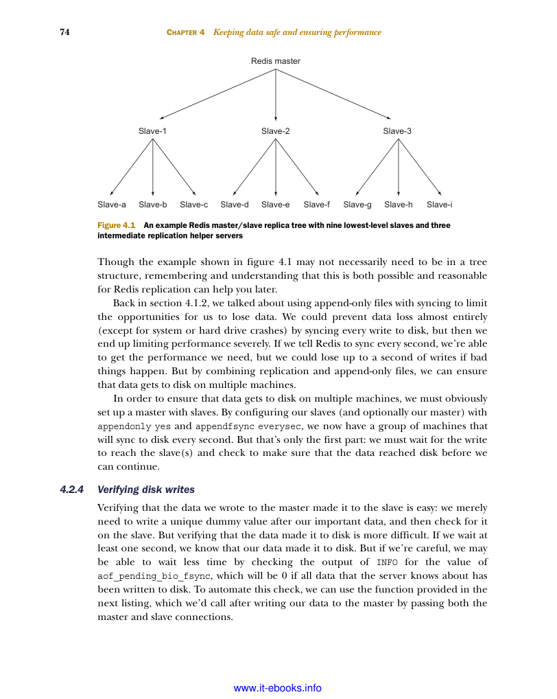
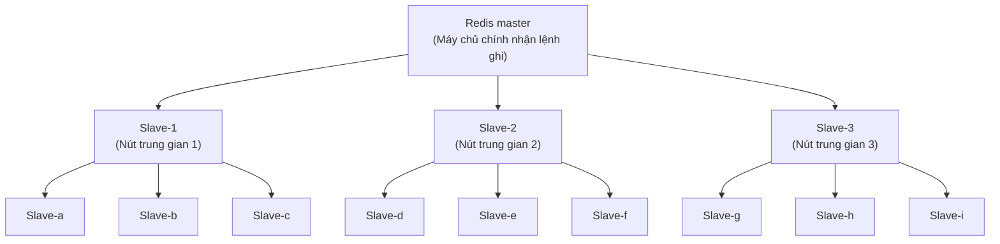
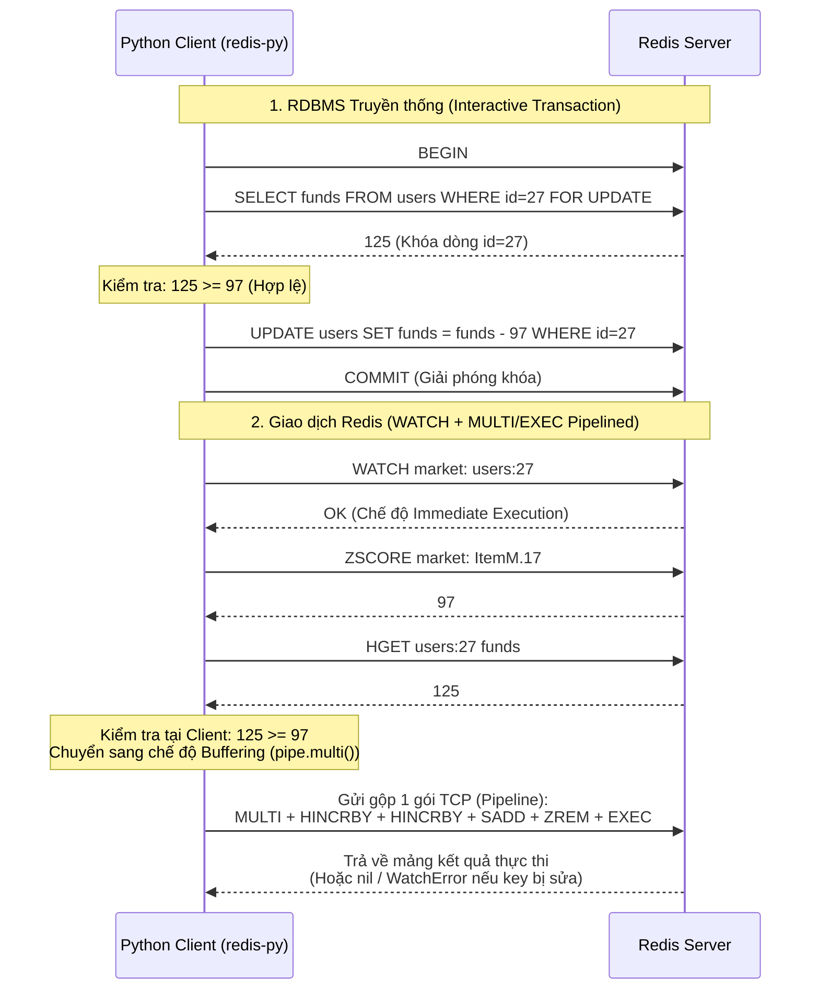
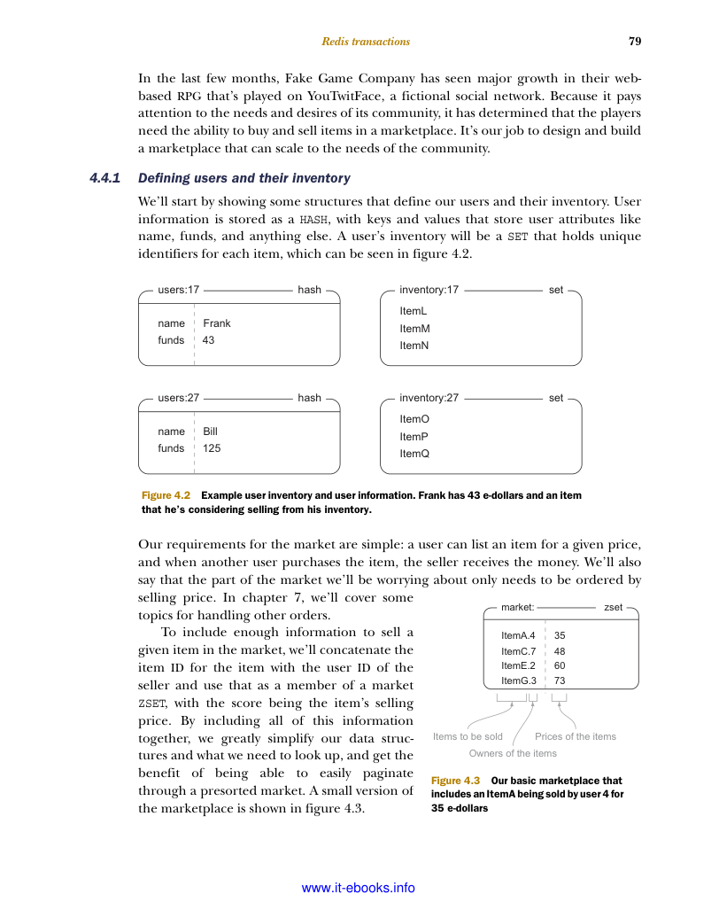
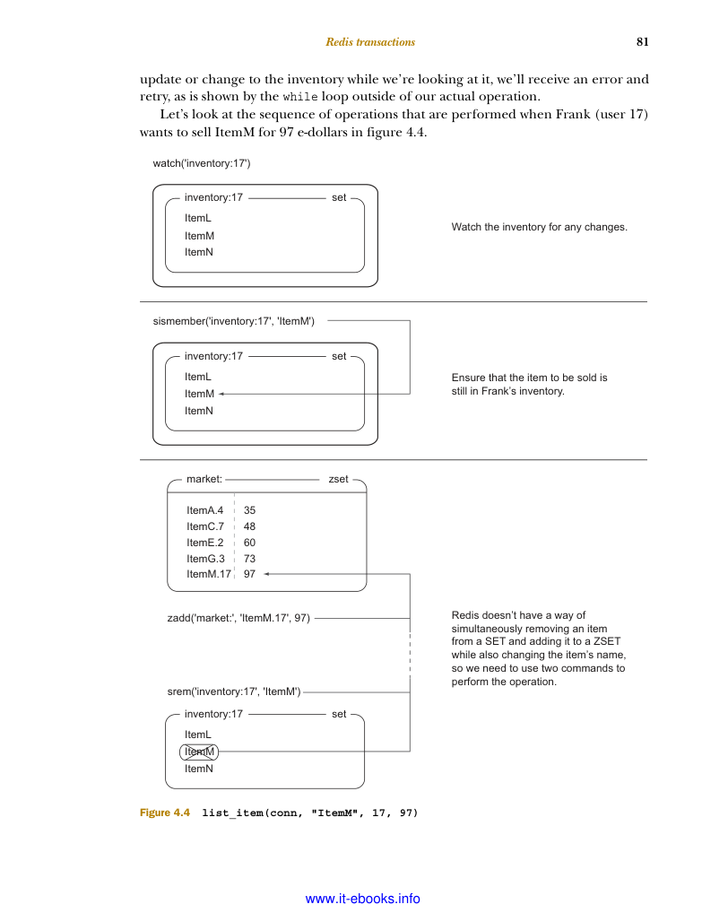
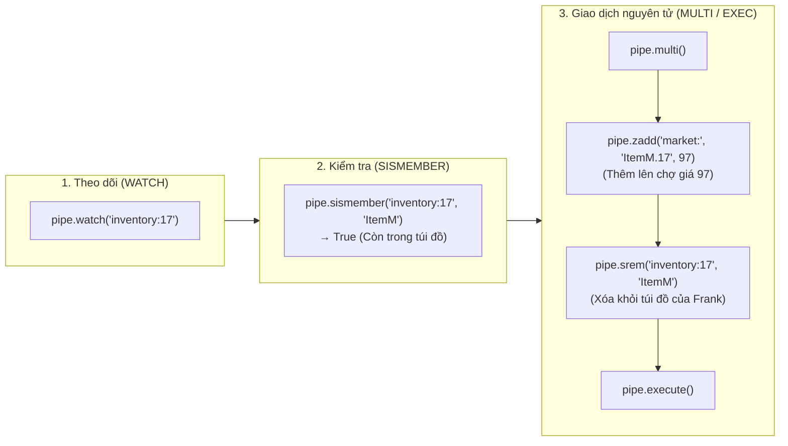
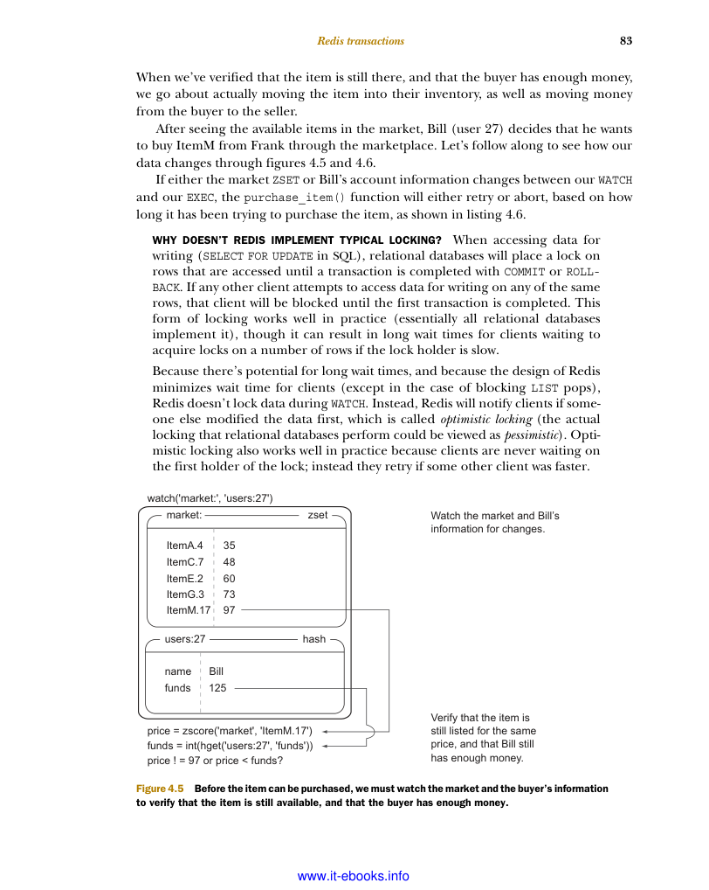
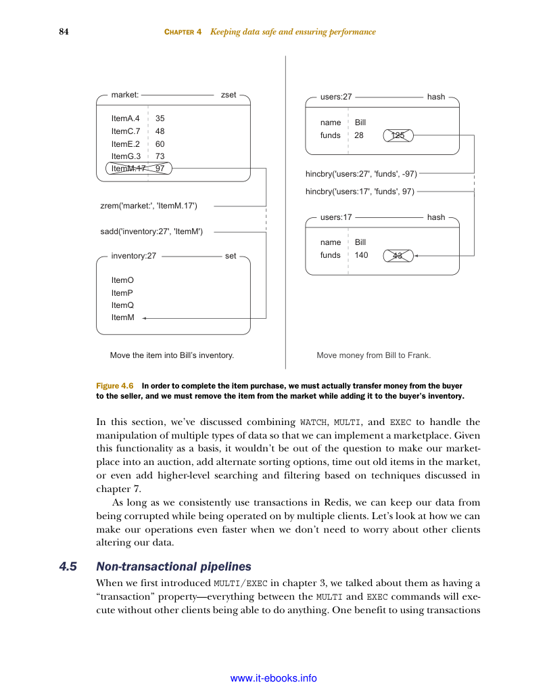
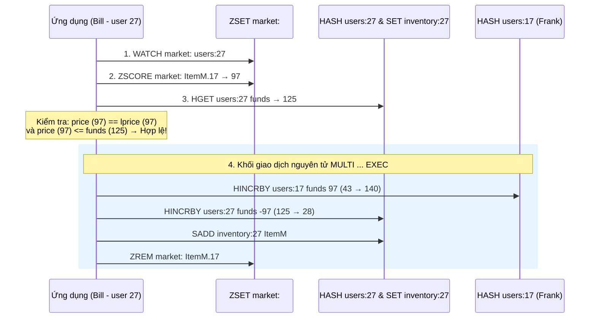
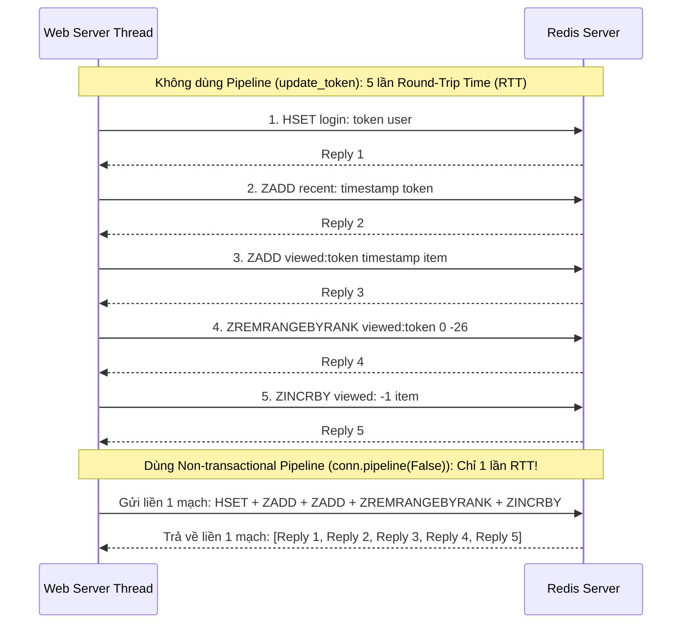

# Chương 4: Giữ an toàn dữ liệu và đảm bảo hiệu năng (Keeping data safe and ensuring performance)

## Mục lục chương

- [Chương này đề cập đến](#chương-này-đề-cập-đến-this-chapter-covers)
- [Mở đầu](#mở-đầu)
- [4.1 Các tùy chọn lưu trữ bền vững (Persistence options)](#41-các-tùy-chọn-lưu-trữ-bền-vững-persistence-options)
  - [4.1.1 Lưu dữ liệu xuống đĩa bằng bản chụp nhanh (Persisting to disk with snapshots)](#411-lưu-dữ-liệu-xuống-đĩa-bằng-bản-chụp-nhanh-persisting-to-disk-with-snapshots)
  - [4.1.2 Lưu trữ bền vững bằng tệp chỉ ghi nối tiếp (Append-only file persistence)](#412-lưu-trữ-bền-vững-bằng-tệp-chỉ-ghi-nối-tiếp-append-only-file-persistence)
  - [4.1.3 Viết lại và nén gọn tệp chỉ ghi nối tiếp (Rewriting/compacting append-only files)](#413-viết-lại-và-nén-gọn-tệp-chỉ-ghi-nối-tiếp-rewritingcompacting-append-only-files)
- [4.2 Sao chép dữ liệu (Replication)](#42-sao-chép-dữ-liệu-replication)
  - [4.2.1 Cấu hình Redis cho sao chép dữ liệu (Configuring Redis for replication)](#421-cấu-hình-redis-cho-sao-chép-dữ-liệu-configuring-redis-for-replication)
  - [4.2.2 Quy trình khởi động sao chép dữ liệu trong Redis (Redis replication startup process)](#422-quy-trình-khởi-động-sao-chép-dữ-liệu-trong-redis-redis-replication-startup-process)
  - [4.2.3 Chuỗi Master/Slave (Master/slave chains)](#423-chuỗi-masterslave-masterslave-chains)
  - [4.2.4 Xác minh việc ghi dữ liệu xuống đĩa (Verifying disk writes)](#424-xác-minh-việc-ghi-dữ-liệu-xuống-đĩa-verifying-disk-writes)
- [4.3 Xử lý sự cố hệ thống (Handling system failures)](#43-xử-lý-sự-cố-hệ-thống-handling-system-failures)
  - [4.3.1 Kiểm tra tính hợp lệ của bản chụp nhanh và tệp chỉ ghi nối tiếp (Verifying snapshots and append-only files)](#431-kiểm-tra-tính-hợp-lệ-của-bản-chụp-nhanh-và-tệp-chỉ-ghi-nối-tiếp-verifying-snapshots-and-append-only-files)
  - [4.3.2 Thay thế một máy chủ Master bị lỗi (Replacing a failed master)](#432-thay-thế-một-máy-chủ-master-bị-lỗi-replacing-a-failed-master)
- [4.4 Giao dịch trong Redis (Redis transactions)](#44-giao-dịch-trong-redis-redis-transactions)
  - [4.4.1 Định nghĩa người dùng và kho đồ của họ (Defining users and their inventory)](#441-định-nghĩa-người-dùng-và-kho-đồ-của-họ-defining-users-and-their-inventory)
  - [4.4.2 Đăng bán vật phẩm lên chợ giao dịch (Listing items in the marketplace)](#442-đăng-bán-vật-phẩm-lên-chợ-giao-dịch-listing-items-in-the-marketplace)
  - [4.4.3 Mua vật phẩm (Purchasing items)](#443-mua-vật-phẩm-purchasing-items)
- [4.5 Đường ống không dùng giao dịch (Non-transactional pipelines)](#45-đường-ống-không-dùng-giao-dịch-non-transactional-pipelines)
- [4.6 Các lưu ý về hiệu năng (Performance considerations)](#46-các-lưu-ý-về-hiệu-năng-performance-considerations)
- [4.7 Tóm tắt (Summary)](#47-tóm-tắt-summary)
- [Bảng thuật ngữ của chương](#bảng-thuật-ngữ-của-chương)

---

## Chương này đề cập đến (This chapter covers)

- Lưu trữ dữ liệu bền vững xuống đĩa cứng (*Persisting data to disk*)
- Sao chép dữ liệu sang các máy chủ khác (*Replicating data to other machines*)
- Xử lý khi gặp sự cố hệ thống (*Dealing with system failures*)
- Giao dịch trong Redis (*Redis transactions*)
- Đường ống không dùng giao dịch (*Non-transactional pipelines*)
- Chẩn đoán các vấn đề về hiệu năng (*Diagnosing performance issues*)

## Mở đầu

Trong vài chương trước, bạn đã tìm hiểu về hàng loạt câu lệnh có sẵn trong Redis cũng như cách chúng thao tác trên các cấu trúc dữ liệu, và bạn thậm chí đã giải quyết được một số bài toán thực tế bằng Redis. Chương này sẽ chuẩn bị hành trang để bạn xây dựng những phần mềm thực thụ với Redis bằng cách chỉ cho bạn làm thế nào để giữ an toàn cho dữ liệu của mình, ngay cả khi đối mặt với sự cố sập hệ thống (*system failure*), đồng thời tôi sẽ chỉ ra các phương pháp mà bạn có thể áp dụng để cải thiện hiệu năng của Redis trong khi vẫn bảo toàn được tính toàn vẹn dữ liệu (*data integrity*).

Chúng ta sẽ bắt đầu bằng việc khám phá các tùy chọn lưu trữ bền vững (*persistence*) khác nhau mà Redis cung cấp để đưa dữ liệu của bạn xuống đĩa cứng. Sau đó, chúng ta sẽ bàn về việc sử dụng cơ chế sao chép dữ liệu (*replication*) nhằm duy trì các bản sao luôn được cập nhật mới nhất của dữ liệu trên những máy chủ bổ sung, phục vụ cho cả hai mục đích: tăng hiệu năng và đảm bảo độ tin cậy của dữ liệu (*data reliability*). Kết hợp cả sao chép dữ liệu và lưu trữ bền vững, chúng ta sẽ thảo luận về những sự đánh đổi (*trade-offs*) mà bạn có thể phải cân nhắc, đồng thời đi qua một vài ví dụ thực tế về việc lựa chọn các tùy chọn lưu trữ bền vững và sao chép sao cho phù hợp nhất với nhu cầu của bạn. Tiếp theo, chúng ta sẽ nói về giao dịch (*transactions*) và đường ống (*pipelines*) trong Redis, và khép lại chương bằng việc thảo luận cách chẩn đoán một số vấn đề liên quan đến hiệu năng.

Xuyên suốt chương này, trọng tâm của chúng ta là hiểu sâu hơn về cách Redis vận hành bên dưới để trước hết có thể đảm bảo rằng dữ liệu của chúng ta luôn chính xác, rồi sau đó mới hướng tới việc làm cho các thao tác trên dữ liệu đó chạy thật nhanh.

Để bắt đầu, hãy cùng xem xét cách Redis lưu trữ thông tin của chúng ta xuống đĩa cứng sao cho sau khi khởi động lại (*restart*), dữ liệu đó vẫn còn nguyên ở đó.

> 📝 **Giải thích thêm (không có trong sách):** Vì Redis là một cơ sở dữ liệu lưu trữ dữ liệu trong bộ nhớ RAM (*in-memory data store*), tốc độ đọc/ghi của nó cực kỳ nhanh (thường tính bằng micro-giây). Tuy nhiên, đặc tính tự nhiên của RAM là **khả biến (*volatile*)** — nếu mất điện hoặc tiến trình `redis-server` bị sập (*crash*), toàn bộ dữ liệu trong RAM sẽ biến mất. Do đó, khi đưa Redis vào môi trường chạy thật (*production*), đặc biệt là khi dùng Redis làm nơi lưu trữ dữ liệu chính (*primary data store*) chứ không chỉ làm bộ nhớ đệm (*cache*), hai trụ cột quan trọng nhất để bảo vệ dữ liệu là:
> 1. **Persistence (Lưu trữ bền vững):** Ghi dữ liệu từ RAM xuống đĩa cứng cục bộ (thông qua cơ chế chụp ảnh nhanh RDB hoặc nhật ký lệnh AOF) để khôi phục lại khi khởi động lại máy chủ.
> 2. **Replication (Sao chép dữ liệu):** Đồng bộ dữ liệu theo thời gian thực từ máy chủ chính (*master* / *primary*) sang một hoặc nhiều máy chủ phụ (*slave* / *replica*) trên các máy vật lý khác nhau để dự phòng khi phần cứng máy chính gặp sự cố.

---

## 4.1 Các tùy chọn lưu trữ bền vững (Persistence options)

Bên trong Redis, có hai cách khác nhau để lưu trữ dữ liệu bền vững xuống đĩa cứng. Một phương pháp được gọi là **chụp bản sao nhanh** (*snapshotting* — thường gọi là RDB), hoạt động bằng cách lấy toàn bộ dữ liệu đúng như trạng thái tồn tại của nó tại một thời điểm nhất định (*point-in-time*) rồi ghi xuống đĩa. Phương pháp còn lại được gọi là **AOF**, viết tắt của **tệp chỉ ghi nối tiếp** (*append-only file*), hoạt động bằng cách sao chép các câu lệnh ghi (*write commands*) gửi tới xuống đĩa ngay khi chúng diễn ra. Hai phương pháp này có thể được sử dụng kết hợp cùng nhau, sử dụng riêng lẻ từng cái, hoặc trong một số trường hợp là không sử dụng phương pháp nào cả. Việc chọn phương pháp nào sẽ phụ thuộc vào đặc thù dữ liệu và ứng dụng của bạn.

Một trong những lý do chính khiến bạn muốn lưu trữ dữ liệu đang nằm trong bộ nhớ RAM xuống đĩa cứng là để bạn vẫn còn giữ được dữ liệu đó về sau, hoặc để bạn có thể sao lưu (*back up*) nó sang một vị trí từ xa phòng trường hợp xảy ra sự cố. Ngoài ra, dữ liệu đang được lưu trong Redis có thể đã mất rất nhiều thời gian để tính toán ra, hoặc đang trong quá trình tính toán dở dang, và bạn muốn có thể truy cập lại nó sau này mà không phải tốn công tính toán lại từ đầu. Đối với một số trường hợp sử dụng Redis, việc “tính toán” có thể chỉ đơn giản là hành động sao chép dữ liệu từ một cơ sở dữ liệu khác sang Redis (như trường hợp ở mục 2.4), nhưng đối với những trường hợp khác, Redis có thể đang lưu trữ dữ liệu phân tích tổng hợp (*aggregate analytics data*) được đúc kết từ hàng tỷ dòng nhật ký (*log lines*).

Có hai nhóm tùy chọn cấu hình khác nhau điều khiển cách Redis ghi dữ liệu xuống đĩa. Tất cả các tùy chọn cấu hình này cùng với các giá trị cấu hình mẫu có thể được nhìn thấy trong đoạn mã cấu hình dưới đây. Chúng ta sẽ thảo luận chi tiết hơn về từng tùy chọn trong các mục 4.1.1 và 4.1.2, nhưng hiện tại, hãy lướt qua các tùy chọn này để bạn làm quen với chúng.

**Listing 4.1 – Các tùy chọn cấu hình lưu trữ bền vững có sẵn trong Redis (Options for persistence configuration available in Redis)**

```ini
save 60 1000
stop-writes-on-bgsave-error no
rdbcompression yes
dbfilename dump.rdb

appendonly no
appendfsync everysec
no-appendfsync-on-rewrite no
auto-aof-rewrite-percentage 100
auto-aof-rewrite-min-size 64mb

dir ./
```

**Giải thích các nhóm tùy chọn trong Listing 4.1:**
- **Nhóm 1 (`save` đến `dbfilename`) — Các tùy chọn lưu trữ bền vững bằng bản chụp nhanh (*Snapshotting persistence options*):**
  - `save 60 1000`: Tự động chụp snapshot nếu có ít nhất 1.000 thao tác ghi trong vòng 60 giây.
  - `stop-writes-on-bgsave-error no`: Có ngừng nhận lệnh ghi từ client hay không nếu quá trình lưu snapshot chạy nền (`BGSAVE`) gặp lỗi.
  - `rdbcompression yes`: Có nén tệp snapshot RDB (bằng thuật toán LZF) trước khi ghi xuống đĩa hay không.
  - `dbfilename dump.rdb`: Tên tệp dùng để lưu bản chụp nhanh trên đĩa.
- **Nhóm 2 (`appendonly` đến `auto-aof-rewrite-min-size`) — Các tùy chọn lưu trữ bền vững bằng tệp chỉ ghi nối tiếp (*Append-only file persistence options*):**
  - `appendonly no`: Bật (`yes`) hoặc tắt (`no`) chế độ lưu trữ AOF.
  - `appendfsync everysec`: Tần suất đồng bộ (*fsync*) dữ liệu từ bộ đệm hệ điều hành xuống đĩa vật lý.
  - `no-appendfsync-on-rewrite no`: Có tạm ngừng gọi `fsync` trong lúc đang chạy quá trình nén/viết lại tệp AOF hay không.
  - `auto-aof-rewrite-percentage 100`: Tỷ lệ phần trăm kích thước tệp AOF tăng thêm so với lần viết lại trước đó để tự động kích hoạt viết lại AOF.
  - `auto-aof-rewrite-min-size 64mb`: Kích thước tối thiểu của tệp AOF để cơ chế tự động viết lại AOF được phép kích hoạt.
- **Nhóm 3 (`dir ./`) — Tùy chọn dùng chung (*Shared option*):**
  - `dir ./`: Thư mục trên đĩa dùng để lưu trữ tệp bản chụp nhanh (snapshot RDB) hoặc tệp chỉ ghi nối tiếp (AOF).

Như bạn đã thấy trong Listing 4.1, một vài tùy chọn đầu tiên xử lý việc chụp bản sao nhanh cơ bản, chẳng hạn như đặt tên cho tệp snapshot trên đĩa là gì, tần suất thực hiện chụp snapshot tự động ra sao, có nén bản snapshot hay không, và có tiếp tục chấp nhận các thao tác ghi khi việc lưu snapshot gặp lỗi hay không. Nhóm tùy chọn thứ hai cấu hình phân hệ AOF, cho Redis biết có sử dụng AOF hay không, tần suất đồng bộ (*sync*) các thao tác ghi xuống đĩa là bao lâu, có thực hiện đồng bộ xuống đĩa trong quá trình nén gọn (*compaction*) tệp AOF hay không, và tần suất nén gọn tệp AOF như thế nào. Trong mục tiếp theo, chúng ta sẽ nói về việc sử dụng các bản chụp nhanh (*snapshots*) để giữ an toàn cho dữ liệu của mình.

> 📝 **Giải thích thêm (không có trong sách) — Đối chiếu với Redis 6/7/8 & redis-py 5.x hiện đại:**
> Trong các phiên bản Redis hiện đại (Redis 6, 7, 8), cơ chế lưu trữ bền vững trong `Listing 4.1` đã có hai nâng cấp kiến trúc cực kỳ quan trọng giúp giải quyết triệt để sự đánh đổi giữa tốc độ khởi động của RDB và độ an toàn dữ liệu của AOF:
>
> | Tính năng / Cấu hình | Thời Redis 2.6 (trong Listing 4.1) | Redis 6/7/8 hiện đại |
> | :--- | :--- | :--- |
> | **Định dạng tệp AOF sau khi viết lại (`BGREWRITEAOF`)** | Thuần văn bản lệnh RESP (`aof-use-rdb-preamble` chưa tồn tại); khởi động lại rất chậm nếu tập dữ liệu lớn | **AOF-RDB Hybrid Persistence (`aof-use-rdb-preamble yes` — mặc định từ Redis 5.0+)**: phần đầu tệp AOF là ảnh chụp nhị phân RDB nén gọn, phần đuôi mới là các lệnh AOF tăng trưởng. Khởi động nhanh như RDB nhưng chỉ mất tối đa 1 giây dữ liệu như AOF |
> | **Cấu trúc tệp AOF trên đĩa** | Một tệp đơn lẻ duy nhất `appendonly.aof` (khi viết lại phải giữ tệp cũ lớn và dễ gây treo I/O lúc xóa tệp cũ) | **Multi-Part AOF (từ Redis 7.0+)**: chia thành thư mục `appenddirname "appendonlydir"` chứa tệp cơ sở (`*.base.rdb`), các tệp tăng trưởng (`*.incr.aof`), và tệp quản lý `appendonly.aof.manifest` |
> | **Cú pháp quy tắc `save`** | Mỗi quy tắc `save <seconds> <changes>` phải viết trên một dòng riêng | Từ **Redis 7.0+**, hỗ trợ viết gộp tất cả quy tắc trên một dòng duy nhất: `save 3600 1 300 100 60 10000` |
> | **Xóa tệp RDB/AOF cũ khi Rewrite** | Tiến trình chính xóa đồng bộ (`unlink()`), có thể làm treo Redis vài giây nếu tệp AOF cũ nặng hàng chục GB | Bổ sung `aof-rewrite-incremental-fsync yes`, `rdb-save-incremental-fsync yes`, và `lazyfree-lazy-server-del yes` (xóa tệp/giải phóng bộ nhớ trên luồng nền BIO không gây chặn) |

### 4.1.1 Lưu dữ liệu xuống đĩa bằng bản chụp nhanh (Persisting to disk with snapshots)

Trong Redis, chúng ta có thể tạo ra một bản sao tại một thời điểm xác định (*point-in-time copy*) của dữ liệu đang nằm trong bộ nhớ bằng cách tạo một **bản chụp nhanh (*snapshot*)**. Sau khi được tạo xong, các bản chụp nhanh này có thể được đem đi sao lưu dự phòng (*backed up*), sao chép sang các máy chủ khác để tạo ra một bản sao nhân bản (*clone*) của máy chủ hiện tại, hoặc để nguyên đó phục vụ cho lần khởi động lại trong tương lai.

Về mặt cấu hình, các bản chụp nhanh được ghi vào tệp có tên được chỉ định trong tùy chọn `dbfilename` của tệp cấu hình, và được lưu nằm trong đường dẫn thư mục được chỉ định bởi tùy chọn `dir`. Cho đến trước khi bản chụp nhanh tiếp theo được thực hiện, bất kỳ dữ liệu nào được ghi vào Redis kể từ thời điểm bản chụp nhanh cuối cùng bắt đầu (và hoàn tất) sẽ bị mất nếu xảy ra sự cố sập (*crash*) do lỗi của bản thân Redis, của hệ điều hành, hoặc của phần cứng.

Lấy một ví dụ cụ thể: giả sử chúng ta đang có một máy chủ Redis chạy với 10 gigabyte dữ liệu hiện đang nằm trong bộ nhớ. Một bản chụp nhanh trước đó đã được bắt đầu vào lúc 2:35 chiều và đã hoàn tất. Bây giờ, một bản chụp nhanh mới được bắt đầu vào lúc 3:06 chiều, và có 35 khóa (*keys*) được cập nhật trước khi bản chụp nhanh này hoàn tất vào lúc 3:08 chiều. Nếu một thành phần nào đó của hệ thống bị sập và ngăn không cho Redis hoàn thành thao tác chụp bản sao nhanh trong khoảng thời gian từ 3:06 chiều đến 3:08 chiều, thì mọi dữ liệu được ghi vào trong khoảng từ 2:35 chiều cho đến thời điểm hiện tại sẽ bị mất sạch. Nhưng nếu hệ thống bị sập ngay sau khi bản chụp nhanh vừa mới hoàn tất (sau 3:08 chiều), thì chỉ có các bản cập nhật đối với 35 khóa diễn ra trong lúc chụp (từ 3:06 đến 3:08 chiều) là bị mất mà thôi.

> 💡 **Ví dụ bổ sung (không có trong sách):** Sơ đồ dòng thời gian dưới đây minh họa rõ vì sao dữ liệu cập nhật của 35 khóa từ 3:06 đến 3:08 chiều lại không nằm trong bản snapshot bắt đầu lúc 3:06 chiều (do cơ chế *Copy-on-Write* khi `fork()` tạo tiến trình con tại đúng mốc 3:06 chiều):
>
> ```mermaid
> flowchart LR
>     T1["14:35<br/>Snapshot #1 bắt đầu<br/>& hoàn tất"] -->|"Dữ liệu ghi từ 14:35 - 15:06"| T2["15:06<br/>Snapshot #2 bắt đầu<br/>(Redis gọi fork)"]
>     T2 -->|"35 keys được cập nhật<br/>trong RAM của tiến trình cha"| T3["15:08<br/>Snapshot #2 hoàn tất<br/>(ghi xong xuống đĩa)"]
>     T2 -.->|"Nếu sập giữa 15:06 và 15:08"| L1["Mất toàn bộ dữ liệu<br/>ghi từ sau 14:35"]
>     T3 -.->|"Nếu sập ngay sau 15:08"| L2["Chỉ mất 35 keys cập nhật<br/>từ sau mốc fork 15:06"]
> ```

Có **năm phương pháp** để khởi tạo một bản chụp nhanh, được liệt kê như sau:

- **Phương pháp 1 (`BGSAVE`):** Bất kỳ Redis client nào cũng có thể khởi tạo một bản chụp nhanh bằng cách gọi lệnh `BGSAVE`. Trên các nền tảng hỗ trợ `BGSAVE` (về cơ bản là tất cả các nền tảng ngoại trừ Windows), Redis sẽ thực hiện `fork`[^1], và tiến trình con (*child process*) sẽ đảm nhận việc ghi bản chụp nhanh xuống đĩa trong khi tiến trình cha (*parent process*) vẫn tiếp tục phản hồi các câu lệnh từ client.
- **Phương pháp 2 (`SAVE`):** Một Redis client cũng có thể khởi tạo một bản chụp nhanh bằng cách gọi lệnh `SAVE`, lệnh này sẽ khiến Redis ngừng phản hồi bất kỳ và tất cả các câu lệnh khác cho đến khi quá trình chụp bản sao nhanh hoàn tất. Lệnh này không thường xuyên được sử dụng, ngoại trừ trong những tình huống mà chúng ta bắt buộc cần có dữ liệu trên đĩa ngay, và hoặc là chúng ta chấp nhận việc ngồi chờ nó chạy xong, hoặc là chúng ta không còn đủ bộ nhớ trống để thực hiện một lệnh `BGSAVE`.
- **Phương pháp 3 (Quy tắc cấu hình `save`):** Nếu Redis được cấu hình với các dòng `save`, chẳng hạn như `save 60 10000`, Redis sẽ tự động kích hoạt một thao tác `BGSAVE` nếu có 10.000 thao tác ghi đã diễn ra trong vòng 60 giây tính từ lúc lần lưu thành công gần nhất bắt đầu (sử dụng tùy chọn cấu hình vừa mô tả). Khi có nhiều dòng cấu hình `save` cùng hiện diện, bất kỳ lúc nào một trong số các quy tắc đó thỏa mãn điều kiện, một thao tác `BGSAVE` sẽ được kích hoạt.
- **Phương pháp 4 (`SHUTDOWN` / `TERM`):** Khi Redis nhận được yêu cầu tắt máy chủ thông qua lệnh `SHUTDOWN`, hoặc khi nó nhận được một tín hiệu `TERM` tiêu chuẩn từ hệ điều hành, Redis sẽ thực hiện một lệnh `SAVE`, chặn không cho các client thực hiện thêm bất kỳ câu lệnh nào nữa, rồi sau đó mới tắt hẳn.
- **Phương pháp 5 (`SYNC` khi sao chép):** Nếu một máy chủ Redis kết nối tới một máy chủ Redis khác và phát lệnh `SYNC` để bắt đầu quá trình sao chép dữ liệu (*replication*), máy chủ Redis master sẽ bắt đầu một thao tác `BGSAVE` nếu hiện tại chưa có thao tác `BGSAVE` nào đang chạy hoặc vừa mới hoàn tất gần đây. Xem mục 4.2 để biết thêm thông tin chi tiết về sao chép dữ liệu.

[^1]: Khi một tiến trình thực hiện `fork`, hệ điều hành bên dưới sẽ tạo ra một bản sao của tiến trình đó. Trên các hệ thống Unix và giống Unix (*Unix-like*), quá trình sao chép này được tối ưu hóa (cơ chế *Copy-on-Write*) sao cho ban đầu, toàn bộ bộ nhớ được chia sẻ dùng chung giữa tiến trình con và tiến trình cha. Chỉ khi nào tiến trình cha hoặc tiến trình con thực hiện ghi vào một vùng bộ nhớ, vùng bộ nhớ đó mới ngừng được chia sẻ (và được nhân bản thành trang bộ nhớ riêng).

Khi chỉ sử dụng các bản chụp nhanh để lưu dữ liệu, bạn phải luôn ghi nhớ rằng nếu một sự cố sập hệ thống xảy ra, bạn sẽ mất bất kỳ dữ liệu nào đã thay đổi kể từ bản chụp nhanh gần nhất. Đối với một số ứng dụng, mức độ mất mát dữ liệu kiểu này là không thể chấp nhận được, và bạn nên tìm hiểu việc sử dụng cơ chế lưu trữ bền vững bằng tệp chỉ ghi nối tiếp (*append-only file persistence*), như được mô tả trong mục 4.1.2. Nhưng nếu ứng dụng của bạn có thể chung sống ổn thỏa với việc mất một phần dữ liệu, thì bản chụp nhanh có thể là câu trả lời hoàn toàn phù hợp. Hãy cùng xem xét một vài kịch bản thực tế và cách bạn có thể muốn cấu hình Redis để đạt được hành vi lưu trữ bản chụp nhanh đúng như mong đợi.

#### MÔI TRƯỜNG PHÁT TRIỂN CÁ NHÂN (DEVELOPMENT)

Đối với máy chủ phát triển cá nhân (*personal development server*) của tôi, mối quan tâm lớn nhất của tôi là giảm thiểu tối đa chi phí tài nguyên phụ thêm (*overhead*) của việc chụp các bản sao nhanh. Nhằm mục đích này, và cũng bởi vì nhìn chung tôi tin tưởng vào phần cứng máy tính của mình, tôi chỉ đặt một quy tắc duy nhất: `save 900 1`. Tùy chọn `save` này bảo Redis rằng nó nên thực hiện một thao tác `BGSAVE` dựa trên hai giá trị đi kèm theo sau. Trong trường hợp này, nếu có ít nhất 1 thao tác ghi đã diễn ra sau ít nhất 900 giây (15 phút) kể từ lần `BGSAVE` trước đó, Redis sẽ tự động bắt đầu một lần `BGSAVE` mới.

Nếu bạn đang có kế hoạch sử dụng bản chụp nhanh trên một máy chủ chạy thật (*production server*), và bạn dự kiến sẽ lưu trữ một lượng lớn dữ liệu, bạn sẽ muốn thử nghiệm chạy một máy chủ phát triển với phần cứng giống hệt hoặc tương đương, cùng các tùy chọn `save` như vậy, một tập dữ liệu tương tự và mức tải kỳ vọng tương đương. Bằng cách thiết lập một môi trường tương đương với những gì bạn sẽ chạy trên môi trường production, bạn có thể đảm bảo rằng mình không chụp snapshot quá thường xuyên (gây lãng phí tài nguyên) hoặc quá thưa thớt (khiến hệ thống đứng trước nguy cơ mất mát nhiều dữ liệu).

#### TỔNG HỢP NHẬT KÝ (AGGREGATING LOGS)

Trong trường hợp tổng hợp các tệp nhật ký (*aggregating log files*) và phân tích lượt xem trang (*page views*), thực sự chúng ta chỉ cần tự hỏi bản thân xem mình sẵn sàng chấp nhận mất bao nhiêu thời gian xử lý nếu có thứ gì đó bị sập vào khoảng giữa hai lần xuất bản sao (*dumps*). Nếu chúng ta thấy ổn với việc mất tối đa một giờ làm việc, thì chúng ta có thể sử dụng cấu hình `save 3600 1` (có 3.600 giây trong một giờ). Nhưng làm thế nào chúng ta có thể khôi phục lại công việc nếu đang xử lý dở các tệp nhật ký?

Để khôi phục sau khi mất dữ liệu, trước tiên chúng ta cần phải biết chính xác mình đã mất những gì. Để biết mình đã mất những gì, chúng ta cần lưu lại một bản ghi theo dõi tiến độ (*record of our progress*) trong suốt quá trình xử lý nhật ký. Hãy tưởng tượng rằng chúng ta có một hàm được gọi mỗi khi có các tệp nhật ký mới sẵn sàng để đem ra xử lý. Hàm này được truyền vào một kết nối Redis, một đường dẫn (*path*) trỏ tới thư mục lưu các tệp nhật ký, và một hàm gọi lại (*callback*) chịu trách nhiệm xử lý từng dòng riêng lẻ trong tệp nhật ký. Với hàm của mình, chúng ta có thể ghi nhận lại xem mình đang làm việc trên tệp nào cùng với thông tin vị trí con trỏ tệp (*file position / offset*) ngay trong lúc đang xử lý. Một hàm xử lý nhật ký có ghi lại thông tin tiến độ này được trình bày trong đoạn mã dưới đây.

**Listing 4.2 – Hàm `process_logs()` lưu giữ thông tin tiến độ xử lý trong Redis (The `process_logs()` function that keeps progress information in Redis)**

```python
def process_logs(conn, path, callback):
    current_file, offset = conn.mget(
        'progress:file', 'progress:position')

    pipe = conn.pipeline()

    def update_progress():
        pipe.mset({
            'progress:file': fname,
            'progress:position': offset
        })
        pipe.execute()

    for fname in sorted(os.listdir(path)):
        if fname < current_file:
            continue

        inp = open(os.path.join(path, fname), 'rb')
        if fname == current_file:
            inp.seek(int(offset, 10))
        else:
            offset = 0

        current_file = None

        for lno, line in enumerate(inp):
            callback(pipe, line)
            offset = int(offset) + len(line)

            if not (lno+1) % 1000:
                update_progress()
        update_progress()

        inp.close()
```

**Giải thích chi tiết các bước trong Listing 4.2:**
1. `def process_logs(conn, path, callback):` — Hàm của chúng ta sẽ được cung cấp một hàm `callback` nhận vào một kết nối (ở đây là đối tượng pipeline) và một dòng nhật ký (`line`), rồi gọi các phương thức trên đối tượng pipeline đó khi cần thiết.
2. `current_file, offset = conn.mget('progress:file', 'progress:position')` — Lấy thông tin tiến độ xử lý hiện tại đang lưu trong Redis (tên tệp đang xử lý dở và vị trí byte offset trong tệp đó).
3. `def update_progress():` — Hàm đóng (*closure*) này chủ yếu nhằm mục đích giảm bớt số lượng dòng mã bị lặp lại ở phía dưới.
4. `pipe.mset({'progress:file': fname, 'progress:position': offset})` — Chúng ta muốn cập nhật tên tệp và vị trí độ lệch (*offset*) của dòng đang xử lý bên trong tệp nhật ký.
5. `pipe.execute()` — Câu lệnh này sẽ thực thi mọi thao tác cập nhật thống kê nhật ký đang chờ trong hàng đợi của pipeline, đồng thời thực sự ghi các cập nhật về tên tệp và vị trí dòng của chúng ta vào Redis.
6. `for fname in sorted(os.listdir(path)):` — Duyệt qua các tệp nhật ký theo thứ tự tên tệp đã được sắp xếp tăng dần.
7. `if fname < current_file: continue` — Bỏ qua các tệp nằm trước tệp hiện tại (vì chúng đã được xử lý xong từ trước).
8. `if fname == current_file: inp.seek(int(offset, 10))` — Nếu chúng ta đang tiếp tục xử lý dở một tệp từ lần chạy trước, hãy nhảy (*seek*) qua những phần dữ liệu mà chúng ta đã xử lý xong.
9. `for lno, line in enumerate(inp):` — Hàm dựng sẵn `enumerate` duyệt qua một chuỗi tuần tự (trong trường hợp này là các dòng đọc từ một tệp), và sinh ra các cặp giá trị bao gồm một số thứ tự nguyên bắt đầu từ `0` (`lno`) cùng với dữ liệu gốc ban đầu (`line`).
10. `callback(pipe, line)` — Xử lý dòng nhật ký hiện tại (đẩy các lệnh Redis tương ứng vào `pipe`).
11. `offset = int(offset) + len(line)` — Cập nhật thông tin của chúng ta về vị trí độ lệch byte (*offset*) bên trong tệp.
12. `if not (lno+1) % 1000: update_progress()` và lệnh `update_progress()` sau vòng lặp — Ghi tiến độ của chúng ta ngược trở lại vào Redis cứ sau mỗi 1.000 dòng, hoặc khi chúng ta đã xử lý xong toàn bộ một tệp.

Bằng cách lưu giữ bản ghi tiến độ của mình ngay trong Redis, chúng ta có thể tiếp tục công việc xử lý nhật ký đúng từ chỗ bị gián đoạn nếu tại bất kỳ thời điểm nào đó một phần của hệ thống bị sập. Và bởi vì chúng ta đã sử dụng các đường ống giao dịch `MULTI`/`EXEC` (*pipelines*) như đã giới thiệu ở Chương 3, chúng ta đảm bảo rằng bản chụp dữ liệu (*dump*) sẽ chỉ bao gồm thông tin nhật ký đã xử lý khi và chỉ khi nó cũng bao gồm cả thông tin tiến độ tương ứng của các dòng nhật ký đó.

> 📝 **Giải thích thêm (không có trong sách) — Đối chiếu với Redis 6/7/8 & redis-py 5.x hiện đại:**
> Điểm tinh tế nhất trong `Listing 4.2` nằm ở chỗ hàm `callback(pipe, line)` không thực thi lệnh trực tiếp lên kết nối `conn`, mà đẩy các lệnh thống kê (ví dụ `pipe.incr(...)`, `pipe.zincrby(...)`) vào cùng một đối tượng `pipe` (mặc định trong `redis-py` là một khối giao dịch nguyên tử `MULTI`/`EXEC`). Khi `update_progress()` được gọi sau mỗi 1.000 dòng, lệnh `pipe.mset({'progress:file': fname, 'progress:position': offset})` cũng được xếp vào cuối chính giao dịch đó rồi mới gọi `pipe.execute()`.
> Nhờ tính nguyên tử (*atomicity*) của `MULTI`/`EXEC`, bản chụp RDB trên đĩa không bao giờ rơi vào trạng thái “đã cộng số liệu của 500 dòng log nhưng chưa cập nhật `progress:position`” (dẫn đến việc cộng trùng lặp khi chạy lại sau sự cố).
>
> **Bảng đối chiếu `Listing 4.2` (`process_logs`) giữa Python 2 + `redis-py` 2.x và Python 3 + `redis-py` 5.x:**
>
> | Thành phần trong `Listing 4.2` | Python 2.7 + `redis-py` 2.x (trong sách) | Python 3 + `redis-py` 5.x (`decode_responses=True`) |
> | :--- | :--- | :--- |
> | **So sánh `if fname < current_file:`** | Trong Python 2, khi khóa chưa tồn tại (`current_file = None`), phép so sánh `'access.log' < None` hợp lệ và trả về `False` | Trong Python 3, so sánh `str < None` (hoặc `str < bytes` nếu quên `decode_responses=True`) sẽ ném lỗi **`TypeError: '<' not supported between instances of 'str' and 'NoneType'`**. Phải viết: `if current_file and fname < current_file:` |
> | **Quản lý vòng đời `pipeline` & tệp** | `pipe = conn.pipeline()` và `inp = open(..., 'rb')` kèm `inp.close()` thủ công | Dùng Context Manager `with conn.pipeline() as pipe:` và `with open(..., 'rb') as inp:` để tránh rò rỉ tài nguyên |
>
> > 💡 **Ví dụ bổ sung (không có trong sách) — Viết lại `Listing 4.2` (`process_logs`) chuẩn Python 3 + `redis-py` 5.x:**
> > ```python
> > import os
> > import redis
> >
> > def process_logs_py3(conn: redis.Redis, path: str, callback):
> >     current_file, offset = conn.mget('progress:file', 'progress:position')
> >
> >     with conn.pipeline() as pipe:
> >         def update_progress(fname_val: str, offset_val: int):
> >             pipe.mset({
> >                 'progress:file': fname_val,
> >                 'progress:position': offset_val,
> >             })
> >             pipe.execute()
> >
> >         for fname in sorted(os.listdir(path)):
> >             if current_file and fname < current_file:
> >                 continue
> >
> >             with open(os.path.join(path, fname), 'rb') as inp:
> >                 if fname == current_file:
> >                     inp.seek(int(offset or 0, 10))
> >                 else:
> >                     offset = 0
> >
> >                 current_file = None
> >
> >                 for lno, line in enumerate(inp):
> >                     callback(pipe, line)
> >                     offset = int(offset) + len(line)
> >
> >                     if not (lno + 1) % 1000:
> >                         update_progress(fname, offset)
> >                 update_progress(fname, offset)
> > ```

#### DỮ LIỆU LỚN (BIG DATA)

Khi lượng dữ liệu mà chúng ta lưu trữ trong Redis thường chỉ nằm dưới mức vài gigabyte, việc chụp bản sao nhanh (*snapshotting*) có thể là lựa chọn hoàn toàn hợp lý. Redis sẽ thực hiện `fork`, lưu dữ liệu xuống đĩa, và hoàn tất bản chụp nhanh còn nhanh hơn cả thời gian bạn đọc xong câu văn này. Thế nhưng khi dung lượng bộ nhớ mà Redis sử dụng tăng dần lên theo thời gian, thì thời gian cần thiết để thực hiện thao tác `fork` cho lệnh `BGSAVE` cũng tăng theo. Trong những tình huống mà Redis đang sử dụng tới hàng chục gigabyte bộ nhớ, không còn nhiều bộ nhớ trống khả dụng, hoặc nếu chúng ta đang chạy trên một máy ảo (*virtual machine*), việc để cho một thao tác `BGSAVE` diễn ra có thể khiến hệ thống bị tạm dừng (*pause*) trong những khoảng thời gian kéo dài, hoặc có thể dẫn đến việc sử dụng bộ nhớ ảo của hệ thống (*system virtual memory / swap*) một cách nặng nề, làm suy giảm hiệu năng của Redis đến mức không thể sử dụng được nữa.

Khoảng thời gian tạm dừng kéo dài này (và mức độ nghiêm trọng của nó) sẽ phụ thuộc vào loại hệ thống mà chúng ta đang chạy trên đó. Phần cứng vật lý thực (*real hardware*), ảo hóa VMWare, hoặc ảo hóa KVM nhìn chung sẽ cho phép chúng ta tạo một bản `fork` của tiến trình Redis với tốc độ khoảng 10–20ms trên mỗi gigabyte bộ nhớ mà Redis đang sử dụng. Nếu hệ thống của chúng ta đang chạy bên trong môi trường ảo hóa Xen, những con số đó có thể lên tới gần 200–300ms trên mỗi gigabyte bộ nhớ được Redis sử dụng, tùy thuộc vào cấu hình Xen. Vì vậy, nếu chúng ta đang sử dụng 20 gigabyte bộ nhớ với Redis, việc chạy `BGSAVE` trên phần cứng tiêu chuẩn sẽ làm tạm dừng Redis trong khoảng 200–400 mili-giây để thực hiện thao tác `fork`. Nếu chúng ta đang sử dụng Redis bên trong một máy ảo hóa bằng Xen (như trường hợp của Amazon EC2 thế hệ cũ và một số nhà cung cấp đám mây khác), cùng thao tác `fork` đó sẽ khiến Redis bị đứng hình trong 4–6 giây. Bạn cần phải tự quyết định đối với ứng dụng của mình xem khoảng thời gian tạm dừng này có chấp nhận được hay không.

Để ngăn chặn việc `fork` gây ra những vấn đề như vậy, chúng ta có thể muốn tắt hoàn toàn tính năng lưu tự động (*automatic saving*). Khi tính năng lưu tự động đã bị vô hiệu hóa, chúng ta sẽ cần phải tự gọi lệnh `BGSAVE` một cách thủ công (việc này vẫn mang tất cả những vấn đề tiềm ẩn giống hệt như trước, chỉ khác là giờ đây chúng ta chủ động biết chính xác khi nào chúng sẽ xảy ra), hoặc chúng ta có thể gọi lệnh `SAVE`. Với lệnh `SAVE`, đúng là Redis sẽ chặn (*block*) mọi yêu cầu cho đến khi quá trình lưu hoàn tất, nhưng bởi vì không có thao tác `fork` nào diễn ra, nên sẽ không có độ trễ do `fork` (*fork delay*). Và bởi vì tiến trình Redis không phải tranh chấp tài nguyên với chính bản sao của nó, bản chụp nhanh sẽ hoàn thành nhanh hơn nhiều.

Chia sẻ từ kinh nghiệm cá nhân của chính tôi: tôi từng vận hành những máy chủ Redis sử dụng tới 50 gigabyte bộ nhớ trên những cỗ máy có tổng cộng 68 gigabyte bộ nhớ bên trong một nhà cung cấp đám mây chạy công nghệ ảo hóa Xen. Khi cố gắng sử dụng `BGSAVE` trong lúc các client vẫn đang ghi dữ liệu vào Redis, riêng việc `fork` đã mất tới 15 giây hoặc lâu hơn, nối tiếp theo sau là 15–20 phút để bản chụp nhanh được ghi xong hoàn toàn. Nhưng khi dùng lệnh `SAVE`, bản chụp nhanh lại hoàn tất chỉ trong vòng 3–5 phút. Đối với nhu cầu sử dụng của chúng tôi khi đó, một bản chụp nhanh hàng ngày vào lúc 3 giờ sáng là đã đủ, vì vậy chúng tôi đã viết các kịch bản (*scripts*) tự động tạm dừng các client không cho cố truy cập vào Redis, gọi lệnh `SAVE`, chờ cho lệnh `SAVE` chạy xong, sao lưu bản chụp nhanh vừa thu được sang nơi khác, rồi sau đó phát tín hiệu báo cho các client biết rằng chúng có thể tiếp tục hoạt động bình thường.

Các bản chụp nhanh rất tuyệt vời khi chúng ta có thể chấp nhận khả năng mất mát một lượng dữ liệu đáng kể trong Redis, nhưng đối với nhiều ứng dụng, việc mất đi 15 phút hay một giờ hoặc nhiều hơn thế về mặt dữ liệu hoặc thời gian xử lý là quá lớn. Để cho phép Redis lưu giữ thông tin cập nhật sát sao hơn về dữ liệu trong bộ nhớ xuống đĩa cứng, chúng ta có thể sử dụng cơ chế lưu trữ bền vững bằng tệp chỉ ghi nối tiếp (*append-only file persistence*).

---

### 4.1.2 Lưu trữ bền vững bằng tệp chỉ ghi nối tiếp (Append-only file persistence)

Hiểu theo cách cơ bản nhất, các tệp nhật ký chỉ ghi nối tiếp (*append-only log files*) lưu giữ một bản ghi về mọi thay đổi dữ liệu diễn ra bằng cách ghi nối tiếp từng sự thay đổi đó vào phần cuối của tệp. Bằng cách làm như vậy, bất kỳ ai cũng có thể khôi phục lại toàn bộ tập dữ liệu bằng cách phát lại (*replaying*) tệp nhật ký chỉ ghi nối tiếp đó theo đúng thứ tự từ đầu đến cuối. Redis cũng có tính năng thực hiện đúng điều này, và nó được bật lên bằng cách đặt tùy chọn cấu hình `appendonly yes`, như đã hiển thị trong Listing 4.1. Bảng 4.1 dưới đây cho thấy các tùy chọn của `appendfsync` và cách chúng tác động đến việc đồng bộ các thao tác ghi tệp xuống đĩa cứng.

> **ĐỒNG BỘ TỆP XUỐNG ĐĨA (FILE SYNCING)**
>
> Khi ghi các tệp xuống đĩa cứng, có ít nhất ba điều sẽ diễn ra. Điều đầu tiên là ghi vào một vùng đệm (*buffer*), và việc này xảy ra khi gọi hàm `file.write()` hoặc hàm tương đương trong các ngôn ngữ lập trình khác. Khi dữ liệu đã nằm trong vùng đệm này, hệ điều hành có thể lấy dữ liệu đó và ghi nó xuống đĩa cứng vào một thời điểm nào đó trong tương lai. Chúng ta có thể tùy chọn thực hiện bước thứ hai là yêu cầu hệ điều hành đưa dữ liệu đã cung cấp xuống đĩa ngay khi nó có cơ hội tiếp theo bằng hàm `file.flush()`, nhưng đây cũng chỉ là một lời yêu cầu mà thôi. Bởi vì dữ liệu thực chất vẫn chưa nằm trên đĩa cứng vật lý cho đến khi hệ điều hành thực sự ghi nó xuống đĩa, chúng ta có thể ra lệnh trực tiếp cho hệ điều hành phải “đồng bộ” (*sync* — chẳng hạn qua lời gọi hệ thống `fsync()`) các tệp xuống đĩa, thao tác này sẽ chặn (*block*) chương trình cho đến khi việc ghi vật lý hoàn tất. Khi quá trình đồng bộ (*sync*) đó hoàn thành, chúng ta có thể khá chắc chắn rằng dữ liệu của mình đã thực sự nằm an toàn trên đĩa cứng và chúng ta có thể đọc lại nó sau này nếu hệ thống chẳng may gặp sự cố.

**Bảng 4.1 – Các tùy chọn đồng bộ sử dụng cùng với `appendfsync` (Table 4.1 Sync options to use with `appendfsync`)**

| Tùy chọn (*Option*) | Tần suất việc đồng bộ xuống đĩa sẽ diễn ra (*How often syncing will occur*) |
|---|---|
| `always` | Mỗi câu lệnh ghi vào Redis đều dẫn đến một thao tác ghi đồng bộ trực tiếp xuống đĩa cứng. Tùy chọn này sẽ làm chậm tốc độ của Redis đi một cách đáng kể nếu được sử dụng. |
| `everysec` | Mỗi giây một lần, thực hiện đồng bộ tường minh (*explicitly syncs*) các câu lệnh ghi xuống đĩa cứng. |
| `no` | Để mặc cho hệ điều hành tự điều khiển thời điểm đồng bộ dữ liệu xuống đĩa cứng. |

Nếu chúng ta đặt cấu hình `appendfsync always`, mỗi thao tác ghi vào Redis sẽ dẫn đến một thao tác ghi và đồng bộ trực tiếp xuống đĩa cứng, nhờ đó chúng ta có thể đảm bảo mức độ mất mát dữ liệu là tối thiểu nhất nếu Redis bị sập. Thật không may, bởi vì chúng ta đang phải ghi xuống đĩa cứng với từng thao tác ghi vào Redis, chúng ta sẽ bị giới hạn bởi chính hiệu năng của ổ đĩa, tức là chỉ vào khoảng 200 thao tác ghi/giây đối với một ổ đĩa từ quay cơ học (*spinning disk / HDD*), và có lẽ được khoảng vài chục nghìn thao tác ghi/giây đối với một ổ đĩa thể rắn (*SSD — solid-state drive*).

> ⚠️ **CẢNH BÁO: Ổ ĐĨA SSD VÀ `appendfsync always` (WARNING: SSDS AND `appendfsync always`)**
>
> Bạn sẽ cần phải hết sức cẩn thận nếu đang sử dụng ổ đĩa SSD cùng với cấu hình `appendfsync always`. Việc ghi và ép đồng bộ từng thay đổi nhỏ xuống đĩa ngay khi chúng vừa xảy ra, thay vì để cho hệ điều hành gom nhóm các thao tác ghi lại với nhau như trong trường hợp của các tùy chọn `appendfsync` khác, có nguy cơ gây ra một dạng cực đoan của hiện tượng được gọi là **khuếch đại ghi (*write amplification*)**. Bằng việc liên tục ghi những lượng dữ liệu nhỏ vào cuối một tệp kèm lệnh đồng bộ đĩa, bạn có thể làm giảm tuổi thọ của các ổ đĩa SSD từ nhiều năm xuống chỉ còn vài tháng trong một số trường hợp.

> 📝 **Giải thích thêm (không có trong sách):** Hiện tượng **Write Amplification (Khuếch đại ghi)** trên ổ SSD xuất phát từ kiến trúc bộ nhớ Flash NAND: dữ liệu được đọc/ghi theo đơn vị trang (*page*, thường là 4KB hoặc 16KB), nhưng chỉ có thể xóa theo đơn vị khối (*block*, gồm hàng trăm trang, cỡ vài MB) và không thể ghi đè trực tiếp lên trang cũ khi chưa xóa. Khi cấu hình `appendfsync always`, mỗi lệnh Redis (chỉ vài chục byte) đều buộc ổ SSD phải cấp phát và ghi nguyên một trang Flash mới, đồng thời đánh dấu trang cũ là không hợp lệ (*stale*), khiến bộ thu gom rác (*Garbage Collection*) của SSD phải liên tục đọc-xóa-ghi lại các khối nhớ. Hệ quả là ghi 1MB dữ liệu AOF có thể biến thành hàng chục MB ghi vật lý trên chip Flash, nhanh chóng làm cạn kiệt giới hạn chu kỳ P/E (*Program/Erase cycles* / chỉ số TBW) của ổ SSD.

Như một sự thỏa hiệp hợp lý giữa việc giữ an toàn cho dữ liệu và việc duy trì hiệu năng ghi ở mức cao, chúng ta cũng có thể đặt cấu hình `appendfsync everysec`. Cấu hình này sẽ đồng bộ tệp nhật ký chỉ ghi nối tiếp xuống đĩa mỗi giây một lần. Đối với hầu hết các trường hợp sử dụng phổ biến, nhiều khả năng chúng ta sẽ không nhận thấy sự sụt giảm hiệu năng đáng kể nào khi đồng bộ xuống đĩa mỗi giây một lần so với việc không sử dụng bất kỳ hình thức lưu trữ bền vững nào. Bằng cách đồng bộ xuống đĩa mỗi giây một lần, nếu hệ thống chẳng may bị sập, chúng ta sẽ chỉ có thể mất tối đa một giây dữ liệu vừa được ghi hoặc cập nhật trong Redis. Ngoài ra, trong trường hợp ổ đĩa cứng không thể theo kịp khối lượng ghi đang diễn ra dồn dập, Redis sẽ tự động giảm tốc độ một cách uyển chuyển (*gracefully slow down*) để thích ứng với tốc độ ghi tối đa của ổ đĩa.

> 📝 **Giải thích thêm (không có trong sách):** Trong thực tế triển khai của Redis với `appendfsync everysec`, lời gọi hệ thống `fsync()` được thực hiện bởi một luồng chạy nền riêng biệt (*background I/O thread* — BIO). Tuy nhiên, nếu ổ đĩa đang bị quá tải nặng (ví dụ tiến trình con đang ghi RDB hoặc viết lại AOF chiếm hết băng thông I/O của đĩa) khiến lệnh `fsync()` ở luồng nền bị treo quá 2 giây chưa xong, luồng chính (*main thread*) của Redis sẽ tạm thời hoãn hoặc chặn việc ghi vào bộ đệm AOF (tối đa có thể mất khoảng 2 giây dữ liệu thay vì 1 giây trong kịch bản tệ nhất). Đó cũng là lý do có thêm tùy chọn `no-appendfsync-on-rewrite` trong `Listing 4.1`: nếu đặt là `yes`, Redis sẽ tạm không gọi `fsync()` ở luồng chính/BIO trong lúc đang chạy `BGSAVE` hoặc `BGREWRITEAOF` để tránh bị nghẽn I/O đĩa (đánh đổi bằng việc nếu sập đúng lúc đang rewrite thì có thể mất tới 30 giây dữ liệu).

Đúng như bạn có thể đoán được, khi đặt cấu hình `appendfsync no`, Redis sẽ không thực hiện bất kỳ thao tác đồng bộ tệp tường minh nào cả, mà giao phó toàn bộ mọi thứ cho hệ điều hành tự quyết định. Sẽ không có bất kỳ sự sụt giảm hiệu năng nào trong trường hợp này, mặc dù nếu hệ thống bị sập theo cách này hay cách khác, chúng ta sẽ mất một lượng dữ liệu không xác định và không thể đoán trước được (trên Linux, chu kỳ đẩy bộ đệm trang *page cache* mặc định của nhân hệ điều hành thường là khoảng 30 giây). Và nếu chúng ta đang sử dụng một ổ đĩa cứng không đủ nhanh để đáp ứng tải ghi của mình, Redis sẽ hoạt động trơn tru cho đến khi các vùng đệm (*buffers*) dùng để ghi dữ liệu xuống đĩa bị lấp đầy, tại thời điểm đó Redis sẽ trở nên cực kỳ chậm chạp vì nó bị hệ điều hành chặn lại không cho ghi thêm. Vì những lý do này, nhìn chung tôi không khuyến khích việc sử dụng tùy chọn cấu hình `appendfsync no`, và chỉ đưa phần mô tả cùng ngữ nghĩa của nó vào đây để đảm bảo tính đầy đủ của tài liệu.

Các tệp chỉ ghi nối tiếp (AOF) rất linh hoạt, cung cấp nhiều tùy chọn đa dạng để đảm bảo rằng hầu như mọi mức độ cảnh giác lo xa về an toàn dữ liệu đều có thể được đáp ứng. Thế nhưng có một mặt tối đối với cơ chế lưu trữ bền vững AOF, và đó chính là **kích thước tệp (*file size*)**.

---

### 4.1.3 Viết lại và nén gọn tệp chỉ ghi nối tiếp (Rewriting/compacting append-only files)

Sau khi đọc xong về cơ chế lưu trữ bền vững AOF, có lẽ bạn đang tự hỏi tại sao các bản chụp nhanh (*snapshots*) lại còn tồn tại làm gì. Nếu bằng cách sử dụng các tệp chỉ ghi nối tiếp, chúng ta có thể giảm thiểu mức độ mất mát dữ liệu xuống chỉ còn một giây (hoặc về cơ bản là không mất gì cả), đồng thời giảm thiểu thời gian cần thiết để lưu dữ liệu bền vững xuống đĩa một cách thường xuyên, thì có vẻ như sự lựa chọn của chúng ta đã quá rõ ràng. Thế nhưng sự lựa chọn thực chất lại không đơn giản như vậy: bởi vì mỗi thao tác ghi vào Redis đều khiến một bản ghi nhật ký của câu lệnh đó được ghi nối tiếp xuống đĩa, tệp nhật ký chỉ ghi nối tiếp sẽ phình to ra liên tục không ngừng. Theo thời gian, một tệp AOF cứ lớn dần lên có thể khiến ổ đĩa của bạn bị hết sạch dung lượng trống, nhưng phổ biến hơn cả là khi khởi động lại (*restart*), Redis sẽ phải thực thi lại tuần tự từng câu lệnh một có trong tệp AOF đó. Khi phải xử lý những tệp AOF khổng lồ, Redis có thể mất một khoảng thời gian cực kỳ dài mới khởi động xong.

Để giải quyết bài toán tệp AOF ngày càng phình to, chúng ta có thể sử dụng lệnh `BGREWRITEAOF`, lệnh này sẽ viết lại (*rewrite*) tệp AOF sao cho ngắn gọn nhất có thể bằng cách loại bỏ các câu lệnh dư thừa. `BGREWRITEAOF` hoạt động theo cách tương tự như lệnh chụp bản sao nhanh `BGSAVE`: thực hiện một lời gọi `fork` và sau đó viết lại tệp nhật ký chỉ ghi nối tiếp bên trong tiến trình con (*child process*). Do đó, tất cả những hạn chế tương tự về mặt hiệu năng của phương pháp chụp bản sao nhanh liên quan đến thời gian `fork`, dung lượng bộ nhớ sử dụng, và các vấn đề khác vẫn giữ nguyên khi sử dụng tệp chỉ ghi nối tiếp. Thậm chí còn tệ hơn nữa, bởi vì các tệp AOF có thể phình to gấp nhiều lần kích thước của một bản chụp RDB (nếu bị bỏ mặc không kiểm soát), nên khi tệp AOF được viết lại xong, hệ điều hành cần phải xóa bỏ tệp AOF cũ đi, thao tác xóa này có thể khiến hệ thống bị treo (*hang*) trong nhiều giây đồng hồ trong lúc nó đang xóa một tệp AOF nặng hàng chục gigabyte.

> 💡 **Ví dụ bổ sung (không có trong sách):** Để hình dung tại sao `BGREWRITEAOF` lại giúp thu gọn tệp AOF đi hàng nghìn lần: giả sử bạn có một bộ đếm lượt truy cập trang web dùng lệnh `INCR page_views` được gọi 10 triệu lần.
> - Trong tệp AOF thông thường, Redis phải lưu trọn vẹn **10.000.000 lệnh `INCR page_views`** (tốn hàng trăm megabyte trên đĩa).
> - Khi chạy `BGREWRITEAOF`, tiến trình con không hề đọc lại tệp AOF cũ trên đĩa, mà nó đọc trực tiếp giá trị hiện tại của khóa `page_views` đang nằm trong bộ nhớ RAM và xuất ra một câu lệnh duy nhất tương đương: **`SET page_views 10000000`**. Nhờ vậy, 10 triệu dòng lệnh dư thừa được nén gọn thành đúng 1 dòng lệnh!

Với phương pháp chụp bản sao nhanh, chúng ta đã có thể sử dụng tùy chọn cấu hình `save` để bật tính năng tự động ghi các bản chụp nhanh bằng `BGSAVE`. Khi sử dụng AOF, có hai tùy chọn cấu hình giúp bật tính năng tự động thực thi `BGREWRITEAOF`: đó là `auto-aof-rewrite-percentage` và `auto-aof-rewrite-min-size`. Sử dụng các giá trị mẫu `auto-aof-rewrite-percentage 100` và `auto-aof-rewrite-min-size 64mb`, khi chế độ AOF được bật, Redis sẽ khởi chạy một thao tác `BGREWRITEAOF` khi tệp AOF hiện tại lớn hơn ít nhất 100% (tức là gấp đôi) so với kích thước của nó vào thời điểm Redis hoàn tất việc viết lại tệp AOF lần gần nhất, **và** đồng thời khi tệp AOF có kích thước tối thiểu là 64 megabyte. Về mặt tinh chỉnh cấu hình, nếu tệp AOF của chúng ta bị viết lại quá thường xuyên, chúng ta có thể tăng con số `100` (đại diện cho 100%) lên một giá trị lớn hơn, mặc dù điều đó sẽ khiến Redis mất nhiều thời gian hơn để khởi động lại nếu đã lâu chưa có lần viết lại AOF nào diễn ra.

Bất kể chúng ta chọn sử dụng tệp chỉ ghi nối tiếp (AOF) hay bản chụp nhanh (snapshot), việc có được dữ liệu nằm trên đĩa cứng là một bước khởi đầu tuyệt vời. Thế nhưng trừ khi dữ liệu của chúng ta đã được sao lưu dự phòng sang một nơi nào khác (tốt nhất là lưu ở nhiều vị trí khác nhau), chúng ta vẫn đang để ngỏ nguy cơ mất mát dữ liệu (chẳng hạn khi hỏng ổ cứng hoặc cháy nổ máy chủ). Bất cứ khi nào có thể, tôi luôn khuyến nghị việc sao lưu các bản chụp nhanh và các tệp chỉ ghi nối tiếp vừa mới được viết lại sang những máy chủ khác.

Bằng cách sử dụng tệp chỉ ghi nối tiếp hoặc bản chụp nhanh, chúng ta có thể giữ lại dữ liệu của mình qua các lần khởi động lại hệ thống hoặc khi gặp sự cố sập máy. Tuy nhiên, khi tải truy cập tăng lên, hoặc khi các yêu cầu về tính toàn vẹn dữ liệu trở nên khắt khe hơn, chúng ta có thể sẽ cần tìm đến cơ chế **sao chép dữ liệu (*replication*)** để trợ giúp.

---

## 4.2 Sao chép dữ liệu (Replication)

Trải qua nhiều năm mở rộng quy mô (*scaling*) các nền tảng để đáp ứng mức tải ngày càng cao, các kỹ sư và quản trị viên hệ thống đã bổ sung cơ chế **sao chép dữ liệu (*replication*)** vào túi đồ nghề của mình để giúp các hệ thống mở rộng quy mô. Sao chép dữ liệu là một phương pháp mà qua đó các máy chủ khác nhận được một bản sao được cập nhật liên tục của dữ liệu ngay khi dữ liệu đó đang được ghi vào máy chủ chính, nhờ vậy các máy chủ bản sao (*replicas*) có thể đứng ra phục vụ các truy vấn đọc (*read queries*). Trong thế giới cơ sở dữ liệu quan hệ, không có gì lạ khi một cơ sở dữ liệu chính (*master database*) duy nhất gửi các thao tác ghi ra cho nhiều máy chủ phụ (*slaves*), trong đó các máy chủ phụ đảm nhận thực hiện toàn bộ các truy vấn đọc. Redis đã áp dụng phương pháp sao chép dữ liệu này như một cách để hỗ trợ mở rộng quy mô, và mục này sẽ thảo luận về việc cấu hình sao chép dữ liệu trong Redis cũng như cách Redis vận hành trong suốt quá trình sao chép.

Mặc dù bản thân Redis vốn đã rất nhanh, vẫn có những tình huống mà chỉ một máy chủ Redis chạy đơn lẻ là không đủ nhanh. Cụ thể, các thao tác tính toán trên các tập hợp `SET` và `ZSET` có thể liên quan đến hàng chục tập `SET`/`ZSET` trải rộng trên hàng chục nghìn hoặc thậm chí hàng triệu phần tử. Khi chúng ta bắt đầu đụng tới hàng triệu phần tử tham gia vào phép toán, các phép toán tập hợp có thể mất tới hàng giây đồng hồ mới hoàn thành, thay vì chỉ tính bằng mili-giây hay micro-giây. Nhưng ngay cả khi các câu lệnh đơn lẻ có thể hoàn tất trong 10 mili-giây, thì điều đó vẫn giới hạn chúng ta ở mức tối đa 100 câu lệnh/giây từ một thực thể (*instance*) Redis duy nhất.

> **VÍ DỤ VỀ HIỆU NĂNG CỦA LỆNH `SUNIONSTORE` (EXAMPLE PERFORMANCE FOR `SUNIONSTORE`)**
>
> Như một điểm tham khảo để cân nhắc về mức hiệu năng có thể kỳ vọng từ Redis: trên bộ vi xử lý Intel Core 2 Duo 2.4 GHz, Redis sẽ mất khoảng 7–8 mili-giây để thực hiện một lệnh `SUNIONSTORE` hợp nhất hai tập `SET` có 10.000 phần tử nhằm tạo ra một tập `SET` duy nhất gồm 20.000 phần tử.

Đối với những tình huống mà chúng ta cần mở rộng quy mô theo chiều ngang cho các truy vấn đọc (*scale out read queries*), hoặc nơi chúng ta có thể cần ghi dữ liệu tạm thời phục vụ tính toán (chúng ta sẽ bàn về một số trường hợp như vậy trong Chương 7), chúng ta có thể thiết lập thêm các máy chủ Redis phụ (*slave Redis servers*) để lưu giữ các bản sao của tập dữ liệu. Sau khi nhận được một bản sao khởi tạo ban đầu của toàn bộ dữ liệu từ máy chủ chính (*master*), các máy chủ phụ (*slaves*) sẽ được giữ cho luôn cập nhật theo thời gian thực (*in real time*) mỗi khi các client ghi dữ liệu lên máy chủ master. Với một mô hình thiết lập master/slave, thay vì kết nối tới máy chủ master để đọc dữ liệu, các client sẽ kết nối tới một trong số các máy chủ slave để đọc dữ liệu của mình (thường là chọn ngẫu nhiên một slave để cố gắng cân bằng tải).

Hãy cùng bàn về cách cấu hình Redis cho chế độ vận hành master/slave, và cách Redis hành xử trong suốt toàn bộ quy trình này.

> 📝 **Giải thích thêm (không có trong sách):** Trong các phiên bản Redis hiện đại (từ **Redis 5.0** trở đi), thuật ngữ **Master / Slave** đã được đổi tên chính thức thành **Primary / Replica** (hoặc **Master / Replica**) để rõ nghĩa kỹ thuật và chuẩn hóa thuật ngữ ngành. Theo đó:
> - Tùy chọn cấu hình và câu lệnh `SLAVEOF host port` vẫn được giữ lại để tương thích ngược, nhưng câu lệnh và cấu hình chuẩn mới là **`REPLICAOF host port`** (và `REPLICAOF NO ONE` để ngắt sao chép, thăng cấp replica lên làm master).
> - Kể từ Redis 2.6+, các máy chủ phụ (*slaves/replicas*) mặc định được cấu hình ở chế độ **chỉ đọc (`slave-read-only yes` / `replica-read-only yes`)** để tránh việc client vô tình ghi nhầm dữ liệu vào replica. Tuy nhiên, như tác giả vừa nhắc ở trên và sẽ dùng ở Chương 7, một số lệnh như `SUNIONSTORE`, `SINTERSTORE`, `ZINTERSTORE` hay `SORT ... STORE` vừa đọc vừa ghi kết quả vào một khóa đích tạm thời; trong Redis hiện đại, nếu muốn chạy các tính toán nặng trả về tập kết quả trên replica mà không bật quyền ghi tự do, ta có thể dùng các biến thể chỉ đọc như `SUNION`, `SINTER`, `ZINTER` (có từ Redis 6.2) hoặc chạy Lua script chỉ đọc (`EVAL_RO` trong Redis 7.0+).

---

### 4.2.1 Cấu hình Redis cho sao chép dữ liệu (Configuring Redis for replication)

Như tôi đã đề cập trong mục 4.1.1, khi một máy chủ phụ (*slave*) kết nối tới máy chủ chính (*master*), máy chủ master sẽ bắt đầu một thao tác `BGSAVE`. Để cấu hình sao chép dữ liệu ở phía máy chủ master, chúng ta chỉ cần đảm bảo rằng đường dẫn thư mục và tên tệp được liệt kê dưới hai tùy chọn cấu hình `dir` và `dbfilename` (như đã hiển thị trong Listing 4.1) trỏ tới một đường dẫn và một tệp mà tiến trình Redis có quyền ghi (*writable*).

Mặc dù có khá nhiều tùy chọn điều khiển hành vi của bản thân máy chủ slave, nhưng chỉ có duy nhất một tùy chọn là thực sự bắt buộc để kích hoạt chế độ làm máy phụ (*slaving*): đó là `slaveof`. Nếu chúng ta đặt dòng `slaveof host port` vào trong tệp cấu hình của mình, tiến trình Redis được khởi động với tệp cấu hình đó sẽ sử dụng địa chỉ `host` và cổng `port` được cung cấp làm máy chủ Redis master mà nó cần phải kết nối tới. Nếu chúng ta đang có một hệ thống đã và đang chạy sẵn rồi, chúng ta có thể ra lệnh trực tiếp cho một máy chủ Redis ngừng làm máy phụ, hoặc thậm chí chuyển sang làm máy phụ cho một máy chủ master mới hoặc khác. Để kết nối tới một máy chủ master mới, chúng ta có thể sử dụng câu lệnh `SLAVEOF host port`, hoặc nếu chúng ta muốn ngừng việc cập nhật dữ liệu từ máy chủ master hiện tại, chúng ta có thể sử dụng câu lệnh `SLAVEOF no one`.

Không có gì phức tạp khi cấu hình Redis cho chế độ vận hành master/slave, nhưng điều thú vị và hữu ích cần phải nắm rõ là những gì thực sự diễn ra bên trong Redis khi nó trở thành một máy chủ master hoặc một máy chủ slave.

> 💡 **Ví dụ bổ sung (không có trong sách):** Dưới đây là ví dụ thực tế cách khởi chạy nhanh một cặp Master (cổng `6379`) và Replica/Slave (cổng `6380`) ngay trên cùng một máy tính để thử nghiệm bằng `redis-cli`:
>
> ```bash
> # Trên cửa sổ dòng lệnh kết nối vào máy phụ (cổng 6380):
> $ redis-cli -p 6380
> 127.0.0.1:6380> REPLICAOF 127.0.0.1 6379
> OK
>
> # Kiểm tra trạng thái sao chép:
> 127.0.0.1:6380> INFO replication
> # Replication
> role:slave
> master_host:127.0.0.1
> master_port:6379
> master_link_status:up
>
> # Khi muốn tách máy phụ ra thành máy chủ độc lập (chấp nhận cả lệnh ghi):
> 127.0.0.1:6380> REPLICAOF NO ONE
> OK
> ```

---

### 4.2.2 Quy trình khởi động sao chép dữ liệu trong Redis (Redis replication startup process)

Tôi đã mô tả ngắn gọn những gì xảy ra khi một máy chủ slave kết nối tới—rằng máy chủ master sẽ bắt đầu chụp một bản sao nhanh (*snapshot*) và gửi bản sao đó sang cho máy chủ slave—nhưng đó chỉ là phiên bản tóm lược đơn giản. Bảng 4.2 dưới đây liệt kê đầy đủ tất cả các thao tác diễn ra trên cả máy chủ master lẫn máy chủ slave khi một slave kết nối tới một master.

**Bảng 4.2 – Những gì diễn ra khi một máy chủ slave kết nối tới một máy chủ master (Table 4.2 What happens when a slave connects to a master)**

| Bước (*Step*) | Các thao tác phía Master (*Master operations*) | Các thao tác phía Slave (*Slave operations*) |
|---|---|---|
| **1** | *(Đang chờ nhận lệnh)* | Kết nối (hoặc kết nối lại) tới máy chủ master; gửi câu lệnh `SYNC`. |
| **2** | Bắt đầu thao tác `BGSAVE`; lưu giữ một bộ đệm tồn đọng (*backlog*) chứa tất cả các câu lệnh ghi được gửi tới sau thời điểm `BGSAVE` bắt đầu. | Tiếp tục phục vụ dữ liệu cũ (nếu có), hoặc trả về lỗi cho các câu lệnh truy vấn (tùy thuộc vào cấu hình `slave-serve-stale-data`). |
| **3** | Hoàn tất `BGSAVE`; bắt đầu gửi tệp bản chụp nhanh (*snapshot*) sang cho slave; tiếp tục lưu giữ bộ đệm (*backlog*) chứa các câu lệnh ghi mới phát sinh. | Xóa bỏ toàn bộ dữ liệu cũ đang có (nếu có); bắt đầu nạp bản chụp (*dump*) vào bộ nhớ ngay khi nhận được dữ liệu. |
| **4** | Hoàn tất việc gửi bản chụp nhanh sang cho slave; bắt đầu gửi bộ đệm chứa các câu lệnh ghi tồn đọng (*write command backlog*) sang cho slave. | Hoàn tất việc phân tích cú pháp và nạp bản chụp (*dump*); bắt đầu phản hồi các câu lệnh truy vấn từ client trở lại như bình thường. |
| **5** | Hoàn tất việc gửi bộ đệm tồn đọng; bắt đầu truyền trực tiếp (*live streaming*) các câu lệnh ghi ngay khi chúng vừa diễn ra. | Hoàn tất việc thực thi bộ đệm các câu lệnh ghi tồn đọng nhận từ master; tiếp tục thực thi các câu lệnh mới truyền tới ngay khi chúng diễn ra. |

Với phương pháp được phác thảo trong Bảng 4.2, Redis xoay xở để theo kịp hầu hết các mức tải trong suốt quá trình sao chép dữ liệu, ngoại trừ những trường hợp mà băng thông mạng giữa các thực thể master và slave không đủ nhanh, hoặc khi máy chủ master không có đủ bộ nhớ RAM trống để thực hiện `fork` và đồng thời lưu giữ bộ đệm (*backlog*) các câu lệnh ghi. Mặc dù không phải là yêu cầu bắt buộc cứng nhắc, nhưng nhìn chung có một thông lệ tốt (*good practice*) được khuyến nghị là chỉ nên để các máy chủ Redis master sử dụng khoảng **50–65%** tổng dung lượng bộ nhớ RAM có trên hệ thống của chúng ta, chừa lại xấp xỉ **30–45%** bộ nhớ dự phòng dùng trong quá trình chạy `BGSAVE` và lưu trữ bộ đệm các câu lệnh ghi (*command backlogs*).

Ở phía máy chủ slave, việc cấu hình cũng rất đơn giản. Để cấu hình máy chủ slave cho việc sao chép master/slave, chúng ta có thể đặt tùy chọn cấu hình `SLAVEOF host port` trong tệp cấu hình, hoặc chúng ta có thể cấu hình Redis ngay trong lúc đang chạy (*runtime*) bằng câu lệnh `SLAVEOF`. Nếu chúng ta sử dụng tùy chọn trong tệp cấu hình, khi khởi động Redis sẽ nạp bất kỳ tệp bản chụp nhanh (snapshot) hoặc tệp AOF nào hiện đang có sẵn trên đĩa trước tiên (nếu có), rồi sau đó mới kết nối tới máy chủ master để bắt đầu quy trình sao chép được nêu trong Bảng 4.2. Nếu chúng ta chạy câu lệnh `SLAVEOF` lúc máy đang chạy, Redis sẽ ngay lập tức cố gắng kết nối tới máy chủ master, và ngay khi kết nối thành công, nó sẽ bắt đầu quy trình sao chép như được trình bày trong Bảng 4.2.

> **TRONG QUÁ TRÌNH ĐỒNG BỘ (`SYNC`), MÁY CHỦ SLAVE SẼ XÓA SẠCH TOÀN BỘ DỮ LIỆU HIỆN CÓ CỦA NÓ (DURING SYNC, THE SLAVE FLUSHES ALL OF ITS DATA)**
>
> Chỉ để đảm bảo rằng tất cả chúng ta đều nắm rõ cùng một điểm quan trọng này (một số người dùng thường quên mất điều này trong lần đầu tiên họ thử sử dụng các máy chủ slave): khi một máy chủ slave bắt đầu kết nối tới một máy chủ master, **bất kỳ dữ liệu nào từng có sẵn trong bộ nhớ của máy chủ slave đó sẽ bị xóa mất hoàn toàn**, để nhường chỗ thay thế bằng dữ liệu truyền sang từ máy chủ master.

> ⚠️ **CẢNH BÁO: REDIS KHÔNG HỖ TRỢ SAO CHÉP ĐA CHỦ MASTER-MASTER (WARNING: REDIS DOESN’T SUPPORT MASTER-MASTER REPLICATION)**
>
> Khi được giới thiệu về cơ chế sao chép master/slave, một số người nảy ra ý tưởng sai lầm rằng bởi vì chúng ta có thể thiết lập tùy chọn làm máy phụ sau khi đã khởi động bằng câu lệnh `SLAVEOF`, nên điều đó có nghĩa là chúng ta có thể đạt được thứ gọi là sao chép đa chủ (*multi-master replication*) bằng cách đặt hai thực thể Redis làm `SLAVEOF` của nhau (một số người thậm chí còn nghĩ đến việc nối nhiều hơn hai máy thành một vòng tròn khép kín). Thật không may, **cách này hoàn toàn không hoạt động**. Ở kịch bản tốt nhất, hai thực thể Redis của chúng ta sẽ ngốn tối đa năng lực vi xử lý (CPU) mà chúng có thể lấy được, liên tục truyền thông tin qua lại cho nhau không ngừng nghỉ, và tùy thuộc vào việc chúng ta kết nối tới máy chủ nào để cố đọc/ghi dữ liệu, chúng ta có thể nhận được dữ liệu không nhất quán hoặc chẳng còn dữ liệu nào cả.

Khi có nhiều máy chủ slave cùng cố gắng kết nối tới Redis, một trong hai kịch bản khác nhau có thể xảy ra. Bảng 4.3 dưới đây mô tả hai kịch bản đó.

**Bảng 4.3 – Khi một máy chủ slave kết nối tới một máy chủ master hiện có, đôi khi nó có thể tái sử dụng một tệp bản chụp (dump file) đang được tạo (Table 4.3 When a slave connects to an existing master, sometimes it can reuse an existing dump file.)**

| Thời điểm các máy chủ slave bổ sung kết nối tới (*When additional slaves connect*) | Thao tác xử lý của máy chủ Master (*Master operation*) |
|---|---|
| **Trước Bước 3** trong Bảng 4.2 (tức là khi `BGSAVE` vẫn đang chạy và chưa kết thúc) | Tất cả các máy chủ slave sẽ nhận được cùng một bản chụp (*dump*) và cùng một bộ đệm các câu lệnh ghi tồn đọng (*backlogged write commands*). |
| **Tại hoặc sau Bước 3** trong Bảng 4.2 (tức là khi `BGSAVE` đã xong và đang truyền tệp đi) | Trong lúc máy chủ master đang hoàn tất nốt 5 bước cho các máy chủ slave kết nối sớm hơn trước đó, một chuỗi 5 bước (từ Bước 1 đến Bước 5) hoàn toàn mới sẽ được khởi động lại từ đầu dành cho (các) máy chủ slave mới kết nối vào sau. |

Phần lớn thời gian, Redis cố gắng hết sức để đảm bảo rằng nó không phải thực hiện nhiều công việc hơn mức cần thiết. Trong một số trường hợp, các máy chủ slave có thể cố gắng kết nối vào đúng những thời điểm không thuận lợi và khiến máy chủ master phải làm việc gấp đôi (phải `BGSAVE` lại lần nữa). Mặt khác, nếu có nhiều máy chủ slave kết nối vào cùng một thời điểm, băng thông mạng chiều đi (*outgoing bandwidth*) bị tiêu tốn để đồng bộ hóa tất cả các máy chủ slave đó lúc ban đầu có thể khiến các câu lệnh thông thường khác gặp khó khăn khi truyền qua mạng, và có thể gây ra tình trạng nghẽn mạng nói chung cho các thiết bị khác nằm trên cùng mạng đó.

> 📝 **Giải thích thêm (không có trong sách):** Kể từ phiên bản **Redis 2.8+**, cơ chế sao chép của Redis đã được nâng cấp lớn với lệnh **`PSYNC` (Partial Resynchronization)** thay thế cho lệnh `SYNC` cũ, và từ **Redis 2.8.18+ / Redis 6.0+** có thêm tính năng **Diskless Replication (`repl-diskless-sync yes`)**:
> 1. **Đồng bộ một phần (`PSYNC` & Replication Backlog):** Ở thời điểm cuốn sách viết (Redis 2.6), mỗi khi kết nối mạng giữa master và slave bị chập chờn ngắt quãng dù chỉ 1 giây, khi kết nối lại slave buộc phải chạy `SYNC` từ đầu (master phải `BGSAVE` lại toàn bộ hàng chục GB dữ liệu). Từ Redis 2.8 trở đi, master duy trì một vùng nhớ đệm vòng (*in-memory ring buffer*) gọi là `repl-backlog-size` (mặc định 1MB, thực tế thường cấu hình 64MB–512MB). Nếu slave bị rớt mạng ngắn hạn rồi kết nối lại, nó chỉ cần gửi `PSYNC <replication_id> <offset>` để lấy đúng phần dữ liệu bị thiếu trong vùng đệm mà không cần `BGSAVE` lại từ đầu! Ngoài ra từ **Redis 4.0 (PSYNC2)**, ngay cả khi một slave được thăng cấp lên làm master mới, các slave khác vẫn có thể đồng bộ một phần (`PSYNC`) với master mới mà không phải xóa sạch dữ liệu để đồng bộ toàn bộ (*full resync*).
> 2. **Sao chép không qua đĩa cứng (`repl-diskless-sync`):** Thay vì Bước 2 phải ghi tệp `dump.rdb` xuống đĩa cứng của master rồi Bước 3 mới đọc từ đĩa gửi qua mạng cho slave (rất chậm nếu đĩa cứng của master chậm), với `repl-diskless-sync yes` (đã trở thành mặc định từ **Redis 7.0**), tiến trình con sau khi `fork()` sẽ truyền thẳng luồng dữ liệu RDB qua socket mạng tới các replica mà không chạm vào ổ đĩa của master.

---

### 4.2.3 Chuỗi Master/Slave (Master/slave chains)

Một số nhà phát triển nhận thấy rằng khi họ cần sao chép dữ liệu sang nhiều hơn một vài máy chủ slave, một số hệ thống mạng không thể tải nổi—đặc biệt là khi việc sao chép dữ liệu đang được thực hiện qua mạng internet hoặc xuyên qua nhiều trung tâm dữ liệu (*data centers*) khác nhau. Bởi vì không có điểm gì đặc biệt khác biệt giữa việc đóng vai trò là một master hay một slave trong Redis, nên **các máy chủ slave hoàn toàn có thể có các máy chủ slave của riêng chúng**, tạo thành mô hình **chuỗi master/slave (*master/slave chaining*)**.

Về mặt vận hành, điểm khác biệt duy nhất trong quy trình sao chép xảy ra là: nếu một máy chủ slave X có một máy chủ slave của riêng nó là Y, thì khi máy chủ slave X bước vào **Bước 4** trong Bảng 4.2 (sau khi X vừa xóa dữ liệu cũ và nạp xong bản chụp mới từ master của nó), máy chủ slave X sẽ ngắt kết nối với máy chủ slave Y, buộc Y phải kết nối lại và thực hiện đồng bộ lại (*resync*) từ X.

Khi tải đọc (*read load*) vượt trội hơn hẳn so với tải ghi (*write load*), và khi số lượng lượt đọc vượt xa ngưỡng mà một máy chủ Redis đơn lẻ có thể xử lý, người ta thường liên tục bổ sung thêm các máy chủ slave để giúp gánh bớt tải. Khi mức tải tiếp tục tăng cao hơn nữa, chúng ta có thể rơi vào những tình huống mà một máy chủ master duy nhất không thể ghi dữ liệu tới tất cả các máy chủ slave của nó đủ nhanh, hoặc bị quá tải bởi việc các máy chủ slave liên tục kết nối lại và đồng bộ lại. Để giảm thiểu những vấn đề như vậy, chúng ta có thể muốn thiết lập một tầng gồm các nút Redis master/slave trung gian (*intermediate Redis master/slave nodes*) nhằm hỗ trợ san sẻ nhiệm vụ sao chép dữ liệu, tương tự như mô hình trong Hình 4.1.

**Hình 4.1 – Một ví dụ về cây bản sao Redis master/slave gồm chín máy chủ slave ở tầng thấp nhất và ba máy chủ trung gian hỗ trợ sao chép (Figure 4.1 An example Redis master/slave replica tree with nine lowest-level slaves and three intermediate replication helper servers)**



**Sơ đồ cấu trúc cây sao chép (Mermaid tái hiện Hình 4.1):**



Mặc dù ví dụ được minh họa trong Hình 4.1 không nhất thiết lúc nào cũng phải bố trí theo cấu trúc hình cây cân đối như vậy, nhưng việc ghi nhớ và hiểu rằng mô hình này vừa hoàn toàn khả thi vừa rất hợp lý đối với cơ chế sao chép dữ liệu của Redis sẽ có thể giúp ích nhiều cho bạn về sau.

Quay trở lại mục 4.1.2 trước đó, chúng ta đã nói về việc sử dụng các tệp chỉ ghi nối tiếp (AOF) kết hợp với cơ chế đồng bộ đĩa (*syncing*) để hạn chế tối đa khả năng bị mất dữ liệu. Chúng ta có thể ngăn chặn việc mất dữ liệu gần như tuyệt đối (ngoại trừ trường hợp sập toàn bộ hệ thống hoặc hỏng ổ cứng vật lý) bằng cách đồng bộ mọi thao tác ghi xuống đĩa cứng (`appendfsync always`), nhưng làm thế thì chúng ta lại tự giới hạn hiệu năng một cách nghiêm trọng. Nếu chúng ta bảo Redis đồng bộ xuống đĩa mỗi giây một lần (`appendfsync everysec`), chúng ta đạt được mức hiệu năng mà mình cần, nhưng lại có nguy cơ mất tối đa một giây dữ liệu ghi nếu có chuyện tồi tệ xảy ra. Thế nhưng, **bằng cách kết hợp cả sao chép dữ liệu (*replication*) và tệp chỉ ghi nối tiếp (*append-only files*)**, chúng ta có thể đảm bảo rằng dữ liệu được ghi xuống đĩa cứng trên nhiều máy chủ khác nhau.

Để đảm bảo rằng dữ liệu được đưa xuống đĩa cứng trên nhiều máy chủ, hiển nhiên chúng ta phải thiết lập một máy chủ master đi kèm với các máy chủ slave. Bằng cách cấu hình các máy chủ slave của chúng ta (và tùy chọn cấu hình cả trên máy chủ master) với `appendonly yes` và `appendfsync everysec`, giờ đây chúng ta có một nhóm các máy chủ sẽ thực hiện đồng bộ dữ liệu xuống đĩa mỗi giây một lần. Nhưng đó mới chỉ là phần đầu tiên: chúng ta còn phải chờ cho thao tác ghi đó truyền tới được (các) máy chủ slave và kiểm tra để chắc chắn rằng dữ liệu đã thực sự được ghi xuống đĩa cứng trước khi chúng ta tiếp tục xử lý các bước tiếp theo.

---

### 4.2.4 Xác minh việc ghi dữ liệu xuống đĩa (Verifying disk writes)

Việc xác minh xem dữ liệu mà chúng ta vừa ghi vào máy chủ master đã truyền sang tới máy chủ slave hay chưa thì rất dễ dàng: chúng ta chỉ đơn giản cần ghi thêm một giá trị giả định duy nhất (*unique dummy value*) ngay sau dữ liệu quan trọng của mình, rồi sau đó kiểm tra sự xuất hiện của giá trị đó trên máy chủ slave. Tuy nhiên, việc xác minh rằng dữ liệu đó đã thực sự được ghi xuống đĩa cứng vật lý của slave thì khó hơn. Nếu chúng ta chịu khó chờ ít nhất một giây, chúng ta biết chắc rằng dữ liệu của mình đã được đồng bộ xuống đĩa (với cấu hình `appendfsync everysec`). Nhưng nếu khéo léo và cẩn thận hơn, chúng ta có thể rút ngắn thời gian phải chờ đợi bằng cách kiểm tra kết quả đầu ra của lệnh `INFO` để xem giá trị của trường `aof_pending_bio_fsync` — giá trị này sẽ bằng `0` nếu toàn bộ dữ liệu mà máy chủ Redis đó biết tới đều đã được ghi hoàn tất xuống đĩa cứng. Để tự động hóa bước kiểm tra này, chúng ta có thể sử dụng hàm được cung cấp trong đoạn mã dưới đây; chúng ta sẽ gọi hàm này ngay sau khi ghi dữ liệu quan trọng của mình vào máy chủ master bằng cách truyền vào cả hai kết nối tới master và tới slave.

**Listing 4.3 – Hàm `wait_for_sync()` (The `wait_for_sync()` function)**

```python
def wait_for_sync(mconn, sconn):
    identifier = str(uuid.uuid4())
    mconn.zadd('sync:wait', identifier, time.time())

    while not sconn.info()['master_link_status'] != 'up':
        time.sleep(.001)

    while not sconn.zscore('sync:wait', identifier):
        time.sleep(.001)

    deadline = time.time() + 1.01
    while time.time() < deadline:
        if sconn.info()['aof_pending_bio_fsync'] == 0:
            break
        time.sleep(.001)

    mconn.zrem('sync:wait', identifier)
    mconn.zremrangebyscore('sync:wait', 0, time.time()-900)
```

**Giải thích chi tiết các bước trong Listing 4.3:**
1. `identifier = str(uuid.uuid4())` và `mconn.zadd('sync:wait', identifier, time.time())` — Sinh một mã định danh ngẫu nhiên duy nhất (token) và thêm token này vào tập `ZSET` có tên `'sync:wait'` trên máy chủ master.
2. `while not sconn.info()['master_link_status'] != 'up': time.sleep(.001)` — Chờ cho máy chủ slave đồng bộ xong với master (nếu cần thiết). *(Lưu ý: xem phần giải thích thêm bên dưới về lỗi phủ định kép trong dòng mã gốc này của sách).*
3. `while not sconn.zscore('sync:wait', identifier): time.sleep(.001)` — Chờ cho đến khi máy chủ slave nhận được thay đổi dữ liệu vừa ghi (kiểm tra xem token `identifier` đã xuất hiện trong `'sync:wait'` trên slave hay chưa).
4. `deadline = time.time() + 1.01` và `while time.time() < deadline:` — Chờ tối đa hơi quá một giây một chút (1,01 giây).
5. `if sconn.info()['aof_pending_bio_fsync'] == 0: break` — Kiểm tra xem dữ liệu đã được xác nhận là nằm trên đĩa cứng của slave hay chưa (không còn tác vụ `fsync` nào đang chờ trong hàng đợi Background I/O).
6. `mconn.zrem('sync:wait', identifier)` và `mconn.zremrangebyscore('sync:wait', 0, time.time()-900)` — Dọn dẹp trạng thái vừa tạo của chúng ta và xóa sạch các mục cũ hơn 15 phút (900 giây) có thể còn sót lại ở đó.

> **CÁC THÔNG TIN KHÁC TỪ LỆNH `INFO` (OTHER INFORMATION FROM THE `INFO` COMMAND)**
>
> Câu lệnh `INFO` có thể cung cấp một lượng thông tin vô cùng phong phú về trạng thái hiện tại của một máy chủ Redis — dung lượng bộ nhớ đang sử dụng, số lượng client đang kết nối, số lượng khóa (*keys*) trong từng cơ sở dữ liệu, số lượng câu lệnh đã thực thi kể từ bản chụp nhanh gần nhất, và rất nhiều thông số khác nữa. Nói chung, `INFO` là một nguồn thông tin tuyệt vời về trạng thái tổng thể của các máy chủ Redis của chúng ta, và có rất nhiều tài liệu trực tuyến có thể giải thích chi tiết hơn về từng chỉ số này.

Để đảm bảo vận hành chính xác, hàm `wait_for_sync()` này trước tiên sẽ xác minh rằng máy chủ slave hiện đang kết nối tốt với máy chủ master. Sau đó, nó sẽ liên tục thăm dò (*poll*) máy chủ slave để tìm kiếm giá trị mà nó vừa thêm vào tập `ZSET` chờ đồng bộ (`sync:wait`). Sau khi phát hiện thấy giá trị đó đã truyền sang tới máy chủ slave, nó sẽ tiếp tục kiểm tra trạng thái vùng đệm ghi của Redis trên slave, chờ cho đến khi thông số báo rằng không còn thao tác đồng bộ xuống đĩa nào đang chờ xử lý nữa (`aof_pending_bio_fsync == 0`, phát tín hiệu rằng thay đổi dữ liệu đã thực sự nằm trên đĩa cứng), hoặc chờ tối đa cho đến hết một giây. Chúng ta đặt giới hạn chờ một giây dựa trên giả định rằng sau một giây, dữ liệu chắc chắn đã được đồng bộ xuống đĩa rồi, chẳng qua là do có quá nhiều thao tác ghi liên tục dội vào Redis nên chúng ta không bắt trúng khoảnh khắc `aof_pending_bio_fsync` giảm về `0` sau khi dữ liệu của chúng ta vừa được đồng bộ xong. Sau khi đã xác minh xong việc ghi dữ liệu xuống đĩa, chúng ta tiến hành dọn dẹp token kiểm tra của mình.

Bằng cách kết hợp sao chép dữ liệu và các tệp chỉ ghi nối tiếp, chúng ta có thể cấu hình Redis có khả năng chống chịu mạnh mẽ (*resilient*) trước các sự cố hệ thống.

> 📝 **Giải thích thêm (không có trong sách) — Đối chiếu với Redis 6/7/8 & redis-py 5.x hiện đại:**
> Có 3 điểm kỹ thuật rất quan trọng cần lưu ý về `Listing 4.3` khi áp dụng vào thực tế hiện nay:
> 1. **Lỗi in ấn phủ định kép trong sách gốc:** Ở dòng `while not sconn.info()['master_link_status'] != 'up':`, tác giả đã vô tình viết dư chữ `not` kết hợp với `!=` (phủ định kép tương đương với `== 'up'`). Ý đồ thực sự của tác giả (như mô tả trong lời văn) là lặp chờ trong khi liên kết với master chưa sẵn sàng, tức là phải viết: `while sconn.info()['master_link_status'] != 'up':`.
> 2. **Cú pháp `zadd` trong `redis-py` 3.0+ / 4.x / 5.x:** Trong `redis-py` 2.x (dùng trong sách), cú pháp là `mconn.zadd('sync:wait', identifier, time.time())`. Trong `redis-py` 5.x hiện đại, tham số thứ hai phải là một `dict` ánh xạ `{member: score}`: `mconn.zadd('sync:wait', {identifier: time.time()})`.
> 3. **Câu lệnh `WAIT` (Redis 3.0+) và `WAITAOF` (Redis 7.2+) thay thế hoàn toàn `wait_for_sync()` thủ công:**
>
> **Bảng đối chiếu xác minh sao chép & đồng bộ đĩa giữa `Listing 4.3` và Redis 6/7/8 + `redis-py` 5.x:**
>
> | Nhu cầu xác minh | Thời Redis 2.6 + `redis-py` 2.x (`Listing 4.3`) | Redis 6/7/8 + `redis-py` 5.x hiện đại |
> | :--- | :--- | :--- |
> | **Thêm token kiểm tra vào `ZSET`** | `mconn.zadd('sync:wait', identifier, time.time())` | **`mconn.zadd('sync:wait', {identifier: time.time()})`** |
> | **Chờ dữ liệu truyền tới bộ nhớ của Replica** | Phải tự sinh UUID, ghi vào `ZSET` trên Master rồi chạy vòng lặp `while` gọi `sconn.zscore()` liên tục (tốn nhiều RTT và làm bẩn không gian khóa) | **`WAIT numreplicas timeout`** (**Redis 3.0+**, `mconn.wait(num_replicas=1, timeout=1000)`) — chặn ngay tại Master cho đến khi `numreplicas` bản sao xác nhận đã nhận dữ liệu trong bộ nhớ |
> | **Chờ dữ liệu được `fsync` xuống đĩa AOF của Master và Replica** | Phải poll `sconn.info()['aof_pending_bio_fsync'] == 0` mỗi `1ms` trên từng kết nối Replica | **`WAITAOF numlocal numreplicas timeout`** (**Redis 7.2+**, `mconn.waitaof(1, 1, 1000)` hoặc `mconn.execute_command('WAITAOF', 1, 1, 1000)`) — chặn cho đến khi chính Master (`numlocal=1`) và số lượng Replica (`numreplicas`) đã thực sự `fsync` xong lệnh ghi xuống tệp AOF trên đĩa! |
>
> > 💡 **Ví dụ bổ sung (không có trong sách) — Đối chiếu hàm `wait_for_sync()` đã sửa trên `redis-py` 5.x và lệnh `WAIT` / `WAITAOF` (Redis 7.2+):**
> > ```python
> > import time
> > import uuid
> > import redis
> >
> > # Cách 1: Phiên bản wait_for_sync() của Listing 4.3 đã sửa lỗi và cập nhật lên redis-py 5.x:
> > def wait_for_sync_py3(mconn: redis.Redis, sconn: redis.Redis):
> >     identifier = str(uuid.uuid4())
> >     mconn.zadd('sync:wait', {identifier: time.time()})  # Cú pháp dict của redis-py 5.x
> >
> >     while sconn.info()['master_link_status'] != 'up':   # Đã bỏ lỗi phủ định kép 'not ... !='
> >         time.sleep(0.001)
> >
> >     while not sconn.zscore('sync:wait', identifier):
> >         time.sleep(0.001)
> >
> >     deadline = time.time() + 1.01
> >     while time.time() < deadline:
> >         if sconn.info()['aof_pending_bio_fsync'] == 0:
> >             break
> >         time.sleep(0.001)
> >
> >     mconn.zrem('sync:wait', identifier)
> >     mconn.zremrangebyscore('sync:wait', 0, time.time() - 900)
> >
> > # Cách 2 (Khuyến nghị trên Redis 7.2+): Dùng trực tiếp lệnh nguyên bản WAITAOF chỉ với 1 dòng!
> > def write_with_durable_sync(mconn: redis.Redis, key: str, value: str):
> >     mconn.set(key, value)
> >     # Chờ cả Master (1) và ít nhất 1 Replica (1) đều đã fsync xuống tệp AOF (timeout 1000ms):
> >     local_fsynced, replicas_fsynced = mconn.execute_command('WAITAOF', 1, 1, 1000)
> >     return local_fsynced == 1 and replicas_fsynced >= 1
> > ```

---

## 4.3 Xử lý sự cố hệ thống (Handling system failures)

Để có thể xử lý các sự cố hệ thống trong Redis, chúng ta cần phải chuẩn bị sẵn sàng tinh thần và công cụ trước khi sự cố xảy ra. Lý do khiến chúng ta dành nhiều thời gian bàn luận về các chủ đề này đến vậy là bởi vì nếu chúng ta định dựa vào Redis làm nơi lưu trữ dữ liệu duy nhất (*sole data store*) cho ứng dụng của mình, thì chúng ta bắt buộc phải đảm bảo rằng mình không bao giờ làm mất bất kỳ dữ liệu nào. Không giống như một cơ sở dữ liệu quan hệ truyền thống vốn cung cấp sẵn các đảm bảo **ACID**[^2], khi lựa chọn thiết kế kiến trúc hệ thống đặt trên nền tảng hậu phương (*back end*) là Redis, chúng ta cần phải làm thêm một chút công việc phụ trợ để đảm bảo tính nhất quán của dữ liệu (*data consistency*). Redis suy cho cùng cũng là phần mềm, và nó chạy trên phần cứng vật lý; ngay cả khi cả phần mềm lẫn phần cứng đều được thiết kế hoàn hảo và không bao giờ hỏng hóc, thì nguồn điện vẫn có thể bị cúp, máy phát điện dự phòng vẫn có thể cạn sạch nhiên liệu, và bình ắc quy lưu điện (UPS) vẫn có thể hết sạch điện. Khi xem xét những gì Redis cung cấp ở các mục trước, chúng ta đã dành nhiều thời gian để chuẩn bị phòng ngừa cho các sự cố hệ thống tiềm ẩn. Mục này sẽ bàn về những gì chúng ta có thể làm **khi sự cố thực sự xảy ra**.

[^2]: **ACID** — viết tắt của *Atomicity* (Tính nguyên tử), *Consistency* (Tính nhất quán), *Isolation* (Tính cô lập), và *Durability* (Tính bền vững) — là một mô tả chức năng về những gì một hệ quản trị cơ sở dữ liệu phải đảm bảo để cung cấp các giao dịch (*transactions*) đáng tin cậy trên dữ liệu.

---

### 4.3.1 Kiểm tra tính hợp lệ của bản chụp nhanh và tệp chỉ ghi nối tiếp (Verifying snapshots and append-only files)

Khi phải đối mặt với các sự cố sập hệ thống, chúng ta có sẵn các công cụ trợ giúp việc khôi phục dữ liệu khi tính năng chụp bản sao nhanh (*snapshotting*) hoặc ghi nhật ký tệp chỉ nối tiếp (*append-only file logging*) đã được bật từ trước. Redis đi kèm sẵn với hai ứng dụng dòng lệnh dùng để kiểm tra trạng thái toàn vẹn của một tệp bản chụp nhanh và một tệp chỉ ghi nối tiếp. Hai câu lệnh này là `redis-check-aof` và `redis-check-dump`. Nếu chúng ta chạy một trong hai lệnh này mà không truyền đối số nào cả, chúng ta sẽ thấy phần hướng dẫn sử dụng cơ bản được in ra như sau:

```bash
$ redis-check-aof
Usage: redis-check-aof [--fix] <file.aof>
$ redis-check-dump
Usage: redis-check-dump <dump.rdb>
$
```

Nếu chúng ta cung cấp tùy chọn `--fix` làm đối số cho lệnh `redis-check-aof`, câu lệnh này sẽ tiến hành sửa chữa tệp AOF bị lỗi. Phương pháp của nó để sửa một tệp chỉ ghi nối tiếp rất đơn giản: nó quét dọc qua tệp AOF được cung cấp từ đầu đến cuối, tìm kiếm xem có câu lệnh nào bị ghi dở dang chưa hoàn chỉnh (*incomplete*) hoặc sai cú pháp (*incorrect*) hay không. Ngay khi tìm thấy câu lệnh bị hỏng đầu tiên, nó sẽ cắt cụt (*trims*) tệp AOF về đúng vị trí ngay trước khi câu lệnh bị hỏng đó được thực thi. Trong hầu hết mọi tình huống (chẳng hạn máy chủ bị mất điện đột ngột khi đang ghi dở lệnh cuối vào đĩa), thao tác này sẽ chỉ loại bỏ câu lệnh ghi dở dang cuối cùng đó mà thôi.

Thật không may, hiện tại không có bất kỳ phương pháp được hỗ trợ chính thức nào để sửa chữa một tệp bản chụp nhanh (snapshot RDB) đã bị hỏng (*corrupted*). Mặc dù vẫn có khả năng phát hiện ra vị trí nơi lỗi đầu tiên xuất hiện, nhưng bởi vì bản thân tệp bản chụp nhanh đã được nén lại (`rdbcompression yes`), nên chỉ cần một lỗi nhỏ nằm ở lưng chừng tệp bản chụp cũng có nguy cơ làm cho toàn bộ phần còn lại phía sau của bản chụp nhanh trở nên không thể giải nén và đọc được nữa. Chính vì những lý do này mà nhìn chung tôi khuyến nghị bạn nên lưu giữ nhiều bản sao lưu dự phòng (*multiple backups*) của các bản chụp nhanh quan trọng ở các thời điểm khác nhau, đồng thời tính toán mã băm **SHA1** hoặc **SHA256** của tệp để xác minh tính toàn vẹn của nội dung trong quá trình khôi phục dữ liệu. (Các nền tảng Linux và Unix hiện đại đều có sẵn hai ứng dụng dòng lệnh là `sha1sum` và `sha256sum` dùng để tạo và kiểm tra các mã băm này.)

> **MÃ KIỂM TRA (CHECKSUMS) VÀ MÃ BĂM (HASHES)**
>
> Các phiên bản Redis từ 2.6 trở đi đã bao gồm sẵn một mã kiểm tra **CRC64** (*CRC64 checksum*) của bản chụp nhanh được nhúng ngay bên trong phần cuối của chính tệp bản chụp nhanh đó. Việc sử dụng mã kiểm tra thuộc họ CRC rất hữu ích để phát hiện các lỗi điển hình thường gặp trong một số kiểu truyền tải qua mạng hoặc lỗi hỏng dữ liệu trên bề mặt đĩa cứng (*disk corruption*). Tuy nhiên, họ hàm băm mật mã học **SHA** (*cryptographic hashes*) lại phù hợp hơn nhiều cho việc phát hiện các lỗi biến đổi dữ liệu bất kỳ. Cụ thể mà nói, nếu chúng ta tính toán mã CRC64 của một tệp, sau đó đảo ngược (*flip*) một số lượng bit bất kỳ bên trong tệp đó, thì về mặt toán học chúng ta hoàn toàn có thể đảo ngược tiếp một tập hợp con trong số 64 bit cuối cùng của tệp để tạo ra lại đúng giá trị checksum CRC64 ban đầu. Ngược lại, hiện tại không có bất kỳ phương pháp đã biết nào có thể làm được điều tương tự như vậy đối với SHA1 hoặc SHA256.

> 📝 **Giải thích thêm (không có trong sách):** Từ phiên bản **Redis 3.2+**, công cụ `redis-check-dump` đã được đổi tên thành **`redis-check-rdb`** (tuy nhiên bản thân tệp thực thi `redis-check-rdb` và `redis-check-aof` thực chất là các liên kết tượng trưng — *symlinks* — trỏ thẳng vào tệp nhị phân `redis-server`). Ngoài ra, với kiến trúc Multi-Part AOF trên **Redis 7.0+**, khi chạy `redis-check-aof --fix appendonly.aof.manifest`, công cụ sẽ tự động kiểm tra cả tệp cơ sở (*base RDB/AOF*) lẫn các tệp tăng trưởng (*incr AOF*) được tham chiếu trong tệp manifest.

Sau khi chúng ta đã xác minh được rằng các bản sao lưu dự phòng của mình khớp đúng với những gì đã lưu trước đó, và đã sửa lại thao tác ghi cuối cùng trong tệp AOF nếu cần thiết, bước tiếp theo có thể chúng ta sẽ cần phải thay thế một máy chủ Redis bị hỏng.

---

### 4.3.2 Thay thế một máy chủ Master bị lỗi (Replacing a failed master)

Khi chúng ta đang vận hành một nhóm các máy chủ Redis có bật cả sao chép dữ liệu (*replication*) lẫn lưu trữ bền vững (*persistence*), sẽ có lúc một thành phần nào đó trong hạ tầng của chúng ta ngừng hoạt động vì lý do này hay lý do khác. Có thể chúng ta gặp phải một ổ cứng bị hỏng, có thể là một thanh RAM bị lỗi, hoặc có thể đơn giản là nguồn điện vừa bị sập. Bất kể nguyên nhân gây ra sự cố hệ thống là gì, rốt cuộc chúng ta cũng sẽ cần phải thay thế một máy chủ Redis. Hãy cùng xem xét một kịch bản ví dụ liên quan đến một máy chủ master, một máy chủ slave, và nhu cầu phải thay thế máy chủ master bị hỏng.

Giả sử **Máy A (Machine A)** đang chạy một bản Redis đóng vai trò là máy chủ **master**, và **Máy B (Machine B)** đang chạy một bản Redis đóng vai trò là máy chủ **slave**. Thật không may, Máy A vừa mới bị mất kết nối mạng vì một lý do nào đó mà chúng ta vẫn chưa thể chẩn đoán ra ngay được. Tuy nhiên, chúng ta đang có sẵn **Máy C (Machine C)** đã được cài đặt Redis và chúng ta muốn đưa Máy C này vào sử dụng làm máy chủ master mới.

Kế hoạch của chúng ta rất đơn giản: Chúng ta sẽ bảo Máy B tạo ra một bản chụp nhanh (*snapshot*) mới tinh bằng lệnh `SAVE`. Sau đó, chúng ta sẽ sao chép bản chụp nhanh đó sang cho Máy C. Sau khi bản chụp nhanh đã được chép vào đúng đường dẫn thư mục cấu hình trên Máy C, chúng ta sẽ khởi động dịch vụ Redis trên Máy C. Cuối cùng, chúng ta sẽ ra lệnh cho Máy B trở thành một máy chủ slave của Máy C[^3]. Một số câu lệnh mẫu để hiện thực hóa quy trình này trên hệ thống giả định vừa nêu được trình bày trong đoạn mã dưới đây.

[^3]: Bởi vì Máy B ban đầu vốn là một máy chủ slave, nên các client của chúng ta lẽ ra không bao giờ ghi dữ liệu vào Máy B; do đó chúng ta sẽ không gặp phải bất kỳ điều kiện tranh chấp (*race conditions*) nào do việc client ghi thêm dữ liệu vào Máy B sau khi thao tác chụp bản sao nhanh (`SAVE`) đã bắt đầu.

**Listing 4.4 – Một chuỗi các câu lệnh mẫu để thay thế một nút master bị lỗi (An example sequence of commands for replacing a failed master node)**

```bash
user@vpn-master ~:$ ssh root@machine-b.vpn
Last login: Wed Mar 28 15:21:06 2012 from ...
root@machine-b ~:$ redis-cli
redis 127.0.0.1:6379> SAVE
OK
redis 127.0.0.1:6379> QUIT
root@machine-b ~:$ scp \
> /var/local/redis/dump.rdb machine-c.vpn:/var/local/redis/
dump.rdb                      100%   525MB  8.1MB/s   01:05
root@machine-b ~:$ ssh machine-c.vpn
Last login: Tue Mar 27 12:42:31 2012 from ...
root@machine-c ~:$ sudo /etc/init.d/redis-server start
Starting Redis server...
root@machine-c ~:$ exit
root@machine-b ~:$ redis-cli
redis 127.0.0.1:6379> SLAVEOF machine-c.vpn 6379
OK
redis 127.0.0.1:6379> QUIT
root@machine-b ~:$ exit
user@vpn-master ~:$
```

**Giải thích từng bước trong Listing 4.4:**
1. `ssh root@machine-b.vpn` — Kết nối SSH tới Máy B (đang là máy chủ slave còn sống) trên mạng nội bộ VPN của chúng ta.
2. `redis-cli` — Khởi chạy công cụ dòng lệnh Redis client để thực hiện một vài thao tác đơn giản.
3. `SAVE` rồi `QUIT` — Khởi chạy một lệnh `SAVE` để xuất toàn bộ dữ liệu mới nhất ra tệp `dump.rdb`, và khi nó chạy xong thì gõ `QUIT` thoát ra để chúng ta có thể tiếp tục các lệnh hệ điều hành.
4. `scp /var/local/redis/dump.rdb machine-c.vpn:/var/local/redis/` — Sao chép tệp bản chụp nhanh (`dump.rdb`) vừa tạo qua mạng sang máy chủ master mới là Máy C.
5. `ssh machine-c.vpn` và `sudo /etc/init.d/redis-server start` — Kết nối SSH sang máy chủ master mới (Máy C) và khởi động dịch vụ Redis (lúc này Redis trên Máy C sẽ tự động nạp tệp `dump.rdb` vừa chép sang vào RAM).
6. `SLAVEOF machine-c.vpn 6379` — Quay trở lại Máy B, mở `redis-cli` và bảo Redis của Máy B rằng từ giờ nó hãy sử dụng Máy C làm máy chủ master mới.

Hầu hết các câu lệnh này hẳn đã rất quen thuộc với những ai có kinh nghiệm sử dụng và bảo trì các hệ thống Unix hoặc Linux. Điểm đáng chú ý duy nhất trong các câu lệnh được chạy ở đây là chúng ta có thể khởi tạo một bản lưu `SAVE` trên Máy B bằng cách chạy một câu lệnh đơn giản, và sau đó thiết lập Máy B trở thành một máy chủ slave của Máy C cũng chỉ bằng cách chạy một câu lệnh.

Như một phương án thay thế khác cho việc dựng lên một máy chủ master mới từ đầu rồi chép dữ liệu sang, chúng ta có thể muốn **biến chính máy chủ slave hiện tại (Máy B) thành máy chủ master mới** (bằng lệnh `SLAVEOF NO ONE` / `REPLICAOF NO ONE`), rồi biến Máy C thành một máy chủ slave mới trỏ vào Máy B (bằng lệnh `SLAVEOF machine-b.vpn 6379` trên Máy C). Dù chọn cách nào đi nữa, Redis cũng sẽ có thể tiếp tục công việc ngay từ điểm mà nó vừa bị gián đoạn, và công việc duy nhất còn lại của chúng ta kể từ lúc đó là cập nhật lại cấu hình phía ứng dụng client để đọc và ghi dữ liệu vào đúng các máy chủ mới, đồng thời tùy chọn cập nhật lại tệp cấu hình máy chủ trên đĩa cứng (`redis.conf`) phòng trường hợp sau này chúng ta cần khởi động lại Redis.

> 💡 **Ví dụ bổ sung (không có trong sách):** Sơ đồ dưới đây so sánh hai phương án khôi phục khi **Máy A (Master)** bị sập:
> - **Phương án 1 (Trong Listing 4.4):** Giữ Máy B tiếp tục làm Slave, chép `dump.rdb` từ B sang Máy C để C làm Master mới. Cách này hữu ích khi Máy B có phần cứng yếu hơn hoặc nằm ở vùng mạng chuyên phục vụ đọc, còn Máy C là máy chủ phần cứng mạnh được chuẩn bị sẵn để thay thế trực tiếp cho A.
> - **Phương án 2 (Thực tế phổ biến hơn và nhanh hơn):** Thăng cấp trực tiếp Máy B lên làm Master mới bằng `REPLICAOF NO ONE` (thời gian chuyển đổi gần như tức thì — 0 giây chờ chép tệp), chuyển các client sang ghi vào Máy B ngay lập tức, sau đó mới cho Máy C kết nối vào Máy B làm Replica dự phòng mới.
>
> ```mermaid
> flowchart LR
>     subgraph Before["Trước sự cố"]
>         A1["Máy A (Master)<br/>❌ Mất kết nối"] -.-> B1["Máy B (Slave)<br/>Đang giữ dữ liệu mới nhất"]
>     end
>     subgraph Plan1["Phương án 1 (Listing 4.4)"]
>         B2["Máy B (Slave)<br/>1. Chạy SAVE"] -->|"2. scp dump.rdb"| C2["Máy C (Master mới)<br/>3. Khởi động Redis"]
>         B2 -->|"4. SLAVEOF machine-c"| C2
>     end
>     subgraph Plan2["Phương án 2 (Thăng cấp trực tiếp)"]
>         B3["Máy B (Master mới)<br/>1. REPLICAOF NO ONE"] <-- "2. REPLICAOF machine-b" --- C3["Máy C (Slave mới)<br/>Đồng bộ nền từ B"]
>     end
> ```

> **REDIS SENTINEL**
>
> Một sự bổ sung tương đối mới mẻ vào bộ sưu tập các công cụ đi kèm với Redis là **Redis Sentinel**. Tính đến thời điểm bản thảo cuốn sách này được xuất bản chính thức, Redis Sentinel hẳn đã được hoàn thiện. Nhìn chung, Redis Sentinel đóng vai trò theo dõi sát sao các máy chủ Redis master cùng các máy chủ slave của những master đó, và **tự động xử lý việc chuyển đổi dự phòng (*automatic failover*)** nếu máy chủ master bị sập (tự động bầu chọn một slave lên làm master mới bằng `SLAVEOF NO ONE`, cấu hình các slave còn lại trỏ sang master mới, và thông báo địa chỉ master mới cho client). Chúng ta sẽ thảo luận chi tiết về Redis Sentinel trong Chương 10.

Trong mục tiếp theo, chúng ta sẽ nói về việc giữ cho dữ liệu của mình không bị làm hỏng (*corrupted*) khi có nhiều tiến trình ghi (*writers*) cùng lúc thao tác trên cùng một dữ liệu — đây là một bước đi thiết yếu tiếp theo trên hành trình giữ an toàn cho dữ liệu của chúng ta.

## 4.4 Giao dịch trong Redis (Redis transactions)

Một phần quan trọng trong việc giữ cho dữ liệu luôn chính xác là phải hiểu rằng khi nhiều client khác cùng thao tác trên một tập dữ liệu, nếu không cẩn thận, chúng ta rất dễ rơi vào tình trạng hỏng dữ liệu (data corruption). Trong mục này, chúng ta sẽ thảo luận về cách sử dụng giao dịch trong Redis (Redis transactions) để ngăn chặn tình trạng hỏng dữ liệu và trong một số trường hợp, còn giúp cải thiện hiệu năng.

Giao dịch trong Redis khác với giao dịch trong các cơ sở dữ liệu quan hệ (relational databases) truyền thống. Trong cơ sở dữ liệu quan hệ, chúng ta có thể gửi lệnh `BEGIN` tới máy chủ cơ sở dữ liệu, tại thời điểm đó chúng ta có thể thực hiện hàng loạt thao tác đọc và ghi nhất quán với nhau, sau đó chạy `COMMIT` để lưu vĩnh viễn các thay đổi hoặc `ROLLBACK` để hủy bỏ các thay đổi đó.

Trong Redis, có một phương thức đơn giản để xử lý một chuỗi các thao tác đọc và ghi sao cho chúng nhất quán với nhau. Chúng ta bắt đầu giao dịch bằng cách gọi lệnh đặc biệt `MULTI`, truyền vào chuỗi các lệnh của mình, rồi kết thúc bằng `EXEC` (như đã giới thiệu ở mục 3.7.2). Vấn đề là giao dịch đơn giản này thực chất không thực thi bất kỳ lệnh nào cho đến khi `EXEC` được gọi; điều đó có nghĩa là chúng ta không thể sử dụng dữ liệu vừa đọc được để đưa ra quyết định cho tới sau thời điểm mà lẽ ra chúng ta đã cần đến dữ liệu đó. Thoạt nhìn điều này có vẻ không quan trọng, nhưng thực tế có cả một lớp các bài toán trở nên rất khó giải quyết vì không thể đọc dữ liệu một cách nhất quán, hoặc khiến các giao dịch bị thất bại ở những nơi mà lẽ ra chúng phải thành công (chẳng hạn như trường hợp có nhiều giao dịch đồng thời cùng tác động lên một đối tượng duy nhất khi sử dụng cam kết hai pha — two-phase commit, một giải pháp phổ biến cho bài toán này). Một trong những bài toán điển hình đó là quy trình mua một vật phẩm trên chợ giao dịch (marketplace). Hãy cùng xem một ví dụ thực tế về điều này.

> **TRÌ HOÃN THỰC THI VỚI MULTI/EXEC CÓ THỂ CẢI THIỆN HIỆU NĂNG (DELAYED EXECUTION WITH MULTI/EXEC CAN IMPROVE PERFORMANCE)**
> Do Redis trì hoãn việc thực thi các lệnh cho đến khi `EXEC` được gọi khi sử dụng `MULTI`/`EXEC`, nhiều thư viện client (bao gồm cả thư viện Python client mà chúng ta đang sử dụng) thậm chí sẽ hoãn việc gửi lệnh đi cho đến khi biết toàn bộ các lệnh cần chạy. Khi tất cả các lệnh đã được xác định, client sẽ gửi `MULTI`, theo sau là chuỗi các lệnh cần thực thi, và cuối cùng là `EXEC`, tất cả trong cùng một lần gửi. Sau đó, client sẽ chờ cho đến khi nhận về toàn bộ phản hồi từ tất cả các lệnh. Phương pháp gửi nhiều lệnh cùng một lúc và chờ nhận toàn bộ phản hồi này thường được gọi là *pipelining* (đường ống lệnh), và có khả năng cải thiện đáng kể hiệu năng của Redis khi thực thi nhiều lệnh bằng cách giảm số lượng vòng lặp mạng khứ hồi (network round trips) mà client phải chờ đợi.

> 📝 **Giải thích thêm (không có trong sách): Sự khác biệt cốt lõi giữa Transaction trong RDBMS và Redis (`MULTI`/`EXEC`)**
>
> Khi làm việc với các hệ quản trị cơ sở dữ liệu quan hệ truyền thống (như PostgreSQL, MySQL/InnoDB, Oracle, SQL Server), khái niệm **Transaction (Giao dịch)** gắn liền với 4 tính chất **ACID** và mô hình thực thi tương tác (interactive transaction):
>
> 1. **Tính nguyên tử & Rollback (Atomicity & Rollback):** Trong SQL, nếu bạn chạy 5 câu lệnh trong khối `BEGIN ... COMMIT` và câu lệnh thứ 4 bị lỗi ràng buộc dữ liệu, toàn bộ 3 câu lệnh trước đó sẽ được hoàn tác (`ROLLBACK`) thông qua Undo Log. Ngược lại, **Redis KHÔNG hỗ trợ Rollback khi một lệnh thất bại lúc đang thực thi (`EXEC`)**:
>    - **Lỗi cú pháp (Command Queueing Error):** Nếu một lệnh bị sai cú pháp (ví dụ: sai tên lệnh hoặc thiếu tham số) ngay trong lúc xếp hàng (sau `MULTI`, trước `EXEC`), Redis sẽ từ chối toàn bộ giao dịch khi gọi `EXEC` (từ Redis 2.6.5 trở lên trả về lỗi `EXECABORT Transaction discarded because of previous errors`).
>    - **Lỗi kiểu dữ liệu lúc chạy (Runtime Execution Error):** Nếu lệnh đúng cú pháp nhưng thao tác sai kiểu dữ liệu (ví dụ: gọi `LPOP` trên một key đang lưu kiểu `STRING`), Redis **vẫn tiếp tục thực thi các lệnh còn lại** trong khối `MULTI`/`EXEC` và không hoàn tác các lệnh đã chạy thành công trước đó! Lý do được đội ngũ thiết kế Redis đưa ra là: lỗi kiểu dữ liệu là lỗi lập trình (programming bug) chỉ xuất hiện trong quá trình phát triển, không phải lỗi nghiệp vụ ở môi trường production, nên Redis chọn không cài đặt cơ chế Rollback phức tạp nhằm giữ cho kiến trúc đơn luồng (single-threaded) cực kỳ đơn giản và đạt tốc độ tối đa.
> 2. **Không thể đọc-rồi-quyết-định bên trong `MULTI`/`EXEC`:** Khi client gửi `MULTI`, mọi lệnh tiếp theo (kể cả `GET`, `HGET`, `SISMEMBER`) đều không được thực thi ngay mà chỉ trả về chuỗi trạng thái `QUEUED`. Do đó, bên trong khối `MULTI ... EXEC`, ứng dụng Python không thể lấy giá trị trả về của lệnh `GET` để đưa vào câu điều kiện `if/else` cho lệnh tiếp theo. Để giải quyết bài toán *"đọc dữ liệu, kiểm tra điều kiện trong ứng dụng, rồi mới ghi một cách an toàn"*, Redis cung cấp cơ chế khóa lạc quan (Optimistic Locking) bằng lệnh `WATCH` (sẽ học ở mục 4.4.2) hoặc chạy kịch bản Lua nguyên tử trên server bằng `EVAL` / Redis Functions (sẽ học ở Chương 11).



Trong vài tháng qua, công ty Fake Game Company đã chứng kiến sự tăng trưởng vượt bậc của tựa game nhập vai (RPG) nền web được chơi trên YouTwitFace, một mạng xã hội giả tưởng. Nhờ luôn lắng nghe nhu cầu và mong muốn của cộng đồng người chơi, công ty nhận thấy rằng người chơi cần có tính năng mua và bán các vật phẩm trên một chợ giao dịch (marketplace). Nhiệm vụ của chúng ta là thiết kế và xây dựng một chợ giao dịch có khả năng mở rộng quy mô (scale) để đáp ứng nhu cầu của cộng đồng.

### 4.4.1 Định nghĩa người dùng và túi đồ của họ (Defining users and their inventory)

Chúng ta sẽ bắt đầu bằng việc trình bày một số cấu trúc dữ liệu dùng để định nghĩa người dùng (users) và túi đồ (inventory) của họ. Thông tin người dùng được lưu trữ dưới dạng một `HASH`, với các cặp khóa và giá trị lưu giữ các thuộc tính của người dùng như tên (`name`), số tiền hiện có (`funds`), và bất kỳ thông tin nào khác. Túi đồ của một người dùng sẽ là một `SET` chứa các định danh duy nhất (unique identifiers) cho từng vật phẩm, như có thể thấy trong Hình 4.2.

Các yêu cầu cho chợ giao dịch của chúng ta rất đơn giản: một người dùng có thể đăng bán (list) một vật phẩm với một mức giá xác định, và khi một người dùng khác mua vật phẩm đó, người bán sẽ nhận được tiền. Chúng ta cũng quy định rằng phần chợ giao dịch mà chúng ta quan tâm lúc này chỉ cần được sắp xếp theo giá bán. Trong chương 7, chúng ta sẽ tìm hiểu một số chủ đề để xử lý các thứ tự sắp xếp khác.

Để đưa vào đầy đủ thông tin nhằm bán một vật phẩm cụ thể trên chợ, chúng ta sẽ nối (concatenate) ID vật phẩm (`item ID`) với ID người dùng (`user ID`) của người bán và sử dụng chuỗi ghép đó làm phần tử (`member`) của một `ZSET` đại diện cho chợ giao dịch (`market:`), với điểm số (`score`) chính là giá bán của vật phẩm. Bằng cách gộp tất cả các thông tin này lại với nhau, chúng ta đơn giản hóa đáng kể các cấu trúc dữ liệu cũng như những gì cần tra cứu, đồng thời hưởng lợi từ việc có thể dễ dàng phân trang (paginate) qua một chợ giao dịch đã được sắp xếp sẵn. Một phiên bản thu nhỏ của chợ giao dịch được minh họa trong Hình 4.3.

**Hình 4.2 – Ví dụ về túi đồ của người dùng và thông tin người dùng. Frank có 43 đô-la điện tử (e-dollars) và một vật phẩm mà anh ấy đang cân nhắc mang ra bán từ túi đồ của mình (Figure 4.2 Example user inventory and user information. Frank has 43 e-dollars and an item that he’s considering selling from his inventory.)**



**Chi tiết cấu trúc dữ liệu trong Hình 4.2:**

| Tên Key | Kiểu dữ liệu Redis | Nội dung lưu trữ (Field/Value hoặc Member) | Ý nghĩa nghiệp vụ |
| :--- | :--- | :--- | :--- |
| `users:17` | `HASH` | `name`: `Frank`<br/>`funds`: `43` | Hồ sơ người dùng có ID `17` (Frank), hiện đang có số dư 43 e-dollars. |
| `inventory:17` | `SET` | `ItemL`, `ItemM`, `ItemN` | Túi đồ của Frank (`user 17`), chứa 3 vật phẩm duy nhất. |
| `users:27` | `HASH` | `name`: `Bill`<br/>`funds`: `125` | Hồ sơ người dùng có ID `27` (Bill), hiện đang có số dư 125 e-dollars. |
| `inventory:27` | `SET` | `ItemO`, `ItemP`, `ItemQ` | Túi đồ của Bill (`user 27`), chứa 3 vật phẩm duy nhất. |

**Hình 4.3 – Chợ giao dịch cơ bản của chúng ta bao gồm một vật phẩm ItemA đang được bán bởi người dùng số 4 với giá 35 đô-la điện tử (Figure 4.3 Our basic marketplace that includes an ItemA being sold by user 4 for 35 e-dollars)**


**Chi tiết cấu trúc dữ liệu `market:` (kiểu `ZSET`) trong Hình 4.3:**

| Member (`<itemid>.<sellerid>`) | Vật phẩm đăng bán (Items to be sold) | Chủ sở hữu (Owners of the items) | Score – Giá bán (Prices of the items) |
| :--- | :--- | :--- | :--- |
| `ItemA.4` | `ItemA` | Người dùng `4` | `35` |
| `ItemC.7` | `ItemC` | Người dùng `7` | `48` |
| `ItemE.2` | `ItemE` | Người dùng `2` | `60` |
| `ItemG.3` | `ItemG` | Người dùng `3` | `73` |

> 📝 **Giải thích thêm (không có trong sách): Kỹ thuật thiết kế khóa ghép `<itemid>.<sellerid>` trong ZSET**
>
> Tại sao tác giả lại ghép `ItemA` và `4` thành `ItemA.4` làm `member` trong `ZSET` `market:` thay vì chỉ lưu `ItemA` và tạo thêm một `HASH` phụ để lưu người bán?
> 1. **Tránh xung đột tên vật phẩm (Namespace uniqueness):** Trong một game RPG, nhiều người chơi khác nhau có thể sở hữu các vật phẩm cùng loại hoặc việc định danh kèm ID người bán giúp đảm bảo tính duy nhất trên chợ cho từng lượt đăng bán của từng người chơi.
> 2. **Giảm số lần truy vấn (Denormalization):** Khi hiển thị danh sách chợ bằng `ZRANGE market: 0 9 WITHSCORES`, ứng dụng chỉ cần **1 lệnh Redis duy nhất** là lấy được ngay cả 3 thông tin: mã vật phẩm (`ItemA`), mã người bán (`4`), và giá bán (`35`). Nếu tách riêng người bán sang một `HASH` khác, ứng dụng sẽ phải thực hiện thêm lệnh `HMGET` để tra cứu người bán.
> 3. **Hỗ trợ phân trang và lọc theo khoảng giá cực nhanh:** Nhờ lưu giá bán vào `score` của `ZSET`, ta có thể dùng `ZRANGE` để phân trang theo thứ tự giá từ thấp đến cao với độ phức tạp $O(\log(N) + M)$, hoặc dùng `ZRANGEBYSCORE` (trong Redis 6.2+ được hợp nhất vào `ZRANGE ... BYSCORE`) để lọc các vật phẩm trong tầm giá từ 30 đến 60 e-dollars.

Bây giờ khi đã nắm rõ các cấu trúc dữ liệu mà chợ giao dịch sử dụng, chúng ta hãy tiến hành đăng bán các vật phẩm lên chợ.

### 4.4.2 Đăng bán vật phẩm lên chợ giao dịch (Listing items in the marketplace)

Trong quá trình đăng bán vật phẩm, chúng ta sẽ sử dụng một thao tác của Redis có tên là `WATCH`, kết hợp nó với `MULTI` và `EXEC`, và đôi khi là `UNWATCH` hoặc `DISCARD`. Khi chúng ta đã theo dõi các khóa bằng lệnh `WATCH`, nếu vào bất kỳ thời điểm nào trước khi chúng ta thực hiện lệnh `EXEC` mà có một client khác thay thế, cập nhật hoặc xóa bất kỳ khóa nào đang được `WATCH`, thì các thao tác của chúng ta đối với Redis sẽ thất bại kèm theo một thông báo lỗi khi chúng ta cố gắng gọi `EXEC` (tại thời điểm đó, chúng ta có thể thử lại hoặc hủy bỏ thao tác). Bằng cách sử dụng `WATCH`, `MULTI`/`EXEC`, và `UNWATCH`/`DISCARD`, chúng ta có thể đảm bảo rằng dữ liệu mà mình đang làm việc không bị thay đổi trong lúc chúng ta đang thực hiện một tác vụ quan trọng, từ đó bảo vệ hệ thống khỏi tình trạng hỏng dữ liệu.

> **DISCARD LÀ GÌ? (WHAT IS DISCARD?)**
> Giống như cách mà `UNWATCH` cho phép chúng ta đặt lại (reset) kết nối nếu được gửi sau `WATCH` nhưng trước `MULTI`, lệnh `DISCARD` cũng sẽ đặt lại kết nối nếu được gửi sau `MULTI` nhưng trước `EXEC`. Nói cách khác, nếu chúng ta đã `WATCH` một hoặc nhiều khóa, lấy về một số dữ liệu, rồi bắt đầu một giao dịch bằng `MULTI` theo sau là một nhóm các lệnh, chúng ta có thể hủy bỏ trạng thái `WATCH` đồng thời xóa sạch mọi lệnh đang xếp hàng đợi bằng lệnh `DISCARD`. Chúng ta không sử dụng `DISCARD` ở đây, chủ yếu là vì chúng ta luôn biết rõ liệu mình có muốn thực hiện `MULTI`/`EXEC` hay `UNWATCH` ngay từ đầu, nên `DISCARD` là không cần thiết cho mục đích của chúng ta.

Hãy bắt tay vào việc đăng bán một vật phẩm lên chợ giao dịch. Để làm điều đó, chúng ta thêm vật phẩm vào `ZSET` của chợ (`market:`), đồng thời `WATCH` (theo dõi) túi đồ của người bán để đảm bảo rằng vật phẩm đó vẫn còn khả dụng để đem bán. Hàm dùng để đăng bán một vật phẩm được trình bày dưới đây.

**Listing 4.5 – Hàm `list_item()` (The `list_item()` function)**

```python
def list_item(conn, itemid, sellerid, price):
    inventory = "inventory:%s"%sellerid
    item = "%s.%s"%(itemid, sellerid)
    end = time.time() + 5
    pipe = conn.pipeline()

    while time.time() < end:
        try:
            pipe.watch(inventory)
            if not pipe.sismember(inventory, itemid):
                pipe.unwatch()
                return None

            pipe.multi()
            pipe.zadd("market:", item, price)
            pipe.srem(inventory, itemid)
            pipe.execute()
            return True
        except redis.exceptions.WatchError:
            pass
    return False
```

**Giải thích các bước trong Listing 4.5:**

- `pipe.watch(inventory)`: Theo dõi các thay đổi đối với túi đồ của người dùng.
- `if not pipe.sismember(inventory, itemid):`: Kiểm tra xác nhận xem người dùng có còn giữ vật phẩm sắp được đăng bán hay không.
- `pipe.unwatch()` và `return None`: Nếu vật phẩm không có trong túi đồ của người dùng, ngừng theo dõi khóa túi đồ (`inventory`) và trả về kết quả ngay.
- `pipe.multi()`, `pipe.zadd("market:", item, price)` và `pipe.srem(inventory, itemid)`: Thực sự tiến hành đăng bán vật phẩm lên chợ (và xóa khỏi túi đồ).
- `pipe.execute()` và `return True`: Nếu `execute` trả về mà không phát sinh ngoại lệ `WatchError`, thì giao dịch đã hoàn tất và khóa `inventory` cũng tự động không còn bị theo dõi nữa.
- `except redis.exceptions.WatchError: pass`: Túi đồ của người dùng đã bị thay đổi bởi một tác vụ khác; tiến hành thử lại (retry).

Sau một số bước thiết lập ban đầu, chúng ta sẽ thực hiện đúng những gì đã mô tả trước đó. Chúng ta báo cho Redis biết rằng mình muốn theo dõi (`watch`) túi đồ của người bán, xác minh rằng người bán vẫn còn vật phẩm đó để bán, và nếu đúng như vậy, thêm vật phẩm vào chợ đồng thời xóa vật phẩm đó khỏi túi đồ của họ. Nếu có bất kỳ cập nhật hoặc thay đổi nào xảy ra với túi đồ trong lúc chúng ta đang kiểm tra nó, chúng ta sẽ nhận được một lỗi và thực hiện thử lại, như được thể hiện qua vòng lặp `while` bao bên ngoài thao tác thực tế của chúng ta.

Hãy cùng quan sát trình tự các thao tác được thực hiện khi Frank (người dùng 17) muốn bán vật phẩm `ItemM` với giá 97 đô-la điện tử trong Hình 4.4.

**Hình 4.4 – Thực thi `list_item(conn, "ItemM", 17, 97)` (Figure 4.4 `list_item(conn, "ItemM", 17, 97)`)**



**Giải thích chi tiết luồng thao tác trong Hình 4.4:**

1. **Bước 1 – Theo dõi túi đồ (`watch('inventory:17')`):**
   - *Chú thích trên hình:* "Watch the inventory for any changes." (Theo dõi túi đồ để phát hiện bất kỳ thay đổi nào).
   - Trạng thái `inventory:17` (`set`): chứa `ItemM`, `ItemN`, `ItemL`.
2. **Bước 2 – Kiểm tra sự tồn tại của vật phẩm (`sismember('inventory:17', 'ItemM')`):**
   - *Chú thích trên hình:* "Ensure that the item to be sold is still in Frank’s inventory." (Đảm bảo rằng vật phẩm sắp bán vẫn còn nằm trong túi đồ của Frank).
   - Trạng thái `inventory:17` (`set`): xác nhận `ItemM` đang tồn tại trong tập hợp.
3. **Bước 3 – Chuyển vật phẩm từ túi đồ lên chợ trong khối `MULTI`/`EXEC` (`zadd('market:', 'ItemM.17', 97)` và `srem('inventory:17', 'ItemM')`):**
   - *Chú thích trên hình:* "Redis doesn’t have a way of simultaneously removing an item from a SET and adding it to a ZSET while also changing the item’s name, so we need to use two commands to perform the operation." (Redis không có lệnh nguyên tử tích hợp sẵn nào vừa xóa một phần tử khỏi `SET` vừa thêm nó vào `ZSET` đồng thời đổi tên phần tử đó, vì vậy chúng ta cần sử dụng hai lệnh trong một giao dịch để thực hiện thao tác này).
   - Kết quả sau khi thực thi:
     - Trong `inventory:17` (`set`): phần tử `ItemM` bị gạch bỏ (đã xóa), chỉ còn `ItemN` và `ItemL`.
     - Trong `market:` (`zset`): xuất hiện thêm phần tử mới `ItemM.17` với điểm số (`score`) là `97` bên cạnh các vật phẩm đang có (`ItemA.4`: 35, `ItemC.7`: 48, `ItemE.2`: 60, `ItemG.3`: 73).



> 📝 **Giải thích thêm (không có trong sách): Cách đối tượng `Pipeline` của `redis-py` thay đổi trạng thái khi gọi `watch()` và `multi()`**
>
> Một chi tiết cực kỳ quan trọng khi đọc mã nguồn `Listing 4.5` là cách hoạt động của `pipe = conn.pipeline()` trong thư viện `redis-py`:
> - **Mặc định ban đầu:** Khi vừa gọi `pipe = conn.pipeline()`, đối tượng `pipe` đang ở chế độ **đệm lệnh (buffering mode)** — mọi lệnh gọi trên `pipe` sẽ được gom vào bộ nhớ cục bộ của Python chứ chưa gửi tới Redis cho đến khi gọi `pipe.execute()`.
> - **Khi gọi `pipe.watch(...)`:** Ngay lập tức, `pipe` gửi lệnh `WATCH` tới Redis server và **chuyển sang chế độ thực thi tức thì (immediate execution mode)**! Tại sao lại như vậy? Vì sau khi `WATCH` một key, bạn cần đọc dữ liệu từ Redis (như `pipe.sismember(inventory, itemid)`) và nhận kết quả trả về ngay lập tức (`True`/`False`) để kiểm tra điều kiện trong Python. Đồng thời, lệnh `WATCH` gắn chặt với **kết nối TCP hiện tại (single socket connection)**, nên bạn bắt buộc phải gọi `pipe.sismember(...)` thông qua chính đối tượng `pipe` (chứ không gọi qua `conn.sismember(...)`, vì `conn` có thể lấy một kết nối khác từ Connection Pool!).
> - **Khi gọi `pipe.multi()`:** Đối tượng `pipe` chuyển ngược trở lại **chế độ đệm lệnh (buffering mode)**. Từ thời điểm này, các lệnh `pipe.zadd(...)` và `pipe.srem(...)` được gom lại trong bộ nhớ của Python.
> - **Khi gọi `pipe.execute()`:** Toàn bộ khối lệnh `MULTI`, `ZADD`, `SREM`, `EXEC` được đóng gói và gửi đi trong một lần duy nhất qua mạng (pipelined) trên cùng kết nối TCP đã gọi `WATCH`. Nếu khóa bị thay đổi trước khi `EXEC` chạy, Redis trả về `nil` (Null Bulk Reply / Null Array) và `redis-py` tự động ném ra ngoại lệ `redis.exceptions.WatchError`.

> 💡 **Ví dụ bổ sung (không có trong sách): Khác biệt cú pháp `zadd` trong `redis-py` hiện đại (v3.0+ / v4.x / v5.x) và cách dùng Context Manager**
>
> Trong sách (sử dụng `redis-py` 2.x), lệnh `zadd` nhận tham số theo thứ tự `pipe.zadd("market:", item, price)`. Từ phiên bản **`redis-py` 3.0 trở lên (bao gồm 4.x và 5.x trên Python 3)**, phương thức `zadd()` yêu cầu truyền một `dict` ánh xạ `{member: score}` để đồng nhất với chuẩn `StrictRedis`:
>
> ```python
> import time
> import redis
>
> def list_item_modern(conn: redis.Redis, itemid: str, sellerid: str, price: float):
>     inventory = f"inventory:{sellerid}"
>     item = f"{itemid}.{sellerid}"
>     end = time.time() + 5
>
>     # Sử dụng context manager 'with conn.pipeline() as pipe:' để đảm bảo
>     # kết nối luôn được reset và trả về Connection Pool an toàn
>     with conn.pipeline() as pipe:
>         while time.time() < end:
>             try:
>                 pipe.watch(inventory)
>                 # Lúc này pipe đang ở chế độ thực thi tức thì (immediate mode)
>                 if not pipe.sismember(inventory, itemid):
>                     pipe.unwatch()
>                     return None
>
>                 # Chuyển sang chế độ gom lệnh giao dịch (buffering mode)
>                 pipe.multi()
>                 pipe.zadd("market:", {item: price})  # Cú pháp redis-py 3.x/4.x/5.x
>                 pipe.srem(inventory, itemid)
>                 pipe.execute()
>                 return True
>             except redis.WatchError:
>                 # Có client khác vừa sửa inventory của người bán, thử lại vòng lặp
>                 continue
>     return False
> ```

Thông thường, việc đăng bán một vật phẩm sẽ diễn ra mà không gặp bất kỳ vấn đề đáng kể nào, bởi lẽ chỉ có chính người dùng đó mới được phép bán các vật phẩm của riêng họ (điều này được kiểm soát ở tầng cao hơn trong kiến trúc ứng dụng). Tuy nhiên, như tôi đã đề cập trước đó, nếu túi đồ của một người dùng bị thay đổi trong khoảng thời gian giữa lệnh `WATCH` và `EXEC`, nỗ lực đăng bán vật phẩm của chúng ta sẽ thất bại, và chúng ta sẽ thực hiện thử lại.

Bây giờ bạn đã biết cách đăng bán một vật phẩm, đã đến lúc tìm hiểu cách mua một vật phẩm.

### 4.4.3 Mua vật phẩm (Purchasing items)

Để xử lý giao dịch mua một vật phẩm, trước tiên chúng ta thực hiện `WATCH` trên cả chợ giao dịch (`market:`) lẫn thông tin của người dùng đang mua vật phẩm đó (`buyer`). Sau đó, chúng ta lấy về tổng số tiền hiện có của người mua cũng như giá bán của vật phẩm, rồi kiểm tra xem người mua có đủ tiền hay không. Nếu họ không có đủ tiền, chúng ta hủy bỏ giao dịch. Nếu họ có đủ tiền, chúng ta tiến hành chuyển tiền giữa các tài khoản, chuyển vật phẩm vào túi đồ của người mua, và xóa vật phẩm đó khỏi chợ giao dịch. Khi gặp lỗi `WATCH` (do dữ liệu bị thay đổi đồng thời), chúng ta sẽ thử lại với tổng thời gian tối đa lên đến 10 giây. Chúng ta có thể xem hàm xử lý việc mua một vật phẩm trong đoạn mã dưới đây.

**Listing 4.6 – Hàm `purchase_item()` (The `purchase_item()` function)**

```python
def purchase_item(conn, buyerid, itemid, sellerid, lprice):
    buyer = "users:%s"%buyerid
    seller = "users:%s"%sellerid
    item = "%s.%s"%(itemid, sellerid)
    inventory = "inventory:%s"%buyerid
    end = time.time() + 10
    pipe = conn.pipeline()

    while time.time() < end:
        try:
            pipe.watch("market:", buyer)
            price = pipe.zscore("market:", item)
            funds = int(pipe.hget(buyer, "funds"))
            if price != lprice or price > funds:
                pipe.unwatch()
                return None

            pipe.multi()
            pipe.hincrby(seller, "funds", int(price))
            pipe.hincrby(buyer, "funds", int(-price))
            pipe.sadd(inventory, itemid)
            pipe.zrem("market:", item)
            pipe.execute()
            return True
        except redis.exceptions.WatchError:
            pass

    return False
```

**Giải thích các bước trong Listing 4.6:**

- `pipe.watch("market:", buyer)`: Theo dõi các thay đổi đối với chợ giao dịch (`market:`) và thông tin tài khoản của người mua (`buyer`).
- `price = pipe.zscore("market:", item)`, `funds = int(pipe.hget(buyer, "funds"))` và `if price != lprice or price > funds:`: Kiểm tra xem vật phẩm đã bị bán/thay đổi giá hay chưa, hoặc người mua có bị thiếu tiền hay không. Nếu có, gọi `pipe.unwatch()` và trả về `None`.
- `pipe.multi()`, `pipe.hincrby(...)`, `pipe.sadd(...)`, `pipe.zrem(...)`, `pipe.execute()`: Chuyển tiền từ người mua sang người bán, đồng thời chuyển vật phẩm vào túi đồ của người mua và xóa khỏi chợ.
- `except redis.exceptions.WatchError: pass`: Thử lại nếu tài khoản của người mua hoặc chợ giao dịch đã bị thay đổi trong lúc chuẩn bị giao dịch.

Để mua một vật phẩm, chúng ta cần dành nhiều thời gian hơn cho bước chuẩn bị dữ liệu, và chúng ta cần phải theo dõi (`watch`) cả chợ giao dịch lẫn thông tin của người mua. Chúng ta theo dõi chợ giao dịch để đảm bảo rằng vật phẩm đó vẫn còn có thể mua được (hoặc để chúng ta nhận biết được nếu nó đã bị người khác mua mất), và chúng ta theo dõi thông tin của người mua để xác minh rằng họ vẫn có đủ tiền. Khi đã xác nhận rằng vật phẩm vẫn còn trên chợ và người mua có đủ tiền, chúng ta mới thực sự tiến hành chuyển vật phẩm vào túi đồ của họ, cũng như chuyển tiền từ người mua sang cho người bán.

Sau khi xem qua các vật phẩm hiện có trên chợ, Bill (người dùng 27) quyết định rằng anh ấy muốn mua `ItemM` từ Frank thông qua chợ giao dịch. Hãy cùng theo dõi xem dữ liệu của chúng ta thay đổi như thế nào qua Hình 4.5 và Hình 4.6.

Nếu `ZSET` của chợ (`market:`) hoặc thông tin tài khoản của Bill bị thay đổi trong khoảng thời gian giữa lệnh `WATCH` và lệnh `EXEC` của chúng ta, hàm `purchase_item()` sẽ thử lại hoặc hủy bỏ thao tác, tùy thuộc vào việc nó đã cố gắng mua vật phẩm đó trong bao lâu, như được thể hiện trong Listing 4.6.

> **TẠI SAO REDIS KHÔNG TRIỂN KHAI CƠ CHẾ KHÓA ĐIỂN HÌNH? (WHY DOESN’T REDIS IMPLEMENT TYPICAL LOCKING?)**
> Khi truy cập dữ liệu để ghi (`SELECT FOR UPDATE` trong SQL), các cơ sở dữ liệu quan hệ sẽ đặt một khóa (lock) lên các dòng dữ liệu được truy cập cho đến khi giao dịch hoàn tất bằng lệnh `COMMIT` hoặc `ROLLBACK`. Nếu có bất kỳ client nào khác cố gắng truy cập để ghi trên bất kỳ dòng nào trong số các dòng đó, client đó sẽ bị chặn (blocked) cho đến khi giao dịch đầu tiên hoàn tất. Hình thức khóa này hoạt động tốt trong thực tế (hầu như mọi cơ sở dữ liệu quan hệ đều triển khai nó), mặc dù nó có thể dẫn đến thời gian chờ đợi kéo dài đối với các client đang xếp hàng chờ lấy khóa trên một số dòng nếu bên đang giữ khóa xử lý chậm.
>
> Bởi vì luôn tiềm ẩn nguy cơ thời gian chờ đợi kéo dài, và bởi vì thiết kế của Redis hướng tới việc giảm thiểu tối đa thời gian chờ cho các client (ngoại trừ trường hợp các lệnh lấy phần tử dạng chặn trên `LIST` — blocking LIST pops), Redis không khóa dữ liệu trong suốt thời gian `WATCH`. Thay vào đó, Redis sẽ thông báo cho các client nếu có ai đó khác đã sửa đổi dữ liệu trước, cơ chế này được gọi là *khóa lạc quan* (*optimistic locking* — còn cơ chế khóa thực sự mà các cơ sở dữ liệu quan hệ thực hiện có thể được xem là *khóa bi quan* — *pessimistic locking*). Khóa lạc quan cũng hoạt động rất hiệu quả trong thực tế bởi vì các client không bao giờ phải ngồi chờ bên giữ khóa đầu tiên; thay vào đó, chúng chỉ việc thử lại nếu có một client khác đã nhanh chân hơn.

**Hình 4.5 – Trước khi vật phẩm có thể được mua, chúng ta phải theo dõi chợ giao dịch và thông tin của người mua để xác minh rằng vật phẩm vẫn còn khả dụng và người mua có đủ tiền (Figure 4.5 Before the item can be purchased, we must watch the market and the buyer’s information to verify that the item is still available, and that the buyer has enough money.)**



**Giải thích chi tiết luồng kiểm tra trước giao dịch trong Hình 4.5:**

1. **Theo dõi khóa (`watch('market:', 'users:27')`):**
   - *Chú thích trên hình:* "Watch the market and Bill’s information for changes." (Theo dõi chợ giao dịch và thông tin của Bill để phát hiện các thay đổi).
   - Trạng thái `market:` (`zset`): đang có `ItemA.4` (35), `ItemC.7` (48), `ItemE.2` (60), `ItemG.3` (73), và `ItemM.17` (97).
   - Trạng thái `users:27` (`hash`): `name` là `Bill`, `funds` là `125`.
2. **Đọc và kiểm tra điều kiện (`price = zscore('market', 'ItemM.17')`, `funds = int(hget('users:27', 'funds'))`):**
   - *Chú thích trên hình:* "Verify that the item is still listed for the same price, and that Bill still has enough money." (Xác minh rằng vật phẩm vẫn đang được niêm yết với cùng mức giá đó, và Bill vẫn có đủ tiền).
   - Phép kiểm tra trên hình: `price != 97 or price > funds?` (Lưu ý: Trong hình gốc của sách in nhầm dấu thành `price < funds?`, nhưng ý nghĩa đúng theo code ở Listing 4.6 dòng `if price != lprice or price > funds:` là kiểm tra xem giá hiện tại có khác 97 hoặc lớn hơn số tiền hiện có của Bill hay không. Ở đây `price = 97` và `funds = 125`, nên Bill đủ điều kiện mua).

**Hình 4.6 – Để hoàn tất giao dịch mua vật phẩm, chúng ta phải thực sự chuyển tiền từ người mua sang người bán, đồng thời xóa vật phẩm khỏi chợ và thêm nó vào túi đồ của người mua (Figure 4.6 In order to complete the item purchase, we must actually transfer money from the buyer to the seller, and we must remove the item from the market while adding it to the buyer’s inventory.)**



**Giải thích chi tiết các lệnh thực thi trong khối `MULTI`/`EXEC` ở Hình 4.6:**

1. **Chuyển tiền từ Bill sang Frank (Move money from Bill to Frank):**
   - Lệnh `hincrby('users:27', 'funds', -97)`: Trừ 97 e-dollars từ tài khoản `users:27` (Bill). Số dư `funds` của Bill giảm từ `125` xuống còn `28`.
   - Lệnh `hincrby('users:17', 'funds', 97)`: Cộng 97 e-dollars vào tài khoản `users:17` (Frank — *lưu ý nhỏ: trong hình gốc của sách in nhầm nhãn `name` của `users:17` thành `Bill`, thực chất `users:17` là `Frank` như ở Hình 4.2*). Số dư `funds` của Frank tăng từ `43` lên thành `140`.
2. **Chuyển vật phẩm vào túi đồ của Bill (Move the item into Bill’s inventory):**
   - Lệnh `zrem('market:', 'ItemM.17')`: Xóa phần tử `ItemM.17` (giá 97) khỏi `ZSET` `market:`.
   - Lệnh `sadd('inventory:27', 'ItemM')`: Thêm `ItemM` vào `SET` `inventory:27` của Bill (lúc này túi đồ của Bill gồm `ItemO`, `ItemP`, `ItemQ`, và vật phẩm mới mua `ItemM`).



> 📝 **Giải thích thêm (không có trong sách) — Đối chiếu với Redis 6/7/8 & redis-py 5.x hiện đại (Mục 4.4 Giao dịch `WATCH`/`MULTI`/`EXEC`):**
>
> **1. Bảng đối chiếu `Listing 4.5` (`list_item`) & `Listing 4.6` (`purchase_item`) giữa `redis-py` 2.x và `redis-py` 5.x:**
>
> | Thao tác trong `Listing 4.5` & `4.6` | Thời Redis 2.6 + `redis-py` 2.x (trong sách) | Redis 6/7/8 + `redis-py` 5.x hiện đại |
> | :--- | :--- | :--- |
> | **Thêm vật phẩm lên chợ (`ZADD`)** | `pipe.zadd("market:", item, price)` | **`pipe.zadd("market:", {item: price})`** (bắt buộc truyền `dict`) |
> | **Khởi tạo & dọn dẹp `Pipeline` có `WATCH`** | `pipe = conn.pipeline()` (nếu thoát hàm sớm mà quên `reset()`/`unwatch()`, kết nối trả về Pool có thể còn giữ trạng thái `WATCH`) | **`with conn.pipeline() as pipe:`** (tự động gọi `pipe.reset()` và `UNWATCH` an toàn khi rời khối `with`) |
> | **Kiểm tra `price != lprice or price > funds`** | Trong Python 2, nếu vật phẩm đã bị người khác mua mất (`price = None`), biểu thức `None != lprice` là `True` nên thoát an toàn; nhưng nếu `lprice` vô tình là `None` thì `None > funds` trong Python 2 trả về `False`! | Trong Python 3, so sánh `None > funds` sẽ ném **`TypeError`**. Cần kiểm tra tường minh: `if price is None or price != lprice or price > funds:` |
>
> **2. So sánh Khóa bi quan (Pessimistic Locking) và Khóa lạc quan (Optimistic Locking) & Vấn đề Contention trên khóa `market:`:**
>
> | Tiêu chí | Khóa bi quan (Pessimistic Locking - RDBMS `SELECT FOR UPDATE`) | Khóa lạc quan (Optimistic Locking - Redis `WATCH` + `MULTI`/`EXEC`) |
> | :--- | :--- | :--- |
> | **Triết lý hoạt động** | Giả định rằng xung đột (conflict) rất dễ xảy ra, nên khóa cứng dữ liệu ngay khi bắt đầu đọc. | Giả định rằng xung đột hiếm khi xảy ra, cho phép đọc tự do và chỉ kiểm tra xem dữ liệu có bị thay đổi không vào lúc ghi (`EXEC`). |
> | **Tác động lên các Client khác** | Các client khác muốn đọc/ghi cùng dòng dữ liệu phải xếp hàng chờ (blocked) cho đến khi khóa được nhả. | Không có client nào bị chặn (non-blocking); client nào gọi `EXEC` trước sẽ thắng, các client chậm hơn nhận `WatchError` và tự thử lại. |
> | **Nguy cơ Deadlock** | Có thể xảy ra Deadlock nếu hai giao dịch khóa các tài nguyên theo thứ tự ngược nhau. | **Không bao giờ xảy ra Deadlock** vì không có bất kỳ tài nguyên nào bị giữ khóa chờ. |
> | **Điểm yếu khi tải cao (High Contention)** | Hàng đợi chờ khóa dài, làm cạn kiệt kết nối database. | Nhiều client cùng `WATCH` một khóa nóng (hot key) sẽ liên tục làm nhau bị `WatchError` (hiện tượng *retry storm*). |
>
> **Phân tích điểm nghẽn thực tế trong `Listing 4.6`:**
> Hãy chú ý dòng `pipe.watch("market:", buyer)` trong `purchase_item()`. Bởi vì chúng ta đang `WATCH` toàn bộ khóa `market:` (chứa **tất cả** vật phẩm trên chợ), nên nếu Người chơi A đang mua `ItemM.17`, nhưng đúng lúc đó Người chơi B đăng bán `ItemZ.99` lên `market:` (hoặc mua `ItemA.4`), thì khóa `market:` bị thay đổi! Kết quả là giao dịch mua `ItemM.17` của Người chơi A sẽ bị `WatchError` và phải chạy lại vòng lặp dù không hề đụng chạm gì đến `ItemM.17`!
> Trong Chương 6, tác giả sẽ giải quyết triệt để hạn chế này bằng cách tự xây dựng **Khóa phân tán tinh chỉnh (Fine-grained Distributed Lock)** chỉ khóa đúng vật phẩm đang giao dịch, hoặc trong Redis hiện đại (từ Redis 2.6+ đến Redis 7/8), chúng ta có thể dùng **Lua Script (`EVAL`)** để thực thi toàn bộ logic kiểm tra và trừ tiền nguyên tử ngay trên Redis Server trong chưa đầy 0.1 mili-giây mà không cần `WATCH`!
>
> > 💡 **Ví dụ bổ sung (không có trong sách) — Viết lại `Listing 4.6` (`purchase_item`) chuẩn Python 3 + `redis-py` 5.x:**
> > ```python
> > import time
> > import redis
> >
> > def purchase_item_modern(conn: redis.Redis, buyerid: str, itemid: str, sellerid: str, lprice: float):
> >     buyer = f"users:{buyerid}"
> >     seller = f"users:{sellerid}"
> >     item = f"{itemid}.{sellerid}"
> >     inventory = f"inventory:{buyerid}"
> >     end = time.time() + 10
> >
> >     with conn.pipeline() as pipe:
> >         while time.time() < end:
> >             try:
> >                 pipe.watch("market:", buyer)
> >                 price = pipe.zscore("market:", item)
> >                 funds = int(pipe.hget(buyer, "funds") or 0)
> >                 if price is None or price != lprice or price > funds:
> >                     pipe.unwatch()
> >                     return None
> >
> >                 pipe.multi()
> >                 pipe.hincrby(seller, "funds", int(price))
> >                 pipe.hincrby(buyer, "funds", int(-price))
> >                 pipe.sadd(inventory, itemid)
> >                 pipe.zrem("market:", item)
> >                 pipe.execute()
> >                 return True
> >             except redis.WatchError:
> >                 continue
> >     return False
> > ```

Trong mục này, chúng ta đã thảo luận về việc kết hợp `WATCH`, `MULTI`, và `EXEC` để xử lý việc thao tác trên nhiều kiểu dữ liệu khác nhau nhằm triển khai một chợ giao dịch. Với chức năng này làm nền tảng, hoàn toàn có thể mở rộng chợ giao dịch của chúng ta thành một sàn đấu giá (auction), bổ sung các tùy chọn sắp xếp thay thế, cho phép hết hạn (time out) các vật phẩm cũ trên chợ, hoặc thậm chí thêm tính năng tìm kiếm và lọc bậc cao dựa trên các kỹ thuật sẽ được thảo luận trong chương 7.

Miễn là chúng ta sử dụng giao dịch trong Redis một cách nhất quán, chúng ta có thể giữ cho dữ liệu của mình không bị hỏng khi có nhiều client cùng thao tác trên đó. Tiếp theo, hãy cùng xem làm thế nào chúng ta có thể giúp các thao tác chạy nhanh hơn nữa khi không cần phải lo lắng về việc các client khác làm thay đổi dữ liệu của mình.

---

## 4.5 Pipeline không giao dịch (Non-transactional pipelines)

Khi giới thiệu lần đầu về `MULTI`/`EXEC` trong chương 3, chúng ta đã nói về chúng như những lệnh mang đặc tính "giao dịch" (transaction) — mọi thứ nằm giữa hai lệnh `MULTI` và `EXEC` sẽ được thực thi mà không có bất kỳ client nào khác có thể xen vào làm bất cứ điều gì. Một lợi ích đi kèm khi sử dụng giao dịch là việc thư viện bên dưới sử dụng cơ chế *pipeline* (đường ống lệnh), giúp cải thiện hiệu năng. Mục này sẽ chỉ cho bạn cách sử dụng một pipeline mà không cần đến giao dịch để cải thiện hiệu năng hơn nữa.

Ắt hẳn bạn còn nhớ từ chương 2 rằng một số lệnh nhận nhiều đối số để thêm hoặc cập nhật dữ liệu cùng lúc — chẳng hạn như các lệnh `MGET`, `MSET`, `HMGET`, `HMSET`, `RPUSH`/`LPUSH`, `SADD`, `ZADD`, và nhiều lệnh khác. Những lệnh đó tồn tại nhằm hợp lý hóa các lời gọi khi cần thực hiện lặp đi lặp lại cùng một thao tác. Như bạn đã thấy trong chương 2, điều này có thể mang lại sự cải thiện hiệu năng vô cùng lớn. Mặc dù không tạo ra sự khác biệt quá đột biến như các lệnh đa đối số đó, việc sử dụng các pipeline không giao dịch (non-transactional pipelines) vẫn mang lại nhiều lợi thế tương tự về mặt hiệu năng, đồng thời cho phép chúng ta chạy nhiều loại lệnh khác nhau vào cùng một thời điểm.

Trong trường hợp chúng ta không cần đến giao dịch, nhưng vẫn muốn thực hiện một khối lượng lớn công việc, chúng ta vẫn có thể sử dụng `MULTI`/`EXEC` nhờ khả năng gửi toàn bộ các lệnh đi cùng một lúc nhằm giảm thiểu số vòng lặp mạng khứ hồi (round trips) và độ trễ (latency). Đáng tiếc là `MULTI` và `EXEC` không phải là miễn phí (chúng vẫn tiêu tốn tài nguyên xử lý), và có thể làm trì hoãn việc thực thi các lệnh quan trọng khác. Tuy nhiên, chúng ta hoàn toàn có thể đạt được mọi lợi ích của kỹ thuật pipelining mà không cần dùng tới `MULTI`/`EXEC`. Khi sử dụng `MULTI`/`EXEC` trong Python ở chương 3 và ở mục 4.4, có thể bạn đã để ý thấy chúng ta viết như sau:

```python
pipe = conn.pipeline()
```

Bằng cách truyền `True` vào phương thức `pipeline()` (hoặc bỏ trống tham số này), chúng ta đang bảo thư viện client bọc chuỗi các lệnh mà chúng ta sắp gọi bên trong một cặp `MULTI`/`EXEC`. Nếu thay vì truyền `True`, chúng ta truyền vào `False`, chúng ta sẽ nhận được một đối tượng cũng chuẩn bị và thu thập các lệnh cần thực thi tương tự như pipeline có giao dịch, chỉ khác là chuỗi lệnh đó sẽ không bị bọc bởi `MULTI`/`EXEC`. Đối với những tình huống mà chúng ta muốn gửi nhiều hơn một lệnh tới Redis, kết quả của lệnh này không ảnh hưởng đến đầu vào của lệnh khác, và chúng ta cũng không cần tất cả chúng phải thực thi theo kiểu giao dịch nguyên tử, thì việc truyền `False` vào phương thức `pipeline()` có thể cải thiện hơn nữa hiệu năng tổng thể của Redis. Hãy cùng xem một ví dụ.

Quay trở lại mục 2.1 và 2.5, chúng ta đã viết và cập nhật một hàm có tên là `update_token()`, hàm này lưu lại bản ghi về các vật phẩm được xem gần đây cũng như các trang được xem gần đây, đồng thời duy trì việc cập nhật cookie đăng nhập của người dùng. Đoạn mã đã cập nhật từ mục 2.5 được hiển thị lại trong Listing 4.7. Hãy lưu ý cách mà hàm này thực hiện ba hoặc năm lời gọi tới Redis trong mỗi lần hàm được gọi. Với cách viết như vậy, nó sẽ dẫn đến ba hoặc năm vòng lặp mạng khứ hồi (round trips) giữa Redis và client của chúng ta.

**Listing 4.7 – Hàm `update_token()` từ mục 2.5 (The `update_token()` function from section 2.5)**

```python
def update_token(conn, token, user, item=None):
    timestamp = time.time()
    conn.hset('login:', token, user)
    conn.zadd('recent:', token, timestamp)
    if item:
        conn.zadd('viewed:' + token, item, timestamp)
        conn.zremrangebyrank('viewed:' + token, 0, -26)
        conn.zincrby('viewed:', item, -1)
```

**Giải thích các bước trong Listing 4.7:**

- `timestamp = time.time()`: Lấy dấu thời gian (timestamp) hiện tại.
- `conn.hset('login:', token, user)`: Lưu giữ ánh xạ từ mã token sang người dùng đã đăng nhập.
- `conn.zadd('recent:', token, timestamp)`: Ghi nhận thời điểm cuối cùng mà token này xuất hiện.
- `conn.zadd('viewed:' + token, item, timestamp)`: Ghi nhận rằng người dùng đã xem vật phẩm này.
- `conn.zremrangebyrank('viewed:' + token, 0, -26)`: Xóa bớt các vật phẩm cũ, chỉ giữ lại 25 vật phẩm được xem gần nhất.
- `conn.zincrby('viewed:', item, -1)`: Cập nhật số lần vật phẩm cụ thể đó được xem (giảm điểm số đi 1 để vật phẩm được xem nhiều nhất nổi lên đầu bảng xếp hạng).

Nếu máy chủ Redis và máy chủ web của chúng ta được kết nối qua mạng nội bộ (LAN) chỉ với một hoặc hai chặng chuyển tiếp (hops), chúng ta có thể kỳ vọng rằng một vòng lặp khứ hồi (round trip) giữa máy chủ web và Redis sẽ mất khoảng 1–2 mili-giây. Với ba đến năm vòng lặp khứ hồi giữa Redis và máy chủ web, chúng ta có thể ước tính rằng sẽ mất từ 3–10 mili-giây để hàm `update_token()` thực thi xong. Ở tốc độ đó, chúng ta chỉ có thể kỳ vọng một luồng (thread) đơn lẻ của máy chủ web xử lý được khoảng 100–333 yêu cầu mỗi giây (requests per second). Con số này đã là rất tốt, nhưng chúng ta còn có thể làm tốt hơn thế. Hãy nhanh chóng tạo một pipeline không giao dịch và thực hiện toàn bộ các yêu cầu thông qua pipeline đó. Bạn có thể xem hàm đã được cập nhật trong đoạn mã tiếp theo.

**Listing 4.8 – Hàm `update_token_pipeline()` (The `update_token_pipeline()` function)**

```python
def update_token_pipeline(conn, token, user, item=None):
    timestamp = time.time()
    pipe = conn.pipeline(False)

    pipe.hset('login:', token, user)
    pipe.zadd('recent:', token, timestamp)
    if item:
        pipe.zadd('viewed:' + token, item, timestamp)
        pipe.zremrangebyrank('viewed:' + token, 0, -26)
        pipe.zincrby('viewed:', item, -1)
    pipe.execute()
```

**Giải thích các bước trong Listing 4.8:**

- `pipe = conn.pipeline(False)`: Thiết lập đường ống lệnh không giao dịch (non-transactional pipeline).
- `pipe.execute()`: Thực thi toàn bộ các lệnh đã được gom trong pipeline.

Bằng cách thay thế kết nối Redis tiêu chuẩn bằng một kết nối sử dụng pipeline, chúng ta có thể giảm số lượng vòng lặp mạng khứ hồi đi từ 3 đến 5 lần, và giảm thời gian dự kiến để thực thi hàm `update_token_pipeline()` xuống chỉ còn 1–2 mili-giây. Ở tốc độ đó, một luồng máy chủ web đơn lẻ có thể xử lý từ 500–1000 yêu cầu mỗi giây nếu nó chỉ phải giải quyết việc cập nhật thông tin lượt xem vật phẩm. Về mặt lý thuyết, điều này thật tuyệt vời, nhưng còn trong thực tế thì sao?



Hãy kiểm chứng cả hai hàm này bằng cách thực hiện một bài đo kiểm hiệu năng (benchmark) đơn giản. Chúng ta sẽ kiểm tra số lượng yêu cầu có thể được xử lý mỗi giây đối với một bản sao Redis chạy trên cùng một máy tính, chạy qua một kết nối mạng nhanh có độ trễ thấp, và chạy qua một kết nối mạng chậm có độ trễ cao hơn. Trước hết, chúng ta sẽ bắt đầu với đoạn mã benchmark dùng để kiểm tra hiệu năng của các kết nối này. Trong bài benchmark của mình, chúng ta sẽ gọi lặp đi lặp lại hàm `update_token()` hoặc `update_token_pipeline()` cho đến khi chạm tới thời gian giới hạn (timeout) đã chỉ định trước, rồi sau đó tính toán số lượng yêu cầu mà chúng ta có thể phục vụ trong một khoảng thời gian nhất định. Đoạn mã dưới đây trình bày chương trình mà chúng ta sẽ sử dụng để chạy thử nghiệm hai hàm `update_token` của mình.

**Listing 4.9 – Hàm `benchmark_update_token()` (The `benchmark_update_token()` function)**

```python
def benchmark_update_token(conn, duration):
    for function in (update_token, update_token_pipeline):
        count = 0
        start = time.time()
        end = start + duration
        while time.time() < end:
            count += 1
            function(conn, 'token', 'user', 'item')
        delta = time.time() - start
        print function.__name__, count, delta, count / delta
```

**Giải thích các bước trong Listing 4.9:**

- `for function in (update_token, update_token_pipeline):`: Lần lượt thực thi cả hai hàm `update_token()` và `update_token_pipeline()`.
- `count = 0`, `start = time.time()`, `end = start + duration`: Thiết lập các biến đếm và điều kiện kết thúc vòng lặp.
- `function(conn, 'token', 'user', 'item')`: Gọi một trong hai hàm cần đo kiểm.
- `delta = time.time() - start`: Tính toán tổng thời gian đã chạy thực tế.
- `print function.__name__, count, delta, count / delta`: In ra thông tin về kết quả đo được (tên hàm, tổng số lần gọi, tổng thời gian, và số lần gọi trung bình mỗi giây).

Khi chạy hàm benchmark này qua nhiều loại kết nối khác nhau với băng thông khả dụng (tính bằng gigabit hoặc megabit) và độ trễ tương ứng, chúng ta thu được dữ liệu như trong Bảng 4.4.

**Bảng 4.4 – Hiệu năng của kết nối có dùng pipeline và không dùng pipeline qua các loại kết nối mạng khác nhau. Đối với các kết nối tốc độ cao, chúng ta có xu hướng chạm tới giới hạn xử lý của một nhân vi xử lý đơn lẻ trong việc mã hóa/giải mã các lệnh gửi tới Redis. Đối với các kết nối chậm hơn, chúng ta sẽ chạm tới giới hạn của băng thông và/hoặc độ trễ mạng (Table 4.4 Performance of pipelined and nonpipelined connections over different types of connections. For high-speed connections, we’ll tend to run at the limit of what a single processor can perform for encoding/decoding commands in Redis. For slower connections, we’ll run at the limit of bandwidth and/or latency.)**

| Mô tả kết nối (Description) | Băng thông (Bandwidth) | Độ trễ (Latency) | Số lệnh `update_token()` mỗi giây (`update_table()` calls per second*) | Số lệnh `update_token_pipeline()` mỗi giây (`update_table_pipeline()` calls per second*) |
| :--- | :--- | :--- | :--- | :--- |
| Máy cục bộ, Unix domain socket (Local machine, Unix domain socket) | >1 gigabit | 0.015ms | 3,761 | 6,394 |
| Máy cục bộ, localhost TCP/IP (Local machine, localhost) | >1 gigabit | 0.015ms | 3,257 | 5,991 |
| Máy từ xa, dùng chung switch mạng (Remote machine, shared switch) | 1 gigabit | 0.271ms | 739 | 2,841 |
| Máy từ xa, kết nối qua VPN (Remote machine, connected through VPN) | 1.8 megabit | 48ms | 3.67 | 18.2 |

*(Lưu ý: Trong tiêu đề cột của Bảng 4.4 ở bản gốc tiếng Anh, sách in nhầm tên hàm thành `update_table()` và `update_table_pipeline()`, thực chất chính là hai hàm `update_token()` và `update_token_pipeline()` vừa chạy ở Listing 4.9).*

Nhìn vào bảng kết quả, hãy lưu ý rằng đối với các kết nối có độ trễ cao, chúng ta có thể nhân hiệu năng lên gấp 5 lần khi sử dụng pipeline so với việc không sử dụng pipeline. Ngay cả với các kết nối từ xa có độ trễ rất thấp (shared switch), chúng ta vẫn có thể cải thiện hiệu năng lên gần 4 lần (từ 739 lên 2,841 lần gọi/giây). Đối với các kết nối cục bộ (localhost và Unix domain socket), thực chất chúng ta đang chạm tới giới hạn hiệu năng đơn nhân (single-core performance limit) của Python trong việc gửi và nhận các chuỗi lệnh ngắn sử dụng giao thức Redis (chúng ta sẽ bàn kỹ hơn về vấn đề này trong mục 4.6).

> 📝 **Giải thích thêm (không có trong sách) — Đối chiếu với Redis 6/7/8 & redis-py 5.x hiện đại (Mục 4.5 Non-transactional Pipelines):**
>
> **1. Bảng đối chiếu `Listing 4.7` – `4.9` giữa `redis-py` 2.x (Python 2) và `redis-py` 5.x (Python 3):**
>
> | Câu lệnh trong `Listing 4.7` – `4.9` | Thời Redis 2.6 + `redis-py` 2.x (trong sách) | Redis 6/7/8 + `redis-py` 5.x hiện đại |
> | :--- | :--- | :--- |
> | **Cập nhật `recent:` (`ZADD`)** | `conn.zadd('recent:', token, timestamp)` | **`conn.zadd('recent:', {token: timestamp})`** |
> | **Cập nhật `viewed:<token>` (`ZADD`)** | `conn.zadd('viewed:' + token, item, timestamp)` | **`conn.zadd('viewed:' + token, {item: timestamp})`** |
> | **Giảm điểm `viewed:` (`ZINCRBY`)** | `conn.zincrby('viewed:', item, -1)` (`member` trước `amount`) | **`conn.zincrby('viewed:', -1, item)`** (`amount` trước `member`) |
> | **Tạo Non-transactional Pipeline** | `pipe = conn.pipeline(False)` | **`with conn.pipeline(transaction=False) as pipe:`** |
> | **In kết quả benchmark (`Listing 4.9`)** | `print function.__name__, count, delta, count / delta` (câu lệnh `print` của Python 2) | **`print(function.__name__, count, delta, count / delta)`** (hàm `print()` của Python 3) |
>
> **2. Tại sao `conn.pipeline(False)` lại nhanh và nhẹ hơn `conn.pipeline(True)`?**
>
> Khi bạn gọi `pipe = conn.pipeline(True)` (mặc định), Redis Server phải làm thêm các công việc sau cho mỗi lần `pipe.execute()`:
> 1. Xử lý thêm 2 lệnh điều khiển `MULTI` và `EXEC` (tăng thêm chi phí phân tích cú pháp RESP và cấp phát bộ nhớ trên server).
> 2. Trong suốt quá trình từ sau `MULTI` đến trước `EXEC`, Redis không chạy lệnh ngay mà phải **cấp phát một mảng hàng đợi lệnh (`multiState`) trong RAM của Server** để lưu trữ toàn bộ các lệnh cùng tham số của chúng, sau đó khi gặp `EXEC` mới duyệt lại mảng này để thực thi tuần tự.
> 3. Vì `MULTI`/`EXEC` cam kết tính cô lập tuyệt đối, nếu bạn gom 10.000 lệnh vào một transactional pipeline, Redis sẽ khóa chặt Event Loop để chạy hết 10.000 lệnh đó, làm tăng độ trễ (head-of-line blocking) cho các client khác.
>
> Ngược lại, khi dùng **`pipe = conn.pipeline(False)` (Non-transactional pipeline)**:
> - Client chỉ đơn thuần nối ghép (concatenate) 5 lệnh `HSET`, `ZADD`, `ZADD`, `ZREMRANGEBYRANK`, `ZINCRBY` vào cùng một bộ đệm socket TCP (socket buffer) rồi gọi `send()` một lần duy nhất.
> - Redis Server đọc luồng byte từ socket buffer, thực thi từng lệnh ngay lập tức mà không cần tạo hàng đợi `MULTI`, và ghi kết quả trả về vào output buffer để gửi trả về cho Client trong một gói phản hồi.
> - Nhờ vậy, bạn vừa tiết kiệm được 100% chi phí mạng khứ hồi (Network RTT), vừa giảm tải CPU và bộ nhớ cho Redis Server!

> 💡 **Ví dụ bổ sung (không có trong sách): Viết lại `Listing 4.7` – `4.9` chuẩn Python 3 và `redis-py` 4.x/5.x**
>
> Trong `redis-py` hiện đại (v3.0+ / v4.x / v5.x) chạy trên Python 3, ngoài cú pháp `print()`, thứ tự tham số của `zadd` và `zincrby` đã thay đổi so với bản `redis-py` 2.x trong sách:
> - `conn.zadd('recent:', {token: timestamp})` (thay vì `conn.zadd('recent:', token, timestamp)`)
> - `conn.zincrby('viewed:', -1, item)` — tham số `amount` (`-1`) đứng trước `value` (`item`) (thay vì `conn.zincrby('viewed:', item, -1)`)
>
> Dưới đây là đoạn mã hoàn chỉnh chạy trên Python 3:
>
> ```python
> import time
> import redis
>
> def update_token_py3(conn: redis.Redis, token: str, user: str, item: str = None):
>     timestamp = time.time()
>     conn.hset('login:', token, user)
>     conn.zadd('recent:', {token: timestamp})
>     if item:
>         conn.zadd('viewed:' + token, {item: timestamp})
>         conn.zremrangebyrank('viewed:' + token, 0, -26)
>         conn.zincrby('viewed:', -1, item)
>
> def update_token_pipeline_py3(conn: redis.Redis, token: str, user: str, item: str = None):
>     timestamp = time.time()
>     # transaction=False tạo non-transactional pipeline
>     pipe = conn.pipeline(transaction=False)
>     pipe.hset('login:', token, user)
>     pipe.zadd('recent:', {token: timestamp})
>     if item:
>         pipe.zadd('viewed:' + token, {item: timestamp})
>         pipe.zremrangebyrank('viewed:' + token, 0, -26)
>         pipe.zincrby('viewed:', -1, item)
>     pipe.execute()
>
> def benchmark_update_token_py3(conn: redis.Redis, duration: float):
>     for function in (update_token_py3, update_token_pipeline_py3):
>         count = 0
>         start = time.time()
>         end = start + duration
>         while time.time() < end:
>             count += 1
>             function(conn, 'token', 'user', 'item')
>         delta = time.time() - start
>         print(f"{function.__name__}: {count} calls in {delta:.3f}s ({count / delta:.1f} calls/sec)")
> ```

Bây giờ bạn đã biết cách thúc đẩy Redis hoạt động hiệu quả hơn mà không cần dùng đến giao dịch. Ngoài việc sử dụng các pipeline, liệu còn có những phương pháp tiêu chuẩn nào khác giúp cải thiện hiệu năng của Redis hay không?

---

## 4.6 Các lưu ý về hiệu năng (Performance considerations)

Khi xuất phát từ nền tảng cơ sở dữ liệu quan hệ (relational database), hầu hết người dùng sẽ cảm thấy vô cùng hài lòng khi cải thiện được hiệu năng lên gấp 100 lần hoặc hơn chỉ bằng việc bổ sung thêm Redis, đến mức họ không nhận ra rằng mình hoàn toàn có thể làm cho Redis hoạt động còn tốt hơn nữa. Trong mục trước, chúng ta đã giới thiệu các pipeline không giao dịch (non-transactional pipelines) như một cách để giảm thiểu số lượng vòng lặp mạng khứ hồi giữa ứng dụng của chúng ta và Redis. Nhưng điều gì sẽ xảy ra nếu chúng ta đã xây dựng xong một ứng dụng, và chúng ta biết rằng nó có thể hoạt động nhanh hơn nữa? Làm thế nào để chúng ta tìm ra các phương án nhằm cải thiện hiệu năng?

Việc cải thiện hiệu năng trong Redis đòi hỏi chúng ta phải có sự thấu hiểu về mức hiệu năng có thể kỳ vọng đối với từng loại lệnh mà chúng ta đang gửi tới Redis. Để hình dung rõ hơn về những gì có thể kỳ vọng từ Redis, chúng ta sẽ chạy nhanh một công cụ đo kiểm hiệu năng được tích hợp sẵn cùng với Redis là `redis-benchmark`, như có thể thấy trong Listing 4.10. Bạn hãy thoải mái tự mình khám phá `redis-benchmark` để tìm hiểu các đặc tính hiệu năng của máy chủ mà bạn đang dùng cũng như của chính Redis.

**Listing 4.10 – Chạy `redis-benchmark` trên một máy tính để bàn dùng vi xử lý Intel Core-2 Duo 2.4 GHz (Running `redis-benchmark` on an Intel Core-2 Duo 2.4 GHz desktop)**

```bash
$ redis-benchmark -c 1 -q
PING (inline): 34246.57 requests per second
PING: 34843.21 requests per second
MSET (10 keys): 24213.08 requests per second
SET: 32467.53 requests per second
GET: 33112.59 requests per second
INCR: 32679.74 requests per second
LPUSH: 33333.33 requests per second
LPOP: 33670.04 requests per second
SADD: 33222.59 requests per second
SPOP: 34482.76 requests per second
LPUSH (again, in order to bench LRANGE): 33222.59 requests per second
LRANGE (first 100 elements): 22988.51 requests per second
LRANGE (first 300 elements): 13888.89 requests per second
LRANGE (first 450 elements): 11061.95 requests per second
LRANGE (first 600 elements): 9041.59 requests per second
```

**Giải thích tham số dòng lệnh trong Listing 4.10:**

- `-c 1 -q`: Chúng ta chạy lệnh với tùy chọn `'-q'` (quiet) để nhận đầu ra rút gọn đơn giản và tùy chọn `'-c 1'` để chỉ sử dụng một kết nối client duy nhất.

Kết quả đầu ra của `redis-benchmark` hiển thị một nhóm các lệnh thường được sử dụng trong Redis, cùng với số lượng lệnh thuộc loại đó có thể được thực thi trong một giây duy nhất. Một lần chạy tiêu chuẩn của công cụ benchmark này khi không truyền bất kỳ tùy chọn nào sẽ cố gắng đẩy Redis tới giới hạn tối đa bằng cách sử dụng đồng thời 50 client, nhưng việc so sánh hiệu năng của một client benchmark duy nhất với một bản sao client ứng dụng của chính chúng ta sẽ dễ dàng hơn rất nhiều so với việc so sánh nhiều client cùng lúc.

Khi quan sát kết quả đầu ra của `redis-benchmark`, chúng ta phải hết sức cẩn thận để không cố gắng so sánh trực tiếp đầu ra của nó với tốc độ thực thi của ứng dụng thực tế. Lý do là bởi `redis-benchmark` thực chất không xử lý (parse/deserialize thành đối tượng ngôn ngữ bậc cao) kết quả trả về của các lệnh mà nó thực hiện; điều đó có nghĩa là chi phí phân tích cú pháp (parsing overhead) đáng kể đối với kết quả của một số phản hồi phức tạp không hề được tính đến. Nhìn chung, khi so sánh với `redis-benchmark` chạy bằng một client duy nhất, chúng ta có thể kỳ vọng thư viện Python Redis client đạt khoảng 50–60% mức hiệu năng mà `redis-benchmark` báo cáo cho một client đơn lẻ và đối với các lệnh không dùng pipeline, tùy thuộc vào độ phức tạp của lệnh được gọi.

Nếu bạn nhận thấy các lệnh của mình chỉ đang chạy ở mức khoảng một nửa so với những gì bạn kỳ vọng dựa trên `redis-benchmark` (tức là chỉ đạt khoảng 25–30% con số mà `redis-benchmark` báo cáo), hoặc nếu bạn nhận được các lỗi báo cáo rằng `"Cannot assign requested address"` (Không thể cấp phát địa chỉ được yêu cầu), thì rất có thể bạn đang vô tình tạo mới một kết nối cho mỗi lệnh được gọi.

Tôi đã liệt kê một số con số hiệu năng tương đối so với một client đơn lẻ của `redis-benchmark` khi sử dụng thư viện Python client, đồng thời mô tả một số nguyên nhân có khả năng cao nhất gây ra tình trạng chậm trễ và/hoặc lỗi trong Bảng 4.5.

**Bảng 4.5 – Bảng so sánh hiệu năng tổng quát với một client `redis-benchmark` đơn lẻ và các nguyên nhân tiềm ẩn có thể đang gây ra sự suy giảm tốc độ (Table 4.5 A table of general performance comparisons against a single `redis-benchmark` client and what may be causing potential slowdowns)**

| Mức hiệu năng hoặc lỗi gặp phải (Performance or error) | Nguyên nhân có khả năng cao nhất (Likely cause) | Biện pháp khắc phục (Remedy) |
| :--- | :--- | :--- |
| Đạt 50–60% của `redis-benchmark` đối với một client đơn lẻ | Mức hiệu năng kỳ vọng bình thường khi không sử dụng pipelining | Không cần khắc phục (N/A) |
| Đạt 25–30% của `redis-benchmark` đối với một client đơn lẻ | Đang tạo kết nối mới cho mỗi lệnh hoặc mỗi nhóm lệnh (Connecting for every command/group of commands) | Tái sử dụng các kết nối Redis của bạn (Reuse your Redis connections) |
| Lỗi phía Client: `"Cannot assign requested address"` | Đang tạo kết nối mới cho mỗi lệnh hoặc mỗi nhóm lệnh (gây cạn kiệt cổng tạm thời — ephemeral ports) | Tái sử dụng các kết nối Redis của bạn (Reuse your Redis connections) |

Danh sách các vấn đề hiệu năng tiềm ẩn và giải pháp khắc phục này tuy ngắn gọn, nhưng những vấn đề này dễ dàng chiếm tới 95% các sự cố liên quan đến hiệu năng mà người dùng thường xuyên báo cáo (ngoài việc sử dụng sai cách các cấu trúc dữ liệu của Redis). Nếu chúng ta đang gặp phải tình trạng suy giảm hiệu năng mà gặp khó khăn trong việc chẩn đoán, và chúng ta biết chắc rằng đó không phải là một trong những vấn đề được liệt kê trong Bảng 4.5, chúng ta nên yêu cầu sự trợ giúp từ cộng đồng theo một trong những cách đã được mô tả ở mục 1.4.

Hầu hết các thư viện client truy cập vào Redis đều cung cấp sẵn một mức độ quản lý nhóm kết nối (connection pooling) được tích hợp bên trong. Đối với Python, chúng ta chỉ cần khởi tạo một đối tượng `redis.Redis()` duy nhất cho mỗi máy chủ Redis riêng biệt mà chúng ta cần kết nối tới (chúng ta cũng sẽ cần tạo một đối tượng kết nối riêng cho mỗi cơ sở dữ liệu đánh số — numbered database — mà mình đang sử dụng). Bản thân đối tượng `redis.Redis()` sẽ tự động đảm nhận việc tạo các kết nối mới khi cần thiết, tái sử dụng các kết nối hiện có, và loại bỏ các kết nối đã hết thời gian chờ (timed-out connections). Với cách được cài đặt sẵn, cơ chế connection pooling của thư viện Python client vừa an toàn đa luồng (thread safe) vừa an toàn khi nhân bản tiến trình (`fork()` safe).

> 📝 **Giải thích thêm (không có trong sách) — Đối chiếu với Redis 6/7/8 & redis-py 5.x hiện đại (Mục 4.6 Hiệu năng & Đa luồng I/O):**
>
> **1. Bảng đối chiếu kiến trúc hiệu năng giữa Redis 2.6 (trong sách) và Redis 6/7/8 hiện đại:**
>
> | Khía cạnh hiệu năng | Thời Redis 2.6 + `redis-py` 2.x (trong sách) | Redis 6/7/8 + `redis-py` 5.x hiện đại |
> | :--- | :--- | :--- |
> | **Xử lý mạng (Socket I/O) & Phân tích giao thức RESP trên Server** | Đơn luồng hoàn toàn (1 nhân CPU vừa đọc/ghi socket TCP, vừa parse RESP, vừa thực thi lệnh trong bộ nhớ) — dễ chạm trần CPU đơn nhân ở mức ~100k–150k req/s | **Threaded I/O (`io-threads 4` và `io-threads-do-reads yes` từ Redis 6.0+, tối ưu mạnh hơn nữa trong Redis 8.0)**: Thực thi lệnh trên cấu trúc dữ liệu vẫn giữ **đơn luồng (single-threaded)** để không cần khóa (lock-free), nhưng việc đọc/ghi socket mạng và mã hóa/giải mã giao thức RESP được chia tải ra nhiều luồng I/O song song, giúp nhân thông lượng lên gấp 2–3 lần! |
> | **Giao thức truyền thông Client–Server** | **RESP2** (chỉ phân biệt chuỗi, số nguyên, mảng; client phải tự ép kiểu thành `set`, `dict`, `float`, `bool`) | **RESP3** (**Redis 6.0+**, bật qua `redis.Redis(..., protocol=3)` trong `redis-py` 5.x) — hỗ trợ kiểu nguyên bản cho `Map` (`dict`), `Set` (`set`), `Double` (`float`), `Boolean` (`bool`), giảm chi phí chuyển đổi ở phía Python |
> | **Caching phía Client (Client-side Caching)** | Không được hỗ trợ nguyên bản (phải tự viết Pub/Sub thông báo xóa cache) | **Redis 6.0+ Client-side Caching (`CLIENT TRACKING`)** kết hợp RESP3 cho phép lưu đệm giá trị ngay trong bộ nhớ của Python và tự động nhận thông báo vô hiệu hóa (invalidation) khi khóa thay đổi trên server |
>
> **2. Giải phẫu lỗi `"Cannot assign requested address"` (EADDRNOTAVAIL):**
> Mỗi khi ứng dụng mở một kết nối TCP tới Redis (`127.0.0.1:6379`), hệ điều hành phải cấp phát một **cổng nguồn tạm thời (ephemeral port)** ở phía client (trên Linux thường nằm trong dải `32768` đến `60999`, tức khoảng ~28.000 cổng). Khi bạn đóng kết nối sau mỗi lệnh Redis, cổng TCP đó không được giải phóng ngay lập tức mà chuyển sang trạng thái **`TIME_WAIT`** (mặc định kéo dài 60 giây trên Linux) để đảm bảo các gói tin trễ trên mạng không bị lẫn vào kết nối mới.
> Nếu bạn tạo kết nối mới cho mỗi lệnh ở tốc độ 1.000 lệnh/giây, chỉ sau chưa đầy 30 giây, toàn bộ 28.000 cổng tạm thời đều bị treo ở trạng thái `TIME_WAIT`! Lúc này kernel Linux không còn cổng trống nào để mở socket mới và ném ra lỗi `OSError: [Errno 99] Cannot assign requested address`.
>
> **3. Tại sao `LRANGE (first 600 elements)` trong Listing 4.10 lại chậm hơn 3.5 lần so với `LRANGE (first 100 elements)`?**
> Trong Listing 4.10, bạn có thể thấy `LPUSH` đạt ~33.333 req/s, nhưng `LRANGE` lấy 100 phần tử giảm xuống ~22.988 req/s, và `LRANGE` lấy 600 phần tử tụt xuống chỉ còn ~9.041 req/s. Trong Python thực tế, sự sụt giảm này còn lớn hơn nhiều bởi vì Python phải cấp phát bộ nhớ và giải mã (decode) từng chuỗi trả về trong mảng 600 phần tử đó.
>
> **4. Tăng tốc `redis-py` vượt mốc 50–60% bằng trình phân tích cú pháp C (`hiredis`), `io-threads` và Unix Domain Socket:**
> - Mặc định, `redis-py` dùng bộ phân tích giao thức RESP viết bằng Python thuần (`PythonParser`). Khi trả về các tập dữ liệu lớn (như `LRANGE`, `SMEMBERS`, `HGETALL` hoặc `Pipeline` lớn), CPU của Python bị nghẽn ở bước parse chuỗi byte. Bằng cách cài đặt gói `hiredis` (viết bằng C do chính đội ngũ Redis phát triển):
>   ```bash
>   pip install "redis[hiredis]"
>   ```
>   `redis-py` sẽ tự động phát hiện và chuyển sang dùng `HiredisParser`, giúp tăng tốc độ đọc phản hồi lên tới **2–5 lần** đối với các phản hồi lớn!
> - Trên máy chủ Redis 6/7/8 có nhiều nhân CPU (từ 4 nhân trở lên), bạn có thể bật **I/O Threads** trong `redis.conf`:
>   ```ini
>   io-threads 4
>   io-threads-do-reads yes
>   ```
> - Ngoài ra, các tham số hữu ích của `redis-benchmark` hiện đại (Redis 6/7/8) mà bạn nên biết khi kiểm thử:
>   - `redis-benchmark -P 16 -q`: Đo hiệu năng khi bật **Pipelining** gom 16 lệnh mỗi lần gửi (tốc độ `SET`/`GET` trên máy hiện đại có thể vọt từ ~100.000 req/s lên hơn **1.000.000 req/s**!).
>   - `redis-benchmark --threads 4`: Sử dụng đa luồng ở phía benchmark client (và kết hợp với `io-threads 4` trên Redis 6/7/8).

> 💡 **Ví dụ bổ sung (không có trong sách): Anti-pattern tạo kết nối mới vs. Best Practice tái sử dụng `ConnectionPool` trong Python**
>
> ```python
> import redis
>
> # ❌ SAI LẦM PHỔ BIẾN (Anti-pattern):
> # Khởi tạo redis.Redis() bên trong hàm được gọi liên tục mà không tái sử dụng,
> # khiến mỗi lời gọi hàm tạo ra một ConnectionPool mới và mở socket TCP mới!
> def get_user_bad(user_id: int):
>     conn = redis.Redis(host='localhost', port=6379, db=0)
>     return conn.hgetall(f"users:{user_id}")
>
> # ✅ CÁCH LÀM ĐÚNG (Best Practice):
> # Khởi tạo một instance redis.Redis() (hoặc ConnectionPool) ở cấp độ module/singleton
> # và tái sử dụng xuyên suốt vòng đời ứng dụng.
> POOL = redis.ConnectionPool(
>     host='localhost',
>     port=6379,
>     db=0,
>     max_connections=50,
>     decode_responses=True,  # Tự động decode bytes sang str trong Python 3
>     socket_keepalive=True
> )
> REDIS_CONN = redis.Redis(connection_pool=POOL)
>
> def get_user_good(user_id: int):
>     # Tự động mượn kết nối có sẵn từ POOL và trả lại ngay khi lệnh hoàn tất
>     return REDIS_CONN.hgetall(f"users:{user_id}")
> ```

---

## 4.7 Tóm tắt chương (Summary)

Xuyên suốt chương này, chúng ta đã tìm hiểu các chủ đề giúp duy trì hiệu năng hoạt động cao cho Redis đồng thời bảo vệ dữ liệu của bạn an toàn trước các sự cố hệ thống. Nửa đầu của chương chủ yếu thảo luận về việc sử dụng cơ chế lưu trữ bền vững (persistence) và sao chép dữ liệu (replication) để chuẩn bị sẵn sàng cho các sự cố cũng như cách ứng phó khi sự cố xảy ra. Nửa sau của chương giải quyết bài toán giữ cho dữ liệu của bạn không bị hỏng (corrupted), sử dụng các pipeline để cải thiện hiệu năng, và chẩn đoán các vấn đề hiệu năng tiềm ẩn.

Nếu có hai điều cốt lõi nhất mà bạn cần ghi nhớ từ chương này, thì đó là: việc kết hợp sử dụng sao chép dữ liệu (replication) và tệp chỉ ghi nối tiếp (append-only files - AOF) sẽ đóng góp rất lớn vào việc giữ cho dữ liệu của bạn được an toàn; và việc sử dụng bộ lệnh `WATCH`/`MULTI`/`EXEC` có thể bảo vệ dữ liệu của bạn không bị làm hỏng bởi nhiều client cùng thao tác đồng thời trên một tập dữ liệu.

Hy vọng rằng cuộc thảo luận của chúng ta về `WATCH`/`MULTI`/`EXEC` (vốn được giới thiệu lần đầu trong chương 3) đã giúp bạn hiểu rõ hơn cách tận dụng tối đa sức mạnh của giao dịch trong Redis. Trong chương 6, chúng ta sẽ quay trở lại chủ đề giao dịch, nhưng bây giờ hãy chuyển sang chương 5, nơi bạn sẽ học thêm về cách sử dụng Redis để hỗ trợ các tác vụ quản trị hệ thống (system administration tasks).

---

## Bảng thuật ngữ của chương

Dưới đây là bảng tổng hợp toàn bộ các thuật ngữ, lệnh và khái niệm quan trọng trong **Chương 4** (bao gồm cả phần lưu trữ bền vững, sao chép dữ liệu, xử lý sự cố, giao dịch và tối ưu hiệu năng):

| Thuật ngữ tiếng Anh | Thuật ngữ tiếng Việt | Giải thích chi tiết trong ngữ cảnh Redis |
| :--- | :--- | :--- |
| **Persistence** | Lưu trữ bền vững | Cơ chế ghi dữ liệu từ bộ nhớ RAM xuống đĩa cứng (disk) để dữ liệu không bị mất khi khởi động lại máy chủ hoặc khi xảy ra sự cố sập nguồn. Redis cung cấp hai cơ chế chính là **Snapshotting (RDB)** và **Append-Only File (AOF)** (và chế độ lai RDB+AOF từ Redis 4.0+). |
| **Snapshotting (RDB)** | Chụp ảnh nhanh dữ liệu | Phương pháp tạo bản sao dữ liệu tại một thời điểm tức thời (point-in-time copy) trong bộ nhớ và lưu thành tệp nhị phân nén trên đĩa (mặc định là `dump.rdb`). Được kích hoạt qua lệnh `BGSAVE`, `SAVE`, cấu hình `save <seconds> <changes>`, lệnh `SHUTDOWN` hoặc khi đồng bộ Replication. |
| **`BGSAVE` vs. `SAVE`** | Lưu ảnh chụp chạy nền vs. Lưu đồng bộ chặn | `BGSAVE` gọi hệ thống `fork()` để tạo tiến trình con ghi tệp RDB xuống đĩa trong khi tiến trình cha vẫn tiếp tục phục vụ client. Ngược lại, `SAVE` thực hiện ghi trực tiếp trên tiến trình chính và chặn (block) toàn bộ client cho đến khi ghi xong, nhưng không tốn thêm RAM cho `fork()`. |
| **Copy-on-Write (`fork()`)** | Sao chép khi ghi | Cơ chế tối ưu của hệ điều hành Unix/Linux khi gọi `fork()`: ban đầu tiến trình con dùng chung các trang bộ nhớ vật lý với tiến trình cha; chỉ khi tiến trình cha sửa đổi một trang bộ nhớ thì trang đó mới được nhân bản riêng ra. |
| **Append-Only File (AOF)** | Tệp nhật ký chỉ ghi nối tiếp | Phương pháp lưu trữ bền vững ghi lại từng lệnh làm thay đổi dữ liệu vào cuối tệp log (`appendonly.aof`). Khi khởi động lại, Redis tái tạo lại trạng thái bộ nhớ bằng cách chạy lại tuần tự các lệnh trong tệp AOF. |
| **`appendfsync`** | Tùy chọn đồng bộ tệp AOF xuống đĩa | Cấu hình điều khiển tần suất gọi lệnh hệ thống `fsync()` để đẩy dữ liệu từ bộ đệm của hệ điều hành xuống đĩa vật lý: `always` (mỗi lệnh ghi — rất chậm và gây hao mòn SSD), `everysec` (mỗi giây một lần — cân bằng tối ưu, chỉ mất tối đa 1 giây dữ liệu), và `no` (để hệ điều hành tự quyết định). |
| **Write Amplification** | Khuếch đại ghi (trên ổ cứng SSD) | Hiện tượng xảy ra khi ghi liên tục các lượng dữ liệu nhỏ kèm `appendfsync always`, buộc bộ điều khiển ổ SSD phải xóa và ghi lại toàn bộ các khối nhớ flash (erase blocks), làm giảm nghiêm trọng tuổi thọ của ổ SSD. |
| **AOF Rewriting / Compaction (`BGREWRITEAOF`)** | Viết lại / Nén gọn tệp AOF | Cơ chế thu gọn kích thước tệp AOF đang phình to bằng cách `fork()` một tiến trình con để tạo ra chuỗi lệnh ngắn nhất tương đương với dữ liệu hiện có trong RAM, loại bỏ các lệnh dư thừa trước đó. Được tự động hóa qua `auto-aof-rewrite-percentage` và `auto-aof-rewrite-min-size`. |
| **Replication (Master / Slave - Replica)** | Sao chép dữ liệu (Chủ / Tớ - Bản sao) | Kiến trúc trong đó một máy chủ chính (**Master**, nay gọi là Primary) nhận các lệnh ghi và tự động truyền bản sao dữ liệu theo thời gian thực sang một hoặc nhiều máy chủ phụ (**Slave**, từ Redis 5.0+ gọi là **Replica**) thông qua cấu hình/lệnh `SLAVEOF` (`REPLICAOF`) để mở rộng khả năng đọc và tăng tính sẵn sàng. |
| **Master/Slave Chaining** | Chuỗi/Cây sao chép nhiều tầng | Mô hình phân tầng trong đó một máy chủ Slave lại đóng vai trò làm Master cho các máy chủ Slave cấp thấp hơn (hình cây), giúp giảm tải băng thông mạng và CPU cho máy chủ Master gốc khi có số lượng lớn các bản sao. |
| **`aof_pending_bio_fsync`** | Số tác vụ fsync AOF đang chờ trong nền | Chỉ số trong kết quả lệnh `INFO` cho biết số lượng thao tác `fsync` đang chờ được luồng nền (Background I/O) ghi xuống đĩa; bằng `0` nghĩa là toàn bộ dữ liệu hiện tại đã nằm an toàn trên đĩa cứng. |
| **`redis-check-aof` & `redis-check-dump`** | Công cụ kiểm tra tệp AOF và RDB | Hai tiện ích dòng lệnh đi kèm Redis dùng để kiểm tra tính toàn vẹn của tệp lưu trữ sau sự cố (từ Redis 3.2+ `redis-check-dump` được đổi tên thành `redis-check-rdb`). Tùy chọn `redis-check-aof --fix` giúp cắt bỏ lệnh cuối cùng bị ghi dở dang để phục hồi tệp AOF. |
| **Redis Sentinel** | Hệ thống giám sát và chuyển đổi dự phòng tự động | Thành phần phân tán đi kèm Redis chuyên theo dõi sức khỏe của các máy chủ Master và Slave/Replica, tự động bầu chọn và nâng cấp một Replica lên làm Master mới (automatic failover) khi Master hiện tại gặp sự cố. |
| **Redis Transaction (`MULTI` / `EXEC`)** | Giao dịch trong Redis | Cơ chế gom một nhóm lệnh nằm giữa `MULTI` và `EXEC` để thực thi tuần tự và cô lập hoàn toàn (không có lệnh của client nào khác được xen vào giữa). Các lệnh không chạy ngay mà được xếp hàng đợi cho đến khi `EXEC` được gọi. |
| **Optimistic Locking (`WATCH` / `UNWATCH` / `DISCARD`)** | Khóa lạc quan | Cơ chế chống xung đột dữ liệu mà không cần khóa chặn (non-blocking): lệnh `WATCH` theo dõi một hoặc nhiều khóa trước khi gọi `MULTI`; nếu có bất kỳ client nào sửa đổi các khóa đó trước khi client hiện tại gọi `EXEC`, toàn bộ giao dịch sẽ bị hủy bỏ (ném ra `WatchError` trong Python) để ứng dụng thử lại. `UNWATCH` hủy theo dõi khóa, còn `DISCARD` hủy hàng đợi lệnh sau `MULTI` và đồng thời bỏ trạng thái `WATCH`. |
| **Pessimistic Locking** | Khóa bi quan | Cơ chế khóa truyền thống trong các hệ quản trị CSDL quan hệ (như `SELECT ... FOR UPDATE`), trong đó dòng dữ liệu bị khóa cứng ngay khi truy cập và bắt các kết nối khác phải chờ (block) cho đến khi giao dịch `COMMIT` hoặc `ROLLBACK`. |
| **Pipelining (Non-transactional Pipeline)** | Đường ống lệnh (Pipeline không giao dịch) | Kỹ thuật gửi hàng loạt lệnh tới Redis trong một lần truyền mạng duy nhất mà không chờ phản hồi của từng lệnh riêng lẻ, sau đó đọc toàn bộ phản hồi cùng lúc. Tạo bằng `conn.pipeline(False)` trong `redis-py` để loại bỏ chi phí vòng lặp mạng khứ hồi (Network RTT) mà không tốn thêm chi phí của `MULTI`/`EXEC`. |
| **`redis-benchmark`** | Công cụ đo kiểm hiệu năng Redis | Chương trình dòng lệnh tích hợp sẵn dùng để mô phỏng tải và đo tốc độ xử lý yêu cầu mỗi giây (requests per second - RPS) của máy chủ Redis đối với từng loại lệnh tiêu chuẩn. |
| **Connection Pooling** | Quản lý nhóm kết nối dùng chung | Cơ chế được tích hợp sẵn trong `redis.Redis()` giúp duy trì, tái sử dụng các kết nối socket TCP đang mở thay vì tạo mới kết nối cho mỗi lệnh, giúp tăng gấp đôi hiệu năng thực tế và ngăn ngừa lỗi cạn kiệt cổng mạng tạm thời (`"Cannot assign requested address"`). |
