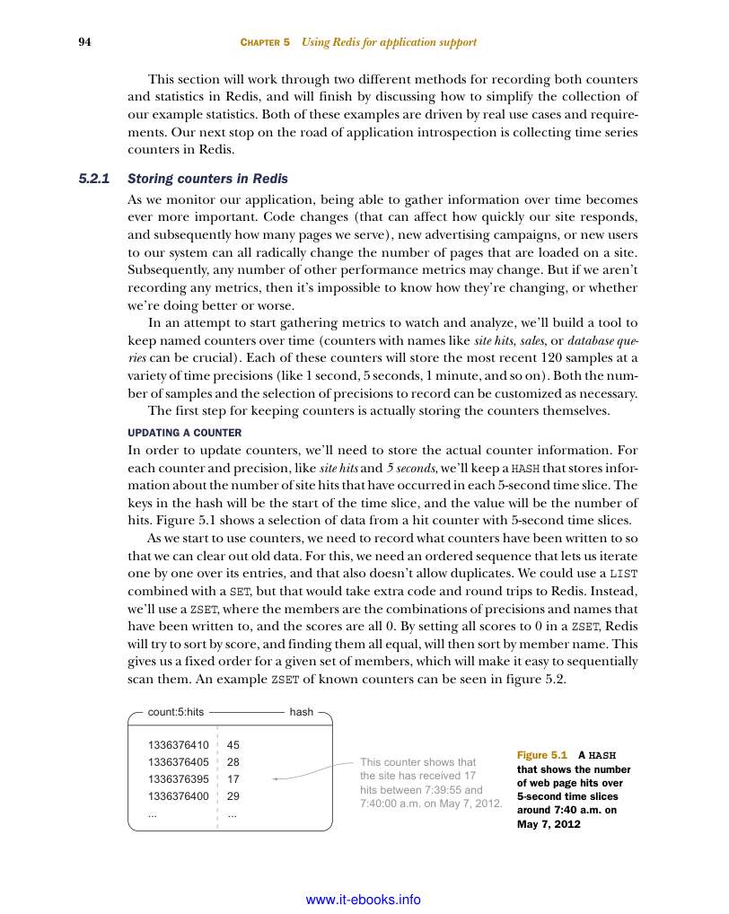
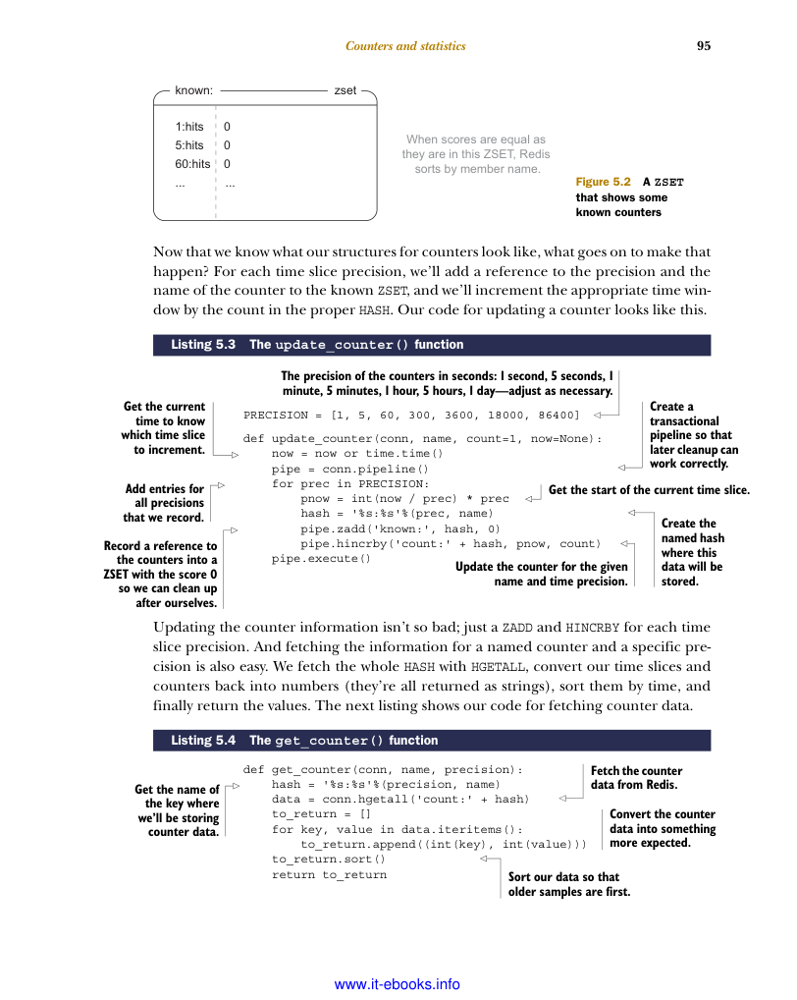
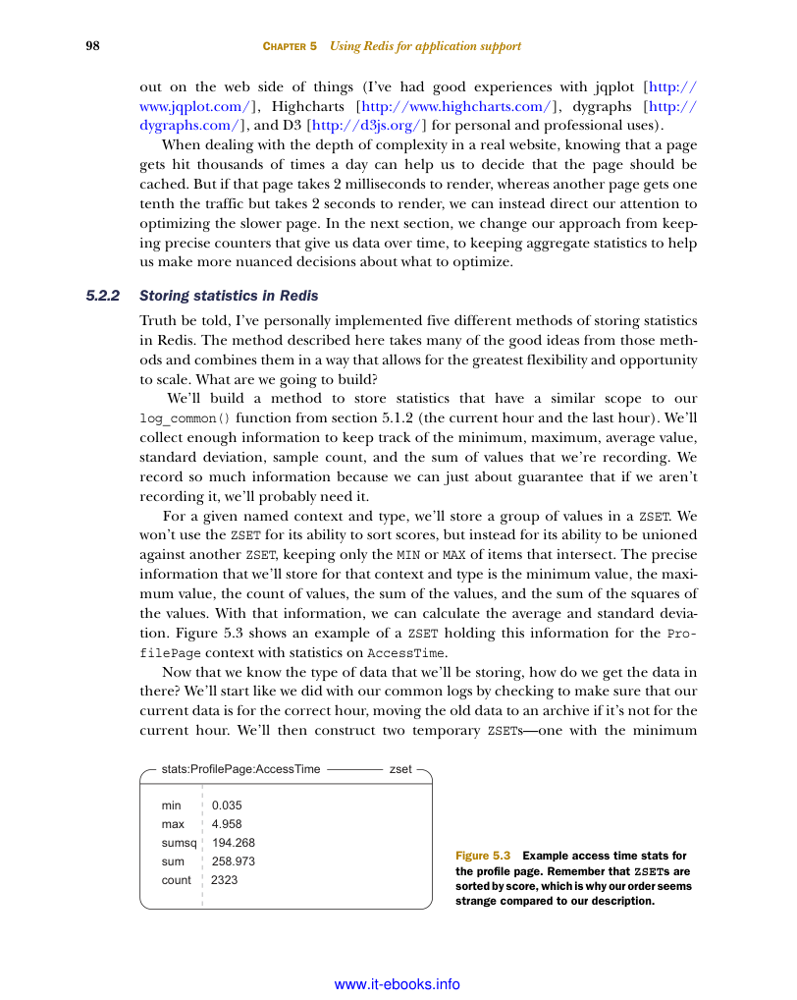
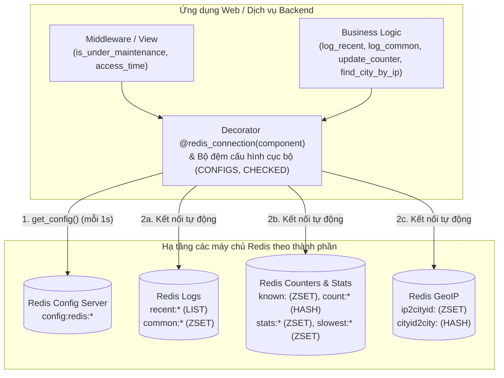

# Chương 5: Sử dụng Redis để hỗ trợ ứng dụng (Using Redis for application support)

**Nội dung chính trong chương này:**
- Ghi log vào Redis (Logging to Redis)
- Bộ đếm và thống kê (Counters and statistics)
- Xác định thành phố và quốc gia từ địa chỉ IP (Discovering city and country from IP address)
- Khám phá dịch vụ và cấu hình (Service discovery and configuration)

Ở chương trước, chúng ta đã dành phần lớn thời gian để thảo luận về cách duy trì hoạt động liên tục cho Redis như một phần trong nhóm các hệ thống lớn hơn. Trong chương này, chúng ta sẽ nói về việc sử dụng Redis để hỗ trợ các thành phần khác trong môi trường hệ thống của bạn: từ việc thu thập thông tin về trạng thái hiện tại của hệ thống thông qua nhật ký (logs) và bộ đếm (counters), đến việc tìm hiểu thông tin về các máy khách (clients) đang sử dụng hệ thống, cho tới việc cấu hình toàn bộ hệ thống bằng cách dùng Redis như một thư mục chỉ mục (directory).

Nhìn chung, chương này mang lại khả năng kiểm soát và góc nhìn sâu sắc (insight) về cách hệ thống của bạn vận hành trong thời gian chạy (runtime). Khi đọc qua các phần tiếp theo, hãy luôn nhớ rằng mục tiêu của chúng ta là hỗ trợ sự vận hành liên tục của các ứng dụng bậc cao hơn — nghĩa là các thành phần mà chúng ta xây dựng trong chương này không phải là bản thân các ứng dụng đó, mà sẽ đóng vai trò trợ lực cho các ứng dụng ấy. Sự hỗ trợ này đến từ việc ghi nhận thông tin về các ứng dụng và khách truy cập ứng dụng, cùng với một phương pháp để cấu hình ứng dụng. Hãy cùng tìm hiểu cấp độ giám sát đầu tiên mà chúng ta có thể bổ sung thông qua việc ghi log.

---

## 5.1 Ghi log vào Redis (Logging to Redis)

Khi chúng ta xây dựng các ứng dụng và dịch vụ, khả năng khám phá thông tin về hệ thống đang chạy ngày càng trở nên quan trọng. Việc có thể đào sâu vào nguồn thông tin đó để chẩn đoán sự cố, phát hiện vấn đề trước khi chúng trở nên nghiêm trọng, hoặc thậm chí chỉ để tìm hiểu thông tin về người dùng — tất cả những điều này đều đòi hỏi phải có cơ chế ghi log (logging).

Trong thế giới Linux và Unix, có hai phương pháp ghi log phổ biến. Phương pháp thứ nhất là ghi log vào một tệp tin (logging to a file), trong đó theo thời gian chúng ta ghi từng dòng log riêng lẻ vào một tệp, và định kỳ sau một khoảng thời gian thì chuyển sang ghi vào một tệp mới. Hàng ngàn phần mềm đã được viết theo cách này (bao gồm cả chính Redis). Tuy nhiên, phương pháp này có thể gặp rắc rối vì chúng ta có nhiều dịch vụ khác nhau cùng ghi vào đủ loại tệp log khác nhau, mỗi dịch vụ lại có một cơ chế xoay vòng tệp (rolling over) riêng biệt, và không có một cách chung dễ dàng nào để gom tất cả các tệp log đó lại nhằm thực hiện các xử lý hữu ích.

Chạy trên cổng TCP và UDP 514 của hầu hết mọi máy chủ Unix và Linux hiện có là một dịch vụ mang tên `syslog`, đây chính là phương pháp ghi log phổ biến thứ hai. Syslog chấp nhận các thông điệp log từ bất kỳ chương trình nào gửi tới nó và định tuyến (route) các thông điệp đó vào nhiều tệp log khác nhau trên ổ đĩa, đồng thời đảm nhận luôn việc xoay vòng (rotation) và xóa các bản log cũ. Thông qua cấu hình, nó thậm chí có thể chuyển tiếp (forward) các thông điệp sang những máy chủ khác để xử lý thêm. Dưới góc độ một dịch vụ, nó tiện lợi hơn rất nhiều so với việc ghi trực tiếp vào tệp tin, bởi mọi công việc đặc thù về xoay vòng và xóa tệp log đều đã được xử lý sẵn cho chúng ta.

> **THAY THẾ SYSLOG (REPLACING SYSLOG)**
> Cho dù cuối cùng bạn có sử dụng các phương pháp ghi log được mô tả tại đây hay không, bạn cũng rất nên cân nhắc việc thay thế tiến trình nền syslog hiện tại của mình (nhiều khả năng là `Rsyslogd`) bằng `syslog-ng`. Từng sử dụng và cấu hình cả hai hệ thống, tôi nhận thấy ngôn ngữ cấu hình mà `syslog-ng` cung cấp để điều hướng các thông điệp log dễ sử dụng hơn hẳn. Và mặc dù tôi không có đủ không gian hay thời gian để xây dựng nó trong cuốn sách này, việc xây dựng một dịch vụ tiêu thụ các thông điệp syslog rồi đưa chúng vào Redis là một cách tuyệt vời để tạo ra một tầng gián tiếp (layer of indirection) tách biệt giữa những gì cần phải diễn ra ngay lập tức để xử lý một yêu cầu (request), và những gì có thể diễn ra sau đó (như ghi log hoặc cập nhật các bộ đếm).

Việc lưu trữ sẵn các bản log trong các tệp tin trên một máy chủ duy nhất (nhờ tính năng chuyển tiếp syslog) là một kế hoạch dài hạn tuyệt vời đối với việc ghi log (hãy nhớ sao lưu chúng). Trong mục này, chúng ta sẽ thảo luận về việc sử dụng Redis như một phương thức lưu giữ các bản log nhạy cảm hơn về mặt thời gian (time-sensitive logs), đóng vai trò thay thế cho các thông điệp syslog được lưu trữ trong ngắn hạn. Góc nhìn đầu tiên của chúng ta vào các bản log liên tục thay đổi là một luồng cập nhật liên tục của các thông điệp log gần đây.

---

### 5.1.1 Nhật ký gần đây (Recent logs)

Khi xây dựng một hệ thống, việc xác định xem thông tin nào là quan trọng cần ghi lại có thể khá khó khăn. Bạn có ghi lại mỗi lần ai đó đăng nhập không? Thế còn khi họ đăng xuất thì sao? Bạn có ghi log mỗi khi ai đó thay đổi thông tin tài khoản của họ không? Hay bạn chỉ ghi log các lỗi (errors) và ngoại lệ (exceptions)? Tôi không thể trả lời trực tiếp những câu hỏi đó thay bạn, nhưng tôi có thể cung cấp một phương pháp lưu giữ danh sách các thông điệp log gần đây trong Redis, giúp bạn có được cái nhìn chụp nhanh (snapshot view) về các bản log của mình bất cứ lúc nào.

Để duy trì một danh sách các bản log gần đây, chúng ta sẽ dùng lệnh `LPUSH` đẩy các thông điệp log vào một `LIST` và sau đó cắt tỉa (`LTRIM`) danh sách đó về một kích thước cố định. Sau này, nếu muốn đọc các thông điệp log, chúng ta chỉ cần thực hiện một lệnh `LRANGE` đơn giản để lấy các thông điệp ra. Chúng ta sẽ thực hiện thêm một vài bước phụ để hỗ trợ các hàng đợi thông điệp log được đặt tên khác nhau và hỗ trợ các mức độ nghiêm trọng (severity levels) điển hình của log, nhưng bạn hoàn toàn có thể lược bỏ một trong hai phần đó trong mã nguồn của riêng mình nếu cần. Mã nguồn để ghi các bản log gần đây vào Redis được trình bày trong listing tiếp theo.

**Listing 5.1 – Hàm `log_recent()` (The log_recent() function)**

```python
SEVERITY = {                                           #A
    logging.DEBUG: 'debug',                            #A
    logging.INFO: 'info',                              #A
    logging.WARNING: 'warning',                        #A
    logging.ERROR: 'error',                            #A
    logging.CRITICAL: 'critical',                      #A
}                                                      #A
SEVERITY.update((name, name) for name in SEVERITY.values()) #A

def log_recent(conn, name, message, severity=logging.INFO, pipe=None):
    severity = str(SEVERITY.get(severity, severity)).lower()   #B
    destination = 'recent:%s:%s'%(name, severity)              #C
    message = time.asctime() + ' ' + message                   #D
    pipe = pipe or conn.pipeline()                             #E
    pipe.lpush(destination, message)                           #F
    pipe.ltrim(destination, 0, 99)                             #G
    pipe.execute()                                             #H
```

*Giải thích mã nguồn:*
- `#A` Thiết lập một bảng ánh xạ (mapping) giúp chuyển đổi hầu hết các mức độ nghiêm trọng (severity levels) của việc ghi log thành một chuỗi nhất quán.
- `#B` Thực hiện chuyển đổi mức độ ghi log thành một chuỗi ký tự đơn giản.
- `#C` Tạo khóa (key) đích nơi các thông điệp sẽ được ghi vào.
- `#D` Thêm thời gian hiện tại vào để chúng ta biết thông điệp được gửi đi khi nào.
- `#E` Thiết lập một đường ống (pipeline) để chúng ta chỉ cần một vòng truyền nhận mạng (round trip) duy nhất.
- `#F` Thêm thông điệp vào đầu danh sách log.
- `#G` Cắt tỉa danh sách log để chỉ bao gồm 100 thông điệp gần nhất.
- `#H` Thực thi hai lệnh trên.

Ngoài phần xử lý việc chuyển đổi các mức độ log khác nhau thành các chuỗi hữu ích như `info` và `debug`, hàm `log_recent()` rất đơn giản — chỉ là một lệnh `LPUSH` nhanh chóng theo sau bởi một lệnh `LTRIM`. Bây giờ bạn đã nắm rõ hơn về những gì đang diễn ra ngay lúc này, vậy liệu chúng ta có thể phát hiện ra những thông điệp phổ biến nhất (và có lẽ là quan trọng nhất) hay không?

---

### 5.1.2 Nhật ký phổ biến (Common logs)

Nếu bạn đã chạy `log_recent()`, có lẽ bạn sẽ nhận ra rằng mặc dù nó rất hữu ích để nắm bắt những gì đang xảy ra ngay tại thời điểm hiện tại, nhưng nó lại không giỏi trong việc cho bạn biết liệu có thông điệp quan trọng nào bị chìm nghỉm giữa đám nhiễu (noise) hay không. Bằng cách ghi lại thông tin về tần suất xuất hiện của một thông điệp cụ thể, sau đó bạn có thể duyệt xem các thông điệp được sắp xếp theo mức độ thường xuyên mà chúng xảy ra để giúp xác định điều gì là quan trọng.

Một cách đơn giản và hữu ích để biết một thông điệp xuất hiện thường xuyên như thế nào là lưu trữ thông điệp đó dưới dạng một phần tử (member) của một `ZSET`, với điểm số (score) chính là số lần thông điệp đó xuất hiện. Để đảm bảo rằng chúng ta chỉ nhìn thấy các thông điệp phổ biến gần đây, chúng ta sẽ xoay vòng (rotate) bản ghi các thông điệp phổ biến mỗi giờ một lần. Và để không làm mất toàn bộ dữ liệu, chúng ta sẽ giữ lại các thông điệp phổ biến của một giờ liền trước đó. Mã nguồn để theo dõi và xoay vòng các thông điệp log phổ biến được hiển thị ngay sau đây.

**Listing 5.2 – Hàm `log_common()` (The log_common() function)**

```python
def log_common(conn, name, message, severity=logging.INFO, timeout=5):
    severity = str(SEVERITY.get(severity, severity)).lower()   #A
    destination = 'common:%s:%s'%(name, severity)              #B
    start_key = destination + ':start'                         #C
    pipe = conn.pipeline()
    end = time.time() + timeout
    while time.time() < end:
        try:
            pipe.watch(start_key)                              #D
            now = datetime.utcnow().timetuple()                #E
            hour_start = datetime(*now[:4]).isoformat()        #F

            existing = pipe.get(start_key)
            pipe.multi()                                       #G
            if existing and existing < hour_start:             #H
                pipe.rename(destination, destination + ':last')    #I
                pipe.rename(start_key, destination + ':pstart')    #I
                pipe.set(start_key, hour_start)                    #J
            elif not existing:
                pipe.set(start_key, hour_start)

            pipe.zincrby(destination, message)                 #K
            log_recent(pipe, name, message, severity, pipe)    #L
            return
        except redis.exceptions.WatchError:
            continue                                           #M
```

*Giải thích mã nguồn:*
- `#A` Xử lý mức độ ghi log (logging level).
- `#B` Thiết lập khóa đích để lưu giữ các bản log phổ biến gần đây.
- `#C` Lưu một bản ghi về thời điểm bắt đầu của giờ hiện tại cho tập hợp các thông điệp này.
- `#D` Chúng ta sẽ theo dõi (`WATCH`) khóa đánh dấu đầu giờ đối với những thay đổi chỉ xảy ra vào thời điểm bắt đầu một giờ mới.
- `#E` Lấy thời gian hiện tại.
- `#F` Tìm thời điểm bắt đầu của giờ hiện tại.
- `#G` Thiết lập giao dịch (transaction).
- `#H` Nếu danh sách các bản log phổ biến hiện tại thuộc về một giờ trước đó...
- `#I` ...di chuyển thông tin log phổ biến cũ sang bản lưu trữ (archive).
- `#J` Cập nhật thời điểm bắt đầu của giờ hiện tại cho các bản log phổ biến.
- `#K` Thực sự tăng bộ đếm tần suất phổ biến của thông điệp lên.
- `#L` Gọi hàm `log_recent()` để ghi nhận các thông điệp này, và tận dụng lệnh gọi `execute()` bên trong hàm đó.
- `#M` Nếu chúng ta gặp lỗi theo dõi (`WatchError`) do một tiến trình khác vừa thực hiện lưu trữ (archiving), hãy thử lại.

Hàm ghi log này phức tạp hơn so với hàm ghi log gần đây, chủ yếu là do phải cẩn trọng khi xử lý các bản log cũ. Đó là lý do tại sao chúng ta đã sử dụng giao dịch `WATCH`/`MULTI`/`EXEC` để đổi tên `ZSET` và ghi lại khóa cho chúng ta biết dữ liệu hiện tại thuộc về giờ nào. Chúng ta cũng đã truyền đối tượng `pipeline` xuyên suốt vào hàm `log_recent()` để giảm thiểu số vòng truyền nhận mạng (round trips) tới Redis trong khi vẫn theo dõi được cả hai loại log phổ biến và gần đây.

> 📝 **Giải thích thêm (không có trong sách) — Đối chiếu với Redis 6/7/8 & redis-py 5.x hiện đại:**
> 1. **Lưu ý về cú pháp `redis-py` hiện đại (v3.0+ / v4.x / v5.x) và Python 3 trong Listing 5.1 & 5.2:**
>    - Trong sách (dùng `redis-py` 2.x), chữ ký hàm là `pipe.zincrby(destination, message)` (với lượng tăng mặc định `amount=1` đứng ở tham số thứ 3: `zincrby(name, value, amount=1)`). Trong `redis-py` hiện đại (từ bản 3.0 trở đi), thứ tự tham số đã đổi thành `pipe.zincrby(destination, 1, message)` (`zincrby(name, amount, value)`).
>    - Hàm `datetime.utcnow()` trong Python 3.12+ đã bị ngừng khuyến khích (*deprecated*) để chuyển sang đối tượng thời gian có nhận biết múi giờ (*timezone-aware*): `datetime.now(timezone.utc)`.
>    - Khi đọc `existing = pipe.get(start_key)` trong Python 3 mà không bật `decode_responses=True`, kết quả trả về là kiểu `bytes` (ví dụ `b'2025-05-07T07:00:00'`), nên khi so sánh `existing < hour_start` sẽ gây lỗi `TypeError`. Bạn nên khởi tạo kết nối Redis với `decode_responses=True`.
> 2. **Redis Streams trong Redis hiện đại (Redis 5.0+ / 6 / 7 / 8):**
>    Ngày nay, ngoài cấu trúc `LIST` kết hợp `LPUSH`/`LTRIM`, Redis cung cấp cấu trúc dữ liệu chuyên dụng cho log và luồng sự kiện là **Redis Streams** (`XADD mystream MAXLEN ~ 100 * severity info msg "..."`), hỗ trợ truy vấn theo khoảng thời gian (`XRANGE`) và Consumer Groups (`XREADGROUP`). Tuy nhiên, kỹ thuật dùng `LIST` (`LPUSH` + `LTRIM`) kết hợp `ZSET` (`ZINCRBY`) trong mục này vẫn cực kỳ gọn nhẹ và hữu hiệu khi cần thống kê tần suất thông điệp (top-K frequent logs) theo khung giờ (hoặc có thể kết hợp cấu trúc xác suất `TOPK.ADD` / `TOPK.LIST` của module RedisBloom / Redis 8).

Bây giờ khi chúng ta đã bắt đầu thu thập thông tin về phần mềm đang chạy trong Redis bằng cách lưu trữ các bản log gần đây và phổ biến, còn những loại thông tin nào khác sẽ hữu ích nếu được lưu giữ trong Redis?

---

## 5.2 Bộ đếm và thống kê (Counters and statistics)

Như bạn đã thấy từ tận chương 2 khi tôi giới thiệu khái niệm đếm từng lượt truy cập trang riêng lẻ, việc nắm được thông tin cơ bản về số lượt truy cập (hit count) có thể (chẳng hạn) làm thay đổi cách chúng ta lựa chọn bộ nhớ đệm (cache). Nhưng ví dụ của chúng ta ở chương 2 rất đơn giản, còn thực tế lại hiếm khi đơn giản như vậy, đặc biệt là khi liên quan đến một trang web thực thụ.

Thực tế việc trang web của chúng ta nhận được 10.000 lượt truy cập trong 5 phút qua, hoặc cơ sở dữ liệu đã xử lý 200 lượt ghi và 600 lượt đọc trong 5 giây qua, là những thông tin vô cùng hữu ích cần được nắm bắt. Nếu bổ sung thêm khả năng quan sát thông tin đó theo thời gian, chúng ta có thể nhận biết được sự gia tăng lưu lượng truy cập đột ngột hay tăng dần, dự đoán thời điểm cần nâng cấp máy chủ, và cuối cùng là cứu hệ thống khỏi cảnh ngừng hoạt động (downtime) do quá tải.

Mục này sẽ lần lượt đi qua hai phương pháp khác nhau để ghi nhận cả bộ đếm (counters) lẫn số liệu thống kê (statistics) trong Redis, và sẽ kết thúc bằng việc thảo luận cách đơn giản hóa quá trình thu thập các số liệu thống kê mẫu của chúng ta. Cả hai ví dụ này đều xuất phát từ các trường hợp sử dụng và yêu cầu thực tế. Điểm dừng chân tiếp theo của chúng ta trên hành trình thấu hiểu nội tại ứng dụng (application introspection) là thu thập các bộ đếm chuỗi thời gian (time series counters) trong Redis.

---

### 5.2.1 Lưu trữ bộ đếm trong Redis (Storing counters in Redis)

Khi chúng ta giám sát ứng dụng của mình, khả năng thu thập thông tin theo thời gian ngày càng trở nên quan trọng hơn bao giờ hết. Những thay đổi trong mã nguồn (vốn có thể ảnh hưởng đến tốc độ phản hồi của trang web, và kéo theo đó là số lượng trang mà chúng ta phục vụ), các chiến dịch quảng cáo mới, hoặc những người dùng mới tham gia vào hệ thống đều có thể làm thay đổi hoàn toàn số lượng trang được tải trên một website. Kéo theo đó, bất kỳ chỉ số hiệu năng (performance metrics) nào khác cũng có thể biến đổi. Nhưng nếu chúng ta không ghi nhận bất kỳ chỉ số nào, thì sẽ chẳng thể nào biết được chúng đang thay đổi ra sao, hay liệu hệ thống của chúng ta đang hoạt động tốt lên hay tệ đi.

Trong nỗ lực bắt đầu thu thập các chỉ số để theo dõi và phân tích, chúng ta sẽ xây dựng một công cụ nhằm duy trì các bộ đếm được đặt tên theo thời gian (các bộ đếm có tên như lượt truy cập trang – *site hits*, doanh số – *sales*, hoặc truy vấn cơ sở dữ liệu – *database queries* có thể đóng vai trò sống còn). Mỗi bộ đếm này sẽ lưu trữ 120 mẫu (samples) gần nhất ở nhiều độ chính xác thời gian (time precisions) khác nhau (như 1 giây, 5 giây, 1 phút, v.v.). Cả số lượng mẫu lẫn tập hợp các độ chính xác cần ghi lại đều có thể được tùy chỉnh khi cần thiết.

Bước đầu tiên để duy trì các bộ đếm là thực sự lưu trữ bản thân các bộ đếm đó.

#### CẬP NHẬT MỘT BỘ ĐẾM (UPDATING A COUNTER)

Để cập nhật các bộ đếm, chúng ta sẽ cần lưu trữ thông tin bộ đếm thực tế. Đối với mỗi bộ đếm và độ chính xác, chẳng hạn như *site hits* (lượt truy cập) và *5 seconds* (5 giây), chúng ta sẽ duy trì một cấu trúc `HASH` lưu trữ thông tin về số lượng lượt truy cập trang đã diễn ra trong mỗi lát cắt thời gian (time slice) 5 giây. Các khóa (fields) bên trong hash sẽ là thời điểm bắt đầu của lát cắt thời gian đó, và giá trị (value) sẽ là số lượt truy cập. Hình 5.1 hiển thị một phần dữ liệu trích ra từ bộ đếm lượt truy cập với các lát cắt thời gian 5 giây.

**Hình 5.1 – Một cấu trúc HASH hiển thị số lượt truy cập trang web qua các lát cắt thời gian 5 giây vào khoảng 7:40 sáng ngày 7 tháng 5 năm 2012 (Figure 5.1 A HASH that shows the number of web page hits over 5-second time slices around 7:40 a.m. on May 7, 2012)**



*Giải thích Hình 5.1:*
Cấu trúc `HASH` có tên khóa là `count:5:hits`:

| Khóa trường (Field - Timestamp bắt đầu lát cắt 5 giây) | Giá trị (Value - Số lượt hits) | Ghi chú |
| :--- | :--- | :--- |
| `1336376395` | `17` | Bộ đếm này cho thấy trang web đã nhận được 17 lượt truy cập trong khoảng từ 7:39:55 đến 7:40:00 sáng ngày 7 tháng 5 năm 2012. |
| `1336376400` | `29` | Lát cắt 5 giây tiếp theo (7:40:00 – 7:40:05). |
| `1336376405` | `28` | Lát cắt 5 giây tiếp theo (7:40:05 – 7:40:10). |
| `1336376410` | `45` | Lát cắt 5 giây tiếp theo (7:40:10 – 7:40:15). |
| `...` | `...` | Các mẫu tiếp theo... |

Khi bắt đầu sử dụng các bộ đếm, chúng ta cần ghi nhận lại những bộ đếm nào đã được ghi dữ liệu vào để sau đó có thể dọn dẹp dữ liệu cũ. Để làm điều này, chúng ta cần một chuỗi có thứ tự cho phép duyệt tuần tự từng mục một qua các phần tử của nó, đồng thời không cho phép sự trùng lặp. Chúng ta có thể sử dụng một `LIST` kết hợp với một `SET`, nhưng cách đó sẽ tốn thêm mã nguồn và thêm các vòng truyền nhận mạng tới Redis. Thay vào đó, chúng ta sẽ sử dụng một `ZSET`, trong đó các phần tử (members) là sự kết hợp giữa độ chính xác và tên bộ đếm đã được ghi vào, còn điểm số (scores) đều bằng `0`. Bằng cách đặt tất cả điểm số bằng `0` trong một `ZSET`, Redis sẽ cố gắng sắp xếp theo điểm số, và khi thấy tất cả đều bằng nhau, nó sẽ chuyển sang sắp xếp theo tên phần tử (theo thứ tự từ điển). Điều này mang lại cho chúng ta một thứ tự cố định đối với một tập hợp các phần tử cho trước, giúp việc quét tuần tự qua chúng trở nên dễ dàng. Một ví dụ về `ZSET` chứa các bộ đếm đã biết có thể được thấy trong Hình 5.2.

**Hình 5.2 – Một cấu trúc ZSET hiển thị một số bộ đếm đã biết (Figure 5.2 A ZSET that shows some known counters)**



*Giải thích Hình 5.2:*
Cấu trúc `ZSET` có tên khóa là `known:`:

| Phần tử (Member - `<precision>:<name>`) | Điểm số (Score) | Ghi chú |
| :--- | :--- | :--- |
| `1:hits` | `0` | Khi các điểm số bằng nhau như trong `ZSET` này, Redis sẽ sắp xếp theo tên phần tử (member name). |
| `5:hits` | `0` | Bộ đếm `hits` ở độ chính xác 5 giây. |
| `60:hits` | `0` | Bộ đếm `hits` ở độ chính xác 60 giây (1 phút). |
| `...` | `...` | Các bộ đếm khác... |

Bây giờ chúng ta đã biết các cấu trúc dành cho bộ đếm trông như thế nào, vậy cần phải thực hiện những gì để hiện thực hóa điều đó? Đối với mỗi độ chính xác lát cắt thời gian, chúng ta sẽ thêm một tham chiếu gồm độ chính xác và tên của bộ đếm vào `ZSET` có tên `known:`, đồng thời tăng giá trị của cửa sổ thời gian (time window) tương ứng lên theo số lượng đếm (`count`) trong `HASH` thích hợp. Mã nguồn của chúng ta để cập nhật một bộ đếm trông như sau.

**Listing 5.3 – Hàm `update_counter()` (The update_counter() function)**

```python
PRECISION = [1, 5, 60, 300, 3600, 18000, 86400]         #A

def update_counter(conn, name, count=1, now=None):
    now = now or time.time()                            #B
    pipe = conn.pipeline()                              #C
    for prec in PRECISION:                              #D
        pnow = int(now / prec) * prec                   #E
        hash = '%s:%s'%(prec, name)                     #F
        pipe.zadd('known:', hash, 0)                    #G
        pipe.hincrby('count:' + hash, pnow, count)      #H
    pipe.execute()
```

*Giải thích mã nguồn:*
- `#A` Độ chính xác của các bộ đếm tính bằng giây: 1 giây, 5 giây, 1 phút, 5 phút, 1 giờ, 5 giờ, 1 ngày — hãy điều chỉnh khi cần thiết.
- `#B` Lấy thời gian hiện tại để biết cần tăng giá trị cho lát cắt thời gian nào.
- `#C` Tạo một đường ống giao dịch (transactional pipeline) để quá trình dọn dẹp sau này có thể hoạt động chính xác.
- `#D` Thêm các mục cho tất cả các độ chính xác mà chúng ta ghi nhận.
- `#E` Lấy thời điểm bắt đầu của lát cắt thời gian hiện tại.
- `#F` Tạo tên hash nơi dữ liệu này sẽ được lưu trữ.
- `#G` Ghi lại một tham chiếu tới các bộ đếm vào một `ZSET` với điểm số `0` để chúng ta có thể tự dọn dẹp sau này.
- `#H` Cập nhật bộ đếm cho tên và độ chính xác thời gian tương ứng.

Việc cập nhật thông tin bộ đếm không quá phức tạp; chỉ là một lệnh `ZADD` và `HINCRBY` cho mỗi độ chính xác lát cắt thời gian. Và việc lấy thông tin ra cho một bộ đếm có tên cùng một độ chính xác cụ thể cũng rất dễ dàng. Chúng ta lấy toàn bộ `HASH` bằng lệnh `HGETALL`, chuyển đổi các lát cắt thời gian và giá trị đếm ngược trở lại thành các con số (vì tất cả chúng đều được trả về dưới dạng chuỗi ký tự), sắp xếp chúng theo thời gian, và cuối cùng trả về các giá trị đó. Listing tiếp theo hiển thị mã nguồn của chúng ta để lấy dữ liệu bộ đếm.

**Listing 5.4 – Hàm `get_counter()` (The get_counter() function)**

```python
def get_counter(conn, name, precision):
    hash = '%s:%s'%(precision, name)                #A
    data = conn.hgetall('count:' + hash)            #B
    to_return = []
    for key, value in data.iteritems():             #C
        to_return.append((int(key), int(value)))    #C
    to_return.sort()                                #D
    return to_return
```

*Giải thích mã nguồn:*
- `#A` Lấy tên của khóa nơi chúng ta lưu trữ dữ liệu bộ đếm.
- `#B` Lấy dữ liệu bộ đếm từ Redis.
- `#C` Chuyển đổi dữ liệu bộ đếm thành định dạng đúng như kỳ vọng (cặp số nguyên).
- `#D` Sắp xếp dữ liệu để các mẫu cũ hơn đứng trước.

Chúng ta đã làm chính xác những gì mình đã nói. Chúng ta lấy dữ liệu ra, sắp xếp nó tuần tự dựa trên thời gian, và chuyển đổi nó trở lại thành các số nguyên. Hãy cùng xem cách chúng ta ngăn không cho các bộ đếm này lưu giữ quá nhiều dữ liệu.

#### DỌN DẸP CÁC BỘ ĐẾM CŨ (CLEANING OUT OLD COUNTERS)

Hiện tại chúng ta đã ghi tất cả các bộ đếm của mình vào Redis và có thể lấy chúng ra một cách dễ dàng. Nhưng khi chúng ta liên tục cập nhật các bộ đếm, đến một lúc nào đó chúng ta sẽ cạn kiệt bộ nhớ nếu không thực hiện bất kỳ thao tác dọn dẹp nào. Nhờ đã tính toán trước, chúng ta đã ghi danh sách các bộ đếm đã biết vào `ZSET` `known:`. Để dọn dẹp các bộ đếm, chúng ta cần duyệt qua danh sách đó và xóa bỏ các mục cũ.

> **TẠI SAO KHÔNG SỬ DỤNG EXPIRE? (WHY NOT USE EXPIRE?)**
> Một hạn chế của lệnh `EXPIRE` là nó chỉ áp dụng cho toàn bộ khóa (whole keys); chúng ta không thể thiết lập hết hạn cho từng phần bên trong một khóa. Và bởi vì chúng ta đã chọn cách cấu trúc dữ liệu sao cho bộ đếm X ở độ chính xác Y nằm trong một khóa duy nhất xuyên suốt mọi thời điểm, nên chúng ta phải định kỳ dọn dẹp các bộ đếm đó. Nếu bạn thích thử thách, bạn có thể thử tái cấu trúc lại các bộ đếm để thay đổi cách bố trí dữ liệu nhằm sử dụng cơ chế hết hạn tiêu chuẩn của Redis.
>
> *(Lưu ý bổ sung cho Redis hiện đại: Từ phiên bản **Redis 7.4 (năm 2024)**, Redis đã chính thức bổ sung các lệnh đặt thời gian hết hạn cho từng trường bên trong Hash như `HEXPIRE`, `HPEXPIRE`, `HEXPIREAT`, `HTTL`! Tuy nhiên, ở các phiên bản Redis trước 7.4 và trong thiết kế kinh điển của cuốn sách, việc dùng tiến trình nền kết hợp `HDEL` như dưới đây là cách tiếp cận chuẩn mực).*

Khi chúng ta xử lý và dọn dẹp các bộ đếm cũ, có một vài điều quan trọng cần chú ý. Danh sách dưới đây chỉ ra một số điểm quan trọng hơn cả mà chúng ta cần lưu tâm khi dọn dẹp các bộ đếm cũ:
- Các bộ đếm mới có thể được thêm vào bất cứ lúc nào.
- Nhiều tiến trình dọn dẹp khác nhau có thể đang diễn ra cùng một lúc.
- Cố gắng dọn dẹp các bộ đếm theo ngày (daily counters) mỗi phút một lần là sự lãng phí công sức.
- Nếu một bộ đếm không còn dữ liệu nào nữa, chúng ta không nên cố dọn dẹp nó thêm nữa.

Với tất cả những điểm đó trong đầu, chúng ta sẽ xây dựng một hàm tiến trình nền (daemon function) có cách thức hoạt động tương tự như các hàm daemon mà chúng ta đã viết ở chương 2. Giống như trước, chúng ta sẽ lặp đi lặp lại cho đến khi hệ thống nhận được lệnh dừng. Để giúp giảm thiểu tải trong quá trình dọn dẹp, chúng ta sẽ cố gắng dọn dẹp các bộ đếm cũ khoảng mỗi phút một lần, đồng thời cũng sẽ dọn dẹp các bộ đếm cũ theo lịch trình xấp xỉ với tần suất mà chúng tạo ra các mục mới, ngoại trừ những bộ đếm nhận thêm mục mới thường xuyên hơn mức mỗi phút một lần. Nếu một bộ đếm có lát cắt thời gian là 5 phút, chúng ta sẽ cố gắng dọn dẹp các mục cũ khỏi bộ đếm đó mỗi 5 phút một lần. Còn với những bộ đếm có các mục mới thường xuyên hơn (1 giây và 5 giây trong ví dụ của chúng ta), chúng ta sẽ dọn dẹp chúng mỗi phút một lần.

Để duyệt qua các bộ đếm, chúng ta sẽ lấy ra từng bộ đếm đã biết một bằng lệnh `ZRANGE`. Để làm sạch một bộ đếm, chúng ta sẽ lấy tất cả các thời điểm bắt đầu của bộ đếm đó, tính toán xem những mục nào nằm trước một mốc giới hạn đã tính (cách đây 120 mẫu), và xóa chúng đi. Nếu không còn dữ liệu nào cho một bộ đếm cụ thể, chúng ta sẽ xóa tham chiếu của bộ đếm đó khỏi `ZSET` `known:`. Việc giải thích những gì diễn ra thì đơn giản, nhưng chi tiết trong mã nguồn lại cho thấy một số trường hợp biên (corner cases). Hãy xem kỹ listing này để thấy toàn bộ chi tiết của mã nguồn dọn dẹp.

**Listing 5.5 – Hàm `clean_counters()` (The clean_counters() function)**

```python
def clean_counters(conn):
    pipe = conn.pipeline(True)
    passes = 0                                                  #A
    while not QUIT:                                             #B
        start = time.time()                                     #C
        index = 0                                               #D
        while index < conn.zcard('known:'):                     #D
            hash = conn.zrange('known:', index, index)          #E
            index += 1
            if not hash:
                break
            hash = hash[0]
            prec = int(hash.partition(':')[0])                  #F
            bprec = int(prec // 60) or 1                        #G
            if passes % bprec:                                  #H
                continue

            hkey = 'count:' + hash
            cutoff = time.time() - SAMPLE_COUNT * prec          #I
            samples = map(int, conn.hkeys(hkey))                #J
            samples.sort()                                      #K
            remove = bisect.bisect_right(samples, cutoff)       #K

            if remove:                                          #L
                conn.hdel(hkey, *samples[:remove])              #L
                if remove == len(samples):                      #M
                    try:
                        pipe.watch(hkey)                        #N
                        if not pipe.hlen(hkey):                 #O
                            pipe.multi()                        #O
                            pipe.zrem('known:', hash)           #O
                            pipe.execute()                      #O
                            index -= 1                          #P
                        else:
                            pipe.unwatch()                      #Q
                    except redis.exceptions.WatchError:         #R
                        pass                                    #R

        passes += 1                                             #S
        duration = min(int(time.time() - start) + 1, 60)        #S
        time.sleep(max(60 - duration, 1))                       #T
```

*Giải thích mã nguồn:*
- `#A` Lưu lại số lần duyệt (passes) để chúng ta có thể cân bằng việc dọn dẹp giữa các bộ đếm theo giây và các bộ đếm theo ngày.
- `#B` Tiếp tục dọn dẹp các bộ đếm cho đến khi nhận được lệnh dừng.
- `#C` Lấy thời điểm bắt đầu của lượt duyệt để tính tổng thời gian thực thi.
- `#D` Duyệt tăng dần qua tất cả các bộ đếm đã biết.
- `#E` Lấy bộ đếm tiếp theo cần kiểm tra.
- `#F` Lấy độ chính xác (precision) của bộ đếm.
- `#G` Chúng ta sẽ thực hiện một lượt duyệt khoảng mỗi 60 giây một lần, vì vậy chúng ta sẽ cố gắng dọn dẹp các bộ đếm với tần suất xấp xỉ tốc độ mà chúng được ghi dữ liệu.
- `#H` Thử bộ đếm tiếp theo nếu chúng ta chưa cần kiểm tra bộ đếm này trong lượt duyệt hiện tại (ví dụ: chúng ta đã thực hiện 3 lượt duyệt, nhưng bộ đếm lại có độ chính xác là 5 phút).
- `#I` Tìm mốc thời gian giới hạn (cutoff time) cho mẫu sớm nhất mà chúng ta nên giữ lại, dựa trên độ chính xác và số lượng mẫu (`SAMPLE_COUNT`, ví dụ 120) mà chúng ta muốn lưu.
- `#J` Lấy thời gian của các mẫu và chuyển đổi các chuỗi ký tự thành số nguyên.
- `#K` Xác định số lượng mẫu cần phải xóa bỏ (sử dụng thuật toán tìm kiếm nhị phân `bisect_right` trên danh sách đã sắp xếp).
- `#L` Xóa bỏ các mẫu khi cần thiết.
- `#M` Cấu trúc `HASH` chứa dữ liệu lúc này có thể đã trống rỗng.
- `#N` Theo dõi (`WATCH`) hash bộ đếm để phát hiện các thay đổi.
- `#O` Xác minh rằng hash bộ đếm thực sự trống rỗng, và nếu đúng như vậy, xóa nó khỏi danh sách các bộ đếm đã biết (`known:`).
- `#P` Nếu chúng ta đã xóa một bộ đếm, thì ở lượt duyệt kế tiếp chúng ta có thể sử dụng lại cùng chỉ số `index` đó.
- `#Q` Hash không trống rỗng; hãy giữ nó lại trong danh sách các bộ đếm đã biết.
- `#R` Một tiến trình khác đã thay đổi hash bộ đếm bằng cách thêm dữ liệu đếm vào, nghĩa là nó đang có dữ liệu, vì vậy chúng ta sẽ để bộ đếm đó lại trong danh sách các bộ đếm đã biết.
- `#S` Cập nhật các biến `passes` và `duration` cho lượt duyệt tiếp theo nhằm dọn dẹp các bộ đếm thường xuyên tương ứng với tần suất chúng nhận cập nhật.
- `#T` Nghỉ (sleep) trong khoảng thời gian còn lại của 60 giây, hoặc ít nhất là 1 giây, để nhường tài nguyên đôi chút.

Như đã mô tả trước đó, chúng ta duyệt từng phần tử một qua `ZSET` chứa các bộ đếm để tìm kiếm những mục cần dọn dẹp. Chúng ta chỉ dọn dẹp những bộ đếm đến lịch cần làm sạch trong lượt duyệt này, do đó phép kiểm tra đó được thực hiện ngay từ đầu. Tiếp theo, chúng ta lấy dữ liệu bộ đếm và xác định xem những gì (nếu có) cần được dọn dẹp. Sau khi xóa bỏ dữ liệu cũ nếu cần, nếu chúng ta cho rằng không còn dữ liệu nào sót lại, chúng ta sẽ xác minh lại rằng không còn dữ liệu nào cho bộ đếm đó nữa rồi mới xóa nó khỏi `ZSET` chứa các bộ đếm. Cuối cùng, sau khi đi qua tất cả các bộ đếm, chúng ta tính toán xem mất bao lâu để hoàn thành một lượt duyệt, và cho tiến trình ngủ trong khoảng thời gian còn lại của một phút mà chúng ta đã dành ra để thực hiện toàn bộ việc dọn dẹp, trước khi bước sang lượt duyệt kế tiếp.

Bây giờ khi chúng ta đã có dữ liệu bộ đếm, đang dọn dẹp nó định kỳ, và có thể truy xuất nó, công việc còn lại chỉ là xây dựng một giao diện để tiêu thụ và hiển thị dữ liệu đó. Đáng tiếc là phần đó nằm ngoài phạm vi của cuốn sách này, nhưng có một vài thư viện vẽ biểu đồ bằng JavaScript rất tốt có thể giúp bạn ở phía giao diện web (tôi từng có trải nghiệm tốt với jqPlot [http://www.jqplot.com/], Highcharts [http://www.highcharts.com/], dygraphs [http://dygraphs.com/], và D3 [http://d3js.org/] cho cả mục đích cá nhân lẫn công việc chuyên môn).

Khi đối mặt với mức độ phức tạp sâu sắc của một trang web thực tế, việc biết rằng một trang nhận được hàng ngàn lượt truy cập mỗi ngày có thể giúp chúng ta quyết định đưa trang đó vào bộ nhớ đệm (cache). Nhưng nếu trang đó chỉ mất 2 mili-giây để kết xuất (render), trong khi một trang khác chỉ nhận được một phần mười lưu lượng truy cập nhưng lại mất tới 2 giây để kết xuất, thì thay vào đó chúng ta có thể hướng sự chú ý của mình vào việc tối ưu hóa trang chậm hơn kia. Trong mục tiếp theo, chúng ta sẽ thay đổi cách tiếp cận từ việc duy trì các bộ đếm chính xác cung cấp dữ liệu theo thời gian, sang việc lưu giữ các số liệu thống kê tổng hợp (aggregate statistics) nhằm giúp chúng ta đưa ra những quyết định tinh tế hơn về việc cần tối ưu hóa thành phần nào.

> 📝 **Giải thích thêm (không có trong sách) — Đối chiếu với Redis 6/7/8 & redis-py 5.x hiện đại (Bộ đếm chuỗi thời gian):**
>
> 1. **Nâng cấp mã nguồn Listing 5.3, 5.4, 5.5 sang Python 3 + `redis-py` 5.x (`decode_responses=True`):**
>    - **Listing 5.3 (`update_counter`):** Trong `redis-py` 5.x, `pipe.zadd('known:', hash, 0)` phải đổi sang truyền dictionary: `pipe.zadd('known:', {hash: 0})`.
>    - **Listing 5.4 (`get_counter`):** Trong Python 3, phương thức `data.iteritems()` đã bị xóa; hãy dùng `data.items()`:
>      ```python
>      to_return = sorted((int(k), int(v)) for k, v in data.items())
>      ```
>    - **Listing 5.5 (`clean_counters`):** Trong Python 3, `map(int, conn.hkeys(hkey))` trả về một đối tượng `map` iterator (không có phương thức `.sort()` và không hỗ trợ cắt lát `samples[:remove]`). Cần bọc `list(...)` hoặc dùng `sorted(...)`:
>      ```python
>      samples = sorted(map(int, conn.hkeys(hkey)))
>      ```
> 2. **Giải pháp hiện đại 1 — Đặt TTL trực tiếp trên từng trường của Hash với `HEXPIRE` (Redis 7.4+):**
>    Nếu dùng Redis 7.4 trở lên, bạn có thể loại bỏ hoàn toàn tiến trình nền `clean_counters()` và `ZSET` `known:` bằng cách đặt thời gian sống cho từng lát cắt thời gian `pnow` ngay lúc cập nhật:
>    ```python
>    pipe.hincrby(f"count:{hash_name}", pnow, count)
>    pipe.hexpire(f"count:{hash_name}", SAMPLE_COUNT * prec, "FIELDS", 1, pnow)
>    ```
> 3. **Giải pháp hiện đại 2 — Sử dụng cấu trúc chuyên dụng Redis TimeSeries (`TS.*` trong Redis Stack / Redis 8):**
>    Thay vì tự quản lý nhiều `HASH` ở các độ chính xác `1s, 5s, 60s, 3600s...` và chạy daemon dọn rác, **Redis TimeSeries** hỗ trợ sẵn việc lưu chuỗi thời gian nén cực kỳ tiết kiệm bộ nhớ, tự động cắt bỏ mẫu cũ qua tham số `RETENTION`, và tự động tổng hợp (downsampling) sang các độ phân giải lớn hơn thông qua quy tắc **`TS.CREATERULE` (`COMPACTION`)**:
>
> | Tiêu chí | Tự xây dựng bằng `HASH` + `ZSET` (Mục 5.2.1) | Redis TimeSeries (`TS.CREATE` / `TS.ADD` / `TS.CREATERULE`) |
> | :--- | :--- | :--- |
> | **Cập nhật mẫu mới** | Vòng lặp qua 7 độ chính xác, gọi 7 cặp `ZADD` + `HINCRBY` | Chỉ gọi **1 lệnh duy nhất** `TS.ADD ts:hits:1s * 1 ON_DUPLICATE SUM`; Redis tự động cập nhật dây chuyền sang các khung `5s`, `60s`, `3600s`! |
> | **Tự động xóa mẫu cũ (Retention)** | Phải chạy tiến trình nền `clean_counters()` quét `HKEYS` và `HDEL` mỗi phút | Tự động hoàn toàn ở tầng C của Redis nhờ cờ `RETENTION <ms>` khi tạo khóa. |
> | **Truy vấn khoảng thời gian** | Phải kéo toàn bộ `HGETALL` về Python rồi tự `sort()` | Truy vấn khoảng bất kỳ kèm gom nhóm trực tiếp trên server bằng `TS.RANGE key from_ts to_ts AGGREGATION sum 5000`. |

> 💡 **Ví dụ bổ sung (không có trong sách) — Triển khai bộ đếm đa độ phân giải bằng Redis TimeSeries trong `redis-py` 5.x:**
>
> ```python
> import redis
>
> r = redis.Redis(host="localhost", port=6379, decode_responses=True)
> ts = r.ts()
>
> # 1. Khởi tạo chuỗi thời gian gốc (độ chính xác 1s, giữ 120 mẫu = 120.000ms)
> ts.create("ts:hits:1", retention_msecs=120_000, duplicate_policy="sum")
>
> # 2. Khởi tạo chuỗi thời gian 5s (giữ 120 mẫu = 600.000ms) và gắn quy tắc COMPACTION tự động
> ts.create("ts:hits:5", retention_msecs=600_000)
> ts.createrule("ts:hits:1", "ts:hits:5", aggregation_type="sum", bucket_size_msec=5_000)
>
> # 3. Khi có lượt truy cập mới, chỉ cần ghi vào chuỗi gốc ('*' lấy giờ của Redis Server)
> ts.add("ts:hits:1", "*", 1)
>
> # 4. Truy vấn các lát cắt 5 giây trong 10 phút vừa qua
> samples_5s = ts.range("ts:hits:5", "-", "+")
> ```

---

### 5.2.2 Lưu trữ số liệu thống kê trong Redis (Storing statistics in Redis)

Thú thật, cá nhân tôi đã từng triển khai năm phương pháp lưu trữ số liệu thống kê khác nhau trong Redis. Phương pháp được mô tả tại đây chắt lọc nhiều ý tưởng hay từ các phương pháp đó và kết hợp chúng theo một cách mang lại sự linh hoạt tối đa cùng cơ hội mở rộng quy mô (scale) tốt nhất. Vậy chúng ta sẽ xây dựng những gì?

Chúng ta sẽ xây dựng một phương pháp lưu trữ các số liệu thống kê có phạm vi tương tự như hàm `log_common()` ở mục 5.1.2 (giờ hiện tại và giờ liền trước đó). Chúng ta sẽ thu thập đủ thông tin để theo dõi giá trị nhỏ nhất (minimum), giá trị lớn nhất (maximum), giá trị trung bình (average value), độ lệch chuẩn (standard deviation), số lượng mẫu (sample count), và tổng các giá trị (sum of values) mà chúng ta đang ghi nhận. Chúng ta ghi lại nhiều thông tin như vậy bởi vì gần như có thể đảm bảo chắc chắn rằng nếu chúng ta không ghi lại một chỉ số nào đó, rất có thể lúc cần đến chúng ta lại không có nó.

Đối với một ngữ cảnh (context) và loại thống kê (type) được đặt tên cho trước, chúng ta sẽ lưu trữ một nhóm các giá trị trong một `ZSET`. Chúng ta sẽ không sử dụng `ZSET` vì khả năng sắp xếp điểm số của nó, mà thay vào đó là vì khả năng hợp (`ZUNIONSTORE`) với một `ZSET` khác, trong đó chỉ giữ lại giá trị nhỏ nhất (`MIN`) hoặc lớn nhất (`MAX`) của các phần tử giao nhau. Thông tin chính xác mà chúng ta sẽ lưu trữ cho ngữ cảnh và loại thống kê đó là giá trị nhỏ nhất (`min`), giá trị lớn nhất (`max`), số lượng giá trị (`count`), tổng các giá trị (`sum`), và tổng bình phương của các giá trị (`sumsq`). Với những thông tin đó, chúng ta có thể tính toán được giá trị trung bình và độ lệch chuẩn. Hình 5.3 hiển thị một ví dụ về một `ZSET` lưu giữ thông tin này cho ngữ cảnh `ProfilePage` với số liệu thống kê về thời gian truy cập (`AccessTime`).

**Hình 5.3 – Ví dụ về số liệu thống kê thời gian truy cập cho trang hồ sơ (ProfilePage). Hãy nhớ rằng các ZSET được sắp xếp theo điểm số (score), đó là lý do tại sao thứ tự hiển thị có vẻ lạ so với phần mô tả của chúng ta. (Figure 5.3 Example access time stats for the profile page. Remember that ZSETs are sorted by score, which is why our order seems strange compared to our description.)**



*Giải thích Hình 5.3:*
Cấu trúc `ZSET` có tên khóa là `stats:ProfilePage:AccessTime`:

| Phần tử (Member) | Điểm số (Score) | Ý nghĩa thống kê |
| :--- | :--- | :--- |
| `min` | `0.035` | Thời gian truy cập nhỏ nhất (nhanh nhất): 0.035 giây. |
| `max` | `4.958` | Thời gian truy cập lớn nhất (chậm nhất): 4.958 giây. |
| `sumsq` | `194.268` | Tổng bình phương các giá trị ($\sum x_i^2$). |
| `sum` | `258.973` | Tổng các giá trị ($\sum x_i$). |
| `count` | `2323` | Tổng số mẫu đo đạc ($N = 2323$). |

Bây giờ khi đã biết loại dữ liệu mà chúng ta sẽ lưu trữ, làm thế nào để chúng ta đưa dữ liệu đó vào trong Redis? Chúng ta sẽ bắt đầu giống như đã làm với các bản log phổ biến bằng cách kiểm tra để đảm bảo rằng dữ liệu hiện tại của chúng ta thuộc về đúng giờ hiện hành, và chuyển dữ liệu cũ sang bản lưu trữ (archive) nếu nó không thuộc về giờ hiện tại. Sau đó, chúng ta sẽ tạo ra hai `ZSET` tạm thời — một chứa giá trị nhỏ nhất (`min`), một chứa giá trị lớn nhất (`max`) — rồi thực hiện lệnh `ZUNIONSTORE` kết hợp chúng với khóa thống kê hiện tại cùng tùy chọn tổng hợp (`aggregate`) tương ứng là `MIN` và `MAX`. Cách làm đó sẽ cho phép chúng ta cập nhật dữ liệu nhanh chóng mà không cần phải `WATCH` một khóa thống kê có khả năng đang được cập nhật với tần suất rất cao. Sau khi xóa bỏ các `ZSET` tạm thời đó, chúng ta sẽ dùng lệnh `ZINCRBY` để cộng dồn các phần tử `count`, `sum`, và `sumsq` của `ZSET` thống kê. Mã nguồn của chúng ta để thực hiện thao tác này được trình bày ngay sau đây.

**Listing 5.6 – Hàm `update_stats()` (The update_stats() function)**

```python
def update_stats(conn, context, type, value, timeout=5):
    destination = 'stats:%s:%s'%(context, type)                 #A
    start_key = destination + ':start'                          #B
    pipe = conn.pipeline(True)
    end = time.time() + timeout
    while time.time() < end:
        try:
            pipe.watch(start_key)                               #B
            now = datetime.utcnow().timetuple()                 #B
            hour_start = datetime(*now[:4]).isoformat()         #B

            existing = pipe.get(start_key)                      #B
            pipe.multi()                                        #B
            if existing and existing < hour_start:              #B
                pipe.rename(destination, destination + ':last') #B
                pipe.rename(start_key, destination + ':pstart') #B
                pipe.set(start_key, hour_start)                 #B

            tkey1 = str(uuid.uuid4())                           #C
            tkey2 = str(uuid.uuid4())                           #C
            pipe.zadd(tkey1, 'min', value)                      #C
            pipe.zadd(tkey2, 'max', value)                      #C
            pipe.zunionstore(destination,                       #D
                [destination, tkey1], aggregate='min')          #D
            pipe.zunionstore(destination,                       #D
                [destination, tkey2], aggregate='max')          #D

            pipe.delete(tkey1, tkey2)                           #E
            pipe.zincrby(destination, 'count')                  #F
            pipe.zincrby(destination, 'sum', value)             #F
            pipe.zincrby(destination, 'sumsq', value*value)     #F

            return pipe.execute()[-3:]                          #G
        except redis.exceptions.WatchError:
            continue                                            #H
```

*Giải thích mã nguồn:*
- `#A` Thiết lập khóa thống kê đích.
- `#B` Xử lý phần dữ liệu của giờ hiện tại / giờ trước đó giống như trong hàm `log_common()`.
- `#C` Thêm giá trị đo được vào các khóa tạm thời.
- `#D` Hợp (`ZUNIONSTORE`) các khóa tạm thời với khóa thống kê đích, sử dụng hàm tổng hợp `min`/`max` tương ứng.
- `#E` Dọn dẹp (xóa) các khóa tạm thời.
- `#F` Cập nhật các phần tử số lượng (`count`), tổng (`sum`), và tổng bình phương (`sumsq`) của `ZSET`.
- `#G` Trả về thông tin bộ đếm cơ sở (3 kết quả cuối từ pipeline: `count`, `sum`, `sumsq`) để hàm gọi có thể thực hiện thêm các xử lý thú vị nếu cần.
- `#H` Nếu vừa bước sang giờ mới và dữ liệu thống kê đã được chuyển sang bản lưu trữ bởi một tiến trình khác, hãy thử lại.

Chúng ta có thể bỏ qua gần như toàn bộ nửa đầu của đoạn mã trong listing trên, vì nó là bản sao nguyên văn của đoạn mã xoay vòng theo giờ từ hàm `log_common()` ở mục 5.1.2. Nửa sau làm chính xác những gì chúng ta đã mô tả: tạo các `ZSET` tạm thời, thực hiện `ZUNIONSTORE` chúng với `ZSET` đích cùng các hàm tổng hợp thích hợp, dọn dẹp các `ZSET` tạm thời, và sau đó cộng thêm thông tin thống kê tiêu chuẩn của chúng ta. Nhưng còn việc lấy thông tin thống kê đó ra thì sao?

Để lấy thông tin ra, chúng ta cần đọc tất cả các giá trị từ `ZSET` và sau đó tính toán giá trị trung bình cùng độ lệch chuẩn. Giá trị trung bình đơn giản là phần tử `sum` chia cho phần tử `count`. Nhưng độ lệch chuẩn thì phức tạp hơn. Với một chút biến đổi đại số, chúng ta có thể suy ra độ lệch chuẩn từ những thông tin hiện có, dù để ngắn gọn tôi sẽ không giải thích chi tiết phần toán học đằng sau nó. Mã nguồn của chúng ta để lấy số liệu thống kê được hiển thị dưới đây.

**Listing 5.7 – Hàm `get_stats()` (The get_stats() function)**

```python
def get_stats(conn, context, type):
    key = 'stats:%s:%s'%(context, type)                            #A
    data = dict(conn.zrange(key, 0, -1, withscores=True))          #B
    data['average'] = data['sum'] / data['count']                  #C
    numerator = data['sumsq'] - data['sum'] ** 2 / data['count']   #D
    data['stddev'] = (numerator / (data['count'] - 1 or 1)) ** .5  #E
    return data
```

*Giải thích mã nguồn:*
- `#A` Thiết lập khóa mà chúng ta sẽ lấy số liệu thống kê từ đó.
- `#B` Lấy các số liệu thống kê cơ bản và đóng gói chúng thành một từ điển (`dict`).
- `#C` Tính toán giá trị trung bình (`average`).
- `#D` Chuẩn bị phần tử số (numerator) đầu tiên trong công thức tính độ lệch chuẩn.
- `#E` Hoàn tất phép tính độ lệch chuẩn (`stddev`).

> 📝 **Giải thích thêm (không có trong sách) — Đối chiếu với Redis 6/7/8 & redis-py 5.x hiện đại (Thống kê & Phân vị Latency):**
> 1. **Công thức toán học tính độ lệch chuẩn mẫu (Sample Standard Deviation) trong một lượt duyệt:**
>    Độ lệch chuẩn mẫu $s$ của $N$ mẫu $x_1, x_2, \dots, x_N$ với trung bình $\bar{x} = \frac{1}{N}\sum x_i$ được định nghĩa là:
>    $$s = \sqrt{\frac{1}{N - 1} \sum_{i=1}^{N} (x_i - \bar{x})^2}$$
>    Khai triển biểu thức bình phương bên trong tổng:
>    $$\sum_{i=1}^{N} (x_i - \bar{x})^2 = \sum_{i=1}^{N} x_i^2 - 2\bar{x}\sum_{i=1}^{N} x_i + N\bar{x}^2 = \text{sumsq} - \frac{(\text{sum})^2}{\text{count}}$$
>    Nhờ đẳng thức này, chúng ta không cần lưu toàn bộ từng mẫu đo $x_i$ mà chỉ cần cộng dồn `count`, `sum` ($\sum x_i$) và `sumsq` ($\sum x_i^2$) bằng lệnh `ZINCRBY` trong thời gian $O(1)$!
> 2. **Nâng cấp cú pháp Listing 5.6, 5.7, 5.8 sang `redis-py` 5.x và tối ưu `ZADD LT/GT` (Redis 6.2+):**
>    - Trong Listing 5.6 (`update_stats`), cú pháp cũ `pipe.zadd(tkey1, 'min', value)` và `pipe.zincrby(destination, 'sum', value)` của `redis-py` 2.x phải được đổi sang chuẩn `redis-py` 5.x:
>      ```python
>      pipe.zadd(tkey1, {'min': value})
>      pipe.zadd(tkey2, {'max': value})
>      ...
>      pipe.zincrby(destination, 1, 'count')
>      pipe.zincrby(destination, value, 'sum')
>      pipe.zincrby(destination, value * value, 'sumsq')
>      ```
>      Và trong Listing 5.8 (`access_time`), dòng `pipe.zadd('slowest:AccessTime', context, average)` đổi thành `pipe.zadd('slowest:AccessTime', {context: average})`.
>    - Tuyệt vời hơn, khi cuốn sách viết (thời Redis 2.6), lệnh `ZADD` chưa có cờ `LT` / `GT`, nên tác giả phải tạo 2 khóa `ZSET` tạm (`tkey1`, `tkey2`) rồi dùng `ZUNIONSTORE ... AGGREGATE MIN/MAX`. Từ **Redis 6.2+**, lệnh `ZADD` hỗ trợ trực tiếp cờ `LT` (chỉ cập nhật điểm mới nếu *nhỏ hơn* điểm hiện tại, hoặc thêm mới nếu phần tử chưa tồn tại) và `GT` (chỉ cập nhật điểm mới nếu *lớn hơn* điểm hiện tại, hoặc thêm mới nếu chưa tồn tại):
>      ```python
>      # Trong redis-py 5.x + Redis 6.2+, thay thế toàn bộ tkey1, tkey2, zunionstore, delete bằng 2 dòng:
>      pipe.zadd(destination, {'min': value}, lt=True)
>      pipe.zadd(destination, {'max': value}, gt=True)
>      ```
> 3. **Tính phân vị (Percentiles p50 / p95 / p99) với cấu trúc `t-digest` (`TDIGEST.*`) trong Redis Stack / Redis 8:**
>    Trong giám sát hiệu năng hệ thống thực tế (Observability / APM), thời gian phản hồi của web thường có phân phối lệch phải (*long-tail distribution*), nên chỉ số trung bình (`average`) và độ lệch chuẩn (`stddev`) dễ bị méo bởi vài truy vấn ngoại lai. Thay vào đó, các kỹ sư SRE quan tâm đến **phân vị thứ 95 (`p95`) và 99 (`p99`)**. Trong Redis Stack và Redis 8, cấu trúc dữ liệu **`t-digest`** được tích hợp sẵn giúp ước lượng phân vị cực kỳ chính xác trên luồng dữ liệu lớn chỉ với vài kilobyte bộ nhớ:
>
> ```python
> # Ví dụ sử dụng T-Digest trong redis-py 5.x để đo phân vị p50, p95, p99 của AccessTime:
> td_key = f"tdigest:{context}:AccessTime"
> r.tdigest().create(td_key, compression=100)
>
> # Mỗi khi có một request hoàn tất với thời gian thực thi `delta` (giây):
> r.tdigest().add(td_key, [delta])
>
> # Truy vấn tức thì p50 (trung vị), p95 và p99:
> p50, p95, p99 = r.tdigest().quantile(td_key, 0.5, 0.95, 0.99)
> ```

Ngoài phép tính độ lệch chuẩn, hàm `get_stats()` không có gì đáng ngạc nhiên. Và đối với những ai từng dành thời gian đọc trang Wikipedia về độ lệch chuẩn, ngay cả việc tính toán độ lệch chuẩn cũng không có gì quá lạ lẫm. Nhưng với tất cả lượng thông tin thống kê đang được lưu trữ này, làm sao chúng ta biết cần phải xem xét thông tin nào? Chúng ta sẽ trả lời câu hỏi đó và nhiều điều hơn nữa trong mục tiếp theo.

---

### 5.2.3 Đơn giản hóa việc ghi nhận và khám phá thống kê (Simplifying our statistics recording and discovery)

Bây giờ chúng ta đã lưu trữ các số liệu thống kê trong Redis — bước tiếp theo là gì? Cụ thể hơn, giờ đây khi đã có thông tin về (chẳng hạn) thời gian truy cập trên mọi trang, làm thế nào để chúng ta phát hiện ra những trang nào có thời gian khởi tạo trung bình lâu nhất? Hoặc làm sao chúng ta biết được khi nào việc tạo một trang mất nhiều thời gian hơn đáng kể so với những lần trước đó? Câu trả lời đơn giản là chúng ta cần lưu trữ thêm thông tin theo cách cho phép phát hiện khi cả hai tình huống đó xảy ra, điều mà chúng ta sẽ khám phá ngay trong mục này.

Nếu muốn ghi nhận thời gian truy cập, trước hết chúng ta cần tính toán thời gian truy cập. Chúng ta có thể dành thời gian chèn các phép tính thời gian truy cập vào nhiều nơi khác nhau rồi thêm mã nguồn để ghi nhận chúng, hoặc chúng ta có thể triển khai một công cụ hỗ trợ (helper) giúp tự động tính toán và ghi nhận thời gian truy cập. Chính công cụ hỗ trợ đó sau đấy cũng có thể đưa thông tin kia vào (chẳng hạn) một `ZSET` chứa danh sách các trang có thời gian truy cập trung bình chậm nhất, và thậm chí có thể cảnh báo về những trang mất quá nhiều thời gian để truy cập so với những lần truy cập khác của chính trang đó.

Để giúp tính toán và ghi nhận thời gian truy cập, chúng ta sẽ viết một trình quản lý ngữ cảnh trong Python (*Python context manager*)[^1] bao bọc quanh đoạn mã mà chúng ta muốn đo đạc và ghi lại thời gian truy cập. Trình quản lý ngữ cảnh này sẽ lấy thời gian hiện tại, để cho đoạn mã được bao bọc thực thi, và sau đó tính tổng thời gian thực thi, ghi nhận nó vào Redis, đồng thời cập nhật một `ZSET` chứa các ngữ cảnh có thời gian truy cập cao nhất. Listing tiếp theo hiển thị trình quản lý ngữ cảnh của chúng ta để thực hiện tập hợp các thao tác này.

[^1]: Trong Python, một trình quản lý ngữ cảnh (*context manager*) là một hàm hoặc lớp được định nghĩa đặc biệt mà các phần của nó sẽ được thực thi trước và sau khi một khối mã nhất định chạy. Cơ chế này cho phép thực hiện những việc như mở tệp dễ dàng và tự động đóng tệp khi kết thúc khối lệnh.

**Listing 5.8 – Trình quản lý ngữ cảnh `access_time()` (The access_time() context manager)**

```python
@contextlib.contextmanager                                  #A
def access_time(conn, context):
    start = time.time()                                     #B
    yield                                                   #C
    delta = time.time() - start                             #D
    stats = update_stats(conn, context, 'AccessTime', delta)#E
    average = stats[1] / stats[0]                           #F

    pipe = conn.pipeline(True)
    pipe.zadd('slowest:AccessTime', context, average)       #G
    pipe.zremrangebyrank('slowest:AccessTime', 0, -101)     #H
    pipe.execute()
```

*Giải thích mã nguồn:*
- `#A` Biến hàm sinh (generator) Python này thành một trình quản lý ngữ cảnh (context manager).
- `#B` Ghi lại thời điểm bắt đầu.
- `#C` Để cho khối mã mà chúng ta đang bao bọc được thực thi.
- `#D` Tính toán khoảng thời gian mà khối mã đã mất để thực thi.
- `#E` Cập nhật số liệu thống kê cho ngữ cảnh này.
- `#F` Tính toán giá trị trung bình (`sum / count`).
- `#G` Thêm giá trị trung bình vào một `ZSET` lưu giữ các thời gian truy cập chậm nhất.
- `#H` Chỉ giữ lại 100 mục chậm nhất (điểm số cao nhất) trong `ZSET` `slowest:AccessTime`.

Có một chút "phép thuật" đang diễn ra bên trong trình quản lý ngữ cảnh `access_time()`, và có lẽ việc quan sát nó được sử dụng trong thực tế sẽ giúp bạn hiểu rõ chuyện gì đang xảy ra. Đoạn mã dưới đây cho thấy trình quản lý ngữ cảnh `access_time()` được sử dụng để ghi lại thời gian truy cập của các trang web được phục vụ thông qua một phương thức hàm gọi lại (callback) tương tự như một phần của tầng trung gian (middleware layer) hoặc plugin từng được dùng trong các ví dụ của chúng ta ở chương 2:

```python
def process_view(conn, callback):               #A
    with access_time(conn, request.path):       #B
        return callback()                       #C
```

*Giải thích đoạn mã sử dụng:*
- `#A` Hàm xử lý lượt xem web (web view) này nhận vào kết nối Redis cũng như một hàm callback để sinh nội dung.
- `#B` Đây là cách chúng ta sử dụng trình quản lý ngữ cảnh đo thời gian truy cập để bao bọc một khối mã.
- `#C` Dòng lệnh này được thực thi khi câu lệnh `yield` bên trong trình quản lý ngữ cảnh được chạm tới.

Sau khi xem xong ví dụ trên, ngay cả khi bạn chưa hiểu tường tận cách tạo ra một trình quản lý ngữ cảnh, ít nhất bạn cũng đã biết cách sử dụng nó. Trong ví dụ này, chúng ta đã sử dụng trình quản lý ngữ cảnh thời gian truy cập để tính tổng thời gian tạo ra một trang web. Trình quản lý ngữ cảnh này cũng có thể được dùng để ghi lại thời gian thực hiện một truy vấn cơ sở dữ liệu hoặc khoảng thời gian cần thiết để kết xuất một mẫu giao diện (template). Như một bài tập thực hành, bạn có thể nghĩ ra những loại trình quản lý ngữ cảnh nào khác có khả năng ghi nhận các số liệu thống kê hữu ích không? Hoặc bạn có thể bổ sung tính năng báo cáo những lần truy cập có thời gian vượt quá hai lần độ lệch chuẩn ($> \mu + 2\sigma$) so với mức trung bình vào hàm `log_recent()` được không?

> **THU THẬP THỐNG KÊ VÀ BỘ ĐẾM TRONG THẾ GIỚI THỰC (GATHERING STATISTICS AND COUNTERS IN THE REAL WORLD)**
> Tôi biết rằng chúng ta vừa dành vài trang sách để thảo luận về cách thu thập những số liệu thống kê khá quan trọng về cách các hệ thống thực tế (production systems) vận hành, nhưng hãy để tôi nhắc bạn rằng hiện có sẵn các gói phần mềm được thiết kế chuyên biệt cho việc thu thập và vẽ biểu đồ cho các bộ đếm cũng như số liệu thống kê. Công cụ yêu thích của cá nhân tôi là Graphite (http://graphite.wikidot.com/), thứ mà có lẽ bạn nên tải về và cài đặt trước khi tiêu tốn quá nhiều thời gian để tự xây dựng thư viện vẽ biểu đồ dữ liệu của riêng mình.

Bây giờ khi chúng ta đã ghi nhận những thông tin đa dạng và quan trọng về trạng thái của ứng dụng vào Redis, việc hiểu biết nhiều hơn về khách truy cập (visitors) có thể giúp chúng ta trả lời những câu hỏi khác.

---

## 5.3 Tra cứu thành phố và quốc gia từ địa chỉ IP (IP-to-city and -country lookup)

Trong quá trình thu thập các số liệu thống kê và bản ghi log trong Redis, chúng ta đã gom được thông tin về hành vi của khách truy cập trong hệ thống. Tuy nhiên, chúng ta lại đang bỏ qua một trong những khía cạnh quan trọng nhất của hành vi khách truy cập — đó là khách truy cập đến từ đâu. Trong mục này, chúng ta sẽ xây dựng một tập hợp các hàm dùng để phân tích cú pháp (parse) một cơ sở dữ liệu ánh xạ từ IP sang vị trí địa lý (IP-to-location database), và viết một hàm để tra cứu địa chỉ IP nhằm xác định thành phố, vùng (bang/tỉnh), và quốc gia của khách truy cập. Hãy cùng xem xét một ví dụ.

Khi lượng khách truy cập vào trò chơi của công ty Fake Game Company tăng lên gấp bội, người chơi từ khắp nơi trên thế giới đã đổ về truy cập và tham gia chơi. Mặc dù các công cụ như Google Analytics đã giúp Fake Game Company hiểu được người dùng của họ đến từ những quốc gia lớn nào, nhưng họ muốn biết cụ thể đến cấp thành phố và tiểu bang để thấu hiểu người dùng của mình tốt hơn. Nhiệm vụ của chúng ta là sử dụng một trong các cơ sở dữ liệu ánh xạ địa chỉ IP sang thành phố và kết hợp nó với Redis để khám phá vị trí của những người chơi.

Chúng ta sử dụng Redis thay vì một cơ sở dữ liệu quan hệ điển hình bởi vì Redis nhìn chung sẽ nhanh hơn cho trường hợp sử dụng này (cũng như các trường hợp khác). Và chúng ta sử dụng Redis thay vì các bảng tra cứu cục bộ (local lookup tables) trong bộ nhớ ứng dụng bởi vì lượng thông tin cần thiết để định vị người dùng đủ lớn để khiến việc nạp các bảng này mỗi khi ứng dụng khởi động trở thành một thao tác tương đối tốn kém. Để bắt đầu sử dụng các bảng tra cứu của mình, trước tiên chúng ta cần nạp các bảng đó vào Redis.

---

### 5.3.1 Nạp các bảng vị trí địa lý (Loading the location tables)

Để lấy dữ liệu phục vụ phát triển, tôi đã tải xuống một cơ sở dữ liệu ánh xạ IP sang thành phố miễn phí hiện có tại http://dev.maxmind.com/geoip/geolite. Cơ sở dữ liệu này chứa hai tệp tin quan trọng: `GeoLiteCity-Blocks.csv`, chứa thông tin về các dải địa chỉ IP và định danh thành phố (city ID) tương ứng với các dải đó, và `GeoLiteCity-Location.csv`, chứa bảng ánh xạ từ định danh thành phố sang tên thành phố, tên vùng/tiểu bang/tỉnh, tên quốc gia, cùng một số thông tin khác mà chúng ta sẽ không sử dụng đến.

Trước hết, chúng ta sẽ xây dựng bảng tra cứu cho phép nhận vào một địa chỉ IP và chuyển đổi nó thành một định danh thành phố (`city ID`). Sau đó, chúng ta sẽ xây dựng bảng tra cứu thứ hai cho phép lấy định danh thành phố đó và chuyển đổi nó thành thông tin thành phố thực tế (thông tin thành phố cũng sẽ bao gồm cả thông tin về vùng và quốc gia).

Bảng cho phép tìm một địa chỉ IP và biến nó thành một định danh thành phố sẽ được cấu thành từ một `ZSET` duy nhất, trong đó có một định danh thành phố đặc biệt đóng vai trò là phần tử (member), còn giá trị số nguyên của địa chỉ IP đóng vai trò là điểm số (score). Để có thể ánh xạ từ địa chỉ IP sang định danh thành phố, chúng ta chuyển đổi các địa chỉ IP ở định dạng bốn cụm số cách nhau bởi dấu chấm (dotted-quad format, ví dụ `a.b.c.d`) thành một điểm số nguyên bằng cách coi mỗi cụm số (octet) là một byte trong một số nguyên 32-bit không dấu (unsigned 32-bit integer), với cụm số đầu tiên nằm ở các bit bậc cao nhất. Mã nguồn thực hiện thao tác này có thể được thấy ngay dưới đây.

**Listing 5.9 – Hàm `ip_to_score()` (The ip_to_score() function)**

```python
def ip_to_score(ip_address):
    score = 0
    for v in ip_address.split('.'):
        score = score * 256 + int(v, 10)
    return score
```

Sau khi đã có cách tính điểm số, trước tiên chúng ta sẽ thêm bảng ánh xạ từ địa chỉ IP sang các định danh thành phố. Để tạo ra một định danh thành phố duy nhất (unique city ID) từ mỗi định danh thành phố thông thường (bởi vì nhiều dải địa chỉ IP khác nhau có thể cùng ánh xạ tới một định danh thành phố), chúng ta sẽ nối thêm một ký tự `_` theo sau là số thứ tự của mục mà chúng ta đã thêm vào `ZSET` tính đến thời điểm đó, như có thể thấy trong listing tiếp theo.

**Listing 5.10 – Hàm `import_ips_to_redis()` (The import_ips_to_redis() function)**

```python
def import_ips_to_redis(conn, filename):                #A
    csv_file = csv.reader(open(filename, 'rb'))
    for count, row in enumerate(csv_file):
        start_ip = row[0] if row else ''                #B
        if 'i' in start_ip.lower():                     #B
            continue
        if '.' in start_ip:                             #B
            start_ip = ip_to_score(start_ip)            #B
        elif start_ip.isdigit():                        #B
            start_ip = int(start_ip, 10)                #B
        else:
            continue                                    #C

        city_id = row[2] + '_' + str(count)             #D
        conn.zadd('ip2cityid:', city_id, start_ip)      #E
```

*Giải thích mã nguồn:*
- `#A` Cần được chạy với đường dẫn tới tệp `GeoLiteCity-Blocks.csv`.
- `#B` Chuyển đổi địa chỉ IP thành một điểm số khi cần thiết.
- `#C` Dòng tiêu đề (header row) hoặc mục dữ liệu bị lỗi định dạng.
- `#D` Tạo định danh thành phố duy nhất (`unique city ID`).
- `#E` Thêm điểm số địa chỉ IP và định danh thành phố vào `ZSET`.

Khi tất cả các địa chỉ IP đã được nạp xong bằng cách gọi hàm `import_ips_to_redis()`, chúng ta sẽ tạo một cấu trúc `HASH` ánh xạ các định danh thành phố sang thông tin chi tiết về thành phố, như được hiển thị trong listing tiếp theo. Chúng ta sẽ lưu trữ thông tin thành phố dưới dạng một danh sách (list) được mã hóa bằng JSON, bởi vì tất cả các mục dữ liệu của chúng ta đều có định dạng cố định và sẽ không thay đổi theo thời gian.

**Listing 5.11 – Hàm `import_cities_to_redis()` (The import_cities_to_redis() function)**

```python
def import_cities_to_redis(conn, filename):             #A
    for row in csv.reader(open(filename, 'rb')):
        if len(row) < 4 or not row[0].isdigit():
            continue
        row = [i.decode('latin-1') for i in row]
        city_id = row[0]                                #B
        country = row[1]                                #B
        region = row[2]                                 #B
        city = row[3]                                   #B
        conn.hset('cityid2city:', city_id,              #C
            json.dumps([city, region, country]))        #C
```

*Giải thích mã nguồn:*
- `#A` Cần được chạy với đường dẫn tới tệp `GeoLiteCity-Location.csv`.
- `#B` Chuẩn bị thông tin để thêm vào cấu trúc hash.
- `#C` Thực sự thêm thông tin thành phố vào Redis.

Bây giờ khi đã có toàn bộ thông tin trong Redis, chúng ta có thể bắt đầu tra cứu các địa chỉ IP.

---

### 5.3.2 Tra cứu thành phố (Looking up cities)

Để hỗ trợ việc tra cứu địa chỉ IP, chúng ta đã thêm các điểm số nguyên vào một `ZSET` nhằm đại diện cho điểm bắt đầu của các dải địa chỉ IP tương ứng với một định danh thành phố cho trước. Để tìm ra một thành phố khi biết một địa chỉ IP, chúng ta ánh xạ địa chỉ IP đó thành một điểm số được tính toán theo cách tương tự, rồi tìm định danh thành phố có địa chỉ IP bắt đầu lớn nhất nhưng nhỏ hơn hoặc bằng địa chỉ IP mà chúng ta truyền vào. Chúng ta có thể sử dụng lệnh `ZREVRANGEBYSCORE` với các đối số tùy chọn `START` và `NUM` được đặt lần lượt là `0` và `1` để lấy thông tin này. Sau khi đã tìm ra định danh thành phố, chúng ta có thể lấy thông tin chi tiết của thành phố đó từ `HASH` của mình. Hàm tìm kiếm xem một địa chỉ IP thuộc về thành phố nào có thể được thấy ngay dưới đây.

**Listing 5.12 – Hàm `find_city_by_ip()` (The find_city_by_ip() function)**

```python
def find_city_by_ip(conn, ip_address):
    if isinstance(ip_address, str):                        #A
        ip_address = ip_to_score(ip_address)               #A

    city_id = conn.zrevrangebyscore(                       #B
        'ip2cityid:', ip_address, 0, start=0, num=1)       #B

    if not city_id:
        return None
    city_id = city_id[0].partition('_')[0]                 #C
    return json.loads(conn.hget('cityid2city:', city_id))  #D
```

*Giải thích mã nguồn:*
- `#A` Chuyển đổi địa chỉ IP thành điểm số để dùng cho lệnh `zrevrangebyscore`.
- `#B` Tìm định danh thành phố duy nhất (`unique city ID`).
- `#C` Chuyển đổi định danh thành phố duy nhất về định danh thành phố chung (`common city ID`) bằng cách cắt bỏ phần hậu tố `_<count>`.
- `#D` Lấy thông tin thành phố từ cấu trúc hash `cityid2city:`.

Giờ đây chúng ta đã có thể tra cứu thông tin thành phố dựa trên địa chỉ IP và bắt đầu phân tích xem người dùng của mình đến từ đâu. Phương pháp chuyển đổi dữ liệu thành các số nguyên để sử dụng với `ZSET` này rất hữu ích, và có thể đơn giản hóa đáng kể việc tìm kiếm các mục riêng lẻ hoặc tìm kiếm theo khoảng (range queries). Chúng ta sẽ thảo luận sâu hơn về những kiểu biến đổi dữ liệu như thế này ở chương 7. Nhưng hiện tại, hãy cùng xem cách chúng ta có thể sử dụng Redis để giúp tìm kiếm và kết nối tới các máy chủ cũng như dịch vụ khác.

> 💡 **Ví dụ bổ sung (không có trong sách): Minh họa luồng tra cứu IP bằng `ZSET` + `HASH`**
>
> Giả sử dải IP từ `1.0.1.0` (điểm `16777472`) đến `1.0.3.255` thuộc về `city_id = 105` (được lưu trong `ip2cityid:` với member `'105_42'` và score `16777472`), và dải kế tiếp bắt đầu từ `1.0.4.0` (điểm `16778240`).
> Khi người dùng truy cập từ IP `1.0.2.8`:
>
> ```mermaid
> flowchart LR
>     A["IP: 1.0.2.8"] -->|"ip_to_score()"| B["Score: 16777736"]
>     B -->|"ZREVRANGEBYSCORE ip2cityid: 16777736 0 LIMIT 0 1"| C["Member: '105_42'<br/>(Score: 16777472 <= 16777736)"]
>     C -->|"partition('_')[0]"| D["city_id: '105'"]
>     D -->|"HGET cityid2city: '105'"| E["['Fuzhou', '35', 'CN']"]
> ```
>
> Kỹ thuật dùng `ZREVRANGEBYSCORE key <giá_trị_cần_tìm> -inf LIMIT 0 1` là mẫu thiết kế (design pattern) kinh điển trong Redis để giải bài toán **tra cứu khoảng (Interval / Range Lookup)** với độ phức tạp chỉ $O(\log N)$.

> 📝 **Giải thích thêm (không có trong sách) — Đối chiếu Mục 5.3 với GeoLite2, Python 3 và Redis 6.2+/7/8 hiện đại:**
>
> 1. **Sự thay đổi từ MaxMind GeoLite Legacy sang GeoLite2 (CIDR & MMDB):**
>    - Bộ cơ sở dữ liệu **GeoLite Legacy CSV** (`GeoLiteCity-Blocks.csv` dùng cột `startIpNum, endIpNum, locId`) được sử dụng trong sách (năm 2013) đã chính thức ngừng cung cấp và được MaxMind thay thế bằng **GeoLite2** (`GeoLite2-City-Blocks-IPv4.csv` và `GeoLite2-City-Locations-en.csv`, hoặc định dạng nhị phân `.mmdb`).
>    - Trong tệp CSV của **GeoLite2**, cột đầu tiên không còn là `start_ip` rời rạc mà là dải mạng ở ký hiệu **CIDR** (ví dụ `'1.0.1.0/24'`), và mã định danh địa điểm là `geoname_id`. Trong Python 3, bạn có thể dùng thư viện chuẩn `ipaddress` để lấy ngay số nguyên 32-bit của địa chỉ IP bắt đầu từ chuỗi CIDR mà không cần tự viết hàm `ip_to_score()`:
>      ```python
>      import ipaddress
>      net = ipaddress.ip_network('1.0.1.0/24')
>      start_ip_score = int(net.network_address)  # 16777472
>      ```
> 2. **Nâng cấp Listing 5.10, 5.11, 5.12 sang Python 3 + `redis-py` 5.x và lệnh `ZRANGE ... BYSCORE REV` (Redis 6.2+):**
>    - **Đọc tệp CSV trong Python 3 (Listing 5.10 & 5.11):** Trong Python 3, `csv.reader` yêu cầu mở tệp ở chế độ văn bản (`open(filename, 'r', encoding='utf-8', newline='')`) thay vì chế độ nhị phân `'rb'`, và không cần gọi `i.decode('latin-1')` trên từng cột.
>    - **Nạp dữ liệu theo lô bằng Pipeline (Listing 5.10 & 5.11):** Tệp `GeoLite2-City-Blocks-IPv4.csv` có hơn 3 triệu dòng; nếu gọi `conn.zadd('ip2cityid:', {city_id: start_ip})` từng dòng một sẽ mất hàng chục phút do độ trễ mạng. Trong thực tế, nên gom mỗi `10.000` dòng vào một `pipe = conn.pipeline(False)` rồi gọi `pipe.execute()`.
>    - **Thay thế `ZREVRANGEBYSCORE` bằng `ZRANGE ... BYSCORE REV` (Listing 5.12):** Từ **Redis 6.2+**, lệnh `ZREVRANGEBYSCORE` được xem là *deprecated* và hợp nhất vào lệnh `ZRANGE` chuẩn với các cờ `BYSCORE` và `REV`:
>      ```python
>      # Chuẩn hiện đại trong redis-py 5.x (Redis 6.2+ / 7 / 8):
>      def find_city_by_ip_modern(conn, ip_address):
>          if isinstance(ip_address, str):
>              ip_address = int(ipaddress.ip_address(ip_address))
>
>          # Tương đương: ZRANGE ip2cityid: <ip_address> 0 BYSCORE REV LIMIT 0 1
>          city_id = conn.zrange(
>              'ip2cityid:', ip_address, 0,
>              byscore=True, desc=True, start=0, num=1
>          )
>          if not city_id:
>              return None
>          common_city_id = city_id[0].partition('_')[0]
>          raw = conn.hget('cityid2city:', common_city_id)
>          return json.loads(raw) if raw else None
>      ```

---

## 5.4 Khám phá dịch vụ và cấu hình (Service discovery and configuration)

Khi việc sử dụng Redis và các dịch vụ khác của bạn mở rộng theo thời gian, sớm muộn gì bạn cũng sẽ rơi vào tình huống việc quản lý thông tin cấu hình vượt khỏi tầm kiểm soát. Mọi thứ chẳng có gì to tát khi bạn chỉ có một máy chủ Redis, một máy chủ cơ sở dữ liệu, và một máy chủ web. Nhưng khi bạn có một máy chủ Redis chính (master) đi kèm vài máy chủ bản sao (slaves/replicas), hoặc các máy chủ Redis khác nhau phục vụ cho những ứng dụng khác nhau, hay thậm chí là các máy chủ cơ sở dữ liệu master và slave, thì việc duy trì toàn bộ thông tin cấu hình đó có thể trở thành một cơn ác mộng.

Thông thường, thông tin cấu hình để kết nối tới các dịch vụ và máy chủ khác nhau được chứa trong các tệp cấu hình lưu trên ổ đĩa. Và trong những tình huống khi một cỗ máy gặp sự cố hỏng hóc, một kết nối mạng bị đứt, hoặc một nguyên nhân nào khác buộc chúng ta phải chuyển sang kết nối tới một máy chủ khác, chúng ta thường sẽ phải cập nhật hàng loạt tệp cấu hình nằm rải rác ở nhiều vị trí khác nhau. Trong mục này, chúng ta sẽ bàn về cách chuyển phần lớn cấu hình ra khỏi các tệp tin và đưa vào trong Redis, qua đó giúp các ứng dụng gần như có thể tự cấu hình chính mình.

Hãy bắt đầu với một cấu hình trực tuyến (live configuration) đơn giản để xem Redis có thể giúp gì cho chúng ta.

---

### 5.4.1 Sử dụng Redis để lưu trữ thông tin cấu hình (Using Redis to store configuration information)

Để thấy việc quản lý cấu hình nhìn chung khó khăn như thế nào, chúng ta chỉ cần nhìn vào tùy chọn cấu hình đơn giản nhất: một cờ (flag) báo cho các máy chủ web biết liệu hệ thống có đang trong chế độ bảo trì (maintenance) hay không. Nếu đang bảo trì, chúng ta không nên gửi bất kỳ truy vấn nào tới cơ sở dữ liệu, mà thay vào đó nên trả về một thông báo đơn giản "Xin lỗi, hệ thống đang bảo trì; vui lòng thử lại sau" cho khách truy cập. Nếu trang web không trong chế độ bảo trì, mọi hành vi phục vụ web thông thường sẽ diễn ra như bình thường.

Trong một hệ thống điển hình, việc cập nhật chỉ một cờ duy nhất đó cũng có thể buộc chúng ta phải đẩy (push) các tệp cấu hình đã cập nhật tới tất cả các máy chủ web, và có thể buộc chúng ta phải nạp lại (reload) cấu hình trên toàn bộ máy chủ, nếu không muốn nói là phải khởi động lại (restart) chính các máy chủ ứng dụng đó.

Thay vì cố gắng viết và duy trì các tệp cấu hình khi số lượng dịch vụ ngày một tăng lên, chúng ta hãy ghi cấu hình của mình vào Redis. Bằng cách đặt cấu hình trong Redis và viết ứng dụng sao cho nó lấy thông tin cấu hình từ Redis, chúng ta không còn cần phải viết các công cụ để đẩy thông tin cấu hình ra ngoài và bắt các máy chủ cũng như dịch vụ phải nạp lại cấu hình đó nữa.

Để triển khai hành vi đơn giản này, chúng ta sẽ giả định rằng mình đã xây dựng một tầng trung gian (middleware layer) hoặc plugin giống như đã dùng cho bộ nhớ đệm ở chương 2, tầng này sẽ trả về trang thông báo bảo trì nếu hàm `is_under_maintenance()` đơn giản trả về `True`, hoặc sẽ xử lý yêu cầu như bình thường nếu hàm đó trả về `False`. Hàm thực tế của chúng ta sẽ kiểm tra một khóa có tên là `is-under-maintenance`. Nếu khóa đó có bất kỳ giá trị nào được lưu trữ, chúng ta sẽ trả về `True`; ngược lại, chúng ta sẽ trả về `False`. Để giúp giảm thiểu tải cho Redis khi máy chủ web chịu lưu lượng truy cập lớn (bởi vì mọi người rất hay nhấn nút Làm mới – *Refresh* liên tục khi họ gặp trang bảo trì), chúng ta sẽ chỉ cập nhật thông tin này tối đa mỗi giây một lần tại bộ nhớ cục bộ của tiến trình. Hàm của chúng ta có thể được thấy trong listing dưới đây.

**Listing 5.13 – Hàm `is_under_maintenance()` (The is_under_maintenance() function)**

```python
LAST_CHECKED = None
IS_UNDER_MAINTENANCE = False

def is_under_maintenance(conn):
    global LAST_CHECKED, IS_UNDER_MAINTENANCE           #A
    if LAST_CHECKED < time.time() - 1:                  #B
        LAST_CHECKED = time.time()                      #C
        IS_UNDER_MAINTENANCE = bool(                    #D
            conn.get('is-under-maintenance'))           #D

    return IS_UNDER_MAINTENANCE                         #E
```

*Giải thích mã nguồn:*
- `#A` Khai báo hai biến là biến toàn cục (`global`) để chúng ta có thể ghi giá trị vào chúng sau đó.
- `#B` Kiểm tra xem đã trôi qua ít nhất 1 giây kể từ lần kiểm tra cuối cùng hay chưa.
- `#C` Cập nhật thời điểm kiểm tra cuối cùng.
- `#D` Tìm hiểu xem hệ thống có đang trong chế độ bảo trì hay không.
- `#E` Trả về trạng thái liệu hệ thống có đang bảo trì hay không.

Chỉ với một hàm duy nhất đó được gắn vào đúng vị trí trong ứng dụng, chúng ta có thể thay đổi hành vi của hàng ngàn máy chủ web trong vòng 1 giây. Chúng ta đã chọn mốc 1 giây để giúp giảm tải cho Redis đối với các trang web có lưu lượng truy cập cực lớn, nhưng chúng ta hoàn toàn có thể giảm hoặc bỏ hẳn phần đệm thời gian đó trong hàm nếu nhu cầu thực tế đòi hỏi cập nhật nhanh hơn. Đây có vẻ như một ví dụ đồ chơi (toy example), nhưng nó minh họa rõ nét sức mạnh của việc lưu giữ thông tin cấu hình tại một vị trí có thể truy cập chung. Vậy còn những tùy chọn cấu hình phức tạp hơn thì sao?

> 📝 **Giải thích thêm (không có trong sách):**
> Trong Python 3, phép so sánh `None < float` (`LAST_CHECKED < time.time() - 1` khi `LAST_CHECKED = None`) sẽ ném ra ngoại lệ `TypeError: '<' not supported between instances of 'NoneType' and 'float'` (trong Python 2, `None` luôn được coi là nhỏ hơn mọi con số). Vì vậy, khi viết trên Python 3, bạn nên khởi tạo `LAST_CHECKED = 0` hoặc kiểm tra `if LAST_CHECKED is None or LAST_CHECKED < time.time() - 1:`. Tương tự ở Listing 5.15 bên dưới, nên dùng `CHECKED.get(key, 0) < time.time() - wait`.

---

### 5.4.2 Một máy chủ Redis cho mỗi thành phần ứng dụng (One Redis server per application component)

Như vô số nhà phát triển đã nhận ra trong quá trình tăng cường sử dụng Redis, đến một thời điểm nào đó chúng ta sẽ vượt quá sức chứa của máy chủ Redis đầu tiên. Có thể chúng ta cần ghi log nhiều thông tin hơn, có thể chúng ta cần thêm dung lượng cho bộ nhớ đệm (caching), hoặc có thể chúng ta đã đọc trước và đang sử dụng một trong những dịch vụ nâng cao hơn được mô tả ở các chương sau. Dù vì bất kỳ lý do gì, chúng ta cũng sẽ cần thêm nhiều máy chủ hơn.

Để giúp quá trình chuyển đổi sang nhiều máy chủ diễn ra dễ dàng, tôi khuyến nghị chạy một máy chủ Redis riêng biệt cho từng bộ phận tách biệt trong ứng dụng của bạn — một máy chủ cho việc ghi log, một cho thống kê, một cho bộ nhớ đệm, một cho cookie phiên làm việc, v.v. Lưu ý rằng bạn có thể chạy nhiều máy chủ Redis trên cùng một máy vật lý; chúng chỉ cần lắng nghe trên các cổng (ports) khác nhau mà thôi. Ngoài ra, nếu muốn giảm bớt gánh nặng quản trị hệ thống, bạn cũng có thể sử dụng các "cơ sở dữ liệu" (numbered databases) khác nhau bên trong cùng một Redis. Dù chọn cách nào, bằng việc tách các dữ liệu khác nhau vào những không gian khóa (key spaces) riêng biệt, quá trình chuyển đổi sang nhiều máy chủ hơn hoặc các máy chủ lớn hơn của bạn sẽ được đơn giản hóa đáng kể. Thật không may, khi số lượng máy chủ và/hoặc cơ sở dữ liệu Redis của bạn tăng lên, việc quản lý và phân phối thông tin cấu hình cho tất cả các máy chủ đó lại trở thành một công việc nặng nhọc hơn.

Ở mục trước, chúng ta đã sử dụng Redis làm nguồn cung cấp thông tin cấu hình về việc liệu có nên hiển thị trang bảo trì hay không. Chúng ta lại có thể tiếp tục sử dụng Redis để cho chúng ta biết thông tin về các máy chủ Redis khác. Cụ thể hơn, hãy sử dụng một máy chủ Redis đã biết duy nhất làm thư mục chứa thông tin cấu hình (configuration directory) nhằm khám phá cách thức kết nối tới tất cả các máy chủ Redis khác vốn đang cung cấp dữ liệu cho những thành phần ứng dụng hoặc dịch vụ khác nhau. Nhân tiện khi xây dựng cơ chế này, chúng ta sẽ thiết kế sao cho khi cấu hình thay đổi, ứng dụng sẽ tự động chuyển sang kết nối tới đúng các máy chủ mới. Bản triển khai của chúng ta sẽ tổng quát hơn so với những gì ví dụ này yêu cầu, nhưng tôi chắc chắn rằng sau khi bạn bắt đầu sử dụng phương pháp này để lấy thông tin cấu hình, bạn cũng sẽ bắt đầu áp dụng nó cho cả các máy chủ và dịch vụ không phải Redis.

Chúng ta sẽ xây dựng một hàm lấy giá trị cấu hình được mã hóa bằng JSON từ một khóa được đặt tên theo loại dịch vụ (`type`) và thành phần ứng dụng (`component`) mà dịch vụ đó phục vụ. Ví dụ, nếu muốn lấy thông tin kết nối cho máy chủ Redis lưu giữ các số liệu thống kê, chúng ta sẽ truy xuất khóa `config:redis:statistics`. Listing dưới đây hiển thị mã nguồn để thiết lập các cấu hình.

**Listing 5.14 – Hàm `set_config()` (The set_config() function)**

```python
def set_config(conn, type, component, config):
    conn.set(
        'config:%s:%s'%(type, component),
        json.dumps(config))
```

Với hàm `set_config()` này, chúng ta có thể thiết lập bất kỳ cấu hình nào có thể mã hóa sang JSON mà mình muốn. Với một chút thay đổi về mặt ngữ nghĩa cùng một hàm `get_config()` có cấu trúc tương tự như hàm `is_under_maintenance()` trước đó, chúng ta hoàn toàn có thể thay thế hàm `is_under_maintenance()`. Hãy tham khảo listing tiếp theo để xem hàm đối ứng với `set_config()`, cho phép chúng ta lưu đệm cục bộ (locally cache) thông tin cấu hình trong 1 giây, 10 giây, hoặc 0 giây tùy thuộc vào nhu cầu.

**Listing 5.15 – Hàm `get_config()` (The get_config() function)**

```python
CONFIGS = {}
CHECKED = {}

def get_config(conn, type, component, wait=1):
    key = 'config:%s:%s'%(type, component)

    if CHECKED.get(key) < time.time() - wait:           #A
        CHECKED[key] = time.time()                      #B
        config = json.loads(conn.get(key) or '{}')      #C
        config = dict((str(k), config[k]) for k in config) #D
        old_config = CONFIGS.get(key)                   #E

        if config != old_config:                        #F
            CONFIGS[key] = config                       #G

    return CONFIGS.get(key)
```

*Giải thích mã nguồn:*
- `#A` Kiểm tra xem chúng ta có nên cập nhật thông tin cấu hình về thành phần này hay không.
- `#B` Đã đến lúc cần kiểm tra, vì vậy hãy cập nhật thời điểm cuối cùng chúng ta kiểm tra kết nối này.
- `#C` Lấy cấu hình cho thành phần này từ Redis.
- `#D` Chuyển đổi các đối số từ khóa (keyword arguments) có khả năng đang ở dạng Unicode thành các đối số từ khóa dạng chuỗi (`str`).
- `#E` Lấy cấu hình cũ của thành phần này.
- `#F` Nếu cấu hình mới và cấu hình cũ khác nhau...
- `#G` ...cập nhật lại cấu hình mới.

Bây giờ khi đã có một cặp hàm để lấy và thiết lập cấu hình, chúng ta có thể tiến xa hơn nữa. Chúng ta đã bắt đầu đi theo con đường lưu trữ và truy xuất cấu hình này nhằm mục đích thiết lập và tạo kết nối tới hàng loạt máy chủ Redis khác nhau. Thế nhưng đối số đầu tiên của hầu hết mọi hàm mà chúng ta đã viết cho đến nay lại luôn là một đối số kết nối (`conn`). Thay vì phải lấy thủ công các kết nối cho đủ loại dịch vụ đang sử dụng, chúng ta hãy xây dựng một phương thức giúp tự động kết nối tới các dịch vụ này.

---

### 5.4.3 Quản lý kết nối Redis tự động (Automatic Redis connection management)

Việc tạo và truyền các kết nối tới Redis một cách thủ công có thể khá vất vả. Chúng ta không chỉ phải liên tục tham chiếu đến thông tin cấu hình, mà ngay cả khi sử dụng các hàm quản lý cấu hình từ mục trước, chúng ta vẫn phải lấy cấu hình về, kết nối tới Redis, và bằng cách nào đó xử lý kết nối đó sau khi dùng xong. Để đơn giản hóa việc quản lý tất cả các kết nối này, chúng ta sẽ viết một hàm trang trí (*decorator*) đảm nhận việc kết nối tới tất cả các máy chủ Redis của chúng ta (ngoại trừ máy chủ cấu hình gốc).

> **DECORATOR TRONG PYTHON (DECORATORS)**
> Trong Python có một cú pháp cho phép truyền một hàm X vào một hàm Y khác. Hàm Y này được gọi là một *decorator* (bộ trang trí). Các decorator được trao cơ hội thay đổi hành vi của hàm X. Một số decorator kiểm tra tính hợp lệ của các đối số, một số decorator khác đăng ký các hàm gọi lại (callbacks), và một số khác nữa thì quản lý các kết nối giống như những gì chúng ta dự định làm.

Decorator của chúng ta sẽ nhận tên của một thành phần cấu hình làm đối số, từ đó sinh ra một hàm bao bọc (wrapper) mà khi được gọi trên hàm thực tế, nó sẽ bọc hàm đó lại sao cho các lệnh gọi hàm về sau sẽ tự động kết nối tới máy chủ Redis thích hợp, và kết nối đó sẽ được tự động truyền vào hàm được bọc cùng với tất cả các đối số khác được cung cấp lúc gọi. Listing tiếp theo trình bày mã nguồn cho hàm `redis_connection()` của chúng ta.

**Listing 5.16 – Hàm/decorator `redis_connection()` (The redis_connection() function/decorator)**

```python
REDIS_CONNECTIONS = {}

def redis_connection(component, wait=1):                        #A
    key = 'config:redis:' + component                           #B
    def wrapper(function):                                      #C
        @functools.wraps(function)                              #D
        def call(*args, **kwargs):                              #E
            old_config = CONFIGS.get(key, object())             #F
            _config = get_config(                               #G
                config_connection, 'redis', component, wait)    #G

            config = {}
            for k, v in _config.iteritems():                    #H
                config[k.encode('utf-8')] = v                   #H

            if config != old_config:                            #I
                REDIS_CONNECTIONS[key] = redis.Redis(**config)  #I

            return function(                                    #J
                REDIS_CONNECTIONS.get(key), *args, **kwargs)    #J
        return call                                             #K
    return wrapper                                              #L
```

*Giải thích mã nguồn:*
- `#A` Chúng ta truyền tên của thành phần ứng dụng vào decorator.
- `#B` Chúng ta lưu sẵn khóa cấu hình vì sẽ phải dùng nó mỗi khi hàm được gọi.
- `#C` Hàm bao bọc (`wrapper`) của chúng ta nhận vào một hàm và bọc nó bằng một hàm khác.
- `#D` Sao chép một số siêu dữ liệu (metadata) hữu ích từ hàm gốc sang hàm xử lý cấu hình.
- `#E` Tạo hàm thực sự sẽ đảm nhận việc quản lý thông tin kết nối.
- `#F` Lấy cấu hình cũ, nếu có (nếu chưa có thì trả về một `object()` độc nhất để đảm bảo khác với cấu hình mới).
- `#G` Lấy cấu hình mới, nếu có.
- `#H` Chuẩn hóa cấu hình để có thể dùng làm đối số từ khóa khi khởi tạo kết nối Redis.
- `#I` Nếu cấu hình mới và cũ không khớp nhau, hãy tạo một kết nối Redis mới.
- `#J` Gọi và trả về kết quả của hàm được bọc, lưu ý truyền đối tượng kết nối Redis vào vị trí đầu tiên cùng với tất cả các đối số khớp khác.
- `#K` Trả về hàm đã được bọc hoàn chỉnh.
- `#L` Trả về một hàm có khả năng bọc hàm Redis của chúng ta.

> 📝 **Giải thích thêm (không có trong sách) — Đối chiếu Listing 5.16 với Python 3 & `redis-py` 5.x hiện đại:**
> Trong Python 2.6 (thời điểm trước 2.6.5), các khóa trong `**kwargs` bắt buộc phải là chuỗi byte (`str` của Python 2) chứ không được là `unicode`, nên tác giả đã viết `config[k.encode('utf-8')] = v` kèm `_config.iteritems()`. Ngược lại, trong **Python 3**, các khóa của `**config` bắt buộc phải là kiểu chuỗi văn bản (`str`), và `k.encode('utf-8')` sẽ tạo ra kiểu `bytes` gây lỗi `TypeError: keywords must be strings` khi truyền vào `redis.Redis(**config)`! Do đó, trên Python 3 + `redis-py` 5.x, bạn chỉ cần truyền thẳng `_config` (vốn đã có khóa kiểu `str` sau khi `json.loads`):
> ```python
> if _config != old_config:
>     REDIS_CONNECTIONS[key] = redis.Redis(decode_responses=True, **_config)
> ```

> **KẾT HỢP `*args` VÀ `**kwargs` (COMBINING \*args AND \*\*kwargs)**
> Quay trở lại chương 1, lần đầu tiên chúng ta đã tìm hiểu về các đối số mặc định trong Python. Nhưng tại đây, chúng ta đang kết hợp hai hình thức truyền đối số khác nhau. Nếu bạn gặp khó khăn trong việc hiểu những gì đang diễn ra (về bản chất là thu giữ tất cả các đối số vị trí và đối số có tên vào hai biến `args` và `kwargs` trong định nghĩa hàm, rồi chuyển tiếp toàn bộ các tham số vị trí và tham số có tên đó vào hàm được gọi), thì bạn nên dành chút thời gian đọc tài liệu hướng dẫn ngôn ngữ Python thông qua đường dẫn rút gọn này: http://mng.bz/KM5x.

Tôi biết rằng nhóm các hàm lồng nhau này ban đầu có thể gây bối rối, nhưng thực sự nó không tệ đến thế đâu. Chúng ta có một hàm `redis_connection()` nhận vào tên thành phần ứng dụng và trả về một hàm `wrapper`. Hàm `wrapper` đó sau đó được gọi với đối số là hàm mà chúng ta muốn truyền kết nối vào (hàm được bọc – *wrapped function*), rồi trả về hàm thực thi lệnh gọi (`call`). Hàm `call` này xử lý toàn bộ công việc lấy thông tin cấu hình, kết nối tới Redis, và gọi hàm được bọc của chúng ta. Mặc dù mô tả bằng lời thì khá dài dòng, nhưng việc sử dụng nó trong thực tế lại vô cùng tiện lợi, như bạn có thể thấy khi áp dụng nó trong listing tiếp theo cho hàm `log_recent()` của chúng ta từ mục 5.1.1.

**Listing 5.17 – Hàm `log_recent()` đã được gắn decorator (The decorated log_recent() function)**

```python
@redis_connection('logs')                   #A
def log_recent(conn, app, message):         #B
    'the old log_recent() code'

log_recent('main', 'User 235 logged in')    #C
```

*Giải thích mã nguồn:*
- `#A` Decorator `redis_connection()` rất dễ sử dụng.
- `#B` Phần định nghĩa hàm không hề thay đổi.
- `#C` Chúng ta không còn phải bận tâm đến việc truyền kết nối máy chủ log khi gọi `log_recent()` nữa.

> **CÚ PHÁP DECORATOR (DECORATORS)**
> Bên cạnh cách truyền đối số lạ mắt với `*args` và `**kwargs` từ Listing 5.16, chúng ta cũng đang sử dụng cú pháp `@` để "trang trí" (decorate) cho hàm ghi log. Nói cách khác, chúng ta truyền một hàm vào một decorator, decorator này thực hiện một số thao tác biến đổi trên hàm đó trước khi trả về hàm gốc hoặc một hàm thay thế khác. Bạn có thể đọc chi tiết về những gì đang diễn ra và lý do đằng sau thiết kế này tại http://www.python.org/dev/peps/pep-0318/.

Bây giờ, sau khi bạn đã thấy cách sử dụng decorator `redis_connection()` trên hàm `log_recent()`, mọi thứ trông không tệ chút nào phải không? Với phương pháp xử lý kết nối và cấu hình tốt hơn này, chúng ta vừa loại bỏ được một loạt dòng mã lặp lại khỏi hầu hết mọi hàm mà chúng ta sẽ gọi. Như một bài tập thực hành, hãy thử gắn decorator này vào trình quản lý ngữ cảnh `access_time()` từ mục 5.2.3 để chúng ta không cần phải truyền đối tượng kết nối nữa. Hãy thoải mái tái sử dụng decorator này với tất cả các ví dụ khác trong cuốn sách.

> 💡 **Ví dụ bổ sung (không có trong sách): Lời giải bài tập kết hợp `@redis_connection` và `@contextlib.contextmanager`**
>
> Khi kết hợp cả hai decorator cho `access_time()`, hãy chú ý **thứ tự đặt decorator**: `@redis_connection('stats')` phải bọc ở **bên ngoài** `@contextlib.contextmanager` để khi người dùng gọi `with access_time(request.path):`, decorator `redis_connection` sẽ tự động tiêm `conn` vào làm tham số đầu tiên cho hàm tạo context manager:
>
> ```python
> @redis_connection('stats')
> @contextlib.contextmanager
> def access_time(conn, context):
>     start = time.time()
>     yield
>     delta = time.time() - start
>     stats = update_stats(conn, context, 'AccessTime', delta)
>     average = stats[1] / stats[0]
>
>     pipe = conn.pipeline(True)
>     pipe.zadd('slowest:AccessTime', {context: average})  # Cú pháp redis-py 3.0+
>     pipe.zremrangebyrank('slowest:AccessTime', 0, -101)
>     pipe.execute()
>
> # Khi sử dụng trong ứng dụng web, không cần truyền conn nữa!
> def process_view(callback):
>     with access_time(request.path):
>         return callback()
> ```
>
> **Lưu ý về Quản lý Cấu hình & Khám phá Dịch vụ (Service Discovery) trong hệ sinh thái hiện đại:**
> - Trong kiến trúc hiện đại, ngoài việc tự xây dựng cơ chế polling `get_config()` mỗi giây, Redis còn hỗ trợ **Client-Side Caching** (từ Redis 6.0+, dùng lệnh `CLIENT TRACKING ON`) hoặc **Pub/Sub** (`PUBLISH config:changes ...`) để thông báo tức thì cho các ứng dụng ngay khi cấu hình thay đổi mà không cần chờ hết chu kỳ `wait`.
> - Đối với bài toán tự động phát hiện thay đổi Master/Replica của chính Redis, hãy sử dụng **Redis Sentinel** hoặc **Redis Cluster** (sẽ được tìm hiểu kỹ hơn ở các chương về mở rộng quy mô).

---

## 5.5 Tóm tắt (Summary)

Tất cả các chủ đề mà chúng ta đã đề cập trong chương này đều được viết nhằm trực tiếp hoặc gián tiếp hỗ trợ các ứng dụng. Những hàm và decorator này được thiết kế để giúp bạn bắt đầu sử dụng Redis như một phương thức hỗ trợ các bộ phận khác nhau trong ứng dụng của mình theo thời gian. Việc ghi log, các bộ đếm, và các số liệu thống kê đóng vai trò mang lại góc nhìn sâu sắc trực tiếp về hiệu năng hoạt động của ứng dụng. Tính năng tra cứu từ địa chỉ IP sang vị trí địa lý có thể cho bạn biết người dùng của mình đang ở đâu. Và việc lưu trữ thông tin khám phá dịch vụ cùng cấu hình có thể tiết kiệm rất nhiều công sức nhờ không phải quản lý các kết nối một cách thủ công.

Giờ đây khi chúng ta đã có một nền tảng vững chắc để hỗ trợ các ứng dụng trong Redis, chương 6 sẽ tiếp tục đi theo con đường này để tiến tới các hàm có thể được sử dụng làm những khối lắp ghép (building blocks) trực tiếp tạo nên ứng dụng của bạn.

---

## Bảng thuật ngữ Chương 5 (Glossary)

| Thuật ngữ tiếng Anh | Thuật ngữ tiếng Việt | Giải thích ngắn gọn |
| :--- | :--- | :--- |
| **Application support** | Hỗ trợ ứng dụng | Các thành phần hạ tầng phụ trợ (logging, metrics, config, GeoIP) giúp giám sát và vận hành ứng dụng chính. |
| **Syslog / syslog-ng** | Dịch vụ nhật ký hệ thống | Giao thức và tiến trình nền chuẩn trên Unix/Linux (cổng 514) để thu thập, xoay vòng và chuyển tiếp log. |
| **Severity level** | Mức độ nghiêm trọng | Phân loại mức độ quan trọng của bản ghi log (`debug`, `info`, `warning`, `error`, `critical`). |
| **Time slice / Time window** | Lát cắt thời gian / Cửa sổ thời gian | Khoảng thời gian cố định (1 giây, 5 giây, 1 phút, 1 giờ...) dùng để gom nhóm và tổng hợp số liệu bộ đếm. |
| **Time series counter** | Bộ đếm chuỗi thời gian | Bộ đếm lưu trữ giá trị biến thiên theo các mốc thời gian liên tiếp nhau. |
| **Standard deviation (`stddev`)** | Độ lệch chuẩn | Đại lượng thống kê đo mức độ phân tán của các mẫu dữ liệu so với giá trị trung bình. |
| **Context manager** | Trình quản lý ngữ cảnh | Cấu trúc trong Python (dùng với từ khóa `with` và `@contextlib.contextmanager`) tự động thực thi mã thiết lập trước và dọn dẹp/ghi nhận sau một khối lệnh. |
| **Dotted-quad format** | Định dạng bốn cụm số chấm | Cách biểu diễn địa chỉ IPv4 gồm 4 số nguyên từ 0–255 phân cách bởi dấu chấm (ví dụ `192.168.1.1`). |
| **Service discovery** | Khám phá dịch vụ | Cơ chế giúp ứng dụng tự động tìm kiếm địa chỉ và thông số kết nối của các máy chủ/dịch vụ phụ thuộc trong thời gian chạy. |
| **Decorator** | Bộ trang trí / Hàm trang trí | Cú pháp `@decorator` trong Python cho phép bọc một hàm bằng một hàm khác để mở rộng hành vi (như tự động tiêm kết nối Redis). |


---

## Phụ lục bổ sung (không có trong sách): Tổng quan kiến trúc & Nâng cấp mã nguồn Chương 5 lên Python 3 / `redis-py` 5.x

> 📝 **Giải thích thêm (không có trong sách):**
> Sơ đồ dưới đây tổng hợp toàn bộ 4 trụ cột hỗ trợ ứng dụng mà chúng ta đã xây dựng trong Chương 5 và cách chúng tương tác với các máy chủ Redis thông qua tầng quản lý kết nối tự động `@redis_connection`:



> 💡 **Ví dụ bổ sung (không có trong sách): Bảng đối chiếu nâng cấp mã nguồn Chương 5 từ Python 2 + `redis-py` 2.x sang Python 3.10+ + `redis-py` 5.x**
>
> Khi chạy các Listing trong Chương 5 trên môi trường Python 3 và thư viện `redis-py` hiện đại (v3.0 / v4.x / v5.x), bạn cần lưu ý các thay đổi API quan trọng sau:
>
> | Listing | Mã gốc trong sách (Python 2 / `redis-py` 2.x) | Mã chuẩn hiện đại (Python 3 / `redis-py` 5.x với `decode_responses=True`) |
> | :--- | :--- | :--- |
> | **Listing 5.2, 5.6** | `pipe.zincrby(destination, message)`<br/>`pipe.zincrby(destination, 'sum', value)` | `pipe.zincrby(destination, 1, message)`<br/>`pipe.zincrby(destination, value, 'sum')`<br/>*(Tham số `amount` đứng thứ 2, `value/member` đứng thứ 3)* |
> | **Listing 5.3, 5.6, 5.8, 5.10** | `pipe.zadd('known:', hash, 0)`<br/>`conn.zadd('ip2cityid:', city_id, start_ip)` | `pipe.zadd('known:', {hash: 0})`<br/>`conn.zadd('ip2cityid:', {city_id: start_ip})`<br/>*(Truyền `mapping` dạng `dict` `{member: score}`)* |
> | **Listing 5.4, 5.16** | `for k, v in data.iteritems():` | `for k, v in data.items():`<br/>*(Trong Python 3, `.items()` trả về view iterator)* |
> | **Listing 5.5** | `samples = map(int, conn.hkeys(hkey))`<br/>`samples.sort()` | `samples = sorted(map(int, conn.hkeys(hkey)))`<br/>*(Trong Python 3, `map()` trả về iterator không có phương thức `.sort()`)* |
> | **Listing 5.10, 5.11** | `open(filename, 'rb')` và `i.decode('latin-1')` | `open(filename, 'r', encoding='latin-1', newline='')`<br/>*(Module `csv` trong Python 3 làm việc với chế độ văn bản `'r'`)* |
> | **Listing 5.13, 5.15** | `if LAST_CHECKED < time.time() - 1:`<br/>`if CHECKED.get(key) < time.time() - wait:` | `if (LAST_CHECKED or 0) < time.time() - 1:`<br/>`if CHECKED.get(key, 0) < time.time() - wait:`<br/>*(Tránh lỗi `TypeError` khi so sánh `None < float` trong Python 3)* |
