# Chương 6: Các thành phần ứng dụng trong Redis (Application components in Redis)

## Mục lục chương

- [Chương này đề cập đến](#chương-này-đề-cập-đến-this-chapter-covers)
- [Mở đầu](#mở-đầu)
- [6.1 Tự động hoàn thành (Autocomplete)](#61-tự-động-hoàn-thành-autocomplete)
  - [6.1.1 Tự động hoàn thành cho các liên hệ gần đây (Autocomplete for recent contacts)](#611-tự-động-hoàn-thành-cho-các-liên-hệ-gần-đây-autocomplete-for-recent-contacts)
  - [6.1.2 Tự động hoàn thành cho sổ địa chỉ (Address book autocomplete)](#612-tự-động-hoàn-thành-cho-sổ-địa-chỉ-address-book-autocomplete)
- [6.2 Khóa phân tán (Distributed locking)](#62-khóa-phân-tán-distributed-locking)
  - [6.2.1 Tại sao khóa lại quan trọng (Why locks are important)](#621-tại-sao-khóa-lại-quan-trọng-why-locks-are-important)
  - [6.2.2 Các khóa đơn giản (Simple locks)](#622-các-khóa-đơn-giản-simple-locks)
  - [6.2.3 Xây dựng một khóa trong Redis (Building a lock in Redis)](#623-xây-dựng-một-khóa-trong-redis-building-a-lock-in-redis)
  - [6.2.4 Khóa chi tiết (Fine-grained locking)](#624-khóa-chi-tiết-fine-grained-locking)
  - [6.2.5 Khóa có thời gian hết hạn (Locks with timeouts)](#625-khóa-có-thời-gian-hết-hạn-locks-with-timeouts)
- [6.3 Semaphore đếm (Counting semaphores)](#63-semaphore-đếm-counting-semaphores)
  - [6.3.1 Xây dựng một semaphore đếm cơ bản (Building a basic counting semaphore)](#631-xây-dựng-một-semaphore-đếm-cơ-bản-building-a-basic-counting-semaphore)
  - [6.3.2 Semaphore công bằng (Fair semaphores)](#632-semaphore-công-bằng-fair-semaphores)
  - [6.3.3 Làm mới semaphore (Refreshing semaphores)](#633-làm-mới-semaphore-refreshing-semaphores)
  - [6.3.4 Ngăn chặn tình trạng tranh chấp (Preventing race conditions)](#634-ngăn-chặn-tình-trạng-tranh-chấp-preventing-race-conditions)
- [6.4 Hàng đợi tác vụ (Task queues)](#64-hàng-đợi-tác-vụ-task-queues)
  - [6.4.1 Hàng đợi vào trước, ra trước (First-in, first-out queues)](#641-hàng-đợi-vào-trước-ra-trước-first-in-first-out-queues)
  - [6.4.2 Các tác vụ trễ (Delayed tasks)](#642-các-tác-vụ-trễ-delayed-tasks)
- [6.5 Nhắn tin dạng kéo (Pull messaging)](#65-nhắn-tin-dạng-kéo-pull-messaging)
  - [6.5.1 Thay thế publish/subscribe cho một người nhận duy nhất (Single-recipient publish/subscribe replacement)](#651-thay-thế-publishsubscribe-cho-một-người-nhận-duy-nhất-single-recipient-publishsubscribe-replacement)
  - [6.5.2 Thay thế publish/subscribe cho nhiều người nhận (Multiple-recipient publish/subscribe replacement)](#652-thay-thế-publishsubscribe-cho-nhiều-người-nhận-multiple-recipient-publishsubscribe-replacement)
- [6.6 Phân phối tệp tin với Redis (Distributing files with Redis)](#66-phân-phối-tệp-tin-với-redis-distributing-files-with-redis)
  - [6.6.1 Tổng hợp người dùng theo vị trí (Aggregating users by location)](#661-tổng-hợp-người-dùng-theo-vị-trí-aggregating-users-by-location)
  - [6.6.2 Gửi tệp tin (Sending files)](#662-gửi-tệp-tin-sending-files)
  - [6.6.3 Nhận tệp tin (Receiving files)](#663-nhận-tệp-tin-receiving-files)
  - [6.6.4 Xử lý tệp tin (Processing files)](#664-xử-lý-tệp-tin-processing-files)
- [6.7 Tóm tắt (Summary)](#67-tóm-tắt-summary)
- [Bảng thuật ngữ của chương](#bảng-thuật-ngữ-của-chương)

---

## Chương này đề cập đến (This chapter covers)

- Xây dựng hai phương pháp tự động hoàn thành khớp tiền tố (*Building two prefix-matching autocomplete methods*)
- Tạo khóa phân tán để cải thiện hiệu năng (*Creating a distributed lock to improve performance*)
- Phát triển semaphore đếm để kiểm soát tính đồng thời (*Developing counting semaphores to control concurrency*)
- Hai hàng đợi tác vụ cho các trường hợp sử dụng khác nhau (*Two task queues for different use cases*)
- Nhắn tin dạng kéo để phân phối tin nhắn trễ (*Pull messaging for delayed message delivery*)
- Xử lý việc phân phối tệp tin (*Handling file distribution*)

## Mở đầu

Trong vài chương trước, chúng ta đã đi qua một số trường hợp sử dụng cơ bản và các công cụ giúp xây dựng ứng dụng trong Redis. Trong chương này, chúng ta sẽ đi sâu vào những công cụ và kỹ thuật hữu ích hơn, hướng tới việc xây dựng những mảnh ghép lớn hơn của các ứng dụng trong Redis.

Chúng ta sẽ bắt đầu bằng việc xây dựng các hàm tự động hoàn thành (*autocomplete*) để nhanh chóng tìm kiếm người dùng trong các danh sách phần tử ngắn và dài. Sau đó, chúng ta sẽ dành chút thời gian để cẩn thận xây dựng hai loại khóa (*lock*) khác nhau nhằm giảm tranh chấp dữ liệu (*data contention*), cải thiện hiệu năng, ngăn ngừa hỏng dữ liệu (*data corruption*) và giảm công việc bị lãng phí. Chúng ta sẽ xây dựng một hàng đợi tác vụ trễ (*delayed task queue*), rồi sau đó mở rộng nó để cho phép thực thi một tác vụ vào một thời điểm cụ thể nhờ sử dụng chính chiếc khóa mà chúng ta vừa tạo ra. Dựa trên nền tảng các hàng đợi tác vụ đó, chúng ta sẽ xây dựng hai hệ thống nhắn tin (*messaging systems*) khác nhau để cung cấp dịch vụ nhắn tin điểm-tới-điểm (*point-to-point*) và nhắn tin quảng bá (*broadcast*). Tiếp theo, chúng ta sẽ tái sử dụng chức năng tra cứu địa chỉ IP sang thành phố/quốc gia từ chương 5, và áp dụng nó vào hàng tỷ bản ghi log được lưu trữ và phân phối thông qua Redis.

Mỗi thành phần đều cung cấp mã nguồn có thể sử dụng ngay và các giải pháp để giải quyết những bài toán cụ thể này trong bối cảnh của hai công ty ví dụ. Tuy nhiên, các giải pháp của chúng ta chứa đựng những kỹ thuật có thể dùng cho các bài toán khác, và các giải pháp cụ thể này có thể được áp dụng cho nhiều dự án cá nhân, cộng đồng hoặc thương mại khác nhau.

Để bắt đầu, hãy nhìn vào một công ty trò chơi trên nền web hư cấu có tên là Fake Game Company, hiện đang có hơn một triệu người chơi mỗi ngày trên các trò chơi của họ tại YouTwitFace, một mạng xã hội hư cấu. Sau đó, chúng ta sẽ xem xét một công ty khởi nghiệp web/di động có tên là Fake Garage Startup chuyên làm dịch vụ nhắn tin tức thời (*instant messaging*) trên di động và web.

> 📝 **Giải thích thêm (không có trong sách):** Chương 6 là một trong những chương quan trọng và mang tính ứng dụng cao nhất của cuốn *Redis in Action*. Thay vì chỉ dùng Redis như một bộ nhớ đệm (*cache*) đơn thuần, tác giả chỉ ra cách kết hợp các cấu trúc dữ liệu nguyên thủy của Redis (`LIST`, `ZSET`, `STRING`, `HASH`) cùng các nguyên lý điều khiển đồng thời để xây dựng nên các **thành phần hạ tầng cốt lõi** (*application components*):
>
> ```mermaid
> flowchart TD
>     subgraph Components["Các thành phần ứng dụng trong Chương 6"]
>         A["6.1 Autocomplete\n(LIST cho danh sách nhỏ,\nZSET cho danh sách lớn)"]
>         B["6.2 Distributed Lock\n(SETNX + EXPIRE + UUID)"]
>         C["6.3 Counting Semaphore\n(ZSET thời gian + ZSET bộ đếm + Lock)"]
>         D["6.4 Task Queues\n(LIST + BLPOP & Delayed ZSET)"]
>         E["6.5 Pull Messaging\n(LIST cá nhân & ZSET nhóm chat)"]
>         F["6.6 File Distribution\n(STRING khối + Pull Messaging)"]
>     end
>     B -->|"Bảo vệ race condition"| C
>     B -->|"Đảm bảo chuyển tác vụ an toàn"| D
>     B -->|"Đồng bộ cấp phát message ID"| E
>     E -->|"Thông báo file log mới"| F
> ```
>
> Hãy chú ý cách các thành phần ở mục trước được tái sử dụng làm viên gạch nền tảng cho các mục sau!

---

## 6.1 Tự động hoàn thành (Autocomplete)

Trong thế giới web, tự động hoàn thành (*autocomplete*) là một phương pháp cho phép chúng ta nhanh chóng tra cứu những thứ mình muốn tìm mà không cần thực hiện tìm kiếm đầy đủ. Nhìn chung, nó hoạt động bằng cách lấy các chữ cái mà chúng ta đang gõ và tìm tất cả các từ bắt đầu bằng những chữ cái đó. Một số công cụ tự động hoàn thành thậm chí còn cho phép chúng ta gõ phần đầu của một cụm từ và hoàn thiện nốt cụm từ đó cho chúng ta. Ví dụ, tính năng tự động hoàn thành trong tìm kiếm của Google cho chúng ta thấy rằng sự xuất hiện của Betty White trên chương trình SNL vẫn còn phổ biến ngay cả sau nhiều năm (điều này chẳng có gì đáng ngạc nhiên — bà ấy thật sự rất bùng nổ). Nó hiển thị cho chúng ta những URL mà chúng ta mới truy cập gần đây và muốn truy cập lại khi gõ vào thanh địa chỉ trình duyệt, đồng thời giúp chúng ta nhớ tên đăng nhập. Tất cả những chức năng này và nhiều chức năng khác nữa được xây dựng để giúp chúng ta tiếp cận thông tin nhanh hơn. Một số trong chúng, như ô tìm kiếm của Google, được hậu thuẫn bởi hàng đống terabyte thông tin từ xa. Những cái khác, như lịch sử trình duyệt và các ô đăng nhập của chúng ta, được hậu thuẫn bởi các cơ sở dữ liệu cục bộ nhỏ hơn nhiều. Nhưng tất cả chúng đều mang lại thứ chúng ta muốn với ít công sức hơn.

Chúng ta sẽ xây dựng hai loại tự động hoàn thành khác nhau trong mục này. Loại đầu tiên sử dụng danh sách (`LIST`) để ghi nhớ 100 liên hệ gần nhất mà một người dùng đã giao tiếp, cố gắng giảm thiểu mức sử dụng bộ nhớ. Loại tự động hoàn thành thứ hai của chúng ta mang lại hiệu năng và khả năng mở rộng tốt hơn cho các danh sách lớn hơn, nhưng sử dụng nhiều bộ nhớ hơn trên mỗi danh sách. Chúng khác nhau về cấu trúc, phương pháp được sử dụng và thời gian cần thiết để các thao tác hoàn tất. Trước tiên hãy bắt đầu với tính năng tự động hoàn thành cho các liên hệ gần đây.

### 6.1.1 Tự động hoàn thành cho các liên hệ gần đây (Autocomplete for recent contacts)

Mục đích của tính năng tự động hoàn thành này là giữ một danh sách những người dùng gần đây nhất mà mỗi người chơi đã liên lạc. Để tăng khía cạnh xã hội của trò chơi và cho phép mọi người nhanh chóng tìm thấy cũng như ghi nhớ những người chơi giỏi, Fake Game Company đang tìm cách tạo một danh sách liên hệ cho phía client của họ nhằm ghi nhớ 100 người gần nhất mà mỗi người dùng đã trò chuyện (*chat*) cùng. Ở phía client, khi ai đó đang cố gắng bắt đầu một cuộc trò chuyện, họ có thể bắt đầu gõ tên của người mà họ muốn trò chuyện, và tính năng tự động hoàn thành sẽ hiển thị danh sách những người dùng có tên hiển thị (*screen name*) bắt đầu bằng các ký tự họ vừa gõ. Hình 6.1 cho thấy một ví dụ về kiểu tự động hoàn thành này.

**Hình 6.1 – Tự động hoàn thành các liên hệ gần đây hiển thị những người dùng có tên bắt đầu bằng `je` (Figure 6.1 A recent contacts autocomplete showing users with names starting with je)**

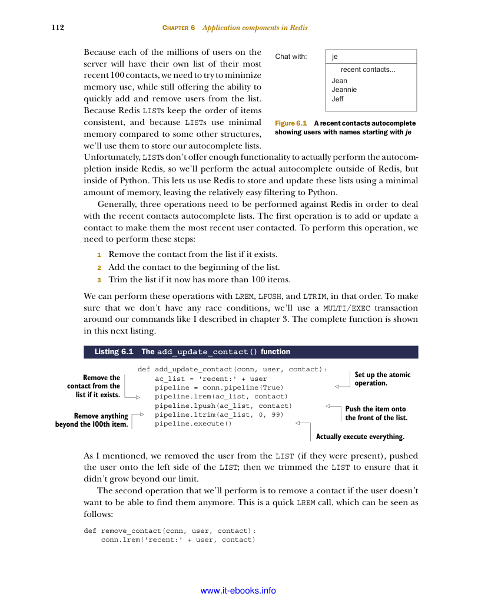

*Giải thích Hình 6.1:* Khi người dùng nhập tiền tố `je` vào ô "Chat with:", giao diện tự động gợi ý các liên hệ gần đây có tên bắt đầu bằng `je` theo thứ tự liên lạc gần nhất: `Jean`, `Jeannie`, `Jeff`.

Bởi vì mỗi người trong số hàng triệu người dùng trên máy chủ sẽ có danh sách 100 liên hệ gần nhất của riêng họ, chúng ta cần cố gắng giảm thiểu việc sử dụng bộ nhớ, trong khi vẫn cung cấp khả năng thêm và xóa người dùng khỏi danh sách một cách nhanh chóng. Bởi vì các `LIST` của Redis giữ cho thứ tự của các phần tử luôn nhất quán, và bởi vì `LIST` sử dụng lượng bộ nhớ tối thiểu so với một số cấu trúc khác, chúng ta sẽ sử dụng chúng để lưu trữ các danh sách tự động hoàn thành của mình. Thật không may, `LIST` không cung cấp đủ chức năng để thực sự thực hiện việc tự động hoàn thành ngay bên trong Redis, vì vậy chúng ta sẽ thực hiện việc tự động hoàn thành thực sự bên ngoài Redis, nhưng nằm bên trong Python. Điều này cho phép chúng ta dùng Redis để lưu trữ và cập nhật các danh sách này với một lượng bộ nhớ tối thiểu, nhường lại việc lọc tương đối dễ dàng cho Python.

Nhìn chung, cần thực hiện ba thao tác đối với Redis để xử lý các danh sách tự động hoàn thành cho liên hệ gần đây. Thao tác đầu tiên là thêm hoặc cập nhật một liên hệ để biến họ thành người dùng được liên hệ gần đây nhất. Để thực hiện thao tác này, chúng ta cần thực hiện các bước sau:

1. Xóa liên hệ đó khỏi danh sách nếu nó đang tồn tại.
2. Thêm liên hệ đó vào đầu danh sách.
3. Cắt gọn (*trim*) danh sách nếu lúc này nó có nhiều hơn 100 phần tử.

Chúng ta có thể thực hiện các thao tác này với `LREM`, `LPUSH`, và `LTRIM`, theo đúng thứ tự đó. Để đảm bảo rằng chúng ta không gặp bất kỳ tình trạng tranh chấp (*race condition*) nào, chúng ta sẽ sử dụng một giao dịch `MULTI`/`EXEC` bao quanh các lệnh của mình giống như tôi đã mô tả trong chương 3. Hàm hoàn chỉnh được hiển thị trong listing tiếp theo đây.

**Listing 6.1 – Hàm `add_update_contact()` (The `add_update_contact()` function)**

```python
def add_update_contact(conn, user, contact):
    ac_list = 'recent:' + user
    pipeline = conn.pipeline(True)     # Thiết lập thao tác nguyên tử (atomic operation).
    pipeline.lrem(ac_list, contact)    # Xóa liên hệ khỏi danh sách nếu nó tồn tại.
    pipeline.lpush(ac_list, contact)   # Đẩy phần tử vào đầu danh sách.
    pipeline.ltrim(ac_list, 0, 99)     # Xóa bất kỳ thứ gì vượt quá phần tử thứ 100.
    pipeline.execute()                 # Thực sự thực thi mọi thứ.
```

*Chú thích mã nguồn trong sách cho Listing 6.1:*
- `pipeline = conn.pipeline(True)`: Thiết lập thao tác nguyên tử (*Set up the atomic operation*).
- `pipeline.lrem(ac_list, contact)`: Xóa liên hệ khỏi danh sách nếu nó tồn tại (*Remove the contact from the list if it exists*).
- `pipeline.lpush(ac_list, contact)`: Đẩy phần tử vào phía trước (đầu) của danh sách (*Push the item onto the front of the list*).
- `pipeline.ltrim(ac_list, 0, 99)`: Xóa bất kỳ thứ gì nằm ngoài phần tử thứ 100 (*Remove anything beyond the 100th item*).
- `pipeline.execute()`: Thực sự thực thi mọi thứ (*Actually execute everything*).

Như tôi đã đề cập, chúng ta đã xóa người dùng khỏi `LIST` (nếu họ có mặt trong đó), đẩy người dùng vào phía bên trái của `LIST`; sau đó chúng ta cắt gọn `LIST` để đảm bảo rằng nó không phình to vượt quá giới hạn của chúng ta.

Thao tác thứ hai mà chúng ta sẽ thực hiện là xóa bỏ một liên hệ nếu người dùng không muốn có thể tìm thấy họ nữa. Đây là một lời gọi `LREM` nhanh gọn, có thể thấy như sau:

```python
def remove_contact(conn, user, contact):
    conn.lrem('recent:' + user, contact)
```

Thao tác cuối cùng mà chúng ta cần thực hiện là lấy bản thân danh sách tự động hoàn thành về để tìm những người dùng khớp điều kiện. Một lần nữa, bởi vì chúng ta sẽ thực hiện việc xử lý tự động hoàn thành thực tế trong Python, chúng ta sẽ lấy toàn bộ `LIST` về, rồi sau đó xử lý nó trong Python, như được hiển thị tiếp theo đây.

**Listing 6.2 – Hàm `fetch_autocomplete_list()` (The `fetch_autocomplete_list()` function)**

```python
def fetch_autocomplete_list(conn, user, prefix):
    candidates = conn.lrange('recent:' + user, 0, -1) # Lấy danh sách tự động hoàn thành.
    matches = []
    for candidate in candidates:                      # Kiểm tra từng ứng viên.
        if candidate.lower().startswith(prefix):
            matches.append(candidate)                 # Chúng ta đã tìm thấy một kết quả khớp.
    return matches                                    # Trả về tất cả các kết quả khớp.
```

*Chú thích mã nguồn trong sách cho Listing 6.2:*
- `candidates = conn.lrange('recent:' + user, 0, -1)`: Lấy danh sách tự động hoàn thành (*Fetch the autocomplete list*).
- `for candidate in candidates:`: Kiểm tra từng ứng viên (*Check each candidate*).
- `matches.append(candidate)`: Chúng ta đã tìm thấy một kết quả khớp (*We found a match*).
- `return matches`: Trả về tất cả các kết quả khớp (*Return all of the matches*).

Một lần nữa, chúng ta lấy toàn bộ `LIST` tự động hoàn thành về, lọc nó theo việc liệu tên có bắt đầu bằng tiền tố cần thiết hay không, và trả về các kết quả. Thao tác cụ thể này đủ đơn giản đến mức chúng ta thậm chí có thể đẩy nó sang cho phía client xử lý nếu nhận thấy máy chủ của mình đang tốn quá nhiều thời gian để tính toán nó, và chỉ yêu cầu tải lại danh sách khi có cập nhật.

Tính năng tự động hoàn thành này sẽ hoạt động tốt cho ví dụ cụ thể của chúng ta. Nó sẽ không hoạt động tốt bằng nếu các danh sách phình to hơn đáng kể, bởi vì việc xóa một phần tử tiêu tốn thời gian tỷ lệ thuận với độ dài của danh sách ($O(N)$). Nhưng bởi vì chúng ta quan tâm đến không gian bộ nhớ, và đã giới hạn rõ ràng danh sách của mình ở mức 100 người dùng, nên nó sẽ đủ nhanh. Nếu bạn thấy mình cần những danh sách được sử dụng gần đây nhất (*most-recently-used*) hoặc ít gần đây nhất (*least-recently-used*) lớn hơn nhiều, bạn có thể sử dụng `ZSET` với dấu thời gian (*timestamp*) để thay thế.

> 📝 **Giải thích thêm (không có trong sách):**
> 1. **Khác biệt cú pháp `lrem` trong `redis-py` mới (3.x / 4.x / 5.x):** Trong cuốn sách, tác giả sử dụng `redis.Redis` của `redis-py` 2.x, nơi phương thức `lrem(name, value, num=0)` nhận `value` làm tham số thứ hai và mặc định `num=0` (xóa tất cả các bản sao của `value`). Trong `redis-py` 3.0+ (nơi `Redis` được hợp nhất với `StrictRedis`), chữ ký hàm đã đổi thành `lrem(name, count, value)` để khớp với thứ tự lệnh chuẩn của Redis (`LREM key count element`). Do đó, trên Python 3 với `redis-py` hiện đại, bạn cần viết:
>    ```python
>    pipeline.lrem(ac_list, 0, contact)
>    ```
> 2. **Kiểu dữ liệu `bytes` vs `str` trong Python 3:** Khi gọi `conn.lrange(...)` trong Python 3, mặc định `redis-py` trả về danh sách các đối tượng `bytes` (ví dụ `[b'Jean', b'Jeannie']`). Để gọi `.lower().startswith(prefix)` với `prefix` là chuỗi `str`, bạn nên khởi tạo kết nối Redis với `decode_responses=True`:
>    ```python
>    conn = redis.Redis(host='localhost', port=6379, decode_responses=True)
>    ```
> 3. **Hiệu quả bộ nhớ nhờ `listpack` (Redis 7+):** Với danh sách tối đa 100 chuỗi ngắn như tên người dùng, Redis lưu trữ toàn bộ `LIST` trong một khối bộ nhớ liền kề duy nhất (trước đây là `ziplist`, từ Redis 7.0 trở đi là `listpack` thông qua cấu hình `list-max-listpack-size`), giúp tiết kiệm RAM cực kỳ hiệu quả khi nhân lên cho hàng triệu người dùng.

---

### 6.1.2 Tự động hoàn thành cho sổ địa chỉ (Address book autocomplete)

Trong ví dụ trước, Redis được sử dụng chủ yếu để theo dõi danh sách liên hệ, chứ không phải để thực sự thực hiện việc tự động hoàn thành. Điều này ổn đối với các danh sách ngắn, nhưng đối với các danh sách dài hơn, việc lấy hàng nghìn hoặc hàng triệu phần tử về chỉ để tìm ra một vài kết quả sẽ là một sự lãng phí. Thay vào đó, đối với các danh sách tự động hoàn thành có nhiều phần tử, chúng ta phải tìm các kết quả khớp ngay bên trong Redis.

Quay trở lại với Fake Game Company, tính năng tự động hoàn thành trò chuyện cho các liên hệ gần đây là một trong những tính năng xã hội được sử dụng nhiều nhất trong trò chơi của chúng ta. Tính năng đứng số hai của chúng ta, gửi thư trong trò chơi (*in-game mailing*), đang ngày càng thu hút được nhiều người dùng. Để duy trì đà phát triển này, chúng ta sẽ bổ sung tính năng tự động hoàn thành cho việc gửi thư. Nhưng trong trò chơi của chúng ta, chúng ta chỉ cho phép người dùng gửi thư cho những người dùng khác nằm trong cùng một nhóm xã hội trong trò chơi với họ, mà chúng ta gọi là một bang hội (*guild*). Điều này giúp ngăn chặn các tin nhắn lạm dụng và không mong muốn (*spam*) giữa những người dùng.

Các bang hội có thể phát triển lên tới hàng nghìn thành viên, vì vậy chúng ta không thể sử dụng phương pháp tự động hoàn thành dựa trên `LIST` cũ của mình. Nhưng bởi vì chúng ta chỉ cần một danh sách tự động hoàn thành cho mỗi bang hội, chúng ta có thể sử dụng nhiều không gian bộ nhớ hơn cho mỗi thành viên. Để giảm thiểu lượng dữ liệu phải truyền tới các client đang thực hiện tự động hoàn thành, chúng ta sẽ thực hiện phép tính tiền tố tự động hoàn thành ngay bên trong Redis bằng cách sử dụng `ZSET`.

Việc lưu trữ mỗi danh sách tự động hoàn thành sẽ khác với những cách sử dụng `ZSET` khác mà bạn từng thấy trước đây. Phần lớn, chúng ta sẽ sử dụng `ZSET` vì khả năng của chúng trong việc nhanh chóng cho chúng ta biết liệu một phần tử có nằm trong `ZSET` hay không, một thành viên (*member*) chiếm vị trí (hay chỉ mục — *index*) nào, và nhanh chóng kéo ra các khoảng (*range*) phần tử từ bất kỳ đâu bên trong `ZSET`. Điều làm cho cách sử dụng này trở nên khác biệt là tất cả điểm số (*score*) của chúng ta sẽ bằng không (`0`). Bằng cách đặt điểm số bằng không, chúng ta tận dụng một tính năng thứ cấp của `ZSET`: `ZSET` sắp xếp theo tên của thành viên (*member name*) khi điểm số bằng nhau. Khi tất cả điểm số đều bằng không, tất cả các thành viên sẽ được sắp xếp dựa trên thứ tự nhị phân (*binary ordering* / *lexicographical order*) của các chuỗi. Để thực sự thực hiện việc tự động hoàn thành, chúng ta sẽ chèn tên liên hệ đã được chuyển thành chữ thường (*lowercased*). Thật thuận tiện làm sao, từ trước đến nay chúng ta chỉ cho phép người dùng có các chữ cái trong tên của họ, vì vậy chúng ta không cần phải lo lắng về chữ số hay ký hiệu.

Chúng ta sẽ làm gì? Hãy bắt đầu bằng cách nghĩ về các cái tên như một chuỗi các chuỗi ký tự đã được sắp xếp giống như `abc`, `abca`, `abcb`, ... `abd`. Nếu chúng ta đang tìm kiếm các từ có tiền tố là `abc`, thực chất chúng ta đang tìm kiếm các chuỗi nằm sau `abbz...` và nằm trước `abd`. Nếu chúng ta biết thứ hạng (*rank*) của phần tử đầu tiên nằm trước `abbz...` và phần tử cuối cùng nằm sau `abd`, chúng ta có thể thực hiện một lời gọi `ZRANGE` để lấy các phần tử nằm giữa chúng. Nhưng, bởi vì chúng ta không biết liệu một trong hai phần tử đó có mặt ở đó hay không, chúng ta bị mắc kẹt. Để thoát khỏi thế kẹt này, tất cả những gì chúng ta thực sự cần làm là chèn vào các phần tử mà chúng ta biết chắc là nằm sau `abbz...` và nằm trước `abd`, tìm thứ hạng của chúng, thực hiện lời gọi `ZRANGE` của mình, và sau đó xóa bỏ các thành viên điểm đầu và điểm cuối mà chúng ta vừa chèn.

Tin tốt là việc tìm một phần tử nằm trước `abd` nhưng vẫn nằm sau tất cả các tên hợp lệ có tiền tố `abc` thì rất dễ: chúng ta nối thêm một ký tự `{` (dấu ngoặc nhọn mở — *left curly brace*) vào cuối tiền tố của mình, cho chúng ta `abc{`. Tại sao lại là `{`? Bởi vì nó là ký tự tiếp theo trong bảng mã ASCII ngay sau chữ `z`. Để tìm điểm bắt đầu cho khoảng của chúng ta đối với `abc`, chúng ta cũng có thể nối `{` vào `abb`, thu được `abb{`, nhưng chuyện gì sẽ xảy ra nếu tiền tố của chúng ta là `aba` thay vì `abc`? Làm sao chúng ta tìm được một ký tự đứng trước `a`? Chúng ta lấy gợi ý từ việc sử dụng dấu ngoặc nhọn của mình, và lưu ý rằng ký tự đứng ngay trước `a` trong bảng mã ASCII là `` ` `` (dấu huyền / *back quote*). Vì vậy, nếu tiền tố của chúng ta là `aba`, thành viên bắt đầu của chúng ta sẽ là ``ab`{`` (hoặc bắt đầu từ ``ab` ``), và thành viên kết thúc của chúng ta sẽ là `aba{`.

Gộp tất cả lại với nhau, chúng ta sẽ tìm phần tử đứng liền trước (*predecessor*) của tiền tố bằng cách thay thế ký tự cuối cùng của tiền tố bằng ký tự đứng ngay trước nó. Chúng ta sẽ tìm phần tử đứng liền sau (*successor*) của tiền tố bằng cách nối thêm một dấu ngoặc nhọn mở `{`. Để ngăn chặn bất kỳ sự cố nào khi có hai tìm kiếm tiền tố diễn ra cùng một lúc, chúng ta sẽ nối thêm một dấu ngoặc nhọn mở `{` vào cả phần tử tiền tố bắt đầu của mình (để phục vụ việc lọc bỏ các phần tử điểm mút sau đó nếu cần thiết). Một hàm tạo ra các loại khoảng giá trị này có thể được thấy ngay dưới đây.

**Listing 6.3 – Hàm `find_prefix_range()` (The `find_prefix_range()` function)**

```python
valid_characters = '`abcdefghijklmnopqrstuvwxyz{'

def find_prefix_range(prefix):
    posn = bisect.bisect_left(valid_characters, prefix[-1:])
    suffix = valid_characters[(posn or 1) - 1]
    return prefix[:-1] + suffix + '{', prefix + '{'
```

*Chú thích mã nguồn trong sách cho Listing 6.3:*
- `valid_characters = '`abcdefghijklmnopqrstuvwxyz{'`: Thiết lập danh sách các ký tự mà chúng ta biết (*Set up our list of characters that we know about*).
- `posn = bisect.bisect_left(valid_characters, prefix[-1:])`: Tìm vị trí của ký tự cuối trong tiền tố bên trong danh sách các ký tự của chúng ta (*Find the position of prefix character in our list of characters*).
- `suffix = valid_characters[(posn or 1) - 1]`: Tìm ký tự đứng liền trước (*Find the predecessor character*).
- `return prefix[:-1] + suffix + '{', prefix + '{'`: Trả về khoảng giá trị (*Return the range*).

Tôi biết, có thể hơi ngạc nhiên khi đã dành quá nhiều đoạn văn để mô tả những gì chúng ta sắp làm, để rồi cuối cùng chỉ kết thúc bằng vỏn vẹn vài dòng mã thực sự triển khai nó. Nhưng nếu nhìn vào những gì chúng ta đang làm, chúng ta chỉ đang tìm ký tự cuối cùng của tiền tố trong chuỗi các ký tự đã được sắp xếp sẵn của mình (sử dụng mô-đun `bisect`), rồi sau đó tra cứu ký tự đứng ngay trước nó.

> 📝 **Giải thích thêm (không có trong sách):** Hãy xem bảng mã ASCII xung quanh các chữ cái thường `a-z` để hiểu tại sao tác giả dùng ký tự `` ` `` (mã 96) và `{` (mã 123):
>
> | Ký tự | Mã thập phân (Decimal) | Mã Hex | Vai trò trong thuật toán |
> |---|---|---|---|
> | `` ` `` (backtick) | `96` | `0x60` | Đứng ngay trước `'a'` (dùng làm cận dưới khi ký tự cuối của prefix là `'a'`) |
> | `'a'` | `97` | `0x61` | Chữ cái thường đầu tiên |
> | `'b'` | `98` | `0x62` | ... |
> | `'z'` | `122` | `0x7A` | Chữ cái thường cuối cùng |
> | `'{'` (left brace) | `123` | `0x7B` | Đứng ngay sau `'z'` (lớn hơn mọi chuỗi hợp lệ chỉ gồm `a-z`) |
>
> Ví dụ, nếu người dùng gõ `prefix = "abc"`:
> - Ký tự cuối là `'c'`, ký tự đứng liền trước `'c'` trong `valid_characters` là `'b'`.
> - Cận dưới (`start`) là `"ab" + "b" + "{"` = `"abb{"`. Vì `'{'` > `'z'`, nên `"abb{"` chắc chắn lớn hơn mọi tên hợp lệ bắt đầu bằng `"abb"` (như `"abb"`, `"abba"`, `"abbz"`, `"abbzzzzz"`), nhưng lại nhỏ hơn `"abc"`.
> - Cận trên (`end`) là `"abc{"`. Vì `'{'` > `'z'`, nên `"abc{"` chắc chắn lớn hơn mọi tên hợp lệ bắt đầu bằng `"abc"` (như `"abc"`, `"abca"`, `"abczzzz"`), nhưng lại nhỏ hơn `"abd"`.

> **BẢNG MÃ KÝ TỰ VÀ QUỐC TẾ HÓA (CHARACTER SETS AND INTERNATIONALIZATION)**
>
> Phương pháp tìm ký tự đứng liền trước và liền sau trong bảng mã ASCII này hoạt động cực kỳ tốt đối với các ngôn ngữ có các ký tự chỉ sử dụng phạm vi `a-z`. Nhưng khi phải đối mặt với các ký tự không nằm trong phạm vi này, bạn sẽ gặp phải một vài thách thức mới.
>
> Đầu tiên, bạn sẽ phải tìm một phương pháp biến tất cả các ký tự của mình thành các byte; ba bảng mã phổ biến bao gồm UTF-8, UTF-16, và UTF-32 (các biến thể big-endian và little-endian của UTF-16 và UTF-32 đều được sử dụng, nhưng chỉ có các phiên bản big-endian mới hoạt động được trong tình huống này). Thứ hai, bạn sẽ cần tìm phạm vi các ký tự mà bạn dự định hỗ trợ, đảm bảo rằng bảng mã bạn chọn chừa lại ít nhất một ký tự nằm trước phạm vi được hỗ trợ của bạn và một ký tự nằm sau phạm vi được chọn của bạn trong phiên bản đã mã hóa. Thứ ba, bạn cần sử dụng các ký tự này để thay thế cho ký tự dấu huyền `` ` `` và ký tự dấu ngoặc nhọn mở `{` trong ví dụ của chúng ta.
>
> May mắn thay, thuật toán của chúng ta không quan tâm đến thứ tự sắp xếp bản địa (*native sort order*) của các ký tự, mà chỉ quan tâm đến các mã hóa (*encodings*). Vì vậy, bạn có thể chọn UTF-8 hoặc UTF-16 hay UTF-32 dạng big-endian, sử dụng một ký tự null (`\x00`) để thay thế cho dấu huyền, và sử dụng giá trị lớn nhất mà bảng mã cũng như ngôn ngữ của bạn hỗ trợ để thay thế cho dấu ngoặc nhọn mở. (Một số thư viện kết nối ngôn ngữ hơi bị giới hạn, chỉ cho phép tối đa đến điểm mã Unicode `U+ffff` đối với UTF-16 và điểm mã Unicode `U+2ffff` đối với UTF-32.)

Sau khi đã có khoảng giá trị mà mình đang tìm kiếm, chúng ta cần chèn các điểm mút (*ending points*) của mình vào `ZSET`, tìm thứ hạng (*rank*) của những phần tử mới được thêm vào đó, kéo ra một số lượng phần tử nằm giữa chúng (chúng ta sẽ lấy tối đa 10 phần tử để tránh làm người dùng bị choáng ngợp), và sau đó xóa bỏ các phần tử mà chúng ta đã thêm vào. Để đảm bảo rằng chúng ta không thêm và xóa cùng những phần tử giống nhau — như trường hợp sẽ xảy ra nếu hai thành viên của cùng một bang hội cố gắng nhắn tin cho cùng một người dùng — chúng ta cũng sẽ nối thêm một chuỗi UUID 128-bit được sinh ngẫu nhiên vào các thành viên bắt đầu (`start`) và kết thúc (`end`) của mình. Để đảm bảo rằng `ZSET` không bị thay đổi khi chúng ta cố gắng tìm và lấy các khoảng của mình, chúng ta sẽ sử dụng `WATCH` cùng với `MULTI` và `EXEC` sau khi đã chèn các điểm mút. Hàm tự động hoàn thành đầy đủ được hiển thị tại đây.

**Listing 6.4 – Hàm `autocomplete_on_prefix()` (The `autocomplete_on_prefix()` function)**

```python
def autocomplete_on_prefix(conn, guild, prefix):
    start, end = find_prefix_range(prefix)                 # Tìm khoảng bắt đầu/kết thúc cho tiền tố.
    identifier = str(uuid.uuid4())
    start += identifier
    end += identifier

    zset_name = 'members:' + guild
    conn.zadd(zset_name, start, 0, end, 0)                 # Thêm các phần tử đầu/cuối khoảng vào ZSET.
    pipeline = conn.pipeline(True)
    while 1:
        try:
            pipeline.watch(zset_name)
            sindex = pipeline.zrank(zset_name, start)      # Tìm thứ hạng (rank) của các điểm mút.
            eindex = pipeline.zrank(zset_name, end)
            erange = min(sindex + 9, eindex - 2)
            pipeline.multi()
            pipeline.zrem(zset_name, start, end)           # Lấy các giá trị bên trong khoảng của chúng ta, và dọn dẹp.
            pipeline.zrange(zset_name, sindex, erange)
            items = pipeline.execute()[-1]
            break
        except redis.exceptions.WatchError:                # Thử lại nếu ai đó đã sửa đổi ZSET tự động hoàn thành của chúng ta.
            continue

    return [item for item in items if '{' not in item]     # Xóa các mục start/end nếu có một thao tác autocomplete khác đang diễn ra.
```

*Chú thích mã nguồn trong sách cho Listing 6.4:*
- `start, end = find_prefix_range(prefix)`: Tìm khoảng bắt đầu/kết thúc cho tiền tố (*Find the start/end range for the prefix*).
- `conn.zadd(zset_name, start, 0, end, 0)`: Thêm các phần tử khoảng bắt đầu/kết thúc vào ZSET (*Add the start/end range items to the ZSET*).
- `sindex = pipeline.zrank(zset_name, start)` / `eindex = pipeline.zrank(zset_name, end)`: Tìm thứ hạng của các điểm mút của chúng ta (*Find the ranks of our end points*).
- `pipeline.zrem(...)` / `pipeline.zrange(...)`: Lấy các giá trị bên trong khoảng của chúng ta, và dọn dẹp (*Get the values inside our range, and clean up*).
- `except redis.exceptions.WatchError:`: Thử lại nếu ai đó đã sửa đổi ZSET tự động hoàn thành của chúng ta (*Retry if someone modified our autocomplete ZSET*).
- `return [item for item in items if '{' not in item]`: Loại bỏ các mục bắt đầu/kết thúc nếu có một quá trình tự động hoàn thành khác đang diễn ra (*Remove start/end entries if an autocomplete was in progress*).

Phần lớn hàm này là công việc sổ sách và thiết lập. Phần đầu tiên chỉ là lấy điểm bắt đầu và điểm kết thúc của chúng ta, tiếp theo là thêm chúng vào `ZSET` tự động hoàn thành của bang hội. Khi đã có mọi thứ trong `ZSET`, chúng ta `WATCH` (theo dõi) `ZSET` đó để đảm bảo phát hiện được nếu có ai đó đã thay đổi nó, lấy thứ hạng của điểm bắt đầu và điểm kết thúc trong `ZSET`, lấy các phần tử nằm giữa hai điểm mút, và tự dọn dẹp sau khi xong việc.

Việc thêm và xóa thành viên khỏi một bang hội rất đơn giản: chúng ta chỉ cần `ZADD` và `ZREM` người dùng đó khỏi `ZSET` của bang hội. Cả hai hàm này được hiển thị dưới đây.

**Listing 6.5 – Hai hàm `join_guild()` và `leave_guild()` (The `join_guild()` and `leave_guild()` functions)**

```python
def join_guild(conn, guild, user):
    conn.zadd('members:' + guild, user, 0)

def leave_guild(conn, guild, user):
    conn.zrem('members:' + guild, user)
```

Việc tham gia hoặc rời khỏi một bang hội, ít nhất là khi xét đến khía cạnh tự động hoàn thành, là hết sức trực diện. Chúng ta chỉ cần thêm hoặc xóa tên khỏi `ZSET`.

Phương pháp thêm các phần tử vào một `ZSET` để tạo ra một khoảng giá trị — lấy các phần tử trong khoảng đó rồi xóa bỏ những phần tử đã thêm vào — có thể rất hữu ích. Ở đây chúng ta sử dụng nó cho việc tự động hoàn thành, nhưng kỹ thuật này cũng có thể được dùng cho các chỉ mục được sắp xếp tùy ý (*arbitrary sorted indexes*). Trong chương 7, chúng ta sẽ nói về một kỹ thuật nhằm cải thiện những kiểu thao tác này cho một vài loại truy vấn khoảng (*range queries*) khác nhau, giúp loại bỏ sự cần thiết phải thêm và xóa các phần tử ở hai đầu mút. Chúng ta sẽ đợi đến lúc đó mới bàn về phương pháp kia, bởi vì nó chỉ hoạt động trên một số loại dữ liệu nhất định, trong khi phương pháp hiện tại hoạt động được trên các truy vấn khoảng với bất kỳ loại dữ liệu nào.

Khi thêm các điểm mút vào `ZSET`, chúng ta đã phải cẩn thận về việc những người dùng khác cũng cố gắng tự động hoàn thành cùng một lúc, đó là lý do tại sao chúng ta sử dụng lệnh `WATCH`. Khi tải (*load*) của chúng ta tăng lên, chúng ta có thể cần phải thử lại (*retry*) các thao tác của mình thường xuyên, điều này có thể gây lãng phí. Mục tiếp theo sẽ nói về một cách để tránh việc phải thử lại, cải thiện hiệu năng, và đôi khi đơn giản hóa mã nguồn của chúng ta bằng cách giảm bớt và/hoặc thay thế `WATCH` bằng các khóa (*locks*).

> 📝 **Giải thích thêm (không có trong sách) — Đối chiếu Mục 6.1 (Autocomplete) với Redis 6/7/8 & RediSearch hiện đại:**
> Khi cuốn sách *Redis in Action* được viết (thời điểm Redis 2.6), Redis chưa có lệnh truy vấn trực tiếp theo thứ tự từ điển (*lexicographical range*) trên `ZSET`, nên tác giả Josiah Carlson đã nghĩ ra mẹo cực kỳ thông minh ở Listing 6.4 là chèn hai phần tử đánh dấu tạm thời (`start` dùng `` ` `` và `end` dùng `{`) vào `ZSET`, dùng `ZRANK` tìm vị trí rồi dùng `ZRANGE` lấy kết quả và `ZREM` xóa đi.
>
> Từ **Redis 2.8.9**, Redis đã bổ sung lệnh **`ZRANGEBYLEX`**, và từ **Redis 6.2+**, lệnh **`ZRANGE`** hợp nhất luôn đối số **`BYLEX`** (`ZRANGE key [prefix (prefix\xff BYLEX LIMIT 0 10`), cho phép truy vấn trực tiếp theo tiền tố từ điển khi các phần tử có cùng `score = 0` mà **không cần chèn/xóa phần tử giả** và **không cần `WATCH`/`MULTI`/`EXEC`**! Hơn nữa, trong **RediSearch / Redis Stack / Redis 8**, bộ lệnh chuyên dụng **`FT.SUGADD` / `FT.SUGGET`** hỗ trợ gợi ý tự động có trọng số (weighted autocomplete), tìm kiếm mờ (fuzzy matching với khoảng cách chỉnh sửa Levenshtein) và đính kèm dữ liệu phụ (`PAYLOAD`):
>
> | Tiêu chí so sánh | Mẹo phần tử đánh dấu `` ` `` / `{` trong sách (Redis 2.6) | `ZRANGE ... BYLEX` (Redis 6.2+ / 7 / 8) | `FT.SUGADD` / `FT.SUGGET` (RediSearch / Redis 8) |
> | :--- | :--- | :--- | :--- |
> | **Thao tác khi tìm kiếm** | Chèn 2 phần tử tạm (`ZADD`), `WATCH`, `ZRANK` x2, `MULTI`, `ZREM`, `ZRANGE`, `EXEC` (**Ghi + Đọc**) | Chỉ **1 lệnh đọc duy nhất**: `ZRANGE key [prefix (prefix\xff BYLEX LIMIT 0 10` | Chỉ **1 lệnh đọc duy nhất**: `FT.SUGGET key prefix FUZZY MAX 10` |
> | **Chạy trên Replica (Read-only)?** | **Không** (vì phải `ZADD` và `ZREM` phần tử tạm vào `ZSET`) | **Có** (hoàn toàn chỉ đọc - read-only) | **Có** (hoàn toàn chỉ đọc - read-only) |
> | **Hỗ trợ bảng mã UTF-8 / Tiếng Việt** | Bị giới hạn ở `a-z` nếu dùng `` ` `` và `{` | Hỗ trợ đầy đủ mọi chuỗi byte UTF-8 với cận trên `\xff` | Hỗ trợ đầy đủ Unicode, khớp mờ (`FUZZY`) khi gõ sai chính tả, và sắp xếp theo điểm độ phổ biến (`score`) |

> 💡 **Ví dụ bổ sung (không có trong sách) – `ZRANGE ... BYLEX` và `FT.SUGADD`/`FT.SUGGET` trong Python 3 (`redis-py` 5.x):**
>
> ```python
> # 1. Cách hiện đại với ZRANGE ... BYLEX (Redis 6.2+ & redis-py 5.x):
> def autocomplete_on_prefix_modern(conn, guild, prefix):
>     zset_name = f"members:{guild}"
>     # '[' là cận bao gồm (inclusive), '(' là cận không bao gồm (exclusive)
>     # '\xff' là byte 0xFF lớn nhất, đóng vai trò giống ký tự '{' nhưng hỗ trợ cả UTF-8
>     return conn.zrange(
>         zset_name,
>         start=f"[{prefix}",
>         end=f"({prefix}\xff",
>         bylex=True,
>         offset=0,
>         num=10,
>     )
>
> # 2. Cách hiện đại với FT.SUGADD / FT.SUGGET (Redis Stack / Redis 8):
> # Thêm gợi ý kèm điểm số ưu tiên (score) và payload
> conn.ft().sugadd("ac:guild:1", Suggestion(string="jeannie", score=10.0, payload="uid:42"))
> # Tìm kiếm tự động hoàn thành (hỗ trợ cả fuzzy=True cho phép gõ sai 1 ký tự)
> suggestions = conn.ft().sugget("ac:guild:1", "je", fuzzy=True, num=10, with_payloads=True)
> ```
> Ngoài ra, lưu ý trong `redis-py` 3.0+/5.x, hàm `zadd` trong Listing 6.4 và 6.5 nhận một `dict` thay vì các đối số rời rạc:
> - Sách gốc (`redis-py` 2.x): `conn.zadd(zset_name, start, 0, end, 0)`
> - Hiện đại (`redis-py` 5.x): `conn.zadd(zset_name, {start: 0, end: 0})`

---

## 6.2 Khóa phân tán (Distributed locking)

Nhìn chung, khi bạn "khóa" (*lock*) dữ liệu, trước tiên bạn giành lấy khóa (*acquire the lock*), việc này trao cho bạn quyền truy cập độc quyền (*exclusive access*) vào dữ liệu đó. Sau đó bạn thực hiện các thao tác của mình. Cuối cùng, bạn nhả khóa (*release the lock*) cho những tác nhân khác. Chuỗi thao tác *giành khóa, thao tác, nhả khóa* (*acquire, operate, release*) này khá quen thuộc trong bối cảnh các cấu trúc dữ liệu bộ nhớ dùng chung (*shared-memory data structures*) được truy cập bởi nhiều luồng (*threads*). Trong bối cảnh của Redis, chúng ta đã và đang sử dụng `WATCH` như một sự thay thế cho khóa, và chúng ta gọi nó là *khóa lạc quan* (*optimistic locking*), bởi vì thay vì thực sự ngăn cản những người khác sửa đổi dữ liệu, chúng ta chỉ được thông báo nếu có ai đó thay đổi dữ liệu trước khi chúng ta kịp tự mình thực hiện điều đó.

Với khóa phân tán (*distributed locking*), chúng ta cũng có cùng kiểu thao tác *giành khóa, thao tác, nhả khóa*, nhưng thay vì có một chiếc khóa chỉ được biết đến bởi các luồng bên trong cùng một tiến trình (*process*), hoặc các tiến trình trên cùng một cỗ máy, chúng ta sử dụng một chiếc khóa mà các Redis client khác nhau nằm trên các máy chủ khác nhau đều có thể giành lấy và nhả ra. Khi nào và liệu có nên sử dụng khóa hay dùng `WATCH` sẽ phụ thuộc vào từng ứng dụng cụ thể; một số ứng dụng không cần đến khóa để hoạt động đúng đắn, một số chỉ yêu cầu khóa cho một vài phần, và một số lại yêu cầu khóa ở mọi bước.

Một lý do khiến chúng ta dành nhiều thời gian xây dựng khóa bằng Redis thay vì sử dụng các khóa ở cấp độ hệ điều hành, các khóa ở cấp độ ngôn ngữ lập trình, v.v., là vấn đề về phạm vi (*scope*). Các client muốn có quyền truy cập độc quyền vào dữ liệu được lưu trữ trên Redis, vì vậy các client cần có quyền truy cập vào một chiếc khóa được định nghĩa trong một phạm vi mà tất cả các client đều có thể nhìn thấy — đó chính là Redis. Bản thân Redis thực sự đã có sẵn một kiểu khóa cơ bản như một phần của tập lệnh (`SETNX`), thứ mà chúng ta sẽ sử dụng, nhưng nó chưa có đầy đủ tính năng và không cung cấp những chức năng nâng cao mà người dùng kỳ vọng ở một khóa phân tán.

Xuyên suốt mục này, chúng ta sẽ nói về việc một khóa được theo dõi bằng `WATCH` bị quá tải có thể gây ra các vấn đề về hiệu năng như thế nào, và xây dựng một chiếc khóa từng mảnh một cho đến khi chúng ta có thể thay thế `WATCH` trong một số tình huống.

### 6.2.1 Tại sao khóa lại quan trọng (Why locks are important)

Trong phiên bản đầu tiên của tính năng tự động hoàn thành, chúng ta đã thêm và xóa các phần tử khỏi một `LIST`. Chúng ta đã làm điều đó bằng cách bọc nhiều lời gọi của mình trong một cặp `MULTI`/`EXEC`. Nhìn ngược trở lại mục 4.6 (và 4.4), lần đầu tiên chúng ta giới thiệu các giao dịch `WATCH`/`MULTI`/`EXEC` là trong bối cảnh của một chợ vật phẩm trong trò chơi (*in-game item marketplace*). Nếu bạn còn nhớ, chợ (*market*) được cấu trúc dưới dạng một `ZSET` duy nhất, với các thành viên (*members*) là mã định danh vật phẩm và mã định danh chủ sở hữu được nối với nhau, cùng với giá của vật phẩm đóng vai trò là điểm số (*score*). Mỗi người dùng có một `HASH` của riêng họ, với các cột (trường) dành cho tên người dùng, số tiền hiện có, và các thông tin liên quan khác. Hình 6.2 cho thấy một ví dụ về chợ vật phẩm, túi đồ (*inventories*) của người dùng, và thông tin người dùng.

**Hình 6.2 – Cấu trúc chợ vật phẩm của chúng ta từ mục 4.6. Có bốn vật phẩm trong chợ ở bên trái — ItemA, ItemC, ItemE, và ItemG — với mức giá lần lượt là 35, 48, 60, và 73, cùng ID người bán tương ứng là 4, 7, 2, và 3. Ở giữa chúng ta có hai người dùng, Frank và Bill, cùng số tiền hiện tại của họ, với túi đồ của họ ở bên phải. (Figure 6.2 The structure of our marketplace from section 4.6...)**

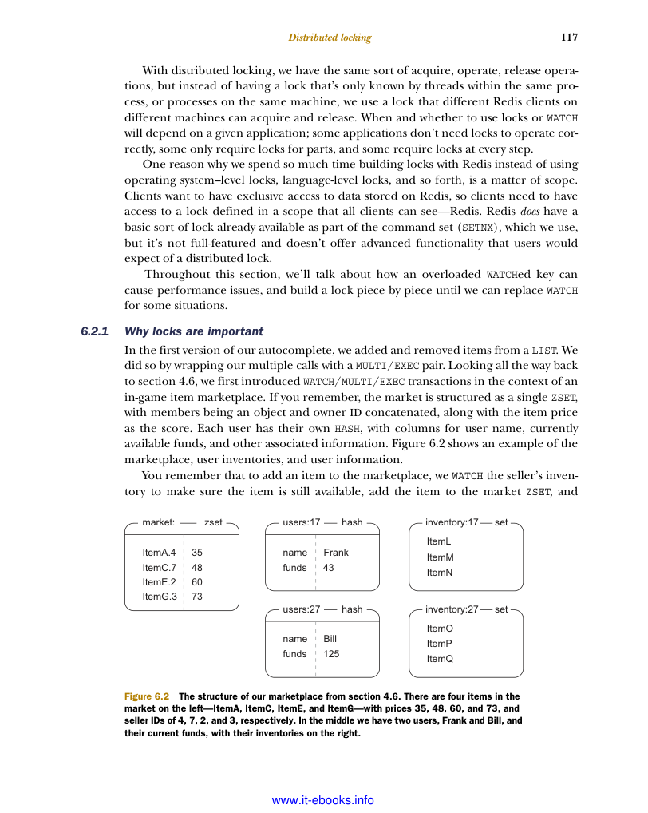

*Giải thích chi tiết Hình 6.2:*

| Khóa (Key) | Kiểu dữ liệu | Nội dung minh họa trong Hình 6.2 | Ý nghĩa |
|---|---|---|---|
| `market:` | `zset` | `ItemA.4` (score `35`), `ItemC.7` (score `48`), `ItemE.2` (score `60`), `ItemG.3` (score `73`) | Danh sách vật phẩm đang rao bán trên chợ (`<itemid>.<sellerid>`) sắp xếp theo giá bán |
| `users:17` | `hash` | `name`: `Frank`, `funds`: `43` | Thông tin tài khoản và số dư tiền của người dùng ID `17` |
| `users:27` | `hash` | `name`: `Bill`, `funds`: `125` | Thông tin tài khoản và số dư tiền của người dùng ID `27` |
| `inventory:17` | `set` | `ItemM`, `ItemN`, `ItemL` | Túi đồ chứa các vật phẩm hiện thuộc sở hữu của Frank (`17`) |
| `inventory:27` | `set` | `ItemP`, `ItemQ`, `ItemO` | Túi đồ chứa các vật phẩm hiện thuộc sở hữu của Bill (`27`) |

Bạn hẳn còn nhớ rằng để thêm một vật phẩm vào chợ, chúng ta `WATCH` túi đồ của người bán để đảm bảo vật phẩm đó vẫn còn khả dụng, thêm vật phẩm vào `ZSET` của chợ, và xóa nó khỏi túi đồ của người dùng. Phần cốt lõi trong hàm `list_item()` trước đây của chúng ta từ mục 4.4.2 được hiển thị ngay dưới đây.

**Listing 6.6 – Hàm `list_item()` từ mục 4.4.2 (The `list_item()` function from section 4.4.2)**

```python
def list_item(conn, itemid, sellerid, price):
    #...
            pipe.watch(inv)                      # Theo dõi các thay đổi đối với túi đồ của người dùng.
            if not pipe.sismember(inv, itemid):  # Xác minh rằng người dùng vẫn còn giữ vật phẩm sắp được đăng bán.
                pipe.unwatch()
                return None
            pipe.multi()                         # Thực sự đăng bán vật phẩm.
            pipe.zadd("market:", item, price)
            pipe.srem(inv, itemid)
            pipe.execute()
            return True
    #...
```

*Chú thích mã nguồn trong sách cho Listing 6.6:*
- `pipe.watch(inv)`: Theo dõi các thay đổi đối với túi đồ của người dùng (*Watch for changes to the user’s inventory*).
- `if not pipe.sismember(inv, itemid):`: Xác minh rằng người dùng vẫn còn vật phẩm sẽ được đăng bán (*Verify that the user still has the item to be listed*).
- `pipe.multi()` ... `pipe.execute()`: Thực sự đăng bán vật phẩm (*Actually list the item*).

Các chú thích ngắn `#...` trong đoạn mã này chỉ ẩn đi rất nhiều phần thiết lập và xử lý `WATCH`/`MULTI`/`EXEC` vốn làm che khuất phần cốt lõi của những gì chúng ta đang làm, đó là lý do tại sao tôi lược bỏ chúng ở đây. Nếu bạn cảm thấy cần xem lại toàn bộ đoạn mã đó, hãy thoải mái quay lại mục 4.4.2 để ôn lại trí nhớ của mình.

Bây giờ, để ôn lại việc mua một vật phẩm của chúng ta, chúng ta `WATCH` chợ (`market:`) và `HASH` của người mua. Sau khi lấy tổng số tiền của người mua và giá của vật phẩm, chúng ta xác minh rằng người mua có đủ tiền. Nếu người mua có đủ tiền, chúng ta chuyển tiền giữa các tài khoản, thêm vật phẩm vào túi đồ của người mua, và xóa vật phẩm khỏi chợ. Nếu người mua không có đủ tiền, chúng ta hủy giao dịch. Nếu một lỗi `WATCH` xảy ra do có ai đó khác đang ghi vào `ZSET` của chợ hoặc `HASH` của người mua bị thay đổi, chúng ta sẽ thử lại (*retry*). Listing dưới đây cho thấy phần cốt lõi trong hàm `purchase_item()` trước đây của chúng ta từ mục 4.4.3.

**Listing 6.7 – Hàm `purchase_item()` từ mục 4.4.3 (The `purchase_item()` function from section 4.4.3)**

```python
def purchase_item(conn, buyerid, itemid, sellerid, lprice):
    #...
            pipe.watch("market:", buyer)               # Theo dõi các thay đổi đối với chợ và thông tin tài khoản của người mua.
            price = pipe.zscore("market:", item)       # Kiểm tra xem vật phẩm đã bị bán/đổi giá hay không hoặc không đủ tiền.
            funds = int(pipe.hget(buyer, 'funds'))
            if price != lprice or price > funds:
                pipe.unwatch()
                return None

            pipe.multi()                               # Chuyển tiền từ người mua sang người bán, và chuyển vật phẩm cho người mua.
            pipe.hincrby(seller, 'funds', int(price))
            pipe.hincrby(buyerid, 'funds', int(-price))
            pipe.sadd(inventory, itemid)
            pipe.zrem("market:", item)
            pipe.execute()
            return True
    #...
```

*Chú thích mã nguồn trong sách cho Listing 6.7:*
- `pipe.watch("market:", buyer)`: Theo dõi các thay đổi đối với chợ và thông tin tài khoản của người mua (*Watch for changes to the market and the buyer’s account information*).
- `price = ...` / `if price != lprice or price > funds:`: Kiểm tra xem vật phẩm đã bị bán/định giá lại hay chưa hoặc không đủ tiền (*Check for a sold/repriced item or insufficient funds*).
- `pipe.multi()` ... `pipe.execute()`: Chuyển tiền từ người mua sang người bán, và chuyển giao vật phẩm cho người mua (*Transfer funds from the buyer to the seller, and transfer the item to the buyer*).

Giống như trước, chúng ta lược bỏ phần thiết lập và xử lý `WATCH`/`MULTI`/`EXEC` để tập trung vào phần cốt lõi của những gì mình đang làm.

Để thấy được sự cần thiết của khóa ở quy mô lớn (*at scale*), hãy dành một chút thời gian để mô phỏng chợ vật phẩm trong một vài kịch bản chịu tải khác nhau. Chúng ta sẽ có ba lần chạy khác nhau: một tiến trình đăng bán (*listing process*) và một tiến trình mua (*buying process*), sau đó là năm tiến trình đăng bán và một tiến trình mua, và cuối cùng là năm tiến trình đăng bán và năm tiến trình mua. Bảng 6.1 cho thấy kết quả của việc chạy mô phỏng này.

**Bảng 6.1 – Hiệu năng của một chợ vật phẩm chịu tải nặng trong vòng 60 giây (Table 6.1 Performance of a heavily loaded marketplace over 60 seconds)**

| Kịch bản | Số vật phẩm đăng bán (Listed items) | Số vật phẩm mua được (Bought items) | Số lần thử lại khi mua (Purchase retries) | Thời gian chờ trung bình mỗi lượt mua (Average wait per purchase) |
|---|---|---|---|---|
| 1 lister, 1 buyer (1 người đăng, 1 người mua) | 145,000 | 27,000 | 80,000 | 14ms |
| 5 listers, 1 buyer (5 người đăng, 1 người mua) | 331,000 | <200 | 50,000 | 150ms |
| 5 listers, 5 buyers (5 người đăng, 5 người mua) | 206,000 | <600 | 161,000 | 498ms |

Khi hệ thống bị quá tải của chúng ta đẩy tới giới hạn của nó, chúng ta đi từ tỷ lệ xấp xỉ 3 lần thử lại trên mỗi giao dịch mua hoàn tất (với 1 tiến trình đăng bán và 1 tiến trình mua), tăng vọt lên tới hơn 250 lần thử lại cho mỗi giao dịch mua hoàn tất. Hệ quả là độ trễ (*latency*) để hoàn tất một lượt mua tăng từ mức dưới 10 mili-giây (cụ thể là 14ms) trong hệ thống chịu tải vừa phải, lên tới gần 500 mili-giây trong hệ thống bị quá tải. Đây là một ví dụ hoàn hảo cho thấy tại sao các giao dịch `WATCH`/`MULTI`/`EXEC` đôi khi không thể mở rộng quy mô khi chịu tải nặng, và nguyên nhân là do trong khi đang cố gắng hoàn tất một giao dịch, chúng ta bị thất bại và phải thử đi thử lại liên tục. Việc giữ cho dữ liệu của chúng ta chính xác là quan trọng, nhưng việc thực sự hoàn thành được công việc cũng quan trọng không kém. Để vượt qua giới hạn này và thực sự bắt đầu thực hiện việc mua bán ở quy mô lớn, chúng ta phải đảm bảo rằng mình chỉ đăng bán hoặc mua một vật phẩm trong chợ tại bất kỳ thời điểm nào. Chúng ta làm điều này bằng cách sử dụng một chiếc khóa (*lock*).

> 📝 **Giải thích thêm (không có trong sách):** Tại sao `list_item()` lại thành công tới 331.000 lần trong khi `purchase_item()` chỉ thành công `<200` lần ở kịch bản `5 listers, 1 buyer`?
> - Trong `list_item()`, tiến trình bán chỉ `WATCH` duy nhất khóa `inventory:<sellerid>` của riêng người bán đó, sau đó thêm phần tử vào `market:`. Do mỗi người bán có túi đồ riêng, các lệnh `list_item()` hầu như không làm hỏng `WATCH` của nhau, nhưng mỗi lần `list_item()` chạy `EXEC`, nó đều ghi vào `market:`.
> - Ngược lại, trong `purchase_item()`, tiến trình mua phải `WATCH("market:", buyer)` rồi thực hiện 2 lệnh đọc (`ZSCORE`, `HGET`) mất một vòng mạng (*round-trip*) trước khi gửi `MULTI`/`EXEC`. Trong khoảng thời gian một vòng mạng ngắn ngủi đó, 5 tiến trình `list_item()` đã kịp ghi vào `market:` hàng chục lần, làm cờ `WATCH` trên `market:` của người mua bị vô hiệu hóa liên tục (*livelock* / *starvation*)!

---

### 6.2.2 Các khóa đơn giản (Simple locks)

Trong phiên bản đơn giản đầu tiên của một chiếc khóa, chúng ta sẽ lưu ý đến một vài kịch bản lỗi tiềm ẩn khác nhau. Khi thực sự bắt đầu xây dựng khóa, chúng ta sẽ chưa xử lý tất cả các lỗi đó ngay lập tức. Thay vào đó, chúng ta sẽ cố gắng làm cho quy trình *giành khóa, thao tác và nhả khóa* cơ bản hoạt động đúng đắn trước. Sau khi đã làm cho nó hoạt động và chứng minh được việc sử dụng khóa có thể thực sự cải thiện hiệu năng như thế nào, chúng ta sẽ giải quyết bất kỳ kịch bản lỗi nào mà mình chưa xử lý.

Trong khi sử dụng một chiếc khóa, đôi khi các client có thể không nhả được khóa vì lý do này hay lý do khác. Để bảo vệ trước sự cố mà các client của chúng ta có thể bị sập (*crash*) và bỏ lại một chiếc khóa ở trạng thái đang bị giữ (*acquired state*), cuối cùng chúng ta sẽ thêm một thời gian hết hạn (*timeout*), khiến cho khóa tự động được nhả ra nếu tiến trình đang giữ khóa không hoàn thành công việc trong khoảng thời gian quy định.

Nhiều người dùng Redis đã biết về khóa, cơ chế khóa và thời gian hết hạn của khóa. Nhưng đáng buồn thay, nhiều bản triển khai khóa trong Redis chỉ đúng ở mức "gần đúng" (*mostly correct*). Vấn đề với những chiếc khóa gần đúng là chúng sẽ thất bại theo những cách mà chúng ta không ngờ tới, vào đúng thời điểm mà chúng ta không ngờ chúng sẽ thất bại. Dưới đây là một số tình huống có thể dẫn đến hành vi sai lệch, và hành vi đó sai lệch theo những cách nào:

- Một tiến trình đã giành được khóa, thao tác trên dữ liệu, nhưng mất quá nhiều thời gian, và chiếc khóa đã tự động được nhả ra. Tiến trình đó không hề biết rằng nó đã mất khóa, hoặc thậm chí có thể nhả nhầm chiếc khóa mà một tiến trình khác đã giành được sau đó.
- Một tiến trình đã giành được khóa cho một thao tác tốn nhiều thời gian rồi bị sập (*crashed*). Các tiến trình khác muốn có khóa không biết tiến trình nào đã giữ khóa, nên không thể phát hiện ra rằng tiến trình đó đã gặp sự cố, và lãng phí thời gian chờ đợi chiếc khóa được nhả ra.
- Một tiến trình đang giữ một chiếc khóa, nhưng khóa đã hết hạn (*timed out*). Các tiến trình khác cố gắng giành lấy chiếc khóa cùng một lúc, và nhiều tiến trình đều có khả năng lấy được khóa.
- Do sự kết hợp của kịch bản thứ nhất và thứ ba, giờ đây có nhiều tiến trình cùng giữ khóa và tất cả chúng đều tin rằng mình là người duy nhất đang giữ khóa.

Ngay cả khi mỗi vấn đề trong số này chỉ có xác suất một phần triệu xảy ra, thì bởi vì Redis có thể thực hiện 100.000 thao tác mỗi giây trên phần cứng gần đây (và lên tới 225.000 thao tác mỗi giây trên phần cứng cao cấp), những vấn đề đó hoàn toàn có thể xuất hiện khi chịu tải nặng,[^1] vì vậy việc triển khai cơ chế khóa cho thật chuẩn xác là vô cùng quan trọng.

[^1]: *Chú thích chân trang 1 trong sách:* Sau khi thử nghiệm một vài bản triển khai khóa Redis hiện có hỗ trợ thời gian hết hạn (timeout), tôi đã có thể gây ra hiện tượng nhân bản khóa (*lock duplication* — nhiều tiến trình cùng lấy được khóa) trên ít nhất một nửa số bản triển khai khóa đó chỉ với năm client liên tục giành và nhả cùng một khóa trong vòng 10 giây.

---

### 6.2.3 Xây dựng một khóa trong Redis (Building a lock in Redis)

Xây dựng một chiếc khóa "gần đúng" trong Redis thì dễ. Xây dựng một chiếc khóa hoàn toàn chính xác trong Redis cũng không khó hơn là bao, nhưng đòi hỏi phải cực kỳ cẩn thận về các thao tác mà chúng ta sử dụng để xây dựng nó. Trong phiên bản đầu tiên này, chúng ta sẽ chưa xử lý trường hợp khóa bị hết hạn (*times out*), hoặc trường hợp tiến trình giữ khóa bị sập và không nhả khóa. Đừng lo lắng; chúng ta sẽ giải quyết những trường hợp đó trong mục tiếp theo, nhưng hiện tại, hãy làm cho việc khóa cơ bản thật chuẩn xác đã.

Phần đầu tiên của việc đảm bảo không có đoạn mã nào khác có thể chạy là giành lấy khóa (*acquire the lock*). Khối xây dựng tự nhiên nhất để sử dụng cho việc giành khóa là lệnh `SETNX`, lệnh này sẽ chỉ thiết lập một giá trị nếu khóa (*key*) đó chưa tồn tại. Chúng ta sẽ đặt giá trị là một mã định danh duy nhất (*unique identifier*) để đảm bảo rằng không có tiến trình nào khác có thể lấy được khóa, và mã định danh duy nhất mà chúng ta sẽ sử dụng là một chuỗi UUID 128-bit được sinh ngẫu nhiên.

Nếu ban đầu chúng ta không giành được khóa, chúng ta sẽ thử lại cho đến khi giành được khóa, hoặc cho đến khi một khoảng thời gian chờ (*timeout*) xác định đã trôi qua, tùy theo điều kiện nào đến trước, như được hiển thị tại đây.

**Listing 6.8 – Hàm `acquire_lock()` (The `acquire_lock()` function)**

```python
def acquire_lock(conn, lockname, acquire_timeout=10):
    identifier = str(uuid.uuid4())                      # Một mã định danh ngẫu nhiên 128-bit.

    end = time.time() + acquire_timeout
    while time.time() < end:
        if conn.setnx('lock:' + lockname, identifier):  # Lấy khóa.
            return identifier

        time.sleep(.001)

    return False
```

*Chú thích mã nguồn trong sách cho Listing 6.8:*
- `identifier = str(uuid.uuid4())`: Một mã định danh ngẫu nhiên 128-bit (*A 128-bit random identifier*).
- `if conn.setnx('lock:' + lockname, identifier):`: Lấy khóa (*Get the lock*).

Như đã mô tả, chúng ta sẽ cố gắng giành lấy khóa bằng cách sử dụng `SETNX` để thiết lập giá trị cho key của khóa chỉ khi nó chưa tồn tại. Khi thất bại, chúng ta sẽ tiếp tục thử việc này cho đến khi hết thời gian chờ (mặc định là 10 giây).

Bây giờ khi đã có khóa, chúng ta có thể thực hiện việc mua hoặc bán mà không bị các lỗi `WATCH` cản đường. Chúng ta sẽ giành lấy khóa và, giống hệt như trước đây, kiểm tra giá của vật phẩm, đảm bảo rằng người mua có đủ tiền, và nếu đủ, chuyển tiền cùng vật phẩm. Khi hoàn tất, chúng ta nhả khóa. Mã nguồn cho việc này có thể được thấy ngay dưới đây.

**Listing 6.9 – Hàm `purchase_item_with_lock()` (The `purchase_item_with_lock()` function)**

```python
def purchase_item_with_lock(conn, buyerid, itemid, sellerid):
    buyer = "users:%s"%buyerid
    seller = "users:%s"%sellerid
    item = "%s.%s"%(itemid, sellerid)
    inventory = "inventory:%s"%buyerid

    locked = acquire_lock(conn, market)     # Lấy khóa.
    if not locked:
        return False

    pipe = conn.pipeline(True)
    try:
        pipe.zscore("market:", item)        # Kiểm tra xem vật phẩm đã bị bán hay chưa hoặc không đủ tiền.
        pipe.hget(buyer, 'funds')
        price, funds = pipe.execute()
        if price is None or price > funds:
            return None

        pipe.hincrby(seller, 'funds', int(price))   # Chuyển tiền từ người mua sang người bán, và chuyển vật phẩm cho người mua.
        pipe.hincrby(buyer, 'funds', int(-price))
        pipe.sadd(inventory, itemid)
        pipe.zrem("market:", item)
        pipe.execute()
        return True
    finally:
        release_lock(conn, market, locked)  # Nhả khóa.
```

> 📝 **Giải thích thêm (không có trong sách) về bản in Listing 6.9:** Trong bản in PDF trang 148 của sách gốc, Listing 6.9 có một lỗi chế bản nhỏ (còn sót dòng `end = time.time() + 30`, thiếu dòng `if not locked:` trước `return False`, còn sót `while`/`try`/`pipe.watch(buyer)` và thiếu tên trường `'funds'` trong `pipe.hincrby`). Trong bản đính chính (*errata*) và kho mã nguồn chính thức của tác giả Josiah Carlson (`ch06_listing_source.py`), hàm `purchase_item_with_lock()` đã được làm sạch như bản chuẩn ở trên: nhờ đã có `acquire_lock`, ta hoàn toàn loại bỏ được vòng lặp `while` và `WATCH`! Dưới đây là nguyên văn đoạn code in trong trang 148 PDF để đối chiếu đầy đủ 100%:
> ```python
> # Nguyên văn bản in PDF trang 148:
> def purchase_item_with_lock(conn, buyerid, itemid, sellerid):
>     buyer = "users:%s"%buyerid
>     seller = "users:%s"%sellerid
>     item = "%s.%s"%(itemid, sellerid)
>     inventory = "inventory:%s"%buyerid
>     end = time.time() + 30
>     locked = acquire_lock(conn, market)
>         return False
>     pipe = conn.pipeline(True)
>     try:
>         while time.time() < end:
>             try:
>                 pipe.watch(buyer)
>                 pipe.zscore("market:", item)
>                 pipe.hget(buyer, 'funds')
>                 price, funds = pipe.execute()
>                 if price is None or price > funds:
>                     pipe.unwatch()
>                     return None
>                 pipe.hincrby(seller, int(price))
>                 pipe.hincrby(buyerid, int(-price))
>                 pipe.sadd(inventory, itemid)
>                 pipe.zrem("market:", item)
>                 pipe.execute()
>                 return True
>             except redis.exceptions.WatchError:
>                 pass
>     finally:
>         release_lock(conn, market, locked)
> ```

*Chú thích mã nguồn trong sách cho Listing 6.9:*
- `locked = acquire_lock(conn, market)`: Lấy khóa (*Get the lock*).
- `pipe.zscore("market:", item)` ... `if price is None or price > funds:`: Kiểm tra xem vật phẩm đã bán chưa hoặc không đủ tiền (*Check for a sold item or insufficient funds*).
- `pipe.hincrby(...)` ... `pipe.execute()`: Chuyển tiền từ người mua sang người bán, và chuyển giao vật phẩm cho người mua (*Transfer funds from the buyer to the seller, and transfer the item to the buyer*).
- `release_lock(conn, market, locked)`: Nhả khóa (*Release the lock*).

Nhìn qua đoạn mã, trông gần như thể chúng ta đang khóa *thao tác* (*locking the operation*). Nhưng đừng để bị đánh lừa — chúng ta đang khóa *dữ liệu chợ* (*locking the market data*), và chiếc khóa phải tồn tại trong suốt lúc chúng ta đang thao tác trên dữ liệu đó, đó là lý do tại sao nó bao quanh đoạn mã thực hiện thao tác.

Để nhả khóa, chúng ta phải cẩn thận ít nhất là ngang với lúc giành khóa. Trong khoảng thời gian giữa lúc chúng ta giành được khóa và lúc chúng ta cố gắng nhả nó ra, ai đó có thể đã làm những điều không hay đối với chiếc khóa. Để nhả khóa, chúng ta cần `WATCH` key của khóa, rồi sau đó kiểm tra để chắc chắn rằng giá trị của nó vẫn giống hệt như những gì chúng ta đã thiết lập trước khi chúng ta xóa nó đi. Điều này cũng ngăn chúng ta khỏi việc nhả cùng một chiếc khóa nhiều lần. Hàm `release_lock()` được hiển thị tiếp theo đây.

**Listing 6.10 – Hàm `release_lock()` (The `release_lock()` function)**

```python
def release_lock(conn, lockname, identifier):
    pipe = conn.pipeline(True)
    lockname = 'lock:' + lockname

    while True:
        try:
            pipe.watch(lockname)                  # Kiểm tra và xác minh rằng chúng ta vẫn đang giữ khóa.
            if pipe.get(lockname) == identifier:
                pipe.multi()                      # Nhả khóa.
                pipe.delete(lockname)
                pipe.execute()
                return True

            pipe.unwatch()
            break

        except redis.exceptions.WatchError:       # Ai đó khác đã làm gì đó với chiếc khóa; thử lại.
            pass

    return False                                  # Chúng ta đã mất khóa.
```

*Chú thích mã nguồn trong sách cho Listing 6.10:*
- `pipe.watch(lockname)` / `if pipe.get(lockname) == identifier:`: Kiểm tra và xác minh rằng chúng ta vẫn còn giữ khóa (*Check and verify that we still have the lock*).
- `pipe.multi()` / `pipe.delete(lockname)` / `pipe.execute()`: Nhả khóa (*Release the lock*).
- `except redis.exceptions.WatchError:`: Ai đó khác đã làm điều gì đó với khóa; thử lại (*Someone else did something with the lock; retry*).
- `return False`: Chúng ta đã đánh mất khóa (*We lost the lock*).

Chúng ta thực hiện nhiều bước tương tự để đảm bảo rằng chiếc khóa của mình chưa bị thay đổi giống như những gì chúng ta đã làm với việc chuyển tiền ngay từ đầu. Nhưng nếu bạn suy nghĩ về hàm nhả khóa của chúng ta đủ lâu, bạn sẽ (một cách hợp lý) đi đến kết luận rằng, ngoại trừ trong những tình huống cực kỳ hiếm gặp, chúng ta không cần phải lặp đi lặp lại. Tuy nhiên, phiên bản tiếp theo của hàm giành khóa có hỗ trợ thời gian hết hạn (*timeouts*), nếu chẳng may bị trộn lẫn với các phiên bản trước đó (cũng khó xảy ra, nhưng với mã nguồn thì chuyện gì cũng có thể xảy ra), có thể khiến giao dịch nhả khóa bị thất bại và có thể bỏ lại chiếc khóa ở trạng thái đang bị giữ lâu hơn mức cần thiết. Vì vậy, chỉ để cẩn thận hết mức có thể, và để đảm bảo tính đúng đắn trong nhiều tình huống nhất có thể, chúng ta sẽ chọn cách hành xử thiên về sự thận trọng.

Sau khi đã bọc các lời gọi của mình bằng các khóa, chúng ta có thể thực hiện cùng phép mô phỏng việc mua và bán như đã làm trước đó. Trong bảng 6.2, chúng ta có các hàng mới sử dụng mã mua và bán dựa trên khóa, được hiển thị ngay bên dưới các hàng trước đó của chúng ta.

**Bảng 6.2 – Hiệu năng của việc sử dụng khóa trong vòng 60 giây (Table 6.2 Performance of locking over 60 seconds)**

| Kịch bản | Số vật phẩm đăng bán (Listed items) | Số vật phẩm mua được (Bought items) | Số lần thử lại khi mua (Purchase retries) | Thời gian chờ trung bình mỗi lượt mua (Average wait per purchase) |
|---|---|---|---|---|
| 1 lister, 1 buyer, no lock (không khóa) | 145,000 | 27,000 | 80,000 | 14ms |
| 1 lister, 1 buyer, with lock (có khóa) | 51,000 | 50,000 | 0 | 1ms |
| 5 listers, 1 buyer, no lock (không khóa) | 331,000 | <200 | 50,000 | 150ms |
| 5 listers, 1 buyer, with lock (có khóa) | 68,000 | 13,000 | <10 | 5ms |
| 5 listers, 5 buyers, no lock (không khóa) | 206,000 | <600 | 161,000 | 498ms |
| 5 listers, 5 buyers, with lock (có khóa) | 21,000 | 20,500 | 0 | 14ms |

Mặc dù nhìn chung chúng ta có tổng số lượng vật phẩm hoàn tất việc đăng bán thấp hơn, nhưng chúng ta không bao giờ phải thử lại (hoặc thử lại không đáng kể), và số lượng vật phẩm được đăng bán so với số lượng vật phẩm được mua rất sát với tỷ lệ giữa số lượng tiến trình đăng bán và số lượng tiến trình mua. Tại thời điểm này, chúng ta đang chạy ở ngưỡng giới hạn của sự tranh chấp (*contention*) giữa các tiến trình đăng bán và mua khác nhau.

---

### 6.2.4 Khóa chi tiết (Fine-grained locking)

Khi giới thiệu về khóa và cơ chế khóa, chúng ta mới chỉ quan tâm đến việc cung cấp cùng mức độ chi tiết của khóa (*locking granularity*) giống như lệnh `WATCH` hiện có — tức là ở cấp độ của toàn bộ key chợ (`market:`) mà chúng ta đang cập nhật. Nhưng bởi vì chúng ta đang tự tay xây dựng khóa, và chúng ta ít quan tâm đến toàn bộ cái chợ hơn là quan tâm đến việc liệu một vật phẩm cụ thể có còn ở trong chợ hay không, nên chúng ta thực sự có thể khóa ở một mức độ chi tiết nhỏ mịn hơn (*finer level of detail*). Nếu chúng ta thay thế chiếc khóa ở cấp độ toàn chợ bằng một chiếc khóa dành riêng cho từng vật phẩm sắp được mua hoặc bán, chúng ta có thể giảm thiểu sự tranh chấp khóa (*lock contention*) và tăng hiệu năng.

Hãy nhìn vào kết quả trong bảng 6.3, đây là cùng phép mô phỏng đã tạo ra bảng 6.2, chỉ khác là các khóa chỉ đặt trên từng vật phẩm đang được đăng bán hoặc mua riêng lẻ, chứ không phải trên toàn bộ chợ.

**Bảng 6.3 – Hiệu năng của khóa chi tiết trong vòng 60 giây (Table 6.3 Performance of fine-grained locking over 60 seconds)**

| Kịch bản | Số vật phẩm đăng bán (Listed items) | Số vật phẩm mua được (Bought items) | Số lần thử lại khi mua (Purchase retries) | Thời gian chờ trung bình mỗi lượt mua (Average wait per purchase) |
|---|---|---|---|---|
| 1 lister, 1 buyer, no lock (không khóa) | 145,000 | 27,000 | 80,000 | 14ms |
| 1 lister, 1 buyer, with lock (khóa toàn chợ) | 51,000 | 50,000 | 0 | 1ms |
| 1 lister, 1 buyer, with fine-grained lock (khóa chi tiết) | 113,000 | 110,000 | 0 | <1ms |
| 5 listers, 1 buyer, no lock (không khóa) | 331,000 | <200 | 50,000 | 150ms |
| 5 listers, 1 buyer, with lock (khóa toàn chợ) | 68,000 | 13,000 | <10 | 5ms |
| 5 listers, 1 buyer, with fine-grained lock (khóa chi tiết) | 192,000 | 36,000 | 0 | <2ms |
| 5 listers, 5 buyers, no lock (không khóa) | 206,000 | <600 | 161,000 | 498ms |
| 5 listers, 5 buyers, with lock (khóa toàn chợ) | 21,000 | 20,500 | 0 | 14ms |
| 5 listers, 5 buyers, with fine-grained lock (khóa chi tiết) | 116,000 | 111,000 | 0 | <3ms |

Với khóa chi tiết (*fine-grained locking*), chúng ta đang thực hiện tổng cộng 220.000–230.000 thao tác đăng bán và mua bất kể số lượng tiến trình đăng bán và mua là bao nhiêu. Chúng ta không có lần thử lại nào, và ngay cả khi chịu tải tối đa, chúng ta vẫn thấy độ trễ dưới 3 mili-giây. Tỷ lệ giữa vật phẩm đăng bán và vật phẩm bán được một lần nữa gần như khớp chính xác với tỷ lệ giữa các tiến trình đăng bán và các tiến trình mua. Tuyệt vời hơn nữa, chúng ta không bao giờ rơi vào tình trạng giống như khi không dùng khóa — nơi có quá nhiều sự tranh chấp đến mức độ trễ tăng vọt lên tận nóc và các vật phẩm hiếm khi bán được.

Hãy dành một chút thời gian để nhìn vào dữ liệu của chúng ta dưới dạng một vài biểu đồ để thấy được quy mô tương quan. Trong hình 6.3, chúng ta có thể thấy rằng cả hai phương pháp khóa đều mang lại số lượng vật phẩm được mua cao hơn rất nhiều trên mọi mức tải tương ứng so với phương pháp dựa trên `WATCH`.

**Hình 6.3 – Số vật phẩm mua hoàn tất trong 60 giây. Biểu đồ này có hình chữ V tổng thể bởi vì hệ thống đang bị quá tải, nên khi chúng ta có năm tiến trình đăng bán trên chỉ một tiến trình mua (hiển thị là `5L/1B` ở mẫu giữa), tỷ lệ giữa vật phẩm được đăng và vật phẩm được mua cũng xấp xỉ cùng tỷ lệ đó, 5 trên 1. (Figure 6.3 Items purchased completed in 60 seconds...)**


*Giải thích Hình 6.3 (Biểu đồ số lượng vật phẩm mua thành công – cao hơn là tốt hơn):*
- Đường **`fine-grained lock` (khóa chi tiết):** Đạt ~110.000 ở `1L/1B`, giảm xuống ~36.000 ở `5L/1B` (do chỉ có 1 buyer trong khi có tới 5 listers), và vọt lên lại ~111.000 ở `5L/5B` (tạo thành hình chữ V).
- Đường **`with lock` (khóa toàn chợ):** Đạt 50.000 ở `1L/1B`, 13.000 ở `5L/1B`, và 20.500 ở `5L/5B`.
- Đường **`heavy load` (không khóa, chỉ dùng WATCH):** Đạt 27.000 ở `1L/1B`, nhưng sụp đổ xuống sát đáy (`<200` và `<600`) ở `5L/1B` và `5L/5B`.

Nhìn vào hình 6.4, chúng ta có thể thấy rằng phương pháp dựa trên `WATCH` phải thực hiện hàng chục nghìn lần thử lại tốn kém chỉ để hoàn tất một số ít giao dịch mua hiếm hoi.

**Hình 6.4 – Số lần thử lại khi cố gắng mua một vật phẩm trong 60 giây. Không có lần thử lại nào đối với cả hai loại khóa, vì vậy chúng ta không thể nhìn thấy đường biểu diễn cho “with lock” bởi vì nó bị che khuất đằng sau đường biểu diễn cho khóa chi tiết (“fine-grained lock”). (Figure 6.4 The number of retries when trying to purchase an item in 60 seconds...)**


*Giải thích Hình 6.4 (Biểu đồ số lần thử lại khi mua – thấp hơn là tốt hơn):*
- Đường **`heavy load` (không khóa):** Tốn 80.000 lần retry ở `1L/1B`, 50.000 lần retry ở `5L/1B`, và vọt lên tới 161.000 lần retry ở `5L/5B`.
- Hai đường **`with lock`** và **`fine-grained lock`:** Nằm sát trục hoành (`0` lần retry).

Và trong hình 6.5, chúng ta có thể thấy rằng do sự tranh chấp `WATCH` — nguyên nhân gây ra số lượng lần thử lại khổng lồ và số lượng giao dịch mua hoàn tất thấp — độ trễ khi không sử dụng khóa đã tăng lên một cách đáng kể.

**Hình 6.5 – Độ trễ trung bình cho một lượt mua; thời gian tính bằng mili-giây. Độ trễ tối đa cho bất kỳ loại khóa nào cũng đều dưới 14ms, đó là lý do tại sao cả hai phương pháp khóa đều khó nhìn thấy và nằm sát ở dưới đáy — hệ thống quá tải không dùng khóa của chúng ta có độ trễ trung bình lên tới gần 500ms. (Figure 6.5 Average latency for a purchase; times are in milliseconds...)**

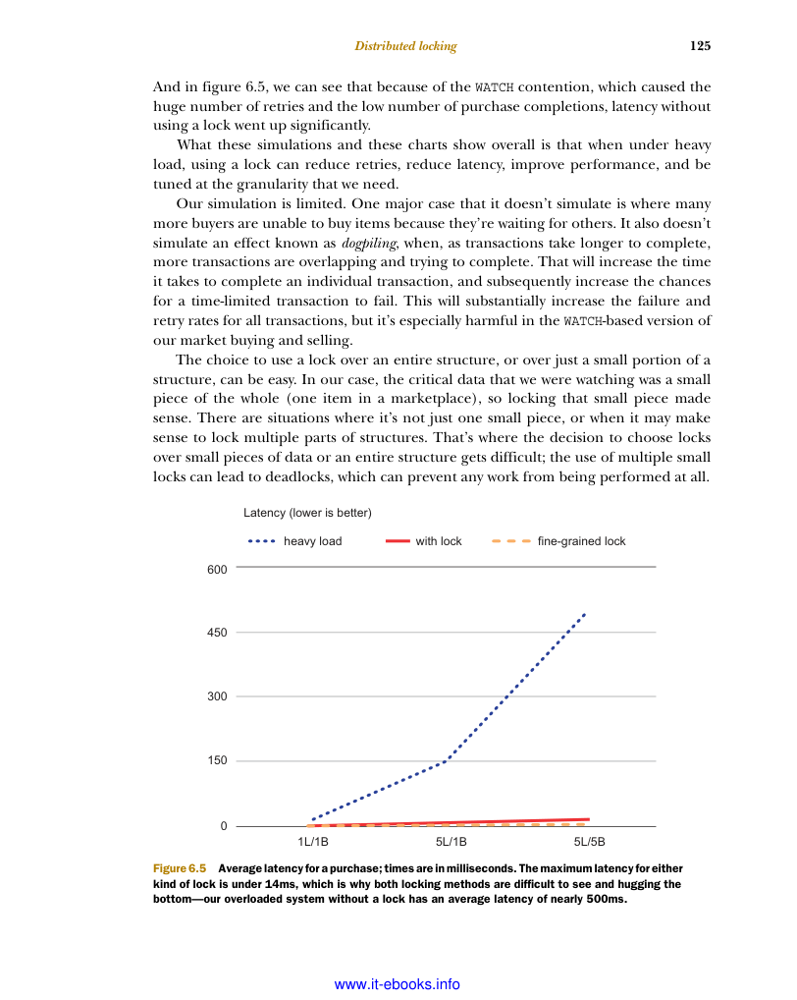

*Giải thích Hình 6.5 (Biểu đồ độ trễ trung bình – thấp hơn là tốt hơn):*
- Đường **`heavy load` (không khóa):** Tăng từ `14ms` (`1L/1B`) lên `150ms` (`5L/1B`) và chạm mức `498ms` (`5L/5B`).
- Đường **`with lock`:** Giữ ở mức `1ms` -> `5ms` -> `14ms`.
- Đường **`fine-grained lock`:** Luôn nằm dưới `3ms` (`<1ms` -> `<2ms` -> `<3ms`).

Những gì mà các phép mô phỏng và các biểu đồ này cho thấy xét trên tổng thể là: khi chịu tải nặng, việc sử dụng một chiếc khóa có thể làm giảm số lần thử lại, giảm độ trễ, cải thiện hiệu năng, và có thể được tinh chỉnh ở mức độ chi tiết (*granularity*) mà chúng ta cần.

Phép mô phỏng của chúng ta vẫn còn giới hạn. Một trường hợp lớn mà nó không mô phỏng là khi có nhiều người mua hơn nữa không thể mua được vật phẩm vì họ đang phải chờ đợi những người khác. Nó cũng không mô phỏng một hiệu ứng được gọi là *hiệu ứng dồn ứ / giẫm đạp* (*dogpiling*), xảy ra khi các giao dịch mất nhiều thời gian hơn để hoàn tất, dẫn đến ngày càng có nhiều giao dịch bị chồng lấn lên nhau và cùng cố gắng hoàn tất. Điều đó sẽ làm tăng thời gian cần thiết để hoàn tất một giao dịch đơn lẻ, và kéo theo là làm tăng khả năng một giao dịch có giới hạn thời gian bị thất bại. Điều này sẽ làm tăng đáng kể tỷ lệ thất bại và thử lại cho tất cả các giao dịch, nhưng nó đặc biệt có hại trong phiên bản mua và bán trên chợ dựa trên `WATCH` của chúng ta.

Sự lựa chọn giữa việc sử dụng một chiếc khóa trên toàn bộ cấu trúc, hay chỉ trên một phần nhỏ của cấu trúc, có thể rất dễ dàng. Trong trường hợp của chúng ta, dữ liệu trọng yếu mà chúng ta đang theo dõi chỉ là một mảnh nhỏ của tổng thể (một vật phẩm trong chợ), vì vậy việc khóa mảnh nhỏ đó là hoàn toàn hợp lý (ví dụ: thay vì gọi `acquire_lock(conn, 'market:')`, ta gọi `acquire_lock(conn, 'market:' + item)`). Có những tình huống mà đó không chỉ là một mảnh nhỏ, hoặc khi việc khóa nhiều phần của các cấu trúc lại trở nên hợp lý. Đó là lúc quyết định chọn khóa trên các mảnh dữ liệu nhỏ hay trên toàn bộ cấu trúc trở nên khó khăn; việc sử dụng nhiều khóa nhỏ có thể dẫn đến tình trạng *khóa chết* (*deadlocks*), thứ có thể ngăn chặn hoàn toàn việc thực hiện bất kỳ công việc nào.

> 💡 **Ví dụ bổ sung (không có trong sách) – Cách tránh Deadlock khi cần khóa nhiều tài nguyên nhỏ:**
> Giả sử người dùng A muốn trao đổi vật phẩm trực tiếp với người dùng B, bạn cần khóa cả hai túi đồ `inventory:A` và `inventory:B`. Nếu Tiến trình 1 khóa `inventory:A` trước rồi chờ `inventory:B`, trong khi Tiến trình 2 khóa `inventory:B` trước rồi chờ `inventory:A`, cả hai sẽ rơi vào **deadlock** (chờ nhau cho đến khi hết timeout).
> Giải pháp kinh điển là **luôn giành khóa theo một thứ tự cố định** (ví dụ: sắp xếp tên khóa theo thứ tự bảng chữ cái trước khi gọi `acquire_lock`):
> ```python
> locks_to_acquire = sorted([f"inventory:{user_a}", f"inventory:{user_b}"])
> ```

---

### 6.2.5 Khóa có thời gian hết hạn (Locks with timeouts)

Như đã đề cập trước đó, chiếc khóa của chúng ta chưa xử lý các trường hợp người giữ khóa (*lock holder*) bị sập mà không nhả khóa, hoặc khi người giữ khóa gặp lỗi và giữ khóa mãi mãi. Để xử lý các trường hợp sập/lỗi này, chúng ta thêm một thời gian hết hạn (*timeout*) cho khóa.

Để cung cấp thời gian hết hạn cho khóa của mình, chúng ta sẽ sử dụng lệnh `EXPIRE` để bắt Redis tự động làm cho nó hết hạn. Vị trí tự nhiên nhất để đặt `EXPIRE` là ngay sau khi khóa được giành lấy, và chúng ta sẽ làm như vậy. Nhưng nếu client của chúng ta chẳng may bị sập (và vị trí tệ nhất đối với chúng ta để nó bị sập là nằm ngay giữa lệnh `SETNX` và lệnh `EXPIRE`), chúng ta vẫn muốn chiếc khóa đó cuối cùng sẽ phải hết hạn. Để xử lý tình huống đó, bất kỳ khi nào một client không lấy được khóa, client đó sẽ kiểm tra thời gian hết hạn (*expiration*) trên khóa bằng lệnh `TTL`, và nếu nó chưa được thiết lập, client sẽ thiết lập nó. Bởi vì các client sẽ luôn kiểm tra và thiết lập thời gian hết hạn nếu chúng không lấy được khóa, nên chiếc khóa sẽ luôn có một thời gian hết hạn, và cuối cùng sẽ hết hạn, cho phép các client khác lấy được chiếc khóa đã hết hạn đó.

Chuyện gì sẽ xảy ra nếu nhiều client thiết lập thời gian hết hạn cùng một lúc? Chúng sẽ chạy ở gần như cùng một thời điểm, vì vậy thời gian hết hạn sẽ được thiết lập cho cùng một mốc thời gian.

Việc thêm thời gian hết hạn vào hàm `acquire_lock()` trước đó của chúng ta mang lại cho chúng ta hàm `acquire_lock_with_timeout()` đã được cập nhật hiển thị dưới đây.

**Listing 6.11 – Hàm `acquire_lock_with_timeout()` (The `acquire_lock_with_timeout()` function)**

```python
def acquire_lock_with_timeout(
    conn, lockname, acquire_timeout=10, lock_timeout=10):
    identifier = str(uuid.uuid4())                      # Một mã định danh ngẫu nhiên 128-bit.
    lockname = 'lock:' + lockname
    lock_timeout = int(math.ceil(lock_timeout))         # Chỉ truyền các số nguyên vào các lời gọi EXPIRE của chúng ta.

    end = time.time() + acquire_timeout
    while time.time() < end:
        if conn.setnx(lockname, identifier):            # Lấy khóa và thiết lập thời gian hết hạn.
            conn.expire(lockname, lock_timeout)
            return identifier
        elif not conn.ttl(lockname):                    # Kiểm tra và cập nhật thời gian hết hạn khi cần thiết.
            conn.expire(lockname, lock_timeout)

        time.sleep(.001)

    return False
```

*Chú thích mã nguồn trong sách cho Listing 6.11:*
- `identifier = str(uuid.uuid4())`: Một mã định danh ngẫu nhiên 128-bit (*A 128-bit random identifier*).
- `lock_timeout = int(math.ceil(lock_timeout))`: Chỉ truyền các số nguyên vào các lời gọi `EXPIRE` của chúng ta (*Only pass integers to our EXPIRE calls*).
- `if conn.setnx(lockname, identifier):` / `conn.expire(lockname, lock_timeout)`: Lấy khóa và thiết lập thời gian hết hạn (*Get the lock and set the expiration*).
- `elif not conn.ttl(lockname):` / `conn.expire(lockname, lock_timeout)`: Kiểm tra và cập nhật thời gian hết hạn khi cần thiết (*Check and update the expiration time as necessary*). *(Lưu ý: Trong bản in trang 153 của sách thiếu dòng `lockname = 'lock:' + lockname`, nhưng trong mã nguồn chính thức của sách có dòng này để đồng bộ với tiền tố `'lock:'` trong `release_lock()`).*

Hàm `acquire_lock_with_timeout()` mới này xử lý thời gian hết hạn. Nó đảm bảo rằng các khóa sẽ hết hạn khi cần thiết, và chúng sẽ không bị đánh cắp khỏi những client đang giữ chúng một cách hợp pháp. Tuyệt vời hơn nữa, trước đó chúng ta đã khéo léo thiết kế hàm nhả khóa (`release_lock()`), nên hàm đó vẫn hoạt động tốt.

> **LƯU Ý (NOTE)**
> Kể từ phiên bản Redis 2.6.12, lệnh `SET` đã bổ sung các tùy chọn để hỗ trợ sự kết hợp chức năng của cả `SETNX` và `SETEX`, điều này làm cho hàm giành khóa của chúng ta trở nên cực kỳ đơn giản. Tuy nhiên, chúng ta vẫn cần hàm nhả khóa phức tạp kia để đảm bảo tính chính xác.

Trong mục 6.1.2 khi xây dựng tính năng tự động hoàn thành cho sổ địa chỉ bằng cách sử dụng một `ZSET`, chúng ta đã phải trải qua một chút rắc rối để tạo ra các mục bắt đầu (`start`) và kết thúc (`end`) nhằm thêm vào `ZSET` để lấy ra một khoảng giá trị. Chúng ta cũng đã phải hậu xử lý (*postprocessed*) dữ liệu của mình để loại bỏ các mục có chứa dấu ngoặc nhọn (`{`), bởi vì các thao tác tự động hoàn thành khác có thể đang diễn ra cùng một lúc. Và bởi vì các thao tác khác có thể đang diễn ra cùng một lúc, chúng ta đã phải sử dụng `WATCH` để có thể thử lại. Mỗi mảnh ghép đó đều làm tăng thêm sự phức tạp cho các hàm của chúng ta, thứ lẽ ra đã có thể được đơn giản hóa nếu chúng ta sử dụng một chiếc khóa để thay thế.

Trong các cơ sở dữ liệu khác, việc khóa là một thao tác cơ bản được hỗ trợ và thực hiện một cách tự động. Như tôi đã đề cập trước đó, việc sử dụng `WATCH`, `MULTI`, và `EXEC` là một cách để có được một chiếc *khóa lạc quan* (*optimistic lock*) — chúng ta không thực sự khóa dữ liệu, nhưng chúng ta được thông báo và các thay đổi của chúng ta sẽ bị hủy bỏ nếu có ai đó khác sửa đổi dữ liệu trước khi chúng ta làm điều đó. Bằng cách bổ sung cơ chế khóa tường minh (*explicit locking*) ở phía client, chúng ta nhận được một vài lợi ích (hiệu năng tốt hơn, một khái niệm lập trình quen thuộc hơn, API dễ sử dụng hơn, v.v.), nhưng chúng ta cần nhớ rằng bản thân Redis không tự động tuân theo các khóa của chúng ta. Chính chúng ta phải là người nhất quán sử dụng các khóa của mình bổ sung cho — hoặc thay thế cho — `WATCH`, `MULTI`, và `EXEC` để giữ cho dữ liệu của mình luôn nhất quán và chính xác.

Bây giờ khi chúng ta đã xây dựng xong một chiếc khóa có thời gian hết hạn, hãy cùng nhìn vào một loại khóa khác được gọi là *semaphore đếm* (*counting semaphore*). Nó không được sử dụng ở nhiều nơi như một chiếc khóa thông thường, nhưng khi chúng ta cần trao cho nhiều client quyền truy cập vào cùng một thông tin tại cùng một thời điểm, nó chính là công cụ hoàn hảo cho công việc đó.

> 📝 **Giải thích thêm (không có trong sách) — Đối chiếu Mục 6.2 (Distributed Locking) với Redis 6/7/8 & `redis-py` 5.x hiện đại:**
>
> Như hộp `NOTE` của tác giả vừa nêu, từ Redis 2.6.12 trở đi, lệnh `SET` đã hợp nhất cả `SETNX` và `SETEX`/`PSETEX` thông qua các cờ `NX` (chỉ đặt nếu khóa chưa tồn tại) và `EX` (hết hạn theo giây) / `PX` (hết hạn theo mili-giây) trong **một thao tác nguyên tử duy nhất**. Dưới đây là bảng đối chiếu trực tiếp quy trình khóa phân tán trong sách (Mục 6.2.3 & 6.2.5) với chuẩn công nghiệp hiện đại trên Redis 6/7/8 và `redis-py` 5.x:
>
> | Bước thao tác | Cách làm trong sách (Mục 6.2.3 & 6.2.5 - Redis 2.6 đầu kỳ) | Chuẩn hiện đại (Redis 2.6.12+ / 6 / 7 / 8 & `redis-py` 5.x) |
> | :--- | :--- | :--- |
> | **1. Giành khóa có thời gian sống (Acquire with TTL)** | Gọi 2 lệnh tách rời: `SETNX lock:name uuid` rồi `EXPIRE lock:name timeout` (nếu client sập ở giữa phải nhờ client khác kiểm tra `TTL` để gắn hộ `EXPIRE`). | Gọi **1 lệnh nguyên tử duy nhất**: `conn.set(lock_key, identifier, nx=True, px=lock_timeout_ms)` (`SET key uuid NX PX ms`). Không bao giờ bị rò rỉ khóa không có TTL! |
> | **2. Nhả khóa an toàn (Atomic Release)** | Dùng vòng lặp `WATCH` + `GET` (kiểm tra `identifier`) + `MULTI` + `DEL` + `EXEC` (tốn tối thiểu 2 vòng mạng - round-trips). | Dùng **Lua Script (`EVAL`)** kiểm tra `GET` và `DEL` nguyên tử trong **1 vòng mạng duy nhất**. |
> | **3. Gia hạn khóa (Extend / Watchdog)** | Chưa có hàm riêng cho khóa đơn (chỉ có cho semaphore ở 6.3.3). | Dùng Lua Script kiểm tra `GET == uuid` rồi gọi `PEXPIRE`, hoặc gọi `lock.extend(additional_time)` của `redis-py`. |
> | **4. Tích hợp sẵn trong thư viện `redis-py` 5.x** | Phải tự viết hàm `acquire_lock_with_timeout()` và `release_lock()`. | Dùng trực tiếp trình quản lý ngữ cảnh **`conn.lock(name, timeout=10, blocking_timeout=10)`** có sẵn trong `redis-py`! |

> 💡 **Ví dụ bổ sung (không có trong sách) – Cách triển khai Distributed Lock chuẩn hiện đại trong Redis (Redis 6/7/8 & `redis-py` 5.x):**
>
> ```python
> # Cách 1: Tự triển khai chuẩn bằng SET NX PX + Lua Script trong redis-py 5.x
> RELEASE_LUA_SCRIPT = """
> if redis.call("get", KEYS[1]) == ARGV[1] then
>     return redis.call("del", KEYS[1])
> else
>     return 0
> end
> """
>
> def acquire_lock_modern(conn, lockname, acquire_timeout=10, lock_timeout=10):
>     identifier = str(uuid.uuid4())
>     lock_key = f"lock:{lockname}"
>     lock_timeout_ms = int(lock_timeout * 1000)
>     end = time.time() + acquire_timeout
>     while time.time() < end:
>         if conn.set(lock_key, identifier, nx=True, px=lock_timeout_ms):
>             return identifier
>         time.sleep(0.001)
>     return False
>
> def release_lock_modern(conn, lockname, identifier):
>     lock_key = f"lock:{lockname}"
>     return bool(conn.eval(RELEASE_LUA_SCRIPT, 1, lock_key, identifier))
>
> # Cách 2: Sử dụng trực tiếp lớp Lock tích hợp sẵn trong redis-py 5.x (Khuyên dùng trong thực tế!)
> # Bên dưới conn.lock() sử dụng chính xác cơ chế UUID + SET NX PX + Lua script ở trên
> with conn.lock("market:ItemA.4", timeout=10, blocking_timeout=5) as lock:
>     # Thực hiện giao dịch mua bán an toàn tại đây
>     pass
> ```
> Nếu hệ thống cần chạy trên nhiều cụm Redis Master độc lập để chịu lỗi phần cứng mất điện/mất mạng mà không mất tính toàn vẹn của khóa, bạn có thể tham khảo thêm thuật toán **Redlock** cùng khái niệm **fencing token** (sẽ được thảo luận sâu hơn về Lua script ở Chương 11).

---

## 6.3 Semaphore đếm (Counting semaphores)

Một *semaphore đếm* (*counting semaphore*) là một loại khóa cho phép bạn giới hạn số lượng tiến trình có thể truy cập đồng thời vào một tài nguyên ở một con số cố định nào đó. Bạn có thể hình dung chiếc khóa mà chúng ta vừa tạo ra ở mục trước chính là một semaphore đếm với giới hạn bằng 1. Nhìn chung, semaphore đếm được sử dụng để giới hạn lượng tài nguyên có thể được sử dụng tại cùng một thời điểm.

Giống như các loại khóa khác, semaphore đếm cần được giành lấy (*acquired*) và nhả ra (*released*). Đầu tiên, chúng ta giành lấy semaphore, sau đó thực hiện thao tác của mình, và cuối cùng là nhả nó ra. Nhưng trong khi thông thường chúng ta sẽ đứng chờ một chiếc khóa nếu nó chưa sẵn sàng, thì đối với một semaphore, việc báo thất bại ngay lập tức (*fail immediately*) nếu semaphore không sẵn sàng ngay lúc đó lại rất phổ biến. Ví dụ, giả sử chúng ta muốn cho phép năm tiến trình giành được semaphore. Nếu một tiến trình thứ sáu cố gắng giành lấy nó, chúng ta sẽ muốn lời gọi đó thất bại sớm và báo cáo rằng tài nguyên đang bận.

Chúng ta sẽ đi qua mục này theo cách tương tự như cách chúng ta đã đi qua phần khóa phân tán ở mục 6.2. Chúng ta sẽ xây dựng một semaphore đếm từng mảnh một cho đến khi có được một phiên bản hoàn chỉnh và chính xác.

Hãy cùng xem xét một ví dụ với Fake Game Company. Với sự thành công của chợ vật phẩm ngày càng tăng trưởng không ngừng, Fake Game Company đã nhận được các yêu cầu từ người dùng muốn truy cập thông tin về chợ từ bên ngoài trò chơi để họ có thể mua và bán vật phẩm mà không cần phải đăng nhập vào trò chơi. Bộ API để thực hiện các thao tác này đã được viết xong, nhưng công việc của chúng ta là xây dựng một cơ chế giới hạn mỗi tài khoản không được truy cập vào chợ từ nhiều hơn năm tiến trình cùng một lúc.

Sau khi đã xây dựng xong semaphore đếm của mình, chúng ta đảm bảo bọc các lời gọi API gửi đến trong một cặp `acquire_semaphore()` và `release_semaphore()` thích hợp.

### 6.3.1 Xây dựng một semaphore đếm cơ bản (Building a basic counting semaphore)

Khi xây dựng một semaphore đếm, chúng ta gặp phải nhiều mối bận tâm tương tự như khi làm việc với các loại khóa khác. Chúng ta phải quyết định xem ai đã lấy được khóa, làm thế nào để xử lý các tiến trình bị sập khi đang giữ khóa, và làm thế nào để xử lý thời gian hết hạn (*timeouts*). Nếu không quan tâm đến thời gian hết hạn, hoặc không xử lý trường hợp những người giữ semaphore có thể bị sập mà không nhả semaphore, chúng ta có thể xây dựng semaphore khá thuận tiện theo một vài cách khác nhau (chẳng hạn dùng `INCR`/`DECR`). Thật không may, những phương pháp đó không dẫn chúng ta đến bất kỳ thứ gì hữu ích về lâu dài, vì vậy tôi sẽ mô tả một phương pháp mà chúng ta sẽ cải tiến dần dần để cung cấp đầy đủ các chức năng.

Trong hầu hết mọi trường hợp khi muốn xử lý thời gian hết hạn trong Redis, nhìn chung chúng ta sẽ tìm đến một trong hai phương pháp khác nhau. Hoặc là chúng ta sẽ sử dụng `EXPIRE` giống như đã làm với các khóa tiêu chuẩn của mình, hoặc là chúng ta sẽ sử dụng `ZSET`. Trong trường hợp này, chúng ta muốn sử dụng `ZSET`, bởi vì điều đó cho phép chúng ta lưu giữ thông tin về nhiều người giữ semaphore bên trong một cấu trúc duy nhất (vì Redis không hỗ trợ đặt `EXPIRE` cho từng phần tử con bên trong `SET` hay `HASH` ở các phiên bản tiêu chuẩn khi sách được viết).

Cụ thể hơn, đối với mỗi tiến trình cố gắng giành lấy semaphore, chúng ta sẽ tạo ra một mã định danh duy nhất (*unique identifier*). Mã định danh này sẽ là thành viên (*member*) của một `ZSET`. Đối với điểm số (*score*), chúng ta sẽ sử dụng dấu thời gian (*timestamp*) tại thời điểm tiến trình cố gắng giành lấy semaphore. `ZSET` semaphore của chúng ta sẽ trông giống như hình 6.6.

**Hình 6.6 – `ZSET` của một semaphore cơ bản (Figure 6.6 Basic semaphore ZSET)**

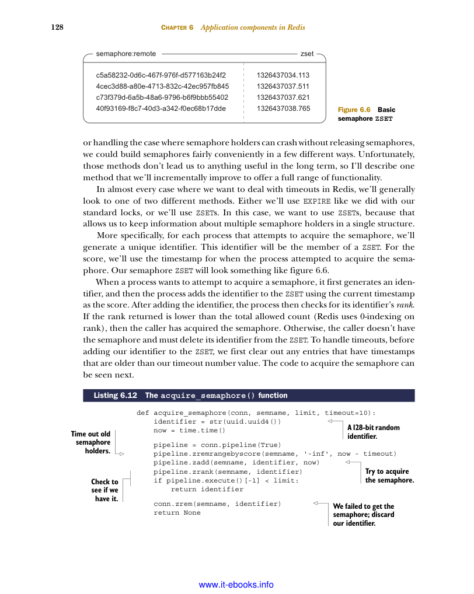

*Giải thích chi tiết Hình 6.6:*

| Khóa (Key) | Kiểu | Thành viên (Member – UUID 128-bit) | Điểm số (Score – Unix Timestamp) | Thứ hạng (Rank) |
|---|---|---|---|---|
| `semaphore:remote` | `zset` | `c5a58232-0d6c-467f-976f-d577163b24f2` | `1326437034.113` | `0` |
| `semaphore:remote` | `zset` | `4cec3d88-a80e-4713-832c-42ec957fb845` | `1326437037.511` | `1` |
| `semaphore:remote` | `zset` | `c73f379d-6a5b-48a6-9796-b6f9bbb55402` | `1326437037.621` | `2` |
| `semaphore:remote` | `zset` | `40f93169-f8c7-40d3-a342-f0ec68b17dde` | `1326437038.765` | `3` |

Khi một tiến trình muốn cố gắng giành lấy một semaphore, trước tiên nó tạo ra một mã định danh, và sau đó tiến trình thêm mã định danh đó vào `ZSET` bằng cách sử dụng dấu thời gian hiện tại làm điểm số. Sau khi thêm mã định danh, tiến trình sẽ kiểm tra thứ hạng (*rank*) của mã định danh đó. Nếu thứ hạng trả về thấp hơn tổng số lượng được phép (Redis sử dụng cách đánh chỉ mục bắt đầu từ 0 — *0-indexing* — cho thứ hạng, tức là các thứ hạng từ `0` đến `limit - 1`), thì bên gọi đã giành được semaphore. Ngược lại, bên gọi không có được semaphore và phải xóa mã định danh của mình khỏi `ZSET`. Để xử lý thời gian hết hạn, trước khi thêm mã định danh của mình vào `ZSET`, trước tiên chúng ta dọn sạch bất kỳ mục nào có dấu thời gian cũ hơn giá trị thời gian hết hạn của chúng ta. Đoạn mã để giành lấy semaphore có thể được thấy ngay dưới đây.

**Listing 6.12 – Hàm `acquire_semaphore()` (The `acquire_semaphore()` function)**

```python
def acquire_semaphore(conn, semname, limit, timeout=10):
    identifier = str(uuid.uuid4())                             # Một mã định danh ngẫu nhiên 128-bit.
    now = time.time()

    pipeline = conn.pipeline(True)
    pipeline.zremrangebyscore(semname, '-inf', now - timeout)  # Làm hết hạn (xóa) những người giữ semaphore cũ.
    pipeline.zadd(semname, identifier, now)                    # Cố gắng giành lấy semaphore.
    pipeline.zrank(semname, identifier)                        # Kiểm tra xem chúng ta có lấy được nó không.
    if pipeline.execute()[-1] < limit:
        return identifier

    conn.zrem(semname, identifier)                             # Chúng ta đã thất bại trong việc lấy semaphore; loại bỏ mã định danh của mình.
    return None
```

*Chú thích mã nguồn trong sách cho Listing 6.12:*
- `identifier = str(uuid.uuid4())`: Một mã định danh ngẫu nhiên 128-bit (*A 128-bit random identifier*).
- `pipeline.zremrangebyscore(semname, '-inf', now - timeout)`: Làm hết hạn các tiến trình giữ semaphore cũ (*Time out old semaphore holders*).
- `pipeline.zadd(semname, identifier, now)`: Cố gắng giành lấy semaphore (*Try to acquire the semaphore*).
- `pipeline.zrank(semname, identifier)` / `if pipeline.execute()[-1] < limit:`: Kiểm tra xem chúng ta có giữ được nó hay không (*Check to see if we have it*).
- `conn.zrem(semname, identifier)`: Chúng ta đã không lấy được semaphore; hủy bỏ mã định danh của mình (*We failed to get the semaphore; discard our identifier*).

Mã của chúng ta tiến hành đúng như những gì tôi đã mô tả: tạo mã định danh, dọn sạch bất kỳ semaphore nào đã hết hạn, thêm mã định danh của nó vào `ZSET`, và kiểm tra thứ hạng của nó. Không có gì quá bất ngờ.

Việc nhả semaphore thì rất dễ: chúng ta xóa mã định danh khỏi `ZSET`, như có thể thấy trong listing tiếp theo.

**Listing 6.13 – Hàm `release_semaphore()` (The `release_semaphore()` function)**

```python
def release_semaphore(conn, semname, identifier):
    return conn.zrem(semname, identifier)  # Trả về True nếu semaphore đã được nhả đúng cách, False nếu nó đã bị hết hạn trước đó.
```

*Chú thích mã nguồn trong sách cho Listing 6.13:*
- `return conn.zrem(semname, identifier)`: Trả về `True` (hoặc `1`) nếu semaphore đã được nhả đúng cách, `False` (hoặc `0`) nếu nó đã bị hết hạn từ trước (*Returns True if the semaphore was properly released, False if it had timed out*).

Semaphore cơ bản này hoạt động tốt — nó đơn giản, và nó rất nhanh. Nhưng việc phụ thuộc vào chuyện mọi tiến trình đều có quyền truy cập vào cùng một giờ hệ thống (*system time*) để lấy được semaphore có thể gây ra rắc rối nếu chúng ta có nhiều máy chủ (*multiple hosts*). Đây không phải là một vấn đề quá lớn đối với trường hợp sử dụng cụ thể của chúng ta nếu chỉ chạy trên một máy, nhưng nếu chúng ta có hai hệ thống A và B, trong đó đồng hồ của A chạy nhanh hơn B dù chỉ 10 mili-giây, thì nếu A lấy được chiếc semaphore cuối cùng, và B cố gắng lấy một semaphore trong vòng 10 mili-giây tiếp theo, B sẽ thực sự "đánh cắp" (*steal*) chiếc semaphore của A mà A không hề hay biết.

> 📝 **Giải thích thêm (không có trong sách) – Minh họa hiện tượng "đánh cắp" semaphore do lệch đồng hồ hệ thống (*clock skew*):**
> Giả sử giới hạn `limit = 5`, hiện đang có 4 tiến trình giữ semaphore với các mốc thời gian `100.1`, `100.2`, `100.3`, `100.4`.
> 1. Tại thời điểm thực tế $t$, **Máy A** (đồng hồ chạy nhanh hơn 10ms) đọc `time.time()` được `100.510`. Máy A chèn UUID của mình vào `ZSET` với score `100.510`, kiểm tra `ZRANK` thấy `rank = 4` (`< 5`) -> **Máy A nhận được slot thứ 5 (cuối cùng)**.
> 2. Chỉ 2ms sau đó, **Máy B** (đồng hồ chạy chậm hơn Máy A 10ms) đọc `time.time()` được `100.502`. Máy B chèn UUID của mình vào `ZSET` với score `100.502`.
> 3. Vì `100.502 < 100.510`, trong `ZSET` được sắp xếp theo score, phần tử của Máy B sẽ chèn vào **trước** phần tử của Máy A! Khi Máy B gọi `ZRANK`, nó nhận được `rank = 4` (`< 5`), trong khi phần tử của Máy A bị đẩy xuống `rank = 5`!
> 4. Kết quả: **Máy B cũng tưởng mình lấy được semaphore hợp lệ**, còn Máy A không hề biết mình đã bị đẩy ra ngoài giới hạn `limit = 5`. Lúc này có tới 6 tiến trình cùng chạy!

Bất kỳ khi nào chúng ta có một chiếc khóa hoặc một semaphore mà chỉ một sự chênh lệch nhỏ trong đồng hồ hệ thống cũng có thể ảnh hưởng nghiêm trọng đến việc ai có thể lấy được khóa, thì chiếc khóa hoặc semaphore đó bị coi là *không công bằng* (*unfair*). Các khóa và semaphore không công bằng có thể khiến những client đáng lẽ phải lấy được khóa hoặc semaphore lại không bao giờ lấy được nó, và đây là điều mà chúng ta sẽ khắc phục trong mục tiếp theo.

---

### 6.3.2 Semaphore công bằng (Fair semaphores)

Bởi vì chúng ta không thể giả định rằng tất cả đồng hồ hệ thống đều giống hệt nhau trên mọi hệ thống, nên semaphore đếm cơ bản trước đó của chúng ta sẽ gặp vấn đề: các client trên những hệ thống có đồng hồ hệ thống chạy chậm hơn có thể đánh cắp semaphore từ các client trên những hệ thống có đồng hồ chạy nhanh hơn. Bất kỳ khi nào có kiểu nhạy cảm như vậy, bản thân việc khóa sẽ trở nên không công bằng. Chúng ta muốn giảm thiểu tác động của giờ hệ thống không chính xác lên việc giành lấy semaphore đến mức: miễn là các hệ thống chênh lệch nhau trong phạm vi 1 giây, thì giờ hệ thống sẽ không gây ra việc đánh cắp semaphore hay làm hết hạn semaphore quá sớm.

Để giảm thiểu các vấn đề với giờ hệ thống không nhất quán, chúng ta sẽ thêm một bộ đếm (*counter*) và một `ZSET` thứ hai. Bộ đếm tạo ra một cơ chế giống như bộ định thời tăng đều đặn, đảm bảo rằng bất kỳ ai tăng bộ đếm lên trước thì sẽ là người được nhận semaphore trước. Sau đó, chúng ta thực thi yêu cầu rằng những client muốn có semaphore nào lấy được giá trị bộ đếm trước thì cũng sẽ lấy được semaphore trước bằng cách sử dụng một `ZSET` "chủ sở hữu" (*owner ZSET*) với giá trị do bộ đếm tạo ra làm điểm số (*score*), và kiểm tra thứ hạng (*rank*) của mã định danh của chúng ta trong `ZSET` mới này để xác định xem client nào đã lấy được semaphore. `ZSET` chủ sở hữu mới xuất hiện trong hình 6.7.

**Hình 6.7 – `ZSET` chủ sở hữu của semaphore công bằng (Figure 6.7 Fair semaphore owner ZSET)**

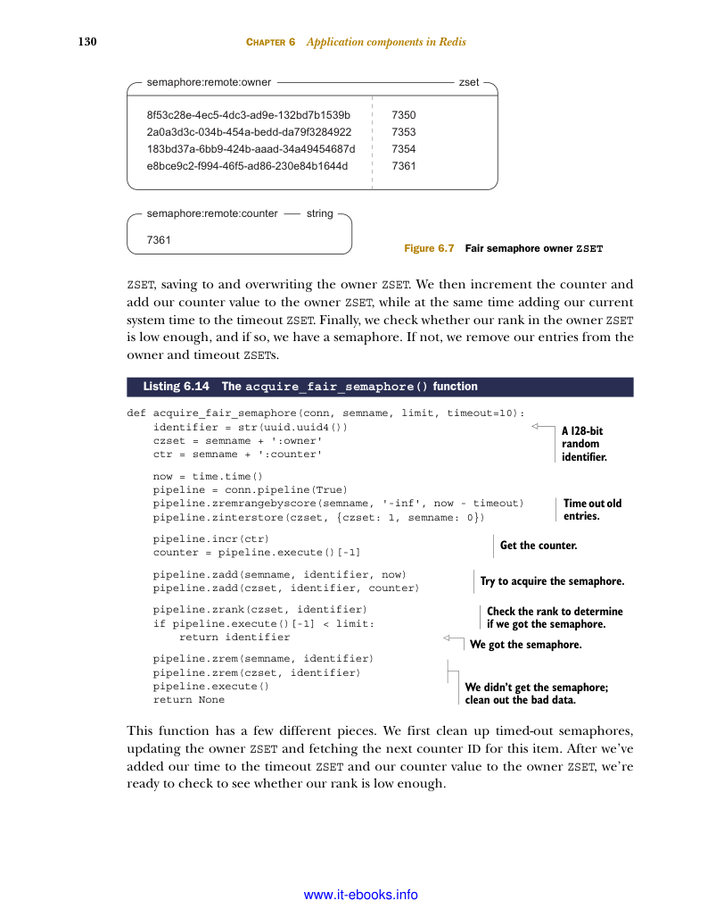

*Giải thích chi tiết Hình 6.7:*
- Khóa bộ đếm **`semaphore:remote:counter`** (kiểu `string`): Đang giữ giá trị số nguyên tăng dần là `7361`.
- Khóa chủ sở hữu **`semaphore:remote:owner`** (kiểu `zset`): Lưu trữ các UUID đang giữ semaphore, nhưng thay vì dùng dấu thời gian làm `score`, nó dùng giá trị lấy từ bộ đếm `counter` làm `score`:
  - `8f53c28e-4ec5-4dc3-ad9e-132bd7b1539b` -> score `7350` (rank `0`)
  - `2a0a3d3c-034b-454a-bedd-da79f3284922` -> score `7353` (rank `1`)
  - `183bd37a-6bb9-424b-aaad-34a49454687d` -> score `7354` (rank `2`)
  - `e8bce9c2-f994-46f5-ad86-230e84b1644d` -> score `7361` (rank `3`)

Chúng ta tiếp tục xử lý việc hết hạn (*timeouts*) theo cùng cách như semaphore cơ bản của mình, bằng cách xóa các mục cũ khỏi `ZSET` giờ hệ thống (`semname`). Chúng ta lan truyền (*propagate*) những kết quả hết hạn đó sang `ZSET` chủ sở hữu mới (`czset`) thông qua việc sử dụng lệnh `ZINTERSTORE` và đối số `WEIGHTS`.

Gộp tất cả lại với nhau trong listing 6.14, trước tiên chúng ta làm hết hạn các mục cũ bằng cách xóa các mục quá hạn khỏi `ZSET` thời gian hết hạn (`semname`) và sau đó thực hiện phép giao (*intersect*) giữa `ZSET` thời gian hết hạn với `ZSET` chủ sở hữu (`czset`), lưu kết quả đè lên chính `ZSET` chủ sở hữu. Tiếp theo, chúng ta tăng bộ đếm (`ctr`) lên và thêm giá trị bộ đếm của mình vào `ZSET` chủ sở hữu, đồng thời thêm giờ hệ thống hiện tại của mình vào `ZSET` thời gian hết hạn. Cuối cùng, chúng ta kiểm tra xem thứ hạng của mình trong `ZSET` chủ sở hữu có đủ thấp hay không (`< limit`), và nếu có, chúng ta đã có được một semaphore. Nếu không, chúng ta xóa các mục của mình khỏi cả hai `ZSET` chủ sở hữu và `ZSET` thời gian hết hạn.

**Listing 6.14 – Hàm `acquire_fair_semaphore()` (The `acquire_fair_semaphore()` function)**

```python
def acquire_fair_semaphore(conn, semname, limit, timeout=10):
    identifier = str(uuid.uuid4())                             # Một mã định danh ngẫu nhiên 128-bit.
    czset = semname + ':owner'
    ctr = semname + ':counter'

    now = time.time()
    pipeline = conn.pipeline(True)
    pipeline.zremrangebyscore(semname, '-inf', now - timeout)  # Làm hết hạn các mục cũ.
    pipeline.zinterstore(czset, {czset: 1, semname: 0})

    pipeline.incr(ctr)                                         # Lấy giá trị bộ đếm.
    counter = pipeline.execute()[-1]

    pipeline.zadd(semname, identifier, now)                    # Cố gắng giành lấy semaphore.
    pipeline.zadd(czset, identifier, counter)

    pipeline.zrank(czset, identifier)                          # Kiểm tra thứ hạng để xác định xem chúng ta có lấy được semaphore hay không.
    if pipeline.execute()[-1] < limit:
        return identifier                                      # Chúng ta đã lấy được semaphore.

    pipeline.zrem(semname, identifier)                         # Chúng ta không lấy được semaphore; dọn sạch dữ liệu thừa.
    pipeline.zrem(czset, identifier)
    pipeline.execute()
    return None
```

*Chú thích mã nguồn trong sách cho Listing 6.14:*
- `identifier = str(uuid.uuid4())`: Một mã định danh ngẫu nhiên 128-bit (*A 128-bit random identifier*).
- `pipeline.zremrangebyscore(...)` / `pipeline.zinterstore(czset, {czset: 1, semname: 0})`: Làm hết hạn các mục cũ (*Time out old entries*).
- `pipeline.incr(ctr)` / `counter = pipeline.execute()[-1]`: Lấy giá trị bộ đếm (*Get the counter*).
- `pipeline.zadd(semname, ...)` / `pipeline.zadd(czset, ...)`: Cố gắng giành lấy semaphore (*Try to acquire the semaphore*).
- `pipeline.zrank(czset, identifier)` / `if pipeline.execute()[-1] < limit:`: Kiểm tra thứ hạng để xác định xem chúng ta có lấy được semaphore hay không (*Check the rank to determine if we got the semaphore*).
- `return identifier`: Chúng ta đã lấy được semaphore (*We got the semaphore*).
- `pipeline.zrem(semname, identifier)` / `pipeline.zrem(czset, identifier)`: Chúng ta đã không lấy được semaphore; dọn sạch dữ liệu không hợp lệ (*We didn’t get the semaphore; clean out the bad data*).

Hàm này có một vài mảnh ghép khác nhau. Trước tiên chúng ta dọn dẹp các semaphore đã hết hạn, cập nhật `ZSET` chủ sở hữu và lấy ID bộ đếm tiếp theo cho mục này. Sau khi đã thêm thời gian của mình vào `ZSET` thời gian hết hạn và giá trị bộ đếm của mình vào `ZSET` chủ sở hữu, chúng ta đã sẵn sàng kiểm tra xem thứ hạng của mình có đủ thấp hay không.

> 📝 **Giải thích thêm (không có trong sách) về kỹ thuật `zinterstore(czset, {czset: 1, semname: 0})`:**
> Tại sao tác giả lại truyền trọng số `{czset: 1, semname: 0}` vào lệnh `ZINTERSTORE`?
> - Khi giao hai `ZSET` (`czset` và `semname`), chỉ những `identifier` nào **còn tồn tại trong `semname`** (tức là chưa bị xóa bởi `zremrangebyscore` do hết hạn) mới được giữ lại trong kết quả giao.
> - Đối với những `identifier` được giữ lại, điểm số mới sẽ được tính bằng công thức:
>   $$\text{score}_{\text{mới}} = (\text{score trong } \texttt{czset} \times 1) + (\text{score trong } \texttt{semname} \times 0) = \text{score trong } \texttt{czset}$$
> - Nhờ trọng số `0` cho `semname`, ta vừa lọc bỏ được các phần tử đã hết hạn khỏi `czset`, vừa **bảo toàn nguyên vẹn điểm số bộ đếm (`counter`)** trong `czset`!

> **SEMAPHORE CÔNG BẰNG TRÊN NỀN TẢNG 32-BIT (FAIR SEMAPHORES ON 32-BIT PLATFORMS)**
>
> Trên các nền tảng Redis 32-bit, các bộ đếm số nguyên bị giới hạn ở mức $2^{31} - 1$ (tức `2,147,483,647`), giới hạn số nguyên có dấu tiêu chuẩn. Một tình huống tràn số (*overflow*) có thể xảy ra trên các semaphore được sử dụng với tần suất cực cao khoảng 2 giờ một lần trong trường hợp xấu nhất. Mặc dù có nhiều cách giải quyết vòng vo khác nhau, cách đơn giản nhất là chuyển sang nền tảng 64-bit cho bất kỳ máy chủ nào sử dụng bất kỳ ID dựa trên bộ đếm nào (trên nền tảng 64-bit, giới hạn là $2^{63} - 1$, mất hàng trăm năm mới có thể tràn).

Hãy nhìn vào hình 6.8, hình này cho thấy chuỗi các thao tác được thực hiện khi tiến trình có ID 8372 muốn giành lấy semaphore tại thời điểm `1326437039.100` khi giới hạn (`limit`) là 5.

**Hình 6.8 – Chuỗi lời gọi cho hàm `acquire_fair_semaphore()` (Figure 6.8 Call sequence for `acquire_fair_semaphore()`)**

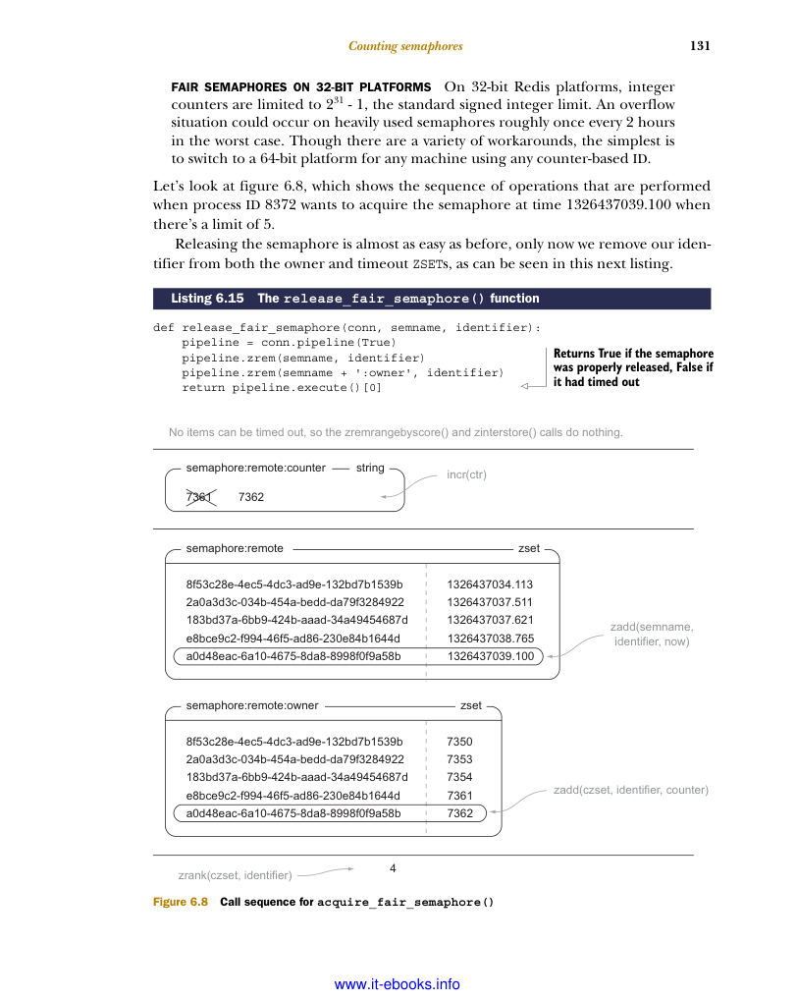

*Giải thích chi tiết Hình 6.8:*
Khi một tiến trình mới (sinh ra UUID `a0d48eac-6a10-4675-8da8-8998f0f9a58b`) gọi `acquire_fair_semaphore()` tại mốc thời gian `1326437039.100`:
1. **Bước dọn dẹp hết hạn:** Không có phần tử nào trong `semaphore:remote` có score nhỏ hơn `1326437039.100 - 10`, nên hai lời gọi `zremrangebyscore()` và `zinterstore()` không làm thay đổi dữ liệu.
2. **`incr(ctr)`:** Tăng khóa `semaphore:remote:counter` từ `7361` lên `7362`.
3. **`zadd(semname, identifier, now)`:** Thêm thành viên `a0d48eac-6a10-4675-8da8-8998f0f9a58b` với score `1326437039.100` vào `semaphore:remote`.
4. **`zadd(czset, identifier, counter)`:** Thêm thành viên `a0d48eac-6a10-4675-8da8-8998f0f9a58b` với score `7362` vào `semaphore:remote:owner`.
5. **`zrank(czset, identifier)`:** Kiểm tra thứ hạng của `a0d48eac-...` trong `semaphore:remote:owner`, kết quả trả về là `4` (vì có 5 phần tử ứng với index `0, 1, 2, 3, 4`). Vì `4 < 5` (`limit = 5`), tiến trình giành được semaphore thành công!

Việc nhả semaphore cũng gần như dễ dàng giống hệt trước đây, chỉ khác là giờ đây chúng ta xóa mã định danh của mình khỏi cả hai `ZSET` chủ sở hữu và `ZSET` thời gian hết hạn, như có thể thấy trong listing tiếp theo này.

**Listing 6.15 – Hàm `release_fair_semaphore()` (The `release_fair_semaphore()` function)**

```python
def release_fair_semaphore(conn, semname, identifier):
    pipeline = conn.pipeline(True)
    pipeline.zrem(semname, identifier)
    pipeline.zrem(semname + ':owner', identifier)
    return pipeline.execute()[0]  # Trả về True nếu semaphore đã được nhả đúng cách, False nếu nó đã bị hết hạn.
```

*Chú thích mã nguồn trong sách cho Listing 6.15:*
- `return pipeline.execute()[0]`: Trả về `True` nếu semaphore được nhả đúng cách, `False` nếu nó đã hết hạn (*Returns True if the semaphore was properly released, False if it had timed out*).

Nếu muốn lười biếng một chút, trong hầu hết các tình huống chúng ta có thể chỉ cần xóa mã định danh semaphore của mình khỏi `ZSET` thời gian hết hạn; bởi vì một trong các bước của chúng ta trong chuỗi thao tác giành semaphore là làm mới `ZSET` chủ sở hữu để loại bỏ các mã định danh không còn nằm trong `ZSET` thời gian hết hạn nữa. Nhưng nếu chỉ xóa mã định danh của mình khỏi `ZSET` thời gian hết hạn, sẽ có một khả năng (hiếm, nhưng có thể xảy ra) là chúng ta vừa xóa mục đó xong, thì một lệnh `acquire_fair_semaphore()` khác lại đang nằm đúng ở khoảng giữa bước cập nhật `ZSET` chủ sở hữu và bước thêm các mã định danh của riêng nó vào `ZSET` thời gian hết hạn và `ZSET` chủ sở hữu. Nếu chuyện đó xảy ra, điều này có thể ngăn cản tiến trình kia giành được semaphore trong khi đáng lẽ nó phải lấy được. Để đảm bảo hành vi chính xác trong nhiều tình huống nhất có thể, chúng ta sẽ giữ nguyên việc xóa mã định danh khỏi cả hai `ZSET`.

Giờ đây chúng ta đã có một semaphore không đòi hỏi tất cả các máy chủ phải có cùng giờ hệ thống, mặc dù giờ hệ thống giữa các máy vẫn cần nằm trong phạm vi chênh lệch 1 hoặc 2 giây để đảm bảo rằng các semaphore không bị hết hạn quá sớm, quá muộn, hoặc không bao giờ hết hạn.

---

### 6.3.3 Làm mới semaphore (Refreshing semaphores)

Khi bộ API cho chợ vật phẩm đang được hoàn thiện, người ta quyết định rằng cần có một phương thức để người dùng truyền phát trực tiếp (*stream*) tất cả các lượt đăng bán vật phẩm ngay khi chúng diễn ra, cùng với một luồng truyền phát cho tất cả các giao dịch mua thực sự xảy ra. Phương pháp semaphore mà chúng ta đã tạo ra chỉ hỗ trợ thời gian hết hạn là 10 giây, chủ yếu để xử lý các trường hợp quá hạn và các lỗi (*bugs*) có thể xảy ra ở phía chúng ta. Nhưng những người dùng phần truyền phát trực tiếp (*streaming*) của API sẽ muốn duy trì kết nối lâu hơn 10 giây rất nhiều, vì vậy chúng ta cần một phương pháp để làm mới (*refreshing*) semaphore sao cho nó không bị hết hạn.

Bởi vì chúng ta đã tách riêng `ZSET` thời gian hết hạn khỏi `ZSET` chủ sở hữu từ trước, nên chúng ta thực sự có thể làm mới thời gian hết hạn một cách nhanh chóng bằng cách cập nhật lại thời gian của mình trong `ZSET` thời gian hết hạn, như được hiển thị trong listing dưới đây.

**Listing 6.16 – Hàm `refresh_fair_semaphore()` (The `refresh_fair_semaphore()` function)**

```python
def refresh_fair_semaphore(conn, semname, identifier):
    if conn.zadd(semname, identifier, time.time()):    # Cập nhật semaphore của chúng ta.
        release_fair_semaphore(conn, semname, identifier)  # Chúng ta đã mất semaphore; báo cáo lại.
        return False
    return True                                        # Chúng ta vẫn đang giữ semaphore của mình.
```

*Chú thích mã nguồn trong sách cho Listing 6.16:*
- `if conn.zadd(semname, identifier, time.time()):`: Cập nhật semaphore của chúng ta (*Update our semaphore*).
- `release_fair_semaphore(...)` / `return False`: Chúng ta đã mất semaphore của mình; báo cáo lại (*We lost our semaphore; report back*).
- `return True`: Chúng ta vẫn còn giữ semaphore của mình (*We still have our semaphore*).

> 📝 **Giải thích thêm (không có trong sách) về giá trị trả về của `ZADD` trong Listing 6.16:**
> Tại sao khi `conn.zadd(semname, identifier, time.time())` trả về giá trị khác `0` (`True`), ta lại biết rằng **mình đã mất semaphore**?
> - Theo đặc tả của Redis, lệnh `ZADD` trả về **số lượng phần tử mới được thêm vào** `ZSET` (không tính các phần tử đã tồn tại chỉ được cập nhật lại `score`).
> - Nếu `identifier` vẫn còn nằm trong `semname` (chưa bị hết hạn), `ZADD` chỉ cập nhật lại `score` thành `time.time()` mới và trả về `0` (`False` trong điều kiện `if`). Khi đó hàm nhảy xuống `return True` (làm mới thành công!).
> - Ngược lại, nếu trước đó semaphore của ta đã bị quá hạn và bị tiến trình khác xóa mất khỏi `semname`, thì lệnh `ZADD` này sẽ thêm mới lại `identifier` vào `semname` và trả về `1` (`True` trong điều kiện `if`). Khi phát hiện mình đã bị xóa do quá hạn từ trước, ta phải gọi ngay `release_fair_semaphore()` để xóa phần tử vừa lỡ tay thêm vào và trả về `False` báo cho client biết nó đã mất quyền giữ semaphore!

Miễn là chúng ta chưa bị hết hạn trước đó, chúng ta sẽ có thể làm mới semaphore. Nếu chúng ta đã bị hết hạn trong quá khứ, chúng ta sẽ để cho semaphore đó bị mất luôn và báo cáo lại cho bên gọi rằng nó đã bị mất. Khi sử dụng một semaphore có thể được làm mới, chúng ta cần cẩn thận làm mới đủ thường xuyên để không bị mất semaphore.

Bây giờ khi đã có khả năng giành lấy, nhả ra và làm mới một semaphore công bằng, đã đến lúc xử lý tình trạng tranh chấp (*race condition*) cuối cùng của chúng ta.

---

### 6.3.4 Ngăn chặn tình trạng tranh chấp (Preventing race conditions)

Như bạn đã thấy khi xây dựng các khóa trong mục 6.2, việc xử lý các tình trạng tranh chấp gây ra việc phải thử lại hoặc làm hỏng dữ liệu có thể rất khó khăn. Trong trường hợp này, các semaphore mà chúng ta đã tạo ra vẫn còn những tình trạng tranh chấp mà chúng ta đã ám chỉ trước đó, thứ có thể dẫn đến hoạt động không chính xác.

Chúng ta có thể thấy vấn đề này trong ví dụ sau đây. Nếu chúng ta có hai tiến trình A và B đang cố gắng lấy một chiếc semaphore cuối cùng còn lại, và A tăng bộ đếm (`INCR`) trước, nhưng B lại thêm mã định danh của nó vào các `ZSET` và kiểm tra thứ hạng của mã định danh đó trước, thì B sẽ lấy được semaphore. Khi A sau đó thêm mã định danh của mình vào và kiểm tra thứ hạng của nó, A sẽ "đánh cắp" chiếc semaphore đó từ B, nhưng B sẽ không hề hay biết cho đến khi nó cố gắng nhả hoặc làm mới semaphore.

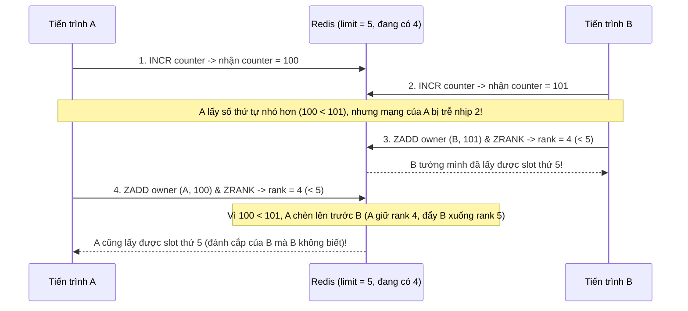

Khi chúng ta sử dụng đồng hồ hệ thống làm cách thức để lấy khóa, khả năng xảy ra kiểu tình trạng tranh chấp này và dẫn đến việc có nhiều chủ sở hữu semaphore hơn số lượng mong muốn có liên quan mật thiết đến độ chênh lệch của giờ hệ thống — độ chênh lệch càng lớn thì khả năng xảy ra càng cao. Sau khi đưa bộ đếm cùng với `ZSET` chủ sở hữu vào, vấn đề này trở nên ít có khả năng xảy ra hơn (chỉ nhờ vào việc loại bỏ đồng hồ hệ thống khỏi phương trình), nhưng bởi vì chúng ta có nhiều vòng truyền nhận mạng (*multiple round trips* — một lệnh `execute()` để lấy `counter`, rồi một lệnh `execute()` thứ hai để `ZADD` và `ZRANK`), nên điều đó vẫn có thể xảy ra.

Để xử lý triệt để mọi tình trạng tranh chấp có thể xảy ra đối với semaphore trong Redis, chúng ta cần tái sử dụng chiếc khóa phân tán có thời gian hết hạn trước đó mà chúng ta đã xây dựng trong mục 6.2.5. Chúng ta cần dùng chiếc khóa trước đó của mình để giúp xây dựng một semaphore đếm hoàn toàn chính xác. Nhìn tổng thể, để giành lấy semaphore, trước tiên chúng ta sẽ cố gắng giành lấy chiếc khóa dành cho semaphore đó với một thời gian chờ ngắn (`acquire_timeout=.01`). Nếu lấy được khóa, sau đó chúng ta mới thực hiện các thao tác giành semaphore thông thường của mình với bộ đếm, `ZSET` chủ sở hữu, và `ZSET` giờ hệ thống. Nếu không giành được khóa, thì chúng ta coi như cũng đã thất bại trong việc giành lấy semaphore. Đoạn mã để thực hiện thao tác này được hiển thị ngay dưới đây.

**Listing 6.17 – Hàm `acquire_semaphore_with_lock()` (The `acquire_semaphore_with_lock()` function)**

```python
def acquire_semaphore_with_lock(conn, semname, limit, timeout=10):
    identifier = acquire_lock(conn, semname, acquire_timeout=.01)
    if identifier:
        try:
            return acquire_fair_semaphore(conn, semname, limit, timeout)
        finally:
            release_lock(conn, semname, identifier)
```

Tôi biết, có thể hơi thất vọng khi đã đi một chặng đường dài như vậy để rồi cuối cùng lại vẫn cần phải sử dụng một chiếc khóa ở bước cuối. Nhưng đặc thù của Redis là như vậy: thường có một vài cách để giải quyết cùng một bài toán hoặc một bài toán tương tự, mỗi cách đều có những sự đánh đổi (*trade-offs*) khác nhau. Dưới đây là một số sự đánh đổi cho các loại semaphore đếm khác nhau mà chúng ta đã xây dựng:

- Nếu bạn hài lòng với việc sử dụng đồng hồ hệ thống, không bao giờ cần làm mới semaphore, và chấp nhận việc thỉnh thoảng vượt quá giới hạn một chút, thì bạn có thể sử dụng chiếc semaphore đầu tiên mà chúng ta đã tạo ra (`acquire_semaphore` ở mục 6.3.1).
- Nếu bạn chỉ có thể thực sự tin tưởng các đồng hồ hệ thống đồng bộ trong phạm vi 1 hoặc 2 giây, nhưng vẫn chấp nhận việc thỉnh thoảng vượt quá giới hạn semaphore của mình một chút, thì bạn có thể sử dụng chiếc semaphore thứ hai (`acquire_fair_semaphore` ở mục 6.3.2).
- Nếu bạn cần các semaphore của mình phải chính xác tuyệt đối trong mọi lần gọi, thì bạn có thể sử dụng một chiếc khóa để đảm bảo tính chính xác (`acquire_semaphore_with_lock` ở mục 6.3.4).

Giờ đây khi đã sử dụng chiếc khóa từ mục 6.2 để giúp khắc phục tình trạng tranh chấp, chúng ta có nhiều tùy chọn khác nhau tùy theo mức độ nghiêm ngặt mà chúng ta mong muốn đối với các giới hạn semaphore của mình. Nhìn chung, việc gắn bó với phiên bản cuối cùng, nghiêm ngặt nhất là một ý tưởng tốt. Chiếc semaphore cuối cùng không chỉ thực sự chính xác, mà bất kỳ chút thời gian nào chúng ta có thể tiết kiệm được khi dùng một semaphore đơn giản hơn thì chúng ta lại có thể đánh mất do sử dụng quá nhiều tài nguyên.

Trong mục này, chúng ta đã sử dụng semaphore để giới hạn số lượng lời gọi API có thể chạy tại bất kỳ thời điểm nào. Một trường hợp sử dụng phổ biến khác là giới hạn các yêu cầu đồng thời gửi tới cơ sở dữ liệu nhằm giảm thời gian truy vấn riêng lẻ và ngăn chặn hiệu ứng dồn ứ (*dogpiling*) giống như chúng ta đã nói ở cuối mục 6.2.4. Một tình huống phổ biến khác nữa là khi chúng ta đang cố gắng tải xuống nhiều trang web từ một máy chủ, nhưng tệp `robots.txt` của họ quy định rằng chúng ta chỉ được phép thực hiện (ví dụ) ba yêu cầu cùng một lúc. Nếu chúng ta có nhiều máy trạm (*clients*) đang tải trang web, chúng ta có thể sử dụng một semaphore để đảm bảo rằng mình không tạo áp lực quá lớn lên một máy chủ cụ thể.

Khi chúng ta kết thúc việc xây dựng các khóa và semaphore giúp cải thiện hiệu năng cho việc thực thi đồng thời, giờ là lúc để nói về việc sử dụng chúng trong nhiều tình huống hơn nữa. Trong mục tiếp theo, chúng ta sẽ xây dựng hai loại hàng đợi tác vụ (*task queues*) khác nhau phục vụ cho việc thực thi tác vụ trễ và đồng thời.

> 💡 **Ví dụ bổ sung (không có trong sách) – Bảng so sánh 3 phiên bản Counting Semaphore và giải pháp Lua Script:**
>
> | Phiên bản Semaphore | Số cấu trúc Redis sử dụng | Số vòng mạng (Round-trips) khi Acquire | Chống lệch đồng hồ (Clock Skew)? | Chống Race Condition tuyệt đối? |
> |---|---|---|---|---|
> | **1. Basic Semaphore** (`6.3.1`) | 1 (`ZSET` timestamps) | 1 (hoặc 2 nếu vượt limit) | Không (dễ bị đánh cắp nếu lệch vài ms) | Không |
> | **2. Fair Semaphore** (`6.3.2`) | 3 (`ZSET` time, `ZSET` owner, `STRING` counter) | 2 (hoặc 3 nếu vượt limit) | Có (chịu được lệch 1–2 giây) | Không (do tách 2 round-trips giữa `INCR` và `ZADD`) |
> | **3. Fair Semaphore + Lock** (`6.3.4`) | 4 (thêm `STRING` lock) | 4–5 (Acquire Lock + Fair Semaphore + Release Lock) | Có | **Có (An toàn 100%)** |
> | **Hiện đại: Lua Script (`EVAL`)** | 1 (`ZSET` timestamps) | **1 vòng mạng duy nhất** | **Có** (nếu dùng lệnh `TIME` của chính Redis Server trong Lua!) | **Có** (Lua chạy nguyên tử 100% trên Redis) |
>
> *Gợi ý hiện đại:* Kể từ Redis 2.6+ (và đặc biệt trong Redis 6/7/8), bạn có thể viết một hàm Lua gọi trực tiếp `redis.call('TIME')` để lấy đồng hồ chuẩn của chính máy chủ Redis rồi thực hiện `ZREMRANGEBYSCORE`, `ZCARD` và `ZADD` ngay trong 1 script nguyên tử duy nhất mà không cần tạo `owner ZSET`, `counter` hay `lock` bên ngoài! Chúng ta sẽ học kỹ thuật viết Lua script này trong Chương 11.

## 6.4 Hàng đợi tác vụ (Task queues)

Khi xử lý các yêu cầu từ các máy khách web (web clients), đôi khi các thao tác mất nhiều thời gian để thực thi hơn mức chúng ta muốn dành ra ngay lập tức. Chúng ta có thể trì hoãn (defer) các thao tác đó bằng cách đưa thông tin về tác vụ cần thực hiện vào bên trong một hàng đợi (queue), và chúng ta sẽ xử lý sau. Phương pháp trì hoãn công việc giao cho một bộ xử lý tác vụ (task processor) nào đó được gọi là *hàng đợi tác vụ* (*task queue*). Hiện nay có rất nhiều phần mềm khác nhau được thiết kế chuyên biệt cho hàng đợi tác vụ (ActiveMQ, RabbitMQ, Gearman, Amazon SQS, và những phần mềm khác), nhưng cũng có những phương pháp tùy ứng (ad hoc) để tạo hàng đợi tác vụ trong các tình huống mà hàng đợi không được dự tính từ trước. Nếu bạn từng có một cron job quét một bảng cơ sở dữ liệu để tìm các tài khoản đã được sửa đổi/kiểm tra trước hoặc sau một ngày/giờ cụ thể, và bạn thực hiện một thao tác nào đó dựa trên kết quả của truy vấn đó, thì tức là bạn đã tạo ra một hàng đợi tác vụ rồi.

Trong phần này, chúng ta sẽ thảo luận về hai loại hàng đợi tác vụ khác nhau. Hàng đợi đầu tiên của chúng ta sẽ được xây dựng để thực thi các tác vụ nhanh nhất có thể theo đúng thứ tự mà chúng được chèn vào. Loại hàng đợi thứ hai của chúng ta sẽ có khả năng lập lịch (schedule) cho các tác vụ thực thi vào một thời điểm cụ thể nào đó trong tương lai.

> 📝 **Giải thích thêm (không có trong sách): Tại sao cần Hàng đợi tác vụ (Task Queue) trong kiến trúc Web hiện đại?**
>
> Trong một chu kỳ HTTP Request-Response thông thường, người dùng mong đợi nhận được phản hồi trong vòng dưới `100ms - 300ms`. Tuy nhiên, nhiều tác vụ nghiệp vụ thực tế lại bao gồm các công việc phụ trợ nặng nề hoặc phụ thuộc vào bên thứ ba có độ trễ không xác định:
> - Gửi email xác nhận đơn hàng, SMS OTP hoặc thông báo đẩy (Push Notification) qua SMTP/API bên ngoài.
> - Xử lý hình ảnh/video vừa tải lên (resize, đóng dấu watermark, chuyển đổi định dạng).
> - Xuất báo cáo PDF/Excel dung lượng lớn hoặc đồng bộ dữ liệu sang hệ thống kế toán/kho vận.
>
> Nếu thực hiện trực tiếp (đồng bộ - synchronous) các tác vụ này ngay trong luồng xử lý HTTP request của Web Server:
> 1. Người dùng phải chờ đợi rất lâu trước khi trang web tải xong.
> 2. Nếu máy chủ SMTP bên thứ ba bị treo hoặc phản hồi chậm (ví dụ mất 15 giây mới timeout), toàn bộ worker/thread của Web Server sẽ bị khóa cứng (block), dẫn đến cạn kiệt tài nguyên (thread starvation) và làm sập toàn bộ website.
> 3. Nếu tác vụ thất bại giữa chừng, rất khó để tự động thử lại (retry) một cách an toàn mà không bắt người dùng bấm tải lại trang.
>
> Bằng cách tách biệt (decouple) thông qua **Task Queue** trên Redis: Web Server chỉ mất chưa tới `1ms` để đẩy một gói dữ liệu mô tả công việc (job payload) vào Redis rồi trả kết quả ngay cho người dùng. Phía sau hậu trường, một hoặc nhiều tiến trình **Worker** độc lập sẽ lấy từng tác vụ ra khỏi hàng đợi và xử lý bất đồng bộ (asynchronous).

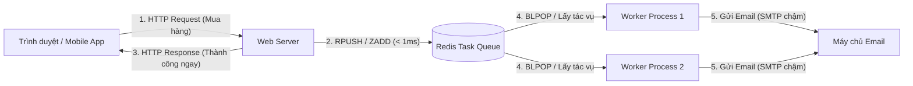

### 6.4.1 Hàng đợi vào trước, ra trước (First-in, first-out queues)

Trong thế giới của các hàng đợi nói chung vượt ra ngoài phạm vi hàng đợi tác vụ, thông thường có một vài loại hàng đợi khác nhau được thảo luận — vào trước, ra trước (first-in, first-out - FIFO), vào sau, ra trước (last-in, first-out - LIFO), và hàng đợi ưu tiên (priority queues). Trước tiên, chúng ta sẽ xem xét hàng đợi vào trước, ra trước (FIFO), bởi vì nó cung cấp ngữ nghĩa hợp lý nhất cho bước tiếp cận đầu tiên của chúng ta đối với một hàng đợi, có thể được triển khai dễ dàng, và có tốc độ nhanh. Sau đó, chúng ta sẽ nói về việc bổ sung một phương thức cho các mức độ ưu tiên độ hạt thô (coarse-grained priorities), và sau đó nữa là các hàng đợi dựa trên thời gian (time-based queues).

Hãy một lần nữa quay lại với một ví dụ từ công ty Fake Game Company. Để khuyến khích người dùng chơi game vào những lúc họ thường không chơi, Fake Game Company đã quyết định thêm tùy chọn cho phép người dùng đăng ký nhận (opt-in) email thông báo về các giao dịch bán hàng trên chợ (marketplace sales) đã hoàn tất hoặc đã hết hạn (timed out). Bởi vì việc gửi email đi (outgoing email) là một trong những dịch vụ internet có thể có độ trễ rất cao và có thể gặp lỗi, chúng ta cần phải tách hành động gửi email cho các giao dịch đã hoàn tất hoặc hết hạn ra khỏi luồng mã lệnh điển hình của các thao tác đó. Để làm điều này, chúng ta sẽ sử dụng một hàng đợi tác vụ để lưu giữ bản ghi về những người cần được gửi email cùng với lý do, và sẽ triển khai một tiến trình công nhân (worker process) có thể chạy song song để gửi nhiều email cùng một lúc nếu các máy chủ gửi thư (outgoing mail servers) trở nên chậm chạp.

Hàng đợi mà chúng ta sắp viết chỉ cần gửi email đi theo nguyên tắc ai đến trước được phục vụ trước (first-come, first-served), và sẽ ghi nhật ký (log) cả các trường hợp thành công lẫn thất bại. Như chúng ta đã thảo luận trong chương 3 và chương 5, cấu trúc `LIST` của Redis cho phép chúng ta đẩy (push) và lấy (pop) các phần tử từ cả hai đầu bằng `RPUSH`/`LPUSH` và `RPOP`/`LPOP`. Đối với hàng đợi email của chúng ta, chúng ta sẽ đẩy các email cần gửi vào đầu bên phải của hàng đợi bằng lệnh `RPUSH`, và lấy chúng ra khỏi đầu bên trái của hàng đợi bằng lệnh `LPOP`. (Chúng ta làm điều này vì nó hợp lý về mặt trực quan đối với những người đọc các ngôn ngữ viết từ trái sang phải). Bởi vì các tiến trình worker của chúng ta sẽ chỉ thực hiện thao tác gửi email này, chúng ta sẽ sử dụng phiên bản chặn (blocking version) của lệnh lấy phần tử khỏi danh sách, đó là `BLPOP`, với thời gian chờ (timeout) là 30 giây. Chúng ta sẽ chỉ xử lý các thông điệp bán vật phẩm thành công (item-sold messages) trong phiên bản này nhằm giữ cho mọi thứ đơn giản, nhưng việc thêm hỗ trợ gửi email khi giao dịch hết hạn cũng rất dễ dàng.

Hàng đợi của chúng ta sẽ đơn giản là một danh sách (`LIST`) chứa các khối dữ liệu (blobs of data) được mã hóa bằng JSON, trông giống như **Hình 6.9 – Hàng đợi vào trước, ra trước sử dụng một LIST (Figure 6.9 A first-in, first-out queue using a LIST)**.

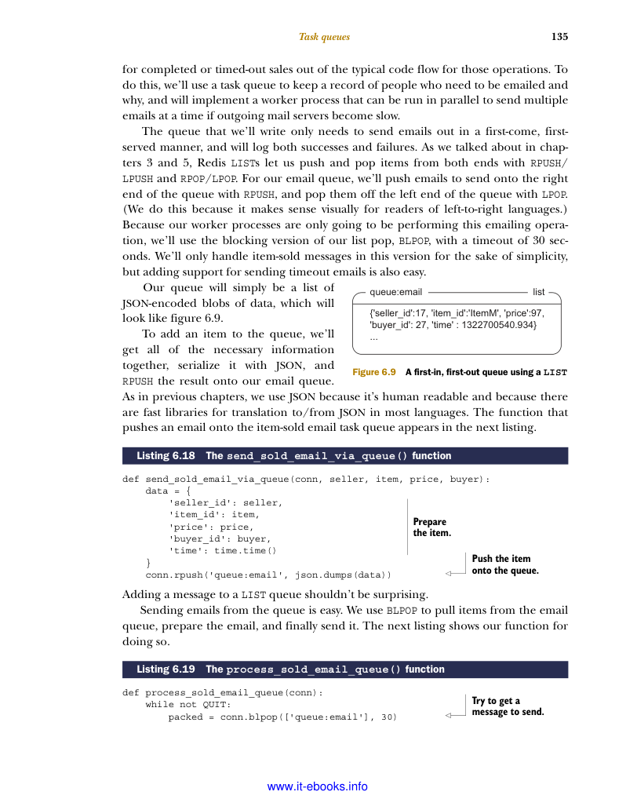

**Hình 6.9 – Hàng đợi vào trước, ra trước sử dụng một LIST (Figure 6.9 A first-in, first-out queue using a LIST)**

| Khóa Redis | Kiểu cấu trúc | Các phần tử trong danh sách (JSON-encoded blobs) |
| :--- | :--- | :--- |
| `queue:email` | `list` | `{'seller_id':17, 'item_id':'ItemM', 'price':97, 'buyer_id': 27, 'time' : 1322700540.934}` |
| | | `...` |

Để thêm một phần tử vào hàng đợi, chúng ta sẽ gom tất cả các thông tin cần thiết lại với nhau, tuần tự hóa (serialize) nó bằng JSON, và dùng lệnh `RPUSH` đẩy kết quả vào hàng đợi email của chúng ta. Giống như trong các chương trước, chúng ta sử dụng JSON bởi vì con người có thể đọc hiểu được (human readable) và bởi vì có sẵn các thư viện tốc độ cao để chuyển đổi qua lại với JSON trong hầu hết các ngôn ngữ lập trình. Hàm đẩy một email vào hàng đợi tác vụ gửi email bán vật phẩm xuất hiện trong listing tiếp theo.

**Listing 6.18 – Hàm `send_sold_email_via_queue()` (The send_sold_email_via_queue() function)**

```python
def send_sold_email_via_queue(conn, seller, item, price, buyer):
    data = {                                # Chuẩn bị phần tử dữ liệu.
        'seller_id': seller,
        'item_id': item,
        'price': price,
        'buyer_id': buyer,
        'time': time.time()
    }
    conn.rpush('queue:email', json.dumps(data)) # Đẩy phần tử vào hàng đợi.
```

*Giải thích các chú thích trong mã nguồn:*
- `data = { ... }`: Chuẩn bị phần tử dữ liệu (Prepare the item).
- `conn.rpush('queue:email', json.dumps(data))`: Đẩy phần tử vào hàng đợi (Push the item onto the queue).

Việc thêm một thông điệp vào một hàng đợi `LIST` hẳn không có gì đáng ngạc nhiên.

Việc gửi các email từ hàng đợi cũng rất dễ dàng. Chúng ta sử dụng `BLPOP` để kéo các phần tử ra khỏi hàng đợi email, chuẩn bị nội dung email, và cuối cùng là gửi nó đi. Listing tiếp theo cho thấy hàm của chúng ta để thực hiện việc đó.

**Listing 6.19 – Hàm `process_sold_email_queue()` (The process_sold_email_queue() function)**

```python
def process_sold_email_queue(conn):
    while not QUIT:
        packed = conn.blpop(['queue:email'], 30)                  # Cố gắng lấy một thông điệp để gửi.
        if not packed:                                            # Không có thông điệp nào để gửi; thử lại.
            continue

        to_send = json.loads(packed[1])                           # Nạp thông tin email đã được đóng gói.
        try:
            fetch_data_and_send_sold_email(to_send)               # Gửi email bằng hàm gửi email đã viết sẵn của chúng ta.
        except EmailSendError as err:
            log_error("Failed to send sold email", err, to_send)
        else:
            log_success("Sent sold email", to_send)
```

*Giải thích các chú thích trong mã nguồn:*
- `packed = conn.blpop(['queue:email'], 30)`: Cố gắng lấy một thông điệp để gửi (Try to get a message to send).
- `if not packed: continue`: Không có thông điệp nào để gửi; thử lại (No message to send; try again).
- `to_send = json.loads(packed[1])`: Nạp thông tin email đã được đóng gói (Load the packed email information).
- `fetch_data_and_send_sold_email(to_send)`: Gửi email bằng hàm gửi email đã viết sẵn của chúng ta (Send the email using our prewritten emailing function).

Tương tự như vậy, việc thực sự gửi email sau khi kéo thông điệp ra khỏi hàng đợi cũng không có gì đáng ngạc nhiên. Nhưng còn việc thực thi nhiều hơn một loại tác vụ thì sao?

> 📝 **Giải thích thêm (không có trong sách): Cơ chế hoạt động của `BLPOP` và cấu trúc giá trị trả về**
>
> Trong `Listing 6.19`, chúng ta gọi `packed = conn.blpop(['queue:email'], 30)`. Hãy lưu ý hai điểm kỹ thuật quan trọng:
> 1. **Tại sao dùng `BLPOP` thay vì `LPOP` kết hợp `time.sleep()`?**
>    Nếu dùng `LPOP` thông thường trong vòng lặp `while`, khi hàng đợi rỗng, `LPOP` trả về `None` ngay lập tức. Để tránh đốt cháy 100% CPU và làm ngập đường truyền mạng bằng hàng trăm nghìn lệnh `LPOP` vô ích mỗi giây (busy-waiting), ta buộc phải thêm `time.sleep(0.1)`. Tuy nhiên, `sleep` tạo ra sự đánh đổi: ngủ quá lâu thì độ trễ xử lý tác vụ tăng lên, ngủ quá ngắn thì tốn tài nguyên. Lệnh `BLPOP` (Blocking Left Pop) giải quyết triệt để vấn đề này: nếu `queue:email` đang có phần tử, Redis trả về ngay lập tức; nếu danh sách đang rỗng, Redis sẽ giữ kết nối của client ở trạng thái chờ (block) cho đến khi có một tiến trình khác gọi `RPUSH`/`LPUSH` đẩy phần tử vào (khi đó worker được đánh thức tức thì với độ trễ gần bằng 0), hoặc cho đến khi hết thời gian chờ 30 giây (trả về `None`).
> 2. **Tại sao lại giải mã `packed[1]` mà không phải `packed[0]`?**
>    Khi `BLPOP` lấy được một phần tử thành công, nó luôn trả về một bộ 2 phần tử (tuple/list 2 phần tử): `(tên_khóa_hàng_đợi, giá_trị_phần_tử)`. Lý do là vì `BLPOP` cho phép lắng nghe trên **nhiều hàng đợi cùng lúc** (ví dụ `conn.blpop(['queue:high', 'queue:low'], 30)`). Do đó, `packed[0]` cho biết phần tử vừa lấy ra đến từ hàng đợi nào (ở đây là `'queue:email'`), còn `packed[1]` mới chính là chuỗi JSON dữ liệu của phần tử đó!

#### NHIỀU TÁC VỤ CÓ THỂ THỰC THI (MULTIPLE EXECUTABLE TASKS)

Bởi vì Redis chỉ trao một phần tử vừa được lấy ra (popped item) cho một bên gọi (caller) duy nhất, chúng ta có thể chắc chắn rằng không có email nào bị trùng lặp và bị gửi đi hai lần. Bởi vì chúng ta chỉ đưa các thông điệp email cần gửi vào trong hàng đợi, tiến trình worker của chúng ta rất đơn giản. Việc có một hàng đợi riêng lẻ cho từng loại thông điệp không phải là điều hiếm gặp trong một số tình huống, nhưng đối với những tình huống khác, việc có một hàng đợi duy nhất có khả năng xử lý nhiều loại tác vụ khác nhau có thể thuận tiện hơn rất nhiều. Hãy xem tiến trình worker trong **Listing 6.20**: nó theo dõi hàng đợi được cung cấp và điều phối (dispatch) lời gọi hàm được mã hóa bằng JSON tới một trong số một tập hợp các hàm gọi lại (callbacks) đã được đăng ký và biết trước. Phần tử cần thực thi sẽ có dạng `['FUNCTION_NAME', [ARG1, ARG2, ...]]`.

**Listing 6.20 – Hàm `worker_watch_queue()` (The worker_watch_queue() function)**

```python
def worker_watch_queue(conn, queue, callbacks):
    while not QUIT:
        packed = conn.blpop([queue], 30)                    # Cố gắng lấy một phần tử từ hàng đợi.
        if not packed:                                      # Không có gì để xử lý; thử lại.
            continue

        name, args = json.loads(packed[1])                  # Giải nén phần tử công việc.
        if name not in callbacks:                           # Hàm không xác định; ghi log lỗi và thử lại.
            log_error("Unknown callback %s"%name)
            continue
        callbacks[name](*args)                              # Thực thi tác vụ.
```

*Giải thích các chú thích trong mã nguồn:*
- `packed = conn.blpop([queue], 30)`: Cố gắng lấy một phần tử từ hàng đợi (Try to get an item from the queue).
- `if not packed: continue`: Không có gì để xử lý; thử lại (There’s nothing to work on; try again).
- `name, args = json.loads(packed[1])`: Giải nén phần tử công việc (Unpack the work item).
- `if name not in callbacks: log_error("Unknown callback %s"%name); continue`: Hàm không xác định; ghi log lỗi và thử lại (The function is unknown; log the error and try again).
- `callbacks[name](*args)`: Thực thi tác vụ (Execute the task).

Với tiến trình worker tổng quát (generic worker process) này, trình gửi email của chúng ta có thể được viết dưới dạng một hàm callback và được truyền vào cùng với các hàm callback khác.

#### ĐỘ ƯU TIÊN CỦA TÁC VỤ (TASK PRIORITIES)

Đôi khi làm việc với các hàng đợi, chúng ta cần phải ưu tiên một số thao tác nhất định trước những thao tác khác. Trong trường hợp của chúng ta, có lẽ chúng ta muốn gửi các email về các giao dịch bán hàng đã hoàn tất trước khi gửi các email về các giao dịch bán hàng đã hết hạn. Hoặc có lẽ chúng ta muốn gửi các email đặt lại mật khẩu (password reset emails) trước khi chúng ta gửi hàng loạt email cho một sự kiện đặc biệt sắp tới. Hãy nhớ lại các lệnh `BLPOP`/`BRPOP` — chúng ta có thể cung cấp nhiều `LIST` để lấy một phần tử ra từ đó; `LIST` đầu tiên có chứa bất kỳ phần tử nào bên trong sẽ được lấy phần tử đầu tiên của nó ra (hoặc phần tử cuối cùng nếu chúng ta đang sử dụng `BRPOP`).

Giả sử rằng chúng ta muốn có ba mức độ ưu tiên: cao (high), trung bình (medium), và thấp (low). Các phần tử có độ ưu tiên cao phải được thực thi nếu chúng hiện có sẵn. Nếu không có phần tử nào có độ ưu tiên cao, thì các phần tử ở mức độ ưu tiên trung bình sẽ được thực thi. Nếu không có cả các phần tử ưu tiên cao lẫn ưu tiên trung bình, thì các phần tử ở mức độ ưu tiên thấp sẽ được thực thi. Nhìn vào đoạn mã trước đó của chúng ta, chúng ta có thể thay đổi hai dòng để biến điều đó thành hiện thực trong listing được cập nhật dưới đây.

**Listing 6.21 – Hàm `worker_watch_queues()` (The worker_watch_queues() function)**

```python
def worker_watch_queues(conn, queues, callbacks):   # Đây là dòng thay đổi đầu tiên để thêm hỗ trợ độ ưu tiên.
    while not QUIT:
        packed = conn.blpop(queues, 30)             # Đây là dòng thay đổi thứ hai để thêm hỗ trợ độ ưu tiên.
        if not packed:
            continue

        name, args = json.loads(packed[1])
        if name not in callbacks:
            log_error("Unknown callback %s"%name)
            continue
        callbacks[name](*args)
```

*Giải thích các chú thích trong mã nguồn:*
- `def worker_watch_queues(conn, queues, callbacks):`: Đây là dòng thay đổi đầu tiên để thêm hỗ trợ độ ưu tiên — nhận vào một danh sách các hàng đợi `queues` thay vì một hàng đợi đơn lẻ `queue` (This is the first changed line to add priority support).
- `packed = conn.blpop(queues, 30)`: Đây là dòng thay đổi thứ hai để thêm hỗ trợ độ ưu tiên — truyền trực tiếp danh sách `queues` vào `blpop` (This is the second changed line to add priority support).

Bằng cách sử dụng nhiều hàng đợi, các mức độ ưu tiên có thể được triển khai một cách dễ dàng. Có những tình huống mà nhiều hàng đợi được sử dụng như một cách để tách biệt các phần tử hàng đợi khác nhau (email thông báo chung, email nhắc nhở cá nhân, v.v.) mà không có bất kỳ mong muốn nào về việc phải "công bằng" ("fair"). Trong những tình huống như vậy, việc thỉnh thoảng sắp xếp lại danh sách hàng đợi để công bằng hơn với tất cả các hàng đợi có thể rất hợp lý, đặc biệt là trong trường hợp một hàng đợi có thể phình to nhanh chóng so với các hàng đợi khác.

Nếu bạn đang sử dụng Ruby, bạn có thể sử dụng một gói mã nguồn mở có tên là Resque do các lập trình viên tại GitHub phát hành. Nó sử dụng Redis cho các hàng đợi dựa trên Ruby bằng cách dùng cấu trúc danh sách (lists), tương tự như những gì chúng ta đã thảo luận ở đây. Resque cung cấp nhiều tính năng bổ sung vượt trội hơn hẳn so với hàm 11 dòng mà chúng ta cung cấp ở đây, vì vậy nếu bạn đang sử dụng Ruby, bạn nên tìm hiểu nó. Dù sao đi nữa, vẫn còn rất nhiều tùy chọn khác cho hàng đợi trong Redis, và bạn nên tiếp tục đọc phần tiếp theo.

> 💡 **Ví dụ bổ sung (không có trong sách): Minh họa cách hoạt động ưu tiên của `BLPOP` và hiện tượng "Đói tài nguyên" (Queue Starvation)**
>
> Khi gọi `conn.blpop(['queue:high', 'queue:medium', 'queue:low'], 30)`, Redis sẽ kiểm tra tuần tự từng khóa từ trái sang phải:
> 1. Kiểm tra `queue:high`: Nếu có phần tử -> lấy phần tử đầu tiên của `queue:high` và trả về ngay.
> 2. Chỉ khi `queue:high` **hoàn toàn rỗng**, Redis mới kiểm tra đến `queue:medium`.
> 3. Chỉ khi cả `queue:high` và `queue:medium` đều **hoàn toàn rỗng**, Redis mới kiểm tra đến `queue:low`.
> 4. Nếu cả 3 đều rỗng, kết nối sẽ bị chặn (block) và ngay khi có phần tử mới được đẩy vào bất kỳ hàng đợi nào trong 3 hàng đợi này, worker sẽ nhận được phần tử đó.
>
> **Vấn đề thực tế (Queue Starvation) và cách khắc phục:**
> Giả sử hệ thống đang có một đợt khuyến mãi lớn khiến `queue:high` liên tục nhận hàng chục nghìn tác vụ mới. Khi đó, các tác vụ trong `queue:low` sẽ bị "bỏ đói" (starved) hoàn toàn và không bao giờ được chạy cho đến khi `queue:high` và `queue:medium` cạn sạch. Như tác giả gợi ý ở đoạn trên, nếu muốn phân bổ công bằng hơn (Weighted Fair Queuing) hoặc chống đói tài nguyên, trước mỗi lần gọi `blpop`, worker có thể thỉnh thoảng xáo trộn (shuffle) hoặc xoay vòng (rotate) danh sách `queues`, hoặc chọn ngẫu nhiên theo trọng số (ví dụ: 70% số lần ưu tiên thứ tự `[high, medium, low]`, 20% số lần ưu tiên `[medium, high, low]`, 10% số lần ưu tiên `[low, high, medium]`).
>
> Ngoài ra, hãy lưu ý một hạn chế của mô hình dùng `BLPOP`: ngay khi `BLPOP` trả phần tử về cho worker, phần tử đó đã **bị xóa khỏi Redis**. Nếu tiến trình worker bất ngờ bị sập nguồn (crash / `kill -9`) ngay khi đang chạy `callbacks[name](*args)` giữa chừng, tác vụ đó sẽ bị mất vĩnh viễn. Trong Redis hiện đại, để xây dựng hàng đợi đáng tin cậy (reliable queue), người ta thường sử dụng lệnh `BLMOVE` (hoặc `BRPOPLPUSH` trong các phiên bản cũ) để vừa lấy phần tử ra khỏi hàng đợi chính vừa đẩy nguyên tử (atomically) vào một danh sách `processing` riêng của worker; chỉ khi `callbacks[name](*args)` thực thi xong xuôi, worker mới gọi `LREM` để xóa phần tử đó khỏi danh sách `processing`. Hoặc tốt hơn nữa là sử dụng **Redis Streams** với Consumer Groups (`XREADGROUP` / `XACK`) từ Redis 5.0 trở lên.

### 6.4.2 Các tác vụ bị trì hoãn (Delayed tasks)

Với các hàng đợi dựa trên danh sách (`LIST`), chúng ta có thể xử lý một lệnh gọi duy nhất trên mỗi hàng đợi, nhiều hàm callback trên mỗi hàng đợi, và chúng ta có thể xử lý các mức độ ưu tiên đơn giản. Nhưng đôi khi, chúng ta cần nhiều hơn thế một chút. Công ty Fake Game Company đã quyết định rằng họ sẽ thêm một tính năng mới vào trong trò chơi của mình: bán hàng hẹn giờ (delayed selling). Thay vì đưa một vật phẩm lên rao bán ngay bây giờ, người chơi có thể yêu cầu trò chơi đưa một vật phẩm lên rao bán vào một thời điểm trong tương lai. Nhiệm vụ của chúng ta là thay đổi hoặc thay thế hàng đợi tác vụ hiện tại bằng một thứ gì đó có thể cung cấp tính năng này.

Có một vài cách khác nhau mà chúng ta có thể sử dụng để thêm độ trễ (delays) vào các phần tử trong hàng đợi của mình. Dưới đây là ba cách trực diện nhất:

- Chúng ta có thể đính kèm một thời điểm thực thi (execution time) làm một phần của các phần tử hàng đợi, và nếu một tiến trình worker nhìn thấy một phần tử có thời điểm thực thi muộn hơn thời điểm hiện tại, nó có thể đợi trong một khoảng thời gian ngắn rồi đẩy lại phần tử đó vào hàng đợi (re-enqueue).
- Tiến trình worker có thể duy trì một danh sách chờ cục bộ (local waiting list) cho bất kỳ phần tử nào mà nó đã nhìn thấy nhưng cần được thực thi trong tương lai, và mỗi khi nó đi qua một vòng lặp `while` của mình, nó có thể kiểm tra danh sách đó để tìm bất kỳ phần tử tồn đọng nào cần được thực thi.
- Thông thường khi nói về thời gian, chúng ta thường bắt đầu nghĩ tới cấu trúc `ZSET`. Sẽ thế nào nếu, đối với bất kỳ phần tử nào mà chúng ta muốn thực thi trong tương lai, chúng ta thêm nó vào một `ZSET` thay vì một `LIST`, với điểm số (score) của nó chính là thời điểm mà chúng ta muốn nó thực thi? Sau đó, chúng ta có một tiến trình chuyên kiểm tra các phần tử cần được thực thi ngay lúc này, và nếu có bất kỳ phần tử nào như vậy, tiến trình đó sẽ xóa nó khỏi `ZSET` và thêm nó vào hàng đợi `LIST` thích hợp.

Chúng ta không thể đợi/đẩy lại các phần tử vào hàng đợi như được mô tả trong cách đầu tiên, bởi vì điều đó sẽ làm lãng phí thời gian của tiến trình worker. Chúng ta cũng không thể tạo một danh sách chờ cục bộ như được mô tả trong tùy chọn thứ hai, bởi vì nếu tiến trình worker bị sập (crash) vì một lý do không liên quan nào đó, chúng ta sẽ đánh mất toàn bộ các phần tử công việc đang chờ xử lý mà nó biết. Thay vào đó, chúng ta sẽ sử dụng một `ZSET` phụ trợ như được mô tả trong tùy chọn thứ ba, bởi vì nó đơn giản, trực diện, và chúng ta có thể sử dụng khóa phân tán (lock) từ mục 6.2 để đảm bảo rằng thao tác di chuyển phần tử này diễn ra an toàn.

Mỗi phần tử bị trì hoãn trong hàng đợi `ZSET` sẽ là một danh sách được mã hóa bằng JSON gồm bốn thành phần: một định danh duy nhất (unique identifier), tên hàng đợi nơi phần tử đó sẽ được chèn vào, tên của hàm callback cần gọi, và các đối số (arguments) để truyền cho hàm callback đó. Chúng ta đưa định danh duy nhất vào nhằm mục đích phân biệt tất cả các lệnh gọi một cách dễ dàng, đồng thời cho phép chúng ta bổ sung các tính năng báo cáo (reporting features) có thể có sau này nếu muốn. Điểm số (score) của phần tử sẽ là thời điểm mà phần tử đó cần được thực thi. Nếu phần tử có thể được thực thi ngay lập tức, thay vào đó chúng ta sẽ chèn thẳng phần tử đó vào hàng đợi danh sách (`LIST`). Đối với định danh duy nhất của mình, chúng ta sẽ một lần nữa sử dụng một chuỗi UUID 128-bit được sinh ngẫu nhiên. Đoạn mã để tạo một tác vụ (tùy chọn có trì hoãn) có thể được thấy ngay dưới đây.

**Listing 6.22 – Hàm `execute_later()` (The execute_later() function)**

```python
def execute_later(conn, queue, name, args, delay=0):
    identifier = str(uuid.uuid4())                          # Sinh một định danh duy nhất.
    item = json.dumps([identifier, queue, name, args])      # Chuẩn bị phần tử cho hàng đợi.
    if delay > 0:
        conn.zadd('delayed:', item, time.time() + delay)    # Trì hoãn phần tử này.
    else:
        conn.rpush('queue:' + queue, item)                  # Thực thi phần tử này ngay lập tức.
    return identifier                                       # Trả về định danh.
```

*Giải thích các chú thích trong mã nguồn:*
- `identifier = str(uuid.uuid4())`: Sinh một định danh duy nhất (Generate a unique identifier).
- `item = json.dumps([identifier, queue, name, args])`: Chuẩn bị phần tử cho hàng đợi (Prepare the item for the queue).
- `conn.zadd('delayed:', item, time.time() + delay)`: Trì hoãn phần tử này (Delay the item).
- `conn.rpush('queue:' + queue, item)`: Thực thi phần tử này ngay lập tức (Execute the item immediately).
- `return identifier`: Trả về định danh (Return the identifier).

> 📝 **Giải thích thêm (không có trong sách): Tại sao bắt buộc phải có `identifier` (UUID) bên trong phần tử của `ZSET`?**
>
> Trong cấu trúc `LIST` (`queue:email`), hai phần tử có nội dung chuỗi JSON giống hệt nhau vẫn có thể cùng tồn tại độc lập ở hai vị trí khác nhau trong danh sách. Tuy nhiên, trong cấu trúc `ZSET` (`delayed:`), các thành viên (members) là **duy nhất (unique)** như trong một tập hợp (`SET`).
>
> Nếu chúng ta chỉ lưu `[queue, name, args]` vào `delayed:` mà không có `identifier` (UUID), chuyện gì sẽ xảy ra nếu cùng một tác vụ với cùng tham số (ví dụ `["medium", "send_reminder_email", [user_id_42]]`) được lập lịch chạy sau 1 giờ và một tác vụ giống hệt được lập lịch chạy sau 24 giờ? Lệnh `ZADD` thứ hai sẽ **ghi đè (overwrite)** điểm số `score` của phần tử đầu tiên thay vì tạo ra tác vụ thứ hai! Việc gắn thêm một chuỗi `uuid.uuid4()` vào đầu mảng JSON đảm bảo rằng mỗi lần gọi `execute_later()` luôn tạo ra một member hoàn toàn duy nhất trong `ZSET` `delayed:`.
>
> *Lưu ý về cú pháp `redis-py` 3.0+ / 4.x / 5.x:* Trong sách (sử dụng `redis-py` 2.x), lệnh `conn.zadd('delayed:', item, time.time() + delay)` truyền `member` trước, `score` sau. Trong `redis-py` hiện đại (từ phiên bản 3.0 trở đi), thứ tự tham số này đã được đổi thành một dictionary `{member: score}`:
> ```python
> conn.zadd('delayed:', {item: time.time() + delay})
> ```

Khi phần tử hàng đợi cần được thực thi mà không có độ trễ, chúng ta tiếp tục sử dụng hàng đợi dựa trên danh sách (`LIST`) cũ. Nhưng nếu chúng ta cần trì hoãn phần tử đó, chúng ta sẽ thêm phần tử vào `ZSET` có khóa `delayed:`. Một ví dụ về hàng đợi bị trì hoãn chứa các email cần gửi có thể được thấy trong **Hình 6.10 – Hàng đợi tác vụ bị trì hoãn sử dụng một ZSET (Figure 6.10 A delayed task queue using a ZSET)**.

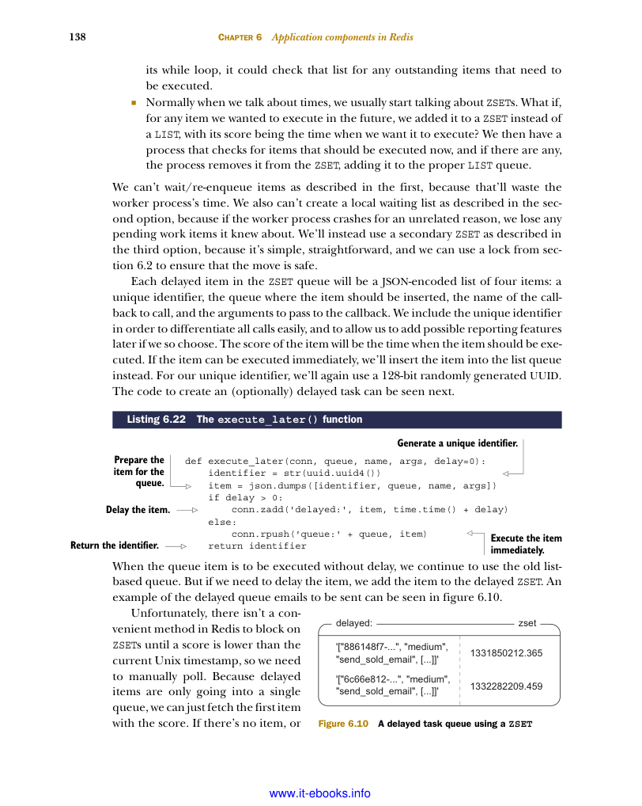

**Hình 6.10 – Hàng đợi tác vụ bị trì hoãn sử dụng một ZSET (Figure 6.10 A delayed task queue using a ZSET)**

| Khóa Redis | Kiểu cấu trúc | Thành viên (Member - Chuỗi JSON `[identifier, queue, name, args]`) | Điểm số (Score - Unix timestamp thực thi) |
| :--- | :--- | :--- | :--- |
| `delayed:` | `zset` | `'["886148f7-...", "medium", "send_sold_email", [...]]'` | `1331850212.365` |
| | | `'["6c66e812-...", "medium", "send_sold_email", [...]]'` | `1332282209.459` |

Thật không may, trong Redis không có sẵn một phương thức thuận tiện nào để chặn (block) trên các `ZSET` cho đến khi một điểm số (score) nhỏ hơn dấu thời gian Unix (Unix timestamp) hiện tại, vì vậy chúng ta cần phải thăm dò thủ công (manually poll). Bởi vì tất cả các phần tử bị trì hoãn chỉ đi vào một hàng đợi `ZSET` duy nhất, chúng ta có thể chỉ cần lấy ra phần tử đầu tiên kèm theo điểm số của nó. Nếu không có phần tử nào, hoặc nếu phần tử đó vẫn còn phải chờ chưa đến giờ chạy, chúng ta sẽ đợi một khoảng thời gian ngắn rồi thử lại. Nếu có một phần tử đã đến hạn, chúng ta sẽ xin cấp một khóa (lock) dựa trên định danh (`identifier`) nằm trong phần tử đó (một khóa độ hạt mịn - fine-grained lock), xóa phần tử đó khỏi `ZSET`, và thêm phần tử vào hàng đợi `LIST` thích hợp. Bằng cách di chuyển các phần tử sang các hàng đợi `LIST` thay vì thực thi chúng trực tiếp ngay tại đây, chúng ta chỉ cần cho chạy một hoặc hai tiến trình thăm dò kiểu này vào bất kỳ thời điểm nào (thay vì chạy nhiều bằng số lượng worker mà chúng ta có), nhờ đó chi phí phụ trội cho việc thăm dò (polling overhead) được giữ ở mức thấp. Đoạn mã để thăm dò hàng đợi bị trì hoãn của chúng ta nằm trong listing tiếp theo.

**Listing 6.23 – Hàm `poll_queue()` (The poll_queue() function)**

```python
def poll_queue(conn):
    while not QUIT:
        item = conn.zrange('delayed:', 0, 0, withscores=True)   # Lấy phần tử đầu tiên trong hàng đợi.
        if not item or item[0][1] > time.time():                # Không có phần tử nào hoặc phần tử vẫn còn phải chờ thực thi trong tương lai.
            time.sleep(.01)
            continue

        item = item[0][0]                                       # Giải nén phần tử để chúng ta biết nó cần được chuyển đi đâu.
        identifier, queue, function, args = json.loads(item)

        locked = acquire_lock(conn, identifier)                 # Lấy khóa cho phần tử này.
        if not locked:                                          # Chúng ta không lấy được khóa, vì vậy hãy bỏ qua nó và thử lại.
            continue

        if conn.zrem('delayed:', item):                         # Di chuyển phần tử sang hàng đợi danh sách (list queue) thích hợp.
            conn.rpush('queue:' + queue, item)

        release_lock(conn, identifier, locked)                  # Giải phóng khóa.
```

*Giải thích các chú thích trong mã nguồn:*
- `item = conn.zrange('delayed:', 0, 0, withscores=True)`: Lấy phần tử đầu tiên trong hàng đợi (Get the first item in the queue).
- `if not item or item[0][1] > time.time():`: Không có phần tử nào hoặc phần tử vẫn còn phải chờ thực thi trong tương lai (No item or the item is still to be executed in the future).
- `item = item[0][0]` và `identifier, queue, function, args = json.loads(item)`: Giải nén phần tử để chúng ta biết nó cần được chuyển đi đâu (Unpack the item so that we know where it should go).
- `locked = acquire_lock(conn, identifier)`: Lấy khóa cho phần tử này (Get the lock for the item).
- `if not locked: continue`: Chúng ta không lấy được khóa, vì vậy hãy bỏ qua nó và thử lại (We couldn’t get the lock, so skip it and try again).
- `if conn.zrem('delayed:', item): conn.rpush('queue:' + queue, item)`: Di chuyển phần tử sang hàng đợi danh sách thích hợp (Move the item to the proper list queue).
- `release_lock(conn, identifier, locked)`: Giải phóng khóa (Release the lock).

Như đã thấy rõ từ **Listing 6.23**, bởi vì các `ZSET` không có cơ chế lấy phần tử dạng chặn (blocking pop mechanism) giống như các `LIST`, chúng ta cần phải lặp và thử lấy lại các phần tử từ hàng đợi. Điều này có thể làm tăng tải trên mạng và trên các bộ vi xử lý đang thực hiện công việc, nhưng bởi vì chúng ta chỉ sử dụng một hoặc hai tiến trình thăm dò (pollers) này để di chuyển các phần tử từ `ZSET` sang các hàng đợi `LIST`, chúng ta sẽ không lãng phí quá nhiều tài nguyên. Nếu muốn giảm thiểu chi phí phụ trội hơn nữa, chúng ta có thể thêm một phương pháp thích ứng (adaptive method) giúp tăng thời gian ngủ (`sleep time`) khi nó không nhìn thấy bất kỳ phần tử nào trong một khoảng thời gian, hoặc chúng ta có thể sử dụng thời điểm mà phần tử tiếp theo được lên lịch để giúp xác định xem nên ngủ trong bao lâu, giới hạn mức tối đa (capping) ở 100 mili-giây để đảm bảo rằng các tác vụ được lên lịch chỉ cách một chút trong tương lai vẫn được thực thi một cách kịp thời.

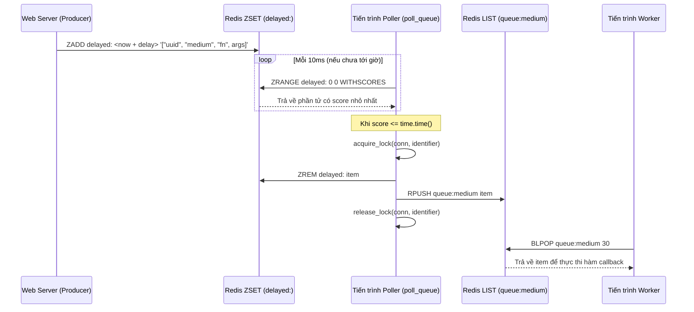

> 📝 **Giải thích thêm (không có trong sách): Tại sao cần khóa phân tán (Distributed Lock) và kiểm tra `if conn.zrem(...)` trong `poll_queue()`?**
>
> Để đảm bảo tính sẵn sàng cao (High Availability - tránh trường hợp tiến trình Poller duy nhất bị treo làm toàn bộ tác vụ hẹn giờ ngừng chạy), trong thực tế chúng ta thường chạy **2 tiến trình Poller** song song trên 2 máy chủ khác nhau.
>
> Nếu không có khóa phân tán `acquire_lock(conn, identifier)`:
> 1. Cả Poller A và Poller B cùng gọi `ZRANGE delayed: 0 0 WITHSCORES` vào cùng một mili-giây và cùng nhìn thấy tác vụ `T1` đã đến hạn.
> 2. Nếu cả hai không đồng bộ hóa hoặc không kiểm tra kết quả của `ZREM`, tác vụ `T1` có nguy cơ bị đẩy (`RPUSH`) vào `queue:medium` **hai lần**, dẫn đến việc gửi trùng 2 email cho khách hàng.
>
> Việc kết hợp `acquire_lock(conn, identifier)` (khóa độ hạt mịn chỉ khóa đúng định danh UUID của tác vụ `T1`) cùng với lệnh kiểm tra `if conn.zrem('delayed:', item):` đảm bảo tính đúng đắn tuyệt đối (at-most-once / exactly-once move): chỉ tiến trình giữ khóa và thực sự xóa thành công phần tử khỏi `delayed:` mới thực hiện `conn.rpush('queue:' + queue, item)`.
>
> *Mẹo hiện đại (Redis 2.6+ / Redis 5.0+):* Như chúng ta sẽ học ở Chương 11 về kịch bản Lua (Lua scripting), toàn bộ bước kiểm tra `ZRANGE`, so sánh `score <= now`, `ZREM`, và `RPUSH` trong `poll_queue()` có thể được gói gọn vào một đoạn script Lua chạy nguyên tử trên Redis thông qua lệnh `EVAL` mà không cần dùng đến khóa phân tán `acquire_lock`/`release_lock` bên ngoài! Ngoài ra, từ Redis 5.0+, Redis đã bổ sung các lệnh `BZPOPMIN` / `BZPOPMAX` (Blocking ZSET Pop), tuy nhiên `BZPOPMIN` sẽ lấy phần tử có điểm số nhỏ nhất ra ngay lập tức bất kể điểm số đó lớn hay nhỏ hơn `time.time()`, nên với bài toán Delayed Queue dựa trên timestamp, kỹ thuật dùng `ZRANGEBYSCORE` / `ZRANGE` kết hợp Lua script hoặc Poller như trong sách vẫn là chuẩn mực công nghiệp (được sử dụng trong Sidekiq, BullMQ, Celery, RQ...).

#### TÔN TRỌNG ĐỘ ƯU TIÊN (RESPECTING PRIORITIES)

Theo nghĩa cơ bản, các tác vụ bị trì hoãn có cùng kiểu mức độ ưu tiên giống như hàng đợi vào trước, ra trước (FIFO) của chúng ta đã có. Bởi vì chúng sẽ quay trở lại các hàng đợi đích ban đầu của mình, chúng sẽ được thực thi với cùng mức độ ưu tiên đó. Nhưng điều gì sẽ xảy ra nếu chúng ta muốn các tác vụ bị trì hoãn được thực thi càng sớm càng tốt ngay sau khi thời điểm thực thi của chúng vừa điểm?

Cách đơn giản nhất để làm điều này là thêm một số hàng đợi phụ để giúp các tác vụ đã lên lịch nhảy lên đầu hàng đợi. Nếu chúng ta có các hàng đợi ưu tiên cao (`high`), trung bình (`medium`), và thấp (`low`), chúng ta cũng có thể tạo thêm các hàng đợi `high-delayed`, `medium-delayed`, và `low-delayed`, rồi truyền chúng vào hàm `worker_watch_queues()` dưới dạng `["high-delayed", "high", "medium-delayed", "medium", "low-delayed", "low"]`. Mỗi hàng đợi bị trì hoãn sẽ đứng ngay trước hàng đợi không trì hoãn tương ứng của nó.

Một số bạn có thể đang thắc mắc, "Nếu chúng ta muốn cho chúng nhảy lên đầu hàng đợi, tại sao không đơn giản là sử dụng `LPUSH` thay vì `RPUSH`?" Giả sử rằng tất cả các worker của chúng ta đang bận làm việc trên các tác vụ cho hàng đợi `medium`, và sẽ mất vài giây để hoàn thành. Giả sử thêm rằng chúng ta có ba tác vụ bị trì hoãn được tìm thấy và được đẩy bằng `LPUSH` vào đầu của hàng đợi `medium`. Tác vụ thứ nhất được đẩy vào, tiếp theo là tác vụ thứ hai, và sau đó là tác vụ thứ ba. Nhưng trên hàng đợi `medium` (vốn được lấy ra từ đầu bên trái bằng `BLPOP`), tác vụ thứ ba được đẩy vào sẽ lại được thực thi đầu tiên, điều này vi phạm kỳ vọng của chúng ta rằng những thứ mà chúng ta muốn thực thi sớm hơn thì phải được thực thi sớm hơn.

> 💡 **Ví dụ bổ sung (không có trong sách): Minh họa tại sao `LPUSH` làm đảo ngược thứ tự FIFO của các tác vụ hẹn giờ**
>
> Giả sử có 3 tác vụ hẹn giờ trên hàng đợi `medium` có thời điểm cần chạy lần lượt là:
> - `Task A`: hẹn lúc `10:00:01`
> - `Task B`: hẹn lúc `10:00:02`
> - `Task C`: hẹn lúc `10:00:03`
>
> Trong khoảng từ `10:00:00` đến `10:00:05`, tất cả các Worker đều đang bận xử lý các tác vụ cũ nên chưa gọi `BLPOP` mới. Trong thời gian đó, Poller lần lượt phát hiện `Task A`, `Task B`, `Task C` đến hạn:
> - **Nếu Poller dùng `LPUSH` đẩy vào đầu trái của `queue:medium`:**
>   1. Lúc `10:00:01`, `LPUSH queue:medium Task_A` -> Danh sách: `[Task_A, Old_1, Old_2]`
>   2. Lúc `10:00:02`, `LPUSH queue:medium Task_B` -> Danh sách: `[Task_B, Task_A, Old_1, Old_2]`
>   3. Lúc `10:00:03`, `LPUSH queue:medium Task_C` -> Danh sách: `[Task_C, Task_B, Task_A, Old_1, Old_2]`
>   Khi Worker rảnh tay vào lúc `10:00:05` và gọi `BLPOP`, nó sẽ lấy ra theo thứ tự: **`Task_C` -> `Task_B` -> `Task_A`** (biến thành LIFO - vào sau ra trước!).
> - **Nếu Poller dùng `RPUSH` đẩy vào một hàng đợi riêng `queue:medium-delayed` (đặt trước `queue:medium` trong `BLPOP`):**
>   1. `RPUSH queue:medium-delayed Task_A`, rồi `Task_B`, rồi `Task_C` -> Danh sách `queue:medium-delayed`: `[Task_A, Task_B, Task_C]`.
>   2. Khi Worker gọi `BLPOP(['queue:medium-delayed', 'queue:medium'], 30)`, nó sẽ ưu tiên lấy hết `queue:medium-delayed` trước `queue:medium`, và lấy đúng theo thứ tự chuẩn **`Task_A` -> `Task_B` -> `Task_C`**!

Nếu bạn sử dụng Python và bạn quan tâm đến một hàng đợi giống như thế này, tôi đã viết một gói thư viện có tên là RPQueue cung cấp ngữ nghĩa thực thi tác vụ bị trì hoãn tương tự như các đoạn mã ở trên. Nó có bao gồm thêm nhiều chức năng hơn, vì vậy nếu bạn muốn một hàng đợi và đang sử dụng Redis rồi, hãy thử xem qua RPQueue tại http://github.com/josiahcarlson/rpqueue/.

Khi chúng ta sử dụng các hàng đợi tác vụ, đôi khi chúng ta cần các tác vụ của mình báo cáo kết quả ngược trở lại cho các phần khác của ứng dụng bằng một hệ thống nhắn tin (messaging system) nào đó. Trong phần tiếp theo, chúng ta sẽ nói về việc tạo ra các hàng đợi thông điệp (message queues) có thể được sử dụng để gửi cho một người nhận duy nhất, hoặc để giao tiếp giữa nhiều người gửi và nhiều người nhận.

> 📝 **Giải thích thêm (không có trong sách) — Đối chiếu Mục 6.4 (Task Queues) với Redis Streams (`XADD` / `XREADGROUP` / `XACK` / `XAUTOCLAIM`) trong Redis 6/7/8:**
>
> Trong Mục 6.4.1, hàng đợi FIFO dùng `RPUSH` + `BLPOP` có một nhược điểm lớn trong môi trường thực tế: ngay khi `BLPOP` lấy phần tử ra khỏi `LIST`, phần tử đó đã bị xóa khỏi Redis. Nếu tiến trình Worker bị sập nguồn (crash / OOM) khi đang thực thi callback giữa chừng, tác vụ đó sẽ bị mất vĩnh viễn.
>
> Trong **Redis 5.0+ / 6.2+ / 7 / 8**, bạn có thể xây dựng một **Hàng đợi tác vụ có xác nhận (Reliable Task Queue)** bằng **Redis Streams** với các lệnh `XADD`, `XGROUP CREATE`, `XREADGROUP`, `XACK` và **`XAUTOCLAIM`** (tự động thu hồi tác vụ bị treo từ các worker bị sập kể từ Redis 6.2+):

> 💡 **Ví dụ bổ sung (không có trong sách) — Viết lại Hàng đợi tác vụ bền vững bằng Redis Streams trong Python 3 + `redis-py` 5.x:**
>
> ```python
> import json
> import redis
>
> STREAM_KEY = "stream:tasks"
> GROUP_NAME = "task_workers"
>
> def init_task_stream(conn: redis.Redis):
>     try:
>         # Tạo Consumer Group bắt đầu từ đầu stream ('0'), mkstream=True tự tạo stream nếu chưa có
>         conn.xgroup_create(STREAM_KEY, GROUP_NAME, id="0", mkstream=True)
>     except redis.exceptions.ResponseError as e:
>         if "BUSYGROUP" not in str(e):
>             raise
>
> def enqueue_task_stream(conn: redis.Redis, func_name: str, args: list) -> str:
>     # XADD đẩy tác vụ vào Stream và giữ tối đa ~10.000 tác vụ gần nhất
>     return conn.xadd(
>         STREAM_KEY,
>         {"name": func_name, "args": json.dumps(args)},
>         maxlen=10_000,
>         approximate=True,
>     )
>
> def worker_watch_stream(conn: redis.Redis, consumer_name: str, callbacks: dict):
>     init_task_stream(conn)
>     while not QUIT:
>         # 1. Thu hồi các tác vụ bị treo quá 60.000ms từ các worker khác bị crash (Redis 6.2+)
>         _, claimed_msgs, _ = conn.xautoclaim(
>             STREAM_KEY, GROUP_NAME, consumer_name, min_idle_time=60_000, start_id="0-0", count=10
>         )
>         # 2. Nếu không có tác vụ treo, đọc tác vụ mới ('>') với thời gian chờ block=5000ms
>         if not claimed_msgs:
>             resp = conn.xreadgroup(
>                 GROUP_NAME, consumer_name, {STREAM_KEY: ">"}, count=1, block=5000
>             )
>             claimed_msgs = resp[0][1] if resp else []
>
>         for msg_id, fields in claimed_msgs:
>             func_name = fields["name"]
>             args = json.loads(fields["args"])
>             if func_name in callbacks:
>                 callbacks[func_name](*args)
>             # 3. Xác nhận hoàn tất (XACK) để xóa khỏi danh sách chờ xử lý (PEL)
>             conn.xack(STREAM_KEY, GROUP_NAME, msg_id)
> ```

---

## 6.5 Nhắn tin dạng kéo (Pull messaging)

Khi gửi và nhận các thông điệp giữa hai hoặc nhiều máy khách (clients), có hai cách nhìn nhận phổ biến về cách thức các thông điệp được phân phối. Phương pháp thứ nhất, được gọi là *nhắn tin dạng đẩy* (*push messaging*), khiến cho bên gửi phải dành một khoảng thời gian để đảm bảo rằng tất cả những người nhận thông điệp đều nhận được nó. Redis có các lệnh tích hợp sẵn để xử lý nhắn tin dạng đẩy được gọi là `PUBLISH` và `SUBSCRIBE`, mà những nhược điểm cũng như cách sử dụng của chúng đã được chúng ta thảo luận trong chương 3.[^2] Phương pháp thứ hai, được gọi là *nhắn tin dạng kéo* (*pull messaging*), yêu cầu những người nhận thông điệp phải tự đi lấy (fetch) các thông điệp đó về. Thông thường, các thông điệp sẽ nằm chờ trong một kiểu hộp thư (mailbox) nào đó để người nhận đến lấy chúng.

[^2]: Tóm tắt ngắn gọn, những nhược điểm này là máy khách (client) phải luôn giữ kết nối ở mọi thời điểm để nhận thông điệp, việc mất kết nối có thể khiến máy khách bị mất thông điệp, và các phiên bản Redis cũ hơn có thể trở nên không thể sử dụng được, bị sập (crash), hoặc bị hệ điều hành buộc dừng (killed) nếu có một bên đăng ký nhận tin (subscriber) xử lý quá chậm.

Mặc dù nhắn tin dạng đẩy có thể hữu ích, chúng ta sẽ gặp phải rắc rối khi các máy khách không thể duy trì kết nối liên tục mọi lúc vì lý do này hay lý do khác. Để giải quyết hạn chế này, chúng ta sẽ viết hai phương pháp nhắn tin dạng kéo khác nhau có thể được sử dụng để thay thế cho `PUBLISH`/`SUBSCRIBE`.

Trước tiên, chúng ta sẽ bắt đầu với nhắn tin một người nhận (single-recipient messaging), vì nó có nhiều điểm chung với các hàng đợi vào trước, ra trước (FIFO) của chúng ta. Sau đó trong phần này, chúng ta sẽ chuyển sang một phương pháp nơi chúng ta có thể có nhiều người nhận (multiple recipients) cho một thông điệp. Với nhiều người nhận, chúng ta có thể thay thế `PUBLISH` và `SUBSCRIBE` của Redis khi chúng ta cần các thông điệp của mình đến được tay tất cả những người nhận, ngay cả khi họ từng bị ngắt kết nối.

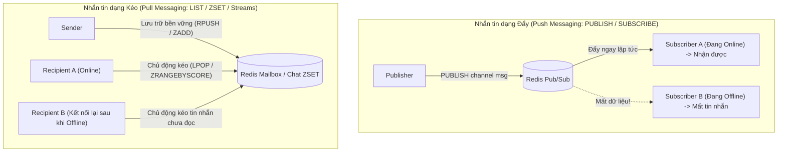

### 6.5.1 Thay thế publish/subscribe cho một người nhận duy nhất (Single-recipient publish/subscribe replacement)

Một mẫu thiết kế (pattern) phổ biến mà chúng ta bắt gặp với Redis là chúng ta có các máy khách thuộc loại này hay loại khác (các tiến trình máy chủ, những người dùng trong một cuộc trò chuyện, v.v.) lắng nghe hoặc chờ đợi các thông điệp trên kênh riêng của chúng. Chúng là những đối tượng duy nhất nhận các thông điệp đó. Nhiều lập trình viên rốt cuộc sẽ sử dụng các lệnh `PUBLISH` và `SUBSCRIBE` của Redis để lần lượt gửi thông điệp và chờ nhận thông điệp. Nhưng nếu chúng ta bắt buộc phải nhận được thông điệp, ngay cả khi đối mặt với các sự cố kết nối mạng, thì `PUBLISH` và `SUBSCRIBE` không giúp ích được gì nhiều cho chúng ta.

Tạm rời xa trọng tâm về công ty trò chơi của chúng ta, công ty khởi nghiệp Fake Garage Startup muốn phát hành một ứng dụng nhắn tin trên thiết bị di động (mobile messaging application). Ứng dụng này sẽ kết nối tới các máy chủ web của họ để gửi và nhận các thông điệp giống như SMS/MMS (về cơ bản là một giải pháp thay thế cho nhắn tin văn bản hoặc hình ảnh). Máy chủ web sẽ xử lý việc xác thực (authentication) và giao tiếp với hệ thống phụ trợ (back end) Redis, còn Redis sẽ xử lý việc định tuyến và lưu trữ thông điệp (message routing/storage).

Mỗi thông điệp sẽ chỉ được nhận bởi một máy khách duy nhất, điều này giúp đơn giản hóa đáng kể bài toán của chúng ta. Để xử lý các thông điệp theo cách này, chúng ta sử dụng một `LIST` duy nhất cho mỗi máy khách di động. Những người gửi sẽ khiến các thông điệp được đặt vào trong `LIST` của người nhận, và bất kỳ khi nào máy khách của người nhận thực hiện một yêu cầu (request), nó sẽ lấy về các thông điệp gần đây nhất. Với khả năng gửi nối tiếp các yêu cầu (pipeline requests) của giao thức HTTP 1.1, hoặc với sự hỗ trợ của WebSocket hiện đại hơn, máy khách di động của chúng ta có thể hoặc là thực hiện một yêu cầu lấy toàn bộ các thông điệp đang chờ (nếu có), hoặc có thể thực hiện các yêu cầu lấy từng thông điệp một, hoặc có thể lấy 10 thông điệp rồi sử dụng lệnh `LTRIM` để xóa 10 phần tử đầu tiên đó đi.

Bởi vì bạn đã biết cách đẩy (push) và lấy (pop) các phần tử khỏi danh sách từ các phần trước, gần đây nhất là từ các hàng đợi vào trước, ra trước trong mục 6.4.1, chúng ta sẽ bỏ qua việc đưa mã lệnh gửi thông điệp vào đây, nhưng một ví dụ về hàng đợi thông điệp đến (incoming message queue) cho người dùng `jack451` được minh họa trong **Hình 6.11 – jack451 có một số thông điệp từ Jill và mẹ của anh ấy đang chờ (Figure 6.11 jack451 has some messages from Jill and his mother waiting for him)**.

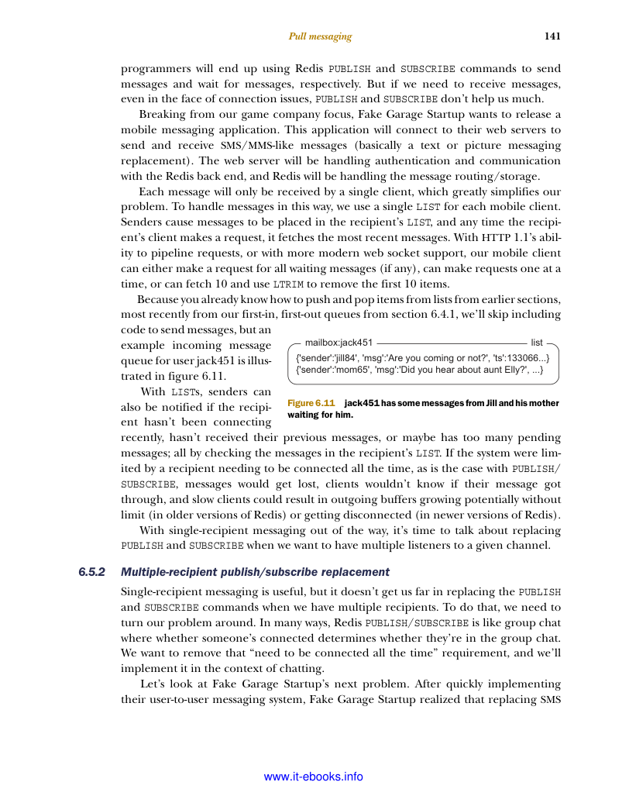

**Hình 6.11 – jack451 có một số thông điệp từ Jill và mẹ của anh ấy đang chờ (Figure 6.11 jack451 has some messages from Jill and his mother waiting for him)**

| Khóa Redis | Kiểu cấu trúc | Các phần tử trong danh sách hộp thư (JSON-encoded messages) |
| :--- | :--- | :--- |
| `mailbox:jack451` | `list` | `{'sender':'jill84', 'msg':'Are you coming or not?', 'ts':133066...}` |
| | | `{'sender':'mom65', 'msg':'Did you hear about aunt Elly?', ...}` |

Với cấu trúc `LIST`, những người gửi cũng có thể được thông báo nếu người nhận gần đây không kết nối, chưa nhận được các thông điệp trước đó của họ, hoặc có lẽ đang có quá nhiều thông điệp tồn đọng chưa đọc; tất cả chỉ bằng cách kiểm tra các thông điệp nằm trong `LIST` của người nhận (ví dụ qua lệnh `LLEN` hoặc `LRANGE`). Nếu hệ thống bị giới hạn bởi việc người nhận phải giữ kết nối liên tục mọi lúc, như trong trường hợp của `PUBLISH`/`SUBSCRIBE`, các thông điệp sẽ bị thất lạc, các máy khách gửi tin sẽ không biết liệu thông điệp của mình có đến đích hay không, và các máy khách nhận tin chậm chạp có thể dẫn đến việc bộ đệm đầu ra (outgoing buffers) phình to không giới hạn (trong các phiên bản Redis cũ hơn) hoặc bị ngắt kết nối cưỡng bức (trong các phiên bản Redis mới hơn).

> 💡 **Ví dụ bổ sung (không có trong sách): Mẫu lấy tin nhắn theo lô an toàn với `LRANGE` + `LTRIM`**
>
> Trong mục này, tác giả nhắc đến kỹ thuật *"lấy 10 thông điệp rồi sử dụng `LTRIM` để xóa 10 phần tử đầu tiên"*. Tại sao trên thiết bị di động (mạng 3G/4G/Wi-Fi chập chờn), người ta lại thích dùng cặp lệnh `LRANGE` + `LTRIM` thay vì gọi `LPOP` 10 lần?
> 1. **Xác nhận đã nhận (Client Acknowledgment):** Khi ứng dụng di động mở kết nối HTTP để tải tin nhắn mới, máy chủ web gọi `LRANGE mailbox:jack451 0 9` để đọc 10 tin nhắn đầu tiên (nhưng **chưa xóa** khỏi Redis) rồi trả về cho điện thoại. Chỉ khi điện thoại lưu xong 10 tin nhắn đó vào SQLite cục bộ và gửi phản hồi xác nhận (ACK) lên máy chủ web (hoặc trong yêu cầu tiếp theo), máy chủ web mới gọi `LTRIM mailbox:jack451 10 -1` để cắt bỏ 10 tin nhắn đã đọc đó khỏi đầu danh sách, giữ lại từ vị trí số 10 đến cuối danh sách (`-1`).
> 2. **An toàn khi đẩy thêm tin nhắn mới (`RPUSH`):** Vì người gửi mới luôn đẩy tin nhắn vào **đầu bên phải** (`RPUSH mailbox:jack451 new_msg`), trong khi `LRANGE 0 9` và `LTRIM 10 -1` chỉ thao tác ở **đầu bên trái**, nên dù trong lúc điện thoại đang tải 10 tin nhắn đầu mà có thêm 5 tin nhắn mới được `RPUSH` vào cuối danh sách, lệnh `LTRIM mailbox:jack451 10 -1` vẫn chỉ xóa chính xác 10 tin nhắn đầu tiên mà không hề làm mất bất kỳ tin nhắn mới nào! (Từ Redis 6.2+, lệnh `LPOP` cũng đã hỗ trợ tham số số lượng `LPOP mailbox:jack451 10` nếu muốn lấy và xóa ngay trong một bước).

Sau khi đã giải quyết xong bài toán nhắn tin cho một người nhận duy nhất, đã đến lúc thảo luận về việc thay thế `PUBLISH` và `SUBSCRIBE` khi chúng ta muốn có nhiều người cùng lắng nghe (multiple listeners) trên một kênh nhất định.

### 6.5.2 Thay thế publish/subscribe cho nhiều người nhận (Multiple-recipient publish/subscribe replacement)

Nhắn tin một người nhận rất hữu ích, nhưng nó không giúp chúng ta tiến xa trong việc thay thế các lệnh `PUBLISH` và `SUBSCRIBE` khi chúng ta có nhiều người nhận. Để làm được điều đó, chúng ta cần lật ngược bài toán của mình lại. Xét theo nhiều khía cạnh, `PUBLISH`/`SUBSCRIBE` của Redis giống như một cuộc trò chuyện nhóm (group chat) mà ở đó việc một người có đang kết nối mạng hay không sẽ quyết định việc họ có mặt trong cuộc trò chuyện nhóm đó hay không. Chúng ta muốn loại bỏ yêu cầu "phải giữ kết nối mọi lúc" đó đi, và chúng ta sẽ triển khai nó trong ngữ cảnh của tính năng trò chuyện (chatting).

Hãy xem xét bài toán tiếp theo của công ty Fake Garage Startup. Sau khi nhanh chóng triển khai hệ thống nhắn tin giữa người dùng với người dùng (user-to-user messaging system), Fake Garage Startup nhận ra rằng việc thay thế SMS là tốt, nhưng họ đã nhận được rất nhiều yêu cầu bổ sung tính năng trò chuyện nhóm (group chat). Giống như trước đây, các máy khách của họ có thể kết nối hoặc ngắt kết nối vào bất kỳ thời điểm nào, vì vậy chúng ta không thể sử dụng phương pháp `PUBLISH`/`SUBSCRIBE` tích hợp sẵn.

Mỗi cuộc trò chuyện nhóm mới sẽ có một tập hợp những người nhận ban đầu của các thông điệp nhóm, và người dùng có thể tham gia (join) hoặc rời khỏi (leave) nhóm nếu họ muốn. Thông tin về việc những người dùng nào đang ở trong cuộc trò chuyện sẽ được lưu trữ dưới dạng một `ZSET` với các thành viên (members) là tên người dùng (usernames) của những người nhận, và giá trị điểm số (scores/values) là ID thông điệp cao nhất mà người dùng đó đã nhận được trong cuộc trò chuyện. Việc một người dùng cá nhân đang là thành viên của những cuộc trò chuyện nào cũng sẽ được lưu trữ dưới dạng một `ZSET`, với các thành viên là các nhóm mà người dùng đó tham gia, và điểm số là ID thông điệp cao nhất mà người dùng đó đã nhận được trong cuộc trò chuyện tương ứng. Thông tin về một số người dùng và các cuộc trò chuyện có thể được thấy trong **Hình 6.12 – Một số dữ liệu trò chuyện và người dùng mẫu (Figure 6.12 Some example chat and user data)**.

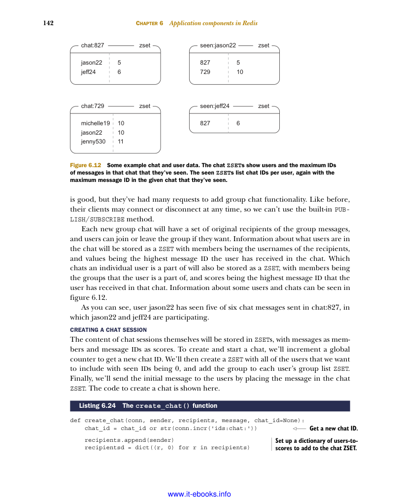

**Hình 6.12 – Một số dữ liệu trò chuyện và người dùng mẫu. Các ZSET `chat` hiển thị những người dùng và ID tối đa của các thông điệp trong cuộc trò chuyện đó mà họ đã xem. Các ZSET `seen` liệt kê các ID cuộc trò chuyện trên mỗi người dùng, một lần nữa đi kèm với ID thông điệp tối đa trong cuộc trò chuyện tương ứng mà họ đã xem (Figure 6.12 Some example chat and user data. The chat ZSETs show users and the maximum IDs of messages in that chat that they’ve seen. The seen ZSETs list chat IDs per user, again with the maximum message ID in the given chat that they’ve seen)**

| Khóa Redis | Kiểu cấu trúc | Thành viên (Member) | Điểm số (Score - ID tin nhắn cao nhất đã xem) | Ý nghĩa |
| :--- | :--- | :--- | :--- | :--- |
| `chat:827` | `zset` | `jason22`<br>`jeff24` | `5`<br>`6` | Nhóm chat `827` có `jason22` (đã xem đến tin nhắn số 5) và `jeff24` (đã xem đến tin nhắn số 6). |
| `chat:729` | `zset` | `michelle19`<br>`jason22`<br>`jenny530` | `10`<br>`10`<br>`11` | Nhóm chat `729` có `michelle19` (đã xem đến 10), `jason22` (đã xem đến 10), và `jenny530` (đã xem đến 11). |
| `seen:jason22` | `zset` | `827`<br>`729` | `5`<br>`10` | Người dùng `jason22` tham gia nhóm `827` (đã xem đến tin 5) và nhóm `729` (đã xem đến tin 10). |
| `seen:jeff24` | `zset` | `827` | `6` | Người dùng `jeff24` tham gia nhóm `827` (đã xem đến tin 6). |

Như bạn có thể thấy, người dùng `jason22` đã xem 5 trên tổng số 6 thông điệp trò chuyện được gửi trong `chat:827`, nơi mà `jason22` và `jeff24` đang cùng tham gia.

> 📝 **Giải thích thêm (không có trong sách): Tại sao thiết kế này lại lưu trạng thái "đã xem" (`seen_id`) ở cả hai nơi là `chat:<chat_id>` và `seen:<user>`?**
>
> Thoạt nhìn vào **Hình 6.12**, bạn có thể tự hỏi: Tại sao điểm số `5` của `jason22` trong phòng `827` lại được lưu lặp lại ở cả `chat:827` (member `jason22`, score `5`) lẫn `seen:jason22` (member `827`, score `5`)? Đây chính là kỹ thuật **phi chuẩn hóa có chủ đích (denormalization)** cực kỳ thông minh trong Redis để phục vụ hai chiều truy vấn khác nhau với độ phức tạp tối ưu:
> 1. **Chiều thứ nhất — Theo người dùng (`seen:<user>`):** Khi `jason22` mở ứng dụng lên và hỏi *"Tôi có tin nhắn mới nào trong tất cả các nhóm mà tôi đang tham gia không?"*, hệ thống chỉ cần đọc một khóa duy nhất `ZRANGE seen:jason22 0 -1 WITHSCORES` là biết ngay danh sách mọi phòng chat của `jason22` (`827`, `729`) kèm theo vị trí tin nhắn cuối cùng mà anh ta đã đọc ở từng phòng (`5`, `10`).
> 2. **Chiều thứ hai — Theo phòng chat (`chat:<chat_id>`):** Làm sao Redis biết khi nào một tin nhắn trong phòng `msgs:827` đã được **tất cả mọi thành viên trong phòng** đọc hết để xóa đi nhằm giải phóng bộ nhớ RAM? Nhờ việc `chat:827` lưu điểm số là ID tin nhắn đã đọc của từng thành viên trong phòng, và vì `ZSET` luôn tự động sắp xếp các thành viên theo điểm số từ nhỏ đến lớn, chúng ta chỉ cần lấy phần tử đứng đầu tiên (index `0`) bằng lệnh `ZRANGE chat:827 0 0 WITHSCORES` (độ phức tạp $O(1)$)! Điểm số nhỏ nhất này (ví dụ `5` của `jason22`) chính là "mốc nước thấp nhất" (low-water mark): mọi tin nhắn trong `msgs:827` có ID $\le 5$ chắc chắn đã được tất cả mọi người trong phòng đọc xong và có thể xóa sạch ngay lập tức bằng `ZREMRANGEBYSCORE msgs:827 0 5`!

#### TẠO MỘT PHIÊN TRÒ CHUYỆN (CREATING A CHAT SESSION)

Bản thân nội dung của các phiên trò chuyện sẽ được lưu trữ trong các `ZSET` (`msgs:<chat_id>`), với các thông điệp là các thành viên (members) và các ID thông điệp là điểm số (scores). Để tạo và bắt đầu một cuộc trò chuyện, chúng ta sẽ tăng một bộ đếm toàn cục (global counter) để lấy một ID cuộc trò chuyện mới. Sau đó, chúng ta sẽ tạo một `ZSET` chứa tất cả những người dùng mà chúng ta muốn đưa vào với các ID đã xem (seen IDs) ban đầu bằng `0`, và thêm nhóm trò chuyện này vào `ZSET` danh sách nhóm của từng người dùng. Cuối cùng, chúng ta sẽ gửi thông điệp khởi đầu cho những người dùng đó bằng cách đặt thông điệp vào trong `ZSET` của cuộc trò chuyện. Đoạn mã để tạo một cuộc trò chuyện được hiển thị dưới đây.

**Listing 6.24 – Hàm `create_chat()` (The create_chat() function)**

```python
def create_chat(conn, sender, recipients, message, chat_id=None):
    chat_id = chat_id or str(conn.incr('ids:chat:'))        # Lấy một ID cuộc trò chuyện mới.

    recipients.append(sender)                               # Thiết lập một từ điển ánh xạ người dùng tới điểm số để thêm vào ZSET của cuộc trò chuyện.
    recipientsd = dict((r, 0) for r in recipients)

    pipeline = conn.pipeline(True)
    pipeline.zadd('chat:' + chat_id, **recipientsd)         # Tạo tập hợp chứa danh sách những người đang tham gia.
    for rec in recipients:                                  # Khởi tạo các ZSET seen.
        pipeline.zadd('seen:' + rec, chat_id, 0)
    pipeline.execute()

    return send_message(conn, chat_id, sender, message)     # Gửi thông điệp.
```

*Giải thích các chú thích trong mã nguồn:*
- `chat_id = chat_id or str(conn.incr('ids:chat:'))`: Lấy một ID cuộc trò chuyện mới (Get a new chat ID).
- `recipients.append(sender)` và `recipientsd = dict((r, 0) for r in recipients)`: Thiết lập một từ điển ánh xạ người dùng tới điểm số để thêm vào ZSET của cuộc trò chuyện (Set up a dictionary of users-to-scores to add to the chat ZSET).
- `pipeline.zadd('chat:' + chat_id, **recipientsd)`: Tạo tập hợp chứa danh sách những người đang tham gia (Create the set with the list of people participating).
- `for rec in recipients: pipeline.zadd('seen:' + rec, chat_id, 0)`: Khởi tạo các ZSET `seen` (Initialize the seen ZSETs).
- `return send_message(conn, chat_id, sender, message)`: Gửi thông điệp (Send the message).

Hầu như điều duy nhất có thể gây ngạc nhiên ở đây là việc chúng ta sử dụng thứ được gọi là một *biểu thức sinh* (*generator expression*) bên trong một lời gọi tới hàm khởi tạo đối tượng `dict()`. Lối tắt này cho phép chúng ta nhanh chóng xây dựng một từ điển (dictionary) ánh xạ những người dùng tới một điểm số có giá trị ban đầu bằng `0`, thứ mà lệnh `ZADD` có thể chấp nhận trong một lời gọi duy nhất.

> **BIỂU THỨC SINH VÀ VIỆC XÂY DỰNG TỪ ĐIỂN (GENERATOR EXPRESSIONS AND DICTIONARY CONSTRUCTION)**
>
> Các từ điển trong Python (Python dictionaries) có thể được xây dựng một cách dễ dàng bằng cách truyền vào một chuỗi các cặp giá trị (sequence of pairs of values). Phần tử đầu tiên trong cặp trở thành khóa (key); phần tử thứ hai trở thành giá trị (value). **Listing 6.24** cho thấy một đoạn mã trông có vẻ lạ, nơi chúng ta thực sự tạo ra chuỗi sẽ được truyền vào cho từ điển ngay trên cùng một dòng (in-line). Kiểu tạo chuỗi này được gọi là một *biểu thức sinh* (*generator expression*), mà bạn có thể đọc thêm tại http://mng.bz/TTKb.

> 📝 **Giải thích thêm (không có trong sách): Dictionary Comprehension trong Python hiện đại và cú pháp `zadd` trong `redis-py` 3.0+**
>
> 1. **Về cách tạo Dictionary trong Python:** Trong `Listing 6.24`, tác giả viết `recipientsd = dict((r, 0) for r in recipients)` (hoặc có thể dùng `dict.fromkeys(recipients, 0)`). Từ Python 2.7 và Python 3.x trở đi, Python hỗ trợ cú pháp **Dictionary Comprehension** ngắn gọn và nhanh hơn:
>    ```python
>    recipientsd = {r: 0 for r in recipients}
>    ```
> 2. **Về cú pháp `pipeline.zadd()` trong `redis-py` 3.0+ / 4.x / 5.x:**
>    - Trong `redis-py` 2.x (dùng trong sách), `zadd` cho phép truyền `**kwargs` (như `pipeline.zadd('chat:' + chat_id, **recipientsd)`) hoặc truyền các đối số vị trí `member, score` (như `pipeline.zadd('seen:' + rec, chat_id, 0)`).
>    - Trong `redis-py` 3.0+ trở lên, phương thức `zadd(name, mapping)` nhận trực tiếp một dictionary `{member: score}` làm tham số thứ hai (không dùng `**` unpacking):
>      ```python
>      pipeline.zadd('chat:' + chat_id, recipientsd)
>      for rec in recipients:
>          pipeline.zadd('seen:' + rec, {chat_id: 0})
>      ```

#### GỬI THÔNG ĐIỆP (SENDING MESSAGES)

Để gửi một thông điệp, chúng ta phải lấy một ID thông điệp mới, và sau đó thêm thông điệp vào `ZSET` chứa các thông điệp của cuộc trò chuyện đó (`msgs:<chat_id>`). Thật không may, có một điều kiện tranh chấp (race condition) trong quá trình gửi thông điệp, nhưng nó có thể được xử lý dễ dàng bằng cách sử dụng một khóa phân tán (lock) từ mục 6.2. Hàm của chúng ta để gửi một thông điệp sử dụng khóa được hiển thị tiếp theo.

**Listing 6.25 – Hàm `send_message()` (The send_message() function)**

```python
def send_message(conn, chat_id, sender, message):
    identifier = acquire_lock(conn, 'chat:' + chat_id)
    if not identifier:
        raise Exception("Couldn't get the lock")
    try:
        mid = conn.incr('ids:' + chat_id)                   # Chuẩn bị thông điệp.
        ts = time.time()
        packed = json.dumps({
            'id': mid,
            'ts': ts,
            'sender': sender,
            'message': message,
        })

        conn.zadd('msgs:' + chat_id, packed, mid)           # Gửi thông điệp tới cuộc trò chuyện.
    finally:
        release_lock(conn, 'chat:' + chat_id, identifier)
    return chat_id
```

*Giải thích các chú thích trong mã nguồn:*
- `mid = conn.incr('ids:' + chat_id)` ... `packed = json.dumps(...)`: Chuẩn bị thông điệp (Prepare the message).
- `conn.zadd('msgs:' + chat_id, packed, mid)`: Gửi thông điệp tới cuộc trò chuyện (Send the message to the chat).

Phần lớn công việc liên quan đến việc gửi một thông điệp trò chuyện là chuẩn bị bản thân thông tin sẽ được gửi đi; việc thực sự gửi thông điệp chỉ bao gồm thao tác thêm nó vào một `ZSET`. Chúng ta sử dụng cơ chế khóa (locking) bao quanh quá trình xây dựng thông điệp đã đóng gói và thêm vào `ZSET` vì cùng những lý do mà chúng ta đã cần một khóa cho đèn hiệu đếm (counting semaphore) của mình trước đó. Nhìn chung, khi chúng ta sử dụng một giá trị lấy từ Redis trong quá trình xây dựng một giá trị khác mà chúng ta cần thêm vào lại Redis, chúng ta sẽ cần sử dụng hoặc là một giao dịch `WATCH`/`MULTI`/`EXEC` hoặc là một khóa (lock) để loại bỏ các điều kiện tranh chấp (race conditions). Chúng ta sử dụng một khóa ở đây vì cùng những lý do về mặt hiệu năng mà vì đó chúng ta đã phát triển nó ngay từ đầu.

> 📝 **Giải thích thêm (không có trong sách): Điều kiện tranh chấp (Race Condition) nào sẽ xảy ra nếu `send_message()` không dùng Lock?**
>
> Bạn có thể thắc mắc: Lệnh `mid = conn.incr('ids:' + chat_id)` vốn dĩ đã là một lệnh nguyên tử (atomic) trong Redis, vậy tại sao vẫn cần `acquire_lock(conn, 'chat:' + chat_id)` bao quanh `INCR` và `ZADD`?
>
> Hãy xét kịch bản sau nếu **không có khóa**:
> 1. Người dùng **A** gửi tin nhắn vào phòng `827`: gọi `INCR ids:827` -> nhận được `mid = 1`. Nhưng ngay lúc đó tiến trình của A bị hệ điều hành tạm dừng (context switch) vài mili-giây trước khi kịp gọi `ZADD msgs:827`.
> 2. Cùng lúc đó, người dùng **B** gửi tin nhắn vào phòng `827`: gọi `INCR ids:827` -> nhận được `mid = 2`, và gọi xong `ZADD msgs:827 <tin_nhắn_B> 2`.
> 3. Ngay sau đó, người dùng **C** gọi `fetch_pending_messages()` để kéo tin nhắn mới:
>    - C thấy trong `msgs:827` đang có tin nhắn `mid = 2` của B (trong khi tin nhắn `mid = 1` của A vẫn chưa được ghi vào `msgs:827`!).
>    - C đọc tin nhắn `mid = 2`, và cập nhật mốc đã đọc của C lên `seen_id = 2`!
> 4. Bây giờ tiến trình của **A** mới tỉnh dậy và gọi `ZADD msgs:827 <tin_nhắn_A> 1`.
> 5. **Hậu quả nghiêm trọng:** Vì người dùng **C** đã cập nhật `seen_id = 2` (lần tới C chỉ lấy các tin nhắn có `score >= 3`), nên C sẽ **vĩnh viễn không bao giờ nhìn thấy tin nhắn `mid = 1` của A**! Thậm chí tệ hơn, nếu mọi người trong phòng đều đã cập nhật `seen_id = 2`, lệnh dọn dẹp `ZREMRANGEBYSCORE msgs:827 0 2` của C sẽ xóa mất luôn tin nhắn `mid = 1` của A ngay khi nó vừa xuất hiện mà chưa ai kịp đọc!
>
> Nhờ có `acquire_lock(conn, 'chat:' + chat_id)`, quá trình tăng `mid = INCR` và chèn `ZADD` trở thành một khối nguyên tử: các tin nhắn chắc chắn được xuất hiện trong `msgs:<chat_id>` theo đúng thứ tự tăng dần liên tục `1, 2, 3...` mà không bao giờ bị hổng (gap) ở giữa.

Bây giờ, sau khi chúng ta đã tạo cuộc trò chuyện và gửi thông điệp ban đầu, những người dùng cần tìm hiểu thông tin về các cuộc trò chuyện mà họ đang là thành viên cũng như có bao nhiêu thông điệp đang chờ xử lý, và họ cần thực sự nhận được các thông điệp đó.

#### LẤY CÁC THÔNG ĐIỆP ĐANG CHỜ (FETCHING MESSAGES)

Để lấy tất cả các thông điệp đang chờ (pending messages) cho một người dùng, chúng ta cần lấy các ID nhóm và các ID thông điệp đã xem từ `ZSET` của người dùng đó (`seen:<recipient>`) bằng lệnh `ZRANGE`. Khi chúng ta đã có các ID nhóm và các thông điệp mà người dùng đã xem, chúng ta có thể thực hiện các thao tác `ZRANGEBYSCORE` trên tất cả các `ZSET` chứa thông điệp (`msgs:<chat_id>`). Sau khi chúng ta đã lấy được các thông điệp cho cuộc trò chuyện, chúng ta cập nhật `ZSET` `seen` với ID thích hợp cùng với mục dữ liệu của người dùng trong `ZSET` của nhóm (`chat:<chat_id>`), và chúng ta tiến hành dọn dẹp bất kỳ thông điệp nào khỏi cuộc trò chuyện nhóm mà đã được nhận bởi tất cả mọi người trong cuộc trò chuyện đó, như được hiển thị trong listing tiếp theo.

**Listing 6.26 – Hàm `fetch_pending_messages()` (The fetch_pending_messages() function)**

```python
def fetch_pending_messages(conn, recipient):
    seen = conn.zrange('seen:' + recipient, 0, -1, withscores=True) # Lấy các ID thông điệp cuối cùng đã nhận được.

    pipeline = conn.pipeline(True)
    for chat_id, seen_id in seen:                                   # Lấy tất cả các thông điệp mới.
        pipeline.zrangebyscore(
            'msgs:' + chat_id, seen_id+1, 'inf')
    chat_info = zip(seen, pipeline.execute())                       # Chuẩn bị thông tin về dữ liệu sẽ được trả về.
    for i, ((chat_id, seen_id), messages) in enumerate(chat_info):
        if not messages:
            continue
        messages[:] = map(json.loads, messages)
        seen_id = messages[-1]['id']                                # Cập nhật ZSET "chat" với thông điệp được nhận gần đây nhất.
        conn.zadd('chat:' + chat_id, recipient, seen_id)

        min_id = conn.zrange(                                       # Phát hiện các thông điệp đã được xem bởi tất cả người dùng.
            'chat:' + chat_id, 0, 0, withscores=True)

        pipeline.zadd('seen:' + recipient, chat_id, seen_id)        # Cập nhật ZSET "seen".
        if min_id:
            pipeline.zremrangebyscore(                              # Dọn sạch các thông điệp đã được xem bởi tất cả người dùng.
                'msgs:' + chat_id, 0, min_id[0][1])
        chat_info[i] = (chat_id, messages)
    pipeline.execute()

    return chat_info
```

*Giải thích các chú thích trong mã nguồn:*
- `seen = conn.zrange('seen:' + recipient, 0, -1, withscores=True)`: Lấy các ID thông điệp cuối cùng đã nhận được (Get the last message IDs received).
- `for chat_id, seen_id in seen: pipeline.zrangebyscore('msgs:' + chat_id, seen_id+1, 'inf')`: Lấy tất cả các thông điệp mới (Fetch all new messages).
- `chat_info = zip(seen, pipeline.execute())`: Chuẩn bị thông tin về dữ liệu sẽ được trả về (Prepare information about the data to be returned).
- `seen_id = messages[-1]['id']` và `conn.zadd('chat:' + chat_id, recipient, seen_id)`: Cập nhật ZSET "chat" với thông điệp được nhận gần đây nhất (Update the “chat” ZSET with the most recently received message).
- `min_id = conn.zrange('chat:' + chat_id, 0, 0, withscores=True)`: Phát hiện các thông điệp đã được xem bởi tất cả người dùng (Discover messages that have been seen by all users).
- `pipeline.zadd('seen:' + recipient, chat_id, seen_id)`: Cập nhật ZSET "seen" (Update the “seen” ZSET).
- `if min_id: pipeline.zremrangebyscore('msgs:' + chat_id, 0, min_id[0][1])`: Dọn sạch các thông điệp đã được xem bởi tất cả người dùng (Clean out messages that have been seen by all users).

Việc lấy các thông điệp đang chờ chủ yếu là vấn đề lặp qua tất cả các cuộc trò chuyện của người dùng đó, kéo các thông điệp mới về, và dọn dẹp những thông điệp nào đã được xem bởi toàn bộ người dùng trong một cuộc trò chuyện.

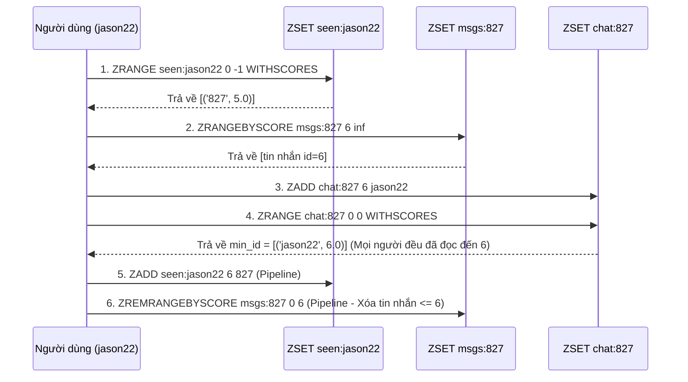

> 📝 **Giải thích thêm (không có trong sách): Lưu ý khi chuyển đổi `Listing 6.26` sang Python 3**
>
> Trong Python 2 (phiên bản dùng trong sách), hàm `zip()` và `map()` trả về một danh sách (`list`) thực sự, do đó tác giả có thể gán trực tiếp theo chỉ mục `chat_info[i] = (chat_id, messages)` và gán lát cắt `messages[:] = map(json.loads, messages)`.
> Trong **Python 3**, `zip()` trả về một đối tượng vòng lặp (`zip` iterator) chứ không phải `list`, nên nếu gọi `chat_info[i] = ...` sẽ gặp lỗi `TypeError: 'zip' object does not support item assignment`. Để chạy trên Python 3, bạn chỉ cần bọc `list(...)` quanh `zip`:
> ```python
> chat_info = list(zip(seen, pipeline.execute()))
> ```
> Và `messages[:] = list(map(json.loads, messages))` (hoặc `[json.loads(m) for m in messages]`).

#### THAM GIA VÀ RỜI KHỎI CUỘC TRÒ CHUYỆN (JOINING AND LEAVING THE CHAT)

Chúng ta đã gửi và lấy các thông điệp từ các cuộc trò chuyện nhóm; tất cả những gì còn lại là việc tham gia (joining) và rời khỏi (leaving) cuộc trò chuyện nhóm. Để tham gia một cuộc trò chuyện nhóm, chúng ta lấy ID thông điệp gần đây nhất của cuộc trò chuyện đó, và chúng ta thêm thông tin cuộc trò chuyện vào `ZSET` `seen` của người dùng với điểm số là ID thông điệp gần đây nhất đó. Chúng ta cũng thêm người dùng vào danh sách thành viên của nhóm (`chat:<chat_id>`), một lần nữa với điểm số là ID thông điệp gần đây nhất. Hãy xem listing tiếp theo để biết mã lệnh tham gia một nhóm.

**Listing 6.27 – Hàm `join_chat()` (The join_chat() function)**

```python
def join_chat(conn, chat_id, user):
    message_id = int(conn.get('ids:' + chat_id))            # Lấy ID thông điệp gần đây nhất cho cuộc trò chuyện.

    pipeline = conn.pipeline(True)
    pipeline.zadd('chat:' + chat_id, user, message_id)      # Thêm người dùng vào danh sách thành viên của cuộc trò chuyện.
    pipeline.zadd('seen:' + user, chat_id, message_id)      # Thêm cuộc trò chuyện vào danh sách seen của người dùng.
    pipeline.execute()
```

*Giải thích các chú thích trong mã nguồn:*
- `message_id = int(conn.get('ids:' + chat_id))`: Lấy ID thông điệp gần đây nhất cho cuộc trò chuyện (Get the most recent message ID for the chat).
- `pipeline.zadd('chat:' + chat_id, user, message_id)`: Thêm người dùng vào danh sách thành viên của cuộc trò chuyện (Add the user to the chat member list).
- `pipeline.zadd('seen:' + user, chat_id, message_id)`: Thêm cuộc trò chuyện vào danh sách `seen` của người dùng (Add the chat to the user’s seen list).

Việc tham gia một cuộc trò chuyện chỉ đòi hỏi thêm các tham chiếu thích hợp về người dùng vào cuộc trò chuyện, và thêm cuộc trò chuyện vào `ZSET` `seen` của người dùng đó.

Để xóa một người dùng khỏi cuộc trò chuyện nhóm, chúng ta xóa ID người dùng khỏi `ZSET` của cuộc trò chuyện (`chat:<chat_id>`), và chúng ta xóa cuộc trò chuyện khỏi `ZSET` `seen` của người dùng đó (`seen:<user>`). Nếu không còn người dùng nào trong `ZSET` của cuộc trò chuyện nữa, chúng ta sẽ xóa luôn `ZSET` chứa các thông điệp (`msgs:<chat_id>`) và bộ đếm ID thông điệp (`ids:<chat_id>`). Nếu vẫn còn người dùng ở lại, chúng ta sẽ một lần nữa thực hiện một lượt kiểm tra và dọn sạch bất kỳ thông điệp cũ nào mà đã được xem bởi tất cả những người dùng còn lại. Hàm để rời khỏi một cuộc trò chuyện được hiển thị trong listing tiếp theo.

**Listing 6.28 – Hàm `leave_chat()` (The leave_chat() function)**

```python
def leave_chat(conn, chat_id, user):
    pipeline = conn.pipeline(True)
    pipeline.zrem('chat:' + chat_id, user)                  # Xóa người dùng khỏi cuộc trò chuyện.
    pipeline.zrem('seen:' + user, chat_id)
    pipeline.zcard('chat:' + chat_id)                       # Tìm số lượng thành viên nhóm còn lại.

    if not pipeline.execute()[-1]:
        pipeline.delete('msgs:' + chat_id)                  # Xóa cuộc trò chuyện.
        pipeline.delete('ids:' + chat_id)
        pipeline.execute()
    else:
        oldest = conn.zrange(                               # Tìm thông điệp cũ nhất đã được xem bởi tất cả người dùng.
            'chat:' + chat_id, 0, 0, withscores=True)
        conn.zremrangebyscore('msgs:' + chat_id, 0, oldest[0][1]) # Xóa các thông điệp cũ khỏi cuộc trò chuyện.
```

> 📝 **Giải thích thêm (không có trong sách): Đính chính lỗi in ấn (Errata) của bản gốc ở dòng cuối `Listing 6.28`**
>
> Trong bản in gốc tiếng Anh của sách, dòng cuối cùng của `Listing 6.28` bị in nhầm thành:
> ```python
> conn.zremrangebyscore('chat:' + chat_id, 0, oldest)
> ```
> Tuy nhiên, đúng theo chú thích của tác giả (*"Delete old messages from the chat"* - xóa các thông điệp cũ khỏi cuộc trò chuyện, giống như trong `Listing 6.26`) và mã nguồn chính thức trên GitHub của cuốn sách (`ch06_listing_source.py`), khóa cần xóa các tin nhắn cũ là `'msgs:' + chat_id` và giá trị điểm số lấy từ `oldest` là `oldest[0][1]`:
> ```python
> conn.zremrangebyscore('msgs:' + chat_id, 0, oldest[0][1])
> ```
> Tại sao khi một người rời khỏi nhóm (`leave_chat`), chúng ta lại cần chạy `zremrangebyscore` để dọn tin nhắn cũ? Bởi vì rất có thể người vừa rời nhóm chính là người duy nhất lâu nay không online (có `seen_id` thấp nhất làm kẹt việc dọn rác của cả nhóm). Ngay khi người đó rời nhóm, `oldest` (`min_id`) của những thành viên còn lại sẽ nhảy vọt lên, cho phép giải phóng toàn bộ các tin nhắn cũ đang bị giữ lại vì người đó!

*Giải thích các chú thích trong mã nguồn:*
- `pipeline.zrem('chat:' + chat_id, user)` và `pipeline.zrem('seen:' + user, chat_id)`: Xóa người dùng khỏi cuộc trò chuyện (Remove the user from the chat).
- `pipeline.zcard('chat:' + chat_id)`: Tìm số lượng thành viên nhóm còn lại (Find the number of remaining group members).
- `pipeline.delete('msgs:' + chat_id)` và `pipeline.delete('ids:' + chat_id)`: Xóa cuộc trò chuyện (Delete the chat).
- `oldest = conn.zrange('chat:' + chat_id, 0, 0, withscores=True)`: Tìm thông điệp cũ nhất đã được xem bởi tất cả người dùng (Find the oldest message seen by all users).
- `conn.zremrangebyscore(...)`: Xóa các thông điệp cũ khỏi cuộc trò chuyện (Delete old messages from the chat).

Việc dọn dẹp sau khi một người dùng rời khỏi cuộc trò chuyện không quá khó khăn, nhưng đòi hỏi phải chăm chút nhiều chi tiết nhỏ để đảm bảo rằng chúng ta không vô tình làm rò rỉ (leaking) một `ZSET` hay một bộ đếm ID bị bỏ quên ở đâu đó trong bộ nhớ.

Bây giờ chúng ta đã hoàn thành việc tạo ra một hệ thống nhắn tin dạng kéo cho nhiều người nhận (multiple-recipient pull messaging system) hoàn chỉnh trong Redis. Mặc dù chúng ta đang xem xét nó dưới góc độ của tính năng trò chuyện (chat), phương pháp tương tự này hoàn toàn có thể được sử dụng để thay thế các chức năng `PUBLISH`/`SUBSCRIBE` khi bạn muốn những người nhận của mình có khả năng nhận được các thông điệp đã được gửi đi trong lúc họ bị mất kết nối. Chỉ cần bỏ thêm một chút công sức, chúng ta có thể thay thế `ZSET` chứa tin nhắn bằng một `LIST`, và chúng ta có thể chuyển việc sử dụng khóa (lock) từ lúc gửi thông điệp sang lúc dọn dẹp thông điệp cũ. Thay vào đó, chúng ta đã sử dụng `ZSET` bởi vì nó giúp chúng ta tiết kiệm được thao tác phải đi lấy ID thông điệp hiện tại cho mỗi cuộc trò chuyện. Ngoài ra, bằng cách bắt bên gửi (sender) làm nhiều việc hơn (khóa xung quanh thao tác gửi một thông điệp), nhiều người nhận (multiple recipients) sẽ được giảm tải khỏi việc phải yêu cầu thêm dữ liệu và phải khóa trong quá trình dọn dẹp, điều này sẽ cải thiện hiệu năng tổng thể của hệ thống.

> 💡 **Ví dụ bổ sung (không có trong sách): Redis Streams (`XADD` / `XREAD` / `XREADGROUP`) — Giải pháp tích hợp sẵn trong Redis hiện đại (Redis 5.0+ / 6 / 7 / 8)**
>
> Khi cuốn sách *Redis in Action* được viết (thời điểm Redis 2.6/2.8), Redis chưa có cấu trúc dữ liệu chuyên biệt cho luồng sự kiện bền vững (persistent log/stream), vì vậy tác giả Josiah Carlson đã phải tự kết hợp `ZSET` + `STRING (INCR)` + `Distributed Lock` để tự chế tạo hệ thống Pull Messaging cho nhiều người nhận trong mục `6.5.2`.
>
> Kể từ **Redis 5.0** (ra mắt năm 2018) và được hoàn thiện mạnh mẽ trong **Redis 6.2 / 7.x / 8.0**, Salvatore Sanfilippo (tác giả của Redis) đã lấy cảm hứng trực tiếp từ Apache Kafka và từ chính mẫu thiết kế Pull Messaging này để bổ sung một kiểu dữ liệu nguyên thủy hoàn toàn mới vào lõi Redis: **Redis Streams**.
>
> Hãy so sánh cách thiết kế thủ công bằng `ZSET` trong mục `6.5.2` với **Redis Streams** hiện đại:
>
> | Tiêu chí | Thiết kế thủ công với `ZSET` (Mục 6.5.2) | Redis Streams (`STREAM` - Redis 5.0+ / 6 / 7 / 8) |
> | :--- | :--- | :--- |
> | **Sinh ID tin nhắn tuần tự** | Phải gọi `INCR ids:<chat_id>` kèm theo khóa phân tán `acquire_lock` để tránh race condition. | Lệnh `XADD chat:827 * sender jason msg "Hello"` **tự động sinh ID nguyên tử** dạng `<mili-giây>-<số-thứ-tự>` (ví dụ `1700000000123-0`) mà không cần bất kỳ khóa phân tán nào! |
> | **Đọc tin nhắn mới từ vị trí đã xem (`seen_id`)** | Phải đọc `seen:<user>` rồi gọi `ZRANGEBYSCORE msgs:<chat_id> (seen_id+1) inf`. | Dùng lệnh `XREAD COUNT 100 BLOCK 5000 STREAMS chat:827 1700000000123-0` (hỗ trợ cả **chặn - blocking** chờ tin nhắn mới theo thời gian thực mà `ZSET` không làm được!). |
> | **Nhóm người nhận / Phân tải Worker** | Phải tự quản lý các khóa `chat:<id>` và `seen:<user>`. | Hỗ trợ sẵn **Consumer Groups** (`XGROUP CREATE`, `XREADGROUP`, `XACK`, `XAUTOCLAIM`) để theo dõi chính xác từng consumer/group đã đọc/xử lý đến tin nhắn nào. |
> | **Giới hạn bộ nhớ / Dọn tin nhắn cũ** | Phải tự tìm `min_id` trong `chat:<id>` và gọi `ZREMRANGEBYSCORE`. | Hỗ trợ cắt tỉa tự động ngay khi thêm bằng `XADD chat:827 MAXLEN ~ 1000 * ...` hoặc cắt theo ngưỡng ID bằng `XTRIM chat:827 MINID = <min_id>` (Redis 6.2+). |
>
> **Ví dụ hoàn chỉnh viết lại hệ thống Group Chat / Pull Messaging đa người nhận bằng Redis Streams trong Python 3 (`redis-py` 5.x với `decode_responses=True`):**
> ```python
> def send_chat_stream(conn, chat_id: str, sender: str, message: str) -> str:
>     # 1. Gửi tin nhắn nguyên tử bằng XADD (không cần acquire_lock hay INCR ids:)
>     stream_key = f"stream:chat:{chat_id}"
>     msg_id = conn.xadd(stream_key, {"sender": sender, "message": message})
>     return msg_id
>
> def fetch_pending_chat_stream(conn, recipient: str) -> list:
>     # 2. Lấy danh sách các phòng chat và last_seen_id (dạng chuỗi 'ms-seq') từ HASH seen:<recipient>
>     seen_map = conn.hgetall(f"seen_stream:{recipient}")  # {'827': '1700000000123-0', ...}
>     if not seen_map:
>         return []
>
>     # 3. Đọc tin nhắn mới từ tất cả các phòng chat chỉ bằng 1 lệnh XREAD duy nhất!
>     streams = {f"stream:chat:{cid}": last_id for cid, last_id in seen_map.items()}
>     events = conn.xread(streams=streams, count=100)
>
>     results = []
>     pipe = conn.pipeline(True)
>     for stream_key, messages in events:
>         chat_id = stream_key.rpartition(":")[-1]
>         last_id = messages[-1][0]
>         # Cập nhật vị trí đọc mới nhất của recipient
>         pipe.hset(f"seen_stream:{recipient}", chat_id, last_id)
>         pipe.hset(f"chat_members:{chat_id}", recipient, last_id)
>         results.append((chat_id, messages))
>     pipe.execute()
>
>     # 4. Dọn dẹp các tin nhắn mà TẤT CẢ thành viên trong phòng đều đã đọc (dùng XTRIM MINID của Redis 6.2+)
>     for chat_id, _ in results:
>         member_offsets = conn.hvals(f"chat_members:{chat_id}")
>         if member_offsets:
>             # Tìm ID nhỏ nhất theo thứ tự (ms, seq)
>             min_seen_id = min(
>                 member_offsets, key=lambda x: tuple(map(int, x.split("-")))
>             )
>             # Xóa các tin nhắn có ID <= min_seen_id bằng cách giữ từ sau min_seen_id
>             conn.xtrim(f"stream:chat:{chat_id}", minid=min_seen_id, approximate=False)
>     return results
> ```
> Tuy nhiên, thiết kế dùng `ZSET` của tác giả trong mục `6.5.2` vẫn giữ nguyên giá trị học thuật và thực tiễn rất lớn, đặc biệt ở cơ chế **tự động thu hồi bộ nhớ chính xác khi toàn bộ thành viên trong phòng đã đọc xong (`min_id`)** — điều mà chúng ta sẽ thấy phát huy tác dụng tuyệt vời ngay trong mục `6.6` tiếp theo!

Hiện tại chúng ta đã có một hệ thống nhắn tin nhiều người nhận để thay thế `PUBLISH` và `SUBSCRIBE` cho trò chuyện nhóm. Trong phần tiếp theo, chúng ta sẽ tái sử dụng chính hệ thống này như một cách để gửi thông tin về tên các khóa (key names) chứa tệp tin hiện có sẵn trong Redis.

---

## 6.6 Phân phối tệp tin với Redis (Distributing files with Redis)

Khi xây dựng các phần mềm và hệ thống phân tán (distributed software and systems), việc cần phải sao chép, phân phối, hoặc xử lý các tệp dữ liệu (data files) trên nhiều hơn một máy chủ là điều rất phổ biến. Có một vài cách thông dụng khác nhau để thực hiện việc này bằng các công cụ hiện có. Nếu chúng ta có một máy chủ duy nhất luôn chứa các tệp tin cần được phân phối, việc sử dụng NFS hoặc Samba để gắn kết (mount) một đường dẫn hoặc ổ đĩa mạng không phải là điều hiếm gặp. Nếu chúng ta có các tệp tin mà nội dung của chúng thay đổi từng chút một, người ta cũng thường sử dụng một phần mềm có tên là Rsync để giảm thiểu lượng dữ liệu cần truyền tải giữa các hệ thống. Thỉnh thoảng, khi nhiều bản sao cần được phân phối giữa hàng loạt máy chủ, một giao thức có tên là BitTorrent có thể được sử dụng để giảm tải cho máy chủ nguồn bằng cách phân phối từng phần của tệp tin tới nhiều máy, rồi các máy này sau đó tự chia sẻ các mảnh dữ liệu (pieces) với nhau.

Thật không may, tất cả các phương pháp này đều có chi phí thiết lập (setup cost) đáng kể và giá trị mang lại chỉ mang tính tương đối. NFS và Samba có thể hoạt động tốt, nhưng cả hai đều có thể gặp những sự cố nghiêm trọng khi kết nối mạng không hoàn hảo (hoặc ngay cả khi kết nối mạng hoàn hảo), do cách thức mà cả hai công nghệ này thường được tích hợp sâu vào hệ điều hành. Rsync được thiết kế để xử lý các sự cố kết nối chập chờn (intermittent connection issues), vì mỗi tệp tin hoặc tập hợp các tệp tin có thể được truyền tải một phần rồi tiếp tục lại (resumed), nhưng nó lại mắc phải nhược điểm là cần phải tải xuống hoàn chỉnh toàn bộ các tệp tin trước khi quá trình xử lý có thể bắt đầu, đồng thời đòi hỏi phải giao tiếp phần mềm của chúng ta với Rsync để lấy các tệp tin về (điều này có thể là một vấn đề hoặc không). Và mặc dù BitTorrent là một công nghệ tuyệt vời, nó chỉ thực sự giúp ích nếu chúng ta đang chạm tới giới hạn băng thông gửi đi từ máy chủ nguồn của mình, hoặc nếu mạng nội bộ của chúng ta đang dư thừa tài nguyên chưa sử dụng hết. Nó cũng phụ thuộc vào việc giao tiếp phần mềm của chúng ta với một trình khách BitTorrent (BitTorrent client) vốn có thể không có sẵn trên mọi nền tảng, và có thể không có một phương thức thuận tiện nào để lấy các tệp tin.

Mỗi phương pháp trong số ba phương pháp vừa mô tả cũng đòi hỏi việc thiết lập và bảo trì người dùng, quyền hạn truy cập (permissions), và/hoặc các máy chủ. Bởi vì chúng ta đã cài đặt, đang chạy, và có sẵn Redis rồi, chúng ta sẽ sử dụng Redis để phân phối các tệp tin thay cho các công cụ kia. Bằng cách sử dụng Redis, chúng ta bỏ qua được những vấn đề mà một số phần mềm khác gặp phải: thư viện máy khách (client) của chúng ta xử lý các sự cố kết nối rất tốt, chúng ta có thể lấy dữ liệu trực tiếp bằng các client của mình, và chúng ta có thể bắt đầu xử lý dữ liệu ngay lập tức (không cần phải chờ tải xong toàn bộ tệp tin).

| Công cụ phân phối tệp | Ưu điểm chính | Nhược điểm khi xử lý luồng dữ liệu phân tán |
| :--- | :--- | :--- |
| **NFS / Samba** | Truy cập trực tiếp như ổ đĩa cục bộ (mount path). | Dễ bị treo tiến trình (hang I/O) ở tầng hệ điều hành khi mạng chập chờn; tốn công cấu hình quyền hạn/mount. |
| **Rsync** | Chịu lỗi mạng tốt, hỗ trợ truyền nối tiếp (resume) và đồng bộ phần thay đổi (delta). | Phải đợi tải xong toàn bộ tệp về ổ cứng từng máy mới bắt đầu đọc/xử lý được; tốn dung lượng đĩa cục bộ. |
| **BitTorrent** | Giảm tải băng thông cho máy chủ gốc khi phân phối tới hàng trăm máy nhận. | Kiến trúc phức tạp, khó tích hợp trực tiếp vào luồng đọc tuần tự (streaming) của ứng dụng. |
| **Redis (Kỹ thuật trong Mục 6.6)** | Tận dụng hạ tầng Redis có sẵn; đọc cuốn chiếu từng khối (block streaming) và giải nén trực tiếp trong RAM mà không cần lưu ra ổ cứng máy trạm. | Cần kiểm soát chặt giới hạn bộ nhớ RAM của Redis (`limit`) và dọn dẹp ngay khi các worker đã đọc xong. |

### 6.6.1 Tổng hợp người dùng theo vị trí địa lý (Aggregating users by location)

Hãy dành một chút thời gian để nhìn lại một bài toán trước đó mà chúng ta đã giải quyết cho công ty Fake Game Company. Với khả năng khám phá xem người dùng đang truy cập trò chơi từ đâu nhờ tính năng tra cứu IP sang thành phố (IP-to-city lookup) của chúng ta trong chương 5, Fake Game Company nhận thấy mình đang cần phải phân tích lại (reparse) nhiều gigabyte tệp nhật ký (log files). Họ đang muốn tổng hợp (aggregate) các xu hướng truy cập của người dùng theo thời gian trên một vài chiều (dimensions) khác nhau: theo từng quốc gia (per country), theo từng khu vực/vùng (per region), theo từng thành phố (per city), và nhiều tiêu chí khác nữa. Bởi vì chúng ta cần công việc này được chạy theo thời gian thực trên dữ liệu mới, chúng ta đã triển khai sẵn các hàm callback để thực hiện các thao tác tổng hợp đó.

Như bạn có thể còn nhớ từ chương 5, Fake Game Company đã hoạt động được khoảng 2 năm. Họ có xấp xỉ 1.000.000 người dùng mỗi ngày, nhưng họ có khoảng 10 sự kiện (events) trên mỗi người dùng mỗi ngày. Điều đó mang lại cho chúng ta xấp xỉ khoảng 7,3 tỷ dòng nhật ký (log lines) cần phải xử lý ($2 \times 365 \times 1.000.000 \times 10 = 7,3 \text{ tỷ}$). Nếu chúng ta sử dụng một trong các phương pháp truyền thống ở trên, chúng ta sẽ phải sao chép các tệp nhật ký tới nhiều máy chủ khác nhau cần xử lý dữ liệu đó, rồi sau đó mới bắt tay vào xử lý các tệp nhật ký. Cách này hoạt động được, nhưng khi đó chúng ta phải sao chép dữ liệu, có khả năng làm trì hoãn quá trình xử lý, đồng thời tiêu tốn không gian lưu trữ trên mọi máy chủ tham gia xử lý dữ liệu, mà sau này lại phải tốn công dọn dẹp đi.

Trong trường hợp cụ thể này, thay vì sao chép các tệp tin đi khắp nơi, chúng ta có thể viết một tiến trình MapReduce[^3] chạy một lần (one-time map-reduce process) để xử lý toàn bộ khối dữ liệu này. Nhưng bởi vì các hệ thống MapReduce được thiết kế để không chia sẻ bộ nhớ giữa các phần tử cần xử lý (mỗi phần tử thường là một dòng nhật ký), chúng ta có thể rốt cuộc lại mất nhiều thời gian với MapReduce hơn so với việc dành chút thời gian tự viết bằng tay để chia sẻ bộ nhớ trong tiến trình. Cụ thể hơn, nếu chúng ta nạp bảng tra cứu IP sang thành phố (IP-to-city lookup table) vào bộ nhớ RAM trong Python (điều mà chúng ta sẽ chỉ muốn làm nếu chúng ta có một khối lượng xử lý khổng lồ cần thực hiện, và thực tế là chúng ta đang có), chúng ta có thể thực hiện khoảng 200.000 lượt tra cứu IP sang ID thành phố mỗi giây, nhanh hơn mức mà chúng ta có thể kỳ vọng một thực thể (instance) Redis đơn lẻ phản hồi cho cùng các truy vấn đó qua mạng. Ngoài ra, để mở rộng quy mô với MapReduce, chúng ta sẽ phải chạy ít nhất một vài thực thể Redis mới có thể theo kịp tốc độ của các tiến trình MapReduce.

[^3]: MapReduce (hoặc Map/Reduce) là một kiểu tính toán phân tán được phổ biến bởi Google, có thể mang lại hiệu năng cao và sự đơn giản cho một số bài toán nhất định.

Sau khi đã loại bỏ ba phương pháp tiêu chuẩn để xử lý việc này (NFS/Samba, sao chép tệp tin, MapReduce), hãy xem xét một số mảnh ghép thực tế khác mà chúng ta sẽ cần giải quyết để thực sự thực hiện toàn bộ các lượt tra cứu của mình.

#### TỔNG HỢP DỮ LIỆU CỤC BỘ (AGGREGATING DATA LOCALLY)

Để xử lý ngần ấy mục nhật ký một cách hiệu quả, chúng ta sẽ cần lưu đệm cục bộ (locally cache) các kết quả tổng hợp trước khi cập nhật lên Redis nhằm giảm thiểu số vòng truyền nhận mạng (round trips). Tại sao ư? Nếu chúng ta có xấp xỉ 10 triệu dòng nhật ký cần xử lý cho mỗi ngày, thì đó là xấp xỉ 10 triệu lượt ghi vào Redis. Nếu chúng ta thực hiện việc tổng hợp cục bộ theo từng quốc gia cho toàn bộ ngày hôm đó (với thực tế là có khoảng 300 quốc gia/vùng lãnh thổ), thay vào đó chúng ta chỉ cần ghi 300 giá trị vào Redis. Điều này sẽ làm giảm đáng kể số vòng truyền nhận mạng với Redis, giảm số lượng lệnh cần xử lý, và từ đó sẽ làm giảm tổng thời gian xử lý.

Nếu chúng ta không làm bất cứ điều gì thông minh về việc lưu đệm cục bộ, và chúng ta có 10 phép tổng hợp (10 chiều phân tích) mà chúng ta muốn tính toán, chúng ta sẽ phải đối mặt với khoảng 10 ngày chỉ để xử lý hết toàn bộ dữ liệu đó. Nhưng bất cứ thứ gì ở cấp độ quốc gia hoặc khu vực đều có thể được tổng hợp hoàn toàn trong bộ nhớ cục bộ (cho cả một ngày) trước khi được gửi tới Redis. Và nhìn chung, bởi vì 10% các thành phố hàng đầu (có xấp xỉ 350.000 thành phố trong tập dữ liệu mẫu của chúng ta) chiếm tới hơn 90% lượng người dùng trò chơi của chúng ta, chúng ta cũng có thể lưu đệm cục bộ bất kỳ phép tổng hợp nào ở cấp độ thành phố. Vì vậy, bằng cách thực hiện lưu đệm cục bộ các kết quả tổng hợp, chúng ta không còn bị giới hạn bởi thông lượng tổng hợp (aggregate throughput) của Redis nữa.

Giả sử rằng chúng ta đã lưu đệm sẵn một bản sao của `ZSET` và bảng `HASH` phục vụ tra cứu IP từ mục 5.3 vào bộ nhớ cục bộ của tiến trình, chúng ta chỉ cần lo lắng về việc tổng hợp dữ liệu mà thôi. Hãy bắt đầu với các dòng nhật ký chứa một địa chỉ IP, ngày, giờ, và thao tác đã được thực hiện, tương tự như đoạn trích dưới đây:

```text
173.194.38.137 2011-10-10 13:55:36 achievement-762
```

Với các dòng nhật ký có định dạng như vậy, hãy tổng hợp các dòng đó theo từng ngày cho mỗi quốc gia. Để làm điều này, chúng ta sẽ nhận dòng nhật ký như một phần của một lời gọi hàm và tăng bộ đếm thích hợp lên. Nếu dòng nhật ký được truyền vào là rỗng (`None` hoặc chuỗi rỗng), thì chúng ta sẽ coi như dữ liệu của ngày hôm đó đã kết thúc, và chúng ta cần ghi kết quả tổng hợp vào Redis. Mã nguồn để thực hiện phép tổng hợp này được hiển thị ngay tiếp theo.

**Listing 6.29 – Một hàm callback tổng hợp cục bộ cho phép tổng hợp cấp quốc gia theo ngày (A locally aggregating callback for a daily country-level aggregate)**

```python
aggregates = defaultdict(lambda: defaultdict(int))          # Chuẩn bị từ điển tổng hợp cục bộ.

def daily_country_aggregate(conn, line):
    if line:
        line = line.split()                                 # Trích xuất thông tin từ các dòng nhật ký của chúng ta.
        ip = line[0]
        day = line[1]
        country = find_city_by_ip_local(ip)[2]              # Tìm quốc gia từ địa chỉ IP.
        aggregates[day][country] += 1                       # Tăng bộ đếm tổng hợp cục bộ của chúng ta.
        return

    for day, aggregate in aggregates.items():               # Tệp nhật ký của ngày đã xử lý xong; ghi kết quả tổng hợp của chúng ta vào Redis.
        conn.zadd('daily:country:' + day, **aggregate)
        del aggregates[day]
```

*Giải thích các chú thích trong mã nguồn:*
- `aggregates = defaultdict(lambda: defaultdict(int))`: Chuẩn bị từ điển tổng hợp cục bộ (Prepare the local aggregate dictionary).
- `line = line.split()`, `ip = line[0]`, `day = line[1]`: Trích xuất thông tin từ các dòng nhật ký của chúng ta (Extract the information from our log lines).
- `country = find_city_by_ip_local(ip)[2]`: Tìm quốc gia từ địa chỉ IP (Find the country from the IP address).
- `aggregates[day][country] += 1`: Tăng bộ đếm tổng hợp cục bộ của chúng ta (Increment our local aggregate).
- `for day, aggregate in aggregates.items(): conn.zadd('daily:country:' + day, **aggregate); del aggregates[day]`: Tệp nhật ký của ngày đã xử lý xong; ghi kết quả tổng hợp của chúng ta vào Redis (The day file is done; write our aggregate to Redis).

> 📝 **Giải thích thêm (không có trong sách): Cấu trúc `defaultdict` lồng nhau và lưu ý trong Python 3 / `redis-py` hiện đại**
>
> 1. **Cách hoạt động của `defaultdict(lambda: defaultdict(int))`:**
>    Trong Python, `collections.defaultdict` tự động khởi tạo giá trị mặc định khi truy cập vào một khóa chưa tồn tại. Khi lồng hai `defaultdict` như trên, ta tạo ra một bảng 2 chiều `aggregates[day][country]` mà không cần viết các câu lệnh kiểm tra `if day not in aggregates:` hay `if country not in aggregates[day]:`. Ngay khi chạy `aggregates['2011-10-10']['US'] += 1`, nó tự động tạo từ điển con cho ngày `'2011-10-10'`, khởi tạo khóa `'US'` bằng `0`, rồi cộng `1`.
> 2. **Tại sao truyền `conn.zadd` thay vì `zincrby`?**
>    Ở đây mỗi tệp log đại diện cho trọn vẹn một ngày (log xoay vòng theo ngày - daily log rotation). Do đó, ở cuối mỗi tệp (khi gọi `daily_country_aggregate(conn, None)`), toàn bộ tổng số lượt truy cập của từng quốc gia trong ngày hôm đó đã được tính xong xuôi và có thể ghi một lần bằng `zadd`. (Nếu một ngày bị chia thành nhiều tệp log nhỏ hoặc có nhiều worker cùng tính chung một chỉ số cho cùng một ngày, khi xả bộ đệm lên Redis ta sẽ dùng `pipeline.zincrby('daily:country:' + day, count, country)` để cộng dồn thay vì ghi đè bằng `zadd`).
> 3. **Lưu ý khi chạy trên Python 3:**
>    Trong Python 3, việc xóa phần tử `del aggregates[day]` ngay trong khi đang lặp `for day, aggregate in aggregates.items():` sẽ gây ra lỗi `RuntimeError: dictionary changed size during iteration` (vì `.items()` trong Python 3 trả về một dictionary view động chứ không phải bản sao danh sách như Python 2). Trên Python 3, ta viết `for day, aggregate in list(aggregates.items()):` (hoặc gọi `aggregates.clear()` sau vòng lặp), và truyền dictionary trực tiếp vào `conn.zadd('daily:country:' + day, aggregate)`.

Bây giờ, sau khi chúng ta đã viết và thấy một trong các hàm tổng hợp này, phần còn lại (các hàm tổng hợp theo vùng, thành phố...) cũng khá tương tự và dễ viết không kém. Hãy chuyển sang những chủ đề thú vị hơn, chẳng hạn như làm thế nào chúng ta sẽ gửi các tệp tin thông qua Redis.

### 6.6.2 Gửi tệp tin (Sending files)

Để đưa dữ liệu nhật ký tới các tiến trình xử lý nhật ký (logs processors) của chúng ta, chúng ta sẽ có hai thành phần khác nhau cùng thao tác trên dữ liệu. Thành phần đầu tiên là một kịch bản (script) sẽ lấy các tệp nhật ký và đưa chúng vào trong Redis dưới các khóa được đặt tên (named keys), xuất bản (publish) tên của các khóa đó lên một kênh trò chuyện bằng cách sử dụng phương pháp trò chuyện nhóm của chúng ta từ mục 6.5.2, và chờ thông báo khi chúng được xử lý hoàn tất (nhằm không sử dụng nhiều bộ nhớ hơn mức mà máy chủ Redis của chúng ta hiện có). Nó sẽ chờ một thông báo rằng một khóa có tên tương tự như tên tệp được lưu trong Redis (hậu tố `:done`) có giá trị bằng `10`, tức là bằng số lượng các tiến trình tổng hợp của chúng ta. Hàm thực hiện việc sao chép nhật ký và tự dọn dẹp sau khi hoàn tất được hiển thị trong listing tiếp theo.

**Listing 6.30 – Hàm `copy_logs_to_redis()` (The copy_logs_to_redis() function)**

```python
def copy_logs_to_redis(conn, path, channel, count=10,
                       limit=2**30, quit_when_done=True):
    bytes_in_redis = 0
    waiting = deque()
    create_chat(conn, 'source', map(str, range(count)), '', channel) # Tạo cuộc trò chuyện sẽ được sử dụng để gửi thông điệp tới các máy khách.
    count = str(count)
    for logfile in sorted(os.listdir(path)):                        # Lặp qua tất cả các tệp nhật ký.
        full_path = os.path.join(path, logfile)

        fsize = os.stat(full_path).st_size
        while bytes_in_redis + fsize > limit:                       # Dọn sạch các tệp đã xử lý xong nếu chúng ta cần thêm dung lượng trống.
            cleaned = _clean(conn, channel, waiting, count)
            if cleaned:
                bytes_in_redis -= cleaned
            else:
                time.sleep(.25)

        with open(full_path, 'rb') as inp:                          # Tải tệp tin lên Redis.
            block = ' '
            while block:
                block = inp.read(2**17)
                conn.append(channel+logfile, block)

        send_message(conn, channel, 'source', logfile)              # Thông báo cho những bên đang lắng nghe rằng tệp tin đã sẵn sàng.

        bytes_in_redis += fsize                                     # Cập nhật thông tin cục bộ của chúng ta về mức sử dụng bộ nhớ của Redis.
        waiting.append((logfile, fsize))

    if quit_when_done:                                              # Chúng ta đã hết tệp tin, vì vậy hãy phát tín hiệu rằng công việc đã hoàn tất.
        send_message(conn, channel, 'source', ':done')

    while waiting:                                                  # Dọn dẹp các tệp tin khi chúng ta đã hoàn thành.
        cleaned = _clean(conn, channel, waiting, count)
        if cleaned:
            bytes_in_redis -= cleaned
        else:
            time.sleep(.25)

def _clean(conn, channel, waiting, count):                          # Cách thức chúng ta thực sự thực hiện việc dọn dẹp khỏi Redis.
    if not waiting:
        return 0
    w0 = waiting[0][0]
    if conn.get(channel + w0 + ':done') == count:
        conn.delete(channel + w0, channel + w0 + ':done')
        return waiting.popleft()[1]
    return 0
```

*Giải thích các chú thích trong mã nguồn:*
- `create_chat(conn, 'source', map(str, range(count)), '', channel)`: Tạo cuộc trò chuyện sẽ được sử dụng để gửi thông điệp tới các máy khách (Create the chat that will be used to send messages to clients).
- `for logfile in sorted(os.listdir(path)):`: Lặp qua tất cả các tệp nhật ký (Iterate over all of the log files).
- `while bytes_in_redis + fsize > limit:` ...: Dọn sạch các tệp đã xử lý xong nếu chúng ta cần thêm dung lượng trống (Clean out finished files if we need more room).
- `with open(full_path, 'rb') as inp:` ... `conn.append(channel+logfile, block)`: Tải tệp tin lên Redis theo từng khối $2^{17} = 131.072$ byte tức 128 KB (Upload the file to Redis).
- `send_message(conn, channel, 'source', logfile)`: Thông báo cho những bên đang lắng nghe rằng tệp tin đã sẵn sàng (Notify the listeners that the file is ready).
- `bytes_in_redis += fsize` và `waiting.append((logfile, fsize))`: Cập nhật thông tin cục bộ của chúng ta về mức sử dụng bộ nhớ của Redis (Update our local information about Redis’ memory use).
- `if quit_when_done: send_message(conn, channel, 'source', ':done')`: Chúng ta đã hết tệp tin, vì vậy hãy phát tín hiệu rằng công việc đã hoàn tất (We are out of files, so signal that it’s done).
- `while waiting:` ...: Dọn dẹp các tệp tin khi chúng ta đã hoàn thành (Clean up the files when we’re done).
- `def _clean(conn, channel, waiting, count):`: Cách thức chúng ta thực sự thực hiện việc dọn dẹp khỏi Redis (How we actually perform the cleanup from Redis).

Việc sao chép các tệp nhật ký vào Redis đòi hỏi rất nhiều bước chi tiết, phần lớn liên quan đến sự cẩn trọng để không đưa quá nhiều dữ liệu vào Redis cùng một lúc (vượt quá ngưỡng `limit=2**30` tức 1 GB) và tự dọn dẹp đúng cách sau khi một tệp tin đã được đọc xong bởi tất cả các máy khách. Bản thân khía cạnh thông báo cho các tiến trình xử lý nhật ký biết rằng có một tệp tin mới đã sẵn sàng thì rất dễ dàng (chỉ một dòng `send_message`), nhưng phần thiết lập, gửi dữ liệu theo khối, và dọn dẹp bộ nhớ lại khá chi tiết.

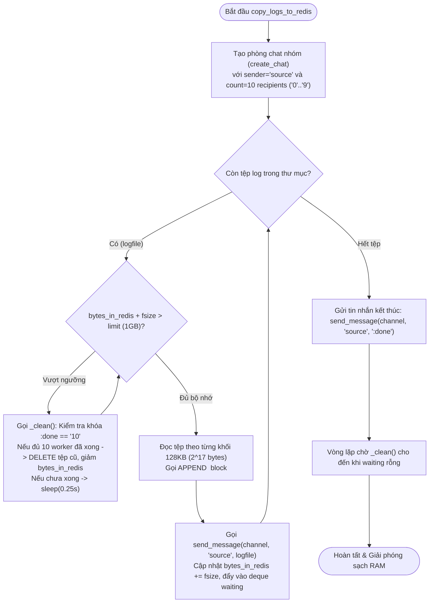

> 📝 **Giải thích thêm (không có trong sách): Tại sao lại tải tệp lên bằng `APPEND` từng khối 128KB và điều tiết bộ nhớ bằng `waiting` deque?**
>
> Hãy phân tích hai kỹ thuật kỹ thuật hệ thống xuất sắc trong `Listing 6.30`:
> 1. **Truyền tải theo khối 128KB (`inp.read(2**17)` + `conn.append`):**
>    Nếu một tệp nhật ký nặng 200MB và chúng ta gọi `conn.set(key, inp.read())` trong một lệnh duy nhất:
>    - Tiến trình Python phải cấp phát liền một lúc 200MB RAM.
>    - Vì Redis xử lý lệnh đơn luồng (single-threaded), một lệnh `SET` khổng lồ 200MB sẽ làm nghẽn mạng và khóa cứng luồng chính của Redis trong hàng trăm mili-giây, khiến mọi client khác bị treo.
>    Bằng cách cắt nhỏ tệp thành từng mảnh $2^{17} \text{ bytes} = 128\text{ KB}$ và gọi `APPEND`, mỗi lệnh `APPEND` thực thi trong vài micro-giây, cho phép Redis xen kẽ phục vụ mượt mà cả tiến trình gửi tệp lẫn 10 tiến trình đọc tệp cùng lúc!
> 2. **Cơ chế gây áp lực ngược (Backpressure / Flow Control) với `limit=2**30` (1 GB):**
>    Tổng dung lượng log của 2 năm có thể lên tới hàng trăm Gigabyte, trong khi RAM dành cho bộ đệm truyền tệp trên Redis chỉ được cấp giới hạn `limit = 2**30` (1 GB). Hàng đợi hai đầu `waiting = deque()` lưu danh sách các tệp đã nạp lên Redis theo đúng thứ tự FIFO. Khi `bytes_in_redis + fsize > limit`, trình gửi sẽ tự động tạm dừng việc nạp tệp mới và gọi `_clean()` kiểm tra tệp cũ nhất ở đầu hàng đợi (`waiting[0]`). Chỉ khi cả 10 tiến trình worker đều đã xử lý xong tệp đó (`conn.get(channel + w0 + ':done') == '10'`), hàm `_clean()` mới xóa khóa nội dung tệp khỏi Redis để thu hồi RAM và cho phép nạp tệp tiếp theo. Đây chính là cơ chế **Backpressure (áp lực ngược)** kinh điển trong kỹ thuật dữ liệu lớn (Data Engineering).

### 6.6.3 Nhận tệp tin (Receiving files)

Phần thứ hai của quy trình là một nhóm các hàm và các bộ sinh (generators) sẽ lấy tên các tệp nhật ký từ cuộc trò chuyện nhóm. Sau khi nhận được mỗi tên tệp, nó sẽ xử lý các tệp nhật ký trực tiếp từ Redis, và sẽ cập nhật các khóa mà tiến trình sao chép đang chờ đợi (`:done`). Hàm này cũng sẽ gọi hàm callback của chúng ta trên từng dòng nhật ký đi tới, từ đó cập nhật các kết quả tổng hợp của chúng ta. Listing tiếp theo cho thấy mã lệnh của hàm đầu tiên trong số các hàm này.

**Listing 6.31 – Hàm `process_logs_from_redis()` (The process_logs_from_redis() function)**

```python
def process_logs_from_redis(conn, id, callback):
    while 1:
        fdata = fetch_pending_messages(conn, id)                    # Lấy danh sách các tệp tin.

        for ch, mdata in fdata:
            for message in mdata:
                logfile = message['message']

                if logfile == ':done':                              # Không còn tệp nhật ký nào nữa.
                    return
                elif not logfile:
                    continue

                block_reader = readblocks                           # Chọn một trình đọc khối (block reader).
                if logfile.endswith('.gz'):
                    block_reader = readblocks_gz

                for line in readlines(conn, ch+logfile, block_reader): # Lặp qua các dòng nhật ký.
                    callback(conn, line)                            # Truyền từng dòng cho hàm callback.
                callback(conn, None)                                # Buộc xả (flush) các bộ đệm tổng hợp cục bộ của chúng ta lên Redis.

                conn.incr(ch + logfile + ':done')                   # Báo cáo rằng chúng ta đã xử lý xong tệp nhật ký này.

        if not fdata:
            time.sleep(.1)
```

*Giải thích các chú thích trong mã nguồn:*
- `fdata = fetch_pending_messages(conn, id)`: Lấy danh sách các tệp tin (Fetch the list of files).
- `if logfile == ':done': return`: Không còn tệp nhật ký nào nữa (No more log files).
- `block_reader = readblocks` / `if logfile.endswith('.gz'): block_reader = readblocks_gz`: Chọn một trình đọc khối dữ liệu — đọc văn bản thuần hoặc đọc nén gzip (Choose a block reader).
- `for line in readlines(conn, ch+logfile, block_reader):`: Lặp qua các dòng nhật ký (Iterate over the lines).
- `callback(conn, line)`: Truyền từng dòng cho hàm callback (Pass each line to the callback).
- `callback(conn, None)`: Buộc xả (flush) các bộ đệm tổng hợp cục bộ của chúng ta lên Redis (Force a flush of our aggregate caches).
- `conn.incr(ch + logfile + ':done')`: Báo cáo rằng chúng ta đã xử lý xong tệp nhật ký này (Report that we’re finished with the log).

Việc nhận thông tin về các tệp nhật ký rất trực diện, mặc dù chúng ta đã ủy thác (defer) khá nhiều công việc nặng nhọc của việc thực sự đọc tệp tin từ Redis cho các hàm bổ trợ (helper functions) chuyên sinh ra các chuỗi dòng nhật ký. Chúng ta cũng cần phải cẩn thận thông báo cho bên gửi tệp tin bằng cách tăng bộ đếm cho tệp nhật ký đó (`conn.incr(ch + logfile + ':done')`); nếu không, tiến trình gửi tệp sẽ không biết để dọn dẹp các tệp nhật ký đã xử lý xong.

> 💡 **Ví dụ bổ sung (không có trong sách): Cách 10 tiến trình Worker phối hợp song song với `process_logs_from_redis()`**
>
> Trong thiết kế của mục `6.6.1` – `6.6.3`, giả sử Fake Game Company có **10 chiều phân tích khác nhau** cần tính toán trên cùng bộ log 7,3 tỷ dòng:
> - Worker `id='0'`: chạy `process_logs_from_redis(conn, '0', daily_country_aggregate)` (Tổng hợp theo quốc gia hàng ngày)
> - Worker `id='1'`: chạy `process_logs_from_redis(conn, '1', daily_region_aggregate)` (Tổng hợp theo vùng/bang hàng ngày)
> - Worker `id='2'`: chạy `process_logs_from_redis(conn, '2', daily_city_aggregate)` (Tổng hợp theo thành phố hàng ngày)
> - ... cho đến Worker `id='9'`.
>
> Nhờ tái sử dụng hệ thống Group Chat (`create_chat`, `send_message`, `fetch_pending_messages`) từ mục `6.5.2`:
> 1. Mỗi tệp log chỉ cần được nạp vào RAM của Redis **đúng 1 lần duy nhất**.
> 2. Cả 10 Worker (`'0'` đến `'9'`) đều nhận được thông báo tên tệp qua kênh chat nhóm và cùng đọc song song từ Redis (multicast / fan-out) để tính toán 10 báo cáo khác nhau cùng lúc.
> 3. Mỗi khi một Worker đọc hết 1 tệp, nó gọi `callback(conn, None)` để ghi báo cáo của mình vào Redis, rồi gọi `INCR <channel><logfile>:done`. Khi cả 10 Worker đều đã gọi `INCR`, giá trị của khóa `:done` đạt tới `'10'`, báo hiệu cho tiến trình `copy_logs_to_redis` xóa tệp đó khỏi RAM để nạp tệp tiếp theo!

### 6.6.4 Xử lý tệp tin (Processing files)

Chúng ta đang ủy thác một phần công việc giải mã (decoding) các tệp tin của mình cho các hàm trả về các bộ sinh (generators) duyệt qua dữ liệu. Hàm `readlines()` nhận vào kết nối `conn`, tên khóa `key`, và một hàm callback lặp theo khối (`rblocks`). Nó sẽ lặp qua các khối dữ liệu được sinh ra (yielded) bởi hàm callback lặp theo khối đó, phát hiện các ký tự ngắt dòng (`\n`), và sinh ra từng dòng một. Khi được cung cấp các khối dữ liệu như trong **Listing 6.32**, nó tìm ký tự kết thúc dòng cuối cùng nằm trong khối hiện tại, rồi tách (split) các dòng tính đến ký tự kết thúc dòng cuối cùng đó, và lần lượt sinh ra (`yield`) từng dòng một. Khi thực hiện xong với khối hiện tại, nó giữ lại bất kỳ phần dòng bị cắt dở nào ở cuối (partial lines) để ghép vào đầu (prepend) khối dữ liệu tiếp theo. Nếu không còn dữ liệu nào nữa, nó sẽ sinh ra dòng cuối cùng còn lại đó. Có những cách khác để tìm các điểm ngắt dòng và trích xuất các dòng trong Python, nhưng sự kết hợp giữa `rfind()` và `split()` nhanh hơn các phương pháp khác.

**Listing 6.32 – Hàm `readlines()` (The readlines() function)**

```python
def readlines(conn, key, rblocks):
    out = ''
    for block in rblocks(conn, key):
        out += block
        posn = out.rfind('\n')                      # Tìm ký tự ngắt dòng ngoài cùng bên phải nếu có; rfind() trả về -1 nếu không tìm thấy.
        if posn >= 0:                               # Chúng ta đã tìm thấy một ký tự ngắt dòng.
            for line in out[:posn].split('\n'):     # Tách chuỗi trên tất cả các ký tự ngắt dòng.
                yield line + '\n'                   # Sinh ra (yield) từng dòng.
            out = out[posn+1:]                      # Giữ lại phần dữ liệu dư ở cuối (dòng chưa hoàn chỉnh).
        if not block:                               # Chúng ta đã hết dữ liệu.
            yield out
            break
```

*Giải thích các chú thích trong mã nguồn:*
- `posn = out.rfind('\n')`: Tìm ký tự ngắt dòng ngoài cùng bên phải nếu có; `rfind()` trả về `-1` nếu không tìm thấy (Find the rightmost line break if any; rfind() returns -1 on failure).
- `if posn >= 0:`: Chúng ta đã tìm thấy một ký tự ngắt dòng (We found a line break).
- `for line in out[:posn].split('\n'):`: Tách chuỗi trên tất cả các ký tự ngắt dòng (Split on all of the line breaks).
- `yield line + '\n'`: Sinh ra từng dòng (Yield each line).
- `out = out[posn+1:]`: Giữ lại phần dữ liệu dư ở cuối để nối với khối tiếp theo (Keep track of the trailing data).
- `if not block:`: Chúng ta đã hết dữ liệu (We’re out of data).

Đối với hàm sinh dòng ở tầng cao hơn này của chúng ta, chúng ta đang lặp qua các khối dữ liệu được tạo ra bởi một trong hai trình đọc khối, điều này cho phép chúng ta chỉ tập trung vào việc tìm các ký tự ngắt dòng.

> **CÁC BỘ SINH VỚI TỪ KHÓA YIELD (GENERATORS WITH YIELD)**
>
> **Listing 6.32** mang đến lần sử dụng thực tế đầu tiên của chúng ta đối với các bộ sinh trong Python (Python generators) cùng câu lệnh `yield`. Nhìn chung, cơ chế này cho phép Python tạm dừng (suspend) và tiếp tục lại (resume) việc thực thi mã lệnh, chủ yếu nhằm cho phép lặp một cách dễ dàng qua các chuỗi (sequences) hoặc các chuỗi giả lập (pseudo-sequences) của dữ liệu mà không cần nạp toàn bộ vào bộ nhớ cùng lúc. Để biết thêm chi tiết về cách thức hoạt động của các generator, bạn có thể truy cập tài liệu hướng dẫn ngôn ngữ Python qua đường dẫn rút gọn này: http://mng.bz/Z2b1.

> 💡 **Ví dụ bổ sung (không có trong sách): Minh họa trực quan cách `readlines()` ghép nối các dòng bị cắt ngang giữa hai khối (Blocks)**
>
> Khi đọc một tệp theo từng khối cố định `128 KB` ($131.072$ byte), ranh giới kết thúc của một khối hầu như chắc chắn sẽ cắt ngang giữa chừng một dòng nhật ký! Hãy xem cách thuật toán `rfind('\n')` xử lý tình huống này qua một ví dụ nhỏ:
>
> - **Lần lặp 1:** Giả sử `block` đầu tiên đọc về là:
>   `out = "1.1.1.1 2011-10-10 12:00:01 login\n2.2.2.2 2011-10-10 12:00:02 buy\n3.3.3.3 2011-10-"`
>   1. `posn = out.rfind('\n')` tìm thấy vị trí của dấu `\n` ngay sau chữ `buy`.
>   2. `out[:posn].split('\n')` tách được 2 dòng hoàn chỉnh:
>      - `yield "1.1.1.1 2011-10-10 12:00:01 login\n"`
>      - `yield "2.2.2.2 2011-10-10 12:00:02 buy\n"`
>   3. `out = out[posn+1:]` giữ lại phần đuôi bị cắt dở: `out = "3.3.3.3 2011-10-"`.
> - **Lần lặp 2:** Khối `block` tiếp theo đọc về là `"10 12:00:03 logout\n"`.
>   1. `out += block` nối tiếp vào phần dư cũ, tạo thành dòng hoàn chỉnh:
>      `out = "3.3.3.3 2011-10-10 12:00:03 logout\n"`
>   2. `rfind('\n')` tìm thấy dấu `\n` ở cuối và `yield` dòng thứ 3 hoàn chỉnh, `out` trở về chuỗi rỗng `""`!

Mỗi hàm trong số hai hàm callback sinh khối dữ liệu, `readblocks()` và `readblocks_gz()`, sẽ đọc các khối dữ liệu từ Redis. Hàm đầu tiên sinh ra các khối dữ liệu trực tiếp, trong khi hàm thứ hai tự động giải nén các tệp định dạng gzip. Chúng ta sẽ sử dụng sự phân tách tầng (layer separation) cụ thể này nhằm cung cấp phương pháp đọc dữ liệu hữu ích và có tính tái sử dụng cao nhất có thể. Listing tiếp theo hiển thị bộ sinh `readblocks()`.

**Listing 6.33 – Bộ sinh `readblocks()` (The readblocks() generator)**

```python
def readblocks(conn, key, blocksize=2**17):
    lb = blocksize
    pos = 0
    while lb == blocksize:                                      # Tiếp tục lấy thêm dữ liệu chừng nào chúng ta chưa gặp một lần đọc thiếu (partial read).
        block = conn.substr(key, pos, pos + blocksize - 1)      # Lấy khối dữ liệu.
        yield block                                             # Chuẩn bị cho lượt lặp tiếp theo.
        lb = len(block)
        pos += lb
    yield ''
```

*Giải thích các chú thích trong mã nguồn:*
- `while lb == blocksize:`: Tiếp tục lấy thêm dữ liệu chừng nào chúng ta chưa gặp một lần đọc thiếu — tức là chiều dài khối trả về `lb` vẫn bằng đúng `blocksize` (Keep fetching more data as long as we don’t have a partial read).
- `block = conn.substr(key, pos, pos + blocksize - 1)`: Lấy khối dữ liệu (Fetch the block).
- `yield block`, `lb = len(block)`, `pos += lb`: Sinh khối dữ liệu và chuẩn bị vị trí con trỏ `pos` cho lượt lặp tiếp theo (Prepare for the next pass).

> 📝 **Giải thích thêm (không có trong sách): Lệnh `SUBSTR` và `GETRANGE` trong Redis hiện đại**
>
> Trong `Listing 6.33`, tác giả gọi `conn.substr(key, pos, pos + blocksize - 1)`. Trong các phiên bản Redis cũ (Redis 1.x / 2.0), lệnh đọc một chuỗi con từ giá trị `STRING` được gọi là `SUBSTR`. Từ Redis 2.4 trở đi, lệnh này đã được đổi tên chính thức thành **`GETRANGE`** (tuy nhiên Redis server vẫn giữ alias `SUBSTR` để tương thích ngược).
> Trong thư viện `redis-py` hiện đại (4.x / 5.x), phương thức tương ứng là `conn.getrange(key, pos, pos + blocksize - 1)`. Lưu ý rằng chỉ mục bắt đầu và kết thúc của `GETRANGE`/`SUBSTR` trong Redis đều là **bao gồm cả hai đầu (inclusive)**, vì vậy để đọc đúng `blocksize` byte bắt đầu từ `pos`, chỉ mục kết thúc phải là `pos + blocksize - 1`. Khi con trỏ `pos` vượt quá độ dài chuỗi hoặc đọc đến mảnh cuối cùng ngắn hơn `blocksize`, `len(block)` sẽ nhỏ hơn `blocksize`, vòng lặp `while` kết thúc và hàm trả về `yield ''` để báo hiệu hết tệp (EOF).

Bộ sinh `readblocks()` chủ yếu nhằm cung cấp một lớp trừu tượng hóa (abstraction) bên trên thao tác đọc khối dữ liệu của chúng ta, cho phép chúng ta thay thế nó sau này bằng các loại trình đọc khác, chẳng hạn như một trình đọc hệ thống tệp cục bộ (filesystem reader), một trình đọc memcached, một trình đọc `ZSET`, hoặc trong trường hợp của chúng ta là một trình đọc khối có khả năng xử lý các tệp nén gzip lưu trong Redis. Listing tiếp theo hiển thị bộ sinh `readblocks_gz()`.

**Listing 6.34 – Bộ sinh `readblocks_gz()` (The readblocks_gz() generator)**

```python
def readblocks_gz(conn, key):
    inp = ''
    decoder = None
    for block in readblocks(conn, key, 2**17):                  # Đọc dữ liệu thô từ Redis.
        if not decoder:
            inp += block
            try:
                if inp[:3] != "\x1f\x8b\x08":                   # Phân tích thông tin phần đầu (header) để chúng ta có thể lấy dữ liệu nén bên trong.
                    raise IOError("invalid gzip data")
                i = 10
                flag = ord(inp[3])
                if flag & 4:
                    i += 2 + ord(inp[i]) + 256*ord(inp[i+1])
                if flag & 8:
                    i = inp.index('\0', i) + 1
                if flag & 16:
                    i = inp.index('\0', i) + 1
                if flag & 2:
                    i += 2
                if i > len(inp):
                    raise IndexError("not enough data")
            except (IndexError, ValueError):                    # Chúng ta vẫn chưa đọc hết phần header.
                continue
            else:
                block = inp[i:]                                 # Chúng ta đã tìm thấy phần header; chuẩn bị bộ giải nén (decompresser).
                inp = None
                decoder = zlib.decompressobj(-zlib.MAX_WBITS)
                if not block:
                    continue

        if not block:                                           # Chúng ta đã hết dữ liệu; sinh ra mảnh dữ liệu cuối cùng còn trong bộ đệm giải nén.
            yield decoder.flush()
            break
        yield decoder.decompress(block)                         # Sinh ra một khối dữ liệu đã được giải nén.
```

*Giải thích các chú thích trong mã nguồn:*
- `for block in readblocks(conn, key, 2**17):`: Đọc dữ liệu thô từ Redis (Read the raw data from Redis).
- `if inp[:3] != "\x1f\x8b\x08":` ... `if i > len(inp): raise IndexError("not enough data")`: Phân tích thông tin phần đầu (header) của định dạng gzip để chúng ta có thể lấy được phần dữ liệu nén thực sự (Parse the header information so that we can get the compressed data).
- `except (IndexError, ValueError): continue`: Chúng ta vẫn chưa đọc đủ toàn bộ phần header (We haven’t read the full header yet).
- `block = inp[i:]`, `inp = None`, `decoder = zlib.decompressobj(-zlib.MAX_WBITS)`: Chúng ta đã tìm thấy và đi qua phần header; chuẩn bị đối tượng giải nén (We found the header; prepare the decompresser).
- `if not block: yield decoder.flush(); break`: Chúng ta đã hết dữ liệu; xả và sinh ra mảnh dữ liệu cuối cùng (We’re out of data; yield the last chunk).
- `yield decoder.decompress(block)`: Sinh ra một khối dữ liệu đã được giải nén (Yield a decompressed block).

Phần lớn thân hàm của `readblocks_gz()` là mã lệnh phân tích phần đầu (header) của tệp gzip, một việc thật không may là bắt buộc phải làm. Đối với các tệp nhật ký (như những tệp mà chúng ta đang phân tích), chuẩn nén gzip có thể mang lại mức giảm từ 2 đến 5 lần về yêu cầu không gian lưu trữ (và băng thông truyền qua Redis), trong khi vẫn cung cấp tốc độ giải nén khá cao. Mặc dù các phương pháp nén hiện đại hơn có khả năng nén tốt hơn (bzip2, lzma/xz, và nhiều phương pháp khác) hoặc nhanh hơn (lz4, lzop, snappy, QuickLZ, và nhiều phương pháp khác), không có phương pháp nào khác lại phổ biến rộng rãi như vậy (bzip2 tiến khá gần tới mức đó) hoặc có một dải tùy chọn đánh đổi giữa tỷ lệ nén và mức sử dụng CPU hữu ích đến thế.

> 📝 **Giải thích thêm (không có trong sách): Giải thích chi tiết cấu trúc Gzip Header (RFC 1952) trong `Listing 6.34` và mẹo ngắn gọn trong Python 3**
>
> Nhiều độc giả khi đọc đến `Listing 6.34` thường thắc mắc những con số ma thuật `\x1f\x8b\x08`, `flag & 4`, `flag & 8`, `-zlib.MAX_WBITS` có ý nghĩa gì. Đây là đặc tả nhị phân của định dạng **GZIP (RFC 1952)**:
> - **3 byte đầu tiên (`inp[:3] == "\x1f\x8b\x08"`):**
>   - `\x1f\x8b` (tức `0x1f 0x8b`): Hai byte định danh "Magic Number" của mọi tệp Gzip.
>   - `\x08` (`0x08` = 8): Phương thức nén số 8, tức thuật toán **DEFLATE**.
> - **Byte thứ 4 (`flag = ord(inp[3])`):** Byte cờ (FLG) đánh dấu các trường tùy chọn xuất hiện sau 10 byte header cơ bản (`i = 10`):
>   - `flag & 4` (`FEXTRA`): Có trường dữ liệu phụ (độ dài 2 byte + nội dung phụ).
>   - `flag & 8` (`FNAME`): Có lưu tên tệp gốc kết thúc bằng byte null `\0`.
>   - `flag & 16` (`FCOMMENT`): Có lưu chuỗi chú thích kết thúc bằng byte null `\0`.
>   - `flag & 2` (`FHCRC`): Có thêm 2 byte mã kiểm tra CRC16 cho phần header.
> - **Tại sao tác giả phải tự bỏ qua phần Header này?**
>   Trong Python 2.x cũ, khi truyền `-zlib.MAX_WBITS` (tức `-15`) vào `zlib.decompressobj(-zlib.MAX_WBITS)`, thư viện `zlib` sẽ khởi tạo chế độ giải nén luồng **Raw DEFLATE** (không có header bao ngoài). Do đó tác giả phải tự tính vị trí kết thúc header `i` rồi cắt `block = inp[i:]`.
> - **Mẹo cực kỳ tiện lợi trong Python hiện đại (Python 2.7+ và Python 3.x):**
>   Thư viện `zlib` hiện nay cho phép truyền tham số `wbits = 16 + zlib.MAX_WBITS` (tức `31`). Giá trị `16 + MAX_WBITS` báo cho thư viện C `zlib` bên dưới **tự động phát hiện và phân tích Gzip Header lẫn kiểm tra checksum cuối tệp**! Nhờ đó, trong Python 3, toàn bộ 30 dòng phân tích header phức tạp trong `Listing 6.34` có thể được rút gọn chỉ còn vài dòng cực kỳ sạch sẽ:
>   ```python
>   def readblocks_gz_modern(conn, key):
>       # 16 + zlib.MAX_WBITS tự động xử lý Gzip Header!
>       decoder = zlib.decompressobj(16 + zlib.MAX_WBITS)
>       for block in readblocks(conn, key, 2**17):
>           if not block:
>               yield decoder.flush()
>               break
>           yield decoder.decompress(block)
>   ```

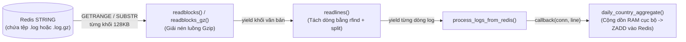

---

## 6.7 Tóm tắt (Summary)

Trong chương này, chúng ta đã đi qua sáu chủ đề lớn, nhưng khi xem xét các chủ đề đó, thực tế chúng ta đã giải quyết chín bài toán khác nhau. Bất cứ khi nào có thể, chúng ta đã thực hiện các bước để vay mượn ý tưởng và chức năng từ các phần trước đó nhằm tiếp tục xây dựng nên những công cụ hữu ích hơn, đồng thời cố gắng làm nổi bật một thực tế rằng nhiều kỹ thuật mà chúng ta sử dụng trong một giải pháp hoàn toàn có thể được áp dụng để giải quyết các bài toán khác.

Nếu có một khái niệm cốt lõi mà bạn nên đúc kết và mang theo từ toàn bộ chương này, thì đó là mặc dù `WATCH` là một lệnh hữu ích, được tích hợp sẵn, thuận tiện, v.v., nhưng việc có quyền truy cập vào một bản triển khai khóa phân tán (distributed lock) hoạt động tốt từ mục 6.2 có thể giúp cho việc lập trình Redis đồng thời (concurrent Redis programming) trở nên dễ dàng hơn rất nhiều. Khả năng khóa ở mức độ chi tiết mịn hơn (finer level of detail) thay vì khóa toàn bộ một khóa dữ liệu (key) có thể làm giảm sự tranh chấp (contention), và khả năng khóa bao quanh các thao tác có liên quan mật thiết với nhau có thể làm giảm độ phức tạp của thao tác. Chúng ta đã chứng kiến cả sự cải thiện về hiệu năng lẫn sự đơn giản hóa trong thao tác ở ví dụ chợ giao dịch (marketplace) được xem xét lại từ mục 4.6, và ở hàng đợi tác vụ bị trì hoãn (delayed task queue) từ mục 6.4.2.

Nếu có một khái niệm thứ hai mà bạn nên ghi nhớ, khắc cốt ghi tâm, và áp dụng trong tương lai, thì đó là chỉ với một chút công sức, bạn hoàn toàn có thể xây dựng các thành phần có thể tái sử dụng (reusable components) với Redis. Chúng ta đã tái sử dụng trực tiếp khóa phân tán (locks) trong các đèn hiệu đếm (counting semaphores), các hàng đợi tác vụ bị trì hoãn (delayed task queues), và trong hệ thống thay thế pub/sub nhiều người nhận của chúng ta. Và chúng ta lại tiếp tục tái sử dụng hệ thống thay thế pub/sub nhiều người nhận đó khi phân phối các tệp tin bằng Redis.

Trong chương tiếp theo, chúng ta sẽ tiếp tục xây dựng các công cụ nâng cao hơn nữa với Redis, viết các đoạn mã có thể được sử dụng làm nền tảng phụ trợ cho toàn bộ các ứng dụng từ lập chỉ mục tài liệu (document indexing) và tìm kiếm với chỉ mục có điểm số cùng sắp xếp, cho tới một hệ thống nhắm mục tiêu quảng cáo (ad targeting system), và một hệ thống tìm kiếm việc làm (job search system). Trong chặng đường sắp tới, chúng ta sẽ tái sử dụng một số thành phần của chương này trong các chương sau, vì vậy hãy chú ý quan sát, và hãy luôn nhớ rằng việc xây dựng các thành phần có thể tái sử dụng cho Redis không hề khó khăn chút nào.

---

## Bảng thuật ngữ của chương

Dưới đây là bảng tổng hợp các thuật ngữ kỹ thuật quan trọng xuyên suốt toàn bộ **Chương 6 (Các thành phần ứng dụng trong Redis - Application components in Redis)**:

| Thuật ngữ tiếng Anh | Thuật ngữ tiếng Việt | Giải thích chi tiết trong ngữ cảnh Redis |
| :--- | :--- | :--- |
| **Autocomplete** | Tự động hoàn thành / Gợi ý tự động | Tính năng gợi ý nhanh các từ khóa hoặc tên liên hệ hoàn chỉnh khi người dùng mới gõ vài ký tự đầu tiên (triển khai bằng `LIST` cho danh sách nhỏ hoặc `ZSET` kết hợp sắp xếp từ điển cho danh sách lớn). |
| **Lexicographical ordering** | Thứ tự từ điển (thứ tự bảng chữ cái ASCII/UTF-8) | Tính chất của `ZSET` khi tất cả các phần tử đều có cùng điểm số (`score = 0`): Redis sẽ tự động sắp xếp các thành viên theo giá trị byte nhị phân từ trái sang phải. |
| **Optimistic locking** | Khóa lạc quan | Cơ chế đồng bộ hóa dùng lệnh `WATCH` / `MULTI` / `EXEC`: giả định ít khi có xung đột nên cứ thực hiện tính toán, nếu phát hiện khóa bị thay đổi trước khi `EXEC` thì hủy bỏ giao dịch và thử lại (retry). |
| **Distributed lock** | Khóa phân tán | Cơ chế khóa độc quyền (exclusive lock) được lưu trữ trên Redis (thường dùng `SETNX` hoặc `SET ... NX EX`) để điều phối quyền truy cập tài nguyên giữa nhiều tiến trình/máy chủ khác nhau. |
| **Lock contention** | Tranh chấp khóa | Hiện tượng nhiều client cùng cố gắng truy cập/sửa đổi một tài nguyên chung cùng lúc. Với `WATCH`, tranh chấp cao gây tốn CPU do phải thử lại liên tục; với khóa phân tán độ hạt mịn, tranh chấp được giảm thiểu đáng kể. |
| **Fine-grained locking** | Khóa độ hạt mịn | Kỹ thuật chỉ khóa một phần tử cụ thể (như một vật phẩm `market:item_id` hoặc một `identifier` của tác vụ) thay vì khóa toàn bộ cấu trúc dữ liệu lớn (`market:`), giúp tăng khả năng xử lý song song. |
| **Deadlock / Lock expiration** | Khóa chết / Hết hạn khóa | Tình trạng một tiến trình giữ khóa nhưng bị treo hoặc sập nguồn trước khi kịp giải phóng khóa; được khắc phục bằng cách gắn thời gian sống (`EXPIRE` / `TTL`) cho khóa. |
| **Counting semaphore** | Đèn hiệu đếm | Cơ chế giới hạn số lượng tiến trình tối đa (ví dụ tối đa 5 kết nối đồng thời) được phép truy cập vào một tài nguyên tại cùng một thời điểm, triển khai bằng `ZSET` lưu dấu thời gian hoặc bộ đếm thứ tự. |
| **Fair semaphore** | Đèn hiệu công bằng | Biến thể của đèn hiệu đếm sử dụng thêm một bộ đếm tăng dần (`INCR`) kết hợp với `ZSET` dấu thời gian để tránh sai lệch đồng hồ hệ thống (clock skew) giữa các máy chủ và chống đánh cắp slot. |
| **Task queue** | Hàng đợi tác vụ | Hệ thống trì hoãn các công việc tốn thời gian (như gửi email, xử lý ảnh) bằng cách đưa mô tả công việc vào hàng đợi để các tiến trình công nhân (workers) xử lý bất đồng bộ ở hậu trường. |
| **FIFO (First-in, first-out) queue** | Hàng đợi vào trước, ra trước | Hàng đợi xử lý các tác vụ theo đúng thứ tự thời gian chúng được đẩy vào (ví dụ: đẩy vào đuôi phải bằng `RPUSH` và lấy ra ở đầu trái bằng `BLPOP`). |
| **Priority queue** | Hàng đợi ưu tiên | Hàng đợi cho phép các tác vụ quan trọng hơn được thực thi trước bằng cách truyền danh sách nhiều khóa hàng đợi (`['queue:high', 'queue:medium', 'queue:low']`) vào một lệnh `BLPOP` duy nhất. |
| **Delayed task / Scheduled task** | Tác vụ bị trì hoãn / Tác vụ hẹn giờ | Tác vụ được lên lịch để chạy vào một thời điểm trong tương lai, được lưu tạm trong `ZSET` (`delayed:`) với `score` là Unix timestamp cần chạy, sau đó được tiến trình Poller chuyển sang `LIST` khi đến hạn. |
| **Push messaging** | Nhắn tin dạng đẩy | Mô hình truyền tin mà bên gửi đẩy trực tiếp thông điệp tới các bên nhận đang kết nối trực tuyến (như `PUBLISH`/`SUBSCRIBE` của Redis); nếu bên nhận mất kết nối thì sẽ bị mất tin nhắn. |
| **Pull messaging** | Nhắn tin dạng kéo | Mô hình truyền tin mà thông điệp được lưu bền vững trong hộp thư (`LIST`, `ZSET`, hoặc `STREAM` trong Redis 5.0+) để bên nhận chủ động kéo về bất cứ khi nào họ kết nối lại. |
| **Generator / `yield`** | Bộ sinh trong Python | Hàm sử dụng từ khóa `yield` để sản sinh dữ liệu theo luồng từng phần tử/khối một (streaming) thay vì nạp toàn bộ dữ liệu vào bộ nhớ cùng một lúc. |
| **Backpressure (Flow control)** | Áp lực ngược (Điều tiết luồng) | Cơ chế kiểm soát bộ nhớ trong đó tiến trình gửi tệp (`copy_logs_to_redis`) tạm dừng nạp thêm tệp mới vào Redis khi dung lượng RAM chạm ngưỡng `limit`, chờ các worker xử lý và xóa bớt tệp cũ. |
