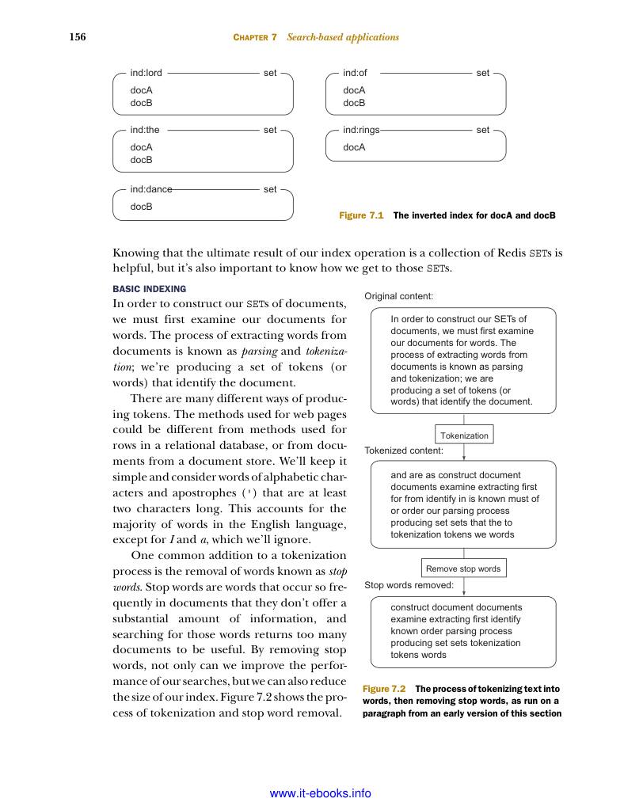
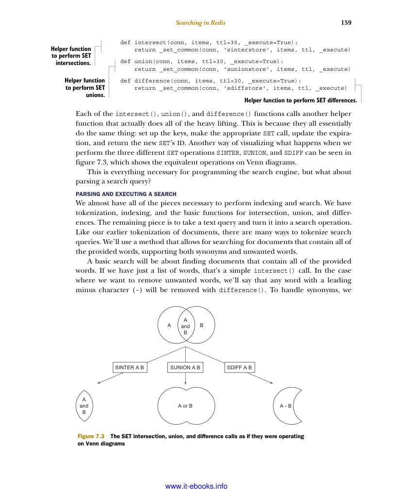
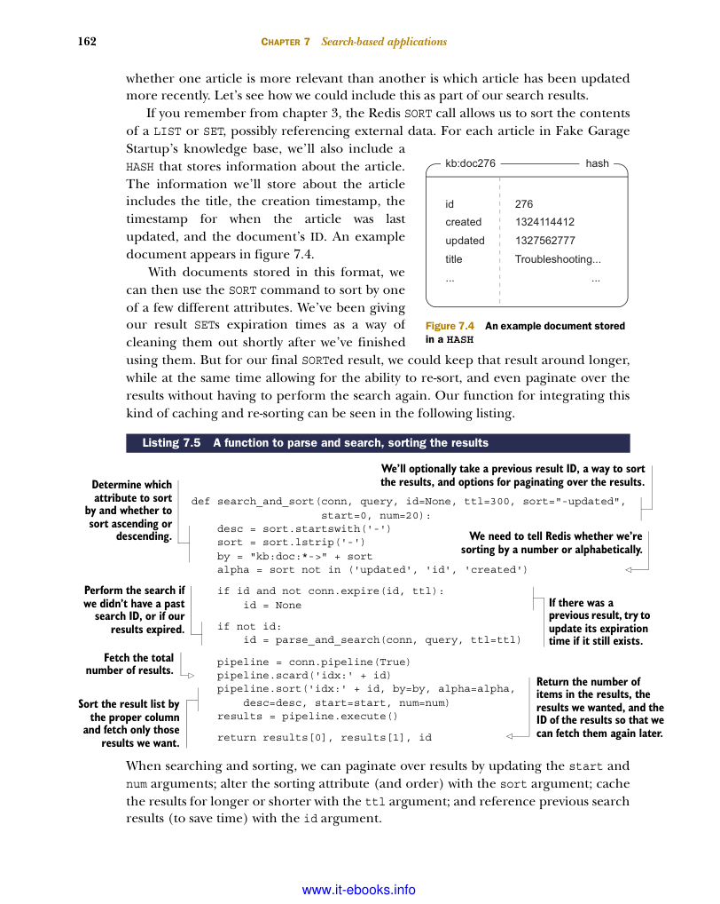
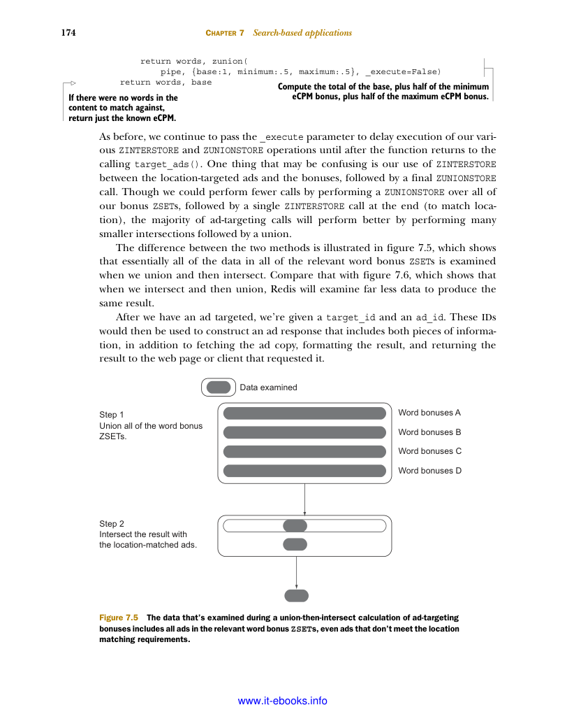
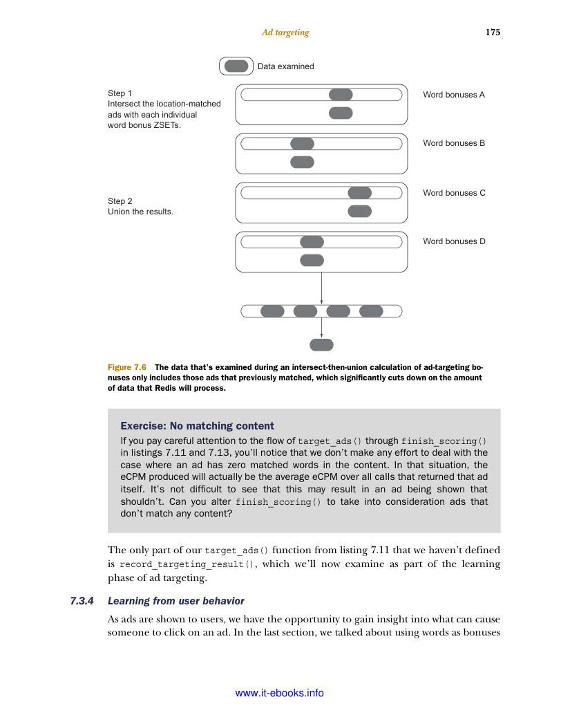

# Chương 7: Các ứng dụng dựa trên tìm kiếm (Search-based applications)

> 📝 **Giải thích thêm (không có trong sách):** Trong các chương trước, chúng ta đã dùng Redis làm bộ nhớ đệm (*cache*), kho lưu trữ phiên (*session*), hàng đợi tác vụ (*task queue*), khóa phân tán (*distributed lock*) và bộ tự động hoàn thành (*autocomplete*). Bước sang Chương 7, tác giả Josiah L. Carlson mở ra một chân trời hoàn toàn mới: biến các cấu trúc dữ liệu nguyên bản của Redis (`SET`, `ZSET`, `HASH`) thành một **công cụ tìm kiếm văn bản (*search engine*)**, một **nền tảng nhắm mục tiêu quảng cáo (*ad-targeting engine*)** có khả năng tự học (*machine learning* cơ bản dựa trên thống kê CTR/eCPM), và một **hệ thống đối sánh kỹ năng tuyển dụng (*job-search matching engine*)**. Dù ngày nay hệ sinh thái Redis đã có mô-đun chuyên dụng **RediSearch** (nay được tích hợp sẵn trong **Redis Stack** và **Redis 8**), việc tự tay xây dựng chỉ mục đảo ngược (*inverted index*) bằng `SET`/`ZSET` trong chương này sẽ giúp bạn thấu hiểu tận gốc nguyên lý hoạt động bên dưới mọi công cụ tìm kiếm hiện đại (từ Elasticsearch, Solr cho tới RediSearch) cũng như cách tư duy mô hình hóa các bài toán lọc đa chiều phức tạp bằng phép toán tập hợp.

## Mục lục chương

- [Mở đầu chương](#mở-đầu-chương)
- [7.1 Tìm kiếm trong Redis (Searching in Redis)](#71-tìm-kiếm-trong-redis-searching-in-redis)
  - [7.1.1 Lý thuyết tìm kiếm cơ bản (Basic search theory)](#711-lý-thuyết-tìm-kiếm-cơ-bản-basic-search-theory)
  - [7.1.2 Sắp xếp kết quả tìm kiếm (Sorting search results)](#712-sắp-xếp-kết-quả-tìm-kiếm-sorting-search-results)
- [7.2 Các chỉ mục được sắp xếp (Sorted indexes)](#72-các-chỉ-mục-được-sắp-xếp-sorted-indexes)
  - [7.2.1 Sắp xếp kết quả tìm kiếm bằng ZSET (Sorting search results with ZSETs)](#721-sắp-xếp-kết-quả-tìm-kiếm-bằng-zset-sorting-search-results-with-zsets)
  - [7.2.2 Sắp xếp dữ liệu phi số bằng ZSET (Non-numeric sorting with ZSETs)](#722-sắp-xếp-dữ-liệu-phi-số-bằng-zset-non-numeric-sorting-with-zsets)
- [7.3 Nhắm mục tiêu quảng cáo (Ad targeting)](#73-nhắm-mục-tiêu-quảng-cáo-ad-targeting)
  - [7.3.1 Máy chủ quảng cáo là gì? (What's an ad server?)](#731-máy-chủ-quảng-cáo-là-gì-whats-an-ad-server)
  - [7.3.2 Đánh chỉ mục quảng cáo (Indexing ads)](#732-đánh-chỉ-mục-quảng-cáo-indexing-ads)
  - [7.3.3 Nhắm mục tiêu quảng cáo (Targeting ads)](#733-nhắm-mục-tiêu-quảng-cáo-targeting-ads)
  - [7.3.4 Học từ hành vi người dùng (Learning from user behavior)](#734-học-từ-hành-vi-người-dùng-learning-from-user-behavior)
- [7.4 Tìm kiếm việc làm (Job search)](#74-tìm-kiếm-việc-làm-job-search)
  - [7.4.1 Tiếp cận bài toán từng công việc một (Approaching the problem one job at a time)](#741-tiếp-cận-bài-toán-từng-công-việc-một-approaching-the-problem-one-job-at-a-time)
  - [7.4.2 Tiếp cận bài toán như tìm kiếm (Approaching the problem like search)](#742-tiếp-cận-bài-toán-như-tìm-kiếm-approaching-the-problem-like-search)
- [7.5 Tóm tắt (Summary)](#75-tóm-tắt-summary)
- [Bảng thuật ngữ của chương](#bảng-thuật-ngữ-của-chương)

---

## Mở đầu chương

**Chương này đề cập đến (*This chapter covers*):**

- Tìm kiếm trong Redis (*Searching in Redis*)
- Chấm điểm kết quả tìm kiếm của bạn (*Scoring your search results*)
- Nhắm mục tiêu quảng cáo (*Ad targeting*)
- Tìm kiếm việc làm (*Job search*)

Qua một vài chương vừa rồi, tôi đã giới thiệu hàng loạt chủ đề và bài toán có thể giải quyết bằng Redis. Redis đặc biệt hữu dụng trong việc giải quyết một lớp các bài toán mà tôi thường gọi chung là *các bài toán dựa trên tìm kiếm* (*search-based problems*). Những loại bài toán này chủ yếu xoay quanh việc sử dụng các phép toán giao (*intersection*), hợp (*union*), và hiệu (*difference*) trên `SET` và `ZSET` để tìm ra các phần tử khớp với một bộ tiêu chí xác định.

Trong chương này, tôi sẽ giới thiệu khái niệm tìm kiếm nội dung bằng các `SET` của Redis. Sau đó chúng ta sẽ bàn về việc chấm điểm (*scoring*) và sắp xếp (*sorting*) các kết quả tìm kiếm dựa trên một vài tùy chọn khác nhau. Sau khi đã nắm vững toàn bộ kiến thức nền tảng, chúng ta sẽ đi sâu vào việc tạo ra một công cụ nhắm mục tiêu quảng cáo (*ad-targeting engine*) bằng Redis, dựa trên những gì chúng ta đã biết về tìm kiếm. Trước khi khép lại chương, chúng ta sẽ thảo luận về một phương pháp dùng để khớp hoặc vượt mức một tập hợp các yêu cầu (*requirements*) như một phần của bài toán tìm kiếm việc làm (*job searching*).

Nhìn chung, tập hợp các bài toán trong chương này sẽ chỉ cho bạn cách tìm kiếm và lọc dữ liệu nhanh chóng, đồng thời mở rộng vốn kiến thức của bạn về các kỹ thuật có thể áp dụng để tổ chức và tìm kiếm thông tin của chính mình. Trước hết, hãy cùng thảo luận xem chúng ta muốn nói gì khi nhắc đến cụm từ *tìm kiếm trong Redis* (*searching in Redis*).

> 💡 **Ví dụ bổ sung (không có trong sách):** Để hình dung bức tranh tổng thể của Chương 7, hãy xem sơ đồ tiến hóa của các kỹ thuật tìm kiếm bằng tập hợp trong chương này:
>
> ```mermaid
> flowchart LR
>     subgraph S71["Mục 7.1: Tìm kiếm cơ bản"]
>         A1["Văn bản gốc"] --> A2["Tách từ & Bỏ từ dừng\n(Tokenize & Stop words)"]
>         A2 --> A3["Chỉ mục đảo ngược SET\n(idx:<word> -> {doc_id})"]
>         A3 --> A4["SINTERSTORE / SUNIONSTORE\n/ SDIFFSTORE + SORT"]
>     end
>     subgraph S72["Mục 7.2: Chỉ mục có sắp xếp"]
>         B1["Kết quả SET + Nhiều ZSET điểm số\n(update time, votes, chuỗi 6 byte)"] --> B2["ZINTERSTORE / ZUNIONSTORE\nvới trọng số (WEIGHTS)"]
>     end
>     subgraph S73_74["Mục 7.3 & 7.4: Ứng dụng nâng cao"]
>         C1["7.3 Ad Targeting:\nLọc vị trí + Cộng điểm thưởng từ khóa\n+ Tự học CTR/eCPM"]
>         C2["7.4 Job Search:\nĐảo ngược bài toán kiểm tra\nđủ N kỹ năng bắt buộc"]
>     end
>     S71 --> S72 --> S73_74
> ```

---

## 7.1 Tìm kiếm trong Redis (Searching in Redis)

Trong một trình soạn thảo văn bản (*text editor*) hay phần mềm xử lý văn bản (*word processor*), khi bạn muốn tìm một từ hoặc cụm từ, phần mềm đó sẽ quét (*scan*) qua tài liệu để tìm từ hoặc cụm từ đó. Nếu bạn từng sử dụng `grep` trong Linux, Unix, hay OS X, hoặc nếu bạn từng dùng tính năng tìm kiếm tệp tích hợp sẵn của Windows để tìm các tệp có chứa các từ hay cụm từ, hẳn bạn đã nhận thấy rằng khi số lượng và kích thước của các tài liệu cần tìm kiếm tăng lên, thời gian tìm kiếm trên các tệp của bạn cũng kéo dài lâu hơn.

Khác với việc tìm kiếm trên máy tính cục bộ của chúng ta, việc tìm kiếm các trang web hoặc nội dung khác trên mạng internet lại diễn ra cực kỳ nhanh chóng, bất chấp kích thước và số lượng tài liệu lớn hơn gấp bội phần. Trong mục này, chúng ta sẽ xem xét cách thay đổi tư duy về việc tìm kiếm dữ liệu, và từ đó giảm thiểu thời gian tìm kiếm trên hầu hết mọi loại tìm kiếm nội dung dựa trên từ hoặc từ khóa bằng Redis.

Nằm trong nỗ lực hỗ trợ khách hàng tìm kiếm sự trợ giúp để giải quyết vấn đề của họ, công ty Fake Garage Startup đã xây dựng một kho kiến thức (*knowledge base*) gồm các bài viết xử lý sự cố (*troubleshooting articles*) phục vụ hỗ trợ người dùng. Khi số lượng và sự đa dạng của các bài viết tăng lên trong vài tháng qua, tính năng tìm kiếm dựa trên cơ sở dữ liệu trước đây đã chậm đi đáng kể, và đã đến lúc phải nghĩ ra một phương pháp để tìm kiếm trên các tài liệu này một cách nhanh chóng. Chúng ta quyết định sử dụng Redis, bởi vì nó có đầy đủ mọi chức năng cần thiết để xây dựng một công cụ tìm kiếm nội dung (*content search engine*).

Bước đầu tiên của chúng ta là tìm hiểu xem làm thế nào mà chúng ta có thể tìm kiếm nhanh hơn nhiều đến vậy so với việc quét từng chữ một qua các tài liệu.

---

### 7.1.1 Lý thuyết tìm kiếm cơ bản (Basic search theory)

Việc tìm kiếm các từ trong tài liệu nhanh hơn so với cách quét tuần tự qua chúng đòi hỏi phải tiền xử lý (*preprocessing*) các tài liệu đó từ trước. Bước tiền xử lý này thường được gọi là *đánh chỉ mục* (*indexing*), và các cấu trúc mà chúng ta tạo ra được gọi là *các chỉ mục đảo ngược* (*inverted indexes*). Trong thế giới tìm kiếm, chỉ mục đảo ngược là khái niệm rất quen thuộc và là cấu trúc nền tảng đứng đằng sau hầu hết mọi công cụ tìm kiếm mà chúng ta từng sử dụng trên internet. Ở nhiều khía cạnh, chúng ta có thể hình dung quá trình này tạo ra một thứ tương tự như phần mục lục tra cứu từ khóa (*index*) ở cuối cuốn sách này. Chúng ta tạo các chỉ mục đảo ngược trong Redis chủ yếu bởi vì Redis có sẵn các cấu trúc nguyên bản (*native structures*) cực kỳ lý tưởng cho các chỉ mục đảo ngược: đó là `SET` và `ZSET`.[^1]

[^1]: Mặc dù các `SET` và `ZSET` có thể được mô phỏng bằng một bảng có cấu trúc phù hợp kèm chỉ mục duy nhất (*unique index*) trong một cơ sở dữ liệu quan hệ, nhưng việc mô phỏng phép giao (*intersection*), hợp (*union*), hoặc hiệu (*difference*) của `SET` hay `ZSET` bằng SQL cho nhiều hơn một vài từ khóa là vô cùng cồng kềnh và phức tạp.

Cụ thể hơn, một chỉ mục đảo ngược của một tập hợp tài liệu sẽ lấy các từ trong từng tài liệu và tạo ra các bảng cho biết những tài liệu nào chứa những từ nào. Vì vậy, nếu chúng ta có hai tài liệu là `docA` và `docB`, chỉ chứa lần lượt hai tiêu đề là *lord of the rings* và *lord of the dance*, chúng ta sẽ tạo một `SET` trong Redis cho từ `lord` chứa cả `docA` lẫn `docB`. Điều này biểu thị rằng cả `docA` và `docB` đều có chứa từ `lord`. Toàn bộ chỉ mục đảo ngược cho hai tài liệu của chúng ta được thể hiện trong **Hình 7.1**.

**Hình 7.1 – Chỉ mục đảo ngược cho docA và docB (Figure 7.1 The inverted index for docA and docB)**



> 📝 **Giải thích Hình 7.1:** Sơ đồ minh họa 5 cấu trúc `SET` trong Redis tạo thành chỉ mục đảo ngược cho hai tài liệu `docA` (*"lord of the rings"*) và `docB` (*"lord of the dance"*):
>
> ```mermaid
> flowchart LR
>     subgraph Docs["Tài liệu gốc (Forward View)"]
>         docA["docA: 'lord of the rings'"]
>         docB["docB: 'lord of the dance'"]
>     end
>     subgraph InvertedIndex["Chỉ mục đảo ngược trong Redis (Inverted Index SETs)"]
>         L["ind:lord (SET)\n{ docA, docB }"]
>         O["ind:of (SET)\n{ docA, docB }"]
>         T["ind:the (SET)\n{ docA, docB }"]
>         R["ind:rings (SET)\n{ docA }"]
>         D["ind:dance (SET)\n{ docB }"]
>     end
>     Docs ==>|"Đánh chỉ mục\n(Indexing)"| InvertedIndex
> ```
>
> | Khóa Redis (Kiểu `SET`) | Các phần tử trong `SET` (ID tài liệu) | Ý nghĩa |
> |---|---|---|
> | `ind:lord` | `docA`, `docB` | Cả `docA` và `docB` đều chứa từ `lord` |
> | `ind:of` | `docA`, `docB` | Cả `docA` và `docB` đều chứa từ `of` |
> | `ind:the` | `docA`, `docB` | Cả `docA` và `docB` đều chứa từ `the` |
> | `ind:rings` | `docA` | Chỉ có `docA` chứa từ `rings` |
> | `ind:dance` | `docB` | Chỉ có `docB` chứa từ `dance` |

Việc biết rằng kết quả cuối cùng của thao tác đánh chỉ mục là một tập hợp các `SET` trong Redis rất hữu ích, nhưng điều quan trọng không kém là phải biết làm thế nào để chúng ta đi từ văn bản gốc đến được các `SET` đó.

#### ĐÁNH CHỈ MỤC CƠ BẢN (BASIC INDEXING)

Để xây dựng các `SET` chứa tài liệu của mình, trước tiên chúng ta phải kiểm tra các tài liệu để lấy ra các từ. Quá trình trích xuất các từ khỏi tài liệu được gọi là *phân tích cú pháp và tách từ* (*parsing and tokenization*); chúng ta đang tạo ra một tập hợp các *token* (hay các từ) dùng để nhận diện tài liệu đó.

Có rất nhiều cách khác nhau để tạo ra các token. Các phương pháp dùng cho trang web có thể khác với các phương pháp dùng cho các dòng (*rows*) trong cơ sở dữ liệu quan hệ, hoặc khác với các tài liệu từ một kho lưu trữ tài liệu (*document store*). Chúng ta sẽ giữ cho mọi thứ đơn giản và chỉ xét các từ gồm các ký tự chữ cái (*alphabetic characters*) và dấu nháy đơn (`'`) có độ dài ít nhất là hai ký tự. Quy tắc này bao quát được đại đa số các từ trong tiếng Anh, ngoại trừ từ `I` và `a` mà chúng ta sẽ bỏ qua.

Một bước bổ sung phổ biến trong quá trình tách từ là loại bỏ những từ được gọi là *từ dừng* (*stop words*). Từ dừng là những từ xuất hiện thường xuyên trong các tài liệu đến mức chúng không mang lại một lượng thông tin đáng kể nào, và việc tìm kiếm những từ đó sẽ trả về quá nhiều tài liệu nên không còn hữu ích nữa. Bằng cách loại bỏ các từ dừng, chúng ta không chỉ cải thiện được hiệu năng của các truy vấn tìm kiếm mà còn giảm được kích thước của chỉ mục. **Hình 7.2** cho thấy quá trình tách từ và loại bỏ từ dừng.

**Hình 7.2 – Quá trình tách văn bản thành các từ, sau đó loại bỏ các từ dừng, khi chạy thử trên một đoạn văn từ phiên bản nháp ban đầu của mục này (Figure 7.2 The process of tokenizing text into words, then removing stop words, as run on a paragraph from an early version of this section)**


> 📝 **Giải thích Hình 7.2:** Hình 7.2 minh họa quy trình 2 bước (Tách từ $\rightarrow$ Loại bỏ từ dừng) khi áp dụng lên chính đoạn văn bản tiếng Anh đầu tiên của phần *Basic Indexing*:
>
> | Giai đoạn | Nội dung văn bản / Tập hợp từ thu được |
> |---|---|
> | **1. Nội dung gốc (*Original content*)** | *"In order to construct our SETs of documents, we must first examine our documents for words. The process of extracting words from documents is known as parsing and tokenization; we are producing a set of tokens (or words) that identify the document."* |
> | **2. Sau khi tách từ (*Tokenized content*)** — chuyển chữ thường, lọc trùng, sắp xếp A-Z (34 từ duy nhất) | `and` `are` `as` `construct` `document` `documents` `examine` `extracting` `first` `for` `from` `identify` `in` `is` `known` `must` `of` `or` `order` `our` `parsing` `process` `producing` `set` `sets` `that` `the` `to` `tokenization` `tokens` `we` `words` |
> | **3. Sau khi loại bỏ từ dừng (*Stop words removed*)** — loại bỏ các từ phổ biến ít mang ngữ nghĩa như `and`, `are`, `as`, `for`, `from`, `in`, `is`, `must`, `of`, `or`, `our`, `that`, `the`, `to`, `we` (còn lại 17 từ khóa mang nội dung) | `construct` `document` `documents` `examine` `extracting` `first` `identify` `known` `order` `parsing` `process` `producing` `set` `sets` `tokenization` `tokens` `words` |

Một thách thức trong quá trình này là đưa ra được một danh sách các từ dừng hữu ích. Mỗi nhóm tài liệu sẽ có những số liệu thống kê khác nhau về việc những từ nào là phổ biến nhất, điều này có thể ảnh hưởng hoặc không ảnh hưởng đến danh sách từ dừng. Trong **Listing 7.1**, chúng ta đưa vào một danh sách các từ dừng (được lấy từ `http://www.textfixer.com/resources/`), cũng như các hàm để vừa tách từ vừa đánh chỉ mục một tài liệu, có tính đến các từ dừng mà chúng ta muốn loại bỏ.

**Listing 7.1 – Các hàm tách từ và đánh chỉ mục một tài liệu (Functions to tokenize and index a document)**

```python
STOP_WORDS = set('''able about across after all almost also am among
an and any are as at be because been but by can cannot could dear did
do does either else ever every for from get got had has have he her
hers him his how however if in into is it its just least let like
likely may me might most must my neither no nor not of off often on
only or other our own rather said say says she should since so some
than that the their them then there these they this tis to too twas us
wants was we were what when where which while who whom why will with
would yet you your'''.split())                                          #1

WORDS_RE = re.compile("[a-z']{2,}")                                     #2

def tokenize(content):
    words = set()                                                       #3
    for match in WORDS_RE.finditer(content.lower()):                    #4
        word = match.group().strip("'")                                 #5
        if len(word) >= 2:                                              #6
            words.add(word)                                             #6
    return words - STOP_WORDS                                           #7

def index_document(conn, docid, content):
    words = tokenize(content)                                           #8

    pipeline = conn.pipeline(True)
    for word in words:                                                  #9
        pipeline.sadd('idx:' + word, docid)                             #9
    return len(pipeline.execute())                                      #10
```

**Giải thích mã nguồn (Listing 7.1):**

- `#1` (*STOP_WORDS = ...*): Chúng ta khai báo trước các từ dừng đã biết; danh sách này được lấy từ `http://www.textfixer.com/resources/`.
- `#2` (*WORDS_RE = re.compile("[a-z']{2,}")*): Một biểu thức chính quy (*regular expression*) trích xuất các từ theo đúng định nghĩa của chúng ta.
- `#3` (*words = set()*): Tập hợp Python (`set`) chứa các từ mà chúng ta tìm thấy trong nội dung tài liệu.
- `#4` (*for match in WORDS_RE.finditer(content.lower()):*): Duyệt qua tất cả các từ trong nội dung (sau khi đã chuyển về chữ thường).
- `#5` (*word = match.group().strip("'")*): Cắt bỏ mọi ký tự dấu nháy đơn (`'`) nằm ở đầu hoặc cuối từ.
- `#6` (*if len(word) >= 2: words.add(word)*): Giữ lại bất kỳ từ nào vẫn còn độ dài tối thiểu hai ký tự.
- `#7` (*return words - STOP_WORDS*): Trả về tập hợp các từ còn lại mà đồng thời không phải là từ dừng (sử dụng phép hiệu hai tập hợp Python `set`).
- `#8` (*words = tokenize(content)*): Lấy tập hợp các từ đã được tách cho nội dung tài liệu.
- `#9` (*for word in words: pipeline.sadd('idx:' + word, docid)*): Thêm tài liệu vào các mục chỉ mục đảo ngược (`idx:<word>`) tương ứng.
- `#10` (*return len(pipeline.execute())*): Trả về số lượng từ không trùng lặp (và không phải từ dừng) đã được thêm vào chỉ mục cho tài liệu đó.

Nếu chúng ta chạy hai ví dụ `docA` và `docB` ban đầu qua bước tách từ và đánh chỉ mục đã cập nhật trong **Listing 7.1**, thì thay vì có năm `SET` tương ứng với `lord`, `of`, `the`, `rings`, và `dance`, chúng ta sẽ chỉ còn lại ba `SET` là `lord`, `rings`, và `dance`, bởi vì cả `of` lẫn `the` đều là các từ dừng.

> [!NOTE]
> **XÓA MỘT TÀI LIỆU KHỎI CHỈ MỤC (REMOVING A DOCUMENT FROM THE INDEX)** — Nếu bạn đang ở trong tình huống mà tài liệu của bạn có thể bị thay đổi nội dung theo thời gian, bạn sẽ muốn bổ sung chức năng tự động xóa tài liệu đó khỏi chỉ mục trước khi đánh chỉ mục lại phần tử đó, hoặc một phương pháp cập nhật thông minh chỉ những chỉ mục đảo ngược nào mà tài liệu cần được thêm vào hoặc xóa đi. Một cách đơn giản để làm điều này là sử dụng lệnh `SET` (hoặc یک `SET` của Redis) để cập nhật một khóa chứa danh sách các từ được mã hóa JSON (hoặc các phần tử `SET`) mà tài liệu đó đã từng được đánh chỉ mục dưới đó, kèm theo một đoạn mã nhỏ để gỡ chỉ mục (*un-index*) khi cần thiết ngay ở đầu hàm `index_document()`.

> 💡 **Ví dụ bổ sung (không có trong sách): Cài đặt hàm cập nhật / gỡ chỉ mục thông minh khi tài liệu thay đổi nội dung**
>
> Giả sử bài viết `docA` ban đầu có tiêu đề `"lord of the rings"`, sau đó biên tập viên sửa thành `"fellowship of the ring"`. Nếu ta chỉ gọi `index_document(conn, 'docA', 'fellowship of the ring')`, thì `docA` vẫn còn nằm thừa trong `idx:lord` và `idx:rings`! Thay vì xóa toàn bộ rồi chèn lại, ta có thể lưu một `SET` phụ `doc:words:<docid>` chứa các từ hiện tại của tài liệu, rồi tính hiệu tập hợp để chỉ `SREM` những từ bị xóa và `SADD` những từ mới thêm:
>
> ```python
> def reindex_document(conn, docid, new_content):
>     new_words = tokenize(new_content)
>     doc_words_key = f"doc:words:{docid}"
>
>     # Lấy tập từ cũ đã đánh chỉ mục cho docid (trong Python 3 / redis-py với decode_responses=True)
>     old_words = conn.smembers(doc_words_key)
>
>     words_to_remove = old_words - new_words
>     words_to_add = new_words - old_words
>
>     pipeline = conn.pipeline(True)
>     for word in words_to_remove:
>         pipeline.srem(f"idx:{word}", docid)
>     for word in words_to_add:
>         pipeline.sadd(f"idx:{word}", docid)
>
>     # Cập nhật lại tập từ của docid
>     pipeline.delete(doc_words_key)
>     if new_words:
>         pipeline.sadd(doc_words_key, *new_words)
>     pipeline.execute()
>     return len(words_to_add), len(words_to_remove)
> ```
>
> Ngoài ra, trong các hệ thống tìm kiếm thực tế (như Lucene/Elasticsearch hay RediSearch), quá trình tách từ (*tokenization*) thường đi kèm thêm bước **Stemming / Lemmatization** (đưa từ về gốc, ví dụ `"connecting"`, `"connected"`, `"connections"` đều quy về gốc `"connect"`) và chuẩn hóa dấu tiếng Việt / Unicode để người dùng gõ từ biến thể nào cũng tìm thấy tài liệu.

Giờ đây khi chúng ta đã có cách tạo ra các chỉ mục đảo ngược cho các tài liệu trong kho kiến thức của mình, hãy cùng xem cách chúng ta có thể tìm kiếm các tài liệu đó.

#### TÌM KIẾM CƠ BẢN (BASIC SEARCHING)

Tìm kiếm trong chỉ mục cho một từ đơn lẻ rất dễ dàng: chúng ta chỉ việc lấy tập hợp các tài liệu nằm trong `SET` của từ đó (bằng `SMEMBERS`). Nhưng điều gì sẽ xảy ra nếu chúng ta muốn tìm các tài liệu chứa từ hai từ trở lên? Chúng ta có thể lấy toàn bộ các `SET` tài liệu của tất cả những từ đó về phía client, rồi cố gắng tìm những tài liệu xuất hiện trong tất cả các `SET`; nhưng như chúng ta đã thảo luận ở Chương 3, có hai lệnh trong Redis thực hiện việc này một cách trực tiếp ngay trên server: `SINTER` và `SINTERSTORE`. Cả hai lệnh này đều sẽ tìm ra những phần tử cùng nằm trong tất cả các `SET` được cung cấp và, đối với ví dụ của chúng ta, sẽ tìm ra `SET` gồm các tài liệu chứa tất cả các từ đó.

Một trong những điều kỳ diệu khi sử dụng chỉ mục đảo ngược kết hợp với phép giao `SET` (*SET intersections*) không nằm ở những gì chúng ta có thể tìm thấy (những tài liệu chúng ta đang cần tìm), và thậm chí cũng chẳng phải ở tốc độ tìm ra kết quả nhanh đến mức nào — mà nằm ở **lượng thông tin khổng lồ mà quá trình tìm kiếm hoàn toàn bỏ qua không cần đụng tới**. Khi tìm kiếm văn bản theo cách của một trình soạn thảo văn bản, rất nhiều dữ liệu vô ích phải bị đem ra kiểm tra. Nhưng với chỉ mục đảo ngược, chúng ta đã biết sẵn những tài liệu nào có chứa từng từ riêng lẻ, và công việc chỉ đơn thuần là lọc qua những tài liệu có chứa tất cả các từ mà chúng ta đang tìm kiếm.

Đôi khi chúng ta muốn tìm kiếm các mục có ý nghĩa tương tự nhau và muốn coi chúng là như nhau — điều mà chúng ta gọi là *từ đồng nghĩa* (*synonyms*, ít nhất là trong ngữ cảnh này). Để xử lý tình huống đó, một lần nữa chúng ta có thể lấy tất cả các `SET` tài liệu của những từ đó về rồi tìm tất cả các tài liệu duy nhất, hoặc chúng ta có thể sử dụng một phép toán dựng sẵn khác của Redis: `SUNION` hoặc `SUNIONSTORE`.

Thỉnh thoảng, có những lúc chúng ta muốn tìm kiếm các tài liệu chứa một số từ hoặc cụm từ nhất định, nhưng lại muốn loại bỏ đi những tài liệu có chứa các từ khác. Cũng có các phép toán `SET` của Redis dành riêng cho việc đó: `SDIFF` và `SDIFFSTORE`.

Với các phép toán `SET` của Redis cùng một chút mã nguồn phụ trợ (*helper code*), chúng ta có thể thực hiện các truy vấn từ khóa phức tạp tùy ý trên tập tài liệu của mình. **Listing 7.2** cung cấp một nhóm các hàm phụ trợ thực hiện các phép giao (`intersect`), hợp (`union`), và hiệu (`difference`) của `SET` trên các từ được cung cấp, rồi lưu trữ kết quả vào các `SET` tạm thời với thời gian hết hạn (*expiration time* / TTL) mặc định là 30 giây.

**Listing 7.2 – Các hàm phụ trợ cho phép giao, hợp và hiệu trên SET (SET intersection, union, and difference operation helpers)**

```python
def _set_common(conn, method, names, ttl=30, execute=True):
    id = str(uuid.uuid4())                                              #1
    pipeline = conn.pipeline(True) if execute else conn                 #2
    names = ['idx:' + name for name in names]                           #3
    getattr(pipeline, method)('idx:' + id, *names)                      #4
    pipeline.expire('idx:' + id, ttl)                                   #5
    if execute:
        pipeline.execute()                                              #6
    return id                                                           #7

def intersect(conn, items, ttl=30, _execute=True):                      #8
    return _set_common(conn, 'sinterstore', items, ttl, _execute)       #8

def union(conn, items, ttl=30, _execute=True):                          #9
    return _set_common(conn, 'sunionstore', items, ttl, _execute)       #9

def difference(conn, items, ttl=30, _execute=True):                     #10
    return _set_common(conn, 'sdiffstore', items, ttl, _execute)        #10
```

**Giải thích mã nguồn (Listing 7.2):**

- `#1` (*id = str(uuid.uuid4())*): Tạo một định danh tạm thời mới (sử dụng UUID ngẫu nhiên).
- `#2` (*pipeline = conn.pipeline(True) if execute else conn*): Thiết lập một pipeline giao dịch (*transactional pipeline*) để chúng ta có được kết quả nhất quán cho từng lời gọi riêng lẻ (hoặc tái sử dụng pipeline truyền từ ngoài vào nếu `execute=False`).
- `#3` (*names = ['idx:' + name for name in names]*): Thêm tiền tố `'idx:'` vào trước các từ khóa/khóa đầu vào của chúng ta.
- `#4` (*getattr(pipeline, method)('idx:' + id, \*names)*): Thiết lập lời gọi cho một trong các phép toán (`sinterstore`, `sunionstore`, hoặc `sdiffstore`), lưu kết quả vào khóa đích `'idx:' + id`.
- `#5` (*pipeline.expire('idx:' + id, ttl)*): Chỉ thị cho Redis cho phép `SET` kết quả này tự động hết hạn (*expire*) trong tương lai (mặc định sau `ttl=30` giây).
- `#6` (*if execute: pipeline.execute()*): Thực sự thực thi thao tác trên Redis.
- `#7` (*return id*): Trả về `id` của `SET` tạm thời (không kèm tiền tố `idx:`) để hàm gọi (*caller*) xử lý kết quả.
- `#8` (*def intersect...*): Hàm phụ trợ để thực hiện các phép giao `SET` (`SINTERSTORE`).
- `#9` (*def union...*): Hàm phụ trợ để thực hiện các phép hợp `SET` (`SUNIONSTORE`).
- `#10` (*def difference...*): Hàm phụ trợ để thực hiện các phép hiệu `SET` (`SDIFFSTORE`).

Mỗi hàm `intersect()`, `union()`, và `difference()` đều gọi tới một hàm phụ trợ khác (`_set_common()`) — nơi thực sự gánh vác toàn bộ phần việc nặng nhọc. Lý do là bởi về bản chất cả ba hàm này đều làm cùng một việc như nhau: thiết lập tên các khóa, gọi lệnh `SET` tương ứng, cập nhật thời gian hết hạn, và trả về ID của `SET` mới. Một cách khác để trực quan hóa những gì diễn ra khi chúng ta thực hiện ba phép toán `SET` khác nhau là `SINTER`, `SUNION`, và `SDIFF` có thể được nhìn thấy trong **Hình 7.3**, nơi biểu diễn các phép toán tương đương trên biểu đồ Venn (*Venn diagrams*).

**Hình 7.3 – Các lời gọi giao, hợp và hiệu của SET như thể chúng đang thao tác trên biểu đồ Venn (Figure 7.3 The SET intersection, union, and difference calls as if they were operating on Venn diagrams)**



> 📝 **Giải thích Hình 7.3:** Biểu đồ Venn minh họa trực quan 3 phép toán tập hợp trong Redis trên hai tập hợp `A` và `B`:
>
> | Phép toán Redis | Biểu diễn logic / Biểu đồ Venn | Ý nghĩa trong tìm kiếm văn bản |
> |---|---|---|
> | **`SINTER A B`** (hoặc `SINTERSTORE dest A B`) | **`A and B`** — Chỉ phần giao nhau ở giữa hai vòng tròn `A` và `B` | Tìm các tài liệu chứa **đồng thời cả hai** từ khóa `A` và `B`. |
> | **`SUNION A B`** (hoặc `SUNIONSTORE dest A B`) | **`A or B`** — Toàn bộ diện tích của cả vòng tròn `A` hợp với vòng tròn `B` (bao gồm cả phần giao `A and B`) | Tìm các tài liệu chứa **ít nhất một** trong các từ đồng nghĩa `A` hoặc `B`. |
> | **`SDIFF A B`** (hoặc `SDIFFSTORE dest A B`) | **`A - B`** — Phần hình lưỡi liềm thuộc `A` nhưng đã khoét bỏ phần giao với `B` | Tìm các tài liệu chứa từ khóa `A` nhưng **không chứa** từ khóa không mong muốn `B`. |

Đó là tất cả những gì cần thiết để lập trình phần lõi của công cụ tìm kiếm, nhưng còn việc phân tích cú pháp một truy vấn tìm kiếm (*parsing a search query*) thì sao?

#### PHÂN TÍCH CÚ PHÁP VÀ THỰC THI MỘT TRUY VẤN TÌM KIẾM (PARSING AND EXECUTING A SEARCH)

Chúng ta đã có gần như đầy đủ mọi mảnh ghép cần thiết để thực hiện đánh chỉ mục và tìm kiếm. Chúng ta đã có bước tách từ, đánh chỉ mục, và các hàm cơ bản cho phép giao, hợp, và hiệu. Mảnh ghép còn lại là nhận vào một câu truy vấn dạng văn bản (*text query*) và biến nó thành một thao tác tìm kiếm. Giống như việc tách từ cho tài liệu trước đó, có rất nhiều cách để tách từ cho các truy vấn tìm kiếm. Chúng ta sẽ sử dụng một phương pháp cho phép tìm kiếm các tài liệu chứa tất cả các từ được cung cấp, đồng thời hỗ trợ cả các từ đồng nghĩa (*synonyms*) lẫn các từ không mong muốn (*unwanted words*).

Một truy vấn tìm kiếm cơ bản sẽ xoay quanh việc tìm các tài liệu chứa tất cả các từ được cung cấp. Nếu chúng ta chỉ có một danh sách các từ, đó đơn giản là một lời gọi `intersect()`. Trong trường hợp chúng ta muốn loại bỏ những từ không mong muốn, chúng ta sẽ quy ước rằng bất kỳ từ nào có ký tự dấu trừ (`-`) đứng ở đầu sẽ bị loại bỏ bằng hàm `difference()`. Để xử lý các từ đồng nghĩa, chúng ta cần một cách để diễn đạt rằng *"Từ này là một từ đồng nghĩa"*, và chúng ta sẽ biểu thị điều đó bằng việc sử dụng tiền tố ký tự dấu cộng (`+`) ngay trước một từ. Nếu chúng ta nhìn thấy một ký tự dấu cộng đứng đầu một từ, từ đó sẽ được coi là từ đồng nghĩa của từ nằm ngay trước nó (bỏ qua bất kỳ từ không mong muốn nào xen giữa), và chúng ta sẽ gom nhóm các từ đồng nghĩa lại với nhau để thực hiện một lệnh `union()` trước khi thực hiện lời gọi `intersect()` ở cấp cao hơn.

Tổng hợp tất cả lại — trong đó dấu `+` biểu thị các từ đồng nghĩa và dấu `-` biểu thị các từ không mong muốn — đoạn mã tiếp theo (**Listing 7.3**) trình bày hàm phân tích cú pháp một câu truy vấn thành một danh sách chứa các danh sách con trong Python (*list of lists*) mô tả các nhóm từ cần được coi là tương đương nhau, cùng với một danh sách các từ không mong muốn.

**Listing 7.3 – Hàm phân tích cú pháp một truy vấn tìm kiếm (A function for parsing a search query)**

```python
QUERY_RE = re.compile("[+-]?[a-z']{2,}")                                #1

def parse(query):
    unwanted = set()                                                    #2
    all = []                                                            #3
    current = set()                                                     #4
    for match in QUERY_RE.finditer(query.lower()):                      #5
        word = match.group()                                            #6
        prefix = word[:1]                                               #6
        if prefix in '+-':                                              #6
            word = word[1:]                                             #6
        else:                                                           #6
            prefix = None                                               #6

        word = word.strip("'")                                          #7
        if len(word) < 2 or word in STOP_WORDS:                         #7
            continue                                                    #7

        if prefix == '-':                                               #8
            unwanted.add(word)                                          #8
            continue                                                    #8

        if current and not prefix:                                      #9
            all.append(list(current))                                   #9
            current = set()                                             #9
        current.add(word)                                               #10

    if current:                                                         #11
        all.append(list(current))                                       #11

    return all, list(unwanted)
```

**Giải thích mã nguồn (Listing 7.3):**

- `#1` (*QUERY_RE = re.compile("[+-]?[a-z']{2,}")*): Biểu thức chính quy của chúng ta dùng để tìm các từ mong muốn, từ không mong muốn (có dấu `-`), và từ đồng nghĩa (có dấu `+`).
- `#2` (*unwanted = set()*): Một tập hợp chứa các từ không mong muốn (không trùng lặp).
- `#3` (*all = []*): Kết quả cuối cùng chứa các nhóm từ mà chúng ta sẽ đem đi giao (`intersect`) với nhau.
- `#4` (*current = set()*): Tập hợp hiện tại chứa các từ không trùng lặp được coi là từ đồng nghĩa của nhau.
- `#5` (*for match in QUERY_RE.finditer(query.lower()):*): Duyệt qua tất cả các từ trong câu truy vấn tìm kiếm.
- `#6` (*word = match.group() ... prefix = None*): Phát hiện các tiền tố `+` hoặc `-`, nếu có, rồi tách phần tiền tố đó ra khỏi từ.
- `#7` (*word = word.strip("'") ... continue*): Cắt bỏ mọi dấu nháy đơn ở đầu hoặc cuối từ, và bỏ qua bất kỳ từ nào ngắn hơn 2 ký tự hoặc nằm trong tập từ dừng (`STOP_WORDS`).
- `#8` (*if prefix == '-': unwanted.add(word); continue*): Nếu từ đó là từ không mong muốn (tiền tố `-`), thêm nó vào tập hợp `unwanted` và chuyển sang từ tiếp theo.
- `#9` (*if current and not prefix: all.append(list(current)); current = set()*): Khởi tạo một tập hợp từ đồng nghĩa mới nếu từ hiện tại không có tiền tố đồng nghĩa (`+`) và trong `current` đã có sẵn các từ từ nhóm trước đó.
- `#10` (*current.add(word)*): Thêm từ hiện tại vào tập hợp từ đồng nghĩa hiện hành (`current`).
- `#11` (*if current: all.append(list(current))*): Đưa bất kỳ nhóm từ nào còn sót lại trong `current` vào danh sách giao cuối cùng (`all`).

Để kiểm tra hoạt động của hàm phân tích cú pháp này một chút, giả sử chúng ta muốn tìm kiếm trong kho kiến thức về các sự cố kết nối trò chuyện (*chat connection issues*). Thứ chúng ta thực sự muốn tìm là một bài viết có chứa từ `connect`, `connection`, `disconnect`, hoặc `disconnection`, đi kèm với từ `chat`, nhưng bởi vì chúng ta không sử dụng proxy nên chúng ta muốn bỏ qua mọi tài liệu có chứa từ `proxy` hoặc `proxies`. Dưới đây là một phiên tương tác mẫu cho thấy câu truy vấn (được định dạng thành từng dòng theo nhóm để dễ đọc hơn):

```python
>>> parse('''
connect +connection +disconnect +disconnection
chat
-proxy -proxies''')
([['disconnection', 'connection', 'disconnect', 'connect'], ['chat']],
['proxies', 'proxy'])
>>>
```

Hàm `parse` của chúng ta đã trích xuất chính xác nhóm từ đồng nghĩa cho `connect`/`disconnect`, giữ riêng từ `chat` thành một nhóm độc lập, và phát hiện ra hai từ không mong muốn là `proxy` và `proxies`. Chúng ta sẽ không truyền trực tiếp kết quả đã phân tích cú pháp đó đi khắp nơi (ngoại trừ có chăng là để gỡ lỗi khi cần), mà thay vào đó sẽ gọi hàm `parse()` như một phần bên trong hàm `parse_and_search()` — hàm này sẽ thực hiện `union()` trên từng danh sách từ đồng nghĩa khi cần thiết, sau đó `intersect()` danh sách kết quả cuối cùng, và loại bỏ các từ không mong muốn bằng `difference()` nếu có. Toàn bộ hàm `parse_and_search()` được trình bày trong đoạn mã tiếp theo (**Listing 7.4**).

**Listing 7.4 – Hàm phân tích cú pháp truy vấn và tìm kiếm tài liệu (A function to parse a query and search documents)**

```python
def parse_and_search(conn, query, ttl=30):
    all, unwanted = parse(query)                                        #1
    if not all:                                                         #2
        return None                                                     #2

    to_intersect = []
    for syn in all:                                                     #3
        if len(syn) > 1:                                                #4
            to_intersect.append(union(conn, syn, ttl=ttl))              #4
        else:                                                           #5
            to_intersect.append(syn[0])                                 #5

    if len(to_intersect) > 1:                                           #6
        intersect_result = intersect(conn, to_intersect, ttl=ttl)       #6
    else:                                                               #7
        intersect_result = to_intersect[0]                              #7

    if unwanted:                                                        #8
        unwanted.insert(0, intersect_result)                            #8
        return difference(conn, unwanted, ttl=ttl)                      #8

    return intersect_result                                             #9
```

**Giải thích mã nguồn (Listing 7.4):**

- `#1` (*all, unwanted = parse(query)*): Phân tích cú pháp câu truy vấn.
- `#2` (*if not all: return None*): Nếu trong câu truy vấn chỉ toàn là từ dừng (hoặc không có từ hợp lệ nào cần tìm), chúng ta không có kết quả nào cả.
- `#3` (*for syn in all:*): Duyệt qua từng danh sách các từ đồng nghĩa.
- `#4` (*if len(syn) > 1: to_intersect.append(union(conn, syn, ttl=ttl))*): Nếu danh sách từ đồng nghĩa có nhiều hơn một từ, thực hiện phép toán hợp (`union`) và đưa ID của `SET` tạm vừa tạo vào `to_intersect`.
- `#5` (*else: to_intersect.append(syn[0])*): Ngược lại (nếu nhóm chỉ có đúng 1 từ), sử dụng trực tiếp tên từ riêng lẻ đó (không cần gọi `SUNIONSTORE` tốn thêm 1 lệnh).
- `#6` (*if len(to_intersect) > 1: intersect_result = intersect(conn, to_intersect, ttl=ttl)*): Nếu chúng ta có nhiều hơn một từ/kết quả cần giao nhau, thực hiện phép giao (`intersect`) giữa chúng.
- `#7` (*else: intersect_result = to_intersect[0]*): Ngược lại, sử dụng trực tiếp từ/kết quả đơn lẻ đó.
- `#8` (*if unwanted: unwanted.insert(0, intersect_result); return difference(conn, unwanted, ttl=ttl)*): Nếu chúng ta có bất kỳ từ không mong muốn nào, chèn `intersect_result` vào vị trí đầu tiên (vì `SDIFFSTORE dest key1 key2 ...` lấy `key1` trừ đi các `key2...`) để loại bỏ chúng khỏi kết quả giao trước đó rồi trả về ID mới.
- `#9` (*return intersect_result*): Ngược lại (không có từ bị loại trừ), trả về trực tiếp kết quả phép giao.

Giống như trước, kết quả cuối cùng sẽ là ID (hoặc tên từ khóa nếu chỉ có 1 từ đơn) của một `SET` chứa các tài liệu khớp với các tham số tìm kiếm của chúng ta. Giả sử rằng Fake Garage Startup đã đánh chỉ mục đầy đủ toàn bộ tài liệu của họ bằng hàm `index_document()` trước đó của chúng ta, hàm `parse_and_search()` sẽ thực hiện truy vấn tìm kiếm được yêu cầu.

> 💡 **Ví dụ bổ sung (không có trong sách): Minh họa luồng chạy thực tế của `parse_and_search` trên Redis**
>
> Với câu truy vấn `connect +connection +disconnect +disconnection chat -proxy -proxies`, hàm `parse_and_search()` sẽ thực thi tuần tự 3 bước tập hợp trên Redis như sau:
>
> ```mermaid
> flowchart TD
>     subgraph Step1["Bước 1: Hợp các từ đồng nghĩa (SUNIONSTORE)"]
>         W1["idx:connect"] & W2["idx:connection"] & W3["idx:disconnect"] & W4["idx:disconnection"] --> U["SUNIONSTORE idx:uuid1\n(TTL = 30s)"]
>     end
>     subgraph Step2["Bước 2: Giao các nhóm bắt buộc (SINTERSTORE)"]
>         U & W5["idx:chat"] --> I["SINTERSTORE idx:uuid2\nidx:uuid1 idx:chat\n(TTL = 30s)"]
>     end
>     subgraph Step3["Bước 3: Trừ các từ loại bỏ (SDIFFSTORE)"]
>         I & U1["idx:proxy"] & U2["idx:proxies"] --> D["SDIFFSTORE idx:uuid3\nidx:uuid2 idx:proxy idx:proxies\n(TTL = 30s)"]
>     end
>     D --> Final["Trả về 'uuid3'\n(Khóa kết quả: idx:uuid3)"]
> ```
>
> **Một chi tiết kỹ thuật tinh tế cần lưu ý trong Listing 7.4:** Nếu câu truy vấn chỉ có duy nhất một từ đơn và không có từ loại trừ — ví dụ `parse_and_search(conn, "chat")` — thì `to_intersect` chỉ có `['chat']`, nên `intersect_result` sẽ trả về chính chuỗi `'chat'` (tức là khóa chỉ mục gốc `idx:chat`!), chứ không tạo khóa UUID tạm. Chính vì vậy, ở Mục 7.1.2 ngay sau đây, bạn cần hết sức chú ý khi gọi `EXPIRE` trên kết quả trả về để tránh vô tình đặt TTL làm bay mất khóa chỉ mục gốc `idx:chat`!

Hiện tại chúng ta đã có một phương pháp có khả năng tìm kiếm các tài liệu thỏa mãn một bộ tiêu chí cho trước. Nhưng suy cho cùng, khi có một số lượng lớn tài liệu khớp kết quả, chúng ta luôn muốn nhìn thấy chúng theo một thứ tự cụ thể. Để làm được điều đó, chúng ta cần học cách sắp xếp kết quả tìm kiếm của mình.

---

### 7.1.2 Sắp xếp kết quả tìm kiếm (Sorting search results)

Bây giờ chúng ta đã có khả năng tìm kiếm từ khóa tùy ý trong các tài liệu đã được đánh chỉ mục. Nhưng tìm kiếm mới chỉ là bước đầu tiên trong việc truy xuất thông tin mà chúng ta đang cần. Sau khi đã có một danh sách các tài liệu, chúng ta cần quyết định xem điều gì là đủ quan trọng ở mỗi tài liệu để xác định vị trí tương đối của nó so với các tài liệu khớp kết quả khác. Câu hỏi này thường được gọi là *độ liên quan* (*relevance*) trong thế giới tìm kiếm, và một cách để xác định xem bài viết này có liên quan hơn bài viết kia hay không là xem bài viết nào mới được cập nhật gần đây hơn. Hãy cùng xem làm thế nào để chúng ta đưa tiêu chí này vào kết quả tìm kiếm của mình.

Nếu bạn còn nhớ từ Chương 3, lời gọi lệnh `SORT` của Redis cho phép chúng ta sắp xếp nội dung của một `LIST` hoặc `SET` (hay `ZSET`), đồng thời có thể tham chiếu tới dữ liệu bên ngoài (*external data*). Đối với mỗi bài viết trong kho kiến thức của Fake Garage Startup, chúng ta cũng sẽ lưu kèm một `HASH` chứa thông tin метаdata về bài viết đó. Thông tin chúng ta sẽ lưu trữ về bài viết bao gồm tiêu đề (`title`), dấu thời gian tạo (`created`), dấu thời gian lần cuối bài viết được cập nhật (`updated`), và ID của tài liệu (`id`). Một tài liệu mẫu xuất hiện trong **Hình 7.4**.

**Hình 7.4 – Một tài liệu mẫu được lưu trữ trong một HASH (Figure 7.4 An example document stored in a HASH)**



> 📝 **Giải thích Hình 7.4:** Mỗi tài liệu trong kho kiến thức được lưu trữ dưới dạng một khóa `HASH` có tên theo mẫu `kb:doc:<docid>` (trong hình minh họa là `kb:doc276` hoặc theo mẫu trong code là `kb:doc:*`):
>
> | Khóa `HASH` | Trường (*Field*) | Giá trị (*Value*) | Giải thích |
> |---|---|---|---|
> | `kb:doc276` (hoặc `kb:doc:276`) | `id` | `276` | Mã định danh của bài viết |
> | | `created` | `1324114412` | Unix timestamp lúc tạo bài viết |
> | | `updated` | `1327562777` | Unix timestamp lần cập nhật gần nhất |
> | | `title` | `Troubleshooting...` | Tiêu đề bài viết |
> | | `...` | `...` | Các trường thông tin khác (tác giả, nội dung tóm tắt, v.v.) |

Với các tài liệu được lưu trữ theo định dạng này, sau đó chúng ta có thể sử dụng lệnh `SORT` để sắp xếp theo một trong số vài thuộc tính khác nhau. Từ đầu đến giờ chúng ta vẫn đang gán thời gian hết hạn ngắn (30 giây) cho các `SET` kết quả như một cách để tự động dọn dẹp chúng ngay sau khi chúng ta sử dụng xong. Nhưng đối với kết quả cuối cùng phục vụ việc `SORT`, chúng ta có thể giữ kết quả đó tồn tại lâu hơn (ví dụ 300 giây = 5 phút), đồng thời cho phép khả năng sắp xếp lại (*re-sort*), và thậm chí phân trang (*paginate*) qua các kết quả mà không cần phải thực hiện lại truy vấn tìm kiếm từ đầu. Hàm của chúng ta dùng để tích hợp kiểu lưu đệm (*caching*) và sắp xếp lại này có thể được thấy trong đoạn mã dưới đây (**Listing 7.5**).

**Listing 7.5 – Hàm phân tích cú pháp, tìm kiếm và sắp xếp kết quả (A function to parse and search, sorting the results)**

```python
def search_and_sort(conn, query, id=None, ttl=300, sort="-updated",     #1
                    start=0, num=20):                                   #1
    desc = sort.startswith('-')                                         #2
    sort = sort.lstrip('-')                                             #2
    by = "kb:doc:*->" + sort                                            #2
    alpha = sort not in ('updated', 'id', 'created')                    #3

    if id and not conn.expire(id, ttl):                                 #4
        id = None                                                       #4

    if not id:                                                          #5
        id = parse_and_search(conn, query, ttl=ttl)                     #5

    pipeline = conn.pipeline(True)
    pipeline.scard('idx:' + id)                                         #6
    pipeline.sort('idx:' + id, by=by, alpha=alpha,                      #7
        desc=desc, start=start, num=num)                                #7
    results = pipeline.execute()

    return results[0], results[1], id                                   #8
```

**Giải thích mã nguồn (Listing 7.5):**

- `#1` (*def search_and_sort(conn, query, id=None, ttl=300, sort="-updated", start=0, num=20):*): Chúng ta sẽ nhận vào (tùy chọn) một ID kết quả tìm kiếm từ lần gọi trước (`id`), cách thức sắp xếp kết quả (`sort`), và các tùy chọn để phân trang qua kết quả (`start`, `num`).
- `#2` (*desc = sort.startswith('-') ... by = "kb:doc:\*->" + sort*): Xác định xem cần sắp xếp theo thuộc tính nào bên trong `HASH` `kb:doc:*` và nên sắp xếp theo thứ tự tăng dần (*ascending*) hay giảm dần (*descending*, nếu có dấu `-` ở đầu như `"-updated"`).
- `#3` (*alpha = sort not in ('updated', 'id', 'created')*): Chúng ta cần báo cho Redis biết liệu chúng ta đang sắp xếp theo giá trị số (*numeric*) hay theo thứ tự bảng chữ cái (*alphabetically*, `ALPHA=True` nếu trường sắp xếp không nằm trong nhóm số `'updated'`, `'id'`, `'created'`).
- `#4` (*if id and not conn.expire(id, ttl): id = None*): Nếu đã có một kết quả từ lần tìm kiếm trước (`id`), hãy thử gia hạn thời gian hết hạn (TTL) của nó nếu nó vẫn còn tồn tại; nếu khóa đã hết hạn (`expire` trả về `0`/`False`), đặt lại `id = None`. *(Lưu ý: Trong thực tế, vì khóa kết quả có tiền tố `'idx:'`, lệnh gia hạn đúng phải là `conn.expire('idx:' + id, ttl)` — xem phần giải thích thêm bên dưới).*
- `#5` (*if not id: id = parse_and_search(conn, query, ttl=ttl)*): Thực hiện tìm kiếm mới nếu chúng ta không có ID tìm kiếm từ trước, hoặc nếu kết quả cũ của chúng ta đã hết hạn.
- `#6` (*pipeline.scard('idx:' + id)*): Lấy tổng số lượng kết quả khớp truy vấn (để giao diện người dùng hiển thị tổng số trang).
- `#7` (*pipeline.sort('idx:' + id, by=by, alpha=alpha, desc=desc, start=start, num=num)*): Sắp xếp danh sách kết quả theo cột/trường thích hợp và chỉ lấy ra đúng trang kết quả mà chúng ta muốn (`LIMIT start num`).
- `#8` (*return results[0], results[1], id*): Trả về tổng số lượng phần tử trong kết quả (`results[0]`), danh sách các kết quả của trang hiện tại (`results[1]`), và ID của tập kết quả (`id`) để chúng ta có thể lấy lại chúng ở các trang tiếp theo.

Khi tìm kiếm và sắp xếp, chúng ta có thể phân trang qua các kết quả bằng cách cập nhật hai đối số `start` và `num`; thay đổi thuộc tính sắp xếp (và thứ tự tăng/giảm) bằng đối số `sort`; lưu đệm kết quả lâu hơn hoặc ngắn hơn bằng đối số `ttl`; và tham chiếu tới các kết quả tìm kiếm trước đó (để tiết kiệm thời gian) bằng đối số `id`.

Mặc dù những hàm này sẽ không giúp chúng ta tạo ra một công cụ tìm kiếm đủ sức cạnh tranh với Google, nhưng chính bài toán và giải pháp này là lý do đã đưa tôi đến với việc sử dụng Redis ngay từ thuở ban đầu. Tuy nhiên, những hạn chế của lệnh `SORT` dẫn chúng ta tới việc sử dụng các `ZSET` để hỗ trợ những hình thức sắp xếp tài liệu tinh vi hơn, bao gồm cả việc kết hợp nhiều điểm số lại với nhau để tạo ra một thứ tự sắp xếp tổng hợp (*composite sort order*).

> 📝 **Giải thích thêm (không có trong sách): Hai lỗi nhỏ cần lưu ý trong mã nguồn gốc Mục 7.1 và cách lệnh `SORT ... BY` hoạt động**
>
> 1. **Cách lệnh `SORT` tra cứu khóa `HASH` bên ngoài:**
>    Trong Listing 7.5, lệnh `pipeline.sort('idx:' + id, by="kb:doc:*->updated", alpha=False, desc=True, start=0, num=20)` tương đương với lệnh Redis CLI:
>    ```redis
>    SORT idx:<id> BY kb:doc:*->updated DESC LIMIT 0 20
>    ```
>    Khi thực thi lệnh này, với mỗi `docid` nằm trong tập hợp `idx:<id>` (ví dụ `docid = "276"`), Redis sẽ thay dấu `*` bằng `"276"`, tìm tới khóa `HASH` có tên `kb:doc:276`, đọc trường `updated` (ví dụ `1327562777`), chuyển thành số thực rồi sắp xếp các `docid` theo thứ tự giảm dần của `updated`, sau đó trả về 20 phần tử đầu tiên.
>
> 2. **Hai điểm cần chú ý nếu đưa code Listing 7.4 & 7.5 vào ứng dụng thực tế:**
>    - **Điểm thứ nhất:** Ở dòng `#4` của Listing 7.5, sách gốc viết `if id and not conn.expire(id, ttl):`. Tuy nhiên, mọi khóa kết quả đều được lưu dưới tên `'idx:' + id`. Do đó, nếu gọi `conn.expire(id, ttl)` (thiếu `'idx:'`), Redis sẽ luôn báo khóa không tồn tại (`False`) và phải chạy lại `parse_and_search()`. Khi viết code thực tế, bạn nên sửa thành `if id and not conn.expire('idx:' + id, ttl):`.
>    - **Điểm thứ hai:** Như đã phân tích ở cuối Listing 7.4, nếu câu truy vấn chỉ có đúng **1 từ khóa đơn** (ví dụ `"chat"`), hàm `parse_and_search()` tối ưu hóa bằng cách trả về trực tiếp `id = "chat"` thay vì tạo một tập tạm `idx:<uuid>`. Nếu sau đó ta gọi `conn.expire('idx:chat', 300)`, Redis sẽ xóa mất chỉ mục gốc `idx:chat` sau 5 phút! Để an toàn tuyệt đối khi cho phép cache kết quả bằng `id`, trong `parse_and_search()` ngay cả khi chỉ có 1 từ khóa bạn cũng nên dùng `union(conn, [word], ttl=ttl)` (hoặc `sinterstore`) để luôn sao chép kết quả sang một khóa tạm `idx:<uuid>` riêng biệt với chỉ mục gốc.

---

## 7.2 Các chỉ mục được sắp xếp (Sorted indexes)

Trong mục trước, chúng ta đã nói chủ yếu về việc tìm kiếm, đi kèm khả năng sắp xếp kết quả bằng cách tham chiếu tới dữ liệu lưu trong các `HASH`. Kiểu sắp xếp này hoạt động tốt khi chúng ta có sẵn một chuỗi hoặc một con số đại diện trực tiếp cho thứ tự sắp xếp thực sự mà chúng ta quan tâm. Nhưng điều gì sẽ xảy ra nếu thứ tự sắp xếp của chúng ta là sự tổng hợp (*composite*) của một vài điểm số khác nhau? Trong mục này, chúng ta sẽ thảo luận về các cách kết hợp nhiều điểm số lại với nhau bằng `SET` và `ZSET` — phương pháp mang lại sự linh hoạt lớn hơn nhiều so với việc gọi lệnh `SORT`.

Nhìn lùi lại một bước, khi chúng ta sử dụng lệnh `SORT` và lấy dữ liệu cần sắp xếp từ các `HASH`, các `HASH` đó hành xử rất giống với các dòng (*rows*) trong một cơ sở dữ liệu quan hệ. Nếu thay vào đó, chúng ta gom tất cả thời gian cập nhật (`updated`) của các bài viết vào trong một `ZSET`, chúng ta cũng có thể sắp xếp các bài viết theo thời gian cập nhật một cách tương tự bằng cách lấy phép giao giữa `SET` kết quả tìm kiếm trước đó với `ZSET` chứa thời gian cập nhật thông qua lệnh `ZINTERSTORE`, sử dụng hàm gộp (`aggregate`) là `MAX` (hoặc đặt trọng số của `SET` bằng `0`). Cách này hoạt động được là bởi vì các `SET` có thể tham gia vào một phép giao hoặc phép hợp của `ZSET` như thể mọi phần tử bên trong `SET` đều có điểm số (*score*) bằng `1`.

---

### 7.2.1 Sắp xếp kết quả tìm kiếm bằng ZSET (Sorting search results with ZSETs)

Như chúng ta đã thấy ở Chương 1 và đã thảo luận kỹ ở Chương 3, các `SET` thực sự có thể được truyền làm đối số cho các lệnh `ZSET` là `ZINTERSTORE` và `ZUNIONSTORE`. Khi chúng ta truyền các `SET` vào những lệnh này, Redis sẽ coi các phần tử của `SET` có điểm số (`score`) bằng `1`. Hiện tại, chúng ta sẽ chưa cần bận tâm tới điểm số của các `SET` trong các phép toán của mình (vì ta sẽ nhân chúng với trọng số `0`), nhưng lát nữa ở các mục sau chúng ta sẽ tận dụng chính điểm số `1` này.

Trong mục này, chúng ta sẽ bàn về việc sử dụng kết hợp `SET` và `ZSET` cho một thao tác tìm-kiếm-và-sắp-xếp gồm hai phần (*two-part search-and-sort operation*). Khi đọc xong mục này, bạn sẽ hiểu tại sao và làm thế nào chúng ta lại muốn kết hợp nhiều điểm số lại với nhau như một phần của truy vấn tìm kiếm tài liệu.

Hãy xét một tình huống trong đó chúng ta đã thực hiện xong bước tìm kiếm và có được `SET` kết quả. Chúng ta có thể sắp xếp kết quả bằng lệnh `SORT`, nhưng điều đó đồng nghĩa với việc chúng ta chỉ có thể sắp xếp dựa trên một giá trị duy nhất tại một thời điểm. Khả năng sắp xếp dễ dàng theo một giá trị đơn lẻ là một trong những lý do khiến chúng ta bắt đầu việc sắp xếp chỉ mục theo cách đó ngay từ đầu.

Nhưng giả sử chúng ta muốn bổ sung tính năng bình chọn (*vote*) cho các bài viết trong kho kiến thức để cho biết liệu chúng có hữu ích hay không. Chúng ta có thể đặt số lượt bình chọn vào trong `HASH` của bài viết và dùng lệnh `SORT` như đã làm trước đây. Điều đó hoàn toàn hợp lý. Nhưng chuyện gì sẽ xảy ra nếu chúng ta muốn sắp xếp dựa trên sự kết hợp giữa **độ mới (*recency*)** và **số lượt bình chọn (*votes*)**? Chúng ta có thể làm giống như ở Chương 1 và định nghĩa trước mức tăng điểm số cho mỗi lượt bình chọn (ví dụ 432 điểm cho mỗi vote). Nhưng nếu ở thời điểm ban đầu chúng ta chưa có đủ thông tin về việc điểm số nên tăng thêm bao nhiêu cho mỗi lượt bình chọn là hợp lý, thì việc chọn đại một con số ngay từ sớm sẽ buộc chúng ta phải tính toán lại toàn bộ dữ liệu về sau khi tìm ra con số phù hợp.

Thay vì vậy, chúng ta sẽ duy trì một `ZSET` lưu thời điểm các bài viết được cập nhật lần cuối (`idx:sort:update`), cũng như một `ZSET` thứ hai lưu số lượt bình chọn mà một bài viết đã nhận được (`idx:sort:votes`). Cả hai `ZSET` này đều sử dụng ID của các bài viết trong kho kiến thức làm phần tử (*member*), với điểm số (*score*) lần lượt là dấu thời gian cập nhật hoặc số lượng bình chọn. Chúng ta cũng sẽ truyền các đối số tương tự vào một hàm `search_and_zsort()` đã được nâng cấp trong đoạn mã tiếp theo (**Listing 7.6**), nhằm tính toán ra thứ tự sắp xếp kết quả chỉ theo thời gian cập nhật, chỉ theo số lượt bình chọn, hoặc hầu như bất kỳ tỷ lệ cân bằng tương đối nào giữa hai tiêu chí đó.

**Listing 7.6 – Hàm nâng cấp để tìm kiếm và sắp xếp dựa trên số lượt bình chọn và thời gian cập nhật (An updated function to search and sort based on votes and updated times)**

```python
def search_and_zsort(conn, query, id=None, ttl=300, update=1, vote=0,   #1
                    start=0, num=20, desc=True):                        #1

    if id and not conn.expire(id, ttl):                                 #2
        id = None                                                       #2

    if not id:                                                          #3
        id = parse_and_search(conn, query, ttl=ttl)                     #3

        scored_search = {                                               #4
            id: 0,                                                      #4
            'sort:update': update,                                      #5
            'sort:votes': vote                                          #5
        }
        id = zintersect(conn, scored_search, ttl)                       #6

    pipeline = conn.pipeline(True)
    pipeline.zcard('idx:' + id)                                         #7
    if desc:                                                            #8
        pipeline.zrevrange('idx:' + id, start, start + num - 1)         #8
    else:                                                               #8
        pipeline.zrange('idx:' + id, start, start + num - 1)            #8
    results = pipeline.execute()

    return results[0], results[1], id                                   #9
```

**Giải thích mã nguồn (Listing 7.6):**

- `#1` (*def search_and_zsort(conn, query, id=None, ttl=300, update=1, vote=0, start=0, num=20, desc=True):*): Giống như trước, chúng ta nhận vào (tùy chọn) một ID kết quả từ lần gọi trước để phục vụ phân trang nếu kết quả đó vẫn còn tồn tại.
- `#2` (*if id and not conn.expire(id, ttl): id = None*): Chúng ta làm mới thời gian sống (TTL) của kết quả tìm kiếm nếu có thể.
- `#3` (*if not id: id = parse_and_search(conn, query, ttl=ttl)*): Nếu kết quả tìm kiếm của chúng ta đã hết hạn, hoặc nếu đây là lần đầu tiên chúng ta thực hiện truy vấn này, hãy chạy hàm tìm kiếm `SET` tiêu chuẩn (`parse_and_search`).
- `#4` (*scored_search = { id: 0, ... }*): Chúng ta sử dụng khóa `id` (chứa `SET` kết quả tìm kiếm từ khóa) để lấy phần giao (chỉ giữ lại các bài viết khớp từ khóa), nhưng chúng ta không muốn điểm số mặc định (`1`) của `SET` này cộng vào điểm tổng hợp, nên ta đặt trọng số (*weight*) của nó bằng `0`.
- `#5` (*'sort:update': update, 'sort:votes': vote*): Thiết lập các trọng số điều chỉnh điểm số để cân bằng giữa thời gian cập nhật (`update`) và số lượt bình chọn (`vote`). Hãy nhớ rằng: trọng số `vote` có thể được điều chỉnh thành `1`, `10`, `100`, hoặc cao hơn nữa (ví dụ `86400` để 1 vote tương đương 1 ngày), tùy thuộc vào kết quả sắp xếp mà bạn mong muốn.
- `#6` (*id = zintersect(conn, scored_search, ttl)*): Thực hiện phép giao `ZSET` bằng hàm phụ trợ `zintersect` mà chúng ta sẽ định nghĩa trong **Listing 7.7**.
- `#7` (*pipeline.zcard('idx:' + id)*): Lấy kích thước (tổng số phần tử) của `ZSET` kết quả.
- `#8` (*if desc: pipeline.zrevrange(...) else: pipeline.zrange(...)*): Xử lý việc lấy ra một "trang" (*page*) kết quả theo thứ tự giảm dần (`ZREVRANGE`) hoặc tăng dần (`ZRANGE`).
- `#9` (*return results[0], results[1], id*): Trả về tổng số kết quả, danh sách kết quả của trang hiện tại, và `id` của `ZSET` kết quả để phục vụ phân trang cho các lần gọi tiếp theo.

Hàm `search_and_zsort()` của chúng ta hoạt động rất giống với hàm `search_and_sort()` trước đó, điểm khác biệt chủ yếu nằm ở cách chúng ta sắp xếp/định thứ tự các kết quả. Thay vì gọi lệnh `SORT`, chúng ta thực hiện một thao tác `ZINTERSTORE`, cân bằng giữa `SET` kết quả tìm kiếm, `ZSET` thời gian cập nhật, và `ZSET` lượt bình chọn.

Bên trong `search_and_zsort()`, chúng ta đã sử dụng một hàm phụ trợ để xử lý việc tạo ID tạm thời, thực hiện lời gọi `ZINTERSTORE`, và thiết lập thời gian hết hạn cho `ZSET` kết quả. Hai hàm phụ trợ `zintersect()` và `zunion()` được trình bày ngay dưới đây (**Listing 7.7**).

**Listing 7.7 – Một số hàm phụ trợ để thực hiện phép giao và phép hợp trên ZSET (Some helper functions for performing ZSET intersections and unions)**

```python
def _zset_common(conn, method, scores, ttl=30, **kw):
    id = str(uuid.uuid4())                                              #1
    execute = kw.pop('_execute', True)                                  #2
    pipeline = conn.pipeline(True) if execute else conn                 #3
    for key in scores.keys():                                           #4
        scores['idx:' + key] = scores.pop(key)                          #4
    getattr(pipeline, method)('idx:' + id, scores, **kw)                #5
    pipeline.expire('idx:' + id, ttl)                                   #6
    if execute:                                                         #7
        pipeline.execute()                                              #7
    return id                                                           #8

def zintersect(conn, items, ttl=30, **kw):                              #9
    return _zset_common(conn, 'zinterstore', dict(items), ttl, **kw)    #9

def zunion(conn, items, ttl=30, **kw):                                  #10
    return _zset_common(conn, 'zunionstore', dict(items), ttl, **kw)    #10
```

**Giải thích mã nguồn (Listing 7.7):**

- `#1` (*id = str(uuid.uuid4())*): Tạo một định danh tạm thời mới.
- `#2` (*execute = kw.pop('_execute', True)*): Cho phép truyền một đối số từ khóa (`_execute`) để quyết định xem có nên trì hoãn việc thực thi pipeline hay không (rất hữu ích khi muốn gom nhiều lệnh `ZINTERSTORE`/`ZUNIONSTORE` vào chung một pipeline lớn như ở Mục 7.3).
- `#3` (*pipeline = conn.pipeline(True) if execute else conn*): Thiết lập một pipeline giao dịch để chúng ta có kết quả nhất quán cho từng lời gọi riêng lẻ (hoặc dùng lại pipeline truyền vào nếu `execute=False`).
- `#4` (*for key in scores.keys(): scores['idx:' + key] = scores.pop(key)*): Thêm tiền tố `'idx:'` vào tất cả các khóa đầu vào trong dictionary `scores`. *(Lưu ý về Python 3: Trong Python 2, `scores.keys()` trả về một `list` bản sao nên việc `pop` và thêm khóa mới ngay trong vòng lặp hoạt động bình thường; còn trong Python 3, `scores.keys()` trả về một đối tượng `dict_keys` view nên thay đổi kích thước dict khi đang duyệt sẽ gây lỗi `RuntimeError: dictionary changed size during iteration` — chỉ cần bọc `list(scores.keys())` hoặc dùng dict comprehension `scores = {'idx:' + k: v for k, v in scores.items()}` là chạy hoàn hảo trên Python 3!)*
- `#5` (*getattr(pipeline, method)('idx:' + id, scores, \*\*kw)*): Thiết lập lời gọi cho một trong các phép toán (`zinterstore` hoặc `zunionstore`), truyền dictionary `{key: weight}` và tùy chọn gộp `aggregate` (qua `**kw`).
- `#6` (*pipeline.expire('idx:' + id, ttl)*): Chỉ thị cho Redis cho phép `ZSET` kết quả tự động hết hạn trong tương lai.
- `#7` (*if execute: pipeline.execute()*): Thực sự thực thi thao tác, trừ khi hàm gọi chỉ định rõ là chưa thực thi (`_execute=False`).
- `#8` (*return id*): Trả về `id` tạm thời để hàm gọi xử lý kết quả.
- `#9` (*def zintersect...*): Hàm phụ trợ để thực hiện các phép giao `ZSET` (`ZINTERSTORE`).
- `#10` (*def zunion...*): Hàm phụ trợ để thực hiện các phép hợp `ZSET` (`ZUNIONSTORE`).

Các hàm phụ trợ này tương tự như các hàm phụ trợ dựa trên `SET` của chúng ta ở Listing 7.2, điểm khác biệt chính là chúng ta truyền một dictionary xuyên suốt để chỉ định trọng số điểm (`scores`), do đó chúng ta cần làm thêm một chút việc để gắn tiền tố `'idx:'` cho toàn bộ các khóa đầu vào.

> [!TIP]
> **Bài tập: Bình chọn bài viết (*Exercise: Article voting*)**
>
> Trong mục này, chúng ta đã sử dụng các `ZSET` để xử lý việc kết hợp thời gian và số lượt bình chọn của một bài viết. Hẳn bạn còn nhớ rằng chúng ta đã làm một việc rất giống như vậy ở Chương 1 khi chưa có tính năng tìm kiếm, mặc dù ở đó chúng ta có xử lý thêm các nhóm bài viết (*groups of articles*). Bạn có thể cập nhật các hàm `article_vote()`, `post_article()`, `get_articles()`, và `get_group_articles()` (ở Chương 1) để sử dụng phương pháp mới này sao cho chúng ta có thể thay đổi mức điểm cộng thêm cho mỗi lượt bình chọn (*score per vote*) bất cứ khi nào chúng ta muốn hay không?

> 💡 **Ví dụ bổ sung (không có trong sách): Lời giải chi tiết cho Bài tập "Article voting" & Công thức toán học của `ZINTERSTORE`**
>
> **1. Công thức tính điểm tổng hợp của `search_and_zsort`:**
> Khi gọi `ZINTERSTORE` trên 3 tập hợp với cấu hình trọng số `scored_search = {id: 0, 'sort:update': update, 'sort:votes': vote}` và hàm gộp mặc định `AGGREGATE SUM`, một bài viết $d$ chỉ xuất hiện trong kết quả nếu $d$ có mặt trong **cả 3 tập hợp** (`idx:<id>`, `idx:sort:update`, `idx:sort:votes`), và điểm số cuối cùng của $d$ là:
> $$\text{Score}(d) = 1 \times 0 + \text{ timestamp\_update}(d) \times \text{update} + \text{votes}(d) \times \text{vote}$$
> Ví dụ, nếu bạn đặt `update = 1` và `vote = 432` (như hằng số `VOTE_SCORE = 432` ở Chương 1), hoặc muốn thử nghiệm `vote = 864` (mỗi vote đẩy bài viết lên thêm 200 lần mỗi ngày), bạn chỉ việc đổi tham số `vote=864` ngay lúc gọi hàm `search_and_zsort()` mà **không cần cập nhật lại điểm số của hàng triệu bài viết trong Redis**!
>
> **2. Lời giải Bài tập cập nhật Chương 1 (Linh hoạt hóa trọng số Vote):**
> Ở Chương 1, `ZSET` `score:` lưu cứng giá trị `now + VOTE_SCORE * votes`. Nếu đổi sang mô hình của Chương 7:
> - `time:` (`ZSET`) chỉ lưu thuần túy thời gian đăng `now`.
> - `votes:` (`ZSET`) chỉ lưu thuần túy số phiếu bầu nguyên (`1`, `2`, `3`...). Khi đăng bài mới (`post_article`), ta khởi tạo `conn.zadd('votes:', {article: 1})`. Khi có người vote (`article_vote`), ta chỉ tăng số đếm phiếu `conn.zincrby('votes:', 1, article)`.
> - Khi lấy danh sách bài viết (`get_articles(conn, page, vote_weight=432)`), ta dùng `ZINTERSTORE` kết hợp `time:` (trọng số `1`) và `votes:` (trọng số `vote_weight`):
>
> ```python
> def get_articles_flexible(conn, page, vote_weight=432, per_page=25):
>     cache_key = f"score:weight:{vote_weight}"
>     if not conn.exists(cache_key):
>         # Tự động tính điểm tổng hợp với trọng số vote_weight bất kỳ và cache trong 60s
>         conn.zinterstore(cache_key, {'time:': 1, 'votes:': vote_weight})
>         conn.expire(cache_key, 60)
>     start = (page - 1) * per_page
>     end = start + per_page - 1
>     return conn.zrevrange(cache_key, start, end, withscores=True)
> ```

Trong mục này, chúng ta đã thảo luận về cách kết hợp các `SET` và `ZSET` để tính toán một điểm số tổng hợp đơn giản dựa trên số lượt bình chọn và thời gian cập nhật. Mặc dù chúng ta chỉ sử dụng 2 `ZSET` làm nguồn cung cấp điểm số, nhưng chẳng có lý do gì ngăn cản chúng ta sử dụng 1 hay 100 `ZSET` cả. Tất cả chỉ phụ thuộc vào việc chúng ta muốn tính toán cái gì.

Tuy nhiên, nếu chúng ta cố gắng thay thế hoàn toàn lệnh `SORT` và các `HASH` bằng cấu trúc `ZSET` linh hoạt hơn, chúng ta sẽ vấp phải một vấn đề gần như ngay lập tức: **điểm số (*scores*) trong các `ZSET` bắt buộc phải là các số thực dấu phẩy động (*floating-point numbers*)**. Nhưng trong nhiều trường hợp, chúng ta có thể giải quyết vấn đề này bằng cách chuyển đổi dữ liệu phi số (*non-numeric data*, tức chuỗi ký tự) thành các con số.

---

### 7.2.2 Sắp xếp dữ liệu phi số bằng ZSET (Non-numeric sorting with ZSETs)

Các phép so sánh thông thường giữa hai chuỗi ký tự (*strings*) sẽ kiểm tra từng ký tự một của hai chuỗi từ trái sang phải cho đến khi gặp một ký tự khác nhau, một trong hai chuỗi hết ký tự trước, hoặc cho đến khi kết luận rằng cả hai chuỗi bằng nhau. Để cung cấp chức năng tương tự như vậy đối với dữ liệu kiểu chuỗi trong `ZSET`, chúng ta cần biến đổi các chuỗi ký tự thành những con số. Trong mục này, chúng ta sẽ bàn về các phương pháp chuyển đổi chuỗi ký tự thành số có thể sử dụng được với các `ZSET` của Redis nhằm sắp xếp dựa trên phần tiền tố của chuỗi (*string prefixes*). Sau khi đọc xong mục này, bạn sẽ có thể sắp xếp các kết quả tìm kiếm `ZSET` của mình theo chuỗi ký tự.

Bước đầu tiên trong việc dịch các chuỗi ký tự sang số là hiểu rõ những giới hạn của những gì chúng ta có thể làm. Bởi vì Redis sử dụng các giá trị số thực dấu phẩy động độ chính xác kép theo chuẩn IEEE 754 (*IEEE 754 double-precision floating-point values*) để lưu trữ điểm số (`score`), chúng ta bị giới hạn ở mức tối đa là 64 bit dung lượng lưu trữ. Do một số chi tiết tinh tế trong cách kiểu `double` biểu diễn các con số (1 bit dấu, 11 bit số mũ, và 52 bit phần định trị / *mantissa* tạo ra 53 bit độ chính xác số nguyên), chúng ta không thể sử dụng toàn bộ 64 bit. Về mặt kỹ thuật, chúng ta có thể sử dụng nhiều hơn mức tương đương 63 bit một chút (bằng cách tận dụng cả phần số mũ), nhưng điều đó không mang lại lợi ích đáng kể nào vượt quá 63 bit, và trong trường hợp của chúng ta, **chúng ta sẽ chỉ sử dụng 48 bit (trong phần nguyên chính xác 53 bit) để giữ cho mọi thứ đơn giản**. Việc sử dụng 48 bit giới hạn chúng ta ở mức các tiền tố dài 6 byte ($6 \times 8 = 48$ bit) trên dữ liệu của mình, nhưng chừng đó thường là đã quá đủ trong thực tế.

Để chuyển đổi chuỗi của chúng ta thành một số nguyên, chúng ta sẽ cắt chuỗi xuống còn tối đa sáu ký tự (nếu cần), rồi chuyển đổi từng ký tự thành giá trị mã ASCII của nó. Sau đó, chúng ta sẽ điền mở rộng (*pad/extend*) danh sách các giá trị cho đủ sáu phần tử đối với những chuỗi ngắn hơn sáu ký tự. Cuối cùng, chúng ta sẽ gộp tất cả các giá trị đó lại thành một số nguyên duy nhất. Đoạn mã chuyển đổi một chuỗi ký tự thành một điểm số (`score`) có thể được thấy ngay dưới đây (**Listing 7.8**).

**Listing 7.8 – Hàm biến đổi một chuỗi ký tự thành một điểm số dạng số (A function to turn a string into a numeric score)**

```python
def string_to_score(string, ignore_case=False):
    if ignore_case:                                                     #1
        string = string.lower()                                         #1

    pieces = map(ord, string[:6])                                       #2
    while len(pieces) < 6:                                              #3
        pieces.append(-1)                                               #3

    score = 0
    for piece in pieces:                                                #4
        score = score * 257 + piece + 1                                 #4

    return score * 2 + (len(string) > 6)                                #5
```

**Giải thích mã nguồn (Listing 7.8):**

- `#1` (*if ignore_case: string = string.lower()*): Chúng ta có thể hỗ trợ tùy chọn đánh chỉ mục không phân biệt chữ hoa chữ thường (*case-insensitive indexes*) một cách dễ dàng, nên ta thêm tham số này vào.
- `#2` (*pieces = map(ord, string[:6])*): Chuyển đổi 6 ký tự đầu tiên của chuỗi thành các giá trị số ASCII tương ứng của chúng, chẳng hạn ký tự null (`\0`) là `0`, ký tự tab (`\t`) là `9`, chữ `'A'` hoa là `65`, v.v. *(Lưu ý về Python 3: Trong Python 3, hàm `map()` trả về một iterator chứ không phải `list` như Python 2, nên cần viết `pieces = list(map(ord, string[:6]))` để dòng `len(pieces)` và `pieces.append(-1)` phía dưới hoạt động).*
- `#3` (*while len(pieces) < 6: pieces.append(-1)*): Đối với những chuỗi chưa đủ độ dài sáu ký tự, chúng ta sẽ thêm các giá trị giữ chỗ (`-1`) vào cuối để biểu thị rằng chuỗi đó ngắn hơn 6 ký tự.
- `#4` (*for piece in pieces: score = score * 257 + piece + 1*): Với mỗi giá trị trong danh sách các giá trị ký tự đã chuyển đổi, chúng ta cộng dồn nó vào điểm số (`score`), có tính đến việc phân biệt giữa ký tự null thực sự (`0 + 1 = 1`) với giá trị giữ chỗ cho chuỗi ngắn (`-1 + 1 = 0`).
- `#5` (*return score * 2 + (len(string) > 6)*): Bởi vì chúng ta vẫn còn dư các bit trống (trong 53 bit phần định trị của IEEE 754 double), chúng ta có thể dùng thêm 1 bit ở cuối để biểu thị xem chuỗi gốc có dài đúng sáu ký tự trở xuống (`+ 0`) hay dài hơn sáu ký tự (`+ 1`), cho phép chúng ta phân biệt được giữa `"robber"` (6 ký tự) và `"robbers"` (7 ký tự), mặc dù vẫn không thể phân biệt giữa `"robbers"` và `"robbery"` (vì cả hai đều có cùng 6 ký tự đầu là `"robber"` và đều dài hơn 6 ký tự).

Hầu hết nội dung của hàm `string_to_score()` khá dễ hiểu, ngoại trừ có lẽ là việc chúng ta sử dụng `-1` làm giá trị đệm (*filler value*) cho các chuỗi ngắn hơn sáu ký tự, và việc sử dụng `257` làm hệ số nhân trước khi cộng từng giá trị ký tự vào điểm số. Đối với nhiều ứng dụng, khả năng phân biệt giữa chuỗi `"hello\0"` (có ký tự null ở vị trí thứ 6) và chuỗi `"hello"` (chỉ dài 5 ký tự) có thể rất quan trọng, vì vậy chúng ta thực hiện các bước để tách biệt hai trường hợp này: chủ yếu bằng cách cộng thêm `1` vào tất cả các giá trị ASCII (biến ký tự null `0` thành `1`), và sử dụng `0` (`-1 + 1`) làm giá trị đệm cho các chuỗi ngắn. Như một phần thưởng thêm, chúng ta sử dụng thêm một bit ở cuối (`score * 2 + (len(string) > 6)`) để cho biết liệu chuỗi đó có dài hơn sáu ký tự hay không, điều này giúp ích cho chúng ta khi gặp các chuỗi có cùng tiền tố sáu ký tự.[^2]

[^2]: Nếu chúng ta không quan tâm đến việc phân biệt giữa `"hello\0"` và `"hello"`, thì chúng ta sẽ chẳng cần đến giá trị đệm riêng biệt. Nếu không cần giá trị đệm đó, chúng ta có thể thay thế hệ số nhân `257` bằng `256` và bỏ luôn phép cộng điều chỉnh `+ 1`. Nhưng khi có giá trị đệm (với 257 giá trị khả dĩ từ `0` đến `256` cho mỗi vị trí), trên thực tế chúng ta sử dụng thêm $6 \times \log_2(257) - 48 \approx 0.0337$ bit bổ sung để phân biệt các chuỗi ngắn với các chuỗi có chứa ký tự null. Và khi kết hợp với 1 bit phụ dùng để phân biệt xem chuỗi có dài hơn sáu ký tự hay không, tổng cộng chúng ta thực sự sử dụng $49.0337$ bit (vẫn nằm gọn an toàn bên trong giới hạn 53 bit nguyên chính xác của kiểu `double` IEEE 754).

> 💡 **Ví dụ bổ sung (không có trong sách): Minh họa từng bước tính điểm của `string_to_score()`**
>
> Hãy xem bảng tính toán chi tiết cách `string_to_score()` biến đổi các chuỗi có tiền tố gần giống nhau thành các số nguyên tăng dần đúng theo thứ tự từ điển (*lexicographical order*):
>
> | Chuỗi đầu vào | `pieces` (sau khi cắt 6 ký tự & đệm `-1`) | Các hệ số $(piece + 1)$ trong hệ cơ số $257$ | Bit độ dài $>6$ | Điểm số `score` cuối cùng |
> |---|---|---|---|---|
> | `"hello"` (5 ký tự) | `[104, 101, 108, 108, 111, -1]` | `[105, 102, 109, 109, 112, 0]` | `0` | `59,652,199,639,170` |
> | `"hello\0"` (6 ký tự) | `[104, 101, 108, 108, 111, 0]` | `[105, 102, 109, 109, 112, 1]` | `0` | `59,652,199,639,172` |
> | `"robber"` (6 ký tự) | `[114, 111, 98, 98, 101, 114]` | `[115, 112, 99, 99, 102, 115]` | `0` | `65,339,828,158,342` |
> | `"robbers"` (7 ký tự) | `[114, 111, 98, 98, 101, 114]` | `[115, 112, 99, 99, 102, 115]` | `1` | `65,339,828,158,343` |
> | `"robbery"` (7 ký tự) | `[114, 111, 98, 98, 101, 114]` | `[115, 112, 99, 99, 102, 115]` | `1` | `65,339,828,158,343` |
>
> Bạn có thể thấy rõ:
> - `"hello"` (`...639,170`) $<$ `"hello\0"` (`...639,172`): Nhờ cộng `+1` và dùng cơ số `257`, chuỗi ngắn hơn luôn nhỏ hơn chuỗi có thêm ký tự `\0` ở vị trí thứ 6!
> - `"robber"` (`...158,342`) $<$ `"robbers"` (`...158,343`): Nhờ bit thứ 49 (`len(string) > 6`), chuỗi 6 ký tự `"robber"` đứng trước chuỗi 7 ký tự `"robbers"`.

Bằng cách ánh xạ các chuỗi ký tự sang điểm số, chúng ta có thể thực hiện phép so sánh tiền tố trên hơn sáu ký tự đầu tiên của chuỗi một chút. Đối với dữ liệu phi số, đây đại khái là mức tốt nhất mà chúng ta có thể làm một cách hợp lý mà không phải thực hiện các phép "nhào lộn số học" quá phức tạp, và không gặp phải các rắc rối về cách một thư viện không phải Python truyền tải các số nguyên lớn (vốn có thể đã hoặc chưa bị ép kiểu sang `double`).

Khi sử dụng các điểm số được suy ra từ chuỗi ký tự, những điểm số này không phải lúc nào cũng hữu ích để đem đi kết hợp (cộng/nhân trọng số) với các điểm số khác, mà thường chỉ hữu ích cho việc xác định một thứ tự sắp xếp đơn lẻ. Hãy lưu ý rằng điều này là bởi con số điểm mà chúng ta tạo ra từ chuỗi ký tự thực chất không mang ý nghĩa định lượng nào cả (khoảng cách số học giữa `"a"` và `"b"` ở ký tự đầu tiên là $257^5 \times 2 \approx 2.25 \times 10^{12}$, lớn gấp hàng nghìn tỷ lần khoảng cách ở ký tự thứ 6), ngoại trừ việc xác định thứ tự sắp xếp từ điển.

> [!TIP]
> **Bài tập 1: Tự động hoàn thành với chuỗi ký tự làm điểm số (*Exercise: Autocompleting with strings as scores*)**
>
> Quay lại Mục 6.1.2 (Chương 6), chúng ta đã sử dụng các `ZSET` với mọi điểm số được đặt bằng `0` để cho phép thực hiện khớp tiền tố (*prefix matching*) trên tên người dùng. Khi đó chúng ta đã phải chèn các phần tử đánh dấu phạm vi vào `ZSET` và phải sử dụng `WATCH`/`MULTI`/`EXEC` hoặc khóa phân tán (*lock*) đã học ở Mục 6.2 để đảm bảo lấy ra đúng phạm vi cần tìm. Nhưng nếu thay vào đó, chúng ta thêm các tên vào `ZSET` với điểm số chính là kết quả của hàm `string_to_score()` tính trên chính tên đó, chúng ta có thể bỏ qua hoàn toàn việc sử dụng `WATCH`/`MULTI`/`EXEC` cũng như khóa phân tán khi ai đó tìm kiếm một tiền tố dài tối đa sáu ký tự bằng cách sử dụng lệnh `ZRANGEBYSCORE`, với hai đầu mút phạm vi được chuyển đổi thành điểm số như vừa trình bày. Hãy thử viết lại hai hàm `find_prefix_range()` và `autocomplete_on_prefix()` để sử dụng `ZRANGEBYSCORE`.

> [!TIP]
> **Bài tập 2: Tự động hoàn thành với các chuỗi dài hơn (*Exercise: Autocompleting with longer strings*)**
>
> Trong mục này và trong bài tập vừa rồi, chúng ta đã chuyển đổi các chuỗi nhị phân tùy ý (256 giá trị byte) thành điểm số, điều này giới hạn chúng ta ở các tiền tố dài sáu ký tự. Bằng cách thu hẹp số lượng ký tự hợp lệ trong các chuỗi đầu vào, chúng ta không cần phải tiêu tốn tới hơn 8 bit cho mỗi ký tự đầu vào nữa. Hãy thử nghĩ ra một phương pháp cho phép chúng ta sử dụng tiền tố dài hơn sáu ký tự nếu chúng ta chỉ cần tự động hoàn thành trên các ký tự chữ cái tiếng Anh viết thường (`a`–`z`).

> 💡 **Ví dụ bổ sung (không có trong sách): Lời giải cho 2 Bài tập trên & Cách Redis hiện đại hỗ trợ tìm kiếm từ điển / Full-Text Search**
>
> **1. Lời giải Bài tập 1 (`autocomplete_on_prefix` bằng `string_to_score` và `ZRANGEBYSCORE`):**
> Nếu tiền tố `prefix` có độ dài $\le 6$ ký tự (ví dụ `"rob"`), mọi chuỗi bắt đầu bằng `"rob"` sẽ có điểm số nằm trong đoạn từ `string_to_score("rob")` đến ngay trước `string_to_score("roc")` (hoặc dùng `find_prefix_range(prefix)` ở Chương 6):
>
> ```python
> def autocomplete_by_score(conn, zset_name, prefix):
>     prefix = prefix.lower()[:6]
>     start_score = string_to_score(prefix)
>     # Chuỗi kế tiếp sau mọi chuỗi có tiền tố `prefix` là khi tăng ký tự cuối của prefix lên 1 bậc ASCII
>     next_prefix = prefix[:-1] + chr(ord(prefix[-1]) + 1)
>     end_score = string_to_score(next_prefix) - 1
>     # Truy vấn trực tiếp bằng ZRANGEBYSCORE, không cần chèn phần tử giả hay dùng Lock!
>     return conn.zrangebyscore(zset_name, start_score, end_score, start=0, num=10)
> ```
>
> **2. Lời giải Bài tập 2 (Nén bảng chữ cái `a`–`z` để lưu tiền tố dài tới 10 ký tự trong 53 bit):**
> Nếu chuỗi chỉ gồm 26 chữ cái thường `'a'`..`'z'` (26 giá trị: `1`..`26`) cộng thêm 1 giá trị đệm `0` cho chuỗi ngắn, ta chỉ có **27 trạng thái** cho mỗi vị trí ký tự (tốn $\log_2(27) \approx 4.755$ bit/ký tự thay vì 8 bit/ký tự). Vì kiểu `double` IEEE 754 có 53 bit độ chính xác nguyên, ta có thể mã hóa được tới **10 ký tự** ($10 \times 4.755 = 47.55$ bit, hoặc tới **11 ký tự** vì $27^{11} \approx 5.55 \times 10^{15} < 2^{53} \approx 9.007 \times 10^{15}$) bằng hệ cơ số 27:
>
> ```python
> def alpha_string_to_score(string):
>     string = string.lower()
>     # Ánh xạ 'a'->1, 'b'->2, ..., 'z'->26; ký tự đệm cho chuỗi ngắn là 0
>     pieces = [max(1, min(26, ord(ch) - ord('a') + 1)) for ch in string[:10]]
>     while len(pieces) < 10:
>         pieces.append(0)
>     score = 0
>     for piece in pieces:
>         score = score * 27 + piece
>     return score * 2 + (len(string) > 10)
> ```
>
> **3. Cập nhật kiến thức Redis hiện đại (Redis 2.8.9+ và Redis Stack / Redis 8):**
> - **Các lệnh Lexicographical trên `ZSET` (từ Redis 2.8.9+):** Ngày nay, nếu bạn đặt tất cả phần tử trong `ZSET` có cùng `score = 0`, bạn **không cần** dùng mẹo chèn phần tử đánh dấu của Chương 6 hay `string_to_score()` của Chương 7 để lọc tiền tố nữa! Redis đã bổ sung bộ lệnh **`ZRANGEBYLEX`** (hoặc `ZRANGE key [prefix (prefix\xff BYLEX LIMIT 0 10` từ Redis 6.2+), `ZLEXCOUNT`, và `ZREMRANGEBYLEX` hỗ trợ tìm kiếm tiền tố độ dài bất kỳ trực tiếp trên phần tử chuỗi với độ phức tạp $O(\log N + M)$.Tuy nhiên, kỹ thuật `string_to_score()` của Mục 7.2.2 vẫn cực kỳ hữu ích khi bạn muốn dùng `ZINTERSTORE`/`ZUNIONSTORE` để giữ lại thứ tự bảng chữ cái sau khi giao với tập kết quả tìm kiếm!
> - **RediSearch / Redis Query Engine (trong Redis Stack & Redis 8):** Đối với các bài toán tìm kiếm toàn văn (*full-text search*) quy mô lớn trong thực tế hiện nay, Redis cung cấp sẵn bộ lệnh `FT.CREATE`, `FT.SEARCH`, `FT.AGGREGATE` viết bằng C ngay trong nhân server. RediSearch tự động quản lý chỉ mục đảo ngược trên các `HASH` hoặc tài liệu `JSON`, hỗ trợ tách từ đa ngôn ngữ, từ dừng, stemming, tìm kiếm mờ (*fuzzy search* theo khoảng cách Levenshtein), tìm kiếm cụm từ chính xác (*phrase search*), chấm điểm độ liên quan **BM25 / TF-IDF**, và cả tìm kiếm tương đồng vector (*Vector Similarity Search* cho AI/RAG).

Giờ đây khi chúng ta đã có thể sắp xếp trên dữ liệu tùy ý, và bạn đã thấy cách sử dụng các trọng số (*weights*) để điều chỉnh cũng như kết hợp các dữ liệu dạng số, bạn đã sẵn sàng tìm hiểu cách chúng ta có thể sử dụng các `SET` và `ZSET` của Redis để nhắm mục tiêu quảng cáo (*target ads*).

## 7.3 Nhắm mục tiêu quảng cáo (Ad targeting)

Trên vô số trang web khắp internet, chúng ta nhìn thấy các quảng cáo dưới dạng những đoạn văn bản ngắn (text snippets), hình ảnh và video. Những quảng cáo đó tồn tại như một phương thức trả tiền cho các chủ sở hữu trang web vì dịch vụ của họ—cho dù đó là kết quả tìm kiếm, thông tin về các điểm đến du lịch, hay thậm chí là tìm định nghĩa của một từ.

Trong mục này, chúng ta sẽ thảo luận về việc sử dụng các SET và ZSET để triển khai một công cụ nhắm mục tiêu quảng cáo (ad-targeting engine). Khi bạn đọc xong mục này, bạn sẽ có ít nhất sự hiểu biết cơ bản về cách xây dựng một nền tảng phân phối quảng cáo (ad-serving platform) bằng cách sử dụng Redis. Mặc dù có rất nhiều cách để xây dựng một công cụ nhắm mục tiêu quảng cáo mà không cần Redis (các giải pháp tùy chỉnh được viết bằng C++, Java hoặc C# là rất phổ biến), nhưng việc xây dựng một công cụ nhắm mục tiêu quảng cáo bằng Redis là một trong những phương pháp nhanh nhất để đưa một mạng quảng cáo (ad network) vào hoạt động.

Nếu bạn đã đọc các chương này theo trình tự, bạn đã thấy nhiều bài toán và giải pháp khác nhau, hầu hết trong số đó đều là các phiên bản rút gọn của những dự án và bài toán lớn hơn rất nhiều. Nhưng trong mục này, chúng ta sẽ không đơn giản hóa bất kỳ điều gì. Chúng ta sẽ xây dựng một nền tảng phân phối quảng cáo gần như hoàn chỉnh dựa trên phần mềm mà tôi đã xây dựng và vận hành trong môi trường thực tế (production) suốt một vài tháng. Những thành phần lớn duy nhất còn thiếu là máy chủ web (web server), dữ liệu quảng cáo thực tế và lưu lượng truy cập (traffic).

Trước khi bắt tay vào xây dựng chính máy chủ quảng cáo, trước tiên chúng ta hãy thảo luận xem máy chủ quảng cáo là gì và nó làm nhiệm vụ gì.

### 7.3.1 Máy chủ quảng cáo là gì? (What’s an ad server?)

Khi chúng ta nói về một máy chủ quảng cáo (ad server), điều chúng ta thực sự muốn nói đến là một mảnh ghép công nghệ đôi khi nhỏ gọn nhưng vô cùng tinh vi. Bất cứ khi nào chúng ta truy cập một trang web có quảng cáo, chính máy chủ web đó hoặc trình duyệt web của chúng ta sẽ gửi một yêu cầu đến một máy chủ từ xa để lấy quảng cáo đó. Máy chủ quảng cáo này sẽ được cung cấp nhiều thông tin khác nhau về cách tìm ra một quảng cáo có thể kiếm được nhiều tiền nhất thông qua các lượt nhấp chuột (clicks), lượt xem (views), hoặc các hành động chuyển đổi (actions — tôi sẽ giải thích những khái niệm này ngay sau đây).

Để chọn ra một quảng cáo cụ thể, máy chủ của chúng ta phải được cung cấp các tham số nhắm mục tiêu (targeting parameters). Các máy chủ thường sẽ nhận được ít nhất những thông tin cơ bản về vị trí địa lý của người xem (tối thiểu là dựa trên địa chỉ IP của chúng ta, và đôi khi dựa trên thông tin GPS từ điện thoại hoặc máy tính), hệ điều hành và trình duyệt web mà chúng ta đang sử dụng, có thể cả nội dung của trang web mà chúng ta đang xem, và có thể là một vài trang gần nhất mà chúng ta đã truy cập trên trang web hiện tại.

Chúng ta sẽ tập trung vào việc xây dựng một nền tảng nhắm mục tiêu quảng cáo có một lượng nhỏ thông tin cơ bản về vị trí của người xem và nội dung của trang được truy cập. Sau khi chúng ta đã thấy cách chọn một quảng cáo từ những thông tin này, chúng ta có thể bổ sung các tham số nhắm mục tiêu khác sau.

> **QUẢNG CÁO CÓ NGÂN SÁCH (ADS WITH BUDGETS)**
>
> Trong một nền tảng nhắm mục tiêu quảng cáo điển hình, mỗi quảng cáo được cung cấp một ngân sách (budget) để chi tiêu theo thời gian. Chúng ta không giải quyết vấn đề quản lý ngân sách hay kế toán (accounting) ở đây, vì vậy cả hai phần này đều cần được xây dựng thêm nếu đưa vào thực tế. Nhìn chung, ngân sách ít nhất nên cố gắng được phân bổ đều theo thời gian, và như một cách tiếp cận thực tế, tôi nhận thấy rằng việc nạp thêm một phần trong tổng ngân sách của quảng cáo theo từng giờ (với các quảng cáo khác nhau được phân bổ ngân sách vào các thời điểm khác nhau trong giờ) hoạt động rất hiệu quả.

Bước đầu tiên của chúng ta trong việc trả quảng cáo về cho người dùng là đưa các quảng cáo vào nền tảng của chúng ta trước tiên.

> 📝 **Giải thích thêm (không có trong sách) – Kiến trúc tổng quan của hệ thống Ad Server dùng Redis:**
>
> Sơ đồ dưới đây minh họa luồng hoạt động khép kín từ lúc lập chỉ mục quảng cáo, phân phối quảng cáo theo ngữ cảnh (vị trí + nội dung trang), cho đến vòng lặp máy học thống kê (feedback loop) tự động cập nhật điểm thưởng eCPM từ hành vi người dùng mà chúng ta sẽ xây dựng trong mục 7.3.2 – 7.3.4:
>
> ```mermaid
> flowchart TD
>     subgraph Indexing["1. Lập chỉ mục Quảng cáo (Mục 7.3.2)"]
>         A["Quảng cáo mới (ID, Locations, Content, Type, Value)"] --> B["index_ad()"]
>         B --> C["SET vị trí bắt buộc: idx:req:<loc>"]
>         B --> D["ZSET từ khóa: idx:<word> (bonus = 0)"]
>         B --> E["ZSET eCPM cơ sở: idx:ad:value:"]
>     end
>
>     subgraph Targeting["2. Nhắm mục tiêu & Phân phối (Mục 7.3.3)"]
>         F["Request xem trang (Locations, Page Content)"] --> G["match_location(): SUNIONSTORE + ZINTERSTORE"]
>         G --> H["finish_scoring(): Cộng điểm thưởng (MIN + MAX)/2"]
>         H --> I["Chọn quảng cáo có tổng eCPM cao nhất (ZREVRANGE 0 0)"]
>     end
>
>     subgraph Learning["3. Học từ hành vi người dùng (Mục 7.3.4)"]
>         I --> J["record_targeting_result(): Ghi nhận lượt xem (Views)"]
>         I --> K["Người dùng Click / Action: record_click()"]
>         J -->|"Mỗi 100 lượt xem"| L["update_cpms()"]
>         K -->|"Mỗi lượt click/action"| L
>         L -->|"Cập nhật eCPM & Bonus từ khóa"| D
>         L -->|"Cập nhật eCPM cơ sở"| E
>     end
> ```

### 7.3.2 Lập chỉ mục quảng cáo (Indexing ads)

Quá trình lập chỉ mục một quảng cáo không quá khác biệt so với quá trình lập chỉ mục bất kỳ nội dung nào khác. Sự khác biệt chính là chúng ta không tìm cách trả về một danh sách các quảng cáo (hoặc kết quả tìm kiếm); chúng ta muốn trả về một quảng cáo duy nhất. Cũng có một số khác biệt thứ yếu ở chỗ các quảng cáo thường sẽ có các tham số nhắm mục tiêu bắt buộc như vị trí địa lý, độ tuổi hoặc giới tính.

Như đã đề cập trước đó, chúng ta sẽ chỉ nhắm mục tiêu dựa trên vị trí địa lý và nội dung, vì vậy mục này sẽ thảo luận về cách lập chỉ mục các quảng cáo dựa trên vị trí và nội dung. Khi bạn đã thấy cách lập chỉ mục và nhắm mục tiêu dựa trên vị trí và nội dung, việc nhắm mục tiêu dựa trên, chẳng hạn như độ tuổi, giới tính hoặc hành vi gần đây sẽ tương tự như vậy (ít nhất là ở phía lập chỉ mục và nhắm mục tiêu).

Trước khi có thể nói về việc lập chỉ mục một quảng cáo, trước tiên chúng ta phải xác định cách đo lường giá trị của một quảng cáo theo một cách nhất quán.

#### TÍNH TOÁN GIÁ TRỊ CỦA MỘT QUẢNG CÁO (CALCULATING THE VALUE OF AN AD)

Có ba loại quảng cáo chính được hiển thị trên các trang web: chi phí trên mỗi lượt xem (cost per view), chi phí trên mỗi lượt nhấp (cost per click), và chi phí trên mỗi hành động (cost per action - hoặc chi phí trên mỗi lượt thu hút khách hàng / acquisition). Quảng cáo tính phí theo lượt xem còn được gọi là CPM hoặc *cost per mille* (chi phí trên một nghìn lượt hiển thị), và được trả một mức giá cố định cho mỗi 1.000 lượt xem chính quảng cáo đó. Quảng cáo tính phí theo lượt nhấp, hay CPC (cost per click), được trả một mức giá cố định cho mỗi lượt nhấp chuột vào chính quảng cáo đó. Quảng cáo tính phí theo hành động, hay CPA (cost per action), được trả một mức giá đôi khi thay đổi dựa trên các hành động được thực hiện trên trang web đích của quảng cáo (chẳng hạn như đăng ký tài khoản hoặc mua hàng).

##### Làm cho các giá trị trở nên nhất quán (Making values consistent)

Để đơn giản hóa đáng kể các phép tính của chúng ta về giá trị của việc hiển thị một quảng cáo nhất định, chúng ta sẽ quy đổi tất cả các loại quảng cáo về các giá trị tương đối tính trên mỗi 1.000 lượt xem, tạo ra chỉ số được gọi là CPM ước tính, hay **eCPM** (estimated CPM). Quảng cáo CPM là dễ nhất vì giá trị trên mỗi một nghìn lượt xem của chúng đã được cung cấp sẵn, do đó $\text{eCPM} = \text{CPM}$. Nhưng đối với cả hai loại quảng cáo CPC và CPA, chúng ta phải tính toán chỉ số eCPM.

##### Tính toán CPM ước tính (eCPM) của một quảng cáo CPC (Calculating the estimated CPM of a CPC ad)

Nếu chúng ta có một quảng cáo CPC, chúng ta bắt đầu với chi phí trên mỗi lượt nhấp của nó, giả sử là $\$0.25$. Sau đó, chúng ta nhân chi phí đó với tỷ lệ nhấp chuột (CTR - click-through rate) trên quảng cáo đó. Tỷ lệ nhấp chuột (CTR) là số lượt nhấp mà một quảng cáo nhận được chia cho số lượt xem mà quảng cáo đó nhận được. Tiếp theo, chúng ta nhân kết quả đó với $1.000$ để có được chỉ số CPM ước tính (eCPM) cho quảng cáo đó. Nếu quảng cáo của chúng ta đạt tỷ lệ CTR là $0.2\%$, hay $0.002$, thì phép tính của chúng ta sẽ trông giống như thế này: $0.25 \times 0.002 \times 1000 = \$0.50\text{ eCPM}$.

##### Tính toán CPM ước tính (eCPM) của một quảng cáo CPA (Calculating the estimated CPM of a CPA ad)

Khi chúng ta có một quảng cáo CPA, phép tính cũng có phần tương tự như phép tính giá trị của CPC. Chúng ta bắt đầu với tỷ lệ CTR của quảng cáo, giả sử là $0.2\%$. Chúng ta nhân con số đó với xác suất mà người dùng sẽ thực hiện một hành động chuyển đổi trên trang đích của nhà quảng cáo, có thể là $10\%$ hay $0.1$. Sau đó, chúng ta nhân kết quả đó với giá trị tiền của hành động được thực hiện, và một lần nữa nhân với $1.000$ để có được chỉ số CPM ước tính (eCPM). Nếu mức CPA của chúng ta là $\$3$, phép tính của chúng ta sẽ trông như thế này: $0.002 \times 0.1 \times 3 \times 1000 = \$0.60\text{ eCPM}$.

Hai hàm trợ giúp dùng để tính toán eCPM của các quảng cáo CPC và CPA được trình bày ngay sau đây.

**Listing 7.9 – Các hàm trợ giúp chuyển đổi thông tin về quảng cáo CPC và CPA thành eCPM (Helper functions for turning information about CPC and CPA ads into eCPM)**

```python
def cpc_to_ecpm(views, clicks, cpc):
    return 1000. * cpc * clicks / views

def cpa_to_ecpm(views, actions, cpa):
    return 1000. * cpa * actions / views      #1
```

*Giải thích code (Listing 7.9):*
- `#1`: Bởi vì tỷ lệ nhấp chuột (CTR) là `clicks / views`, và tỷ lệ thực hiện hành động (action rate) là `actions / clicks`, nên khi nhân chúng lại với nhau chúng ta thu được `actions / views`.

Hãy lưu ý rằng trong các hàm trợ giúp của mình, chúng ta đã sử dụng trực tiếp số lượt nhấp (`clicks`), số lượt xem (`views`) và số hành động (`actions`) thay vì tỷ lệ CTR đã được tính toán trước. Điều này cho phép chúng ta lưu giữ trực tiếp các giá trị đếm này trong hệ thống kế toán/thống kê của mình, và chỉ tính toán eCPM khi cần thiết. Cũng xin lưu ý rằng đối với mục đích sử dụng của chúng ta, CPC và CPA là tương tự nhau; sự khác biệt lớn nhất là đối với hầu hết các quảng cáo, số lượng hành động (`actions`) thấp hơn đáng kể so với số lượng nhấp chuột (`clicks`), nhưng giá trị trên mỗi hành động thường lớn hơn rất nhiều so với giá trị trên mỗi lượt nhấp chuột.

> 📝 **Giải thích thêm (không có trong sách) – Bảng tổng hợp các mô hình định giá quảng cáo và quy đổi eCPM:**
>
> | Loại quảng cáo | Ý nghĩa viết tắt | Cách tính phí thực tế | Công thức quy đổi sang eCPM (trên 1.000 lượt hiển thị) | Ví dụ minh họa |
> | :--- | :--- | :--- | :--- | :--- |
> | **CPM** | Cost Per Mille (1.000 impressions) | Trả tiền cố định cho mỗi 1.000 lượt hiển thị | $\text{eCPM} = \text{CPM}$ | Giá $\text{CPM} = \$0.55 \Rightarrow \text{eCPM} = \$0.55$ |
> | **CPC** | Cost Per Click | Chỉ trả tiền khi người dùng nhấp vào quảng cáo | $\text{eCPM} = 1000 \times \text{CPC} \times \frac{\text{Clicks}}{\text{Views}}$ | $\text{CPC} = \$0.25$, $1000$ views có $2$ clicks ($\text{CTR} = 0.2\%$) $\Rightarrow \text{eCPM} = \$0.50$ |
> | **CPA** | Cost Per Action / Acquisition | Chỉ trả tiền khi người dùng hoàn tất hành động ở trang đích (mua hàng, đăng ký...) | $\text{eCPM} = 1000 \times \text{CPA} \times \frac{\text{Actions}}{\text{Views}}$ | $\text{CPA} = \$3.00$, $10.000$ views có $20$ clicks ($\text{CTR}=0.2\%$) và $2$ actions ($\text{CR}=10\%$) $\Rightarrow \text{eCPM} = \$0.60$ |

Bây giờ chúng ta đã tính toán được giá trị cơ bản của một quảng cáo, hãy lập chỉ mục một quảng cáo để chuẩn bị cho việc nhắm mục tiêu.

#### CHÈN MỘT QUẢNG CÁO VÀO CHỈ MỤC (INSERTING AN AD INTO THE INDEX)

Khi nhắm mục tiêu một quảng cáo, chúng ta sẽ có một nhóm các tham số nhắm mục tiêu tùy chọn (optional) và bắt buộc (required). Để nhắm mục tiêu một quảng cáo một cách chính xác, việc lập chỉ mục quảng cáo của chúng ta phải phản ánh được các yêu cầu nhắm mục tiêu đó. Vì chúng ta có hai tùy chọn nhắm mục tiêu—vị trí địa lý và nội dung—chúng ta sẽ quy định rằng vị trí địa lý là bắt buộc (ở cấp độ thành phố, tiểu bang hoặc quốc gia), nhưng bất kỳ từ khóa khớp nào giữa quảng cáo và nội dung của trang web sẽ là tùy chọn và mang lại điểm thưởng (bonus).[^3]

[^3]: Nếu nội dung văn bản của quảng cáo (ad copy) khớp với nội dung trang web, thì quảng cáo đó trông có vẻ liên quan đến trang web và sẽ có nhiều khả năng được nhấp vào hơn so với một quảng cáo không ăn nhập gì với nội dung trang web.

Chúng ta sẽ sử dụng cùng các hàm tìm kiếm mà chúng ta đã định nghĩa trong mục 7.1 và 7.2, với các tùy chọn lập chỉ mục hơi khác một chút. Chúng ta cũng sẽ giả định rằng bạn đã làm theo lời khuyên của tôi từ chương 4 bằng cách tách các loại dịch vụ khác nhau sang các máy chủ (hoặc các cơ sở dữ liệu) khác nhau khi cần thiết, để chỉ mục nhắm mục tiêu quảng cáo của bạn không bị trùng lặp với các chỉ mục nội dung khác của bạn.

Giống như trong mục 7.1, chúng ta sẽ tạo các chỉ mục nghịch đảo (inverted indexes) sử dụng các SET và ZSET để lưu giữ các ID quảng cáo. Các SET của chúng ta sẽ lưu giữ thông tin nhắm mục tiêu theo vị trí bắt buộc, vốn không cung cấp thêm bất kỳ điểm thưởng nào. Khi nói về việc học từ hành vi người dùng (learning from user behavior), chúng ta sẽ đi sâu vào cách tính toán điểm thưởng trên mỗi từ khóa khớp, nhưng ban đầu chúng ta sẽ đặt điểm thưởng bằng 0 cho tất cả các từ khóa nhắm mục tiêu, bởi vì chúng ta chưa biết chúng có thể đóng góp bao nhiêu vào tổng giá trị của quảng cáo. Hàm lập chỉ mục quảng cáo của chúng ta được trình bày dưới đây.

**Listing 7.10 – Một phương thức để lập chỉ mục một quảng cáo được nhắm mục tiêu theo vị trí và nội dung quảng cáo (A method for indexing an ad that’s targeted on location and ad content)**

```python
TO_ECPM = {
    'cpc': cpc_to_ecpm,
    'cpa': cpa_to_ecpm,
    'cpm': lambda *args:args[-1],
}

def index_ad(conn, id, locations, content, type, value):
    pipeline = conn.pipeline(True)                       #1

    for location in locations:
        pipeline.sadd('idx:req:'+location, id)           #2

    words = tokenize(content)
    for word in tokenize(content):                       #3
        pipeline.zadd('idx:' + word, id, 0)              #3

    rvalue = TO_ECPM[type](
        1000, AVERAGE_PER_1K.get(type, 1), value)        #4
    pipeline.hset('type:', id, type)                     #5
    pipeline.zadd('idx:ad:value:', id, rvalue)           #6
    pipeline.zadd('ad:base_value:', id, value)           #7
    pipeline.sadd('terms:' + id, *list(words))           #8
    pipeline.execute()
```

*Giải thích code (Listing 7.10):*
- `#1`: Thiết lập pipeline để chúng ta chỉ cần một vòng truyền nhận mạng (round trip) duy nhất để thực hiện toàn bộ thao tác lập chỉ mục.
- `#2`: Thêm ID quảng cáo vào tất cả các SET vị trí liên quan để phục vụ việc nhắm mục tiêu.
- `#3`: Lập chỉ mục các từ khóa của quảng cáo (với điểm thưởng ban đầu bằng `0`).
- `#4`: Chúng ta sẽ duy trì một từ điển (`AVERAGE_PER_1K`) lưu trữ số lượt nhấp hoặc số hành động trung bình trên mỗi 1.000 lượt xem trên toàn mạng lưới của chúng ta, dùng để ước tính hiệu suất ban đầu của các quảng cáo mới.
- `#5`: Ghi nhận lại loại quảng cáo của quảng cáo này (`cpc`, `cpa`, hay `cpm`).
- `#6`: Thêm chỉ số eCPM của quảng cáo vào một ZSET chứa tất cả các quảng cáo (`idx:ad:value:`).
- `#7`: Thêm giá trị cơ sở (base value - tức mức giá gốc CPC/CPA/CPM) của quảng cáo vào một ZSET chứa tất cả các quảng cáo (`ad:base_value:`).
- `#8`: Lưu lại một bản ghi gồm các từ khóa có thể được nhắm mục tiêu cho quảng cáo này vào một SET (`terms:<id>`).

Như được hiển thị trong đoạn mã và được mô tả trong các chú thích, chúng ta đã thực hiện ba bổ sung quan trọng cho đoạn mã này. Điều đầu tiên là một quảng cáo thực sự có thể có nhiều vị trí nhắm mục tiêu. Điều này là cần thiết để cho phép một quảng cáo duy nhất được nhắm mục tiêu cho bất kỳ vị trí nào trong số nhiều vị trí cùng một lúc (như nhiều thành phố, tiểu bang hoặc quốc gia).

Điều thứ hai là chúng ta sẽ duy trì một từ điển (`AVERAGE_PER_1K`) lưu giữ thông tin về số lượt nhấp và số hành động trung bình trên toàn bộ hệ thống. Điều này cho phép chúng ta đưa ra một ước tính hợp lý về chỉ số eCPM cho các quảng cáo CPC và CPA trước cả khi chúng từng được hiển thị lần nào trong hệ thống.[^4]

[^4]: Có vẻ hơi kỳ lạ khi đi ước tính một giá trị kỳ vọng (mà bản thân kỳ vọng có thể coi là một sự ước tính), nhưng mọi thứ xoay quanh việc nhắm mục tiêu quảng cáo về cơ bản đều dựa trên các số liệu thống kê dưới hình thức này hay hình thức khác. Đây là một trong những trường hợp mà những nguyên lý cơ bản có thể đưa chúng ta đi khá xa.

Cuối cùng, chúng ta cũng sẽ lưu một SET chứa tất cả các từ khóa mà chúng ta có thể nhắm mục tiêu tùy chọn trong quảng cáo. Tôi đưa thông tin này vào như một bước tiền đề cho việc học từ hành vi người dùng ở phần sau một chút.

> 📝 **Giải thích thêm (không có trong sách) – Lưu ý về cú pháp `zadd` trong `redis-py` hiện đại và tối ưu nhỏ trong `index_ad`:**
>
> 1. Trong Listing 7.10, tác giả gọi `words = tokenize(content)` rồi ở dòng ngay dưới lại viết `for word in tokenize(content):`. Trong thực tế, ta chỉ cần lặp `for word in words:` để không phải tách từ hai lần, và trước khi gọi `pipeline.sadd('terms:' + id, *list(words))` nên kiểm tra `if words:` để tránh lỗi cú pháp lệnh `SADD` của Redis khi tập từ khóa rỗng.
> 2. Như đã lưu ý ở các chương trước, trong `redis-py` 3.0+ / 4.x / 5.x hiện nay, phương thức `zadd()` nhận một `dict` ánh xạ `{member: score}` thay vì các đối số rời:
>    - Sách (redis-py 2.x): `pipeline.zadd('idx:' + word, id, 0)`
>    - Hiện đại (redis-py 3.x+): `pipeline.zadd('idx:' + word, {id: 0})`

Bây giờ đã đến lúc tìm kiếm và khám phá các quảng cáo khớp với một yêu cầu hiển thị quảng cáo (ad request).

### 7.3.3 Nhắm mục tiêu quảng cáo (Targeting ads)

Như đã mô tả trước đó, khi chúng ta nhận được một yêu cầu nhắm mục tiêu một quảng cáo, nhìn chung chúng ta đang tìm cách chọn ra quảng cáo có eCPM cao nhất khớp với vị trí địa lý của người xem. Ngoài việc khớp một quảng cáo dựa trên vị trí, chúng ta sẽ thu thập và sử dụng các số liệu thống kê về mức độ khớp nhau giữa nội dung của một trang web với nội dung của một quảng cáo, và điều đó có thể tác động như thế nào đến tỷ lệ CTR của quảng cáo. Bằng cách sử dụng các số liệu thống kê này, nội dung trong một quảng cáo khớp với một trang web có thể mang lại các điểm thưởng (bonuses) đóng góp vào chỉ số eCPM được tính toán của các quảng cáo CPC và CPA, từ đó có thể giúp những loại quảng cáo đó được hiển thị nhiều hơn.

Trước khi hiển thị bất kỳ quảng cáo nào, chúng ta sẽ không có bất kỳ điểm thưởng nào cho bất kỳ nội dung trang web nào của mình. Nhưng khi chúng ta hiển thị các quảng cáo, chúng ta sẽ học được những từ khóa nào trong quảng cáo giúp cải thiện hoặc làm giảm hiệu suất kỳ vọng của quảng cáo, điều này sẽ cho phép chúng ta thay đổi giá trị tương đối của từng từ khóa nhắm mục tiêu tùy chọn.

Để thực thi việc nhắm mục tiêu, chúng ta sẽ lấy hợp (union) của tất cả các SET vị trí liên quan để tạo ra một nhóm quảng cáo ban đầu có thể hiển thị cho người xem. Sau đó, chúng ta sẽ phân tích cú pháp nội dung của trang web mà quảng cáo sẽ được hiển thị trên đó, cộng thêm bất kỳ điểm thưởng liên quan nào, và cuối cùng tính toán tổng eCPM cho tất cả các quảng cáo mà người xem có thể được nhìn thấy. Sau khi đã tính toán các chỉ số eCPM đó, chúng ta sẽ lấy ID quảng cáo của quảng cáo có eCPM cao nhất, ghi lại một số thống kê về lần nhắm mục tiêu này của chúng ta, và trả về chính quảng cáo đó. Mã nguồn để nhắm mục tiêu một quảng cáo của chúng ta trông như thế này.

**Listing 7.11 – Nhắm mục tiêu quảng cáo theo vị trí và điểm thưởng nội dung trang (Ad targeting by location and page content bonuses)**

```python
def target_ads(conn, locations, content):
    pipeline = conn.pipeline(True)

    matched_ads, base_ecpm = match_location(pipeline, locations)    #1
    words, targeted_ads = finish_scoring(                           #2
        pipeline, matched_ads, base_ecpm, content)                  #2

    pipeline.incr('ads:served:')                                    #3
    pipeline.zrevrange('idx:' + targeted_ads, 0, 0)                 #4
    target_id, targeted_ad = pipeline.execute()[-2:]

    if not targeted_ad:                                             #5
        return None, None                                           #5

    ad_id = targeted_ad[0]
    record_targeting_result(conn, target_id, ad_id, words)          #6
    return target_id, ad_id                                         #7
```

*Giải thích code (Listing 7.11):*
- `#1`: Tìm tất cả các quảng cáo phù hợp với tham số nhắm mục tiêu theo vị trí, cùng với chỉ số eCPM cơ sở của chúng.
- `#2`: Hoàn tất việc tính điểm thưởng (bonus scoring) dựa trên việc khớp nội dung trang web.
- `#3`: Lấy một ID tăng dần (`ads:served:`) có thể được sử dụng để báo cáo và ghi nhận lại lần thực thi nhắm mục tiêu quảng cáo cụ thể này (`target_id`).
- `#4`: Lấy ra ID của quảng cáo có chỉ số eCPM cao nhất (phần tử đầu tiên khi sắp xếp giảm dần bằng `zrevrange`).
- `#5`: Nếu không có quảng cáo nào khớp với tiêu chí nhắm mục tiêu theo vị trí, trả về `None, None`.
- `#6`: Ghi nhận lại kết quả của nỗ lực nhắm mục tiêu của chúng ta như một phần của quá trình học (learning process).
- `#7`: Trả về `target_id` và `ad_id` cho hàm gọi.

Trong phiên bản đầu tiên này, chúng ta ẩn đi các chi tiết về cách thức chính xác mà chúng ta đang khớp dựa trên vị trí và cộng điểm thưởng dựa trên các từ khóa để chúng ta có thể hiểu được luồng xử lý tổng quát. Phần duy nhất tôi chưa đề cập trước đó là chúng ta cũng sẽ tạo ra một `target_id` (ID nhắm mục tiêu), đây là một ID đại diện cho lần thực thi nhắm mục tiêu quảng cáo cụ thể này. ID này sẽ cho phép chúng ta theo dõi các lượt nhấp chuột sau đó, giúp chúng ta học được những phần nào của việc nhắm mục tiêu quảng cáo có thể đã đóng góp vào tổng số lượt nhấp chung.

Như đã đề cập trước đó, để khớp dựa trên vị trí, chúng ta sẽ thực hiện phép hợp SET (`SUNIONSTORE` thông qua hàm trợ giúp `union`) trên các vị trí (thành phố, tiểu bang, quốc gia) mà người xem đang truy cập từ đó. Nhân tiện ở bước này, chúng ta cũng sẽ tính toán luôn chỉ số eCPM cơ sở của các quảng cáo này khi chưa áp dụng bất kỳ điểm thưởng nào. Mã nguồn để thực hiện thao tác này được trình bày tiếp theo đây.

**Listing 7.12 – Một hàm trợ giúp để nhắm mục tiêu quảng cáo dựa trên vị trí (A helper function for targeting ads based on location)**

```python
def match_location(pipe, locations):
    required = ['req:' + loc for loc in locations]         #1
    matched_ads = union(pipe, required, ttl=300, _execute=False)  #2
    return matched_ads, zintersect(pipe,                   #3
        {matched_ads: 0, 'ad:value:': 1}, _execute=False)  #3
```

*Giải thích code (Listing 7.12):*
- `#1`: Tính toán tên các khóa SET cho tất cả các vị trí được cung cấp (hàm `union` từ mục 7.1 sẽ tự động thêm tiền tố `idx:` để trở thành `idx:req:<loc>`).
- `#2`: Tính toán SET chứa các quảng cáo khớp và hợp lệ cho vị trí này.
- `#3`: Trả về ID của SET chứa các quảng cáo đã khớp (`matched_ads`), cũng như ID của ZSET chứa chỉ số eCPM cơ sở của tất cả các quảng cáo đã khớp đó.

Đoạn mã này thực hiện chính xác những gì tôi đã nói: nó tìm các quảng cáo khớp với vị trí của người xem, và nó tính toán chỉ số eCPM của tất cả các quảng cáo đó khi chưa áp dụng bất kỳ điểm thưởng nào dựa trên nội dung trang. Điều duy nhất có thể gây ngạc nhiên về đoạn mã này là việc chúng ta truyền đối số từ khóa trông khá lạ `_execute=False` vào hàm `union()` và `zintersect()`, điều này giúp trì hoãn việc thực thi thực tế phép tính eCPM của quảng cáo cho đến tận sau này (khi gọi `pipeline.execute()` trong `target_ads`). Mục đích của việc chờ đến sau mới thực thi là để giúp giảm thiểu số vòng truyền nhận mạng (round trips) giữa trình khách của chúng ta và Redis.

> 📝 **Giải thích thêm (không có trong sách) – Tham số `_execute=False` trong `parse_and_search` / `set_common` / `zset_common`:**
>
> Ở mục 7.1 và 7.2, các hàm tập hợp như `union()`, `intersect()`, `zunion()`, `zintersect()` đều gọi hàm lõi `set_common()` hoặc `zset_common()`. Mặc định các hàm này tạo một pipeline riêng và gọi `pipeline.execute()` ngay lập tức. Khi truyền đối số `_execute=False` và truyền một đối tượng `pipe` (pipeline đang mở sẵn từ hàm cha `target_ads`) vào vị trí của `conn`, các lệnh `SUNIONSTORE`, `ZINTERSTORE`, `ZUNIONSTORE` và `EXPIRE` sẽ chỉ được xếp hàng (buffer) vào chung một pipeline duy nhất của `target_ads()`, giúp toàn bộ quá trình lọc vị trí + tính điểm thưởng từ khóa + lấy quảng cáo top 1 chỉ tốn **đúng 1 lần gửi nhận mạng (1 network round trip)** tới Redis!
>
> ```python
> # Cách cập nhật hàm set_common / zset_common (từ Mục 7.1 & 7.2) để hỗ trợ _execute=False:
> def set_common(conn, method, names, ttl=300, _execute=True):
>     id = str(uuid.uuid4())
>     pipeline = conn.pipeline(True) if _execute else conn
>     names = ['idx:' + name for name in names]
>     getattr(pipeline, method)('idx:' + id, *names)
>     pipeline.expire('idx:' + id, ttl)
>     if _execute:
>         pipeline.execute()
>     return id
> ```

#### TÍNH TOÁN ĐIỂM THƯỞNG NHẮM MỤC TIÊU (CALCULATING TARGETING BONUSES)

Phần thú vị của việc nhắm mục tiêu không phải là việc khớp vị trí; mà là việc tính toán các điểm thưởng (bonuses). Chúng ta đang cố gắng khám phá xem cần cộng thêm bao nhiêu vào chỉ số eCPM của một quảng cáo, dựa trên những từ khóa trong nội dung trang web khớp với những từ khóa trong quảng cáo. Chúng ta sẽ giả định rằng chúng ta đã tính toán trước một điểm thưởng cho mỗi từ khóa trong mỗi quảng cáo (như một phần của giai đoạn học), được lưu trữ trong các ZSET cho từng từ khóa, với các thành viên (members) là các ID quảng cáo và điểm số (scores) là giá trị nên được cộng thêm vào eCPM.

Các điểm thưởng eCPM theo từng từ khóa và theo từng quảng cáo này có giá trị sao cho chỉ số eCPM trung bình của quảng cáo, khi được hiển thị trên một trang có chứa từ khóa đó, sẽ bằng điểm thưởng eCPM từ từ khóa đó cộng với chỉ số eCPM trung bình đã biết của quảng cáo. Thật không may, khi có nhiều hơn một từ khóa trong một quảng cáo khớp với nội dung của trang web, việc cộng dồn tất cả các điểm thưởng eCPM lại sẽ cho chúng ta một tổng điểm thưởng eCPM có lẽ không sát với thực tế.

Chúng ta có các điểm thưởng eCPM dựa trên việc khớp từ khóa cho từng từ, vốn được tính dựa trên việc từ khóa đơn lẻ đó khớp với nội dung trang một mình, hoặc đi kèm với bất kỳ một hay một số từ khóa khác trong quảng cáo. Thứ mà chúng ta thực sự muốn tìm là trung bình có trọng số (weighted average) của các chỉ số eCPM, trong đó trọng số của mỗi từ khóa là số lần từ khóa đó khớp với nội dung trang. Thật không may, chúng ta không thể thực hiện phép tính trung bình có trọng số bằng các ZSET của Redis, bởi vì chúng ta không thể chia ZSET này cho một ZSET khác.

Xét về mặt số học, trung bình có trọng số nằm giữa trung bình nhân (geometric average) và trung bình cộng (arithmetic average), cả hai đều sẽ là những ước tính hợp lý cho chỉ số eCPM kết hợp. Nhưng chúng ta không thể tính được cả hai giá trị trung bình đó khi số lượng từ khóa khớp thay đổi khác nhau ở mỗi quảng cáo. Ước tính tốt nhất và khả thi nhất cho eCPM thực sự của quảng cáo trong Redis là tìm điểm thưởng lớn nhất (`MAX`) và điểm thưởng nhỏ nhất (`MIN`), tính trung bình cộng của hai giá trị đó, và sử dụng kết quả đó làm điểm thưởng khi có nhiều từ khóa cùng khớp.

> **ĐẢM BẢO TÍNH CHẶT CHẼ VỀ MẶT TOÁN HỌC (BEING MATHEMATICALLY RIGOROUS)**
>
> Xét về mặt toán học, phương pháp lấy trung bình cộng giữa điểm thưởng từ khóa lớn nhất và nhỏ nhất của chúng ta để xác định điểm thưởng tổng thể là không chặt chẽ (nonrigorous). Kỳ vọng toán học thực sự của chỉ số eCPM với một tập hợp các từ khóa khớp sẽ khác với những gì chúng ta đã tính toán. Chúng ta đã chọn sử dụng phương pháp không chặt chẽ về mặt toán học này bởi vì nó đưa chúng ta đến một câu trả lời hợp lý (trung bình có trọng số của các từ khóa chắc chắn nằm giữa giá trị nhỏ nhất và giá trị lớn nhất) với tương đối ít công sức tính toán. Nếu bạn chọn sử dụng phương pháp tính điểm thưởng này cùng với các phương pháp học (learning methods) ở phần sau của chúng ta, hãy nhớ rằng có những cách tốt hơn để nhắm mục tiêu quảng cáo và học hỏi từ hành vi của người dùng. Tôi đã chọn phương pháp này vì nó dễ viết mã, dễ học và dễ cải tiến.

Chúng ta có thể tính toán điểm thưởng lớn nhất và nhỏ nhất bằng cách sử dụng lệnh `ZUNIONSTORE` với các hàm tổng hợp `MAX` và `MIN`. Và chúng ta có thể tính trung bình cộng của chúng bằng cách đưa chúng vào một thao tác `ZUNIONSTORE` với hàm tổng hợp là `SUM`, và trọng số (weight) của mỗi bên đều là `0.5`. Hàm của chúng ta để kết hợp các điểm thưởng eCPM theo từ khóa với chỉ số eCPM cơ sở của quảng cáo có thể được xem trong đoạn mã tiếp theo.

**Listing 7.13 – Tính toán eCPM của các quảng cáo bao gồm cả điểm thưởng khớp nội dung (Calculating the eCPM of ads including content match bonuses)**

```python
def finish_scoring(pipe, matched, base, content):
    bonus_ecpm = {}
    words = tokenize(content)                                      #1
    for word in words:
        word_bonus = zintersect(                                   #2
            pipe, {matched: 0, word: 1}, _execute=False)           #2
        bonus_ecpm[word_bonus] = 1

    if bonus_ecpm:
        minimum = zunion(                                          #3
            pipe, bonus_ecpm, aggregate='MIN', _execute=False)     #3
        maximum = zunion(                                          #3
            pipe, bonus_ecpm, aggregate='MAX', _execute=False)     #3

        return words, zunion(                                      #4
            pipe, {base:1, minimum:.5, maximum:.5}, _execute=False)#4
    return words, base                                             #5
```

*Giải thích code (Listing 7.13):*
- `#1`: Tách từ (tokenize) nội dung trang web để đối chiếu với các quảng cáo.
- `#2`: Tìm các quảng cáo đã khớp vị trí địa lý (`matched`, trọng số `0`) mà đồng thời cũng chứa một trong các từ khóa trong nội dung trang (`word`, trọng số `1`).
- `#3`: Tìm điểm thưởng eCPM nhỏ nhất (`MIN`) và lớn nhất (`MAX`) cho mỗi quảng cáo trong số các từ khóa khớp.
- `#4`: Tính tổng bao gồm: giá trị eCPM cơ sở (`base` với trọng số `1`), cộng với một nửa điểm thưởng eCPM nhỏ nhất (`minimum` với trọng số `0.5`), cộng với một nửa điểm thưởng eCPM lớn nhất (`maximum` với trọng số `0.5`).
- `#5`: Nếu không có từ khóa nào trong nội dung trang để đối chiếu, chỉ trả về chỉ số eCPM cơ sở đã biết (`base`).

Giống như trước, chúng ta tiếp tục truyền tham số `_execute=False` để trì hoãn việc thực thi các thao tác `ZINTERSTORE` và `ZUNIONSTORE` khác nhau cho đến sau khi hàm trả về kết quả cho hàm gọi `target_ads()`. Một điều có thể gây bối rối là việc chúng ta sử dụng `ZINTERSTORE` giữa tập quảng cáo đã lọc theo vị trí và từng ZSET điểm thưởng từ khóa trước, sau đó mới theo sau bởi một lệnh gọi `ZUNIONSTORE` cuối cùng. Mặc dù chúng ta có thể thực hiện ít lệnh gọi hơn bằng cách thực hiện một lệnh `ZUNIONSTORE` trên tất cả các ZSET điểm thưởng từ khóa trước, rồi theo sau bởi một lệnh gọi `ZINTERSTORE` duy nhất ở cuối (để lọc theo vị trí), nhưng đại đa số các lệnh gọi nhắm mục tiêu quảng cáo sẽ đạt hiệu năng tốt hơn nhiều bằng cách thực hiện nhiều phép giao (intersection) nhỏ trước rồi mới thực hiện phép hợp (union) sau.

Sự khác biệt giữa hai phương pháp này được minh họa trong **Hình 7.5**, cho thấy rằng về cơ bản toàn bộ dữ liệu trong tất cả các ZSET điểm thưởng từ khóa có liên quan đều bị đem ra kiểm tra khi chúng ta hợp (union) trước rồi mới giao (intersect) sau. Hãy so sánh điều đó với **Hình 7.6**, cho thấy rằng khi chúng ta giao (intersect) trước rồi mới hợp (union) sau, Redis sẽ kiểm tra ít dữ liệu hơn rất nhiều để tạo ra cùng một kết quả.

**Hình 7.5 – Dữ liệu được kiểm tra trong phép tính điểm thưởng nhắm mục tiêu quảng cáo theo kiểu hợp-trước-giao-sau bao gồm tất cả các quảng cáo trong các ZSET điểm thưởng từ khóa có liên quan, ngay cả những quảng cáo không đáp ứng yêu cầu khớp vị trí. (Figure 7.5 The data that’s examined during a union-then-intersect calculation of ad-targeting bonuses includes all ads in the relevant word bonus ZSETs, even ads that don’t meet the location matching requirements.)**



**Hình 7.6 – Dữ liệu được kiểm tra trong phép tính điểm thưởng nhắm mục tiêu quảng cáo theo kiểu giao-trước-hợp-sau chỉ bao gồm những quảng cáo đã khớp vị trí trước đó, giúp cắt giảm đáng kể lượng dữ liệu mà Redis phải xử lý. (Figure 7.6 The data that’s examined during an intersect-then-union calculation of ad-targeting bonuses only includes those ads that previously matched, which significantly cuts down on the amount of data that Redis will process.)**



> 📝 **Giải thích thêm (không có trong sách) – Phân tích độ phức tạp thuật toán của Hình 7.5 (Union-then-Intersect) so với Hình 7.6 (Intersect-then-Union):**
>
> Tại sao trong Redis, việc gọi $k$ lệnh `ZINTERSTORE` rồi mới gọi `ZUNIONSTORE` (Hình 7.6) lại nhanh hơn rất nhiều so với chỉ gọi 1 lệnh `ZUNIONSTORE` rồi 1 lệnh `ZINTERSTORE` (Hình 7.5)?
> - **Cách 1 – Hợp trước, Giao sau (Hình 7.5):**
>   - Bước 1 (`ZUNIONSTORE` trên các ZSET từ khóa A, B, C, D): Lệnh `ZUNIONSTORE` phải duyệt qua **toàn bộ phần tử** của tất cả các ZSET từ khóa trên toàn cầu (ví dụ mỗi từ khóa phổ biến chứa $10.000$ quảng cáo trên khắp thế giới $\Rightarrow 4 \times 10.000 = 40.000$ phần tử phải duyệt và chèn vào bảng băm/ZSET tạm).
>   - Bước 2 (`ZINTERSTORE` với tập vị trí `matched`): Lúc này mới lọc lại còn $50$ quảng cáo ở thành phố của người xem. Toàn bộ công sức gộp $39.950$ quảng cáo ở các địa phương khác ở Bước 1 đều bị vứt bỏ!
> - **Cách 2 – Giao trước, Hợp sau (Hình 7.6 - cách sách sử dụng trong `finish_scoring`):**
>   - Bước 1 (`ZINTERSTORE` giữa tập vị trí `matched` với từng từ khóa A, B, C, D): Thuật toán thực thi `ZINTERSTORE` của Redis luôn **sắp xếp các tập đầu vào theo kích thước tăng dần và chỉ duyệt qua tập nhỏ nhất**. Vì tập quảng cáo tại một vị trí địa lý cụ thể (`matched`, ví dụ $50$ quảng cáo) nhỏ hơn rất nhiều so với tập từ khóa toàn cầu ($10.000$ quảng cáo), mỗi lệnh `ZINTERSTORE` chỉ cần lặp qua đúng $50$ phần tử của `matched` và tra cứu độ phức tạp $O(1)$ vào từ điển của ZSET từ khóa! Với 4 từ khóa, Redis chỉ kiểm tra $4 \times 50 = 200$ phần tử thay vì $40.000$ phần tử!
>   - Bước 2 (`ZUNIONSTORE` các kết quả giao): Mỗi kết quả giao ở Bước 1 chỉ có tối đa $\le 50$ phần tử, nên phép hợp cuối cùng cực kỳ nhẹ.

Sau khi chúng ta đã nhắm mục tiêu xong một quảng cáo, chúng ta nhận được một `target_id` và một `ad_id`. Các ID này sau đó sẽ được sử dụng để xây dựng một phản hồi quảng cáo bao gồm cả hai mẩu thông tin này, bên cạnh việc lấy nội dung quảng cáo (ad copy), định dạng kết quả và trả kết quả về cho trang web hoặc trình khách đã yêu cầu nó.

> **Bài tập: Không có nội dung khớp (Exercise: No matching content)**
>
> Nếu bạn chú ý kỹ đến luồng thực thi từ `target_ads()` qua `finish_scoring()` trong Listing 7.11 và 7.13, bạn sẽ nhận thấy rằng chúng ta không hề thực hiện nỗ lực nào để xử lý trường hợp một quảng cáo có 0 từ khóa khớp trong nội dung trang web. Trong tình huống đó, chỉ số eCPM được tạo ra thực chất sẽ là chỉ số eCPM trung bình trên tất cả các lệnh gọi từng trả về chính quảng cáo đó (`base`). Không khó để nhận ra rằng điều này có thể dẫn đến việc một quảng cáo không phù hợp lại được hiển thị. Bạn có thể sửa đổi hàm `finish_scoring()` để tính đến cả trường hợp các quảng cáo không khớp với bất kỳ từ khóa nào trong nội dung trang không?

> 💡 **Ví dụ bổ sung (không có trong sách) – Gợi ý giải bài tập "No matching content":**
>
> Tại sao một quảng cáo không khớp từ khóa nào (`0 matched words`) nhưng dùng `base_ecpm` lại có thể bị đánh giá cao hơn mức thực tế?
> Bởi vì `base_ecpm` là mức eCPM trung bình tổng hợp của quảng cáo đó trên **mọi lần hiển thị** (bao gồm cả rất nhiều lần nó được hiển thị trên các trang có nội dung cực kỳ khớp và đạt CTR cao). Nếu hiển thị quảng cáo đó trên một trang hoàn toàn **không có từ khóa nào khớp**, tỷ lệ CTR thực tế của nó thường thấp hơn mức trung bình `base_ecpm` (tức đáng lẽ phải chịu một khoản phạt - negative bonus).
> Có 2 cách sửa đổi `finish_scoring()`:
> 1. **Cách 1 (Chỉ cho phép hiển thị các quảng cáo có ít nhất 1 từ khóa khớp nội dung trang):** Thay vì gộp `base` (chứa mọi quảng cáo khớp vị trí) với `minimum` và `maximum` bằng `zunion`, ta dùng `zintersect` giữa `base`, `minimum` và `maximum` (với trọng số `{base: 1, minimum: 0.5, maximum: 0.5}`). Khi đó những quảng cáo không nằm trong `minimum`/`maximum` (tức không khớp từ nào trên trang) sẽ tự động bị loại bỏ:
>    ```python
>    return words, zintersect(
>        pipe, {base: 1, minimum: .5, maximum: .5}, _execute=False)
>    ```
> 2. **Cách 2 (Theo dõi riêng điểm thưởng/phạt khi không có từ nào khớp):** Trong `record_targeting_result()` và `record_click()`, nếu `matched` rỗng (không có từ nào khớp), ta ghi nhận lượt xem và lượt nhấp cho một khóa đặc biệt (ví dụ từ khóa `'<none>'`) và tính điểm thưởng (thường là số âm) vào `idx:<none>`, sau đó áp dụng cho các quảng cáo thuộc tập hiệu `matched - union(bonus_ecpm)`.

Phần duy nhất trong hàm `target_ads()` từ Listing 7.11 của chúng ta mà chúng ta chưa định nghĩa là hàm `record_targeting_result()`, hàm mà bây giờ chúng ta sẽ xem xét như một phần của giai đoạn học (learning phase) trong việc nhắm mục tiêu quảng cáo.

### 7.3.4 Học từ hành vi người dùng (Learning from user behavior)

Khi các quảng cáo được hiển thị cho người dùng, chúng ta có cơ hội thu thập được thông tin chuyên sâu (insight) về những yếu tố có thể khiến ai đó nhấp vào một quảng cáo. Trong mục trước, chúng ta đã nói về việc sử dụng các từ khóa làm điểm thưởng cho những quảng cáo đã khớp với vị trí địa lý bắt buộc. Trong mục này, chúng ta sẽ thảo luận về cách chúng ta có thể ghi nhận lại thông tin về những từ khóa đó và những quảng cáo đã được nhắm mục tiêu nhằm khám phá các quy luật cơ bản về hành vi của người dùng, từ đó xây dựng các điểm thưởng nhắm mục tiêu theo từng từ khóa và theo từng quảng cáo.

Một câu hỏi then chốt mà bạn nên tự hỏi mình là: "Tại sao chúng ta lại sử dụng các từ khóa trong nội dung trang web để cố gắng tìm ra những quảng cáo tốt hơn?" Lý do đơn giản là việc đặt quảng cáo hoàn toàn phụ thuộc vào ngữ cảnh (context). Nếu một trang web có nội dung liên quan đến mức độ an toàn của đồ chơi trẻ em, thì việc hiển thị một quảng cáo xe hơi thể thao có lẽ sẽ không mang lại hiệu quả cao. Bằng cách đối chiếu các từ khóa trong quảng cáo với các từ khóa trong nội dung trang web, chúng ta có được một hình thức khớp ngữ cảnh (context matching) một cách nhanh chóng và dễ dàng.

Một điều cần ghi nhớ trong suốt cuộc thảo luận này là chúng ta không cố gắng đạt tới sự hoàn hảo tuyệt đối. Chúng ta không cố gắng giải quyết triệt để và hoàn toàn bài toán nhắm mục tiêu quảng cáo và máy học; chúng ta đang cố gắng xây dựng một thứ hoạt động "khá tốt" bằng những phương pháp đơn giản và trực diện. Do đó, lưu ý của chúng ta trước đó về việc phương pháp này không chặt chẽ về mặt toán học vẫn được áp dụng ở đây.

#### GHI NHẬN LƯỢT XEM (RECORDING VIEWS)

Bước đầu tiên trong quá trình học của chúng ta là ghi nhận lại kết quả của việc nhắm mục tiêu quảng cáo bằng hàm `record_targeting_result()` mà chúng ta đã gọi trước đó từ Listing 7.11. Nhìn chung, chúng ta sẽ ghi lại một số thông tin về kết quả nhắm mục tiêu quảng cáo, để sau đó sử dụng nhằm giúp chúng ta tính toán tỷ lệ nhấp chuột (CTR), tỷ lệ hành động (action rate), và cuối cùng là điểm thưởng eCPM cho mỗi từ khóa. Chúng ta sẽ ghi nhận những thông tin sau:

- Những từ khóa nào đã được nhắm mục tiêu cùng với quảng cáo đã cho
- Tổng số lần mà một quảng cáo nhất định đã được nhắm mục tiêu (hiển thị)
- Tổng số lần mà một từ khóa trong quảng cáo đã tham gia vào phép tính điểm thưởng

Để ghi lại thông tin này, chúng ta sẽ lưu trữ một SET chứa các từ khóa đã khớp trong lần nhắm mục tiêu đó và duy trì bộ đếm số lần mà quảng cáo cũng như từng từ khóa được nhìn thấy bên trong một ZSET duy nhất cho mỗi quảng cáo. Mã nguồn của chúng ta để ghi lại thông tin này được trình bày tiếp theo đây.

**Listing 7.14 – Một phương thức để ghi nhận lại kết quả sau khi chúng ta đã nhắm mục tiêu một quảng cáo (A method for recording the result after we’ve targeted an ad)**

```python
def record_targeting_result(conn, target_id, ad_id, words):
    pipeline = conn.pipeline(True)

    terms = conn.smembers('terms:' + ad_id)                #1
    matched = list(words & terms)                          #1
    if matched:
        matched_key = 'terms:matched:%s' % target_id
        pipeline.sadd(matched_key, *matched)               #2
        pipeline.expire(matched_key, 900)                  #2

    type = conn.hget('type:', ad_id)                       #3
    pipeline.incr('type:%s:views:' % type)                 #3

    for word in matched:
        pipeline.zincrby('views:%s' % ad_id, word)         #4
    pipeline.zincrby('views:%s' % ad_id, '')               #4

    if not pipeline.execute()[-1] % 100:                   #5
        update_cpms(conn, ad_id)                           #5
```

*Giải thích code (Listing 7.14):*
- `#1`: Tìm các từ khóa trong nội dung trang web (`words`) trùng khớp với các từ khóa trong quảng cáo (`terms`).
- `#2`: Nếu có bất kỳ từ khóa nào trong quảng cáo khớp với nội dung trang, ghi lại thông tin đó vào SET `terms:matched:<target_id>` và lưu giữ nó trong 15 phút (900 giây).
- `#3`: Duy trì một bộ đếm theo từng loại quảng cáo (`type:<type>:views:`) cho tổng số lượt xem mà các quảng cáo thuộc loại đó nhận được.
- `#4`: Ghi nhận thông tin lượt xem cho từng từ khóa khớp trong quảng cáo, cũng như cho chính bản thân quảng cáo đó (sử dụng chuỗi rỗng `''` làm thành viên đại diện cho tổng lượt xem của cả quảng cáo trong ZSET `views:<ad_id>`).
- `#5`: Cứ mỗi lần thứ 100 mà quảng cáo được hiển thị (khi điểm số của thành viên `''` chia hết cho 100), cập nhật lại chỉ số eCPM của quảng cáo đó bằng `update_cpms()`.

Hàm đó thực hiện mọi thứ mà chúng ta đã nói, và bạn sẽ nhận thấy một lệnh gọi tới hàm `update_cpms()`. Hàm `update_cpms()` này được gọi vào mỗi lần thứ 100 mà quảng cáo được trả về từ một lệnh gọi nhắm mục tiêu. Hàm này thực sự là cốt lõi của giai đoạn học—nó ghi ngược lại vào các ZSET điểm thưởng nhắm mục tiêu theo từng từ khóa và theo từng quảng cáo của chúng ta.

Chúng ta sẽ đi vào việc cập nhật eCPM của một quảng cáo ngay sau đây, nhưng trước tiên, hãy xem điều gì sẽ xảy ra khi một quảng cáo được nhấp chuột.

#### GHI NHẬN LƯỢT NHẤP CHUỘT VÀ HÀNH ĐỘNG (RECORDING CLICKS AND ACTIONS)

Khi chúng ta ghi nhận các lượt xem (views), chúng ta mới chỉ ghi lại một nửa lượng dữ liệu cần thiết để tính toán tỷ lệ CTR. Nửa dữ liệu còn lại mà chúng ta cần ghi lại là thông tin về chính các lượt nhấp chuột (clicks), hoặc trong trường hợp quảng cáo tính phí theo hành động (CPA), là hành động chuyển đổi (action). Xét về mặt số học, điều này là bởi vì các phép tính eCPM của chúng ta dựa trên công thức: $(\text{giá trị của một lượt nhấp hoặc hành động}) \times (\text{số lượt nhấp hoặc hành động}) / \text{số lượt xem}$. Nếu không ghi nhận các lượt nhấp và hành động, tử số trong phép tính giá trị của chúng ta sẽ bằng 0, vì vậy chúng ta không thể khám phá ra bất kỳ điều gì hữu ích.

Khi ai đó thực sự nhấp vào một quảng cáo, trước khi chuyển hướng (redirect) họ đến trang đích cuối cùng, chúng ta sẽ ghi nhận lượt nhấp đó vào tổng số liệu thống kê chung cho loại quảng cáo đó, cũng như ghi nhận việc quảng cáo đã nhận được một lượt nhấp và những từ khóa nào đã khớp trong lần hiển thị quảng cáo được nhấp đó. Chúng ta cũng sẽ ghi lại thông tin tương tự đối với các hành động (actions). Hàm của chúng ta để ghi nhận các lượt nhấp được trình bày tiếp theo đây.

**Listing 7.15 – Một phương thức để ghi nhận các lượt nhấp chuột vào một quảng cáo (A method for recording clicks on an ad)**

```python
def record_click(conn, target_id, ad_id, action=False):
    pipeline = conn.pipeline(True)
    click_key = 'clicks:%s'%ad_id

    match_key = 'terms:matched:%s'%target_id

    type = conn.hget('type:', ad_id)
    if type == 'cpa':                                      #1
        pipeline.expire(match_key, 900)                    #1
        if action:
            click_key = 'actions:%s' % ad_id               #2

    if action and type == 'cpa':
        pipeline.incr('type:cpa:actions:' % type)          #3
    else:
        pipeline.incr('type:%s:clicks:' % type)            #3

    matched = list(conn.smembers(match_key))               #4
    matched.append('')                                     #4
    for word in matched:                                   #4
        pipeline.zincrby(click_key, word)                  #4
    pipeline.execute()

    update_cpms(conn, ad_id)                               #5
```

*Giải thích code (Listing 7.15):*
- `#1`: Nếu quảng cáo là một quảng cáo CPA, làm mới (gia hạn) thời gian hết hạn của tập các từ khóa đã khớp (`terms:matched:<target_id>`) thêm 900 giây nữa nếu khóa đó vẫn còn tồn tại.
- `#2`: Ghi nhận thông tin vào ZSET hành động (`actions:<ad_id>`) thay vì ZSET lượt nhấp (`clicks:<ad_id>`) nếu cờ `action=True`.
- `#3`: Duy trì một bộ đếm toàn cục về số lượt nhấp/hành động cho các quảng cáo dựa trên loại quảng cáo.
- `#4`: Ghi nhận các lượt nhấp (hoặc hành động) cho bản thân quảng cáo (thành viên `''`) và cho tất cả các từ khóa đã được nhắm mục tiêu trong quảng cáo đó.
- `#5`: Cập nhật lại chỉ số eCPM cho quảng cáo và tất cả các từ khóa đã xuất hiện trong quảng cáo đó.

> 📝 **Giải thích thêm (không có trong sách) – Hai lưu ý nhỏ trong mã nguồn gốc của Listing 7.15:**
>
> 1. Ở dòng `pipeline.incr('type:cpa:actions:' % type)` trong sách gốc (Listing 7.15), chuỗi `'type:cpa:actions:'` không có ký tự định dạng `%s` nên trong Python nếu thực thi nhánh `action=True` với toán tử `% type` sẽ ném lỗi `TypeError: not all arguments converted during string formatting`. Cách viết đúng là `pipeline.incr('type:%s:actions:' % type)` hoặc `pipeline.incr('type:cpa:actions:')`.
> 2. Trong `redis-py` 3.0+ / 4.x / 5.x hiện đại, thứ tự đối số của `zincrby` đã thay đổi thành `zincrby(name, amount, value)` (trong khi ở `redis-py` 2.x dùng trong sách là `zincrby(name, value, amount=1)`). Do đó trên `redis-py` mới, ta viết `pipeline.zincrby(click_key, 1, word)`.

Bạn sẽ nhận thấy có một vài phần trong hàm ghi nhận mà chúng ta chưa đề cập trước đó. Cụ thể, khi chúng ta nhận được một lượt nhấp hoặc một hành động cho một quảng cáo CPA, chúng ta sẽ làm mới thời gian hết hạn của các từ khóa đã tham gia vào lệnh gọi nhắm mục tiêu quảng cáo đó. Điều này sẽ cho phép một hành động chuyển đổi diễn ra sau một lượt nhấp vẫn được tính trong vòng tối đa 15 phút sau khi lượt nhấp chuột ban đầu chuyển sang trang web đích diễn ra.

Một thay đổi khác là chúng ta sẽ tùy chọn ghi nhận các hành động trong lệnh gọi này đối với các quảng cáo CPA; chúng ta sẽ giả định rằng hàm này được gọi với tham số `action` được đặt thành `True` trong trường hợp đó.

Và cuối cùng, chúng ta sẽ gọi hàm `update_cpms()` cho mỗi lượt nhấp/hành động bởi vì chúng thường chỉ xảy ra khoảng một lần trên mỗi 100–2000 lượt xem (hoặc nhiều hơn), do đó từng lượt nhấp/hành động riêng lẻ đều rất quan trọng so với một lượt xem.

> **Bài tập: Thay đổi cách chúng ta đếm lượt nhấp và hành động (Exercise: Changing the way we count clicks and actions)**
>
> Trong Listing 7.15, chúng ta định nghĩa hàm `record_click()` cộng thêm `1` vào mỗi từ khóa đã được nhắm mục tiêu như một phần của quảng cáo được nhấp vào. Bạn có thể nghĩ ra một con số khác để cộng vào mỗi từ khóa sao cho hợp lý hơn không? Gợi ý: Bạn có thể muốn xem xét con số này có liên hệ với số lượng các từ khóa đã khớp. Bạn có thể cập nhật `finish_scoring()` và `record_click()` để tính đến giá trị lượt nhấp/hành động mới này không?

> 💡 **Ví dụ bổ sung (không có trong sách) – Lời giải bài tập phân bổ trọng số lượt nhấp (Fractional Click Attribution):**
>
> Trong Listing 7.15, nếu một quảng cáo khớp 4 từ khóa trên trang và người dùng nhấp chuột, cả 4 từ khóa đều được cộng `+1` click. Nhưng thực tế, công lao của 1 lượt nhấp đó được chia sẻ giữa $N$ từ khóa cùng khớp!
> - Nếu ta chia đều công lao (fractional attribution): khi có $N$ từ khóa khớp (`N = len(matched)` trước khi thêm `''`), mỗi từ khóa chỉ nên được cộng `1.0 / N` vào ZSET `clicks:<ad_id>` (và tương tự trong `record_targeting_result`, mỗi từ khóa được cộng `1.0 / N` vào `views:<ad_id>`, hoặc giữ nguyên `views` nhưng chia sẻ `clicks`).
> - Khi mỗi từ khóa chỉ nhận `1.0 / N` phần đóng góp của lượt nhấp, điểm thưởng `bonus` của từng từ khóa trong `idx:<word>` đã được chuẩn hóa theo số từ cùng xuất hiện. Nhờ đó, trong hàm `finish_scoring()`, thay vì phải dùng mẹo xấp xỉ `(MIN + MAX) / 2`, chúng ta có thể **cộng tổng trực tiếp (`SUM`)** các điểm thưởng của các từ khóa khớp!
>
> ```python
> # Trong record_click(): cộng 1.0 / len(matched) cho mỗi từ khóa khớp
> matched = list(conn.smembers(match_key))
> if matched:
>     weight = 1.0 / len(matched)
>     for word in matched:
>         pipeline.zincrby(click_key, word, weight)
> pipeline.zincrby(click_key, '', 1)
>
> # Khi đó trong finish_scoring(), ta chỉ cần cộng tổng trực tiếp:
> if bonus_ecpm:
>     bonus_ecpm[base] = 1
>     return words, zunion(pipe, bonus_ecpm, aggregate='SUM', _execute=False)
> ```

Để hoàn tất quá trình học của mình, chúng ta chỉ cần định nghĩa hàm `update_cpms()` cuối cùng.

#### CẬP NHẬT CHỈ SỐ ECPM (UPDATING ECPMS)

Chúng ta đã nói về và sử dụng hàm `update_cpms()` trong một vài mục vừa qua, và hy vọng rằng bạn đã có sẵn hình dung về những gì diễn ra bên trong nó. Dù vậy, chúng ta vẫn sẽ đi qua từng phần khác nhau về cách chúng ta cập nhật các điểm thưởng eCPM theo từng từ khóa, từng quảng cáo, cũng như cách chúng ta cập nhật chỉ số eCPM cơ sở cho từng quảng cáo.

Phần đầu tiên trong việc cập nhật các chỉ số eCPM của chúng ta là biết được tỷ lệ nhấp chuột (CTR) của bản thân một quảng cáo. Bởi vì chúng ta đã ghi lại cả tổng số lượt nhấp và tổng số lượt xem cho mỗi quảng cáo nói chung, chúng ta có được tỷ lệ nhấp chuột bằng cách lấy cả hai điểm số đó ra từ các ZSET liên quan (`views:<ad_id>` và `clicks:<ad_id>` tại thành viên `''`). Bằng cách kết hợp tỷ lệ nhấp chuột đó với giá trị thực tế của quảng cáo mà chúng ta lấy từ ZSET giá trị cơ sở của quảng cáo (`ad:base_value:`), chúng ta có thể tính toán được chỉ số eCPM của quảng cáo trên tổng tất cả các lượt nhấp và lượt xem.

Phần thứ hai trong việc cập nhật các chỉ số eCPM của chúng ta là biết được tỷ lệ CTR của những từ khóa đã khớp trong chính quảng cáo đó. Một lần nữa, bởi vì chúng ta đã ghi lại tất cả các lượt xem và lượt nhấp có liên quan đến từng từ khóa của quảng cáo, chúng ta có sẵn thông tin đó. Và bởi vì chúng ta có giá trị cơ sở của quảng cáo, chúng ta có thể tính toán được chỉ số eCPM của từ khóa đó (`word_ecpm`). Khi đã có chỉ số eCPM của từ khóa, chúng ta có thể lấy nó trừ đi chỉ số eCPM chung của quảng cáo (`ad_ecpm`) để xác định phần điểm thưởng (bonus) mà việc khớp từ khóa đó đóng góp thêm. Phần chênh lệch này chính là giá trị được ghi vào các ZSET điểm thưởng theo từng từ khóa, từng quảng cáo (`idx:<word>`).

Phép tính tương tự cũng được thực hiện đối với các hành động (actions) giống như đã thực hiện đối với các lượt nhấp (clicks), điểm khác biệt duy nhất là chúng ta sử dụng các ZSET đếm số lượng hành động (`actions:<ad_id>`) thay vì các ZSET đếm số lượng lượt nhấp (`clicks:<ad_id>`). Phương thức của chúng ta để cập nhật chỉ số eCPM cho các lượt nhấp và hành động có thể được xem trong đoạn mã tiếp theo.

**Listing 7.16 – Một phương thức để cập nhật eCPM và điểm thưởng eCPM theo từng từ khóa cho quảng cáo (A method for updating eCPMs and per-word eCPM bonuses for ads)**

```python
def update_cpms(conn, ad_id):
    pipeline = conn.pipeline(True)
    pipeline.hget('type:', ad_id)                          #1
    pipeline.zscore('ad:base_value:', ad_id)               #1
    pipeline.smembers('terms:' + ad_id)                    #1
    type, base_value, words = pipeline.execute()           #1

    which = 'clicks'                                       #2
    if type == 'cpa':                                      #2
        which = 'actions'                                  #2

    pipeline.get('type:%s:views:' % type)                  #3
    pipeline.get('type:%s:%s' % (type, which))             #3
    type_views, type_clicks = pipeline.execute()           #3
    AVERAGE_PER_1K[type] = (                               #4
        1000. * int(type_clicks or '1') / int(type_views or '1')) #4

    if type == 'cpm':                                      #5
        return                                             #5

    view_key = 'views:%s' % ad_id
    click_key = '%s:%s' % (which, ad_id)

    to_ecpm = TO_ECPM[type]

    pipeline.zscore(view_key, '')                          #6
    pipeline.zscore(click_key, '')                         #6
    ad_views, ad_clicks = pipeline.execute()               #6
    if (ad_clicks or 0) < 1:                               #7
        ad_ecpm = conn.zscore('idx:ad:value:', ad_id)      #7
    else:
        ad_ecpm = to_ecpm(ad_views or 1, ad_clicks or 0, base_value) #8
        pipeline.zadd('idx:ad:value:', ad_id, ad_ecpm)     #8

    for word in words:
        pipeline.zscore(view_key, word)                    #9
        pipeline.zscore(click_key, word)                   #9
        views, clicks = pipeline.execute()[-2:]            #9

        if (clicks or 0) < 1:                              #10
            continue                                       #10

        word_ecpm = to_ecpm(views or 1, clicks or 0, base_value) #11
        bonus = word_ecpm - ad_ecpm                        #12
        pipeline.zadd('idx:' + word, ad_id, bonus)         #13
    pipeline.execute()
```

*Giải thích code (Listing 7.16):*
- `#1`: Lấy loại quảng cáo (`type`) và giá trị cơ sở (`base_value`) của quảng cáo, cũng như tất cả các từ khóa có trong quảng cáo (`words`).
- `#2`: Xác định xem chỉ số eCPM của quảng cáo nên được tính dựa trên lượt nhấp (`clicks`) hay hành động (`actions`).
- `#3`: Lấy số lượng lượt xem và số lượt nhấp/hành động hiện tại của loại quảng cáo đã cho trên toàn hệ thống.
- `#4`: Ghi ngược lại vào từ điển toàn cục (`AVERAGE_PER_1K`) tỷ lệ nhấp chuột hoặc tỷ lệ hành động trung bình trên mỗi 1.000 lượt xem cho loại quảng cáo đó.
- `#5`: Nếu chúng ta đang xử lý một quảng cáo CPM, thì chúng ta không cập nhật bất kỳ chỉ số eCPM nào nữa; vì chúng đã được cập nhật cố định ngay từ đầu.
- `#6`: Lấy điểm số lượt xem và lượt nhấp/hành động tổng của riêng quảng cáo này (tại thành viên `''`).
- `#7`: Sử dụng chỉ số eCPM hiện có nếu quảng cáo vẫn chưa nhận được bất kỳ lượt nhấp nào.
- `#8`: Tính toán chỉ số eCPM mới của quảng cáo và cập nhật giá trị eCPM của quảng cáo trong `idx:ad:value:`.
- `#9`: Lấy điểm số lượt xem và lượt nhấp/hành động cho từng từ khóa (`word`).
- `#10`: Không cập nhật điểm thưởng eCPM khi từ khóa đó trong quảng cáo chưa nhận được bất kỳ lượt nhấp nào.
- `#11`: Tính toán chỉ số eCPM của từ khóa (`word_ecpm`).
- `#12`: Tính toán điểm thưởng của từ khóa (`bonus = word_ecpm - ad_ecpm`). Điểm thưởng này có thể dương (nếu từ khóa giúp tăng CTR so với mức trung bình của quảng cáo) hoặc âm (nếu từ khóa làm giảm CTR).
- `#13`: Ghi điểm thưởng của từ khóa ngược trở lại vào ZSET theo từng từ khóa, từng quảng cáo (`idx:<word>`).

> **Bài tập: Tối ưu hóa các phép tính eCPM (Exercise: Optimizing eCPM calculations)**
>
> Trong Listing 7.16, chúng ta thực hiện một số lượng vòng truyền nhận mạng (round trips) tới Redis tỷ lệ thuận với số lượng từ khóa được nhắm mục tiêu trong quảng cáo. Cụ thể hơn, chúng ta thực hiện số lượng từ khóa cộng thêm 3 vòng truyền nhận mạng. Trong hầu hết các trường hợp, con số này tương đối nhỏ (xét đến việc hầu hết các quảng cáo sẽ không có quá nhiều nội dung hoặc từ khóa liên quan). Nhưng dù vậy, một số vòng truyền nhận mạng này hoàn toàn có thể tránh được. Bạn có thể cập nhật hàm `update_cpms()` để thực hiện tổng cộng chỉ đúng 3 vòng truyền nhận mạng không?

> 💡 **Ví dụ bổ sung (không có trong sách) – Lời giải bài tập tối ưu hóa `update_cpms()` xuống còn đúng 3 round trips (hoặc thậm chí 2 round trips!):**
>
> Trong Listing 7.16, sở dĩ tốn `len(words) + 4` round trips là vì:
> 1. Round trip 1: Lấy `type`, `base_value`, `words`.
> 2. Round trip 2: Lấy `type_views`, `type_clicks`.
> 3. Round trip 3: Lấy `ad_views`, `ad_clicks` (cộng thêm 1 lệnh lẻ `conn.zscore` nếu `ad_clicks < 1`).
> 4. Trong vòng lặp `for word in words:`, mỗi vòng lặp lại gọi `pipeline.execute()` ngay lập tức!
>
> Chúng ta có thể gộp các lệnh đọc vào cùng pipeline để giảm xuống **chỉ còn 3 round trips** (hoặc **2 round trips** nếu gộp bước 2 và bước 3):
>
> ```python
> def update_cpms_optimized(conn, ad_id):
>     pipeline = conn.pipeline(True)
>     # --- ROUND TRIP 1: Lấy metadata của quảng cáo và điểm eCPM hiện tại ---
>     pipeline.hget('type:', ad_id)
>     pipeline.zscore('ad:base_value:', ad_id)
>     pipeline.smembers('terms:' + ad_id)
>     pipeline.zscore('idx:ad:value:', ad_id)
>     type, base_value, words, current_ecpm = pipeline.execute()
>
>     which = 'actions' if type == 'cpa' else 'clicks'
>     words = list(words)
>
>     # --- ROUND TRIP 2: Lấy toàn bộ số liệu thống kê (global + ad + mọi words) trong 1 lần! ---
>     pipeline.get('type:%s:views:' % type)
>     pipeline.get('type:%s:%s:' % (type, which))
>     if type != 'cpm':
>         view_key = 'views:%s' % ad_id
>         click_key = '%s:%s' % (which, ad_id)
>         for word in [''] + words:
>             pipeline.zscore(view_key, word)
>             pipeline.zscore(click_key, word)
>     results = pipeline.execute()
>
>     type_views, type_clicks = results[:2]
>     AVERAGE_PER_1K[type] = (
>         1000. * int(type_clicks or '1') / int(type_views or '1'))
>     if type == 'cpm':
>         return
>
>     # --- ROUND TRIP 3: Tính toán trong bộ nhớ Python và ghi toàn bộ cập nhật 1 lần ---
>     to_ecpm = TO_ECPM[type]
>     ad_views, ad_clicks = results[2], results[3]
>     if (ad_clicks or 0) < 1:
>         ad_ecpm = current_ecpm
>     else:
>         ad_ecpm = to_ecpm(ad_views or 1, ad_clicks or 0, base_value)
>         pipeline.zadd('idx:ad:value:', ad_id, ad_ecpm)
>
>     # Duyệt các cặp (views, clicks) của từng từ khóa từ kết quả đã lấy ở Round Trip 2
>     word_scores = results[4:]
>     for idx, word in enumerate(words):
>         views = word_scores[idx * 2]
>         clicks = word_scores[idx * 2 + 1]
>         if (clicks or 0) >= 1:
>             word_ecpm = to_ecpm(views or 1, clicks or 0, base_value)
>             bonus = word_ecpm - ad_ecpm
>             pipeline.zadd('idx:' + word, ad_id, bonus)
>     pipeline.execute()
> ```

Trong hàm `update_cpms()` của mình, chúng ta đã cập nhật tỷ lệ nhấp chuột và tỷ lệ hành động toàn cục theo từng loại quảng cáo, chỉ số eCPM theo từng quảng cáo, và điểm thưởng eCPM theo từng từ khóa, từng quảng cáo.

Với việc hoàn tất phần học (learning portion) trong quy trình nhắm mục tiêu quảng cáo, giờ đây chúng ta đã xây dựng xong một công cụ nhắm mục tiêu quảng cáo hoàn chỉnh từ con số không. Công cụ này sẽ tự học theo thời gian, tự thích nghi các quảng cáo mà nó trả về theo thời gian, và làm được nhiều điều hơn thế nữa. Chúng ta có thể thực hiện nhiều bổ sung hoặc thay đổi khả dĩ cho công cụ này để giúp nó hoạt động thậm chí còn tốt hơn nữa, một số trong đó đã được đề cập trong các bài tập, và một số khác được liệt kê ngay dưới đây. Đây chỉ là những điểm khởi đầu để xây dựng hệ thống với Redis:

- Theo thời gian, tổng số lượt nhấp và lượt xem của mỗi quảng cáo sẽ dần ổn định xoay quanh một tỷ lệ cụ thể, và các lượt nhấp cũng như lượt xem tiếp theo sẽ không làm thay đổi tỷ lệ đó một cách đáng kể nữa. Tuy nhiên, tỷ lệ CTR thực tế của một quảng cáo sẽ biến thiên dựa trên thời점 trong ngày, ngày trong tuần, và nhiều yếu tố khác. Hãy cân nhắc việc làm suy giảm (degrading/decaying) số lượt nhấp/hành động và số lượt xem của một quảng cáo theo định kỳ, giống như chúng ta đã làm trong mục 2.5 với lệnh gọi `rescale_viewed()`. Khái niệm tương tự này cũng áp dụng cho các tỷ lệ CTR kỳ vọng toàn cục của chúng ta.
- Để mở rộng khả năng học vượt ra ngoài một bộ đếm duy nhất, hãy cân nhắc việc duy trì các bộ đếm trong ngày qua, tuần qua, và các lát cắt thời gian (time slices) khác. Đồng thời hãy cân nhắc các cách đánh trọng số khác nhau cho những lát cắt thời gian đó tùy thuộc vào độ cũ/mới của chúng. Bạn có thể nghĩ ra một phương pháp để máy tự học các trọng số phù hợp cho các độ tuổi khác nhau của bộ đếm không?
- Tất cả các mạng quảng cáo lớn đều sử dụng mô hình đấu giá mức giá thứ hai (second-price auctions - như đấu giá Vickrey) để tính phí cho một vị trí đặt quảng cáo nhất định. Cụ thể hơn, thay vì tính một mức giá cố định trên mỗi lượt nhấp, trên mỗi một nghìn lượt xem, hoặc trên mỗi hành động theo đúng giá thầu tối đa mà người thắng đưa ra, bạn sẽ tính một mức giá tương đối dựa trên quảng cáo có giá trị cao thứ hai cùng được nhắm mục tiêu trong phiên đó.
- Trong hầu hết các mạng quảng cáo, sẽ có một nhóm các quảng cáo luân phiên nhau chiếm giữ vị trí có giá trị cao nhất cho một tập hợp từ khóa nhất định khi từng quảng cáo trong số chúng cạn dần ngân sách. Những quảng cáo này nằm ở đó bởi vì giá trị cao và tỷ lệ CTR cao của chúng giúp chúng giành được vị trí dẫn đầu. Điều này có nghĩa là những quảng cáo mới chưa có giá trị đủ cao sẽ không bao giờ được hiển thị, do đó mạng quảng cáo sẽ không bao giờ khám phá ra hiệu suất thực của chúng (bài toán *exploration vs. exploitation* - thăm dò và khai thác). Thay vì chọn các quảng cáo có eCPM cao nhất 100% thời gian, hãy lấy ra 100 quảng cáo hàng đầu và chọn ngẫu nhiên các quảng cáo dựa trên giá trị tương đối của chỉ số eCPM của chúng trong khoảng từ 10%–50% thời gian (tùy thuộc vào cách bạn muốn cân bằng giữa việc học chỉ số eCPM thực sự và việc kiếm được nhiều tiền nhất ngay tức thì).
- Khi các quảng cáo mới được đưa vào hệ thống lần đầu tiên, chúng ta biết rất ít về những gì có thể kỳ vọng ở chỉ số eCPM của chúng. Chúng ta đã giải quyết vấn đề này một cách sơ bộ bằng cách sử dụng tỷ lệ CTR trung bình của tất cả các quảng cáo cùng loại, nhưng cách này lập tức mất tác dụng ngay khoảnh khắc có một lượt nhấp đầu tiên xuất hiện. Một phương pháp khác là pha trộn (mix) tỷ lệ CTR trung bình của loại quảng cáo đó với tỷ lệ CTR quan sát được của riêng quảng cáo đó dựa trên số lượng lượt xem mà quảng cáo đã nhận được. Một mối quan hệ tuyến tính nghịch đảo (inverse linear) hoặc hàm sigmoid nghịch đảo (inverse sigmoid) đơn giản giữa hai đại lượng này có thể được sử dụng cho đến khi quảng cáo có đủ số lượt xem (thông thường từ 2.000–5.000 lượt xem là đủ để xác định một tỷ lệ CTR đáng tin cậy).
- Ngoài việc pha trộn tỷ lệ CTR trung bình của một loại quảng cáo nhất định với tỷ lệ CTR của riêng quảng cáo đó trong quá trình học, các quảng cáo đang trong quá trình tiến tới mốc 2.000–5.000 lượt xem ban đầu có thể được kích đẩy (boost) nhân tạo chỉ số CTR/eCPM của chúng lên. Điều này có thể đảm bảo đủ lưu lượng truy cập để hệ thống học được chỉ số eCPM thực tế của các quảng cáo đó.
- Phương pháp học điểm thưởng theo từng từ khóa của chúng ta tương tự như thống kê Bayes (Bayesian statistics). Chúng ta có thể sử dụng thống kê Bayes thực thụ, mạng nơ-ron (neural networks), học luật kết hợp (association rule learning), phân cụm (clustering), hoặc các kỹ thuật khác để tính toán các điểm thưởng. Những phương pháp khác này có thể mang lại các kết quả chặt chẽ hơn về mặt toán học, từ đó có thể dẫn đến tỷ lệ CTR tốt hơn, và cuối cùng là kiếm được nhiều doanh thu hơn.
- Trong các đoạn mã của mình, chúng ta đã ghi nhận các lượt xem, lượt nhấp và hành động ngay bên trong các lệnh gọi trả về quảng cáo hoặc xử lý việc chuyển hướng. Những thao tác này có thể mất nhiều thời gian để thực thi, vì vậy chúng nên được xử lý sau khi các lệnh gọi đã trả kết quả về cho người dùng bằng cách thực thi dưới dạng một tác vụ nền bên ngoài (external task / background queue), như chúng ta đã thảo luận trong mục 6.4.

Như bạn có thể thấy từ danh sách của chúng ta, có rất nhiều bổ sung và cải tiến có thể và nên được thực hiện cho nền tảng này. Nhưng với tư cách là bước khởi đầu, những gì chúng ta vừa cung cấp hoàn toàn có thể giúp bạn bắt tay vào việc tìm hiểu và xây dựng nền tảng nhắm mục tiêu quảng cáo thế hệ tiếp theo trên internet.

Bây giờ bạn đã học được cách xây dựng một nền tảng nhắm mục tiêu quảng cáo, hãy tiếp tục tiến lên phía trước để xem cách sử dụng các công cụ tìm kiếm nhằm tìm ra những công việc mà các ứng viên đủ điều kiện ứng tuyển như một phần của công cụ tìm kiếm việc làm (job-search tool).

---

## 7.4 Tìm kiếm việc làm (Job search)

Nếu bạn cũng giống như tôi, thì vào một thời điểm nào đó trong quá khứ bạn đã từng dành thời gian lướt qua các mục rao vặt và các trang web tìm kiếm việc làm trực tuyến, hoặc đã từng sử dụng một công ty tuyển dụng để cố gắng tìm việc. Một trong những điều đầu tiên được kiểm tra (sau vị trí địa lý) là kinh nghiệm và/hoặc các kỹ năng bắt buộc (required skills).

Trong mục này, chúng ta sẽ thảo luận về việc sử dụng các SET và ZSET của Redis để tìm các công việc mà một ứng viên hội tụ đầy đủ tất cả các kỹ năng bắt buộc. Khi bạn đọc xong mục này, bạn sẽ hiểu thêm một cách tư duy khác về bài toán của mình sao cho khớp với mô hình dữ liệu của Redis.

Như một cách tiếp cận bài toán này, chúng ta sẽ giả sử rằng công ty khởi nghiệp Fake Garage Startup đang mở rộng các dịch vụ cung cấp của họ, cố gắng thu hút các khách hàng trò chuyện cá nhân và trò chuyện nhóm của họ sử dụng hệ thống để tìm việc làm. Ban đầu, họ chỉ cung cấp khả năng cho phép người dùng tìm kiếm các vị trí công việc mà họ đủ điều kiện đáp ứng.

### 7.4.1 Tiếp cận bài toán theo từng công việc một (Approaching the problem one job at a time)

Thoạt nhìn, chúng ta có thể nghĩ đến một giải pháp trực diện cho bài toán này. Bắt đầu bằng việc mỗi công việc có một SET của riêng nó, với các thành viên là những kỹ năng mà công việc đó yêu cầu. Để kiểm tra xem một ứng viên có đầy đủ tất cả các yêu cầu cho một công việc nhất định hay không, chúng ta sẽ thêm các kỹ năng của ứng viên vào một SET và sau đó thực hiện phép hiệu `SDIFF` giữa SET kỹ năng của công việc và SET kỹ năng của ứng viên. Nếu không còn kỹ năng nào trong kết quả trả về của lệnh `SDIFF`, thì người dùng đó có đầy đủ mọi năng lực cần thiết để hoàn thành công việc. Mã nguồn để thêm một công việc và kiểm tra xem một tập hợp các kỹ năng nhất định có đủ cho công việc đó hay không trông giống như đoạn mã tiếp theo đây.

**Listing 7.17 – Một giải pháp tiềm năng để tìm việc làm khi ứng viên đáp ứng tất cả các yêu cầu (A potential solution for finding jobs when a candidate meets all requirements)**

```python
def add_job(conn, job_id, required_skills):
    conn.sadd('job:' + job_id, *required_skills)           #1

def is_qualified(conn, job_id, candidate_skills):
    temp = str(uuid.uuid4())
    pipeline = conn.pipeline(True)
    pipeline.sadd(temp, *candidate_skills)                 #2
    pipeline.expire(temp, 5)                               #2
    pipeline.sdiff('job:' + job_id, temp)                  #3
    return not pipeline.execute()[-1]                      #4
```

*Giải thích code (Listing 7.17):*
- `#1`: Thêm tất cả các kỹ năng bắt buộc của công việc vào SET của công việc đó (`job:<job_id>`).
- `#2`: Thêm các kỹ năng của ứng viên vào một SET tạm thời kèm theo thời gian hết hạn (5 giây).
- `#3`: Tính toán SET chứa các kỹ năng mà công việc yêu cầu nhưng ứng viên lại không có (`SDIFF job:<job_id> <temp>`).
- `#4`: Trả về `True` nếu không có kỹ năng nào mà ứng viên bị thiếu (tức tập kết quả của `SDIFF` là rỗng).

Giải thích lại một lần nữa: chúng ta đang kiểm tra xem liệu một công việc có đòi hỏi bất kỳ kỹ năng nào mà ứng viên không có hay không. Giải pháp này ổn ở quy mô nhỏ, nhưng nó mắc phải một nhược điểm chí mạng là để tìm ra tất cả các công việc phù hợp cho một ứng viên nhất định, chúng ta phải kiểm tra riêng lẻ từng công việc một. Cách làm này sẽ không thể mở rộng quy mô (won't scale) khi có hàng nghìn hay hàng chục nghìn công việc, nhưng có những giải pháp khác hoàn toàn có thể mở rộng tốt.

### 7.4.2 Tiếp cận bài toán giống như tìm kiếm (Approaching the problem like search)

Trong mục 7.3.3, chúng ta đã sử dụng các SET và ZSET làm nơi lưu trữ các điểm thưởng cộng dồn cho các tham số nhắm mục tiêu tùy chọn. Nếu khéo léo, chúng ta có thể làm điều tương tự đối với các nhóm tham số nhắm mục tiêu bắt buộc.

Thay vì nói về các công việc chứa danh sách các kỹ năng, chúng ta cần lật ngược bài toán lại (đảo ngược chỉ mục) giống như chúng ta đã làm với các bài toán tìm kiếm khác được mô tả trong chương này. Chúng ta bắt đầu với một SET cho mỗi kỹ năng (`idx:skill:<skill>`), dùng để lưu trữ tất cả các công việc đòi hỏi kỹ năng đó. Và trong một ZSET chứa số kỹ năng bắt buộc (`idx:jobs:req`), chúng ta lưu trữ tổng số lượng kỹ năng mà mỗi công việc yêu cầu. Mã nguồn thiết lập chỉ mục của chúng ta trông giống như đoạn mã tiếp theo.

**Listing 7.18 – Một hàm để lập chỉ mục các công việc dựa trên các kỹ năng bắt buộc (A function for indexing jobs based on the required skills)**

```python
def index_job(conn, job_id, skills):
    pipeline = conn.pipeline(True)
    for skill in skills:
        pipeline.sadd('idx:skill:' + skill, job_id)        #1
    pipeline.zadd('idx:jobs:req', job_id, len(set(skills)))#2
    pipeline.execute()
```

*Giải thích code (Listing 7.18):*
- `#1`: Thêm ID công việc vào tất cả các SET kỹ năng thích hợp.
- `#2`: Thêm tổng số lượng kỹ năng bắt buộc (không trùng lặp) của công việc đó vào ZSET `idx:jobs:req`.

Hàm lập chỉ mục này hẳn sẽ gợi cho bạn nhớ đến hàm lập chỉ mục văn bản mà chúng ta đã sử dụng trong mục 7.1. Sự khác biệt lớn duy nhất là chúng ta đang cung cấp cho `index_job()` các kỹ năng đã được tách từ sẵn (pretokenized skills), và chúng ta đang thêm một thành viên vào một ZSET để lưu giữ bản ghi về tổng số lượng kỹ năng mà mỗi công việc yêu cầu.

Để thực hiện tìm kiếm các công việc mà một ứng viên có đầy đủ tất cả các kỹ năng yêu cầu, chúng ta cần tiếp cận việc tìm kiếm giống như cách chúng ta đã làm với các điểm thưởng trong việc nhắm mục tiêu quảng cáo ở mục 7.3.3. Cụ thể hơn, chúng ta sẽ thực hiện một thao tác `ZUNIONSTORE` trên các SET kỹ năng của ứng viên để tính toán tổng điểm cho mỗi công việc. Điểm số này đại diện cho số lượng kỹ năng mà ứng viên đáp ứng được đối với từng công việc.

Bởi vì chúng ta đã có sẵn một ZSET chứa tổng số lượng kỹ năng bắt buộc của mọi công việc (`idx:jobs:req`), sau đó chúng ta có thể thực hiện một thao tác `ZINTERSTORE` giữa ZSET điểm kỹ năng của ứng viên và ZSET tổng kỹ năng bắt buộc với trọng số lần lượt là `-1` và `1`. Bất kỳ ID công việc nào có điểm số bằng `0` trong ZSET kết quả cuối cùng đó chính là công việc mà ứng viên đáp ứng đầy đủ tất cả các kỹ năng bắt buộc! Mã nguồn để triển khai thao tác tìm kiếm này được trình bày trong đoạn mã sau đây.

**Listing 7.19 – Tìm tất cả các công việc mà một ứng viên đủ điều kiện ứng tuyển (Find all jobs that a candidate is qualified for)**

```python
def find_jobs(conn, candidate_skills):
    skills = {}                                            #1
    for skill in set(candidate_skills):                    #1
        skills['skill:' + skill] = 1                       #1

    job_scores = zunion(conn, skills)                      #2
    final_result = zintersect(                             #3
        conn, {job_scores:-1, 'jobs:req':1})               #3

    return conn.zrangebyscore('idx:' + final_result, 0, 0) #4
```

*Giải thích code (Listing 7.19):*
- `#1`: Thiết lập từ điển chứa các khóa SET kỹ năng (với trọng số `1`) để tính điểm cho các công việc.
- `#2`: Tính toán điểm số (số lượng kỹ năng ứng viên đáp ứng được) cho từng công việc bằng phép hợp `ZUNIONSTORE`.
- `#3`: Tính toán xem mỗi công việc còn đòi hỏi nhiều hơn bao nhiêu kỹ năng so với những gì ứng viên đang có (`điểm = jobs:req * 1 + job_scores * (-1)`).
- `#4`: Trả về các công việc có điểm số bằng `0` (tức ứng viên không thiếu kỹ năng nào và hoàn toàn đủ điều kiện).

> 📝 **Giải thích thêm (không có trong sách) – Minh họa trực quan thuật toán "Lật ngược bài toán" (Inverse Scoring) trong Tìm kiếm việc làm:**
>
> Giả sử hệ thống có 3 công việc:
> - **Job 1** yêu cầu: `['python', 'redis']` $\rightarrow$ `idx:jobs:req` có điểm của `Job 1 = 2`.
> - **Job 2** yêu cầu: `['python', 'redis', 'linux']` $\rightarrow$ `idx:jobs:req` có điểm của `Job 2 = 3`.
> - **Job 3** yêu cầu: `['java']` $\rightarrow$ `idx:jobs:req` có điểm của `Job 3 = 1`.
>
> Một ứng viên có kỹ năng `candidate_skills = ['python', 'redis', 'git']`:
>
> | Bước xử lý | Lệnh Redis bên dưới | Điểm của Job 1 | Điểm của Job 2 | Điểm của Job 3 | Ý nghĩa điểm số |
> | :--- | :--- | :---: | :---: | :---: | :--- |
> | **1. Đếm kỹ năng khớp (`job_scores`)** | `ZUNIONSTORE` trên `idx:skill:python`, `idx:skill:redis`, `idx:skill:git` (trọng số `+1`) | `2` (khớp `python`, `redis`) | `2` (khớp `python`, `redis`) | *(không xuất hiện)* | Số kỹ năng của công việc mà ứng viên có |
> | **2. Trừ đi số kỹ năng yêu cầu (`final_result`)** | `ZINTERSTORE` giữa `job_scores` (trọng số `-1`) và `idx:jobs:req` (trọng số `+1`) | $2 - 2 = \mathbf{0}$ | $3 - 2 = \mathbf{1}$ | *(bị loại do phép giao)* | **Số kỹ năng ứng viên còn thiếu** cho công việc đó |
> | **3. Lọc công việc đủ điều kiện** | `ZRANGEBYSCORE idx:<final> 0 0` | **Khớp (`score = 0`)** | Không khớp (thiếu 1 kỹ năng) | Không khớp | Công việc có `score == 0` là đủ 100% kỹ năng! |
>
> *Mẹo mở rộng cực hay:* Nếu bạn muốn tìm cả những công việc mà ứng viên **chỉ thiếu tối đa 1 kỹ năng** để gợi ý thêm, bạn chỉ cần đổi lệnh cuối thành `conn.zrangebyscore('idx:' + final_result, 0, 1)`! Cũng lưu ý thêm: nếu có công việc không yêu cầu kỹ năng nào (`req = 0`), vì `ZINTERSTORE` bỏ qua các công việc không xuất hiện trong `job_scores`, ta có thể dùng `ZUNIONSTORE` giữa `{job_scores: -1, 'jobs:req': 1}` thay vì `ZINTERSTORE` để lấy cả các công việc có `req = 0`.

Một lần nữa, trước tiên chúng ta tìm điểm số (số kỹ năng khớp) cho mỗi công việc. Sau khi có điểm số cho mỗi công việc, chúng ta lấy tổng điểm cần thiết để khớp trừ đi điểm số đạt được của từng công việc. Trong kết quả cuối cùng đó, bất kỳ công việc nào có điểm số ZSET bằng `0` chính là công việc mà ứng viên có đầy đủ tất cả các kỹ năng yêu cầu.

Tùy thuộc vào số lượng công việc và số lượng lượt tìm kiếm đang được thực hiện, hệ thống tìm kiếm việc làm của chúng ta có thể hoạt động nhanh hoặc chưa nhanh như mức chúng ta cần, đặc biệt là khi có số lượng lớn công việc hoặc lượt tìm kiếm. Nhưng nếu chúng ta áp dụng các kỹ thuật phân mảnh (sharding) mà chúng ta sẽ thảo luận trong chương 9, chúng ta có thể chia nhỏ các phép tính lớn thành những mảnh nhỏ hơn và tính toán các kết quả từng phần một. Hoặc một cách khác, nếu trước tiên chúng ta tìm SET các công việc tại một vị trí địa lý cụ thể cần tìm việc, chúng ta có thể thực hiện cùng một kiểu tối ưu hóa (giao trước, hợp sau) giống như chúng ta đã thực hiện với việc nhắm mục tiêu quảng cáo trong mục 7.3.3, điều này có thể cải thiện đáng kể hiệu năng tìm kiếm việc làm.

> **Bài tập: Các cấp độ kinh nghiệm (Exercise: Levels of experience)**
>
> Một sự mở rộng tự nhiên cho bài toán liệt kê các kỹ năng bắt buộc đơn giản là hiểu rằng cấp độ kỹ năng biến thiên từ người mới bắt đầu (beginner) đến trung cấp (intermediate), chuyên gia (expert), và cao hơn nữa. Bạn có thể nghĩ ra một phương pháp sử dụng thêm các SET để cung cấp khả năng, chẳng hạn như cho phép một người có trình độ trung cấp ở một kỹ năng tìm được các công việc đòi hỏi ứng viên ở trình độ mới bắt đầu hoặc trung cấp không?

> **Bài tập: Số năm kinh nghiệm (Exercise: Years of experience)**
>
> Các cấp độ chuyên môn có thể hữu ích, nhưng một cách khác để nhìn nhận lượng kinh nghiệm mà ai đó có là số năm họ đã sử dụng kỹ năng đó. Bạn có thể xây dựng một phiên bản thay thế hỗ trợ xử lý số năm kinh nghiệm tùy ý không?

> 💡 **Ví dụ bổ sung (không có trong sách) – Lời giải chi tiết cho 2 bài tập mở rộng Tìm kiếm việc làm:**
>
> **1. Bài tập Cấp độ kinh nghiệm (Levels of experience: Beginner = 1, Intermediate = 2, Expert = 3):**
> - **Khi lập chỉ mục công việc (`index_job`):** Nếu một công việc yêu cầu kỹ năng `python` ở cấp độ `level` (ví dụ `1: beginner`, `2: intermediate`, `3: expert`), công việc chỉ được thêm vào đúng SET của cấp độ mà nó yêu cầu: `SADD idx:skill:python:<level> <job_id>`. Tổng số kỹ năng bắt buộc vẫn lưu vào `ZADD idx:jobs:req <job_id> <num_skills>`.
> - **Khi tìm kiếm (`find_jobs`):** Một ứng viên có kỹ năng `python` ở cấp độ **Intermediate (`level = 2`)** sẽ đủ điều kiện cho các công việc yêu cầu `python` ở cấp độ **Beginner (`1`)** HOẶC **Intermediate (`2`)** (nhưng không đủ cho cấp độ `3`). Vì mỗi công việc chỉ yêu cầu 1 cấp độ duy nhất cho mỗi kỹ năng, ta chỉ cần đưa tất cả các SET từ cấp độ `1` đến cấp độ của ứng viên (`<= candidate_level`) vào từ điển `skills` với trọng số `1`:
>
> ```python
> def index_job_with_levels(conn, job_id, skill_levels):
>     """skill_levels là dict {'python': 2, 'redis': 1} (1=Beginner, 2=Intermediate, 3=Expert)"""
>     pipeline = conn.pipeline(True)
>     for skill, level in skill_levels.iteritems():
>         pipeline.sadd('idx:skill:%s:%s' % (skill, level), job_id)
>     pipeline.zadd('idx:jobs:req', job_id, len(skill_levels))
>     pipeline.execute()
>
> def find_jobs_with_levels(conn, candidate_skill_levels):
>     """candidate_skill_levels là dict {'python': 2, 'redis': 3}"""
>     skills = {}
>     for skill, max_level in candidate_skill_levels.iteritems():
>         # Ứng viên ở cấp độ max_level đáp ứng được mọi yêu cầu từ cấp 1 đến max_level
>         for level in xrange(1, max_level + 1):
>             skills['skill:%s:%s' % (skill, level)] = 1
>
>     job_scores = zunion(conn, skills)
>     final_result = zintersect(conn, {job_scores: -1, 'jobs:req': 1})
>     return conn.zrangebyscore('idx:' + final_result, 0, 0)
> ```
>
> **2. Bài tập Số năm kinh nghiệm tùy ý (Years of experience):**
> Làm sao biết ứng viên có `years` năm kinh nghiệm đáp ứng được công việc đòi hỏi `req_years` năm kinh nghiệm (tức `candidate_years >= req_years`) chỉ bằng các phép toán ZSET?
> Chúng ta dùng lại kỹ thuật `MAX` / `MIN` tuyệt đẹp từ mục 7.3.3!
> - **Khi lập chỉ mục công việc (`index_job_years`):** Với mỗi kỹ năng `(skill, req_years)`, ta lưu số năm kinh nghiệm công việc yêu cầu vào ZSET `idx:skill:<skill>` (`ZADD idx:skill:<skill> <job_id> <req_years>`). Đồng thời lưu tổng số kỹ năng yêu cầu vào `idx:jobs:req`.
> - **Khi tìm kiếm (`find_jobs_years`):** Với mỗi kỹ năng `(skill, candidate_years)` mà ứng viên có:
>   1. Ta muốn kiểm tra xem `req_years <= candidate_years` (tức `req_years - candidate_years <= 0`).
>   2. Ta tạo một ZSET chứa tất cả các công việc (`idx:jobs:req` với trọng số `0`) cộng với điểm cố định `-candidate_years`? Không, trong Redis ta có thể làm đơn giản hơn nhiều:
>      Lấy giao `ZINTERSTORE` giữa `idx:jobs:req` (trọng số `0`, chỉ để giữ danh sách công việc với điểm `0`) và `idx:skill:<skill>` (trọng số `1`)? Nếu dùng `ZUNIONSTORE` với `aggregate='MIN'` hoặc dùng `ZRANGEBYSCORE`:
>      Cách chuẩn xác nhất trong Redis là dùng chính ZSET `idx:skill:<skill>`: nếu ta lấy hiệu `req_years - candidate_years`, công việc đạt yêu cầu sẽ có hiệu $\le 0$, còn công việc đòi hỏi nhiều năm hơn sẽ có hiệu $> 0$.
>      Làm sao cộng một hằng số `-candidate_years` cho mọi công việc trong `idx:skill:<skill>`? Ta lưu một ZSET hằng số `idx:jobs:const` mà mọi `job_id` đều có `score = 1`!
>      Khi đó:
>      - Bước A: `diff = zintersect(pipe, {'skill:' + skill: 1, 'jobs:const': -candidate_years})` $\Rightarrow$ Điểm của mỗi công việc trong `diff` là `req_years - candidate_years` (nếu đủ năm thì $\le 0$, nếu thiếu năm thì $> 0$).
>      - Bước B: Kẹp (clamp) các giá trị âm về `0` bằng cách lấy `ZINTERSTORE` giữa `diff` và `jobs:const` (trọng số `0`) với `aggregate='MAX'`! Khi đó:
>        - Công việc **đủ năm kinh nghiệm** ($\text{diff} \le 0$) $\xrightarrow{\text{MAX}(\text{diff}, 0)} \mathbf{0}$.
>        - Công việc **thiếu năm kinh nghiệm** ($\text{diff} > 0$) $\xrightarrow{\text{MAX}(\text{diff}, 0)} \text{số năm còn thiếu} > 0$.
>      - Bước C: Nếu mỗi kỹ năng đủ năm cho điểm `1` (hoặc thiếu năm cho điểm $< 1$), chỉ những công việc có tổng số kỹ năng thiếu bằng `0` và số năm thiếu bằng `0` mới có điểm cuối cùng bằng `0`!
>
> ```python
> def index_job_years(conn, job_id, skill_years):
>     """skill_years là dict {'python': 3, 'redis': 2}"""
>     pipeline = conn.pipeline(True)
>     for skill, years in skill_years.iteritems():
>         pipeline.zadd('idx:skill:' + skill, job_id, years)
>     pipeline.zadd('idx:jobs:req', job_id, len(skill_years))
>     pipeline.zadd('idx:jobs:const', job_id, 1)  # Hằng số 1 cho mọi job
>     pipeline.execute()
>
> def find_jobs_years(conn, candidate_skill_years):
>     """candidate_skill_years là dict {'python': 5, 'redis': 2}"""
>     pipeline = conn.pipeline(True)
>     skill_matches = {}
>     years_shortfall = {}
>
>     for skill, c_years in candidate_skill_years.iteritems():
>         skill_key = 'skill:' + skill
>         # 1. Đếm số kỹ năng khớp tên (mỗi kỹ năng khớp có điểm = 1 nhờ jobs:const)
>         matched = zintersect(pipeline, {skill_key: 0, 'jobs:const': 1}, _execute=False)
>         skill_matches[matched] = 1
>
>         # 2. Tính số năm còn thiếu: max(0, req_years - c_years)
>         diff = zintersect(pipeline, {skill_key: 1, 'jobs:const': -c_years}, _execute=False)
>         shortfall = zintersect(pipeline, {diff: 1, 'jobs:const': 0}, aggregate='MAX', _execute=False)
>         years_shortfall[shortfall] = 1
>
>     # Tổng số kỹ năng ứng viên có trong mỗi job
>     matched_count = zunion(pipeline, skill_matches, _execute=False)
>     # Tổng số năm bị thiếu trên các kỹ năng đó (bằng 0 nếu đủ mọi kỹ năng)
>     total_shortfall = zunion(pipeline, years_shortfall, _execute=False)
>
>     # Kết quả = (Số kỹ năng yêu cầu - Số kỹ năng khớp) + Tổng số năm bị thiếu
>     final_result = zintersect(
>         pipeline, {'jobs:req': 1, matched_count: -1, total_shortfall: 1}, _execute=False)
>     pipeline.zrangebyscore('idx:' + final_result, 0, 0)
>     return pipeline.execute()[-1]
> ```

> 📝 **Giải thích thêm (không có trong sách) — Đối chiếu với Redis 6/7/8 & `redis-py` 5.x hiện đại (Toàn bộ Listing 7.1 – 7.19):**
>
> Khi chuyển mã nguồn của Chương 7 (viết cho Python 2.7 và `redis-py` 2.x trên Redis 2.6) sang **Python 3** với **`redis-py` 5.x** (`redis.Redis(..., decode_responses=True)`) và **Redis 6/7/8**, bạn cần lưu ý bảng đối chiếu API và các lệnh mới sau đây:
>
> | Listing / Mục | Cú pháp trong sách (`redis-py` 2.x / Python 2) | Cú pháp hiện đại (`redis-py` 5.x / Python 3 / Redis 6/7/8) | Giải thích thay đổi |
> | :--- | :--- | :--- | :--- |
> | **Listing 7.7** (`_zset_common`) | `for key in scores.keys():`<br>`  scores['idx:' + key] = scores.pop(key)` | `scores = {f"idx:{k}": v for k, v in scores.items()}` | Trong Python 3, `scores.keys()` trả về `dict_keys` view; việc `pop` và thêm khóa trực tiếp khi đang lặp sẽ gây lỗi `RuntimeError: dictionary changed size during iteration`. |
> | **Listing 7.7, 7.12, 7.13, 7.19** (`zinterstore`, `zunionstore`) | `pipeline.zinterstore(dest, {'idx:a': 0, 'idx:b': 1}, aggregate='MAX')` | Giữ nguyên cho lưu khóa tạm, hoặc dùng lệnh chỉ đọc **`conn.zinter(keys, aggregate=..., withscores=True)`** / **`conn.zunion(...)`** (Redis 6.2+) | `zinterstore`/`zunionstore` trong `redis-py` 5.x vẫn nhận `dict` `{key: weight}` ở tham số thứ 2. Ngoài ra Redis 6.2+ bổ sung `ZINTER`, `ZUNION`, `ZDIFF` và Redis 7.0+ bổ sung `SINTERCARD`, `ZINTERCARD` để đọc trực tiếp mà không cần ghi khóa tạm trên replica. |
> | **Listing 7.8** (`string_to_score`) | `pieces = map(ord, string[:6])` | `pieces = list(map(ord, string[:6]))` | Trong Python 3, `map()` trả về iterator nên cần bọc `list()` trước khi gọi `len(pieces)` và `pieces.append(-1)`. |
> | **Listing 7.10, 7.16, 7.18** (`zadd`) | `pipeline.zadd('idx:' + word, id, 0)`<br>`pipeline.zadd('idx:ad:value:', id, rvalue)` | `pipeline.zadd(f"idx:{word}", {id: 0})`<br>`pipeline.zadd("idx:ad:value:", {id: rvalue})` | **Breaking change quan trọng nhất của `redis-py` 3.0+ -> 5.x:** `zadd(name, mapping, ...)` bắt buộc nhận một `dict` `{member: score}` thay vì truyền rời `member, score`. |
> | **Listing 7.14, 7.15** (`zincrby`) | `pipeline.zincrby('views:%s' % ad_id, word)`<br>`pipeline.zincrby(click_key, word, weight)` | `pipeline.zincrby(f"views:{ad_id}", 1, word)`<br>`pipeline.zincrby(click_key, weight, word)` | **Breaking change trong `redis-py` 3.0+ -> 5.x:** Thứ tự tham số của `zincrby(name, amount, value)` đã đảo `amount` (mức tăng) lên trước `value` (member) cho khớp với chuẩn lệnh Redis CLI `ZINCRBY key increment member`. |
> | **Listing 7.6, 7.11, 7.19** (`zrevrange`, `zrangebyscore`) | `pipeline.zrevrange(key, start, end)`<br>`conn.zrangebyscore(key, 0, 0)` | `pipeline.zrange(key, start, end, desc=True)`<br>`conn.zrange(key, 0, 0, byscore=True)` | Từ Redis 6.2+ và `redis-py` 4.x/5.x, lệnh `ZRANGE` đã hợp nhất `ZREVRANGE`, `ZRANGEBYSCORE`, `ZREVRANGEBYSCORE`, `ZRANGEBYLEX` qua các tham số `desc=True`, `byscore=True`, `bylex=True` (các hàm cũ vẫn được giữ lại để tương thích ngược). |
> | **Tạo dữ liệu `HASH` / `STRING` có TTL** (`hmset`, `setex`) | `conn.hmset(key, mapping)`<br>`conn.setex(key, value, ttl)` | `conn.hset(key, mapping=mapping)`<br>`conn.setex(key, ttl, value)` (hoặc `conn.set(key, value, ex=ttl)`) | `hmset()` đã bị loại bỏ hoàn toàn trong `redis-py` 5.x (dùng `hset(..., mapping=...)`); `setex(name, time, value)` trong `redis-py` 5.x đặt `time` (TTL) trước `value`. |
>
> > 💡 **Ví dụ bổ sung (không có trong sách): Đối chiếu trực tiếp Mục 7.3 (Nhắm mục tiêu quảng cáo) & Mục 7.4 (Tìm kiếm việc làm) với RediSearch / Redis 8 Query Engine trong `redis-py` 5.x**
> >
> > Trong Chương 7, chúng ta tự xây dựng chỉ mục đảo ngược bằng `SET`/`ZSET` và kết hợp bằng `SINTERSTORE`/`ZINTERSTORE`/`ZUNIONSTORE`. Trong **Redis Stack (Redis 6/7)** và **Redis 8** (tích hợp sẵn **Redis Query Engine / RediSearch**), bạn có thể giải quyết bài toán **Nhắm mục tiêu quảng cáo (Mục 7.3)** và **Tìm kiếm việc làm (Mục 7.4)** trực tiếp bằng `r.ft("...").create_index()` và `r.ft("...").search()` trong `redis-py` 5.x mà không cần tạo/xóa các khóa `SET`/`ZSET` trung gian:
> >
> > ```python
> > import redis
> > from redis.commands.search.field import TextField, TagField, NumericField
> > from redis.commands.search.indexDefinition import IndexDefinition, IndexType
> > from redis.commands.search.query import Query
> >
> > r = redis.Redis(host="localhost", port=6379, decode_responses=True)
> >
> > # ==============================================================================
> > # 1. NHẮM MỤC TIÊU QUẢNG CÁO (ĐỐI CHIẾU MỤC 7.3) VỚI REDISEARCH (idx:ads)
> > # ==============================================================================
> > # Tạo chỉ mục trên các HASH có tiền tố "ad:" gồm:
> > # - locations (TagField): lọc bắt buộc theo thành phố/bang/quốc gia (thay cho idx:req:<loc>)
> > # - content (TextField): khớp từ khóa ngữ cảnh trang web và cộng điểm BM25 (thay cho idx:<word>)
> > # - ecpm (NumericField, sortable=True): điểm eCPM cơ sở của quảng cáo (thay cho idx:ad:value:)
> > try:
> >     r.ft("idx:ads").create_index(
> >         fields=[
> >             TagField("locations", separator=","),
> >             TextField("content", weight=1.0),
> >             TagField("type"),
> >             NumericField("ecpm", sortable=True),
> >         ],
> >         definition=IndexDefinition(prefix=["ad:"], index_type=IndexType.HASH),
> >     )
> > except redis.exceptions.ResponseError:
> >     pass  # Chỉ mục đã tồn tại
> >
> > # Lập chỉ mục 2 quảng cáo mẫu bằng HSET (RediSearch tự động đánh chỉ mục ngầm theo thời gian thực!)
> > r.hset("ad:101", mapping={
> >     "locations": "ca,usa",
> >     "content": "redis in memory database cloud caching performance",
> >     "type": "cpc",
> >     "ecpm": 1.85,
> > })
> > r.hset("ad:102", mapping={
> >     "locations": "ny,usa",
> >     "content": "python web hosting servidor linux",
> >     "type": "cpc",
> >     "ecpm": 1.20,
> > })
> >
> > # Truy vấn nhắm mục tiêu quảng cáo:
> > # Bắt buộc khớp vị trí (@locations:{ca | usa}) VÀ ưu tiên khớp các từ khóa trên trang ("redis" | "caching")
> > ad_query = (
> >     Query("@locations:{ca | usa} (~(@content:(redis | caching)))")
> >     .sort_by("ecpm", asc=False)
> >     .paging(0, 1)
> > )
> > matched_ads = r.ft("idx:ads").search(ad_query)
> > if matched_ads.docs:
> >     best_ad = matched_ads.docs[0]
> >     print(f"Ad được chọn: {best_ad.id}, eCPM={best_ad.ecpm}")
> >
> > # ==============================================================================
> > # 2. TÌM KIẾM VIỆC LÀM THEO KỸ NĂNG & NĂM KINH NGHIỆM (ĐỐI CHIẾU MỤC 7.4)
> > # ==============================================================================
> > try:
> >     r.ft("idx:jobs").create_index(
> >         fields=[
> >             TagField("skills", separator=","),
> >             NumericField("req_count", sortable=True),
> >             NumericField("min_python_years", sortable=True),
> >         ],
> >         definition=IndexDefinition(prefix=["job:doc:"], index_type=IndexType.HASH),
> >     )
> > except redis.exceptions.ResponseError:
> >     pass
> >
> > r.hset("job:doc:1", mapping={"skills": "python,redis", "req_count": 2, "min_python_years": 3})
> > r.hset("job:doc:2", mapping={"skills": "python,redis,linux", "req_count": 3, "min_python_years": 5})
> >
> > # Tìm công việc yêu cầu kỹ năng thuộc tập ứng viên có và số năm kinh nghiệm Python <= 4 năm:
> > job_query = Query("@skills:{python} @skills:{redis} @min_python_years:[0 4] @req_count:[0 2]")
> > qualified_jobs = r.ft("idx:jobs").search(job_query)
> > print("Các công việc đủ điều kiện:", [doc.id for doc in qualified_jobs.docs])
> > ```

---

## 7.5 Tóm tắt (Summary)

Trong chương này, bạn đã học cách thực hiện tìm kiếm cơ bản bằng các thao tác trên SET, và sau đó sắp xếp các kết quả dựa trên các giá trị lưu trong HASH, hoặc các giá trị tổng hợp (composite values) tiềm năng với ZSET. Bạn đã tiếp tục đi qua các bước cần thiết để xây dựng và cập nhật thông tin trong một mạng nhắm mục tiêu quảng cáo (ad-targeting network), và kết thúc bằng hệ thống tìm kiếm việc làm (job search) đã đảo ngược hoàn toàn ý tưởng chấm điểm kết quả tìm kiếm truyền thống.

Mặc dù các bài toán được giới thiệu trong chương này có thể mới mẻ, nhưng có một điều mà đến giờ bạn hẳn đã quen thuộc, đó là khả năng của Redis trong việc giúp bạn giải quyết một loạt các bài toán đa dạng đến bất ngờ. Với các tùy chọn mô hình hóa dữ liệu hiện có trong các cơ sở dữ liệu khác, bạn thực sự chỉ có một công cụ duy nhất để làm việc (chẳng hạn như bảng quan hệ). Nhưng với Redis, năm cấu trúc dữ liệu cùng với cơ chế pub/sub tạo thành cả một hộp công cụ toàn diện để bạn làm việc.

Trong chương tiếp theo, chúng ta sẽ tiếp tục sử dụng các HASH và ZSET của Redis làm những viên gạch nền tảng trong việc xây dựng một bản sao Twitter (Twitter clone) đầy đủ chức năng.

---

## Bảng thuật ngữ của chương

| Thuật ngữ tiếng Anh | Thuật ngữ tiếng Việt | Giải thích ngắn gọn trong ngữ cảnh Chương 7 |
| :--- | :--- | :--- |
| **Inverted index** | Chỉ mục nghịch đảo | Cấu trúc dữ liệu ánh xạ từ mỗi từ khóa (word/term) sang tập hợp các tài liệu (SET hoặc ZSET) có chứa từ khóa đó, giúp tìm kiếm toàn văn cực nhanh mà không cần quét từng tài liệu. |
| **Tokenization** | Tách từ / Phân tích từ vựng | Quá trình trích xuất và chuẩn hóa các từ khóa có nghĩa từ một văn bản thô (chuyển chữ thường, loại bỏ dấu câu, ký tự không phải chữ cái). |
| **Stop words** | Từ dừng | Những từ xuất hiện quá phổ biến trong ngôn ngữ (như `the`, `and`, `of`, `to`, `in`...) nhưng mang rất ít thông tin phân biệt khi tìm kiếm, nên được lọc bỏ khỏi chỉ mục. |
| **Set operations (`SINTERSTORE`, `SUNIONSTORE`, `SDIFFSTORE`)** | Các phép toán tập hợp trên SET | Các lệnh của Redis tính giao (AND), hợp (OR) và hiệu (AND NOT) giữa nhiều SET và lưu kết quả vào một khóa SET tạm thời có thời gian sống (`TTL`). |
| **Query parser** | Bộ phân tích cú pháp truy vấn | Hàm phân tích chuỗi truy vấn tìm kiếm của người dùng thành cấu trúc danh sách lồng nhau gồm các nhóm từ đồng nghĩa (`+`) và từ loại trừ (`-`). |
| **TF-IDF (Term Frequency–Inverse Document Frequency)** | Tần suất từ khóa – Nghịch đảo tần suất tài liệu | Thuật toán thống kê đánh giá mức độ quan trọng của một từ đối với một tài liệu trong toàn bộ tập tài liệu. |
| **Composite index / Composite score** | Chỉ mục phức hợp / Điểm số tổng hợp | Việc kết hợp nhiều tiêu chí sắp xếp (hoặc kết hợp cả số và chuỗi ký tự đã quy đổi thành số 53-bit IEEE 754) vào một điểm số `score` của ZSET thông qua `ZINTERSTORE` / `ZUNIONSTORE` có trọng số (`WEIGHTS`). |
| **Ad server / Ad targeting** | Máy chủ quảng cáo / Nhắm mục tiêu quảng cáo | Hệ thống chọn lọc và phân phối quảng cáo có doanh thu kỳ vọng cao nhất dựa trên các tham số bắt buộc (như vị trí địa lý) và các tham số ngữ cảnh tùy chọn (như nội dung trang web). |
| **CPM (Cost Per Mille)** | Chi phí trên 1.000 lượt hiển thị | Mô hình tính phí quảng cáo trả một mức giá cố định cho mỗi 1.000 lượt xem (views/impressions). |
| **CPC (Cost Per Click)** | Chi phí trên mỗi lượt nhấp | Mô hình tính phí quảng cáo chỉ trả tiền khi người dùng nhấp chuột vào quảng cáo. |
| **CPA (Cost Per Action / Acquisition)** | Chi phí trên mỗi hành động chuyển đổi | Mô hình tính phí quảng cáo chỉ trả tiền khi người dùng thực hiện một hành động cụ thể trên trang đích (như mua hàng, đăng ký). |
| **CTR (Click-Through Rate)** | Tỷ lệ nhấp chuột | Tỷ lệ giữa số lượt nhấp chuột chia cho tổng số lượt hiển thị của quảng cáo ($\text{CTR} = \text{Clicks} / \text{Views}$). |
| **eCPM (Estimated CPM)** | Doanh thu ước tính trên 1.000 lượt hiển thị | Chỉ số chuẩn hóa mọi loại quảng cáo (CPM, CPC, CPA) về cùng một đơn vị đo lường là doanh thu kỳ vọng trên mỗi 1.000 lượt hiển thị để so sánh và xếp hạng công bằng. |
| **Context matching** | Khớp ngữ cảnh | Việc đối chiếu các từ khóa trong nội dung trang web với các từ khóa của quảng cáo để cộng điểm thưởng (bonus eCPM) cho các quảng cáo phù hợp với chủ đề trang. |
| **Inverse scoring (Job search)** | Chấm điểm đảo ngược (Tìm kiếm việc làm) | Kỹ thuật dùng `ZUNIONSTORE` đếm số kỹ năng ứng viên đáp ứng được rồi trừ đi tổng số kỹ năng công việc yêu cầu qua `ZINTERSTORE` để tìm các công việc có số kỹ năng còn thiếu bằng `0`. |
