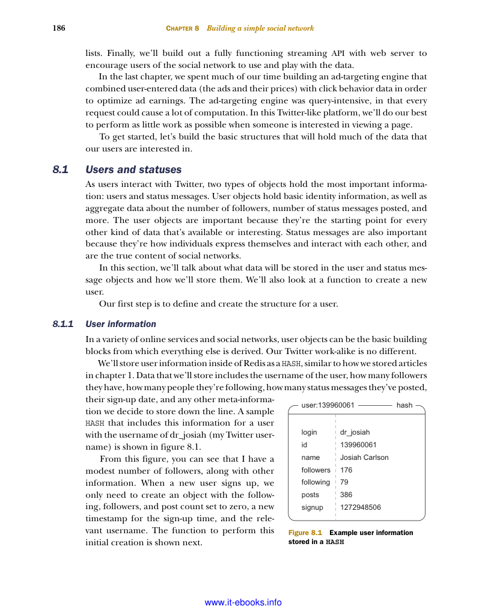
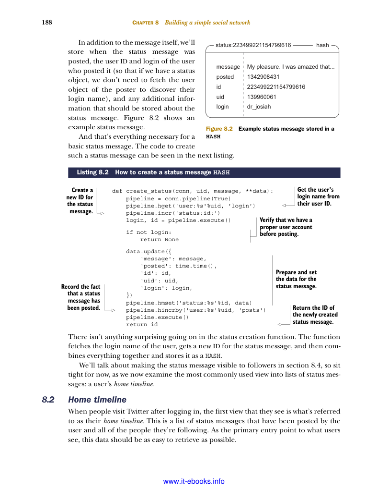
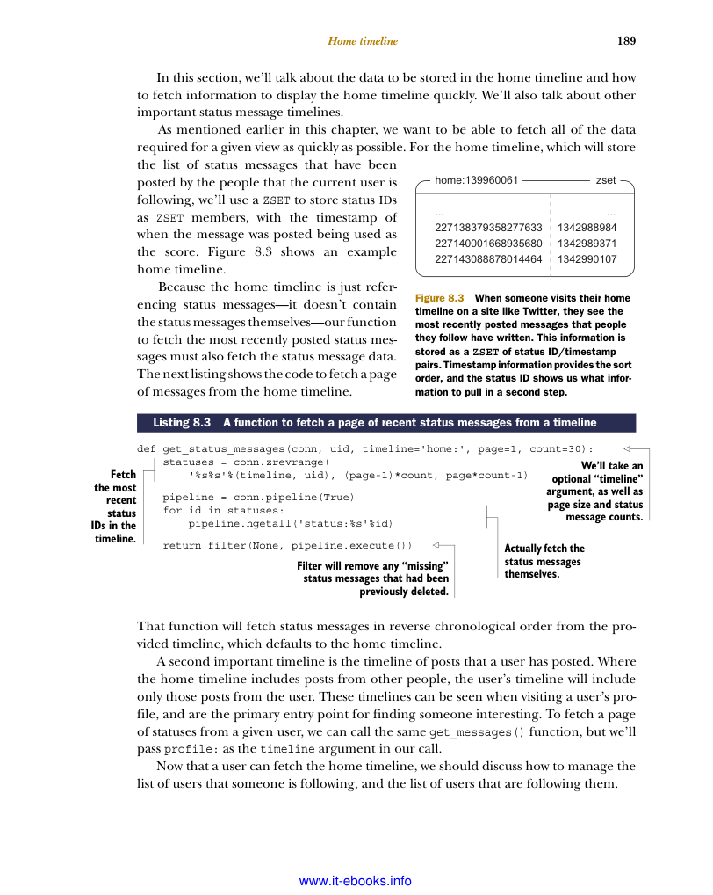
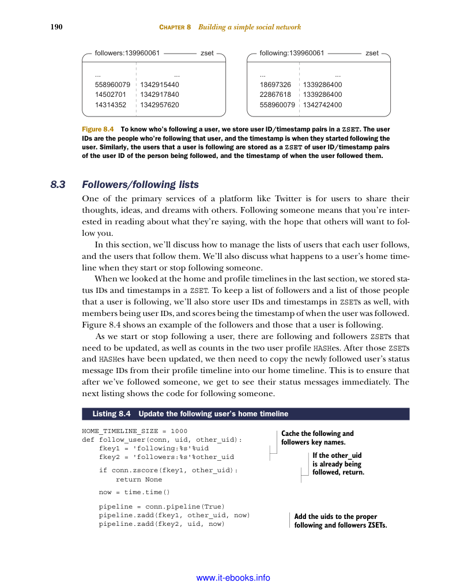
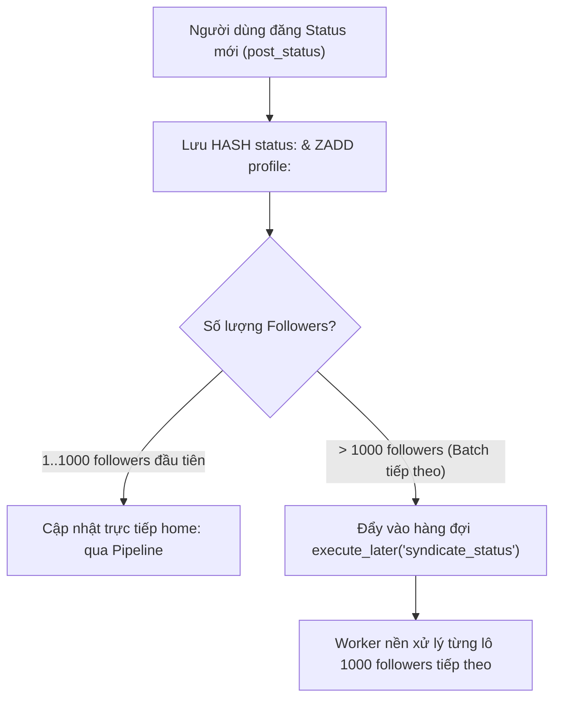
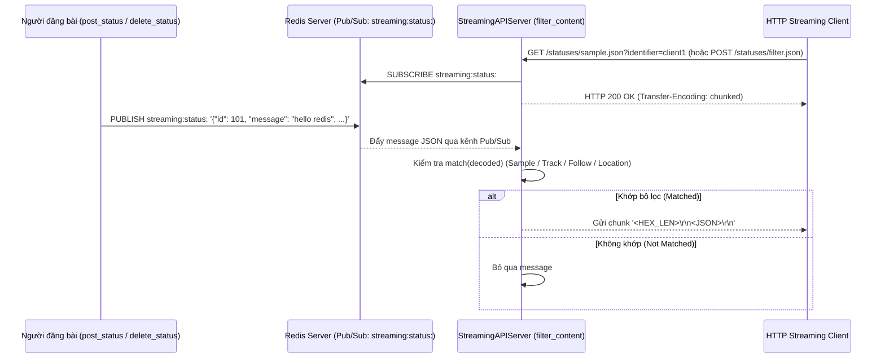

# Chương 8: Xây dựng một mạng xã hội đơn giản (Building a simple social network)

**Nội dung chương này bao gồm (This chapter covers):**

- Người dùng và các dòng trạng thái (Users and statuses)
- Dòng thời gian trang chủ (Home timeline)
- Danh sách người theo dõi / đang theo dõi (Followers/following lists)
- Đăng hoặc xóa một cập nhật trạng thái (Posting or deleting a status update)
- Giao diện lập trình ứng dụng luồng dữ liệu (Streaming API)

Trong chương này, chúng ta sẽ tìm hiểu các cấu trúc dữ liệu và các khái niệm cần thiết để xây dựng một hệ thống cung cấp hầu hết toàn bộ chức năng ở tầng back-end của Twitter. Chương này không nhằm mục đích giúp bạn xây dựng một trang web có khả năng mở rộng đến quy mô khổng lồ như Twitter, nhưng các phương pháp mà chúng ta trình bày sẽ giúp bạn hiểu sâu sắc hơn nhiều về cách các trang mạng xã hội có thể được xây dựng từ những cấu trúc và dữ liệu đơn giản.

Chúng ta sẽ bắt đầu chương này bằng việc bàn về các đối tượng người dùng (user objects) và đối tượng dòng trạng thái (status objects), vốn là nền tảng của hầu hết mọi thông tin trong ứng dụng của chúng ta. Từ đó, chúng ta sẽ thảo luận về dòng thời gian trang chủ (home timeline) cũng như danh sách người theo dõi/đang theo dõi (followers/following lists) — thực chất là các chuỗi tin nhắn trạng thái hoặc chuỗi người dùng. Tiếp tục mạch nội dung, chúng ta sẽ đi qua quy trình đăng tin nhắn trạng thái, theo dõi/bỏ theo dõi (following/unfollowing) một ai đó, và xóa bài đăng — những thao tác liên quan đến việc biến đổi các danh sách nói trên. Cuối cùng, chúng ta sẽ xây dựng hoàn chỉnh một Streaming API (API luồng thời gian thực) đi kèm với máy chủ web (web server) hoạt động đầy đủ chức năng nhằm khuyến khích người dùng của mạng xã hội sử dụng và tương tác với dữ liệu.

Ở chương trước, chúng ta đã dành phần lớn thời gian để xây dựng một công cụ nhắm mục tiêu quảng cáo (ad-targeting engine) kết hợp dữ liệu do người dùng nhập vào (các quảng cáo và mức giá của chúng) với dữ liệu hành vi nhấp chuột nhằm tối ưu hóa doanh thu quảng cáo. Công cụ nhắm mục tiêu quảng cáo đó là một hệ thống thâm dụng truy vấn (query-intensive), ở chỗ mỗi yêu cầu gửi lên đều có thể kéo theo rất nhiều phép tính toán. Trong nền tảng tương tự Twitter này, chúng ta sẽ cố gắng hết sức để thực hiện ít công việc tính toán nhất có thể mỗi khi có ai đó muốn xem một trang nội dung.

Để bắt đầu, hãy cùng xây dựng những cấu trúc cơ bản dùng để lưu trữ phần lớn dữ liệu mà người dùng của chúng ta quan tâm.

> 📝 **Giải thích thêm (không có trong sách):** Sự đánh đổi giữa Chương 7 (thâm dụng lúc đọc — *read-heavy computation*) và Chương 8 (chuẩn bị sẵn dữ liệu lúc ghi để đọc cực nhanh — *fan-out on write / pre-computed views*) là một trong những bài toán thiết kế hệ thống kinh điển nhất. Trên một mạng xã hội như Twitter (nay là X), tỷ lệ đọc/ghi (read-to-write ratio) thường rất lệch (ví dụ 100 lượt xem timeline cho mỗi 1 bài đăng mới). Do đó, việc tính toán và đẩy sẵn ID bài viết vào ZSET `home:<uid>` của từng người theo dõi ngay khi bài viết được đăng giúp thao tác xem trang chủ chỉ cần gọi `ZREVRANGE` + `HGETALL` trong vài mili-giây mà không cần thực hiện các phép `JOIN` đắt đỏ như trong cơ sở dữ liệu quan hệ truyền thống.

---

## 8.1 Người dùng và các dòng trạng thái (Users and statuses)

Khi người dùng tương tác với Twitter, có hai loại đối tượng nắm giữ những thông tin quan trọng nhất: người dùng (users) và các tin nhắn trạng thái (status messages). Các đối tượng người dùng lưu giữ thông tin định danh cơ bản, cùng với dữ liệu tổng hợp về số lượng người theo dõi (followers), số lượng tin nhắn trạng thái đã đăng, và nhiều thông tin khác. Các đối tượng người dùng đóng vai trò quan trọng bởi vì chúng là điểm khởi đầu cho mọi loại dữ liệu khác hiện có hoặc đáng quan tâm. Các tin nhắn trạng thái cũng quan trọng không kém bởi vì chúng là phương tiện để các cá nhân thể hiện bản thân và tương tác với nhau, đồng thời là nội dung cốt lõi thực sự của các mạng xã hội.

Trong mục này, chúng ta sẽ thảo luận về những dữ liệu nào sẽ được lưu trữ trong các đối tượng người dùng và đối tượng tin nhắn trạng thái, cũng như cách chúng ta lưu trữ chúng. Chúng ta cũng sẽ xem xét một hàm dùng để tạo mới một người dùng.

Bước đầu tiên của chúng ta là định nghĩa và tạo cấu trúc cho một người dùng.

### 8.1.1 Thông tin người dùng (User information)

Trong nhiều dịch vụ trực tuyến và mạng xã hội khác nhau, các đối tượng người dùng có thể là những khối xây dựng cơ bản (basic building blocks) mà từ đó mọi thứ khác được suy ra. Hệ thống mô phỏng Twitter của chúng ta cũng không ngoại lệ.

Chúng ta sẽ lưu trữ thông tin người dùng bên trong Redis dưới dạng một `HASH`, tương tự như cách chúng ta đã lưu trữ các bài báo (articles) trong chương 1. Dữ liệu mà chúng ta lưu trữ bao gồm tên đăng nhập (username) của người dùng, số lượng người đang theo dõi họ (`followers`), số lượng người mà họ đang theo dõi (`following`), số lượng tin nhắn trạng thái mà họ đã đăng (`posts`), ngày đăng ký tài khoản (`signup`), và bất kỳ siêu thông tin (meta-information) nào khác mà chúng ta quyết định lưu thêm về sau. Một `HASH` mẫu bao gồm các thông tin này cho một người dùng có tên đăng nhập là `dr_josiah` (tên người dùng Twitter của tác giả) được minh họa trong hình 8.1.

**Hình 8.1 – Ví dụ về thông tin người dùng được lưu trữ trong một HASH (Figure 8.1 Example user information stored in a HASH)**



**Bảng minh họa cấu trúc `user:139960061` (HASH) trong Hình 8.1:**

| Khóa trường (Field) | Giá trị (Value) | Ý nghĩa |
| :--- | :--- | :--- |
| `login` | `dr_josiah` | Tên đăng nhập (username) của người dùng |
| `id` | `139960061` | ID định danh duy nhất của người dùng |
| `name` | `Josiah Carlson` | Tên hiển thị đầy đủ của người dùng |
| `followers` | `176` | Số lượng người đang theo dõi tài khoản này |
| `following` | `79` | Số lượng tài khoản mà người này đang theo dõi |
| `posts` | `386` | Tổng số dòng trạng thái đã đăng |
| `signup` | `1272948506` | Dấu thời gian (Unix timestamp) lúc đăng ký tài khoản |

Từ hình vẽ này, bạn có thể thấy rằng tôi có một số lượng người theo dõi khá khiêm tốn, cùng với các thông tin khác. Khi một người dùng mới đăng ký tài khoản, chúng ta chỉ cần tạo một đối tượng với bộ đếm `following`, `followers`, và `posts` được đặt bằng `0`, một dấu thời gian mới cho thời điểm đăng ký (`signup`), và tên đăng nhập tương ứng. Hàm thực hiện việc khởi tạo ban đầu này được trình bày ngay sau đây.

**Listing 8.1 – Cách tạo một HASH hồ sơ người dùng mới (How to create a new user profile HASH)**

```python
def create_user(conn, login, name):
    llogin = login.lower()
    lock = acquire_lock_with_timeout(conn, 'user:' + llogin, 1)  #A
    if not lock:                                                 #B
        return None                                              #B

    if conn.hget('users:', llogin):                              #C
        return None                                              #C

    id = conn.incr('user:id:')                                   #D
    pipeline = conn.pipeline(True)
    pipeline.hset('users:', llogin, id)                          #E
    pipeline.hmset('user:%s'%id, {                               #F
        'login': login,                                          #F
        'id': id,                                                #F
        'name': name,                                            #F
        'followers': 0,                                          #F
        'following': 0,                                          #F
        'posts': 0,                                              #F
        'signup': time.time(),                                   #F
    })                                                           #F
    pipeline.execute()
    release_lock(conn, 'user:' + llogin, lock)                   #G
    return id                                                    #H
```

**Giải thích mã nguồn Listing 8.1:**

- **#A**: Cố gắng lấy khóa (lock) cho phiên bản viết thường (lowercased) của tên đăng nhập. Hàm này đã được định nghĩa trong chương 6.
- **#B**: Nếu không lấy được khóa, điều đó có nghĩa là một ai khác đang thao tác với cùng tên đăng nhập này.
- **#C**: Chúng ta cũng lưu một `HASH` (`users:`) ánh xạ từ tên đăng nhập viết thường sang ID người dùng, vì vậy nếu đã có sẵn một tên đăng nhập ánh xạ tới một ID, chúng ta sẽ biết được và không cấp tên đó cho người thứ hai.
- **#D**: Mỗi người dùng được cấp một ID duy nhất, được sinh ra bằng cách tăng giá trị của một bộ đếm (`user:id:`).
- **#E**: Thêm tên đăng nhập viết thường vào `HASH` (`users:`) dùng để ánh xạ từ tên đăng nhập sang ID người dùng.
- **#F**: Thêm các thông tin của người dùng vào `HASH` của người dùng đó (`user:<id>`).
- **#G**: Giải phóng khóa trên tên đăng nhập.
- **#H**: Trả về ID của người dùng.

Trong hàm của chúng ta, chúng ta thực hiện việc thiết lập thông tin người dùng ban đầu như kỳ vọng vào trong `HASH` của người dùng, đồng thời chúng ta cũng lấy một khóa phân tán (distributed lock) xoay quanh tên đăng nhập của người dùng đó. Khóa này là cần thiết: nó đảm bảo rằng chúng ta sẽ không gặp tình trạng hai yêu cầu cùng lúc cố gắng tạo một người dùng với cùng một tên đăng nhập. Sau khi khóa thành công, chúng ta xác minh rằng tên đăng nhập đó chưa bị người dùng khác lấy mất. Nếu tên đăng nhập chưa có ai dùng, chúng ta tạo một ID duy nhất mới cho người dùng, thêm tên đăng nhập vào bảng ánh xạ từ tên đăng nhập sang ID người dùng (`users:`), và sau đó tạo `HASH` của người dùng (`user:<id>`).

> 📝 **Giải thích thêm (không có trong sách):** Lưu ý nhỏ trong Listing 8.1 của tác giả: Ở nhánh kiểm tra `if conn.hget('users:', llogin): return None`, hàm trả về `None` ngay lập tức mà chưa gọi `release_lock(conn, 'user:' + llogin, lock)`. Vì khóa được tạo bằng `acquire_lock_with_timeout(..., 1)` (tự động hết hạn sau 1 giây), hệ thống sẽ không bị deadlock vĩnh viễn, nhưng trong mã nguồn thực tế (production), bạn nên bọc phần thân sau khi lấy khóa trong khối `try ... finally: release_lock(...)` để giải phóng khóa ngay lập tức ngay cả khi tên đăng nhập đã tồn tại. Ngoài ra, trong `redis-py` hiện đại (4.x/5.x), phương thức `pipeline.hmset(key, mapping)` đã bị ngừng khuyến khích (deprecated) và được thay thế bằng `pipeline.hset(key, mapping=...)`.

> **THÔNG TIN NHẠY CẢM CỦA NGƯỜI DÙNG (SENSITIVE USER INFORMATION)**
>
> Bởi vì `HASH` của người dùng sẽ được truy xuất vô số lần để kết xuất (render) một giao diện mẫu (template), hoặc để trả về trực tiếp như một phản hồi cho yêu cầu API, chúng ta không lưu trữ thông tin nhạy cảm của người dùng trong `HASH` này. Hiện tại, chúng ta sẽ giả định rằng mật khẩu đã băm (hashed passwords), địa chỉ email, và các thông tin riêng tư khác được lưu trữ ở các khóa (keys) khác, hoặc trong một cơ sở dữ liệu hoàn toàn khác.

Chúng ta đã hoàn tất việc tạo người dùng và thiết lập tất cả các siêu thông tin cần thiết về họ. Từ đây, bước tiếp theo trong việc xây dựng hệ thống tương tự Twitter của chúng ta chính là bản thân tin nhắn trạng thái (status message).

### 8.1.2 Các tin nhắn trạng thái (Status messages)

Như chúng ta đã đề cập trước đó, trong khi hồ sơ người dùng (user profiles) lưu trữ thông tin về một cá nhân, thì những ý tưởng mà mọi người muốn bày tỏ lại được lưu trữ trong các tin nhắn trạng thái (status messages). Giống như trường hợp thông tin người dùng, chúng ta sẽ lưu trữ thông tin tin nhắn trạng thái bên trong một `HASH`.

Ngoài bản thân nội dung tin nhắn (`message`), chúng ta sẽ lưu thời điểm tin nhắn trạng thái được đăng (`posted`), ID người dùng (`uid`) và tên đăng nhập (`login`) của người dùng đã đăng nó (nhờ vậy nếu chúng ta có trong tay một đối tượng trạng thái, chúng ta không cần phải truy xuất lại đối tượng người dùng của người đăng chỉ để tìm tên đăng nhập của họ), cùng bất kỳ thông tin bổ sung nào cần được lưu trữ về tin nhắn trạng thái đó. Hình 8.2 hiển thị một tin nhắn trạng thái mẫu.

**Hình 8.2 – Ví dụ về tin nhắn trạng thái được lưu trữ trong một HASH (Figure 8.2 Example status message stored in a HASH)**



**Bảng minh họa cấu trúc `status:223499221154799616` (HASH) trong Hình 8.2:**

| Khóa trường (Field) | Giá trị (Value) | Ý nghĩa |
| :--- | :--- | :--- |
| `message` | `My pleasure. I was amazed that...` | Nội dung văn bản của dòng trạng thái |
| `posted` | `1342908431` | Dấu thời gian (Unix timestamp) khi đăng bài |
| `id` | `223499221154799616` | ID định danh duy nhất của dòng trạng thái |
| `uid` | `139960061` | ID của người dùng đã đăng dòng trạng thái này |
| `login` | `dr_josiah` | Tên đăng nhập của người đăng (phi chuẩn hóa để đọc nhanh) |

Và đó là tất cả những gì cần thiết cho một tin nhắn trạng thái cơ bản. Đoạn mã để tạo một tin nhắn trạng thái như vậy có thể được thấy trong listing tiếp theo.

**Listing 8.2 – Cách tạo một HASH tin nhắn trạng thái (How to create a status message HASH)**

```python
def create_status(conn, uid, message, **data):
    pipeline = conn.pipeline(True)
    pipeline.hget('user:%s'%uid, 'login')   #A
    pipeline.incr('status:id:')             #B
    login, id = pipeline.execute()

    if not login:                           #C
        return None                         #C

    data.update({                           #D
        'message': message,                 #D
        'posted': time.time(),              #D
        'id': id,                           #D
        'uid': uid,                         #D
        'login': login,                     #D
    })                                      #D
    pipeline.hmset('status:%s'%id, data)    #D
    pipeline.hincrby('user:%s'%uid, 'posts')#E
    pipeline.execute()
    return id                               #F
```

**Giải thích mã nguồn Listing 8.2:**

- **#A**: Lấy tên đăng nhập (`login`) của người dùng từ ID người dùng (`uid`) của họ.
- **#B**: Tạo một ID mới cho tin nhắn trạng thái.
- **#C**: Xác minh rằng chúng ta có một tài khoản người dùng hợp lệ trước khi đăng bài.
- **#D**: Chuẩn bị và thiết lập dữ liệu cho tin nhắn trạng thái.
- **#E**: Ghi nhận thực tế rằng một tin nhắn trạng thái vừa được đăng (tăng trường `posts` trong `HASH` của người dùng thêm 1).
- **#F**: Trả về ID của tin nhắn trạng thái vừa mới được tạo.

Không có điều gì đáng ngạc nhiên diễn ra trong hàm tạo trạng thái này. Hàm truy xuất tên đăng nhập của người dùng, lấy một ID mới cho tin nhắn trạng thái, rồi kết hợp mọi thứ lại với nhau và lưu trữ nó dưới dạng một `HASH`.

Chúng ta sẽ bàn về việc làm cho tin nhắn trạng thái hiển thị tới những người theo dõi (followers) trong mục 8.4, vì vậy hãy kiên nhẫn chờ một chút, bởi bây giờ chúng ta sẽ xem xét góc nhìn (view) được sử dụng phổ biến nhất đối với các danh sách tin nhắn trạng thái: dòng thời gian trang chủ (home timeline) của một người dùng.

---

## 8.2 Dòng thời gian trang chủ (Home timeline)

Khi mọi người truy cập Twitter sau khi đăng nhập, giao diện đầu tiên mà họ nhìn thấy được gọi là dòng thời gian trang chủ (home timeline) của họ. Đây là một danh sách các tin nhắn trạng thái đã được đăng bởi chính người dùng đó và tất cả những người mà họ đang theo dõi. Là điểm truy cập chính yếu vào những gì người dùng nhìn thấy, dữ liệu này cần phải dễ dàng truy xuất nhất có thể.

Trong mục này, chúng ta sẽ thảo luận về dữ liệu sẽ được lưu trữ trong dòng thời gian trang chủ và cách lấy thông tin để hiển thị dòng thời gian trang chủ một cách nhanh chóng. Chúng ta cũng sẽ bàn về các dòng thời gian tin nhắn trạng thái quan trọng khác.

Như đã đề cập ở phần đầu chương, chúng ta muốn có khả năng lấy toàn bộ dữ liệu cần thiết cho một giao diện xem (view) nhất định nhanh nhất có thể. Đối với dòng thời gian trang chủ — nơi sẽ lưu trữ danh sách các tin nhắn trạng thái đã được đăng bởi những người mà người dùng hiện tại đang theo dõi — chúng ta sẽ sử dụng một `ZSET` để lưu các ID trạng thái (status IDs) làm các phần tử thành viên (members) của `ZSET`, với dấu thời gian (timestamp) lúc tin nhắn được đăng được dùng làm điểm số (`score`). Hình 8.3 minh họa một dòng thời gian trang chủ mẫu.

**Hình 8.3 – Khi một ai đó truy cập dòng thời gian trang chủ của họ trên một trang như Twitter, họ sẽ thấy những tin nhắn được đăng gần đây nhất do những người họ theo dõi viết. Thông tin này được lưu trữ dưới dạng một ZSET gồm các cặp ID trạng thái / dấu thời gian. Thông tin dấu thời gian cung cấp thứ tự sắp xếp, còn ID trạng thái cho chúng ta biết cần kéo thông tin nào ở bước thứ hai. (Figure 8.3 When someone visits their home timeline on a site like Twitter, they see the most recently posted messages that people they follow have written. This information is stored as a ZSET of status ID/timestamp pairs. Timestamp information provides the sort order, and the status ID shows us what information to pull in a second step.)**



**Bảng minh họa cấu trúc `home:139960061` (ZSET) trong Hình 8.3:**

| Phần tử thành viên (Member - Status ID) | Điểm số (Score - Posted Timestamp) |
| :--- | :--- |
| `...` | `...` |
| `227138379358277633` | `1342988984` |
| `227140001668935680` | `1342989371` |
| `227143088878014464` | `1342990107` |

Bởi vì dòng thời gian trang chủ chỉ tham chiếu đến các tin nhắn trạng thái — chứ bản thân nó không chứa nội dung của các tin nhắn trạng thái — nên hàm của chúng ta dùng để lấy các tin nhắn trạng thái vừa được đăng gần đây nhất cũng phải truy xuất cả dữ liệu chi tiết của tin nhắn trạng thái đó. Listing tiếp theo trình bày đoạn mã để lấy một trang (page) các tin nhắn từ dòng thời gian trang chủ.

**Listing 8.3 – Một hàm để lấy một trang các tin nhắn trạng thái gần đây từ một dòng thời gian (A function to fetch a page of recent status messages from a timeline)**

```python
def get_status_messages(conn, uid, timeline='home:', page=1, count=30): #A
    statuses = conn.zrevrange(                                  #B
        '%s%s'%(timeline, uid), (page-1)*count, page*count-1)   #B

    pipeline = conn.pipeline(True)
    for id in statuses:                                         #C
        pipeline.hgetall('status:%s'%id)                        #C

    return filter(None, pipeline.execute())                     #D
```

**Giải thích mã nguồn Listing 8.3:**

- **#A**: Chúng ta nhận một đối số tùy chọn `timeline`, cũng như số trang (`page`) và số lượng tin nhắn trạng thái trên mỗi trang (`count`).
- **#B**: Lấy các ID trạng thái gần đây nhất trong dòng thời gian.
- **#C**: Thực sự truy xuất bản thân các tin nhắn trạng thái.
- **#D**: Hàm `filter(None, ...)` sẽ loại bỏ bất kỳ tin nhắn trạng thái nào bị "thiếu" (trả về dict rỗng `{}`) do đã bị xóa trước đó. *(Lưu ý: Trong Python 3, `filter()` trả về một iterator nên bạn có thể bọc `list(filter(None, pipeline.execute()))` nếu cần trả về danh sách trực tiếp).*

Hàm đó sẽ lấy các tin nhắn trạng thái theo thứ tự thời gian đảo ngược (từ mới nhất đến cũ nhất - reverse chronological order) từ dòng thời gian được cung cấp, mà mặc định là dòng thời gian trang chủ (`home:`).

Một dòng thời gian quan trọng thứ hai là dòng thời gian chứa các bài viết mà chính một người dùng đã đăng. Trong khi dòng thời gian trang chủ bao gồm các bài đăng từ những người khác, thì dòng thời gian cá nhân của người dùng sẽ chỉ bao gồm những bài đăng từ chính người dùng đó. Các dòng thời gian này có thể được nhìn thấy khi truy cập vào trang hồ sơ (profile) của một người dùng, và là điểm truy cập chính để tìm kiếm một ai đó thú vị. Để lấy một trang các trạng thái từ một người dùng nhất định, chúng ta có thể gọi cùng hàm `get_status_messages()` (trong sách viết tắt là `get_messages()`), nhưng truyền `'profile:'` làm đối số `timeline` trong lời gọi hàm.

Bây giờ, khi người dùng đã có thể lấy được dòng thời gian trang chủ, chúng ta nên thảo luận về cách quản lý danh sách những người dùng mà một ai đó đang theo dõi (`following`), và danh sách những người dùng đang theo dõi họ (`followers`).

---

## 8.3 Danh sách người theo dõi / đang theo dõi (Followers/following lists)

Một trong những dịch vụ chính yếu của một nền tảng như Twitter là để người dùng chia sẻ suy nghĩ, ý tưởng và ước mơ của họ với những người khác. Theo dõi (following) một ai đó có nghĩa là bạn quan tâm đến việc đọc những gì họ đang nói, với hy vọng rằng những người khác cũng sẽ muốn theo dõi lại bạn.

Trong mục này, chúng ta sẽ thảo luận về cách quản lý danh sách những người dùng mà mỗi người dùng theo dõi, và những người dùng đang theo dõi họ. Chúng ta cũng sẽ bàn về những gì xảy ra đối với dòng thời gian trang chủ của một người dùng khi họ bắt đầu hoặc ngừng theo dõi một ai đó.

Khi chúng ta xem xét dòng thời gian trang chủ (`home:`) và dòng thời gian hồ sơ (`profile:`) ở mục trước, chúng ta đã lưu trữ các ID trạng thái và dấu thời gian trong một `ZSET`. Để lưu giữ danh sách những người theo dõi (`followers`) và danh sách những người mà một người dùng đang theo dõi (`following`), chúng ta cũng sẽ lưu trữ các ID người dùng và dấu thời gian trong các `ZSET` tương tự, với các phần tử thành viên (members) là ID người dùng, và điểm số (`score`) là dấu thời gian tại thời điểm người dùng đó được theo dõi. Hình 8.4 hiển thị một ví dụ về danh sách người theo dõi và những người mà một người dùng đang theo dõi.

**Hình 8.4 – Để biết ai đang theo dõi một người dùng, chúng ta lưu các cặp ID người dùng / dấu thời gian trong một ZSET. Các ID người dùng là những người đang theo dõi người dùng đó, và dấu thời gian là thời điểm họ bắt đầu theo dõi. Tương tự, những người dùng mà một người đang theo dõi được lưu dưới dạng một ZSET gồm các cặp ID người dùng / dấu thời gian của người được theo dõi và thời điểm bắt đầu theo dõi họ. (Figure 8.4 To know who’s following a user, we store user ID/timestamp pairs in a ZSET. The user IDs are the people who’re following that user, and the timestamp is when they started following the user. Similarly, the users that a user is following are stored as a ZSET of user ID/timestamp pairs of the user ID of the person being followed, and the timestamp of when the user followed them.)**



**Bảng minh họa hai ZSET `followers:139960061` và `following:139960061` trong Hình 8.4:**

| ZSET Key | Member (User ID) | Score (Followed Timestamp) | Ý nghĩa |
| :--- | :--- | :--- | :--- |
| `followers:139960061` | `558960079` | `1342915440` | Người dùng `558960079` theo dõi `139960061` |
| `followers:139960061` | `14502701` | `1342917840` | Người dùng `14502701` theo dõi `139960061` |
| `followers:139960061` | `14314352` | `1342957620` | Người dùng `14314352` theo dõi `139960061` |
| `following:139960061` | `18697326` | `1339286400` | `139960061` đang theo dõi `18697326` |
| `following:139960061` | `22867618` | `1339286400` | `139960061` đang theo dõi `22867618` |
| `following:139960061` | `558960079` | `1342742400` | `139960061` đang theo dõi `558960079` |

Khi chúng ta bắt đầu hoặc ngừng theo dõi một người dùng, sẽ có các `ZSET` `following` và `followers` cần được cập nhật, cũng như các bộ đếm trong hai `HASH` hồ sơ người dùng. Sau khi các `ZSET` và `HASH` đó đã được cập nhật, chúng ta cần sao chép các ID tin nhắn trạng thái của người dùng vừa mới được theo dõi từ dòng thời gian hồ sơ (`profile:`) của họ sang dòng thời gian trang chủ (`home:`) của chúng ta. Điều này nhằm đảm bảo rằng ngay sau khi chúng ta theo dõi một ai đó, chúng ta có thể nhìn thấy các tin nhắn trạng thái của họ ngay lập tức. Listing tiếp theo trình bày đoạn mã để theo dõi một ai đó.

**Listing 8.4 – Cập nhật dòng thời gian trang chủ của người đi theo dõi (Update the following user’s home timeline)**

```python
HOME_TIMELINE_SIZE = 1000
def follow_user(conn, uid, other_uid):
    fkey1 = 'following:%s'%uid                                  #A
    fkey2 = 'followers:%s'%other_uid                            #A

    if conn.zscore(fkey1, other_uid):                           #B
        return None                                             #B

    now = time.time()

    pipeline = conn.pipeline(True)
    pipeline.zadd(fkey1, other_uid, now)                        #C
    pipeline.zadd(fkey2, uid, now)                              #C
    pipeline.zcard(fkey1)                                       #D
    pipeline.zcard(fkey2)                                       #D
    pipeline.zrevrange('profile:%s'%other_uid,                  #E
        0, HOME_TIMELINE_SIZE-1, withscores=True)               #E
    following, followers, status_and_score = pipeline.execute()[-3:]

    pipeline.hset('user:%s'%uid, 'following', following)        #F
    pipeline.hset('user:%s'%other_uid, 'followers', followers)  #F
    if status_and_score:
        pipeline.zadd('home:%s'%uid, **dict(status_and_score))  #G
    pipeline.zremrangebyrank('home:%s'%uid, 0, -HOME_TIMELINE_SIZE-1)#G

    pipeline.execute()
    return True                                                 #H
```

**Giải thích mã nguồn Listing 8.4:**

- **#A**: Lưu đệm (cache) tên khóa `following` và `followers` vào biến cục bộ.
- **#B**: Nếu `other_uid` đã được theo dõi từ trước rồi, thoát hàm và trả về `None`.
- **#C**: Thêm các `uid` vào đúng các `ZSET` `following` và `followers` tương ứng.
- **#D**: Tìm kích thước (số lượng phần tử) hiện tại của các `ZSET` `following` và `followers`.
- **#E**: Lấy tối đa `HOME_TIMELINE_SIZE` (1000) tin nhắn trạng thái gần đây nhất từ dòng thời gian hồ sơ (`profile:`) của người dùng vừa mới được theo dõi.
- **#F**: Cập nhật kích thước đã biết của các `ZSET` `following` và `followers` vào trong `HASH` của mỗi người dùng.
- **#G**: Cập nhật dòng thời gian trang chủ (`home:`) của người đi theo dõi, chỉ giữ lại tối đa 1000 tin nhắn trạng thái mới nhất (xóa bớt các phần tử cũ hơn bằng `zremrangebyrank`).
- **#H**: Trả về `True` báo hiệu đã theo dõi người dùng thành công.

> **CHUYỂN ĐỔI MỘT DANH SÁCH CÁC TUPLE THÀNH TỪ ĐIỂN (CONVERTING A LIST OF TUPLES INTO A DICTIONARY)**
>
> Là một phần trong hàm `follow_user()` của chúng ta, chúng ta đã lấy về một danh sách các ID tin nhắn trạng thái đi kèm với điểm số dấu thời gian của chúng (`status_and_score`). Bởi vì đây là một chuỗi các cặp giá trị `(member, score)`, chúng ta có thể truyền trực tiếp chúng vào kiểu `dict()`, vốn sẽ tạo ra một từ điển gồm các khóa và giá trị như được truyền vào.
>
> *(Lưu ý cho `redis-py` 3.0+ / 4.x / 5.x: Trong `redis-py` hiện đại, cú pháp của `zadd` là `pipeline.zadd('home:%s'%uid, dict(status_and_score))` — truyền trực tiếp một dictionary thay vì giải nén `**dict(...)`, và ở bước `#C` là `pipeline.zadd(fkey1, {other_uid: now})` thay vì `pipeline.zadd(fkey1, other_uid, now)`).*

Hàm này diễn ra theo đúng cách mà chúng ta đã mô tả trước đó: chúng ta thêm các ID người dùng thích hợp vào các `ZSET` `following` và `followers`, lấy kích thước của các `ZSET` `following` và `followers`, và lấy các ID tin nhắn trạng thái gần đây từ dòng thời gian hồ sơ của người dùng được theo dõi. Sau khi đã lấy xong toàn bộ dữ liệu, chúng ta cập nhật các bộ đếm bên trong các `HASH` hồ sơ người dùng, và cập nhật dòng thời gian trang chủ của người đi theo dõi.

Sau khi theo dõi một ai đó và đọc các tin nhắn trạng thái của họ một thời gian, có thể đến một lúc nào đó chúng ta quyết định không muốn theo dõi họ nữa. Để ngừng theo dõi (unfollow) một ai đó, về cơ bản chúng ta thực hiện các thao tác ngược lại với những gì vừa thảo luận: xóa các UID khỏi danh sách `followers` và `following`, xóa các tin nhắn trạng thái của họ khỏi dòng thời gian trang chủ, và một lần nữa cập nhật lại bộ đếm `followers`/`following`. Đoạn mã để ngừng theo dõi một ai đó được hiển thị trong listing sau đây.

**Listing 8.5 – Một hàm để ngừng theo dõi một người dùng (A function to stop following a user)**

```python
def unfollow_user(conn, uid, other_uid):
    fkey1 = 'following:%s'%uid                                  #A
    fkey2 = 'followers:%s'%other_uid                            #A

    if not conn.zscore(fkey1, other_uid):                       #B
        return None                                             #B

    pipeline = conn.pipeline(True)
    pipeline.zrem(fkey1, other_uid)                             #C
    pipeline.zrem(fkey2, uid)                                   #C
    pipeline.zcard(fkey1)                                       #D
    pipeline.zcard(fkey2)                                       #D
    pipeline.zrevrange('profile:%s'%other_uid,                  #E
        0, HOME_TIMELINE_SIZE-1)                                #E
    following, followers, statuses = pipeline.execute()[-3:]

    pipeline.hset('user:%s'%uid, 'following', following)        #F
    pipeline.hset('user:%s'%other_uid, 'followers', followers)  #F
    if statuses:
        pipeline.zrem('home:%s'%uid, *statuses)                 #G

    pipeline.execute()
    return True                                                 #H
```

**Giải thích mã nguồn Listing 8.5:**

- **#A**: Lưu đệm tên các khóa `following` và `followers`.
- **#B**: Nếu `other_uid` hiện không nằm trong danh sách đang theo dõi, thoát hàm và trả về `None`.
- **#C**: Xóa các `uid` khỏi các `ZSET` `following` và `followers` tương ứng.
- **#D**: Tìm kích thước mới của các `ZSET` `following` và `followers`.
- **#E**: Lấy tối đa `HOME_TIMELINE_SIZE` tin nhắn trạng thái gần đây nhất từ người dùng mà chúng ta vừa ngừng theo dõi.
- **#F**: Cập nhật kích thước đã biết của các `ZSET` `following` và `followers` vào trong `HASH` của mỗi người dùng.
- **#G**: Cập nhật dòng thời gian trang chủ (`home:`), xóa bỏ bất kỳ tin nhắn trạng thái nào đến từ người dùng đã từng được theo dõi trước đó.
- **#H**: Trả về `True` báo hiệu thao tác bỏ theo dõi đã thực thi thành công.

Trong hàm đó, chúng ta đã cập nhật danh sách đang theo dõi và người theo dõi, cập nhật bộ đếm số người theo dõi và đang theo dõi, đồng thời cập nhật dòng thời gian trang chủ để loại bỏ các tin nhắn trạng thái không còn thuộc về nơi đó nữa. Tính đến thời điểm này, chúng ta đã hoàn thành tất cả các bước cần thiết để bắt đầu và ngừng theo dõi một người dùng.

> **Bài tập: Làm đầy lại dòng thời gian (Exercise: Refilling timelines)**
>
> Khi một ai đó ngừng theo dõi một người dùng khác, một số lượng tin nhắn trạng thái nhất định sẽ bị xóa khỏi dòng thời gian trang chủ của người vừa bỏ theo dõi. Khi điều này xảy ra, chúng ta có thể hoặc chấp nhận việc có ít hơn số lượng tin nhắn trạng thái mong muốn trong dòng thời gian, hoặc nỗ lực bổ sung thêm các tin nhắn trạng thái từ những người khác mà người dùng này vẫn đang theo dõi. Bạn có thể viết một hàm để thêm các tin nhắn trạng thái vào dòng thời gian của người dùng nhằm giữ cho nó luôn đầy không? Gợi ý: Bạn có thể muốn sử dụng các tác vụ trì hoãn (delayed tasks) giống như chúng ta đã định nghĩa trong mục 6.4 để giảm thời gian phản hồi khi gọi hàm bỏ theo dõi.

> **Bài tập: Danh sách người dùng tùy chỉnh (Exercise: Lists of users)**
>
> Ngoài danh sách những người dùng mà một ai đó theo dõi, Twitter còn hỗ trợ khả năng tạo thêm các danh sách người dùng được đặt tên (named lists of users) bao gồm dòng thời gian chứa các bài đăng của riêng những người dùng trong danh sách đó. Bạn có thể cập nhật `follow_user()` và `unfollow_user()` để nhận thêm một đối số tùy chọn "list ID" nhằm lưu trữ thông tin mới này, đồng thời tạo các hàm để tạo một danh sách tùy chỉnh và truy xuất danh sách tùy chỉnh đó không? Gợi ý: Hãy nghĩ về nó giống như một kiểu người theo dõi (follower) khác. Điểm thưởng: bạn có thể cập nhật luôn cả hàm của mình từ bài tập "Làm đầy lại dòng thời gian" ở trên không?

Bây giờ, khi chúng ta đã có thể bắt đầu hoặc ngừng theo dõi một người dùng trong khi vẫn giữ cho dòng thời gian trang chủ được cập nhật, đã đến lúc xem chuyện gì sẽ xảy ra khi một ai đó đăng một cập nhật trạng thái mới.

---

## 8.4 Đăng hoặc xóa một cập nhật trạng thái (Posting or deleting a status update)

Một trong những thao tác nền tảng nhất trên một dịch vụ như Twitter là đăng các tin nhắn trạng thái. Mọi người đăng bài để chia sẻ ý tưởng của mình, và mọi người đọc vì họ quan tâm đến những gì đang diễn ra với người khác. Mục 8.1.2 đã chỉ ra cách tạo một tin nhắn trạng thái như một điều kiện tiên quyết để biết các loại dữ liệu mà chúng ta sẽ lưu trữ, nhưng chưa chỉ ra cách đưa tin nhắn trạng thái đó vào dòng thời gian hồ sơ (`profile:`) hoặc dòng thời gian trang chủ (`home:`) của những người theo dõi người dùng đó.

Trong mục này, chúng ta sẽ thảo luận về những gì xảy ra với một tin nhắn trạng thái khi nó được đăng lên để nó có thể tìm đường đi vào dòng thời gian trang chủ của những người theo dõi người dùng đó. Chúng ta cũng sẽ nói về cách xóa một tin nhắn trạng thái.

Bạn đã biết cách tạo bản thân tin nhắn trạng thái, nhưng bây giờ chúng ta cần đưa ID tin nhắn trạng thái đó vào dòng thời gian trang chủ của tất cả những người theo dõi chúng ta. Cách chúng ta thực hiện thao tác này sẽ phụ thuộc vào số lượng người theo dõi mà người dùng đăng bài hiện có. Nếu người dùng có một số lượng người theo dõi tương đối nhỏ (chẳng hạn, tối đa khoảng 1.000 người), chúng ta có thể cập nhật dòng thời gian trang chủ của họ ngay lập tức. Nhưng đối với những người dùng có số lượng người theo dõi lớn hơn (như 1 triệu, hoặc thậm chí 25 triệu người theo dõi mà một số người dùng có trên Twitter), việc cố gắng thực hiện trực tiếp các phép chèn đó sẽ mất nhiều thời gian hơn mức hợp lý mà một người dùng có thể chờ đợi.

Để cho phép lời gọi hàm của chúng ta trả về kết quả nhanh chóng, chúng ta sẽ làm hai việc. Thứ nhất, chúng ta sẽ thêm ID trạng thái vào dòng thời gian trang chủ của 1.000 người theo dõi đầu tiên như một phần trực tiếp của lời gọi đăng tin nhắn trạng thái. Dựa trên số liệu thống kê từ một trang như Twitter, bước này sẽ xử lý được ít nhất 99,9% tổng số người dùng đăng bài (số liệu phân tích trên toàn Twitter cho thấy có khoảng 100.000–250.000 người dùng có hơn 1.000 người theo dõi, chỉ chiếm khoảng 0,1% lượng người dùng hoạt động). Điều này có nghĩa là chỉ có 0,1% người dùng hàng đầu mới cần đến bước thứ hai.

Thứ hai, đối với những người dùng có hơn 1.000 người theo dõi, chúng ta sẽ khởi chạy một tác vụ trì hoãn (deferred task) sử dụng hệ thống tương tự như những gì chúng ta đã xây dựng ở mục 6.4. Listing tiếp theo trình bày đoạn mã để đẩy các cập nhật trạng thái tới những người theo dõi.

**Listing 8.6 – Cập nhật dòng thời gian hồ sơ của một người dùng (Update a user’s profile timeline)**

```python
def post_status(conn, uid, message, **data):
    id = create_status(conn, uid, message, **data)  #A
    if not id:                                      #B
        return None                                 #B

    posted = conn.hget('status:%s'%id, 'posted')    #C
    if not posted:                                  #D
        return None                                 #D

    post = {str(id): float(posted)}
    conn.zadd('profile:%s'%uid, **post)             #E

    syndicate_status(conn, uid, post)               #F
    return id
```

**Giải thích mã nguồn Listing 8.6:**

- **#A**: Tạo một tin nhắn trạng thái bằng cách sử dụng hàm `create_status()` ở phần trước.
- **#B**: Nếu việc tạo thất bại, thoát hàm và trả về `None`.
- **#C**: Lấy thời gian mà tin nhắn đã được đăng.
- **#D**: Nếu không tìm thấy thời gian đăng của bài viết, thoát hàm và trả về `None`.
- **#E**: Thêm tin nhắn trạng thái vào dòng thời gian hồ sơ (`profile:<uid>`) của người dùng.
- **#F**: Thực sự đẩy (phân phối) tin nhắn trạng thái ra cho những người theo dõi người dùng đó.

Hãy chú ý rằng chúng ta đã chia việc cập nhật trạng thái thành hai phần. Phần đầu tiên gọi hàm `create_status()` từ listing 8.2 để thực sự tạo tin nhắn trạng thái, rồi sau đó thêm nó vào dòng thời gian hồ sơ của người đăng. Phần thứ hai thực sự thêm tin nhắn trạng thái vào dòng thời gian của những người theo dõi người dùng đó, như có thể thấy ngay tiếp theo đây.

**Listing 8.7 – Cập nhật dòng thời gian trang chủ của những người theo dõi người dùng (Update a user’s followers’ home timelines)**

```python
POSTS_PER_PASS = 1000                                           #A
def syndicate_status(conn, uid, post, start=0):
    followers = conn.zrangebyscore('followers:%s'%uid, start, 'inf',#B
        start=0, num=POSTS_PER_PASS, withscores=True)           #B

    pipeline = conn.pipeline(False)
    for follower, start in followers:                           #E
        pipeline.zadd('home:%s'%follower, **post)               #C
        pipeline.zremrangebyrank(                               #C
            'home:%s'%follower, 0, -HOME_TIMELINE_SIZE-1)       #C
    pipeline.execute()

    if len(followers) >= POSTS_PER_PASS:                        #D
        execute_later(conn, 'default', 'syndicate_status',      #D
            [conn, uid, post, start])                           #D
```

**Giải thích mã nguồn Listing 8.7:**

- **#A**: Chỉ gửi tới 1000 người dùng trong mỗi lượt chạy (pass).
- **#B**: Lấy nhóm 1000 người theo dõi tiếp theo, bắt đầu từ người cuối cùng đã được cập nhật ở lần trước (dựa vào điểm số timestamp `start`).
- **#C**: Thêm trạng thái vào dòng thời gian trang chủ của tất cả những người theo dõi vừa lấy được, đồng thời cắt gọn (trim) dòng thời gian trang chủ để chúng không bị phình quá lớn (giữ lại tối đa `HOME_TIMELINE_SIZE` phần tử).
- **#D**: Nếu có ít nhất 1000 người theo dõi vừa nhận được bản cập nhật, hãy thực thi các bản cập nhật còn lại trong một tác vụ nền (background task) thông qua `execute_later`.
- **#E**: Việc lặp qua kết quả `followers` sẽ liên tục cập nhật biến `start` (chính là `score` — timestamp theo dõi của follower đó), giá trị mà sau đó chúng ta có thể truyền tiếp cho các lời gọi `syndicate_status()` kế tiếp.

Hàm thứ hai này chính là nơi thực sự xử lý việc đẩy các tin nhắn trạng thái vào dòng thời gian trang chủ của 1.000 người theo dõi đầu tiên, và khởi chạy một tác vụ trì hoãn sử dụng API mà chúng ta đã định nghĩa trong mục 6.4 cho những người theo dõi nằm sau 1.000 người đầu tiên đó. Với những hàm mới này, giờ đây chúng ta đã hoàn thiện bộ công cụ cần thiết để thực sự đăng một cập nhật trạng thái và gửi nó tới tất cả những người theo dõi của một người dùng.

> 📝 **Giải thích thêm (không có trong sách) – Kiến trúc Fan-out on Write vs. Fan-out on Read (Bài toán tài khoản Người nổi tiếng / Celebrity Problem):**
>
> Cách tiếp cận trong `syndicate_status()` ở Listing 8.7 được gọi là **Fan-out on Write (Push model)**: khi một người đăng bài, hệ thống chủ động ghi ID bài viết vào toàn bộ hộp thư `home:<follower_id>` của từng người theo dõi.
> - **Ưu điểm:** Khi người dùng mở ứng dụng đọc trang chủ (`get_status_messages`), thao tác đọc cực kỳ nhanh ($O(\log N)$ với `ZREVRANGE` trên đúng 1 khóa `home:<uid>` duy nhất).
> - **Nhược điểm (Celebrity / Hot-key problem):** Nếu một người nổi tiếng (ví dụ có 50 triệu followers) đăng bài, dù dùng hàng đợi nền (`execute_later`) chia thành từng lô 1.000 người, hệ thống vẫn phải thực hiện 50 triệu lệnh `ZADD` + 50 triệu lệnh `ZREMRANGEBYRANK`, gây bão ghi (write amplification) và độ trễ phân phối (eventual consistency lag) lên tới hàng chục phút.
> - **Giải pháp thực tế của Twitter (Hybrid Fan-out):** Kết hợp cả hai mô hình:
>   1. Với người dùng thông thường (< vài chục nghìn followers): dùng **Fan-out on Write** y hệt Listing 8.7.
>   2. Với tài khoản người nổi tiếng (celebrities / high-follower accounts): **KHÔNG** fan-out khi ghi mà chỉ lưu vào `profile:<celebrity_uid>`. Khi một người dùng mở trang chủ (**Fan-out on Read**), ứng dụng lấy `home:<uid>` (đã được fan-out sẵn từ bạn bè bình thường) rồi trộn (merge) tại thời điểm đọc với `profile:<celebrity_uid>` của những người nổi tiếng mà họ đang theo dõi.



> **Bài tập: Cập nhật các danh sách tùy chỉnh (Exercise: Updating lists)**
>
> Ở mục trước, tôi đã gợi ý một bài tập xây dựng các danh sách người dùng được đặt tên (named lists of users). Bạn có thể mở rộng hàm `syndicate_status()` (trong sách ghi `syndicate_message()`) để hỗ trợ luôn việc cập nhật dòng thời gian của các danh sách tùy chỉnh đã tạo trước đó không?

Hãy tưởng tượng rằng chúng ta vừa đăng một tin nhắn trạng thái mà chúng ta cảm thấy không tự hào lắm; chúng ta sẽ cần phải làm gì để xóa nó?

Hóa ra việc xóa một tin nhắn trạng thái lại khá dễ dàng. Trước khi trả về các tin nhắn trạng thái đã lấy từ dòng thời gian trang chủ hoặc dòng thời gian hồ sơ của người dùng trong hàm `get_status_messages()` (trong sách gọi là `get_messages()`), chúng ta đã lọc bỏ các tin nhắn trạng thái "rỗng" bằng hàm `filter()` của Python rồi. Vì vậy, để xóa một tin nhắn trạng thái, chúng ta chỉ cần xóa `HASH` của tin nhắn trạng thái đó và cập nhật lại số lượng tin nhắn trạng thái đã đăng của người dùng. Hàm thực hiện việc xóa một tin nhắn trạng thái được hiển thị trong listing sau đây.

**Listing 8.8 – Một hàm để xóa một tin nhắn trạng thái đã đăng trước đó (A function to delete a previously posted status message)**

```python
def delete_status(conn, uid, status_id):
    key = 'status:%s'%status_id
    lock = acquire_lock_with_timeout(conn, key, 1)  #A
    if not lock:                                    #B
        return None                                 #B

    if conn.hget(key, 'uid') != str(uid):           #C
        return None                                 #C

    pipeline = conn.pipeline(True)
    pipeline.delete(key)                            #D
    pipeline.zrem('profile:%s'%uid, status_id)      #E
    pipeline.zrem('home:%s'%uid, status_id)         #F
    pipeline.hincrby('user:%s'%uid, 'posts', -1)    #G
    pipeline.execute()

    release_lock(conn, key, lock)
    return True
```

**Giải thích mã nguồn Listing 8.8:**

- **#A**: Lấy một khóa (lock) xoay quanh đối tượng trạng thái để đảm bảo rằng không có ai khác đang cố xóa nó cùng lúc với chúng ta.
- **#B**: Nếu chúng ta không lấy được khóa, thoát hàm và trả về `None`.
- **#C**: Nếu `uid` của người yêu cầu không khớp với `uid` của người dùng được lưu trong tin nhắn trạng thái, thoát hàm và trả về `None`. *(Lưu ý: Trong Python 3 với `redis-py` mặc định `decode_responses=False`, `conn.hget(...)` trả về kiểu `bytes` nên cần giải mã `.decode()` hoặc bật `decode_responses=True` khi khởi tạo kết nối Redis).*
- **#D**: Xóa `HASH` của tin nhắn trạng thái (`status:<status_id>`).
- **#E**: Xóa ID tin nhắn trạng thái khỏi dòng thời gian hồ sơ (`profile:<uid>`) của người dùng.
- **#F**: Xóa ID tin nhắn trạng thái khỏi dòng thời gian trang chủ (`home:<uid>`) của người dùng.
- **#G**: Giảm số lượng tin nhắn đã đăng (`posts`) trong `HASH` thông tin người dùng đi 1.

Trong khi xóa tin nhắn trạng thái và cập nhật lại bộ đếm trạng thái, chúng ta cũng tiện tay xóa luôn tin nhắn đó khỏi dòng thời gian trang chủ và dòng thời gian hồ sơ của chính người dùng đó. Mặc dù về mặt kỹ thuật việc này không thực sự bắt buộc (do `filter(None, ...)` lúc đọc đã tự bỏ qua các status bị xóa), nhưng nó giúp chúng ta giữ cho cả hai dòng thời gian đó sạch sẽ hơn một chút mà không tốn nhiều công sức.

> **Bài tập: Dọn dẹp các ID đã bị xóa (Exercise: Cleaning out deleted IDs)**
>
> Khi các tin nhắn trạng thái bị xóa, các ID tin nhắn trạng thái "xác sống" ("zombie" status message IDs) sẽ vẫn còn nằm lại trong dòng thời gian trang chủ của tất cả những người theo dõi. Bạn có thể dọn sạch các ID trạng thái này không? Gợi ý: Hãy nghĩ về cách chúng ta đã gửi các tin nhắn đó đi ngay từ đầu. Điểm thưởng: xử lý luôn cả các danh sách tùy chỉnh (lists).

> 📝 **Giải thích thêm (không có trong sách) — Đối chiếu các Listing 8.1–8.8 với Redis 6/7/8 & `redis-py` 5.x hiện đại:**
>
> Khi nâng cấp các hàm cốt lõi của mạng xã hội (Listing 8.1 đến Listing 8.8) từ Python 2 + `redis-py` 2.x lên **Python 3 + `redis-py` 5.x (với `decode_responses=True`)**, bạn cần lưu ý bảng đối chiếu API dưới đây:
>
> | Listing / Lệnh | Cú pháp trong sách (`redis-py` 2.x / Redis 2.6) | Cú pháp chuẩn hiện đại (`redis-py` 5.x / Redis 6.2+ / 7 / 8) |
> | :--- | :--- | :--- |
> | **Listing 8.1, 8.2, 8.13 (`hmset`)** | `pipeline.hmset('user:%s'%id, {...})`<br/>`pipeline.hmset('status:%s'%id, data)` | `pipeline.hset(f'user:{id}', mapping={...})`<br/>`pipeline.hset(f'status:{id}', mapping=data)`<br/>*(`hmset` đã bị loại bỏ trong `redis-py` 5.x; `HSET` hỗ trợ nhiều cặp field-value từ Redis 4.0+)* |
> | **Listing 8.3, 8.4, 8.5 (`zrevrange`)** | `conn.zrevrange(key, start, end, withscores=True)` | `conn.zrange(key, start, end, desc=True, withscores=True)`<br/>*(Từ Redis 6.2+, `ZREVRANGE` hợp nhất vào `ZRANGE ... REV`)* |
> | **Listing 8.4, 8.6, 8.7 (`zadd`)** | `pipeline.zadd(fkey1, other_uid, now)`<br/>`pipeline.zadd('home:%s'%uid, **dict(status_and_score))`<br/>`conn.zadd('profile:%s'%uid, **post)` | `pipeline.zadd(fkey1, {other_uid: now})`<br/>`pipeline.zadd(f'home:{uid}', dict(status_and_score))`<br/>`conn.zadd(f'profile:{uid}', post)`<br/>*(`zadd` nhận trực tiếp 1 `dict` `{member: score}` ở tham số thứ 2, không dùng `**`)* |
> | **Listing 8.7 (`zrangebyscore`)** | `conn.zrangebyscore('followers:%s'%uid, start, 'inf', start=0, num=POSTS_PER_PASS, withscores=True)` | `conn.zrange(f'followers:{uid}', start, 'inf', byscore=True, offset=0, num=POSTS_PER_PASS, withscores=True)`<br/>*(Và chú ý trong `execute_later`, không truyền đối tượng `conn` vào mảng tham số JSON `[uid, post, start]` vì kết nối socket không thể `json.dumps`!)* |
> | **Thứ tự tham số `zincrby` & `setex`** | `conn.zincrby(key, member, amount)`<br/>`conn.setex(key, value, timeout)` | `conn.zincrby(key, amount, member)`<br/>`conn.setex(key, timeout, value)` |
> | **Listing 8.1, 8.8 (`release_lock`)** | Kiểm tra `if conn.hget(...): return None` trước khi `release_lock` | Bọc trong `try ... finally: release_lock(...)` hoặc dùng `with conn.lock(key, timeout=1):` của `redis-py` 5.x để không bao giờ quên nhả khóa. |

Việc có thể đăng hoặc xóa các tin nhắn trạng thái ít nhiều đã hoàn thiện chức năng chính yếu của một mạng xã hội kiểu Twitter từ góc nhìn của một người dùng điển hình. Nhưng để hoàn thiện trải nghiệm, bạn có thể muốn cân nhắc bổ sung thêm một vài tính năng khác:

- Người dùng riêng tư (Private users), cùng với khả năng gửi yêu cầu xin theo dõi một ai đó
- Đánh dấu yêu thích (Favorites — lưu ý đến quyền riêng tư của bài tweet)
- Nhắn tin trực tiếp (Direct messaging) giữa những người dùng
- Trả lời (Replying) các tin nhắn tạo thành luồng hội thoại (conversation flow)
- Đăng lại / chia sẻ lại (Reposting/retweeting) các tin nhắn
- Khả năng nhắc tên người dùng bằng `@mention` hoặc gắn thẻ ý tưởng bằng `#tag` (hashtag)
- Lưu giữ lịch sử những ai đã `@mention` một người nào đó
- Báo cáo và kiểm soát thư rác (spam) cũng như hành vi lạm dụng (abuse)

Những tính năng bổ sung này sẽ giúp làm tròn trịa chức năng của một trang web như Twitter, nhưng có thể không cần thiết trong mọi tình huống. Mở rộng ra ngoài những tính năng mà Twitter cung cấp, một số mạng xã hội đã lựa chọn cung cấp thêm các chức năng khác mà bạn có thể muốn xem xét:

- Thích / bình chọn `+1` (Liking/+1 voting) cho các tin nhắn trạng thái
- Di chuyển vị trí các tin nhắn trạng thái trong dòng thời gian tùy thuộc vào "mức độ quan trọng" ("importance")
- Nhắn tin trực tiếp giữa một nhóm người được chỉ định trước (giống như trong mục 6.5.2)
- Các hội nhóm (Groups) nơi người dùng có thể đăng bài vào và/hoặc theo dõi một dòng thời gian chung của nhóm (nhóm công khai, nhóm riêng tư, hoặc thậm chí các nhóm kiểu bảng thông báo)

Bây giờ, khi chúng ta đã xây dựng xong mảnh ghép cuối cùng của bộ API chức năng tiêu chuẩn để thực sự vận hành một trang web như Twitter, hãy cùng xem cần phải làm những gì để xây dựng một hệ thống xử lý các yêu cầu Streaming API.

---

## 8.5 Giao diện lập trình ứng dụng luồng dữ liệu (Streaming API)

Khi quá trình phát triển mạng xã hội của chúng ta tiếp diễn, đến một thời điểm nào đó chúng ta sẽ muốn tìm hiểu nhiều hơn về những gì đang diễn ra — có thể là để khám phá xem có bao nhiêu bài viết được đăng mỗi giờ, những chủ đề nào được bàn tán nhiều nhất, hay thậm chí ai đang được nhắc đến (`@mention`) liên tục. Một cách để làm việc này là thực hiện các lời gọi truy vấn để thu thập thông tin đó. Một cách khác là ghi nhận trực tiếp thông tin này ngay bên trong các hàm thực hiện toàn bộ các thao tác. Cách thứ ba — cũng là cách mà chúng ta sẽ khám phá trong mục này — là xây dựng các hàm của chúng ta sao cho chúng phát quảng bá (broadcast) các sự kiện đơn giản, sau đó các sự kiện này sẽ được tiếp nhận và xử lý bởi các bộ lắng nghe sự kiện (event listeners) để phân tích dữ liệu.

Trong mục này, tôi sẽ mô tả cách xây dựng phần back-end cho một Streaming API hoạt động tương tự như Streaming API do Twitter cung cấp.

Không giống như các phần khác của hệ thống mà chúng ta đã xây dựng từ đầu chương, Streaming API là một nhóm chức năng hoàn toàn khác biệt. Các hàm mà chúng ta đã xây dựng để hỗ trợ các thao tác điển hình của một trang web như Twitter trong mấy mục trước được thiết kế để thực thi và hoàn tất nhanh chóng. Ngược lại, một yêu cầu tới Streaming API được thiết kế để trả về dữ liệu liên tục trong một khoảng thời gian dài.

Hầu hết các mạng xã hội hiện đại đều cung cấp khả năng thu thập thông tin từ hệ thống của họ thông qua một dạng API nào đó. Một lợi thế mà Twitter đã chứng minh trong suốt nhiều năm qua là bằng cách cung cấp các sự kiện thời gian thực (real-time events) cho các bên thứ ba, những bên thứ ba đó có thể phát triển các phân tích dữ liệu độc đáo và thú vị mà bản thân Twitter có thể không có thời gian hoặc chưa quan tâm để tự phát triển.

Bước đầu tiên trong việc xây dựng một Streaming API là hiểu rõ loại dữ liệu nào mà chúng ta sẽ xử lý và tạo ra.

### 8.5.1 Dữ liệu sẽ được truyền phát theo luồng (Data to be streamed)

Khi mọi người thực hiện nhiều hành động khác nhau bên trong mạng xã hội của chúng ta, những hành động đó được nhìn thấy tại các hàm khác nhau định nghĩa nên API của chúng ta. Cụ thể, chúng ta đã dành phần lớn thời gian để xây dựng khả năng theo dõi/bỏ theo dõi người dùng, và đăng/xóa tin nhắn. Nếu chúng ta đã xây dựng thêm các mảnh ghép khác của mạng xã hội, chúng ta cũng sẽ bắt gặp nhiều sự kiện khác phát sinh từ hành vi của người dùng. Một Streaming API được thiết kế để tạo ra một chuỗi các sự kiện này theo thời gian như một cách giúp các máy khách (clients) hoặc các dịch vụ khác luôn được cập nhật về một tập hợp con những gì đang diễn ra trên toàn bộ mạng lưới.

Trong quá trình xây dựng một Streaming API, có nhiều quyết định phải được đưa ra, mà nhìn chung có thể rút gọn thành ba câu hỏi lớn:

- Những sự kiện nào nên được phơi bày ra ngoài (exposed)?
- Những giới hạn truy cập (access restrictions) nào (nếu có) nên tồn tại?
- Những loại tùy chọn lọc (filtering options) nào nên được cung cấp?

Hiện tại, tôi sẽ không trả lời câu hỏi thứ hai về các giới hạn truy cập. Đó là câu hỏi mà chúng ta cần tự trả lời khi xây dựng mạng xã hội của riêng mình dựa trên các kỳ vọng về quyền riêng tư và tài nguyên hệ thống. Nhưng tôi sẽ trả lời hai câu hỏi còn lại.

Bởi vì chúng ta đã tập trung vào việc đăng/xóa tin nhắn và theo dõi/bỏ theo dõi người dùng, chúng ta nên cung cấp ít nhất một số sự kiện trong nhóm đó. Để giữ cho mọi thứ đơn giản ở thời điểm hiện tại, chúng ta sẽ chỉ tạo ra các sự kiện đăng và xóa tin nhắn. Nhưng dựa trên các cấu trúc mà chúng ta tạo và truyền qua lại, việc bổ sung chức năng hỗ trợ các sự kiện theo dõi/bỏ theo dõi hoặc sự kiện cho các hành động khác mà chúng ta đã thêm vào sẽ rất dễ dàng.

Các loại tùy chọn lọc mà chúng ta cung cấp sẽ trùng khớp đáng kể với các tính năng và chức năng API mà Twitter cung cấp ở phía công khai (public API). Cụ thể, chúng ta sẽ cung cấp khả năng lọc trên các tin nhắn với các bộ lọc tương đương với `follow` (theo người dùng), `track` (theo từ khóa), và `location` (theo vị trí địa lý), bên cạnh một tập hợp con các tin nhắn được chọn ngẫu nhiên, tương tự như các luồng `firehose` và `sample` của Twitter.

Bây giờ, khi đã biết chúng ta sẽ tiếp cận những dữ liệu nào, hãy bắt đầu xem xét cách chúng ta phục vụ (serve) dữ liệu đó.

### 8.5.2 Phục vụ dữ liệu (Serving the data)

Trong các mục và các chương trước, khi chúng ta trình bày các hàm thực hiện lời gọi tới Redis, chúng ta đã xây dựng dựa trên giả định rằng chúng ta đã có sẵn một máy chủ web (web server) sẽ gọi các hàm này vào đúng thời điểm thích hợp. Trong trường hợp của một Streaming API, các chi tiết kỹ thuật của việc truyền phát luồng dữ liệu tới một client có thể phức tạp hơn nhiều so với việc chỉ đơn thuần cắm các hàm này vào một ngăn xếp dịch vụ web (web service stack) hiện có. Cụ thể, hầu hết các máy chủ web vận hành dưới giả định rằng chúng ta sẽ trả về toàn bộ phản hồi (response) cho một yêu cầu (request) cùng một lúc, nhưng điều này chắc chắn không đúng với một Streaming API.

Các phản hồi từ một Streaming API được nhận về từng tin nhắn trạng thái một ngay khi chúng được tạo ra và khớp với điều kiện lọc. Mặc dù các công nghệ hiện đại như WebSockets và SPDY có thể cung cấp khả năng sinh dữ liệu tăng dần (incremental data production), hoặc thậm chí đẩy tin nhắn từ phía máy chủ (server-side push messages), các giao thức liên quan vẫn đang trong quá trình hoàn thiện chuẩn hóa (vào thời điểm viết sách), và sự hỗ trợ ở phía client trong nhiều ngôn ngữ lập trình vẫn chưa đầy đủ. Tuy nhiên, có một phương pháp tạo nội dung tăng dần ngay với một máy chủ HTTP tiêu chuẩn — đó là gửi dữ liệu bằng phương thức mã hóa truyền tải theo từng mảnh (**chunked transfer encoding**).

Trong mục này, chúng ta sẽ xây dựng một máy chủ web đơn giản hỗ trợ truyền phát luồng dữ liệu tới các client có khả năng xử lý các phản hồi HTTP dạng chunked. Phần này sẽ làm nền tảng hỗ trợ cho các mục sau, nơi chúng ta thực sự triển khai các tùy chọn lọc cho dữ liệu tin nhắn được truyền phát.

Để xây dựng máy chủ web HTTP truyền phát luồng này, chúng ta phải đào sâu hơn vào ngôn ngữ lập trình Python. Trước đây, chúng ta đã cố gắng giữ mọi thứ ở mức các hàm tiêu chuẩn, và trong chương 6, chúng ta thậm chí đã bắt đầu sử dụng các hàm sinh (generators — tức là những đoạn mã có chứa từ khóa `yield`). Nhưng tại đây, chúng ta sẽ phải sử dụng các lớp (classes) trong Python. Điều này chủ yếu là bởi vì chúng ta không muốn phải tự xây dựng lại toàn bộ một máy chủ web từ con số không, và bản thân Python đã bao gồm sẵn các máy chủ mà chúng ta có thể kết hợp (mix) lại với nhau để xử lý tất cả những phần khó nhằn của việc phục vụ web. Nếu bạn đã từng sử dụng lớp (classes) trong các ngôn ngữ khác, bạn sẽ thấy thoải mái với Python, bởi vì các lớp trong Python cũng tương tự như vậy. Chúng được thiết kế để đóng gói (encapsulate) dữ liệu cùng với các phương thức (methods) nhằm thao tác trên dữ liệu đó. Trong trường hợp của chúng ta, hầu hết các chức năng mà chúng ta muốn sử dụng đều đã có sẵn trong các thư viện hiện hành; chúng ta chỉ cần ghép nối chúng lại với nhau.

#### MỘT MÁY CHỦ HTTP TRUYỀN PHÁT LUỒNG (A STREAMING HTTP SERVER)

Bên trong Python, chúng ta có một loạt thư viện máy chủ socket (socket server libraries) có thể được phối hợp với nhau để cung cấp các loại chức năng khác nhau. Để bắt đầu, chúng ta sẽ tạo một máy chủ sử dụng đa luồng (threads) nhằm xử lý riêng biệt từng yêu cầu gửi đến. Khi máy chủ nhận được một yêu cầu, máy chủ sẽ tạo một luồng (thread) mới để thực thi một bộ xử lý yêu cầu (request handler). Bộ xử lý yêu cầu này là nơi chúng ta sẽ thực hiện một số bước định tuyến (routing) cơ bản ban đầu cho các yêu cầu HTTP `GET` và `POST`. Cả máy chủ đa luồng và bộ xử lý yêu cầu đều được trình bày trong listing tiếp theo.

**Listing 8.9 – Máy chủ và bộ xử lý yêu cầu cho máy chủ HTTP truyền phát luồng của chúng ta (Server and request handler for our streaming HTTP server)**

```python
class StreamingAPIServer(                               #A
    SocketServer.ThreadingMixIn,                        #B
    BaseHTTPServer.HTTPServer):                         #B

    daemon_threads = True                               #C

class StreamingAPIRequestHandler(                       #D
    BaseHTTPServer.BaseHTTPRequestHandler):             #E

    def do_GET(self):                                   #F
        parse_identifier(self)                          #G
        if self.path != '/statuses/sample.json':        #H
            return self.send_error(404)                 #H

        process_filters(self)                           #I

    def do_POST(self):                                  #J
        parse_identifier(self)                          #K
        if self.path != '/statuses/filter.json':        #L
            return self.send_error(404)                 #L

        process_filters(self)                           #M
```

**Giải thích mã nguồn Listing 8.9:**

- **#A**: Tạo một lớp mới có tên là `StreamingAPIServer`.
- **#B**: Lớp mới này kế thừa khả năng tạo các luồng mới ứng với mỗi yêu cầu (`SocketServer.ThreadingMixIn`), đồng thời là một `HTTPServer` (`BaseHTTPServer.HTTPServer`).
- **#C**: Báo cho cơ chế bên trong của máy chủ đa luồng biết phải tự động đóng tất cả các luồng xử lý yêu cầu của client nếu luồng máy chủ chính (main server thread) kết thúc.
- **#D**: Tạo một lớp mới có tên là `StreamingAPIRequestHandler`.
- **#E**: Lớp mới này có khả năng xử lý các yêu cầu HTTP (`BaseHTTPRequestHandler`).
- **#F**: Tạo một phương thức có tên là `do_GET()`, phương thức này sẽ được thực thi khi có các yêu cầu `GET` gửi tới máy chủ này.
- **#G**: Gọi một hàm trợ giúp (helper function) đảm nhiệm việc lấy mã định danh (identifier) của client.
- **#H**: Nếu yêu cầu không phải là một yêu cầu `GET` truyền phát luồng kiểu "sample" hoặc "firehose" (`/statuses/sample.json`), trả về lỗi `404 not found`.
- **#I**: Ngược lại, gọi một hàm trợ giúp thực sự xử lý việc lọc dữ liệu (`process_filters`).
- **#J**: Tạo một phương thức có tên là `do_POST()`, phương thức này sẽ được thực thi khi có các yêu cầu `POST` gửi tới máy chủ này.
- **#K**: Gọi hàm trợ giúp xử lý việc lấy mã định danh cho client.
- **#L**: Nếu yêu cầu không phải là bộ lọc theo người dùng, từ khóa, hoặc vị trí (`/statuses/filter.json`), trả về lỗi `404 not found`.
- **#M**: Ngược lại, gọi hàm trợ giúp thực sự xử lý việc lọc dữ liệu.

Những gì chúng ta chưa viết là đoạn mã thực sự khởi chạy máy chủ, nhưng chúng ta sẽ đi đến phần đó ngay sau đây. Hiện tại, bạn có thể thấy rằng chúng ta đã định nghĩa một máy chủ tạo ra các luồng (threads) trên mỗi yêu cầu. Các luồng đó thực thi các phương thức trên một đối tượng xử lý yêu cầu (`StreamingAPIRequestHandler`), dẫn tới `do_GET()` hoặc `do_POST()`, nơi xử lý hai loại yêu cầu Streaming API chính: lọc theo điều kiện (`filter`) và lấy mẫu ngẫu nhiên (`sample`).

Để thực sự chạy máy chủ này, chúng ta sẽ sử dụng một chút "phép thuật" của Python. Kỹ thuật này cho phép chúng ta về sau có thể `import` mô-đun này để tái sử dụng các lớp đã định nghĩa sẵn, hoặc chạy trực tiếp tệp mô-đun từ dòng lệnh để khởi động một máy chủ Streaming API. Đoạn mã cho phép chúng ta vừa `import` mô-đun vừa chạy nó như một tiến trình nền (daemon) có thể được thấy trong listing tiếp theo.

Trước khi bạn đưa hai khối mã này vào một tệp và chạy chúng, hãy nhớ rằng chúng ta vẫn còn thiếu hai hàm được gọi như một phần của máy chủ Streaming API, đó là `parse_identifier()` và `process_filters()`, mà chúng ta sẽ tìm hiểu ngay tiếp theo.

**Listing 8.10 – Đoạn mã để thực sự khởi động và chạy máy chủ HTTP truyền phát luồng (The code to actually start and run the streaming HTTP server)**

```python
if __name__ == '__main__':                      #A
    server = StreamingAPIServer(                #B
        ('localhost', 8080), StreamingAPIRequestHandler)#B
    print 'Starting server, use <Ctrl-C> to stop'#C
    server.serve_forever()                      #D
```

**Giải thích mã nguồn Listing 8.10:**

- **#A**: Chạy khối mã bên dưới nếu mô-đun này đang được thực thi trực tiếp từ dòng lệnh.
- **#B**: Tạo một thực thể (instance) của máy chủ Streaming API lắng nghe trên `localhost` cổng `8080`, và sử dụng `StreamingAPIRequestHandler` để xử lý các yêu cầu.
- **#C**: In ra một dòng thông báo thông tin.
- **#D**: Chạy máy chủ liên tục cho đến khi có ai đó dừng nó lại (ví dụ nhấn `Ctrl-C`).

#### ĐỊNH DANH MÁY KHÁCH (IDENTIFYING THE CLIENT)

Hàm đầu tiên trong hai hàm còn thiếu là một cách để lấy thông tin định danh về phía client. Phương thức cơ bản này trích xuất một mã định danh (`identifier`) từ các đối số truy vấn (query arguments) trên URL của yêu cầu. Đối với một kịch bản vận hành thực tế (production), chúng ta sẽ muốn thực hiện một mức độ xác thực client nhất định đối với mã định danh này (chẳng hạn kiểm tra token OAuth hoặc API key). Phương thức đơn giản của chúng ta để phân tích mã định danh từ yêu cầu có thể được thấy trong listing tiếp theo.

**Listing 8.11 – Một hàm ví dụ để phân tích và lưu trữ mã định danh của client (An example function to parse and store the client identifier)**

```python
def parse_identifier(handler):
    handler.identifier = None                           #A
    handler.query = {}                                  #A
    if '?' in handler.path:                             #B
        handler.path, _, query = handler.path.partition('?')#C
        handler.query = urlparse.parse_qs(query)        #D
        identifier = handler.query.get('identifier') or [None]#E
        handler.identifier = identifier[0]              #F
```

**Giải thích mã nguồn Listing 8.11:**

- **#A**: Đặt mã định danh (`identifier`) và các đối số truy vấn (`query`) về các giá trị giữ chỗ (placeholder) mặc định ban đầu.
- **#B**: Nếu có các đối số truy vấn đi kèm như một phần của đường dẫn yêu cầu (chứa dấu `'?'`), hãy xử lý chúng.
- **#C**: Trích xuất phần chuỗi truy vấn (`query`) ra khỏi đường dẫn (`path`) và cập nhật lại `handler.path` (chỉ giữ phần đường dẫn trước dấu `'?'`).
- **#D**: Phân tích cú pháp chuỗi truy vấn bằng `urlparse.parse_qs(query)`.
- **#E**: Lấy danh sách các đối số truy vấn có tên là `"identifier"`.
- **#F**: Sử dụng mã định danh đầu tiên được truyền vào.

Hàm đó không làm điều gì đáng ngạc nhiên cả; chúng ta thiết lập một số giá trị ban đầu cho các đối số truy vấn (phòng khi chúng ta muốn sử dụng chúng về sau) và mã định danh, phân tích các đối số truy vấn, rồi lưu lại mã định danh từ chuỗi truy vấn nếu có.

#### XỬ LÝ TRUYỀN PHÁT LUỒNG HTTP (HANDLING HTTP STREAMING)

Còn một mảnh ghép cuối cùng cho phần máy chủ HTTP trong yêu cầu của chúng ta — đó là thực sự gửi các phản hồi đã được lọc về cho client. Để chuẩn bị gửi từng tin nhắn đã lọc này một, trước tiên chúng ta cần xác minh rằng các yêu cầu gửi lên là hợp lệ. Giả sử mọi thứ đều ổn, tiếp theo chúng ta phải gửi thông báo tới client rằng chúng ta sẽ bước vào một chế độ HTTP gọi là **chunked transfer encoding** (mã hóa truyền tải theo từng mảnh), cho phép chúng ta gửi từng tin nhắn một ngay khi chúng xuất hiện. Hàm thực hiện việc xác thực này cùng với quá trình truyền tải thực sự các tin nhắn theo luồng về cho client được trình bày ngay sau đây.

**Listing 8.12 – Một hàm xác minh yêu cầu và truyền phát luồng dữ liệu tới client (A function that will verify the request and stream data to the client)**

```python
FILTERS = ('track', 'filter', 'location')                   #A
def process_filters(handler):
    id = handler.identifier
    if not id:                                              #B
        return handler.send_error(401, "identifier missing")#B

    method = handler.path.rsplit('/')[-1].split('.')[0]     #C
    name = None
    args = None
    if method == 'filter':                                  #D
        data = cgi.FieldStorage(                            #E
            fp=handler.rfile,                               #E
            headers=handler.headers,                        #E
            environ={'REQUEST_METHOD':'POST',               #E
                     'CONTENT_TYPE':handler.headers['Content-Type'],#E
            })                                              #E

        for name in data:                                   #F
            if name in FILTERS:                             #F
                args = data.getfirst(name).lower().split(',')#F
                break                                       #F

        if not args:                                        #G
            return handler.send_error(401, "no filter provided")#G
    else:
        args = handler.query                                #H

    handler.send_response(200)                              #I
    handler.send_header('Transfer-Encoding', 'chunked')     #I
    handler.end_headers()                                   #I

    quit = [False]                                          #J
    for item in filter_content(id, method, name, args, quit):#K
        try:
            handler.wfile.write('%X\r\n%s\r\n'%(len(item), item))#L
        except socket.error:                                #M
            quit[0] = True                                  #M
    if not quit[0]:                                         #N
        handler.wfile.write('0\r\n\r\n')                    #N
```

**Giải thích mã nguồn Listing 8.12:**

- **#A**: Lưu giữ một danh sách (tuple) các loại bộ lọc cần truyền đối số. *(Lưu ý nhỏ trong mã gốc của sách: Ở đây tác giả khai báo `FILTERS = ('track', 'filter', 'location')`, trong khi ở Listing 8.16 bên dưới hàm `create_filters` kiểm tra `elif name == 'follow':`. Nếu muốn dùng bộ lọc `follow` qua POST form, bạn nên đổi `'filter'` thành `'follow'` trong tuple `FILTERS`, tức là `FILTERS = ('track', 'follow', 'location')`).*
- **#B**: Trả về lỗi `401` nếu client không cung cấp mã định danh (`identifier`).
- **#C**: Lấy tên phương thức (`method`); giá trị này sẽ là một trong hai chuỗi `"sample"` hoặc `"filter"` (tách từ `/statuses/sample.json` hoặc `/statuses/filter.json`).
- **#D**: Nếu đây là phương thức lọc (`filter`), chúng ta cần lấy các đối số lọc từ thân yêu cầu POST.
- **#E**: Phân tích yêu cầu `POST` bằng `cgi.FieldStorage` để khám phá loại bộ lọc và các đối số truyền cho bộ lọc.
- **#F**: Lấy bất kỳ bộ lọc nào được cung cấp bởi yêu cầu của client.
- **#G**: Nếu không có bộ lọc nào được chỉ định, trả về lỗi `401`.
- **#H**: Đối với các yêu cầu lấy mẫu (`sample`), truyền trực tiếp từ điển các đối số truy vấn (`handler.query`) làm `args`.
- **#I**: Cuối cùng, trả về phản hồi HTTP `200` cho client, thông báo cho họ biết rằng họ sẽ nhận được một phản hồi truyền phát theo luồng thông qua header `Transfer-Encoding: chunked`.
- **#J**: Sử dụng một danh sách Python (`[False]`) làm vật chứa cho một biến truyền theo tham chiếu (pass-by-reference), cho phép chúng ta báo cho bộ lọc nội dung biết khi nào cần ngừng nhận tin nhắn.
- **#K**: Lặp qua các kết quả sinh ra từ bộ lọc (`filter_content`).
- **#L**: Gửi phản hồi đã được mã hóa sẵn tới client theo đúng định dạng chunked encoding: độ dài chuỗi tính bằng byte ở hệ thập lục phân (`%X`), theo sau là `\r\n`, nội dung dữ liệu (`%s`), và `\r\n`.
- **#M**: Nếu việc gửi dữ liệu tới client gây ra lỗi socket (`socket.error` — ví dụ client ngắt kết nối), chúng ta cần báo cho trình đăng ký (subscriber) hủy đăng ký và đóng lại bằng cách gán `quit[0] = True`.
- **#N**: Gửi thông điệp "kết thúc các mảnh dữ liệu" (`0\r\n\r\n`) tới client nếu chúng ta chưa bị ngắt kết nối trước đó.

> 📝 **Giải thích thêm (không có trong sách) – Sự khác biệt giữa Python 2 và Python 3 trong HTTP Server:**
>
> Trong Python 3, các mô-đun thư viện chuẩn trong Listing 8.9–8.12 đã được tổ chức lại tên gọi:
> - `SocketServer` $\rightarrow$ `socketserver`
> - `BaseHTTPServer` $\rightarrow$ `http.server`
> - `urlparse.parse_qs` $\rightarrow$ `urllib.parse.parse_qs`
> - `handler.wfile.write(...)` trong Python 3 yêu cầu truyền vào đối tượng `bytes` thay vì `str` (ví dụ: `chunk = ('%X\r\n%s\r\n' % (len(item_bytes), item)).encode('utf-8')`). Ngoài ra, mô-đun `cgi` đã bị loại bỏ khỏi Python 3.13+, nên trong Python hiện đại người ta thường dùng `urllib.parse.parse_qs(handler.rfile.read(content_length))` hoặc các framework bất đồng bộ như **FastAPI / Starlette (`StreamingResponse`)** hay **aiohttp** để phục vụ HTTP Streaming hiệu năng cao.

Một vài chi tiết trong hàm này hơi lắt léo một chút, nhưng ý tưởng cơ bản là chúng ta đảm bảo rằng mình có một mã định danh cho client và lấy được các đối số lọc cho các lời gọi cụ thể. Nếu mọi thứ đều ổn, chúng ta thông báo cho client biết rằng chúng ta sẽ truyền phát các phản hồi theo luồng và chuyển giao việc lọc thực sự cho một hàm sinh (generator) — hàm này sẽ tạo ra chuỗi các tin nhắn khớp với tiêu chí lọc.

Và đó là tất cả cho phần máy chủ HTTP truyền phát luồng. Trong mục tiếp theo, chúng ta sẽ xây dựng các phương thức thực hiện việc lọc các tin nhắn đi qua hệ thống.

### 8.5.3 Lọc các tin nhắn truyền phát theo luồng (Filtering streamed messages)

Cho đến nay chúng ta đã xây dựng xong một máy chủ để phục vụ các tin nhắn theo luồng; giờ là lúc lọc qua các tin nhắn để truyền phát. Chúng ta lọc các tin nhắn để một client thực hiện yêu cầu chỉ nhìn thấy những tin nhắn mà họ quan tâm. Mặc dù mạng xã hội của chúng ta có thể chưa có nhiều lưu lượng truy cập, nhưng những trang web như Twitter, Facebook, hay thậm chí Google+ sẽ chứng kiến hàng chục đến hàng trăm nghìn sự kiện mỗi giây. Và đối với cả các bên thứ ba lẫn bản thân chúng ta, chi phí băng thông để gửi toàn bộ lượng thông tin khổng lồ đó có thể rất cao, do đó việc chỉ gửi đi những tin nhắn thực sự khớp điều kiện là vô cùng quan trọng.

Trong mục này, chúng ta sẽ viết các hàm và các lớp dùng để lọc các tin nhắn được đăng nhằm truyền phát tới các client. Các bộ lọc này sẽ cắm trực tiếp vào máy chủ web truyền phát luồng mà chúng ta đã viết trong mục 8.5.2. Như tôi đã đề cập ở đầu mục 8.5, chúng ta sẽ hỗ trợ việc lấy mẫu ngẫu nhiên (random sampling) trên toàn bộ tin nhắn cũng như quyền truy cập vào toàn bộ luồng dữ liệu tổng (`firehose`), bên cạnh việc lọc theo những người dùng cụ thể, các từ khóa, và vị trí địa lý của tin nhắn.

Như đã từng đề cập từ tận chương 3, chúng ta sẽ sử dụng lệnh `PUBLISH` và `SUBSCRIBE` của Redis để triển khai ít nhất một phần chức năng truyền phát luồng này. Cụ thể hơn, khi người dùng đăng tin nhắn, chúng ta sẽ `PUBLISH` thông tin tin nhắn vừa đăng vào một kênh (channel) trong Redis. Các bộ lọc của chúng ta sẽ `SUBSCRIBE` vào cùng kênh đó, nhận tin nhắn, và trả về (`yield`) những tin nhắn khớp với bộ lọc ngược lại cho máy chủ web để gửi tới client.

#### CẬP NHẬT VIỆC ĐĂNG VÀ XÓA TIN NHẮN TRẠNG THÁI (UPDATING STATUS MESSAGE POSTING AND DELETION)

Trước khi đi quá xa, trước tiên hãy cập nhật hàm đăng tin nhắn của chúng ta từ mục 8.1.2 và hàm xóa tin nhắn từ mục 8.4 để bắt đầu tạo ra các tin nhắn phục vụ cho việc lọc. Chúng ta sẽ bắt đầu với việc đăng tin nhắn trong listing tiếp theo, cho thấy chúng ta đã thêm một dòng mã vào hàm để gửi các tin nhắn ra kênh truyền phát phục vụ việc lọc.

**Listing 8.13 – Hàm `create_status()` được cập nhật từ listing 8.2 để hỗ trợ các bộ lọc luồng (Updated create_status() from listing 8.2 to support streaming filters)**

```python
def create_status(conn, uid, message, **data):
    pipeline = conn.pipeline(True)
    pipeline.hget('user:%s'%uid, 'login')
    pipeline.incr('status:id:')
    login, id = pipeline.execute()

    if not login:
        return None

    data.update({
        'message': message,
        'posted': time.time(),
        'id': id,
        'uid': uid,
        'login': login,
    })
    pipeline.hmset('status:%s'%id, data)
    pipeline.hincrby('user:%s'%uid, 'posts')
    pipeline.publish('streaming:status:', json.dumps(data)) #A
    pipeline.execute()
    return id
```

**Giải thích mã nguồn Listing 8.13:**

- **#A**: Dòng mã được thêm vào để gửi thông tin tin nhắn trạng thái (dưới dạng chuỗi JSON) tới các bộ lọc luồng qua kênh Pub/Sub `'streaming:status:'`.

Chỉ cần thêm đúng một dòng mã nữa là chúng ta đã bổ sung xong sự hỗ trợ truyền phát luồng ở phía đăng bài. Nhưng còn phía xóa bài thì sao? Bản cập nhật cho hàm xóa tin nhắn trạng thái được hiển thị trong listing sau đây.

**Listing 8.14 – Hàm `delete_status()` được cập nhật từ listing 8.8 để hỗ trợ các bộ lọc luồng (Updated delete_status() from listing 8.8 to support streaming filters)**

```python
def delete_status(conn, uid, status_id):
    key = 'status:%s'%status_id
    lock = acquire_lock_with_timeout(conn, key, 1)
    if not lock:
        return None

    if conn.hget(key, 'uid') != str(uid):
        return None

    pipeline = conn.pipeline(True)
    status = conn.hgetall(key)                              #A
    status['deleted'] = True                                #B
    pipeline.publish('streaming:status:', json.dumps(status))#C
    pipeline.delete(key)
    pipeline.zrem('profile:%s'%uid, status_id)
    pipeline.zrem('home:%s'%uid, status_id)
    pipeline.hincrby('user:%s'%uid, 'posts', -1)
    pipeline.execute()

    release_lock(conn, key, lock)
    return True
```

**Giải thích mã nguồn Listing 8.14:**

- **#A**: Lấy toàn bộ nội dung của tin nhắn trạng thái (`conn.hgetall(key)`) để các bộ lọc luồng có thể thực hiện lại chính xác cùng các phép lọc đó nhằm xác định xem thông báo xóa này có nên được chuyển tới client hay không.
- **#B**: Đánh dấu tin nhắn trạng thái này là đã bị xóa (`status['deleted'] = True`).
- **#C**: Xuất bản (`publish`) tin nhắn trạng thái đã đánh dấu xóa lên luồng `'streaming:status:'`.

Thoạt nhìn, có lẽ bạn đang tự hỏi tại sao chúng ta lại muốn gửi toàn bộ nội dung tin nhắn trạng thái sắp bị xóa vào kênh Pub/Sub để lọc. Về mặt khái niệm, lẽ ra chúng ta chỉ cần gửi thông tin "tin nhắn đã bị xóa" tới những client nào đã từng nhận được tin nhắn trạng thái đó lúc nó mới được đăng. Nếu chúng ta thực hiện cùng một phép lọc trên các tin nhắn bị xóa giống hệt như những gì chúng ta làm trên các tin nhắn mới đăng, thì chúng ta luôn có thể gửi thông báo xóa tin nhắn tới đúng những client lẽ ra đã nhận được tin nhắn gốc ban đầu. Cách làm thông minh này đảm bảo rằng chúng ta không cần phải lưu giữ bất kỳ bản ghi lịch sử nào về danh sách các ID trạng thái đã được gửi cho từng client, giúp đơn giản hóa máy chủ của chúng ta và giảm thiểu đáng kể mức sử dụng bộ nhớ.

#### NHẬN CÁC TIN NHẮN TRUYỀN PHÁT ĐỂ LỌC (RECEIVING STREAMED MESSAGES FOR FILTERING)

Bây giờ, khi chúng ta đã gửi thông tin về các tin nhắn trạng thái được đăng và bị xóa vào một kênh trong Redis, chúng ta chỉ cần đăng ký theo dõi (`subscribe`) kênh đó để bắt đầu nhận các tin nhắn về lọc. Giống như trường hợp ở chương 3, chúng ta sẽ cần khởi tạo một đối tượng `pubsub` đặc biệt để đăng ký vào một kênh. Khi đã đăng ký vào kênh, chúng ta sẽ thực hiện việc lọc của mình, và tạo ra một trong hai loại thông điệp khác nhau tùy thuộc vào việc tin nhắn đó vừa được đăng mới hay vừa bị xóa. Đoạn mã xử lý các thao tác này nằm ngay tiếp theo đây.

**Listing 8.15 – Một hàm để nhận và xử lý các tin nhắn truyền phát theo luồng (A function to receive and process streamed messages)**

```python
@redis_connection('social-network')                     #A
def filter_content(conn, id, method, name, args, quit):
    match = create_filters(id, method, name, args)      #B

    pubsub = conn.pubsub()                              #C
    pubsub.subscribe(['streaming:status:'])             #C

    for item in pubsub.listen():                        #D
        message = item['data']                          #E
        decoded = json.loads(message)                   #E

        if match(decoded):                              #F
            if decoded.get('deleted'):                  #G
                yield json.dumps({                      #G
                    'id': decoded['id'], 'deleted': True})#G
            else:
                yield message                           #H

        if quit[0]:                                     #I
            break                                       #I

    pubsub.reset()                                      #J
```

**Giải thích mã nguồn Listing 8.15:**

- **#A**: Sử dụng bộ trang trí (decorator) kết nối tự động `@redis_connection` mà chúng ta đã viết trong chương 5.
- **#B**: Tạo bộ lọc (`match`) sẽ quyết định xem một tin nhắn có nên được gửi tới client hay không.
- **#C**: Chuẩn bị đối tượng đăng ký (`pubsub`) và đăng ký lắng nghe kênh `'streaming:status:'`.
- **#D**: Nhận các tin nhắn từ kênh đăng ký thông qua vòng lặp `pubsub.listen()`.
- **#E**: Lấy thông tin tin nhắn trạng thái từ cấu trúc dữ liệu nhận được và giải mã chuỗi JSON. *(Lưu ý: Khi mới gọi `pubsub.subscribe(...)`, thông điệp đầu tiên sinh ra từ `pubsub.listen()` có `item['type'] == 'subscribe'` và `item['data'] == 1L`. Trong thực tế, bạn nên kiểm tra `if item['type'] != 'message': continue` trước khi gọi `json.loads(message)`).*
- **#F**: Kiểm tra xem tin nhắn trạng thái có khớp với bộ lọc (`match(decoded)`) hay không.
- **#G**: Đối với các tin nhắn bị xóa, chỉ gửi về cho client một thông điệp giữ chỗ (placeholder) đặc biệt chứa `'id'` và `'deleted': True` (không gửi lại nội dung tin nhắn đã xóa).
- **#H**: Đối với các tin nhắn trạng thái khớp điều kiện và không phải tin nhắn bị xóa, gửi nguyên bản thân chuỗi JSON của tin nhắn đó.
- **#I**: Nếu máy chủ web không còn giữ kết nối tới client nữa (`quit[0]` là `True`), ngừng việc lọc tin nhắn và thoát khỏi vòng lặp.
- **#J**: Đặt lại (`reset()` / hoặc `close()` trong `redis-py` mới) kết nối pubsub của Redis để đảm bảo máy chủ Redis giải phóng ngay bộ đệm đầu ra (outgoing buffers) của nó trong trường hợp client đọc không đủ nhanh.

Như tôi đã nói trước đó, hàm này cần đăng ký vào một kênh trong Redis để nhận các thông báo đăng/xóa đối với các tin nhắn trạng thái. Nhưng nó cũng cần xử lý các trường hợp khi client truyền phát luồng đã ngắt kết nối, và nó cần dọn dẹp kết nối đúng cách nếu Redis đang cố gửi cho nó quá nhiều dữ liệu.

Như chúng ta đã tìm hiểu trong chương 3, có một thiết lập cấu hình trên máy chủ Redis dùng để xác định dung lượng bộ đệm đầu ra tối đa cho các kết nối đăng ký Pub/Sub. Để đảm bảo rằng máy chủ Redis của chúng ta vẫn hoạt động ổn định ngay cả khi chịu tải nặng, có lẽ chúng ta sẽ muốn đặt thông số `client-output-buffer-limit pubsub` xuống mức thấp hơn giá trị mặc định 32 megabyte trên mỗi kết nối. Việc đặt giới hạn này ở mức nào sẽ phụ thuộc vào số lượng client mà chúng ta dự kiến hỗ trợ và lượng dữ liệu khác đang lưu trong Redis.

#### LỌC CÁC TIN NHẮN (FILTERING MESSAGES)

Tại thời điểm này, chúng ta đã xây dựng xong mọi tầng kiến trúc khác; công việc còn lại bây giờ là thực sự viết phần logic lọc. Tôi biết, quá trình chuẩn bị khá dài, nhưng bạn có thể sẽ ngạc nhiên khi thấy rằng việc thực sự lọc các tin nhắn không hề khó đối với bất kỳ trường hợp nào của chúng ta. Để tạo các bộ lọc, trước tiên chúng ta sẽ định nghĩa hàm `create_filters()` trong listing 8.16; hàm này sẽ ủy quyền (delegate) cho một trong nhiều hàm/lớp tạo bộ lọc khác nhau, tùy thuộc vào loại bộ lọc mà chúng ta muốn xây dựng. Chúng ta sẽ giả định rằng các client gửi lên các đối số hợp lý, nhưng nếu bạn đang cân nhắc sử dụng bất kỳ đoạn mã nào trong số này vào môi trường thực tế (production), bạn sẽ muốn bổ sung thêm bước kiểm tra tính hợp lệ và xác minh dữ liệu đầu vào.

**Listing 8.16 – Một hàm nhà máy (factory function) để điều phối việc khởi tạo bộ lọc thực sự (A factory function to dispatch to the actual filter creation)**

```python
def create_filters(id, method, name, args):
    if method == 'sample':                      #A
        return SampleFilter(id, args)           #A
    elif name == 'track':                       #B
        return TrackFilter(args)                #B
    elif name == 'follow':                      #B
        return FollowFilter(args)               #B
    elif name == 'location':                    #B
        return LocationFilter(args)             #B
    raise Exception("Unknown filter")           #C
```

**Giải thích mã nguồn Listing 8.16:**

- **#A**: Đối với phương thức `"sample"`, chúng ta không cần bận tâm đến tên loại bộ lọc (`name`), mà chỉ cần quan tâm đến `id` và các đối số (`args`).
- **#B**: Đối với phương thức `"filter"`, chúng ta thực sự quan tâm đến việc mình muốn áp dụng bộ lọc nào trong số các bộ lọc (`track`, `follow`, hay `location`), vì vậy hãy trả về bộ lọc cụ thể tương ứng cho chúng.
- **#C**: Nếu không có bộ lọc nào khớp, ném ra một ngoại lệ (`Exception("Unknown filter")`).

Không có gì đáng ngạc nhiên ở đó: chúng ta chỉ đang phân biệt các loại bộ lọc khác nhau. Bộ lọc đầu tiên mà chúng ta tạo sẽ là bộ lọc lấy mẫu (`SampleFilter`), thực chất sẽ triển khai chức năng của các mức độ truy cập kiểu `firehose` (100% luồng dữ liệu), `gardenhose` (~10% luồng dữ liệu), và `spritzer` (~1% luồng dữ liệu) của Twitter, cũng như bất kỳ tỷ lệ phần trăm nào ở giữa. Cách triển khai của bộ lọc lấy mẫu được hiển thị ngay tiếp theo.

**Listing 8.17 – Hàm xử lý việc lấy mẫu kiểu firehose, gardenhose, và spritzer (The function to handle firehose, gardenhose, and spritzer)**

```python
def SampleFilter(id, args):                         #A
    percent = int(args.get('percent', ['10'])[0], 10)#B
    ids = range(100)                                #C
    shuffler = random.Random(id)                    #C
    shuffler.shuffle(ids)                           #C
    keep = set(ids[:max(percent, 1)])               #D

    def check(status):                              #E
        return (status['id'] % 100) in keep         #F
    return check
```

**Giải thích mã nguồn Listing 8.17:**

- **#A**: Chúng ta đang định nghĩa một hàm tạo bộ lọc có tên là `SampleFilter`, được khởi tạo bằng cách truyền vào các tham số `id` và `args`. *(Lưu ý: Trong lời dẫn của sách có nhắc đến việc dùng lớp / phương thức `__call__`, nhưng trong mã nguồn thực tế của Listing 8.17–8.20, tác giả đã viết gọn hơn bằng cách sử dụng hàm đóng — **closure** — trả về hàm nội bộ `check`, vốn có thể được gọi trực tiếp như một hàm `match(decoded)`).*
- **#B**: Tham số `args` thực chất là một từ điển (dictionary) dựa trên các tham số truy vấn được truyền vào như một phần của yêu cầu `GET` (do `urlparse.parse_qs` tạo ra nên mỗi giá trị là một list, mặc định lấy `'10'` tức là 10%).
- **#C**: Chúng ta sử dụng tham số `id` (mã định danh của client) làm hạt giống (seed) cho bộ sinh số ngẫu nhiên (`random.Random(id)`) để xáo trộn và chọn ngẫu nhiên một tập hợp con các số dư ID (từ `0` đến `99`), mà số lượng phần tử được quyết định bởi đối số `percent` truyền vào.
- **#D**: Chúng ta sẽ sử dụng một tập hợp Python (`set`) để cho phép kiểm tra nhanh chóng xem một tin nhắn trạng thái có khớp với tiêu chí của chúng ta hay không (đảm bảo giữ lại ít nhất 1%).
- **#E**: Định nghĩa hàm kiểm tra `check(status)` đóng vai trò như một đối tượng khả gọi (callable — tương đương với việc định nghĩa phương thức đặc biệt `__call__` trên một thực thể của lớp khi thực thể đó được gọi như một hàm).
- **#F**: Để lọc các tin nhắn trạng thái, chúng ta lấy ID trạng thái (`status['id']`), tìm phần dư của nó khi chia cho 100 (`% 100`), và trả về kết quả kiểm tra xem phần dư đó có nằm trong tập hợp `keep` chứa các phần dư ID trạng thái mà chúng ta muốn chấp nhận hay không.

Như bạn có thể thấy, chúng ta cần đóng gói dữ liệu và hành vi lại với nhau (thông qua lớp hoặc closure). Bộ lọc đầu tiên định nghĩa việc lấy mẫu này làm một điều rất thú vị — nó sử dụng một bộ sinh số ngẫu nhiên được khởi tạo hạt giống (seeded) bằng chính mã định danh (`id`) do người dùng cung cấp để chọn ra các ID của những tin nhắn trạng thái mà nó sẽ chấp nhận. Điều này cho phép các bộ lọc lấy mẫu vẫn nhận được đúng thông báo xóa cho một tin nhắn đã nhận trước đó, ngay cả khi client đã bị ngắt kết nối tạm thời (miễn là client kết nối lại với cùng `identifier` trước khi thông báo xóa được gửi qua). Chúng ta sử dụng cấu trúc `set` của Python ở đây để xác định nhanh chóng xem giá trị `ID modulo 100` có nằm trong nhóm mà chúng ta muốn chấp nhận hay không, bởi vì `set` trong Python cung cấp thời gian tra cứu $O(1)$, so với $O(n)$ của một danh sách (`list`) trong Python.

Tiếp tục, bây giờ chúng ta sẽ xây dựng bộ lọc theo dõi từ khóa (`TrackFilter`), cho phép người dùng theo dõi các từ hoặc cụm từ xuất hiện trong các tin nhắn trạng thái. Tương tự như bộ lọc lấy mẫu trong listing 8.17, chúng ta sẽ đóng gói dữ liệu và chức năng lọc lại với nhau. Định nghĩa bộ lọc này được hiển thị trong listing sau đây.

**Listing 8.18 – Một bộ lọc khớp với các nhóm từ được đăng trong các tin nhắn trạng thái (A filter that matches groups of words that are posted in status messages)**

```python
def TrackFilter(list_of_strings):
    groups = []
    for group in list_of_strings:                       #A
        group = set(group.lower().split())              #A
        if group:                                       #B
            groups.append(group)                        #B

    def check(status):
        message_words = set(status['message'].lower().split())#C
        for group in groups:                            #D
            if len(group & message_words) == len(group):#E
                return True                             #E
        return False
    return check
```

**Giải thích mã nguồn Listing 8.18:**

- **#A**: Bộ lọc được cung cấp một danh sách các nhóm từ (`list_of_strings`), và bộ lọc sẽ khớp nếu một tin nhắn chứa **tất cả** các từ trong **bất kỳ** nhóm nào.
- **#B**: Chúng ta sẽ chỉ giữ lại những nhóm có ít nhất 1 từ.
- **#C**: Chúng ta sẽ tách các từ trong nội dung tin nhắn dựa trên khoảng trắng (whitespace) và đưa về chữ thường trong một `set`.
- **#D**: Sau đó chúng ta sẽ lặp qua tất cả các nhóm từ (`groups`).
- **#E**: Nếu tất cả các từ trong bất kỳ nhóm nào đều xuất hiện trong tin nhắn (kích thước phép giao `len(group & message_words)` bằng đúng `len(group)`), chúng ta sẽ chấp nhận tin nhắn đó với bộ lọc này.

Điều thú vị duy nhất về bộ lọc theo dõi từ khóa (`TrackFilter`) này là việc đảm bảo rằng nếu một ai đó muốn khớp một nhóm gồm nhiều từ (một cụm từ cách nhau bởi dấu cách), bộ lọc phải khớp với *tất cả* các từ của nhóm đó trong tin nhắn chứ không chỉ một vài từ. Một lần nữa chúng ta lại sử dụng `set` của Python — cấu trúc mà giống như `SET` của Redis, cung cấp khả năng tính toán phép giao (`&` - intersection) cực kỳ tiện lợi.

Chuyển sang bộ lọc theo người dùng (`FollowFilter`), chúng ta đang cố gắng khớp các tin nhắn trạng thái được đăng bởi một trong số những người dùng nằm trong danh sách, hoặc những tin nhắn mà bên trong nội dung có nhắc đến (`@mention`) một trong những người dùng đó. Hàm tạo bộ lọc triển khai việc khớp người dùng được hiển thị tại đây.

**Listing 8.19 – Các tin nhắn được đăng bởi hoặc nhắc đến bất kỳ ai trong danh sách người dùng (Messages posted by or mentioning any one of a list of users)**

```python
def FollowFilter(names):
    names = set()                                       #A
    for name in names:                                  #B
        names.add('@' + name.lower().lstrip('@'))       #B

    def check(status):
        message_words = set(status['message'].lower().split())#C
        message_words.add('@' + status['login'].lower())#C

        return message_words & names                    #D
    return check
```

**Giải thích mã nguồn Listing 8.19:**

- **#A**: Chúng ta sẽ đối chiếu tên đăng nhập với cả người đăng bài lẫn nội dung tin nhắn. *(Lưu ý một lỗi đánh máy nhỏ trong mã gốc của sách ở dòng `#A`: tham số đầu vào có tên là `names`, nhưng dòng đầu tiên trong thân hàm lại gán đè `names = set()`, khiến vòng lặp `for name in names:` ngay sau đó lặp qua một tập hợp rỗng! Để chạy đúng, bạn chỉ cần đặt tên biến tập hợp khác đi một chút, ví dụ: `nset = set()` rồi `for name in names: nset.add(...)` và `return bool(message_words & nset)`).*
- **#B**: Lưu trữ tất cả các tên một cách nhất quán dưới định dạng `'@username'`.
- **#C**: Xây dựng một tập hợp các từ từ nội dung tin nhắn cùng với tên đăng nhập của người đăng (có ghép thêm tiền tố `'@'`).
- **#D**: Coi tin nhắn là khớp điều kiện nếu bất kỳ tên người dùng nào được cung cấp trùng khớp với người đăng hoặc bất kỳ từ nào (ngăn cách bởi khoảng trắng) trong tin nhắn.

Giống như trước, chúng ta tiếp tục sử dụng `set` của Python như một cách nhanh chóng để kiểm tra xem tên người đăng có nằm trong tập hợp những cái tên mà chúng ta đang tìm kiếm hay không, hoặc liệu bất kỳ cái tên nào cần khớp có xuất hiện bên trong nội dung tin nhắn trạng thái hay không.

Cuối cùng, chúng ta đi đến bộ lọc vị trí địa lý (`LocationFilter`). Bộ lọc này khác với các bộ lọc còn lại ở chỗ chúng ta chưa từng thảo luận tường minh về việc thêm thông tin vị trí vào các tin nhắn trạng thái của mình. Nhưng nhờ cách chúng ta đã viết các hàm `create_status()` và `post_status()` cho phép nhận thêm các đối số từ khóa tùy chọn (`**data`), chúng ta có thể truyền bổ sung thông tin vị trí (`location=...`) mà không cần phải sửa đổi các hàm tạo và đăng trạng thái. Bộ lọc vị trí cho dữ liệu tùy chọn này được trình bày ngay sau đây.

**Listing 8.20 – Các tin nhắn nằm trong các khung hình chữ nhật được định nghĩa bởi các dải vĩ độ và kinh độ (Messages within boxes defined by ranges of latitudes and longitudes)**

```python
def LocationFilter(list_of_boxes):
    boxes = []                                          #A
    for start in xrange(0, len(list_of_boxes)-3, 4):    #A
        boxes.append(map(float, list_of_boxes[start:start+4]))#A

    def check(self, status):
        location = status.get('location')               #B
        if not location:                                #C
            return False                                #C

        lat, lon = map(float, location.split(','))      #D
        for box in self.boxes:                          #E
            if (box[1] <= lat <= box[3] and             #F
                box[0] <= lon <= box[2]):               #F
                return True                             #F
        return False
    return check
```

**Giải thích mã nguồn Listing 8.20:**

- **#A**: Chúng ta sẽ tạo một danh sách các khung hình chữ nhật (`boxes` — bounding boxes) định nghĩa các vùng địa lý mà nếu tin nhắn nằm trong đó thì sẽ được trả về.
- **#B**: Cố gắng lấy dữ liệu `'location'` từ một tin nhắn trạng thái. *(Lưu ý nhỏ trong mã gốc của sách: Trong quá trình chuyển đổi từ viết bằng `class` sang viết bằng hàm closure, tác giả còn để sót tham số `self` ở `def check(self, status):` và `for box in self.boxes:`. Để gọi khớp với `match(decoded)` ở Listing 8.15, chữ ký hàm nội bộ nên là `def check(status):` và lặp qua `for box in boxes:`).*
- **#C**: Nếu tin nhắn không có thông tin vị trí, thì chắc chắn nó không thể nằm bên trong các khung địa lý được.
- **#D**: Ngược lại, trích xuất vĩ độ (`lat`) và kinh độ (`lon`) của vị trí đó.
- **#E**: Để kiểm tra xem có khớp với một trong các khung hình chữ nhật hay không, chúng ta cần lặp qua tất cả các khung (`boxes`).
- **#F**: Nếu vị trí của tin nhắn trạng thái nằm trong phạm vi vĩ độ (`box[1] <= lat <= box[3]`) và kinh độ (`box[0] <= lon <= box[2]`) yêu cầu, thì tin nhắn trạng thái đó khớp với bộ lọc.

Điều duy nhất có thể khiến bạn ngạc nhiên về bộ lọc cụ thể này là cách chúng ta chuẩn bị các khung tọa độ (`boxes`) để lọc. Chúng ta kỳ vọng rằng các yêu cầu từ client sẽ cung cấp các khung vị trí dưới dạng các chuỗi số phân tách bằng dấu phẩy, trong đó mỗi cụm 4 con số liên tiếp sẽ định nghĩa các dải kinh độ và vĩ độ theo thứ tự: kinh độ tối thiểu (`min_lon` - `box[0]`), vĩ độ tối thiểu (`min_lat` - `box[1]`), kinh độ tối đa (`max_lon` - `box[2]`), vĩ độ tối đa (`max_lat` - `box[3]`) — đúng theo thứ tự chuẩn của Twitter API.

Với tất cả các bộ lọc đã được xây dựng xong, một máy chủ web hoạt động hoàn chỉnh, và bộ API back-end cho mọi tác vụ khác, giờ đây việc thu hút lưu lượng người dùng truy cập hoàn toàn nằm trong tay bạn!



> 📝 **Giải thích thêm (không có trong sách) — Đối chiếu Listing 8.9–8.20 (Streaming HTTP Server) với Python 3, `FastAPI`/`Starlette` & `redis.asyncio` (`redis-py` 5.x) hiện đại:**
>
> 1. **Cập nhật cú pháp Python 2 sang Python 3 + `redis-py` 5.x trong Listing 8.9–8.20:**
>    - **Listing 8.9–8.12:** Trong Python 3, `SocketServer` đổi thành `socketserver`, `BaseHTTPServer` đổi thành `http.server`, `urlparse` đổi thành `urllib.parse`, lệnh `print '...'` đổi thành hàm `print(...)`, và `handler.wfile.write(...)` bắt buộc nhận `bytes`. Ngoài ra mô-đun `cgi` đã bị xóa khỏi Python 3.13+.
>    - **Listing 8.13 (`create_status`):** Thay `pipeline.hmset('status:%s'%id, data)` bằng `pipeline.hset(f'status:{id}', mapping=data)`.
>    - **Listing 8.15 (`filter_content`):**
>      - Khi gọi `pubsub.subscribe(['streaming:status:'])`, phần tử đầu tiên mà `pubsub.listen()` trả về là bản tin xác nhận đăng ký kênh (`{'type': 'subscribe', 'channel': 'streaming:status:', 'data': 1}`), trong đó `item['data']` là số nguyên `1` chứ không phải chuỗi JSON! Do đó, trước khi gọi `json.loads(item['data'])`, cần kiểm tra `if item['type'] != 'message': continue` (hoặc truyền `ignore_subscribe_messages=True` khi gọi `conn.pubsub(ignore_subscribe_messages=True)`).
>      - Trong `redis-py` 5.x, phương thức dọn dẹp kết nối Pub/Sub là `pubsub.close()`.
>    - **Listing 8.17 (`SampleFilter`):** Trong Python 3, `range(100)` trả về đối tượng `range` bất biến (immutable) nên `shuffler.shuffle(ids)` sẽ báo lỗi `TypeError`. Cần viết `ids = list(range(100))`.
>    - **Listing 8.20 (`LocationFilter`):** Trong Python 3, hàm `xrange` đã bị xóa (thay bằng `range`), và `map(float, ...)` trả về một iterator chỉ duyệt được 1 lần (nếu không ép kiểu `list(map(float, ...))` thì không thể truy cập chỉ số `box[0]`, `box[1]`!). Ngoài ra, từ **Redis 3.2+ / 6.2+**, Redis đã có bộ lệnh không gian địa lý tích hợp sẵn (**`GEOADD`**, **`GEOSEARCH ... FROMLONLAT BYBOX`**) cho phép lọc vị trí theo khung chữ nhật (bounding box) hoặc bán kính ngay trong Redis!
>
> 2. **Kiến trúc Streaming Server hiện đại: Từ `BaseHTTPServer` đa luồng / `gevent` sang `FastAPI` (`StreamingResponse` / `SSE` / `WebSocket`) + `redis.asyncio`:**
>    Trong mục 8.5.2, việc tạo một luồng hệ điều hành (OS thread) cho mỗi kết nối HTTP Streaming kéo dài (`ThreadingMixIn`) sẽ nhanh chóng chạm ngưỡng bộ nhớ và chi phí chuyển ngữ cảnh (context-switching) khi có hàng nghìn kết nối đồng thời (bài toán C10K). Vào năm 2013 (thời Python 2.7), cách khắc phục phổ biến là dùng `gevent` (monkey-patching socket) hoặc `Tornado`.
>    Ngày nay, trong Python 3.10+ và **`redis-py` 4.2+ / 5.x**, thư viện `aioredis` đã được tích hợp trực tiếp vào lõi `redis-py` dưới tên mô-đun **`redis.asyncio`**. Kết hợp với **FastAPI / Starlette** (chạy trên ASGI server `uvicorn`), một tiến trình đơn luồng duy nhất có thể phục vụ hàng chục nghìn kết nối luồng thời gian thực qua **`StreamingResponse`** (HTTP Chunked), **Server-Sent Events (`SSE`)**, hoặc **`WebSocket`** mà không tốn một OS thread nào:

> 💡 **Ví dụ bổ sung (không có trong sách) — Viết lại Streaming API Server bất đồng bộ bằng `FastAPI` + `redis.asyncio` (`redis-py` 5.x):**
>
> ```python
> import asyncio
> import json
> from fastapi import FastAPI, HTTPException, Query
> from fastapi.responses import StreamingResponse
> import redis.asyncio as aioredis
>
> app = FastAPI()
> redis_client = aioredis.Redis(host="localhost", port=6379, decode_responses=True)
>
> async def async_filter_content(identifier: str, method: str, name: str | None, args: dict | list):
>     match = create_filters(identifier, method, name, args)
>     # ignore_subscribe_messages=True tự động bỏ qua thông điệp xác nhận 'subscribe' ban đầu
>     async with redis_client.pubsub(ignore_subscribe_messages=True) as pubsub:
>         await pubsub.subscribe("streaming:status:")
>         try:
>             async for item in pubsub.listen():
>                 message = item["data"]
>                 decoded = json.loads(message)
>                 if match(decoded):
>                     if decoded.get("deleted"):
>                         yield json.dumps({"id": decoded["id"], "deleted": True}) + "\n"
>                     else:
>                         yield message + "\n"
>         except asyncio.CancelledError:
>             # Khi HTTP client ngắt kết nối, FastAPI tự động hủy generator và đóng pubsub sạch sẽ!
>             raise
>
> @app.get("/statuses/sample.json")
> async def stream_sample(identifier: str = Query(...), percent: int = Query(10)):
>     if not identifier:
>         raise HTTPException(status_code=401, detail="identifier missing")
>     generator = async_filter_content(identifier, "sample", None, {"percent": [str(percent)]})
>     # StreamingResponse của FastAPI/Starlette tự động xử lý HTTP Transfer-Encoding: chunked!
>     return StreamingResponse(generator, media_type="application/x-ndjson")
> ```

> 💡 **Ví dụ bổ sung (không có trong sách) – Kịch bản kiểm thử toàn trình (End-to-End) mạng xã hội trên Python 3:**
>
> Đoạn mã ngắn dưới đây minh họa cách kết nối các hàm trong Chương 8 để tạo 2 người dùng (`alice` và `bob`), cho `bob` theo dõi `alice`, sau đó `alice` đăng một dòng trạng thái và `bob` đọc dòng thời gian trang chủ của mình:
>
> ```python
> import time
> import redis
>
> # Khởi tạo kết nối Redis với decode_responses=True cho Python 3
> conn = redis.Redis(host='localhost', port=6379, db=0, decode_responses=True)
>
> # 1. Giả sử đã tạo 2 người dùng Alice (uid=1) và Bob (uid=2)
> alice_uid = create_user(conn, 'alice', 'Alice Nguyen')
> bob_uid = create_user(conn, 'bob', 'Bob Tran')
>
> # 2. Bob theo dõi Alice
> follow_user(conn, bob_uid, alice_uid)
>
> # 3. Alice đăng một dòng trạng thái kèm tọa độ Hà Nội
> status_id = post_status(
>     conn,
>     alice_uid,
>     'Đang học thiết kế mạng xã hội với Redis! #redis @bob',
>     location='21.0285,105.8542'
> )
>
> # 4. Bob mở ứng dụng xem Home Timeline của mình
> timeline = list(get_status_messages(conn, bob_uid, timeline='home:'))
> print(f"Bob thấy {len(timeline)} bài đăng trên trang chủ:")
> for item in timeline:
>     print(f"- @{item['login']}: {item['message']} (location={item.get('location')})")
> ```
>
> Bên cạnh đó, trong các hệ thống hiện đại sử dụng **Redis 5.0+ / 6.x / 7.x / 8.0**, nếu bạn muốn luồng sự kiện (`streaming:status:`) có khả năng **lưu giữ lịch sử (persistence)** và hỗ trợ client đọc tiếp từ vị trí bị đứt kết nối (consumer groups / replay bằng offset ID) thay vì mất tin nhắn khi ngắt kết nối như `PUBLISH`/`SUBSCRIBE` truyền thống, bạn có thể thay thế `PUBLISH` bằng **Redis Streams** (`XADD streaming:status * data <json>` và đọc bằng `XREAD BLOCK`).

---

## 8.6 Tóm tắt (Summary)

Trong chương này, chúng ta đã xây dựng phần lớn các chức năng giúp một trang web như Twitter hoạt động. Mặc dù những cấu trúc này sẽ không thể tự mở rộng đến quy mô khổng lồ như Twitter nếu giữ nguyên không đổi, nhưng các phương pháp được sử dụng hoàn toàn có thể dùng để xây dựng một mạng xã hội nhỏ một cách dễ dàng. Chỉ cần thêm một giao diện người dùng (front-end) để mọi người tương tác, bạn đã có thể khởi chạy mạng xã hội của riêng mình cùng với bạn bè!

Nếu có một bài học cốt lõi mà bạn nên đúc kết được từ chương này, thì đó là: ngay cả những trang web phổ biến bậc nhất thế giới cũng sở hữu những chức năng hoàn toàn có thể được xây dựng bằng chính các công cụ sẵn có bên trong Redis.

Trong các chương tiếp theo từ chương 9 đến chương 11, chúng ta sẽ tìm hiểu các phương pháp giúp giảm mức sử dụng bộ nhớ, các phương pháp giúp mở rộng quy mô (scaling) tải đọc và tải ghi của Redis, cũng như việc viết kịch bản (scripting) trên Redis bằng Lua để đơn giản hóa (và đôi khi giúp mở rộng quy mô) các ứng dụng. Những kỹ thuật này sẽ giúp mở rộng quy mô các ứng dụng Redis — chẳng hạn như mạng xã hội của chúng ta — vượt ra ngoài những giới hạn dự kiến của một máy chủ đơn lẻ. Bước đầu tiên của chúng ta trên con đường này là chương 9, nơi tôi sẽ chỉ cho bạn cách giảm thiểu mức tiêu thụ bộ nhớ của Redis.

---

## Bảng thuật ngữ Chương 8 (Glossary)

| Thuật ngữ tiếng Anh | Thuật ngữ tiếng Việt | Giải thích ngắn gọn trong ngữ cảnh Chương 8 |
| :--- | :--- | :--- |
| **Status message / Status update** | Tin nhắn trạng thái / Cập nhật trạng thái | Bài đăng ngắn (tương tự một bài Tweet trên Twitter) được lưu trong `HASH` `status:<id>`. |
| **Home timeline** | Dòng thời gian trang chủ | Danh sách các bài đăng mới nhất từ những người mà người dùng đang theo dõi, lưu trong `ZSET` `home:<uid>`. |
| **Profile timeline** | Dòng thời gian hồ sơ (cá nhân) | Danh sách các bài đăng do chính người dùng đó viết, lưu trong `ZSET` `profile:<uid>`. |
| **Followers / Following** | Người theo dõi / Đang theo dõi | Hai `ZSET` (`followers:<uid>` và `following:<uid>`) lưu cặp `(user_id, timestamp)` biểu diễn đồ thị quan hệ xã hội. |
| **Syndication (Fan-out on write)** | Phân phối bài đăng tới người theo dõi | Quá trình đẩy ID bài đăng mới vào `home:<follower_id>` của từng người theo dõi (trực tiếp cho 1.000 người đầu và qua hàng đợi nền cho phần còn lại). |
| **Zombie status IDs** | Các ID trạng thái "xác sống" | Những ID trạng thái đã bị xóa khỏi `HASH` `status:<id>` nhưng vẫn còn tồn tại trong `ZSET` `home:<follower_id>` và được lọc bỏ lúc đọc bằng `filter(None, ...)`. |
| **Streaming API** | API truyền phát luồng dữ liệu | Giao diện HTTP giữ kết nối mở lâu dài để đẩy liên tục các sự kiện đăng/xóa trạng thái theo thời gian thực tới client. |
| **Chunked transfer encoding** | Mã hóa truyền tải theo từng mảnh | Cơ chế của HTTP/1.1 (`Transfer-Encoding: chunked`) cho phép máy chủ gửi từng mảnh dữ liệu (`<độ_dài_hex>\r\n<nội_dung>\r\n`) mà không cần biết trước tổng kích thước phản hồi. |
| **Firehose / Gardenhose / Spritzer** | Các mức lưu lượng luồng dữ liệu | Thuật ngữ của Twitter chỉ luồng toàn bộ 100% bài đăng (`firehose`), hoặc lấy mẫu ngẫu nhiên một tỷ lệ phần trăm (`gardenhose` ~10%, `spritzer` ~1%). |
| **Bounding box (Location filter)** | Khung giới hạn tọa độ địa lý | Hình chữ nhật xác định bởi 4 giá trị `(min_lon, min_lat, max_lon, max_lat)` dùng để lọc các bài đăng có tọa độ GPS nằm trong vùng đó. |
