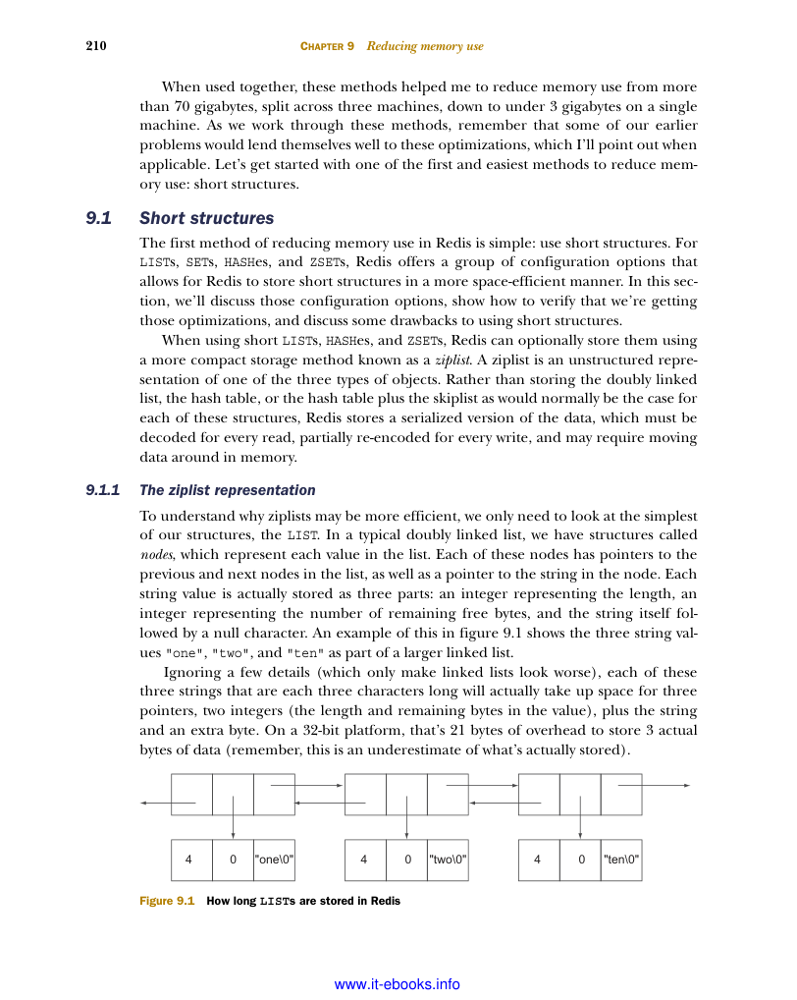
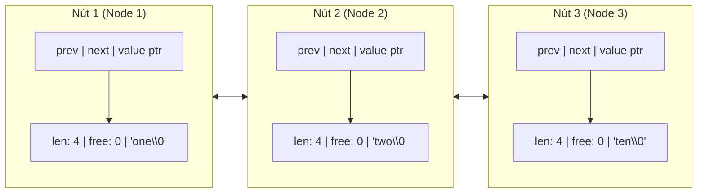
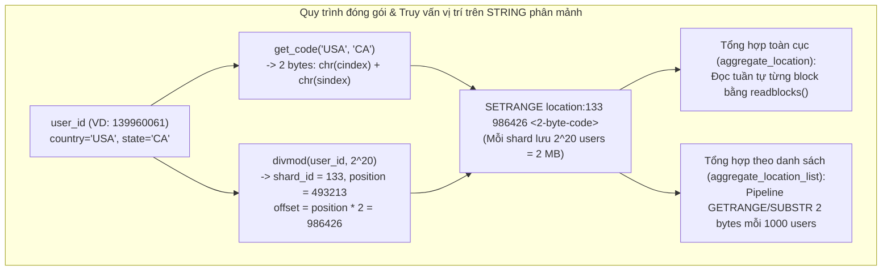

# Phần 3: Các bước tiếp theo (Part 3: Next steps)

Trong các chương cuối cùng này, bạn sẽ tìm hiểu về những cạm bẫy phổ biến mà nhiều người dùng Redis thường gặp phải (giảm mức sử dụng bộ nhớ, mở rộng hiệu năng và viết kịch bản với Lua), cũng như cách giải quyết các vấn đề đó bằng những kỹ thuật tiêu chuẩn.

---

# Chương 9: Giảm mức sử dụng bộ nhớ (Reducing memory use)

Trong chương này, chúng ta sẽ tìm hiểu ba phương pháp quan trọng giúp giảm mức sử dụng bộ nhớ (memory use) trong Redis. Bằng cách cắt giảm lượng bộ nhớ bạn sử dụng trong Redis, bạn có thể giảm thời gian cần thiết để tạo hoặc nạp một bản chụp nhanh (snapshot), ghi lại (rewrite) hoặc nạp tệp chỉ ghi nối thêm (append-only file - AOF), giảm thời gian đồng bộ hóa máy chủ phụ (slave synchronization time)$^1$, và lưu trữ được nhiều dữ liệu hơn trong Redis mà không cần bổ sung thêm phần cứng.

Chúng ta sẽ bắt đầu chương này bằng việc thảo luận về cách sử dụng các cấu trúc dữ liệu ngắn (short data structures) trong Redis để đạt được cách biểu diễn dữ liệu hiệu quả hơn. Tiếp đó, chúng ta sẽ bàn về cách áp dụng một khái niệm gọi là phân mảnh (sharding) để giúp chia nhỏ một số cấu trúc lớn thành các cấu trúc nhỏ hơn$^2$. Cuối cùng, chúng ta sẽ nói về việc đóng gói dữ liệu có độ dài cố định (fixed-length data) vào các `STRING` để tiết kiệm bộ nhớ hơn nữa.

**Nội dung chính của chương này (This chapter covers):**
- Cấu trúc ngắn (Short structures)
- Cấu trúc phân mảnh (Sharded structures)
- Đóng gói các bit và byte (Packing bits and bytes)

> $^1$ Bản chụp nhanh (snapshots), ghi lại tệp chỉ ghi nối thêm (append-only file rewriting) và đồng bộ hóa máy chủ phụ (slave synchronization) đều đã được thảo luận trong Chương 4.
>
> $^2$ Việc chúng ta sử dụng kỹ thuật phân mảnh (sharding) ở đây chủ yếu nhằm mục đích giảm mức sử dụng bộ nhớ trên một máy chủ đơn lẻ. Trong Chương 10, chúng ta sẽ áp dụng các kỹ thuật tương tự để cho phép tăng thông lượng đọc (read throughput), thông lượng ghi (write throughput) và phân vùng bộ nhớ (memory partitioning) trên nhiều máy chủ Redis.

Khi được kết hợp cùng nhau, những phương pháp này đã giúp tôi giảm mức sử dụng bộ nhớ từ hơn 70 gigabyte (chia trên ba máy chủ) xuống còn dưới 3 gigabyte trên một máy chủ duy nhất. Khi chúng ta lần lượt đi qua các phương pháp này, hãy nhớ rằng một số bài toán trước đây của chúng ta rất phù hợp để áp dụng những tối ưu hóa này, và tôi sẽ chỉ rõ điều đó khi thích hợp. Hãy bắt đầu với một trong những phương pháp đầu tiên và dễ dàng nhất để giảm mức sử dụng bộ nhớ: các cấu trúc ngắn (short structures).

---

## 9.1 Cấu trúc ngắn (Short structures)

Phương pháp đầu tiên để giảm mức sử dụng bộ nhớ trong Redis rất đơn giản: sử dụng các cấu trúc ngắn (short structures). Đối với `LIST`, `SET`, `HASH` và `ZSET`, Redis cung cấp một nhóm các tùy chọn cấu hình cho phép Redis lưu trữ các cấu trúc ngắn theo cách tiết kiệm không gian bộ nhớ hơn. Trong mục này, chúng ta sẽ thảo luận về các tùy chọn cấu hình đó, chỉ ra cách kiểm tra xem chúng ta có đang nhận được những tối ưu hóa đó hay không, và bàn về một số nhược điểm khi sử dụng cấu trúc ngắn.

Khi sử dụng các `LIST`, `HASH` và `ZSET` ngắn, Redis có thể tùy chọn lưu trữ chúng bằng một phương pháp lưu trữ nhỏ gọn hơn được gọi là danh sách nén (*ziplist*). Một `ziplist` là một dạng biểu diễn phi cấu trúc (unstructured representation) của một trong ba kiểu đối tượng trên. Thay vì lưu trữ danh sách liên kết đôi (doubly linked list), bảng băm (hash table), hoặc bảng băm kết hợp với danh sách nhảy (skiplist) như thông thường đối với từng cấu trúc này, Redis lưu trữ một phiên bản tuần tự hóa (serialized version) của dữ liệu — phiên bản này phải được giải mã (decoded) trong mỗi lần đọc, mã hóa lại một phần (partially re-encoded) trong mỗi lần ghi, và có thể đòi hỏi phải di chuyển dữ liệu qua lại trong bộ nhớ.

### 9.1.1 Biểu diễn ziplist (The ziplist representation)

Để hiểu tại sao `ziplist` lại hiệu quả hơn, chúng ta chỉ cần nhìn vào cấu trúc đơn giản nhất trong số các cấu trúc của mình: `LIST`. Trong một danh sách liên kết đôi (doubly linked list) điển hình, chúng ta có các cấu trúc được gọi là các nút (*nodes*), đại diện cho từng giá trị trong danh sách. Mỗi nút này có các con trỏ (pointers) trỏ tới nút trước đó và nút tiếp theo trong danh sách, cũng như một con trỏ trỏ tới chuỗi ký tự bên trong nút. Mỗi giá trị chuỗi thực chất được lưu trữ dưới dạng ba phần: một số nguyên biểu diễn độ dài (length), một số nguyên biểu diễn số byte trống còn lại (remaining free bytes), và bản thân chuỗi ký tự đó theo sau bởi một ký tự kết thúc chuỗi (`null` character `\0`). Một ví dụ về cấu trúc này trong **Hình 9.1** minh họa ba giá trị chuỗi `"one"`, `"two"` và `"ten"` nằm trong một danh sách liên kết lớn hơn.

Bỏ qua một vài chi tiết (những chi tiết vốn chỉ làm cho danh sách liên kết trông tệ hơn về mặt tiêu tốn bộ nhớ), mỗi chuỗi trong ba chuỗi dài 3 ký tự này thực tế sẽ chiếm không gian cho ba con trỏ, hai số nguyên (độ dài và số byte còn dư trong giá trị), cộng với bản thân chuỗi và một byte phụ thêm (`\0`). Trên nền tảng 32-bit, con số đó tương đương 21 byte chi phí phụ trội (overhead) chỉ để lưu trữ 3 byte dữ liệu thực tế (hãy nhớ rằng đây mới chỉ là ước tính thấp hơn so với những gì thực sự được lưu trữ).



**Hình 9.1 – Cách các LIST dài được lưu trữ trong Redis (Figure 9.1 How long LISTs are stored in Redis)**



| Thành phần trong mỗi phần tử của Linked List (32-bit) | Kích thước (Bytes) | Giải thích |
|---|---|---|
| Con trỏ `prev`, `next`, `value` | 12 bytes (3 × 4 bytes) | Liên kết nút trước, nút sau và trỏ tới cấu trúc chuỗi SDS |
| Số nguyên `len` và `free` | 8 bytes (2 × 4 bytes) | Độ dài chuỗi và số byte còn trống trong bộ đệm SDS |
| Chuỗi dữ liệu + ký tự `\0` | 4 bytes (3 + 1 byte) | 3 byte dữ liệu thực tế (`"one"`, `"two"`, `"ten"`) + 1 byte kết thúc `\0` |
| **Tổng cộng mỗi phần tử** | **24 bytes (21 bytes overhead)** | **21 bytes chi phí phụ trội chỉ để lưu 3 bytes dữ liệu thực** |

Mặt khác, biểu diễn `ziplist` sẽ lưu trữ một chuỗi liên tiếp các phần tử theo định dạng: *độ dài, độ dài, chuỗi ký tự* (`length, length, string`). Độ dài đầu tiên là kích thước của phần tử đứng ngay trước đó (giúp dễ dàng quét theo cả hai chiều), độ dài thứ hai là kích thước của phần tử hiện tại, và chuỗi ký tự chính là bản thân dữ liệu được lưu trữ. Có một số chi tiết khác về ý nghĩa thực sự của các giá trị độ dài này trong thực tế, nhưng đối với ba chuỗi ví dụ này, mỗi giá trị độ dài sẽ dài 1 byte, tức là chỉ tốn 2 byte chi phí phụ trội (overhead) cho mỗi phần tử trong ví dụ này. Bằng cách không lưu trữ thêm các con trỏ và siêu dữ liệu (metadata), `ziplist` có thể cắt giảm chi phí phụ trội từ 21 byte mỗi phần tử xuống chỉ còn khoảng 2 byte (trong ví dụ này).

Hãy xem làm thế nào chúng ta có thể đảm bảo rằng mình đang sử dụng cách mã hóa `ziplist` nhỏ gọn này.

#### SỬ DỤNG MÃ HÓA ZIPLIST (USING THE ZIPLIST ENCODING)

Để đảm bảo rằng các cấu trúc này chỉ được sử dụng khi cần thiết nhằm giảm bộ nhớ, Redis bao gồm sáu tùy chọn cấu hình, được thể hiện trong listing dưới đây, dùng để xác định khi nào biểu diễn `ziplist` sẽ được sử dụng cho `LIST`, `HASH` và `ZSET`.

**Listing 9.1 – Các tùy chọn cấu hình cho biểu diễn ziplist của các cấu trúc khác nhau (Configuration options for the ziplist representation of different structures)**

```ini
list-max-ziplist-entries 512
list-max-ziplist-value 64

hash-max-ziplist-entries 512
hash-max-ziplist-value 64

zset-max-ziplist-entries 128
zset-max-ziplist-value 64
```

**Giải thích mã nguồn:**
- `list-max-ziplist-entries 512` / `list-max-ziplist-value 64`: Giới hạn để sử dụng `ziplist` đối với `LIST`.
- `hash-max-ziplist-entries 512` / `hash-max-ziplist-value 64`: Giới hạn để sử dụng `ziplist` đối với `HASH` (các phiên bản Redis trước đây sử dụng một tên gọi và cách mã hóa khác cho cấu hình này, cụ thể là `zipmap`).
- `zset-max-ziplist-entries 128` / `zset-max-ziplist-value 64`: Giới hạn để sử dụng `ziplist` đối với `ZSET`.

Các tùy chọn cấu hình cơ bản cho `LIST`, `HASH` và `ZSET` đều tương tự nhau, bao gồm các thiết lập `-max-ziplist-entries` và `-max-ziplist-value`. Ngữ nghĩa của chúng về cơ bản là giống hệt nhau trong cả ba trường hợp. Thiết lập `entries` cho chúng ta biết số lượng phần tử tối đa được phép có trong `LIST`, `HASH` hoặc `ZSET` để chúng được mã hóa dưới dạng một `ziplist`. Thiết lập `value` cho chúng ta biết kích thước tối đa tính bằng byte của từng phần tử riêng lẻ. Nếu vượt quá một trong hai giới hạn này, Redis sẽ chuyển đổi `LIST`, `HASH` hoặc `ZSET` đó sang cấu trúc không phải `ziplist` (do đó làm tăng mức sử dụng bộ nhớ).

Nếu chúng ta đang sử dụng bản cài đặt Redis 2.6 với cấu hình mặc định, Redis sẽ có các thiết lập mặc định giống hệt như những gì được cung cấp trong **Listing 9.1**. Hãy thử nghiệm với biểu diễn `ziplist` của một đối tượng `LIST` đơn giản bằng cách thêm một số phần tử và kiểm tra dạng biểu diễn của nó, như minh họa trong listing tiếp theo.

**Listing 9.2 – Cách xác định xem một cấu trúc có được lưu trữ dưới dạng ziplist hay không (How to determine whether a structure is stored as a ziplist)**

```python
>>> conn.rpush('test', 'a', 'b', 'c', 'd')
4
>>> conn.debug_object('test')
{'encoding': 'ziplist', 'refcount': 1, 'lru_seconds_idle': 20,
'lru': 274841, 'at': '0xb6c9f120', 'serializedlength': 24,
'type': 'Value'}
>>> conn.rpush('test', 'e', 'f', 'g', 'h')
8
>>> conn.debug_object('test')
{'encoding': 'ziplist', 'refcount': 1, 'lru_seconds_idle': 0,
'lru': 274846, 'at': '0xb6c9f120', 'serializedlength': 36,
'type': 'Value'}
>>> conn.rpush('test', 65*'a')
9
>>> conn.debug_object('test')
{'encoding': 'linkedlist', 'refcount': 1, 'lru_seconds_idle': 10,
'lru': 274851, 'at': '0xb6c9f120', 'serializedlength': 30,
'type': 'Value'}
>>> conn.rpop('test')
'aaaaaaaaaaaaaaaaaaaaaaaaaaaaaaaaaaaaaaaaaaaaaaaaaaaaaaaaaaaaaaaaa'
>>> conn.debug_object('test')
{'encoding': 'linkedlist', 'refcount': 1, 'lru_seconds_idle': 0,
'lru': 274853, 'at': '0xb6c9f120', 'serializedlength': 17,
'type': 'Value'}
```

**Giải thích mã nguồn:**
- `conn.rpush('test', 'a', 'b', 'c', 'd')`: Hãy bắt đầu bằng cách đẩy 4 phần tử vào một `LIST`.
- `conn.debug_object('test')`: Chúng ta có thể khám phá thông tin về một đối tượng cụ thể bằng lệnh `DEBUG OBJECT`.
- `'encoding': 'ziplist', ... 'serializedlength': 24`: Thông tin mà chúng ta đang tìm kiếm là trường `encoding`, cho biết đây là một `ziplist` đang sử dụng 24 byte bộ nhớ.
- `conn.rpush('test', 'e', 'f', 'g', 'h')`: Hãy đẩy thêm 4 phần tử nữa vào `LIST`.
- `'encoding': 'ziplist', ... 'serializedlength': 36`: Chúng ta vẫn có một `ziplist`, và kích thước của nó đã tăng lên 36 byte (tương ứng chính xác với 2 byte chi phí phụ trội + 1 byte dữ liệu cho mỗi phần tử trong 4 phần tử vừa đẩy vào: $4 \times 3 = 12$ byte tăng thêm).
- `conn.rpush('test', 65*'a')`: Khi chúng ta đẩy một phần tử lớn hơn mức cho phép của kiểu mã hóa (65 byte > 64 byte), `LIST` sẽ được chuyển đổi từ mã hóa `ziplist` sang danh sách liên kết tiêu chuẩn (`linkedlist`).
- `'encoding': 'linkedlist', ... 'serializedlength': 30`: Mặc dù `serializedlength` (độ dài tuần tự hóa RDB) giảm xuống, nhưng đối với các kiểu mã hóa không phải `ziplist` (ngoại trừ kiểu mã hóa đặc biệt dành cho `SET`), con số này không phản ánh lượng bộ nhớ thực tế mà cấu trúc đang sử dụng trong RAM.
- `conn.rpop('test')` -> `'encoding': 'linkedlist'`: Sau khi một `ziplist` đã bị chuyển đổi sang cấu trúc thông thường, nó sẽ **không** được mã hóa ngược trở lại thành `ziplist` ngay cả khi sau đó cấu trúc này thỏa mãn lại các tiêu chí giới hạn.

Với lệnh `DEBUG OBJECT` mới trong tay, việc phát hiện xem một đối tượng có được lưu trữ dưới dạng `ziplist` hay không sẽ rất hữu ích để giảm mức sử dụng bộ nhớ.

> 📝 **Giải thích thêm (không có trong sách) — Đối chiếu với Redis 6/7/8 & `redis-py` 5.x hiện đại: Sự tiến hóa từ `ziplist` sang `quicklist` và `listpack`**
>
> Trong các phiên bản Redis hiện đại, cấu trúc lưu trữ nội bộ cho các cấu trúc ngắn đã được cải tiến đáng kể để khắc phục nhược điểm cấp phát lại bộ nhớ và hiệu ứng "cập nhật dây chuyền" (*cascade update*) của `ziplist`:
> 1. **`quicklist` (từ Redis 3.2+)**: Đối với kiểu `LIST`, Redis không còn dùng trực tiếp một `ziplist` đơn lẻ hay `linkedlist` thuần túy nữa mà thay bằng `quicklist` (một danh sách liên kết đôi mà mỗi nút là một `ziplist`, hoặc từ Redis 7.0 là một `listpack`). Hai cấu hình `list-max-ziplist-entries` và `list-max-ziplist-value` được thay thế bằng **`list-max-listpack-size -2`** (giới hạn mỗi nút `quicklist` không quá 8 KB) kết hợp với **`list-compress-depth 0`** (nén LZF các nút ở giữa `quicklist` nếu đặt $> 0$).
> 2. **`listpack` (từ Redis 7.0+)**: `ziplist` có nhược điểm là mỗi phần tử lưu `prevlen` (độ dài phần tử liền trước); khi một phần tử ở đầu bị mở rộng từ dưới 254 byte lên $\ge 254$ byte, trường `prevlen` của phần tử kế tiếp phải tăng từ 1 byte lên 5 byte, có thể gây ra hiệu ứng dây chuyền làm toàn bộ các phần tử phía sau phải cấp phát lại. Từ Redis 7.0+, Redis thay thế hoàn toàn `ziplist` bằng **`listpack`** cho `HASH`, `ZSET`, `LIST` (và từ Redis 7.2+ cả `SET` chứa chuỗi ngắn cũng dùng `listpack`!).
> 3. **Bảng tổng hợp đầy đủ các tham số cấu hình bộ nhớ đổi tên từ Redis 2.6 sang Redis 7.0/8.0**:
>
> | Kiểu dữ liệu | Tham số trong sách (Redis 2.6) | Tham số hiện đại (Redis 7.0 / 8.0) | Biểu diễn nội bộ (`OBJECT ENCODING`) | Giải thích chi tiết |
> | :--- | :--- | :--- | :--- | :--- |
> | **`LIST`** | `list-max-ziplist-entries 512`<br>`list-max-ziplist-value 64` | **`list-max-listpack-size -2`**<br>**`list-compress-depth 0`** | `quicklist` (hoặc `listpack` nếu chỉ có 1 nút nhỏ trong Redis 7.0+) | Mỗi nút của `quicklist` là một `listpack` tối đa 8 KB (`-2`). Không còn bị chuyển toàn bộ sang `linkedlist` khi vượt 512 phần tử! |
> | **`HASH`** | `hash-max-ziplist-entries 512`<br>`hash-max-ziplist-value 64` | **`hash-max-listpack-entries 512`**<br>**`hash-max-listpack-value 64`** | `listpack` $\rightarrow$ `hashtable` | Lưu dưới dạng `listpack` khi số cặp field/value $\le 512$ và mỗi chuỗi $\le 64$ byte; vượt ngưỡng sẽ chuyển sang `hashtable`. |
> | **`ZSET`** | `zset-max-ziplist-entries 128`<br>`zset-max-ziplist-value 64` | **`zset-max-listpack-entries 128`**<br>**`zset-max-listpack-value 64`** | `listpack` $\rightarrow$ `skiplist` | Lưu dưới dạng `listpack` khi số phần tử $\le 128$ và mỗi member $\le 64$ byte; vượt ngưỡng chuyển sang `skiplist` + `hashtable`. |
> | **`SET`** | `set-max-intset-entries 512` | **`set-max-intset-entries 512`**<br>**`set-max-listpack-entries 128`** (Redis 7.2+)<br>**`set-max-listpack-value 64`** (Redis 7.2+) | `intset` / `listpack` $\rightarrow$ `hashtable` | Số nguyên 64-bit dùng `intset` ($\le 512$ phần tử); từ Redis 7.2+, `SET` chứa chuỗi ngắn cũng dùng `listpack` trước khi chuyển sang `hashtable`. |
> | **`STRING`** | *(Tự động)* | *(Tự động)* | `int`, `embstr` ($\le 44$ byte), `raw` ($> 44$ byte) | Chuỗi số nguyên 64-bit dùng `int`; chuỗi ngắn $\le 44$ byte dùng `embstr` (cấp phát liền khối với `redisObject`). |
> | **Kiểm tra Encoding & RAM** | `DEBUG OBJECT key`<br>(`conn.debug_object(key)`) | **`OBJECT ENCODING key`** (`conn.object("encoding", key)`)<br>**`MEMORY USAGE key`** (`conn.memory_usage(key)`) | Trả về tên encoding & số byte RAM thực tế | `DEBUG OBJECT` nặng và thường bị tắt trên production; **`MEMORY USAGE key`** (từ Redis 4.0+) đo chính xác tổng số byte RAM mà khóa chiếm dụng! |
>
> > 💡 **Ví dụ bổ sung (không có trong sách): Kiểm tra `OBJECT ENCODING` và `MEMORY USAGE` bằng `redis-py` 5.x trên Redis 7/8**
> >
> > ```python
> > import redis
> >
> > r = redis.Redis(host="localhost", port=6379, decode_responses=True)
> >
> > r.delete("test:hash")
> > r.hset("test:hash", mapping={f"f{i}": "val" for i in range(10)})
> > print(r.object("encoding", "test:hash"))  # 'listpack' (trên Redis 7/8)
> > print(r.memory_usage("test:hash"))        # ~128 bytes (đo chính xác RAM bằng MEMORY USAGE)
> >
> > # Khi thêm một giá trị vượt ngưỡng hash-max-listpack-value (64 bytes):
> > r.hset("test:hash", "big_field", "a" * 65)
> > print(r.object("encoding", "test:hash"))  # 'hashtable'
> > print(r.memory_usage("test:hash"))        # ~632 bytes
> > ```

Bạn sẽ nhận thấy có một cấu trúc rõ ràng đang vắng mặt trong kiểu mã hóa `ziplist` đặc biệt này: đó là `SET`. Các `SET` cũng có một dạng biểu diễn nhỏ gọn, nhưng với ngữ nghĩa và giới hạn khác, mà chúng ta sẽ tìm hiểu ngay tiếp theo.

### 9.1.2 Mã hóa intset cho SET (The intset encoding for SETs)

Giống như `ziplist` dành cho `LIST`, `HASH` và `ZSET`, cũng có một dạng biểu diễn nhỏ gọn dành cho các `SET` ngắn. Nếu tất cả các phần tử (members) trong `SET` của chúng ta đều có thể được hiểu là các số nguyên hệ cơ số 10 (base-10 integers) nằm trong phạm vi số nguyên dài có dấu (`signed long integer`) của nền tảng máy chủ, và `SET` của chúng ta đủ ngắn (chúng ta sẽ nói tới giới hạn đó ngay bây giờ), Redis sẽ lưu trữ `SET` dưới dạng một mảng số nguyên đã được sắp xếp (sorted array of integers), hay còn gọi là `intset`.

Bằng cách lưu trữ một `SET` dưới dạng mảng đã sắp xếp, chúng ta không chỉ có chi phí phụ trội (overhead) thấp mà tất cả các thao tác `SET` tiêu chuẩn đều có thể được thực hiện nhanh chóng. Nhưng lớn đến mức nào thì gọi là quá lớn? Listing tiếp theo cho thấy tùy chọn cấu hình dùng để định nghĩa kích thước tối đa của một `intset`.

**Listing 9.3 – Cấu hình kích thước tối đa của mã hóa intset cho SET (Configuring the maximum size of the intset encoding for SETs)**

```ini
set-max-intset-entries 512
```

**Giải thích mã nguồn:**
- `set-max-intset-entries 512`: Giới hạn số lượng phần tử tối đa để sử dụng `intset` đối với `SET`.

Miễn là chúng ta giữ cho các `SET` chứa số nguyên của mình nhỏ hơn kích thước đã cấu hình, Redis sẽ sử dụng dạng biểu diễn `intset` để giảm kích thước dữ liệu. Listing dưới đây cho thấy điều gì sẽ xảy ra khi một `intset` phát triển đến mức trở nên quá lớn.

**Listing 9.4 – Khi một intset phát triển quá lớn, nó được biểu diễn dưới dạng bảng băm (When an intset grows to be too large, it’s represented as a hash table.)**

```python
>>> conn.sadd('set-object', *range(500))
500
>>> conn.debug_object('set-object')
{'encoding': 'intset', 'refcount': 1, 'lru_seconds_idle': 0,
'lru': 283116, 'at': '0xb6d1a1c0', 'serializedlength': 1010,
'type': 'Value'}
>>> conn.sadd('set-object', *range(500, 1000))
500
>>> conn.debug_object('set-object')
{'encoding': 'hashtable', 'refcount': 1, 'lru_seconds_idle': 0,
'lru': 283118, 'at': '0xb6d1a1c0', 'serializedlength': 2874,
'type': 'Value'}
```

**Giải thích mã nguồn:**
- `conn.sadd('set-object', *range(500))`: Hãy thêm 500 phần tử vào tập hợp (`SET`) và quan sát thấy nó vẫn được mã hóa dưới dạng một `intset` (`'encoding': 'intset'`).
- `conn.sadd('set-object', *range(500, 1000))`: Khi chúng ta đẩy số lượng phần tử vượt quá giới hạn 512 phần tử đã cấu hình, `intset` sẽ được chuyển đổi sang dạng biểu diễn bảng băm (`'encoding': 'hashtable'`).

Trước đó, trong phần giới thiệu của mục 9.1, tôi đã đề cập rằng để đọc hoặc cập nhật một phần của đối tượng sử dụng biểu diễn `ziplist` nhỏ gọn, chúng ta có thể cần phải giải mã toàn bộ `ziplist`, và có thể phải di chuyển dữ liệu trong bộ nhớ. Vì những lý do này, việc đọc và ghi các cấu trúc lớn được mã hóa bằng `ziplist` có thể làm giảm hiệu năng. Các `SET` được mã hóa bằng `intset` cũng gặp vấn đề tương tự, không phải do việc mã hóa và giải mã dữ liệu cho lắm, mà một lần nữa là vì chúng ta cần phải dịch chuyển dữ liệu trong mảng khi thực hiện các thao tác chèn (insertions) và xóa (deletions). Tiếp theo, chúng ta sẽ xem xét một số vấn đề về hiệu năng khi thao tác với các `ziplist` dài.

### 9.1.3 Các vấn đề hiệu năng đối với ziplist và intset dài (Performance issues for long ziplists and intsets)

Khi các cấu trúc của chúng ta phát triển vượt quá giới hạn của `ziplist` và `intset`, chúng sẽ tự động được chuyển đổi sang các kiểu cấu trúc nền tảng điển hình hơn của mình. Điều này được thực hiện chủ yếu bởi vì việc thao tác trên các phiên bản nén nhỏ gọn của những cấu trúc này có thể trở nên chậm chạp khi chúng dài ra.

Để tận mắt chứng kiến điều này xảy ra như thế nào, hãy bắt đầu bằng cách cập nhật thiết lập `list-max-ziplist-entries` lên `110,000`. Thiết lập này lớn hơn rất nhiều so với mức chúng ta từng sử dụng trong thực tế, nhưng nó giúp làm nổi bật vấn đề. Sau khi cập nhật thiết lập đó và khởi động lại Redis, chúng ta sẽ đo kiểm hiệu năng (benchmark) của Redis để khám phá các vấn đề hiệu năng có thể xảy ra khi sử dụng các `LIST` dài được mã hóa bằng `ziplist`.

Để đo kiểm hành vi của các `LIST` dài mã hóa bằng `ziplist`, chúng ta sẽ viết một hàm tạo ra một `LIST` với số lượng phần tử được chỉ định. Sau khi `LIST` được tạo xong, chúng ta sẽ gọi lặp đi lặp lại lệnh `RPOPLPUSH` để di chuyển một phần tử từ đầu bên phải của `LIST` sang đầu bên trái. Thao tác này sẽ cung cấp cho chúng ta một cận dưới (lower bound) về mức độ tốn kém của các lệnh khi chạy trên những `LIST` rất dài được mã hóa bằng `ziplist`. Hàm đo kiểm hiệu năng này được trình bày trong listing tiếp theo.

**Listing 9.5 – Mã nguồn đo kiểm hiệu năng các LIST được mã hóa bằng ziplist với kích thước khác nhau (Our code to benchmark varying sizes of ziplist-encoded LISTs)**

```python
def long_ziplist_performance(conn, key, length, passes, psize):
    conn.delete(key)
    conn.rpush(key, *range(length))
    pipeline = conn.pipeline(False)
    t = time.time()
    for p in xrange(passes):
        for pi in xrange(psize):
            pipeline.rpoplpush(key, key)
        pipeline.execute()
    return (passes * psize) / (time.time() - t or .001)
```

**Giải thích mã nguồn:**
- `def long_ziplist_performance(conn, key, length, passes, psize):`: Chúng ta tham số hóa mọi thứ để có thể đo lường hiệu năng theo nhiều cách khác nhau.
- `conn.delete(key)`: Bắt đầu bằng việc xóa khóa được chỉ định nhằm đảm bảo rằng chúng ta chỉ đo kiểm chính xác những gì mình dự định.
- `conn.rpush(key, *range(length))`: Khởi tạo `LIST` bằng cách đẩy số lượng con số mong muốn vào đầu bên phải.
- `pipeline = conn.pipeline(False)`: Chuẩn bị một pipeline (không dùng giao dịch `MULTI`/`EXEC`) để chúng ta ít bị ảnh hưởng bởi thời gian khứ hồi mạng (network round-trip times).
- `t = time.time()`: Bắt đầu bấm giờ.
- `for p in xrange(passes):`: Chúng ta sẽ thực hiện một số lần chạy pipeline được cung cấp bởi tham số `passes`.
- `for pi in xrange(psize):`: Mỗi lần thực thi pipeline sẽ bao gồm `psize` lệnh gọi thực tế tới `RPOPLPUSH`.
- `pipeline.rpoplpush(key, key)`: Mỗi lệnh gọi sẽ lấy phần tử ngoài cùng bên phải ra khỏi `LIST` và đẩy nó vào đầu bên trái của chính `LIST` đó.
- `pipeline.execute()`: Thực thi `psize` lệnh gọi `RPOPLPUSH`.
- `return (passes * psize) / (time.time() - t or .001)`: Tính toán số lượng lệnh gọi mỗi giây (operations per second) được thực hiện.

Như đã đề cập trước đó, đoạn mã này tạo ra một `LIST` có kích thước cho trước và sau đó thực thi một số lượng lệnh `RPOPLPUSH` trong các pipeline. Bằng cách lấy tổng số lệnh gọi `RPOPLPUSH` chia cho khoảng thời gian thực hiện, chúng ta có thể tính được số lượng thao tác mỗi giây có thể thực thi trên các `LIST` được mã hóa bằng `ziplist` ở một kích thước nhất định. Hãy chạy hàm này với kích thước danh sách tăng dần đều để xem các `ziplist` dài có thể làm giảm hiệu năng như thế nào.

**Listing 9.6 – Khi các LIST mã hóa bằng ziplist lớn dần, hiệu năng sụt giảm rõ rệt (As ziplist-encoded LISTs grow, we can see performance drop)**

```python
>>> long_ziplist_performance(conn, 'list', 1, 1000, 100)
52093.558416505381
>>> long_ziplist_performance(conn, 'list', 100, 1000, 100)
51501.154762768667
>>> long_ziplist_performance(conn, 'list', 1000, 1000, 100)
49732.490843316067
>>> long_ziplist_performance(conn, 'list', 5000, 1000, 100)
43424.056529592635
>>> long_ziplist_performance(conn, 'list', 10000, 1000, 100)
36727.062573334966
>>> long_ziplist_performance(conn, 'list', 50000, 1000, 100)
16695.140684975777
>>> long_ziplist_performance(conn, 'list', 100000, 500, 100)
553.10821080054586
```

**Giải thích kết quả đo kiểm:**
- Ở mức `1`, `100`, `1000` phần tử (`~52,093` -> `~49,732` ops/s): Với các danh sách được mã hóa dưới dạng `ziplist` có từ 1.000 phần tử trở xuống, Redis vẫn có thể thực hiện khoảng 50.000 thao tác mỗi giây hoặc tốt hơn.
- Ở mức `5000` và `10000` phần tử (`~43,424` -> `~36,727` ops/s): Khi các danh sách mã hóa dưới dạng `ziplist` tăng lên 5.000 phần tử hoặc nhiều hơn, hiệu năng bắt đầu sụt giảm do chi phí sao chép bộ nhớ (memory copy costs) bắt đầu ảnh hưởng xấu đến tốc độ xử lý.
- Ở mức `50000` phần tử (`~16,695` ops/s): Khi chạm mốc 50.000 phần tử trong một `ziplist`, hiệu năng đã sụt giảm đáng kể.
- Ở mức `100000` phần tử (`~553` ops/s): Và khi chạm tới 100.000 phần tử, `ziplist` thực sự trở nên không thể sử dụng được nữa.

Thoạt nhìn, bạn có thể nghĩ rằng kết quả này cũng không đến nỗi tệ ngay cả khi bạn để một `ziplist` phát triển lên tới vài nghìn phần tử. Nhưng ví dụ này chỉ cho thấy một thao tác đơn lẻ, trong đó tất cả những gì chúng ta làm là lấy các phần tử ở đầu bên phải ra và đẩy chúng vào đầu bên trái. Kiểu mã hóa `ziplist` có thể tìm thấy đầu bên phải hoặc bên trái của một chuỗi rất nhanh chóng (mặc dù việc dịch chuyển toàn bộ các phần tử sang một bên để chèn mới chính là thứ làm chúng ta chậm lại), và đối với ví dụ nhỏ này, chúng ta có thể tận dụng bộ nhớ đệm của CPU (CPU caches). Nhưng khi phải quét qua một danh sách để tìm một giá trị cụ thể — giống như ví dụ tự động hoàn thành (autocomplete) của chúng ta ở mục 6.1 — hoặc truy xuất/cập nhật từng trường riêng lẻ của một `HASH`, Redis sẽ phải giải mã nhiều phần tử riêng lẻ, và bộ nhớ đệm CPU sẽ không còn phát huy hiệu quả cao nữa. Để đưa ra một dẫn chứng dữ liệu: việc thay thế lệnh `RPOPLPUSH` của chúng ta bằng một lệnh gọi `LINDEX` lấy một phần tử nằm ở chính giữa `LIST` cho thấy hiệu năng chỉ bằng khoảng một nửa số thao tác mỗi giây so với lệnh gọi `RPOPLPUSH` khi `LIST` có độ dài ít nhất 5.000 phần tử. Bạn hãy tự mình thử nghiệm điều đó xem sao.

Nếu bạn giữ kích thước `ziplist` tối đa trong khoảng từ 500 đến 2.000 phần tử, và giữ kích thước tối đa của mỗi phần tử dưới khoảng 128 byte, bạn sẽ nhận được hiệu năng hợp lý. Cá nhân tôi cố gắng giữ kích thước `ziplist` tối đa ở mức 1.024 phần tử với kích thước mỗi phần tử từ 64 byte trở xuống. Đối với nhiều trường hợp sử dụng `HASH` mà chúng ta đã áp dụng cho đến nay, những giới hạn này sẽ cho phép bạn giữ mức sử dụng bộ nhớ thấp và hiệu năng cao.

Khi bạn phát triển các giải pháp cho những bài toán nằm ngoài các ví dụ của chúng ta, hãy nhớ rằng nếu bạn có thể giữ kích thước `LIST`, `SET`, `HASH` và `ZSET` của mình nhỏ gọn, bạn có thể giúp duy trì mức sử dụng bộ nhớ thấp, từ đó cho phép bạn sử dụng Redis cho nhiều bài toán đa dạng hơn.

> 📌 **GIỮ TÊN KHÓA NGẮN GỌN (KEEPING KEY NAMES SHORT)**
>
> Một điều mà tôi chưa từng đề cập trước đây là việc tối thiểu hóa độ dài của các khóa (keys), cả ở phần tên khóa của mọi giá trị, lẫn các khóa trường (fields) trong `HASH`, các phần tử (members) của `SET` và `ZSET`, và các mục (entries) trong `LIST`. Tất cả các chuỗi của bạn càng dài thì càng có nhiều dữ liệu cần phải lưu trữ. Nói chung, bất cứ khi nào có thể lưu trữ một mẩu thông tin tương đối viết tắt như `user:joe` làm khóa hoặc phần tử, thì cách đó luôn tốt hơn so với việc lưu `username:joe`, hoặc thậm chí chỉ lưu `joe` nếu ngữ cảnh `user` hay `username` đã được ngầm hiểu. Mặc dù trong một số trường hợp điều này có thể không tạo ra sự khác biệt quá lớn, nhưng nếu bạn đang lưu trữ hàng triệu hoặc hàng tỷ mục dữ liệu, vài megabyte hoặc gigabyte tiết kiệm thêm đó có thể sẽ rất hữu ích về sau.

Bây giờ bạn đã thấy rằng các cấu trúc ngắn trong Redis có thể được sử dụng để giảm mức sử dụng bộ nhớ, trong mục tiếp theo chúng ta sẽ nói về việc phân mảnh (sharding) các cấu trúc lớn để giúp chúng ta tận dụng được lợi ích tối ưu hóa của `ziplist` và `intset` cho nhiều bài toán hơn nữa.

---

## 9.2 Cấu trúc phân mảnh (Sharded structures)

Phân mảnh (sharding) là một kỹ thuật nổi tiếng đã được sử dụng để giúp nhiều hệ quản trị cơ sở dữ liệu khác nhau mở rộng quy mô sang mức lưu trữ dữ liệu và tải xử lý lớn hơn. Về cơ bản, kỹ thuật phân mảnh lấy dữ liệu của bạn, chia nhỏ (partitions) dữ liệu đó thành các phần nhỏ hơn dựa trên một số quy tắc đơn giản, rồi gửi dữ liệu đến các vị trí khác nhau tùy thuộc vào phân vùng mà dữ liệu đó được gán vào.

Trong mục này, chúng ta sẽ nói về việc áp dụng khái niệm phân mảnh cho các `HASH`, `SET` và `ZSET` để hỗ trợ một tập con các chức năng tiêu chuẩn của chúng, đồng thời vẫn cho phép chúng ta sử dụng các cấu trúc nhỏ từ mục 9.1 nhằm giảm mức sử dụng bộ nhớ. Nhìn chung, thay vì lưu trữ giá trị `X` trong khóa `Y`, chúng ta sẽ lưu trữ `X` trong khóa `Y:<shardid>`.

> 📌 **PHÂN MẢNH LIST (SHARDING LISTS)**
>
> Việc phân mảnh các `LIST` mà không sử dụng kịch bản Lua (Lua scripting) là rất khó khăn, đó là lý do tại sao chúng ta bỏ qua nó ở đây. Khi giới thiệu về việc viết kịch bản với Lua trong Chương 11, chúng ta sẽ xây dựng một cài đặt `LIST` phân mảnh hỗ trợ các thao tác đẩy (push) và lấy ra (pop) ở cả hai đầu theo cả hai chế độ chặn (blocking) và không chặn (nonblocking).

> 📌 **PHÂN MẢNH ZSET (SHARDING ZSETS)**
>
> Không giống như các `HASH` và `SET` phân mảnh — nơi về cơ bản mọi thao tác đều có thể được hỗ trợ với một khối lượng công việc vừa phải (hoặc thậm chí cả `LIST` khi có kịch bản Lua) — các lệnh như `ZRANGE`, `ZRANGEBYSCORE`, `ZRANK`, `ZCOUNT`, `ZREMRANGE`, `ZREMRANGEBYSCORE`, và nhiều lệnh khác đòi hỏi phải thao tác trên *tất cả* các phân mảnh (shards) của một `ZSET` để tính toán ra kết quả cuối cùng. Bởi vì các thao tác này trên những `ZSET` phân mảnh vi phạm hầu hết mọi kỳ vọng về tốc độ thực thi nhanh chóng vốn có của một `ZSET`, nên việc phân mảnh một `ZSET` không thực sự hữu ích cho lắm, và đó là lý do chúng ta về cơ bản bỏ qua nó tại đây.
>
> Nếu bạn cần lưu giữ toàn bộ thông tin cho một `ZSET` lớn, nhưng bạn chỉ thực sự thực hiện các truy vấn lấy `X` phần tử có điểm số cao nhất hoặc thấp nhất (top- or bottom-scoring X), bạn có thể phân mảnh `ZSET` của mình theo cùng cách chúng ta phân mảnh `HASH` trong mục 9.2.1: duy trì thêm các `ZSET` phụ trợ lưu nhóm điểm cao nhất/thấp nhất, mà bạn có thể cập nhật bằng cặp lệnh `ZADD`/`ZREMRANGEBYRANK` để giới hạn kích thước (như chúng ta đã từng làm trong Chương 2 và các Chương 4–8).
>
> Bạn cũng có thể sử dụng các `ZSET` phân mảnh như một cách để giảm độ trễ của từng lệnh đơn lẻ nếu bạn có các chỉ mục tìm kiếm (search indexes) lớn, mặc dù việc tìm ra các phần tử có điểm số cao nhất và thấp nhất cuối cùng sẽ cần một chuỗi lệnh `ZUNIONSTORE`/`ZREMRANGEBYRANK` có khả năng khá dài.

Khi phân mảnh các cấu trúc, chúng ta có thể đưa ra quyết định hoặc hỗ trợ toàn bộ chức năng của một cấu trúc đơn lẻ, hoặc chỉ hỗ trợ một tập con (subset) các chức năng tiêu chuẩn. Để cho đơn giản, khi phân mảnh các cấu trúc trong cuốn sách này, chúng ta sẽ chỉ cài đặt một tập con các chức năng được cung cấp bởi các cấu trúc tiêu chuẩn, bởi vì việc cài đặt đầy đủ toàn bộ chức năng có thể rất phức tạp và nặng nề (cả dưới góc độ tính toán lẫn khối lượng mã nguồn). Ngay cả khi chỉ cài đặt một tập con các chức năng, chúng ta vẫn sẽ sử dụng các cấu trúc phân mảnh này để mang lại mức giảm bộ nhớ đáng kể cho các bài toán hiện có, hoặc để giải quyết các bài toán mới hiệu quả hơn so với những gì có thể làm được nếu không phân mảnh.

Cấu trúc đầu tiên mà chúng ta sẽ bàn về việc phân mảnh là `HASH`.

### 9.2.1 Bảng băm – HASH (HASHes)

Một trong những công dụng chính của `HASH` là lưu trữ các cặp khóa/giá trị (key/value pairs) đơn giản theo từng nhóm. Quay lại mục 5.3, chúng ta đã phát triển một phương pháp ánh xạ địa chỉ IP sang các vị trí trên khắp thế giới. Bên cạnh một `ZSET` ánh xạ từ các địa chỉ IP sang các ID thành phố (`city ID`), chúng ta đã sử dụng một `HASH` duy nhất ánh xạ từ ID thành phố sang thông tin chi tiết về chính thành phố đó. `HASH` đó có hơn 370.000 mục dữ liệu khi sử dụng phiên bản cơ sở dữ liệu tháng 8 năm 2012, và bây giờ chúng ta sẽ tiến hành phân mảnh nó.

Để phân mảnh một bảng `HASH`, chúng ta cần chọn một phương pháp phân vùng dữ liệu của mình. Bởi vì bản thân các `HASH` đã có các khóa trường (keys/fields), chúng ta có thể sử dụng chính những khóa đó làm nguồn thông tin để phân vùng. Để phân vùng các khóa, nhìn chung chúng ta sẽ tính toán một hàm băm (hash function) ngay trên bản thân khóa đó để tạo ra một con số. Tùy thuộc vào số lượng khóa mà chúng ta muốn đưa vào trong một phân mảnh đơn lẻ và tổng số khóa cần lưu trữ, chúng ta sẽ tính toán số lượng phân mảnh cần thiết, rồi sử dụng con số đó cùng với giá trị băm để xác định ID phân mảnh (`shard ID`) nơi dữ liệu sẽ được lưu trữ.

Đối với các khóa dạng số (numeric keys), chúng ta sẽ giả định rằng các khóa ít nhiều mang tính tuần tự và được đóng gói dày đặc (tightly packed), do đó sẽ gán chúng vào một `shard ID` dựa trên chính giá trị khóa số của chúng (giữ các khóa có giá trị số gần nhau nằm trong cùng một phân mảnh). Listing tiếp theo trình bày hàm tính toán một khóa mới cho một `HASH` phân mảnh, khi biết khóa cơ sở (`base key`) và khóa trường bên trong `HASH` (`key`).

**Listing 9.7 – Hàm tính toán khóa phân mảnh từ khóa cơ sở và khóa phần tử thứ cấp (A function to calculate a shard key from a base key and a secondary entry key)**

```python
def shard_key(base, key, total_elements, shard_size):
    if isinstance(key, (int, long)) or key.isdigit():
        shard_id = int(str(key), 10) // shard_size
    else:
        shards = 2 * total_elements // shard_size
        shard_id = binascii.crc32(key) % shards
    return "%s:%s"%(base, shard_id)
```

**Giải thích mã nguồn:**
- `def shard_key(base, key, total_elements, shard_size):`: Chúng ta sẽ gọi hàm `shard_key()` với tên `HASH` cơ sở (`base`), cùng với khóa trường cần lưu trữ trong `HASH` phân mảnh (`key`), tổng số lượng phần tử dự kiến (`total_elements`), và kích thước phân mảnh mong muốn (`shard_size`).
- `if isinstance(key, (int, long)) or key.isdigit():`: Nếu giá trị khóa là một số nguyên hoặc một chuỗi trông giống như một số nguyên, chúng ta sẽ sử dụng trực tiếp nó để tính toán ID phân mảnh (`shard_id`). *(Lưu ý: Trong Python 3, kiểu `long` đã được hợp nhất vào `int`, nên chỉ cần viết `isinstance(key, int)`).*
- `shard_id = int(str(key), 10) // shard_size`: Đối với các số nguyên, chúng ta giả định chúng là các ID được gán tuần tự, vì vậy chúng ta có thể chọn một `shard_id` dựa trên các "bit" bậc cao của chính ID số đó (thông qua phép chia lấy phần nguyên `// shard_size`). Chúng ta cũng chỉ định rõ hệ cơ số 10 ở đây (đòi hỏi lệnh gọi `str()`) để một khóa như `'010'` sẽ chuyển thành `10`, chứ không phải `8` (hệ bát phân).
- `shards = 2 * total_elements // shard_size`: Đối với các khóa không phải số nguyên, trước tiên chúng ta tính tổng số lượng phân mảnh mong muốn, dựa trên tổng số phần tử dự kiến và kích thước phân mảnh mong muốn (nhân đôi số lượng phân mảnh để giảm xác suất một phân mảnh ngẫu nhiên bị vượt quá ngưỡng `shard_size`).
- `shard_id = binascii.crc32(key) % shards`: Khi đã biết số lượng phân mảnh, chúng ta băm khóa đó rồi chia lấy dư (modulo) cho số lượng phân mảnh. *(Lưu ý: Trong Python 3, `binascii.crc32()` nhận đầu vào là `bytes`, ví dụ `binascii.crc32(key.encode('utf-8'))`).*
- `return "%s:%s"%(base, shard_id)`: Cuối cùng, chúng ta kết hợp khóa cơ sở (`base`) với `shard_id` vừa tính được để xác định khóa phân mảnh hoàn chỉnh.

Trong hàm của chúng ta, bạn sẽ nhận thấy rằng đối với các khóa không phải dạng số, chúng ta tính giá trị kiểm tra CRC32 (CRC32 checksum). Chúng ta sử dụng CRC32 trong trường hợp này vì nó trả về một số nguyên đơn giản mà không cần xử lý thêm, tốc độ tính toán nhanh (nhanh hơn nhiều so với các hàm băm MD5 hoặc SHA1), và vì nó hoạt động đủ tốt cho hầu hết mọi tình huống.

> 📌 **TÍNH NHẤT QUÁN ĐỐI VỚI `total_elements` VÀ `shard_size` (BEING CONSISTENT ABOUT total_elements AND shard_size)**
>
> Khi sử dụng các khóa không phải dạng số để phân mảnh, bạn sẽ thấy rằng chúng ta dùng giá trị `total_elements` để tính tổng số lượng phân mảnh cần thiết, bên cạnh giá trị `shard_size` được dùng cho cả khóa dạng số lẫn khóa không phải dạng số. Hai thông tin này là cần thiết để giữ cho tổng số lượng phân mảnh ở mức thấp. Nếu bạn thay đổi một trong hai con số này, thì số lượng phân mảnh (và do đó là phân mảnh đích mà bất kỳ mẩu dữ liệu nào sẽ đi tới) cũng sẽ thay đổi theo. Bất cứ khi nào có thể, bạn không nên thay đổi một trong hai giá trị này; hoặc khi buộc phải thay đổi chúng, bạn cần có một quy trình để di chuyển dữ liệu của mình từ các phân mảnh dữ liệu cũ sang các phân mảnh dữ liệu mới (quy trình này thường được gọi là tái phân mảnh – *resharding*).

Bây giờ chúng ta sẽ sử dụng hàm `shard_key()` để chọn phân mảnh trong hai hàm hoạt động giống như `HSET` và `HGET` trên các bảng băm phân mảnh trong listing dưới đây.

**Listing 9.8 – Các hàm HSET và HGET phân mảnh (Sharded HSET and HGET functions)**

```python
def shard_hset(conn, base, key, value, total_elements, shard_size):
    shard = shard_key(base, key, total_elements, shard_size)
    return conn.hset(shard, key, value)

def shard_hget(conn, base, key, total_elements, shard_size):
    shard = shard_key(base, key, total_elements, shard_size)
    return conn.hget(shard, key)
```

**Giải thích mã nguồn:**
- Trong `shard_hset`:
  - `shard = shard_key(...)`: Tính toán phân mảnh sẽ dùng để lưu trữ giá trị của chúng ta.
  - `return conn.hset(shard, key, value)`: Thiết lập giá trị vào trong phân mảnh đó.
- Trong `shard_hget`:
  - `shard = shard_key(...)`: Tính toán phân mảnh để truy xuất giá trị của chúng ta.
  - `return conn.hget(shard, key)`: Lấy giá trị nằm trong phân mảnh đó ra.

Không có gì quá phức tạp ở đây cả; chúng ta chỉ đang tìm đúng vị trí cho dữ liệu cần được lưu trữ hoặc truy xuất từ `HASH`, rồi thiết lập hoặc lấy các giá trị đó ra. Để cập nhật các lệnh gọi tra cứu địa chỉ IP sang thành phố trước đây của chúng ta (từ Chương 5), chúng ta chỉ cần thay thế một lệnh gọi trong mỗi hàm của hai hàm đó. Listing tiếp theo chỉ hiển thị những phần trong các hàm trước đây của chúng ta cần được cập nhật.

**Listing 9.9 – Các hàm tra cứu IP phân mảnh (Sharded IP lookup functions)**

```python
TOTAL_SIZE = 320000
SHARD_SIZE = 1024

def import_cities_to_redis(conn, filename):
    for row in csv.reader(open(filename)):
        ...
        shard_hset(conn, 'cityid2city:', city_id,
            json.dumps([city, region, country]),
            TOTAL_SIZE, SHARD_SIZE)

def find_city_by_ip(conn, ip_address):
    ...
    data = shard_hget(conn, 'cityid2city:', city_id,
        TOTAL_SIZE, SHARD_SIZE)
    return json.loads(data)
```

**Giải thích mã nguồn:**
- `TOTAL_SIZE = 320000` / `SHARD_SIZE = 1024`: Chúng ta đặt các đối số cho những lệnh gọi phân mảnh làm hằng số toàn cục (global constants) để đảm bảo rằng chúng ta luôn truyền vào cùng một thông tin giống nhau.
- `shard_hset(conn, 'cityid2city:', city_id, ..., TOTAL_SIZE, SHARD_SIZE)`: Để ghi dữ liệu, chúng ta cần truyền thông tin `TOTAL_SIZE` và `SHARD_SIZE`, mặc dù trong trường hợp này `TOTAL_SIZE` không được dùng đến bởi vì các ID thành phố (`city_id`) của chúng ta là dạng số.
- `data = shard_hget(conn, 'cityid2city:', city_id, TOTAL_SIZE, SHARD_SIZE)`: Để truy xuất dữ liệu, chúng ta cần sử dụng cùng thông tin `TOTAL_SIZE` và `SHARD_SIZE` như đối với các khóa phân mảnh tổng quát.

Trên một máy chủ 64-bit, việc lưu trữ một `HASH` duy nhất chứa tất cả các thành phố của chúng ta chiếm khoảng 44 megabyte. Nhưng chỉ với vài thay đổi nhỏ này để phân mảnh dữ liệu, thiết lập `hash-max-ziplist-entries` thành `1024` và `hash-max-ziplist-value` thành `256` (tên thành phố/quốc gia dài nhất trong danh sách chỉ hơn 150 ký tự một chút), toàn bộ các `HASH` phân mảnh cộng lại chỉ chiếm khoảng 12 megabyte. Đó là mức giảm 70% kích thước dữ liệu, cho phép chúng ta lưu trữ lượng dữ liệu nhiều gấp 3,5 lần so với trước đây. Đối với các khóa và giá trị ngắn hơn, bạn thậm chí còn có thể thấy tỷ lệ phần trăm tiết kiệm lớn hơn nữa (vì chi phí phụ trội lớn hơn tương đối so với dữ liệu thực tế được lưu trữ).

> 📌 **LƯU TRỮ CÁC STRING TRONG HASH (STORING STRINGS IN HASHES)**
>
> Nếu bạn thấy mình đang lưu trữ rất nhiều chuỗi tương đối ngắn hoặc các con số dưới dạng những giá trị `STRING` thuần túy với các khóa được đặt tên nhất quán như `namespace:id`, bạn có thể lưu trữ các giá trị đó vào trong những `HASH` phân mảnh để giảm đáng kể mức sử dụng bộ nhớ trong một số trường hợp.

> 💪 **Bài tập: Bổ sung các thao tác khác (Exercise: Adding other operations)**
>
> Như bạn đã thấy, việc lấy và thiết lập các giá trị trong một `HASH` phân mảnh rất dễ dàng. Bạn có thể bổ sung hỗ trợ cho các thao tác `HDEL`, `HINCRBY` và `HINCRBYFLOAT` phân mảnh được không?

> 💡 **Ví dụ bổ sung (không có trong sách): Lời giải gợi ý cho bài tập `shard_hdel`, `shard_hincrby`, `shard_hincrbyfloat`**
>
> Vì cả ba thao tác này đều tác động lên một khóa trường (`key`) đơn lẻ bên trong `HASH`, chúng ta chỉ cần định tuyến đến đúng phân mảnh bằng `shard_key()`:
>
> ```python
> def shard_hdel(conn, base, key, total_elements, shard_size):
>     shard = shard_key(base, key, total_elements, shard_size)
>     return conn.hdel(shard, key)
>
> def shard_hincrby(conn, base, key, amount, total_elements, shard_size):
>     shard = shard_key(base, key, total_elements, shard_size)
>     return conn.hincrby(shard, key, amount)
>
> def shard_hincrbyfloat(conn, base, key, amount, total_elements, shard_size):
>     shard = shard_key(base, key, total_elements, shard_size)
>     return conn.hincrbyfloat(shard, key, amount)
> ```

Chúng ta vừa hoàn thành việc phân mảnh các bảng băm lớn để giảm mức sử dụng bộ nhớ của chúng. Tiếp theo, bạn sẽ tìm hiểu cách phân mảnh các tập hợp (`SET`).

### 9.2.2 Tập hợp – SET (SETs)

Một ứng dụng phổ biến của thao tác được gọi là *map-reduce* (mà tôi đã đề cập trong Chương 1 và Chương 6) là tính toán số lượng khách truy cập duy nhất (unique visitors) vào một trang web. Thay vì phải đợi đến cuối ngày mới thực hiện phép tính đó, chúng ta có thể duy trì một bộ đếm khách truy cập duy nhất được cập nhật trực tiếp (live updated count) xuyên suốt trong ngày. Một phương pháp để tính số lượng khách truy cập duy nhất trong Redis là sử dụng một `SET`, nhưng một `SET` đơn lẻ lưu trữ nhiều khách truy cập duy nhất sẽ rất lớn. Trong mục này, chúng ta sẽ phân mảnh các `SET` như một cách để xây dựng phương pháp đếm lượng khách truy cập duy nhất vào một trang web.

Để bắt đầu, chúng ta sẽ giả định rằng mỗi khách truy cập đã có sẵn một định danh duy nhất tương tự như các mã UUID mà chúng ta đã tạo trong Chương 2 cho cookie phiên đăng nhập (login session cookies). Mặc dù chúng ta có thể sử dụng trực tiếp các UUID này làm phần tử trong `SET` và làm khóa để phân mảnh bằng hàm phân mảnh từ mục 9.2.1, nhưng nếu làm vậy chúng ta sẽ đánh mất lợi ích của kiểu mã hóa `intset`. Giả sử rằng chúng ta đã tạo các UUID của mình một cách ngẫu nhiên (như đã làm trong các chương trước), thay vào đó chúng ta có thể lấy 15 chữ số thập lục phân (hexadecimal digits) đầu tiên từ UUID làm một khóa đầy đủ. Điều này hẳn sẽ đặt ra hai câu hỏi: Thứ nhất, tại sao chúng ta lại muốn làm như vậy? Và thứ hai, tại sao chừng đó là đủ?

Đối với câu hỏi thứ nhất (tại sao chúng ta lại muốn làm điều này): các mã UUID về cơ bản là những con số 128-bit đã được định dạng theo cách dễ đọc. Nếu lưu trữ chúng nguyên bản, chúng ta sẽ phải lưu khoảng 16 byte (hoặc 36 byte nếu lưu nguyên dạng chuỗi có dấu gạch ngang) cho mỗi khách truy cập duy nhất. Nhưng bằng cách chỉ lưu trữ 15 chữ số thập lục phân đầu tiên$^3$ đã được chuyển đổi thành một con số nguyên, chúng ta sẽ chỉ tốn 8 byte cho mỗi khách truy cập duy nhất. Nhờ vậy, chúng ta tiết kiệm được không gian ngay từ đầu để có thể dùng sau này cho các bài toán khác. Điều này cũng cho phép chúng ta sử dụng tối ưu hóa `intset` nhằm giữ mức sử dụng bộ nhớ ở mức thấp.

> $^3$ Một câu hỏi hay khác là tại sao lại là 56 bit (tức 14 chữ số hex, hoặc 60 bit với 15 chữ số hex) mà không phải 64 bit? Đó là bởi vì Redis sẽ chỉ sử dụng `intset` cho các số nguyên có dấu lên tới 64-bit (`64-bit signed integers`, tức tối đa $2^{63}-1$), và công sức phụ thêm để chuyển đổi một số nguyên không dấu 64-bit (`64-bit unsigned integer`) thành một số nguyên có dấu là không đáng trong hầu hết các tình huống. Nếu bạn cần độ chính xác phụ thêm đó, hãy xem mô-đun `struct` của Python và tra cứu các mã định dạng `Q` (unsigned long long) và `q` (signed long long).

Đối với câu hỏi thứ hai (tại sao chừng đó là đủ): vấn đề quy về cái được gọi là bài toán va chạm ngày sinh (*birthday collisions* / *birthday paradox*). Nói một cách đơn giản: Xác suất để hai định danh ngẫu nhiên 128-bit trùng khớp nhau ở 56 bit đầu tiên là bao nhiêu? Về mặt toán học, chúng ta có thể tính toán chính xác xác suất này, và miễn là chúng ta có ít hơn 250 triệu khách truy cập duy nhất trong một khoảng thời gian nhất định (trong trường hợp của chúng ta là một ngày), chúng ta sẽ có tối đa 1% khả năng xảy ra một cặp trùng khớp duy nhất (vậy nên nếu mỗi ngày chúng ta có 250 triệu khách truy cập, thì cứ khoảng 100 ngày mới có khoảng 1 người không được đếm). Nếu chúng ta có ít hơn 25 triệu khách truy cập duy nhất mỗi ngày, thì khả năng bỏ sót không đếm một người dùng giảm xuống đến mức chúng ta sẽ cần vận hành trang web trong khoảng 2.739 năm trước khi bỏ sót một người dùng duy nhất.

Bây giờ, sau khi đã quyết định sử dụng 56 bit đầu tiên (15 chữ số hex đầu) từ UUID, chúng ta sẽ xây dựng một hàm `SADD` phân mảnh, hàm này sẽ được sử dụng như một phần của đoạn mã lớn hơn để thực sự đếm số lượng khách truy cập duy nhất. Hàm `SADD` phân mảnh trong **Listing 9.10** sẽ sử dụng cùng cách tính khóa phân mảnh mà chúng ta đã dùng trong mục 9.2.1, nhưng được chỉnh sửa để ghép thêm một ký tự không phải chữ số vào trước ID số của chúng ta khi tính toán `shard ID`, bởi vì các ID 56-bit của chúng ta phân bố ngẫu nhiên chứ không được đóng gói dày đặc tuần tự (như giả định mặc định dành cho các ID dạng số).

**Listing 9.10 – Hàm SADD phân mảnh dùng làm một phần của bộ đếm khách truy cập duy nhất (A sharded SADD function we’ll use as part of a unique visitor counter)**

```python
def shard_sadd(conn, base, member, total_elements, shard_size):
    shard = shard_key(base,
        'x'+str(member), total_elements, shard_size)
    return conn.sadd(shard, member)
```

**Giải thích mã nguồn:**
- `shard = shard_key(base, 'x'+str(member), total_elements, shard_size)`: Phân mảnh phần tử `member` vào một trong các `SET` phân mảnh; hãy nhớ biến nó thành một chuỗi bắt đầu bằng ký tự `'x'` bởi vì nó không phải là một ID tăng tuần tự.
- `return conn.sadd(shard, member)`: Thực sự thêm phần tử `member` (dưới dạng số nguyên) vào phân mảnh đó.

Với hàm `SADD` phân mảnh, giờ đây chúng ta đã có thể lưu bộ đếm khách truy cập duy nhất. Khi muốn đếm một khách truy cập, trước tiên chúng ta sẽ tính ID ngắn hơn của họ dựa trên 56 bit đầu tiên (15 ký tự hex đầu) của UUID phiên làm việc. Sau đó, chúng ta xác định ngày hôm nay và thêm ID đó vào `SET` khách truy cập duy nhất đã phân mảnh của ngày hôm nay. Nếu ID đó chưa có sẵn trong `SET`, chúng ta sẽ tăng biến đếm khách truy cập duy nhất của ngày hôm nay lên 1. Mã nguồn theo dõi số lượng khách truy cập duy nhất được trình bày trong listing dưới đây.

**Listing 9.11 – Hàm theo dõi số lượng khách truy cập duy nhất theo từng ngày (A function to keep track of the unique visitor count on a daily basis)**

```python
SHARD_SIZE = 512

def count_visit(conn, session_id):
    today = date.today()
    key = 'unique:%s'%today.isoformat()
    expected = get_expected(conn, key, today)

    id = int(session_id.replace('-', '')[:15], 16)
    if shard_sadd(conn, key, id, expected, SHARD_SIZE):
        conn.incr(key)
```

**Giải thích mã nguồn:**
- `SHARD_SIZE = 512`: Chúng ta giữ nguyên kích thước phân mảnh điển hình dành cho kiểu mã hóa `intset` của `SET`.
- `today = date.today()` / `key = 'unique:%s'%today.isoformat()`: Lấy ngày hôm nay và tạo khóa cho bộ đếm khách truy cập duy nhất.
- `expected = get_expected(conn, key, today)`: Truy xuất hoặc tính toán số lượng lượt xem duy nhất dự kiến trong ngày hôm nay.
- `id = int(session_id.replace('-', '')[:15], 16)`: Tính toán ID 56-bit (60-bit từ 15 ký tự hex) cho UUID 128-bit này.
- `if shard_sadd(conn, key, id, expected, SHARD_SIZE):`: Thêm ID vào `SET` phân mảnh.
- `conn.incr(key)`: Nếu ID này trước đó chưa nằm trong `SET` phân mảnh (`shard_sadd` trả về `1`), thì chúng ta tăng biến đếm lượt xem duy nhất của mình lên.

Hàm đó hoạt động đúng như mô tả, mặc dù bạn sẽ nhận thấy rằng chúng ta có thực hiện một lệnh gọi tới `get_expected()` để xác định số lượng khách truy cập hàng ngày dự kiến. Chúng ta làm điều này bởi vì lượt truy cập trang web thường có xu hướng thay đổi theo thời gian, và việc giữ nguyên cùng một số lượng phân mảnh mỗi ngày sẽ không thể mở rộng theo khi lưu lượng của chúng ta tăng lên (hoặc thu nhỏ lại nếu chúng ta có ít hơn đáng kể so với một triệu khách truy cập duy nhất mỗi ngày).

Để giải quyết sự thay đổi hàng ngày về lượng người xem dự kiến, chúng ta sẽ viết một hàm tính toán số lượng khách truy cập duy nhất dự kiến mới cho mỗi ngày, dựa trên con số thống kê của ngày hôm qua. Chúng ta sẽ chỉ tính giá trị này một lần cho bất kỳ ngày nào, ước tính rằng ngày hôm nay sẽ có ít nhất nhiều hơn 50% lượng khách truy cập so với ngày hôm qua, rồi làm tròn lên lũy thừa tiếp theo của 2. Mã nguồn tính toán giá trị này được trình bày ngay sau đây.

**Listing 9.12 – Tính số lượng khách truy cập duy nhất dự kiến của hôm nay dựa trên con số của hôm qua (Calculate today’s expected unique visitor count based on yesterday’s count)**

```python
DAILY_EXPECTED = 1000000
EXPECTED = {}

def get_expected(conn, key, today):
    if key in EXPECTED:
        return EXPECTED[key]

    exkey = key + ':expected'
    expected = conn.get(exkey)

    if not expected:
        yesterday = (today - timedelta(days=1)).isoformat()
        expected = conn.get('unique:%s'%yesterday)
        expected = int(expected or DAILY_EXPECTED)

        expected = 2**int(math.ceil(math.log(expected*1.5, 2)))
        if not conn.setnx(exkey, expected):
            expected = conn.get(exkey)

    EXPECTED[key] = int(expected)
    return EXPECTED[key]
```

**Giải thích mã nguồn:**
- `DAILY_EXPECTED = 1000000`: Chúng ta bắt đầu với một số lượng lượt truy cập hàng ngày dự kiến ban đầu có thể hơi cao một chút (1 triệu).
- `EXPECTED = {}`: Lưu giữ một bản sao cục bộ (local copy tại bộ nhớ tiến trình client) của bất kỳ con số dự kiến nào đã được tính toán.
- `if key in EXPECTED: return EXPECTED[key]`: Nếu chúng ta đã tính toán hoặc đã biết số lượng lượt xem dự kiến cho ngày hôm nay rồi, hãy sử dụng ngay con số đó.
- `exkey = key + ':expected'` / `expected = conn.get(exkey)`: Nếu một tiến trình khác đã tính toán số lượng lượt xem dự kiến cho ngày hôm nay trong Redis, hãy sử dụng con số đó.
- `yesterday = (today - timedelta(days=1)).isoformat()` / `expected = conn.get('unique:%s'%yesterday)` / `expected = int(expected or DAILY_EXPECTED)`: Truy xuất số lượng khách truy cập duy nhất của ngày hôm qua, hoặc nếu không có sẵn thì sử dụng mức mặc định 1 triệu của chúng ta.
- `expected = 2**int(math.ceil(math.log(expected*1.5, 2)))`: Cộng thêm 50% vào con số của ngày hôm qua, và làm tròn lên lũy thừa chẵn tiếp theo của 2, dưới giả định rằng lượng lượt xem hôm nay ít nhất sẽ cao hơn hôm qua 50%.
- `if not conn.setnx(exkey, expected): expected = conn.get(exkey)`: Lưu số lượng lượt xem dự kiến vừa tính được của chúng ta ngược trở lại Redis cho các lệnh gọi khác sử dụng nếu có thể. Nếu một tiến trình khác đã lưu số lượng dự kiến cho ngày hôm nay trước chúng ta (`SETNX` trả về `0`/`False`), hãy sử dụng con số của họ để đảm bảo mọi client đều dùng chung một quy mô phân mảnh.
- `EXPECTED[key] = int(expected)` / `return EXPECTED[key]`: Lưu một bản sao cục bộ của số lượng lượt truy cập dự kiến trong ngày hôm nay và trả nó về cho hàm gọi.

Phần lớn công việc của hàm đó là đọc và chuẩn hóa dữ liệu theo cách này hay cách khác, nhưng kết quả tổng thể là chúng ta tính ra được số lượng lượt xem duy nhất dự kiến cho ngày hôm nay bằng cách lấy số lượt xem của ngày hôm qua, tăng thêm 50%, và làm tròn lên lũy thừa tiếp theo của 2. Nếu số lượng lượt xem dự kiến cho ngày hôm nay đã được tính toán trước đó rồi, chúng ta sẽ sử dụng luôn giá trị đó.

Sử dụng chính xác đoạn mã này và thêm vào 1 triệu khách truy cập duy nhất, Redis sẽ sử dụng xấp xỉ 9,5 megabyte để lưu trữ bộ đếm khách truy cập duy nhất. Nếu không phân mảnh, Redis sẽ phải sử dụng tới 56 megabyte để lưu trữ cùng lượng dữ liệu đó (các ID số nguyên 56-bit nằm trong một `SET` duy nhất). Đó là mức giảm 83% dung lượng lưu trữ nhờ phân mảnh, cho phép chúng ta lưu trữ lượng dữ liệu nhiều gấp 5,75 lần trên cùng một phần cứng.

> 📌 **CÁC PHƯƠNG PHÁP KHÁC ĐỂ TÍNH SỐ LƯỢNG KHÁCH TRUY CẬP DUY NHẤT (OTHER METHODS TO CALCULATE UNIQUE VISITOR COUNTS)**
>
> Nếu bạn có các ID khách truy cập dạng số (thay vì UUID), và các ID khách truy cập này có giá trị tối đa tương đối thấp, thì thay vì lưu trữ thông tin khách truy cập dưới dạng các `SET` phân mảnh, bạn có thể lưu trữ chúng dưới dạng các mảng bit (*bitmaps*) bằng những kỹ thuật tương tự như những gì chúng ta mô tả trong mục tiếp theo. Một thư viện Python dùng để tính toán số lượng khách truy cập duy nhất và các phân tích thú vị khác dựa trên bitmap có thể được tìm thấy tại https://github.com/Doist/bitmapist.

> 📝 **Giải thích thêm (không có trong sách): Đếm phần tử duy nhất siêu tiết kiệm bộ nhớ với `HyperLogLog` (`PFADD` / `PFCOUNT`)**
>
> Khi cuốn sách này được viết (thời điểm Redis 2.6), cấu trúc **HyperLogLog** vẫn chưa ra đời. Từ phiên bản **Redis 2.8.9+**, Redis đã tích hợp sẵn cấu trúc dữ liệu xác suất **HyperLogLog** với ba lệnh cực kỳ mạnh mẽ:
> - `PFADD key element [element ...]`: Thêm một hoặc nhiều phần tử (có thể là chuỗi UUID đầy đủ, IP, username bất kỳ) vào HyperLogLog.
> - `PFCOUNT key [key ...]`: Trả về số lượng phần tử duy nhất ước tính (cardinality) của một hoặc hợp (union) của nhiều HyperLogLog.
> - `PFMERGE destkey sourcekey [sourcekey ...]`: Gộp nhiều HyperLogLog (ví dụ gộp các ngày trong tuần/tháng) thành một HyperLogLog đích.
>
> **Ưu điểm vượt trội**: Mỗi khóa HyperLogLog trong Redis chỉ tiêu tốn **tối đa 12 KB bộ nhớ** (dù bạn đếm 1 triệu, 100 triệu hay hàng tỷ khách truy cập duy nhất!), với sai số chuẩn (standard error) chỉ khoảng **0,81%**. Nếu bài toán của bạn chỉ cần *đếm số lượng* khách truy cập duy nhất (mà không cần kiểm tra chắc chắn 100% xem một người dùng cụ thể đã truy cập hay chưa bằng `SISMEMBER`), thì HyperLogLog (12 KB) hiệu quả hơn hàng trăm lần so với `SET` phân mảnh (9,5 MB cho 1 triệu người dùng).

> 💪 **Bài tập: Hoàn thiện API cho SET phân mảnh (Exercise: Filling out the sharded SET API)**
>
> Đối với ví dụ này, chúng ta chỉ cần một lệnh `SET` duy nhất (`SADD`) để xác định số lượng khách truy cập duy nhất trong một ngày nhất định. Bạn có thể bổ sung thêm các lệnh gọi `SREM` và `SISMEMBER` phân mảnh được không? Điểm thưởng (Bonus points): Giả sử rằng bạn có hai `SET` phân mảnh với cùng tổng số lượng phần tử dự kiến, cũng như cùng kích thước phân mảnh (`shard_size`), khi đó bạn sẽ có cùng số lượng phân mảnh, và các ID giống hệt nhau sẽ nằm trong cùng các `shard ID` tương ứng. Bạn có thể bổ sung các phiên bản phân mảnh của `SINTERSTORE`, `SUNIONSTORE` và `SDIFFSTORE` được không?

> 💡 **Ví dụ bổ sung (không có trong sách): Lời giải gợi ý cho bài tập `shard_srem`, `shard_sismember` và `shard_sunionstore`**
>
> ```python
> def shard_srem(conn, base, member, total_elements, shard_size):
>     shard = shard_key(base, 'x' + str(member), total_elements, shard_size)
>     return conn.srem(shard, member)
>
> def shard_sismember(conn, base, member, total_elements, shard_size):
>     shard = shard_key(base, 'x' + str(member), total_elements, shard_size)
>     return conn.sismember(shard, member)
>
> def shard_sinterstore(conn, dest, keys, total_elements, shard_size):
>     shards = 2 * total_elements // shard_size
>     pipe = conn.pipeline(False)
>     for shard_id in range(shards):
>         dest_shard = "%s:%s" % (dest, shard_id)
>         src_shards = ["%s:%s" % (k, shard_id) for k in keys]
>         pipe.sinterstore(dest_shard, src_shards)
>     return sum(pipe.execute())
> ```
> *(Tương tự cho `SUNIONSTORE` và `SDIFFSTORE`: vì hai `SET` dùng chung `total_elements` và `shard_size`, mọi phần tử `member` giống nhau đều rơi vào cùng chỉ số `shard_id`, nên phép giao/hợp/hiệu trên toàn tập hợp tương đương với việc thực hiện phép giao/hợp/hiệu độc lập trên từng cặp mảnh thứ `shard_id`).*

Sau khi đã phân mảnh các `SET` lớn chứa số nguyên để giảm dung lượng lưu trữ, giờ là lúc tìm hiểu cách đóng gói các bit và byte vào trong các `STRING`.

---

## 9.3 Đóng gói các bit và byte (Packing bits and bytes)

Khi thảo luận về việc phân mảnh các `HASH`, tôi đã đề cập ngắn gọn rằng nếu chúng ta đang lưu trữ các chuỗi ngắn hoặc các bộ đếm dưới dạng giá trị `STRING` với những khóa như `namespace:id`, chúng ta có thể sử dụng các `HASH` phân mảnh như một cách để giảm mức sử dụng bộ nhớ. Nhưng giả sử chúng ta muốn lưu trữ một lượng thông tin cố định, ngắn gọn cho các ID tuần tự (sequential IDs). Liệu chúng ta có thể sử dụng ít bộ nhớ hơn cả các `HASH` phân mảnh hay không?

Trong mục này, chúng ta sẽ sử dụng các `STRING` Redis đã được phân mảnh (sharded Redis `STRING`s) để lưu trữ thông tin vị trí cho một số lượng lớn người dùng có ID tuần tự, và thảo luận về cách thực hiện thống kê tổng hợp (aggregate counts) trên dữ liệu đã lưu trữ này. Ví dụ này cho thấy cách chúng ta có thể sử dụng các `STRING` Redis phân mảnh để lưu trữ, chẳng hạn như thông tin vị trí cho người dùng trên Twitter.

Trước khi bắt đầu lưu trữ dữ liệu, chúng ta cần ôn lại bốn lệnh cho phép đóng gói và cập nhật hiệu quả các `STRING` trong Redis: `GETRANGE`, `SETRANGE`, `GETBIT` và `SETBIT`. Lệnh `GETRANGE` cho phép chúng ta đọc một chuỗi con (substring) từ một `STRING` đang lưu trữ. `SETRANGE` cho phép chúng ta thiết lập dữ liệu được lưu trữ tại vị trí chuỗi con của một `STRING` lớn hơn. Tương tự, `GETBIT` sẽ lấy giá trị của một bit đơn lẻ trong một `STRING`, và `SETBIT` sẽ thiết lập giá trị cho một bit riêng lẻ. Với bốn lệnh này, chúng ta có thể sử dụng các `STRING` của Redis để lưu trữ các bộ đếm, các chuỗi có độ dài cố định, các giá trị logic (Booleans), v.v. theo định dạng nhỏ gọn nhất có thể mà không cần dùng đến thuật toán nén (compression). Sau khi đã điểm qua phần ôn tập ngắn gọn, hãy nói về những thông tin mà chúng ta sẽ lưu trữ.

### 9.3.1 Chúng ta nên lưu trữ thông tin vị trí nào? (What location information should we store?)

Khi tôi nhắc đến vị trí (locations), có lẽ bạn đã tự hỏi ý tôi là gì. Thực ra, chúng ta có thể lưu trữ nhiều loại thông tin vị trí khác nhau. Với 1 byte, chúng ta có thể lưu trữ thông tin cấp quốc gia (country-level) cho toàn thế giới. Với 2 byte, chúng ta có thể lưu trữ thông tin cấp vùng/tiểu bang (region/state-level). Với 3 byte, chúng ta có thể lưu trữ mã bưu chính khu vực (regional postal codes) cho hầu hết mọi quốc gia. Và với 4 byte, chúng ta có thể lưu trữ thông tin vĩ độ/kinh độ (latitude/longitude) với độ chính xác trong phạm vi khoảng 2 mét (tức 6 feet).

Việc sử dụng mức độ chính xác nào sẽ phụ thuộc vào trường hợp sử dụng cụ thể của chúng ta. Để cho đơn giản, chúng ta sẽ bắt đầu chỉ với 2 byte cho thông tin cấp vùng/tiểu bang của các quốc gia trên khắp thế giới. Để khởi đầu, **Listing 9.13** trình bày một số dữ liệu cơ sở cho các mã quốc gia chuẩn ISO3 trên toàn thế giới, cũng như thông tin tiểu bang/tỉnh bang (state/province) cho Hoa Kỳ và Canada.

**Listing 9.13 – Các bảng dữ liệu vị trí cơ sở có thể mở rộng khi cần thiết (Base location tables we can expand as necessary)**

```python
COUNTRIES = '''
ABW AFG AGO AIA ALA ALB AND ARE ARG ARM ASM ATA ATF ATG AUS AUT AZE BDI
BEL BEN BES BFA BGD BGR BHR BHS BIH BLM BLR BLZ BMU BOL BRA BRB BRN BTN
BVT BWA CAF CAN CCK CHE CHL CHN CIV CMR COD COG COK COL COM CPV CRI CUB
CUW CXR CYM CYP CZE DEU DJI DMA DNK DOM DZA ECU EGY ERI ESH ESP EST ETH
FIN FJI FLK FRA FRO FSM GAB GBR GEO GGY GHA GIB GIN GLP GMB GNB GNQ GRC
GRD GRL GTM GUF GUM GUY HKG HMD HND HRV HTI HUN IDN IMN IND IOT IRL IRN
IRQ ISL ISR ITA JAM JEY JOR JPN KAZ KEN KGZ KHM KIR KNA KOR KWT LAO LBN
LBR LBY LCA LIE LKA LSO LTU LUX LVA MAC MAF MAR MCO MDA MDG MDV MEX MHL
MKD MLI MLT MMR MNE MNG MNP MOZ MRT MSR MTQ MUS MWI MYS MYT NAM NCL NER
NFK NGA NIC NIU NLD NOR NPL NRU NZL OMN PAK PAN PCN PER PHL PLW PNG POL
PRI PRK PRT PRY PSE PYF QAT REU ROU RUS RWA SAU SDN SEN SGP SGS SHN SJM
SLB SLE SLV SMR SOM SPM SRB SSD STP SUR SVK SVN SWE SWZ SXM SYC SYR TCA
TCD TGO THA TJK TKL TKM TLS TON TTO TUN TUR TUV TWN TZA UGA UKR UMI URY
USA UZB VAT VCT VEN VGB VIR VNM VUT WLF WSM YEM ZAF ZMB ZWE'''.split()

STATES = {
    'CAN':'''AB BC MB NB NL NS NT NU ON PE QC SK YT'''.split(),
    'USA':'''AA AE AK AL AP AR AS AZ CA CO CT DC DE FL FM GA GU HI IA ID
IL IN KS KY LA MA MD ME MH MI MN MO MP MS MT NC ND NE NH NJ NM NV NY OH
OK OR PA PR PW RI SC SD TN TX UT VA VI VT WA WI WV WY'''.split(),
}
```

**Giải thích mã nguồn:**
- `COUNTRIES = '''...'''.split()`: Một bảng gồm các mã quốc gia chuẩn ISO3. Việc gọi `.split()` sẽ tách chuỗi dựa trên khoảng trắng, biến chuỗi dài này thành một danh sách (`list`) chứa các mã quốc gia đã được sắp xếp theo thứ tự bảng chữ cái.
- `'CAN': '''...'''.split()`: Thông tin tỉnh bang/vùng lãnh thổ (province/territory) của Canada.
- `'USA': '''...'''.split()`: Thông tin tiểu bang (state) của Hoa Kỳ.

Tôi giới thiệu các bảng dữ liệu này ngay từ đầu để nếu/khi chúng ta muốn bổ sung thêm thông tin tiểu bang, vùng, lãnh thổ hoặc tỉnh bang cho các quốc gia mà chúng ta quan tâm, thì định dạng và phương pháp thực hiện sẽ hoàn toàn rõ ràng. Nhìn vào các bảng dữ liệu, ban đầu chúng ta định nghĩa chúng dưới dạng các chuỗi ký tự. Nhưng các chuỗi này được chuyển đổi thành các danh sách (`list`) bằng cách tách theo khoảng trắng nhờ lệnh gọi phương thức `split()` không đối số trên chuỗi. Bây giờ khi đã có một số dữ liệu ban đầu, chúng ta sẽ lưu trữ thông tin này cho từng người dùng (per-user basis) như thế nào?

Giả sử chúng ta đã xác định được rằng người dùng có ID `139960061` sống ở bang California, Hoa Kỳ, và chúng ta muốn lưu trữ thông tin này cho người dùng đó. Để lưu trữ thông tin, trước tiên chúng ta cần đóng gói dữ liệu vào 2 byte bằng cách tìm ra mã số của Hoa Kỳ, mã này có thể tính được bằng cách tìm chỉ số (index) của mã quốc gia ISO3 của Hoa Kỳ (`'USA'`) trong danh sách `COUNTRIES`. Tương tự, nếu chúng ta có thông tin tiểu bang của người dùng và cũng có thông tin tiểu bang của quốc gia đó trong bảng `STATES`, chúng ta có thể tính mã số cho tiểu bang bằng cách tìm chỉ số của nó trong bảng. Listing tiếp theo trình bày hàm chuyển đổi thông tin quốc gia/tiểu bang thành một mã dài 2 byte.

**Listing 9.14 – Mã quốc gia ISO3: Hàm chuyển đổi quốc gia/tiểu bang thành mã 2 byte (ISO3 country codes)**

```python
def get_code(country, state):
    cindex = bisect.bisect_left(COUNTRIES, country)
    if cindex > len(COUNTRIES) or COUNTRIES[cindex] != country:
        cindex = -1
    cindex += 1

    sindex = -1
    if state and country in STATES:
        states = STATES[country]
        sindex = bisect.bisect_left(states, state)
        if sindex > len(states) or states[sindex] != state:
            sindex = -1
    sindex += 1

    return chr(cindex) + chr(sindex)
```

**Giải thích mã nguồn:**
- `cindex = bisect.bisect_left(COUNTRIES, country)`: Tìm vị trí độ lệch (offset/index) cho quốc gia bằng thuật toán tìm kiếm nhị phân (`bisect_left`).
- `if cindex > len(COUNTRIES) or COUNTRIES[cindex] != country: cindex = -1`: Nếu không tìm thấy quốc gia đó, hãy đặt chỉ số của nó thành `-1`. *(Lưu ý: Trong Python, để tránh lỗi `IndexError` khi chuỗi truyền vào lớn hơn phần tử cuối cùng trong danh sách, điều kiện chuẩn nên là `cindex >= len(COUNTRIES)`).*
- `cindex += 1`: Bởi vì dữ liệu chưa được khởi tạo trong Redis (khi mở rộng chuỗi bằng `SETRANGE`) sẽ trả về các byte null (`\x00`, tức giá trị `0`), nên chúng ta muốn trạng thái "không tìm thấy" ("not found") mang giá trị `0` và quốc gia đầu tiên mang giá trị `1`.
- `if state and country in STATES:` / `states = STATES[country]`: Lấy danh sách thông tin tiểu bang của quốc gia đó, nếu có sẵn.
- `sindex = bisect.bisect_left(states, state)`: Tìm vị trí độ lệch (offset) cho tiểu bang.
- `if sindex > len(states) or states[sindex] != state: sindex = -1`: Xử lý các tiểu bang không tìm thấy giống như cách chúng ta đã làm với quốc gia.
- `sindex += 1`: Giữ các tiểu bang không tìm thấy ở giá trị `0` và các tiểu bang tìm thấy ở giá trị `> 0`.
- `return chr(cindex) + chr(sindex)`: Hàm `chr()` sẽ biến một giá trị số nguyên trong đoạn `0..255` thành ký tự ASCII (1 byte) có cùng giá trị mã đó.

Việc tính toán mã vị trí không có gì quá phức tạp hay khó khăn; về cơ bản đó chỉ là việc tìm các vị trí độ lệch (offsets) trong các bảng tra cứu, rồi xử lý dữ liệu "không tìm thấy". Tiếp theo, hãy nói về việc thực sự lưu trữ dữ liệu vị trí đã được đóng gói của chúng ta.

### 9.3.2 Lưu trữ dữ liệu đã đóng gói (Storing packed data)

Sau khi đã có các mã vị trí được đóng gói (2 byte), chúng ta chỉ cần lưu trữ chúng vào trong các `STRING` bằng lệnh `SETRANGE`. Nhưng trước khi làm vậy, chúng ta phải suy nghĩ một chút về số lượng người dùng mà mình sẽ lưu trữ thông tin. Ví dụ, giả sử rằng Twitter hiện có 750 triệu người dùng (dựa trên quan sát thực tế rằng những người dùng mới được tạo gần đây có ID lớn hơn 750 triệu); chúng ta sẽ cần hơn 1,5 gigabyte không gian bộ nhớ để lưu trữ thông tin vị trí cho toàn bộ người dùng Twitter ($750\text{ triệu} \times 2\text{ byte} \approx 1,5\text{ GB}$). Mặc dù hầu hết các hệ điều hành đều có thể cấp phát những vùng bộ nhớ lớn một cách hợp lý, nhưng Redis giới hạn kích thước mỗi `STRING` ở mức tối đa 512 megabyte; hơn nữa, do Redis phải xóa trắng dữ liệu (điền các byte `0`) khi thiết lập một giá trị nằm vượt quá điểm cuối của một `STRING` hiện có, nên việc thiết lập giá trị đầu tiên ở tận cuối của một `STRING` dài sẽ tốn nhiều thời gian hơn so với kỳ vọng đối với một lệnh gọi `SETBIT` (hoặc `SETRANGE`) đơn giản. Thay vào đó, chúng ta có thể sử dụng một kỹ thuật tương tự như những gì đã dùng trong mục 9.2.1, và phân mảnh dữ liệu của mình trên một tập hợp các `STRING`.

Không giống như khi phân mảnh các `HASH` và `SET`, chúng ta không phải lo lắng về việc duy trì hiệu năng bằng cách giữ cho các phân mảnh nhỏ hơn vài nghìn phần tử, bởi vì trong `STRING` chúng ta có thể truy cập trực tiếp vào một phần tử (theo offset byte) mà không cần phải giải mã bất kỳ phần tử nào khác. Tương tự, chúng ta có thể ghi vào một vị trí độ lệch (offset) cho trước một cách hiệu quả với độ phức tạp $O(1)$. Thay vào đó, mối quan tâm của chúng ta thiên về tính hiệu quả ở quy mô lớn hơn — cụ thể là làm sao cân bằng được tình trạng phân mảnh bộ nhớ tiềm ẩn (memory fragmentation), cũng như giảm thiểu số lượng khóa cần thiết. Đối với ví dụ này, chúng ta sẽ lưu trữ thông tin vị trí cho $2^{20}$ người dùng (vừa hơn 1 triệu mục dữ liệu, cụ thể là 1.048.576 người dùng) trên mỗi `STRING`, tức là sẽ sử dụng đúng 2 megabyte cho mỗi `STRING`. Trong listing tiếp theo, chúng ta sẽ thấy mã nguồn dùng để cập nhật thông tin vị trí cho một người dùng.

**Listing 9.15 – Hàm lưu trữ dữ liệu vị trí vào các STRING phân mảnh (A function for storing location data in sharded STRINGs)**

```python
USERS_PER_SHARD = 2**20

def set_location(conn, user_id, country, state):
    code = get_code(country, state)

    shard_id, position = divmod(user_id, USERS_PER_SHARD)
    offset = position * 2

    pipe = conn.pipeline(False)
    pipe.setrange('location:%s'%shard_id, offset, code)

    tkey = str(uuid.uuid4())
    pipe.zadd(tkey, 'max', user_id)
    pipe.zunionstore('location:max',
        [tkey, 'location:max'], aggregate='max')
    pipe.delete(tkey)

    pipe.execute()
```

**Giải thích mã nguồn:**
- `USERS_PER_SHARD = 2**20`: Thiết lập kích thước (số lượng người dùng) của mỗi phân mảnh ($2^{20} = 1.048.576$ người dùng).
- `code = get_code(country, state)`: Lấy mã vị trí (dài 2 byte) cần lưu trữ cho người dùng.
- `shard_id, position = divmod(user_id, USERS_PER_SHARD)`: Tìm ID phân mảnh (`shard_id`) và vị trí tương đối (`position`) của người dùng bên trong phân mảnh cụ thể đó.
- `offset = position * 2`: Tính toán độ lệch byte (`offset`) của dữ liệu người dùng (vì mỗi người dùng chiếm 2 byte).
- `pipe.setrange('location:%s'%shard_id, offset, code)`: Thiết lập giá trị vào đúng bảng vị trí đã phân mảnh.
- `tkey = str(uuid.uuid4())` / `pipe.zadd(tkey, 'max', user_id)` / `pipe.zunionstore('location:max', [tkey, 'location:max'], aggregate='max')` / `pipe.delete(tkey)`: Cập nhật một `ZSET` lưu trữ ID người dùng lớn nhất đã từng gặp cho đến nay. *(Lưu ý: Trong `redis-py` 3.0+, cú pháp lệnh `zadd` là `pipe.zadd(tkey, {'max': user_id})`. Ngoài ra, từ Redis 3.0.2+, lệnh `ZADD` đã hỗ trợ cờ `GT` (trong Redis 6.2+: `ZADD location:max GT <user_id> max`), giúp cập nhật trực tiếp giá trị lớn nhất mà không cần tạo khóa tạm `tkey` rồi gọi `ZUNIONSTORE`).*

Nhìn chung, không có gì đáng ngạc nhiên ở đoạn mã trên. Chúng ta tính toán mã vị trí cần lưu cho một người dùng, tính phân mảnh và độ lệch byte riêng lẻ trong phân mảnh cho người dùng đó, rồi lưu mã vị trí vào đúng chỗ dành cho người dùng. Điều duy nhất có vẻ lạ lẫm và dường như không cần thiết là chúng ta còn cập nhật thêm một `ZSET` lưu trữ ID người dùng có số thứ tự cao nhất từng được ghi nhận. Thao tác này chủ yếu quan trọng khi tính toán các số liệu tổng hợp (aggregates) trên toàn bộ những người dùng mà chúng ta có thông tin (để chúng ta biết khi nào cần dừng lại).

> 📝 **Giải thích thêm (không có trong sách): Lệnh `BITFIELD` trong Redis 3.2+ để đóng gói số nguyên có độ dài bit tùy ý**
>
> Trong mục 9.3, tác giả sử dụng `SETRANGE` và `GETRANGE` để đóng gói các cấu trúc cố định theo đơn vị chẵn byte (1 byte = 8 bit cho quốc gia, 1 byte = 8 bit cho tiểu bang). Tuy nhiên, nếu bạn cần đóng gói các trường có kích thước lẻ bit (ví dụ: 5 bit cho trạng thái, 12 bit cho mã vùng, 3 bit cho cấp độ thành viên), việc tự cắt ghép bằng `GETBIT`/`SETBIT` hoặc dịch bit phía client sẽ rất phức tạp.
>
> Từ **Redis 3.2+**, Redis cung cấp lệnh **`BITFIELD`** cho phép coi một chuỗi `STRING` như một mảng các số nguyên có dấu (`i<bits>`) hoặc không dấu (`u<bits>`) với độ rộng bit tùy ý (từ 1 đến 64 bit) và thao tác đọc (`GET`), ghi (`SET`), tăng/giảm (`INCRBY`) nguyên tử ngay trên server:
>
> ```bash
> # Ghi mã quốc gia (u8) và mã bang (u8) cho user ở offset bit (#position)
> BITFIELD location:0 SET u8 #100 230 SET u8 #101 5
> ```

### 9.3.3 Tính toán số liệu tổng hợp trên các STRING phân mảnh (Calculating aggregates over sharded STRINGs)

Để tính toán các số liệu tổng hợp (aggregates), chúng ta có hai trường hợp sử dụng. Hoặc chúng ta sẽ tính tổng hợp trên toàn bộ thông tin mà mình biết, hoặc chúng ta sẽ chỉ tính tổng hợp trên một tập con (subset). Chúng ta sẽ bắt đầu bằng việc tính toán tổng hợp trên toàn bộ quần thể người dùng, và sau đó sẽ viết mã tính toán tổng hợp trên một nhóm nhỏ hơn.

Để tính toán tổng hợp trên tất cả mọi người mà chúng ta có thông tin, chúng ta sẽ tái sử dụng một số mã nguồn đã viết ở mục 6.6.4, cụ thể là hàm `readblocks()`, hàm này đọc từng khối dữ liệu (blocks of data) từ một khóa cho trước. Bằng cách sử dụng hàm này, chúng ta có thể thực hiện một lệnh duy nhất và một vòng khứ hồi mạng (round trip) với Redis để lấy thông tin của hàng nghìn người dùng cùng một lúc. Hàm tính toán số liệu tổng hợp sử dụng hàm đọc theo khối này được trình bày ngay dưới đây.

**Listing 9.16 – Hàm tổng hợp thông tin vị trí cho tất cả mọi người (A function to aggregate location information for everyone)**

```python
def aggregate_location(conn):
    countries = defaultdict(int)
    states = defaultdict(lambda:defaultdict(int))

    max_id = int(conn.zscore('location:max', 'max'))
    max_block = max_id // USERS_PER_SHARD

    for shard_id in xrange(max_block + 1):
        for block in readblocks(conn, 'location:%s'%shard_id):
            for offset in xrange(0, len(block)-1, 2):
                code = block[offset:offset+2]
                update_aggregates(countries, states, [code])

    return countries, states
```

**Giải thích mã nguồn:**
- `countries = defaultdict(int)` / `states = defaultdict(lambda:defaultdict(int))`: Khởi tạo hai cấu trúc từ điển đặc biệt (`defaultdict`) cho phép chúng ta cập nhật nhanh chóng các bộ đếm đã tồn tại cũng như tự động khởi tạo các bộ đếm còn thiếu.
- `max_id = int(conn.zscore('location:max', 'max'))` / `max_block = max_id // USERS_PER_SHARD`: Truy xuất ID người dùng lớn nhất đã biết, và dùng nó để tính toán ID phân mảnh tối đa (`max_block`) mà chúng ta cần duyệt qua.
- `for shard_id in xrange(max_block + 1):`: Kiểm tra tuần tự từng phân mảnh...
- `for block in readblocks(conn, 'location:%s'%shard_id):`: ... đọc từng khối dữ liệu (block) từ mỗi phân mảnh đó.
- `for offset in xrange(0, len(block)-1, 2):` / `code = block[offset:offset+2]`: Trích xuất từng mã vị trí (dài 2 byte) ra khỏi khối dữ liệu và tra cứu thông tin vị trí gốc (chẳng hạn như `USA`, `CA` cho một người sống ở bang California).
- `update_aggregates(countries, states, [code])`: Cập nhật các số liệu tổng hợp của chúng ta.

Hàm tính toán tổng hợp thông tin cấp quốc gia và tiểu bang cho tất cả mọi người này sử dụng một cấu trúc gọi là `defaultdict`, cấu trúc mà chúng ta cũng đã sử dụng lần đầu tiên trong Chương 6 để tính toán số liệu tổng hợp trước khi ghi ngược lại vào Redis. Bên trong hàm này, chúng ta tham chiếu đến một hàm trợ giúp (`update_aggregates`) thực sự làm nhiệm vụ cập nhật các bộ đếm tổng hợp và giải mã các mã vị trí ngược trở lại thành mã quốc gia ISO3 và tên viết tắt tiểu bang ban đầu, như có thể thấy trong listing tiếp theo này.

**Listing 9.17 – Chuyển đổi mã vị trí ngược trở lại thành thông tin quốc gia/tiểu bang (Convert location codes back to country/state information)**

```python
def update_aggregates(countries, states, codes):
    for code in codes:
        if len(code) != 2:
            continue

        country = ord(code[0]) - 1
        state = ord(code[1]) - 1

        if country < 0 or country >= len(COUNTRIES):
            continue

        country = COUNTRIES[country]
        countries[country] += 1

        if country not in STATES:
            continue
        if state < 0 or state >= len(STATES[country]):
            continue

        state = STATES[country][state]
        states[country][state] += 1
```

*(Lưu ý nhỏ: Trong bản in gốc của sách tiếng Anh dòng `if state < 0 or state >= STATES[country]:` bị thiếu `len()`, về mặt logic Python chuẩn là `len(STATES[country])` để kiểm tra chỉ số `state` nằm trong phạm vi danh sách tiểu bang của quốc gia đó).*

**Giải thích mã nguồn:**
- `if len(code) != 2: continue`: Chỉ tra cứu những mã có độ dài hợp lệ (đúng 2 byte).
- `country = ord(code[0]) - 1` / `state = ord(code[1]) - 1`: Tính toán vị trí độ lệch (offset) thực tế của quốc gia và tiểu bang trong các bảng tra cứu (trừ đi 1 để đảo ngược phép cộng 1 khi mã hóa).
- `if country < 0 or country >= len(COUNTRIES): continue`: Nếu chỉ số quốc gia nằm ngoài phạm vi các quốc gia hợp lệ (ví dụ byte `\x00` chưa khởi tạo sẽ có `ord(0) - 1 = -1`), hãy bỏ qua và chuyển sang mã tiếp theo.
- `country = COUNTRIES[country]`: Lấy mã quốc gia chuẩn ISO3 từ bảng `COUNTRIES`.
- `countries[country] += 1`: Đếm người dùng này vào quốc gia đã được giải mã.
- `if country not in STATES: continue` / `if state < 0 or state >= len(STATES[country]): continue`: Nếu chúng ta không có bảng thông tin tiểu bang cho quốc gia này, hoặc nếu mã tiểu bang nằm ngoài phạm vi các tiểu bang hợp lệ của quốc gia đó, hãy bỏ qua để chuyển sang mã tiếp theo.
- `state = STATES[country][state]`: Lấy tên viết tắt của tiểu bang từ mã số đã giải mã.
- `states[country][state] += 1`: Tăng bộ đếm cho tiểu bang đó lên 1.

Với một hàm chuyển đổi các mã vị trí ngược trở lại thành thông tin vị trí hữu ích và cập nhật thông tin tổng hợp, chúng ta đã có sẵn các viên gạch nền tảng để thực hiện tính toán tổng hợp trên một tập con người dùng. Lấy ví dụ, giả sử rằng chúng ta có thông tin vị trí của rất nhiều người dùng Twitter. Và cũng giả sử rằng chúng ta có thông tin về những người theo dõi (followers) của mỗi người dùng. Để khám phá thông tin về nơi cư trú của những người theo dõi một người dùng nhất định, chúng ta chỉ cần truy xuất thông tin vị trí của những người dùng đó và tính toán số liệu tổng hợp tương tự như cách tính tổng hợp toàn cục. Listing tiếp theo trình bày một hàm tổng hợp thông tin vị trí trên một danh sách các ID người dùng được cung cấp.

**Listing 9.18 – Hàm tổng hợp thông tin vị trí trên danh sách các ID người dùng được cung cấp (A function to aggregate location information over provided user IDs)**

```python
def aggregate_location_list(conn, user_ids):
    pipe = conn.pipeline(False)
    countries = defaultdict(int)
    states = defaultdict(lambda: defaultdict(int))

    for i, user_id in enumerate(user_ids):
        shard_id, position = divmod(user_id, USERS_PER_SHARD)
        offset = position * 2

        pipe.substr('location:%s'%shard_id, offset, offset+1)

        if (i+1) % 1000 == 0:
            update_aggregates(countries, states, pipe.execute())
    update_aggregates(countries, states, pipe.execute())

    return countries, states
```

**Giải thích mã nguồn:**
- `pipe = conn.pipeline(False)`: Thiết lập pipeline để chúng ta không phải thực hiện quá nhiều vòng khứ hồi mạng (round trips) tới Redis.
- `countries = defaultdict(int)` / `states = defaultdict(lambda: defaultdict(int))`: Thiết lập các cấu trúc lưu trữ tổng hợp cơ sở giống như chúng ta đã làm trước đó.
- `shard_id, position = divmod(user_id, USERS_PER_SHARD)` / `offset = position * 2`: Tính toán ID phân mảnh (`shard_id`) và độ lệch byte (`offset`) bên trong phân mảnh cho vị trí của người dùng này.
- `pipe.substr('location:%s'%shard_id, offset, offset+1)`: Gửi thêm một lệnh vào pipeline để lấy thông tin vị trí (2 byte tại `offset` và `offset+1`) của người dùng. *(Lưu ý: `SUBSTR` là tên gọi cũ của lệnh `GETRANGE` trong Redis $\le 2.0$; trong `redis-py` hiện đại bạn nên gọi `pipe.getrange('location:%s'%shard_id, offset, offset+1)`).*
- `if (i+1) % 1000 == 0: update_aggregates(countries, states, pipe.execute())`: Cứ sau mỗi 1.000 yêu cầu, chúng ta sẽ thực thi pipeline và cập nhật các số liệu tổng hợp bằng hàm trợ giúp đã định nghĩa trước đó.
- `update_aggregates(countries, states, pipe.execute())`: Xử lý lô người dùng cuối cùng còn sót lại trong pipeline mà chưa chạm mốc chia hết cho 1.000 ở vòng lặp trên.
- `return countries, states`: Trả về kết quả tổng hợp cuối cùng.

Kỹ thuật lưu trữ dữ liệu có độ dài cố định trong các `STRING` phân mảnh này có thể rất hữu ích. Mặc dù chúng ta đã lưu trữ nhiều byte dữ liệu cho mỗi người dùng, chúng ta hoàn toàn có thể sử dụng `GETBIT` và `SETBIT` theo cách giống hệt như vậy để lưu trữ từng bit riêng lẻ, hoặc thậm chí từng nhóm bit.



---

## 9.4 Tóm tắt (Summary)

Trong chương này, chúng ta đã khám phá một số cách để giảm mức sử dụng bộ nhớ trong Redis bằng cách sử dụng các cấu trúc dữ liệu ngắn (`ziplist`, `intset`), phân mảnh các cấu trúc lớn để biến chúng trở lại thành các cấu trúc nhỏ gọn, và đóng gói dữ liệu trực tiếp vào các `STRING`.

Nếu có một điều cốt lõi mà bạn nên đúc kết được từ chương này, thì đó là: bằng cách cẩn trọng trong việc lựa chọn cách thức lưu trữ dữ liệu, bạn có thể cắt giảm đáng kể lượng bộ nhớ mà Redis cần có để hỗ trợ các ứng dụng của mình.

Trong chương tiếp theo, chúng ta sẽ xem xét lại nhiều chủ đề đa dạng nhằm giúp Redis mở rộng quy mô (scale) sang những cụm máy chủ lớn hơn, bao gồm các máy chủ phụ phục vụ đọc (read slaves), phân mảnh dữ liệu trên nhiều máy chủ chính (multiple masters), và các kỹ thuật để mở rộng quy mô cho nhiều loại truy vấn khác nhau.

> 💡 **Ví dụ bổ sung (không có trong sách): Bảng tổng kết các phương pháp tối ưu bộ nhớ trong Chương 9 và đối chiếu với Redis hiện đại (Redis 6/7/8)**
>
> | Kỹ thuật trong Chương 9 | Cấu trúc / Lệnh sử dụng | Mức tiết kiệm bộ nhớ thực tế (trong sách) | Giải pháp / Cải tiến tương đương trong Redis hiện đại (Redis 6/7/8) |
> |---|---|---|---|
> | **1. Cấu trúc ngắn (Short structures)** | `LIST`, `HASH`, `ZSET` dùng `ziplist`; `SET` số nguyên dùng `intset` | Giảm overhead từ ~21 byte/phần tử (linked list 32-bit) xuống ~2 byte/phần tử | `ziplist` được thay thế hoàn toàn bằng **`listpack`** (từ Redis 7.0+) cho `HASH`/`ZSET` để loại bỏ lỗi *cascade update*; `LIST` dùng **`quicklist`** (danh sách liên kết các nút `listpack`). Kiểm tra bằng `OBJECT ENCODING` và `MEMORY USAGE`. |
> | **2. Phân mảnh `HASH` (Sharded HASHes)** | Chia `HASH` lớn thành nhiều khóa `base:<shard_id>` (dùng `crc32` hoặc phép chia nguyên `// shard_size`) để mỗi mảnh nằm gọn trong ngưỡng `ziplist`/`listpack` | Giảm từ **44 MB xuống 12 MB** (tiết kiệm **70%**, lưu gấp 3,5 lần) cho 370.000 thành phố | Vẫn cực kỳ hữu ích trên một node đơn lẻ hoặc kết hợp với **Hash Tags** (`{base}:<shard_id>`) trong **Redis Cluster**. |
> | **3. Phân mảnh `SET` đếm Unique Visitors** | Cắt 15 ký tự hex đầu của UUID thành số nguyên 56/60-bit, lưu vào các `SET` phân mảnh kích thước 512 để tận dụng `intset` | Giảm từ **56 MB xuống 9,5 MB** (tiết kiệm **83%**, lưu gấp 5,75 lần) cho 1 triệu người dùng/ngày | Nếu chỉ cần đếm số lượng (cardinality) với sai số ~0,81%, sử dụng **`HyperLogLog`** (`PFADD`, `PFCOUNT`, `PFMERGE`) chỉ tốn **12 KB** cố định cho hàng trăm triệu người dùng, hoặc dùng **Roaring Bitmaps** / Redis **Bitmaps** cho ID tuần tự. |
> | **4. Đóng gói bit và byte (Packing bits & bytes)** | Dùng `SETRANGE`, `GETRANGE` (`SUBSTR`), `SETBIT`, `GETBIT` trên các `STRING` phân mảnh ($2^{20}$ users/shard = 2 MB/shard) | Chỉ tốn đúng **2 byte/user** (~1,5 GB cho 750 triệu người dùng Twitter), truy cập trực tiếp $O(1)$ không cần giải mã tuần tự | Sử dụng thêm lệnh **`BITFIELD`** / **`BITFIELD_RO`** để đóng gói, đọc/ghi và tăng giảm nguyên tử các số nguyên có độ dài bit bất kỳ (`u1`..`u63`, `i1`..`i64`) tại mọi vị trí bit mà không cần tự dịch bit ở tầng ứng dụng. |
