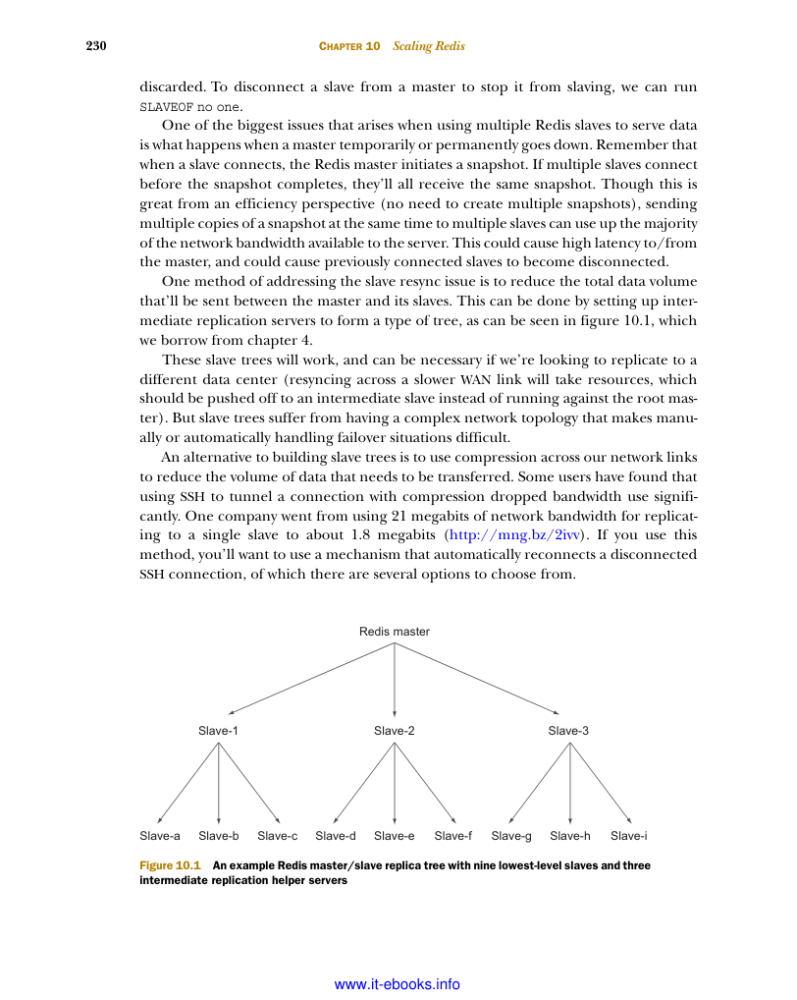
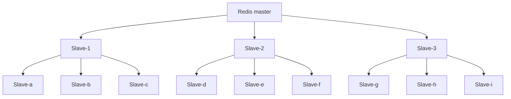

# Chương 10: Mở rộng quy mô Redis (Scaling Redis)

**Nội dung chương này bao gồm (This chapter covers):**
- Mở rộng quy mô đọc (Scaling reads)
- Mở rộng quy mô ghi và dung lượng bộ nhớ (Scaling writes and memory capacity)
- Mở rộng quy mô các truy vấn phức tạp (Scaling complex queries)

Khi mức độ sử dụng Redis của bạn ngày càng phát triển, sẽ có lúc bạn không còn có thể chứa toàn bộ dữ liệu của mình vào một máy chủ Redis duy nhất nữa, hoặc khi bạn cần thực hiện nhiều thao tác đọc và/hoặc ghi hơn khả năng mà một tiến trình Redis đơn lẻ có thể đáp ứng. Khi điều này xảy ra, bạn có một vài lựa chọn để giúp mở rộng quy mô (scale) Redis theo nhu cầu của mình.

Trong chương này, chúng ta sẽ tìm hiểu các kỹ thuật giúp bạn mở rộng quy mô cho các truy vấn đọc (read queries), các truy vấn ghi (write queries), tổng dung lượng bộ nhớ khả dụng (total memory available), cũng như các kỹ thuật để mở rộng quy mô cho một số truy vấn phức tạp hơn.

Nhiệm vụ đầu tiên của chúng ta là giải quyết những bài toán mà ở đó chúng ta vẫn có thể lưu trữ toàn bộ dữ liệu cần thiết và có thể xử lý các thao tác ghi mà không gặp vấn đề gì, nhưng lại cần thực hiện số lượng truy vấn đọc mỗi giây nhiều hơn mức mà một máy chủ Redis đơn lẻ có thể gánh vác.

---

## 10.1 Mở rộng quy mô đọc (Scaling reads)

Trong chương 8, chúng ta đã xây dựng một mạng xã hội cung cấp nhiều tính năng và chức năng tương tự như Twitter. Một trong những tính năng đó là khả năng cho phép người dùng xem dòng thời gian trang chủ (home timeline) cũng như dòng thời gian cá nhân (profile timeline) của họ. Khi xem các dòng thời gian này, chúng ta sẽ lấy ra 30 bài đăng mỗi lần. Đối với một mạng xã hội nhỏ, đây không phải là một vấn đề nghiêm trọng, vì chúng ta vẫn có thể hỗ trợ từ 3.000 đến 10.000 người dùng tải dòng thời gian mỗi giây (nếu đó là tất cả những gì Redis đang làm). Nhưng đối với một mạng xã hội lớn hơn, việc cần phải phục vụ số lượt tải dòng thời gian mỗi giây gấp nhiều lần con số đó là điều hoàn toàn có thể dự đoán trước.

Trong mục này, chúng ta sẽ thảo luận về việc sử dụng các máy chủ bản sao phục vụ đọc (read slaves / read replicas) để hỗ trợ mở rộng quy mô các truy vấn đọc vượt quá khả năng xử lý của một máy chủ Redis đơn lẻ.

Trước khi đi sâu vào việc mở rộng quy mô đọc, trước tiên hãy cùng điểm lại một vài cơ hội giúp cải thiện hiệu năng trước khi chúng ta buộc phải dùng đến các máy chủ bổ sung đóng vai trò slave để mở rộng quy mô truy vấn:

- Nếu chúng ta đang sử dụng các cấu trúc nhỏ (như đã thảo luận ở chương 9), trước hết hãy đảm bảo rằng kích thước `ziplist` tối đa (max ziplist size) không quá lớn đến mức gây ra sự sụt giảm hiệu năng.
- Hãy nhớ sử dụng các cấu trúc mang lại hiệu năng tốt cho các loại truy vấn mà chúng ta muốn thực hiện (đừng đối xử với `LIST` như thể chúng là `SET`; đừng lấy toàn bộ một `HASH` về chỉ để sắp xếp phía client — hãy sử dụng `ZSET`; và tương tự như vậy).
- Nếu chúng ta đang gửi các đối tượng lớn tới Redis để lưu đệm (caching), hãy cân nhắc việc nén dữ liệu (compressing the data) để giảm băng thông mạng cho cả thao tác đọc và ghi (hãy so sánh `lz4`, `gzip`, và `bzip2` để xác định thuật toán nào mang lại sự đánh đổi tốt nhất giữa kích thước và hiệu năng cho nhu cầu sử dụng của chúng ta).
- Hãy nhớ sử dụng kỹ thuật đường ống (pipelining — có hoặc không có giao dịch/transaction, tùy thuộc vào yêu cầu của chúng ta) và vùng kết nối dùng chung (connection pooling), như chúng ta đã thảo luận ở chương 4.

Khi chúng ta đã làm mọi thứ có thể để đảm bảo rằng các thao tác đọc và ghi đều diễn ra nhanh chóng, đó là lúc cần giải quyết nhu cầu thực hiện nhiều truy vấn đọc hơn nữa. Phương pháp đơn giản nhất để tăng tổng thông lượng đọc (total read throughput) khả dụng cho Redis là thêm các máy chủ bản sao chỉ đọc (read-only slave servers). Nếu bạn còn nhớ từ chương 4, chúng ta có thể chạy thêm các máy chủ kết nối tới một máy chủ chính (master), nhận một bản sao (replica) dữ liệu của master, và được cập nhật liên tục theo thời gian thực (nhiều hay ít tùy thuộc vào băng thông mạng). Bằng cách chạy các truy vấn đọc của chúng ta trên một trong số nhiều máy chủ slave, chúng ta có thể thu thêm năng lực xử lý truy vấn đọc với mỗi máy chủ slave mới được thêm vào.

> **HÃY NHỚ: CHỈ GHI VÀO MASTER (REMEMBER: WRITE TO THE MASTER)**
> Khi sử dụng các read slave, và nhìn chung là khi sử dụng các slave nói chung, bạn phải nhớ chỉ được phép ghi dữ liệu vào máy chủ Redis master. Mặc định, việc cố gắng ghi vào một máy chủ Redis được cấu hình làm slave (ngay cả khi bản thân nó cũng đồng thời là một master của các slave cấp dưới) sẽ khiến máy chủ đó trả về một thông báo lỗi. Chúng ta sẽ nói về việc sử dụng một tùy chọn cấu hình để cho phép ghi vào các máy chủ slave trong mục 10.3.1, nhưng nhìn chung bạn nên vận hành hệ thống với chế độ tắt quyền ghi trên slave; việc ghi vào các slave thông thường là một lỗi thiết kế hoặc nhầm lẫn.

Chương 4 có đầy đủ thông tin chi tiết về việc cấu hình Redis để sao chép dữ liệu (replication) sang các máy chủ slave, cách thức hoạt động của nó, và một số ý tưởng để mở rộng quy mô lên nhiều read slave. Tóm tắt ngắn gọn, chúng ta có thể cập nhật tệp cấu hình Redis với một dòng có nội dung `slaveof host port`, thay thế `host` và `port` bằng địa chỉ máy chủ và cổng của máy chủ master. Chúng ta cũng có thể cấu hình một slave bằng cách chạy lệnh `SLAVEOF host port` trực tiếp trên một máy chủ đang hoạt động. Hãy nhớ rằng: Khi một slave kết nối tới một master, bất kỳ dữ liệu nào tồn tại trước đó trên slave sẽ bị xóa bỏ hoàn toàn. Để ngắt kết nối một slave khỏi một master nhằm dừng quá trình sao chép, chúng ta có thể chạy lệnh `SLAVEOF no one`.

> 📝 **Giải thích thêm (không có trong sách):** Từ phiên bản Redis 5.0 trở đi, Redis đã đổi thuật ngữ từ `slave` sang `replica` để chuẩn hóa thuật ngữ kỹ thuật. Do đó, trong các phiên bản Redis hiện đại (Redis 5/6/7/8), tùy chọn cấu hình `slaveof host port` và lệnh `SLAVEOF host port` / `SLAVEOF no one` được thay thế tương ứng bằng `replicaof host port` và lệnh `REPLICAOF host port` / `REPLICAOF NO ONE` (tuy nhiên các lệnh `SLAVEOF` cũ vẫn được giữ lại để tương thích ngược). Tương tự, tùy chọn `slave-read-only` đã được đổi tên thành `replica-read-only`.

Một trong những vấn đề lớn nhất phát sinh khi sử dụng nhiều Redis slave để phục vụ dữ liệu là chuyện gì sẽ xảy ra khi một máy chủ master bị sập tạm thời hoặc vĩnh viễn. Hãy nhớ rằng khi một slave kết nối vào, Redis master sẽ khởi tạo một bản chụp nhanh (snapshot - RDB). Nếu nhiều slave cùng kết nối trước khi quá trình tạo snapshot hoàn tất, tất cả chúng sẽ nhận được cùng một bản snapshot đó. Mặc dù điều này rất tuyệt vời dưới góc độ hiệu quả tài nguyên (không cần phải tạo nhiều bản snapshot khác nhau), nhưng việc gửi nhiều bản sao của một snapshot cùng một lúc tới nhiều slave có thể ngốn hết phần lớn băng thông mạng khả dụng của máy chủ. Điều này có thể gây ra độ trễ (latency) cao khi giao tiếp tới/từ master, và có thể khiến các slave đã kết nối trước đó bị mất kết nối.

Một phương pháp để giải quyết vấn đề đồng bộ lại (resync) hàng loạt trên slave là giảm tổng khối lượng dữ liệu sẽ được gửi trực tiếp giữa master và các slave của nó. Việc này có thể được thực hiện bằng cách thiết lập các máy chủ sao chép trung gian (intermediate replication servers) để tạo thành một cấu trúc dạng cây (tree), như có thể thấy trong **Hình 10.1**, sơ đồ mà chúng ta mượn lại từ chương 4.

**Hình 10.1 – Ví dụ về một cây bản sao Redis master/slave với chín slave ở tầng thấp nhất và ba máy chủ hỗ trợ sao chép trung gian (Figure 10.1 An example Redis master/slave replica tree with nine lowest-level slaves and three intermediate replication helper servers)**





Các cây bản sao (slave trees) này sẽ hoạt động tốt, và có thể là điều bắt buộc nếu chúng ta đang muốn sao chép dữ liệu sang một trung tâm dữ liệu (data center) khác (việc đồng bộ lại qua một đường truyền mạng diện rộng WAN chậm hơn sẽ tiêu tốn nhiều tài nguyên, do đó tác vụ này nên được đẩy sang cho một slave trung gian thay vì chạy trực tiếp trên master gốc). Tuy nhiên, mô hình cây bản sao lại có nhược điểm là sở hữu cấu trúc liên kết mạng (network topology) phức tạp, khiến cho việc xử lý các tình huống chuyển đổi dự phòng (failover) một cách thủ công hay tự động đều trở nên khó khăn.

Một giải pháp thay thế cho việc xây dựng các cây bản sao là sử dụng kỹ thuật nén dữ liệu (compression) qua các đường truyền mạng để giảm khối lượng dữ liệu cần phải truyền tải. Một số người dùng nhận thấy rằng việc sử dụng SSH để tạo đường hầm (tunnel) cho kết nối kèm theo tính năng nén đã giúp giảm mức sử dụng băng thông một cách đáng kể. Một công ty đã giảm mức tiêu thụ băng thông mạng từ 21 megabit khi sao chép sang một slave đơn lẻ xuống chỉ còn khoảng 1,8 megabit (http://mng.bz/2ivv). Nếu bạn sử dụng phương pháp này, bạn sẽ muốn dùng thêm một cơ chế tự động kết nối lại khi kết nối SSH bị ngắt (chẳng hạn như `autossh`), hiện có khá nhiều tùy chọn như vậy để bạn lựa chọn.

> **CHI PHÍ TÍNH TOÁN CỦA MÃ HÓA VÀ NÉN DỮ LIỆU (ENCRYPTION AND COMPRESSION OVERHEAD)**
> Nhìn chung, chi phí phụ thêm (overhead) của việc mã hóa cho các đường hầm SSH sẽ không phải là một gánh nặng lớn đối với máy chủ của bạn, bởi vì thuật toán AES-128 có thể mã hóa khoảng 180 megabyte mỗi giây trên một nhân đơn lẻ của bộ vi xử lý Intel Core 2 2.6 GHz, và thuật toán RC4 có thể mã hóa khoảng 350 megabyte mỗi giây trên cùng cỗ máy đó. Giả sử bạn có một đường truyền mạng gigabit (1 Gbps), chỉ cần khoảng một nhân CPU có sức mạnh trung bình là đã có thể lấp đầy tối đa đường truyền bằng dữ liệu mã hóa.
>
> Nén dữ liệu mới là nơi bạn có thể gặp vấn đề, bởi vì tính năng nén của SSH mặc định sử dụng `gzip`. Ở mức độ nén 1 (compression level 1 — bạn có thể cấu hình SSH sử dụng một mức độ nén cụ thể; hãy kiểm tra tài liệu hướng dẫn `man` của SSH), bộ vi xử lý 2.6 GHz đáng tin cậy của chúng ta có thể nén khoảng 24–52 megabyte mỗi giây đối với một vài loại tệp Redis dump khác nhau (trong quá trình đồng bộ ban đầu - initial sync), và 60–80 megabyte mỗi giây đối với một vài loại tệp chỉ ghi nối thêm (append-only files — trong quá trình sao chép luồng liên tục - streaming replication). Hãy nhớ rằng, mặc dù các mức độ nén cao hơn có thể nén dữ liệu nhỏ hơn nữa, nhưng chúng cũng sẽ tiêu tốn nhiều năng lực xử lý của CPU hơn, điều này có thể trở thành vấn đề đối với các cỗ máy đòi hỏi thông lượng cao nhưng có CPU yếu. Nhìn chung, tôi khuyên bạn nên sử dụng các mức độ nén dưới 5 nếu có thể, bởi vì mức 5 vẫn mang lại mức giảm tổng dung lượng dữ liệu khoảng 10–20% so với mức 1, nhưng tốn thời gian xử lý gấp khoảng 2–3 lần. Mức độ nén 9 thường mất thời gian gấp 5–10 lần so với mức 1, trong khi tỷ lệ nén chỉ tốt hơn từ 1–5% so với mức 5 (cá nhân tôi luôn gắn bó với mức 1 cho bất kỳ kết nối mạng nào có tốc độ tương đối nhanh).

> **SỬ DỤNG NÉN DỮ LIỆU VỚI OPENVPN (USING COMPRESSION WITH OPENVPN)**
> Thoạt nhìn, việc OpenVPN hỗ trợ mã hóa AES và nén dữ liệu bằng thuật toán `lzo` có vẻ như là một giải pháp trao tay (turnkey solution) tuyệt vời để cung cấp khả năng tự động kết nối lại trong suốt kèm theo nén và mã hóa (trái ngược với việc phải sử dụng một trong các kịch bản tự kết nối lại SSH của bên thứ ba). Thật không may, hầu hết các thông tin mà tôi tìm hiểu được đều chỉ ra rằng sự cải thiện hiệu năng khi bật nén `lzo` trong OpenVPN chỉ giới hạn ở mức khoảng 25–30% trên các kết nối 10 megabit, và gần như bằng không trên các kết nối nhanh hơn.

Một sự bổ sung gần đây vào danh sách các công cụ của Redis có thể được sử dụng để hỗ trợ quá trình sao chép và chuyển đổi dự phòng được biết đến với tên gọi **Redis Sentinel**. Redis Sentinel là một chế độ chạy đặc biệt của tệp thực thi máy chủ Redis (`redis-server --sentinel` hoặc `redis-sentinel`), nơi nó không hoạt động như một máy chủ lưu trữ dữ liệu Redis thông thường. Thay vào đó, Sentinel theo dõi hành vi và tình trạng sức khỏe (health) của một loạt các máy chủ master và các slave của chúng. Bằng cách sử dụng cơ chế `PUBLISH`/`SUBSCRIBE` trên các máy chủ master kết hợp với các lệnh gọi `PING` tới các slave và master, một tập hợp các tiến trình Sentinel sẽ độc lập khám phá thông tin về các slave hiện có cũng như các tiến trình Sentinel khác. Khi máy chủ master gặp sự cố (failure), một Sentinel duy nhất sẽ được bầu chọn dựa trên thông tin mà tất cả các Sentinel đều nắm giữ, và nó sẽ chọn ra một máy chủ master mới từ các slave hiện có. Sau khi slave đó được chuyển đổi thành master, Sentinel sẽ điều hướng các slave còn lại chuyển sang đồng bộ từ máy chủ master mới này (mặc định là từng slave một tại một thời điểm, nhưng con số này có thể được cấu hình cao hơn).

Nhìn chung, dịch vụ Redis Sentinel được thiết kế nhằm cung cấp khả năng chuyển đổi dự phòng tự động (automated failover) từ một master sang một trong các slave của nó. Nó cung cấp các tùy chọn để gửi thông báo khi xảy ra failover, gọi các kịch bản (scripts) do người dùng cung cấp để cập nhật cấu hình ứng dụng, và nhiều tính năng khác nữa.

> 📝 **Giải thích thêm (không có trong sách):**
> Trong các phiên bản Redis hiện đại (từ Redis 2.8+ trở đi), cơ chế đồng bộ lại (resynchronization) giữa Master và Replica đã được cải tiến vượt bậc nhờ hai tính năng quan trọng giúp giảm thiểu đáng kể vấn đề nghẽn băng thông khi mất kết nối tạm thời hoặc khi nhiều replica kết nối cùng lúc:
> 1. **PSYNC (Partial Resynchronization - Đồng bộ lại một phần):** Thay vì luôn phải tạo tệp RDB snapshot mới và truyền lại toàn bộ dữ liệu từ đầu (Full Resync) mỗi khi kết nối mạng bị chập chờn, Master duy trì một bộ đệm vòng trong bộ nhớ gọi là `replication backlog` (cấu hình qua `repl-backlog-size`). Khi Replica kết nối lại, nó gửi `replication offset` cuối cùng mà nó nhận được; nếu offset này vẫn nằm trong backlog, Master chỉ cần gửi phần dữ liệu chênh lệch bị thiếu. Kể từ Redis 4.0, `PSYNC2` còn cho phép giữ nguyên khả năng đồng bộ một phần ngay cả sau khi một Replica được thăng cấp lên làm Master mới (failover) hoặc khi Replica khởi động lại một cách an toàn.
> 2. **Diskless Replication (`repl-diskless-sync yes`):** Cho phép Master truyền trực tiếp luồng dữ liệu RDB qua socket mạng tới các Replica mà không cần ghi ra đĩa cứng trước, rất hữu ích cho các máy chủ có đĩa cứng chậm nhưng băng thông mạng nội bộ cực nhanh.

Bây giờ, sau khi chúng ta đã thực hiện các bước để mở rộng năng lực đọc, đã đến lúc xem xét làm thế nào chúng ta có thể mở rộng năng lực ghi của mình.

---

## 10.2 Mở rộng quy mô ghi và dung lượng bộ nhớ (Scaling writes and memory capacity)

Quay trở lại chương 2, chúng ta đã xây dựng một hệ thống có thể tự động lưu đệm (cache) các trang web đã được kết xuất (rendered web pages) bên trong Redis. May mắn cho chúng ta là nó đã giúp giảm thời gian tải trang cũng như chi phí xử lý trang web. Thật không may, chúng ta đã đi đến thời điểm mà bộ nhớ đệm đã được nâng cấp lên tới cỗ máy đơn lẻ lớn nhất mà chúng ta có đủ khả năng chi trả (scale up / vertical scaling), và giờ đây chúng ta buộc phải phân tách dữ liệu của mình ra một nhóm các máy chủ nhỏ hơn (scale out / horizontal scaling).

> **MỞ RỘNG QUY MÔ KHỐI LƯỢNG GHI (SCALING WRITE VOLUME)**
> Mặc dù chúng ta thảo luận về kỹ thuật phân mảnh (sharding) trong ngữ cảnh nhằm gia tăng tổng dung lượng bộ nhớ khả dụng, các phương pháp này cũng đồng thời hoạt động hiệu quả để tăng thông lượng ghi (write throughput) nếu chúng ta đã chạm tới giới hạn hiệu năng mà một cỗ máy đơn lẻ có thể duy trì.

Trong mục này, chúng ta sẽ thảo luận về một phương pháp giúp mở rộng cả bộ nhớ lẫn thông lượng ghi bằng kỹ thuật phân mảnh (sharding), sử dụng các kỹ thuật tương tự như những gì chúng ta đã dùng trong chương 9.

Để đảm bảo rằng chúng ta thực sự cần phải mở rộng quy mô năng lực ghi sang nhiều máy chủ, trước tiên chúng ta nên chắc chắn rằng mình đã làm mọi thứ có thể để giảm mức tiêu thụ bộ nhớ và giảm khối lượng dữ liệu đang ghi:

- Hãy đảm bảo rằng chúng ta đã kiểm tra và áp dụng tất cả các phương pháp nhằm giảm khối lượng dữ liệu đọc trước tiên.
- Hãy đảm bảo rằng chúng ta đã tách và di chuyển các mảng chức năng lớn không liên quan với nhau sang các máy chủ khác nhau (nếu chúng ta đã sử dụng các hàm trang trí kết nối — connection decorators — từ chương 5, việc này sẽ rất dễ dàng).
- Nếu có thể, hãy cố gắng tổng hợp các thao tác ghi trong bộ nhớ cục bộ của ứng dụng trước khi ghi vào Redis, như chúng ta đã thảo luận ở chương 6 (kỹ thuật này áp dụng được cho hầu hết mọi phương pháp phân tích và tính toán thống kê).
- Nếu chúng ta đang gặp phải các giới hạn hiệu năng với `WATCH`/`MULTI`/`EXEC`, hãy cân nhắc sử dụng cơ chế khóa phân tán (locks) như đã thảo luận ở chương 6 (hoặc cân nhắc sử dụng kịch bản Lua, như chúng ta sẽ bàn tới trong chương 11).
- Nếu chúng ta đang sử dụng cơ chế lưu trữ bền vững AOF (AOF persistence), hãy nhớ rằng ổ đĩa cứng của chúng ta cần phải theo kịp khối lượng dữ liệu mà chúng ta đang ghi (400.000 lệnh nhỏ có thể chỉ tương đương vài megabyte mỗi giây, nhưng 100.000 lệnh ghi với kích thước 1 KB mỗi lệnh sẽ lên tới 100 megabyte mỗi giây).

Bây giờ, khi chúng ta đã làm mọi thứ có thể để giảm mức sử dụng bộ nhớ, tối đa hóa hiệu năng, và hiểu rõ những giới hạn của những gì một cỗ máy đơn lẻ có thể làm được, đã đến lúc thực sự phân mảnh (shard) dữ liệu của chúng ta ra nhiều cỗ máy. Các phương pháp mà chúng ta sử dụng để phân mảnh dữ liệu ra nhiều máy chủ dựa trên giả định rằng số lượng máy chủ Redis được sử dụng là tương đối cố định. Ví dụ, nếu chúng ta có thể ước tính rằng khối lượng ghi của mình sẽ tăng gấp 4 lần sau mỗi 6 tháng, chúng ta có thể phân mảnh trước (preshard) dữ liệu của mình thành 256 phân mảnh (shards). Bằng cách phân mảnh trước thành 256 shards, chúng ta sẽ có một kế hoạch đủ đáp ứng cho 2 năm tăng trưởng dự kiến tiếp theo (việc lập kế hoạch trước cho khoảng thời gian bao lâu là tùy thuộc vào bạn).

> **PHÂN MẢNH TRƯỚC ĐỂ ĐÓN ĐẦU TĂNG TRƯỞNG (PRESHARDING FOR GROWTH)**
> Khi phân mảnh trước hệ thống của bạn nhằm chuẩn bị cho sự tăng trưởng trong tương lai, bạn có thể rơi vào tình huống hiện tại mình có quá ít dữ liệu nên chưa đáng để chạy nhiều máy chủ vật lý như số lượng bạn sẽ cần sau này. Để vẫn có thể tách biệt dữ liệu ngay từ đầu, bạn có thể chạy nhiều tiến trình máy chủ Redis (multiple Redis servers) trên cùng một cỗ máy vật lý cho mỗi phân mảnh của mình, hoặc bạn có thể sử dụng nhiều cơ sở dữ liệu đánh số (multiple Redis databases) bên trong một tiến trình máy chủ Redis duy nhất. Từ điểm xuất phát này, bạn có thể di chuyển dần sang nhiều máy chủ vật lý thông qua việc sử dụng cơ chế sao chép (replication) và quản lý cấu hình (configuration management — xem mục 10.2.1). Nếu bạn đang chạy nhiều máy chủ Redis trên cùng một cỗ máy vật lý, hãy nhớ cấu hình cho chúng lắng nghe trên các cổng (ports) khác nhau, và đảm bảo rằng tất cả các tiến trình máy chủ đó ghi dữ liệu ra các tệp snapshot (`.rdb`) và/hoặc các tệp append-only (`.aof`) khác nhau.

Điều đầu tiên chúng ta cần làm là bàn về cách chúng ta sẽ định nghĩa cấu hình phân mảnh (shard configuration) của mình.

### 10.2.1 Xử lý cấu hình phân mảnh (Handling shard configuration)

Như bạn có thể còn nhớ từ chương 5, chúng ta đã viết một phương thức để tự động tạo và sử dụng các cấu hình Redis được đặt tên (named Redis configurations). Phương thức này sử dụng một Python decorator để lấy thông tin cấu hình, so sánh nó với thông tin cấu hình đã tồn tại trước đó, rồi tạo mới hoặc tái sử dụng một kết nối hiện có. Chúng ta sẽ mở rộng ý tưởng này để bổ sung khả năng hỗ trợ cho các kết nối được phân mảnh (sharded connections). Với những thay đổi này, chúng ta có thể tái sử dụng phần lớn mã nguồn đã phát triển trong chương 9 chỉ với những chỉnh sửa rất nhỏ.

Để bắt đầu, trước tiên hãy tạo một hàm đơn giản sử dụng cùng bố cục cấu hình (configuration layout) mà chúng ta đã dùng trong decorator kết nối ở chương 5. Nếu bạn còn nhớ, chúng ta sử dụng các từ điển (dictionaries) được mã hóa dưới dạng JSON để lưu trữ thông tin kết nối cho Redis trong các khóa có định dạng `config:redis:<component>`. Tách phần quản lý kết nối ra khỏi decorator đó, chúng ta thu được một hàm đơn giản để tạo mới hoặc tái sử dụng một kết nối Redis dựa trên một cấu hình được đặt tên, như được trình bày dưới đây.

**Listing 10.1 – Hàm lấy một kết nối Redis dựa trên một cấu hình được đặt tên (A function to get a Redis connection based on a named configuration)**

```python
def get_redis_connection(component, wait=1):
    key = 'config:redis:' + component
    old_config = CONFIGS.get(key, object())             # 1
    config = get_config(                                # 2
        config_connection, 'redis', component, wait)    # 2
    if config != old_config:                            # 3
        REDIS_CONNECTIONS[key] = redis.Redis(**config)  # 3
    return REDIS_CONNECTIONS.get(key)                   # 4
```

**Giải thích mã nguồn (Listing 10.1):**
- `# 1`: Lấy cấu hình cũ đã biết trước đó (nếu có).
- `# 2`: Lấy cấu hình mới hiện tại (nếu có).
- `# 3`: Nếu cấu hình mới và cấu hình cũ không khớp nhau, tạo một kết nối mới.
- `# 4`: Trả về đối tượng kết nối mong muốn.

Hàm đơn giản này lấy ra cả cấu hình đã biết trước đó lẫn cấu hình hiện tại. Nếu chúng khác nhau, hàm sẽ cập nhật cấu hình đã biết (bên trong `get_config`), tạo một kết nối mới, sau đó lưu trữ và trả về kết nối mới đó. Nếu cấu hình không thay đổi, nó sẽ trả về kết nối trước đó.

Khi chúng ta đã có khả năng lấy các kết nối một cách dễ dàng, chúng ta cũng nên thêm khả năng hỗ trợ việc tạo các kết nối Redis được phân mảnh, để ngay cả khi các decorator sau này của chúng ta không phù hợp trong mọi tình huống, chúng ta vẫn có thể dễ dàng tạo và sử dụng các kết nối được phân mảnh. Để kết nối tới một phân mảnh mới, chúng ta sẽ sử dụng cùng các phương thức cấu hình đó, mặc dù tên cấu hình phân mảnh sẽ khác đi một chút. Ví dụ, phân mảnh số 7 (shard 7) của thành phần `logs` sẽ được lưu trữ tại một khóa có tên là `config:redis:logs:7`. Quy ước đặt tên này sẽ cho phép chúng ta tái sử dụng mã nguồn quản lý kết nối và cấu hình mà chúng ta đã có sẵn. Hàm của chúng ta để lấy một kết nối được phân mảnh được trình bày trong listing tiếp theo.

**Listing 10.2 – Lấy một kết nối dựa trên thông tin phân mảnh (Fetch a connection based on shard information)**

```python
def get_sharded_connection(component, key, shard_count, wait=1):
    shard = shard_key(component, 'x'+str(key), shard_count, 2)  # 1
    return get_redis_connection(shard, wait)                    # 2
```

**Giải thích mã nguồn (Listing 10.2):**
- `# 1`: Tính toán định danh phân mảnh (shard ID) có định dạng `<component>:<shard>`. (Lưu ý: việc ghép tiền tố `'x'+str(key)` là để đảm bảo hàm `shard_key` từ chương 9 luôn băm chuỗi bằng CRC32 thay vì hiểu nhầm một khóa toàn chữ số là ID số nguyên tuần tự).
- `# 2`: Trả về kết nối tương ứng với phân mảnh đó.

Bây giờ chúng ta đã có một phương thức đơn giản để lấy một kết nối tới một máy chủ Redis được phân mảnh, chúng ta có thể tạo một decorator giống như đã thấy ở chương 5 để tự động tạo một kết nối được phân mảnh.

### 10.2.2 Tạo một decorator kết nối phân mảnh theo máy chủ (Creating a server-sharded connection decorator)

Bây giờ chúng ta đã có một phương thức để dễ dàng lấy một kết nối được phân mảnh, hãy sử dụng nó để xây dựng một decorator có nhiệm vụ tự động truyền một kết nối được phân mảnh vào các hàm bên dưới.

Chúng ta sẽ thực hiện cùng kiểu trang trí hàm 3 tầng (three-level function decoration) mà chúng ta đã sử dụng trong chương 5, điều này sẽ cho phép chúng ta sử dụng cùng cách truyền tên "thành phần" (`component`) như ở đó. Ngoài thông tin về thành phần, chúng ta cũng sẽ truyền vào số lượng máy chủ Redis (`shard_count`) mà chúng ta dự định phân mảnh dữ liệu tới. Listing tiếp theo cho thấy chi tiết về decorator kết nối nhận biết phân mảnh (shard-aware connection decorator) của chúng ta.

**Listing 10.3 – Một decorator kết nối có nhận biết phân mảnh (A shard-aware connection decorator)**

```python
def sharded_connection(component, shard_count, wait=1):       # 1
    def wrapper(function):                                    # 2
        @functools.wraps(function)                            # 3
        def call(key, *args, **kwargs):                       # 4
            conn = get_sharded_connection(                    # 5
                component, key, shard_count, wait)            # 5
            return function(conn, key, *args, **kwargs)       # 6
        return call                                           # 7
    return wrapper                                            # 8
```

**Giải thích mã nguồn (Listing 10.3):**
- `# 1`: Decorator của chúng ta sẽ nhận vào một tên thành phần (`component`), cũng như số lượng phân mảnh mong muốn (`shard_count`).
- `# 2`: Sau đó chúng ta sẽ tạo một hàm bao (`wrapper`) để thực sự trang trí cho hàm mục tiêu (`function`).
- `# 3`: Sao chép một số siêu dữ liệu (metadata) hữu ích từ hàm gốc sang hàm xử lý cấu hình.
- `# 4`: Tạo hàm sẽ tính toán một shard ID cho các khóa (`key`), và thiết lập trình quản lý kết nối.
- `# 5`: Lấy kết nối đã được phân mảnh (`sharded connection`).
- `# 6`: Thực sự gọi hàm gốc, truyền vào đối tượng kết nối (`conn`) cùng các đối số hiện có.
- `# 7`: Trả về hàm đã được bao bọc hoàn chỉnh.
- `# 8`: Trả về một hàm có thể dùng để bao bọc các hàm cần một kết nối được phân mảnh.

Nhờ cách chúng ta xây dựng decorator kết nối của mình, chúng ta có thể trang trí cho hàm `count_visit()` từ chương 9 mà gần như không cần thay đổi gì cả. Tuy nhiên, chúng ta cần phải cẩn thận bởi vì chúng ta đang lưu giữ thông tin tổng số lượng dự kiến (aggregate count information), vốn được lấy về và/hoặc cập nhật bởi hàm `get_expected()` của chúng ta. Bởi vì thông tin được lưu trữ này sẽ được sử dụng và tái sử dụng vào các ngày khác nhau cho những người dùng khác nhau, chúng ta cần phải sử dụng một kết nối **không phân mảnh** (nonsharded connection) cho nó. Hàm `count_visit()` đã được cập nhật và gắn decorator cũng như hàm `get_expected()` đã được gắn decorator và chỉnh sửa đôi chút được trình bày ngay tiếp theo đây.

**Listing 10.4 – Hàm `count_visit()` được phân mảnh theo cả máy chủ và khóa (A machine and key-sharded count_visit() function)**

```python
@sharded_connection('unique', 16)                       # 1
def count_visit(conn, session_id):
    today = date.today()
    key = 'unique:%s'%today.isoformat()
    conn2, expected = get_expected(key, today)          # 2
    id = int(session_id.replace('-', '')[:15], 16)
    if shard_sadd(conn, key, id, expected, SHARD_SIZE):
        conn2.incr(key)                                 # 3

@redis_connection('unique')                             # 4
def get_expected(conn, key, today):
    'all of the same function body as before, except the last line'
    return conn, EXPECTED[key]                          # 5
```

**Giải thích mã nguồn (Listing 10.4):**
- `# 1`: Chúng ta sẽ phân mảnh dữ liệu này ra 16 máy chủ khác nhau, và bên trong mỗi máy chủ đó hàm `shard_sadd` sẽ lại tự động phân mảnh tiếp thành nhiều khóa (key-sharding) trên từng máy chủ.
- `# 2`: Lời gọi hàm `get_expected()` đã được thay đổi của chúng ta (nhận thêm đối tượng kết nối `conn2`).
- `# 3`: Sử dụng kết nối không phân mảnh (`conn2`) được trả về để tăng bộ đếm tổng số lượt truy cập duy nhất (unique counts) của chúng ta.
- `# 4`: Sử dụng một kết nối không phân mảnh (`@redis_connection('unique')`) cho hàm `get_expected()`.
- `# 5`: Đồng thời trả về cả kết nối không phân mảnh `conn` để hàm `count_visit()` có thể dùng nó tăng bộ đếm lượt truy cập duy nhất khi cần thiết.

Trong ví dụ của chúng ta, chúng ta đang phân mảnh dữ liệu ra 16 máy chủ khác nhau cho các `SET` lưu lượt truy cập duy nhất, với cấu hình của chúng được lưu trữ dưới dạng các chuỗi mã hóa JSON tại các khóa có tên từ `config:redis:unique:0` đến `config:redis:unique:15`. Đối với thông tin bộ đếm tổng hàng ngày, chúng ta đang lưu trữ chúng trong một máy chủ Redis không phân mảnh, có thông tin cấu hình được lưu tại khóa `config:redis:unique`.

> **CHẠY NHIỀU MÁY CHỦ REDIS TRÊN CÙNG MỘT CỖ MÁY VẬT LÝ (MULTIPLE REDIS SERVERS ON A SINGLE MACHINE)**
> Mục này thảo luận về việc phân mảnh các thao tác ghi ra nhiều cỗ máy nhằm tăng tổng dung lượng bộ nhớ khả dụng và tổng năng lực ghi. Nhưng nếu bạn cảm thấy bị giới hạn bởi giới hạn xử lý đơn luồng (single-threaded processing limit) của Redis (có thể bởi vì bạn đang thực hiện các truy vấn tìm kiếm, sắp xếp, hoặc các truy vấn đắt đỏ khác), trong khi máy chủ vật lý của bạn vẫn còn dư nhiều nhân CPU cho việc tính toán, dư băng thông mạng cho việc giao tiếp, và dư năng lực đọc/ghi đĩa (disk I/O) cho snapshots/AOF, bạn hoàn toàn có thể chạy nhiều tiến trình máy chủ Redis trên cùng một cỗ máy duy nhất. Bạn chỉ cần cấu hình cho chúng lắng nghe trên các cổng khác nhau và đảm bảo rằng chúng có các thiết lập tệp snapshot/AOF khác nhau.

> **CÁC PHƯƠNG PHÁP THAY THẾ ĐỂ XỬ LÝ BỘ ĐẾM LƯỢT TRUY CẬP DUY NHẤT THEO THỜI GIAN (ALTERNATE METHODS OF HANDLING UNIQUE VISIT COUNTS OVER TIME)**
> Với việc sử dụng các lệnh `SETBIT`, `BITCOUNT`, và `BITOP`, bạn thực sự có thể mở rộng quy mô bộ đếm khách truy cập duy nhất mà không cần phân mảnh bằng cách sử dụng phương pháp tra cứu bit theo chỉ mục (indexed lookup of bits), tương tự như những gì chúng ta đã làm với dữ liệu vị trí ở chương 9. Một thư viện triển khai kỹ thuật này bằng Python có thể được tìm thấy tại https://github.com/Doist/bitmapist.

> 💡 **Ví dụ bổ sung (không có trong sách):** Ngoài Bitmap (`SETBIT`/`BITCOUNT`) được tác giả nhắc đến ở trên, kể từ phiên bản **Redis 2.8.9**, Redis đã bổ sung cấu trúc dữ liệu xác suất **HyperLogLog** với các lệnh `PFADD`, `PFCOUNT`, và `PFMERGE`. HyperLogLog có thể đếm số lượng phần tử duy nhất (cardinality estimation) lên tới hàng tỷ người dùng mỗi ngày mà chỉ tiêu tốn tối đa **12 KB bộ nhớ** cho mỗi khóa với sai số chuẩn chỉ khoảng `0.81%`, giúp bạn đếm `unique visitors` trên một máy chủ đơn lẻ mà không cần phải dùng tới 16 máy chủ phân mảnh `SET` như trong Listing 10.4!

Bây giờ chúng ta đã có các hàm để lấy các kết nối thông thường và kết nối phân mảnh, cũng như các decorator để tự động truyền các kết nối thông thường và kết nối phân mảnh, việc sử dụng các kết nối Redis thuộc nhiều loại khác nhau đã trở nên dễ dàng hơn rất nhiều. Thật không may, không phải mọi thao tác mà chúng ta cần thực hiện trên các tập dữ liệu được phân mảnh đều dễ dàng như việc đếm số lượt truy cập duy nhất. Trong mục tiếp theo, chúng ta sẽ nói về việc mở rộng quy mô hệ thống tìm kiếm theo hai cách khác nhau, cũng như làm thế nào để mở rộng quy mô cho ví dụ mạng xã hội của chúng ta.

---
## 10.3 Mở rộng quy mô các truy vấn phức tạp (Scaling complex queries)

Khi chúng ta mở rộng quy mô hàng loạt các dịch vụ khác nhau với Redis, không hiếm khi chúng ta bắt gặp những tình huống mà việc chỉ phân mảnh dữ liệu thôi là chưa đủ, nơi mà các loại truy vấn chúng ta cần thực thi đòi hỏi nhiều công sức xử lý hơn là chỉ đơn thuần gán (`SET`) hoặc lấy (`GET`) một giá trị. Trong mục này, chúng ta sẽ thảo luận về một bài toán rất dễ để mở rộng quy mô, và hai bài toán đòi hỏi nhiều công sức hơn.

Bài toán đầu tiên mà chúng ta sẽ mở rộng quy mô là công cụ tìm kiếm (search engine) từ chương 7, nơi chúng ta có những cỗ máy đủ bộ nhớ để chứa toàn bộ chỉ mục (index) của mình, nhưng lại cần thực thi số lượng truy vấn nhiều hơn mức mà máy chủ hiện tại có thể xử lý.

### 10.3.1 Mở rộng quy mô khối lượng truy vấn tìm kiếm (Scaling search query volume)

Khi chúng ta mở rộng công cụ tìm kiếm từ chương 7 với lệnh `SORT`, sử dụng tìm kiếm tính điểm dựa trên `ZSET` (ZSET-based scored search), công cụ tìm kiếm nhắm mục tiêu quảng cáo (ad-targeting search engine — hoặc thậm chí là hệ thống tìm kiếm việc làm), đến một thời điểm nào đó chúng ta có thể chạm tới ngưỡng mà một máy chủ đơn lẻ không còn khả năng xử lý số lượng truy vấn mỗi giây theo yêu cầu. Trong mục này, chúng ta sẽ bàn về cách thêm các máy chủ bản sao phục vụ truy vấn (query slaves) để gia tăng hơn nữa năng lực phục vụ các yêu cầu tìm kiếm của chúng ta.

Trong mục 10.1, bạn đã thấy cách mở rộng quy mô các truy vấn đọc trên Redis bằng cách thêm các read slave. Nếu bạn chưa đọc mục 10.1, bạn nên đọc nó trước khi tiếp tục. Sau khi bạn đã có một tập hợp các read slave để thực hiện truy vấn trên đó, nếu bạn đang chạy Redis 2.6 trở lên, bạn sẽ ngay lập tức nhận thấy rằng việc thực hiện các truy vấn tìm kiếm sẽ bị thất bại (báo lỗi). Điều này là bởi vì việc thực hiện một truy vấn tìm kiếm như đã thảo luận ở chương 7 đòi hỏi phải chạy các lệnh `SUNIONSTORE`, `SINTERSTORE`, `SDIFFSTORE`, `ZINTERSTORE`, và/hoặc `ZUNIONSTORE` — tất cả các lệnh này đều thực hiện **ghi** dữ liệu tạm (lưu đệm kết quả trung gian) vào Redis.

Để có thể thực hiện các thao tác ghi trên các bản sao chạy Redis 2.6 trở lên, chúng ta sẽ cần cập nhật cấu hình Redis slave của mình. Trong tệp cấu hình Redis (`redis.conf`), có một tùy chọn dùng để tắt/bật quyền ghi vào các slave. Tùy chọn này có tên là `slave-read-only` (hoặc `replica-read-only` trong các bản Redis mới), và giá trị mặc định của nó là `yes`. Bằng cách đổi `slave-read-only` thành `no` và khởi động lại các slave của chúng ta (hoặc dùng lệnh `CONFIG SET slave-read-only no`), giờ đây chúng ta đã có thể thực hiện các truy vấn tìm kiếm tiêu chuẩn trực tiếp trên các máy chủ Redis slave. Hãy nhớ rằng chúng ta có lưu đệm (cache) kết quả của các truy vấn tìm kiếm, và các kết quả được lưu đệm này chỉ tồn tại cục bộ trên chính máy chủ slave mà truy vấn đó đã chạy. Vì vậy, nếu có ý định tái sử dụng các kết quả đã lưu đệm (ví dụ khi người dùng chuyển sang trang kết quả thứ 2, thứ 3), có lẽ chúng ta sẽ muốn thực hiện một mức độ duy trì phiên kết nối (session persistence / sticky sessions — nơi các yêu cầu lặp lại từ cùng một client sẽ luôn đi tới cùng một máy chủ web, và máy chủ web đó luôn gửi yêu cầu tới cùng một máy chủ Redis slave).

Trong quá khứ, tôi đã từng sử dụng phương pháp này để mở rộng quy mô một công cụ nhắm mục tiêu quảng cáo (ad-targeting engine) một cách nhanh chóng và dễ dàng. Nếu bạn quyết định đi theo hướng này để mở rộng quy mô các truy vấn tìm kiếm, hãy nhớ chú ý đến các vấn đề đồng bộ lại (resync issues) đã được thảo luận trong mục 10.1.

> 📝 **Giải thích thêm (không có trong sách):** Khi đặt `slave-read-only no` (`replica-read-only no`), các khóa tạm được ghi trực tiếp lên máy chủ replica sẽ:
> 1. Chỉ tồn tại cục bộ trên replica đó (không được gửi ngược về master hay sang các replica khác).
> 2. Sẽ bị ghi đè nếu master ghi vào một khóa trùng tên và đồng bộ xuống replica.
> 3. Sẽ bị xóa sạch hoàn toàn nếu replica đó thực hiện đồng bộ lại toàn phần (Full Resync) với master.
> Ngoài ra, từ Redis 6.2 và Redis 7.0 trở đi, Redis đã bổ sung thêm các lệnh chỉ đọc như `ZINTER`, `ZUNION`, `ZDIFF` và `SINTERCARD` trả kết quả trực tiếp về client mà không cần ghi vào khóa đích như `*STORE`, hoặc bạn có thể dùng kịch bản Lua chỉ đọc (`EVAL_RO` trong Redis 7+) nếu không cần lưu đệm kết quả phân trang trên server.

Khi chúng ta có đủ bộ nhớ trong một cỗ máy và các thao tác của chúng ta chỉ là chỉ đọc (hoặc ít nhất là không thực sự làm thay đổi dữ liệu nền tảng được dùng chung bởi các truy vấn khác), việc thêm các máy chủ slave có thể giúp chúng ta mở rộng quy mô theo chiều ngang (scale out). Nhưng đôi khi khối lượng dữ liệu có thể vượt quá dung lượng bộ nhớ của một máy chủ, trong khi chúng ta vẫn cần thực hiện các truy vấn phức tạp. Làm thế nào chúng ta có thể mở rộng quy mô tìm kiếm khi chúng ta có lượng dữ liệu lớn hơn bộ nhớ khả dụng?

### 10.3.2 Mở rộng quy mô kích thước chỉ mục tìm kiếm (Scaling search index size)

Nếu có một điều chắc chắn mà chúng ta có thể kỳ vọng ở một công cụ tìm kiếm, thì đó là chỉ mục tìm kiếm (search index) sẽ ngày càng phình to theo thời gian. Khi các chỉ mục tìm kiếm lớn lên, lượng bộ nhớ mà các chỉ mục đó tiêu thụ cũng tăng theo. Tùy thuộc vào tốc độ tăng trưởng, chúng ta có thể hoặc không thể tiếp tục mua/thuê những chiếc máy tính ngày càng lớn hơn để chạy chỉ mục của mình. Nhưng đối với nhiều người trong chúng ta, việc cứ kiếm những chiếc máy tính lớn hơn mãi là điều hoàn toàn bất khả thi.

Trong mục này, chúng ta sẽ bàn về cách cấu trúc dữ liệu để hỗ trợ các truy vấn tìm kiếm được phân mảnh (sharded search queries), và sẽ bao gồm cả mã nguồn để thực thi các truy vấn tìm kiếm phân mảnh trên một tập hợp các máy chủ Redis master được phân mảnh (hoặc các slave của các master được phân mảnh đó, nếu bạn làm theo hướng dẫn trong mục 10.3.1).

Để phân mảnh các truy vấn tìm kiếm của chúng ta, trước tiên chúng ta phải phân mảnh các chỉ mục sao cho đối với mỗi tài liệu (document) mà chúng ta đánh chỉ mục, **toàn bộ dữ liệu và chỉ mục từ khóa của tài liệu đó đều nằm trên cùng một phân mảnh (document-partitioned index)**. Hóa ra là hàm `index_document()` của chúng ta từ chương 7 nhận vào một đối tượng kết nối (`conn`), thứ mà chúng ta có thể tự phân mảnh thủ công bằng tham số `docid` được truyền vào. Hoặc, bởi vì `index_document()` nhận vào một đối tượng kết nối theo sau bởi `docid`, chúng ta có thể sử dụng trực tiếp decorator phân mảnh tự động từ Listing 10.3 (`@sharded_connection`) để xử lý việc phân mảnh thay cho chúng ta.

Khi chúng ta đã có các tài liệu được đánh chỉ mục trải đều qua các phân mảnh, chúng ta chỉ cần thực hiện các truy vấn trên tất cả các phân mảnh để lấy kết quả. Chi tiết về những gì chúng ta cần làm sẽ phụ thuộc vào loại chỉ mục của chúng ta — liệu nó dựa trên lệnh `SORT` (SORT-based) hay dựa trên `ZSET` (ZSET-based). Trước tiên, hãy cập nhật chỉ mục dựa trên `SORT` của chúng ta cho các tìm kiếm phân mảnh.

#### PHÂN MẢNH TÌM KIẾM DỰA TRÊN LỆNH SORT (SHARDING SORT-BASED SEARCH)

Cũng giống như mọi hệ thống tìm kiếm phân mảnh khác (scatter-gather search), chúng ta cần một cách để kết hợp kết quả từ các cuộc tìm kiếm trên từng phân mảnh lại với nhau. Trong bản triển khai hàm `search_and_sort()` của chúng ta từ chương 7, chúng ta nhận về tổng số lượng kết quả (`count`) và danh sách các định danh tài liệu (`docids`) thỏa mãn truy vấn yêu cầu. Đây là một viên gạch nền tảng tuyệt vời để bắt đầu, nhưng nhìn chung chúng ta sẽ cần viết các hàm để thực hiện 3 bước sau:

1. Thực hiện tìm kiếm và lấy kèm các giá trị dùng để sắp xếp (sort values) cho một truy vấn trên một phân mảnh đơn lẻ.
2. Thực thi truy vấn tìm kiếm đó trên tất cả các phân mảnh.
3. Trộn (merge) và sắp xếp lại kết quả của các truy vấn từ mọi phân mảnh, sau đó chọn ra tập con (trang dữ liệu) mong muốn.

Trước tiên, hãy xem cần những gì để thực hiện tìm kiếm và lấy các giá trị sắp xếp từ một phân mảnh đơn lẻ.

Bởi vì chúng ta đã có sẵn hàm `search_and_sort()` từ chương 7, chúng ta có thể bắt đầu bằng cách sử dụng nó để lấy kết quả tìm kiếm. Sau khi có danh sách kết quả (`docids`), chúng ta có thể lấy dữ liệu thuộc tính gắn liền với từng kết quả tìm kiếm đó (để dùng làm khóa sắp xếp khi gộp các phân mảnh). Nhưng chúng ta phải hết sức cẩn thận về vấn đề phân trang (pagination), bởi vì chúng ta không biết trước mỗi kết quả từ một truy vấn trước đó đến từ phân mảnh nào. Vì vậy, để luôn trả về chính xác các kết quả tìm kiếm cho các mục từ 91 đến 100 (`start=90, num=10`), chúng ta buộc phải lấy **100 kết quả tìm kiếm đầu tiên (`0` đến `start + num`) từ mỗi phân mảnh**. Mã nguồn của chúng ta để lấy tất cả các kết quả và dữ liệu sắp xếp cần thiết có thể được thấy trong listing tiếp theo.

**Listing 10.5 – Tìm kiếm dựa trên `SORT` có lấy kèm các giá trị đã được dùng để sắp xếp (SORT-based search that fetches the values that were sorted)**

```python
def search_get_values(conn, query, id=None, ttl=300, sort="-updated", # 1
                      start=0, num=20):                               # 1
    count, docids, id = search_and_sort(                              # 2
        conn, query, id, ttl, sort, 0, start+num)                     # 2

    key = "kb:doc:%s"
    sort = sort.lstrip('-')

    pipe = conn.pipeline(False)
    for docid in docids:                                              # 3
        pipe.hget(key%docid, sort)                                    # 3
    sort_column = pipe.execute()                                      # 3

    data_pairs = zip(docids, sort_column)                             # 4
    return count, data_pairs, id                                      # 5
```

**Giải thích mã nguồn (Listing 10.5):**
- `# 1`: Chúng ta cần nhận tất cả các tham số tương tự để truyền tiếp cho hàm `search_and_sort()`.
- `# 2`: Trước tiên, lấy kết quả của thao tác tìm kiếm và sắp xếp trên phân mảnh này (lấy từ vị trí `0` với số lượng `start + num`).
- `# 3`: Lấy dữ liệu cột mà các kết quả đã được dùng để sắp xếp (từ các `HASH` `kb:doc:<docid>`) thông qua pipeline không giao dịch (`pipeline(False)`).
- `# 4`: Ghép cặp các ID tài liệu (`docids`) với dữ liệu cột mà nó được sắp xếp theo (`sort_column`).
- `# 5`: Trả về tổng số lượng kết quả trên phân mảnh (`count`), danh sách các cặp dữ liệu (`data_pairs`), và ID bộ nhớ đệm (`id`) của kết quả.

Hàm này lấy toàn bộ thông tin cần thiết từ một phân mảnh đơn lẻ để chuẩn bị cho bước trộn (merge) cuối cùng. Bước tiếp theo của chúng ta là thực thi truy vấn trên tất cả các phân mảnh.

Để thực thi một truy vấn trên tất cả các phân mảnh của mình, chúng ta có hai lựa chọn. Chúng ta có thể chạy từng truy vấn trên từng phân mảnh một cách tuần tự (one by one), hoặc chúng ta có thể thực thi các truy vấn trên tất cả các phân mảnh đồng thời (simultaneously / in parallel). Để giữ cho mã nguồn đơn giản, chúng ta sẽ thực thi các truy vấn lần lượt từng cái một trên mỗi phân mảnh, và thu thập kết quả lại với nhau trong listing tiếp theo.

**Listing 10.6 – Hàm thực hiện truy vấn trên tất cả các phân mảnh (A function to perform queries against all shards)**

```python
def get_shard_results(component, shards, query, ids=None, ttl=300,  # 1
                      sort="-updated", start=0, num=20, wait=1):    # 1
    count = 0                                                       # 2
    data = []                                                       # 2
    ids = ids or shards * [None]                                    # 3
    for shard in xrange(shards):
        conn = get_redis_connection('%s:%s'%(component, shard), wait) # 4
        c, d, i = search_get_values(                                # 5
            conn, query, ids[shard], ttl, sort, start, num)         # 5

        count += c                                                  # 6
        data.extend(d)                                              # 6
        ids[shard] = i                                              # 6

    return count, data, ids                                         # 7
```

**Giải thích mã nguồn (Listing 10.6):**
- `# 1`: Để biết cần kết nối tới những máy chủ nào, chúng ta sẽ giả định rằng toàn bộ thông tin phân mảnh được lưu giữ tại vị trí cấu hình tiêu chuẩn (`component`, `shards`).
- `# 2`: Chuẩn bị các cấu trúc để lưu giữ toàn bộ dữ liệu lấy về (`count`, `data`).
- `# 3`: Sử dụng các kết quả đã được lưu đệm (`ids`) nếu có; nếu không thì bắt đầu lại từ đầu với danh sách gồm `shards` phần tử `None`.
- `# 4`: Lấy hoặc tạo mới một kết nối tới phân mảnh mong muốn (`<component>:<shard>`).
- `# 5`: Lấy kết quả tìm kiếm cùng các giá trị sắp xếp của chúng trên phân mảnh đó.
- `# 6`: Kết hợp kết quả của phân mảnh này với tất cả các kết quả từ các phân mảnh khác.
- `# 7`: Trả về kết quả thô tổng hợp từ tất cả các phân mảnh.

Hàm này hoạt động đúng như đã giải thích: chúng ta thực thi các truy vấn trên từng phân mảnh một cho đến khi thu thập đủ kết quả từ tất cả các phân mảnh. Hãy nhớ rằng để thực hiện truy vấn trên toàn bộ các phân mảnh, chúng ta phải truyền đúng tổng số lượng phân mảnh (`shards`) vào hàm `get_shard_results()`.

> **Bài tập: Chạy các truy vấn song song (Exercise: Run queries in parallel)**
> Python bao gồm nhiều phương pháp khác nhau để chạy các lời gọi tới các máy chủ Redis một cách song song. Bởi vì phần lớn thời gian thực hiện một truy vấn thực chất chỉ là chờ đợi Redis phản hồi qua mạng (I/O bound), chúng ta có thể dễ dàng sử dụng các thư viện đa luồng (`threading`) và hàng đợi (`queue` / `Queue`) có sẵn của Python để gửi yêu cầu tới các máy chủ Redis phân mảnh cùng lúc và chờ phản hồi. Bạn có thể viết một phiên bản của hàm `get_shard_results()` sử dụng đa luồng (threads) để lấy kết quả từ tất cả các phân mảnh song song được không?
>
> 💡 **Ví dụ bổ sung (không có trong sách) – Lời giải gợi ý với `concurrent.futures.ThreadPoolExecutor` trong Python 3:**
> ```python
> from concurrent.futures import ThreadPoolExecutor
>
> def get_shard_results_parallel(component, shards, query, ids=None, ttl=300,
>                                sort="-updated", start=0, num=20, wait=1):
>     ids = list(ids) if ids else [None] * shards
>     def fetch_one(shard):
>         conn = get_redis_connection(f"{component}:{shard}", wait)
>         return shard, search_get_values(
>             conn, query, ids[shard], ttl, sort, start, num)
>
>     count = 0
>     data = []
>     with ThreadPoolExecutor(max_workers=shards) as executor:
>         for shard, (c, d, i) in executor.map(fetch_one, range(shards)):
>             count += c
>             data.extend(d)
>             ids[shard] = i
>     return count, data, ids
> ```

Bây giờ chúng ta đã có tất cả kết quả từ tất cả các truy vấn trên các phân mảnh, chúng ta chỉ cần sắp xếp lại (re-sort) kết quả để có được một thứ tự chuẩn xác trên toàn bộ các kết quả vừa lấy về. Việc này không quá phức tạp, nhưng chúng ta phải cẩn thận về việc sắp xếp theo số (numeric) và sắp xếp theo chuỗi (non-numeric), xử lý các giá trị bị khuyết thiếu (missing values), và xử lý các giá trị không phải số trong quá trình sắp xếp số. Hàm của chúng ta để trộn kết quả và chỉ trả về trang kết quả được yêu cầu được trình bày trong listing tiếp theo.

**Listing 10.7 – Hàm trộn các kết quả tìm kiếm đã phân mảnh (A function to merge sharded search results)**

```python
def to_numeric_key(data):
    try:
        return Decimal(data[1] or '0')                              # 1
    except:
        return Decimal('0')                                         # 1

def to_string_key(data):
    return data[1] or ''                                            # 2

def search_shards(component, shards, query, ids=None, ttl=300,      # 3
                  sort="-updated", start=0, num=20, wait=1):        # 3
    count, data, ids = get_shard_results(                           # 4
        component, shards, query, ids, ttl, sort, start, num, wait) # 4

    reversed = sort.startswith('-')                                 # 5
    sort = sort.strip('-')                                          # 5
    key = to_numeric_key                                            # 5
    if sort not in ('updated', 'id', 'created'):                    # 5
        key = to_string_key                                         # 5

    data.sort(key=key, reverse=reversed)                            # 6

    results = []
    for docid, score in data[start:start+num]:                      # 7
        results.append(docid)                                       # 7

    return count, results, ids                                      # 8
```

**Giải thích mã nguồn (Listing 10.7):**
- `# 1`: Chúng ta sẽ sử dụng kiểu số `Decimal` (từ mô-đun `decimal`) ở đây bởi vì nó xử lý một cách trong suốt và hợp lý cả số nguyên lẫn số thực dấu phẩy động, đồng thời mặc định trả về `0` nếu giá trị không phải là số hoặc bị thiếu.
- `# 2`: Luôn trả về một chuỗi ký tự, ngay cả khi không có giá trị nào được lưu trữ (`None`).
- `# 3`: Chúng ta cần nhận tất cả các đối số phục vụ việc phân mảnh và tìm kiếm, chủ yếu là để truyền tiếp xuống các hàm cấp thấp hơn, nhưng bản thân hàm này cũng trực tiếp sử dụng tham số `sort` và các độ lệch tìm kiếm (`start`, `num`).
- `# 4`: Lấy kết quả của cuộc tìm kiếm phân mảnh chưa được sắp xếp tổng thể.
- `# 5`: Chuẩn bị tất cả các tùy chọn sắp xếp của chúng ta (chiều sắp xếp `reversed` và hàm lấy khóa sắp xếp `key`).
- `# 6`: Thực sự sắp xếp các kết quả dựa trên tham số `sort`.
- `# 7`: Chỉ trích xuất lấy đúng trang kết quả mà chúng ta mong muốn (`data[start:start+num]`).
- `# 8`: Trả về kết quả cuối cùng, bao gồm cả chuỗi các ID bộ nhớ đệm (`ids`) cho từng phân mảnh.

Để xử lý việc sắp xếp một cách đúng đắn, chúng ta đã cần viết hai hàm nhỏ để chuyển đổi dữ liệu trả về từ Redis thành các giá trị có thể được so sánh nhất quán với nhau. Bạn sẽ nhận thấy rằng chúng ta đã chọn sử dụng các giá trị `Decimal` của Python để sắp xếp số. Điều này là bởi vì chúng ta nhận được kết quả sắp xếp giống hệt nhau với ít mã nguồn hơn, lại vừa có được sự hỗ trợ trong suốt cho việc xử lý các giá trị vô cùng (`infinity` / `-inf` / `+inf`) một cách chính xác. Từ đó trở đi, toàn bộ mã nguồn của chúng ta thực hiện chính xác những gì được kỳ vọng: lấy kết quả, chuẩn bị tùy chọn sắp xếp, sắp xếp kết quả, và sau đó chỉ trả về những ID tài liệu nằm trong phạm vi trang được yêu cầu.

Bây giờ chúng ta đã có một phiên bản tìm kiếm dựa trên `SORT` hoạt động xuyên qua các máy chủ Redis được phân mảnh, việc còn lại chỉ là phân mảnh tìm kiếm trên các chỉ mục được phân mảnh dựa trên `ZSET`.

#### PHÂN MẢNH TÌM KIẾM DỰA TRÊN ZSET (SHARDING ZSET-BASED SEARCH)

Giống như tìm kiếm dựa trên `SORT`, việc xử lý tìm kiếm cho chỉ mục dựa trên `ZSET` cũng đòi hỏi phải chạy các truy vấn của chúng ta trên tất cả các phân mảnh, lấy kèm điểm số (scores) để sắp xếp, và trộn các kết quả lại một cách hợp lý. Chúng ta sẽ đi qua các bước tương tự như đã làm đối với tìm kiếm dựa trên `SORT` trong mục này: tìm kiếm trên một phân mảnh, tìm kiếm trên tất cả các phân mảnh, và sau đó trộn kết quả.

Để tìm kiếm trên một phân mảnh, chúng ta sẽ bao bọc (wrap) lại hàm `search_and_zsort()` từ chương 7 trên các `ZSET`, lấy ra các kết quả cùng điểm số trực tiếp từ `ZSET` kết quả đã được lưu đệm trong listing tiếp theo.

**Listing 10.8 – Tìm kiếm dựa trên `ZSET` trả về kèm điểm số cho từng kết quả (ZSET-based search that returns scores for each result)**

```python
def search_get_zset_values(conn, query, id=None, ttl=300, update=1, # 1
                           vote=0, start=0, num=20, desc=True):     # 1
    count, r, id = search_and_zsort(                                # 2
        conn, query, id, ttl, update, vote, 0, 1, desc)             # 2

    if desc:                                                        # 3
        data = conn.zrevrange(id, 0, start + num - 1, withscores=True) # 3
    else:                                                           # 3
        data = conn.zrange(id, 0, start + num - 1, withscores=True) # 3

    return count, data, id                                          # 4
```

**Giải thích mã nguồn (Listing 10.8):**
- `# 1`: Chúng ta cần chấp nhận tất cả các đối số tiêu chuẩn dành cho hàm `search_and_zsort()`.
- `# 2`: Gọi hàm `search_and_zsort()` bên dưới để lấy ID kết quả đã được lưu đệm (`id`) và tổng số lượng kết quả (`count`).
- `# 3`: Lấy toàn bộ các kết quả mà chúng ta cần (từ `0` đến `start + num - 1`), bao gồm cả điểm số của chúng (`withscores=True`).
- `# 4`: Trả về tổng số lượng (`count`), danh sách kết quả kèm điểm số (`data`), và ID bộ nhớ đệm (`id`).

So với hàm tìm kiếm dựa trên `SORT` thực hiện công việc tương tự, hàm này cố gắng giữ mọi thứ đơn giản bằng cách bỏ qua danh sách kết quả không kèm điểm số trả về từ `search_and_zsort()`, và chỉ lấy trực tiếp các kết quả kèm điểm số (`withscores=True`) từ `ZSET` đã được lưu đệm tại khóa `id`. Bởi vì chúng ta đã có sẵn điểm số dưới dạng các số thực dấu phẩy động (`float`) rất dễ sắp xếp, chúng ta sẽ gộp chung hàm tìm kiếm trên tất cả các phân mảnh với hàm trộn và sắp xếp kết quả làm một.

Giống như trước, chúng ta sẽ thực hiện tìm kiếm cho từng phân mảnh một, kết hợp các kết quả lại với nhau. Khi đã có đủ kết quả, chúng ta sẽ sắp xếp chúng dựa trên điểm số được trả về. Sau khi sắp xếp, chúng ta sẽ trích xuất trang dữ liệu và trả kết quả về cho nơi gọi. Hàm triển khai quy trình này được trình bày ngay sau đây.

**Listing 10.9 – Truy vấn tìm kiếm phân mảnh trên các `ZSET` trả về kết quả được phân trang (Sharded search query over ZSETs that returns paginated results)**

```python
def search_shards_zset(component, shards, query, ids=None, ttl=300,   # 1
                       update=1, vote=0, start=0, num=20, desc=True, wait=1): # 1
    count = 0                                                         # 2
    data = []                                                         # 2
    ids = ids or shards * [None]                                      # 3
    for shard in xrange(shards):
        conn = get_redis_connection('%s:%s'%(component, shard), wait) # 4
        c, d, i = search_get_zset_values(conn, query, ids[shard],     # 5
            ttl, update, vote, start, num, desc)                      # 5
        count += c                                                    # 6
        data.extend(d)                                                # 6
        ids[shard] = i                                                # 6

    def key(result):                                                  # 7
        return result[1]                                              # 7

    data.sort(key=key, reversed=desc)                                 # 8
    results = []
    for docid, score in data[start:start+num]:                        # 9
        results.append(docid)                                         # 9
    return count, results, ids                                        # 10
```

**Giải thích mã nguồn (Listing 10.9):**
- `# 1`: Chúng ta cần nhận tất cả các đối số phân mảnh cùng với tất cả các đối số tìm kiếm.
- `# 2`: Chuẩn bị các cấu trúc dữ liệu để chứa kết quả sẽ được trả về.
- `# 3`: Sử dụng các kết quả đã lưu đệm (`ids`) nếu có; nếu không thì bắt đầu lại từ đầu.
- `# 4`: Lấy hoặc tạo một kết nối tới từng phân mảnh.
- `# 5`: Thực hiện tìm kiếm trên một phân mảnh và lấy kèm điểm số.
- `# 6`: Gộp tất cả các kết quả lại với nhau.
- `# 7`: Chuẩn bị hàm hỗ trợ sắp xếp đơn giản chỉ trả về thông tin điểm số (`result[1]`).
- `# 8`: Sắp xếp toàn bộ các kết quả lại với nhau. *(Lưu ý nhỏ: Trong Python chuẩn, tham số của `list.sort()` là `reverse=desc` giống như ở Listing 10.7; trong bản in gốc của sách tác giả viết nhầm thành `reversed=desc`).*
- `# 9`: Trích xuất các ID tài liệu (`docid`) từ danh sách kết quả trong trang yêu cầu, loại bỏ phần điểm số.
- `# 10`: Trả kết quả tìm kiếm về cho nơi gọi.

Với đoạn mã này, bạn đã có một hình dung rõ ràng về những công việc cần thiết để xử lý các truy vấn tìm kiếm phân mảnh. Nhìn chung, khi phải đối mặt với một tình huống như thế này, tôi thường tự hỏi liệu có đáng để cố gắng mở rộng quy mô các truy vấn theo cách này hay không. Với việc giờ đây chúng ta ít nhất đã có sẵn mã nguồn tìm kiếm phân mảnh hoạt động được, câu hỏi đó trở nên dễ trả lời hơn. Hãy lưu ý rằng khi số lượng phân mảnh (`shards`) của chúng ta tăng lên, chúng ta sẽ cần phải lấy ngày càng nhiều dữ liệu hơn (cụ thể là `shards * (start + num)` phần tử) để thỏa mãn các truy vấn phân trang sâu. Đến một thời điểm nào đó, chúng ta thậm chí có thể cần phải ủy thác việc lấy và trộn dữ liệu cho các tiến trình trung gian khác, hoặc thậm chí trộn dữ liệu theo cấu trúc hình cây (tree-like structure). Tại thời điểm đó, có lẽ chúng ta nên cân nhắc các giải pháp chuyên dụng được xây dựng riêng cho mục đích tìm kiếm ngay từ đầu (chẳng hạn như Lucene, Solr, Elasticsearch, hoặc thậm chí là Amazon CloudSearch).

Bây giờ bạn đã biết cách mở rộng quy mô cho loại tìm kiếm thứ hai, thực sự chỉ còn lại một bài toán lớn nữa trong các chương trước có khả năng chạm tới ngưỡng cần phải mở rộng quy mô. Hãy cùng xem cần phải làm những gì để mở rộng quy mô cho mạng xã hội của chúng ta từ chương 8.

---

### 10.3.3 Mở rộng quy mô một mạng xã hội (Scaling a social network)

Khi chúng ta xây dựng mạng xã hội trong chương 8, tôi đã chỉ ra rằng nó không được thiết kế để mở rộng ngay tới quy mô của một mạng xã hội khổng lồ như Twitter, mà chủ yếu nhằm giúp bạn hiểu được những cấu trúc dữ liệu và phương pháp cần thiết để xây dựng một mạng xã hội. Trong mục này, tôi sẽ mô tả một vài phương pháp cho phép chúng ta mở rộng quy mô một trang mạng xã hội bằng kỹ thuật phân mảnh (sharding), gần như không có giới hạn (chủ yếu chỉ bị giới hạn bởi ngân sách của chúng ta, điều luôn đúng với mọi dự án lớn).

Một trong những bước đầu tiên cần thiết để giúp một mạng xã hội mở rộng quy mô là xác định xem dữ liệu nào được đọc thường xuyên, dữ liệu nào được ghi thường xuyên, và liệu có thể tách biệt dữ liệu được sử dụng thường xuyên (hot data) ra khỏi dữ liệu hiếm khi được sử dụng (cold data) hay không. Để bắt đầu, giả sử rằng chúng ta đã tách dữ liệu các bài đăng trạng thái (posted message data - các `HASH` `status:<id>`) ra một máy chủ Redis riêng biệt, và máy chủ này có các read slave để xử lý khối lượng đọc tương đối cao diễn ra trên dữ liệu đó. Như vậy thực chất chỉ còn lại hai loại dữ liệu chính cần phải mở rộng quy mô: **các dòng thời gian (timelines)** và **danh sách người theo dõi / đang theo dõi (follower/following lists)**.

> **MỞ RỘNG QUY MÔ DUNG LƯỢNG CƠ SỞ DỮ LIỆU BÀI ĐĂNG (SCALING POSTED MESSAGE DATABASE SIZE)**
> Nếu bạn thực sự xây dựng hệ thống này trong thực tế và đạt được bất kỳ mức độ thành công nào, đến một lúc nào đó bạn sẽ cần phải mở rộng quy mô cơ sở dữ liệu bài đăng trạng thái vượt ra ngoài phạm vi chỉ dùng các read slave. Bởi vì mỗi thông điệp trạng thái được chứa trọn vẹn bên trong một `HASH` duy nhất (`status:<id>`), chúng có thể dễ dàng được phân mảnh lên một cụm các máy chủ Redis dựa trên tên khóa nơi `HASH` đó được lưu trữ. Bởi vì dữ liệu này rất dễ phân mảnh, và bởi vì chúng ta đã thực hành cách lấy dữ liệu từ nhiều phân mảnh trong phần mở rộng quy mô tìm kiếm ở mục 10.3.2, bạn sẽ không gặp bất kỳ khó khăn nào ở đây cả. Ngoài ra, bạn cũng có thể sử dụng Redis như một tầng bộ nhớ đệm (cache), chỉ lưu trữ các bài đăng gần đây trong Redis, còn các bài đăng cũ hơn (hiếm khi được đọc) thì lưu trong một máy chủ cơ sở dữ liệu lưu trữ trên đĩa cứng là chính (như PostgreSQL, MySQL, Riak, MongoDB, v.v.). Nếu bạn cảm thấy gặp thử thách ở phần này, đừng ngần ngại đăng câu hỏi lên diễn đàn của sách hoặc danh sách thư tín (mailing list) của Redis.

Như bạn có thể còn nhớ, chúng ta có ba loại dòng thời gian chính: dòng thời gian trang chủ (home timelines), dòng thời gian cá nhân (profile timelines), và dòng thời gian danh sách tùy chỉnh (list timelines). Bản thân các dòng thời gian đều có cấu trúc tương tự nhau, mặc dù cả list timeline và home timeline đều được giới hạn ở mức tối đa 1.000 mục. Tương tự như vậy, danh sách người theo dõi (`followers`), đang theo dõi (`following`), người theo dõi danh sách (`list followers`), và danh sách đang theo dõi (`list following`) về bản chất cũng giống hệt nhau, vì vậy chúng ta cũng sẽ xử lý chúng theo cùng một cách. Trước tiên, hãy xem làm thế nào chúng ta có thể mở rộng quy mô các dòng thời gian bằng kỹ thuật phân mảnh.

#### PHÂN MẢNH CÁC DÒNG THỜI GIAN (SHARDING TIMELINES)

Khi chúng ta nói rằng mình đang phân mảnh các dòng thời gian, cách gọi đó hơi có tính "đánh tráo khái niệm" một chút. Bởi vì home timeline và list timeline đều ngắn (tối đa 1.000 mục, con số mà chúng ta có thể dùng làm cơ sở để quyết định xem nên đặt cấu hình `zset-max-ziplist-size` / `zset-max-ziplist-entries` lớn cỡ nào)[^1], nên thực sự không cần phải phân mảnh nội dung bên trong từng `ZSET` đó ra nhiều máy; chúng ta chỉ đơn thuần cần đặt toàn bộ khóa dòng thời gian của những người dùng khác nhau lên các máy chủ phân mảnh khác nhau dựa trên tên khóa của chúng (key-based sharding).

[^1]: Bởi vì cách chúng ta thêm các mục vào home timeline và list timeline (thêm bài mới trước rồi mới cắt bớt phần tử thừa, hoặc nạp lại khi follow), kích thước của chúng thực tế có thể tăng lên tới khoảng 2.000 mục trong một khoảng thời gian ngắn. Và bởi vì một khi cấu trúc dữ liệu đã vượt ngưỡng và chuyển sang dạng biểu diễn chuẩn (skiplist), Redis sẽ không tự động chuyển đổi chúng ngược trở lại dạng mã hóa nén `ziplist` (hoặc `listpack` trong Redis 7+) ngay cả khi số phần tử giảm xuống, nên việc đặt `zset-max-ziplist-entries` cao hơn mức 2.000 mục một chút có thể giúp giữ cho hai loại dòng thời gian này luôn được mã hóa hiệu quả. *(Chú ý thực tế: Với 2.000 phần tử, việc dùng ziplist/listpack sẽ tiết kiệm RAM nhưng chi phí CPU khi chèn/xóa mảng tuần tự sẽ cao hơn skiplist, nên bạn cần kiểm tra benchmark thực tế trước khi nâng ngưỡng này lên quá cao).*

Mặt khác, kích thước mà các dòng thời gian cá nhân (profile timelines) có thể phát triển tới hiện đang là không giới hạn. Mặc dù đại đa số người dùng có lẽ chỉ đăng bài tối đa vài lần mỗi ngày, nhưng vẫn có những tình huống mà ai đó đăng bài thường xuyên hơn thế rất nhiều. Lấy một ví dụ thực tế, 1.000 người đăng bài nhiều nhất trên Twitter đều đã đăng hơn 150.000 thông điệp trạng thái, trong đó top 15 người đứng đầu đều đã đăng hơn một triệu thông điệp.

Ở góc độ thực tiễn, sẽ hoàn toàn hợp lý nếu chúng ta giới hạn số lượng thông điệp được lưu giữ trực tiếp trong profile timeline của một người dùng cá nhân ở mức khoảng 20.000 bài hoặc tương tự (các bài cũ nhất sẽ bị ẩn đi hoặc xóa khỏi Redis và chỉ lưu trên DB đĩa cứng), con số này đủ để đáp ứng trọn vẹn cho 99,999% người dùng Twitter nói chung. Chúng ta sẽ giả định rằng đây là kế hoạch của chúng ta để mở rộng quy mô các profile timeline. Nếu không muốn giới hạn như vậy, chúng ta vẫn có thể áp dụng kỹ thuật dùng để mở rộng quy mô danh sách follower/following được trình bày ở phần sau của mục này cho các profile timeline.

Để phân mảnh các dòng thời gian của chúng ta dựa trên tên khóa, chúng ta có thể viết một tập hợp các hàm xử lý các phiên bản phân mảnh của `ZADD`, `ZREM`, và `ZRANGE`, cùng với các lệnh khác — tất cả chúng sẽ đều là những hàm ngắn ngủn khoảng ba dòng mã và sẽ nhanh chóng trở nên nhàm chán, lặp đi lặp lại. Thay vào đó, hãy viết một lớp (class) sử dụng cú pháp tra cứu từ điển của Python (`obj[key]`) để tự động tạo và trả về các kết nối tới đúng phân mảnh.

Trước tiên, hãy bắt đầu với việc định hình xem chúng ta muốn giao diện lập trình (API) của mình trông như thế nào bằng cách cập nhật hàm `follow_user()` từ chương 8. Chúng ta sẽ tạo một đối tượng kết nối phân mảnh tổng quát cho phép tạo kết nối tới một phân mảnh cụ thể dựa trên tên khóa mà chúng ta muốn truy cập trong phân mảnh đó. Sau khi có được đối tượng kết nối đó, chúng ta có thể gọi tất cả các phương thức Redis tiêu chuẩn để làm bất cứ điều gì mình muốn trên phân mảnh ấy. Chúng ta có thể thấy giao diện API mong muốn cũng như cách cập nhật hàm `follow_user()` trong listing tiếp theo.

**Listing 10.10 – Ví dụ về cách chúng ta muốn API truy cập các phân mảnh hoạt động (An example of how we want our API for accessing shards to work)**

```python
sharded_timelines = KeyShardedConnection('timelines', 8)            # 1

def follow_user(conn, uid, other_uid):
    fkey1 = 'following:%s'%uid
    fkey2 = 'followers:%s'%other_uid

    if conn.zscore(fkey1, other_uid):
        print "already followed", uid, other_uid
        return None

    now = time.time()

    pipeline = conn.pipeline(True)
    pipeline.zadd(fkey1, other_uid, now)
    pipeline.zadd(fkey2, uid, now)
    pipeline.zcard(fkey1)
    pipeline.zcard(fkey2)
    following, followers = pipeline.execute()[-2:]
    pipeline.hset('user:%s'%uid, 'following', following)
    pipeline.hset('user:%s'%other_uid, 'followers', followers)
    pipeline.execute()

    pkey = 'profile:%s'%other_uid
    status_and_score = sharded_timelines[pkey].zrevrange(           # 2
        pkey, 0, HOME_TIMELINE_SIZE-1, withscores=True)             # 2

    if status_and_score:
        hkey = 'home:%s'%uid
        pipe = sharded_timelines[hkey].pipeline(True)               # 3
        pipe.zadd(hkey, **dict(status_and_score))                   # 4
        pipe.zremrangebyrank(hkey, 0, -HOME_TIMELINE_SIZE-1)        # 4
        pipe.execute()                                              # 5
    return True
```

**Giải thích mã nguồn (Listing 10.10):**
- `# 1`: Tạo một đối tượng quản lý kết nối nắm giữ thông tin phân mảnh cho một thành phần cụ thể (`'timelines'`) với số lượng phân mảnh cho trước (`8`).
- `# 2`: Lấy các thông điệp trạng thái gần đây từ dòng thời gian cá nhân (`profile:<other_uid>`) của người dùng vừa được theo dõi bằng cách tra cứu kết nối qua `sharded_timelines[pkey]`.
- `# 3`: Lấy một kết nối dựa trên khóa phân mảnh được cung cấp (`hkey` - `home:<uid>`), và tạo một pipeline từ kết nối đó.
- `# 4`: Thêm các trạng thái vào `ZSET` dòng thời gian trang chủ trên phân mảnh đó, rồi cắt gọn (trim) nó về kích thước tối đa `HOME_TIMELINE_SIZE`.
- `# 5`: Thực thi giao dịch pipeline.

Bây giờ chúng ta đã có ý tưởng rõ ràng về hình dáng API mà mình mong muốn, hãy bắt tay vào xây dựng nó. Trước tiên chúng ta cần một đối tượng nhận vào tên thành phần (`component`) và số lượng phân mảnh (`shards`). Khi một khóa được tham chiếu thông qua cú pháp tra cứu từ điển (`sharded_timelines[key]`) trên đối tượng này, chúng ta cần trả về một kết nối tới đúng máy chủ phân mảnh mà khóa được cung cấp đó thuộc về. Lớp triển khai cơ chế này được trình bày ngay dưới đây.

**Listing 10.11 – Lớp triển khai việc phân giải kết nối phân mảnh dựa trên tên khóa (A class that implements sharded connection resolution based on key)**

```python
class KeyShardedConnection(object):
    def __init__(self, component, shards):                  # 1
        self.component = component                          # 1
        self.shards = shards                                # 1
    def __getitem__(self, key):                             # 2
        return get_sharded_connection(                      # 3
            self.component, key, self.shards)               # 3
```

**Giải thích mã nguồn (Listing 10.11):**
- `# 1`: Đối tượng được khởi tạo với tên thành phần (`component`) và số lượng phân mảnh (`shards`).
- `# 2`: Khi một phần tử được truy xuất từ đối tượng qua toán tử `[]`, phương thức đặc biệt `__getitem__` này sẽ được gọi với đối số `key` được yêu cầu.
- `# 3`: Sử dụng khóa `key` được truyền vào cùng với `component` và `shards` đã biết trước đó để lấy ra kết nối phân mảnh tương ứng thông qua hàm `get_sharded_connection()`.

Đối với việc phân mảnh đơn giản dựa trên tên khóa (key-based sharding), đây là tất cả những gì cần thiết để hỗ trợ hầu hết mọi lời gọi lệnh mà chúng ta sẽ thực hiện trong Redis. Tất cả những gì còn lại chỉ là cập nhật nốt phần còn lại của hàm `unfollow_user()`, `refill_timeline()`, và các hàm khác có truy cập vào home timeline và list timeline. Nếu bạn có ý định mở rộng quy mô mạng xã hội này, hãy tự mình cập nhật các hàm đó nhé. Đối với những ai trong chúng ta không trực tiếp mở rộng mạng xã hội này lúc này, chúng ta sẽ tiếp tục đi tới phần tiếp theo.

> **Bài tập: Phân phối bài đăng tới các dòng thời gian trang chủ và danh sách (Exercise: Syndicating posts to home and list timelines)**
> Với sự thay đổi về nơi lưu trữ dữ liệu cho cả home timeline và list timeline, bạn có thể cập nhật tác vụ phân phối bài đăng (`syndicate_status`) hỗ trợ cả list timeline từ chương 8 để hỗ trợ các dòng thời gian đã được phân mảnh hay không? Bạn có thể giữ cho nó chạy nhanh gần bằng phiên bản gốc được không? *Gợi ý: Nếu bạn gặp bế tắc, chúng tôi có cung cấp một phiên bản đã được cập nhật đầy đủ hỗ trợ cả danh sách người theo dõi được phân mảnh trong Listing 10.15.*

Tiếp theo sẽ là việc mở rộng quy mô danh sách người theo dõi (`followers`) và đang theo dõi (`following`).

#### MỞ RỘNG QUY MÔ DANH SÁCH NGƯỜI THEO DÕI VÀ ĐANG THEO DÕI BẰNG PHÂN MẢNH (SCALING FOLLOWER AND FOLLOWING LISTS WITH SHARDING)

Mặc dù việc mở rộng quy mô các dòng thời gian của chúng ta khá đơn giản và trực diện, nhưng việc mở rộng quy mô cho `followers`, `following`, và các `ZSET` tương đương của "list" lại khó hơn. Đại đa số các `ZSET` này sẽ khá ngắn (99,99% người dùng trên Twitter có ít hơn 1.000 người theo dõi), nhưng sẽ có một số ít người dùng đang theo dõi một số lượng lớn người khác, hoặc có một lượng người theo dõi khổng lồ (như những người nổi tiếng). Xét trên góc độ thực tế, sẽ không có gì là vô lý nếu chúng ta giới hạn số lượng tài khoản mà một người dùng hoặc một danh sách nhất định có thể theo dõi (`following`) ở một con số tương đối nhỏ (chẳng hạn tối đa 1.000 người, để khớp với giới hạn của home timeline và list timeline), buộc họ phải tạo thêm các danh sách (lists) nếu thực sự muốn theo dõi nhiều người hơn nữa. Thế nhưng chúng ta vẫn sẽ gặp phải vấn đề khi số lượng **người theo dõi (`followers`)** của một người dùng nhất định tăng lên cực kỳ lớn (hàng triệu hoặc hàng chục triệu người theo dõi).

Để xử lý tình huống khi danh sách follower/following có thể phình to tới mức khổng lồ, chúng ta sẽ phân mảnh dữ liệu bên trong các `ZSET` này trải rộng qua nhiều phân mảnh (data sharding). Nói cụ thể hơn, tập hợp những người theo dõi của một người dùng sẽ được chia nhỏ thành nhiều mảnh tương ứng với số lượng phân mảnh mà chúng ta có. Vì những lý do mà chúng ta sẽ tìm hiểu ngay sau đây, chúng ta chỉ cần triển khai các phiên bản phân mảnh cụ thể cho ba thao tác: `ZADD`, `ZREM`, và `ZRANGEBYSCORE`.

Tôi biết bạn đang nghĩ gì: chẳng phải chúng ta vừa mới xây dựng một phương pháp xử lý phân mảnh tự động đó sao, chúng ta có thể dùng luôn nó mà. Đúng là chúng ta sẽ dùng lại nó (ở một mức độ nào đó), nhưng bởi vì ở đây chúng ta đang **phân mảnh dữ liệu bên trong một khóa lớn (sharding data)** chứ không chỉ đơn thuần là phân mảnh theo tên khóa (sharding keys), nên chúng ta không thể sử dụng trực tiếp lớp `KeyShardedConnection` vừa viết lúc nãy được. Hơn nữa, để giảm số lượng kết nối mà chúng ta cần tạo và gọi lệnh khi một người nhấn theo dõi người kia, việc đặt dữ liệu cho **cả hai đầu của mối liên kết follower/following trên cùng một phân mảnh** là cực kỳ hợp lý (khi `uid` theo dõi `other_uid`, cả thao tác thêm `other_uid` vào `following:<uid>` lẫn thao tác thêm `uid` vào `followers:<other_uid>` đều sẽ nằm trên cùng một máy chủ Redis!). Do đó, chúng ta cũng không thể chỉ phân mảnh đơn thuần theo từng mẩu dữ liệu đơn lẻ như đã làm ở chương 9 và mục 10.2.

Để phân mảnh dữ liệu follower/following sao cho cả hai phía của mối quan hệ follower/following đều nằm trên cùng một phân mảnh, chúng ta sẽ sử dụng **cả hai ID (`uid` và `other_uid`)** làm một phần của khóa dùng để tra cứu phân mảnh. Giống như cách chúng ta đã làm khi phân mảnh các dòng thời gian, hãy cập nhật hàm `follow_user()` trước để thể hiện giao diện API mà chúng ta muốn sử dụng, rồi sau đó chúng ta sẽ tạo lớp cần thiết để hiện thực hóa chức năng đó. Hàm `follow_user()` đã được cập nhật với API mong muốn của chúng ta được trình bày ngay tiếp theo.

**Listing 10.12 – Truy cập các phân mảnh `ZSET` lưu danh sách người theo dõi / đang theo dõi (Access follower/following ZSET shards)**

```python
sharded_timelines = KeyShardedConnection('timelines', 8)
sharded_followers = KeyDataShardedConnection('followers', 16)       # 1

def follow_user(conn, uid, other_uid):
    fkey1 = 'following:%s'%uid
    fkey2 = 'followers:%s'%other_uid

    sconn = sharded_followers[uid, other_uid]                       # 2
    if sconn.zscore(fkey1, other_uid):                              # 3
        return None

    now = time.time()

    spipe = sconn.pipeline(True)
    spipe.zadd(fkey1, other_uid, now)                               # 4
    spipe.zadd(fkey2, uid, now)                                     # 4
    following, followers = spipe.execute()                          # 4

    pipeline = conn.pipeline(True)
    pipeline.hincrby('user:%s'%uid, 'following', int(following))    # 5
    pipeline.hincrby('user:%s'%other_uid, 'followers', int(followers)) # 5
    pipeline.execute()                                              # 5

    pkey = 'profile:%s'%other_uid
    status_and_score = sharded_timelines[pkey].zrevrange(
        pkey, 0, HOME_TIMELINE_SIZE-1, withscores=True)

    if status_and_score:
        hkey = 'home:%s'%uid
        pipe = sharded_timelines[hkey].pipeline(True)
        pipe.zadd(hkey, **dict(status_and_score))
        pipe.zremrangebyrank(hkey, 0, -HOME_TIMELINE_SIZE-1)
        pipe.execute()
    return True
```

**Giải thích mã nguồn (Listing 10.12):**
- `# 1`: Tạo một đối tượng quản lý kết nối biết về thông tin phân mảnh cho thành phần `'followers'` với 16 phân mảnh.
- `# 2`: Lấy đối tượng kết nối (`sconn`) ứng với cặp định danh `(uid, other_uid)`.
- `# 3`: Kiểm tra xem `other_uid` đã được theo dõi bởi `uid` hay chưa trên phân mảnh đó.
- `# 4`: Thêm thông tin follower/following vào cả hai `ZSET` (`following:<uid>` và `followers:<other_uid>`) trong cùng một pipeline trên phân mảnh `sconn`. (Lưu ý: Vì mỗi `ZSET` giờ đã bị chia nhỏ ra 16 phân mảnh nên không thể dùng `ZCARD` trên một phân mảnh để lấy tổng số lượng như trước nữa; thay vào đó, giá trị trả về `1` hoặc `0` của lệnh `ZADD` sẽ cho biết có bao nhiêu phần tử mới thực sự được thêm vào).
- `# 5`: Cập nhật tăng bộ đếm `following` và `followers` trong `HASH` thông tin của cả hai người dùng trên kết nối `conn` bằng lệnh `HINCRBY`.

Ngoài một chút sắp xếp lại mã nguồn và cập nhật cách đếm (dùng `HINCRBY` thay vì `ZCARD`), điểm khác biệt duy nhất giữa thay đổi này và thay đổi chúng ta đã làm trước đó khi phân mảnh dòng thời gian là thay vì truyền một tên khóa cụ thể để tra cứu phân mảnh, chúng ta truyền vào **một cặp ID (`uid, other_uid`)**. Từ hai ID này, chúng ta sẽ tính toán ra phân mảnh thích hợp mà dữ liệu liên quan đến cả hai ID đó sẽ được lưu trữ. Lớp triển khai API này xuất hiện ngay dưới đây.

**Listing 10.13 – Phân giải kết nối phân mảnh dựa trên các cặp ID (Sharded connection resolution based on ID pairs)**

```python
class KeyDataShardedConnection(object):
    def __init__(self, component, shards):                  # 1
        self.component = component                          # 1
        self.shards = shards                                # 1
    def __getitem__(self, ids):                             # 2
        id1, id2 = map(int, ids)                            # 3
        if id2 < id1:                                       # 4
            id1, id2 = id2, id1                             # 4
        key = "%s:%s"%(id1, id2)                            # 5
        return get_sharded_connection(                      # 6
            self.component, key, self.shards)               # 6
```

**Giải thích mã nguồn (Listing 10.13):**
- `# 1`: Đối tượng được khởi tạo với tên thành phần (`component`) và số lượng phân mảnh (`shards`).
- `# 2`: Khi cặp ID (`ids`) được truyền vào như một phần của thao tác tra cứu từ điển (`sharded_followers[uid, other_uid]`), phương thức `__getitem__` này sẽ được gọi.
- `# 3`: Giải nén (unpack) cặp ID, và đảm bảo rằng cả hai đều là các số nguyên (`int`).
- `# 4`: Nếu ID thứ hai nhỏ hơn ID thứ nhất, hoán đổi vị trí của chúng để đảm bảo rằng ID thứ nhất luôn nhỏ hơn hoặc bằng ID thứ hai (`id1 <= id2`).
- `# 5`: Xây dựng một khóa chuẩn hóa dựa trên hai ID đó (`"<id_nhỏ>:<id_lớn>"`).
- `# 6`: Sử dụng khóa vừa tính toán được cùng với `component` và `shards` đã biết để lấy về kết nối phân mảnh tương ứng.

Điểm khác biệt duy nhất của bộ tạo kết nối phân mảnh này so với Listing 10.11 là nó nhận vào một cặp ID thay vì một tên khóa đơn lẻ. Từ hai ID đó, chúng ta tạo ra một khóa mà trong đó ID nhỏ hơn trong hai ID luôn đứng trước, và ID lớn hơn luôn đứng sau. Bằng cách xây dựng khóa theo quy tắc bất đối xứng này, chúng ta đảm bảo rằng bất cứ khi nào chúng ta tham chiếu đến cùng một cặp hai ID (ví dụ lúc `follow_user(uid, other_uid)` hay lúc kiểm tra từ phía ngược lại `(other_uid, uid)`), bất kể thứ tự truyền vào ban đầu ra sao, chúng ta cũng sẽ luôn đi tới đúng cùng một phân mảnh.

Với bộ tạo kết nối phân mảnh này, chúng ta có thể cập nhật hầu hết mọi thao tác `ZSET` còn lại liên quan tới follower/following (như trong hàm `unfollow_user()`). Thao tác duy nhất còn lại cần xử lý đặc biệt là lệnh `ZRANGEBYSCORE`, lệnh mà chúng ta sử dụng ở một vài nơi để lấy ra từng "trang" (page / batch) người theo dõi. Thông thường việc này được thực hiện để phân phối (syndicate) các thông điệp trạng thái mới đăng tới các home timeline và list timeline của những người theo dõi. Khi phân phối bài đăng tới các dòng thời gian, chúng ta có thể quét hết toàn bộ `ZSET` của phân mảnh này rồi mới chuyển sang phân mảnh tiếp theo. Nhưng chỉ cần bỏ thêm một chút công sức, thay vào đó chúng ta có thể duyệt qua tất cả các `ZSET` trên mọi phân mảnh một cách đồng thời theo thứ tự điểm số (thời gian follow), điều này sẽ mang lại cho chúng ta một hàm `ZRANGEBYSCORE` phân mảnh tổng quát rất hữu ích có thể tái sử dụng trong nhiều tình huống khác.

Như chúng ta đã thấy trong mục 10.3.2, để lấy các mục từ 100 đến 109 từ các `ZSET` được phân mảnh theo chỉ số (index/rank), chúng ta đã buộc phải lấy toàn bộ các mục từ 0 đến 109 từ tất cả các `ZSET` rồi trộn chúng lại với nhau. Lý do là bởi vì khi đó chúng ta chỉ biết vị trí chỉ số (offset) mà mình muốn bắt đầu. Ngược lại, ở đây bởi vì chúng ta có cơ hội quét dựa trên **điểm số (score)** thay vì chỉ số thứ tự, nên khi muốn lấy 10 mục tiếp theo có điểm số lớn hơn `X` (`min = X`), chúng ta chỉ cần lấy đúng 10 mục tiếp theo có điểm số lớn hơn `X` (`start=0, num=10`) từ mỗi phân mảnh, sau đó thực hiện trộn và lấy ra 10 mục nhỏ nhất! Một hàm triển khai lệnh `ZRANGEBYSCORE` xuyên qua nhiều phân mảnh được trình bày trong listing tiếp theo.

**Listing 10.14 – Hàm triển khai lệnh `ZRANGEBYSCORE` được phân mảnh (A function that implements a sharded ZRANGEBYSCORE)**

```python
def sharded_zrangebyscore(component, shards, key, min, max, num):   # 1
    data = []
    for shard in xrange(shards):
        conn = get_redis_connection("%s:%s"%(component, shard))     # 2
        data.extend(conn.zrangebyscore(                             # 3
            key, min, max, start=0, num=num, withscores=True))      # 3

    def key(pair):                                                  # 4
        return pair[1], pair[0]                                     # 4
    data.sort(key=key)                                              # 4

    return data[:num]                                               # 5
```

**Giải thích mã nguồn (Listing 10.14):**
- `# 1`: Chúng ta cần nhận các đối số cho tên thành phần (`component`) và số lượng phân mảnh (`shards`), và chúng ta sẽ giới hạn các đối số được truyền tiếp chỉ gồm những gì đảm bảo hành vi chính xác trong các tình huống phân mảnh (`key`, `min`, `max`, `num` — luôn cố định `start=0`).
- `# 2`: Lấy kết nối phân mảnh cho phân mảnh hiện tại (`<component>:<shard>`).
- `# 3`: Lấy dữ liệu từ Redis cho phân mảnh này bằng lệnh `zrangebyscore` với `start=0, num=num, withscores=True`.
- `# 4`: Sắp xếp dữ liệu thu thập được dựa trên điểm số trước (`pair[1]`), và nếu điểm số bằng nhau thì sắp xếp tiếp theo tên thành viên (`pair[0]`) — đúng như thứ tự chuẩn của Redis `ZSET`.
- `# 5`: Chỉ trả về đúng số lượng phần tử đã được yêu cầu (`data[:num]`).

Hàm này hoạt động rất giống với quy trình truy vấn/trộn (query/merge) mà chúng ta đã làm trong mục 10.3.2, chỉ khác một điểm tuyệt vời là chúng ta có thể bắt đầu ngay từ giữa `ZSET` (mà không cần lấy lại từ đầu `0` đến `start`) bởi vì chúng ta phân trang dựa trên điểm số (`min` score) chứ không phải dựa trên vị trí chỉ số (index offset).

> **SỬ DỤNG PHƯƠNG PHÁP NÀY ĐỂ PHÂN MẢNH DÒNG THỜI GIAN CÁ NHÂN (USING THIS METHOD FOR SHARDING PROFILE TIMELINES)**
> Bạn sẽ nhận thấy rằng chúng ta sử dụng dấu thời gian (timestamps) làm điểm số cho danh sách follower/following, điều này đã giúp tránh được một số nhược điểm khi phân trang qua các `ZSET` được phân mảnh mà chúng ta đã đề cập trong mục 10.3.2. Nếu bạn có kế hoạch sử dụng phương pháp tương tự này để phân mảnh các dòng thời gian cá nhân (profile timelines) cho những tài khoản có hàng triệu bài đăng, bạn sẽ cần quay lại và cập nhật mã nguồn tải dòng thời gian của mình để phân trang bằng dấu thời gian (cursor/timestamp pagination) thay vì dùng độ lệch vị trí (offset pagination), đồng thời bạn sẽ cần triển khai thêm một phiên bản `ZREVRANGEBYSCORE` của Listing 10.14 — việc này hoàn toàn đơn giản và trực diện.

Với hàm `ZRANGEBYSCORE` phân mảnh mới này (`sharded_zrangebyscore`), hãy cập nhật hàm phân phối bài đăng (`syndicate_status`) tới các home timeline và list timeline của chúng ta trong listing tiếp theo. Nhân tiện đang sửa hàm này, chúng ta cũng sẽ bổ sung luôn khả năng hỗ trợ cho các home timeline và list timeline đã được phân mảnh.

**Listing 10.15 – Hàm phân phối trạng thái (`syndicate_status`) đã được cập nhật để hỗ trợ phân mảnh (Updated syndicate status function)**

```python
def syndicate_status(uid, post, start=0, on_lists=False):
    root = 'followers'
    key = 'followers:%s'%uid
    base = 'home:%s'
    if on_lists:
        root = 'list:out'
        key = 'list:out:%s'%uid
        base = 'list:statuses:%s'

    followers = sharded_zrangebyscore(root,                         # 1
        sharded_followers.shards, key, start, 'inf', POSTS_PER_PASS)# 1

    to_send = defaultdict(list)                                     # 2
    for follower, start in followers:
        timeline = base % follower                                  # 3
        shard = shard_key('timelines',                              # 4
            timeline, sharded_timelines.shards, 2)                  # 4
        to_send[shard].append(timeline)                             # 5

    for timelines in to_send.itervalues():
        pipe = sharded_timelines[timelines[0]].pipeline(False)      # 6
        for timeline in timelines:
            pipe.zadd(timeline, **post)                             # 7
            pipe.zremrangebyrank(                                   # 7
                timeline, 0, -HOME_TIMELINE_SIZE-1)                 # 7
        pipe.execute()

    conn = redis.Redis()
    if len(followers) >= POSTS_PER_PASS:
        execute_later(conn, 'default', 'syndicate_status',
            [uid, post, start, on_lists])

    elif not on_lists:
        execute_later(conn, 'default', 'syndicate_status',
            [uid, post, 0, True])
```

**Giải thích mã nguồn (Listing 10.15):**
- `# 1`: Lấy nhóm người theo dõi tiếp theo (tối đa `POSTS_PER_PASS` người có điểm số từ `start` đến `'inf'`) bằng cách sử dụng lời gọi hàm `sharded_zrangebyscore()` vừa viết.
- `# 2`: Chuẩn bị một cấu trúc (`defaultdict(list)`) để gom nhóm thông tin các khóa dòng thời gian đích theo từng máy chủ phân mảnh (per-shard basis).
- `# 3`: Tính toán tên khóa cho dòng thời gian đích (`home:<follower>` hoặc `list:statuses:<list_id>`).
- `# 4`: Tìm xem phân mảnh nào (`shard`) là nơi mà khóa dòng thời gian này sẽ được lưu trữ. *(Lưu ý: Để khớp hoàn toàn với cách `get_sharded_connection` trong Listing 10.2 tính shard cho khóa chuỗi, trong thực tế bạn nên truyền `'x' + timeline` vào `shard_key` hoặc gom nhóm trực tiếp theo đối tượng kết nối `sharded_timelines[timeline]`).*
- `# 5`: Thêm tên khóa dòng thời gian này vào danh sách cùng với các dòng thời gian khác nằm trên cùng một phân mảnh đó.
- `# 6`: Với mỗi nhóm dòng thời gian thuộc cùng một phân mảnh, lấy một kết nối tới máy chủ phân mảnh đó (thông qua phần tử đầu tiên `sharded_timelines[timelines[0]]`) và tạo một pipeline không giao dịch (`pipeline(False)`).
- `# 7`: Thêm bài đăng mới vào từng dòng thời gian trong nhóm, đồng thời xóa bỏ bất kỳ bài đăng nào đã quá cũ vượt quá giới hạn `HOME_TIMELINE_SIZE`, sau đó thực thi toàn bộ pipeline trong một lần gửi mạng duy nhất cho mỗi phân mảnh.

Như bạn có thể thấy từ đoạn mã trên, chúng ta sử dụng hàm `ZRANGEBYSCORE` phân mảnh để lấy ra những người dùng đang quan tâm đến bài đăng của người dùng này. Đồng thời, để giữ cho quá trình phân phối bài đăng diễn ra nhanh chóng, chúng ta gom nhóm các yêu cầu sẽ được gửi tới từng máy chủ phân mảnh dòng thời gian (home timeline hoặc list timeline) lại với nhau. Sau đó, khi đã gom nhóm xong tất cả các thao tác ghi theo từng máy chủ đích, chúng ta mới thêm bài đăng vào toàn bộ các dòng thời gian nằm trên một máy chủ phân mảnh nhất định bằng một pipeline duy nhất. Mặc dù cách làm này có thể chậm hơn một chút so với phiên bản không phân mảnh (do phải truy vấn qua các phân mảnh follower và gửi pipeline tới từng phân mảnh timeline), nhưng nó cho phép chúng ta mở rộng quy mô mạng xã hội của mình lớn hơn trước kia gấp nhiều lần.

Tất cả những gì còn lại chỉ là hoàn tất việc cập nhật phần còn lại của các hàm trong hệ thống để hỗ trợ toàn bộ cơ chế phân mảnh mà chúng ta đã thực hiện trong mục 10.3.3. Một lần nữa, nếu bạn định mở rộng quy mô mạng xã hội này trong thực tế, hãy thoải mái thực hiện điều đó. Còn nếu bạn đang có một số mã nguồn chưa phân mảnh của riêng mình và muốn phân mảnh chúng, bạn có thể so sánh phiên bản `syndicate_status()` trước đó ở mục 8.4 với phiên bản mới của chúng ta tại đây để nắm được ý tưởng rõ ràng về cách thức nâng cấp mã nguồn của mình.

> 📝 **Giải thích thêm (không có trong sách) – So sánh Client-side Sharding trong sách với Redis Cluster hiện đại (Redis 3.0+):**
> Tại thời điểm cuốn sách *Redis in Action* được xuất bản (năm 2013, thời kỳ Redis 2.6/2.8), **Redis Cluster** vẫn chưa ra mắt chính thức, vì vậy toàn bộ kỹ thuật phân mảnh trong Chương 9 và Chương 10 đều được thực hiện ở phía ứng dụng (**Client-side Sharding / Application-level Sharding**) kết hợp với việc lưu cấu hình trong Redis.
>
> Kể từ phiên bản **Redis 3.0** (ra mắt năm 2015) và hoàn thiện mạnh mẽ qua **Redis 5/6/7/8**, Redis đã tích hợp sẵn giải pháp phân mảnh chính thức là **Redis Cluster** với các đặc điểm cốt lõi sau:
>
> ```mermaid
> flowchart LR
>     subgraph Client["Ứng dụng (Cluster-aware Client)"]
>         K1["Khóa: home:1001"]
>         K2["Khóa: {rel:42:99}:following"]
>         K3["Khóa: {rel:42:99}:followers"]
>     end
>     subgraph HashSlots["Không gian 16.384 Hash Slots (CRC16 % 16384)"]
>         S1["Slot 0 .. 5460"]
>         S2["Slot 5461 .. 10922"]
>         S3["Slot 10923 .. 16383"]
>     end
>     subgraph Cluster["Cụm Redis Cluster (Master + Replica)"]
>         N1["Node Master 1 (+ Replica 1)"]
>         N2["Node Master 2 (+ Replica 2)"]
>         N3["Node Master 3 (+ Replica 3)"]
>     end
>     K1 -->|"CRC16('home:1001') % 16384"| S1 --> N1
>     K2 -->|"Hash Tag: CRC16('rel:42:99') % 16384"| S2 --> N2
>     K3 -->|"Hash Tag: CRC16('rel:42:99') % 16384"| S2
> ```
>
> | Tiêu chí | Client-side Sharding (Trong sách) | Redis Cluster (Redis 3.0 – 8.x) |
> | :--- | :--- | :--- |
> | **Thuật toán định tuyến** | Do ứng dụng tự định nghĩa (trong sách dùng `CRC32(key) % shard_count` qua hàm `shard_key`). | Chia không gian khóa thành cố định **16.384 Hash Slots** (`CRC16(key) % 16384`). Mỗi Master quản lý một dải các slot. |
> | **Thêm/bớt máy chủ (Resharding)** | Rất phức tạp nếu thay đổi `shard_count`, vì thế tác giả khuyên phải **preshard** trước (ví dụ tạo sẵn 256 shards trên ít máy vật lý rồi di chuyển dần). | Hỗ trợ **Live Resharding** (di chuyển từng hash slot giữa các node đang chạy mà không cần dừng hệ thống). |
> | **Gom nhiều khóa vào cùng một Shard** | Tự viết lớp như `KeyDataShardedConnection` trong Listing 10.13 (chuẩn hóa cặp `id1:id2` để tính shard). | Dùng cú pháp **Hash Tags `{...}`** tích hợp sẵn: Redis Cluster chỉ tính CRC16 trên phần chuỗi nằm giữa cặp ngoặc nhọn `{...}`. Ví dụ: `following:{10:25}` và `followers:{10:25}` chắc chắn nằm trên cùng một slot và có thể chạy chung trong một `MULTI`/`EXEC` hoặc Lua script! |
> | **Tự động chuyển đổi dự phòng (Failover)** | Cần cài đặt thêm các tiến trình **Redis Sentinel** bên ngoài và cập nhật cấu hình. | Các node trong Redis Cluster tự giám sát lẫn nhau qua giao thức Gossip và tự động bầu chọn Replica lên làm Master khi Master sập mà không cần Sentinel riêng. |
> | **Truy vấn Scatter-Gather (như Mục 10.3.2 & 10.3.3)** | Ứng dụng lặp qua từng shard, gửi truy vấn rồi trộn kết quả (`search_shards`, `sharded_zrangebyscore`). | Nguyên lý **vẫn giữ nguyên hoàn toàn**! Ngay cả khi dùng Redis Cluster, với các truy vấn cắt ngang toàn bộ phân mảnh (scatter-gather), ứng dụng vẫn phải gửi lệnh tới từng Master node và merge kết quả, hoặc sử dụng mô-đun **RediSearch** (trong Redis Stack / Redis 8) để tự động hóa việc đánh chỉ mục và tìm kiếm phân tán. |

> 💡 **Ví dụ bổ sung (không có trong sách) – Cú pháp `redis-py` 5.x hiện đại cho Redis Sentinel, Redis Cluster và Hash Tags `{user:123}`:**
> Khi chạy mã nguồn của Chương 10 trên Python 3 và thư viện `redis-py` hiện đại (4.x / 5.x), bạn cần lưu ý một số thay đổi về cú pháp và cách kết nối trực tiếp tới **Redis Sentinel** cũng như **Redis Cluster**:
> 1. **Trong Python 3:** Thay `xrange(...)` bằng `range(...)`, thay `to_send.itervalues()` (Listing 10.15) bằng `to_send.values()`, và thay `print "..."` bằng hàm `print(...)`.
> 2. **Hàm `zadd()` trong `redis-py` 3.0+ / 5.x:** Trong Listing 10.10, 10.12 và 10.15, sách dùng cú pháp cũ của `redis-py` 2.x là `pipe.zadd(fkey1, other_uid, now)` hoặc `pipe.zadd(hkey, **dict(status_and_score))`. Trong `redis-py` 5.x, tham số thứ hai của `zadd` luôn là một `dict` ánh xạ `{member: score}`:
>    ```python
>    # Cú pháp redis-py 5.x:
>    spipe.zadd(fkey1, {other_uid: now})
>    spipe.zadd(fkey2, {uid: now})
>    # Và khi truyền danh sách (member, score) hoặc dict:
>    pipe.zadd(hkey, dict(status_and_score))
>    pipe.zadd(timeline, post)  # với post = {str(post_id): timestamp}
>    ```
> 3. **Kết nối Redis Sentinel trong `redis-py` 5.x (Mở rộng quy mô đọc & tự động Failover - Mục 10.1):**
>    Thay vì phải tự quản lý địa chỉ IP của Master và các Read Replica khi xảy ra sự cố, `redis.sentinel.Sentinel` tự động khám phá đâu là Master hiện tại (để ghi) và đâu là các Replica (để phân tải đọc):
>    ```python
>    from redis.sentinel import Sentinel
>
>    sentinel = Sentinel(
>        [("10.0.0.11", 26379), ("10.0.0.12", 26379), ("10.0.0.13", 26379)],
>        socket_timeout=0.5,
>        decode_responses=True,
>    )
>    # Lấy kết nối tới Master để thực hiện các lệnh GHI (SET, HSET, ZADD...)
>    master_conn = sentinel.master_for("mymaster", socket_timeout=0.5)
>    master_conn.hset("user:123", mapping={"login": "alice"})
>
>    # Lấy kết nối tới một Replica ngẫu nhiên (round-robin) để phân tải các lệnh ĐỌC
>    replica_conn = sentinel.slave_for("mymaster", socket_timeout=0.5)
>    print(replica_conn.hgetall("user:123"))
>    ```
> 4. **Kết nối `RedisCluster` và sử dụng Hash Tags `{user:123}` cho `SUNIONSTORE` / `ZINTERSTORE` / Lua Script (Mục 10.2 & 10.3):**
>    Trong Redis Cluster, các lệnh thao tác trên nhiều khóa cùng lúc (như `SUNIONSTORE`, `SINTERSTORE`, `ZINTERSTORE`, `ZUNIONSTORE`, `MGET`, giao dịch `MULTI`/`EXEC`, hoặc kịch bản Lua) **bắt buộc tất cả các khóa đầu vào và khóa đích phải nằm trên cùng một Hash Slot** (nếu không Redis Cluster sẽ trả về lỗi `CROSSSLOT Keys in request don't hash to the same slot`). Để ép các khóa liên quan vào cùng một slot, bạn đặt phần định danh chung vào trong cặp ngoặc nhọn **Hash Tag `{...}`** — Redis Cluster sẽ chỉ băm chuỗi nằm bên trong `{...}`:
>    ```python
>    from redis.cluster import RedisCluster, ClusterNode
>
>    rc = RedisCluster(
>        startup_nodes=[
>            ClusterNode("127.0.0.1", 7000),
>            ClusterNode("127.0.0.1", 7001),
>            ClusterNode("127.0.0.1", 7002),
>        ],
>        decode_responses=True,
>    )
>
>    # Ví dụ A: Dùng Hash Tag {user:123} để chạy SUNIONSTORE, ZINTERSTORE và Lua script trên Redis Cluster
>    # Cả 4 khóa dưới đây đều có chung "{user:123}" nên cùng thuộc Hash Slot CRC16("user:123") % 16384 = 10887:
>    rc.sadd("idx:{user:123}:viewed", "itemA", "itemB", "itemC")
>    rc.sadd("idx:{user:123}:cart", "itemB", "itemD")
>    rc.zadd("scores:{user:123}:recommend", {"itemA": 1.5, "itemB": 3.0, "itemC": 0.8, "itemD": 4.2})
>
>    # Chạy SUNIONSTORE và ZINTERSTORE hoàn toàn hợp lệ trên cùng một Hash Slot {user:123}:
>    rc.sunionstore("idx:{user:123}:active_items", "idx:{user:123}:viewed", "idx:{user:123}:cart")
>    rc.zinterstore(
>        "idx:{user:123}:final_rank",
>        {"idx:{user:123}:active_items": 0, "scores:{user:123}:recommend": 1},
>    )
>
>    # Chạy Lua script thao tác trên nhiều khóa có cùng Hash Tag {user:123}:
>    cleanup_and_top = rc.register_script("""
>        local top = redis.call('zrange', KEYS[1], 0, 1, 'REV', 'WITHSCORES')
>        redis.call('expire', KEYS[1], tonumber(ARGV[1]))
>        redis.call('del', KEYS[2])
>        return top
>    """)
>    top_items = cleanup_and_top(
>        keys=["idx:{user:123}:final_rank", "idx:{user:123}:active_items"],
>        args=[300],
>    )
>
>    # Ví dụ B: Sử dụng Hash Tag {id1:id2} cho bài toán follow_user (Listing 10.12 & 10.13):
>    pair_tag = f"{{{min(uid, other_uid)}:{max(uid, other_uid)}}}"
>    with rc.pipeline(transaction=True) as pipe:
>        pipe.zadd(f"following:{uid}:{pair_tag}", {other_uid: now})
>        pipe.zadd(f"followers:{other_uid}:{pair_tag}", {uid: now})
>        pipe.execute()
>    ```

---

## 10.4 Tóm tắt (Summary)

Trong chương này, chúng ta đã quay lại xem xét hàng loạt bài toán khác nhau để tìm hiểu xem cần phải làm những gì nhằm mở rộng quy mô của chúng lên khối lượng đọc cao hơn, khối lượng ghi cao hơn, và dung lượng bộ nhớ lớn hơn. Chúng ta đã sử dụng các máy chủ bản sao chỉ đọc (read-only slaves), các máy chủ bản sao phục vụ truy vấn có bật quyền ghi tạm (writable query slaves), và kỹ thuật phân mảnh (sharding) kết hợp với các lớp và hàm có nhận biết phân mảnh (shard-aware classes and functions). Mặc dù các phương pháp này có thể không bao quát hết mọi trường hợp sử dụng tiềm năng khi mở rộng quy mô cho bài toán cụ thể của riêng bạn, nhưng mỗi ví dụ này đều đã được lựa chọn kỹ lưỡng nhằm cung cấp một bộ các kỹ thuật cốt lõi có thể áp dụng rộng rãi trong nhiều tình huống khác.

Nếu có một khái niệm quan trọng nhất mà bạn nên đúc kết được từ chương này, thì đó là việc mở rộng quy mô bất kỳ hệ thống nào cũng đều có thể là một thử thách. Nhưng với Redis, bạn có thể kết hợp sử dụng nhiều phương pháp linh hoạt khác nhau để mở rộng quy mô nền tảng của mình (hy vọng là đạt tới bất kỳ quy mô nào mà bạn cần).

Trong chương tiếp theo và cũng là chương cuối cùng của cuốn sách, chúng ta sẽ tìm hiểu về lập trình kịch bản trên Redis với ngôn ngữ Lua (Redis scripting with Lua). Chúng ta sẽ xem xét lại một vài bài toán trước đây để thấy cách các giải pháp của chúng ta có thể được đơn giản hóa và cải thiện hiệu năng vượt bậc nhờ các tính năng có sẵn trong Redis 2.6 trở lên.

---

## Bảng thuật ngữ Chương 10 (Glossary)

| Thuật ngữ tiếng Anh | Thuật ngữ tiếng Việt | Giải thích ngắn gọn |
| :--- | :--- | :--- |
| **Read slave / Read replica** | Máy chủ bản sao phục vụ đọc | Máy chủ Redis nhận bản sao dữ liệu từ Master theo thời gian thực và được dùng để phân tải các truy vấn đọc. |
| **Replica tree (Slave tree)** | Cây bản sao | Mô hình phân cấp trong đó Master chỉ đồng bộ tới một số bản sao trung gian (intermediate slaves), và các bản sao trung gian này tiếp tục đồng bộ xuống các bản sao tầng thấp hơn để giảm tải băng thông cho Master gốc. |
| **Redis Sentinel** | Dịch vụ giám sát và chuyển đổi dự phòng Redis Sentinel | Hệ thống phân tán đi kèm Redis giúp theo dõi sức khỏe của các Master/Replica và tự động bầu chọn, nâng cấp một Replica lên làm Master mới khi Master cũ gặp sự cố (automated failover). |
| **Presharding** | Phân mảnh trước | Kỹ thuật chia dữ liệu thành nhiều phân mảnh logic (ví dụ 256 shards) ngay từ khi hệ thống còn nhỏ (chạy chung trên ít máy vật lý) để dễ dàng tách ra nhiều máy chủ vật lý khi dữ liệu lớn lên mà không cần băm lại toàn bộ khóa. |
| **Writable query slave (`slave-read-only no`)** | Bản sao truy vấn cho phép ghi cục bộ | Máy chủ slave được tắt chế độ chỉ đọc để cho phép thực thi các lệnh tìm kiếm phức tạp có lưu kết quả tạm (như `SINTERSTORE`, `ZINTERSTORE`, `ZUNIONSTORE`) mà không làm ảnh hưởng tới Master. |
| **Session persistence (Sticky sessions)** | Duy trì phiên kết nối cố định | Cơ chế định tuyến các yêu cầu liên tiếp của cùng một người dùng tới cùng một máy chủ ứng dụng / cùng một Redis replica để tận dụng lại kết quả tìm kiếm đã được lưu đệm cục bộ trên replica đó. |
| **Scatter-Gather search (Sharded search)** | Tìm kiếm phân tán gom kết quả | Mô hình gửi truy vấn tìm kiếm tới tất cả các phân mảnh dữ liệu, lấy về các phần tử đứng đầu kèm giá trị sắp xếp từ mỗi phân mảnh, sau đó trộn (merge) và sắp xếp lại ở phía client để lấy trang kết quả cuối cùng. |
| **Key-based sharding (`KeyShardedConnection`)** | Phân mảnh dựa trên tên khóa | Kỹ thuật chọn máy chủ phân mảnh dựa trên giá trị băm của toàn bộ tên khóa (phù hợp khi mỗi khóa như `home:<uid>` có kích thước vừa phải và nằm trọn trên một máy chủ). |
| **Data sharding / ID-pair sharding (`KeyDataShardedConnection`)** | Phân mảnh dữ liệu / Phân mảnh theo cặp định danh | Kỹ thuật chia nhỏ một cấu trúc dữ liệu khổng lồ (như `followers:<uid>`) ra nhiều máy chủ phân mảnh, đồng thời chuẩn hóa cặp ID (`min_id:max_id`) để cả hai chiều của mối quan hệ (`following` và `followers`) luôn nằm trên cùng một máy chủ. |
| **Score-based pagination (`sharded_zrangebyscore`)** | Phân trang dựa trên điểm số | Kỹ thuật duyệt qua các `ZSET` phân mảnh bằng điểm số (`min` score / timestamp) thay vì vị trí chỉ số (offset), giúp mỗi phân mảnh chỉ cần trả về tối đa `num` phần tử thay vì `start + num` phần tử. |
