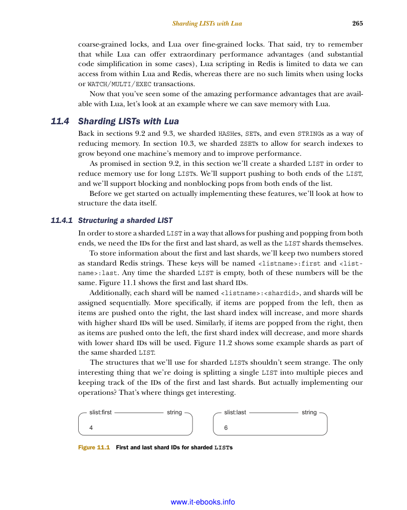
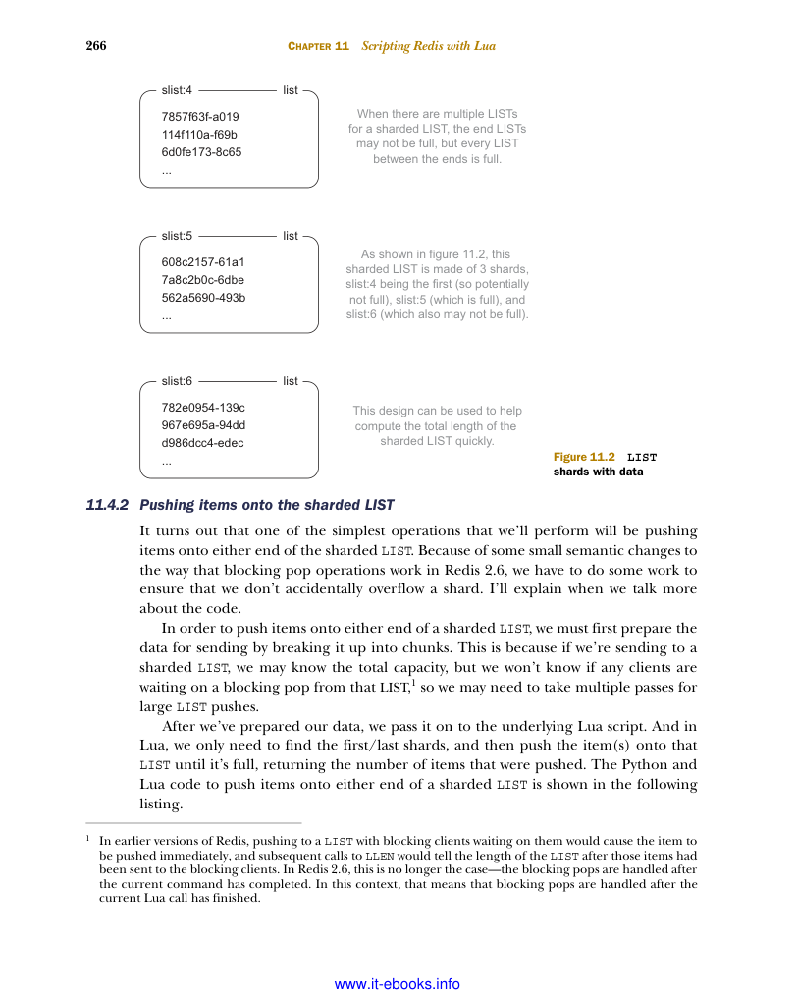
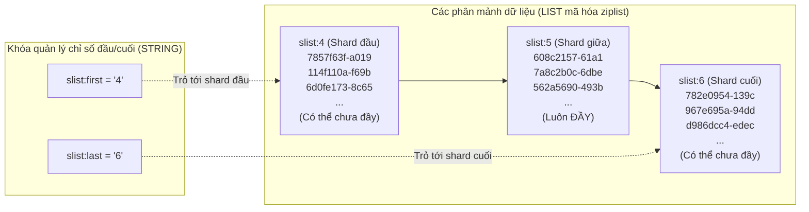
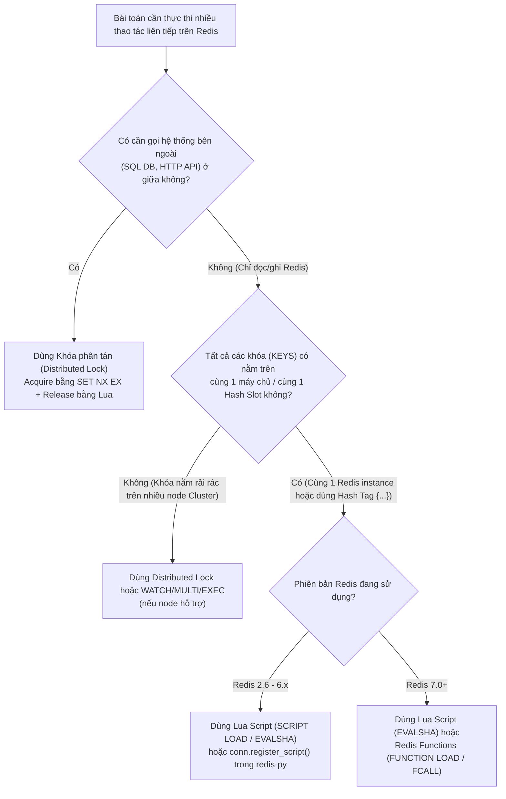

# Chương 11: Lập trình kịch bản Redis với Lua (Scripting Redis with Lua)

Qua nhiều chương vừa rồi, bạn đã xây dựng được một bộ sưu tập các công cụ có thể áp dụng vào những ứng dụng hiện có, đồng thời làm quen với các kỹ thuật để giải quyết hàng loạt bài toán khác nhau. Chương này cũng tiếp nối tinh thần đó, nhưng sẽ làm đảo lộn một số kỳ vọng trước đây của bạn. Kể từ phiên bản Redis 2.6, Redis tích hợp khả năng lập trình kịch bản phía máy chủ (server-side scripting) bằng ngôn ngữ lập trình Lua. Tính năng này cho phép bạn thực hiện đa dạng các thao tác ngay bên trong Redis, vừa giúp đơn giản hóa mã nguồn vừa gia tăng hiệu năng đáng kể.

Trong chương này, chúng ta sẽ bắt đầu bằng việc thảo luận một số ưu điểm của Lua so với việc thực hiện các thao tác ở phía client, thông qua một ví dụ từ mạng xã hội ở chương 8. Tiếp đó, chúng ta sẽ đi qua hai bài toán từ chương 4 và chương 6 để minh họa những trường hợp mà việc sử dụng Lua có thể loại bỏ hoàn toàn nhu cầu dùng giao dịch `WATCH`/`MULTI`/`EXEC`. Sau đó, chúng ta sẽ quay lại các khóa (lock) và semaphore từ chương 6 để xem cách triển khai chúng bằng Lua nhằm mang lại khả năng truy cập công bằng cho nhiều client và đạt hiệu năng cao hơn. Cuối cùng, chúng ta sẽ xây dựng một cấu trúc `LIST` phân mảnh (sharded LIST) bằng Lua hỗ trợ nhiều (nhưng không phải tất cả) lệnh tương đương với `LIST` tiêu chuẩn.

**Nội dung chính của chương này bao gồm:**

- Bổ sung tính năng mới mà không cần viết mã C (Adding functionality without writing C)
- Viết lại khóa (lock) và semaphore bằng Lua (Rewriting locks and semaphores with Lua)
- Loại bỏ nhu cầu sử dụng `WATCH`/`MULTI`/`EXEC` (Doing away with WATCH/MULTI/EXEC)
- Phân mảnh `LIST` với Lua (Sharding LISTs with Lua)

Hãy bắt đầu bằng việc tìm hiểu một số điều mà chúng ta có thể làm với lập trình kịch bản Lua.

---

## 11.1 Bổ sung tính năng mới mà không cần viết mã C (Adding functionality without writing C)

Trước phiên bản Redis 2.6 (và nhánh scripting không được hỗ trợ chính thức của Redis 2.4), nếu muốn có các chức năng cấp cao hơn chưa tồn tại sẵn trong Redis, chúng ta hoặc phải viết mã ở phía client (như cách chúng ta đã làm xuyên suốt 10 chương vừa qua), hoặc phải chỉnh sửa trực tiếp mã nguồn C của chính Redis. Mặc dù việc chỉnh sửa mã nguồn của Redis không quá khó, nhưng việc duy trì và hỗ trợ mã nguồn như vậy trong môi trường doanh nghiệp, hay cố gắng thuyết phục cấp quản lý rằng chạy một phiên bản máy chủ Redis tự tùy biến là một ý tưởng hay, có thể là một thách thức lớn.

Trong phần này, chúng ta sẽ giới thiệu các phương pháp để thực thi mã Lua ngay bên trong máy chủ Redis. Bằng cách viết kịch bản (script) cho Redis với Lua, chúng ta có thể tránh được một số cạm bẫy phổ biến vốn làm chậm tốc độ phát triển hoặc làm giảm hiệu năng hệ thống.

Bước đầu tiên để thực thi mã Lua trong Redis là nạp (load) đoạn mã đó vào Redis.

### 11.1.1 Nạp kịch bản Lua vào Redis (Loading Lua scripts into Redis)

Một số thư viện Python Redis cũ hơn (nhưng vẫn đang được sử dụng) dành cho Redis 2.6 chưa cung cấp khả năng nạp hoặc thực thi trực tiếp các kịch bản Lua, vì vậy chúng ta sẽ dành ít phút để tạo một bộ nạp (loader) cho các kịch bản. Để nạp kịch bản vào Redis, có một lệnh gồm hai phần tên là `SCRIPT LOAD`; khi được truyền vào một chuỗi chứa kịch bản Lua, lệnh này sẽ lưu trữ kịch bản trên máy chủ để thực thi về sau và trả về mã băm SHA1 (SHA1 hash) của kịch bản đó. Sau này, khi muốn thực thi kịch bản đó, chúng ta chạy lệnh Redis `EVALSHA` cùng với mã băm đã được Redis trả về trước đó, kèm theo bất kỳ tham số nào mà kịch bản cần.

Mã nguồn của chúng ta để thực hiện các thao tác này được lấy cảm hứng từ mã nguồn Python Redis hiện tại. (Chúng ta sử dụng phương pháp tự viết này chủ yếu vì nó cho phép dùng bất kỳ kết nối nào mà ta muốn mà không cần phải tạo tường minh các đối tượng scripting mới — điều này rất hữu ích khi làm việc với kỹ thuật phân mảnh máy chủ / server sharding.) Khi truyền một chuỗi vào hàm `script_load()`, nó sẽ tạo ra một hàm có thể được gọi sau đó để thực thi kịch bản trong Redis. Khi gọi đối tượng hàm này để thực thi kịch bản, chúng ta phải cung cấp một kết nối Redis; ở lần gọi đầu tiên, nó sẽ gọi lệnh `SCRIPT LOAD`, và ở tất cả các lần gọi tiếp theo, nó sẽ gọi `EVALSHA`. Hàm `script_load()` được trình bày trong listing dưới đây.

**Listing 11.1 – Một hàm nạp kịch bản để gọi lại về sau (A function that loads scripts to be called later)**

```python
def script_load(script):
    sha = [None]
    def call(conn, keys=[], args=[], force_eval=False):
        if not force_eval:
            if not sha[0]:
                sha[0] = conn.execute_command(
                    "SCRIPT", "LOAD", script, parse="LOAD")
            try:
                return conn.execute_command(
                    "EVALSHA", sha[0], len(keys), *(keys+args))
            except redis.exceptions.ResponseError as msg:
                if not msg.args[0].startswith("NOSCRIPT"):
                    raise
        return conn.execute_command(
            "EVAL", script, len(keys), *(keys+args))
    return call
```

**Giải thích mã nguồn trong Listing 11.1:**

- `sha = [None]`: Lưu trữ mã băm SHA1 được đệm (cached) từ kết quả của lệnh `SCRIPT LOAD` bên trong một danh sách (list) gồm 1 phần tử để chúng ta có thể thay đổi giá trị của nó từ bên trong hàm lồng nhau `call()` (trong Python 2 chưa có từ khóa `nonlocal` như Python 3).
- `def call(conn, keys=[], args=[], force_eval=False):`: Khi gọi kịch bản đã nạp, chúng ta phải cung cấp một kết nối (`conn`), một danh sách các khóa (`keys`) mà kịch bản sẽ thao tác, cùng bất kỳ tham số bổ sung nào khác (`args`) truyền vào hàm.
- `if not sha[0]: sha[0] = conn.execute_command("SCRIPT", "LOAD", script, parse="LOAD")`: Chúng ta chỉ thử nạp kịch bản bằng `SCRIPT LOAD` nếu mã băm SHA1 chưa được lưu đệm trong `sha[0]`.
- `return conn.execute_command("EVALSHA", sha[0], len(keys), *(keys+args))`: Thực thi lệnh từ mã băm SHA1 đã được lưu đệm.
- `if not msg.args[0].startswith("NOSCRIPT"): raise`: Nếu lỗi trả về không liên quan đến việc thiếu kịch bản trên server (`NOSCRIPT`), hãy ném (raise) lại ngoại lệ đó.
- `return conn.execute_command("EVAL", script, len(keys), *(keys+args))`: Nếu chúng ta nhận được lỗi liên quan đến việc kịch bản chưa tồn tại trên server (`NOSCRIPT`), hoặc nếu cần ép buộc thực thi trực tiếp kịch bản (`force_eval=True`), hãy thực thi kịch bản trực tiếp bằng lệnh `EVAL`. Lệnh `EVAL` này cũng sẽ tự động lưu đệm kịch bản trên máy chủ (với cùng mã băm SHA1 mà chúng ta đã lưu đệm) sau khi chạy xong.
- `return call`: Trả về hàm closure giúp tự động nạp và thực thi kịch bản mỗi khi được gọi.

Bạn sẽ nhận thấy rằng ngoài các lệnh gọi `SCRIPT LOAD` và `EVALSHA`, chúng ta còn bắt (capture) một ngoại lệ có thể xảy ra nếu chúng ta đã lưu đệm mã băm SHA1 của kịch bản ở phía cục bộ (client), nhưng máy chủ Redis lại không biết gì về mã băm đó. Tình huống này có thể xảy ra nếu máy chủ Redis vừa được khởi động lại, nếu ai đó đã thực thi lệnh `SCRIPT FLUSH` để xóa sạch bộ nhớ đệm kịch bản, hoặc nếu chúng ta truyền các kết nối trỏ tới hai máy chủ Redis khác nhau vào hàm ở các thời điểm khác nhau. Nếu phát hiện kịch bản bị thiếu trên máy chủ, chúng ta thực thi kịch bản trực tiếp bằng lệnh `EVAL` — lệnh này ngoài việc thực thi kịch bản còn tự động lưu đệm luôn kịch bản đó vào máy chủ. Ngoài ra, chúng ta cũng cho phép client thực thi trực tiếp kịch bản thông qua tham số `force_eval=True`, điều này rất hữu ích khi thực thi một kịch bản Lua như một phần của giao dịch (`MULTI`/`EXEC`) hoặc chuỗi lệnh dùng kỹ thuật đường ống (pipeline).

> **KHÓA VÀ THAM SỐ TRUYỀN VÀO KỊCH BẢN LUA (KEYS AND ARGUMENTS TO LUA SCRIPTS)**
>
> Ẩn sâu bên trong bộ nạp kịch bản của chúng ta, bạn có thể đã nhận thấy rằng việc gọi một kịch bản trong Lua nhận vào ba đối số chính. Đối số đầu tiên là một kết nối Redis (`conn`), điều này hẳn đã quá quen thuộc. Đối số thứ hai là một danh sách các khóa (`keys`). Đối số thứ ba là một danh sách các tham số (`args`) truyền cho hàm.
>
> Sự khác biệt giữa khóa (`keys`) và tham số (`args`) là bạn cần phải truyền **tất cả các khóa** mà kịch bản sẽ đọc hoặc ghi vào như một phần của đối số `keys`. Mục đích của quy ước này là để các tầng xử lý khác có thể kiểm tra và xác minh rằng tất cả các khóa đều nằm trên cùng một phân mảnh (shard) nếu bạn đang sử dụng các kỹ thuật phân mảnh đa máy chủ (multiserver sharding) như đã mô tả trong chương 10.
>
> Khi Redis Cluster được phát hành — cung cấp khả năng phân mảnh đa máy chủ tự động — danh sách `keys` sẽ được kiểm tra trước khi kịch bản chạy, và máy chủ sẽ trả về lỗi nếu kịch bản truy cập bất kỳ khóa nào không nằm trên cùng một máy chủ (hoặc không thuộc cùng một hash slot).
>
> Danh sách tham số thứ hai (`args`) không có giới hạn như vậy và được dùng để chứa dữ liệu thuần túy phục vụ cho việc xử lý bên trong lời gọi Lua.

Hãy thử nghiệm hàm này trong giao diện điều khiển (console) với một ví dụ đơn giản để bắt đầu:

```python
>>> ret_1 = script_load("return 1")
>>> ret_1(conn)
1L
```

**Giải thích tương tác console:**

- `ret_1 = script_load("return 1")`: Hầu hết các trường hợp sử dụng sẽ nạp kịch bản và lưu lại một tham chiếu tới hàm được trả về.
- `ret_1(conn)`: Sau đó, chúng ta có thể gọi hàm bằng cách truyền vào đối tượng kết nối và bất kỳ tham số mong muốn nào.
- `1L`: Kết quả sẽ được trả về và chuyển đổi sang kiểu dữ liệu Python tương ứng khi có thể (ở đây là kiểu số nguyên `long` trong Python 2, hoặc `int` `1` trong Python 3).

Như bạn thấy trong ví dụ này, chúng ta đã tạo một kịch bản đơn giản có mục đích duy nhất là trả về giá trị `1`. Khi chúng ta gọi nó cùng với đối tượng kết nối, kịch bản sẽ được nạp lên Redis rồi thực thi, dẫn đến giá trị `1` được trả về.

#### TRẢ VỀ CÁC GIÁ TRỊ KHÔNG PHẢI CHUỖI VÀ KHÔNG PHẢI SỐ NGUYÊN TỪ LUA (RETURNING NON-STRING AND NON-INTEGER VALUES FROM LUA)

Do những hạn chế trong cách Lua cho phép truyền dữ liệu vào và ra khỏi môi trường của nó (khi giao tiếp với giao thức Redis), một số kiểu dữ liệu có sẵn trong Lua không được phép truyền ra ngoài, hoặc sẽ bị biến đổi trước khi được trả về cho client. **Bảng 11.1** cho thấy cách dữ liệu bị biến đổi khi trả về từ Lua sang Python.

**Bảng 11.1 – Các giá trị trả về từ Lua và kết quả sau khi được chuyển đổi sang Python (Table 11.1 Values returned from Lua and what they’re translated into)**

| Giá trị trong Lua (Lua value) | Điều gì xảy ra trong quá trình chuyển đổi sang Python (What happens during conversion to Python) |
| :--- | :--- |
| `true` | Chuyển thành số nguyên `1` (`Turns into 1`) |
| `false` | Chuyển thành `None` (`Turns into None`) |
| `nil` | Không chuyển thành giá trị nào cả (trả về `None` nếu đứng một mình), và làm **dừng việc trả về các giá trị còn lại** phía sau nó trong một bảng Lua (`table`) (`Doesn’t turn into anything, and stops remaining values in a table from being returned`) |
| `1.5` (hoặc bất kỳ số thực dấu phẩy động / float nào khác) | Phần thập phân bị cắt bỏ (discarded), biến nó thành một số nguyên (`1`) (`Fractional part is discarded, turning it into an integer`) |
| `1e30` (hoặc bất kỳ số thực float rất lớn nào khác) | Bị chuyển thành số nguyên nhỏ nhất (minimum integer / tràn số âm) đối với phiên bản Python của bạn (`Is turned into the minimum integer for your version of Python`) |
| `"strings"` (chuỗi ký tự) | Giữ nguyên không đổi (`Unchanged`) |
| `1` (hoặc bất kỳ số nguyên nào trong khoảng $\pm 2^{53}-1$) | Số nguyên được trả về nguyên vẹn không đổi (`Integer is returned unchanged`) |

Vì sự nhập nhằng có thể xảy ra khi trả về nhiều kiểu dữ liệu khác nhau từ Lua, bạn nên cố gắng trả về kiểu chuỗi (`string`) một cách tường minh bất cứ khi nào có thể (ví dụ dùng `tostring()`), và tự thực hiện việc phân tích cú pháp (parsing) ở phía client. Trong các ví dụ của chương này, chúng ta sẽ chỉ trả về các giá trị Boolean, chuỗi ký tự, số nguyên và bảng Lua (`table` — sẽ được chuyển thành `list` trong Python).

> 📝 **Giải thích thêm (không có trong sách):**
>
> **1. Cách sử dụng `register_script` trong `redis-py` hiện đại (redis-py 3.x / 4.x / 5.x):**
> Trong các phiên bản `redis-py` hiện đại trên Python 3, bạn không cần phải tự viết hàm `script_load` thủ công bằng `execute_command` nữa (trừ khi bạn muốn tùy biến đặc biệt). Thư viện `redis-py` cung cấp sẵn phương thức `conn.register_script(lua_script)` hoạt động hoàn toàn tương đương: nó tự động tính SHA1, thử gọi `EVALSHA` trước, và nếu gặp lỗi `NOSCRIPT` thì tự động fallback sang `EVAL`. Ngoài ra, bạn vẫn có thể truyền `client=pipe` vào lúc gọi script để chạy bên trong một pipeline!
>
> ```python
> import redis
>
> r = redis.Redis(host='localhost', port=6379, decode_responses=True)
>
> # Đăng ký script
> my_script = r.register_script("return {KEYS[1], ARGV[1]}")
>
> # Gọi script với danh sách keys và args (tự động dùng EVALSHA / EVAL)
> result = my_script(keys=['user:100'], args=['hello'], client=r)
> print(result)  # ['user:100', 'hello']
> ```
>
> **2. Giao thức RESP3 và Redis Functions trong Redis 7.0+:**
> - Với giao thức RESP2 (mặc định trong Redis 2.6 đến Redis 5), sự chuyển đổi kiểu giữa Lua và Redis diễn ra đúng như **Bảng 11.1** (ví dụ `true` -> `1`, `false` -> `None`/bulk nil, số thực bị cắt phần thập phân thành integer). Từ Redis 6+ và Redis 7+ khi bật RESP3, Lua có thêm các hàm hỗ trợ kiểu dữ liệu phong phú hơn như `redis.setresp(3)` để trả về số thực (double), boolean, map, set chuẩn xác hơn. Tuy nhiên, quy tắc vàng vẫn là trả về chuỗi cho số thực (ví dụ `tostring(1.5)`) để tương thích mọi phiên bản.
> - Từ **Redis 7.0**, Redis giới thiệu **Redis Functions** (`FUNCTION LOAD`, `FCALL`, `FCALL_RO`) như một bước tiến hóa vượt bậc so với `EVAL`/`EVALSHA`. Trong khi `EVAL` gắn kịch bản với phía ứng dụng (application-bound script, dễ bị mất khi `SCRIPT FLUSH` nếu không quản lý kỹ), **Redis Functions** coi các hàm Lua như một phần hạng nhất của cơ sở dữ liệu (được lưu trữ bền vững trong RDB/AOF và tự động sao chép sang các replica).

Bây giờ chúng ta đã biết cách nạp và thực thi kịch bản, hãy bắt đầu với một ví dụ đơn giản từ chương 8: tạo một dòng trạng thái (status message) mới.

---

### 11.1.2 Tạo một thông điệp trạng thái mới (Creating a new status message)

Khi chúng ta xây dựng các kịch bản Lua để thực hiện một tập hợp các thao tác, việc bắt đầu bằng một ví dụ ngắn gọn, không quá phức tạp hay đòi hỏi thao tác trên quá nhiều cấu trúc dữ liệu là một cách tiếp cận rất tốt. Trong trường hợp này, chúng ta sẽ bắt đầu bằng việc viết một kịch bản Lua kết hợp với một đoạn mã bao bọc (wrapper code) bằng Python để đăng một thông điệp trạng thái.

> **KỊCH BẢN LUA — NGUYÊN TỬ NHƯ CÁC LỆNH ĐƠN LẺ HOẶC MULTI/EXEC (LUA SCRIPTS—AS ATOMIC AS SINGLE COMMANDS OR MULTI/EXEC)**
>
> Như bạn đã biết, từng lệnh riêng lẻ trong Redis đều có tính nguyên tử (atomic) ở chỗ chúng được chạy tuần tự từng lệnh một tại một thời điểm. Với `MULTI`/`EXEC`, bạn có thể ngăn không cho các lệnh của client khác xen vào chạy trong khi bạn đang thực thi một nhóm nhiều lệnh. Nhưng đối với Redis, bản thân mỗi lệnh `EVAL` và `EVALSHA` đều được coi là một lệnh đơn (dù bên trong rất phức tạp), vì vậy chúng được thực thi trọn vẹn mà không cho phép bất kỳ thao tác cấu trúc dữ liệu nào khác xen ngang.

> **KỊCH BẢN LUA — KHÔNG THỂ BỊ NGẮT NẾU ĐÃ SỬA ĐỔI DỮ LIỆU (LUA SCRIPTS—CAN’T BE INTERRUPTED IF THEY HAVE MODIFIED STRUCTURES)**
>
> Khi thực thi một kịch bản Lua bằng `EVAL` hoặc `EVALSHA`, Redis không cho phép bất kỳ lệnh đọc/ghi nào khác được chạy xen vào. Điều này rất tiện lợi. Nhưng vì Lua là một ngôn ngữ lập trình đa dụng, bạn có thể vô tình viết ra những kịch bản lặp vô hạn không bao giờ kết thúc, khiến các client khác bị chặn hoàn toàn không thể thực thi lệnh. Để giải quyết vấn đề này, Redis cung cấp hai tùy chọn nhằm dừng một kịch bản đang chạy trong Redis, tùy thuộc vào việc kịch bản của bạn đã thực hiện lệnh gọi Redis nào làm thay đổi dữ liệu (lệnh ghi) hay chưa:
>
> - **Nếu kịch bản của bạn chưa thực hiện bất kỳ lệnh gọi ghi nào (chỉ mới đọc dữ liệu):** Bạn có thể thực thi lệnh `SCRIPT KILL` nếu kịch bản đó đã chạy lâu hơn thời gian giới hạn được cấu hình trong `lua-time-limit` (hãy kiểm tra tệp cấu hình `redis.conf` của bạn, mặc định thường là 5000 mili-giây tức 5 giây).
> - **Nếu kịch bản của bạn đã ghi dữ liệu vào Redis:** Việc giết ngang kịch bản sẽ khiến dữ liệu trong Redis rơi vào trạng thái không nhất quán (inconsistent state). Trong tình huống đó, cách duy nhất để khôi phục là buộc dừng máy chủ Redis bằng lệnh `SHUTDOWN NOSAVE` — lệnh này sẽ làm Redis mất toàn bộ các thay đổi được thực hiện kể từ lần chụp nhanh (RDB snapshot) cuối cùng, hoặc kể từ nhóm lệnh cuối cùng được ghi xuống tệp AOF.
>
> Vì những hạn chế nghiêm ngặt này, bạn phải luôn kiểm thử kỹ lưỡng các kịch bản Lua của mình trước khi đưa chúng lên môi trường thực tế (production).

Như bạn có thể còn nhớ từ chương 8, Listing 8.2 đã trình bày cách tạo một thông điệp trạng thái. Một bản sao của đoạn mã gốc mà chúng ta đã dùng để đăng thông điệp trạng thái được liệt kê ngay dưới đây.

**Listing 11.2 – Hàm của chúng ta từ Listing 8.2 dùng để tạo một HASH thông điệp trạng thái (Our function from listing 8.2 that creates a status message HASH)**

```python
def create_status(conn, uid, message, **data):
    pipeline = conn.pipeline(True)
    pipeline.hget('user:%s' % uid, 'login')
    pipeline.incr('status:id:')
    login, id = pipeline.execute()

    if not login:
        return None

    data.update({
        'message': message,
        'posted': time.time(),
        'id': id,
        'uid': uid,
        'login': login,
    })
    pipeline.hmset('status:%s' % id, data)
    pipeline.hincrby('user:%s' % uid, 'posts')
    pipeline.execute()
    return id
```

**Giải thích mã nguồn trong Listing 11.2:**

- `pipeline.hget('user:%s' % uid, 'login')`: Lấy tên đăng nhập (`login`) của người dùng từ ID người dùng (`uid`) của họ.
- `pipeline.incr('status:id:')`: Tạo một ID mới cho thông điệp trạng thái.
- `if not login: return None`: Xác minh rằng chúng ta có một tài khoản người dùng hợp lệ trước khi đăng bài.
- `data.update({...})` và `pipeline.hmset('status:%s' % id, data)`: Chuẩn bị và thiết lập dữ liệu cho thông điệp trạng thái.
- `pipeline.hincrby('user:%s' % uid, 'posts')`: Ghi nhận sự kiện rằng một thông điệp trạng thái đã được đăng (tăng bộ đếm `posts` của người dùng).
- `return id`: Trả về ID của thông điệp trạng thái vừa được tạo.

Nhìn chung, chi phí hiệu năng của việc thực hiện hai chuyến khứ hồi mạng (two round trips) tới Redis để đăng một thông điệp trạng thái là không quá lớn — chỉ gấp đôi độ trễ của một chuyến khứ hồi. Nhưng nếu chúng ta có thể giảm hai chuyến khứ hồi này xuống còn một, chúng ta cũng sẽ áp dụng được kỹ thuật tương tự để giảm số chuyến khứ hồi cho những bài toán khác vốn đòi hỏi rất nhiều chuyến khứ hồi mạng. Ít chuyến khứ hồi hơn đồng nghĩa với độ trễ (latency) thấp hơn cho một nhóm lệnh nhất định. Độ trễ thấp hơn nghĩa là thời gian chờ đợi ít hơn, cần ít máy chủ web hơn, và hiệu năng tổng thể của toàn hệ thống cao hơn.

Hãy điểm lại những gì diễn ra khi chúng ta đăng một thông điệp trạng thái mới: chúng ta tra cứu tên người dùng trong một `HASH`, tăng giá trị một bộ đếm (để lấy ID mới), thêm dữ liệu vào một `HASH` trạng thái trong Redis, và tăng bộ đếm số bài đăng trong `HASH` của người dùng. Nghe có vẻ không mấy phức tạp khi viết bằng Lua; hãy thử triển khai nó trong listing tiếp theo, bao gồm kịch bản Lua cùng hàm bao bọc (wrapper) bằng Python giữ nguyên API giống hệt như trước.

**Listing 11.3 – Tạo thông điệp trạng thái bằng Lua (Creating a status message with Lua)**

```python
def create_status(conn, uid, message, **data):
    args = [
        'message', message,
        'posted', time.time(),
        'uid', uid,
    ]
    for key, value in data.iteritems():
        args.append(key)
        args.append(value)

    return create_status_lua(
        conn, ['user:%s' % uid, 'status:id:'], args)

create_status_lua = script_load('''
    local login = redis.call('hget', KEYS[1], 'login')
    if not login then
        return false
    end
    local id = redis.call('incr', KEYS[2])
    local key = string.format('status:%s', id)

    redis.call('hmset', key,
        'login', login,
        'id', id,
        unpack(ARGV))
    redis.call('hincrby', KEYS[1], 'posts', 1)

    return id
''')
```

**Giải thích mã nguồn trong Listing 11.3:**

- `def create_status(conn, uid, message, **data):`: Nhận tất cả các tham số đầu vào giống hệt như hàm trước đây.
- `args = [...]` và vòng lặp `for key, value in data.iteritems():`: Chuẩn bị danh sách phẳng (flat list) gồm các cặp khóa/giá trị thuộc tính sẽ được thiết lập trên thông điệp trạng thái (lưu ý: trong Python 3, `data.iteritems()` được thay bằng `data.items()`).
- `return create_status_lua(conn, ['user:%s' % uid, 'status:id:'], args)`: Gọi kịch bản Lua.
- `local login = redis.call('hget', KEYS[1], 'login')`: Lấy tên đăng nhập của người dùng từ ID của họ; hãy nhớ rằng các bảng (`table`) như `KEYS` và `ARGV` trong Lua được **đánh chỉ số bắt đầu từ 1 (1-indexed)**, chứ không phải từ 0 (0-indexed) như trong Python và hầu hết các ngôn ngữ khác.
- `if not login then return false end`: Nếu không tìm thấy `login` (tức người dùng không tồn tại), trả về `false` (sẽ được chuyển thành `None` trong Python) báo hiệu không tìm thấy người dùng. (Lưu ý thêm: ở phiên bản Python cũ trong Listing 11.2, `incr('status:id:')` vẫn bị gọi ngay cả khi `login` không tồn tại, còn bản Lua này chỉ tăng `status:id:` sau khi đã kiểm tra `login` hợp lệ!).
- `local id = redis.call('incr', KEYS[2])`: Lấy một ID mới cho thông điệp trạng thái.
- `local key = string.format('status:%s', id)`: Chuẩn bị tên khóa đích (`status:<id>`) cho thông điệp trạng thái.
- `redis.call('hmset', key, 'login', login, 'id', id, unpack(ARGV))`: Thiết lập toàn bộ dữ liệu cho HASH thông điệp trạng thái bằng cách giải nén (`unpack`) mảng `ARGV`.
- `redis.call('hincrby', KEYS[1], 'posts', 1)`: Tăng bộ đếm số lượng bài đăng (`posts`) của người dùng thêm 1.
- `return id`: Trả về ID của thông điệp trạng thái vừa tạo.

Hàm này thực hiện tất cả các thao tác giống như phiên bản thuần Python trước đó, chỉ khác là thay vì cần hai chuyến khứ hồi mạng tới Redis trong mỗi lần gọi, giờ đây nó chỉ cần một chuyến duy nhất (lần gọi đầu tiên sẽ nạp kịch bản vào Redis rồi gọi kịch bản đã nạp, nhưng mọi lần gọi tiếp theo sẽ chỉ tốn đúng một chuyến khứ hồi). Đây chưa phải là vấn đề sống còn đối với tác vụ đăng thông điệp trạng thái, nhưng đối với nhiều bài toán khác mà chúng ta đã đi qua ở các chương trước, việc thực hiện nhiều chuyến khứ hồi mạng có thể tiêu tốn nhiều thời gian hơn mức cần thiết, hoặc dẫn đến tình trạng tranh chấp (contention) khi dùng `WATCH`/`MULTI`/`EXEC`.

> **GHI VÀO CÁC KHÓA KHÔNG NẰM TRONG ĐỐI SỐ `KEYS` CỦA KỊCH BẢN (WRITING KEYS THAT AREN’T A PART OF THE KEYS ARGUMENT TO THE SCRIPT)**
>
> Trong phần lưu ý ở mục 11.1.1, tôi đã đề cập rằng chúng ta nên truyền tất cả các khóa sẽ bị sửa đổi vào đối số `keys` của kịch bản, thế nhưng ở đây chúng ta lại đang ghi vào một `HASH` (`status:<id>`) dựa trên một tên khóa được sinh động (dynamically generated) từ kết quả của lệnh `INCR` chứ không được truyền sẵn vào `KEYS`. Việc làm này khiến kịch bản Lua trên **không tương thích** với Redis Cluster trong tương lai. Liệu thao tác này có còn đúng đắn trong kịch bản máy chủ phân mảnh không dùng Cluster (noncluster sharded server) hay không sẽ phụ thuộc vào phương pháp phân mảnh của bạn. Tôi cố tình làm điều này ở đây để nhấn mạnh rằng đôi khi bạn có thể cần thực hiện kiểu thao tác sinh khóa động như vậy trên một máy chủ đơn lẻ, nhưng làm thế sẽ ngăn cản bạn chuyển sang sử dụng Redis Cluster.

> **BỘ NẠP KỊCH BẢN VÀ CÁC HÀM TRỢ GIÚP (SCRIPT LOADERS AND HELPERS)**
>
> Bạn sẽ nhận thấy trong ví dụ đầu tiên này rằng chúng ta có hai mảnh ghép chính: một hàm Python xử lý việc chuyển đổi từ API quen thuộc trước đây sang lời gọi kịch bản Lua, và bản thân kịch bản Lua được nạp thông qua hàm `script_load()`. Chúng ta sẽ tiếp tục duy trì khuôn mẫu (pattern) này trong suốt phần còn lại của chương, bởi vì API nguyên bản của lập trình kịch bản Lua (`KEYS` và `ARGV`) có thể khá bất tiện nếu gọi trực tiếp ở nhiều ngữ cảnh khác nhau.

Kể từ khi Redis 2.6 được hoàn thiện và phát hành, các thư viện hỗ trợ lập trình kịch bản Redis với Lua trong những ngôn ngữ lập trình phổ biến ngày càng trở nên tốt hơn và hoàn chỉnh hơn. Về phía Python, một bộ nạp kịch bản tương tự như những gì chúng ta vừa viết đã có sẵn trong kho mã nguồn của dự án `redis-py`, và hiện có thể cài đặt từ Python Package Index (PyPI). Chúng ta sử dụng bộ nạp kịch bản tự viết do tính linh hoạt và dễ sử dụng của nó khi phải làm việc với các kết nối mạng được phân mảnh (sharded network connections).

Khi khối lượng tương tác với Redis tăng lên theo thời gian, chúng ta đã chuyển sang sử dụng các khóa (locks) và semaphore để giúp giảm thiểu các vấn đề tranh chấp xoay quanh giao dịch `WATCH`/`MULTI`/`EXEC`. Hãy cùng xem xét việc viết lại khóa và semaphore bằng Lua để xem liệu chúng ta có thể cải thiện hiệu năng hơn nữa hay không.

---

## 11.2 Viết lại khóa và semaphore bằng Lua (Rewriting locks and semaphores with Lua)

Khi tôi giới thiệu về khóa (locks) và semaphore trong chương 6, tôi đã chỉ ra cách mà khóa có thể làm giảm sự tranh chấp so với các giao dịch `WATCH`/`MULTI`/`EXEC` bằng cách tiếp cận bi quan (pessimistic locking) trong các kịch bản lưu lượng truy cập lớn. Tuy nhiên, bản thân các khóa lại đòi hỏi từ hai đến ba chuyến khứ hồi mạng để giành lấy (acquire) hoặc giải phóng (release) một khóa trong trường hợp tốt nhất, và vẫn có thể gặp phải sự tranh chấp trong một số tình huống.

Trong phần này, chúng ta sẽ quay lại khóa ở mục 6.2 và viết lại nó bằng Lua nhằm cải thiện hiệu năng hơn nữa. Sau đó, chúng ta sẽ xem lại ví dụ về semaphore ở mục 6.3 để triển khai một cơ chế cấp phát hoàn toàn công bằng (completely fair) đồng thời tăng tốc hiệu năng tại đó.

Trước hết, hãy cùng tìm hiểu về khóa viết bằng Lua, và lý do tại sao chúng ta vẫn muốn tiếp tục sử dụng khóa khi đã có Lua.

### 11.2.1 Tại sao vẫn cần khóa khi đã có Lua? (Why locks in Lua?)

Trước tiên, hãy giải đáp câu hỏi tại sao chúng ta lại quyết định xây dựng một cơ chế khóa bằng Lua (thay vì nhét toàn bộ mọi logic ứng dụng vào trong kịch bản Lua). Có hai lý do chính sau đây:

1. **Thứ nhất, xét về mặt kỹ thuật:** Khi thực thi một kịch bản Lua bằng lệnh `EVAL` hoặc `EVALSHA`, nhóm đối số đầu tiên ngay sau chuỗi kịch bản (hoặc mã băm SHA1) là danh sách các khóa (`KEYS`) sẽ được đọc hoặc ghi bên trong Lua (tôi đã đề cập đến điều này trong hai khung lưu ý ở mục 11.1.1 và 11.1.2). Quy định này chủ yếu nhằm cho phép các máy chủ Redis Cluster từ chối những kịch bản đọc hoặc ghi các khóa không nằm sẵn trên một phân mảnh (shard) cụ thể. Nếu chúng ta không thể biết trước những khóa nào sẽ được đọc/ghi (ví dụ phải đọc khóa A mới biết tên khóa B nằm ở shard khác), chúng ta không nên dùng một kịch bản Lua gom tất cả lại (mà thay vào đó nên sử dụng `WATCH`/`MULTI`/`EXEC` hoặc dùng khóa phân tán). Do đó, bất kỳ khi nào chúng ta đọc hoặc ghi những khóa không được cung cấp trước trong đối số `KEYS` của kịch bản, chúng ta đều đối mặt với nguy cơ mất tương thích hoặc lỗi hệ thống nếu sau này chuyển đổi sang môi trường Redis Cluster.
2. **Thứ hai, xét về mặt dữ liệu bên ngoài:** Có những tình huống mà việc thao tác dữ liệu trong Redis đòi hỏi dữ liệu không nằm sẵn trong Redis tại thời điểm bắt đầu lời gọi. Một ví dụ điển hình là lấy một số giá trị `HASH` từ Redis, sau đó dùng các giá trị này để truy vấn thông tin từ một cơ sở dữ liệu quan hệ (RDBMS như PostgreSQL/MySQL) hoặc gọi một API bên ngoài, rồi mới lấy kết quả đó ghi ngược trở lại vào Redis. Chúng ta đã từng thấy trường hợp này lần đầu tiên khi lập lịch lưu đệm các hàng dữ liệu (caching rows) vào Redis ở mục 2.4. Khi đó chúng ta đã không bận tâm đến việc khóa bởi vì việc ghi đè hai bản sao của cùng một hàng dữ liệu hai lần không phải là vấn đề nghiêm trọng. Nhưng trong các kịch bản lưu đệm khác, việc đọc dữ liệu cần lưu đệm nhiều lần từ DB có thể gây ra chi phí quá tải (overhead) vượt mức chấp nhận được, hoặc thậm chí làm cho dữ liệu mới hơn bị ghi đè bởi dữ liệu cũ hơn.

Từ hai lý do chính đáng này, hãy bắt tay vào viết lại khóa của chúng ta để sử dụng Lua.

---

### 11.2.2 Viết lại khóa của chúng ta (Rewriting our lock)

Như bạn có thể còn nhớ từ mục 6.2, quy trình khóa bao gồm việc sinh một mã định danh duy nhất (UUID), thiết lập có điều kiện một khóa bằng lệnh `SETNX`, và khi thành công thì đặt thời gian hết hạn (expiration time) cho khóa đó bằng `EXPIRE`. Mặc dù ý tưởng rất đơn giản, chúng ta đã phải xử lý các trường hợp lỗi (máy khách bị treo giữa `SETNX` và `EXPIRE`) và thử lại, dẫn đến đoạn mã gốc được trình bày trong listing tiếp theo.

**Listing 11.4 – Hàm `acquire_lock_with_timeout()` hoàn chỉnh của chúng ta từ mục 6.2.5 (Our final acquire_lock_with_timeout() function from section 6.2.5)**

```python
def acquire_lock_with_timeout(
    conn, lockname, acquire_timeout=10, lock_timeout=10):
    identifier = str(uuid.uuid4())
    lockname = 'lock:' + lockname
    lock_timeout = int(math.ceil(lock_timeout))

    end = time.time() + acquire_timeout
    while time.time() < end:
        if conn.setnx(lockname, identifier):
            conn.expire(lockname, lock_timeout)
            return identifier
        elif not conn.ttl(lockname):
            conn.expire(lockname, lock_timeout)

        time.sleep(.001)

    return False
```

**Giải thích mã nguồn trong Listing 11.4:**

- `identifier = str(uuid.uuid4())`: Một mã định danh ngẫu nhiên 128-bit.
- `lock_timeout = int(math.ceil(lock_timeout))`: Chỉ truyền số nguyên vào các lệnh gọi `EXPIRE` của chúng ta.
- `if conn.setnx(lockname, identifier): conn.expire(...)`: Giành lấy khóa và thiết lập thời gian hết hạn.
- `elif not conn.ttl(lockname): conn.expire(...)`: Kiểm tra và cập nhật lại thời gian hết hạn nếu cần thiết (phòng trường hợp một client trước đó vừa `SETNX` xong thì bị crash trước khi kịp chạy `EXPIRE`).

Không có gì quá bất ngờ ở đây nếu bạn còn nhớ cách chúng ta từng bước xây dựng nên hàm khóa này trong mục 6.2. Giờ hãy cung cấp chức năng tương tự, nhưng chuyển phần cốt lõi của thao tác giành khóa vào trong Lua.

**Listing 11.5 – Hàm `acquire_lock_with_timeout()` được viết lại sử dụng Lua (A rewritten acquire_lock_with_timeout() that uses Lua)**

```python
def acquire_lock_with_timeout(
    conn, lockname, acquire_timeout=10, lock_timeout=10):
    identifier = str(uuid.uuid4())
    lockname = 'lock:' + lockname
    lock_timeout = int(math.ceil(lock_timeout))
    acquired = False
    end = time.time() + acquire_timeout
    while time.time() < end and not acquired:
        acquired = acquire_lock_with_timeout_lua(
            conn, [lockname], [lock_timeout, identifier]) == 'OK'
        time.sleep(.001 * (not acquired))
    return acquired and identifier

acquire_lock_with_timeout_lua = script_load('''
    if redis.call('exists', KEYS[1]) == 0 then
        return redis.call('setex', KEYS[1], unpack(ARGV))
    end
''')
```

**Giải thích mã nguồn trong Listing 11.5:**

- `acquired = acquire_lock_with_timeout_lua(conn, [lockname], [lock_timeout, identifier]) == 'OK'`: Thực sự giành lấy khóa, kiểm tra để xác nhận rằng lời gọi Lua đã hoàn tất thành công (trả về `'OK'`).
- `if redis.call('exists', KEYS[1]) == 0 then`: Kiểm tra nếu khóa chưa tồn tại — một lần nữa hãy nhớ rằng các bảng trong Lua sử dụng cách đánh chỉ số bắt đầu từ 1 (`KEYS[1]`).
- `return redis.call('setex', KEYS[1], unpack(ARGV))`: Thiết lập khóa với thời gian hết hạn (`ARGV[1]`) và mã định danh (`ARGV[2]`) được cung cấp trong cùng một thao tác nguyên tử.

Không có thay đổi lớn nào về cấu trúc mã Python, ngoại trừ việc chúng ta thay đổi các lệnh sử dụng bên trong Lua sao cho một khi khóa được giành lấy, nó **luôn luôn** có sẵn thời gian hết hạn (nhờ lệnh `SETEX` chạy nguyên tử cùng kiểm tra `EXISTS`, loại bỏ hoàn toàn nguy cơ khóa tồn tại vĩnh viễn không có TTL). Tiếp theo, hãy viết lại luôn đoạn mã giải phóng khóa (release lock) để sử dụng Lua.

Trước đây, chúng ta phải `WATCH` khóa của lock, sau đó kiểm tra xem khóa đó có còn giữ đúng giá trị `identifier` của mình hay không. Nếu vẫn giữ cùng giá trị, chúng ta mới xóa khóa trong khối `MULTI`/`EXEC`; ngược lại, chúng ta coi như đã mất khóa. Phiên bản `release_lock()` viết bằng Lua của chúng ta được trình bày ngay dưới đây.

**Listing 11.6 – Hàm `release_lock()` được viết lại sử dụng Lua (A rewritten release_lock() that uses Lua)**

```python
def release_lock(conn, lockname, identifier):
    lockname = 'lock:' + lockname
    return release_lock_lua(conn, [lockname], [identifier])

release_lock_lua = script_load('''
    if redis.call('get', KEYS[1]) == ARGV[1] then
        return redis.call('del', KEYS[1]) or true
    end
''')
```

**Giải thích mã nguồn trong Listing 11.6:**

- `return release_lock_lua(conn, [lockname], [identifier])`: Gọi hàm Lua thực hiện việc giải phóng khóa.
- `if redis.call('get', KEYS[1]) == ARGV[1] then`: Đảm bảo rằng giá trị của khóa khớp với mã định danh `identifier` của client đang giữ khóa.
- `return redis.call('del', KEYS[1]) or true`: Xóa khóa và đảm bảo trả về giá trị đúng (`1` hoặc `true`).

> 📝 **Giải thích thêm (không có trong sách):**
> Kể từ phiên bản **Redis 2.6.12** (ra mắt sau khi cuốn sách này được viết một thời gian ngắn), lệnh `SET` tiêu chuẩn đã được mở rộng để nhận thêm các cờ `NX` (chỉ đặt nếu chưa tồn tại) và `EX`/`PX` (đặt thời gian hết hạn tính bằng giây hoặc mili-giây) trong một lệnh nguyên tử duy nhất:
> ```bash
> SET lock:my_resource <identifier> NX EX 10
> ```
> Nhờ đó, trong Redis hiện đại, thao tác **giành khóa** (`acquire_lock_with_timeout`) không cần đến kịch bản Lua nữa mà chỉ cần gọi trực tiếp `conn.set(lockname, identifier, nx=True, ex=lock_timeout)`.
> Tuy nhiên, đối với thao tác **giải phóng khóa** (`release_lock`), Redis vẫn không có lệnh đơn tích hợp sẵn nào kiểu "chỉ xóa khóa nếu giá trị bằng X", nên kịch bản Lua trong **Listing 11.6** (`if redis.call('get', KEYS[1]) == ARGV[1] then return redis.call('del', KEYS[1]) end`) cho đến tận ngày nay (Redis 7/8) vẫn là **cách làm tiêu chuẩn vàng (best practice)** được chính tài liệu Redis khuyến nghị cho Distributed Lock!

Khác với hàm giành khóa, hàm giải phóng khóa trở nên ngắn gọn hơn hẳn vì chúng ta không còn phải thực hiện tất cả các bước `WATCH`/`MULTI`/`EXEC` rườm rà nữa.

Rút gọn được mã nguồn là điều tuyệt vời, nhưng sẽ chẳng có nhiều ý nghĩa nếu chúng ta không thực sự cải thiện được hiệu năng của bản thân cơ chế khóa. Chúng tôi đã bổ sung một số mã đo đạc (instrumentation) vào mã khóa cùng với kịch bản đo kiểm (benchmark) chạy song song 1, 2, 5 và 10 tiến trình (processes) liên tục giành lấy và giải phóng khóa. Chúng tôi đếm tổng số lần thử giành khóa (tries) và số lần thực sự giành được khóa thành công (acquires) trong vòng 10 giây, đối với cả hai phiên bản hàm giành/giải phóng khóa gốc (Chương 6) và phiên bản dựa trên Lua. **Bảng 11.2** hiển thị số lượng lời gọi đã được thực hiện và thành công.

**Bảng 11.2 – Hiệu năng của khóa gốc so với khóa dựa trên Lua trong vòng 10 giây (Table 11.2 Performance of our original lock against a Lua-based lock over 10 seconds)**

| Cấu hình đo kiểm (Benchmark configuration) | Số lần thử trong 10 giây (Tries in 10 seconds) | Số lần giành được khóa trong 10 giây (Acquires in 10 seconds) |
| :--- | :---: | :---: |
| Khóa gốc, 1 client (Original lock, 1 client) | 31,359 | 31,359 |
| Khóa gốc, 2 client (Original lock, 2 clients) | 30,085 | 22,507 |
| Khóa gốc, 5 client (Original lock, 5 clients) | 47,694 | 19,695 |
| Khóa gốc, 10 client (Original lock, 10 clients) | 71,917 | 14,361 |
| **Khóa Lua, 1 client (Lua lock, 1 client)** | **44,494** | **44,494** |
| **Khóa Lua, 2 client (Lua lock, 2 clients)** | **50,404** | **42,199** |
| **Khóa Lua, 5 client (Lua lock, 5 clients)** | **70,807** | **40,826** |
| **Khóa Lua, 10 client (Lua lock, 10 clients)** | **96,871** | **33,990** |

Nhìn vào dữ liệu từ bài đo kiểm của chúng ta (hãy chú ý đến cột bên phải), một điểm đáng lưu ý là các khóa dựa trên Lua thành công trong chu trình giành lấy và giải phóng khóa nhiều hơn đáng kể so với khóa trước đây — cao hơn **hơn 40%** với 1 client đơn lẻ, **87%** với 2 client, và **hơn 100% (gấp đôi)** khi có 5 hoặc 10 client cùng cố gắng giành và giải phóng một khóa. So sánh cột ở giữa và cột bên phải, chúng ta cũng thấy các lần thử khóa bằng Lua diễn ra nhanh hơn rất nhiều, chủ yếu nhờ vào việc giảm thiểu số lượng chuyến khứ hồi mạng.

Nhưng còn tuyệt vời hơn cả những cải tiến về hiệu năng, mã nguồn để giành và giải phóng khóa của chúng ta giờ đây dễ hiểu hơn và dễ kiểm chứng tính đúng đắn hơn rất nhiều.

Một ví dụ khác mà chúng ta đã xây dựng cấu trúc đồng bộ hóa nguyên thủy (synchronization primitive) là semaphore; hãy cùng xem cách xây dựng chúng bằng Lua ngay tiếp theo.

---

### 11.2.3 Semaphore đếm viết bằng Lua (Counting semaphores in Lua)

Khi làm việc với semaphore đếm (counting semaphores) trong chương 6, chúng ta đã dành rất nhiều thời gian để cố gắng đảm bảo rằng semaphore của mình có được sự công bằng (fairness) ngay cả khi đồng hồ hệ thống giữa các máy khách không hoàn toàn đồng bộ. Trong quá trình đó, chúng ta đã phải dùng một bộ đếm (`INCR`) để tạo một định danh số tăng dần cho mỗi client, rồi dùng số đó kết hợp với tập hợp có thứ tự (`ZSET`) để xác định xem client có giành được semaphore hay không. Nhưng bởi vì chúng ta vẫn gặp phải điều kiện tranh chấp (race conditions) khi nhiều client cùng giành semaphore, cuối cùng chúng ta vẫn buộc phải bọc toàn bộ thao tác đó bên trong một khóa phân tán (`acquire_fair_semaphore_with_lock`) thì semaphore mới hoạt động chính xác.

Hãy nhìn lại bản triển khai semaphore đếm trước đây của chúng ta và suy nghĩ xem cần làm những gì để cải tiến nó bằng Lua.

**Listing 11.7 – Hàm `acquire_semaphore()` từ mục 6.3.2 (The acquire_semaphore() function from section 6.3.2)**

```python
def acquire_semaphore(conn, semname, limit, timeout=10):
    identifier = str(uuid.uuid4())
    now = time.time()

    pipeline = conn.pipeline(True)
    pipeline.zremrangebyscore(semname, '-inf', now - timeout)
    pipeline.zadd(semname, identifier, now)
    pipeline.zrank(semname, identifier)
    if pipeline.execute()[-1] < limit:
        return identifier

    conn.zrem(semname, identifier)
    return None
```

**Giải thích mã nguồn trong Listing 11.7:**

- `identifier = str(uuid.uuid4())`: Một mã định danh ngẫu nhiên 128-bit.
- `pipeline.zremrangebyscore(semname, '-inf', now - timeout)`: Loại bỏ các client giữ semaphore đã quá hạn (timed out).
- `pipeline.zadd(semname, identifier, now)`: Thử giành lấy semaphore bằng cách thêm định danh vào `ZSET`.
- `pipeline.zrank(semname, identifier)` và `if pipeline.execute()[-1] < limit:`: Kiểm tra thứ hạng để xem chúng ta có giành được semaphore hay không.
- `conn.zrem(semname, identifier)`: Chúng ta đã thất bại trong việc giành semaphore; hãy xóa bỏ mã định danh của mình khỏi `ZSET`.

Trong quá trình chuyển đổi hàm này sang Lua, sau khi dọn dẹp các semaphore đã hết hạn, chúng ta có thể biết ngay lập tức liệu có còn chỗ trống để giành semaphore hay không (bằng lệnh `ZCARD`), nhờ đó ta có thể đơn giản hóa mã nguồn trong trường hợp không còn semaphore trống (không cần phải `ZADD` vào rồi lại tốn công `ZREM` ra nữa!). Hơn thế nữa, bởi vì mọi thứ đều diễn ra tuần tự và nguyên tử ngay bên trong Redis, chúng ta không cần đến bộ đếm tăng dần hay `ZSET` chủ sở hữu (`owner` ZSET) như ở mục 6.3.2 nữa, bởi vì client nào thực thi hàm Lua của họ trước thì chắc chắn sẽ là người nhận được semaphore trước ( miễn là đồng hồ giữa các client không lệch nhau quá lớn, hoặc thậm chí có thể dùng lệnh `TIME` của Redis). Phiên bản Lua của `acquire_semaphore()` được trình bày trong listing tiếp theo.

**Listing 11.8 – Hàm `acquire_semaphore()` được viết lại bằng Lua (The acquire_semaphore() function rewritten with Lua)**

```python
def acquire_semaphore(conn, semname, limit, timeout=10):
    now = time.time()
    return acquire_semaphore_lua(conn, [semname],
        [now-timeout, limit, now, str(uuid.uuid4())])

acquire_semaphore_lua = script_load('''
    redis.call('zremrangebyscore', KEYS[1], '-inf', ARGV[1])
    if redis.call('zcard', KEYS[1]) < tonumber(ARGV[2]) then
        redis.call('zadd', KEYS[1], ARGV[3], ARGV[4])
        return ARGV[4]
    end
''')
```

**Giải thích mã nguồn trong Listing 11.8:**

- `now = time.time()`: Lấy dấu thời gian (timestamp) hiện tại để xử lý việc hết hạn (timeouts).
- `return acquire_semaphore_lua(...)`: Truyền tất cả các tham số cần thiết vào hàm Lua để thực sự giành lấy semaphore.
- `redis.call('zremrangebyscore', KEYS[1], '-inf', ARGV[1])`: Dọn sạch tất cả các semaphore đã hết hạn.
- `if redis.call('zcard', KEYS[1]) < tonumber(ARGV[2]) then`: Nếu số lượng phần tử hiện tại trong `ZSET` chưa chạm tới giới hạn `limit` của semaphore, thì tiến hành cấp phát semaphore.
- `redis.call('zadd', KEYS[1], ARGV[3], ARGV[4])`: Thêm dấu thời gian (`ARGV[3]`) và mã định danh (`ARGV[4]`) vào `ZSET` quản lý timeout, rồi trả về mã định danh `ARGV[4]`.

Phiên bản semaphore cập nhật này mang lại đầy đủ các khả năng của hàm `acquire_fair_semaphore_with_lock()` có bọc khóa trước đây, bao gồm cả sự công bằng hoàn toàn (không bị hiện tượng client đến sau cướp chỗ của client đến trước đang chạy dở pipeline). Hơn nữa, nhờ những bước đơn giản hóa mà chúng ta đã thực hiện (không cần khóa, không cần `ZINTERSTORE`, và không cần `ZREMRANGEBYRANK`), semaphore mới sẽ hoạt động nhanh hơn vượt trội so với bản triển khai trước đó, đồng thời giảm thiểu đáng kể độ phức tạp của chính cấu trúc semaphore.

Nhờ sự đơn giản hóa này, việc giải phóng semaphore có thể được thực hiện bằng chính đoạn mã `release_semaphore()` đơn giản từ mục 6.3.1 (chỉ cần gọi một lệnh `conn.zrem(semname, identifier)`). Chúng ta chỉ cần tạo thêm một hàm làm mới (refresh) semaphore dựa trên Lua để thay thế cho phiên bản làm mới semaphore công bằng ở mục 6.3.3, như được trình bày dưới đây.

**Listing 11.9 – Hàm `refresh_semaphore()` được viết bằng Lua (A refresh_semaphore() function written with Lua)**

```python
def refresh_semaphore(conn, semname, identifier):
    return refresh_semaphore_lua(conn, [semname],
        [identifier, time.time()]) != None

refresh_semaphore_lua = script_load('''
    if redis.call('zscore', KEYS[1], ARGV[1]) then
        return redis.call('zadd', KEYS[1], ARGV[2], ARGV[1]) or true
    end
''')
```

**Giải thích mã nguồn trong Listing 11.9:**

- `return refresh_semaphore_lua(...) != None`: Nếu Lua trả về `nil` từ lời gọi (tức là semaphore không còn tồn tại nên không được làm mới), Python sẽ nhận về giá trị `None` (vì vậy biểu thức `!= None` sẽ trả về `False`).
- `if redis.call('zscore', KEYS[1], ARGV[1]) then`: Kiểm tra nếu semaphore của client vẫn còn hợp lệ (vẫn tồn tại trong `ZSET`), thì chúng ta mới cập nhật lại dấu thời gian (`score`) của semaphore đó bằng `zadd` và trả về `true` (tương ứng `1` trong Python, nên `!= None` là `True`).

> 💡 **Ví dụ bổ sung (không có trong sách):**
> Trong **Listing 11.8** và **Listing 11.9**, thời gian `now = time.time()` vẫn được lấy từ đồng hồ của máy client Python. Nếu bạn có nhiều máy chủ ứng dụng (web servers) mà đồng hồ hệ thống (NTP) bị lệch nhau vài giây, máy có đồng hồ chạy chậm hơn hoặc nhanh hơn vẫn có thể gây sai lệch thời gian hết hạn. Từ Redis 2.6+, bạn có thể gọi trực tiếp lệnh `redis.call('TIME')` ngay bên trong kịch bản Lua để lấy thời gian chuẩn xác từ chính máy chủ Redis (trả về bảng gồm 2 chuỗi: `{giây, micro-giây}`), giúp loại bỏ 100% sự phụ thuộc vào đồng hồ của các máy client!
> *(Lưu ý: Trong Redis 2.6–4.x, vì `TIME` là lệnh không tất định / non-deterministic command, nếu gọi `TIME` trước khi gọi lệnh ghi như `ZADD`, Redis yêu cầu phải gọi `redis.replicate_commands()` ở đầu script trong Redis 3.2–4.x. Từ **Redis 5.0+**, chế độ replicate commands đã được bật mặc định cho mọi kịch bản Lua nên bạn có thể dùng `redis.call('TIME')` thoải mái!)*

Với cả hai hàm giành lấy (`acquire`) và làm mới (`refresh`) semaphore đã được viết lại bằng Lua, giờ đây chúng ta sở hữu một semaphore hoàn toàn công bằng, vừa nhanh hơn vừa dễ hiểu hơn rất nhiều.

Sau khi đã viết lại khóa và semaphore bằng Lua và thấy được những gì chúng có thể làm để cải thiện hiệu năng, hãy thử loại bỏ hoàn toàn cả giao dịch `WATCH`/`MULTI`/`EXEC` lẫn các khóa khỏi hai ví dụ trước đây của chúng ta để xem chúng có thể đạt hiệu năng ấn tượng đến mức nào.


---

## 11.3 Loại bỏ nhu cầu sử dụng WATCH/MULTI/EXEC (Doing away with WATCH/MULTI/EXEC)

Trong các chương trước, chúng ta đã sử dụng sự kết hợp của bộ ba lệnh `WATCH`, `MULTI`, và `EXEC` trong nhiều trường hợp để triển khai một dạng giao dịch (transaction) trong Redis. Nhìn chung, khi có ít tiến trình ghi cùng sửa đổi dữ liệu đang được `WATCH`, các giao dịch này hoàn tất mà không gặp phải sự tranh chấp đáng kể hay phải thử lại nhiều lần. Tuy nhiên, nếu các thao tác cần nhiều chuyến khứ hồi mạng để thực thi, nếu mức độ tranh chấp cao, hoặc nếu độ trễ mạng (network latency) lớn, các client có thể phải thực hiện rất nhiều lần thử lại (retries) mới hoàn thành được thao tác.

Trong phần này, chúng ta sẽ quay lại ví dụ tự động hoàn thành (autocomplete) từ chương 6 cùng với ví dụ chợ giao dịch vật phẩm (marketplace) được giới thiệu lần đầu ở chương 4 để chứng minh cách chúng ta có thể vừa đơn giản hóa mã nguồn vừa cải thiện hiệu năng cùng một lúc.

Đầu tiên, hãy xem lại một trong các ví dụ tự động hoàn thành của chúng ta từ chương 6.

### 11.3.1 Xem lại tính năng tự động hoàn thành theo nhóm (Revisiting group autocomplete)

Quay lại chương 6, chúng ta đã giới thiệu một quy trình tự động hoàn thành sử dụng cấu trúc `ZSET` (với tất cả điểm số `score` bằng `0` để sắp xếp theo thứ tự từ điển) nhằm lưu trữ tên các thành viên trong một bang hội (guild) cần tự động hoàn thành.

Như bạn có thể còn nhớ, chúng ta đã tính toán một cặp chuỗi đóng vai trò điểm đầu (`start`) và điểm cuối (`end`) bao quanh tất cả các giá trị khớp với tiền tố (`prefix`) mà ta muốn tìm kiếm. Khi đã có hai chuỗi biên đó, chúng ta chèn chúng vào `ZSET`, rồi `WATCH` cấu trúc `ZSET` đó để canh chừng bất kỳ client nào khác cũng đang thực hiện thay đổi tương tự. Tiếp theo, chúng ta lấy ra tối đa 10 phần tử nằm giữa hai điểm biên và xóa hai điểm biên tạm thời đó đi bên trong một cặp `MULTI`/`EXEC`. Hãy nhìn nhanh lại đoạn mã mà chúng ta đã sử dụng ở mục 6.1.2.

**Listing 11.10 – Mã tự động hoàn thành của chúng ta từ mục 6.1.2 (Our autocomplete code from section 6.1.2)**

```python
def autocomplete_on_prefix(conn, guild, prefix):
    start, end = find_prefix_range(prefix)
    identifier = str(uuid.uuid4())
    start += identifier
    end += identifier
    zset_name = 'members:' + guild

    conn.zadd(zset_name, start, 0, end, 0)
    pipeline = conn.pipeline(True)
    while 1:
        try:
            pipeline.watch(zset_name)
            sindex = pipeline.zrank(zset_name, start)
            eindex = pipeline.zrank(zset_name, end)
            erange = min(sindex + 9, eindex - 2)
            pipeline.multi()
            pipeline.zrem(zset_name, start, end)
            pipeline.zrange(zset_name, sindex, erange)
            items = pipeline.execute()[-1]
            break
        except redis.exceptions.WatchError:
            continue

    return [item for item in items if '{' not in item]
```

**Giải thích mã nguồn trong Listing 11.10:**

- `start, end = find_prefix_range(prefix)`: Tìm khoảng giá trị chuỗi đầu/cuối (`start`/`end`) bao quanh tiền tố `prefix`.
- `conn.zadd(zset_name, start, 0, end, 0)`: Thêm hai phần tử đánh dấu khoảng đầu/cuối vào `ZSET` (lưu ý thứ tự đối số `member, score` của hàm `zadd` trong `redis-py` 2.x).
- `sindex = pipeline.zrank(...)` và `eindex = pipeline.zrank(...)`: Tìm thứ hạng (chỉ số vị trí) của hai điểm biên trong `ZSET`.
- `pipeline.zrem(...)` và `pipeline.zrange(...)`: Lấy các giá trị nằm bên trong khoảng tìm kiếm và dọn dẹp hai điểm biên tạm thời.
- `except redis.exceptions.WatchError: continue`: Thử lại từ đầu nếu có ai đó khác vừa sửa đổi `ZSET` tự động hoàn thành của chúng ta trong lúc giao dịch đang chuẩn bị.
- `return [item for item in items if '{' not in item]`: Loại bỏ các phần tử đánh dấu đầu/cuối của các truy vấn tự động hoàn thành khác nếu vô tình có một truy vấn khác cũng đang diễn ra đồng thời.

Nếu chỉ có ít thao tác tự động hoàn thành được thực hiện cùng một lúc, đoạn mã này sẽ không gây ra nhiều lần thử lại. Nhưng bất kể có phải thử lại hay không, chúng ta vẫn phải viết rất nhiều mã nguồn chỉ để xử lý những lần thử lại hy vọng là hiếm gặp đó — chiếm khoảng 40% dung lượng hàm, tùy theo cách chúng ta đếm số dòng. Hãy loại bỏ toàn bộ phần mã thử lại rườm rà đó, và chuyển chức năng cốt lõi của hàm này vào một kịch bản Lua. Kết quả của sự thay đổi này được trình bày trong listing tiếp theo.

**Listing 11.11 – Tự động hoàn thành theo tiền tố sử dụng lập trình kịch bản Redis (Autocomplete on prefix using Redis scripting)**

```python
def autocomplete_on_prefix(conn, guild, prefix):
    start, end = find_prefix_range(prefix)
    identifier = str(uuid.uuid4())

    items = autocomplete_on_prefix_lua(conn,
        ['members:' + guild],
        [start+identifier, end+identifier])

    return [item for item in items if '{' not in item]

autocomplete_on_prefix_lua = script_load('''
    redis.call('zadd', KEYS[1], 0, ARGV[1], 0, ARGV[2])
    local sindex = redis.call('zrank', KEYS[1], ARGV[1])
    local eindex = redis.call('zrank', KEYS[1], ARGV[2])
    eindex = math.min(sindex + 9, eindex - 2)
    redis.call('zrem', KEYS[1], unpack(ARGV))
    return redis.call('zrange', KEYS[1], sindex, eindex)
''')
```

**Giải thích mã nguồn trong Listing 11.11:**

- `start, end = find_prefix_range(prefix)` và `identifier = str(uuid.uuid4())`: Lấy khoảng chuỗi biên và mã định danh.
- `items = autocomplete_on_prefix_lua(...)`: Lấy dữ liệu từ Redis bằng kịch bản Lua chỉ trong 1 chuyến khứ hồi mạng.
- `return [item for item in items if '{' not in item]`: Lọc bỏ bất kỳ phần tử đánh dấu nào mà chúng ta không mong muốn. (Thực tế, vì toàn bộ quá trình thêm mốc `zadd`, tìm hạng `zrank`, xóa mốc `zrem`, và lấy danh sách `zrange` giờ đây đều chạy nguyên tử 100% bên trong một kịch bản Lua, sẽ không bao giờ có chuyện hai kịch bản Lua chạy chồng lấn nhau làm sót ký tự `'{'` của nhau nữa — trừ khi có một client cũ vẫn đang chạy bản Python không dùng Lua!).
- `redis.call('zadd', KEYS[1], 0, ARGV[1], 0, ARGV[2])`: Thêm các điểm biên giữ chỗ (placeholder endpoints) vào `ZSET` (lưu ý lệnh gốc của Redis luôn nhận `score` trước, `member` sau: `0, ARGV[1], 0, ARGV[2]`).
- `local sindex = ...` và `local eindex = ...`: Tìm vị trí của hai điểm biên trong `ZSET`.
- `eindex = math.min(sindex + 9, eindex - 2)`: Tính toán phạm vi chỉ số chính xác của các giá trị cần lấy ra.
- `redis.call('zrem', KEYS[1], unpack(ARGV))`: Xóa bỏ các điểm biên giữ chỗ ngay lập tức trước khi trả kết quả.
- `return redis.call('zrange', KEYS[1], sindex, eindex)`: Truy xuất và trả về danh sách kết quả của chúng ta.

> 📝 **Giải thích thêm (không có trong sách):**
> Kể từ phiên bản **Redis 2.8.9+**, Redis đã bổ sung lệnh tích hợp sẵn **`ZRANGEBYLEX`** (và từ Redis 6.2+ được hợp nhất vào lệnh `ZRANGE key min max BYLEX LIMIT offset count`). Khi tất cả các phần tử trong một `ZSET` đều có cùng điểm số (`0`), bạn có thể truy vấn trực tiếp khoảng từ điển bằng một lệnh đơn duy nhất mà **không cần chèn/xóa phần tử giả** cũng như không cần kịch bản Lua:
> ```bash
> ZRANGE members:my_guild "[abc" "[abd" BYLEX LIMIT 0 10
> ```
> Tuy nhiên, ví dụ dùng Lua trong **Listing 11.11** vẫn là một minh họa xuất sắc về cách biến một chuỗi thao tác `WATCH`/`MULTI`/`EXEC` phức tạp (có chèn dữ liệu tạm, đọc vị trí, xóa dữ liệu tạm) thành một thao tác nguyên tử đơn giản chỉ tốn 1 round-trip!

Phần thân của kịch bản Lua hẳn trông khá quen thuộc; đó là bản dịch trực tiếp từ mã nguồn chương 6. Mã nguồn thu được không chỉ ngắn hơn đáng kể mà còn thực thi nhanh hơn rất nhiều. Sử dụng phương pháp đo kiểm (benchmark) tương tự như những gì đã dùng ở chương 6, chúng tôi đã chạy 1, 2, 5 và 10 tiến trình đồng thời thực hiện các yêu cầu tự động hoàn thành vào cùng một bang hội (guild) nhanh nhất có thể. Để giữ bảng số liệu đơn giản, chúng tôi chỉ thống kê tổng số lần thử tự động hoàn thành và số lần tự động hoàn thành thành công trong khoảng thời gian 10 giây. **Bảng 11.3** trình bày kết quả của bài kiểm tra này.

**Bảng 11.3 – Hiệu năng của hàm tự động hoàn thành gốc so với hàm tự động hoàn thành dựa trên Lua trong vòng 10 giây (Table 11.3 Performance of our original autocomplete versus our Lua-based autocomplete over 10 seconds)**

| Cấu hình đo kiểm (Benchmark configuration) | Số lần thử trong 10 giây (Tries in 10 seconds) | Số lần hoàn thành trong 10 giây (Autocompletes in 10 seconds) |
| :--- | :---: | :---: |
| Tự động hoàn thành gốc, 1 client (Original autocomplete, 1 client) | 26,339 | 26,339 |
| Tự động hoàn thành gốc, 2 client (Original autocomplete, 2 clients) | 35,188 | 17,551 |
| Tự động hoàn thành gốc, 5 client (Original autocomplete, 5 clients) | 59,544 | 10,989 |
| Tự động hoàn thành gốc, 10 client (Original autocomplete, 10 clients) | 57,305 | 6,141 |
| **Tự động hoàn thành Lua, 1 client (Lua autocomplete, 1 client)** | **64,440** | **64,440** |
| **Tự động hoàn thành Lua, 2 client (Lua autocomplete, 2 clients)** | **89,140** | **89,140** |
| **Tự động hoàn thành Lua, 5 client (Lua autocomplete, 5 clients)** | **125,971** | **125,971** |
| **Tự động hoàn thành Lua, 10 client (Lua autocomplete, 10 clients)** | **128,217** | **128,217** |

Nhìn vào bảng số liệu của chúng ta, khi thực thi hàm tự động hoàn thành kiểu cũ sử dụng giao dịch `WATCH`/`MULTI`/`EXEC`, xác suất hoàn tất một giao dịch bị sụt giảm nghiêm trọng khi chúng ta thêm nhiều client cùng truy cập, và tổng số lần thử trong 10 giây cũng chạm ngưỡng trần bão hòa. Ngược lại, hàm tự động hoàn thành bằng Lua của chúng ta có thể thử và hoàn tất thành công100% với số lượng cao hơn gấp bội mỗi giây, chủ yếu nhờ giảm thiểu chi phí của các chuyến khứ hồi mạng, cũng như **không bao giờ gặp phải bất kỳ lỗi `WatchError` nào do tranh chấp**. Chỉ xét riêng phiên bản chạy 10 client của cả hai cách, phiên bản tự động hoàn thành bằng Lua với 10 client có khả năng hoàn tất số lượng thao tác tự động hoàn thành **nhiều gấp hơn 20 lần** so với phiên bản gốc (128,217 so với 6,141)!

Bây giờ chúng ta đã thấy hiệu quả tuyệt vời đạt được trên một ví dụ đơn giản, hãy cùng xem cách chúng ta có thể cải thiện hệ thống chợ giao dịch vật phẩm (marketplace).

---

### 11.3.2 Cải tiến chợ giao dịch vật phẩm một lần nữa (Improving the marketplace, again)

Trong mục 6.2, chúng ta đã quay lại ví dụ chợ giao dịch vật phẩm được giới thiệu ở mục 4.4, thay thế việc sử dụng `WATCH`, `MULTI`, và `EXEC` bằng các khóa (locks), và chứng minh cách sử dụng khóa hạt thô (coarse-grained locks — khóa toàn bộ chợ) cũng như khóa hạt mịn (fine-grained locks — chỉ khóa từng vật phẩm cụ thể) trong Redis có thể giúp giảm tranh chấp và cải thiện hiệu năng.

Trong mục này, chúng ta sẽ một lần nữa nâng cấp hệ thống chợ giao dịch, tiếp tục đẩy cao hiệu năng hơn nữa bằng cách loại bỏ hoàn toàn các khóa và chuyển mã xử lý vào trong một kịch bản Lua.

Trước tiên, hãy nhìn lại đoạn mã mua vật phẩm trên chợ có sử dụng khóa của chúng ta. Để ôn lại quy trình: đầu tiên khóa được giành lấy, sau đó chúng ta `WATCH` cấu trúc `HASH` chứa thông tin của người mua và cho phép người mua mua vật phẩm nếu họ có đủ tiền. Hàm gốc từ mục 6.2 được trình bày ngay dưới đây.

**Listing 11.12 – Hàm mua vật phẩm có sử dụng khóa từ mục 6.2 (The purchase item with lock function from section 6.2)**

```python
def purchase_item_with_lock(conn, buyerid, itemid, sellerid):
    buyer = "users:%s" % buyerid
    seller = "users:%s" % sellerid
    item = "%s.%s" % (itemid, sellerid)
    inventory = "inventory:%s" % buyerid
    end = time.time() + 30

    locked = acquire_lock(conn, 'market:')
    if not locked:
        return False

    pipe = conn.pipeline(True)
    try:
        while time.time() < end:
            try:
                pipe.watch(buyer)
                pipe.zscore("market:", item)
                pipe.hget(buyer, 'funds')
                price, funds = pipe.execute()
                if price is None or price > funds:
                    pipe.unwatch()
                    return None

                pipe.hincrby(seller, int(price))
                pipe.hincrby(buyerid, int(-price))
                pipe.sadd(inventory, itemid)
                pipe.zrem("market:", item)
                pipe.execute()
                return True
            except redis.exceptions.WatchError:
                pass
    finally:
        release_lock(conn, 'market:', locked)
```

**Giải thích mã nguồn trong Listing 11.12:**

- `locked = acquire_lock(conn, 'market:')`: Giành lấy khóa.
- `if price is None or price > funds: pipe.unwatch(); return None`: Kiểm tra xem vật phẩm đã bị bán mất chưa hoặc người mua có bị thiếu tiền không.
- `pipe.hincrby(...)`, `pipe.sadd(...)`, `pipe.zrem(...)`: Chuyển tiền từ người mua sang người bán, và chuyển vật phẩm vào túi đồ của người mua.
- `finally: release_lock(conn, 'market:', locked)`: Giải phóng khóa trong khối `finally`.

Mặc dù đã sử dụng khóa đối với chợ (`market:`), chúng ta vẫn phải `WATCH` cấu trúc `HASH` thông tin người dùng của người mua (`buyer`) để đảm bảo rằng họ vẫn còn đủ tiền tại thời điểm thanh toán. Và chính vì thế, chúng ta phải gánh chịu nhược điểm của cả hai thế giới: những khối mã dùng để xử lý việc khóa, cộng thêm những khối mã khác để xử lý các lỗi `WatchError` tiềm ẩn. Trong tất cả các giải pháp mà chúng ta đã thấy từ đầu sách tới giờ, đây chính là ứng cử viên sáng giá nhất cần được viết lại bằng Lua.

Khi viết lại hàm này bằng Lua, chúng ta có thể loại bỏ hoàn toàn việc khóa, các giao dịch `WATCH`/`MULTI`/`EXEC`, và thậm chí cả vòng lặp kiểm tra thời gian chờ (timeouts). Mã nguồn của chúng ta trở nên mạch lạc và cực kỳ đơn giản: đảm bảo vật phẩm vẫn còn đang được rao bán, đảm bảo người mua có đủ tiền, chuyển vật phẩm cho người mua, và chuyển tiền của người mua cho người bán. Listing dưới đây trình bày hàm mua vật phẩm đã được viết lại.

**Listing 11.13 – Hàm mua vật phẩm được viết lại bằng Lua (The purchase item function rewritten with Lua)**

```python
def purchase_item(conn, buyerid, itemid, sellerid):
    buyer = "users:%s" % buyerid
    seller = "users:%s" % sellerid
    item = "%s.%s"%(itemid, sellerid)
    inventory = "inventory:%s" % buyerid

    return purchase_item_lua(conn,
        ['market:', buyer, seller, inventory], [item, itemid])

purchase_item_lua = script_load('''
    local price = tonumber(redis.call('zscore', KEYS[1], ARGV[1]))
    local funds = tonumber(redis.call('hget', KEYS[2], 'funds'))
    if price and funds and funds >= price then
        redis.call('hincrby', KEYS[3], 'funds', price)
        redis.call('hincrby', KEYS[2], 'funds', -price)
        redis.call('sadd', KEYS[4], ARGV[2])
        redis.call('zrem', KEYS[1], ARGV[1])
        return true
    end
''')
```

**Giải thích mã nguồn trong Listing 11.13:**

- `buyer = ...`, `seller = ...`, `item = ...`, `inventory = ...`: Chuẩn bị tất cả các khóa (`KEYS`) và tham số (`ARGV`) cho kịch bản Lua.
- `local price = tonumber(redis.call('zscore', KEYS[1], ARGV[1]))` và `local funds = tonumber(redis.call('hget', KEYS[2], 'funds'))`: Lấy giá bán của vật phẩm trên chợ và số tiền hiện có của người mua (chuyển từ chuỗi sang số bằng hàm `tonumber()` của Lua).
- `if price and funds and funds >= price then`: Nếu vật phẩm vẫn còn trên chợ (`price` khác `nil`) và người mua có đủ tiền (`funds >= price`), tiến hành chuyển giao vật phẩm và tiền tệ.
- `return true`: Báo hiệu rằng giao dịch mua đã hoàn tất thành công.

Chỉ cần đặt hai đoạn mã cạnh nhau để so sánh, đoạn mã mua vật phẩm dựa trên Lua dễ đọc và dễ hiểu hơn gấp bội. Và khi không còn phải thực hiện hàng loạt chuyến khứ hồi mạng để hoàn thành một giao dịch mua đơn lẻ (giành khóa, theo dõi `WATCH`, lấy giá và số tiền hiện có, thực hiện giao dịch mua, rồi cuối cùng giải phóng khóa), hiển nhiên là việc mua một vật phẩm sẽ còn nhanh hơn cả cơ chế khóa hạt mịn (fine-grained locking) mà chúng ta đã dùng ở chương 6. Nhưng cụ thể là nhanh hơn bao nhiêu?

> **Bài tập: Viết lại hàm đăng bán vật phẩm bằng Lua (Exercise: Rewrite item listing in Lua)**
>
> Chúng ta đã viết lại hàm mua vật phẩm (`purchase_item`) bằng Lua để phục vụ bài đo kiểm, nhưng liệu bạn có thể tự viết lại hàm đăng bán vật phẩm gốc (`list_item`) từ mục 4.4.2 sang ngôn ngữ Lua hay không? *Gợi ý:* Mã nguồn đi kèm của chương này có bao gồm lời giải cho bài tập này, giống như mã nguồn của mỗi chương khác đều chứa lời giải cho hầu hết các bài tập.

> 💡 **Ví dụ bổ sung (không có trong sách) – Lời giải cho bài tập viết lại `list_item` bằng Lua:**
> Trong mục 4.4.2, hàm `list_item(conn, itemid, sellerid, price)` kiểm tra xem `itemid` có nằm trong tập hợp hành trang `inventory:<sellerid>` hay không; nếu có thì thêm `itemid.sellerid` với điểm `price` vào `ZSET` `market:` và xóa `itemid` khỏi `inventory:<sellerid>`. Khi chuyển sang Lua, toàn bộ quá trình chỉ tốn 3 dòng mã cực kỳ gọn gàng:
>
> ```python
> def list_item(conn, itemid, sellerid, price):
>     inv = "inventory:%s" % sellerid
>     item = "%s.%s" % (itemid, sellerid)
>     return list_item_lua(conn, [inv, 'market:'], [itemid, item, price])
>
> list_item_lua = script_load('''
>     if redis.call('sismember', KEYS[1], ARGV[1]) == 1 then
>         redis.call('zadd', KEYS[2], ARGV[3], ARGV[2])
>         redis.call('srem', KEYS[1], ARGV[1])
>         return true
>     end
> ''')
> ```

Giờ đây chúng ta đã có hàm mua vật phẩm được viết lại bằng Lua, và nếu bạn thực hiện bài tập trên, bạn cũng sẽ có luôn hàm đăng bán vật phẩm viết bằng Lua. Nếu đọc phần gợi ý của bài tập, bạn sẽ thấy rằng chúng tôi cũng đã viết lại hàm đăng bán vật phẩm bằng Lua. Bạn có thể còn nhớ ở cuối mục 6.2.4, chúng tôi đã chạy một số bài đo kiểm (benchmarks) để so sánh hiệu năng của giao dịch `WATCH`/`MULTI`/`EXEC` với khóa hạt thô và khóa hạt mịn. Chúng tôi đã chạy lại bài đo kiểm đó với 5 tiến trình đăng bán (listers) và 5 tiến trình mua hàng (buyers) sử dụng các phiên bản Lua mới được viết lại để tạo ra dòng cuối cùng trong **Bảng 11.4**.

**Bảng 11.4 – Hiệu năng của Lua so với không dùng khóa (WATCH/MULTI/EXEC), khóa hạt thô và khóa hạt mịn trong vòng 60 giây (Table 11.4 Performance of Lua compared with no locking, coarse-grained locks, and fine-grained locks over 60 seconds)**

| Cấu hình (Configuration) | Số vật phẩm đăng bán (Listed items) | Số vật phẩm mua thành công (Bought items) | Số lần thử lại khi mua (Purchase retries) | Thời gian chờ trung bình mỗi lần mua (Average wait per purchase) |
| :--- | :---: | :---: | :---: | :---: |
| 5 tiến trình bán, 5 tiến trình mua, không dùng khóa (`WATCH`/`MULTI`/`EXEC`) (`5 listers, 5 buyers, no lock`) | 206,000 | <600 | 161,000 | 498ms |
| 5 tiến trình bán, 5 tiến trình mua, dùng khóa hạt thô (`5 listers, 5 buyers, with lock`) | 21,000 | 20,500 | 0 | 14ms |
| 5 tiến trình bán, 5 tiến trình mua, dùng khóa hạt mịn (`5 listers, 5 buyers, with fine-grained lock`) | 116,000 | 111,000 | 0 | <3ms |
| **5 tiến trình bán, 5 tiến trình mua, sử dụng Lua (`5 listers, 5 buyers, using Lua`)** | **505,000** | **480,000** | **0** | **<1ms** |

Cũng giống như các trường hợp khác khi chúng ta chuyển chức năng vào trong Lua, chúng ta chứng kiến sự gia tăng hiệu năng vượt bậc. Xét về mặt con số, chúng ta thấy hiệu năng đăng bán và mua hàng **tăng gấp hơn 4.25 lần** so với khi dùng khóa hạt mịn (fine-grained locking), và đạt độ trễ **dưới 1 mili-giây** để thực thi một giao dịch mua (độ trễ thực tế ổn định ở mức khoảng `0.61` mili-giây). Từ bảng này, chúng ta thấy rõ ưu thế hiệu năng của khóa hạt thô so với `WATCH`/`MULTI`/`EXEC`, của khóa hạt mịn so với khóa hạt thô, và của Lua so với khóa hạt mịn. Dù vậy, hãy luôn ghi nhớ rằng mặc dù Lua có thể mang lại lợi thế hiệu năng phi thường (cùng sự đơn giản hóa mã nguồn đáng kể trong nhiều trường hợp), lập trình kịch bản Lua trong Redis bị giới hạn ở những dữ liệu mà ta có thể truy cập từ bên trong Lua và trên cùng một phân mảnh Redis, trong khi sử dụng khóa hoặc giao dịch `WATCH`/`MULTI`/`EXEC` thì không bị giới hạn như vậy.

Sau khi đã thấy một số lợi thế hiệu năng đáng kinh ngạc có được nhờ Lua, hãy cùng xem xét một ví dụ nơi chúng ta có thể **tiết kiệm bộ nhớ** với sự trợ giúp của Lua.

---

## 11.4 Phân mảnh LIST với Lua (Sharding LISTs with Lua)

Quay lại các mục 9.2 và 9.3, chúng ta đã phân mảnh (shard) các cấu trúc `HASH`, `SET`, và thậm chí cả `STRING` như một phương pháp để giảm mức tiêu thụ bộ nhớ (nhờ tận dụng cấu trúc biểu diễn nén gọn `ziplist` / `intset`). Trong mục 10.3, chúng ta đã phân mảnh các `ZSET` để cho phép chỉ mục tìm kiếm phát triển vượt quá dung lượng bộ nhớ của một máy đơn lẻ đồng thời cải thiện hiệu năng xử lý.

Đúng như đã hứa ở mục 9.2, trong phần này chúng ta sẽ tạo ra một cấu trúc **`LIST` phân mảnh (sharded LIST)** nhằm giảm dung lượng bộ nhớ tiêu thụ đối với các danh sách `LIST` có kích thước rất dài (giúp từng phân mảnh nhỏ luôn nằm trong ngưỡng `list-max-ziplist-entries` để được mã hóa dạng nén `ziplist`). Chúng ta sẽ hỗ trợ đẩy phần tử (push) vào cả hai đầu của `LIST`, cũng như hỗ trợ lấy phần tử ra (pop) ở cả chế độ chặn (blocking) và không chặn (nonblocking) từ cả hai đầu của danh sách.

Trước khi bắt tay vào triển khai thực tế các tính năng này, chúng ta sẽ tìm hiểu cách tổ chức cấu trúc dữ liệu của nó.

### 11.4.1 Cấu trúc hóa một LIST phân mảnh (Structuring a sharded LIST)

Để lưu trữ một `LIST` phân mảnh theo cách cho phép đẩy vào (push) và lấy ra (pop) từ cả hai đầu (trái và phải), chúng ta cần lưu giữ ID của phân mảnh đầu tiên (first shard) và phân mảnh cuối cùng (last shard), cũng như bản thân các phân mảnh `LIST` chứa dữ liệu.

Để lưu thông tin về phân mảnh đầu tiên và phân mảnh cuối cùng, chúng ta sẽ giữ hai con số được lưu dưới dạng chuỗi Redis tiêu chuẩn (`STRING`). Hai khóa này sẽ được đặt tên là `<listname>:first` và `<listname>:last`. Bất kỳ khi nào `LIST` phân mảnh đang rỗng, cả hai con số này sẽ có giá trị bằng nhau. **Hình 11.1** minh họa ID của phân mảnh đầu tiên và cuối cùng.

**Hình 11.1 – ID của phân mảnh đầu tiên và cuối cùng đối với LIST phân mảnh (Figure 11.1 First and last shard IDs for sharded LISTs)**



Ngoài ra, mỗi phân mảnh dữ liệu sẽ được đặt tên theo mẫu `<listname>:<shardid>`, và các phân mảnh sẽ được cấp phát số thứ tự liên tiếp nhau. Cụ thể hơn, nếu các phần tử được lấy ra (pop) từ đầu bên trái và được đẩy thêm vào (push) ở đầu bên phải, thì chỉ số của phân mảnh cuối cùng (`<listname>:last`) sẽ tăng dần lên, và các phân mảnh mới với `shardid` cao hơn sẽ được sử dụng. Tương tự, nếu các phần tử được lấy ra từ đầu bên phải và được đẩy thêm vào ở đầu bên trái, thì chỉ số của phân mảnh đầu tiên (`<listname>:first`) sẽ giảm dần xuống (thậm chí có thể nhận giá trị âm!), và các phân mảnh mới với `shardid` thấp hơn sẽ được sử dụng. **Hình 11.2** hiển thị một số phân mảnh ví dụ thuộc cùng một `LIST` phân mảnh.

**Hình 11.2 – Các phân mảnh LIST chứa dữ liệu (Figure 11.2 LIST shards with data)**



**Giải thích chi tiết Hình 11.1 và Hình 11.2:**



- Như thể hiện trong **Hình 11.1** và **Hình 11.2**, cấu trúc `LIST` phân mảnh `slist` này đang được tạo thành từ 3 phân mảnh: `slist:4` là phân mảnh đầu tiên (vì vậy có thể chưa đầy), `slist:5` nằm ở giữa (luôn đầy), và `slist:6` là phân mảnh cuối cùng (cũng có thể chưa đầy).
- Khi có nhiều `LIST` con trong một `LIST` phân mảnh, hai `LIST` nằm ở hai đầu mút có thể chưa đầy, nhưng **mọi `LIST` nằm kẹp giữa hai đầu mút luôn luôn đầy** (có kích thước bằng đúng giới hạn tối đa cho phép của mỗi shard).
- Thiết kế bất biến (invariant) này có thể được tận dụng để giúp tính toán tổng chiều dài của toàn bộ `LIST` phân mảnh một cách cực kỳ nhanh chóng (chỉ cần đo độ dài của 2 shard ở hai đầu mút rồi cộng với `(last - first - 1) * max_shard_size`, thay vì phải gọi `LLEN` trên hàng ngàn shard!).

Các cấu trúc dữ liệu mà chúng ta dùng cho `LIST` phân mảnh không có gì xa lạ. Điều thú vị duy nhất mà chúng ta đang làm là chia nhỏ một `LIST` lớn thành nhiều mảnh nhỏ nối tiếp nhau và theo dõi ID của phân mảnh đầu tiên cùng phân mảnh cuối cùng. Nhưng việc thực sự triển khai các thao tác trên đó thì sao? Đó mới là nơi mọi thứ trở nên hấp dẫn.

---

### 11.4.2 Đẩy các phần tử vào LIST phân mảnh (Pushing items onto the sharded LIST)

Hóa ra một trong những thao tác đơn giản nhất mà chúng ta sẽ thực hiện lại là đẩy các phần tử (pushing items) vào một trong hai đầu của `LIST` phân mảnh. Tuy nhiên, do một số thay đổi nhỏ về mặt ngữ nghĩa trong cách hoạt động của các thao tác lấy phần tử có chặn (`BLPOP`/`BRPOP`) kể từ Redis 2.6, chúng ta phải thực hiện một chút xử lý khéo léo để đảm bảo không vô tình làm tràn (overflow) một phân mảnh vượt quá ngưỡng `ziplist`. Tôi sẽ giải thích rõ khi chúng ta đi sâu vào đoạn mã.

Để đẩy các phần tử vào một trong hai đầu của `LIST` phân mảnh, trước hết chúng ta phải chuẩn bị dữ liệu gửi đi bằng cách chia nhỏ chúng thành từng lô (chunks). Lý do là vì khi gửi dữ liệu vào một `LIST` phân mảnh, chúng ta có thể biết tổng sức chứa tối đa của một shard, nhưng chúng ta sẽ không biết liệu có client nào đang nằm chờ ở trạng thái chặn (blocking pop) trên `LIST` đó hay không¹, vì vậy chúng ta có thể cần thực hiện nhiều lượt gọi đối với các lệnh đẩy `LIST` số lượng lớn.

> ¹ **Chú thích 1:** Trong các phiên bản Redis trước 2.6, việc đẩy phần tử vào một `LIST` đang có các client chờ chặn (`BLPOP`/`BRPOP`) sẽ khiến phần tử đó được chuyển giao ngay lập tức cho client đang chờ, và các lệnh gọi `LLEN` ngay sau đó sẽ cho biết chiều dài của `LIST` sau khi các phần tử đó đã được gửi đi cho các client đang chờ. Trong Redis 2.6, cơ chế này không còn như vậy nữa — các thao tác blocking pop chỉ được xử lý **sau khi lệnh hiện tại đã hoàn tất**. Trong ngữ cảnh của chúng ta, điều đó có nghĩa là các lệnh blocking pop chỉ được phục vụ sau khi toàn bộ lời gọi kịch bản Lua hiện tại đã kết thúc.

Sau khi đã chuẩn bị xong dữ liệu ở phía Python, chúng ta truyền nó xuống kịch bản Lua bên dưới. Và ở trong Lua, chúng ta chỉ cần tìm phân mảnh đầu tiên (nếu là `LPUSH`) hoặc phân mảnh cuối cùng (nếu là `RPUSH`), sau đó đẩy (các) phần tử vào `LIST` của phân mảnh đó cho đến khi nó đầy, rồi trả về số lượng phần tử đã thực sự được đẩy vào. Mã nguồn Python và Lua để đẩy các phần tử vào một trong hai đầu của `LIST` phân mảnh được trình bày trong listing dưới đây.

**Listing 11.14 – Các hàm dùng để đẩy phần tử vào một LIST phân mảnh (Functions for pushing items onto a sharded LIST)**

```python
def sharded_push_helper(conn, key, *items, **kwargs):
    items = list(items)
    total = 0
    while items:
        pushed = sharded_push_lua(conn,
            [key+':', key+':first', key+':last'],
            [kwargs['cmd']] + items[:64])
        total += pushed
        del items[:pushed]
    return total

def sharded_lpush(conn, key, *items):
    return sharded_push_helper(conn, key, *items, cmd='lpush')

def sharded_rpush(conn, key, *items):
    return sharded_push_helper(conn, key, *items, cmd='rpush')

sharded_push_lua = script_load('''
    local max = tonumber(redis.call(
        'config', 'get', 'list-max-ziplist-entries')[2])
    if #ARGV < 2 or max < 2 then return 0 end

    local skey = ARGV[1] == 'lpush' and KEYS[2] or KEYS[3]
    local shard = redis.call('get', skey) or '0'

    while 1 do
        local current = tonumber(redis.call('llen', KEYS[1]..shard))
        local topush = math.min(#ARGV - 1, max - current - 1)
        if topush > 0 then
            redis.call(ARGV[1], KEYS[1]..shard, unpack(ARGV, 2, topush+1))
            return topush
        end
        shard = redis.call(ARGV[1] == 'lpush' and 'decr' or 'incr', skey)
    end
''')
```

**Giải thích mã nguồn trong Listing 11.14:**

- `items = list(items)`: Chuyển đổi chuỗi đối số `items` đầu vào thành một danh sách (`list`) trong Python.
- `while items:`: Trong khi chúng ta vẫn còn các phần tử cần đẩy vào...
- `[kwargs['cmd']] + items[:64]`: ...đẩy các phần tử vào `LIST` phân mảnh bằng cách gọi kịch bản Lua. Lưu ý rằng ở đây chúng ta chỉ đẩy tối đa 64 phần tử mỗi lần; bạn có thể điều chỉnh con số này tăng hoặc giảm tùy thuộc vào cấu hình kích thước `ziplist` tối đa của mình.
- `total += pushed`: Cộng dồn số lượng phần tử mà chúng ta vừa đẩy thành công.
- `del items[:pushed]`: Xóa bỏ những phần tử đã được đẩy vào khỏi danh sách chờ.
- `return total`: Trả về tổng số lượng phần tử đã được đẩy vào.
- `sharded_lpush` và `sharded_rpush`: Gọi hàm trợ giúp `sharded_push_helper` với tham số từ khóa đặc biệt `cmd` báo cho nó biết cần sử dụng lệnh `'lpush'` hay `'rpush'`.
- `local max = tonumber(redis.call('config', 'get', 'list-max-ziplist-entries')[2])`: Xác định kích thước tối đa của một phân mảnh `LIST` bằng cách đọc cấu hình `list-max-ziplist-entries` ngay từ máy chủ Redis.
- `if #ARGV < 2 or max < 2 then return 0 end`: Nếu không có phần tử nào để đẩy, hoặc nếu cấu hình số phần tử tối đa của `ziplist` quá nhỏ (`< 2`), trả về `0`.
- `local skey = ARGV[1] == 'lpush' and KEYS[2] or KEYS[3]` và `local shard = redis.call('get', skey) or '0'`: Xác định xem chúng ta đang đẩy vào đầu bên trái (`KEYS[2]` tức `<key>:first`) hay đầu bên phải (`KEYS[3]` tức `<key>:last`) của `LIST`, và lấy ra mã phân mảnh ở đầu mút tương ứng (mặc định là `'0'` nếu chưa tồn tại).
- `local current = tonumber(redis.call('llen', KEYS[1]..shard))`: Lấy độ dài hiện tại của phân mảnh đó.
- `local topush = math.min(#ARGV - 1, max - current - 1)`: Tính toán xem có thể đẩy bao nhiêu phần tử trong lô hiện tại vào phân mảnh `LIST` hiện hành mà không vượt quá giới hạn `max`, đồng thời **chừa lại đúng 1 chỗ trống (`max - current - 1`)** để phục vụ cho mục đích lấy phần tử có chặn (blocking pop — sẽ dùng để nhét phần tử giả `DUMMY` ở mục 11.4.4) sau này.
- `if topush > 0 then redis.call(ARGV[1], KEYS[1]..shard, unpack(ARGV, 2, topush+1)); return topush end`: Nếu có thể đẩy một số phần tử vào phân mảnh hiện tại, hãy đẩy tối đa số phần tử cho phép đó và trả về số lượng đã đẩy.
- `shard = redis.call(ARGV[1] == 'lpush' and 'decr' or 'incr', skey)`: Ngược lại (nếu phân mảnh hiện tại đã đầy), hãy sinh một mã phân mảnh mới (giảm đi 1 bằng `decr` nếu là `lpush`, hoặc tăng lên 1 bằng `incr` nếu là `rpush`), rồi lặp lại vòng lặp để đẩy vào phân mảnh mới.

Như tôi đã đề cập trước đó, bởi vì chúng ta không biết liệu có client nào đang chờ chặn (blocking) trên các lệnh pop hay không, chúng ta không thể đẩy toàn bộ hàng ngàn phần tử trong một lần gọi duy nhất, nên chúng ta chọn kích thước khối vừa phải là 64 phần tử mỗi lần (tuy nhiên bạn hoàn toàn có thể điều chỉnh tăng hoặc giảm con số này tùy theo kích thước cấu hình `LIST` mã hóa `ziplist` tối đa của bạn).

> **NHỮNG HẠN CHẾ CỦA CẤU TRÚC LIST PHÂN MẢNH NÀY (LIMITATIONS TO THIS SHARDED LIST)**
>
> Ở phần đầu chương này, tôi đã đề cập rằng để kiểm tra đúng đắn các khóa cho cơ sở dữ liệu phân mảnh (như trong Redis Cluster), chúng ta phải truyền tất cả các khóa sẽ bị sửa đổi vào đối số `KEYS` của kịch bản Redis. Nhưng vì các phân mảnh (`<key>:<shard>`) mà chúng ta sẽ ghi vào chưa chắc đã được biết trước từ phía client (phải đọc `<key>:first` hoặc `<key>:last` bên trong Lua mới biết), chúng ta không thể truyền sẵn tên tất cả các khóa shard vào `KEYS` ở đây. Hệ quả là cấu trúc `LIST` phân mảnh này **chỉ có thể nằm gọn trên một máy chủ Redis thực tế duy nhất** (nhằm mục đích tiết kiệm bộ nhớ RAM nhờ `ziplist`), chứ không thể phân mảnh trải rộng ra nhiều máy chủ khác nhau.

> 📝 **Giải thích thêm (không có trong sách):**
>
> **1. Cách khắc phục hạn chế trên Redis Cluster bằng Hash Tags `{...}`:**
> Trong Redis Cluster hiện đại, bạn thực sự **có thể** chạy cấu trúc `LIST` phân mảnh này trên một cụm Cluster nếu đặt tên khóa gốc trong cặp dấu ngoặc nhọn Hash Tag, ví dụ `{slist}:first`, `{slist}:last`, `{slist}:0`, `{slist}:1`... Khi đó, tất cả các khóa có cùng chuỗi `{slist}` sẽ được định tuyến về **cùng một hash slot** (tức cùng một node Redis duy nhất trong cụm Cluster), tránh được lỗi `CROSSSLOT Keys in request don't hash to the same slot`!
>
> **2. Sự tiến hóa của cấu trúc lưu trữ `LIST` trong Redis hiện đại (Quicklist & Listpack):**
> - Trong Redis 2.6 (thời điểm viết sách), một `LIST` thông thường khi vượt quá `list-max-ziplist-entries` (mặc định 512 phần tử) sẽ bị chuyển đổi **toàn bộ** sang danh sách liên kết kép (`linkedlist`), gây tốn bộ nhớ cấp số nhân do mỗi phần tử phải gánh thêm hàng chục byte con trỏ. Đó là lý do tác giả phải viết `sharded LIST` bằng Lua ở Mục 11.4 này để cắt một `LIST` dài thành nhiều `LIST` nhỏ dưới 512 phần tử.
> - Kể từ **Redis 3.2+**, Redis đã tích hợp sẵn cấu trúc dữ liệu nội bộ mới tên là **`quicklist`** (danh sách liên kết của các `ziplist`), và từ **Redis 7.0+**, `ziplist` bên trong `quicklist` được thay thế bằng **`listpack`** (với thông số cấu hình `list-max-listpack-size`). Về bản chất, **cấu trúc `quicklist` trong nhân C của Redis hiện đại chính là hiện thực hóa tự động của ý tưởng "Sharded LIST" trong mục 11.4 này!** Nhờ vậy, từ Redis 3.2 trở đi, bản thân một `LIST` chuẩn của Redis đã tự động chia nhỏ thành các node `ziplist`/`listpack` nối tiếp nhau để tiết kiệm bộ nhớ mà bạn không cần phải tự phân mảnh thủ công bằng Lua nữa. Tuy nhiên, việc nghiên cứu kỹ thuật viết `sharded LIST` bằng Lua ở đây vẫn cực kỳ giá trị để học cách thiết kế cấu trúc dữ liệu phức tạp và xử lý các tình huống biên (edge cases) với Lua!

Bạn sẽ nhận thấy rằng đối với thao tác đẩy phân mảnh (`sharded_push_lua`), chúng ta sử dụng vòng lặp `while 1 do` để chuyển sang phân mảnh tiếp theo khi phân mảnh đầu tiên đã đầy. Bởi vì không có bất kỳ lệnh nào khác có thể xen ngang trong lúc kịch bản Lua đang chạy, vòng lặp này sẽ chạy **tối đa là hai lượt**: lượt thứ nhất phát hiện ra phân mảnh hiện tại đã đầy (và tăng/giảm chỉ số phân mảnh), lượt thứ hai đẩy các phần tử vào phân mảnh mới đang hoàn toàn trống.

> **Bài tập: Tìm chiều dài của một LIST phân mảnh (Exercise: Finding the length of a sharded LIST)**
>
> Bây giờ bạn đã có thể tạo một `LIST` phân mảnh, việc biết được `LIST` của bạn đã dài đến mức nào có thể rất hữu ích, đặc biệt nếu bạn đang dùng `LIST` phân mảnh cho các hàng đợi tác vụ (task queues) rất dài. Bạn có thể viết một hàm (có hoặc không dùng Lua) trả về tổng kích thước (số lượng phần tử) của một `LIST` phân mảnh hay không?

> 💡 **Ví dụ bổ sung (không có trong sách) – Lời giải bài tập tính chiều dài `sharded_llen` bằng Lua:**
> Dựa vào tính chất bất biến đã nêu ở Hình 11.2 — mọi phân mảnh nằm kẹp giữa `first` và `last` đều chứa đầy `max - 1` phần tử (do `sharded_push_lua` chừa lại 1 chỗ trống `max - current - 1`) — chúng ta có thể tính tổng độ dài trong thời gian $O(1)$ chỉ bằng cách kiểm tra độ dài của 2 phân mảnh đầu mút:
>
> ```python
> def sharded_llen(conn, key):
>     return sharded_llen_lua(conn, [key+':', key+':first', key+':last'])
>
> sharded_llen_lua = script_load('''
>     local shardsize = tonumber(redis.call(
>         'config', 'get', 'list-max-ziplist-entries')[2]) - 1
>     local first = tonumber(redis.call('get', KEYS[2]) or '0')
>     local last = tonumber(redis.call('get', KEYS[3]) or '0')
>
>     local total = 0
>     total = total + tonumber(redis.call('llen', KEYS[1]..first))
>     if first ~= last then
>         total = total + (last - first - 1) * shardsize
>         total = total + tonumber(redis.call('llen', KEYS[1]..last))
>     end
>     return total
> ''')
> ```

Tiếp theo, hãy cùng xử lý thao tác lấy phần tử ra (popping items) khỏi `LIST` phân mảnh.

---

### 11.4.3 Lấy phần tử ra khỏi LIST phân mảnh (Popping items from the sharded LIST)

Khi lấy các phần tử ra khỏi một `LIST` phân mảnh, xét về mặt kỹ thuật, chúng ta không bắt buộc phải dùng Lua. Redis đã có sẵn mọi thứ chúng ta cần để lấy phần tử: `WATCH`, `MULTI`, và `EXEC`. Nhưng giống như những gì chúng ta đã chứng kiến trong các tình huống khác, khi có mức độ tranh chấp cao (điều chắc chắn sẽ xảy ra đối với một `LIST` phát triển dài đến mức cần phải phân mảnh), các giao dịch `WATCH`/`MULTI`/`EXEC` có thể trở nên rất chậm chạp.

Để lấy phần tử theo kiểu không chặn (nonblocking pop) từ một `LIST` phân mảnh bằng Lua, chúng ta chỉ cần tìm phân mảnh nằm ở đầu mút tương ứng, lấy ra một phần tử (nếu có), và nếu phân mảnh `LIST` đó sau khi lấy ra trở nên trống rỗng, ta điều chỉnh lại thông tin chỉ số phân mảnh đầu mút, như được minh họa trong listing tiếp theo.

**Listing 11.15 – Kịch bản Lua để lấy phần tử ra khỏi một LIST phân mảnh (The Lua script for popping items from a sharded LIST)** *(Lưu ý: Trong bản in gốc tiếng Anh, tiêu đề Listing 11.15 ghi nhầm là "pushing items", nhưng nội dung chính xác là hàm `sharded_lpop`/`sharded_rpop` dùng để lấy phần tử ra)*

```python
def sharded_lpop(conn, key):
    return sharded_list_pop_lua(
        conn, [key+':', key+':first', key+':last'], ['lpop'])

def sharded_rpop(conn, key):
    return sharded_list_pop_lua(
        conn, [key+':', key+':first', key+':last'], ['rpop'])

sharded_list_pop_lua = script_load('''
    local skey = ARGV[1] == 'lpop' and KEYS[2] or KEYS[3]
    local okey = ARGV[1] ~= 'lpop' and KEYS[2] or KEYS[3]
    local shard = redis.call('get', skey) or '0'

    local ret = redis.call(ARGV[1], KEYS[1]..shard)
    if not ret or redis.call('llen', KEYS[1]..shard) == '0' then
        local oshard = redis.call('get', okey) or '0'
        if shard == oshard then
            return ret
        end

        local cmd = ARGV[1] == 'lpop' and 'incr' or 'decr'
        shard = redis.call(cmd, skey)
        if not ret then
            ret = redis.call(ARGV[1], KEYS[1]..shard)
        end
    end
    return ret
''')
```

**Giải thích mã nguồn trong Listing 11.15:**

- `local skey = ARGV[1] == 'lpop' and KEYS[2] or KEYS[3]`: Lấy tên khóa quản lý đầu mút mà chúng ta sẽ lấy phần tử ra (`<key>:first` nếu là `lpop`, hoặc `<key>:last` nếu là `rpop`).
- `local okey = ARGV[1] ~= 'lpop' and KEYS[2] or KEYS[3]`: Lấy tên khóa quản lý đầu mút phía bên kia — nơi chúng ta không lấy phần tử ra.
- `local shard = redis.call('get', skey) or '0'`: Lấy ID của phân mảnh mà chúng ta sẽ thực hiện lấy phần tử ra.
- `local ret = redis.call(ARGV[1], KEYS[1]..shard)`: Thực hiện lệnh lấy phần tử (`lpop` hoặc `rpop`) từ phân mảnh đó.
- `if not ret or redis.call('llen', KEYS[1]..shard) == '0' then` *(Lưu ý nhỏ trong Lua: `redis.call('llen', ...)` trả về kiểu số nguyên `0`, nhưng ngay cả khi so sánh `== '0'` là `false` thì nhánh `not ret` vẫn xử lý đúng khi shard tiếp tục được pop ở lần kế tiếp; tuy nhiên trong code chuẩn nên viết `== 0`)*: Nếu chúng ta không lấy được gì vì phân mảnh đó đang rỗng (`not ret`), hoặc nếu chúng ta vừa lấy phần tử cuối cùng làm cho phân mảnh đó trở nên rỗng, chúng ta cần dọn dẹp và cập nhật lại điểm đầu mút của phân mảnh.
- `local oshard = redis.call('get', okey) or '0'`: Lấy ID của phân mảnh ở đầu mút phía bên kia.
- `if shard == oshard then return ret end`: Nếu cả hai đầu mút của `LIST` phân mảnh đều trỏ tới cùng một phân mảnh (`shard == oshard`), thì toàn bộ danh sách hiện đã trống rỗng và chúng ta kết thúc bằng việc trả về `ret`.
- `local cmd = ARGV[1] == 'lpop' and 'incr' or 'decr'`: Xác định xem cần tăng (`incr`) hay giảm (`decr`) ID phân mảnh đầu mút, dựa trên việc chúng ta đang lấy phần tử từ đầu bên trái (`lpop` -> tiến `first` sang phải nên `incr`) hay đầu bên phải (`rpop` -> lùi `last` sang trái nên `decr`).
- `shard = redis.call(cmd, skey)`: Điều chỉnh lại điểm đầu mút phân mảnh của chúng ta.
- `if not ret then ret = redis.call(ARGV[1], KEYS[1]..shard) end`: Nếu ở bước đầu tiên chúng ta chưa lấy được giá trị nào (`not ret` vì shard cũ đã rỗng sẵn), hãy thử lấy lại một lần nữa trên phân mảnh mới vừa chuyển tới.

Khi lấy các phần tử từ một `LIST` phân mảnh, chúng ta cần nhớ rằng nếu ta pop từ một phân mảnh đang rỗng, ta chưa biết ngay liệu đó là do toàn bộ `LIST` phân mảnh đã rỗng hoàn toàn hay chỉ riêng phân mảnh đầu mút đó bị rỗng. Trong tình huống này, chúng ta cần kiểm tra xem có còn khoảng cách giữa hai điểm đầu mút (`shard ~= oshard`) hay không để biết liệu ta có thể dịch chuyển đầu mút này tiến về phía đầu mút kia hay không. Trong trường hợp chỉ có duy nhất phân mảnh đầu mút đó bị rỗng, chúng ta có cơ hội dịch chuyển sang phân mảnh kế tiếp và lấy phần tử từ phân mảnh đúng đó ngay trong cùng một lượt chạy kịch bản Lua.

Mảnh ghép cuối cùng còn lại cho bộ API đã hứa của chúng ta là các thao tác lấy phần tử có chặn (blocking pop operations).

---

### 11.4.4 Thực hiện lấy phần tử có chặn từ LIST phân mảnh (Performing blocking pops from the sharded LIST)

Chúng ta đã lần lượt đi qua cách đẩy phần tử vào cả hai đầu của một `LIST` dài, lấy phần tử ra từ cả hai đầu, và thậm chí đã viết một hàm để lấy tổng chiều dài của một `LIST` phân mảnh. Trong mục này, chúng ta sẽ xây dựng một phương pháp để thực hiện lấy phần tử có chặn (`BLPOP`/`BRPOP`) từ cả hai đầu của `LIST` phân mảnh. Ở các chương trước, chúng ta đã sử dụng các lệnh blocking pop để triển khai hệ thống nhắn tin (messaging) và hàng đợi tác vụ (task queues), bên cạnh nhiều ứng dụng khả dĩ khác.

Bất cứ khi nào có thể, nếu không thực sự cần phải chặn (block) và nằm chờ yêu cầu, chúng ta nên ưu tiên sử dụng các phiên bản lấy phần tử không chặn (`sharded_lpop`/`sharded_rpop`) của `LIST` phân mảnh. Lý do là vì với ngữ nghĩa hiện tại và các lệnh có sẵn cho lập trình kịch bản Lua cũng như giao dịch `WATCH`/`MULTI`/`EXEC` (bản thân bên trong kịch bản Lua không được phép gọi lệnh chặn `BLPOP`/`BRPOP`), vẫn có một số tình huống cực kỳ hiếm hoi mà chúng ta có thể nhận được dữ liệu không hoàn toàn chính xác theo thứ tự. Những tình huống này rất hiếm khi xảy ra, và chúng ta sẽ thực hiện một vài bước để cố gắng ngăn chặn chúng, nhưng mọi hệ thống đều có những giới hạn nhất định của nó.

Để thực hiện một thao tác lấy phần tử có chặn (blocking pop), chúng ta sẽ dùng một chút "mẹo" (cheat somewhat). Trước hết, chúng ta sẽ thử thực hiện một lệnh lấy phần tử không chặn (nonblocking pop) bên trong một vòng lặp cho đến khi hết thời gian chờ (timeout), hoặc cho đến khi lấy được một phần tử. Nếu lấy được ngay, coi như chúng ta đã hoàn thành. Nếu lệnh không chặn chưa lấy được phần tử nào (vì danh sách đang rỗng), chúng ta sẽ lặp qua một vài bước xử lý đặc biệt cho đến khi lấy được phần tử hoặc hết thời gian chờ.

Trình tự các thao tác cụ thể mà chúng ta sẽ thực hiện là: bắt đầu bằng việc thử gọi hàm pop không chặn (`sharded_lpop` hoặc `sharded_rpop`). Nếu thất bại (danh sách đang rỗng), chúng ta đọc thông tin về ID của phân mảnh cần lấy (`first` hoặc `last`). Sau đó, chúng ta thực hiện một lệnh blocking pop (`BLPOP` hoặc `BRPOP`) trên ID phân mảnh đó. À thì, gần như là vậy.

Bởi vì ID phân mảnh của đầu mút mà chúng ta muốn pop có thể đã bị thay đổi kể từ lúc chúng ta vừa đọc nó về phía client (do độ trễ khứ hồi mạng, ví dụ có một client khác vừa đẩy rất nhiều phần tử mới làm dịch chuyển shard đầu mút), chúng ta chèn một lời gọi kịch bản Lua `EVAL` vào trong cùng một đường ống (pipeline) **ngay phía trước** lệnh blocking pop. Kịch bản Lua này kiểm tra xem liệu chúng ta có đang chuẩn bị chặn (block) trên đúng phân mảnh `LIST` hiện hành hay không:
- Nếu đúng là phân mảnh hiện hành, kịch bản Lua không làm gì cả, và thao tác blocking pop ngay sau đó của chúng ta diễn ra bình thường không gặp vấn đề gì.
- Nhưng nếu đó là phân mảnh sai (vì chỉ số đầu mút thực tế đã đổi sang phân mảnh khác), kịch bản Lua sẽ đẩy một phần tử "giả" (`DUMMY` item) vào phân mảnh `LIST` cũ đó — phần tử giả này sẽ lập tức được lệnh blocking pop ngay phía sau lấy ra để giải phóng client khỏi trạng thái chờ vô ích và quay lại vòng lặp tiếp theo! (Đây chính là lý do vì sao ở mục 11.4.2, chúng ta đã chừa lại 1 chỗ trống `max - current - 1` trên mỗi shard để luôn đủ chỗ nhét phần tử `DUMMY` mà không làm vỡ cấu trúc `ziplist`!).

Tuy nhiên, vẫn tồn tại một điều kiện tranh chấp (race condition) tiềm ẩn nằm ở khe hở giữa thời điểm kịch bản Lua thực thi xong và thời điểm lệnh blocking pop trong cùng pipeline được thực thi (vì pipeline ở đây không bọc trong `MULTI`/`EXEC`). Nếu có một client khác cố gắng pop hoặc push một phần tử vào đúng phân mảnh đó ngay giữa khe hở thời gian cực nhỏ sau khi kịch bản Lua vừa chạy xong và trước khi lệnh blocking pop kịp chạy, chúng ta có thể gặp dữ liệu sai lệch (client pop khác vô tình lấy mất phần tử `DUMMY` của chúng ta, nên trong mã ta cũng lọc bỏ `DUMMY`), hoặc chúng ta có thể bị rơi vào trạng thái chờ chặn trên sai phân mảnh.

> **TẠI SAO KHÔNG SỬ DỤNG GIAO DỊCH MULTI/EXEC? (WHY NOT USE A MULTI/EXEC TRANSACTION?)**
>
> Chúng ta đã nói rất nhiều về giao dịch `MULTI`/`EXEC` như một cách hữu hiệu để ngăn chặn điều kiện tranh chấp xuyên suốt các chương khác. Vậy tại sao ở đây chúng ta không dùng `WATCH`/`MULTI`/`EXEC` để chuẩn bị thông tin (hoặc chạy Lua), rồi đặt thao tác `BLPOP`/`BRPOP` làm lệnh cuối cùng ngay trước `EXEC`?
>
> Lý do là bởi vì nếu một thao tác `BLPOP`/`BRPOP` diễn ra trên một `LIST` đang rỗng bên trong một giao dịch `MULTI`/`EXEC`, về mặt lý thuyết nó sẽ phải chặn (block) vĩnh viễn bởi vì không có bất kỳ lệnh của client nào khác được phép chạy xen vào giữa khối `MULTI`/`EXEC` để đẩy dữ liệu vào `LIST` đó cả! Để ngăn chặn lỗi treo máy chủ như vậy, mọi thao tác `BLPOP`/`BRPOP` khi nằm bên trong một khối `MULTI`/`EXEC` sẽ bị Redis tự động hạ cấp và thực thi giống hệt như phiên bản **không chặn** `LPOP`/`RPOP` của chúng (ngoại trừ việc vẫn cho phép client truyền vào nhiều danh sách để thử lấy phần tử ra).

Để giải quyết vấn đề lỡ bị chặn trên sai phân mảnh, chúng ta sẽ chỉ bao giờ chặn tối đa **1 giây mỗi lần** (`getattr(pipe, bpop)(key + ':' + shard, 1)`), ngay cả khi người dùng truyền `timeout=0` yêu cầu chặn vô thời hạn. Và để xử lý vấn đề thao tác blocking pop lấy được dữ liệu không thực sự nằm ở phân mảnh đầu mút mới nhất, chúng ta sẽ vận hành dưới giả định thực tế rằng nếu dữ liệu được đẩy vào ngay giữa hai lệnh nối tiếp nhau trong cùng một pipeline không giao dịch (chênh lệch vài micro-giây trên bộ nhớ), thì thứ tự đó cũng đã đủ gần với sự chính xác tuyệt đối rồi. Các hàm của chúng ta để xử lý việc lấy phần tử có chặn được trình bày trong listing tiếp theo.

**Listing 11.16 – Mã nguồn của chúng ta để thực hiện lấy phần tử có chặn từ một LIST phân mảnh (Our code to perform a blocking pop from a sharded LIST)**

```python
DUMMY = str(uuid.uuid4())

def sharded_bpop_helper(conn, key, timeout, pop, bpop, endp, push):
    pipe = conn.pipeline(False)
    timeout = max(timeout, 0) or 2**64
    end = time.time() + timeout

    while time.time() < end:
        result = pop(conn, key)
        if result not in (None, DUMMY):
            return result

        shard = conn.get(key + endp) or '0'
        sharded_bpop_helper_lua(pipe, [key + ':', key + endp],
            [shard, push, DUMMY], force_eval=True)
        getattr(pipe, bpop)(key + ':' + shard, 1)

        result = (pipe.execute()[-1] or [None])[-1]
        if result not in (None, DUMMY):
            return result

def sharded_blpop(conn, key, timeout=0):
    return sharded_bpop_helper(
        conn, key, timeout, sharded_lpop, 'blpop', ':first', 'lpush')

def sharded_brpop(conn, key, timeout=0):
    return sharded_bpop_helper(
        conn, key, timeout, sharded_rpop, 'brpop', ':last', 'rpush')

sharded_bpop_helper_lua = script_load('''
    local shard = redis.call('get', KEYS[2]) or '0'
    if shard ~= ARGV[1] then
        redis.call(ARGV[2], KEYS[1]..ARGV[1], ARGV[3])
    end
''')
```

**Giải thích mã nguồn trong Listing 11.16:**

- `DUMMY = str(uuid.uuid4())`: Giá trị giả (`dummy value`) do chúng ta định nghĩa; bạn có thể đổi nó thành một chuỗi đặc biệt nào đó mà ta chắc chắn không bao giờ xuất hiện dưới dạng dữ liệu thật trong các `LIST` phân mảnh của mình.
- `def sharded_bpop_helper(...)`: Chúng ta định nghĩa một hàm trợ giúp thực sự đảm nhận các thao tác lấy phần tử cho cả hai loại lệnh lấy phần tử có chặn (`BLPOP` và `BRPOP`).
- `pipe = conn.pipeline(False)` và `timeout = max(timeout, 0) or 2**64`: Chuẩn bị đối tượng đường ống không dùng giao dịch (`transaction=False`) và thông tin thời gian chờ (nếu `timeout=0` tức chờ vô hạn thì gán bằng $2^{64}$ giây).
- `result = pop(conn, key)` và `if result not in (None, DUMMY): return result`: Thử thực hiện một lệnh pop không chặn trước; trả về ngay giá trị nếu nó khác `None` và không phải là giá trị giả `DUMMY`.
- `shard = conn.get(key + endp) or '0'`: Lấy ID của phân mảnh mà chúng ta nghĩ rằng mình cần phải lấy phần tử từ đó.
- `sharded_bpop_helper_lua(pipe, [key + ':', key + endp], [shard, push, DUMMY], force_eval=True)`: Chạy kịch bản Lua trợ giúp bên trong pipeline để xử lý việc đẩy một giá trị giả `DUMMY` vào nếu phát hiện ra chúng ta đang chuẩn bị pop từ sai phân mảnh. Chúng ta sử dụng `force_eval=True` ở đây để đảm bảo luôn gửi lệnh `EVAL` trực tiếp thay vì `EVALSHA`, bởi vì chúng ta không được phép để xảy ra lỗi `NOSCRIPT` của `EVALSHA` bên trong một đường ống (pipeline).
- `getattr(pipe, bpop)(key + ':' + shard, 1)`: Thử chặn (block) tối đa 1 giây để chờ lấy phần tử từ `LIST` của phân mảnh đó, sử dụng lệnh `BLPOP` hoặc `BRPOP` tương ứng được truyền vào.
- `result = (pipe.execute()[-1] or [None])[-1]` và `if result not in (None, DUMMY): return result`: Thực thi pipeline; nếu lấy được một phần tử thật sự (khác `None` và khác `DUMMY`), chúng ta đã hoàn tất và trả về kết quả; ngược lại, tiếp tục vòng lặp để thử lại.
- `def sharded_blpop(...)` và `def sharded_brpop(...)`: Các hàm API này chuẩn bị các tham số thích hợp để gọi xuống hàm trợ giúp blocking pop bên dưới.
- `local shard = redis.call('get', KEYS[2]) or '0'`: Bên trong kịch bản Lua, lấy ID phân mảnh thực tế hiện tại của đầu mút mà chúng ta muốn lấy phần tử ra.
- `if shard ~= ARGV[1] then redis.call(ARGV[2], KEYS[1]..ARGV[1], ARGV[3]) end`: Nếu phân mảnh mà chúng ta sắp sửa chặn chờ (`ARGV[1]`) không khớp với phân mảnh đầu mút thực tế hiện tại (`shard`), hãy đẩy thêm một giá trị giả (`ARGV[3]` tức `DUMMY`) vào phân mảnh `KEYS[1]..ARGV[1]` đó để giải phóng ngay lệnh `BLPOP`/`BRPOP` đi kèm trong pipeline.

Có khá nhiều mảnh ghép phối hợp với nhau để giúp cơ chế này thực sự hoạt động trơn tru, nhưng hãy nhớ rằng về cơ bản chỉ có ba phần chính:
1. **Phần thứ nhất** là hàm trợ giúp (`sharded_bpop_helper`) quản lý vòng lặp để thực sự lấy được phần tử.
2. Bên trong vòng lặp này, chúng ta gọi **phần thứ hai**, đó là cặp hàm kịch bản Lua trợ giúp (`sharded_bpop_helper_lua`) đi kèm với lệnh blocking pop trong pipeline để xử lý phần chờ chặn của lời gọi.
3. **Phần thứ ba** là các hàm API (`sharded_blpop` và `sharded_brpop`) mà người dùng thực sự gọi, đảm nhận việc truyền tất cả các đối số thích hợp vào hàm trợ giúp.

Đối với mỗi lệnh thao tác trên `LIST` phân mảnh, về lý thuyết chúng ta đều có thể triển khai chúng bằng các giao dịch `WATCH`/`MULTI`/`EXEC`. Nhưng một vấn đề thực tế sẽ nảy sinh ngay khi có một lượng tranh chấp dù chỉ ở mức trung bình, bởi vì mỗi thao tác này đều sửa đổi nhiều cấu trúc dữ liệu cùng một lúc, và sẽ thao tác trên những khóa cấu trúc được tính toán động như một phần của chính giao dịch đó. Việc sử dụng một khóa phân tán bao trùm lên toàn bộ cấu trúc có thể giúp ích phần nào, nhưng việc sử dụng Lua giúp cải thiện hiệu năng một cách vượt trội.

---

## 11.5 Tóm tắt (Summary)

Nếu có một ý tưởng cốt lõi mà bạn nên đúc kết và mang theo từ chương này, thì đó chính là: **lập trình kịch bản với Lua có thể cải thiện hiệu năng một cách to lớn và giúp đơn giản hóa đáng kể các thao tác mà bạn cần thực hiện trên Redis**. Mặc dù vẫn có một số hạn chế nhất định khi dùng kịch bản Redis xuyên qua nhiều phân mảnh máy chủ (multi-shard) — những hạn chế vốn không gặp phải khi sử dụng khóa (locks) hoặc giao dịch `WATCH`/`MULTI`/`EXEC` trong một số kịch bản — nhưng lập trình kịch bản Lua vẫn là một thắng lợi áp đảo trong đại đa số các tình huống thực tế.

Thật tiếc là chúng ta đã đi đến cuối hành trình của các chương chính trong cuốn sách. Tiếp theo sau đây, bạn sẽ tìm thấy các phần Phụ lục cung cấp hướng dẫn cài đặt chi tiết cho ba nền tảng hệ điều hành lớn; các tài liệu tham khảo về những phần mềm, thư viện và tài liệu hữu ích; cùng bảng tra cứu (index) giúp bạn dễ dàng tìm lại các chủ đề liên quan trong chương này hoặc các chương khác.

---

## Phụ lục bổ sung chương 11 ( không có trong sách )

### 1. So sánh cơ chế đồng bộ hóa trong Redis: `WATCH/MULTI/EXEC` vs Khóa phân tán vs Lua Scripting vs Redis Functions



### 2. Đối chiếu Lua Scripting (`EVAL`/`EVALSHA` từ Redis 2.6) và Redis Functions (`FUNCTION LOAD`/`FCALL` từ Redis 7.0+)

> 📝 **Giải thích thêm (không có trong sách) — Đối chiếu với Redis 7/8 & `redis-py` 5.x hiện đại:**
>
> Trong Chương 11, tác giả sử dụng `SCRIPT LOAD`, `EVALSHA` và `EVAL` (ra mắt từ Redis 2.6). Kể từ **Redis 7.0+**, Redis bổ sung cơ chế **Redis Functions** (`FUNCTION LOAD`, `FCALL`, `FCALL_RO`) nhằm khắc phục các hạn chế vận hành của `EVAL`/`EVALSHA` trong kiến trúc microservices lớn:
>
> | Tiêu chí đối chiếu | Lua Scripting cổ điển (`EVAL` / `EVALSHA` - Redis 2.6+) | Redis Functions (`FUNCTION LOAD` / `FCALL` - Redis 7.0+) |
> | :--- | :--- | :--- |
> | **Cách định danh & Gọi hàm** | Định danh bằng mã băm **SHA1** (40 ký tự hex) của toàn bộ chuỗi mã nguồn (`EVALSHA <sha1> numkeys ...`). Đổi 1 dấu cách trong script cũng làm đổi SHA1! | Định danh bằng **tên hàm có ngữ nghĩa** (`FCALL <func_name> numkeys ...`) nằm trong một thư viện (`#!lua name=mylib`). |
> | **Lưu trữ bền vững (Persistence) & Sao chép (Replication)** | Chỉ nằm trong **bộ nhớ đệm tạm (script cache)** của từng node. Nếu server khởi động lại hoặc chạy `SCRIPT FLUSH`, client gặp lỗi `NOSCRIPT` và phải gửi lại mã nguồn qua `EVAL`. | Được **lưu trữ bền vững trong tệp RDB và AOF**, đồng thời tự động **sao chép (replicate)** từ Master xuống tất cả các Replica! |
> | **Tổ chức mã nguồn** | Mỗi kịch bản là một đoạn mã rời rạc, không thể gọi hàm dùng chung giữa các kịch bản khác nhau. | Một thư viện (`#!lua name=...`) có thể đăng ký **nhiều hàm** qua `redis.register_function()` và dùng chung các hàm helper nội bộ (`local function`). |
> | **Chế độ Chỉ đọc trên Replica (Read-only execution)** | `EVAL_RO` / `EVALSHA_RO` (bổ sung từ Redis 7.0). | **`FCALL_RO`** (chỉ thực thi hàm được gắn cờ `flags = {'no-writes'}`, an toàn tuyệt đối khi chạy trên các Read Replica). |
> | **API trong `redis-py` 5.x** | `script = conn.register_script(lua_code)`<br>`script(keys=[...], args=[...])` | `conn.function_load(lib_code, replace=True)`<br>`conn.fcall("func_name", numkeys, *keys_and_args)`<br>`conn.fcall_ro("ro_func", numkeys, *keys_and_args)` |
>
> > 💡 **Ví dụ bổ sung (không có trong sách): Viết thư viện Redis Functions (`#!lua name=mylib`) với `redis.register_function()` và gọi qua `conn.fcall()` trong `redis-py` 5.x**
> >
> > Dưới đây là cách chuyển đổi hàm giải phóng khóa (`release_lock` - Listing 11.6) và hàm mua vật phẩm trên chợ (`purchase_item` - Listing 11.13) thành một thư viện **Redis Functions** hoàn chỉnh trong Redis 7/8 và gọi từ Python 3 (`redis-py` 5.x):
> >
> > ```python
> > import redis
> >
> > conn = redis.Redis(host="localhost", port=6379, decode_responses=True)
> >
> > # 1. Định nghĩa thư viện Lua "mylib" (bắt buộc có dòng header Shebang #!lua name=mylib ở đầu)
> > lua_library = """#!lua name=mylib
> >
> > -- Hàm nội bộ dùng chung trong thư viện
> > local function to_num(val)
> >     return tonumber(val) or 0
> > end
> >
> > -- Đăng ký hàm giải phóng khóa phân tán (Listing 11.6)
> > redis.register_function('release_lock', function(keys, args)
> >     if redis.call('get', keys[1]) == args[1] then
> >         return redis.call('del', keys[1])
> >     end
> >     return 0
> > end)
> >
> > -- Đăng ký hàm mua vật phẩm nguyên tử trên chợ (Listing 11.13)
> > redis.register_function('purchase_item', function(keys, args)
> >     local market_key, buyer_key, seller_key, inv_key = keys[1], keys[2], keys[3], keys[4]
> >     local item_member, item_id = args[1], args[2]
> >
> >     local price = tonumber(redis.call('zscore', market_key, item_member))
> >     local funds = to_num(redis.call('hget', buyer_key, 'funds'))
> >     if price and funds >= price then
> >         redis.call('hincrby', seller_key, 'funds', price)
> >         redis.call('hincrby', buyer_key, 'funds', -price)
> >         redis.call('sadd', inv_key, item_id)
> >         redis.call('zrem', market_key, item_member)
> >         return 1
> >     end
> >     return 0
> > end)
> >
> > -- Đăng ký hàm chỉ đọc (no-writes) để có thể gọi bằng FCALL_RO trên Read Replica
> > redis.register_function{
> >     function_name = 'check_can_afford',
> >     callback = function(keys, args)
> >         local price = tonumber(redis.call('zscore', keys[1], args[1]))
> >         local funds = to_num(redis.call('hget', keys[2], 'funds'))
> >         if price and funds >= price then return 1 end
> >         return 0
> >     end,
> >     flags = { 'no-writes' }
> > }
> > """
> >
> > # 2. Nạp thư viện vào Redis Server bằng FUNCTION LOAD (replace=True để ghi đè nếu đã tồn tại)
> > conn.function_load(lua_library, replace=True)
> >
> > # 3. Gọi hàm chỉ đọc bằng fcall_ro(name, numkeys, *keys_and_args)
> > can_buy = conn.fcall_ro("check_can_afford", 2, "market:{zone1}", "users:101:{zone1}", "sword.202")
> >
> > # 4. Gọi hàm ghi bằng fcall(name, numkeys, *keys_and_args)
> > bought = conn.fcall(
> >     "purchase_item",
> >     4,  # numkeys = 4
> >     "market:{zone1}",       # keys[1]
> >     "users:101:{zone1}",    # keys[2]
> >     "users:202:{zone1}",    # keys[3]
> >     "inventory:101:{zone1}",# keys[4]
> >     "sword.202",            # args[1]
> >     "sword",                # args[2]
> > )
> > ```

### 3. Bảng thuật ngữ Anh – Việt Chương 11

| Thuật ngữ tiếng Anh | Thuật ngữ tiếng Việt / Giải thích ngắn gọn |
| :--- | :--- |
| **Server-side scripting** | Lập trình kịch bản phía máy chủ (chạy mã trực tiếp bên trong tiến trình Redis server). |
| **SHA1 hash / digest** | Mã băm SHA1 dài 40 ký tự hệ thập lục phân định danh duy nhất cho nội dung một kịch bản Lua trong bộ nhớ đệm của Redis. |
| **Round trip (Network round-trip)** | Chuyến khứ hồi mạng (thời gian gửi yêu cầu từ client tới server cộng với thời gian nhận phản hồi về). |
| **Contention** | Sự tranh chấp tài nguyên (khi nhiều client cùng cố gắng đọc/ghi/khóa một cấu trúc dữ liệu tại cùng thời điểm). |
| **Coarse-grained lock** | Khóa hạt thô (khóa phạm vi rộng như khóa toàn bộ bảng/chợ, dễ viết nhưng gây nghẽn cổ chai). |
| **Fine-grained lock** | Khóa hạt mịn (khóa phạm vi hẹp chỉ trên đúng bản ghi/vật phẩm cần thao tác, tăng độ song song). |
| **Counting semaphore** | Semaphore đếm (cơ chế đồng bộ hóa cho phép tối đa $N$ client cùng truy cập một tài nguyên tại một thời điểm). |
| **Sharded LIST** | Cấu trúc danh sách (`LIST`) được chia nhỏ thành nhiều phân mảnh nối tiếp nhau để tiết kiệm bộ nhớ (`ziplist`) hoặc mở rộng quy mô. |
| **Blocking pop (`BLPOP`/`BRPOP`)** | Thao tác lấy phần tử có chặn (nếu danh sách rỗng, kết nối client sẽ tạm dừng chờ cho tới khi có phần tử mới được đẩy vào hoặc hết timeout). |
| **Nonblocking pop (`LPOP`/`RPOP`)** | Thao tác lấy phần tử không chặn (trả về phần tử hoặc `nil`/`None` ngay lập tức mà không chờ đợi). |
| **1-indexed / 1-based indexing** | Đánh chỉ số bắt đầu từ 1 (đặc trưng của bảng `table` như `KEYS[1]`, `ARGV[1]` trong ngôn ngữ Lua, khác với Python bắt đầu từ 0). |
| **Redis Functions (`FCALL`)** | Cơ chế quản lý hàm kịch bản phía máy chủ được giới thiệu từ Redis 7.0+, hỗ trợ lưu trữ bền vững vào RDB/AOF và sao chép tự động sang replica. |
