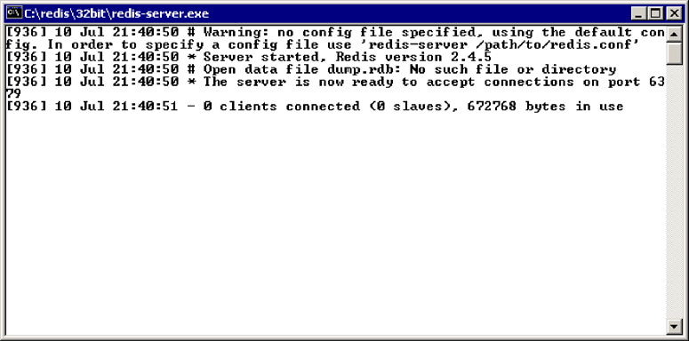
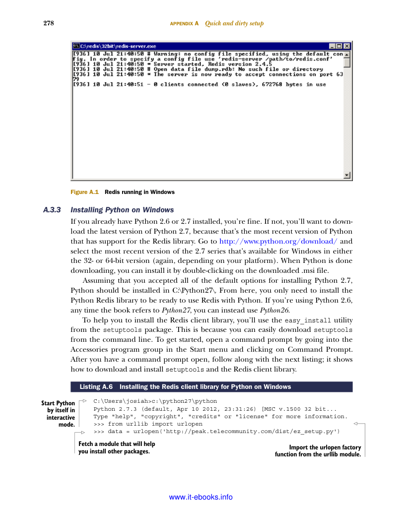

# Phụ lục A: Cài đặt nhanh gọn (Appendix A: Quick and dirty setup)

Tùy thuộc vào nền tảng hệ điều hành của bạn, việc thiết lập Redis có thể dao động từ mức dễ dàng cho đến khá phức tạp. Tôi đã chia hướng dẫn cài đặt thành các phần riêng biệt dành cho ba nền tảng chính. Bạn có thể thoải mái bỏ qua để nhảy thẳng tới phần tương ứng với nền tảng của mình; tại đó cũng sẽ bao gồm đầy đủ hướng dẫn cài đặt và cấu hình Python cùng các thư viện client Redis cho Python trên hệ thống của bạn.

> 📝 **Giải thích thêm (không có trong sách):** Khi cuốn sách này được xuất bản (năm 2013), Redis đang ở phiên bản 2.6 và Python 2.7 vẫn là tiêu chuẩn phổ biến, đồng thời việc cài đặt gói trên macOS (OS X) hay Windows còn nhiều rào cản. Ngày nay, bên cạnh việc biên dịch từ mã nguồn như hướng dẫn gốc của sách, bạn có thể khởi chạy Redis 7.x/8.x chỉ trong vài giây bằng Docker (`docker run -d --name redis -p 6379:6379 redis:alpine`), cài qua trình quản lý gói hiện đại (`apt`, `brew`), hoặc chạy trên Windows thông qua WSL2 và cài đặt thư viện Python 3 bằng `pip install "redis[hiredis]"`. Toàn bộ nội dung gốc của tác giả dưới đây vẫn được dịch nguyên vẹn 100%, kèm theo các ghi chú cập nhật hiện đại ở từng bước.

---

## A.1 Cài đặt trên Debian hoặc Ubuntu Linux (Installation on Debian or Ubuntu Linux)

Nếu bạn đang sử dụng một bản phân phối Linux dẫn xuất từ Debian (Debian-derived Linux), phản xạ đầu tiên của bạn có lẽ sẽ là chạy lệnh `apt-get install redis-server`, nhưng đây rất có thể lại là một việc làm sai lầm. Tùy thuộc vào phiên bản Debian hoặc Ubuntu mà bạn đang dùng, bạn có thể sẽ cài phải một phiên bản Redis đã quá cũ. Lấy ví dụ, nếu bạn đang sử dụng Ubuntu 10.4, bạn sẽ tải về Redis 1.2.6 — phiên bản đã được phát hành từ tháng 3 năm 2010 và không hỗ trợ nhiều lệnh mà chúng ta sử dụng trong sách này.

Trong phần này, trước tiên bạn sẽ cài đặt các công cụ xây dựng (build tools) bởi vì bạn sẽ biên dịch Redis từ đầu (compile from scratch). Sau đó, bạn sẽ tải về, biên dịch và cài đặt Redis. Sau khi Redis đã chạy, bạn sẽ tải về các thư viện client Redis dành cho Python.

Để bắt đầu, hãy đảm bảo rằng bạn đã cài đặt đầy đủ tất cả các công cụ biên dịch tiêu chuẩn cần thiết bằng cách tải và cài đặt `make`, như có thể thấy trong listing dưới đây.

**Listing A.1 – Cài đặt các công cụ biên dịch trên Debian Linux (Installing build tools on Debian Linux)**

```bash
~$ sudo apt-get update
~$ sudo apt-get install make gcc python-dev
```

Khi các công cụ biên dịch của bạn đã được cài đặt xong (có thể chúng đã được cài sẵn từ trước; đây là một bước kiểm tra xác nhận), bạn sẽ thực hiện theo các bước sau:

1. Tải về mã nguồn Redis ổn định (stable) mới nhất từ http://redis.io/download.
2. Giải nén, biên dịch, cài đặt và khởi động Redis.
3. Tải về và cài đặt các thư viện client Redis cần thiết cho Python.

Hai bước đầu tiên trong quy trình này được thể hiện ngay tiếp theo.

**Listing A.2 – Cài đặt Redis trên Linux (Installing Redis on Linux)**

```bash
~:$ wget -q http://redis.googlecode.com/files/redis-2.6.9.tar.gz
~:$ tar -xzf redis-2.6.9.tar.gz
~:$ cd redis-2.6.9/
~/redis-2.6.9:$ make
cd src && make all
[trimmed]
make[1]: Leaving directory `~/redis-2.6.9/src'
~/redis-2.6.9:$ sudo make install
cd src && make install
[trimmed]
make[1]: Leaving directory `~/redis-2.6.9/src'
~/redis-2.6.9:$ redis-server redis.conf
[13792] 2 Feb 17:53:16.523 * Max number of open files set to 10032
[trimmed]
[13792] 2 Feb 17:53:16.529 * The server is now ready to accept
connections on port 6379
```

**Chú thích mã nguồn (Code annotations) cho Listing A.2:**

- `wget -q http://redis.googlecode.com/files/redis-2.6.9.tar.gz`: Tải về phiên bản mới nhất của Redis 2.6 (hoặc mới hơn tại: http://redis.io/download).
- `tar -xzf redis-2.6.9.tar.gz`: Giải nén mã nguồn (Extract the source code).
- `make`: Biên dịch Redis (Compile Redis).
- `[trimmed]` (sau `cd src && make all`): Theo dõi các thông báo biên dịch chạy qua; bạn sẽ không thấy bất kỳ lỗi nào.
- `sudo make install`: Cài đặt Redis (Install Redis).
- `[trimmed]` (sau `cd src && make install`): Theo dõi các thông báo cài đặt chạy qua; bạn sẽ không thấy bất kỳ lỗi nào.
- `redis-server redis.conf`: Khởi động máy chủ Redis (Start Redis server).
- `[13792] 2 Feb 17:53:16.529 * The server is now ready to accept connections on port 6379`: Xem dòng xác nhận rằng Redis đã khởi động thành công.

Sau khi bạn đã cài đặt và cho chạy Redis, bạn cần cài đặt các thư viện client Redis dành cho Python. Bạn sẽ không cần bận tâm đến việc cài đặt Python, bởi vì Python 2.6 hoặc 2.7 lẽ ra đã được cài đặt sẵn theo mặc định trên các bản phát hành Ubuntu hoặc Debian trong vài năm trở lại đây. Tuy nhiên, bạn sẽ tải về và cài đặt một gói hỗ trợ (helper package) đơn giản có tên là `setuptools`, gói này sẽ giúp bạn tải và cài đặt các thư viện client Redis.[^1] Bước cuối cùng để cài đặt các thư viện client Redis cho Python được hiển thị dưới đây.

[^1]: Những người dùng Python có kinh nghiệm sẽ hỏi "Tại sao không dùng `pip`?", vốn là một gói công cụ khác để cài đặt các thư viện Python. Lý do là vì `virtualenv` — công cụ cần thiết để tải về `pip` một cách dễ dàng — nằm ngoài phạm vi của các hướng dẫn này.

**Listing A.3 – Cài đặt các thư viện client Redis cho Python trên Linux (Installing the Redis client libraries for Python on Linux)**

```bash
~:$ wget -q http://peak.telecommunity.com/dist/ez_setup.py
~:$ sudo python ez_setup.py
Downloading http://pypi.python.org/packages/2.7/s/setuptools/...
[trimmed]
Finished processing dependencies for setuptools==0.6c11
~:$ sudo python -m easy_install redis hiredis
Searching for redis
[trimmed]
Finished processing dependencies for redis
Searching for hiredis
[trimmed]
Finished processing dependencies for hiredis
~:$
```

**Chú thích mã nguồn (Code annotations) cho Listing A.3:**

- `wget -q http://peak.telecommunity.com/dist/ez_setup.py`: Tải về module `ez_setup` của `setuptools`.
- `sudo python ez_setup.py`: Chạy module `ez_setup` để tải về và cài đặt `setuptools`.
- `sudo python -m easy_install redis hiredis`: Chạy gói `easy_install` của `setuptools` để cài đặt hai gói `redis` và `hiredis`.
- `Searching for redis`: Gói `redis` cung cấp một giao diện (interface) tương đối chuẩn mực để làm việc với Redis từ Python.
- `Searching for hiredis`: Gói `hiredis` là một thư viện tăng tốc viết bằng C (C accelerator library) dành cho thư viện Redis trên Python.

Bây giờ, khi bạn đã cài đặt xong các thư viện Python, bạn có thể nhảy tới mục A.4 để kiểm thử Redis từ Python — bước này sẽ giúp bạn sẵn sàng cho tất cả các chương còn lại.

> 💡 **Ví dụ bổ sung (không có trong sách) – Cài đặt Redis và thư viện Python trên Ubuntu/Debian hiện đại:**
> Trên Ubuntu/Debian ngày nay, Google Code (`redis.googlecode.com`) và `easy_install` đã ngừng hoạt động. Bạn có thể cài đặt Redis mới nhất từ kho APT chính thức của Redis hoặc biên dịch từ GitHub/download.redis.io, đồng thời dùng `venv` và `pip` cho Python 3:
> ```bash
> # Cách 1: Cài đặt qua APT repository chính thức hoặc gói hệ thống
> sudo apt update
> sudo apt install -y redis-server python3-venv python3-pip
>
> # Cách 2: Tạo môi trường ảo Python 3 và cài redis-py kèm trình tăng tốc hiredis
> python3 -m venv .venv
> source .venv/bin/activate
> pip install "redis[hiredis]"
> ```

---

## A.2 Cài đặt trên OS X (Installing on OS X)

Cũng giống như trên các nền tảng khác, có một vài cách để tải về và cài đặt Redis cùng thư viện client Redis cho Python. Trong phần này, chúng ta sẽ thảo luận về các nội dung sau:

1. Tải về, cài đặt và chạy Redis trên OS X.
2. Cài đặt thư viện client Redis cho Python.

Nếu bạn đã đọc phần hướng dẫn cho Linux, bạn sẽ biết rằng chúng ta đã đảm bảo có sẵn các công cụ cần thiết để biên dịch Redis từ đầu, bởi vì việc đó trên Linux rất dễ thực hiện. Mặc dù việc cài đặt Xcode cho OS X chỉ phức tạp hơn một chút, nhưng thực tế là dung lượng tải về của bộ công cụ biên dịch (build tools) lớn gấp 10 lần khiến cho việc vừa làm theo hướng dẫn vừa chờ đợi mà không bị gián đoạn lâu trở nên khó khăn hơn nhiều. Vì lẽ đó, bạn sẽ sử dụng một phương pháp cài đặt Redis không đòi hỏi trình biên dịch (compiler).

Để cài đặt Redis trong OS X mà không cần dùng trình biên dịch, bạn sẽ sử dụng một tiện ích viết bằng Python có tên là Rudix — công cụ chuyên cài đặt các bản nhị phân đã biên dịch sẵn (precompiled binaries) cho nhiều phần mềm khác nhau. Rất thuận tiện là tính đến thời điểm viết sách này, nó có bao gồm một bộ cài đặt cho phiên bản mới nhất của Redis.

Để tải về và cài đặt Rudix cùng Redis, bạn hãy mở một cửa sổ Terminal. Ứng dụng Terminal có thể được tìm thấy trong nhóm Utilities bên trong thư mục Applications. Sau khi bạn đã khởi động Terminal, vui lòng làm theo listing tiếp theo dưới đây để cài đặt Redis bằng Rudix.

**Listing A.4 – Cài đặt Redis trên OS X (Installing Redis on OS X)**

```bash
~:$ curl -O http://rudix.googlecode.com/hg/Ports/rudix/rudix.py
[trimmed]
~:$ sudo python rudix.py install rudix
Downloading rudix.googlecode.com/files/rudix-12.10-0.pkg
[trimmed]
installer: The install was successful.
All done
~:$ sudo rudix install redis
Downloading rudix.googlecode.com/files/redis-2.6.9-0.pkg
[trimmed]
installer: The install was successful.
All done
~:$ redis-server
[699] 6 Feb 21:18:09 # Warning: no config file specified, using the
default config. In order to specify a config file use 'redis-server
/path/to/redis.conf'
[699] 6 Feb 21:18:09 * Server started, Redis version 2.6.9
[699] 6 Feb 21:18:09 * The server is now ready to accept connections
on port 6379
[699] 6 Feb 21:18:09 - 0 clients connected (0 slaves), 922304 bytes
in use
```

**Chú thích mã nguồn (Code annotations) cho Listing A.4:**

- `curl -O http://rudix.googlecode.com/hg/Ports/rudix/rudix.py`: Tải về kịch bản khởi tạo (bootstrap script) dùng để cài đặt Rudix.
- `sudo python rudix.py install rudix`: Bảo Rudix tự cài đặt chính nó.
- `Downloading rudix.googlecode.com/files/rudix-12.10-0.pkg ... All done`: Rudix đang tải về và tự cài đặt chính nó.
- `sudo rudix install redis`: Bảo Rudix cài đặt Redis.
- `Downloading rudix.googlecode.com/files/redis-2.6.9-0.pkg ... All done`: Rudix đang tải về và cài đặt Redis.
- `redis-server`: Khởi động máy chủ Redis (Start the Redis server).
- `[699] 6 Feb 21:18:09 # Warning: ...` đến `922304 bytes in use`: Redis đã khởi động và đang chạy với cấu hình mặc định (default configuration).

Bây giờ, sau khi bạn đã cài đặt xong Redis, đã đến lúc cài đặt thư viện client Redis cho Python. Bạn không cần phải cài đặt Python, bởi vì các phiên bản OS X 10.6 và 10.7 đã đi kèm sẵn với Python 2.6 hoặc 2.7 được cài đặt trước và có thể gọi trực tiếp qua lệnh `python` theo mặc định. Trong khi Redis đang chạy ở một cửa sổ terminal, hãy mở một tab mới (`Command + T`), và làm theo listing tiếp theo để cài đặt thư viện Redis cho Python.

**Listing A.5 – Cài đặt thư viện client Redis cho Python trên OS X (Installing the Redis client library for Python on OS X)**

```bash
~:$ sudo rudix install pip
Downloading rudix.googlecode.com/files/pip-1.1-1.pkg
[trimmed]
installer: The install was successful.
All done
~:$ sudo pip install redis
Downloading/unpacking redis
[trimmed]
Cleaning up...
~:$
```

**Chú thích mã nguồn (Code annotations) cho Listing A.5:**

- `sudo rudix install pip`: Bởi vì bạn đã cài đặt Rudix, bạn có thể cài đặt một trình quản lý gói Python có tên là `pip`.
- `Downloading rudix.googlecode.com/files/pip-1.1-1.pkg ... All done`: Rudix đang cài đặt `pip`.
- `sudo pip install redis`: Bây giờ bạn có thể sử dụng `pip` để cài đặt thư viện client Redis cho Python.
- `Downloading/unpacking redis ... Cleaning up...`: `pip` đang cài đặt thư viện client Redis cho Python.

Nếu bạn đã đọc hướng dẫn cài đặt của Linux hoặc Windows, bạn có thể nhận thấy rằng ở đó chúng ta sử dụng phương thức `easy_install` của `setuptools` để cài đặt thư viện client Redis, nhưng tại đây bạn lại dùng `pip`. Lý do là vì Rudix có cung cấp sẵn gói `pip`, nhưng lại không có gói `setuptools`, cho nên việc cài đặt `pip` rồi dùng `pip` để cài thư viện client Redis cho Python sẽ dễ dàng hơn so với việc phải tải về và cài đặt `setuptools` באופן thủ công.

Ngoài ra, nếu bạn đã đọc hướng dẫn cài đặt cho Linux, bạn có thể để ý thấy chúng ta đã cài đặt thư viện bổ trợ `hiredis` ở đó, nhưng bạn lại không cài nó trên OS X. Đó là bởi vì, giống như lý do ở trên, chúng ta không thể đảm bảo rằng người dùng nào cũng đã cài đặt sẵn Xcode, vì vậy bạn sẽ sử dụng những gì mình đang có sẵn.

Bây giờ, khi bạn đã cài đặt xong thư viện Python cho Redis, bạn hãy nhảy tới mục A.4 và làm theo hướng dẫn để sử dụng Redis từ Python lần đầu tiên.

> 💡 **Ví dụ bổ sung (không có trong sách) – Cài đặt trên macOS hiện đại (Apple Silicon / Intel):**
> Trên macOS hiện nay, **Homebrew** (`brew`) là trình quản lý gói tiêu chuẩn thay thế hoàn toàn cho Rudix, đồng thời gói `hiredis` trên PyPI đã cung cấp sẵn prebuilt binary wheels (`.whl`) cho macOS nên không cần biên dịch bằng Xcode nữa:
> ```bash
> # Cài đặt và khởi chạy Redis bằng Homebrew
> brew install redis
> brew services start redis   # hoặc chạy trực tiếp: redis-server
>
> # Cài đặt thư viện Python 3 kèm hiredis wheel dựng sẵn
> python3 -m pip install "redis[hiredis]"
> ```
!},Overwrite:true,Path:


---

## A.3 Cài đặt trên Windows (Installing on Windows)

Trước khi chúng ta đi sâu vào cách cài đặt Redis trên Windows, tôi muốn chỉ rõ rằng việc chạy Redis trên Windows là điều không được khuyến khích vì nhiều lý do khác nhau. Trong phần này, chúng ta sẽ đi qua các điểm sau:

- Những lý do vì sao bạn không nên chạy Redis trên Windows.
- Cách tải về, cài đặt và chạy một bản thực thi nhị phân Windows đã biên dịch sẵn (precompiled Windows binary).
- Cách tải về và cài đặt Python cho Windows.
- Cách cài đặt thư viện client Redis.

Bước đầu tiên của chúng ta là thảo luận lý do vì sao bạn không nên chạy Redis trên Windows.

### A.3.1 Những hạn chế của Redis trên Windows (Drawbacks of Redis on Windows)

Windows không hỗ trợ lời gọi hệ thống `fork` (fork system call) — thứ mà Redis sử dụng trong nhiều tình huống khác nhau để kết xuất (dump) cơ sở dữ liệu của nó xuống đĩa cứng. Khi không có khả năng `fork`, Redis không thể thực hiện một số phương thức lưu cơ sở dữ liệu cần thiết mà không làm chặn (block) các client cho tới khi quá trình kết xuất hoàn tất.

Gần đây, Microsoft đã đóng góp thời gian và công sức kỹ thuật nhằm giúp giải quyết các vấn đề lưu dữ liệu dưới nền (background saving), bằng cách sử dụng các luồng (threads) để ghi xuống đĩa thay vì một tiến trình con được tách nhánh (forked child process). Tính đến thời điểm viết sách này, Microsoft đã có một nhánh (branch) ở giai đoạn thử nghiệm alpha của Redis 2.6, nhưng nó mới chỉ có dưới dạng mã nguồn (source), và Microsoft không đưa ra bất kỳ sự đảm bảo nào về mức độ phù hợp của nó trong các kịch bản vận hành thực tế (production scenarios).

Ít nhất là trong ngắn hạn, có một bản chuyển đổi (port) không chính thức của Redis do Dusan Majkic thực hiện, cung cấp các file nhị phân đã biên dịch sẵn cho Redis 2.4.5, nhưng nó vẫn mắc phải vấn đề đã nêu ở trên là Redis sẽ bị chặn (block) mỗi khi kết xuất cơ sở dữ liệu xuống đĩa.

> **TỰ BIÊN DỊCH REDIS TRÊN WINDOWS (COMPILING REDIS IN WINDOWS YOURSELF)**
>
> Nếu bạn rơi vào tình huống cần đến phiên bản Redis trên Windows cập nhật mới nhất có thể, bạn sẽ cần phải tự mình biên dịch Redis. Lựa chọn tốt nhất của bạn là sử dụng bản port chính thức của Microsoft (`https://github.com/MSOpenTech/redis/`), vốn yêu cầu phải có Microsoft Visual Studio, mặc dù bản miễn phí Express 2010 vẫn hoạt động hoàn toàn tốt. Nếu bạn chọn đi theo hướng này, hãy lưu ý cảnh báo rằng Microsoft không đưa ra bất kỳ cam kết nào về mức độ phù hợp của các bản port sang Windows của họ cho bất cứ mục đích nào ngoài việc phát triển (development) và kiểm thử (testing).

Bây giờ, khi bạn đã nắm được hiện trạng của Redis trên Windows, nếu bạn vẫn muốn chạy Redis trên Windows thì hãy cùng tiến hành cài đặt nó.

> 📝 **Giải thích thêm (không có trong sách) – Hiện trạng Redis trên Windows hiện nay:**
> Dự án `MSOpenTech/redis` của Microsoft đã ngừng cập nhật ở phiên bản Redis 3.2 từ năm 2016. Ngày nay, nếu phát triển hoặc chạy Redis trên máy Windows 10/11, bạn có 3 lựa chọn hiện đại và ổn định hơn rất nhiều:
> 1. **WSL2 (Windows Subsystem for Linux 2) – Được Redis chính thức khuyến nghị:** Chạy nhân Linux thật ngay trên Windows, hỗ trợ đầy đủ lời gọi hệ thống `fork()` với cơ chế Copy-on-Write (CoW), cho phép cài đặt bản Redis 7.x/8.x chính thức qua `sudo apt install redis-server`.
> 2. **Docker Desktop trên Windows:** Chạy container `redis:alpine` hoặc `redis/redis-stack` thông qua backend WSL2.
> 3. **Memurai:** Một bản port thương mại/Developer tương thích với Redis 6/7 dành riêng cho Windows native.

### A.3.2 Cài đặt Redis trên Windows (Installing Redis on Windows)

Bạn có thể tải về một phiên bản Redis biên dịch sẵn hơi cũ một chút dành cho Windows 32-bit và 64-bit nhờ công của Dusan Majkic từ trang GitHub của anh ấy: `https://github.com/dmajkic/redis/downloads`. Hãy truy cập và tải về ngay bây giờ.

Sau khi tải Redis về xong, bạn sẽ cần giải nén các tập tin thực thi (executables) từ file zip đó. Miễn là bạn đang sử dụng một phiên bản Windows mới hơn Windows XP, bạn đều có thể giải nén Redis mà không cần thêm bất kỳ phần mềm bổ sung nào. Hãy thực hiện việc đó ngay.

Sau khi bạn đã giải nén phiên bản Redis 32-bit hoặc 64-bit vào một thư mục tùy chọn (tùy thuộc vào nền tảng và sở thích của bạn; hãy nhớ rằng Windows 64-bit có thể chạy cả Redis 32-bit lẫn 64-bit, nhưng Windows 32-bit chỉ có thể chạy Redis 32-bit), bạn có thể khởi động Redis bằng cách nhấp đúp chuột vào tập tin thực thi `redis-server`. Sau khi Redis đã khởi động, bạn sẽ thấy một cửa sổ tương tự như trong **Hình A.1**.

Bây giờ khi Redis đã khởi chạy hoạt động, đã đến lúc tải về và cài đặt Python.

**Hình A.1 – Redis đang chạy trên Windows (Figure A.1 Redis running in Windows)**





> 📝 **Giải thích Hình A.1:** Cửa sổ dòng lệnh trên Windows khi chạy trực tiếp tập tin thực thi `redis-server.exe` (phiên bản Redis 2.4.5 win32 trong hình minh họa của sách). Máy chủ thông báo không có tập tin cấu hình nào được chỉ định nên sử dụng cấu hình mặc định, khởi tạo với 0 client kết nối và lắng nghe kết nối trên cổng tiêu chuẩn `6379`.

### A.3.3 Cài đặt Python trên Windows (Installing Python on Windows)

Nếu bạn đã cài đặt sẵn Python 2.6 hoặc 2.7 rồi thì mọi thứ đều ổn. Nếu chưa, bạn sẽ muốn tải về phiên bản mới nhất của Python 2.7, bởi vì đó là phiên bản Python mới nhất có hỗ trợ đầy đủ cho thư viện Redis. Hãy truy cập vào `http://www.python.org/download/` và chọn phiên bản mới nhất của dòng 2.7 hiện có cho Windows ở bản 32-bit hoặc 64-bit (một lần nữa, tùy thuộc vào nền tảng của bạn). Khi quá trình tải Python hoàn tất, bạn có thể cài đặt nó bằng cách nhấp đúp chuột vào tập tin `.msi` vừa tải về.

Giả sử rằng bạn đã chấp nhận toàn bộ các tùy chọn mặc định khi cài đặt Python 2.7, Python sẽ được cài đặt vào thư mục `C:\Python27\`. Từ bước này, bạn chỉ cần cài đặt thêm thư viện Redis cho Python là đã sẵn sàng sử dụng Redis cùng với Python. Nếu bạn đang dùng Python 2.6, bất kỳ chỗ nào trong sách nhắc tới `Python27` thì bạn có thể thay thế bằng `Python26`.

Để giúp bạn cài đặt thư viện client Redis, bạn sẽ sử dụng tiện ích `easy_install` thuộc gói `setuptools`. Lý do là vì bạn có thể tải về `setuptools` một cách dễ dàng ngay từ dòng lệnh. Để bắt đầu, hãy mở một cửa sổ Command Prompt bằng cách vào nhóm chương trình Accessories trong menu Start và nhấp vào Command Prompt. Sau khi cửa sổ Command Prompt đã mở, hãy làm theo listing tiếp theo; nó chỉ dẫn cách tải về và cài đặt `setuptools` cùng với thư viện client Redis.

**Listing A.6 – Cài đặt thư viện client Redis cho Python trên Windows (Installing the Redis client library for Python on Windows)**

```python
C:\Users\josiah>c:\python27\python
Python 2.7.3 (default, Apr 10 2012, 23:31:26) [MSC v.1500 32 bit...
Type "help", "copyright", "credits" or "license" for more information.
>>> from urllib import urlopen
>>> data = urlopen('http://peak.telecommunity.com/dist/ez_setup.py')
>>> open('ez_setup.py', 'wb').write(data.read())
>>> exit()
C:\Users\josiah>c:\python27\python ez_setup.py
Downloading http://pypi.python.org/packages/2.7/s/setuptools/...
[trimmed]
Finished processing dependencies for setuptools==0.6c11
C:\Users\josiah>c:\python27\python -m easy_install redis
Searching for redis
[trimmed]
Finished processing dependencies for redis
C:\Users\josiah>
```

**Chú thích mã nguồn (Code annotations) cho Listing A.6:**

- `C:\Users\josiah>c:\python27\python`: Khởi động Python độc lập ở chế độ tương tác (interactive mode).
- `>>> from urllib import urlopen`: Nhập (import) hàm factory `urlopen` từ module `urllib`.
- `>>> data = urlopen('http://peak.telecommunity.com/dist/ez_setup.py')`: Tải về một module sẽ giúp bạn cài đặt các gói khác.
- `>>> open('ez_setup.py', 'wb').write(data.read())`: Ghi module vừa tải về ra một tập tin trên đĩa.
- `>>> exit()`: Thoát khỏi trình thông dịch Python bằng cách chạy hàm dựng sẵn `exit()`.
- `C:\Users\josiah>c:\python27\python ez_setup.py`: Chạy module hỗ trợ `ez_setup`.
- `Downloading http://pypi.python.org/packages/2.7/s/setuptools/...`: Trình hỗ trợ `ez_setup` sẽ tải về và cài đặt `setuptools`, giúp việc tải và cài đặt thư viện client Redis trở nên dễ dàng.
- `C:\Users\josiah>c:\python27\python -m easy_install redis`: Sử dụng module `easy_install` của `setuptools` để tải về và cài đặt thư viện `redis`.

Bây giờ, khi bạn đã cài đặt xong Python và thư viện client Redis, bạn hãy tiếp tục sang mục A.4 để sử dụng Redis từ Python lần đầu tiên.

> 💡 **Ví dụ bổ sung (không có trong sách) – Cài đặt Python 3 và `redis-py` trên Windows hiện đại:**
> Các bộ cài Python 3 hiện đại từ `https://www.python.org/downloads/` hoặc Microsoft Store đều đã tích hợp sẵn công cụ `pip` và launcher `py`. Bạn không cần tải `ez_setup.py` nữa mà chỉ cần mở PowerShell hoặc Command Prompt và chạy:
> ```powershell
> py -m pip install --upgrade pip
> py -m pip install "redis[hiredis]"
> ```

---

## A.4 Xin chào Redis (Hello Redis)

Sau khi bản thân Redis đã được cài đặt xong, bạn cần đảm bảo rằng Python đã có đầy đủ các thư viện thích hợp để truy cập vào Redis. Nếu bạn làm theo các hướng dẫn trước đó, có thể bạn vẫn đang mở sẵn một cửa sổ dòng lệnh (command prompt). Trong cửa sổ dòng lệnh này (bạn có thể mở một cửa sổ mới nếu đã đóng cửa sổ cũ), bạn sẽ chạy Python. (Người dùng Windows có thể tham khảo lại cách bạn đã chạy Python trong quy trình thiết lập ở trên.) Bên trong bảng điều khiển (console) của Python, bạn sẽ thử kết nối tới Redis và thực thi một vài lệnh, như được hiển thị trong listing tiếp theo.

**Listing A.7 – Kiểm thử Redis từ Python (Testing Redis from Python)**

```python
~:$ python
Python 2.6.5 (r265:79063, Apr 16 2010, 13:09:56)
[GCC 4.4.3] on linux2
Type "help", "copyright", "credits" or "license" for more information.
>>> import redis
>>> conn = redis.Redis()
>>> conn.set('hello', 'world')
True
>>> conn.get('hello')
'world'
```

**Chú thích mã nguồn (Code annotations) cho Listing A.7:**

- `~:$ python`: Khởi động Python để bạn có thể xác minh rằng mọi thứ đã hoạt động bình thường và chính xác.
- `>>> import redis`: Nhập (import) thư viện `redis`; nó sẽ tự động sử dụng thư viện tăng tốc C `hiredis` nếu thư viện này có sẵn trên máy.
- `>>> conn = redis.Redis()`: Tạo một kết nối tới Redis.
- `>>> conn.set('hello', 'world')` / `True`: Thiết lập một giá trị và thấy rằng nó đã được lưu thành công.
- `>>> conn.get('hello')` / `'world'`: Lấy ra giá trị mà bạn vừa mới thiết lập.

> 📝 **Giải thích thêm (không có trong sách) – Sự khác biệt trên Python 3 khi chạy Listing A.7:**
> Trong Python 3 với thư viện `redis-py` hiện đại, theo mặc định các phản hồi chuỗi từ Redis được trả về dưới kiểu dữ liệu `bytes` (tức là `b'world'`) thay vì `str` (`'world'`). Để `conn.get('hello')` tự động giải mã về chuỗi Unicode `'world'` giống hệt như kết quả trong sách, bạn có thể truyền thêm tham số `decode_responses=True` khi khởi tạo kết nối:
> ```python
> >>> import redis
> >>> conn = redis.Redis(host='localhost', port=6379, decode_responses=True)
> >>> conn.set('hello', 'world')
> True
> >>> conn.get('hello')
> 'world'
> ```

> **CHẠY PYTHON THEO NHỮNG CÁCH KHÁC (RUNNING PYTHON IN OTHER WAYS)**
>
> Mặc dù bạn có thể chạy Python trong một cửa sổ terminal tiêu chuẩn, nhưng vẫn có nhiều cách khác "đầy đủ tính năng" (fully featured) hơn để có được một giao diện Python console. Một trình soạn thảo kiêm console cơ bản có tên là **Idle** được đóng gói đi kèm sẵn với Python trên Windows và OS X; bạn cũng có thể cài đặt nó trên Linux (hãy cài gói `idle-python2.6` hoặc `idle-python2.7`, tùy theo phiên bản tương ứng). Trong cửa sổ console, bạn có thể chạy lệnh `python -m idlelib.idle` từ dòng lệnh và Idle sẽ được nạp lên. Bản thân Idle là một trình soạn thảo và Python console khá cơ bản, vì vậy nếu bạn là người mới làm quen với lập trình thì đây sẽ là một bước khởi đầu nhẹ nhàng. Nhiều người khác lại chọn **IPython** làm trình Python console ưa thích của mình, vì nó cung cấp một danh sách những tính năng tuyệt vời dài đến mức không thể liệt kê hết tại đây. Dù bạn chọn công cụ cơ bản hay đầy đủ tính năng thì bạn đều không sợ đi sai hướng.

> **REDIS TRÊN OS X VÀ WINDOWS (REDIS ON OS X AND WINDOWS)**
>
> Ngay tại thời điểm này, các phiên bản Redis biên dịch sẵn dành cho Windows và OS X đều thuộc dòng 2.4. Trong một số chương của sách, chúng ta có sử dụng những tính năng chỉ mới xuất hiện từ dòng Redis 2.6 trở về sau. Nếu bạn thấy có điều gì đó chúng ta thực hiện mà không chạy được, và bạn lại đang sử dụng Redis 2.4, thì nguyên nhân rất có thể là do tính năng hoặc cách sử dụng đó mới được bổ sung vào từ bản Redis 2.6. Hãy xem các ghi chú trong Chương 3 để biết các ví dụ cụ thể.

> **CẤU HÌNH REDIS (CONFIGURING REDIS)**
>
> Theo mặc định, Redis được cấu hình để lưu giữ dữ liệu của bạn bằng cách sử dụng ảnh chụp nhanh (snapshots) hoặc tập tin chỉ ghi nối thêm (append-only files - AOF), và miễn là bạn thực thi lệnh `shutdown` từ phía một client khi tắt máy chủ, Redis sẽ giữ lại toàn bộ dữ liệu của bạn. Tùy thuộc vào cách bạn khởi động nó, Redis có thể đang lưu phiên bản dữ liệu trên đĩa ở ngay cùng đường dẫn thư mục mà từ đó bạn gọi chạy nó. Để cập nhật lại điều này, bạn sẽ muốn chỉnh sửa tập tin `redis.conf` và sử dụng các kịch bản khởi động hệ thống (system startup scripts) phù hợp với nền tảng của bạn (hãy nhớ di chuyển dữ liệu hiện có của bạn sang đường dẫn mới vừa cấu hình). Thông tin chi tiết hơn về việc cấu hình Redis có sẵn trong Chương 4.

> **LIỆU HIREDIS CÓ SẴN TRÊN CÁC NỀN TẢNG NGOÀI LINUX KHÔNG? (IS HIREDIS AVAILABLE ON NON-LINUX PLATFORMS?)**
>
> Đối với những ai đang sử dụng Windows hoặc OS X và có ghé mắt xem qua phần hướng dẫn cài đặt trên Debian/Ubuntu, bạn sẽ nhận thấy rằng chúng ta đã cài đặt một thư viện có tên là `hiredis` để dùng chung với Python. Thư viện này là một trình tăng tốc (accelerator) giúp chuyển giao việc xử lý giao thức (protocol processing) sang cho một thư viện viết bằng C. Mặc dù thư viện này hoàn toàn có thể biên dịch được cho OS X và Windows, nhưng các bản nhị phân dựng sẵn (binaries) dành cho chúng lại không có sẵn để tải về dễ dàng trên internet. Ngoài ra, bởi vì tôi đã không yêu cầu bạn cài đặt trình biên dịch trên hai hệ điều hành này, nên nếu bạn quan tâm đến việc tự biên dịch và sử dụng `hiredis` trên nền tảng của mình, bạn sẽ phải tự mình thực hiện.

Định kỳ trong các chương khác, chúng ta sẽ sử dụng giao diện Python console để minh họa các tương tác với Redis. Trong những trường hợp khác, chúng ta sẽ trình bày các định nghĩa hàm (function definitions) và các câu lệnh thực thi bên ngoài giao diện console. Trong những trường hợp không dùng console đó, sách mặc định giả sử rằng các hàm ấy được định nghĩa bên trong một module Python. Nếu trước đây bạn chưa từng sử dụng Python, bạn nên đọc tài liệu hướng dẫn của Python về module và cách chạy module như một chương trình ở phần đầu của trang `http://docs.python.org/tutorial/modules.html`, đọc cho tới hết mục "Executing modules as scripts" (Thực thi các module như kịch bản).

Nếu bạn thuộc mẫu người có thể đọc lướt qua tài liệu ngôn ngữ và các bài hướng dẫn là "hiểu ngay vấn đề", đồng thời bạn chưa dành nhiều thời gian làm việc với Python trước đây, bạn có thể cân nhắc đọc qua tài liệu hướng dẫn ngôn ngữ Python tại `http://docs.python.org/tutorial/`. Nếu bạn chỉ quan tâm đến những phần cốt lõi quan trọng nhất giúp bạn nắm bắt nhiều nhất về cú pháp và ngữ nghĩa của Python, hãy đọc các mục từ 3 đến 7, và sau đó là mục 9.10 và 9.11 (nói về generators — tính năng mà chúng ta có sử dụng một vài lần trong sách).

Đến lúc này, bạn đã có cả Redis lẫn trình thông dịch Python đang chạy sẵn sàng. Nếu bạn tìm đến phụ lục này thông qua một tham chiếu từ Chương 1, hãy quay trở lại đó để thực sự bắt đầu sử dụng Redis từ Python.

Nếu bạn gặp bất kỳ khó khăn nào trong quá trình cài đặt Redis hoặc Python, vui lòng đăng câu hỏi của bạn hoặc đọc câu trả lời của những người khác trên diễn đàn Manning của cuốn sách *Redis in Action*: `http://mng.bz/vB6c`.
!},Path:


---

# Phụ lục B: Các tài nguyên và tài liệu tham khảo khác (Appendix B: Other resources and references)

Xuyên suốt 11 chương vừa qua cùng với Phụ lục A, chúng ta đã đi qua rất nhiều chủ đề đa dạng liên quan đến Redis. Như một phần của những bài toán mà chúng ta đã giải quyết, chúng tôi đã giới thiệu những ý tưởng mà có thể trước đó bạn chưa từng quen thuộc, đồng thời cung cấp các liên kết tham khảo để bạn có thể tìm hiểu sâu hơn.

Phụ lục này tập hợp toàn bộ các tài liệu tham khảo đó cùng nhiều nguồn tài nguyên khác vào chung một nơi duy nhất, giúp bạn dễ dàng truy cập tới các phần mềm, thư viện, dịch vụ và/hoặc tài liệu kỹ thuật liên quan đến những chủ đề mà chúng ta đã đề cập, được phân nhóm theo từng chủ đề chung.

---

## B.1 Các diễn đàn trợ giúp (Forums for help)

Các địa chỉ URL dưới đây sẽ đưa bạn tới những diễn đàn nơi bạn có thể nhận được sự trợ giúp khi sử dụng Redis hoặc khi thực hành các ví dụ trong những chương khác:

- `https://groups.google.com/forum/#!forum/redis-db` — Diễn đàn Redis (Redis forum)
- `http://www.manning-sandbox.com/forum.jspa?forumID=809` — Diễn đàn Manning dành cho cuốn sách *Redis in Action* (Manning forum for Redis in Action)

---

## B.2 Các chủ đề nhập môn (Introductory topics)

Danh sách các chủ đề nhập môn dưới đây bao quát những thông tin cơ bản về Redis và cách sử dụng nó:

- `http://redis.io/` — Trang web chính của Redis (Main Redis web site)
- `http://redis.io/commands` — Danh sách đầy đủ các lệnh của Redis (Full Redis command listing)
- `http://redis.io/clients` — Danh sách các thư viện client của Redis (Redis client listing)
- `http://redis.io/documentation` — Trang tham khảo chính cho tài liệu kỹ thuật về Lua, pub/sub, sao chép (replication), lưu trữ bền vững (persistence), v.v. (Main reference page for documentation about Lua, pub/sub, replication, persistence, and so on.)
- `http://github.com/dmajkic/redis/` — Bản chuyển đổi (port) Redis sang Windows của Dusan Majkic (Dusan Majkic's port of Redis to Windows)
- `http://github.com/MSOpenTech/redis/` — Bản chuyển đổi (port) Redis sang Windows chính thức của Microsoft (Microsoft's official port of Redis to Windows)

Danh sách các chủ đề nhập môn dưới đây bao quát những thông tin cơ bản về Python và cách sử dụng nó:

- `http://www.python.org/` — Trang web chính của ngôn ngữ lập trình Python (Main web page for the Python programming language)
- `http://docs.python.org/` — Trang tài liệu chính của Python (Main Python documentation page)
- `http://docs.python.org/tutorial/` — Tài liệu hướng dẫn Python dành cho người dùng mới (Python tutorial for new users)
- `http://docs.python.org/reference/` — Tài liệu tham chiếu ngôn ngữ Python cung cấp chi tiết đầy đủ về cú pháp và ngữ nghĩa (Python language reference for the full details on syntax and semantics)
- `http://mng.bz/TTKb` — Biểu thức sinh (Generator expressions)
- `http://mng.bz/I31v` — Bài hướng dẫn về Module có thể nạp của Python (Python loadable Module tutorial)
- `http://mng.bz/9wXM` — Định nghĩa hàm (Defining functions)
- `http://mng.bz/q7eo` — Danh sách đối số có độ dài thay đổi (Variable argument lists)
- `http://mng.bz/1jLF` — Đối số có độ dài thay đổi và đối số từ khóa (Variable arguments and keywords)
- `http://mng.bz/0rmB` — Biểu thức tạo danh sách (List comprehensions)
- `http://mng.bz/uIdf` — Các bộ sinh trong Python (Python generators)
- `http://mng.bz/1XMr` — Decorator cho hàm và phương thức (Function and method decorators)

---

## B.3 Hàng đợi và các thư viện khác (Queues and other libraries)

- `http://celeryproject.org/` — Thư viện hàng đợi Python hỗ trợ nhiều hệ thống phụ trợ (back ends) khác nhau, bao gồm cả Redis (Python queue library that supports multiple back ends, including Redis)
- `https://github.com/josiahcarlson/rpqueue/` — Thư viện hàng đợi Python dành riêng cho Redis của chính tác giả Josiah Carlson (Python queue library for Redis only)
- `https://github.com/resque/resque` — Hàng đợi tiêu chuẩn kết hợp Ruby + Redis (Standard Ruby + Redis queue)
- `http://www.rabbitmq.com/` — Máy chủ hàng đợi hỗ trợ đa ngôn ngữ (Queue server for multiple languages)
- `http://activemq.apache.org/` — Máy chủ hàng đợi hỗ trợ đa ngôn ngữ của Apache (Queue server for multiple languages)
- `https://github.com/Doist/bitmapist` — Thư viện hỗ trợ phân tích dữ liệu mạnh mẽ dựa trên bitmap (Support for powerful bitmap-enabled analytics)

---

## B.4 Trực quan hóa và ghi nhận dữ liệu (Data visualization and recording)

- `http://www.jqplot.com/` — Thư viện vẽ biểu đồ mã nguồn mở được thiết kế để sử dụng cùng với jQuery (Open source plotting library intended to be used with jQuery)
- `http://www.highcharts.com/` — Thư viện vẽ biểu đồ miễn phí/thương mại (Free/commercial plotting library)
- `http://dygraphs.com/` — Thư viện vẽ biểu đồ mã nguồn mở (Open source plotting library)
- `http://d3js.org/` — Thư viện trực quan hóa dữ liệu đa năng mã nguồn mở (General open source data visualization library)
- `http://graphite.wikidot.com/` — Thư viện thu thập số liệu thống kê và trực quan hóa dữ liệu (Statistics gathering and visualization library)

---

## B.5 Các nguồn dữ liệu (Data sources)

Trong Chương 5, chúng ta đã sử dụng một cơ sở dữ liệu ánh xạ từ địa chỉ IP sang vị trí địa lý (IP-to-location information). Danh sách dưới đây bao gồm liên kết tham khảo tới bộ dữ liệu đó, cùng với các nguồn dữ liệu thay thế khác (có thể được cập nhật mới tương đương hoặc không):

- `http://dev.maxmind.com/geoip/geolite` — Thông tin ánh xạ địa chỉ IP sang vị trí địa lý, được sử dụng lần đầu tiên trong Chương 5 (IP address-to-geographic location information, first used in chapter 5)
- `http://www.hostip.info/dl/` — Cơ sở dữ liệu thông tin ánh xạ IP sang vị trí địa lý có thể tải về và sử dụng miễn phí (Freely downloadable and usable IP-to-geographic location information database)
- `http://software77.net/geo-ip/` — Một cơ sở dữ liệu thông tin ánh xạ IP sang vị trí địa lý miễn phí khác (Another free IP-to-geographic location information database)

---

## B.6 Các bài viết và kinh nghiệm thực tế với Redis (Redis experiences and articles)

- `http://mng.bz/2ivv` — Một kiến trúc ví dụ về sao chép (replication) Redis xuyên trung tâm dữ liệu (cross-data-center) có kết hợp nén dữ liệu (An example architecture for cross-data-center Redis replication with compression)
- `http://mng.bz/LCgm` — Cập nhật thời gian thực sử dụng Redis (Real-time updates using Redis)
- `http://mng.bz/UgAD` — Sử dụng cấu trúc STRING của Redis để lưu trữ một số chỉ số đo lường thời gian thực (Using Redis STRINGs to store some real-time metrics)
- `http://mng.bz/1OJ7` — Kinh nghiệm của Instagram khi lưu trữ số lượng lớn các cặp key-value trong Redis (Instagram's experience storing many key-value pairs in Redis)
- `http://mng.bz/X564` — Bản tóm tắt ngắn gọn về một số bài toán mà ở đó Redis tỏa sáng, trong đó có một số bài toán chúng ta đã đề cập ở các chương trước (A brief summary of some problems where Redis shines, some of which we covered in previous chapters)
- `http://mng.bz/oClc` — Phân mảnh dữ liệu (sharding data) vào Redis tại Craigslist (Sharding data into Redis at Craigslist)
- `http://mng.bz/07kX` — Một ví dụ về việc Redis được sử dụng ở nhiều tầng trong một hệ thống (stack) đồng bộ hóa hình ảnh giữa điện thoại và máy tính để bàn (An example of Redis being used in multiple parts of a stack that syncs photos between phones and desktops)
- `http://mng.bz/4dgD` — Một cách mà Disqus sử dụng Redis trong môi trường vận hành thực tế (production) (One way that Disqus uses Redis in production)
- `http://mng.bz/21iE` — Sử dụng Redis để lưu trữ thông tin nguồn cấp RSS (Using Redis to store RSS feed information)
- `http://mng.bz/L254` — Ví dụ đời đầu về việc sử dụng cấu trúc LIST của Redis làm nơi lưu trữ các thông điệp Twitter đã lọc gần đây (Early example using Redis LISTs as storage for recent filtered Twitter messages)

---

> 📝 **Giải thích thêm (không có trong sách) – Bảng thuật ngữ Anh–Việt tổng hợp toàn sách (Glossary):**
>
> | Thuật ngữ tiếng Anh | Thuật ngữ tiếng Việt trong sách | Giải thích ngắn gọn |
> |---|---|---|
> | **Append-Only File (AOF)** | Tập tin chỉ ghi nối thêm | Cơ chế lưu trữ bền vững ghi lại mọi lệnh làm thay đổi dữ liệu vào cuối file log trên đĩa. |
> | **RDB Snapshot** | Ảnh chụp nhanh RDB | Cơ chế lưu toàn bộ trạng thái dữ liệu trong bộ nhớ tại một thời điểm ra file nhị phân nén (`dump.rdb`). |
> | **Fork / Copy-on-Write (CoW)** | Tách nhánh tiến trình / Sao chép khi ghi | Lời gọi hệ thống trên Unix/Linux giúp tạo tiến trình con dùng chung bộ nhớ vật lý để ghi RDB/AOF mà không chặn tiến trình chính. |
> | **Pipelining** | Đường ống lệnh (Pipeline) | Kỹ thuật gửi hàng loạt lệnh Redis trong một lần truyền mạng duy nhất mà không chờ từng phản hồi riêng lẻ, giảm độ trễ RTT. |
> | **Transaction (`MULTI`/`EXEC`/`WATCH`)** | Giao dịch | Cơ chế gom nhóm nhiều lệnh thực thi tuần tự nguyên tử kết hợp khóa lạc quan (optimistic locking) qua `WATCH`. |
> | **Optimistic Locking** | Khóa lạc quan | Chiến lược theo dõi sự thay đổi của các khóa bằng `WATCH` trước khi thực thi giao dịch, tự động hủy nếu khóa bị client khác sửa đổi. |
> | **Distributed Lock** | Khóa phân tán | Khóa đồng bộ hóa được lưu trực tiếp trong Redis (dùng `SETNX` / `SET ... NX EX`) để điều phối truy cập giữa nhiều tiến trình/máy chủ. |
> | **Counting Semaphore** | Semaphore đếm | Cơ chế giới hạn tối đa $N$ tiến trình cùng truy cập một tài nguyên tại một thời điểm (xây dựng bằng ZSET). |
> | **Pub/Sub (Publish/Subscribe)** | Xuất bản / Đăng ký | Mô hình truyền thông điệp phát sóng (broadcast) theo kênh hoặc mẫu kênh (`SUBSCRIBE`, `PUBLISH`, `PSUBSCRIBE`). |
> | **Inverted Index** | Chỉ mục nghịch đảo | Cấu trúc ánh xạ từ từng từ khóa (token/word) sang tập hợp (SET/ZSET) các tài liệu chứa từ khóa đó, phục vụ tìm kiếm toàn văn. |
> | **Ziplist / Listpack** | Danh sách nén liền kề | Biểu diễn tiết kiệm bộ nhớ cho LIST, HASH, ZSET kích thước nhỏ (trong Redis 7.0+, `listpack` đã thay thế hoàn toàn `ziplist`). |
> | **Intset** | Tập hợp số nguyên nén | Cấu trúc lưu trữ nội bộ cực gọn dành cho SET chỉ chứa các phần tử là số nguyên và có số lượng phần tử nhỏ. |
> | **Sharding / Partitioning** | Phân mảnh dữ liệu | Kỹ thuật chia nhỏ không gian khóa (hoặc chia một cấu trúc lớn như HASH/SET/ZSET) ra nhiều mảnh hoặc nhiều máy chủ Redis. |
> | **Replication (Master–Slave / Primary–Replica)** | Sao chép dữ liệu (Chủ – Tớ / Chính – Bản sao) | Cơ chế đồng bộ dữ liệu bất đồng bộ từ máy chủ nguồn sang một hoặc nhiều máy chủ bản sao để tăng khả năng đọc và dự phòng. |
> | **Redis Sentinel** | Redis Sentinel | Hệ thống giám sát sức khỏe các máy chủ Redis và tự động chuyển đổi dự phòng (automatic failover) khi máy chủ chính gặp sự cố. |
> | **Lua Scripting (`EVAL` / `EVALSHA`)** | Kịch bản Lua | Thực thi mã Lua nguyên tử trực tiếp bên trong tiến trình máy chủ Redis để tránh điều kiện tranh chấp và giảm vòng lặp mạng. |
!},Path:


---

> 💡 **Ví dụ bổ sung (không có trong sách) – Kịch bản kiểm tra nhanh toàn diện môi trường Redis + Python 3 (Docker Compose & Health Check):**
>
> Dưới đây là một cấu hình `docker-compose.yml` chuẩn mực hiện đại để khởi chạy nhanh Redis 7 kèm theo một kịch bản Python 3 (`verify_setup.py`) kiểm tra đầy đủ: kết nối cơ bản, trình tăng tốc `hiredis`, Pipeline và Lua Script trước khi bạn bắt tay vào thực hành các chương trong sách:
>
> **1. Tập tin `docker-compose.yml`:**
> ```yaml
> services:
>   redis:
>     image: redis:7-alpine
>     container_name: redis-in-action
>     ports:
>       - "6379:6379"
>     command: ["redis-server", "--appendonly", "yes"]
>     volumes:
>       - redis_data:/data
>
> volumes:
>   redis_data:
> ```
>
> **2. Kịch bản kiểm tra `verify_setup.py`:**
> ```python
> import redis
>
> def verify_redis_environment():
>     # Khởi tạo kết nối với decode_responses=True để nhận str thay vì bytes trên Python 3
>     conn = redis.Redis(host='localhost', port=6379, db=0, decode_responses=True)
>
>     # 1. Kiểm tra kết nối và phiên bản máy chủ Redis
>     info = conn.info('server')
>     print(f"Redis Server Version: {info.get('redis_version')}")
>
>     # 2. Kiểm tra xem trình tăng tốc C (hiredis) đã được kích hoạt tự động chưa
>     from redis.connection import HIREDIS_AVAILABLE
>     print(f"Hiredis C Accelerator enabled: {HIREDIS_AVAILABLE}")
>
>     # 3. Kiểm tra thao tác STRING cơ bản (như Listing A.7)
>     conn.set('hello', 'world')
>     assert conn.get('hello') == 'world', "Lỗi đọc/ghi STRING!"
>
>     # 4. Kiểm tra Pipeline (giao dịch nhiều lệnh)
>     pipe = conn.pipeline()
>     pipe.hset('user:1000', mapping={'name': 'Josiah', 'role': 'author'})
>     pipe.hgetall('user:1000')
>     _, user_data = pipe.execute()
>     print(f"Hash test result: {user_data}")
>
>     # Dọn dẹp khóa kiểm thử
>     conn.delete('hello', 'user:1000')
>     print("Hoàn tất! Môi trường Redis & Python đã sẵn sàng 100%.")
>
> if __name__ == '__main__':
>     verify_redis_environment()
> ```
>
> **Quy trình khởi tạo và kết nối từ ứng dụng Python tới Redis:**
>
> ```mermaid
> flowchart LR
>     A["Ứng dụng Python\n(redis-py)"] -->|"Giao thức RESP\n(Tăng tốc bởi hiredis)"| B["Máy chủ Redis\n(Cổng TCP 6379)"]
>     B -->|"Lưu trữ trong RAM"| C[("Không gian khóa\nSTRING / LIST / SET / HASH / ZSET")]
>     B -->|"Sao lưu bền vững"| D[("Đĩa cứng\ndump.rdb / appendonly.aof")]
> ```
>
> **3. Bảng tổng hợp các tài nguyên Redis & Python hiện đại tương ứng với Phụ lục B:**
>
> | Danh mục trong Phụ lục B | Liên kết trong sách (2013) | Tài nguyên / Công cụ hiện đại tương đương |
> |---|---|---|
> | **Tài liệu & Lệnh Redis** | `http://redis.io/commands` | `https://redis.io/docs/latest/commands/` (Tài liệu chính thức Redis 7/8) |
> | **Thư viện Python Client** | `easy_install redis hiredis` | `pip install "redis[hiredis]"` (`https://redis-py.readthedocs.io/`) |
> | **Cộng đồng & Thảo luận** | Google Groups `redis-db` | Redis Discord, GitHub Discussions (`https://github.com/redis/redis`) |
> | **Hàng đợi tác vụ (Queues)** | Celery, `rpqueue`, Resque | Celery 5+, RQ (Redis Queue), BullMQ (Node.js), Redis Streams (`XADD`/`XREADGROUP`) |
> | **Giám sát & Trực quan hóa** | Graphite, jqPlot, Highcharts, D3.js | Prometheus + Redis Exporter + Grafana, Redis Insight (GUI chính thức) |
> | **Cơ sở dữ liệu GeoIP** | MaxMind GeoLite Legacy CSV | MaxMind GeoLite2 (`GeoLite2-City-CSV` / định dạng `.mmdb`) |
!},Path: