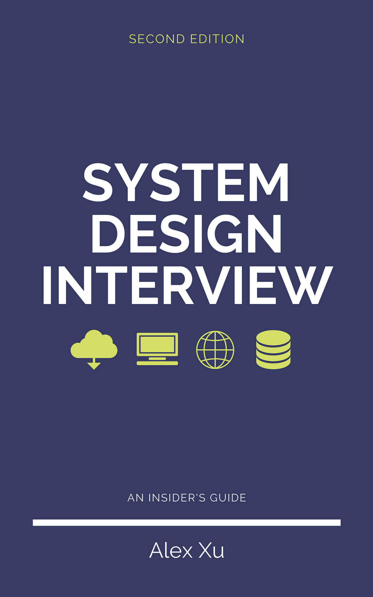

# System Design Interview: An Insider’s Guide

## Thông tin bản quyền và tác giả (Copyright & About the Author)

**System Design Interview: An Insider’s Guide**

Mọi quyền đều được bảo lưu. Không phần nào của cuốn sách này được phép sao chép hoặc sử dụng dưới bất kỳ hình thức nào nếu không có sự cho phép bằng văn bản của nhà xuất bản, ngoại trừ việc trích dẫn ngắn trong các bài điểm sách.

**Về tác giả (About the author):**
Alex Xu là một kỹ sư phần mềm và doanh nhân giàu kinh nghiệm. Trước đây, anh từng làm việc tại Twitter, Apple, Zynga và Oracle. Anh nhận bằng Thạc sĩ Khoa học (M.S.) tại Đại học Carnegie Mellon. Anh có niềm đam mê mãnh liệt với việc thiết kế và triển khai các hệ thống phức tạp.

Vui lòng đăng ký danh sách email của chúng tôi nếu bạn muốn nhận thông báo khi có các chương mới:
https://bit.ly/3dtIcsE

Để biết thêm thông tin, vui lòng liên hệ: `systemdesigninsider@gmail.com`

**Biên tập viên (Editor):** Paul Solomon

---

## Mục lục (Table of Contents)

**System Design Interview: An Insider’s Guide**

- LỜI MỞ ĐẦU (FORWARD)
- CHƯƠNG 1: MỞ RỘNG TỪ 0 LÊN HÀNG TRIỆU NGƯỜI DÙNG (CHAPTER 1: SCALE FROM ZERO TO MILLIONS OF USERS)
- CHƯƠNG 2: ƯỚC LƯỢNG NHANH TRÊN MẶT SAU PHONG BÌ (CHAPTER 2: BACK-OF-THE-ENVELOPE ESTIMATION)
- CHƯƠNG 3: KHUNG TƯ DUY CHO PHỎNG VẤN THIẾT KẾ HỆ THỐNG (CHAPTER 3: A FRAMEWORK FOR SYSTEM DESIGN INTERVIEWS)
- CHƯƠNG 4: THIẾT KẾ BỘ GIỚI HẠN TỐC ĐỘ (CHAPTER 4: DESIGN A RATE LIMITER)
- CHƯƠNG 5: THIẾT KẾ BĂM NHẤT QUÁN (CHAPTER 5: DESIGN CONSISTENT HASHING)
- CHƯƠNG 6: THIẾT KẾ KHO LƯU TRỮ KEY-VALUE (CHAPTER 6: DESIGN A KEY-VALUE STORE)
- CHƯƠNG 7: THIẾT KẾ BỘ TẠO ID DUY NHẤT TRONG HỆ THỐNG PHÂN TÁN (CHAPTER 7: DESIGN A UNIQUE ID GENERATOR IN DISTRIBUTED SYSTEMS)
- CHƯƠNG 8: THIẾT KẾ HỆ THỐNG RÚT GỌN URL (CHAPTER 8: DESIGN A URL SHORTENER)
- CHƯƠNG 9: THIẾT KẾ TRÌNH THU THẬP DỮ LIỆU WEB (CHAPTER 9: DESIGN A WEB CRAWLER)
- CHƯƠNG 10: THIẾT KẾ HỆ THỐNG THÔNG BÁO (CHAPTER 10: DESIGN A NOTIFICATION SYSTEM)
- CHƯƠNG 11: THIẾT KẾ HỆ THỐNG BẢNG TIN (CHAPTER 11: DESIGN A NEWS FEED SYSTEM)
- CHƯƠNG 12: THIẾT KẾ HỆ THỐNG TRÒ CHUYỆN (CHAPTER 12: DESIGN A CHAT SYSTEM)
- CHƯƠNG 13: THIẾT KẾ HỆ THỐNG TỰ ĐỘNG HOÀN TẤT TÌM KIẾM (CHAPTER 13: DESIGN A SEARCH AUTOCOMPLETE SYSTEM)
- CHƯƠNG 14: THIẾT KẾ YOUTUBE (CHAPTER 14: DESIGN YOUTUBE)
- CHƯƠNG 15: THIẾT KẾ GOOGLE DRIVE (CHAPTER 15: DESIGN GOOGLE DRIVE)
- CHƯƠNG 16: HÀNH TRÌNH HỌC TẬP VẪN TIẾP TỤC (CHAPTER 16: THE LEARNING CONTINUES)
- LỜI KẾT (AFTERWORD)

---

# LỜI MỞ ĐẦU (FORWARD)

Chúng tôi rất vui mừng khi bạn đã quyết định đồng hành cùng chúng tôi trong hành trình tìm hiểu về phỏng vấn thiết kế hệ thống (system design interviews).

Trong tất cả các vòng phỏng vấn kỹ thuật, câu hỏi thiết kế hệ thống là dạng câu hỏi khó chinh phục nhất. Những câu hỏi này đòi hỏi ứng viên phải thiết kế kiến trúc cho một hệ thống phần mềm — chẳng hạn như bảng tin (news feed), công cụ tìm kiếm Google, hệ thống trò chuyện (chat system), v.v. Các câu hỏi này thường gây choáng ngợp và không có một khuôn mẫu cố định nào để làm theo. Phạm vi của đề bài thường rất rộng và mơ hồ. Quá trình giải quyết mang tính mở, không rõ ràng và không có một đáp án tiêu chuẩn hay duy nhất nào được xem là đúng tuyệt đối.

Các công ty áp dụng rộng rãi hình thức phỏng vấn thiết kế hệ thống bởi vì kỹ năng giao tiếp và giải quyết vấn đề được kiểm tra trong các buổi phỏng vấn này rất giống với những gì một kỹ sư phần mềm phải làm trong công việc hằng ngày. Ứng viên được đánh giá dựa trên cách cô ấy phân tích một bài toán mơ hồ và cách cô ấy giải quyết vấn đề từng bước một. Những năng lực được kiểm tra còn bao gồm cách cô ấy trình bày ý tưởng, thảo luận với người khác, cũng như đánh giá và tối ưu hóa hệ thống. Trong tiếng Anh, việc dùng đại từ “she” (cô ấy) giúp câu văn trôi chảy hơn so với việc lặp đi lặp lại “he or she” (anh ấy hoặc cô ấy) hoặc nhảy qua lại giữa hai đại từ. Để việc đọc trở nên dễ dàng hơn, chúng tôi sử dụng đại từ giống cái xuyên suốt cuốn sách này. Điều này hoàn toàn không có ý thiếu tôn trọng các kỹ sư nam.

Các câu hỏi thiết kế hệ thống có tính chất mở. Cũng giống như trong thế giới thực, luôn có nhiều sự khác biệt và biến thể trong một hệ thống. Kết quả mong muốn là đưa ra được một kiến trúc đáp ứng các mục tiêu thiết kế của hệ thống. Cuộc thảo luận có thể đi theo nhiều hướng khác nhau tùy thuộc vào người phỏng vấn. Một số người phỏng vấn có thể chọn tiếp cận ở mức kiến trúc tổng quan (high-level architecture) để bao quát mọi khía cạnh; trong khi một số khác lại chọn tập trung sâu vào một hoặc vài mảng cụ thể. Thông thường, các yêu cầu hệ thống (system requirements), ràng buộc (constraints) và nút thắt cổ chai (bottlenecks) cần được hiểu rõ để định hướng cho cả người phỏng vấn lẫn ứng viên.

Mục tiêu của cuốn sách này là cung cấp một chiến lược đáng tin cậy để tiếp cận các câu hỏi thiết kế hệ thống. Chiến lược đúng đắn và kiến thức vững chắc đóng vai trò thiết yếu cho sự thành công của một buổi phỏng vấn. Cuốn sách này trang bị cho bạn nền tảng kiến thức vững vàng trong việc xây dựng một hệ thống có khả năng mở rộng (scalable system). Càng tích lũy được nhiều kiến thức từ cuốn sách này, bạn sẽ càng được trang bị tốt hơn để giải quyết các câu hỏi thiết kế hệ thống.

Cuốn sách cũng cung cấp một khung phương pháp từng bước (step-by-step framework) về cách xử lý một câu hỏi thiết kế hệ thống. Sách đưa ra nhiều ví dụ minh họa cho cách tiếp cận có hệ thống cùng các bước chi tiết mà bạn có thể làm theo. Với việc luyện tập thường xuyên, bạn sẽ hoàn toàn sẵn sàng để chinh phục các câu hỏi phỏng vấn thiết kế hệ thống.

> 📝 **Giải thích thêm (không có trong sách):** Trong thực tế phỏng vấn thiết kế hệ thống (thường kéo dài 45–60 phút), người phỏng vấn không mong đợi bạn thuộc lòng một bản vẽ hoàn hảo từ đầu. Điều họ đánh giá cao nhất là tư duy cấu trúc: biết đặt câu hỏi làm rõ yêu cầu (functional & non-functional requirements), ước lượng quy mô (QPS, dung lượng lưu trữ), đưa ra thiết kế ban đầu rồi chủ động phân tích đánh đổi (trade-offs) và nút thắt cổ chai khi mở rộng quy mô.

---

## Bảng thuật ngữ chương (Chapter Glossary)

| Thuật ngữ (English) | Tiếng Việt | Giải thích ngắn gọn |
| --- | --- | --- |
| System design interview | Phỏng vấn thiết kế hệ thống | Vòng phỏng vấn kỹ thuật đánh giá khả năng thiết kế kiến trúc phần mềm quy mô lớn, xử lý bài toán mở và phân tích đánh đổi. |
| High-level architecture | Kiến trúc tổng quan (mức cao) | Bản thiết kế khái quát các thành phần chính của hệ thống và cách chúng tương tác với nhau trước khi đi sâu vào chi tiết. |
| System requirements | Yêu cầu hệ thống | Các tính năng cần có (yêu cầu chức năng) và các chỉ tiêu chất lượng như độ trễ, tính sẵn sàng (yêu cầu phi chức năng). |
| Constraints | Ràng buộc | Các giới hạn kỹ thuật, tài nguyên, chi phí hoặc nghiệp vụ mà thiết kế hệ thống phải tuân thủ. |
| Bottlenecks | Nút thắt cổ chai | Điểm nghẽn trong hệ thống làm giới hạn hiệu năng hoặc khả năng mở rộng chung. |
| Scalable system | Hệ thống có khả năng mở rộng | Hệ thống có thể xử lý khối lượng công việc và lượng người dùng tăng lên mà vẫn đảm bảo hiệu năng ổn định. |
