# CHƯƠNG 1: MỞ RỘNG TỪ 0 LÊN HÀNG TRIỆU NGƯỜI DÙNG (CHAPTER 1: SCALE FROM ZERO TO MILLIONS OF USERS)

Thiết kế một hệ thống có khả năng hỗ trợ hàng triệu người dùng là một thử thách lớn, và đó là một hành trình đòi hỏi sự tinh chỉnh liên tục cùng những cải tiến không ngừng. Trong chương này, chúng ta sẽ xây dựng một hệ thống bắt đầu từ việc phục vụ chỉ một người dùng duy nhất và mở rộng dần dần để phục vụ hàng triệu người dùng. Sau khi đọc xong chương này, bạn sẽ nắm vững một loạt kỹ thuật cốt lõi giúp bạn chinh phục các câu hỏi phỏng vấn thiết kế hệ thống (system design interview).

---

## Thiết lập máy chủ đơn (Single server setup)

Hành trình vạn dặm bắt đầu từ một bước chân, và việc xây dựng một hệ thống phức tạp cũng không ngoại lệ. Để bắt đầu với một kiến trúc đơn giản, mọi thứ đều chạy trên một máy chủ duy nhất (single server). Hình 1-1 (Figure 1-1) minh họa thiết lập máy chủ đơn nơi mọi thành phần đều chạy trên cùng một máy chủ: ứng dụng web (web app), cơ sở dữ liệu (database), bộ nhớ đệm (cache), v.v.

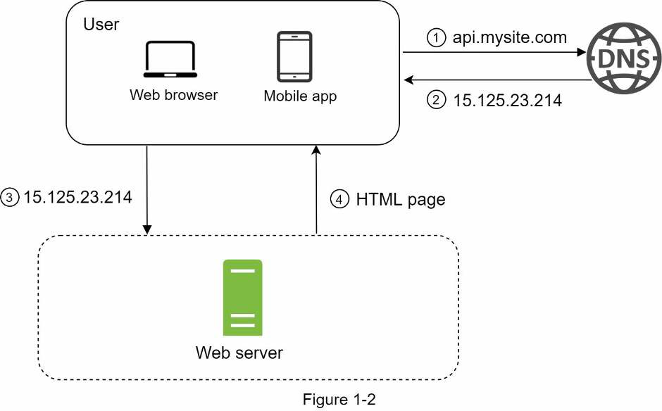

Để hiểu rõ thiết lập này, việc tìm hiểu luồng yêu cầu (request flow) và nguồn lưu lượng truy cập (traffic source) sẽ rất hữu ích. Trước tiên, hãy cùng xem xét luồng yêu cầu (Hình 1-2 / Figure 1-2).

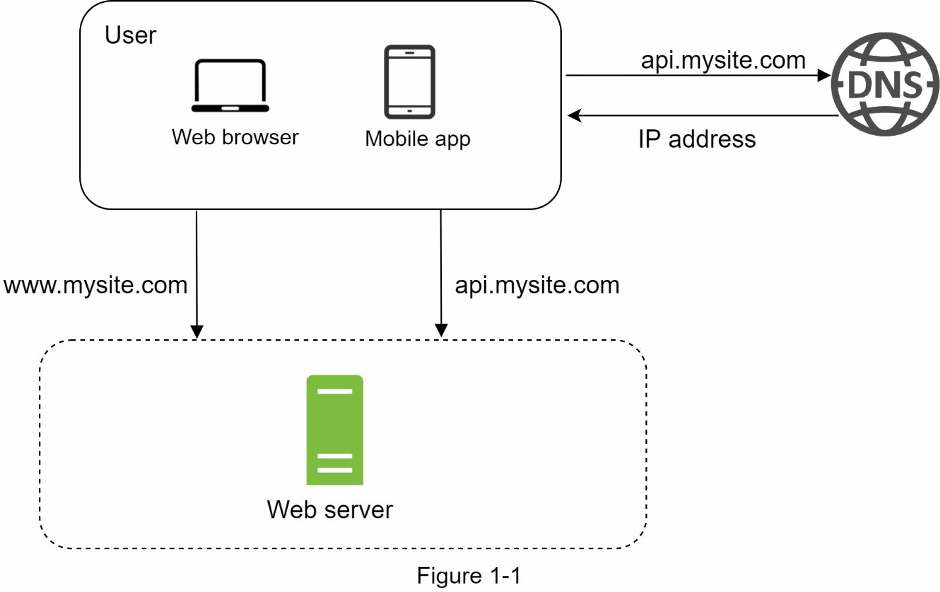

1. Người dùng truy cập các trang web thông qua tên miền (domain name), chẳng hạn như `api.mysite.com`. Thông thường, Hệ thống Phân giải Tên miền — **DNS (Domain Name System)** là một dịch vụ trả phí do bên thứ ba cung cấp và không được lưu trữ trên máy chủ của chúng ta.
2. Địa chỉ Giao thức Internet — **IP (Internet Protocol)** được trả về cho trình duyệt hoặc ứng dụng di động. Trong ví dụ này, địa chỉ IP `15.125.23.214` được trả về.
3. Sau khi có được địa chỉ IP, các yêu cầu Giao thức Truyền tải Siêu văn bản — **HTTP (Hypertext Transfer Protocol)** [1] được gửi trực tiếp đến máy chủ web (web server) của bạn.
4. Máy chủ web trả về các trang HTML hoặc phản hồi dạng JSON để hiển thị (render).

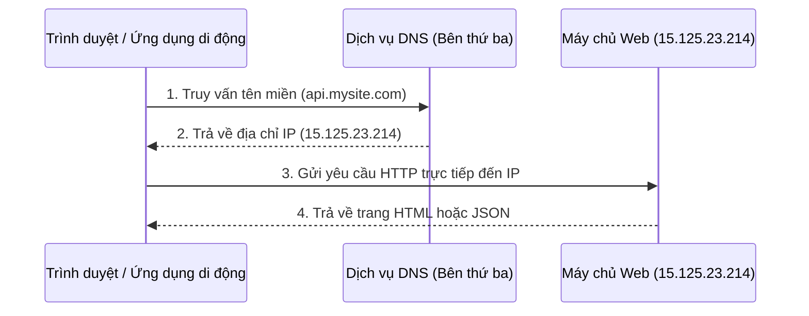

Tiếp theo, hãy xem xét nguồn lưu lượng truy cập. Lưu lượng đến máy chủ web của bạn xuất phát từ hai nguồn: ứng dụng web (web application) và ứng dụng di động (mobile application).

* **Ứng dụng web (Web application):** sử dụng kết hợp các ngôn ngữ phía máy chủ (server-side languages như Java, Python, v.v.) để xử lý logic nghiệp vụ, lưu trữ dữ liệu, v.v., và các ngôn ngữ phía máy khách (client-side languages như HTML và JavaScript) để trình bày giao diện.
* **Ứng dụng di động (Mobile application):** giao thức HTTP là giao thức giao tiếp giữa ứng dụng di động và máy chủ web. **JSON (JavaScript Object Notation)** là định dạng phản hồi API được sử dụng phổ biến để truyền dữ liệu nhờ tính đơn giản của nó. Một ví dụ về phản hồi API ở định dạng JSON được trình bày dưới đây:

`GET /users/12` – Lấy đối tượng người dùng có `id = 12`

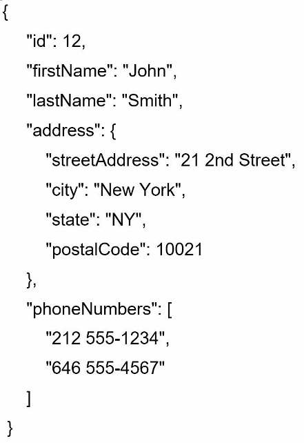

```json
{
  "id": 12,
  "firstName": "John",
  "lastName": "Smith",
  "address": {
    "streetAddress": "21 2nd Street",
    "city": "New York",
    "state": "NY",
    "postalCode": 10021
  },
  "phoneNumbers": [
    "212 555-1234",
    "646 555-4567"
  ]
}
```

> 📝 **Giải thích thêm (không có trong sách):** Ở giai đoạn khởi đầu (MVP — Minimum Viable Product), việc gom mọi thứ vào một máy chủ duy nhất giúp tiết kiệm chi phí, đơn giản hóa việc triển khai (deployment) và gỡ lỗi (debugging). Tuy nhiên, toàn bộ tài nguyên (CPU, RAM, ổ đĩa) đều bị chia sẻ chung, nên khi lượng người dùng tăng lên, ứng dụng web và cơ sở dữ liệu sẽ cạnh tranh tài nguyên với nhau.

---

## Cơ sở dữ liệu (Database)

Khi lượng người dùng tăng trưởng, một máy chủ duy nhất không còn đủ nữa và chúng ta cần nhiều máy chủ hơn: một máy chủ cho lưu lượng web/di động và một máy chủ khác cho cơ sở dữ liệu (Hình 1-3 / Figure 1-3). Việc tách biệt máy chủ xử lý lưu lượng web/di động (**tầng web — web tier**) và máy chủ cơ sở dữ liệu (**tầng dữ liệu — data tier**) cho phép chúng được mở rộng độc lập với nhau.

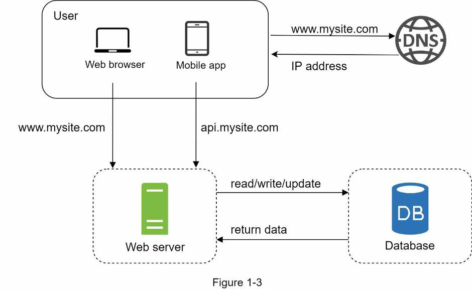

### Nên sử dụng cơ sở dữ liệu nào? (Which databases to use?)

Bạn có thể lựa chọn giữa cơ sở dữ liệu quan hệ truyền thống (traditional relational database) và cơ sở dữ liệu phi quan hệ (non-relational database). Hãy cùng xem xét sự khác biệt giữa chúng.

**Cơ sở dữ liệu quan hệ** còn được gọi là hệ quản trị cơ sở dữ liệu quan hệ — **RDBMS (Relational Database Management System)** hoặc cơ sở dữ liệu **SQL**. Những cái tên phổ biến nhất là MySQL, Oracle Database, PostgreSQL, v.v. Cơ sở dữ liệu quan hệ biểu diễn và lưu trữ dữ liệu dưới dạng các bảng (tables) và hàng (rows). Bạn có thể thực hiện các phép nối (**join**) bằng SQL trên nhiều bảng cơ sở dữ liệu khác nhau.

**Cơ sở dữ liệu phi quan hệ** còn được gọi là cơ sở dữ liệu **NoSQL**. Những cái tên phổ biến là CouchDB, Neo4j, Cassandra, HBase, Amazon DynamoDB, v.v. [2]. Các cơ sở dữ liệu này được chia thành bốn nhóm chính:
1. Kho lưu trữ khóa-giá trị (**key-value stores** — ví dụ: Redis, DynamoDB)
2. Kho lưu trữ đồ thị (**graph stores** — ví dụ: Neo4j)
3. Kho lưu trữ theo cột (**column stores** — ví dụ: Cassandra, HBase)
4. Kho lưu trữ tài liệu (**document stores** — ví dụ: MongoDB, CouchDB)

Các phép nối (join) nhìn chung không được hỗ trợ trong cơ sở dữ liệu phi quan hệ.

Đối với hầu hết lập trình viên, cơ sở dữ liệu quan hệ là lựa chọn tốt nhất vì chúng đã tồn tại hơn 40 năm và về mặt lịch sử, chúng luôn hoạt động hiệu quả. Tuy nhiên, nếu cơ sở dữ liệu quan hệ không phù hợp với trường hợp sử dụng cụ thể của bạn, việc khám phá các giải pháp ngoài cơ sở dữ liệu quan hệ là rất quan trọng. Cơ sở dữ liệu phi quan hệ có thể là lựa chọn đúng đắn nếu:

* Ứng dụng của bạn đòi hỏi độ trễ cực thấp (super-low latency).
* Dữ liệu của bạn không có cấu trúc (unstructured), hoặc bạn không có dữ liệu dạng quan hệ.
* Bạn chỉ cần tuần tự hóa (serialize) và giải tuần tự hóa (deserialize) dữ liệu (JSON, XML, YAML, v.v.).
* Bạn cần lưu trữ một lượng dữ liệu khổng lồ (massive amount of data).

> 💡 **Ví dụ bổ sung (không có trong sách):** Nếu bạn xây dựng một hệ thống thương mại điện tử cần đảm bảo tính toàn vẹn giao dịch (ACID) cho đơn hàng, thanh toán và tồn kho, hãy chọn **PostgreSQL/MySQL** (SQL). Ngược lại, nếu bạn lưu trữ dữ liệu nhật ký sự kiện (event logs) hàng tỷ dòng mỗi ngày hoặc dữ liệu giỏ hàng tạm thời cần tốc độ đọc/ghi cực nhanh theo khóa, **Cassandra** hoặc **DynamoDB** (NoSQL) sẽ phù hợp hơn.

---

## Mở rộng theo chiều dọc và mở rộng theo chiều ngang (Vertical scaling vs horizontal scaling)

**Mở rộng theo chiều dọc (Vertical scaling)**, còn được gọi là **"scale up"**, là quá trình tăng thêm sức mạnh phần cứng (CPU, RAM, v.v.) cho các máy chủ hiện có của bạn. **Mở rộng theo chiều ngang (Horizontal scaling)**, còn được gọi là **"scale-out"**, cho phép bạn mở rộng bằng cách thêm nhiều máy chủ hơn vào nhóm tài nguyên (pool of resources) của mình.

Khi lưu lượng truy cập thấp, mở rộng theo chiều dọc là một lựa chọn tuyệt vời, và tính đơn giản của nó chính là ưu điểm lớn nhất. Đáng tiếc là nó đi kèm với những hạn chế nghiêm trọng:

* Mở rộng theo chiều dọc có giới hạn cứng (hard limit). Không thể nâng cấp CPU và bộ nhớ vô hạn cho một máy chủ duy nhất.
* Mở rộng theo chiều dọc không có khả năng chuyển đổi dự phòng (**failover**) và dự phòng (**redundancy**). Nếu một máy chủ gặp sự cố (goes down), toàn bộ trang web/ứng dụng sẽ ngừng hoạt động theo nó.

Mở rộng theo chiều ngang được ưa chuộng hơn cho các ứng dụng quy mô lớn do những hạn chế của mở rộng theo chiều dọc.

Trong thiết kế trước đó, người dùng kết nối trực tiếp đến máy chủ web. Người dùng sẽ không thể truy cập trang web nếu máy chủ web ngoại tuyến (offline). Trong một kịch bản khác, nếu có quá nhiều người dùng truy cập đồng thời và chạm đến giới hạn tải của máy chủ web, người dùng thường sẽ gặp phản hồi chậm hoặc không thể kết nối tới máy chủ. Một **bộ cân bằng tải (load balancer)** là kỹ thuật tốt nhất để giải quyết những vấn đề này.

---

## Bộ cân bằng tải (Load balancer)

Một bộ cân bằng tải phân phối đều lưu lượng truy cập đến giữa các máy chủ web được định nghĩa trong một nhóm cân bằng tải (load-balanced set). Hình 1-4 (Figure 1-4) minh họa cách một bộ cân bằng tải hoạt động.

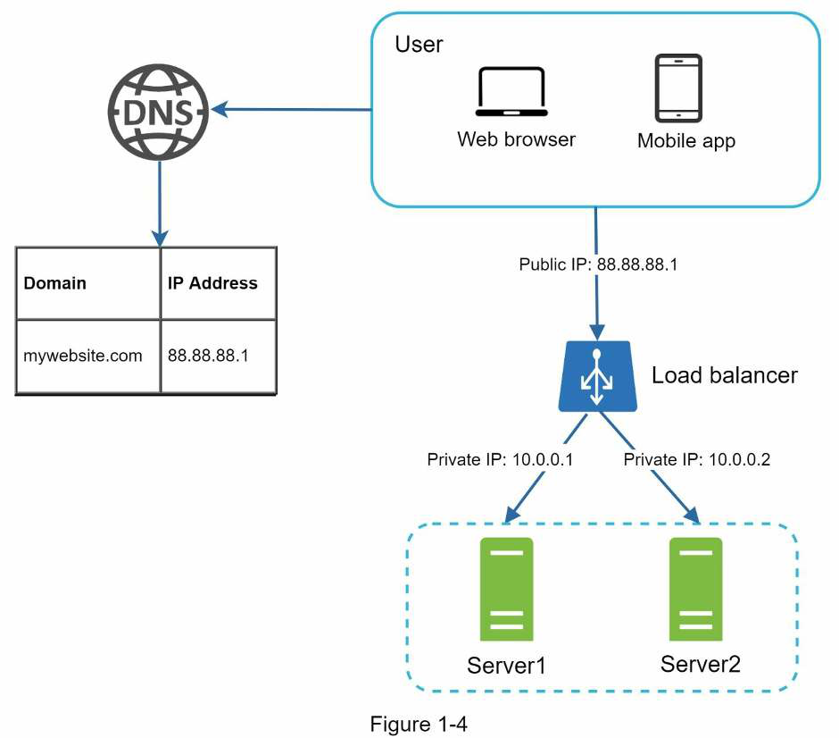

Như thể hiện trong Hình 1-4, người dùng kết nối trực tiếp đến địa chỉ **IP công khai (public IP)** của bộ cân bằng tải. Với thiết lập này, các máy chủ web không còn có thể bị truy cập trực tiếp từ phía máy khách (client) nữa. Để bảo mật tốt hơn, các địa chỉ **IP riêng tư (private IP)** được sử dụng cho giao tiếp giữa các máy chủ. Một IP riêng tư là địa chỉ IP chỉ có thể kết nối giữa các máy chủ trong cùng một mạng nội bộ; tuy nhiên, nó không thể truy cập từ ngoài Internet. Bộ cân bằng tải giao tiếp với các máy chủ web thông qua các IP riêng tư này.

Trong Hình 1-4, sau khi thêm một bộ cân bằng tải và một máy chủ web thứ hai, chúng ta đã giải quyết thành công vấn đề không có chuyển đổi dự phòng và cải thiện tính sẵn sàng (availability) của tầng web. Chi tiết được giải thích dưới đây:

* Nếu máy chủ 1 (Server 1) ngoại tuyến, toàn bộ lưu lượng truy cập sẽ được điều hướng sang máy chủ 2 (Server 2). Điều này ngăn trang web bị sập hoàn toàn. Chúng ta cũng sẽ bổ sung một máy chủ web khỏe mạnh mới vào nhóm máy chủ để cân bằng tải.
* Nếu lưu lượng trang web tăng trưởng nhanh chóng và hai máy chủ không đủ để xử lý, bộ cân bằng tải có thể xử lý vấn đề này một cách mượt mà. Bạn chỉ cần thêm máy chủ mới vào nhóm máy chủ web, và bộ cân bằng tải sẽ tự động bắt đầu gửi yêu cầu đến chúng.

Giờ tầng web trông đã ổn, vậy còn tầng dữ liệu thì sao? Thiết kế hiện tại chỉ có một cơ sở dữ liệu duy nhất, nên nó chưa hỗ trợ chuyển đổi dự phòng và dự phòng dữ liệu. **Sao chép cơ sở dữ liệu (Database replication)** là một kỹ thuật phổ biến để giải quyết các vấn đề đó. Hãy cùng tìm hiểu.

---

## Sao chép cơ sở dữ liệu (Database replication)

Trích dẫn từ Wikipedia: *"Sao chép cơ sở dữ liệu có thể được sử dụng trong nhiều hệ quản trị cơ sở dữ liệu, thường theo mối quan hệ chủ/tớ (master/slave) giữa bản gốc (master) và các bản sao (slaves)"* [3].

Một cơ sở dữ liệu **chủ (master)** nhìn chung chỉ hỗ trợ các thao tác **ghi (write)**. Một cơ sở dữ liệu **tớ (slave)** nhận các bản sao dữ liệu từ cơ sở dữ liệu chủ và chỉ hỗ trợ các thao tác **đọc (read)**. Tất cả các lệnh làm thay đổi dữ liệu như `INSERT`, `DELETE`, hoặc `UPDATE` đều phải được gửi đến cơ sở dữ liệu chủ. Hầu hết các ứng dụng đều có tỷ lệ đọc cao hơn nhiều so với ghi; do đó, số lượng cơ sở dữ liệu tớ trong một hệ thống thường lớn hơn số lượng cơ sở dữ liệu chủ. Hình 1-5 (Figure 1-5) minh họa một cơ sở dữ liệu chủ cùng với nhiều cơ sở dữ liệu tớ.

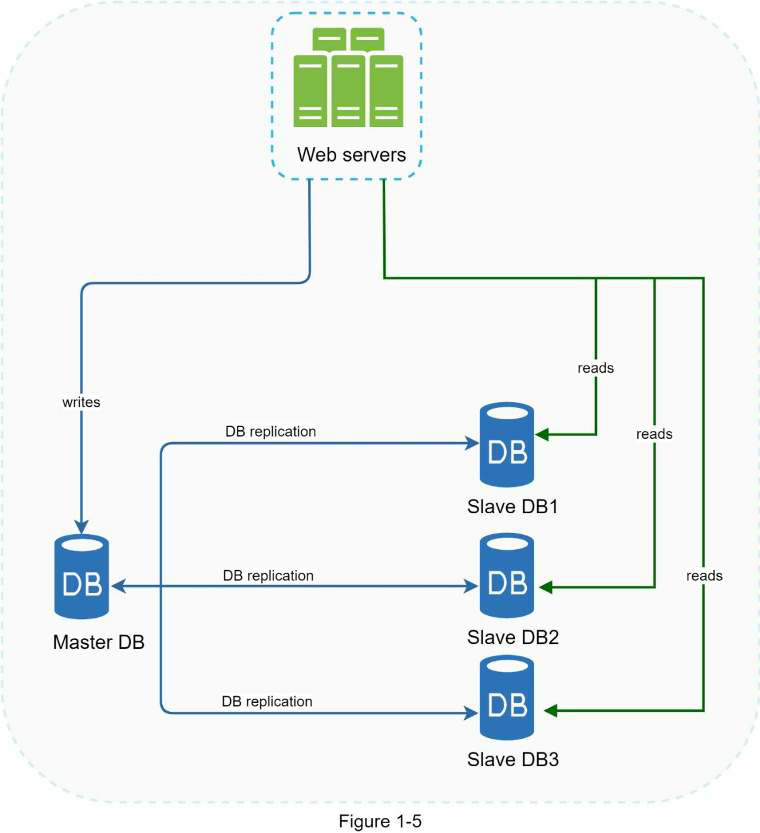

**Ưu điểm của sao chép cơ sở dữ liệu:**

* **Hiệu năng tốt hơn (Better performance):** Trong mô hình master-slave, mọi thao tác ghi và cập nhật diễn ra ở các nút chủ (master nodes); trong khi đó, các thao tác đọc được phân bổ trên các nút tớ (slave nodes). Mô hình này cải thiện hiệu năng vì nó cho phép nhiều truy vấn được xử lý song song hơn.
* **Độ tin cậy (Reliability):** Nếu một trong các máy chủ cơ sở dữ liệu của bạn bị phá hủy bởi thiên tai, chẳng hạn như bão lớn hoặc động đất, dữ liệu vẫn được bảo toàn. Bạn không cần lo lắng về việc mất dữ liệu vì dữ liệu đã được sao chép trên nhiều vị trí địa lý khác nhau.
* **Tính sẵn sàng cao (High availability):** Bằng cách sao chép dữ liệu qua các vị trí khác nhau, trang web của bạn vẫn duy trì hoạt động ngay cả khi một cơ sở dữ liệu ngoại tuyến vì bạn có thể truy cập dữ liệu được lưu trữ trên một máy chủ cơ sở dữ liệu khác.

Trong phần trước, chúng ta đã thảo luận cách bộ cân bằng tải giúp cải thiện tính sẵn sàng của hệ thống. Chúng ta đặt câu hỏi tương tự ở đây: điều gì xảy ra nếu một trong các cơ sở dữ liệu bị ngoại tuyến? Thiết kế kiến trúc được thảo luận trong Hình 1-5 có thể xử lý trường hợp này:

* **Nếu chỉ có một cơ sở dữ liệu tớ và nó bị ngoại tuyến**, các thao tác đọc sẽ tạm thời được điều hướng sang cơ sở dữ liệu chủ. Ngay khi phát hiện sự cố, một cơ sở dữ liệu tớ mới sẽ thay thế cho máy cũ. Trong trường hợp có nhiều cơ sở dữ liệu tớ, các thao tác đọc được chuyển hướng sang các cơ sở dữ liệu tớ khỏe mạnh khác. Một máy chủ cơ sở dữ liệu mới sẽ thay thế cho máy bị hỏng.
* **Nếu cơ sở dữ liệu chủ bị ngoại tuyến**, một cơ sở dữ liệu tớ sẽ được thăng cấp (**promoted**) thành cơ sở dữ liệu chủ mới. Mọi thao tác cơ sở dữ liệu sẽ tạm thời được thực thi trên cơ sở dữ liệu chủ mới này. Một cơ sở dữ liệu tớ mới sẽ thay thế cho máy cũ để thực hiện việc sao chép dữ liệu ngay lập tức.

Trong các hệ thống thực tế (production systems), việc thăng cấp một chủ mới phức tạp hơn nhiều vì dữ liệu trong cơ sở dữ liệu tớ có thể chưa được cập nhật mới nhất (do độ trễ sao chép — replication lag). Dữ liệu bị thiếu cần phải được cập nhật bằng cách chạy các kịch bản khôi phục dữ liệu (data recovery scripts). Mặc dù một số phương pháp sao chép khác như đa chủ (**multi-masters**) và sao chép vòng tròn (**circular replication**) có thể hỗ trợ, nhưng những thiết lập đó phức tạp hơn; và việc thảo luận về chúng nằm ngoài phạm vi cuốn sách này. Độc giả quan tâm có thể tham khảo các tài liệu tham khảo được liệt kê [4] [5].

Hình 1-6 (Figure 1-6) minh họa thiết kế hệ thống sau khi bổ sung bộ cân bằng tải và sao chép cơ sở dữ liệu.

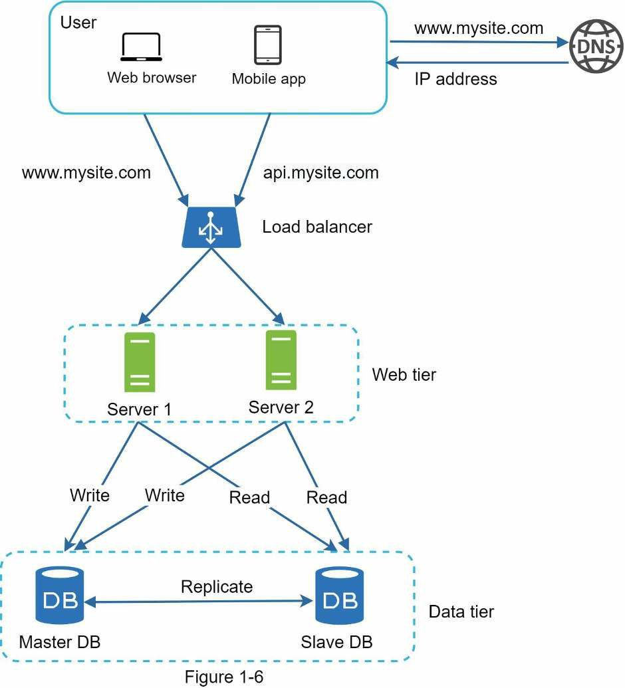

Hãy cùng xem xét luồng hoạt động của thiết kế này:

* Người dùng lấy địa chỉ IP của bộ cân bằng tải từ DNS.
* Người dùng kết nối tới bộ cân bằng tải bằng địa chỉ IP này.
* Yêu cầu HTTP được điều hướng đến Server 1 hoặc Server 2.
* Máy chủ web đọc dữ liệu người dùng từ một cơ sở dữ liệu tớ (slave).
* Máy chủ web điều hướng mọi thao tác làm thay đổi dữ liệu đến cơ sở dữ liệu chủ (master). Điều này bao gồm các thao tác ghi (`INSERT`), cập nhật (`UPDATE`), và xóa (`DELETE`).

Giờ bạn đã có nền tảng vững chắc về tầng web và tầng dữ liệu, đã đến lúc cải thiện thời gian tải/phản hồi (load/response time). Điều này có thể thực hiện bằng cách bổ sung một **tầng bộ nhớ đệm (cache layer)** và chuyển các nội dung tĩnh (tệp JavaScript/CSS/hình ảnh/video) sang **Mạng phân phối nội dung — CDN (Content Delivery Network)**.

---

## Bộ nhớ đệm (Cache)

**Bộ nhớ đệm (Cache)** là một vùng lưu trữ tạm thời lưu giữ kết quả của các phản hồi tốn kém hoặc dữ liệu được truy cập thường xuyên trong bộ nhớ (RAM) để các yêu cầu tiếp theo được phục vụ nhanh hơn. Như minh họa trong Hình 1-6, mỗi khi một trang web mới được tải, một hoặc nhiều lời gọi cơ sở dữ liệu được thực thi để lấy dữ liệu. Hiệu năng ứng dụng bị ảnh hưởng nặng nề khi gọi cơ sở dữ liệu lặp đi lặp lại. Bộ nhớ đệm có thể giảm thiểu vấn đề này.

### Tầng bộ nhớ đệm (Cache tier)

Tầng bộ nhớ đệm là một tầng lưu trữ dữ liệu tạm thời, nhanh hơn nhiều so với cơ sở dữ liệu. Lợi ích của việc có một tầng bộ nhớ đệm riêng biệt bao gồm: cải thiện hiệu năng hệ thống, khả năng giảm tải cho cơ sở dữ liệu, và khả năng mở rộng tầng bộ nhớ đệm một cách độc lập. Hình 1-7 (Figure 1-7) minh họa một thiết lập khả thi của máy chủ bộ nhớ đệm:

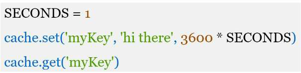

Sau khi nhận được yêu cầu, máy chủ web trước tiên kiểm tra xem bộ nhớ đệm có sẵn phản hồi hay không. Nếu có (**cache hit**), nó gửi dữ liệu trả về cho máy khách. Nếu không (**cache miss**), nó truy vấn cơ sở dữ liệu, lưu phản hồi vào bộ nhớ đệm, rồi gửi trả lại cho máy khách. Chiến lược bộ nhớ đệm này được gọi là **đọc xuyên qua bộ nhớ đệm (read-through cache)**. Các chiến lược bộ nhớ đệm khác cũng sẵn có tùy thuộc vào loại dữ liệu, kích thước và mô hình truy cập (access patterns). Một nghiên cứu trước đây giải thích cách các chiến lược bộ nhớ đệm khác nhau hoạt động [6].

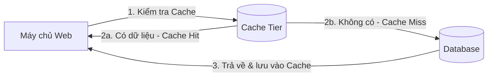

Việc tương tác với các máy chủ bộ nhớ đệm rất đơn giản vì hầu hết chúng đều cung cấp API cho các ngôn ngữ lập trình phổ biến. Đoạn mã dưới đây cho thấy các API điển hình của Memcached:

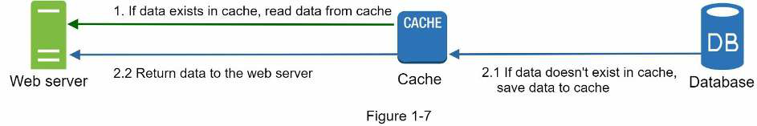

```python
SECONDS = 1
cache.set('myKey', 'hi there', 3600 * SECONDS)
cache.get('myKey')
```

### Những lưu ý khi sử dụng bộ nhớ đệm (Considerations for using cache)

Dưới đây là một vài điểm cần cân nhắc khi sử dụng hệ thống bộ nhớ đệm:

* **Quyết định khi nào nên dùng cache (Decide when to use cache):** Hãy cân nhắc sử dụng cache khi dữ liệu được đọc thường xuyên nhưng ít khi bị sửa đổi. Vì dữ liệu cache được lưu trong bộ nhớ khả biến (volatile memory - RAM), máy chủ cache không lý tưởng để lưu trữ dữ liệu bền vững. Chẳng hạn, nếu máy chủ cache khởi động lại, toàn bộ dữ liệu trong bộ nhớ sẽ bị mất. Do đó, dữ liệu quan trọng phải được lưu trong các kho dữ liệu bền vững (persistent data stores).
* **Chính sách hết hạn (Expiration policy):** Việc triển khai chính sách hết hạn là một thực hành tốt. Một khi dữ liệu trong cache hết hạn, nó sẽ bị xóa khỏi cache. Nếu không có chính sách hết hạn, dữ liệu cache sẽ nằm trong bộ nhớ vĩnh viễn. Bạn không nên đặt thời gian hết hạn quá ngắn vì điều này sẽ khiến hệ thống phải tải lại dữ liệu từ cơ sở dữ liệu quá thường xuyên. Đồng thời, cũng không nên đặt quá dài vì dữ liệu có thể bị cũ/lỗi thời (stale).
* **Tính nhất quán (Consistency):** Điều này liên quan đến việc giữ cho kho dữ liệu và cache luôn đồng bộ với nhau. Sự thiếu nhất quán (inconsistency) có thể xảy ra vì các thao tác sửa đổi dữ liệu trên kho dữ liệu và trên cache không nằm trong cùng một giao dịch (transaction). Khi mở rộng qua nhiều khu vực địa lý (regions), việc duy trì tính nhất quán giữa kho dữ liệu và cache là một thách thức lớn. Để biết thêm chi tiết, hãy tham khảo bài báo khoa học có tựa đề *"Scaling Memcache at Facebook"* do Facebook xuất bản [7].
* **Giảm thiểu lỗi (Mitigating failures):** Một máy chủ cache đơn lẻ đại diện cho một **điểm lỗi đơn — SPOF (Single Point of Failure)**, được định nghĩa trên Wikipedia như sau: *"Một điểm lỗi đơn (SPOF) là một bộ phận của hệ thống mà nếu nó gặp sự cố, toàn bộ hệ thống sẽ ngừng hoạt động"* [8]. Kết quả là, việc sử dụng nhiều máy chủ cache đặt tại các trung tâm dữ liệu khác nhau được khuyến nghị để tránh SPOF. Một cách tiếp cận được khuyến nghị khác là cấp phát dư bộ nhớ (overprovision) cần thiết thêm một tỷ lệ phần trăm nhất định. Điều này tạo ra một vùng đệm khi mức sử dụng bộ nhớ tăng lên.
* **Chính sách loại bỏ (Eviction Policy):** Một khi bộ nhớ đệm đã đầy, bất kỳ yêu cầu thêm mục mới nào vào cache có thể khiến các mục hiện có bị xóa bỏ. Điều này gọi là **loại bỏ cache (cache eviction)**. **Ít được sử dụng gần đây nhất — LRU (Least-Recently-Used)** là chính sách loại bỏ cache phổ biến nhất. Các chính sách khác, như **Ít được sử dụng thường xuyên nhất — LFU (Least Frequently Used)** hoặc **Vào trước ra trước — FIFO (First in First Out)**, có thể được áp dụng để đáp ứng các trường hợp sử dụng khác nhau.

---

## Mạng phân phối nội dung (Content delivery network - CDN)

Một **CDN** là một mạng lưới các máy chủ phân tán theo địa lý được sử dụng để phân phối nội dung tĩnh (static content). Các máy chủ CDN lưu đệm (cache) các nội dung tĩnh như hình ảnh, video, tệp CSS, JavaScript, v.v.

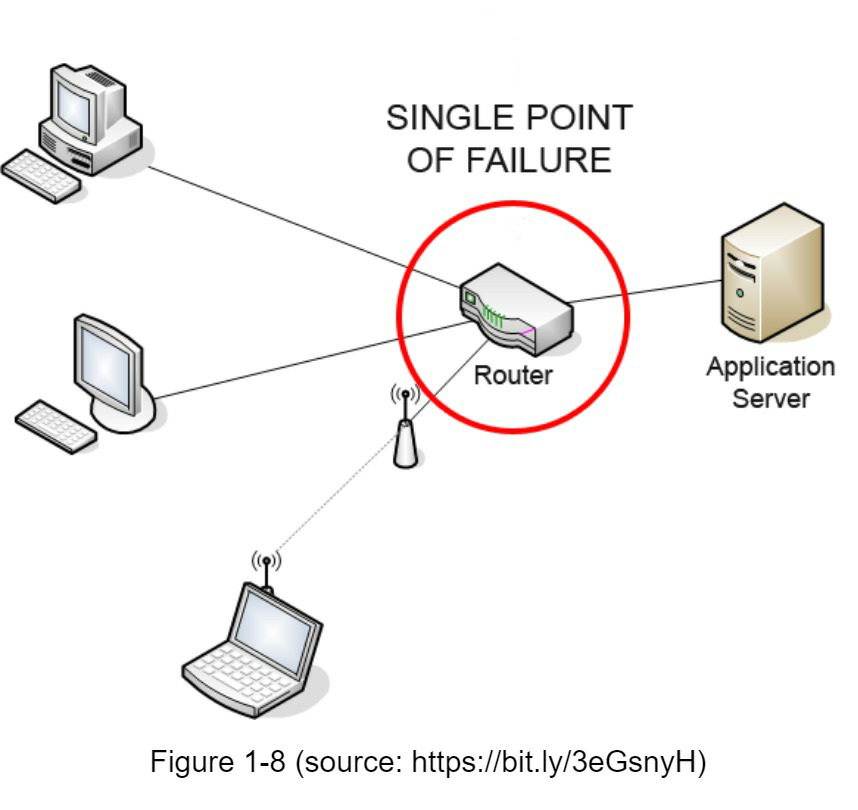

Lưu đệm nội dung động (dynamic content caching) là một khái niệm tương đối mới và nằm ngoài phạm vi của cuốn sách này. Nó cho phép lưu đệm các trang HTML dựa trên đường dẫn yêu cầu (request path), chuỗi truy vấn (query strings), cookies, và các tiêu đề yêu cầu (request headers). Tham khảo bài viết trong tài liệu tham khảo [9] để biết thêm về vấn đề này. Cuốn sách này tập trung vào cách sử dụng CDN để lưu đệm nội dung tĩnh.

Đây là cách CDN hoạt động ở mức tổng quan: khi một người dùng truy cập trang web, một máy chủ CDN gần người dùng nhất sẽ phân phối nội dung tĩnh. Theo trực giác, người dùng càng ở xa các máy chủ CDN thì trang web tải càng chậm. Ví dụ, nếu các máy chủ CDN đặt tại San Francisco, người dùng ở Los Angeles sẽ nhận được nội dung nhanh hơn người dùng ở Châu Âu. Hình 1-9 (Figure 1-9) là một ví dụ tuyệt vời cho thấy CDN cải thiện thời gian tải như thế nào.

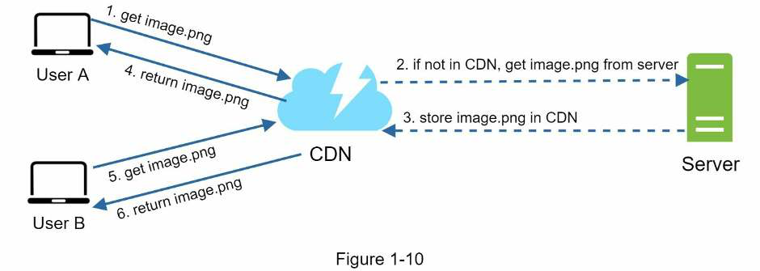

Hình 1-10 (Figure 1-10) minh họa quy trình làm việc của CDN.

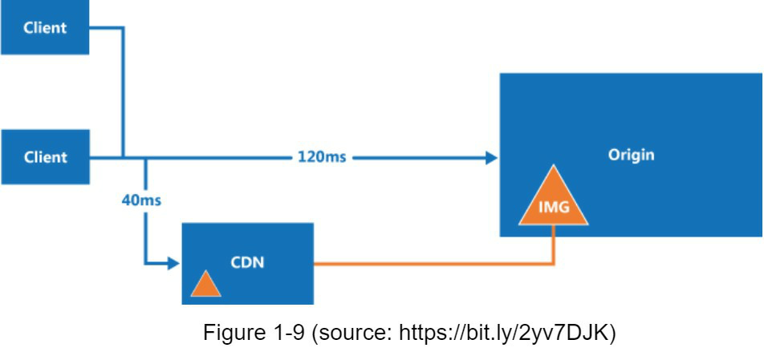

1. Người dùng A (User A) cố gắng lấy tệp `image.png` bằng cách sử dụng một URL hình ảnh. Tên miền của URL do nhà cung cấp CDN cung cấp. Hai URL hình ảnh dưới đây là ví dụ minh họa URL hình ảnh trên Amazon và Akamai CDN:
   * `https://mysite.cloudfront.net/logo.jpg`
   * `https://mysite.akamai.com/image-manager/img/logo.jpg`
2. Nếu máy chủ CDN chưa có `image.png` trong bộ nhớ đệm, máy chủ CDN sẽ yêu cầu tệp từ **máy chủ gốc (origin)**, có thể là một máy chủ web hoặc dịch vụ lưu trữ trực tuyến như Amazon S3.
3. Máy chủ gốc trả về `image.png` cho máy chủ CDN, trong đó có kèm tiêu đề HTTP tùy chọn là **Thời gian sống — TTL (Time-to-Live)** mô tả thời gian hình ảnh được lưu trong bộ nhớ đệm.
4. CDN lưu đệm hình ảnh và trả về cho Người dùng A. Hình ảnh vẫn được lưu trong CDN cho đến khi TTL hết hạn.
5. Người dùng B (User B) gửi yêu cầu để lấy cùng hình ảnh đó.
6. Hình ảnh được trả về ngay từ bộ nhớ đệm miễn là TTL chưa hết hạn.

### Những lưu ý khi sử dụng CDN (Considerations of using a CDN)

* **Chi phí (Cost):** CDN được vận hành bởi các nhà cung cấp bên thứ ba, và bạn bị tính phí cho lượng dữ liệu truyền vào và ra khỏi CDN. Việc lưu đệm các tài nguyên ít khi được truy cập không mang lại lợi ích đáng kể nào, vì vậy bạn nên cân nhắc đưa chúng ra khỏi CDN.
* **Thiết lập thời gian hết hạn cache phù hợp (Setting an appropriate cache expiry):** Đối với nội dung nhạy cảm với thời gian, việc thiết lập thời gian hết hạn cache là rất quan trọng. Thời gian hết hạn cache không nên quá dài cũng không nên quá ngắn. Nếu quá dài, nội dung có thể không còn mới nữa. Nếu quá ngắn, nó có thể gây ra việc tải lại nội dung lặp đi lặp lại từ máy chủ gốc lên CDN.
* **Phương án dự phòng CDN (CDN fallback):** Bạn nên cân nhắc cách trang web/ứng dụng của mình đối phó với sự cố CDN. Nếu xảy ra sự cố gián đoạn CDN tạm thời, phía máy khách (clients) phải có khả năng phát hiện vấn đề và yêu cầu tài nguyên trực tiếp từ máy chủ gốc.
* **Làm mất hiệu lực tệp (Invalidating files):** Bạn có thể xóa một tệp khỏi CDN trước khi nó hết hạn bằng cách thực hiện một trong các thao tác sau:
  * Vô hiệu hóa đối tượng CDN (Invalidate the CDN object) bằng các API do nhà cung cấp CDN cung cấp.
  * Sử dụng đánh phiên bản đối tượng (**object versioning**) để phục vụ một phiên bản khác của đối tượng. Để đánh phiên bản, bạn có thể thêm một tham số vào URL, chẳng hạn như số phiên bản. Ví dụ, số phiên bản 2 được thêm vào chuỗi truy vấn: `image.png?v=2`.

Hình 1-11 (Figure 1-11) minh họa thiết kế hệ thống sau khi đã bổ sung CDN và bộ nhớ đệm.

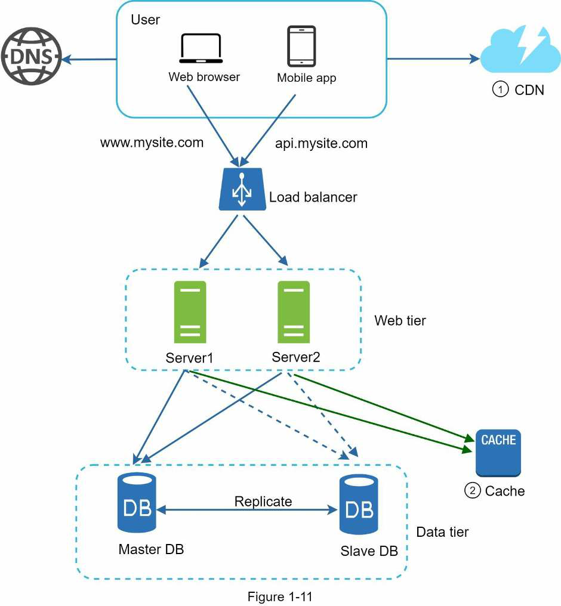

1. Các tài nguyên tĩnh (JS, CSS, hình ảnh, v.v.) không còn được phục vụ bởi các máy chủ web nữa. Chúng được lấy từ CDN để đạt hiệu năng tốt hơn.
2. Tải trọng của cơ sở dữ liệu được giảm nhẹ nhờ việc lưu đệm dữ liệu (caching).

---

## Tầng web phi trạng thái (Stateless web tier)

Giờ là lúc cân nhắc việc mở rộng tầng web theo chiều ngang. Để làm được điều này, chúng ta cần di chuyển trạng thái (**state** — ví dụ như dữ liệu phiên làm việc của người dùng / user session data) ra khỏi tầng web. Một thực hành tốt là lưu trữ dữ liệu phiên trong một kho lưu trữ bền vững như cơ sở dữ liệu quan hệ hoặc NoSQL. Mỗi máy chủ web trong cụm (cluster) đều có thể truy cập dữ liệu trạng thái từ cơ sở dữ liệu. Đây được gọi là **tầng web phi trạng thái (stateless web tier)**.

### Kiến trúc có trạng thái (Stateful architecture)

Một máy chủ có trạng thái (**stateful server**) và máy chủ phi trạng thái (**stateless server**) có những điểm khác biệt then chốt. Một máy chủ có trạng thái ghi nhớ dữ liệu của máy khách (trạng thái) từ yêu cầu này sang yêu cầu tiếp theo. Một máy chủ phi trạng thái không lưu giữ bất kỳ thông tin trạng thái nào.

Hình 1-12 (Figure 1-12) minh họa một ví dụ về kiến trúc có trạng thái.

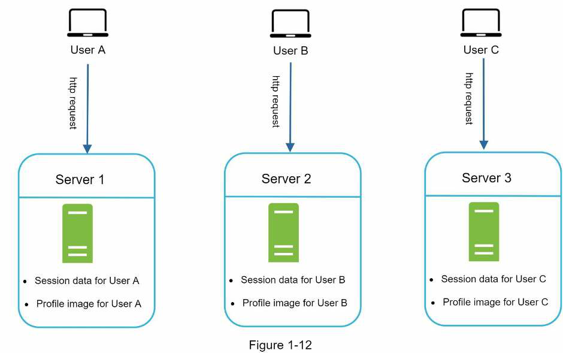

Trong Hình 1-12, dữ liệu phiên (session data) và ảnh đại diện của Người dùng A được lưu trên Server 1. Để xác thực Người dùng A, các yêu cầu HTTP bắt buộc phải được điều hướng đến Server 1. Nếu một yêu cầu bị gửi nhầm sang các máy chủ khác như Server 2, quá trình xác thực sẽ thất bại vì Server 2 không chứa dữ liệu phiên của Người dùng A. Tương tự, mọi yêu cầu HTTP từ Người dùng B phải được điều hướng đến Server 2; mọi yêu cầu từ Người dùng C phải được gửi đến Server 3.

Vấn đề ở đây là mọi yêu cầu từ cùng một máy khách đều phải được định tuyến đến đúng cùng một máy chủ. Điều này có thể thực hiện được bằng tính năng **phiên dính (sticky sessions)** có trong hầu hết các bộ cân bằng tải [10]; tuy nhiên, giải pháp này làm tăng chi phí quản lý (overhead). Việc thêm hoặc bớt máy chủ trở nên khó khăn hơn nhiều với cách tiếp cận này. Ngoài ra, việc xử lý khi máy chủ gặp sự cố cũng rất thách thức.

### Kiến trúc phi trạng thái (Stateless architecture)

Hình 1-13 (Figure 1-13) minh họa kiến trúc phi trạng thái.

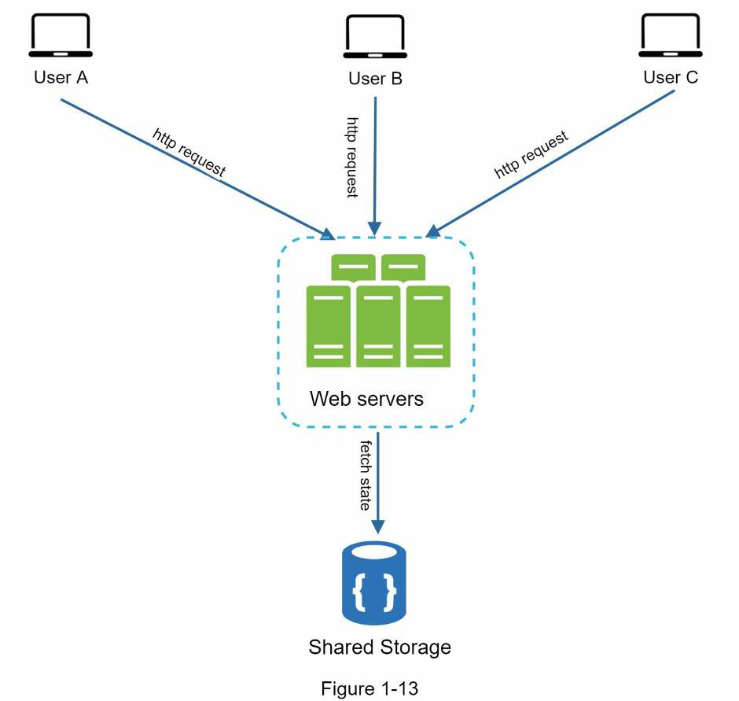

Trong kiến trúc phi trạng thái này, các yêu cầu HTTP từ người dùng có thể được gửi đến bất kỳ máy chủ web nào, và các máy chủ này sẽ lấy dữ liệu trạng thái từ một **kho dữ liệu dùng chung (shared data store)**. Dữ liệu trạng thái được lưu trữ trong kho dữ liệu dùng chung và được tách hoàn toàn ra khỏi các máy chủ web. Một hệ thống phi trạng thái đơn giản hơn, vững chắc hơn (more robust) và dễ mở rộng hơn.

Hình 1-14 (Figure 1-14) minh họa thiết kế cập nhật với một tầng web phi trạng thái.

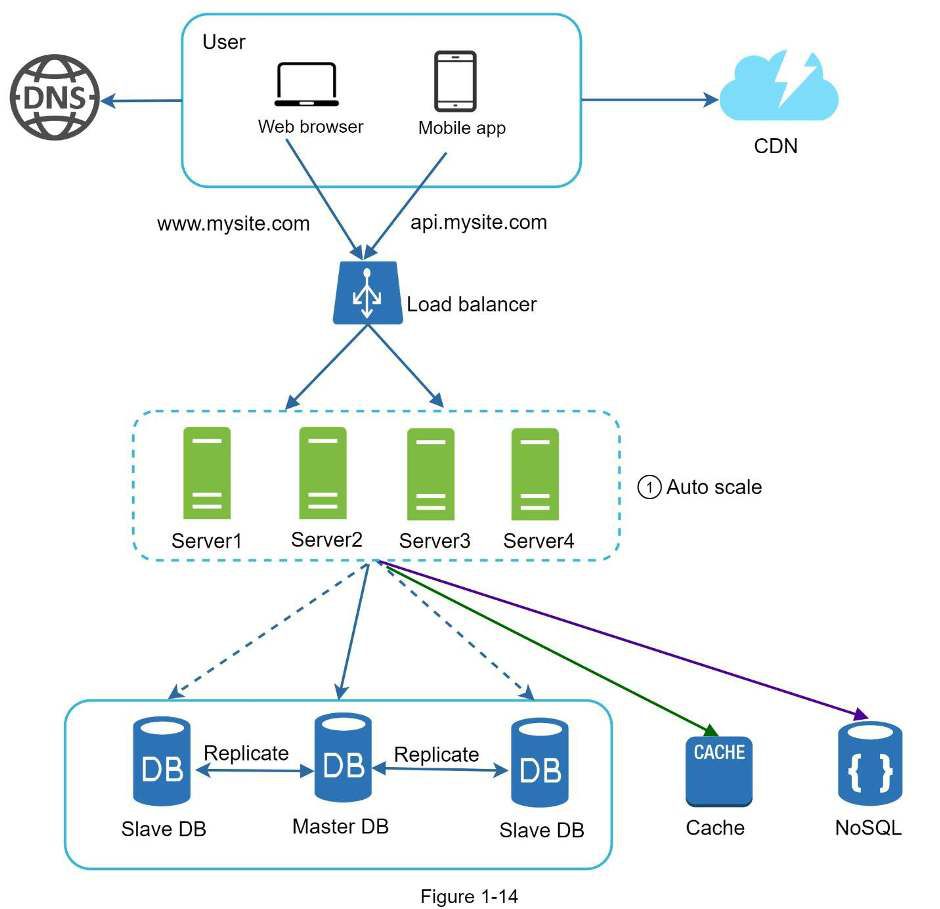

Trong Hình 1-14, chúng ta di chuyển dữ liệu phiên ra khỏi tầng web và lưu trữ chúng trong kho dữ liệu bền vững. Kho dữ liệu dùng chung có thể là cơ sở dữ liệu quan hệ, Memcached/Redis, NoSQL, v.v. Kho dữ liệu NoSQL được lựa chọn vì nó dễ dàng mở rộng. **Tự động mở rộng (Autoscaling)** có nghĩa là tự động thêm hoặc bớt các máy chủ web dựa trên tải lưu lượng truy cập. Sau khi dữ liệu trạng thái đã được loại bỏ khỏi các máy chủ web, việc tự động mở rộng tầng web có thể đạt được dễ dàng bằng cách thêm hoặc bớt máy chủ tùy theo tải lưu lượng.

Trang web của bạn phát triển nhanh chóng và thu hút một lượng lớn người dùng quốc tế. Để cải thiện tính sẵn sàng và mang lại trải nghiệm người dùng tốt hơn trên các khu vực địa lý rộng lớn, việc hỗ trợ **nhiều trung tâm dữ liệu (multiple data centers)** là tối quan trọng.

---

## Trung tâm dữ liệu (Data centers)

Hình 1-15 (Figure 1-15) minh họa một thiết lập ví dụ với hai trung tâm dữ liệu. Trong điều kiện vận hành bình thường, người dùng được định tuyến theo địa lý qua **geoDNS** (còn gọi là geo-routed) đến trung tâm dữ liệu gần nhất, với lưu lượng được phân chia là `x%` ở khu vực Miền Đông Hoa Kỳ (US-East) và `(100 – x)%` ở khu vực Miền Tây Hoa Kỳ (US-West). **geoDNS** là một dịch vụ DNS cho phép phân giải tên miền thành địa chỉ IP dựa trên vị trí địa lý của người dùng.

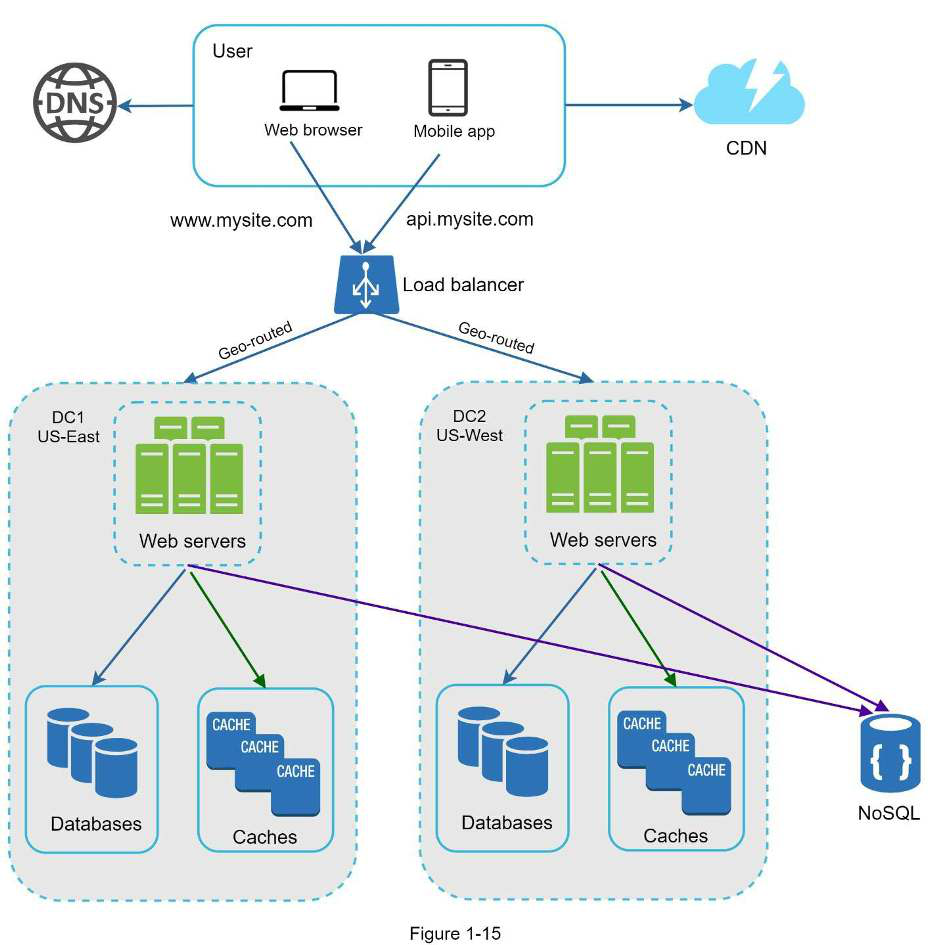

Trong trường hợp xảy ra sự cố nghiêm trọng tại một trung tâm dữ liệu, chúng ta sẽ điều hướng toàn bộ lưu lượng truy cập sang một trung tâm dữ liệu khỏe mạnh. Trong Hình 1-16 (Figure 1-16), trung tâm dữ liệu 2 (US-West) bị ngoại tuyến, và 100% lưu lượng được định tuyến về trung tâm dữ liệu 1 (US-East).

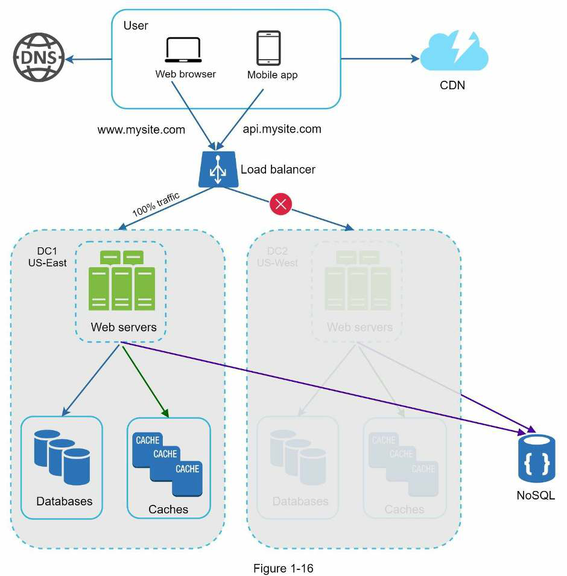

Một số thách thức kỹ thuật cần phải giải quyết để đạt được thiết lập đa trung tâm dữ liệu:

* **Chuyển hướng lưu lượng (Traffic redirection):** Cần có các công cụ hiệu quả để điều hướng lưu lượng đến đúng trung tâm dữ liệu. GeoDNS có thể được sử dụng để điều hướng lưu lượng đến trung tâm dữ liệu gần nhất tùy thuộc vào vị trí của người dùng.
* **Đồng bộ hóa dữ liệu (Data synchronization):** Người dùng từ các khu vực khác nhau có thể sử dụng các cơ sở dữ liệu hoặc bộ nhớ đệm cục bộ khác nhau. Trong các trường hợp chuyển đổi dự phòng (failover), lưu lượng có thể bị định tuyến đến một trung tâm dữ liệu nơi dữ liệu chưa có sẵn. Một chiến lược phổ biến là sao chép dữ liệu qua nhiều trung tâm dữ liệu. Một nghiên cứu trước đây cho thấy cách Netflix triển khai sao chép đa trung tâm dữ liệu bất đồng bộ [11].
* **Kiểm thử và triển khai (Test and deployment):** Với thiết lập đa trung tâm dữ liệu, điều quan trọng là phải kiểm thử trang web/ứng dụng của bạn tại nhiều vị trí khác nhau. Các công cụ triển khai tự động (automated deployment tools) đóng vai trò sống còn để giữ cho các dịch vụ luôn nhất quán trên tất cả các trung tâm dữ liệu [11].

Để tiếp tục mở rộng hệ thống hơn nữa, chúng ta cần **tách rời (decouple)** các thành phần khác nhau của hệ thống để chúng có thể được mở rộng độc lập. **Hàng đợi thông điệp (Messaging queue / Message queue)** là một chiến lược chủ chốt được nhiều hệ thống phân tán thực tế áp dụng để giải quyết bài toán này.

---

## Hàng đợi thông điệp (Message queue)

**Hàng đợi thông điệp (Message queue)** là một thành phần bền vững, được lưu trữ trong bộ nhớ, hỗ trợ giao tiếp bất đồng bộ (asynchronous communication). Nó đóng vai trò như một vùng đệm (buffer) và phân phối các yêu cầu bất đồng bộ. Kiến trúc cơ bản của một hàng đợi thông điệp rất đơn giản. Các dịch vụ đầu vào, được gọi là **nhà sản xuất/nhà phát hành (producers/publishers)**, tạo ra các thông điệp (messages) và đẩy chúng vào hàng đợi thông điệp. Các dịch vụ hoặc máy chủ khác, được gọi là **người tiêu thụ/người đăng ký (consumers/subscribers)**, kết nối với hàng đợi và thực hiện các hành động được định nghĩa trong thông điệp. Mô hình này được minh họa trong Hình 1-17 (Figure 1-17).

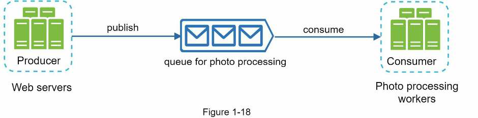

Việc tách rời (decoupling) giúp hàng đợi thông điệp trở thành kiến trúc được ưa chuộng để xây dựng một ứng dụng có khả năng mở rộng và đáng tin cậy. Với hàng đợi thông điệp, producer có thể gửi thông điệp vào hàng đợi ngay cả khi consumer chưa sẵn sàng xử lý nó. Consumer cũng có thể đọc thông điệp từ hàng đợi ngay cả khi producer đang ngoại tuyến.

Hãy xem xét trường hợp sử dụng sau: ứng dụng của bạn hỗ trợ tùy chỉnh ảnh, bao gồm cắt xén (cropping), làm nét (sharpening), làm mờ (blurring), v.v. Những tác vụ tùy chỉnh này tốn thời gian để hoàn thành. Trong Hình 1-18 (Figure 1-18), các máy chủ web đẩy các tác vụ xử lý ảnh vào hàng đợi thông điệp. Các trình xử lý ảnh (**photo processing workers**) lấy tác vụ từ hàng đợi thông điệp và thực hiện tùy chỉnh ảnh một cách bất đồng bộ. Producer và consumer có thể được mở rộng độc lập với nhau. Khi kích thước hàng đợi trở nên lớn, nhiều worker hơn được thêm vào để giảm thời gian xử lý. Ngược lại, nếu hàng đợi trống hầu hết thời gian, số lượng worker có thể được giảm bớt.

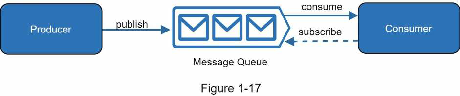

> 💡 **Ví dụ bổ sung (không có trong sách):** Các hệ thống hàng đợi thông điệp phổ biến trong thực tế bao gồm **Apache Kafka**, **RabbitMQ**, và **Amazon SQS**. Chẳng hạn, khi người dùng nhấn "Đặt hàng" trên sàn thương mại điện tử, máy chủ web chỉ cần ghi đơn hàng vào DB và đẩy sự kiện `OrderCreated` vào Kafka, rồi trả về phản hồi thành công ngay lập tức; các dịch vụ gửi email xác nhận, tạo hóa đơn và cập nhật điểm thưởng (consumers) sẽ tự động lấy sự kiện đó để xử lý ngầm mà không làm người dùng phải chờ đợi.

---

## Nhật ký, chỉ số và tự động hóa (Logging, metrics, automation)

Khi làm việc với một trang web nhỏ chạy trên vài máy chủ, việc hỗ trợ ghi nhật ký (logging), thu thập chỉ số (metrics) và tự động hóa (automation) là những thực hành tốt nhưng chưa phải là bắt buộc. Tuy nhiên, giờ đây khi trang web của bạn đã phát triển để phục vụ một doanh nghiệp lớn, việc đầu tư vào các công cụ này là điều thiết yếu.

* **Ghi nhật ký (Logging):** Theo dõi nhật ký lỗi (error logs) rất quan trọng vì nó giúp xác định lỗi và các vấn đề trong hệ thống. Bạn có thể theo dõi nhật ký lỗi ở cấp độ từng máy chủ hoặc sử dụng các công cụ để tổng hợp chúng về một dịch vụ tập trung nhằm dễ dàng tìm kiếm và xem xét.
* **Chỉ số (Metrics):** Thu thập các loại chỉ số khác nhau giúp chúng ta có được thông tin chi tiết về mặt kinh doanh (business insights) và nắm bắt tình trạng sức khỏe của hệ thống. Một số chỉ số hữu ích bao gồm:
  * **Chỉ số cấp máy chủ (Host level metrics):** CPU, Bộ nhớ (Memory), vào/ra đĩa (disk I/O), v.v.
  * **Chỉ số cấp tổng hợp (Aggregated level metrics):** ví dụ như hiệu năng của toàn bộ tầng cơ sở dữ liệu, tầng bộ nhớ đệm, v.v.
  * **Chỉ số kinh doanh cốt lõi (Key business metrics):** số người dùng hoạt động hàng ngày (DAU — daily active users), tỷ lệ giữ chân người dùng (retention), doanh thu (revenue), v.v.
* **Tự động hóa (Automation):** Khi một hệ thống trở nên lớn và phức tạp, chúng ta cần xây dựng hoặc tận dụng các công cụ tự động hóa để cải thiện năng suất. **Tích hợp liên tục — CI (Continuous integration)** là một thực hành tốt, trong đó mỗi lần đẩy mã nguồn mới (code check-in) đều được kiểm chứng thông qua tự động hóa, cho phép các nhóm phát triển phát hiện sự cố sớm. Bên cạnh đó, tự động hóa quy trình dựng (build), kiểm thử (test), triển khai (deploy), v.v. có thể cải thiện đáng kể năng suất của lập trình viên.

### Bổ sung hàng đợi thông điệp và các công cụ khác (Adding message queues and different tools)

Hình 1-19 (Figure 1-19) minh họa thiết kế đã được cập nhật. Do giới hạn không gian, chỉ một trung tâm dữ liệu được hiển thị trong hình.

1. Thiết kế bao gồm một hàng đợi thông điệp, giúp hệ thống giảm sự phụ thuộc chéo (more loosely coupled) và tăng khả năng chống chịu lỗi (failure resilient).
2. Các công cụ ghi nhật ký, giám sát (monitoring), thu thập chỉ số và tự động hóa đã được tích hợp vào hệ thống.

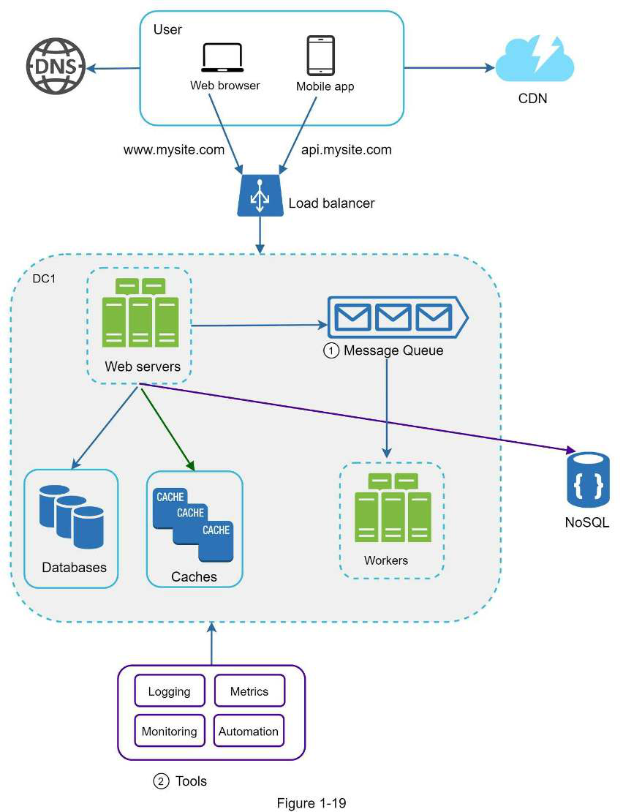

Khi dữ liệu tăng lên mỗi ngày, cơ sở dữ liệu của bạn ngày càng trở nên quá tải. Đã đến lúc mở rộng tầng dữ liệu.

---

## Mở rộng cơ sở dữ liệu (Database scaling)

Có hai hướng tiếp cận tổng quát để mở rộng cơ sở dữ liệu: mở rộng theo chiều dọc (vertical scaling) và mở rộng theo chiều ngang (horizontal scaling).

### Mở rộng theo chiều dọc (Vertical scaling)

Mở rộng theo chiều dọc, còn được gọi là **scaling up**, là việc mở rộng bằng cách thêm nhiều sức mạnh hơn (CPU, RAM, Ổ đĩa, v.v.) vào một máy chủ hiện có. Hiện có những máy chủ cơ sở dữ liệu cực kỳ mạnh mẽ. Theo Amazon Relational Database Service (RDS) [12], bạn có thể thuê một máy chủ cơ sở dữ liệu với **24 TB RAM**. Loại máy chủ cơ sở dữ liệu mạnh mẽ này có thể lưu trữ và xử lý lượng dữ liệu rất lớn. Ví dụ, `stackoverflow.com` vào năm 2013 có hơn 10 triệu lượt khách truy cập duy nhất mỗi tháng, nhưng nó chỉ có 1 cơ sở dữ liệu chủ (master database) duy nhất [13]. Tuy nhiên, mở rộng theo chiều dọc đi kèm với một số nhược điểm nghiêm trọng:

* Bạn có thể thêm CPU, RAM, v.v. vào máy chủ cơ sở dữ liệu, nhưng vẫn có giới hạn phần cứng. Nếu bạn có lượng người dùng khổng lồ, một máy chủ đơn lẻ là không đủ.
* Nguy cơ cao hơn về điểm lỗi đơn (single point of failures).
* Tổng chi phí của việc mở rộng theo chiều dọc rất cao. Các máy chủ cấu hình siêu mạnh có giá đắt đỏ hơn rất nhiều.

### Mở rộng theo chiều ngang (Horizontal scaling)

Mở rộng theo chiều ngang, còn được gọi là **phân mảnh dữ liệu (sharding)**, là thực hành thêm nhiều máy chủ hơn. Hình 1-20 (Figure 1-20) so sánh mở rộng theo chiều dọc với mở rộng theo chiều ngang.

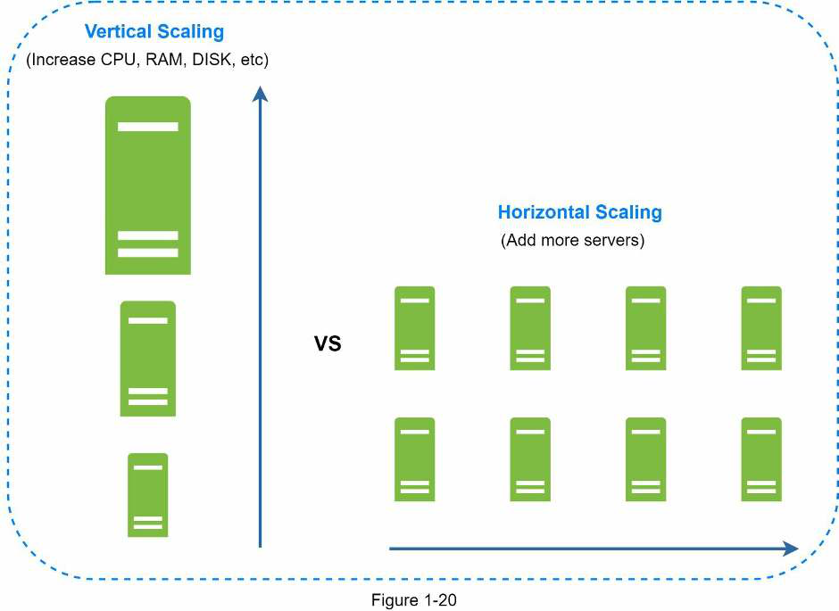

**Sharding** chia tách các cơ sở dữ liệu lớn thành các phần nhỏ hơn, dễ quản lý hơn gọi là các **shard** (phân mảnh). Mỗi shard đều chia sẻ cùng một lược đồ cấu trúc bảng (**schema**), mặc dù dữ liệu thực tế trên mỗi shard là duy nhất đối với shard đó.

Hình 1-21 (Figure 1-21) minh họa một ví dụ về các cơ sở dữ liệu đã được phân mảnh. Dữ liệu người dùng được phân bổ vào một máy chủ cơ sở dữ liệu dựa trên ID người dùng (`user_id`). Bất cứ khi nào bạn truy cập dữ liệu, một **hàm băm (hash function)** được sử dụng để tìm ra shard tương ứng. Trong ví dụ của chúng ta, `user_id % 4` được dùng làm hàm băm. Nếu kết quả bằng 0, shard 0 được dùng để lưu trữ và lấy dữ liệu. Nếu kết quả bằng 1, shard 1 được sử dụng. Logic tương tự áp dụng cho các shard khác.

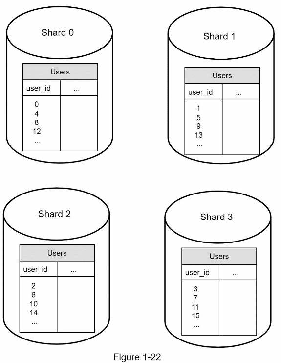

Hình 1-22 (Figure 1-22) minh họa bảng `user` trong các cơ sở dữ liệu đã được phân mảnh.

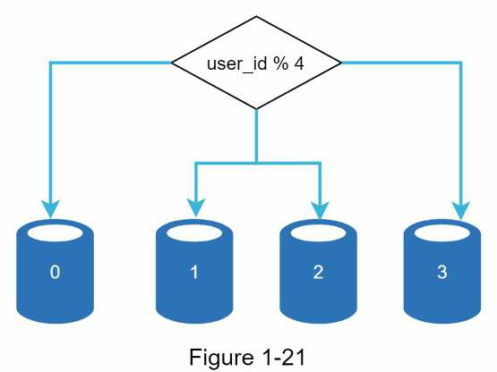

Yếu tố quan trọng nhất cần cân nhắc khi triển khai một chiến lược sharding là việc lựa chọn **khóa phân mảnh (sharding key)**. Khóa phân mảnh (còn gọi là **khóa phân vùng — partition key**) bao gồm một hoặc nhiều cột quyết định cách dữ liệu được phân phối. Như thể hiện trong Hình 1-22, `user_id` là khóa phân mảnh. Một khóa phân mảnh cho phép bạn truy xuất và sửa đổi dữ liệu hiệu quả bằng cách định tuyến các truy vấn cơ sở dữ liệu đến đúng máy chủ cơ sở dữ liệu. Khi lựa chọn khóa phân mảnh, một trong những tiêu chí quan trọng nhất là chọn một khóa có thể **phân phối dữ liệu đồng đều**.

Sharding là một kỹ thuật tuyệt vời để mở rộng cơ sở dữ liệu nhưng nó hoàn toàn không phải là giải pháp hoàn hảo. Nó đưa thêm sự phức tạp và các thách thức mới vào hệ thống:

* **Phân mảnh lại dữ liệu (Resharding data):** Việc phân mảnh lại dữ liệu là cần thiết khi: 1) một shard đơn lẻ không thể chứa thêm dữ liệu do tăng trưởng quá nhanh; 2) Một số shard nhất định có thể gặp tình trạng cạn kiệt dung lượng (**shard exhaustion**) nhanh hơn các shard khác do phân phối dữ liệu không đều. Khi tình trạng cạn kiệt shard xảy ra, nó đòi hỏi phải cập nhật hàm băm phân mảnh và di chuyển dữ liệu qua lại giữa các shard. **Băm nhất quán (Consistent hashing)**, sẽ được thảo luận trong Chương 5, là một kỹ thuật phổ biến được dùng để giải quyết vấn đề này.
* **Vấn đề người nổi tiếng (Celebrity problem):** Đây còn được gọi là **vấn đề khóa điểm nóng (hotspot key problem)**. Việc truy cập quá mức vào một shard cụ thể có thể gây quá tải máy chủ. Hãy tưởng tượng dữ liệu của Katy Perry, Justin Bieber và Lady Gaga đều rơi vào cùng một shard. Đối với các ứng dụng mạng xã hội, shard đó sẽ bị quá tải bởi các thao tác đọc. Để giải quyết vấn đề này, chúng ta có thể cần cấp phát riêng một shard cho mỗi người nổi tiếng. Mỗi shard thậm chí có thể đòi hỏi phải phân chia nhỏ hơn nữa.
* **Phép nối và phi chuẩn hóa (Join and de-normalization):** Một khi cơ sở dữ liệu đã được phân mảnh qua nhiều máy chủ, việc thực hiện các phép nối (`JOIN`) xuyên suốt giữa các shard cơ sở dữ liệu trở nên rất khó khăn. Một giải pháp thay thế phổ biến là **phi chuẩn hóa (de-normalize)** cơ sở dữ liệu để các truy vấn có thể được thực hiện chỉ trong một bảng duy nhất.

Trong Hình 1-23 (Figure 1-23), chúng ta thực hiện sharding các cơ sở dữ liệu để hỗ trợ lưu lượng dữ liệu tăng nhanh. Đồng thời, một số chức năng phi quan hệ được chuyển sang kho dữ liệu NoSQL để giảm tải cho cơ sở dữ liệu. Đây là một bài viết đề cập đến nhiều trường hợp sử dụng của NoSQL [14].

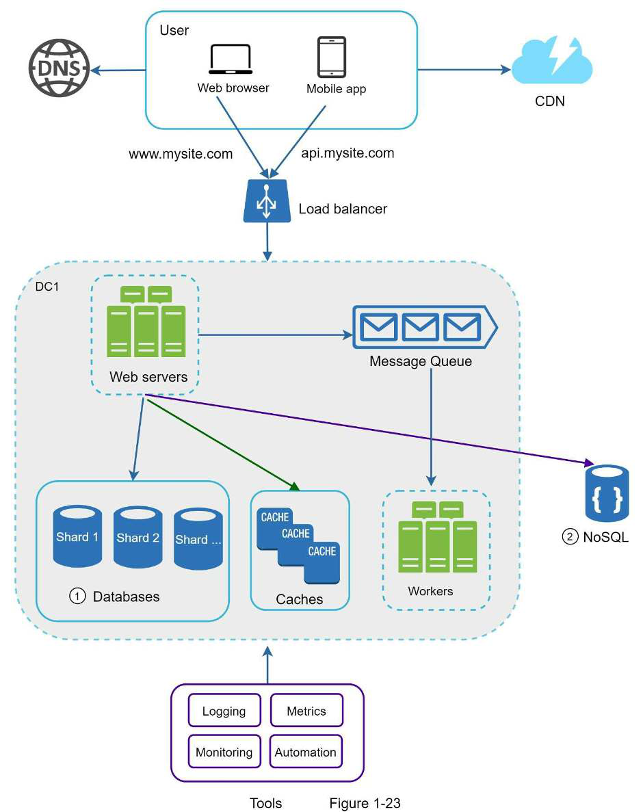

---

## Hàng triệu người dùng và hơn thế nữa (Millions of users and beyond)

Mở rộng một hệ thống là một quá trình lặp đi lặp lại (iterative process). Việc lặp lại và áp dụng những gì chúng ta đã học trong chương này có thể đưa chúng ta đi rất xa. Cần có thêm sự tinh chỉnh kỹ lưỡng và các chiến lược mới để mở rộng vượt ra ngoài quy mô hàng triệu người dùng. Chẳng hạn, bạn có thể cần tối ưu hóa hệ thống và tách nhỏ hệ thống thành các dịch vụ nhỏ hơn nữa (microservices). Tất cả các kỹ thuật đã học trong chương này sẽ cung cấp một nền tảng vững chắc để giải quyết những thách thức mới. Để kết thúc chương này, chúng ta tóm tắt lại cách mở rộng hệ thống để hỗ trợ hàng triệu người dùng:

* Giữ cho tầng web phi trạng thái (**Keep web tier stateless**)
* Xây dựng tính dự phòng ở mọi tầng (**Build redundancy at every tier**)
* Lưu đệm dữ liệu nhiều nhất có thể (**Cache data as much as you can**)
* Hỗ trợ nhiều trung tâm dữ liệu (**Support multiple data centers**)
* Lưu trữ tài nguyên tĩnh trên CDN (**Host static assets in CDN**)
* Mở rộng tầng dữ liệu bằng kỹ thuật phân mảnh (**Scale your data tier by sharding**)
* Chia nhỏ các tầng thành các dịch vụ riêng lẻ (**Split tiers into individual services**)
* Giám sát hệ thống và sử dụng các công cụ tự động hóa (**Monitor your system and use automation tools**)

Chúc mừng bạn đã đi được đến đây! Giờ hãy tự thưởng cho mình một cái vỗ vai khích lệ. Làm tốt lắm!

---

## Tài liệu tham khảo (Reference materials)

1. Hypertext Transfer Protocol: https://en.wikipedia.org/wiki/Hypertext_Transfer_Protocol
2. Should you go Beyond Relational Databases?: https://blog.teamtreehouse.com/should-you-go-beyond-relational-databases
3. Replication: https://en.wikipedia.org/wiki/Replication_(computing)
4. Multi-master replication: https://en.wikipedia.org/wiki/Multi-master_replication
5. NDB Cluster Replication: Multi-Master and Circular Replication: https://dev.mysql.com/doc/refman/5.7/en/mysql-cluster-replication-multi-master.html
6. Caching Strategies and How to Choose the Right One: https://codeahoy.com/2017/08/11/caching-strategies-and-how-to-choose-the-right-one/
7. R. Nishtala, "Facebook, Scaling Memcache at," 10th USENIX Symposium on Networked Systems Design and Implementation (NSDI ’13).
8. Single point of failure: https://en.wikipedia.org/wiki/Single_point_of_failure
9. Amazon CloudFront Dynamic Content Delivery: https://aws.amazon.com/cloudfront/dynamic-content/
10. Configure Sticky Sessions for Your Classic Load Balancer: https://docs.aws.amazon.com/elasticloadbalancing/latest/classic/elb-sticky-sessions.html
11. Active-Active for Multi-Regional Resiliency: https://netflixtechblog.com/active-active-for-multi-regional-resiliency-c47719f6685b
12. Amazon EC2 High Memory Instances: https://aws.amazon.com/ec2/instance-types/high-memory/
13. What it takes to run Stack Overflow: http://nickcraver.com/blog/2013/11/22/what-it-takes-to-run-stack-overflow
14. What The Heck Are You Actually Using NoSQL For: http://highscalability.com/blog/2010/12/6/what-the-heck-are-you-actually-using-nosql-

---

## Bảng thuật ngữ chương (Chapter Glossary)

| Thuật ngữ (English) | Tiếng Việt | Giải thích ngắn gọn |
| :--- | :--- | :--- |
| **Vertical Scaling (Scale Up)** | Mở rộng theo chiều dọc | Tăng thêm tài nguyên (CPU, RAM, ổ đĩa) cho một máy chủ hiện có. |
| **Horizontal Scaling (Scale Out)** | Mở rộng theo chiều ngang | Thêm nhiều máy chủ mới vào hệ thống để chia sẻ tải. |
| **Load Balancer** | Bộ cân bằng tải | Thiết bị/dịch vụ phân phối đều lưu lượng truy cập đến các máy chủ web phía sau. |
| **Database Replication** | Sao chép cơ sở dữ liệu | Tạo bản sao dữ liệu từ máy chủ chính (master) sang các máy chủ phụ (slave) để tăng độ tin cậy và hiệu năng đọc. |
| **Cache** | Bộ nhớ đệm | Vùng lưu trữ tạm thời tốc độ cao (thường trên RAM) cho dữ liệu được truy cập thường xuyên. |
| **CDN (Content Delivery Network)** | Mạng phân phối nội dung | Mạng lưới máy chủ phân tán địa lý giúp phân phối nội dung tĩnh (ảnh, video, CSS, JS) nhanh chóng đến người dùng gần nhất. |
| **Stateless Web Tier** | Tầng web phi trạng thái | Kiến trúc máy chủ web không lưu dữ liệu phiên (session) cục bộ, giúp dễ dàng tự động mở rộng (auto-scaling). |
| **Message Queue** | Hàng đợi thông điệp | Thành phần trung gian hỗ trợ giao tiếp bất đồng bộ, tách rời producer và consumer. |
| **Sharding** | Phân mảnh dữ liệu | Kỹ thuật chia cơ sở dữ liệu lớn thành các phần nhỏ hơn (shards) đặt trên nhiều máy chủ dựa trên sharding key. |
| **SPOF (Single Point of Failure)** | Điểm lỗi đơn | Thành phần duy nhất trong hệ thống mà nếu nó hỏng sẽ làm toàn bộ hệ thống ngừng hoạt động. |
