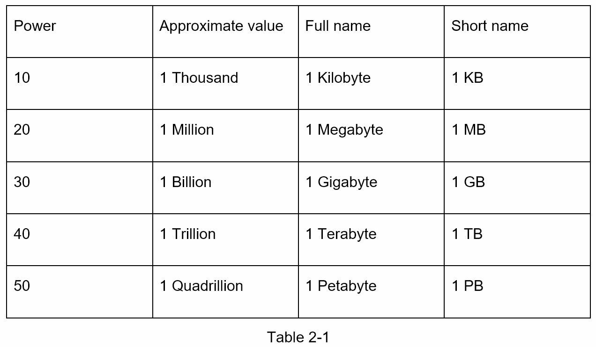
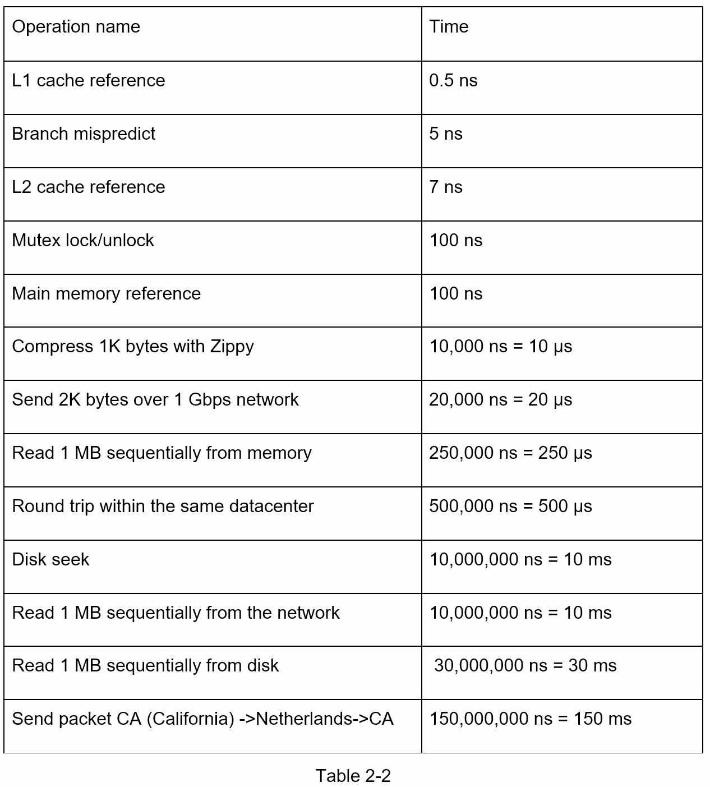
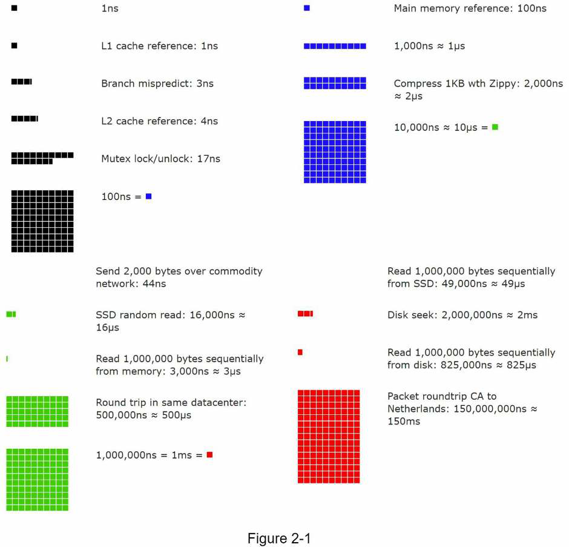
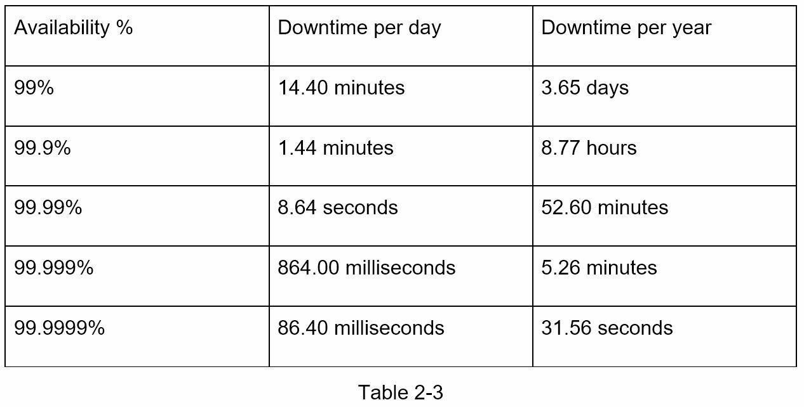

# CHƯƠNG 2: ƯỚC LƯỢNG NHANH (CHAPTER 2: BACK-OF-THE-ENVELOPE ESTIMATION)

Trong một buổi phỏng vấn thiết kế hệ thống (system design interview), đôi khi bạn được yêu cầu ước lượng năng lực hệ thống (system capacity) hoặc các yêu cầu hiệu năng (performance requirements) bằng phương pháp **ước lượng nhanh** (back-of-the-envelope estimation). Theo Jeff Dean, Senior Fellow tại Google, "ước lượng nhanh là những con số ước tính bạn tạo ra bằng cách kết hợp giữa suy luận tư duy (thought experiments) và các con số hiệu năng phổ biến để có cái nhìn rõ ràng xem thiết kế nào sẽ đáp ứng được các yêu cầu của bạn" [1].

Bạn cần nắm vững các kiến thức cơ bản về khả năng mở rộng (scalability) để thực hiện ước lượng nhanh một cách hiệu quả. Các khái niệm sau đây cần được hiểu thật rõ: lũy thừa của 2 (power of two) [2], các con số độ trễ mà mọi lập trình viên nên biết (latency numbers every programmer should know), và các con số về tính sẵn sàng (availability numbers).

> 📝 **Giải thích thêm (không có trong sách):** Thuật ngữ *back-of-the-envelope* xuất phát từ thói quen của các kỹ sư khi cần tính toán nhanh một bài toán quy mô ngay trên mặt sau của một chiếc phong bì chỉ trong vài phút, không cần máy tính hay bảng tính phức tạp. Mục tiêu không phải là ra con số chính xác tuyệt đối đến từng byte hay từng mili-giây, mà là xác định **bậc độ lớn** (order of magnitude) — ví dụ: hệ thống cần 10 GB hay 10 TB lưu trữ, cần 1 server hay 100 server.

---

## Lũy thừa của 2 (Power of two)

Mặc dù khối lượng dữ liệu có thể trở nên khổng lồ khi làm việc với các hệ thống phân tán (distributed systems), mọi phép tính đều quy về những kiến thức cơ bản. Để tính toán chính xác, điều tối quan trọng là phải nắm được đơn vị đo khối lượng dữ liệu sử dụng lũy thừa của 2. Một byte là một chuỗi gồm 8 bit. Một ký tự ASCII sử dụng một byte bộ nhớ (8 bit). Dưới đây là bảng giải thích các đơn vị khối lượng dữ liệu (Bảng 2-1 / Table 2-1).

*Bảng 2-1 (Table 2-1): Quy đổi lũy thừa của 2 sang giá trị xấp xỉ và đơn vị lưu trữ.*

| Lũy thừa (Power) | Giá trị xấp xỉ (Approximate value) | Tên đầy đủ (Full name) | Tên viết tắt (Short name) |
| :--- | :--- | :--- | :--- |
| $2^{10}$ | 1 Nghìn (1 Thousand) | 1 Kilobyte | 1 KB |
| $2^{20}$ | 1 Triệu (1 Million) | 1 Megabyte | 1 MB |
| $2^{30}$ | 1 Tỷ (1 Billion) | 1 Gigabyte | 1 GB |
| $2^{40}$ | 1 Nghìn tỷ (1 Trillion) | 1 Terabyte | 1 TB |
| $2^{50}$ | 1 Triệu tỷ (1 Quadrillion) | 1 Petabyte | 1 PB |

> 💡 **Ví dụ bổ sung (không có trong sách):** Cách nhớ nhanh trong phỏng vấn: cứ mỗi lần số mũ của 2 tăng thêm 10, đơn vị tăng lên 1.000 lần (chính xác là $2^{10} = 1024 \approx 10^3$).
> - Một bản ghi thông tin người dùng cơ bản (user_id, email, tên, ngày tạo...) thường tốn khoảng ~100–500 bytes, làm tròn thành **1 KB** để dễ tính.
> - Nếu hệ thống có **100 triệu** người dùng ($10^8$): dung lượng lưu trữ danh sách người dùng $\approx 10^8 \times 1\text{ KB} = 10^{11}\text{ bytes} = 100\text{ GB}$.
> - Việc quy đổi nhanh $10^3 = \text{KB}$, $10^6 = \text{MB}$, $10^9 = \text{GB}$, $10^{12} = \text{TB}$, $10^{15} = \text{PB}$ giúp bạn nhẩm ra dung lượng chỉ trong vài giây.

---

## Các con số độ trễ mà mọi lập trình viên nên biết (Latency numbers every programmer should know)

Tiến sĩ Jeff Dean từ Google đã công bố thời gian thực thi của các tác vụ máy tính điển hình vào năm 2010 [1]. Một số con số đã lỗi thời khi máy tính ngày càng nhanh và mạnh hơn. Tuy nhiên, những con số đó vẫn giúp chúng ta hình dung được mức độ nhanh và chậm tương đối giữa các tác vụ máy tính khác nhau.

**Ghi chú (Notes):**
- `ns` = nanosecond (na-nô giây), `µs` = microsecond (mi-crô giây), `ms` = millisecond (mi-li giây)
- $1\text{ ns} = 10^{-9}\text{ giây}$
- $1\text{ µs} = 10^{-6}\text{ giây} = 1.000\text{ ns}$
- $1\text{ ms} = 10^{-3}\text{ giây} = 1.000\text{ µs} = 1.000.000\text{ ns}$

*Bảng 2-2 (Table 2-2): Thời gian thực thi các tác vụ máy tính phổ biến.*

| Tên tác vụ (Operation name) | Thời gian (Time) |
| :--- | :--- |
| Truy cập L1 cache (L1 cache reference) | 0.5 ns |
| Dự đoán sai rẽ nhánh (Branch mispredict) | 5 ns |
| Truy cập L2 cache (L2 cache reference) | 7 ns |
| Khóa/mở khóa Mutex (Mutex lock/unlock) | 100 ns |
| Truy cập bộ nhớ chính RAM (Main memory reference) | 100 ns |
| Nén 1K bytes bằng Zippy (Compress 1K bytes with Zippy) | 10.000 ns = 10 µs |
| Gửi 2K bytes qua mạng 1 Gbps (Send 2K bytes over 1 Gbps network) | 20.000 ns = 20 µs |
| Đọc tuần tự 1 MB từ bộ nhớ RAM (Read 1 MB sequentially from memory) | 250.000 ns = 250 µs |
| Vòng lặp khứ hồi trong cùng trung tâm dữ liệu (Round trip within the same datacenter) | 500.000 ns = 500 µs |
| Tìm kiếm trên đĩa cứng HDD (Disk seek) | 10.000.000 ns = 10 ms |
| Đọc tuần tự 1 MB từ mạng (Read 1 MB sequentially from the network) | 10.000.000 ns = 10 ms |
| Đọc tuần tự 1 MB từ đĩa cứng (Read 1 MB sequentially from disk) | 30.000.000 ns = 30 ms |
| Gửi gói tin từ CA (California) -> Hà Lan -> CA (Send packet CA -> Netherlands -> CA) | 150.000.000 ns = 150 ms |

Một kỹ sư phần mềm tại Google đã xây dựng một công cụ để trực quan hóa các con số của Tiến sĩ Dean. Công cụ này cũng có tính đến yếu tố thời gian. Hình 2-1 (Figure 2-1) hiển thị các con số độ trễ được trực quan hóa tính đến năm 2020 (nguồn hình ảnh: tài liệu tham khảo [3]).

Bằng cách phân tích các con số trong Hình 2-1 (Figure 2-1), chúng ta rút ra các kết luận sau:
- Bộ nhớ (memory) rất nhanh nhưng đĩa cứng (disk) thì chậm.
- Tránh thao tác tìm kiếm trên đĩa (disk seeks) nếu có thể.
- Các thuật toán nén đơn giản (simple compression algorithms) chạy rất nhanh.
- Nên nén dữ liệu trước khi gửi qua internet nếu có thể.
- Các trung tâm dữ liệu (data centers) thường nằm ở các khu vực địa lý khác nhau, và việc gửi dữ liệu qua lại giữa chúng sẽ tốn thời gian.

*Hình 2-1 (Figure 2-1): Trực quan hóa sự chênh lệch độ trễ giữa các tác vụ tính đến năm 2020 (mỗi ô vuông đen = 1 ns, xanh dương = 100 ns, xanh lá = 10 µs, đỏ = 1 ms).*

> 📝 **Giải thích thêm (không có trong sách):** Nếu quy đổi theo tỷ lệ thời gian đời thực để dễ cảm nhận (giả sử `1 ns` = `1 giây`):
> - Truy cập **L1 cache** (0.5–1 ns): ~1 giây (lấy thứ gì đó ngay trên bàn làm việc).
> - Truy cập **RAM** (100 ns): ~100 giây (~1.5 phút — đi sang phòng bên cạnh lấy tài liệu).
> - Đọc ngẫu nhiên **SSD** (16 µs): ~4.4 giờ.
> - **Round-trip trong cùng datacenter** (500 µs): ~5.8 ngày.
> - **Disk seek trên HDD** (2–10 ms): ~23 đến 115 ngày!
> - **Gửi gói tin xuyên lục địa CA ↔ Hà Lan** (150 ms): ~4.75 năm!
>
> Đó là lý do tại sao trong thiết kế hệ thống:
> 1. Ta luôn dùng **Cache (Redis/Memcached)** để phục vụ dữ liệu nóng từ RAM thay vì truy vấn xuống đĩa.
> 2. Ta đặt **CDN** và **multi-region data centers** gần người dùng để giảm độ trễ mạng xuyên lục địa (150 ms).
> 3. Các cơ sở dữ liệu tối ưu ghi (như LSM-tree trong Cassandra, RocksDB) biến thao tác ghi ngẫu nhiên thành **ghi tuần tự** (sequential write) để tránh `disk seek`.

---

## Các con số về tính sẵn sàng (Availability numbers)

Tính sẵn sàng cao (high availability) là khả năng của một hệ thống có thể hoạt động liên tục trong một khoảng thời gian dài như mong muốn. Tính sẵn sàng cao được đo bằng tỷ lệ phần trăm, trong đó 100% nghĩa là dịch vụ có thời gian ngừng hoạt động (downtime) bằng 0. Hầu hết các dịch vụ đạt mức từ 99% đến 100%.

Thỏa thuận mức dịch vụ — **SLA (Service Level Agreement)** — là một thuật ngữ phổ biến đối với các nhà cung cấp dịch vụ. Đây là bản thỏa thuận giữa bạn (nhà cung cấp dịch vụ) và khách hàng của bạn, trong đó định nghĩa chính thức mức thời gian hoạt động (uptime) mà dịch vụ của bạn sẽ cam kết cung cấp. Các nhà cung cấp điện toán đám mây như Amazon [4], Google [5] và Microsoft [6] đặt mức SLA của họ ở mức 99.9% trở lên. Thời gian hoạt động (uptime) theo truyền thống được đo bằng "số chữ số 9" (nines). Càng nhiều chữ số 9 thì càng tốt. Như được thể hiện trong Bảng 2-3 (Table 2-3), số lượng chữ số 9 tương ứng trực tiếp với thời gian ngừng hoạt động dự kiến của hệ thống.

*Bảng 2-3 (Table 2-3): Mối tương quan giữa phần trăm tính sẵn sàng (số chữ số 9) và thời gian ngừng hoạt động mỗi ngày / mỗi năm.*

| Tính sẵn sàng (Availability %) | Downtime mỗi ngày (Downtime per day) | Downtime mỗi năm (Downtime per year) |
| :--- | :--- | :--- |
| 99% (2 nines) | 14.40 phút | 3.65 ngày |
| 99.9% (3 nines) | 1.44 phút | 8.77 giờ |
| 99.99% (4 nines) | 8.64 giây | 52.60 phút |
| 99.999% (5 nines) | 864.00 mili-giây | 5.26 phút |
| 99.9999% (6 nines) | 86.40 mili-giây | 31.56 giây |

> 📝 **Giải thích thêm (không có trong sách):** Cách tính nhanh bảng trên:
> - 1 ngày có $24 \times 60 = 1.440$ phút $= 86.400$ giây.
> - Với **99%**, hệ thống được phép lỗi **1%** thời gian $\rightarrow 1\% \times 1.440 = 14.4$ phút/ngày.
> - Với **99.9%**, được phép lỗi **0.1%** $\rightarrow 1.44$ phút/ngày.
> - Với **99.99%**, được phép lỗi **0.01%** $\rightarrow 0.0001 \times 86.400 = 8.64$ giây/ngày.
>
> Lưu ý thực tế: Đạt được **5 nines (99.999%)** cực kỳ tốn kém vì chỉ 5.26 phút downtime mỗi năm đã bao gồm cả thời gian nâng cấp hệ thống, lỗi mạng, lỗi phần cứng và thời gian phát hiện + khôi phục sự cố (failover). Do đó, phần lớn các hệ thống thương mại chỉ cam kết 99.9% hoặc 99.95% ở tầng ứng dụng, còn 99.999% thường dành cho hạ tầng lõi (như DNS, hệ thống thanh toán ngân hàng, viễn thông).

---

## Ví dụ: Ước lượng QPS và nhu cầu lưu trữ của Twitter (Example: Estimate Twitter QPS and storage requirements)

Xin lưu ý rằng các con số dưới đây chỉ dùng cho bài tập này vì chúng không phải là số liệu thực tế từ Twitter.

**Các giả định (Assumptions):**
- 300 triệu người dùng hoạt động hàng tháng (monthly active users - MAU).
- 50% người dùng sử dụng Twitter hàng ngày.
- Trung bình mỗi người dùng đăng 2 tweet mỗi ngày.
- 10% số tweet có chứa phương tiện truyền thông (media — ảnh, video).
- Dữ liệu được lưu trữ trong 5 năm.

**Các phép ước lượng (Estimations):**

Ước lượng số truy vấn mỗi giây — **QPS (Query per second)**:
- Người dùng hoạt động hàng ngày (**DAU - Daily active users**) = $300\text{ triệu} \times 50\% = 150\text{ triệu}$
- **Tweets QPS** = $150\text{ triệu} \times 2\text{ tweets} / 24\text{ giờ} / 3600\text{ giây} = \sim 3.500$
- **Peak QPS** (lưu lượng lúc cao điểm) = $2 \times \text{QPS} = \sim 7.000$

Ở đây chúng ta sẽ chỉ ước lượng dung lượng lưu trữ media:
- Kích thước trung bình của một tweet:
  - `tweet_id`: 64 bytes
  - `text`: 140 bytes
  - `media`: 1 MB
- **Dung lượng lưu trữ media mỗi ngày** = $150\text{ triệu} \times 2 \times 10\% \times 1\text{ MB} = 30\text{ TB mỗi ngày}$
- **Dung lượng lưu trữ media trong 5 năm** = $30\text{ TB} \times 365 \times 5 = \sim 55\text{ PB}$

> 💡 **Ví dụ bổ sung (không có trong sách):** Làm sao nhẩm nhanh phép chia $300\text{ triệu} / 86.400$ mà không cần máy tính trong phỏng vấn?
> - Một ngày có $24 \times 3600 = 86.400\text{ giây}$. Hãy làm tròn thành **$100.000\text{ giây}$ ($10^5$)**!
> - Khi đó: $300\text{ triệu} / 100.000 = 3.000\text{ QPS}$ (sai số chỉ khoảng ~14% so với 3.472, hoàn toàn chấp nhận được trong ước lượng bậc độ lớn).
> - Nếu muốn ước lượng luôn dung lượng **text + metadata** cho các tweet (phần mà sách bỏ qua):
>   - Mỗi tweet có `tweet_id` (64 B) + `text` (140 B) $\approx 200\text{ bytes}$ (hoặc làm tròn 250 B / 1 KB nếu tính thêm index và metadata khác).
>   - Với 300 triệu tweet/ngày: $300 \times 10^6 \times 200\text{ bytes} = 60 \times 10^9\text{ bytes} = 60\text{ GB/ngày}$.
>   - Trong 5 năm: $60\text{ GB} \times 365 \times 5 \approx 110\text{ TB}$ — rất nhỏ so với 55 PB của media! Điều này giúp bạn đưa ra quyết định kiến trúc ngay lập tức: *text/metadata lưu trong Database (sharded SQL/NoSQL), còn media (55 PB) bắt buộc phải đẩy lên Object Storage (như Amazon S3) kết hợp CDN.*

---

## Mẹo ước lượng (Tips)

Ước lượng nhanh (back-of-the-envelope estimation) là câu chuyện về **quy trình tư duy**. Cách bạn giải quyết bài toán quan trọng hơn là việc ra được con số chính xác tuyệt đối. Người phỏng vấn muốn kiểm tra kỹ năng giải quyết vấn đề của bạn. Dưới đây là một vài mẹo bạn nên áp dụng:

- **Làm tròn và xấp xỉ (Rounding and Approximation):** Rất khó để thực hiện các phép toán phức tạp trong lúc phỏng vấn. Ví dụ, kết quả của "99987 / 9.1" là bao nhiêu? Không cần phải lãng phí thời gian quý báu để giải các bài toán phức tạp. Sự chính xác tuyệt đối không được kỳ vọng ở đây. Hãy tận dụng các con số tròn và phép xấp xỉ. Phép chia trên có thể được đơn giản hóa thành: "100.000 / 10".
- **Viết ra các giả định của bạn (Write down your assumptions):** Bạn nên ghi chép rõ ràng các giả định của mình ra giấy/bảng để có thể đối chiếu lại về sau.
- **Ghi rõ đơn vị (Label your units):** Khi bạn viết xuống số "5", nó có nghĩa là 5 KB hay 5 MB? Chính bạn cũng có thể tự làm mình bối rối với điều này. Hãy luôn viết kèm đơn vị vì "5 MB" giúp loại bỏ hoàn toàn sự mơ hồ.
- **Các bài toán ước lượng nhanh thường gặp (Commonly asked back-of-the-envelope estimations):** QPS, peak QPS, dung lượng lưu trữ (storage), dung lượng bộ nhớ đệm (cache), số lượng máy chủ (number of servers), v.v. Bạn có thể luyện tập các phép tính này khi chuẩn bị cho buổi phỏng vấn. Có công mài sắt, có ngày nên kim (Practice makes perfect).

Chúc mừng bạn đã đi được đến đây! Bây giờ hãy tự vỗ vai khen ngợi bản thân mình. Làm tốt lắm!

---

## Tài liệu tham khảo (Reference materials)

[1] J. Dean. Google Pro Tip: Use Back-Of-The-Envelope-Calculations To Choose The Best Design: http://highscalability.com/blog/2011/1/26/google-pro-tip-use-back-of-the-envelope-calculations-to-choo.html  
[2] System design primer: https://github.com/donnemartin/system-design-primer  
[3] Latency Numbers Every Programmer Should Know: https://colin-scott.github.io/personal_website/research/interactive_latency.html  
[4] Amazon Compute Service Level Agreement: https://aws.amazon.com/compute/sla/  
[5] Compute Engine Service Level Agreement (SLA): https://cloud.google.com/compute/sla  
[6] SLA summary for Azure services: https://azure.microsoft.com/en-us/support/legal/sla/summary/  

---

## Bảng thuật ngữ chương (Chapter Glossary)

| Thuật ngữ (English) | Tiếng Việt | Giải thích ngắn gọn |
| :--- | :--- | :--- |
| **Back-of-the-envelope estimation** | Ước lượng nhanh | Phương pháp tính toán xấp xỉ năng lực và hiệu năng hệ thống dựa trên các giả định và con số phổ biến. |
| **Power of two** | Lũy thừa của 2 | Cơ sở quy đổi đơn vị dữ liệu máy tính ($2^{10} \approx 10^3$, $2^{20} \approx 10^6$, ...). |
| **Latency** | Độ trễ | Thời gian để hoàn thành một tác vụ hoặc truyền một gói tin từ điểm nguồn đến điểm đích. |
| **Disk seek** | Tìm kiếm trên đĩa | Thao tác di chuyển đầu đọc của ổ đĩa cứng (HDD) đến đúng rãnh chứa dữ liệu, rất chậm so với RAM. |
| **Round trip** | Vòng lặp khứ hồi | Thời gian gửi một yêu cầu đi và nhận phản hồi quay trở về (RTT). |
| **High availability** | Tính sẵn sàng cao | Khả năng hệ thống hoạt động liên tục trong thời gian dài, ít bị gián đoạn. |
| **Service Level Agreement (SLA)** | Thỏa thuận mức dịch vụ | Hợp đồng cam kết giữa nhà cung cấp dịch vụ và khách hàng về mức độ uptime tối thiểu. |
| **Downtime** | Thời gian ngừng hoạt động | Khoảng thời gian hệ thống không thể phục vụ người dùng. |
| **QPS (Queries Per Second)** | Số truy vấn mỗi giây | Chỉ số đo lường lưu lượng yêu cầu mà hệ thống xử lý trung bình trong một giây. |
| **Peak QPS** | QPS lúc cao điểm | Lưu lượng truy vấn tối đa mỗi giây mà hệ thống phải chịu tại thời điểm đông người dùng nhất. |
| **DAU (Daily Active Users)** | Người dùng hoạt động hàng ngày | Số lượng người dùng duy nhất tương tác với hệ thống trong một ngày. |
| **MAU (Monthly Active Users)** | Người dùng hoạt động hàng tháng | Số lượng người dùng duy nhất tương tác với hệ thống trong một tháng. |
