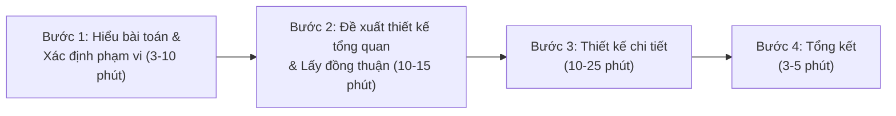
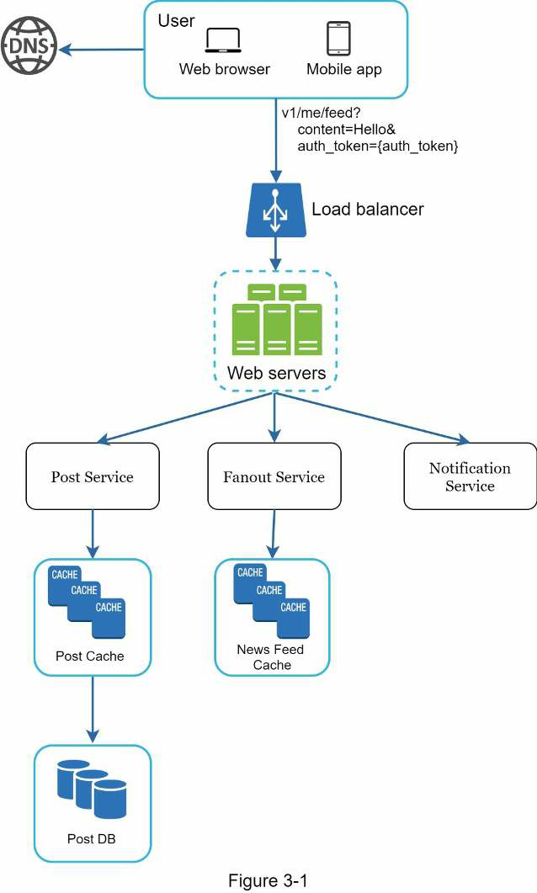
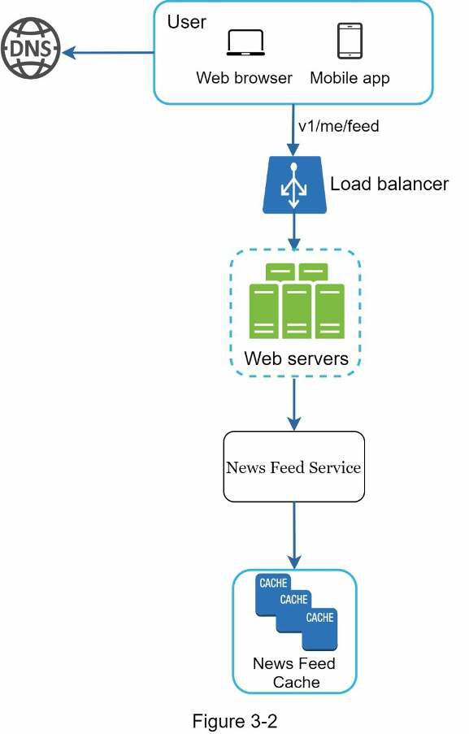
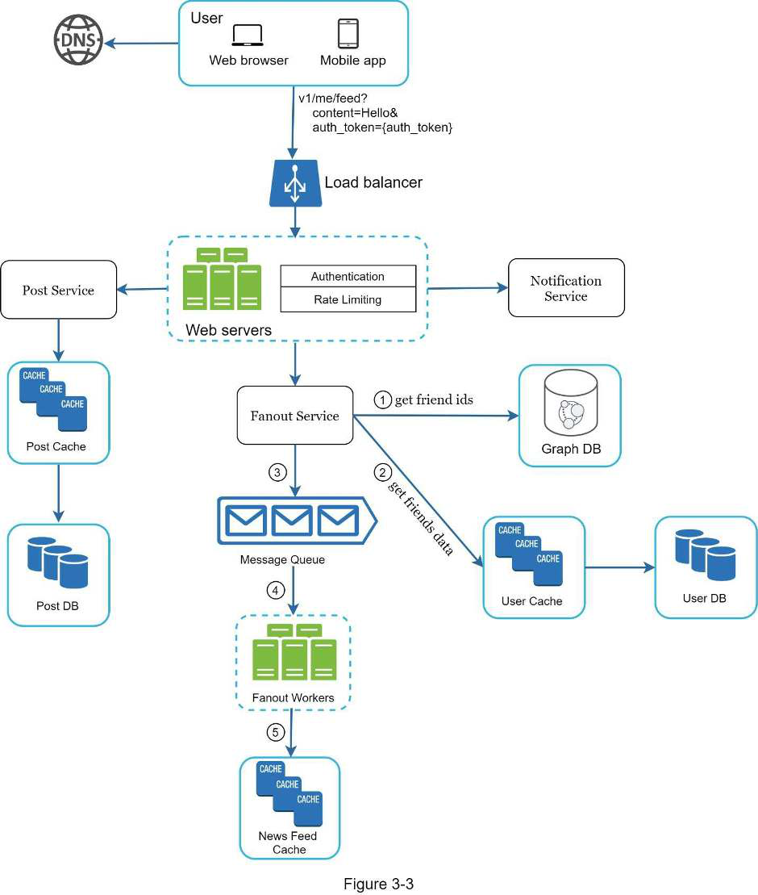
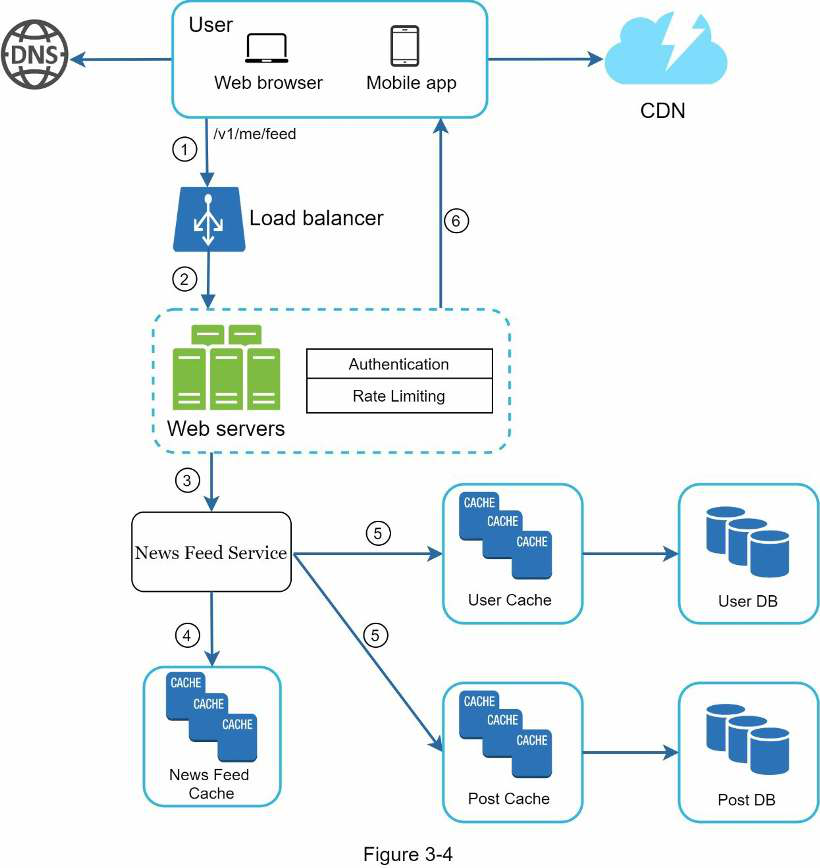

# CHƯƠNG 3: KHUNG PHƯƠNG PHÁP CHO PHỎNG VẤN THIẾT KẾ HỆ THỐNG (CHAPTER 3: A FRAMEWORK FOR SYSTEM DESIGN INTERVIEWS)

Bạn vừa giành được một buổi phỏng vấn trực tiếp tại công ty mơ ước của mình. Điều phối viên tuyển dụng gửi cho bạn lịch trình của ngày hôm đó. Lướt qua danh sách, bạn cảm thấy khá ổn cho đến khi ánh mắt dừng lại ở vòng phỏng vấn này — *Phỏng vấn Thiết kế Hệ thống (System Design Interview)*.

Các buổi phỏng vấn thiết kế hệ thống thường gây cảm giác e ngại. Câu hỏi có thể mơ hồ như: *"Hãy thiết kế một sản phẩm nổi tiếng X?"*. Những câu hỏi này không rõ ràng và có vẻ rộng một cách vô lý. Sự lo lắng của bạn là hoàn toàn dễ hiểu. Suy cho cùng, làm sao một người có thể thiết kế trong vòng một giờ một sản phẩm phổ biến mà hàng trăm, nếu không muốn nói là hàng nghìn kỹ sư đã phải chung tay xây dựng?

Tin tốt là không ai kỳ vọng bạn làm được điều đó. Thiết kế hệ thống trong thế giới thực cực kỳ phức tạp. Ví dụ, công cụ tìm kiếm Google trông có vẻ đơn giản một cách đánh lừa thị giác; tuy nhiên, khối lượng công nghệ đứng sau sự đơn giản đó thực sự đáng kinh ngạc. Nếu không ai kỳ vọng bạn thiết kế một hệ thống thực tế hoàn chỉnh trong một giờ, vậy lợi ích của một buổi phỏng vấn thiết kế hệ thống là gì?

Buổi phỏng vấn thiết kế hệ thống mô phỏng quá trình giải quyết vấn đề trong thực tế, nơi hai đồng nghiệp cùng hợp tác trên một bài toán mơ hồ và đưa ra một giải pháp đáp ứng các mục tiêu của họ. Bài toán có tính chất mở (open-ended), và không có câu trả lời hoàn hảo. Bản thiết kế cuối cùng ít quan trọng hơn so với quá trình bạn thực hiện để đi đến thiết kế đó. Điều này cho phép bạn thể hiện kỹ năng thiết kế, bảo vệ các lựa chọn thiết kế của mình, và phản hồi trước các ý kiến góp ý một cách mang tính xây dựng.

Hãy thử đảo ngược tình thế và xem xét điều gì diễn ra trong đầu người phỏng vấn khi cô ấy bước vào phòng họp để gặp bạn. Mục tiêu chính của người phỏng vấn là đánh giá chính xác năng lực của bạn. Điều cuối cùng cô ấy muốn là phải đưa ra một đánh giá không rõ ràng (inconclusive evaluation) vì buổi phỏng vấn diễn ra kém hiệu quả và không thu thập đủ tín hiệu (signals). Vậy người phỏng vấn đang tìm kiếm điều gì trong một buổi phỏng vấn thiết kế hệ thống?

Nhiều người nghĩ rằng phỏng vấn thiết kế hệ thống chỉ xoay quanh kỹ năng thiết kế kỹ thuật của một người. Thực tế còn nhiều hơn thế nữa. Một buổi phỏng vấn thiết kế hệ thống hiệu quả mang lại những tín hiệu mạnh mẽ về khả năng hợp tác, khả năng làm việc dưới áp lực, và khả năng xử lý sự mơ hồ một cách mang tính xây dựng. Khả năng đặt những câu hỏi hay cũng là một kỹ năng thiết yếu, và nhiều người phỏng vấn đặc biệt tìm kiếm kỹ năng này.

Một người phỏng vấn giỏi cũng để ý các dấu hiệu cảnh báo (red flags). Thiết kế quá mức (over-engineering) là một căn bệnh thực sự của nhiều kỹ sư khi họ say mê sự thuần khiết trong thiết kế mà phớt lờ các đánh đổi (tradeoffs). Họ thường không nhận thức được chi phí cộng dồn của các hệ thống bị thiết kế quá mức, và nhiều công ty phải trả giá đắt cho sự thiếu hiểu biết đó. Chắc chắn bạn không muốn thể hiện xu hướng này trong một buổi phỏng vấn thiết kế hệ thống. Các dấu hiệu cảnh báo khác bao gồm tư duy hạn hẹp (narrow mindedness), sự bảo thủ/bướng bỉnh (stubbornness), v.v.

Trong chương này, chúng ta sẽ điểm qua một số mẹo hữu ích và giới thiệu một khung phương pháp (framework) đơn giản nhưng hiệu quả để giải quyết các bài toán phỏng vấn thiết kế hệ thống.

## Quy trình 4 bước cho buổi phỏng vấn thiết kế hệ thống hiệu quả (A 4-step process for effective system design interview)

Mỗi buổi phỏng vấn thiết kế hệ thống đều khác nhau. Một buổi phỏng vấn thiết kế hệ thống xuất sắc luôn có tính mở và không có giải pháp nào phù hợp cho mọi trường hợp (one-size-fits-all). Tuy nhiên, có những bước và điểm chung cần bao quát trong mọi buổi phỏng vấn thiết kế hệ thống.

### Bước 1 - Hiểu rõ bài toán và xác định phạm vi thiết kế (Step 1 - Understand the problem and establish design scope)

*"Tại sao con hổ lại gầm lên?"*

Một cánh tay giơ phắt lên ở cuối lớp.

*"Mời em, Jimmy?"*, cô giáo đáp.

*"Bởi vì nó ĐÓI ạ"*.

*"Rất tốt, Jimmy."*

Suốt thời thơ ấu, Jimmy luôn là người đầu tiên trả lời câu hỏi trong lớp. Bất cứ khi nào giáo viên đặt câu hỏi, luôn có một đứa trẻ trong lớp thích thử sức trả lời ngay lập tức, bất kể nó có biết đáp án hay không. Đó chính là Jimmy.

Jimmy là một học sinh xuất sắc. Cậu tự hào vì biết mọi câu trả lời thật nhanh. Trong các kỳ thi, cậu thường là người hoàn thành bài thi đầu tiên. Cậu là lựa chọn hàng đầu của giáo viên cho mọi cuộc thi học thuật.

**ĐỪNG** giống như Jimmy.

Trong một buổi phỏng vấn thiết kế hệ thống, việc đưa ra câu trả lời nhanh chóng mà không suy nghĩ không mang lại cho bạn điểm thưởng nào cả. Trả lời khi chưa hiểu thấu đáo các yêu cầu là một dấu hiệu cảnh báo rất lớn (huge red flag), vì buổi phỏng vấn không phải là một cuộc thi đố vui. Không có đáp án đúng duy nhất.

Vì vậy, đừng vội nhảy ngay vào đưa ra giải pháp. Hãy chậm lại. Suy nghĩ sâu sắc và đặt câu hỏi để làm rõ các yêu cầu và giả định. Điều này cực kỳ quan trọng.

Là kỹ sư, chúng ta thích giải quyết các bài toán khó và lao ngay vào thiết kế cuối cùng; tuy nhiên, cách tiếp cận này rất dễ dẫn bạn đến việc thiết kế sai hệ thống. Một trong những kỹ năng quan trọng nhất của người kỹ sư là đặt đúng câu hỏi, đưa ra các giả định hợp lý, và thu thập đầy đủ thông tin cần thiết để xây dựng hệ thống. Vì vậy, đừng ngại đặt câu hỏi.

Khi bạn đặt câu hỏi, người phỏng vấn sẽ trả lời trực tiếp câu hỏi của bạn hoặc yêu cầu bạn tự đưa ra giả định. Nếu trường hợp sau xảy ra, hãy viết các giả định của bạn lên bảng trắng hoặc giấy. Bạn có thể sẽ cần đến chúng sau này.

Nên đặt những loại câu hỏi nào? Hãy đặt câu hỏi để hiểu chính xác các yêu cầu. Dưới đây là danh sách các câu hỏi giúp bạn bắt đầu:

* Chúng ta sẽ xây dựng những tính năng cụ thể nào?
* Sản phẩm có bao nhiêu người dùng?
* Công ty dự kiến mở rộng quy mô nhanh như thế nào? Quy mô dự kiến trong 3 tháng, 6 tháng, và 1 năm là bao nhiêu?
* Ngăn xếp công nghệ (technology stack) của công ty là gì? Có những dịch vụ sẵn có nào mà bạn có thể tận dụng để đơn giản hóa thiết kế?

**Ví dụ (Example)**

Nếu bạn được yêu cầu thiết kế một hệ thống bảng tin (news feed system), bạn muốn đặt những câu hỏi giúp làm rõ các yêu cầu. Cuộc hội thoại giữa bạn và người phỏng vấn có thể diễn ra như sau:

* **Ứng viên (Candidate):** Đây là ứng dụng di động (mobile app), ứng dụng web (web app), hay cả hai?
* **Người phỏng vấn (Interviewer):** Cả hai.
* **Ứng viên:** Những tính năng quan trọng nhất của sản phẩm là gì?
* **Người phỏng vấn:** Khả năng đăng bài (make a post) và xem bảng tin của bạn bè (friends’ news feed).
* **Ứng viên:** Bảng tin được sắp xếp theo thứ tự thời gian đảo ngược (reverse chronological order) hay theo một thứ tự đặc biệt nào khác? Thứ tự đặc biệt nghĩa là mỗi bài đăng được gán một trọng số khác nhau. Ví dụ, bài đăng từ bạn thân quan trọng hơn bài đăng từ một nhóm.
* **Người phỏng vấn:** Để giữ mọi thứ đơn giản, hãy giả sử bảng tin được sắp xếp theo thứ tự thời gian đảo ngược.
* **Ứng viên:** Một người dùng có thể có tối đa bao nhiêu bạn bè?
* **Người phỏng vấn:** 5000.
* **Ứng viên:** Lưu lượng truy cập (traffic volume) là bao nhiêu?
* **Người phỏng vấn:** 10 triệu người dùng hoạt động hàng ngày (DAU - daily active users).
* **Ứng viên:** Bảng tin có thể chứa hình ảnh, video, hay chỉ văn bản?
* **Người phỏng vấn:** Nó có thể chứa các tệp đa phương tiện (media files), bao gồm cả hình ảnh và video.

Trên đây là một số câu hỏi mẫu mà bạn có thể hỏi người phỏng vấn. Việc hiểu rõ các yêu cầu và làm rõ những điểm mơ hồ là vô cùng quan trọng.

> 📝 **Giải thích thêm (không có trong sách):**
> Trong Bước 1, kỹ sư thường chia yêu cầu thành hai nhóm để tránh bỏ sót:
> 1. **Yêu cầu chức năng (Functional Requirements):** Hệ thống làm *được gì*? (Ví dụ: đăng bài có ảnh/video, xem feed, kết bạn).
> 2. **Yêu cầu phi chức năng (Non-functional Requirements):** Hệ thống hoạt động *tốt đến mức nào*? (Ví dụ: độ trễ tải feed < 200ms, tính sẵn sàng cao, nhất quán cuối cùng - eventual consistency là chấp nhận được).
> Việc hỏi về DAU, số bạn tối đa (5000), và loại dữ liệu (ảnh/video) giúp bạn xác định ngay bài toán thuộc nhóm **đọc nhiều (read-heavy)** hay **ghi nhiều (write-heavy)** và cần CDN hay không.

### Bước 2 - Đề xuất thiết kế tổng quan và đạt được sự đồng thuận (Step 2 - Propose high-level design and get buy-in)

Trong bước này, chúng ta hướng tới việc phát triển một thiết kế tổng quan (high-level design) và đạt được sự thống nhất với người phỏng vấn về thiết kế đó. Sẽ là một ý tưởng tuyệt vời nếu bạn hợp tác chặt chẽ với người phỏng vấn trong suốt quá trình này.

* Đưa ra một bản thiết kế sơ bộ (initial blueprint) cho hệ thống. Hỏi ý kiến phản hồi. Hãy coi người phỏng vấn như một người đồng đội và cùng nhau làm việc. Nhiều người phỏng vấn giỏi rất thích trao đổi và tham gia vào quá trình thiết kế.
* Vẽ các sơ đồ khối (box diagrams) với những thành phần chính lên bảng trắng hoặc giấy. Sơ đồ này có thể bao gồm máy khách (clients: mobile/web), API, máy chủ web (web servers), kho lưu trữ dữ liệu (data stores), bộ nhớ đệm (cache), mạng phân phối nội dung (CDN), hàng đợi thông điệp (message queue), v.v.
* Thực hiện các phép ước tính nhanh (back-of-the-envelope calculations) để đánh giá xem bản thiết kế sơ bộ của bạn có đáp ứng được các ràng buộc về quy mô hay không. Hãy suy nghĩ thành tiếng (think out loud). Trao đổi với người phỏng vấn xem việc ước tính nhanh có cần thiết hay không trước khi đi sâu vào tính toán.

Nếu có thể, hãy đi qua một vài trường hợp sử dụng (use cases) cụ thể. Điều này sẽ giúp bạn định hình thiết kế tổng quan. Cũng rất có khả năng các trường hợp sử dụng đó sẽ giúp bạn phát hiện ra những trường hợp biên (edge cases) mà bạn chưa từng nghĩ tới.

Chúng ta có nên đưa các điểm cuối API (API endpoints) và lược đồ cơ sở dữ liệu (database schema) vào bước này không? Điều này phụ thuộc vào từng bài toán. Với các bài toán thiết kế lớn như *"Thiết kế công cụ tìm kiếm Google"*, việc này hơi quá chi tiết (too low level). Với một bài toán như thiết kế backend cho trò chơi poker nhiều người chơi, điều này hoàn toàn hợp lý. Hãy trao đổi với người phỏng vấn của bạn.

**Ví dụ (Example)**

Hãy sử dụng bài toán *"Thiết kế một hệ thống bảng tin (Design a news feed system)"* để minh họa cách tiếp cận thiết kế tổng quan. Ở đây bạn chưa cần phải hiểu hệ thống thực sự hoạt động chi tiết như thế nào. Toàn bộ chi tiết sẽ được giải thích trong Chương 11.

Ở mức tổng quan, thiết kế được chia thành hai luồng (flows): đăng bài lên bảng tin (feed publishing) và xây dựng bảng tin (news feed building).

* **Đăng bài lên bảng tin (Feed publishing):** khi một người dùng đăng một bài viết, dữ liệu tương ứng được ghi vào cache/cơ sở dữ liệu, và bài đăng đó sẽ được phân phối (populated) vào bảng tin của bạn bè.
* **Xây dựng bảng tin (Newsfeed building):** bảng tin được xây dựng bằng cách tổng hợp bài đăng của bạn bè theo thứ tự thời gian đảo ngược.

Hình 3-1 (Figure 3-1) và Hình 3-2 (Figure 3-2) lần lượt trình bày thiết kế tổng quan cho luồng đăng bài lên bảng tin và luồng xây dựng bảng tin.

> 💡 **Ví dụ bổ sung (không có trong sách):**
> Khi trình bày thiết kế tổng quan như Hình 3-1 và Hình 3-2, bạn nên chủ động hỏi người phỏng vấn để lấy sự đồng thuận (buy-in) trước khi chuyển bước:
> *"Tôi vừa phác thảo hai luồng chính: luồng ghi qua Post Service + Fanout Service và luồng đọc qua News Feed Service + News Feed Cache. Với quy mô 10 triệu DAU và giả định mỗi người đăng trung bình 2 bài/ngày, thiết kế này có thể xử lý tốt tải đọc cao nhờ cache. Bạn thấy hướng tiếp cận tổng quan này ổn chứ, hay có phần nào bạn muốn tôi điều chỉnh hoặc đi sâu vào ngay không?"*

### Bước 3 - Thiết kế chi tiết (Step 3 - Design deep dive)

Tại bước này, bạn và người phỏng vấn đáng lẽ đã đạt được các mục tiêu sau:

* Thống nhất về mục tiêu tổng thể và phạm vi tính năng
* Phác thảo xong bản thiết kế tổng quan cho toàn bộ hệ thống
* Nhận được phản hồi từ người phỏng vấn về thiết kế tổng quan
* Có một số ý tưởng ban đầu về những khu vực cần tập trung đi sâu dựa trên phản hồi của cô ấy

Bạn cần phối hợp với người phỏng vấn để xác định và sắp xếp thứ tự ưu tiên cho các thành phần trong kiến trúc. Điều đáng nhấn mạnh là mỗi buổi phỏng vấn đều khác nhau. Đôi khi, người phỏng vấn có thể đưa ra gợi ý rằng cô ấy thích tập trung vào thiết kế tổng quan. Đôi khi, đối với buổi phỏng vấn ứng viên cấp cao (senior candidate), cuộc thảo luận có thể xoay quanh các đặc tính hiệu năng của hệ thống, thường tập trung vào các nút thắt cổ chai (bottlenecks) và ước tính tài nguyên (resource estimations). Trong phần lớn các trường hợp, người phỏng vấn sẽ muốn bạn đào sâu vào chi tiết của một vài thành phần hệ thống. Với bài toán rút gọn URL (URL shortener), việc đi sâu vào thiết kế hàm băm (hash function) để chuyển đổi một URL dài thành một URL ngắn là rất thú vị. Với một hệ thống trò chuyện (chat system), cách giảm độ trễ (latency) và cách hỗ trợ trạng thái trực tuyến/ngoại tuyến (online/offline status) là hai chủ đề rất đáng quan tâm.

Quản lý thời gian là yếu tố sống còn vì bạn rất dễ bị cuốn vào những tiểu tiết không thể hiện được năng lực của mình. Bạn phải trang bị sẵn những "tín hiệu" (signals) để thể hiện cho người phỏng vấn thấy. Hãy cố gắng không đi vào những chi tiết không cần thiết. Ví dụ, việc nói chi tiết về thuật toán EdgeRank trong xếp hạng bảng tin của Facebook trong một buổi phỏng vấn thiết kế hệ thống là không lý tưởng, vì việc này ngốn rất nhiều thời gian quý báu mà lại không chứng minh được khả năng thiết kế một hệ thống có khả năng mở rộng (scalable system) của bạn.

**Ví dụ (Example)**

Tại thời điểm này, chúng ta đã thảo luận xong thiết kế tổng quan cho hệ thống bảng tin, và người phỏng vấn hài lòng với đề xuất của bạn. Tiếp theo, chúng ta sẽ đi sâu vào hai trong số các trường hợp sử dụng quan trọng nhất:

1. Đăng bài lên bảng tin (Feed publishing)
2. Truy xuất bảng tin (News feed retrieval)

Hình 3-3 (Figure 3-3) và Hình 3-4 (Figure 3-4) minh họa thiết kế chi tiết cho hai trường hợp sử dụng này, vốn sẽ được giải thích cặn kẽ trong Chương 11.

> 📝 **Giải thích thêm (không có trong sách):**
> Nhìn vào Hình 3-3 và Hình 3-4, bạn có thể thấy sự khác biệt rõ rệt giữa Bước 2 và Bước 3:
> * Ở **Hình 3-3** (Feed publishing chi tiết), các thành phần như **Authentication / Rate Limiting**, **Graph DB** (lấy danh sách ID bạn bè), **User Cache / User DB**, **Message Queue**, và cụm **Fanout Workers** đã được bổ sung để giải quyết bài toán xử lý bất đồng bộ (asynchronous processing) và tránh nghẽn cổ chai khi một người có tới 5000 bạn bè đăng bài.
> * Ở **Hình 3-4** (News feed retrieval chi tiết), **CDN** được thêm vào để phục vụ ảnh/video nhanh hơn, và các bước đánh số từ `(1)` đến `(6)` thể hiện rõ thứ tự dữ liệu đi từ Client $\rightarrow$ Load Balancer $\rightarrow$ Web Servers $\rightarrow$ News Feed Service $\rightarrow$ News Feed Cache / User Cache / Post Cache $\rightarrow$ trả về Client.

### Bước 4 - Tổng kết (Step 4 - Wrap up)

Trong bước cuối cùng này, người phỏng vấn có thể hỏi bạn một vài câu hỏi mở rộng (follow-up questions) hoặc cho bạn tự do thảo luận thêm các điểm khác. Dưới đây là một vài hướng để bạn bám theo:

* Người phỏng vấn có thể muốn bạn chỉ ra các nút thắt cổ chai của hệ thống (system bottlenecks) và thảo luận về những cải tiến tiềm năng. Đừng bao giờ nói rằng thiết kế của bạn đã hoàn hảo và không có gì để cải thiện. Luôn luôn có điểm có thể cải thiện được. Đây là cơ hội tuyệt vời để thể hiện tư duy phản biện (critical thinking) và để lại ấn tượng cuối cùng tốt đẹp.
* Việc tóm tắt lại thiết kế cho người phỏng vấn có thể rất hữu ích. Điều này đặc biệt quan trọng nếu bạn đã đề xuất một vài giải pháp khác nhau. Việc làm mới lại trí nhớ cho người phỏng vấn sẽ rất có ích sau một phiên thảo luận dài.
* Các trường hợp lỗi (error cases: sập máy chủ, mất mạng, v.v.) là chủ đề thú vị để trao đổi.
* Các vấn đề vận hành (operation issues) cũng rất đáng được nhắc tới. Bạn giám sát các chỉ số (metrics) và nhật ký lỗi (error logs) như thế nào? Làm thế nào để triển khai hệ thống (roll out the system)?
* Cách xử lý đường cong mở rộng tiếp theo (next scale curve) cũng là một chủ đề hay. Ví dụ, nếu thiết kế hiện tại của bạn hỗ trợ 1 triệu người dùng, bạn cần thực hiện những thay đổi gì để hỗ trợ 10 triệu người dùng?
* Đề xuất các tinh chỉnh khác mà bạn sẽ làm nếu có thêm thời gian.

### Những điều Nên làm và Không nên làm (Dos and Don’ts)

Để kết thúc, chúng tôi tổng hợp một danh sách các điều Nên làm (Dos) và Không nên làm (Don’ts).

**Nên làm (Dos)**

* Luôn đặt câu hỏi để làm rõ. Đừng mặc định rằng giả định của bạn là đúng.
* Hiểu rõ các yêu cầu của bài toán.
* Không có đáp án đúng tuyệt đối cũng chẳng có đáp án tốt nhất. Một giải pháp được thiết kế để giải quyết bài toán của một công ty khởi nghiệp non trẻ (young startup) sẽ khác với giải pháp của một công ty lâu đời có hàng triệu người dùng. Hãy chắc chắn rằng bạn hiểu rõ các yêu cầu.
* Cho người phỏng vấn biết bạn đang nghĩ gì. Hãy giao tiếp với người phỏng vấn của bạn.
* Đề xuất nhiều phương án tiếp cận nếu có thể.
* Một khi đã thống nhất với người phỏng vấn về bản thiết kế tổng quan, hãy đi vào chi tiết cho từng thành phần. Thiết kế các thành phần quan trọng nhất trước tiên.
* Trao đổi ý tưởng qua lại với người phỏng vấn. Một người phỏng vấn giỏi sẽ làm việc cùng bạn như một người đồng đội.
* Không bao giờ bỏ cuộc.

**Không nên làm (Don’ts)**

* Đừng đi phỏng vấn mà không chuẩn bị trước cho các câu hỏi thiết kế hệ thống điển hình.
* Đừng nhảy thẳng vào giải pháp khi chưa làm rõ các yêu cầu và giả định.
* Đừng đi quá sâu vào chi tiết của một thành phần duy nhất ngay từ đầu. Hãy đưa ra thiết kế tổng quan trước rồi mới đào sâu xuống.
* Nếu bạn bị kẹt, đừng ngần ngại xin gợi ý.
* Một lần nữa, hãy giao tiếp. Đừng suy nghĩ trong im lặng.
* Đừng nghĩ rằng buổi phỏng vấn đã kết thúc ngay khi bạn vẽ xong bản thiết kế. Bạn chưa xong cho đến khi người phỏng vấn nói rằng bạn đã xong. Hãy xin phản hồi sớm và thường xuyên.

### Phân bổ thời gian cho từng bước (Time allocation on each step)

Các câu hỏi phỏng vấn thiết kế hệ thống thường rất rộng, và 45 phút hoặc một giờ không đủ để bao quát toàn bộ bản thiết kế. Quản lý thời gian là điều thiết yếu. Bạn nên dành bao nhiêu thời gian cho mỗi bước? Dưới đây là hướng dẫn rất khái quát về cách phân bổ thời gian trong một buổi phỏng vấn kéo dài 45 phút. Xin hãy nhớ đây chỉ là ước tính sơ bộ, và việc phân bổ thời gian thực tế phụ thuộc vào phạm vi bài toán cũng như các yêu cầu từ người phỏng vấn.

* **Bước 1 — Hiểu rõ bài toán và xác định phạm vi thiết kế:** 3 – 10 phút
* **Bước 2 — Đề xuất thiết kế tổng quan và đạt được sự đồng thuận:** 10 – 15 phút
* **Bước 3 — Thiết kế chi tiết:** 10 – 25 phút
* **Bước 4 — Tổng kết:** 3 – 5 phút

## Bảng thuật ngữ chương (Chapter Glossary)

| Thuật ngữ (English) | Tiếng Việt | Giải thích ngắn gọn |
| :--- | :--- | :--- |
| System Design Interview | Phỏng vấn Thiết kế Hệ thống | Vòng phỏng vấn đánh giá khả năng thiết kế kiến trúc phần mềm quy mô lớn, xử lý sự mơ hồ và trao đổi kỹ thuật. |
| Red Flag | Dấu hiệu cảnh báo | Hành vi hoặc quan điểm tiêu cực trong phỏng vấn (ví dụ: nhảy vào giải pháp ngay, thiết kế quá mức, bảo thủ). |
| Over-engineering | Thiết kế quá mức | Xây dựng hệ thống phức tạp hơn mức cần thiết, bỏ qua sự đánh đổi (tradeoffs) về chi phí và thời gian. |
| Design Scope | Phạm vi thiết kế | Giới hạn về tính năng, quy mô và ràng buộc mà hệ thống cần giải quyết trong buổi phỏng vấn. |
| Back-of-the-envelope Calculation | Ước tính nhanh | Các phép tính nhẩm sơ bộ về QPS, băng thông, dung lượng lưu trữ để kiểm chứng tính khả thi của thiết kế. |
| High-level Design | Thiết kế tổng quan | Bản phác thảo kiến trúc ở mức khái niệm gồm các thành phần chính và luồng dữ liệu cơ bản. |
| Design Deep Dive | Thiết kế chi tiết | Giai đoạn đào sâu vào kiến trúc nội tại, thuật toán, cấu trúc dữ liệu hoặc nút thắt cổ chai của các thành phần trọng yếu. |
| Buy-in | Sự đồng thuận | Việc đạt được sự thống nhất với người phỏng vấn về hướng tiếp cận trước khi đi tiếp. |
| Bottleneck | Nút thắt cổ chai | Điểm giới hạn hiệu năng hoặc khả năng mở rộng của toàn bộ hệ thống. |
| News Feed | Bảng tin | Luồng cập nhật nội dung (bài viết, ảnh, video) từ bạn bè hoặc người dùng theo dõi. |
| Fanout | Phân phối (bài đăng) | Quá trình đẩy một bài đăng mới tới bảng tin của danh sách bạn bè/người theo dõi. |
| DAU (Daily Active Users) | Người dùng hoạt động hàng ngày | Số lượng người dùng duy nhất tương tác với hệ thống trong một ngày. |
