# CHƯƠNG 4: THIẾT KẾ BỘ GIỚI HẠN TỐC ĐỘ (CHAPTER 4: DESIGN A RATE LIMITER)

Trong một hệ thống mạng, bộ giới hạn tốc độ (rate limiter) được sử dụng để kiểm soát tốc độ lưu lượng (traffic) được gửi đi bởi một client hoặc một dịch vụ. Trong thế giới HTTP, bộ giới hạn tốc độ giới hạn số lượng yêu cầu (request) từ client được phép gửi trong một khoảng thời gian xác định. Nếu số lượng yêu cầu API vượt quá ngưỡng do bộ giới hạn tốc độ quy định, tất cả các lời gọi vượt mức sẽ bị chặn. Dưới đây là một vài ví dụ:

- Một người dùng chỉ có thể viết tối đa 2 bài đăng mỗi giây.
- Bạn chỉ có thể tạo tối đa 10 tài khoản mỗi ngày từ cùng một địa chỉ IP.
- Bạn chỉ có thể nhận thưởng tối đa 5 lần mỗi tuần từ cùng một thiết bị.

Trong chương này, bạn được yêu cầu thiết kế một bộ giới hạn tốc độ. Trước khi bắt đầu thiết kế, trước tiên hãy xem xét các lợi ích của việc sử dụng bộ giới hạn tốc độ API:

- **Ngăn chặn tình trạng cạn kiệt tài nguyên do tấn công Từ chối dịch vụ (Denial of Service - DoS) [1].** Hầu hết các API được công bố bởi các công ty công nghệ lớn đều áp dụng một hình thức giới hạn tốc độ nào đó. Ví dụ, Twitter giới hạn số lượng tweet là 300 trong mỗi 3 giờ [2]. Google Docs API có giới hạn mặc định là 300 yêu cầu đọc mỗi người dùng trong 60 giây [3]. Bộ giới hạn tốc độ ngăn chặn các cuộc tấn công DoS, dù là cố ý hay vô ý, bằng cách chặn các lời gọi vượt mức.
- **Giảm chi phí.** Việc giới hạn các yêu cầu dư thừa đồng nghĩa với việc cần ít máy chủ hơn và phân bổ nhiều tài nguyên hơn cho các API có mức độ ưu tiên cao. Giới hạn tốc độ cực kỳ quan trọng đối với các công ty sử dụng API trả phí của bên thứ ba. Ví dụ, bạn bị tính phí theo từng lần gọi cho các API bên ngoài như: kiểm tra tín dụng, thực hiện thanh toán, truy xuất hồ sơ sức khỏe, v.v. Việc giới hạn số lần gọi là điều thiết yếu để giảm chi phí.
- **Ngăn chặn máy chủ bị quá tải.** Để giảm tải cho máy chủ, bộ giới hạn tốc độ được sử dụng để lọc bỏ các yêu cầu dư thừa gây ra bởi bot hoặc hành vi sai lệch của người dùng.

---

## Bước 1 - Hiểu bài toán và xác định phạm vi thiết kế (Step 1 - Understand the problem and establish design scope)

Việc giới hạn tốc độ có thể được triển khai bằng nhiều thuật toán khác nhau, mỗi thuật toán đều có ưu và nhược điểm riêng. Cuộc trao đổi giữa người phỏng vấn và ứng viên giúp làm rõ loại bộ giới hạn tốc độ mà chúng ta đang cố gắng xây dựng.

**Ứng viên:** Chúng ta sẽ thiết kế loại bộ giới hạn tốc độ nào? Đây là bộ giới hạn tốc độ phía client (client-side) hay bộ giới hạn tốc độ API phía máy chủ (server-side)?
**Người phỏng vấn:** Câu hỏi hay đấy. Chúng ta tập trung vào bộ giới hạn tốc độ API phía máy chủ.

**Ứng viên:** Bộ giới hạn tốc độ có điều tiết (throttle) các yêu cầu API dựa trên IP, ID người dùng hay các thuộc tính khác không?
**Người phỏng vấn:** Bộ giới hạn tốc độ cần đủ linh hoạt để hỗ trợ nhiều tập quy tắc điều tiết khác nhau.

**Ứng viên:** Quy mô của hệ thống là bao nhiêu? Nó được xây dựng cho một công ty khởi nghiệp hay một công ty lớn với lượng người dùng khổng lồ?
**Người phỏng vấn:** Hệ thống phải có khả năng xử lý một lượng lớn yêu cầu.

**Ứng viên:** Hệ thống có hoạt động trong môi trường phân tán (distributed environment) không?
**Người phỏng vấn:** Có.

**Ứng viên:** Bộ giới hạn tốc độ là một dịch vụ tách biệt hay nên được triển khai ngay trong mã nguồn ứng dụng?
**Người phỏng vấn:** Đó là quyết định thiết kế tùy thuộc vào bạn.

**Ứng viên:** Chúng ta có cần thông báo cho những người dùng bị điều tiết (bị giới hạn) không?
**Người phỏng vấn:** Có.

### Các yêu cầu (Requirements)

Dưới đây là tóm tắt các yêu cầu đối với hệ thống:

- Giới hạn chính xác các yêu cầu vượt mức.
- Độ trễ thấp (low latency). Bộ giới hạn tốc độ không được làm chậm thời gian phản hồi HTTP.
- Sử dụng càng ít bộ nhớ càng tốt.
- Giới hạn tốc độ phân tán (distributed rate limiting). Bộ giới hạn tốc độ có thể được chia sẻ qua nhiều máy chủ hoặc nhiều tiến trình.
- Xử lý ngoại lệ (exception handling). Hiển thị thông báo ngoại lệ rõ ràng cho người dùng khi yêu cầu của họ bị điều tiết.
- Khả năng chịu lỗi cao (high fault tolerance). Nếu có bất kỳ sự cố nào xảy ra với bộ giới hạn tốc độ (ví dụ: một máy chủ cache bị mất kết nối), nó không được làm ảnh hưởng đến toàn bộ hệ thống.

---

## Bước 2 - Đề xuất thiết kế cấp cao và đạt được sự đồng thuận (Step 2 - Propose high-level design and get buy-in)

Hãy giữ mọi thứ đơn giản và sử dụng mô hình client - server cơ bản cho việc giao tiếp.

### Đặt bộ giới hạn tốc độ ở đâu? (Where to put the rate limiter?)

Theo trực giác, bạn có thể triển khai bộ giới hạn tốc độ ở phía client hoặc phía máy chủ (server-side):

- **Triển khai phía client (Client-side implementation).** Nói chung, client là nơi không đáng tin cậy để thực thi việc giới hạn tốc độ vì các yêu cầu từ client có thể dễ dàng bị giả mạo bởi những kẻ có ý đồ xấu. Hơn nữa, chúng ta có thể không kiểm soát được phần triển khai ở phía client.
- **Triển khai phía máy chủ (Server-side implementation).** Hình 4-1 minh họa một bộ giới hạn tốc độ được đặt ở phía máy chủ.

Bên cạnh cách triển khai phía client và phía máy chủ, còn có một cách thay thế khác. Thay vì đặt bộ giới hạn tốc độ tại các máy chủ API, chúng ta tạo một middleware giới hạn tốc độ (rate limiter middleware), thành phần này sẽ điều tiết các yêu cầu gửi đến API của bạn như minh họa trong Hình 4-2.

Hãy lấy ví dụ trong Hình 4-3 để minh họa cách giới hạn tốc độ hoạt động trong thiết kế này. Giả sử API của chúng ta cho phép 2 yêu cầu mỗi giây, và một client gửi 3 yêu cầu đến máy chủ trong vòng một giây. Hai yêu cầu đầu tiên được định tuyến đến các máy chủ API. Tuy nhiên, middleware giới hạn tốc độ sẽ điều tiết yêu cầu thứ ba và trả về mã trạng thái HTTP 429. Mã trạng thái phản hồi HTTP 429 cho biết người dùng đã gửi quá nhiều yêu cầu (Too Many Requests).

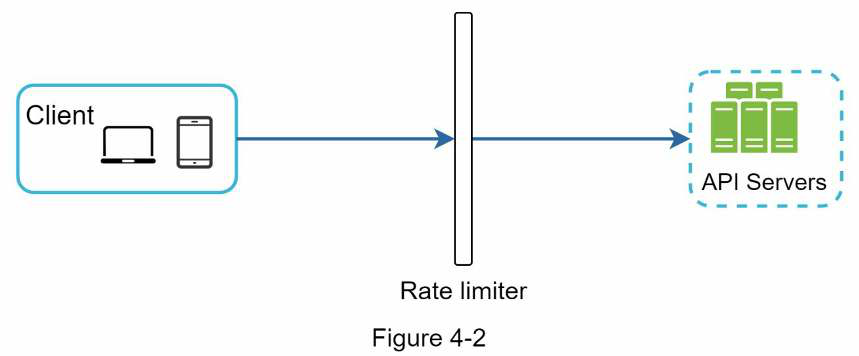

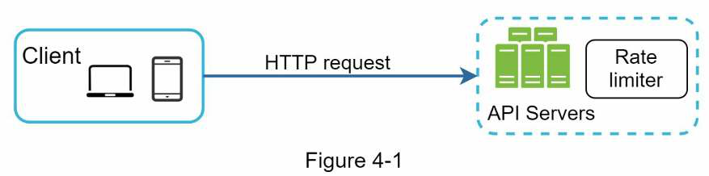

Các microservice trên nền tảng đám mây (cloud microservices) [4] đã trở nên vô cùng phổ biến và việc giới hạn tốc độ thường được triển khai bên trong một thành phần gọi là **API gateway**. API gateway là một dịch vụ được quản lý hoàn toàn (fully managed service) hỗ trợ giới hạn tốc độ, chấm dứt SSL (SSL termination), xác thực (authentication), danh sách trắng IP (IP whitelisting), phục vụ nội dung tĩnh, v.v. Hiện tại, chúng ta chỉ cần biết rằng API gateway là một middleware có hỗ trợ giới hạn tốc độ.

Khi thiết kế một bộ giới hạn tốc độ, một câu hỏi quan trọng cần tự hỏi là: nên triển khai bộ giới hạn tốc độ ở đâu, trên phía máy chủ hay trong một gateway? Không có câu trả lời tuyệt đối. Điều đó phụ thuộc vào nền tảng công nghệ hiện tại của công ty bạn, nguồn lực kỹ thuật, các ưu tiên, mục tiêu, v.v. Dưới đây là một vài hướng dẫn chung:

- Đánh giá nền tảng công nghệ hiện tại của bạn, chẳng hạn như ngôn ngữ lập trình, dịch vụ cache, v.v. Đảm bảo ngôn ngữ lập trình hiện tại của bạn đủ hiệu quả để triển khai giới hạn tốc độ ở phía máy chủ.
- Xác định thuật toán giới hạn tốc độ phù hợp với nhu cầu nghiệp vụ của bạn. Khi bạn tự triển khai mọi thứ ở phía máy chủ, bạn có toàn quyền kiểm soát thuật toán. Tuy nhiên, lựa chọn của bạn có thể bị hạn chế nếu bạn sử dụng API gateway của bên thứ ba.
- Nếu bạn đã sử dụng kiến trúc microservice và đã đưa API gateway vào thiết kế để thực hiện xác thực, danh sách trắng IP, v.v., bạn có thể thêm bộ giới hạn tốc độ vào API gateway đó.
- Tự xây dựng dịch vụ giới hạn tốc độ mất nhiều thời gian. Nếu bạn không có đủ nguồn lực kỹ thuật để tự triển khai bộ giới hạn tốc độ, sử dụng một API gateway thương mại là một lựa chọn tốt hơn.

### Các thuật toán giới hạn tốc độ (Algorithms for rate limiting)

Việc giới hạn tốc độ có thể được triển khai bằng nhiều thuật toán khác nhau, và mỗi thuật toán có những ưu và nhược điểm riêng biệt. Mặc dù chương này không tập trung sâu vào thuật toán, việc hiểu chúng ở mức tổng quan sẽ giúp chọn đúng thuật toán hoặc kết hợp các thuật toán phù hợp với trường hợp sử dụng của chúng ta. Dưới đây là danh sách các thuật toán phổ biến:

- Xô token (Token bucket)
- Xô rò rỉ (Leaking bucket)
- Bộ đếm cửa sổ cố định (Fixed window counter)
- Nhật ký cửa sổ trượt (Sliding window log)
- Bộ đếm cửa sổ trượt (Sliding window counter)

#### Thuật toán Xô token (Token bucket algorithm)

Thuật toán xô token được sử dụng rộng rãi cho việc giới hạn tốc độ. Thuật toán này đơn giản, dễ hiểu và được các công ty internet sử dụng phổ biến. Cả Amazon [5] và Stripe [6] đều sử dụng thuật toán này để điều tiết các yêu cầu API của họ.

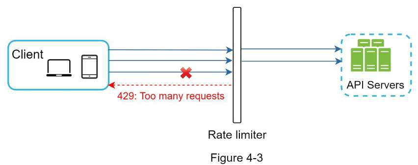

Thuật toán xô token hoạt động như sau:

- Một xô token là một vật chứa có sức chứa (capacity) được xác định trước. Các token được bỏ vào xô theo định kỳ với tốc độ cài đặt sẵn. Một khi xô đã đầy, sẽ không có thêm token nào được thêm vào nữa. Như minh họa trong Hình 4-4, sức chứa của xô token là 4. Bộ nạp (refiller) bỏ 2 token vào xô mỗi giây. Khi xô đầy, các token thừa sẽ tràn ra ngoài.
- Mỗi yêu cầu tiêu thụ một token. Khi một yêu cầu đến, chúng ta kiểm tra xem có đủ token trong xô hay không. Hình 4-5 giải thích cách thức hoạt động này.
  - Nếu có đủ token, chúng ta lấy một token ra cho mỗi yêu cầu và yêu cầu được phép đi qua.
  - Nếu không có đủ token, yêu cầu bị hủy (dropped).

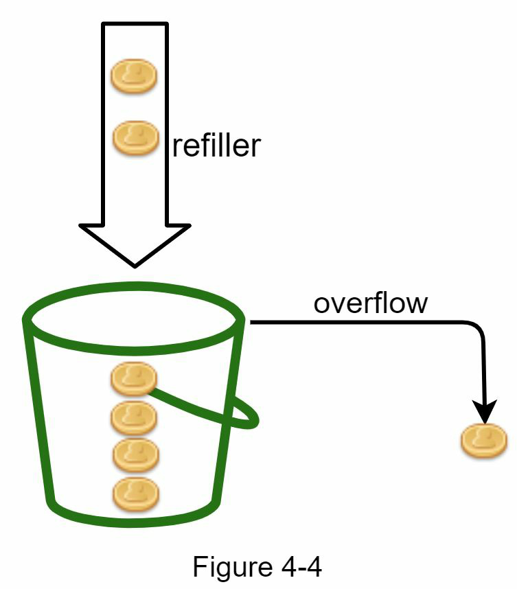

Hình 4-6 minh họa cách thức tiêu thụ token, nạp lại token và logic giới hạn tốc độ hoạt động. Trong ví dụ này, kích thước xô token là 4 và tốc độ nạp là 4 token mỗi 1 phút.

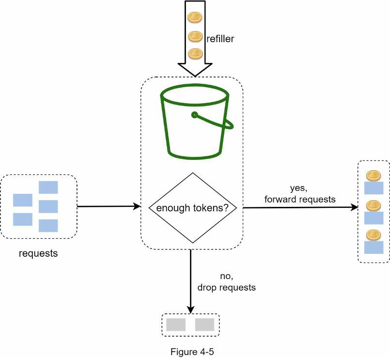

Thuật toán xô token nhận hai tham số:

- **Kích thước xô (Bucket size):** số lượng token tối đa được phép chứa trong xô.
- **Tốc độ nạp (Refill rate):** số lượng token được bỏ vào xô mỗi giây.

Chúng ta cần bao nhiêu xô? Điều này thay đổi tùy theo các quy tắc giới hạn tốc độ. Dưới đây là một vài ví dụ:

- Thông thường cần có các xô khác nhau cho các endpoint API khác nhau. Ví dụ, nếu một người dùng được phép đăng tối đa 1 bài viết mỗi giây, kết bạn 150 người mỗi ngày và thích 5 bài viết mỗi giây, thì cần 3 xô cho mỗi người dùng.
- Nếu chúng ta cần điều tiết yêu cầu dựa trên địa chỉ IP, mỗi địa chỉ IP sẽ cần một xô riêng.
- Nếu hệ thống cho phép tối đa 10.000 yêu cầu mỗi giây, việc sử dụng một xô toàn cục (global bucket) dùng chung cho tất cả các yêu cầu là hoàn toàn hợp lý.

**Ưu điểm:**
- Thuật toán dễ triển khai.
- Tiết kiệm bộ nhớ.
- Xô token cho phép các đợt lưu lượng tăng đột biến (burst of traffic) trong khoảng thời gian ngắn. Một yêu cầu vẫn có thể đi qua miễn là còn token trong xô.

**Nhược điểm:**
- Hai tham số trong thuật toán là kích thước xô và tốc độ nạp token. Tuy nhiên, việc tinh chỉnh (tune) chúng một cách hợp lý có thể khá thách thức.

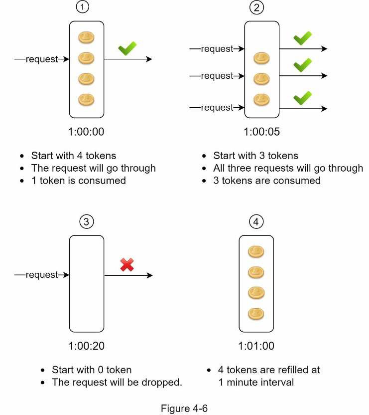

#### Thuật toán Xô rò rỉ (Leaking bucket algorithm)

Thuật toán xô rò rỉ tương tự như xô token, ngoại trừ việc các yêu cầu được xử lý ở một tốc độ cố định. Nó thường được triển khai bằng một hàng đợi vào trước-ra trước (first-in-first-out - FIFO queue). Thuật toán hoạt động như sau:

- Khi một yêu cầu đến, hệ thống kiểm tra xem hàng đợi đã đầy chưa. Nếu chưa đầy, yêu cầu được thêm vào hàng đợi.
- Ngược lại, yêu cầu bị hủy (dropped).
- Các yêu cầu được lấy ra khỏi hàng đợi và xử lý theo các khoảng thời gian đều đặn.

Hình 4-7 giải thích cách thuật toán hoạt động.

Thuật toán xô rò rỉ nhận hai tham số sau:

- **Kích thước xô (Bucket size):** bằng với kích thước hàng đợi. Hàng đợi lưu giữ các yêu cầu chờ được xử lý ở tốc độ cố định.
- **Tốc độ thoát (Outflow rate):** xác định có bao nhiêu yêu cầu có thể được xử lý ở tốc độ cố định, thường tính theo giây.

Shopify, một công ty thương mại điện tử, sử dụng xô rò rỉ để giới hạn tốc độ [7].

**Ưu điểm:**
- Tiết kiệm bộ nhớ nhờ kích thước hàng đợi bị giới hạn.
- Các yêu cầu được xử lý ở tốc độ cố định, do đó nó phù hợp cho các trường hợp sử dụng cần tốc độ đầu ra ổn định (stable outflow rate).

**Nhược điểm:**
- Một đợt lưu lượng tăng đột biến sẽ lấp đầy hàng đợi bằng các yêu cầu cũ, và nếu chúng không được xử lý kịp thời, các yêu cầu mới đến sau sẽ bị giới hạn tốc độ (bị loại bỏ).
- Có hai tham số trong thuật toán. Việc tinh chỉnh chúng một cách hợp lý có thể không dễ dàng.

#### Thuật toán Bộ đếm cửa sổ cố định (Fixed window counter algorithm)

Thuật toán bộ đếm cửa sổ cố định hoạt động như sau:

- Thuật toán chia trục thời gian thành các cửa sổ thời gian có kích thước cố định và gán một bộ đếm (counter) cho mỗi cửa sổ.
- Mỗi yêu cầu sẽ tăng bộ đếm lên 1.
- Một khi bộ đếm đạt đến ngưỡng đã định trước, các yêu cầu mới sẽ bị hủy cho đến khi một cửa sổ thời gian mới bắt đầu.

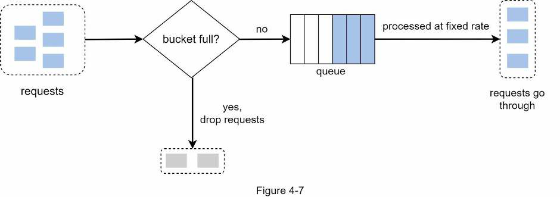

Hãy dùng một ví dụ cụ thể để xem nó hoạt động như thế nào. Trong Hình 4-8, đơn vị thời gian là 1 giây và hệ thống cho phép tối đa 3 yêu cầu mỗi giây. Trong mỗi cửa sổ 1 giây, nếu nhận được nhiều hơn 3 yêu cầu, các yêu cầu dư thừa sẽ bị hủy như minh họa trong Hình 4-8.

Một vấn đề lớn của thuật toán này là một đợt lưu lượng tăng đột biến tại các rìa (biên) của cửa sổ thời gian có thể khiến số lượng yêu cầu đi qua nhiều hơn hạn mức cho phép. Hãy xem xét trường hợp sau:

Trong Hình 4-9, hệ thống cho phép tối đa 5 yêu cầu mỗi phút, và hạn mức khả dụng được đặt lại (reset) vào các mốc phút tròn thân thiện với con người. Như có thể thấy, có 5 yêu cầu giữa 2:00:00 và 2:01:00 và 5 yêu cầu nữa giữa 2:01:00 và 2:02:00. Đối với cửa sổ một phút nằm giữa 2:00:30 và 2:01:30, có tới 10 yêu cầu đã đi qua. Con số này gấp đôi số lượng yêu cầu được phép.

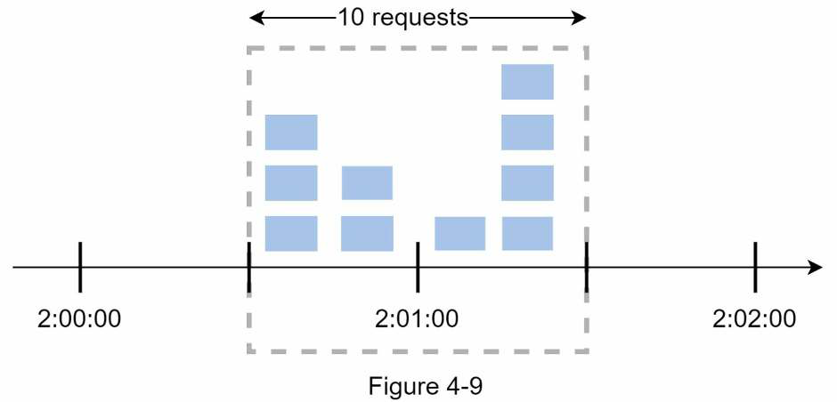

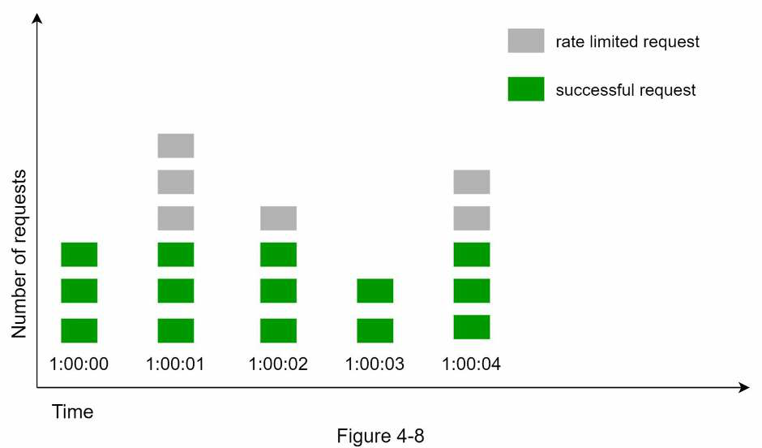

**Ưu điểm:**
- Tiết kiệm bộ nhớ.
- Dễ hiểu.
- Việc đặt lại hạn mức khả dụng vào cuối một đơn vị cửa sổ thời gian phù hợp với một số trường hợp sử dụng nhất định.

**Nhược điểm:**
- Sự tăng đột biến lưu lượng tại các biên của cửa sổ có thể khiến nhiều yêu cầu hơn hạn mức cho phép đi qua được.

#### Thuật toán Nhật ký cửa sổ trượt (Sliding window log algorithm)

Như đã thảo luận trước đó, thuật toán bộ đếm cửa sổ cố định có một vấn đề lớn: nó cho phép nhiều yêu cầu hơn đi qua tại các biên của một cửa sổ. Thuật toán nhật ký cửa sổ trượt khắc phục được vấn đề này. Nó hoạt động như sau:

- Thuật toán lưu giữ dấu vết các dấu thời gian (timestamp) của yêu cầu. Dữ liệu timestamp thường được lưu trong cache, chẳng hạn như cấu trúc dữ liệu sorted sets của Redis [8].
- Khi có một yêu cầu mới đến, xóa tất cả các timestamp đã lỗi thời (outdated). Timestamp lỗi thời được định nghĩa là những timestamp cũ hơn thời điểm bắt đầu của cửa sổ thời gian hiện tại.
- Thêm timestamp của yêu cầu mới vào nhật ký (log).
- Nếu kích thước của log nhỏ hơn hoặc bằng số lượng cho phép, yêu cầu được chấp nhận. Ngược lại, nó bị từ chối.

Chúng ta giải thích thuật toán bằng một ví dụ như trong Hình 4-10.

Trong ví dụ này, bộ giới hạn tốc độ cho phép 2 yêu cầu mỗi phút. Thông thường, timestamp dạng Linux (Unix timestamp) được lưu trong log. Tuy nhiên, cách biểu diễn thời gian dễ đọc cho con người được sử dụng trong ví dụ của chúng ta để dễ theo dõi hơn.

- Log đang trống khi một yêu cầu mới đến lúc 1:00:01. Do đó, yêu cầu được phép đi qua.

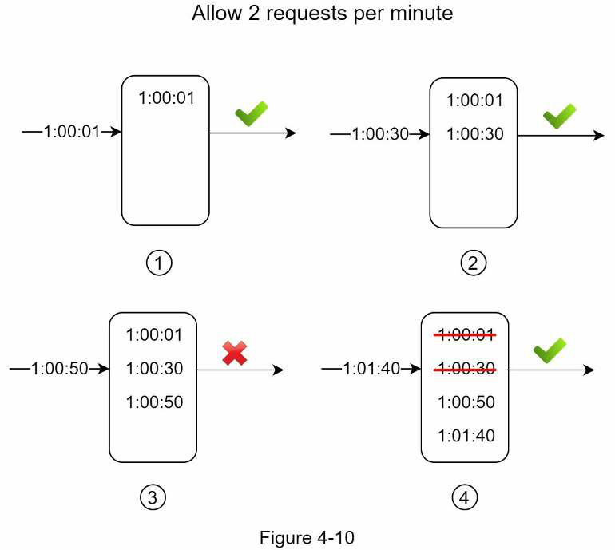

- Một yêu cầu mới đến lúc 1:00:30, timestamp 1:00:30 được chèn vào log. Sau khi chèn, kích thước log là 2, không lớn hơn số lượng cho phép. Do đó, yêu cầu được phép đi qua.
- Một yêu cầu mới đến lúc 1:00:50, và timestamp được chèn vào log. Sau khi chèn, kích thước log là 3, lớn hơn kích thước cho phép là 2. Vì vậy, yêu cầu này bị từ chối mặc dù timestamp của nó vẫn được lưu lại trong log.
- Một yêu cầu mới đến lúc 1:01:40. Các yêu cầu trong khoảng `[1:00:40, 1:01:40)` nằm trong khung thời gian gần nhất, nhưng các yêu cầu gửi trước 1:00:40 đã lỗi thời. Hai timestamp lỗi thời là 1:00:01 và 1:00:30 bị xóa khỏi log. Sau thao tác xóa, kích thước log trở thành 2; do đó, yêu cầu này được chấp nhận.

**Ưu điểm:**
- Việc giới hạn tốc độ do thuật toán này thực hiện rất chính xác. Trong bất kỳ cửa sổ trượt nào, số yêu cầu sẽ không bao giờ vượt quá giới hạn tốc độ.

**Nhược điểm:**
- Thuật toán tiêu tốn rất nhiều bộ nhớ vì ngay cả khi một yêu cầu bị từ chối, timestamp của nó vẫn có thể được lưu trong bộ nhớ.

#### Thuật toán Bộ đếm cửa sổ trượt (Sliding window counter algorithm)

Thuật toán bộ đếm cửa sổ trượt là một cách tiếp cận lai (hybrid approach) kết hợp giữa bộ đếm cửa sổ cố định và nhật ký cửa sổ trượt. Thuật toán này có thể được triển khai theo hai cách tiếp cận khác nhau. Chúng ta sẽ giải thích một cách triển khai trong phần này và cung cấp tài liệu tham khảo cho cách triển khai còn lại ở cuối phần. Hình 4-11 minh họa cách thuật toán này hoạt động.

Giả sử bộ giới hạn tốc độ cho phép tối đa 7 yêu cầu mỗi phút, và có 5 yêu cầu trong phút trước đó cùng 3 yêu cầu trong phút hiện tại. Đối với một yêu cầu mới đến tại vị trí 30% của phút hiện tại, số lượng yêu cầu trong cửa sổ trượt được tính bằng công thức sau:

- `Số yêu cầu trong cửa sổ hiện tại + số yêu cầu trong cửa sổ trước * phần trăm chồng lấn giữa cửa sổ trượt và cửa sổ trước`

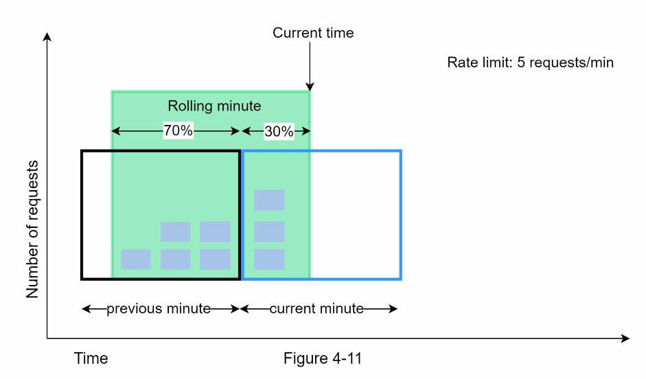

- Áp dụng công thức này, ta có `3 + 5 * 70% = 6,5` yêu cầu (lưu ý: trong sách gốc ghi nhầm là `0.7%`, thực chất là `70%` hay `0.7`). Tùy thuộc vào trường hợp sử dụng, con số này có thể được làm tròn lên hoặc làm tròn xuống. Trong ví dụ của chúng ta, nó được làm tròn xuống thành 6. Vì bộ giới hạn tốc độ cho phép tối đa 7 yêu cầu mỗi phút, yêu cầu hiện tại có thể đi qua. Tuy nhiên, giới hạn sẽ đạt ngưỡng sau khi nhận thêm một yêu cầu nữa.

Do giới hạn về độ dài, chúng ta sẽ không thảo luận cách triển khai thứ hai ở đây. Độc giả quan tâm có thể tham khảo tài liệu tham khảo [9]. Thuật toán này không hoàn hảo; nó có ưu và nhược điểm riêng.

**Ưu điểm:**
- Làm mượt (smooth out) các đợt tăng đột biến lưu lượng vì tốc độ dựa trên tốc độ trung bình của cửa sổ trước đó.
- Tiết kiệm bộ nhớ.

**Nhược điểm:**
- Nó chỉ hoạt động cho các cửa sổ nhìn lại (look back window) không quá khắt khe. Đây là một phép xấp xỉ của tốc độ thực tế vì nó giả định các yêu cầu trong cửa sổ trước được phân bố đều. Tuy nhiên, vấn đề này có thể không tệ như vẻ bề ngoài. Theo các thử nghiệm do Cloudflare thực hiện [10], chỉ có 0,003% yêu cầu bị cho phép nhầm hoặc bị giới hạn nhầm trong số 400 triệu yêu cầu.

> 📝 **Giải thích thêm (không có trong sách):** Bảng so sánh nhanh 5 thuật toán giới hạn tốc độ để dễ lựa chọn trong phỏng vấn thiết kế hệ thống:
>
> | Thuật toán | Bộ nhớ | Độ chính xác | Cho phép burst | Trường hợp sử dụng tiêu biểu |
> | :--- | :--- | :--- | :--- | :--- |
> | **Token Bucket** | Rất thấp (chỉ lưu số token & timestamp nạp cuối) | Cao | Có (tối đa bằng kích thước xô) | API gateway phổ thông (Amazon, Stripe) |
> | **Leaking Bucket** | Thấp (hàng đợi kích thước cố định) | Cao | Không (làm phẳng tốc độ đầu ra) | Xử lý tác vụ cần tốc độ ổn định (Shopify) |
> | **Fixed Window Counter** | Rất thấp (1 bộ đếm/cửa sổ) | Trung bình (lỗi ở biên cửa sổ) | Có thể gấp đôi ở biên | Hệ thống đơn giản, không quá khắt khe |
> | **Sliding Window Log** | Cao (lưu mọi timestamp) | Rất cao (chính xác tuyệt đối) | Không | Yêu cầu độ chính xác nghiêm ngặt, lưu lượng vừa |
> | **Sliding Window Counter** | Thấp (chỉ 2 bộ đếm) | Cao (~99,997% theo Cloudflare) | Không đáng kể | Hệ thống phân tán quy mô lớn (Cloudflare) |

### Kiến trúc cấp cao (High-level architecture)

Ý tưởng cơ bản của các thuật toán giới hạn tốc độ rất đơn giản. Ở mức tổng quan, chúng ta cần một bộ đếm (counter) để theo dõi xem có bao nhiêu yêu cầu được gửi từ cùng một người dùng, địa chỉ IP, v.v. Nếu bộ đếm lớn hơn giới hạn, yêu cầu sẽ bị từ chối.

Chúng ta nên lưu trữ các bộ đếm ở đâu? Sử dụng cơ sở dữ liệu (database) không phải là ý hay vì tốc độ truy cập đĩa chậm. Bộ nhớ đệm trong RAM (in-memory cache) được lựa chọn vì nó nhanh và hỗ trợ chiến lược hết hạn dựa trên thời gian (time-based expiration). Chẳng hạn, Redis [11] là một lựa chọn phổ biến để triển khai giới hạn tốc độ. Đây là một kho lưu trữ trong bộ nhớ (in-memory store) cung cấp hai lệnh: `INCR` và `EXPIRE`.

- `INCR`: Tăng giá trị bộ đếm đang lưu lên 1.
- `EXPIRE`: Thiết lập thời gian chờ hết hạn (timeout) cho bộ đếm. Nếu hết thời gian chờ, bộ đếm sẽ tự động bị xóa.

Hình 4-12 minh họa kiến trúc cấp cao cho việc giới hạn tốc độ, và nó hoạt động như sau:

- Client gửi một yêu cầu đến middleware giới hạn tốc độ.
- Middleware giới hạn tốc độ lấy bộ đếm từ xô (bucket) tương ứng trong Redis và kiểm tra xem giới hạn đã đạt ngưỡng hay chưa.
  - Nếu đã đạt giới hạn, yêu cầu bị từ chối.
  - Nếu chưa đạt giới hạn, yêu cầu được gửi đến các máy chủ API. Đồng thời, hệ thống tăng bộ đếm lên và lưu lại vào Redis.

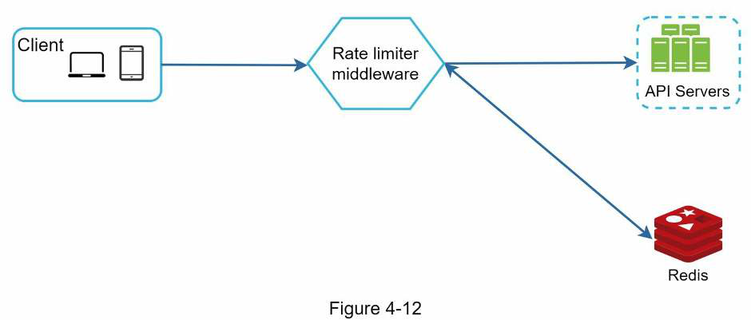

---

## Bước 3 - Đi sâu vào thiết kế (Step 3 - Design deep dive)

Thiết kế cấp cao trong Hình 4-12 chưa trả lời được các câu hỏi sau:

- Các quy tắc giới hạn tốc độ được tạo ra như thế nào? Các quy tắc đó được lưu ở đâu?
- Làm thế nào để xử lý các yêu cầu bị giới hạn tốc độ?

Trong phần này, trước tiên chúng ta sẽ trả lời các câu hỏi liên quan đến quy tắc giới hạn tốc độ và sau đó đi qua các chiến lược xử lý các yêu cầu bị giới hạn. Cuối cùng, chúng ta sẽ thảo luận về giới hạn tốc độ trong môi trường phân tán, một bản thiết kế chi tiết, tối ưu hóa hiệu năng và giám sát hệ thống.

### Quy tắc giới hạn tốc độ (Rate limiting rules)

Lyft đã công khai mã nguồn mở cho thành phần giới hạn tốc độ của họ [12]. Chúng ta sẽ xem qua bên trong thành phần này và nhìn vào một số ví dụ về quy tắc giới hạn tốc độ:

```yaml
domain: messaging
descriptors:
  - key: message_type
    Value: marketing
    rate_limit:
      unit: day
      requests_per_unit: 5
```

Trong ví dụ trên, hệ thống được cấu hình để cho phép tối đa 5 tin nhắn tiếp thị (marketing) mỗi ngày. Dưới đây là một ví dụ khác:

```yaml
domain: auth
descriptors:
  - key: auth_type
    Value: login
    rate_limit:
      unit: minute
      requests_per_unit: 5
```

Quy tắc này cho thấy các client không được phép đăng nhập quá 5 lần trong 1 phút. Các quy tắc thường được viết trong các tệp cấu hình và lưu trên đĩa.

### Vượt quá giới hạn tốc độ (Exceeding the rate limit)

Trong trường hợp một yêu cầu bị giới hạn tốc độ, các API trả về mã phản hồi HTTP 429 (Too Many Requests) cho client. Tùy thuộc vào trường hợp sử dụng, chúng ta có thể đưa các yêu cầu bị giới hạn vào hàng đợi (enqueue) để xử lý sau. Ví dụ, nếu một số đơn hàng bị giới hạn tốc độ do hệ thống quá tải, chúng ta có thể giữ lại các đơn hàng đó để xử lý sau.

### Các tiêu đề của bộ giới hạn tốc độ (Rate limiter headers)

Làm thế nào một client biết được mình có đang bị điều tiết hay không? Và làm thế nào một client biết được số lượng yêu cầu còn lại được phép gửi trước khi bị điều tiết? Câu trả lời nằm ở các tiêu đề phản hồi HTTP (HTTP response headers). Bộ giới hạn tốc độ trả về các tiêu đề HTTP sau cho client:

- `X-Ratelimit-Remaining`: Số lượng yêu cầu được phép còn lại trong cửa sổ thời gian hiện tại.
- `X-Ratelimit-Limit`: Cho biết tổng số lời gọi mà client có thể thực hiện trong mỗi cửa sổ thời gian.
- `X-Ratelimit-Retry-After`: Số giây cần chờ cho đến khi bạn có thể gửi lại yêu cầu mà không bị điều tiết.

Khi người dùng đã gửi quá nhiều yêu cầu, lỗi `429 Too Many Requests` và tiêu đề `X-Ratelimit-Retry-After` sẽ được trả về cho client.

### Thiết kế chi tiết (Detailed design)

Hình 4-13 trình bày bản thiết kế chi tiết của hệ thống.

- Các quy tắc (rules) được lưu trên đĩa. Các worker thường xuyên kéo (pull) các quy tắc từ đĩa và lưu trữ chúng trong bộ nhớ đệm (cache).
- Khi một client gửi yêu cầu đến máy chủ, yêu cầu được chuyển đến middleware giới hạn tốc độ trước tiên.
- Middleware giới hạn tốc độ tải các quy tắc từ cache. Nó lấy các bộ đếm và timestamp của yêu cầu gần nhất từ Redis cache. Dựa trên phản hồi nhận được, bộ giới hạn tốc độ quyết định:
  - Nếu yêu cầu không bị giới hạn tốc độ, nó được chuyển tiếp đến các máy chủ API.
  - Nếu yêu cầu bị giới hạn tốc độ, bộ giới hạn tốc độ trả về lỗi `429 Too Many Requests` cho client. Trong lúc đó, yêu cầu có thể bị hủy bỏ hoặc được chuyển tiếp vào hàng đợi.

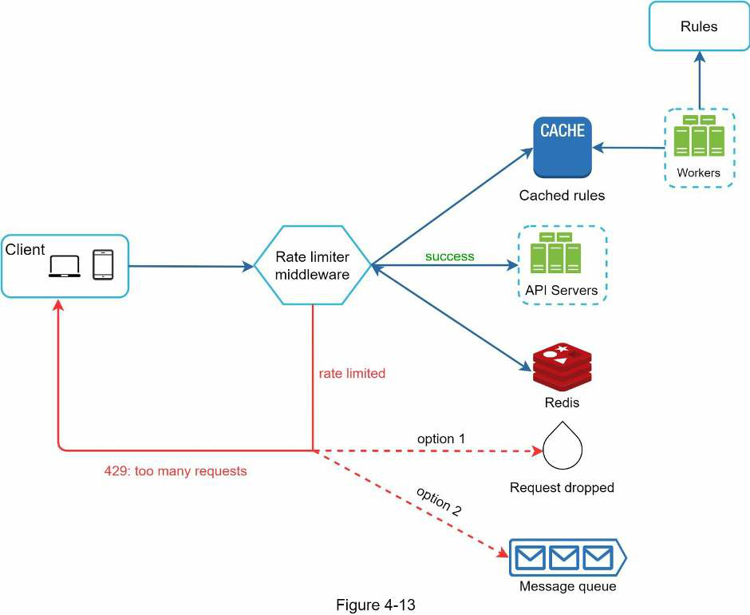

> 📝 **Giải thích thêm (không có trong sách):** Sơ đồ luồng xử lý của bản thiết kế chi tiết bằng Mermaid:
> ```mermaid
> flowchart TD
>     A[Client gửi HTTP Request] --> B[Rate Limiter Middleware]
>     C[(Disk: Rule Configs)] -->|Workers định kỳ đồng bộ| D[(Rules Cache)]
>     D -->|Đọc quy tắc| B
>     B <-->|Đọc/Cập nhật bộ đếm & timestamp| E[(Redis Cache)]
>     B -->|Chưa vượt giới hạn| F[API Servers]
>     B -->|Vượt giới hạn| G[Trả về HTTP 429 + Headers]
>     B -.->|Tùy chọn: xử lý sau| H[Message Queue]
> ```

### Bộ giới hạn tốc độ trong môi trường phân tán (Rate limiter in a distributed environment)

Xây dựng một bộ giới hạn tốc độ hoạt động trong môi trường một máy chủ duy nhất không khó. Tuy nhiên, việc mở rộng hệ thống để hỗ trợ nhiều máy chủ và nhiều luồng đồng thời (concurrent threads) lại là một câu chuyện khác. Có hai thách thức chính:

- Tranh chấp dữ liệu / Điều kiện chạy đua (Race condition)
- Vấn đề đồng bộ hóa (Synchronization issue)

#### Điều kiện chạy đua (Race condition)

Như đã thảo luận trước đó, bộ giới hạn tốc độ hoạt động ở mức tổng quan như sau:

- Đọc giá trị bộ đếm từ Redis.
- Kiểm tra xem `(counter + 1)` có vượt quá ngưỡng hay không.
- Nếu không, tăng giá trị bộ đếm trong Redis lên 1.

Điều kiện chạy đua (race condition) có thể xảy ra trong môi trường có mức độ đồng thời cao như minh họa trong Hình 4-14. Giả sử giá trị bộ đếm trong Redis đang là 3. Nếu hai yêu cầu đồng thời đọc giá trị bộ đếm trước khi một trong hai kịp ghi giá trị mới lại, mỗi yêu cầu sẽ tăng bộ đếm lên 1 và ghi lại mà không kiểm tra luồng kia. Cả hai yêu cầu (luồng) đều tin rằng chúng có giá trị bộ đếm đúng là 4. Tuy nhiên, giá trị bộ đếm đúng phải là 5.

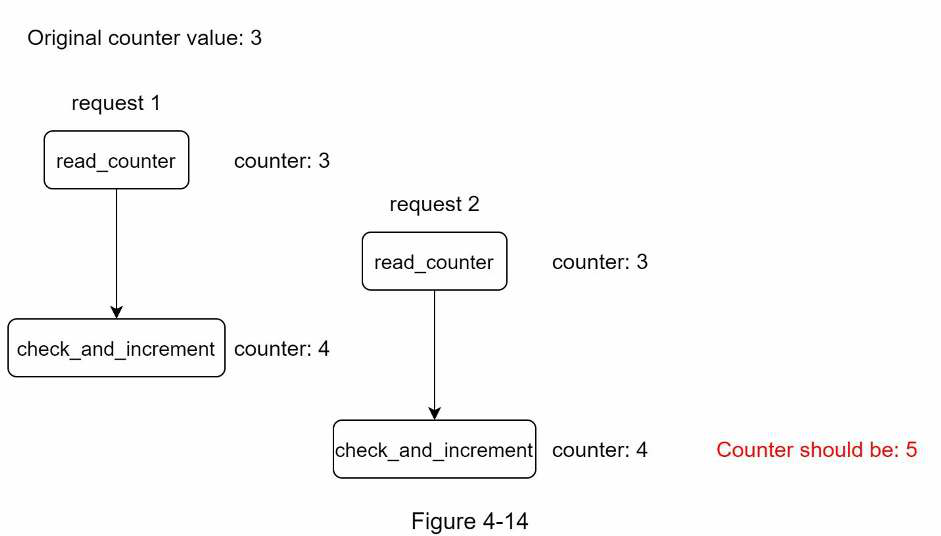

Khóa (Locks) là giải pháp hiển nhiên nhất để giải quyết điều kiện chạy đua. Tuy nhiên, khóa sẽ làm chậm hệ thống một cách đáng kể. Hai chiến lược thường được sử dụng để giải quyết vấn đề này là: **Lua script** [13] và cấu trúc dữ liệu **sorted sets** trong Redis [8]. Đối với độc giả quan tâm đến các chiến lược này, hãy tham khảo các tài liệu tương ứng [8] [13].

> 💡 **Ví dụ bổ sung (không có trong sách):** Vì Redis thực thi một Lua script như một thao tác nguyên tử (atomic operation) trên luồng đơn của nó, nên không có lệnh Redis nào khác có thể chen ngang vào giữa quá trình đọc và ghi. Dưới đây là một ví dụ Lua script đơn giản cho thuật toán Fixed Window Counter:
> ```lua
> local key = KEYS[1]
> local limit = tonumber(ARGV[1])
> local window = tonumber(ARGV[2])
>
> local current = tonumber(redis.call("GET", key) or "0")
> if current + 1 > limit then
>     return 0 -- Bị từ chối (rate limited)
> else
>     local new_val = redis.call("INCR", key)
>     if new_val == 1 then
>         redis.call("EXPIRE", key, window)
>     end
>     return 1 -- Được phép đi qua
> end
> ```

#### Vấn đề đồng bộ hóa (Synchronization issue)

Đồng bộ hóa là một yếu tố quan trọng khác cần xem xét trong môi trường phân tán. Để hỗ trợ hàng triệu người dùng, một máy chủ bộ giới hạn tốc độ có thể không đủ để xử lý lưu lượng. Khi nhiều máy chủ bộ giới hạn tốc độ được sử dụng, việc đồng bộ hóa là bắt buộc. Ví dụ, ở phía bên trái của Hình 4-15, client 1 gửi yêu cầu đến bộ giới hạn tốc độ 1, và client 2 gửi yêu cầu đến bộ giới hạn tốc độ 2. Vì tầng web không lưu trạng thái (stateless), các client có thể gửi yêu cầu đến một bộ giới hạn tốc độ khác như minh họa ở phía bên phải của Hình 4-15. Nếu không có sự đồng bộ hóa, bộ giới hạn tốc độ 1 sẽ không chứa bất kỳ dữ liệu nào về client 2. Do đó, bộ giới hạn tốc độ không thể hoạt động chính xác.

Một giải pháp khả thi là sử dụng phiên dính (sticky sessions) cho phép một client luôn gửi lưu lượng đến cùng một bộ giới hạn tốc độ. Giải pháp này không được khuyến khích vì nó không có khả năng mở rộng (scalable) cũng như không linh hoạt. Một cách tiếp cận tốt hơn là sử dụng các kho lưu trữ dữ liệu tập trung như Redis. Thiết kế này được minh họa trong Hình 4-16.

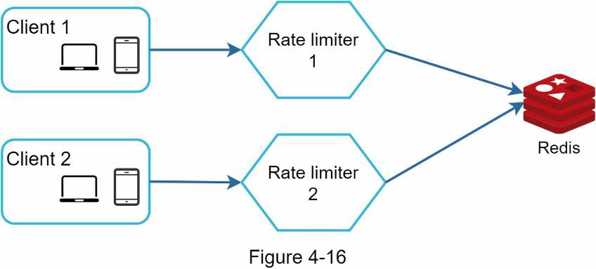

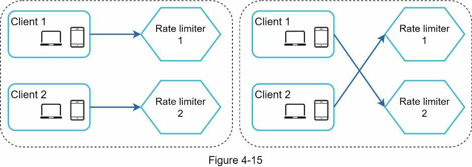

### Tối ưu hóa hiệu năng (Performance optimization)

Tối ưu hóa hiệu năng là một chủ đề phổ biến trong các buổi phỏng vấn thiết kế hệ thống. Chúng ta sẽ đề cập đến hai khía cạnh cần cải thiện.

Thứ nhất, thiết lập đa trung tâm dữ liệu (multi-data center setup) rất quan trọng đối với bộ giới hạn tốc độ vì độ trễ sẽ cao đối với những người dùng ở xa trung tâm dữ liệu. Hầu hết các nhà cung cấp dịch vụ đám mây xây dựng nhiều vị trí máy chủ biên (edge server locations) trên toàn thế giới. Ví dụ, tính đến ngày 20/05/2020, Cloudflare có 194 máy chủ biên phân bố theo địa lý [14]. Lưu lượng truy cập được tự động định tuyến đến máy chủ biên gần nhất để giảm độ trễ.

Thứ hai, đồng bộ hóa dữ liệu theo mô hình nhất quán cuối cùng (eventual consistency model). Nếu bạn chưa rõ về mô hình nhất quán cuối cùng, hãy tham khảo phần "Tính nhất quán" (Consistency) trong "Chương 6: Thiết kế kho lưu trữ Khóa-Giá trị (Design a Key-value Store)".

### Giám sát (Monitoring)

Sau khi bộ giới hạn tốc độ được đưa vào hoạt động, việc thu thập dữ liệu phân tích để kiểm tra xem bộ giới hạn tốc độ có hiệu quả hay không là rất quan trọng. Chủ yếu, chúng ta muốn đảm bảo hai điều:

- Thuật toán giới hạn tốc độ có hiệu quả.
- Các quy tắc giới hạn tốc độ có hiệu quả.

Ví dụ, nếu các quy tắc giới hạn tốc độ quá khắt khe, nhiều yêu cầu hợp lệ sẽ bị hủy bỏ. Trong trường hợp này, chúng ta muốn nới lỏng các quy tắc một chút. Trong một ví dụ khác, chúng ta nhận thấy bộ giới hạn tốc độ trở nên kém hiệu quả khi có sự gia tăng lưu lượng đột ngột như các đợt giảm giá chớp nhoáng (flash sales). Trong kịch bản này, chúng ta có thể thay thế thuật toán để hỗ trợ lưu lượng tăng đột biến. Thuật toán xô token là một lựa chọn phù hợp ở đây.

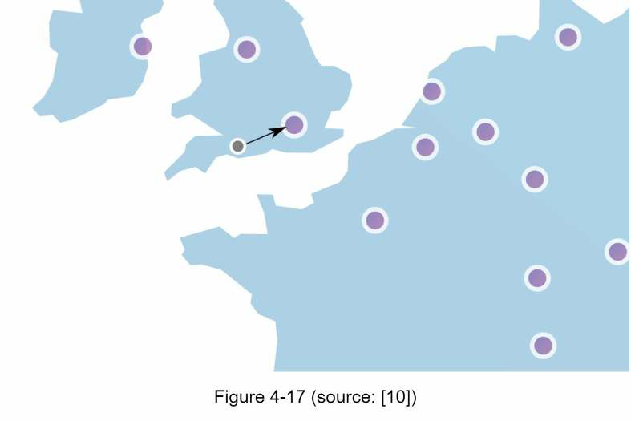

---

## Bước 4 - Tổng kết (Step 4 - Wrap up)

Trong chương này, chúng ta đã thảo luận về các thuật toán giới hạn tốc độ khác nhau cùng với ưu/nhược điểm của chúng. Các thuật toán đã thảo luận bao gồm:

- Xô token (Token bucket)
- Xô rò rỉ (Leaking bucket)
- Cửa sổ cố định (Fixed window)
- Nhật ký cửa sổ trượt (Sliding window log)
- Bộ đếm cửa sổ trượt (Sliding window counter)

Sau đó, chúng ta đã thảo luận về kiến trúc hệ thống, bộ giới hạn tốc độ trong môi trường phân tán, tối ưu hóa hiệu năng và giám sát. Tương tự như bất kỳ câu hỏi phỏng vấn thiết kế hệ thống nào, có những điểm thảo luận bổ sung mà bạn có thể đề cập nếu còn thời gian:

- **Giới hạn tốc độ cứng so với mềm (Hard vs soft rate limiting):**
  - *Cứng (Hard):* Số lượng yêu cầu không thể vượt quá ngưỡng quy định.
  - *Mềm (Soft):* Các yêu cầu có thể vượt quá ngưỡng trong một khoảng thời gian ngắn.
- **Giới hạn tốc độ ở các tầng khác nhau (Rate limiting at different levels):** Trong chương này, chúng ta chỉ nói về việc giới hạn tốc độ ở tầng ứng dụng (HTTP: tầng 7). Hoàn toàn có thể áp dụng giới hạn tốc độ ở các tầng khác. Ví dụ, bạn có thể áp dụng giới hạn tốc độ theo địa chỉ IP bằng cách sử dụng `Iptables` [15] (IP: tầng 3).
  - *Lưu ý:* Mô hình Kết nối Hệ thống Mở (Open Systems Interconnection model - OSI model) có 7 tầng [16]: Tầng 1: Tầng vật lý (Physical layer), Tầng 2: Tầng liên kết dữ liệu (Data link layer), Tầng 3: Tầng mạng (Network layer), Tầng 4: Tầng giao vận (Transport layer), Tầng 5: Tầng phiên (Session layer), Tầng 6: Tầng trình diễn (Presentation layer), Tầng 7: Tầng ứng dụng (Application layer).
- **Tránh bị giới hạn tốc độ (Avoid being rate limited):** Hãy thiết kế client của bạn theo các thực hành tốt nhất (best practices):
  - Sử dụng bộ nhớ đệm phía client (client cache) để tránh thực hiện các lời gọi API thường xuyên.
  - Hiểu rõ giới hạn và không gửi quá nhiều yêu cầu trong một khung thời gian ngắn.
  - Đưa vào mã nguồn phần bắt ngoại lệ hoặc lỗi để client của bạn có thể khôi phục mượt mà (gracefully recover) từ các ngoại lệ.
  - Thêm thời gian lùi đủ dài (back off time) vào logic thử lại (retry logic).

> 💡 **Ví dụ bổ sung (không có trong sách):** Thực hành tốt nhất cho logic thử lại phía client là sử dụng **Exponential Backoff kèm Jitter** (tăng thời gian chờ theo cấp số nhân kèm độ nhiễu ngẫu nhiên). Nếu bị trả về HTTP `429`, client trước tiên nên tôn trọng tiêu đề `X-Ratelimit-Retry-After` (hoặc `Retry-After`). Nếu không có tiêu đề này, client có thể chờ `base_delay * 2^attempt + random_jitter` để tránh tình trạng hàng loạt client đồng loạt thử lại vào cùng một thời điểm (thundering herd problem).

Chúc mừng bạn đã đi được đến đây! Bây giờ hãy tự vỗ vai khen ngợi bản thân mình đi nào. Làm tốt lắm!

---

## Tài liệu tham khảo (Reference materials)

- [1] Rate-limiting strategies and techniques: https://cloud.google.com/solutions/rate-limiting-strategies-techniques
- [2] Twitter rate limits: https://developer.twitter.com/en/docs/basics/rate-limits
- [3] Google docs usage limits: https://developers.google.com/docs/api/limits
- [4] IBM microservices: https://www.ibm.com/cloud/learn/microservices
- [5] Throttle API requests for better throughput: https://docs.aws.amazon.com/apigateway/latest/developerguide/api-gateway-request-throttling.html
- [6] Stripe rate limiters: https://stripe.com/blog/rate-limiters
- [7] Shopify REST Admin API rate limits: https://help.shopify.com/en/api/reference/rest-admin-api-rate-limits
- [8] Better Rate Limiting With Redis Sorted Sets: https://engineering.classdojo.com/blog/2015/02/06/rolling-rate-limiter/
- [9] System Design — Rate limiter and Data modelling: https://medium.com/@saisandeepmopuri/system-design-rate-limiter-and-data-modelling-9304b0d18250
- [10] How we built rate limiting capable of scaling to millions of domains: https://blog.cloudflare.com/counting-things-a-lot-of-different-things/
- [11] Redis website: https://redis.io/
- [12] Lyft rate limiting: https://github.com/lyft/ratelimit
- [13] Scaling your API with rate limiters: https://gist.github.com/ptarjan/e38f45f2dfe601419ca3af937fff574d#request-rate-limiter
- [14] What is edge computing: https://www.cloudflare.com/learning/serverless/glossary/what-is-edge-computing/
- [15] Rate Limit Requests with Iptables: https://blog.programster.org/rate-limit-requests-with-iptables
- [16] OSI model: https://en.wikipedia.org/wiki/OSI_model#Layer_architecture

---

## Bảng thuật ngữ chương (Chapter Glossary)

| Thuật ngữ (English) | Tiếng Việt | Giải thích ngắn gọn |
| :--- | :--- | :--- |
| Rate limiter | Bộ giới hạn tốc độ | Thành phần kiểm soát và giới hạn số lượng yêu cầu được phép gửi trong một khoảng thời gian. |
| Throttling | Điều tiết | Hành động làm chậm hoặc chặn các yêu cầu vượt quá ngưỡng cho phép. |
| Denial of Service (DoS) | Tấn công từ chối dịch vụ | Cuộc tấn công làm cạn kiệt tài nguyên hệ thống bằng lượng yêu cầu khổng lồ. |
| API Gateway | Cổng API | Thành phần trung gian quản lý định tuyến, xác thực, giới hạn tốc độ cho các microservices. |
| Token bucket | Xô token | Thuật toán dùng xô chứa token nạp định kỳ; mỗi yêu cầu tiêu thụ một token. |
| Leaking bucket | Xô rò rỉ | Thuật toán dùng hàng đợi FIFO để xử lý các yêu cầu ở một tốc độ đầu ra cố định. |
| Fixed window counter | Bộ đếm cửa sổ cố định | Thuật toán chia thời gian thành các khung cố định và đếm số yêu cầu trong từng khung. |
| Sliding window log | Nhật ký cửa sổ trượt | Thuật toán lưu timestamp các yêu cầu để đếm chính xác trong khoảng thời gian trượt. |
| Sliding window counter | Bộ đếm cửa sổ trượt | Thuật toán lai tính trọng số giữa cửa sổ hiện tại và cửa sổ trước đó để tiết kiệm bộ nhớ. |
| Race condition | Điều kiện chạy đua / Tranh chấp dữ liệu | Lỗi xảy ra khi nhiều luồng đọc và ghi cùng một dữ liệu đồng thời làm sai lệch kết quả. |
| Sticky session | Phiên dính | Cơ chế luôn định tuyến mọi yêu cầu của một client về cùng một máy chủ cố định. |
| Edge server | Máy chủ biên | Máy chủ đặt gần người dùng cuối về mặt địa lý để giảm độ trễ mạng. |
| Eventual consistency | Tính nhất quán cuối cùng | Mô hình dữ liệu đảm bảo các bản sao sẽ đồng bộ khớp nhau sau một khoảng thời gian nhất định. |
| Back off time | Thời gian lùi (chờ thử lại) | Khoảng thời gian client tạm dừng trước khi gửi lại yêu cầu bị từ chối. |
