# CHƯƠNG 5: THIẾT KẾ BĂM NHẤT QUÁN (CHAPTER 5: DESIGN CONSISTENT HASHING)

Để đạt được khả năng mở rộng theo chiều ngang (horizontal scaling), việc phân phối các yêu cầu/dữ liệu một cách hiệu quả và đồng đều qua các máy chủ là vô cùng quan trọng. Băm nhất quán (consistent hashing) là một kỹ thuật thường được sử dụng để đạt được mục tiêu này. Nhưng trước tiên, hãy cùng xem xét kỹ lưỡng vấn đề đặt ra.

## Vấn đề băm lại (The rehashing problem)

Nếu bạn có $n$ máy chủ bộ nhớ đệm (cache servers), một cách phổ biến để cân bằng tải là sử dụng phương pháp băm sau:

`serverIndex = hash(key) % N`, trong đó $N$ là kích thước của cụm máy chủ (server pool).

Hãy sử dụng một ví dụ để minh họa cách nó hoạt động. Như minh họa trong Bảng 5-1 (`Table 5-1`), chúng ta có 4 máy chủ và 8 khóa chuỗi (string keys) cùng với các giá trị băm của chúng.

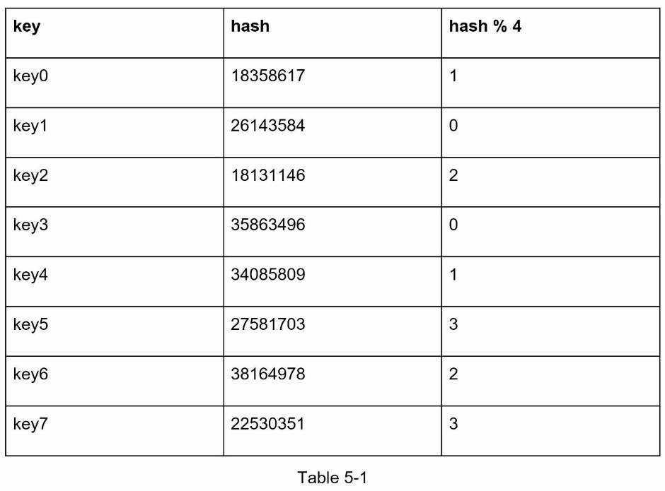

Để tìm máy chủ nơi một khóa được lưu trữ, chúng ta thực hiện phép toán chia lấy dư `f(key) % 4`. Ví dụ, `hash(key0) % 4 = 1` có nghĩa là máy khách (client) phải liên hệ với máy chủ 1 (server 1) để lấy dữ liệu được lưu trong bộ nhớ đệm.

Hình 5-1 (`Figure 5-1`) minh họa sự phân phối các khóa dựa trên Bảng 5-1 (`Table 5-1`).

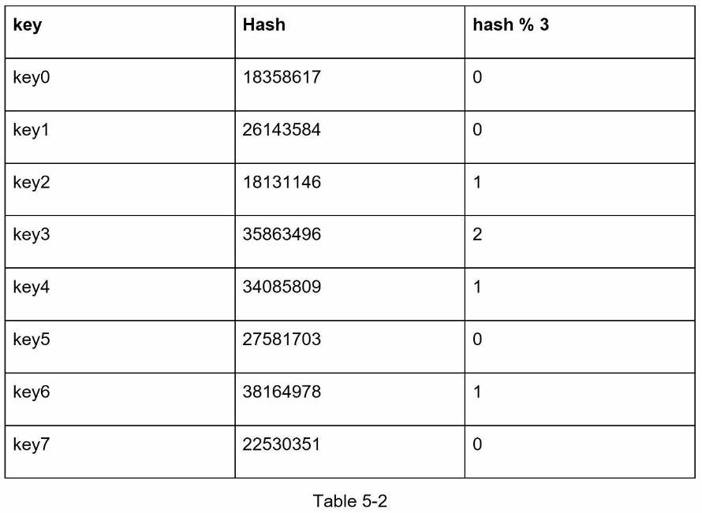

Cách tiếp cận này hoạt động tốt khi kích thước của cụm máy chủ là cố định và dữ liệu được phân phối đồng đều. Tuy nhiên, vấn đề sẽ nảy sinh khi các máy chủ mới được thêm vào hoặc các máy chủ hiện có bị gỡ bỏ. Ví dụ, nếu máy chủ 1 (server 1) ngừng hoạt động (offline), kích thước của cụm máy chủ trở thành 3. Sử dụng cùng một hàm băm, chúng ta thu được cùng một giá trị băm cho một khóa. Nhưng việc áp dụng phép toán chia lấy dư sẽ cho ra các chỉ số máy chủ (server indexes) khác nhau vì số lượng máy chủ đã giảm đi 1. Chúng ta thu được kết quả như trong Bảng 5-2 (`Table 5-2`) bằng cách áp dụng `hash % 3`:

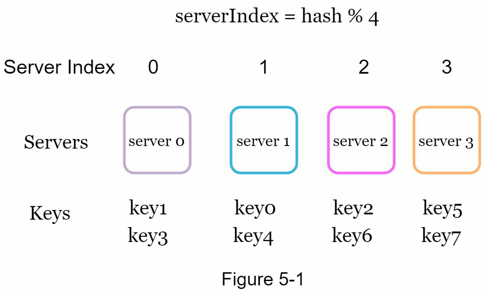

Hình 5-2 (`Figure 5-2`) minh họa sự phân phối mới của các khóa dựa trên Bảng 5-2 (`Table 5-2`).

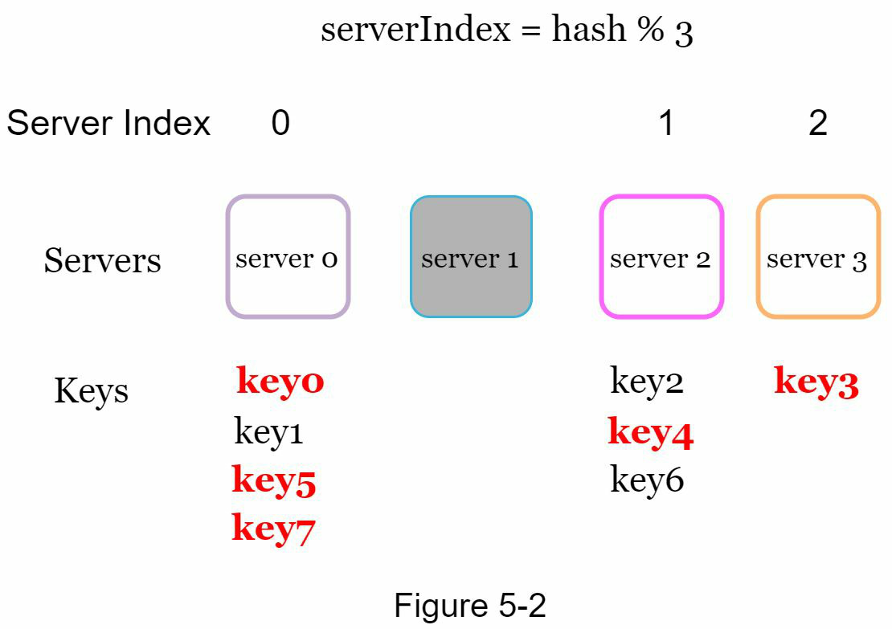

Như minh họa trong Hình 5-2 (`Figure 5-2`), hầu hết các khóa đều bị phân phối lại, chứ không chỉ riêng những khóa ban đầu được lưu trữ trên máy chủ ngừng hoạt động (máy chủ 1). Điều này có nghĩa là khi máy chủ 1 ngừng hoạt động, hầu hết các máy khách bộ nhớ đệm (cache clients) sẽ kết nối đến sai máy chủ để lấy dữ liệu. Điều này gây ra một cơn bão lỗi bộ nhớ đệm (cache misses). Băm nhất quán (consistent hashing) là một kỹ thuật hiệu quả để giảm thiểu vấn đề này.

> 💡 **Ví dụ bổ sung (không có trong sách):**
> Giả sử bạn có 4 máy chủ cache (`S0`, `S1`, `S2`, `S3`) lưu trữ 1 triệu khóa người dùng bằng công thức `hash(user_id) % 4`. Nếu `S1` bị sập, công thức chuyển thành `hash(user_id) % 3`. Với một `hash` ngẫu nhiên, xác suất để `hash % 4 == hash % 3` chỉ rơi vào khoảng 25% (ví dụ `hash = 0, 1, 2` giữ nguyên, nhưng `3, 4, 5, 6, 7, 8, 9, 10, 11` hầu hết đổi vị trí). Kết quả là khoảng 75% số khóa bị thay đổi máy chủ ánh xạ! Hàng trăm nghìn yêu cầu đồng thời không tìm thấy dữ liệu trong cache (cache miss) và đổ dồn xuống cơ sở dữ liệu (database), dễ dẫn đến sập toàn bộ hệ thống.

## Băm nhất quán (Consistent hashing)

Trích dẫn từ Wikipedia: "Băm nhất quán là một loại băm đặc biệt sao cho khi một bảng băm (hash table) được thay đổi kích thước và băm nhất quán được sử dụng, trung bình chỉ có $k/n$ khóa cần được ánh xạ lại, trong đó $k$ là số lượng khóa và $n$ là số lượng khe (slots). Ngược lại, trong hầu hết các bảng băm truyền thống, sự thay đổi về số lượng khe mảng khiến gần như tất cả các khóa đều phải được ánh xạ lại [1]”.

### Không gian băm và vòng băm (Hash space and hash ring)

Bây giờ chúng ta đã hiểu định nghĩa của băm nhất quán, hãy cùng tìm hiểu cách nó hoạt động. Giả sử SHA-1 được sử dụng làm hàm băm $f$, và dải đầu ra của hàm băm là: $x_0, x_1, x_2, x_3, \dots, x_n$. Trong mật mã học, không gian băm (hash space) của SHA-1 trải dài từ $0$ đến $2^{160} - 1$. Điều đó có nghĩa là $x_0$ tương ứng với $0$, $x_n$ tương ứng với $2^{160} - 1$, và tất cả các giá trị băm khác ở giữa nằm trong khoảng từ $0$ đến $2^{160} - 1$. Hình 5-3 (`Figure 5-3`) minh họa không gian băm.

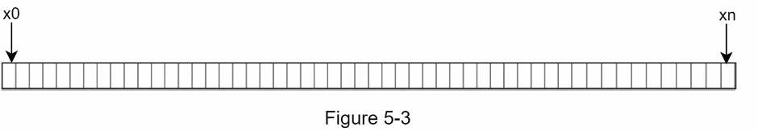

Bằng cách nối hai đầu lại với nhau, chúng ta thu được một vòng băm (hash ring) như minh họa trong Hình 5-4 (`Figure 5-4`):

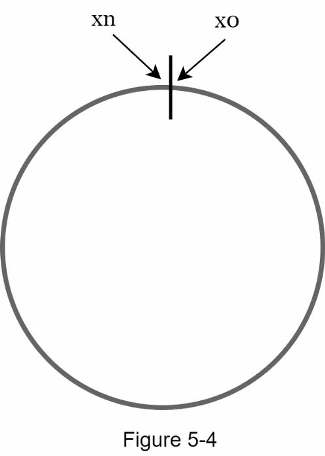

### Băm các máy chủ (Hash servers)

Sử dụng cùng hàm băm $f$, chúng ta ánh xạ các máy chủ lên vòng băm dựa trên địa chỉ IP hoặc tên máy chủ. Hình 5-5 (`Figure 5-5`) cho thấy 4 máy chủ được ánh xạ trên vòng băm.

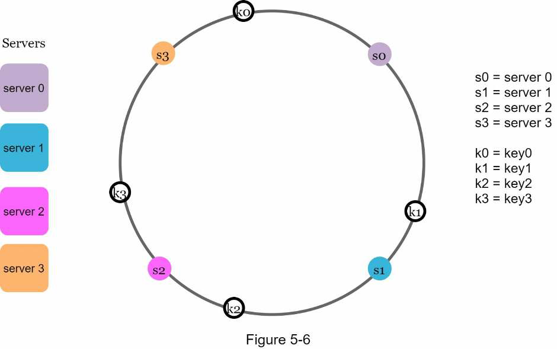

### Băm các khóa (Hash keys)

Một điều đáng lưu ý là hàm băm được sử dụng ở đây khác với hàm băm trong "vấn đề băm lại", và không có phép toán chia lấy dư (modular operation). Như minh họa trong Hình 5-6 (`Figure 5-6`), 4 khóa bộ nhớ đệm (`key0`, `key1`, `key2`, và `key3`) được băm lên vòng băm.

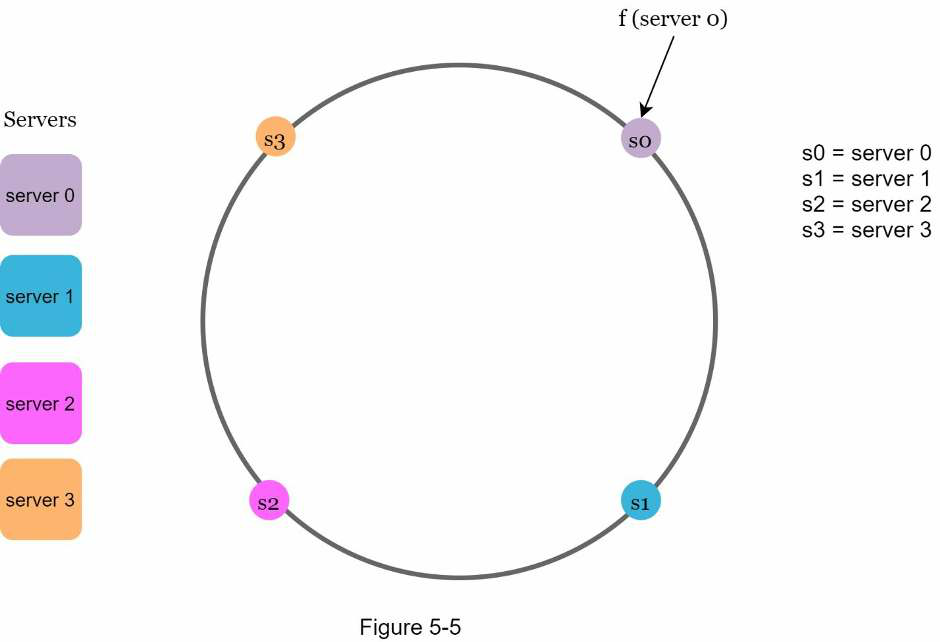

### Tra cứu máy chủ (Server lookup)

Để xác định xem một khóa được lưu trữ trên máy chủ nào, chúng ta đi theo chiều kim đồng hồ (clockwise) từ vị trí của khóa trên vòng cho đến khi tìm thấy một máy chủ. Hình 5-7 (`Figure 5-7`) giải thích quy trình này. Đi theo chiều kim đồng hồ, `key0` được lưu trên `server 0`; `key1` được lưu trên `server 1`; `key2` được lưu trên `server 2` và `key3` được lưu trên `server 3`.

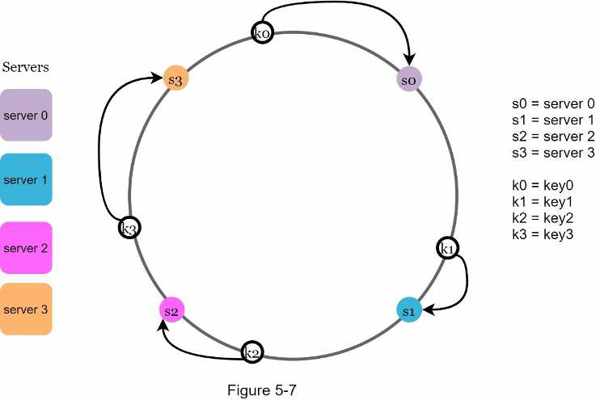

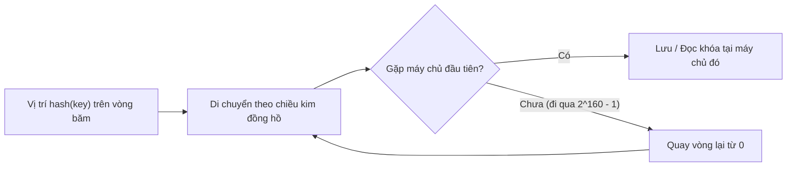

### Thêm một máy chủ (Add a server)

Sử dụng logic được mô tả ở trên, việc thêm một máy chủ mới sẽ chỉ yêu cầu phân phối lại một phần nhỏ các khóa.

Trong Hình 5-8 (`Figure 5-8`), sau khi một máy chủ mới `server 4` được thêm vào, chỉ có `key0` cần được phân phối lại. `k1`, `k2`, và `k3` vẫn nằm trên các máy chủ cũ. Hãy xem xét kỹ logic này. Trước khi `server 4` được thêm vào, `key0` được lưu trữ trên `server 0`. Bây giờ, `key0` sẽ được lưu trữ trên `server 4` vì `server 4` là máy chủ đầu tiên nó gặp khi đi theo chiều kim đồng hồ từ vị trí của `key0` trên vòng. Các khóa khác không bị phân phối lại theo thuật toán băm nhất quán.

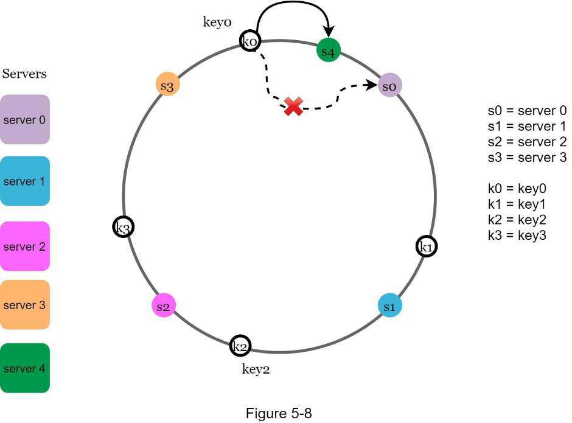

### Gỡ bỏ một máy chủ (Remove a server)

Khi một máy chủ bị gỡ bỏ, chỉ một phần nhỏ các khóa cần được phân phối lại với băm nhất quán. Trong Hình 5-9 (`Figure 5-9`), khi `server 1` bị gỡ bỏ, chỉ có `key1` phải được ánh xạ lại sang `server 2`. Phần còn lại của các khóa không bị ảnh hưởng.

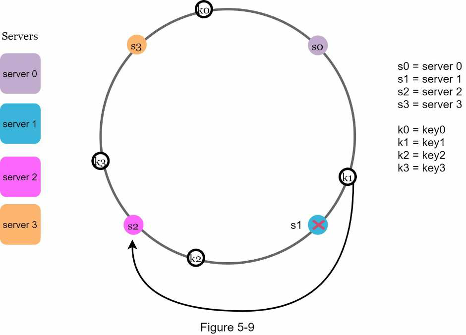

### Hai vấn đề trong cách tiếp cận cơ bản (Two issues in the basic approach)

Thuật toán băm nhất quán được giới thiệu bởi Karger và cộng sự tại MIT [1]. Các bước cơ bản là:
- Ánh xạ các máy chủ và các khóa lên vòng băm bằng một hàm băm phân phối đều (uniformly distributed hash function).
- Để tìm xem một khóa được ánh xạ tới máy chủ nào, đi theo chiều kim đồng hồ từ vị trí của khóa cho đến khi tìm thấy máy chủ đầu tiên trên vòng.

Có hai vấn đề được xác định với cách tiếp cận này. Thứ nhất, không thể giữ kích thước của các phân vùng (partitions) trên vòng băm bằng nhau cho tất cả các máy chủ khi xét đến việc một máy chủ có thể được thêm vào hoặc gỡ bỏ. Một phân vùng là không gian băm nằm giữa các máy chủ liền kề. Có khả năng kích thước của các phân vùng trên vòng được gán cho mỗi máy chủ là rất nhỏ hoặc khá lớn. Trong Hình 5-10 (`Figure 5-10`), nếu `s1` bị gỡ bỏ, phân vùng của `s2` (được đánh dấu bằng mũi tên hai chiều) sẽ lớn gấp đôi phân vùng của `s0` và `s3`.

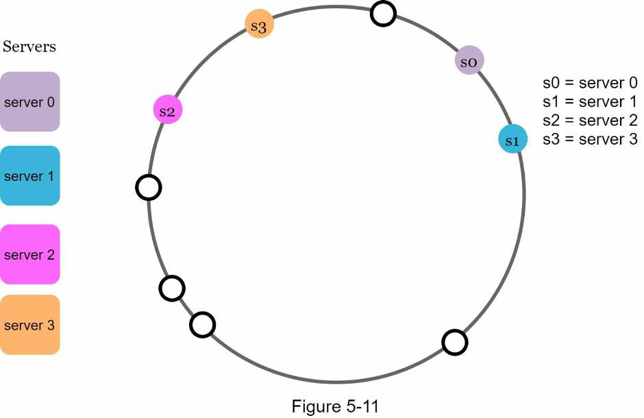

Thứ hai, có thể xảy ra tình trạng phân phối khóa không đồng đều trên vòng. Ví dụ, nếu các máy chủ được ánh xạ đến các vị trí như liệt kê trong Hình 5-11 (`Figure 5-11`), hầu hết các khóa sẽ được lưu trữ trên `server 2`. Trong khi đó, `server 1` và `server 3` không có dữ liệu nào.

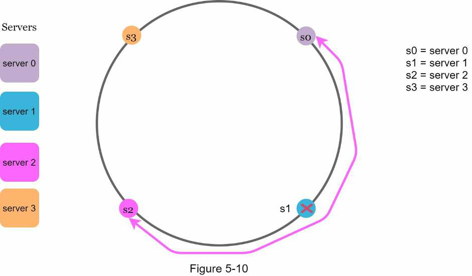

Một kỹ thuật gọi là các nút ảo (virtual nodes) hoặc bản sao (replicas) được sử dụng để giải quyết các vấn đề này.

### Các nút ảo (Virtual nodes)

Một nút ảo (virtual node) tham chiếu đến nút thực (real node), và mỗi máy chủ được đại diện bởi nhiều nút ảo trên vòng băm. Trong Hình 5-12 (`Figure 5-12`), cả `server 0` và `server 1` đều có 3 nút ảo. Con số 3 được chọn một cách tùy ý; và trong các hệ thống thực tế, số lượng nút ảo lớn hơn nhiều. Thay vì sử dụng `s0`, chúng ta có `s0_0`, `s0_1`, và `s0_2` để đại diện cho `server 0` trên vòng. Tương tự, `s1_0`, `s1_1`, và `s1_2` đại diện cho `server 1` trên vòng. Với các nút ảo, mỗi máy chủ chịu trách nhiệm cho nhiều phân vùng. Các phân vùng (cung tròn) có nhãn `s0` được quản lý bởi `server 0`. Mặt khác, các phân vùng có nhãn `s1` được quản lý bởi `server 1`.

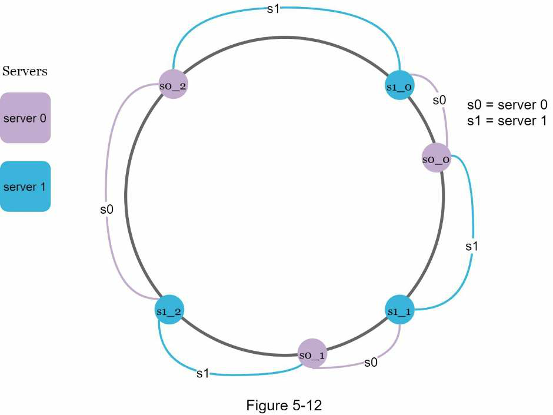

Để tìm xem một khóa được lưu trữ trên máy chủ nào, chúng ta đi theo chiều kim đồng hồ từ vị trí của khóa và tìm nút ảo đầu tiên gặp phải trên vòng. Trong Hình 5-13 (`Figure 5-13`), để tìm xem `k0` được lưu trên máy chủ nào, chúng ta đi theo chiều kim đồng hồ từ vị trí của `k0` và tìm thấy nút ảo `s1_1`, nút này trỏ tới `server 1`.

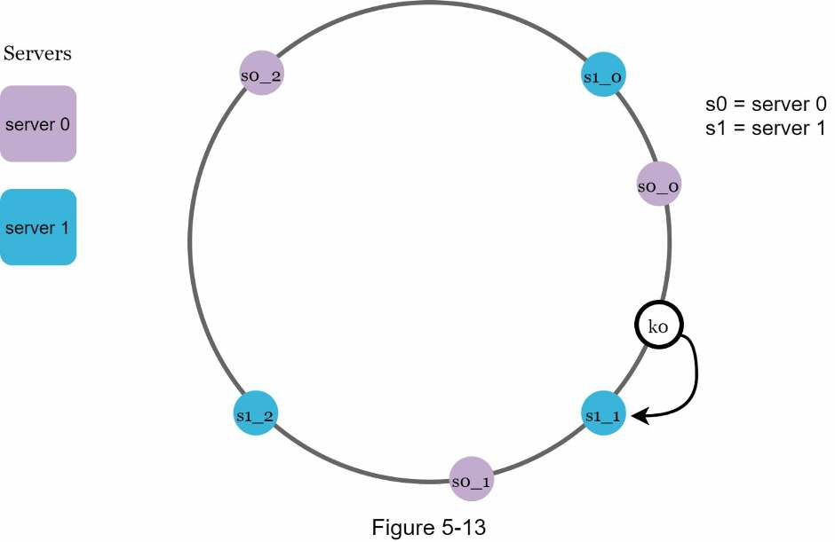

Khi số lượng nút ảo tăng lên, sự phân phối các khóa trở nên cân bằng hơn. Điều này là do độ lệch chuẩn (standard deviation) trở nên nhỏ hơn khi có nhiều nút ảo hơn, dẫn đến việc phân phối dữ liệu cân bằng. Độ lệch chuẩn đo lường mức độ phân tán của dữ liệu. Kết quả của một thử nghiệm được thực hiện bởi một nghiên cứu trực tuyến [2] cho thấy với một hoặc hai trăm nút ảo, độ lệch chuẩn nằm trong khoảng từ 5% (200 nút ảo) đến 10% (100 nút ảo) so với giá trị trung bình. Độ lệch chuẩn sẽ càng nhỏ khi chúng ta tăng số lượng nút ảo. Tuy nhiên, sẽ cần nhiều không gian hơn để lưu trữ dữ liệu về các nút ảo. Đây là một sự đánh đổi (tradeoff), và chúng ta có thể điều chỉnh số lượng nút ảo để phù hợp với các yêu cầu của hệ thống.

> 📝 **Giải thích thêm (không có trong sách):**
> Trong thực tế, kỹ thuật nút ảo còn giúp xử lý tốt trường hợp các máy chủ có cấu hình phần cứng không đồng nhất (heterogeneous servers). Ví dụ, nếu `server A` có RAM gấp đôi `server B`, bạn có thể gán cho `server A` 200 nút ảo và `server B` 100 nút ảo. Nhờ đó, `server A` sẽ tự nhiên gánh lượng khóa gấp đôi `server B` mà không cần sửa đổi thuật toán tra cứu.
>
> Về mặt cài đặt trong code, vòng băm thường được lưu dưới dạng một cấu trúc dữ liệu có thứ tự như cây tìm kiếm nhị phân cân bằng (`TreeMap` trong Java, `std::map` trong C++) hoặc một mảng đã sắp xếp kết hợp tìm kiếm nhị phân (binary search), cho phép tra cứu nút kế tiếp theo chiều kim đồng hồ với độ phức tạp thời gian $O(\log(M))$, trong đó $M$ là tổng số nút ảo trên vòng.

### Tìm các khóa bị ảnh hưởng (Find affected keys)

Khi một máy chủ được thêm vào hoặc gỡ bỏ, một phần dữ liệu cần được phân phối lại. Làm thế nào chúng ta có thể tìm thấy phạm vi bị ảnh hưởng để phân phối lại các khóa?

Trong Hình 5-14 (`Figure 5-14`), `server 4` được thêm vào vòng. Phạm vi bị ảnh hưởng bắt đầu từ `s4` (nút mới được thêm vào) và di chuyển ngược chiều kim đồng hồ (anticlockwise) quanh vòng cho đến khi tìm thấy một máy chủ (`s3`). Do đó, các khóa nằm giữa `s3` và `s4` cần được phân phối lại sang `s4`.

Khi một máy chủ (`s1`) bị gỡ bỏ như minh họa trong Hình 5-15 (`Figure 5-15`), phạm vi bị ảnh hưởng bắt đầu từ `s1` (nút bị gỡ bỏ) và di chuyển ngược chiều kim đồng hồ quanh vòng cho đến khi tìm thấy một máy chủ (`s0`). Do đó, các khóa nằm giữa `s0` và `s1` phải được phân phối lại sang `s2`.

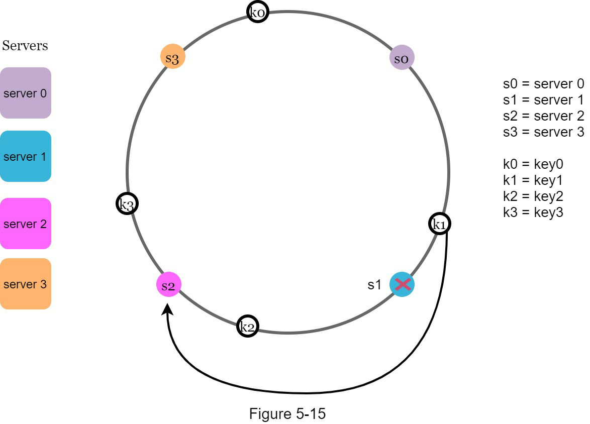

## Tổng kết (Wrap up)

Trong chương này, chúng ta đã có một cuộc thảo luận chuyên sâu về băm nhất quán, bao gồm lý do tại sao nó cần thiết và cách nó hoạt động. Các lợi ích của băm nhất quán bao gồm:
- Giảm thiểu số lượng khóa bị phân phối lại khi các máy chủ được thêm vào hoặc gỡ bỏ.
- Dễ dàng mở rộng theo chiều ngang (scale horizontally) vì dữ liệu được phân phối đồng đều hơn.
- Giảm thiểu vấn đề khóa điểm nóng (hotspot key problem). Việc truy cập quá mức vào một phân mảnh (shard) cụ thể có thể gây quá tải máy chủ. Hãy tưởng tượng dữ liệu của Katy Perry, Justin Bieber, và Lady Gaga đều rơi vào cùng một phân mảnh. Băm nhất quán giúp giảm thiểu vấn đề này bằng cách phân phối dữ liệu đồng đều hơn.

Băm nhất quán được sử dụng rộng rãi trong các hệ thống thực tế, bao gồm một số hệ thống nổi tiếng:
- Thành phần phân vùng (partitioning component) của cơ sở dữ liệu Amazon Dynamo [3]
- Phân vùng dữ liệu qua các cụm trong Apache Cassandra [4]
- Ứng dụng trò chuyện Discord [5]
- Mạng phân phối nội dung Akamai (Akamai CDN) [6]
- Bộ cân bằng tải mạng Maglev [7]

Xin chúc mừng bạn đã đi được đến đây! Bây giờ hãy tự thưởng cho mình một cái vỗ vai nhé. Làm tốt lắm!

## Tài liệu tham khảo (Reference materials)

[1] Consistent hashing: https://en.wikipedia.org/wiki/Consistent_hashing  
[2] Consistent Hashing: https://tom-e-white.com/2007/11/consistent-hashing.html  
[3] Dynamo: Amazon’s Highly Available Key-value Store: https://www.allthingsdistributed.com/files/amazon-dynamo-sosp2007.pdf  
[4] Cassandra - A Decentralized Structured Storage System: http://www.cs.cornell.edu/Projects/ladis2009/papers/Lakshman-ladis2009.PDF  
[5] How Discord Scaled Elixir to 5,000,000 Concurrent Users: https://blog.discord.com/scaling-elixir-f9b8e1e7c29b  
[6] CS168: The Modern Algorithmic Toolbox Lecture #1: Introduction and Consistent Hashing: http://theory.stanford.edu/~tim/s16/l/l1.pdf  
[7] Maglev: A Fast and Reliable Software Network Load Balancer: https://static.googleusercontent.com/media/research.google.com/en//pubs/archive/44824.pdf  

## Bảng thuật ngữ chương (Chapter Glossary)

| Thuật ngữ (English) | Tiếng Việt | Giải thích ngắn gọn |
| :--- | :--- | :--- |
| Consistent Hashing | Băm nhất quán | Kỹ thuật băm sao cho khi thêm hoặc bớt máy chủ, chỉ trung bình $k/n$ khóa cần được ánh xạ lại. |
| Rehashing Problem | Vấn đề băm lại | Hiện tượng phần lớn khóa bị thay đổi vị trí khi số lượng máy chủ $N$ trong công thức `hash(key) % N` thay đổi. |
| Hash Space | Không gian băm | Dải giá trị đầu ra có thể có của một hàm băm (ví dụ: từ $0$ đến $2^{160} - 1$ với SHA-1). |
| Hash Ring | Vòng băm | Không gian băm được nối hai đầu lại thành một vòng tròn khép kín. |
| Cache Miss | Lỗi bộ nhớ đệm | Trạng thái dữ liệu được yêu cầu không tồn tại trong cache, buộc hệ thống phải truy xuất từ nguồn gốc. |
| Partition | Phân vùng | Khoảng không gian băm nằm giữa hai máy chủ (hoặc nút ảo) liền kề trên vòng băm. |
| Virtual Node (Replica) | Nút ảo (Bản sao) | Các điểm đại diện cho cùng một máy chủ vật lý trên vòng băm nhằm cân bằng phân phối dữ liệu. |
| Standard Deviation | Độ lệch chuẩn | Thước đo mức độ phân tán của dữ liệu so với giá trị trung bình. |
| Hotspot Key Problem | Vấn đề khóa điểm nóng | Tình trạng một số khóa được truy cập quá nhiều tập trung vào cùng một máy chủ/shard gây quá tải. |
| Horizontal Scaling | Mở rộng theo chiều ngang | Tăng năng lực xử lý của hệ thống bằng cách thêm nhiều máy chủ mới vào cụm thay vì nâng cấp phần cứng từng máy. |
