# CHƯƠNG 6: THIẾT KẾ HỆ THỐNG LƯU TRỮ KEY-VALUE (CHAPTER 6: DESIGN A KEY-VALUE STORE)

Hệ thống lưu trữ key-value (key-value store), còn được gọi là cơ sở dữ liệu key-value (key-value database), là một cơ sở dữ liệu phi quan hệ (non-relational database). Mỗi định danh duy nhất được lưu trữ dưới dạng một khóa (key) kèm theo giá trị (value) tương ứng của nó. Cặp dữ liệu này được gọi là cặp “key-value”.

Trong một cặp key-value, khóa phải là duy nhất, và giá trị gắn với khóa đó có thể được truy cập thông qua khóa. Khóa có thể là văn bản thuần túy (plain text) hoặc giá trị đã được băm (hashed value). Vì lý do hiệu năng, khóa ngắn sẽ hoạt động tốt hơn. Khóa trông như thế nào? Dưới đây là một vài ví dụ:

- Khóa văn bản thuần túy: `“last_logged_in_at”`
- Khóa đã băm: `253DDEC4`

Giá trị trong một cặp key-value có thể là chuỗi (strings), danh sách (lists), đối tượng (objects), v.v. Giá trị thường được xem như một đối tượng mờ (opaque object — tức là hệ thống không cần hiểu cấu trúc bên trong của giá trị) trong các hệ thống lưu trữ key-value như Amazon Dynamo [1], Memcached [2], Redis [3], v.v.

Dưới đây là một đoạn dữ liệu minh họa trong hệ thống lưu trữ key-value:

Trong chương này, bạn được yêu cầu thiết kế một hệ thống lưu trữ key-value hỗ trợ các thao tác sau:

```text
- put(key, value)  // chèn “value” gắn với “key”
- get(key)         // lấy “value” gắn với “key”
```

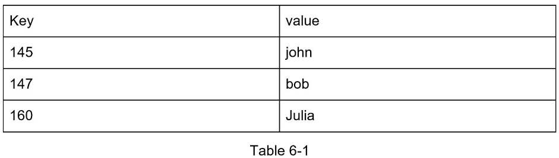

## Hiểu bài toán và xác định phạm vi thiết kế (Understand the problem and establish design scope)

Không có thiết kế nào là hoàn hảo. Mỗi thiết kế đạt được một sự cân bằng cụ thể liên quan đến các đánh đổi (tradeoffs) giữa thao tác đọc, thao tác ghi và mức sử dụng bộ nhớ. Một sự đánh đổi khác phải thực hiện là giữa tính nhất quán (consistency) và tính sẵn sàng (availability). Trong chương này, chúng ta thiết kế một hệ thống lưu trữ key-value bao gồm các đặc điểm sau:

- Kích thước của một cặp key-value nhỏ: dưới 10 KB.
- Khả năng lưu trữ dữ liệu lớn (big data).
- Tính sẵn sàng cao (High availability): Hệ thống phản hồi nhanh chóng, ngay cả khi xảy ra lỗi.
- Khả năng mở rộng cao (High scalability): Hệ thống có thể mở rộng để hỗ trợ tập dữ liệu lớn.
- Tự động mở rộng (Automatic scaling): Việc thêm/xóa máy chủ phải diễn ra tự động dựa trên lưu lượng truy cập.
- Tính nhất quán có thể điều chỉnh (Tunable consistency).
- Độ trễ thấp (Low latency).

## Hệ thống lưu trữ key-value trên một máy chủ (Single server key-value store)

Việc phát triển một hệ thống lưu trữ key-value nằm trên một máy chủ duy nhất rất dễ dàng. Cách tiếp cận trực quan là lưu các cặp key-value trong một bảng băm (hash table), giữ toàn bộ dữ liệu trong bộ nhớ (RAM). Mặc dù việc truy cập bộ nhớ rất nhanh, việc chứa mọi thứ trong bộ nhớ có thể là bất khả thi do giới hạn không gian lưu trữ. Có thể thực hiện hai tối ưu hóa để chứa được nhiều dữ liệu hơn trên một máy chủ:

- Nén dữ liệu (Data compression).
- Chỉ lưu dữ liệu được sử dụng thường xuyên trong bộ nhớ và lưu phần còn lại trên đĩa (disk).

Ngay cả với những tối ưu hóa này, một máy chủ đơn lẻ vẫn có thể chạm ngưỡng dung lượng rất nhanh chóng. Một hệ thống lưu trữ key-value phân tán là điều bắt buộc để hỗ trợ dữ liệu lớn.

## Hệ thống lưu trữ key-value phân tán (Distributed key-value store)

Hệ thống lưu trữ key-value phân tán còn được gọi là bảng băm phân tán (distributed hash table), giúp phân phối các cặp key-value trên nhiều máy chủ. Khi thiết kế một hệ thống phân tán, việc hiểu định lý CAP (Consistency, Availability, Partition Tolerance) là rất quan trọng.

### Định lý CAP (CAP theorem)

Định lý CAP phát biểu rằng một hệ thống phân tán không thể đồng thời đảm bảo nhiều hơn hai trong ba tính chất sau: tính nhất quán (consistency), tính sẵn sàng (availability) và khả năng chịu phân vùng mạng (partition tolerance). Hãy cùng thiết lập một vài định nghĩa.

- **Tính nhất quán (Consistency):** Tính nhất quán có nghĩa là mọi client đều nhìn thấy cùng một dữ liệu tại cùng một thời điểm bất kể chúng kết nối tới nút (node) nào.
- **Tính sẵn sàng (Availability):** Tính sẵn sàng có nghĩa là bất kỳ client nào yêu cầu dữ liệu đều nhận được phản hồi ngay cả khi một số nút bị sập.
- **Khả năng chịu phân vùng mạng (Partition Tolerance):** Phân vùng (partition) biểu thị sự đứt gãy giao tiếp giữa hai nút. Khả năng chịu phân vùng mạng có nghĩa là hệ thống vẫn tiếp tục hoạt động bất chấp các phân vùng mạng.

Định lý CAP chỉ ra rằng một trong ba tính chất phải bị hy sinh để hỗ trợ 2 trên 3 tính chất còn lại, như minh họa trong Hình 6-1 (Figure 6-1).

Ngày nay, các hệ thống lưu trữ key-value được phân loại dựa trên hai đặc tính CAP mà chúng hỗ trợ:

- **Hệ thống CP (consistency and partition tolerance):** Hệ thống key-value CP hỗ trợ tính nhất quán và khả năng chịu phân vùng mạng trong khi hy sinh tính sẵn sàng.
- **Hệ thống AP (availability and partition tolerance):** Hệ thống key-value AP hỗ trợ tính sẵn sàng và khả năng chịu phân vùng mạng trong khi hy sinh tính nhất quán.
- **Hệ thống CA (consistency and availability):** Hệ thống key-value CA hỗ trợ tính nhất quán và tính sẵn sàng trong khi hy sinh khả năng chịu phân vùng mạng. Vì lỗi mạng là điều không thể tránh khỏi, một hệ thống phân tán bắt buộc phải chịu được phân vùng mạng. Do đó, hệ thống CA không thể tồn tại trong các ứng dụng thực tế.

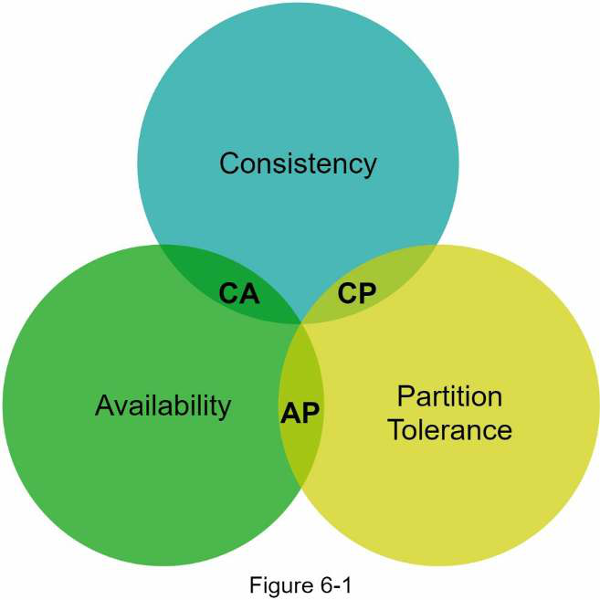

Những gì bạn vừa đọc ở trên chủ yếu là phần định nghĩa. Để dễ hiểu hơn, hãy cùng xem xét một số ví dụ cụ thể. Trong các hệ thống phân tán, dữ liệu thường được nhân bản (replicated) nhiều lần. Giả sử dữ liệu được nhân bản trên ba nút bản sao (replica nodes) `n1`, `n2` và `n3` như trong Hình 6-2 (Figure 6-2).

#### Tình huống lý tưởng (Ideal situation)

Trong thế giới lý tưởng, phân vùng mạng không bao giờ xảy ra. Dữ liệu được ghi vào `n1` sẽ tự động được nhân bản sang `n2` và `n3`. Cả tính nhất quán và tính sẵn sàng đều đạt được.

#### Hệ thống phân tán trong thực tế (Real-world distributed systems)

Trong một hệ thống phân tán, phân vùng mạng là điều không thể tránh khỏi, và khi phân vùng xảy ra, chúng ta phải lựa chọn giữa tính nhất quán và tính sẵn sàng. Trong Hình 6-3 (Figure 6-3), `n3` bị sập và không thể giao tiếp với `n1` và `n2`. Nếu các client ghi dữ liệu vào `n1` hoặc `n2`, dữ liệu không thể được lan truyền tới `n3`. Nếu dữ liệu được ghi vào `n3` nhưng chưa được lan truyền tới `n1` và `n2`, thì `n1` và `n2` sẽ có dữ liệu cũ (stale data).

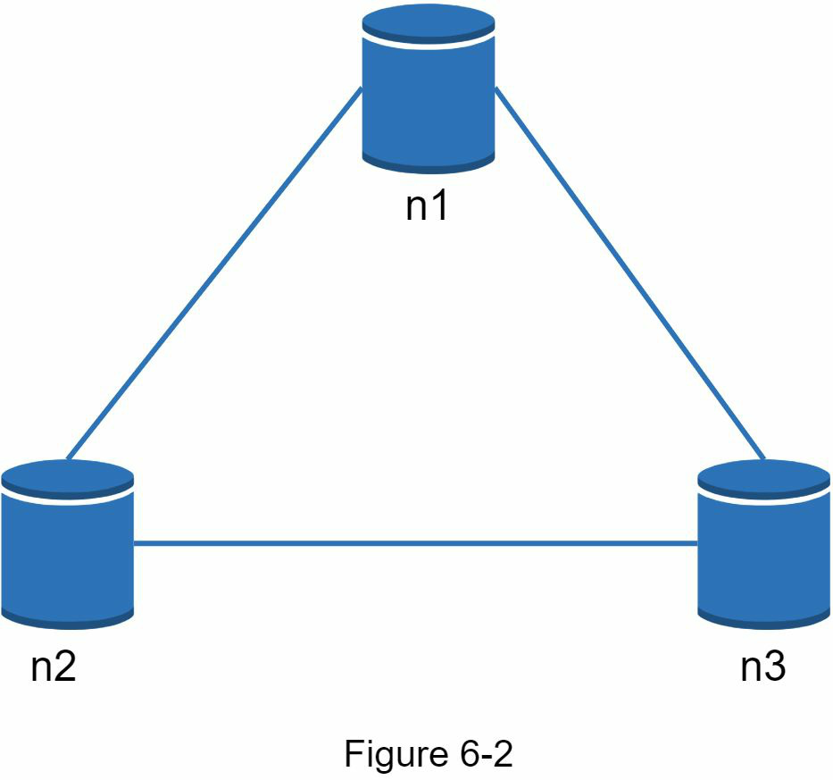

Nếu chúng ta chọn tính nhất quán thay vì tính sẵn sàng (hệ thống CP), chúng ta phải chặn tất cả các thao tác ghi vào `n1` và `n2` để tránh sự bất đồng bộ dữ liệu giữa ba máy chủ này, điều này làm cho hệ thống trở nên không sẵn sàng (unavailable). Các hệ thống ngân hàng thường có yêu cầu cực kỳ cao về tính nhất quán. Ví dụ, điều cốt yếu đối với một hệ thống ngân hàng là phải hiển thị thông tin số dư cập nhật nhất. Nếu xảy ra bất đồng bộ do phân vùng mạng, hệ thống ngân hàng sẽ trả về lỗi trước khi sự bất đồng bộ được giải quyết.

Tuy nhiên, nếu chúng ta chọn tính sẵn sàng thay vì tính nhất quán (hệ thống AP), hệ thống vẫn tiếp tục chấp nhận các thao tác đọc, ngay cả khi nó có thể trả về dữ liệu cũ. Đối với thao tác ghi, `n1` và `n2` sẽ tiếp tục chấp nhận ghi, và dữ liệu sẽ được đồng bộ sang `n3` khi phân vùng mạng được khắc phục.

Việc lựa chọn các đảm bảo CAP phù hợp với trường hợp sử dụng (use case) của bạn là một bước quan trọng trong việc xây dựng một hệ thống lưu trữ key-value phân tán. Bạn có thể thảo luận điều này với người phỏng vấn và thiết kế hệ thống tương ứng.

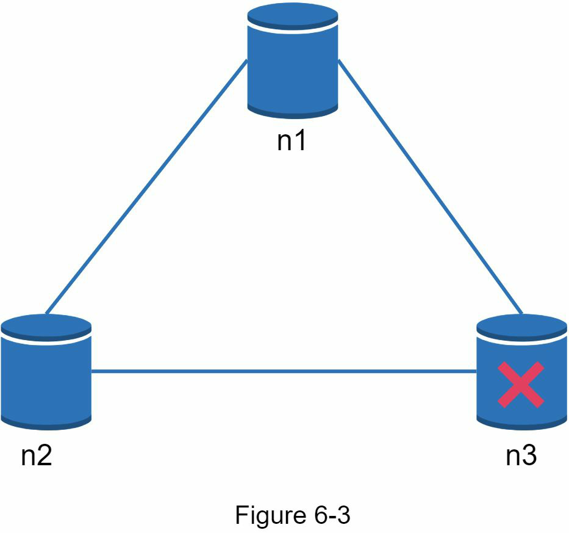

> 💡 **Ví dụ bổ sung (không có trong sách):** Hãy tưởng tượng một ứng dụng giỏ hàng thương mại điện tử (như Amazon) so với một hệ thống đặt vé máy bay:
> - **Giỏ hàng (AP):** Nếu mạng bị đứt đoạn giữa hai trung tâm dữ liệu, hệ thống vẫn cho phép bạn thêm sản phẩm vào giỏ hàng (ưu tiên Availability). Tệ nhất là khi mạng nối lại, giỏ hàng có thể tạm thời hiện thiếu hoặc trùng một món hàng trước khi đồng bộ xong — trải nghiệm mua sắm không bị gián đoạn.
> - **Đặt vé máy bay / Chuyển khoản ngân hàng (CP):** Nếu không thể xác nhận với tất cả các nút giữ trạng thái ghế ngồi/số dư, hệ thống thà báo lỗi "Vui lòng thử lại sau" (hy sinh Availability) còn hơn bán cùng một ghế cho hai người hoặc cho rút tiền hai lần (giữ Consistency).

### Các thành phần hệ thống (System components)

Trong phần này, chúng ta sẽ thảo luận về các thành phần cốt lõi và kỹ thuật sau đây được sử dụng để xây dựng một hệ thống lưu trữ key-value:

- Phân mảnh dữ liệu (Data partition)
- Nhân bản dữ liệu (Data replication)
- Tính nhất quán (Consistency)
- Giải quyết bất đồng bộ (Inconsistency resolution)
- Xử lý lỗi (Handling failures)
- Sơ đồ kiến trúc hệ thống (System architecture diagram)
- Luồng ghi (Write path)
- Luồng đọc (Read path)

Nội dung dưới đây phần lớn dựa trên ba hệ thống lưu trữ key-value phổ biến: Dynamo [4], Cassandra [5] và BigTable [6].

#### Phân mảnh dữ liệu (Data partition)

Đối với các ứng dụng lớn, việc chứa toàn bộ tập dữ liệu trên một máy chủ duy nhất là bất khả thi. Cách đơn giản nhất để giải quyết việc này là chia dữ liệu thành các phân mảnh (partition) nhỏ hơn và lưu trữ chúng trên nhiều máy chủ. Có hai thách thức khi phân mảnh dữ liệu:

- Phân phối dữ liệu đồng đều trên nhiều máy chủ.
- Giảm thiểu việc di chuyển dữ liệu khi thêm hoặc xóa nút.

Kỹ thuật băm nhất quán (Consistent hashing) đã thảo luận trong Chương 5 là một kỹ thuật tuyệt vời để giải quyết các vấn đề này. Hãy cùng ôn lại cách băm nhất quán hoạt động ở mức tổng quan:

- Đầu tiên, các máy chủ được đặt trên một vòng băm (hash ring). Trong Hình 6-4 (Figure 6-4), tám máy chủ, được biểu diễn bởi `s0, s1, …, s7`, được đặt trên vòng băm.
- Tiếp theo, một khóa (key) được băm lên cùng vòng đó, và nó được lưu trữ trên máy chủ đầu tiên gặp phải khi đi theo chiều kim đồng hồ. Chẳng hạn, `key0` được lưu tại `s1` theo logic này.

Sử dụng băm nhất quán để phân mảnh dữ liệu có các ưu điểm sau:

- **Tự động mở rộng (Automatic scaling):** Các máy chủ có thể được thêm và xóa tự động tùy thuộc vào tải.

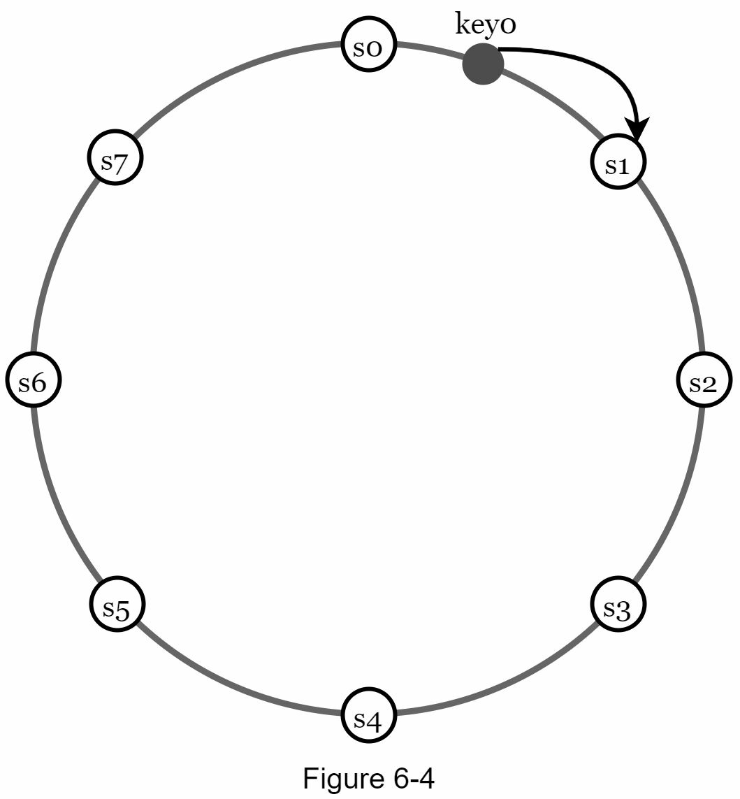

- **Tính không đồng nhất (Heterogeneity):** Số lượng nút ảo (virtual nodes) cho một máy chủ tỷ lệ thuận với năng lực của máy chủ đó. Ví dụ, các máy chủ có cấu hình/năng lực cao hơn sẽ được gán nhiều nút ảo hơn.

#### Nhân bản dữ liệu (Data replication)

Để đạt được tính sẵn sàng và độ tin cậy cao, dữ liệu phải được nhân bản bất đồng bộ (replicated asynchronously) trên `N` máy chủ, trong đó `N` là một tham số có thể cấu hình. `N` máy chủ này được chọn theo logic sau: sau khi một khóa được ánh xạ tới một vị trí trên vòng băm, đi theo chiều kim đồng hồ từ vị trí đó và chọn `N` máy chủ đầu tiên trên vòng để lưu trữ các bản sao dữ liệu. Trong Hình 6-5 (Figure 6-5) (`N = 3`), `key0` được nhân bản tại `s1`, `s2` và `s3`.

Với các nút ảo (virtual nodes), `N` nút đầu tiên trên vòng có thể thuộc sở hữu của ít hơn `N` máy chủ vật lý. Để tránh vấn đề này, chúng ta chỉ chọn các máy chủ vật lý riêng biệt (unique servers) khi thực hiện logic đi theo chiều kim đồng hồ.

Các nút trong cùng một trung tâm dữ liệu (data center) thường bị lỗi cùng lúc do mất điện, sự cố mạng, thiên tai, v.v. Để có độ tin cậy tốt hơn, các bản sao được đặt ở các trung tâm dữ liệu khác nhau, và các trung tâm dữ liệu này được kết nối thông qua mạng tốc độ cao.

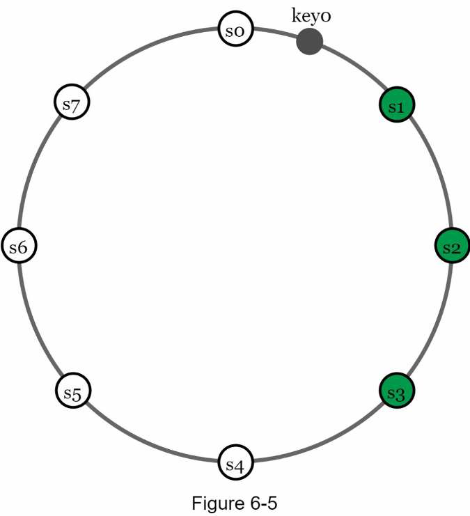

#### Tính nhất quán (Consistency)

Vì dữ liệu được nhân bản tại nhiều nút, nó phải được đồng bộ hóa giữa các bản sao. Đồng thuận Quorum (Quorum consensus) có thể đảm bảo tính nhất quán cho cả thao tác đọc và ghi. Hãy cùng thiết lập một vài định nghĩa trước.

- `N` = Số lượng bản sao (replicas).
- `W` = Quorum ghi có kích thước `W`. Để một thao tác ghi được coi là thành công, thao tác ghi đó phải nhận được xác nhận (acknowledgment) từ `W` bản sao.
- `R` = Quorum đọc có kích thước `R`. Để một thao tác đọc được coi là thành công, thao tác đọc đó phải đợi phản hồi từ ít nhất `R` bản sao.

Hãy xem xét ví dụ sau được minh họa trong Hình 6-6 (Figure 6-6) với `N = 3`.

`W = 1` không có nghĩa là dữ liệu chỉ được ghi trên một máy chủ. Chẳng hạn, với cấu hình trong Hình 6-6 (Figure 6-6), dữ liệu được nhân bản tại `s0`, `s1` và `s2`. `W = 1` có nghĩa là bộ điều phối (coordinator) phải nhận được ít nhất một xác nhận trước khi thao tác ghi được coi là thành công. Ví dụ, nếu chúng ta nhận được xác nhận từ `s1`, chúng ta không cần đợi xác nhận từ `s0` và `s2` nữa. Bộ điều phối (coordinator) đóng vai trò như một proxy giữa client và các nút.

Cấu hình của `W`, `R` và `N` là một sự đánh đổi điển hình giữa độ trễ (latency) và tính nhất quán (consistency). Nếu `W = 1` hoặc `R = 1`, một thao tác được trả về nhanh chóng vì bộ điều phối chỉ cần đợi phản hồi từ bất kỳ bản sao nào. Nếu `W` hoặc `R > 1`, hệ thống mang lại tính nhất quán tốt hơn; tuy nhiên, truy vấn sẽ chậm hơn vì bộ điều phối phải đợi phản hồi từ bản sao chậm nhất.

Nếu `W + R > N`, tính nhất quán mạnh (strong consistency) được đảm bảo vì chắc chắn phải có ít nhất một nút giao nhau (overlapping node) nắm giữ dữ liệu mới nhất để đảm bảo tính nhất quán.

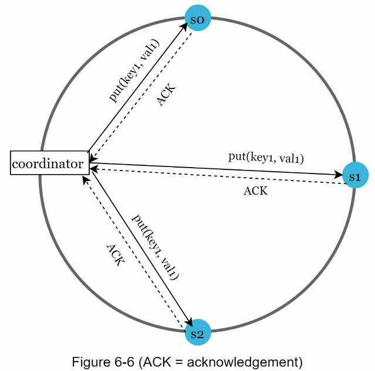

Làm thế nào để cấu hình `N`, `W` và `R` cho phù hợp với các trường hợp sử dụng của chúng ta? Dưới đây là một số thiết lập khả dĩ:

- Nếu `R = 1` và `W = N`, hệ thống được tối ưu hóa cho thao tác đọc nhanh.
- Nếu `W = 1` và `R = N`, hệ thống được tối ưu hóa cho thao tác ghi nhanh.
- Nếu `W + R > N`, tính nhất quán mạnh được đảm bảo (Thường là `N = 3, W = R = 2`).
- Nếu `W + R <= N`, tính nhất quán mạnh không được đảm bảo.

Tùy thuộc vào yêu cầu, chúng ta có thể điều chỉnh các giá trị của `W`, `R`, `N` để đạt được mức độ nhất quán mong muốn.

> 📝 **Giải thích thêm (không có trong sách):** Tại sao `W + R > N` lại đảm bảo tính nhất quán mạnh? Hãy lấy ví dụ `N = 3`, `W = 2`, `R = 2`. Khi ghi thành công, ít nhất 2 trong 3 nút (`{s0, s1, s2}`) đã có dữ liệu mới nhất. Khi đọc, hệ thống hỏi ít nhất 2 trong 3 nút. Theo nguyên lý chuồng bồ câu (Pigeonhole Principle), hai tập hợp kích thước 2 được chọn từ tập 3 phần tử chắc chắn phải giao nhau ít nhất 1 nút! Nút giao nhau đó sẽ trả về phiên bản dữ liệu mới nhất (nhờ kèm theo timestamp hoặc version), và bộ điều phối sẽ nhận biết được giá trị mới nhất để trả về cho client.

##### Các mô hình nhất quán (Consistency models)

Mô hình nhất quán (Consistency model) là một yếu tố quan trọng khác cần xem xét khi thiết kế hệ thống lưu trữ key-value. Một mô hình nhất quán định nghĩa mức độ nhất quán của dữ liệu, và tồn tại một phổ rộng các mô hình nhất quán có thể áp dụng:

- **Tính nhất quán mạnh (Strong consistency):** Bất kỳ thao tác đọc nào cũng trả về giá trị tương ứng với kết quả của mục dữ liệu ghi được cập nhật gần nhất. Client không bao giờ nhìn thấy dữ liệu cũ (out-of-date).
- **Tính nhất quán yếu (Weak consistency):** Các thao tác đọc tiếp theo có thể không nhìn thấy giá trị được cập nhật mới nhất.
- **Tính nhất quán cuối cùng (Eventual consistency):** Đây là một dạng cụ thể của tính nhất quán yếu. Nếu có đủ thời gian, tất cả các bản cập nhật sẽ được lan truyền, và tất cả các bản sao sẽ trở nên nhất quán.

Tính nhất quán mạnh thường đạt được bằng cách ép buộc một bản sao không chấp nhận các thao tác đọc/ghi mới cho đến khi mọi bản sao đã đồng thuận về lần ghi hiện tại. Cách tiếp cận này không lý tưởng cho các hệ thống có tính sẵn sàng cao vì nó có thể chặn các thao tác mới. Dynamo và Cassandra áp dụng tính nhất quán cuối cùng (eventual consistency), và đây cũng là mô hình nhất quán được khuyến nghị cho hệ thống lưu trữ key-value của chúng ta. Từ các thao tác ghi đồng thời (concurrent writes), tính nhất quán cuối cùng cho phép các giá trị không nhất quán đi vào hệ thống và buộc client phải đọc các giá trị đó để đối chiếu/hòa giải (reconcile). Phần tiếp theo sẽ giải thích cách thức hòa giải hoạt động với việc đánh phiên bản (versioning).

#### Giải quyết bất đồng bộ: đánh phiên bản (Inconsistency resolution: versioning)

Nhân bản dữ liệu mang lại tính sẵn sàng cao nhưng gây ra sự bất đồng bộ giữa các bản sao. Đánh phiên bản (versioning) và đồng hồ vector (vector clocks — trong sách gốc đôi chỗ viết nhầm là "vector locks") được sử dụng để giải quyết các vấn đề bất đồng bộ. Đánh phiên bản có nghĩa là coi mỗi lần sửa đổi dữ liệu như một phiên bản dữ liệu bất biến (immutable) mới. Trước khi nói về đánh phiên bản, hãy dùng một ví dụ để giải thích cách sự bất đồng bộ xảy ra:

Như minh họa trong Hình 6-7 (Figure 6-7), cả hai nút bản sao `n1` và `n2` đều có cùng một giá trị. Hãy gọi giá trị này là giá trị ban đầu (original value). Máy chủ 1 và máy chủ 2 nhận được cùng một giá trị cho thao tác `get("name")`.

Tiếp theo, máy chủ 1 đổi tên thành `“johnSanFrancisco”`, và máy chủ 2 đổi tên thành `“johnNewYork”` như trong Hình 6-8 (Figure 6-8). Hai thay đổi này được thực hiện đồng thời. Bây giờ, chúng ta có các giá trị xung đột, được gọi là phiên bản `v1` và `v2`.

Trong ví dụ này, giá trị ban đầu có thể bị bỏ qua vì các sửa đổi đều dựa trên nó. Tuy nhiên, không có cách nào rõ ràng để giải quyết xung đột của hai phiên bản cuối cùng. Để giải quyết vấn đề này, chúng ta cần một hệ thống đánh phiên bản có thể phát hiện xung đột và hòa giải xung đột. Đồng hồ vector (vector clock) là một kỹ thuật phổ biến để giải quyết bài toán này. Hãy cùng xem xét cách đồng hồ vector hoạt động.

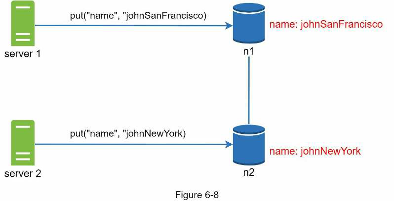

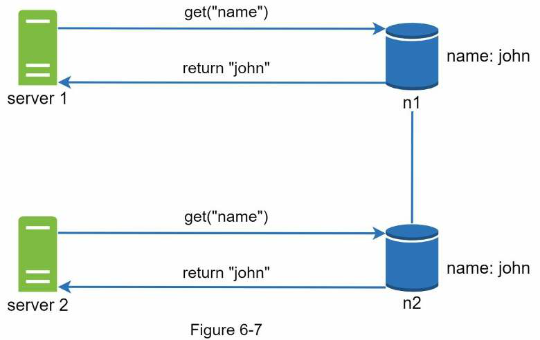

Một đồng hồ vector là một tập các cặp `[server, version]` gắn liền với một mục dữ liệu. Nó có thể được dùng để kiểm tra xem một phiên bản có đứng trước (precedes), kế tiếp (succeeds), hay xung đột (in conflict) với các phiên bản khác hay không.

Giả sử một đồng hồ vector được biểu diễn bằng `D([S1, v1], [S2, v2], …, [Sn, vn])`, trong đó `D` là một mục dữ liệu, `v1` là bộ đếm phiên bản, và `S1` là mã số máy chủ, v.v. Nếu mục dữ liệu `D` được ghi vào máy chủ `Si`, hệ thống phải thực hiện một trong các tác vụ sau:

- Tăng `vi` nếu `[Si, vi]` đã tồn tại.
- Ngược lại, tạo một mục mới `[Si, 1]`.

Logic trừu tượng trên được giải thích bằng một ví dụ cụ thể như minh họa trong Hình 6-9 (Figure 6-9):

1. Một client ghi một mục dữ liệu `D1` vào hệ thống, và thao tác ghi được xử lý bởi máy chủ `Sx`, lúc này có đồng hồ vector `D1[(Sx, 1)]`.
2. Một client khác đọc `D1` mới nhất, cập nhật thành `D2` và ghi lại. `D2` kế thừa từ `D1` nên nó ghi đè lên `D1`. Giả sử thao tác ghi được xử lý bởi cùng máy chủ `Sx`, lúc này có đồng hồ vector `D2([Sx, 2])`.
3. Một client khác đọc `D2` mới nhất, cập nhật thành `D3` và ghi lại. Giả sử thao tác ghi được xử lý bởi máy chủ `Sy`, lúc này có đồng hồ vector `D3([Sx, 2], [Sy, 1])`.
4. Một client khác đọc `D2` mới nhất, cập nhật thành `D4` và ghi lại. Giả sử thao tác ghi được xử lý bởi máy chủ `Sz`, lúc này có đồng hồ vector `D4([Sx, 2], [Sz, 1])`.

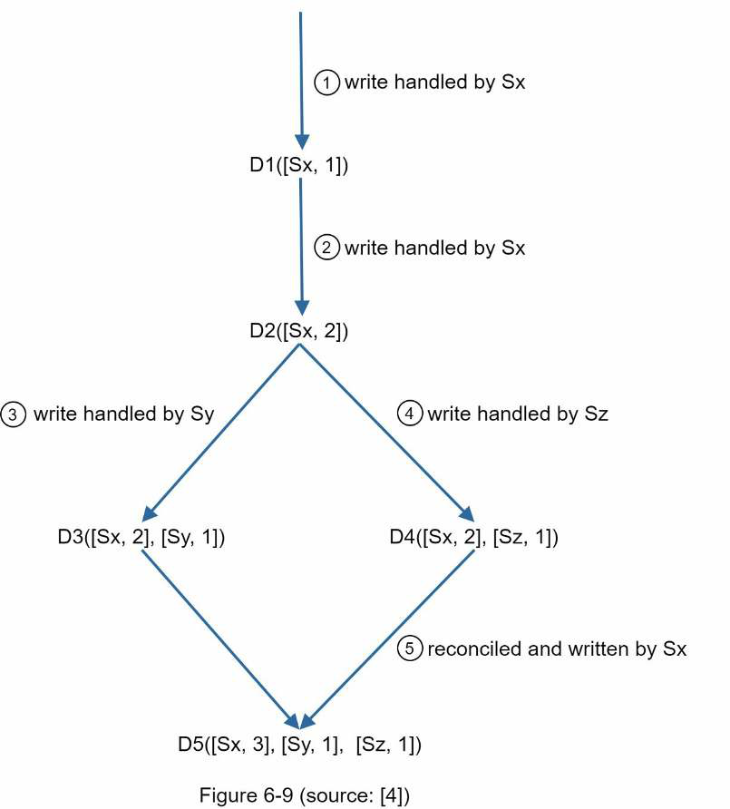

5. Khi một client khác đọc cả `D3` và `D4`, nó phát hiện ra một xung đột, gây ra bởi việc mục dữ liệu `D2` bị sửa đổi đồng thời bởi cả `Sy` và `Sz`. Xung đột được giải quyết bởi client và dữ liệu đã cập nhật được gửi tới máy chủ. Giả sử thao tác ghi được xử lý bởi `Sx`, lúc này có đồng hồ vector `D5([Sx, 3], [Sy, 1], [Sz, 1])`. Chúng ta sẽ giải thích cách phát hiện xung đột ngay sau đây.

Sử dụng đồng hồ vector, rất dễ dàng để biết một phiên bản `X` là tổ tiên (ancestor — tức không có xung đột) của phiên bản `Y` nếu các bộ đếm phiên bản của mọi thành phần trong đồng hồ vector của `Y` đều lớn hơn hoặc bằng các bộ đếm tương ứng trong phiên bản `X`. Ví dụ, đồng hồ vector `D([s0, 1], [s1, 1])` là tổ tiên của `D([s0, 1], [s1, 2])`. Do đó, không có xung đột nào được ghi nhận.

Tương tự, bạn có thể biết một phiên bản `X` là anh em (sibling — tức có tồn tại xung đột) của `Y` nếu có bất kỳ thành phần nào trong đồng hồ vector của `Y` có bộ đếm nhỏ hơn bộ đếm tương ứng trong `X`. Ví dụ, hai đồng hồ vector sau chỉ ra rằng có xung đột: `D([s0, 1], [s1, 2])` và `D([s0, 2], [s1, 1])`.

Mặc dù đồng hồ vector có thể giải quyết xung đột, có hai nhược điểm đáng chú ý. Thứ nhất, đồng hồ vector làm tăng độ phức tạp cho phía client vì client cần phải cài đặt logic giải quyết xung đột.

Thứ hai, các cặp `[server: version]` trong đồng hồ vector có thể phình to nhanh chóng. Để khắc phục vấn đề này, chúng ta đặt một ngưỡng giới hạn cho độ dài, và nếu vượt quá giới hạn, các cặp cũ nhất sẽ bị xóa bỏ. Điều này có thể dẫn đến sự kém hiệu quả trong quá trình hòa giải vì mối quan hệ kế thừa (descendant relationship) không thể được xác định chính xác. Tuy nhiên, theo bài báo về Dynamo [4], Amazon vẫn chưa gặp phải vấn đề này trong môi trường thực tế (production); do đó, đây có lẽ là một giải pháp chấp nhận được đối với hầu hết các công ty.

#### Xử lý lỗi (Handling failures)

Như với bất kỳ hệ thống quy mô lớn nào, lỗi không chỉ là điều không thể tránh khỏi mà còn xảy ra thường xuyên. Việc xử lý các kịch bản lỗi là cực kỳ quan trọng. Trong phần này, trước tiên chúng ta giới thiệu các kỹ thuật phát hiện lỗi. Sau đó, chúng ta sẽ đi qua các chiến lược xử lý lỗi phổ biến.

##### Phát hiện lỗi (Failure detection)

Trong một hệ thống phân tán, chỉ dựa vào lời nói của một máy chủ khác để kết luận rằng một máy chủ bị sập là chưa đủ. Thông thường, cần ít nhất hai nguồn thông tin độc lập để đánh dấu một máy chủ là đã sập.

Như minh họa trong Hình 6-10 (Figure 6-10), truyền thông đa hướng tất cả-tới-tất cả (all-to-all multicasting) là một giải pháp đơn giản, trực tiếp. Tuy nhiên, cách này kém hiệu quả khi có nhiều máy chủ trong hệ thống.

Một giải pháp tốt hơn là sử dụng các phương pháp phát hiện lỗi phi tập trung (decentralized) như giao thức tin đồn (gossip protocol). Giao thức gossip hoạt động như sau:

- Mỗi nút duy trì một danh sách thành viên nút (node membership list), chứa ID thành viên (member ID) và bộ đếm nhịp tim (heartbeat counter).
- Mỗi nút định kỳ tự tăng bộ đếm nhịp tim của chính mình.
- Mỗi nút định kỳ gửi nhịp tim (heartbeats) tới một tập hợp các nút ngẫu nhiên, các nút này đến lượt mình lại lan truyền tới một tập hợp các nút khác.
- Khi các nút nhận được nhịp tim, danh sách thành viên được cập nhật theo thông tin mới nhất.
- Nếu nhịp tim không tăng trong khoảng thời gian dài hơn các chu kỳ được định sẵn, thành viên đó bị coi là ngoại tuyến (offline).

Như minh họa trong Hình 6-11 (Figure 6-11):

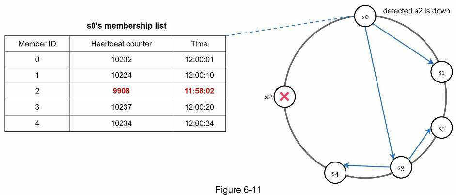

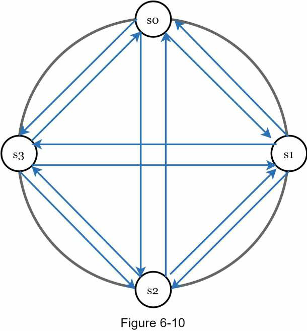

- Nút `s0` duy trì một danh sách thành viên nút hiển thị ở phía bên trái.
- Nút `s0` nhận thấy bộ đếm nhịp tim của nút `s2` (`member ID = 2`) đã không tăng trong một thời gian dài.
- Nút `s0` gửi các nhịp tim bao gồm thông tin của `s2` tới một tập các nút ngẫu nhiên. Khi các nút khác xác nhận rằng bộ đếm nhịp tim của `s2` cũng không được cập nhật trong một thời gian dài, nút `s2` bị đánh dấu là đã sập (down), và thông tin này được lan truyền tới các nút khác.

##### Xử lý lỗi tạm thời (Handling temporary failures)

Sau khi lỗi đã được phát hiện thông qua giao thức gossip, hệ thống cần triển khai các cơ chế nhất định để đảm bảo tính sẵn sàng. Trong cách tiếp cận quorum nghiêm ngặt (strict quorum), các thao tác đọc và ghi có thể bị chặn như đã minh họa trong phần đồng thuận quorum.

Một kỹ thuật gọi là **“sloppy quorum”** (quorum linh hoạt / lỏng lẻo) [4] được sử dụng để cải thiện tính sẵn sàng. Thay vì ép buộc yêu cầu quorum nghiêm ngặt, hệ thống chọn `W` máy chủ khỏe mạnh đầu tiên cho thao tác ghi và `R` máy chủ khỏe mạnh đầu tiên cho thao tác đọc trên vòng băm. Các máy chủ ngoại tuyến sẽ bị bỏ qua.

Nếu một máy chủ không khả dụng do lỗi mạng hoặc lỗi máy chủ, một máy chủ khác sẽ xử lý các yêu cầu tạm thời. Khi máy chủ bị sập hoạt động trở lại, các thay đổi sẽ được đẩy ngược lại để đạt được sự nhất quán dữ liệu. Quá trình này được gọi là **chuyển giao có gợi ý (hinted handoff)**. Vì `s2` không khả dụng trong Hình 6-12 (Figure 6-12), các thao tác đọc và ghi sẽ được `s3` xử lý tạm thời. Khi `s2` trực tuyến trở lại, `s3` sẽ bàn giao dữ liệu lại cho `s2`.

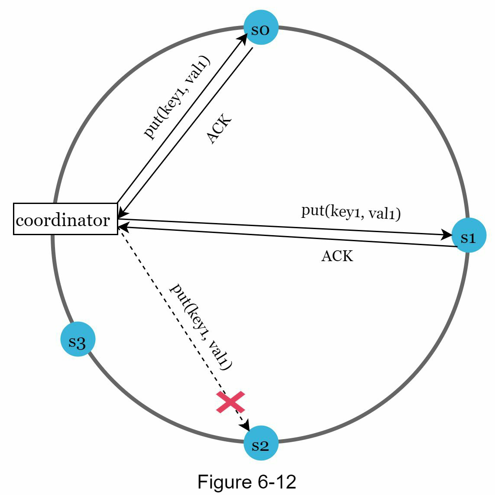

##### Xử lý lỗi vĩnh viễn (Handling permanent failures)

Hinted handoff được dùng để xử lý các lỗi tạm thời. Vậy điều gì xảy ra nếu một bản sao không khả dụng vĩnh viễn? Để xử lý tình huống như vậy, chúng ta triển khai một **giao thức chống entropy (anti-entropy protocol)** để giữ cho các bản sao được đồng bộ. Anti-entropy bao gồm việc so sánh từng mẩu dữ liệu trên các bản sao và cập nhật mỗi bản sao lên phiên bản mới nhất. Một **cây Merkle (Merkle tree)** được sử dụng để phát hiện sự bất đồng bộ và giảm thiểu lượng dữ liệu phải truyền tải.

Trích dẫn từ Wikipedia [7]: *“Cây băm (hash tree) hay cây Merkle (Merkle tree) là một cấu trúc cây trong đó mọi nút không phải nút lá đều được gắn nhãn bằng mã băm của các nhãn hoặc giá trị (trong trường hợp nút lá) của các nút con của nó. Cây băm cho phép xác minh hiệu quả và an toàn nội dung của các cấu trúc dữ liệu lớn”.*

Giả sử không gian khóa (key space) là từ `1` đến `12`, các bước sau đây cho thấy cách xây dựng một cây Merkle. Các ô được tô sáng biểu thị sự bất đồng bộ.

- **Bước 1:** Chia không gian khóa thành các nhóm/xô (buckets — 4 buckets trong ví dụ của chúng ta) như trong Hình 6-13 (Figure 6-13). Một bucket được dùng làm nút ở cấp gốc (cấp lá của phần cây đối chiếu) để duy trì độ sâu giới hạn của cây.
- **Bước 2:** Sau khi các bucket được tạo, băm từng khóa trong mỗi bucket bằng một phương pháp băm đồng đều (uniform hashing method) (Hình 6-14 / Figure 6-14).
- **Bước 3:** Tạo một nút băm duy nhất cho mỗi bucket (Hình 6-15 / Figure 6-15).
- **Bước 4:** Xây dựng cây hướng lên trên cho đến nút gốc (root) bằng cách tính mã băm của các nút con (Hình 6-16 / Figure 6-16).

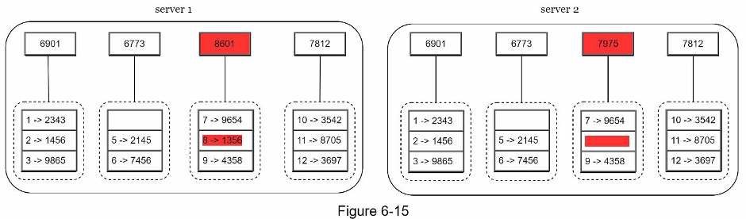

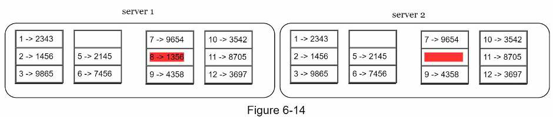

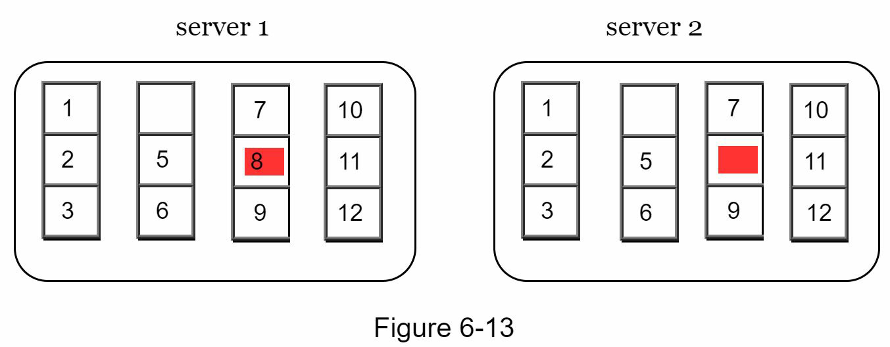

Để so sánh hai cây Merkle, hãy bắt đầu bằng cách so sánh mã băm gốc (root hashes). Nếu mã băm gốc khớp nhau, cả hai máy chủ đều có cùng dữ liệu. Nếu mã băm gốc không khớp, thì mã băm con bên trái được so sánh, tiếp theo là mã băm con bên phải. Bạn có thể duyệt cây để tìm ra các bucket nào chưa được đồng bộ và chỉ đồng bộ hóa những bucket đó mà thôi.

Sử dụng cây Merkle, lượng dữ liệu cần đồng bộ tỷ lệ thuận với sự khác biệt giữa hai bản sao, chứ không tỷ lệ với tổng lượng dữ liệu mà chúng chứa. Trong các hệ thống thực tế, kích thước bucket khá lớn. Chẳng hạn, một cấu hình khả dĩ là một triệu bucket trên một tỷ khóa, vì vậy mỗi bucket chỉ chứa 1000 khóa.

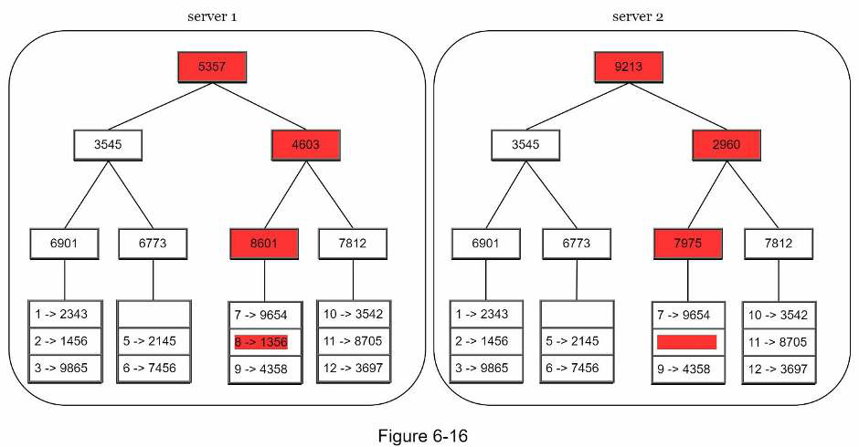

##### Xử lý sự cố mất trung tâm dữ liệu (Handling data center outage)

Sự cố mất trung tâm dữ liệu (data center outage) có thể xảy ra do mất điện, sự cố mạng, thiên tai, v.v. Để xây dựng một hệ thống có khả năng chống chịu sự cố mất trung tâm dữ liệu, điều quan trọng là phải nhân bản dữ liệu qua nhiều trung tâm dữ liệu khác nhau. Ngay cả khi một trung tâm dữ liệu hoàn toàn ngoại tuyến, người dùng vẫn có thể truy cập dữ liệu thông qua các trung tâm dữ liệu khác.

#### Sơ đồ kiến trúc hệ thống (System architecture diagram)

Bây giờ chúng ta đã thảo luận về các khía cạnh kỹ thuật khác nhau trong việc thiết kế một hệ thống lưu trữ key-value, chúng ta có thể chuyển sự tập trung sang sơ đồ kiến trúc, được trình bày trong Hình 6-17 (Figure 6-17).

Các đặc điểm chính của kiến trúc được liệt kê như sau:

- Các client giao tiếp với hệ thống lưu trữ key-value thông qua các API đơn giản: `get(key)` và `put(key, value)`.
- Bộ điều phối (coordinator) là một nút đóng vai trò như một proxy giữa client và hệ thống lưu trữ key-value.
- Các nút được phân phối trên một vòng bằng kỹ thuật băm nhất quán (consistent hashing).
- Hệ thống hoàn toàn phi tập trung (decentralized) nên việc thêm và di chuyển nút có thể diễn ra tự động.
- Dữ liệu được nhân bản tại nhiều nút.
- Không có điểm lỗi đơn (single point of failure - SPOF) vì mọi nút đều có cùng một tập hợp các trách nhiệm.

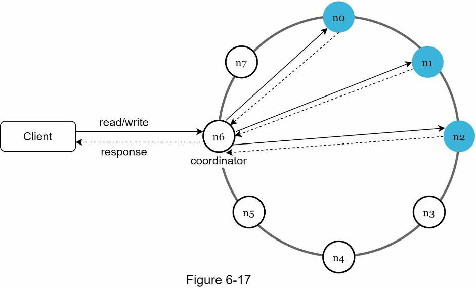

Vì thiết kế mang tính phi tập trung, mỗi nút thực hiện nhiều tác vụ như được trình bày trong Hình 6-18 (Figure 6-18).

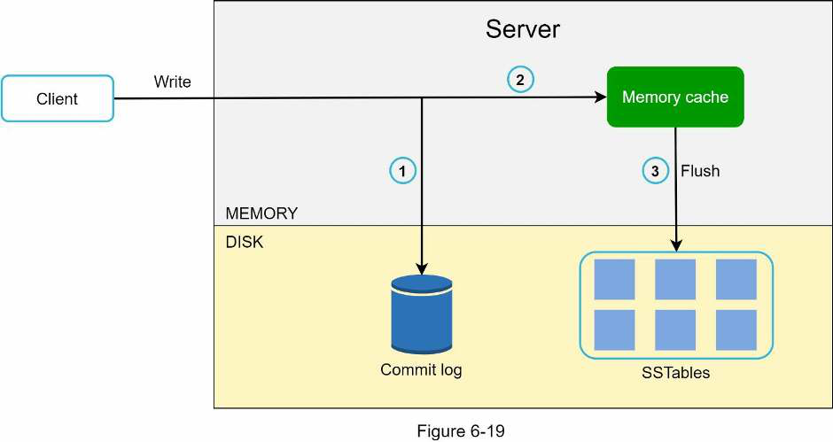

#### Luồng ghi (Write path)

Hình 6-19 (Figure 6-19) giải thích điều gì xảy ra sau khi một yêu cầu ghi được điều hướng tới một nút cụ thể. Xin lưu ý rằng các thiết kế được đề xuất cho luồng ghi/đọc chủ yếu dựa trên kiến trúc của Cassandra [8].

1. Yêu cầu ghi được lưu bền vững vào một tệp nhật ký ghi (commit log file).
2. Dữ liệu được lưu vào bộ nhớ đệm (memory cache — còn gọi là MemTable).
3. Khi bộ nhớ đệm đầy hoặc đạt đến một ngưỡng được định sẵn, dữ liệu được xả (flushed) xuống **SSTable** [9] trên đĩa. *Lưu ý:* Sorted-string table (SSTable) là một danh sách đã được sắp xếp của các cặp `<key, value>`. Đối với độc giả muốn tìm hiểu thêm về SSTable, vui lòng tham khảo tài liệu tham khảo [9].

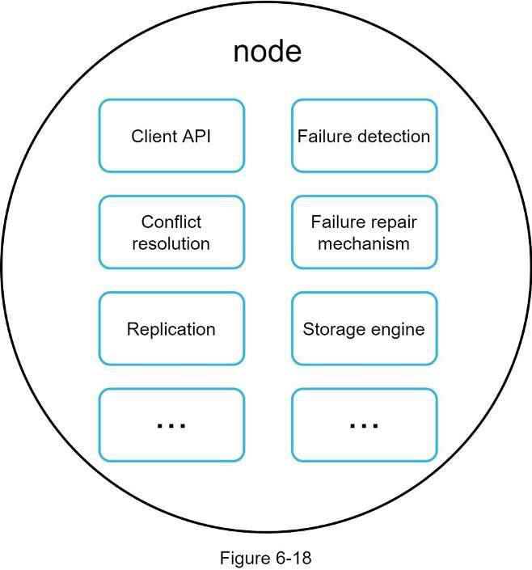

#### Luồng đọc (Read path)

Sau khi một yêu cầu đọc được điều hướng tới một nút cụ thể, trước tiên nút đó kiểm tra xem dữ liệu có nằm trong bộ nhớ đệm (memory cache) hay không. Nếu có, dữ liệu được trả về cho client như minh họa trong Hình 6-20 (Figure 6-20).

Nếu dữ liệu không có trong bộ nhớ, nó sẽ được truy xuất từ đĩa để thay thế. Chúng ta cần một cách hiệu quả để tìm ra SSTable nào chứa khóa cần tìm. **Bộ lọc Bloom (Bloom filter)** [10] thường được sử dụng để giải quyết bài toán này.

Luồng đọc được minh họa trong Hình 6-21 (Figure 6-21) khi dữ liệu không nằm trong bộ nhớ:

1. Hệ thống trước tiên kiểm tra xem dữ liệu có trong bộ nhớ hay không. Nếu không, chuyển sang bước 2.
2. Nếu dữ liệu không có trong bộ nhớ, hệ thống kiểm tra bộ lọc Bloom.
3. Bộ lọc Bloom được dùng để xác định những SSTable nào có thể chứa khóa.
4. Các SSTable trả về kết quả của tập dữ liệu.
5. Kết quả của tập dữ liệu được trả về cho client.

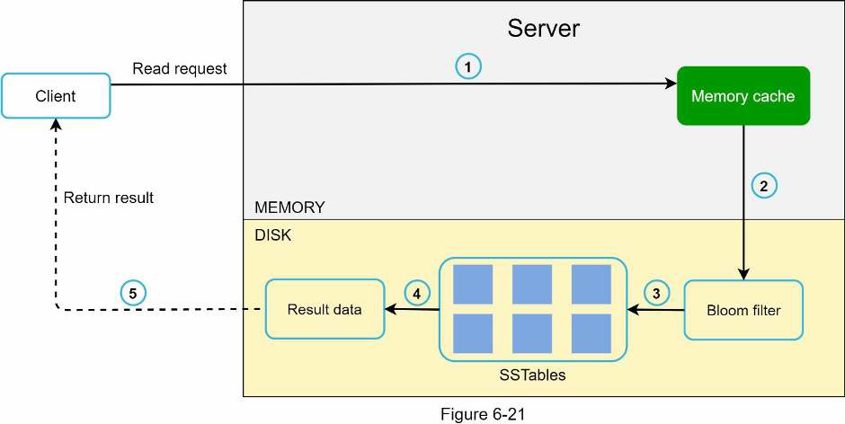

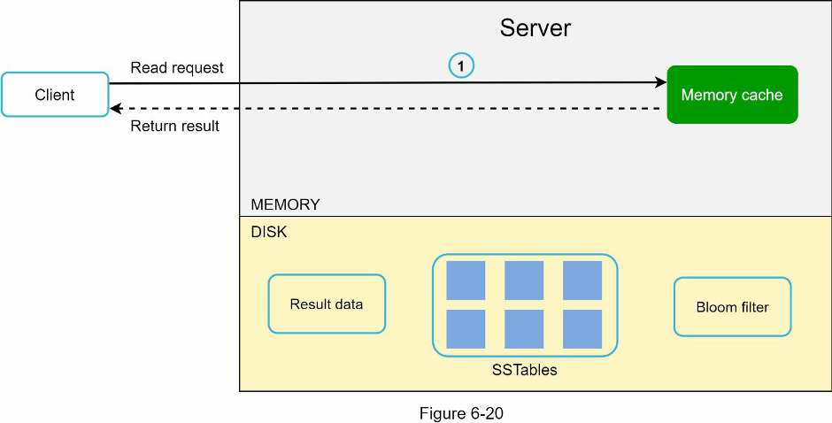

> 💡 **Ví dụ bổ sung (không có trong sách):** Sơ đồ tuần tự dưới đây tóm tắt cả **Luồng ghi (Write path)** và **Luồng đọc (Read path)** bên trong một nút lưu trữ (dựa trên mô hình LSM-tree của Cassandra):
>
> ```mermaid
> flowchart LR
>     W["Write Request put(k, v)"] --> CL["1. Ghi tuần tự vào Commit Log (Đĩa)"]
>     CL --> MC["2. Lưu vào Memory Cache (MemTable)"]
>     MC -->|"Khi đầy / đạt ngưỡng"| SST["3. Flush xuống SSTable (Đĩa)"]
>
>     R["Read Request get(k)"] --> CheckMem{"Có trong Memory Cache?"}
>     CheckMem -->|"Có (Cache Hit)"| Ret1["Trả về Client"]
>     CheckMem -->|"Không (Cache Miss)"| BF["Kiểm tra Bloom Filter"]
>     BF -->|"Xác định SSTable tiềm năng"| ReadSST["Đọc từ SSTable trên Đĩa"]
>     ReadSST --> Ret2["Trả về Client"]
> ```
>
> Nhờ **Commit Log** ghi tuần tự (append-only) cực nhanh trên đĩa và **Memory Cache** ghi trên RAM, thao tác ghi đạt tốc độ rất cao mà không bị mất dữ liệu khi mất điện. Khi đọc, **Bloom Filter** giúp loại bỏ ngay lập tức các tệp SSTable chắc chắn không chứa `key`, giảm thiểu tối đa số lần đọc đĩa tốn kém.

## Tóm tắt (Summary)

Chương này đề cập đến rất nhiều khái niệm và kỹ thuật. Để giúp bạn ôn lại kiến thức, bảng dưới đây tóm tắt các tính năng và các kỹ thuật tương ứng được sử dụng cho một hệ thống lưu trữ key-value phân tán.

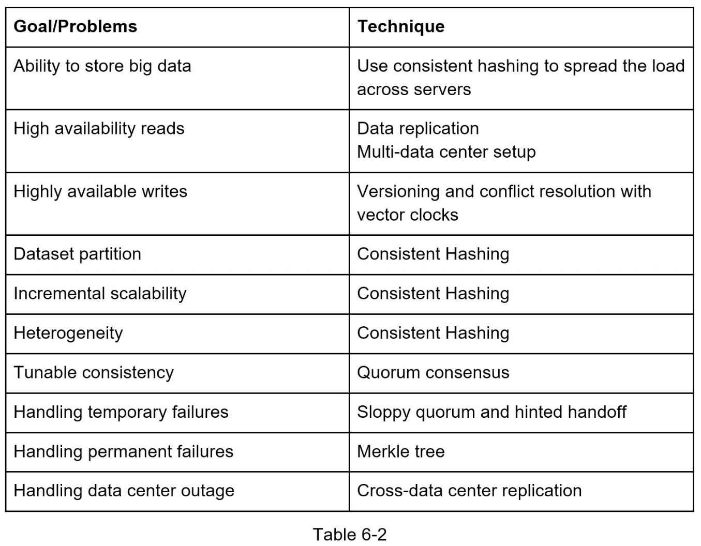

## Tài liệu tham khảo (Reference materials)

[1] Amazon DynamoDB: https://aws.amazon.com/dynamodb/  
[2] memcached: https://memcached.org/  
[3] Redis: https://redis.io/  
[4] Dynamo: Amazon’s Highly Available Key-value Store: https://www.allthingsdistributed.com/files/amazon-dynamo-sosp2007.pdf  
[5] Cassandra: https://cassandra.apache.org/  
[6] Bigtable: A Distributed Storage System for Structured Data: https://static.googleusercontent.com/media/research.google.com/en//archive/bigtable-osdi06.pdf  
[7] Merkle tree: https://en.wikipedia.org/wiki/Merkle_tree  
[8] Cassandra architecture: https://cassandra.apache.org/doc/latest/architecture/  
[9] SStable: https://www.igvita.com/2012/02/06/sstable-and-log-structured-storage-leveldb/  
[10] Bloom filter: https://en.wikipedia.org/wiki/Bloom_filter  

## Bảng thuật ngữ chương (Chapter Glossary)

| Thuật ngữ (English) | Tiếng Việt | Giải thích ngắn gọn |
| --- | --- | --- |
| Key-value store | Hệ thống lưu trữ key-value | Cơ sở dữ liệu phi quan hệ lưu dữ liệu dưới dạng cặp khóa (duy nhất) và giá trị. |
| CAP theorem | Định lý CAP | Định lý phát biểu hệ thống phân tán chỉ có thể đảm bảo tối đa 2 trong 3 tính chất: Consistency, Availability, Partition Tolerance. |
| Consistent hashing | Băm nhất quán | Kỹ thuật phân mảnh dữ liệu lên vòng băm giúp phân phối đều và giảm thiểu di chuyển dữ liệu khi thêm/xóa nút. |
| Virtual node | Nút ảo | Đại diện logic của một máy chủ vật lý trên vòng băm, giúp cân bằng tải và xử lý phần cứng không đồng nhất. |
| Quorum consensus | Đồng thuận Quorum | Cơ chế đảm bảo nhất quán dựa trên tham số `N` (số bản sao), `W` (quorum ghi), `R` (quorum đọc); `W + R > N` cho nhất quán mạnh. |
| Strong consistency | Tính nhất quán mạnh | Mọi thao tác đọc luôn trả về giá trị của lần ghi thành công gần nhất. |
| Eventual consistency | Tính nhất quán cuối cùng | Các bản sao có thể tạm thời khác nhau nhưng sẽ hội tụ về cùng một giá trị sau một khoảng thời gian không có ghi mới. |
| Vector clock | Đồng hồ vector | Cấu trúc `[server, version]` gắn với dữ liệu để theo dõi lịch sử phiên bản và phát hiện xung đột ghi đồng thời. |
| Gossip protocol | Giao thức tin đồn | Giao thức phi tập trung trong đó các nút trao đổi trạng thái thành viên ngẫu nhiên để phát hiện lỗi. |
| Sloppy quorum | Quorum linh hoạt | Cho phép ghi/đọc trên các nút khỏe mạnh thay thế tạm thời khi nút chính gặp sự cố để giữ tính sẵn sàng. |
| Hinted handoff | Chuyển giao có gợi ý | Cơ chế nút tạm thời giữ dữ liệu hộ sẽ gửi trả lại dữ liệu khi nút chính phục hồi. |
| Anti-entropy protocol | Giao thức chống entropy | Cơ chế đồng bộ ngầm giữa các bản sao để khắc phục sai lệch dữ liệu vĩnh viễn. |
| Merkle tree | Cây Merkle (cây băm) | Cấu trúc cây chứa mã băm của dữ liệu, giúp so sánh và tìm nhanh các phân vùng dữ liệu bị lệch giữa các bản sao. |
| Commit log | Nhật ký ghi | Tệp ghi tuần tự trên đĩa lưu lại mọi thao tác ghi trước khi vào bộ nhớ đệm để chống mất dữ liệu. |
| SSTable (Sorted-String Table) | Bảng chuỗi đã sắp xếp | Định dạng lưu trữ bất biến trên đĩa chứa các cặp `<key, value>` đã được sắp xếp theo khóa. |
| Bloom filter | Bộ lọc Bloom | Cấu trúc dữ liệu xác suất giúp kiểm tra nhanh một khóa chắc chắn không tồn tại hoặc có thể tồn tại trong SSTable. |
