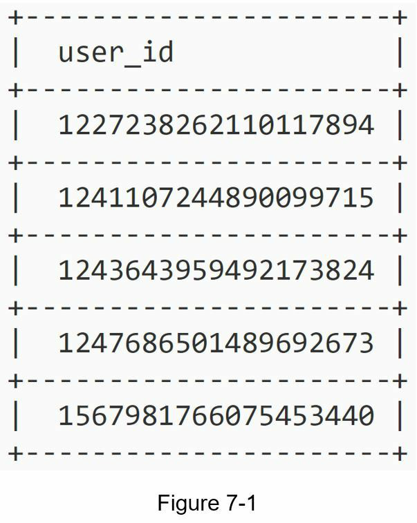
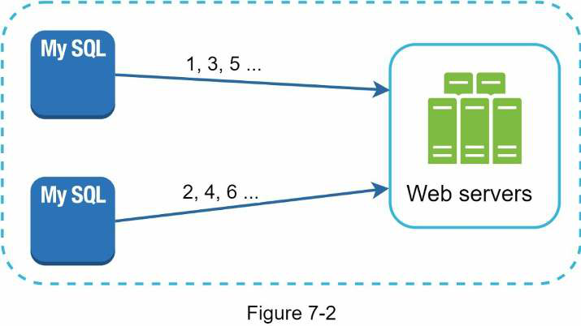
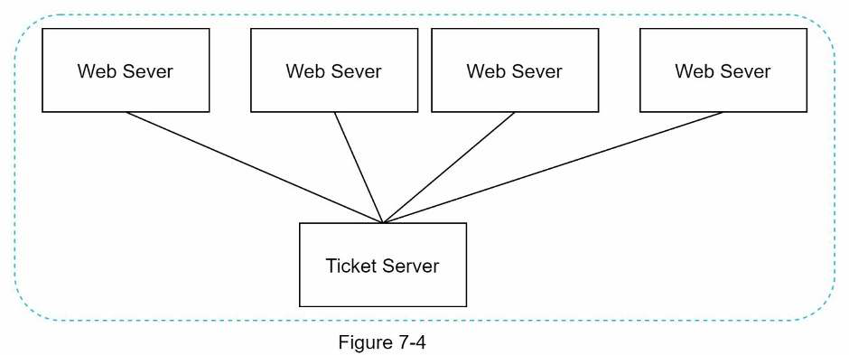
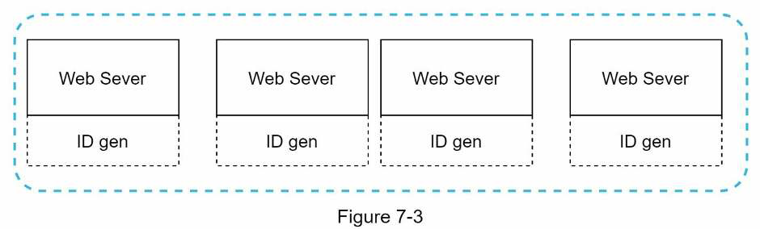
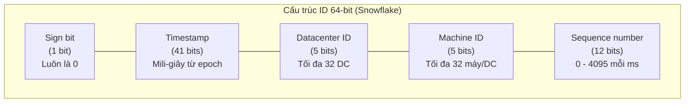
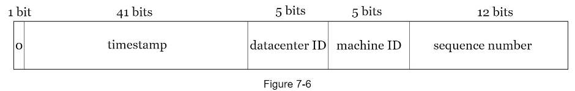
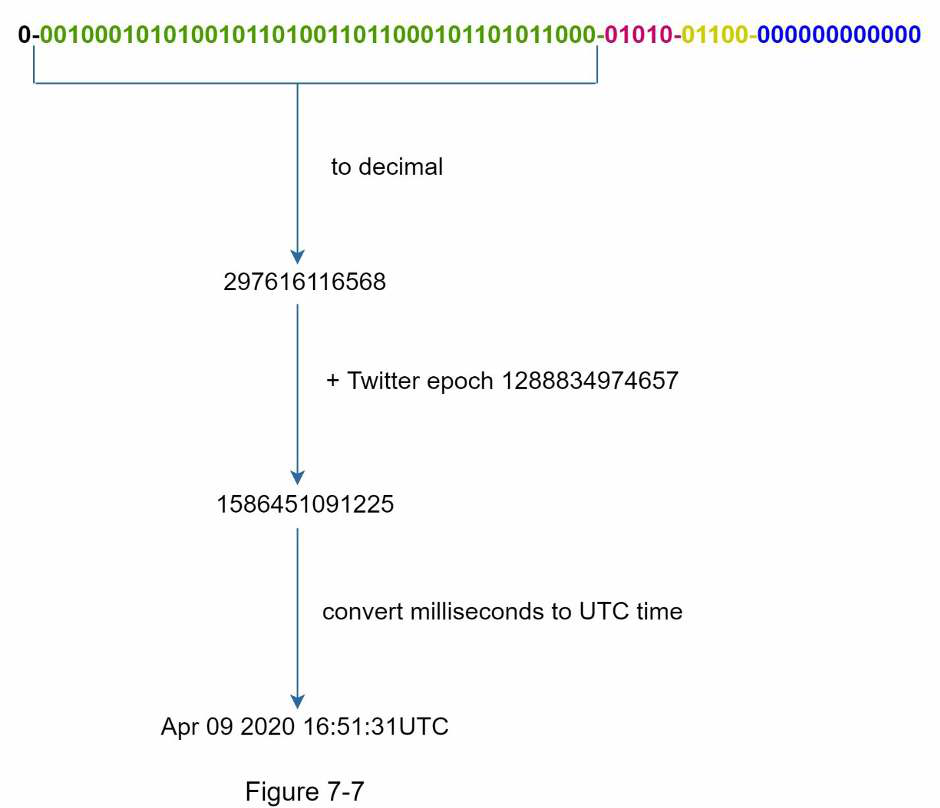

# CHƯƠNG 7: THIẾT KẾ TRÌNH TẠO ID DUY NHẤT TRONG HỆ THỐNG PHÂN TÁN (CHAPTER 7: DESIGN A UNIQUE ID GENERATOR IN DISTRIBUTED SYSTEMS)

Trong chương này, bạn được yêu cầu thiết kế một trình tạo ID duy nhất trong các hệ thống phân tán. Suy nghĩ đầu tiên của bạn có thể là sử dụng khóa chính với thuộc tính `auto_increment` trong một cơ sở dữ liệu truyền thống. Tuy nhiên, `auto_increment` không hoạt động hiệu quả trong môi trường phân tán vì một máy chủ cơ sở dữ liệu đơn lẻ không đủ lớn, và việc tạo ra các ID duy nhất trên nhiều cơ sở dữ liệu với độ trễ tối thiểu là một thách thức lớn.

Dưới đây là một vài ví dụ về ID duy nhất:



---

## Bước 1 - Hiểu rõ bài toán và xác định phạm vi thiết kế (Step 1 - Understand the problem and establish design scope)

Đặt câu hỏi làm rõ yêu cầu là bước đầu tiên để giải quyết bất kỳ câu hỏi phỏng vấn thiết kế hệ thống nào. Dưới đây là một ví dụ về cuộc trao đổi giữa ứng viên và người phỏng vấn:

* **Ứng viên (Candidate):** Các đặc điểm của ID duy nhất là gì?
* **Người phỏng vấn (Interviewer):** Các ID phải là duy nhất và có thể sắp xếp được (sortable).
* **Ứng viên:** Với mỗi bản ghi mới, ID có tăng thêm 1 không?
* **Người phỏng vấn:** ID tăng theo thời gian nhưng không nhất thiết chỉ tăng thêm 1. Các ID được tạo vào buổi tối sẽ lớn hơn các ID được tạo vào buổi sáng cùng ngày.
* **Ứng viên:** ID có chỉ chứa các giá trị số không?
* **Người phỏng vấn:** Đúng vậy.
* **Ứng viên:** Yêu cầu về độ dài của ID là gì?
* **Người phỏng vấn:** ID phải vừa trong 64-bit.
* **Ứng viên:** Quy mô của hệ thống như thế nào?
* **Người phỏng vấn:** Hệ thống phải có khả năng tạo ra 10.000 ID mỗi giây.

Trên đây là một số câu hỏi mẫu mà bạn có thể hỏi người phỏng vấn. Việc hiểu rõ các yêu cầu và làm rõ những điểm mơ hồ là rất quan trọng. Đối với câu hỏi phỏng vấn này, các yêu cầu được liệt kê như sau:

* ID phải là duy nhất.
* ID chỉ là các giá trị số (numerical values).
* ID vừa trong 64-bit.
* ID được sắp xếp theo ngày/thời gian (ordered by date).
* Có khả năng tạo ra hơn 10.000 ID duy nhất mỗi giây.

> 📝 **Giải thích thêm (không có trong sách):** Tại sao yêu cầu ID vừa trong 64-bit và chỉ là số lại quan trọng? Trong các hệ thống cơ sở dữ liệu (như MySQL InnoDB), khóa chính kiểu số nguyên 64-bit (`BIGINT`, 8 byte) giúp việc đánh chỉ mục (B-Tree index) cực kỳ nhỏ gọn và nhanh chóng so với chuỗi ký tự dài (như UUID 36 ký tự). Hơn nữa, nếu ID tăng dần theo thời gian, các bản ghi mới sẽ được chèn tuần tự vào cuối cây B-Tree, tránh hiện tượng phân mảnh trang nhớ (page split) và giảm I/O đĩa đáng kể.

---

## Bước 2 - Đề xuất thiết kế tổng thể và đạt được sự đồng thuận (Step 2 - Propose high-level design and get buy-in)

Có nhiều phương án có thể được sử dụng để tạo ID duy nhất trong các hệ thống phân tán. Các phương án chúng ta xem xét bao gồm:

* Nhân bản đa chủ (Multi-master replication)
* Mã định danh duy nhất toàn cầu (Universally unique identifier - UUID)
* Máy chủ cấp vé (Ticket server)
* Phương pháp Twitter Snowflake (Twitter snowflake approach)

Hãy cùng xem xét từng phương án, cách chúng hoạt động cũng như ưu/nhược điểm của từng lựa chọn.

### Nhân bản đa chủ (Multi-master replication)

Như minh họa trong Hình 7-2, phương pháp đầu tiên là nhân bản đa chủ (multi-master replication).

Phương pháp này sử dụng tính năng `auto_increment` của các cơ sở dữ liệu. Thay vì tăng ID tiếp theo lên 1, chúng ta tăng nó lên $k$, trong đó $k$ là số lượng máy chủ cơ sở dữ liệu đang được sử dụng. Như minh họa trong Hình 7-2, ID tiếp theo được tạo ra sẽ bằng ID trước đó trong cùng máy chủ cộng với 2. Cách này giải quyết được một phần vấn đề khả năng mở rộng vì số lượng ID tạo ra có thể mở rộng theo số lượng máy chủ cơ sở dữ liệu.



Tuy nhiên, chiến lược này có một số nhược điểm lớn:

* Khó mở rộng khi triển khai trên nhiều trung tâm dữ liệu (multiple data centers).
* Các ID không tăng dần theo thời gian khi xét trên nhiều máy chủ khác nhau (ví dụ: máy chủ 1 có thể tạo ID `3` sau khi máy chủ 2 đã tạo ID `4`).
* Không mở rộng tốt khi một máy chủ được thêm vào hoặc bị loại bỏ (việc thay đổi giá trị bước nhảy $k$ và đồng bộ lại các máy chủ đang chạy rất phức tạp).

### UUID (UUID)

UUID là một cách đơn giản khác để có được các ID duy nhất. UUID là một số 128-bit được sử dụng để định danh thông tin trong các hệ thống máy tính. UUID có xác suất xảy ra xung đột (collision) rất thấp. Trích dẫn từ Wikipedia: *"sau khi tạo ra 1 tỷ UUID mỗi giây trong khoảng 100 năm thì xác suất tạo ra một bản sao trùng lặp duy nhất mới đạt tới 50%"* [1].

Dưới đây là một ví dụ về UUID: `09c93e62-50b4-468d-bf8a-c07e1040bfb2`. Các UUID có thể được tạo ra một cách độc lập mà không cần sự phối hợp giữa các máy chủ. Hình 7-3 trình bày thiết kế sử dụng UUID.



Trong thiết kế này, mỗi máy chủ web (web server) chứa một trình tạo ID, và bản thân máy chủ web chịu trách nhiệm tạo ra các ID một cách độc lập.

**Ưu điểm:**

* Việc tạo UUID rất đơn giản. Không cần sự phối hợp giữa các máy chủ nên sẽ không có bất kỳ vấn đề đồng bộ hóa nào.
* Hệ thống dễ dàng mở rộng vì mỗi máy chủ web tự chịu trách nhiệm tạo ra các ID mà nó sử dụng. Trình tạo ID có thể dễ dàng mở rộng cùng với các máy chủ web.

**Nhược điểm:**

* ID có độ dài 128 bit, trong khi yêu cầu của chúng ta là 64 bit.
* ID không tăng dần theo thời gian (với các phiên bản UUID phổ biến như UUIDv4).
* ID có thể chứa ký tự không phải là số (chứa các chữ cái hệ thập lục phân và dấu gạch ngang).

### Máy chủ cấp vé (Ticket Server)

Ticket server là một cách thú vị khác để tạo ID duy nhất. Flickr đã phát triển các ticket server để tạo khóa chính phân tán [2]. Cách hệ thống này hoạt động rất đáng để nhắc đến.

Ý tưởng là sử dụng tính năng `auto_increment` tập trung trong một máy chủ cơ sở dữ liệu duy nhất (Ticket Server). Để tìm hiểu thêm về cách này, hãy tham khảo bài viết trên blog kỹ thuật của Flickr [2].



**Ưu điểm:**

* Tạo ra các ID dạng số (Numeric IDs).
* Dễ triển khai và hoạt động tốt cho các ứng dụng quy mô nhỏ đến trung bình.

**Nhược điểm:**

* Điểm lỗi đơn (Single point of failure): Việc chỉ có một ticket server duy nhất đồng nghĩa với việc nếu máy chủ này gặp sự cố, tất cả các hệ thống phụ thuộc vào nó đều sẽ gặp vấn đề. Để tránh điểm lỗi đơn, chúng ta có thể thiết lập nhiều ticket server. Tuy nhiên, điều này sẽ làm phát sinh các thách thức mới như đồng bộ hóa dữ liệu.

### Phương pháp Twitter Snowflake (Twitter snowflake approach)

Các phương pháp kể trên mang lại cho chúng ta một số ý tưởng về cách các hệ thống tạo ID khác nhau hoạt động. Tuy nhiên, không phương pháp nào đáp ứng được toàn bộ các yêu cầu cụ thể của chúng ta; do đó, chúng ta cần một cách tiếp cận khác. Hệ thống tạo ID duy nhất của Twitter có tên là **"snowflake"** [3] là một nguồn cảm hứng tuyệt vời và có thể thỏa mãn các yêu cầu đề ra.

"Chia để trị" (Divide and conquer) là người bạn tốt của chúng ta. Thay vì tạo ra một ID một cách trực tiếp, chúng ta chia ID thành các phần (section) khác nhau. Hình 7-5 cho thấy bố cục của một ID 64-bit.


Mỗi phần được giải thích như sau:

* **Bit dấu (Sign bit):** 1 bit. Giá trị luôn luôn là `0`. Bit này được dành riêng cho các mục đích sử dụng trong tương lai. Nó có tiềm năng được dùng để phân biệt giữa số có dấu và số không dấu.
* **Dấu thời gian (Timestamp):** 41 bit. Số mili-giây (milliseconds) tính từ mốc thời gian chuẩn (epoch) hoặc một mốc thời gian tùy chỉnh (custom epoch). Chúng ta sử dụng mốc thời gian mặc định của Twitter snowflake là `1288834974657`, tương đương với ngày 04 tháng 11 năm 2010, lúc 01:42:54 UTC.
* **ID trung tâm dữ liệu (Datacenter ID):** 5 bit, cho phép chúng ta có $2^5 = 32$ trung tâm dữ liệu.
* **ID máy (Machine ID):** 5 bit, cho phép chúng ta có $2^5 = 32$ máy trên mỗi trung tâm dữ liệu.
* **Số thứ tự (Sequence number):** 12 bit. Với mỗi ID được tạo trên máy/tiến trình đó, số thứ tự sẽ được tăng thêm 1. Số này được đặt lại về `0` sau mỗi mili-giây.



---

## Bước 3 - Đi sâu vào thiết kế chi tiết (Step 3 - Design deep dive)

Trong phần thiết kế tổng thể, chúng ta đã thảo luận các phương án khác nhau để thiết kế trình tạo ID duy nhất trong hệ thống phân tán. Chúng ta chốt phương án dựa trên trình tạo ID Twitter Snowflake. Hãy cùng đi sâu vào chi tiết của thiết kế này. Để gợi nhớ lại, sơ đồ thiết kế được liệt kê lại bên dưới.



**Datacenter ID** và **Machine ID** được chọn tại thời điểm khởi động (startup time) và nhìn chung được giữ cố định một khi hệ thống đã đi vào hoạt động. Bất kỳ thay đổi nào đối với datacenter ID và machine ID đều đòi hỏi sự rà soát cẩn thận vì một sự thay đổi vô tình ở các giá trị này có thể dẫn đến xung đột ID (ID conflicts). **Timestamp** và **Sequence number** được tạo động trong quá trình trình tạo ID đang chạy.

### Dấu thời gian (Timestamp)

41 bit quan trọng nhất tạo nên phần timestamp. Vì giá trị timestamp tăng theo thời gian, các ID sẽ có thể sắp xếp được theo thời gian. Hình 7-7 minh họa một ví dụ về cách biểu diễn nhị phân được chuyển đổi sang giờ UTC. Bạn cũng có thể chuyển đổi ngược lại từ giờ UTC sang biểu diễn nhị phân bằng phương pháp tương tự.



Giá trị timestamp tối đa có thể được biểu diễn trong 41 bit là:

$$2^{41} - 1 = 2199023255551 \text{ mili-giây (ms)}$$

Con số này mang lại cho chúng ta khoảng thời gian sử dụng là:

$$\approx 69 \text{ năm} = \frac{2199023255551 \text{ ms}}{1000 \text{ giây} \times 365 \text{ ngày} \times 24 \text{ giờ} \times 3600 \text{ giây}}$$

Điều này có nghĩa là trình tạo ID sẽ hoạt động được trong 69 năm, và việc sử dụng một mốc thời gian tùy chỉnh (custom epoch) gần với ngày hiện tại sẽ giúp trì hoãn thời điểm bị tràn số (overflow time). Sau 69 năm, chúng ta sẽ cần một mốc epoch mới hoặc áp dụng các kỹ thuật khác để di chuyển/chuyển đổi ID.

### Số thứ tự (Sequence number)

Số thứ tự (Sequence number) có độ dài 12 bit, cho phép chúng ta có $2^{12} = 4096$ tổ hợp giá trị (từ `0` đến `4095`). Trường này có giá trị là `0` trừ khi có nhiều hơn một ID được tạo ra trong cùng một mili-giây trên cùng một máy chủ. Về mặt lý thuyết, một máy có thể hỗ trợ tối đa 4096 ID mới mỗi mili-giây (tương đương hơn 4 triệu ID mỗi giây trên một máy duy nhất, vượt xa yêu cầu 10.000 ID/giây).

> 💡 **Ví dụ bổ sung (không có trong sách):** Dưới đây là đoạn mã Python minh họa cách tính toán và ghép các bit để tạo ra một Snowflake ID 64-bit hoàn chỉnh:
>
> ```python
> import time
>
> class SnowflakeGenerator:
>     # Custom epoch: 2020-01-01 00:00:00 UTC (ms)
>     EPOCH = 1577836800000
>
>     def __init__(self, datacenter_id: int, machine_id: int):
>         assert 0 <= datacenter_id < 32, "Datacenter ID phải từ 0 đến 31"
>         assert 0 <= machine_id < 32, "Machine ID phải từ 0 đến 31"
>         self.datacenter_id = datacenter_id
>         self.machine_id = machine_id
>         self.sequence = 0
>         self.last_timestamp = -1
>
>     def _current_ms(self) -> int:
>         return int(time.time() * 1000)
>
>     def next_id(self) -> int:
>         timestamp = self._current_ms()
>
>         if timestamp < self.last_timestamp:
>             raise RuntimeError("Đồng hồ bị chạy lùi! Từ chối tạo ID.")
>
>         if timestamp == self.last_timestamp:
>             self.sequence = (self.sequence + 1) & 0xFFF  # 12 bit (max 4095)
>             if self.sequence == 0:
>                 # Hết 4096 ID trong mili-giây này -> chờ đến mili-giây tiếp theo
>                 while timestamp <= self.last_timestamp:
>                     timestamp = self._current_ms()
>         else:
>             self.sequence = 0
>
>         self.last_timestamp = timestamp
>
>         # Ghép các bit bằng phép dịch bit (bit shifting)
>         new_id = (
>             ((timestamp - self.EPOCH) << 22)
>             | (self.datacenter_id << 17)
>             | (self.machine_id << 12)
>             | self.sequence
>         )
>         return new_id
> ```
>
> Khi gọi `gen = SnowflakeGenerator(datacenter_id=1, machine_id=5)` và `gen.next_id()`, kết quả trả về là một số nguyên 64-bit duy nhất như `642195823411200000`.

---

## Bước 4 - Tổng kết (Step 4 - Wrap up)

Trong chương này, chúng ta đã thảo luận về các phương pháp khác nhau để thiết kế một trình tạo ID duy nhất: nhân bản đa chủ (multi-master replication), UUID, ticket server, và trình tạo ID duy nhất kiểu Twitter Snowflake. Chúng ta lựa chọn Snowflake vì nó đáp ứng tất cả các trường hợp sử dụng (use cases) của bài toán và có khả năng mở rộng tốt trong môi trường phân tán.

Nếu vẫn còn thời gian ở cuối buổi phỏng vấn, dưới đây là một vài chủ đề bổ sung bạn có thể trao đổi thêm:

* **Đồng bộ hóa đồng hồ (Clock synchronization):** Trong thiết kế của chúng ta, ta giả định rằng các máy chủ tạo ID có cùng thời gian đồng hồ. Giả định này có thể không đúng khi một máy chủ chạy trên nhiều nhân CPU (multiple cores). Thách thức tương tự cũng tồn tại trong các kịch bản đa máy chủ (multi-machine). Các giải pháp cho vấn đề đồng bộ hóa đồng hồ nằm ngoài phạm vi của cuốn sách này; tuy nhiên, điều quan trọng là bạn cần hiểu rằng vấn đề này có tồn tại. **Network Time Protocol (NTP)** là giải pháp phổ biến nhất cho vấn đề này. Độc giả quan tâm có thể tham khảo tài liệu tham khảo [4].
* **Điều chỉnh độ dài các phần (Section length tuning):** Ví dụ, việc giảm số bit của sequence number và tăng số bit của timestamp sẽ hiệu quả hơn đối với các ứng dụng có mức độ đồng thời thấp (low concurrency) nhưng cần vòng đời hoạt động dài hạn (long-term).
* **Tính sẵn sàng cao (High availability):** Vì trình tạo ID là một hệ thống thiết yếu (mission-critical system), nó bắt buộc phải có tính sẵn sàng cao.

> 📝 **Giải thích thêm (không có trong sách):** Vấn đề "đồng hồ chạy lùi" (clock drift / clock skew) xảy ra khi NTP điều chỉnh đồng hồ hệ thống lùi lại vài mili-giây. Nếu không xử lý, máy chủ có thể tạo ra ID trùng lặp với mili-giây trước đó. Trong thực tế, các hệ thống thường xử lý bằng cách: (1) nếu lệch nhỏ (ví dụ < 5ms), tạm chờ cho đồng hồ bắt kịp `last_timestamp`; (2) nếu lệch lớn, ném lỗi và tạm dừng nhận yêu cầu từ máy chủ đó hoặc chuyển sang một cặp `worker_id` dự phòng.

Chúc mừng bạn đã đi được đến đây! Hãy tự thưởng cho mình một cái vỗ vai nhé. Làm tốt lắm!

---

## Tài liệu tham khảo (Reference materials)

[1] Universally unique identifier: https://en.wikipedia.org/wiki/Universally_unique_identifier

[2] Ticket Servers: Distributed Unique Primary Keys on the Cheap: https://code.flickr.net/2010/02/08/ticket-servers-distributed-unique-primary-keys-on-the-cheap/

[3] Announcing Snowflake: https://blog.twitter.com/engineering/en_us/a/2010/announcing-snowflake.html

[4] Network time protocol: https://en.wikipedia.org/wiki/Network_Time_Protocol

---

## Bảng thuật ngữ chương (Chapter Glossary)

| Thuật ngữ (English) | Tiếng Việt | Giải thích ngắn gọn |
| :--- | :--- | :--- |
| **Auto-increment** | Tự động tăng | Thuộc tính trong cơ sở dữ liệu tự động tăng giá trị khóa chính lên 1 cho mỗi bản ghi mới. |
| **Multi-master replication** | Nhân bản đa chủ | Kiến trúc nhiều máy chủ cơ sở dữ liệu cùng nhận thao tác ghi và đồng bộ dữ liệu với nhau. |
| **UUID (Universally Unique Identifier)** | Mã định danh duy nhất toàn cầu | Chuỗi số 128-bit dùng để định danh thông tin với xác suất trùng lặp cực thấp mà không cần máy chủ trung tâm. |
| **Ticket Server** | Máy chủ cấp vé | Một máy chủ cơ sở dữ liệu tập trung chuyên dùng để phát sinh các ID số tăng dần cho toàn hệ thống. |
| **Single Point of Failure (SPOF)** | Điểm lỗi đơn | Một thành phần trong hệ thống mà nếu nó gặp sự cố, toàn bộ hệ thống sẽ ngừng hoạt động. |
| **Twitter Snowflake** | Phương pháp Snowflake của Twitter | Thuật toán tạo ID 64-bit phân tán bằng cách ghép nối các bit: dấu, timestamp, datacenter ID, machine ID và sequence number. |
| **Epoch** | Mốc thời gian chuẩn | Thời điểm gốc được chọn làm mốc 0 để tính khoảng thời gian trôi qua (tính bằng mili-giây hoặc giây). |
| **Clock Synchronization** | Đồng bộ hóa đồng hồ | Quá trình đảm bảo thời gian hệ thống trên các máy chủ phân tán khớp nhau, thường dùng giao thức NTP. |
| **Sequence Number** | Số thứ tự | Bộ đếm tăng dần cho các ID được tạo trong cùng một mili-giây trên cùng một máy chủ. |
| **High Availability (HA)** | Tính sẵn sàng cao | Khả năng hệ thống duy trì hoạt động liên tục và tin cậy ngay cả khi có thành phần gặp lỗi. |
