# CHƯƠNG 8: THIẾT KẾ DỊCH VỤ RÚT GỌN URL (CHAPTER 8: DESIGN A URL SHORTENER)

Trong chương này, chúng ta sẽ giải quyết một câu hỏi phỏng vấn thiết kế hệ thống thú vị và kinh điển: thiết kế một dịch vụ rút gọn URL giống như tinyurl.

## Bước 1 - Hiểu rõ bài toán và xác định phạm vi thiết kế (Step 1 - Understand the problem and establish design scope)

Các câu hỏi phỏng vấn thiết kế hệ thống thường được để mở có chủ đích. Để thiết kế một hệ thống chỉn chu, việc đặt các câu hỏi làm rõ yêu cầu là vô cùng quan trọng.

**Ứng viên:** Bạn có thể cho một ví dụ về cách hoạt động của dịch vụ rút gọn URL không?  
**Người phỏng vấn:** Giả sử URL `https://www.systeminterview.com/q=chatsystem&c=loggedin&v=v3&l=long` là URL gốc. Dịch vụ của bạn tạo ra một bí danh (alias) có độ dài ngắn hơn: `https://tinyurl.com/y7keocwj`. Nếu bạn nhấp vào bí danh này, nó sẽ chuyển hướng bạn đến URL gốc.

**Ứng viên:** Lưu lượng truy cập là bao nhiêu?  
**Người phỏng vấn:** 100 triệu URL được tạo mỗi ngày.

**Ứng viên:** URL rút gọn dài bao nhiêu?  
**Người phỏng vấn:** Ngắn nhất có thể.

**Ứng viên:** Những ký tự nào được phép dùng trong URL rút gọn?  
**Người phỏng vấn:** URL rút gọn có thể là sự kết hợp của các chữ số (`0-9`) và chữ cái (`a-z`, `A-Z`).

**Ứng viên:** Các URL rút gọn có thể bị xóa hoặc cập nhật không?  
**Người phỏng vấn:** Để đơn giản, hãy giả sử các URL rút gọn không thể bị xóa hoặc cập nhật.

Dưới đây là các ca sử dụng (use cases) cơ bản:

1. **Rút gọn URL (URL shortening):** cho một URL dài => trả về một URL ngắn hơn nhiều.
2. **Chuyển hướng URL (URL redirecting):** cho một URL ngắn => chuyển hướng đến URL gốc.
3. **Các yếu tố cần cân nhắc:** tính sẵn sàng cao (high availability), khả năng mở rộng (scalability) và khả năng chịu lỗi (fault tolerance).

### Ước tính sơ bộ (Back of the envelope estimation)

- **Thao tác ghi (Write operation):** 100 triệu URL được tạo mỗi ngày.
- **Số thao tác ghi mỗi giây (Write operation per second):** `100 triệu / 24 / 3600 = 1.160`
- **Thao tác đọc (Read operation):** Giả sử tỷ lệ giữa thao tác đọc và thao tác ghi là `10:1`, số thao tác đọc mỗi giây: `1.160 * 10 = 11.600`
- Giả sử dịch vụ rút gọn URL sẽ hoạt động trong 10 năm, điều này có nghĩa là chúng ta phải hỗ trợ `100 triệu * 365 * 10 = 365 tỷ` bản ghi.
- Giả sử độ dài trung bình của một URL là 100 ký tự.
- **Nhu cầu lưu trữ trong 10 năm:** `365 tỷ * 100 bytes * 10 năm = 365 TB`

Việc cùng người phỏng vấn đi qua các giả định và phép tính này là rất quan trọng để cả hai bên có cùng góc nhìn.

> 📝 **Giải thích thêm (không có trong sách):**  
> Trong phép tính lưu trữ ở trên, bản gốc của sách nhân thêm `10 năm` một lần nữa (`365 tỷ * 100 bytes * 10 năm = 365 TB`), thực tế con số `365 tỷ` bản ghi đã bao gồm 10 năm rồi (`365 × 10^9 × 100 bytes ≈ 36,5 TB`). Tuy nhiên, nếu tính thêm cả `id` (8 bytes), `shortURL` (7 bytes), dấu thời gian (timestamp), chỉ mục (index) của cơ sở dữ liệu và hệ số sao lưu (replication factor), dung lượng thực tế hoàn toàn có thể lên tới hàng trăm TB. Khi phỏng vấn, bạn nên nêu rõ cả kích thước dữ liệu thô lẫn phần phụ trội (overhead) của index và replication.

---

## Bước 2 - Đề xuất thiết kế tổng quan và lấy sự đồng thuận (Step 2 - Propose high-level design and get buy-in)

Trong phần này, chúng ta sẽ thảo luận về các API endpoint, luồng chuyển hướng URL và luồng rút gọn URL.

### Các API Endpoint (API Endpoints)

Các API endpoint tạo điều kiện cho việc giao tiếp giữa client và server. Chúng ta sẽ thiết kế các API theo phong cách REST. Nếu bạn chưa quen với RESTful API, bạn có thể tham khảo các tài liệu bên ngoài, chẳng hạn như tài liệu trong mục tham khảo [1]. Một dịch vụ rút gọn URL chủ yếu cần hai API endpoint:

1. **Rút gọn URL (URL shortening):** Để tạo một URL ngắn mới, client gửi một yêu cầu `POST` chứa một tham số: URL dài ban đầu. API trông như sau:
   ```text
   POST api/v1/data/shorten
   ```
   - **Tham số yêu cầu (request parameter):** `{longUrl: longURLString}`
   - **Kết quả trả về:** `shortURL`

2. **Chuyển hướng URL (URL redirecting):** Để chuyển hướng một URL ngắn đến URL dài tương ứng, client gửi một yêu cầu `GET`. API trông như sau:
   ```text
   GET api/v1/shortUrl
   ```
   - **Kết quả trả về:** `longURL` để thực hiện chuyển hướng HTTP (HTTP redirection).

### Chuyển hướng URL (URL redirecting)

Hình 8-1 cho thấy điều gì xảy ra khi bạn nhập một tinyurl vào trình duyệt. Ngay khi server nhận được yêu cầu tinyurl, nó chuyển đổi URL ngắn thành URL dài bằng mã chuyển hướng `301`.

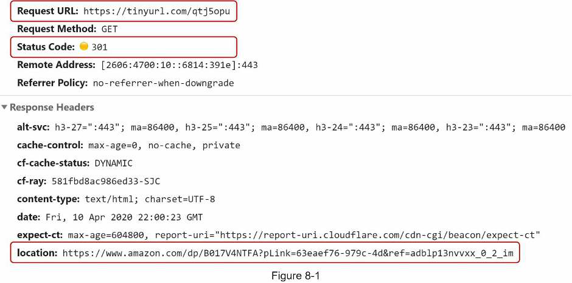

Chi tiết quá trình giao tiếp giữa client và server được minh họa trong Hình 8-2.

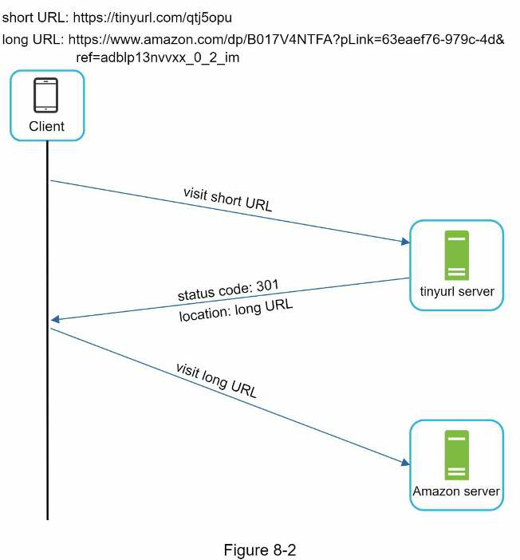

Một điểm rất đáng thảo luận ở đây là sự khác nhau giữa chuyển hướng **301** và chuyển hướng **302**.

- **Chuyển hướng 301 (301 redirect):** Cho biết URL được yêu cầu đã được chuyển **"vĩnh viễn" (permanently)** sang URL dài. Vì là chuyển hướng vĩnh viễn, trình duyệt sẽ lưu vào bộ nhớ đệm (cache) phản hồi này, và các yêu cầu tiếp theo cho cùng URL đó sẽ không được gửi đến dịch vụ rút gọn URL nữa. Thay vào đó, các yêu cầu sẽ được chuyển thẳng đến server của URL dài.
- **Chuyển hướng 302 (302 redirect):** Có nghĩa là URL được chuyển **"tạm thời" (temporarily)** sang URL dài, tức là các yêu cầu tiếp theo cho cùng URL đó vẫn sẽ được gửi đến dịch vụ rút gọn URL trước. Sau đó, chúng mới được chuyển hướng đến server của URL dài.

Mỗi phương thức chuyển hướng đều có ưu và nhược điểm riêng. Nếu ưu tiên hàng đầu là giảm tải cho server, việc sử dụng chuyển hướng 301 rất hợp lý vì chỉ yêu cầu đầu tiên của cùng một URL được gửi đến các server rút gọn URL. Tuy nhiên, nếu việc phân tích số liệu (analytics) là quan trọng, chuyển hướng 302 là lựa chọn tốt hơn vì nó có thể theo dõi tỷ lệ nhấp chuột (click rate) và nguồn gốc lượt nhấp dễ dàng hơn.

> 💡 **Ví dụ bổ sung (không có trong sách):**  
> - Các dịch vụ tiếp thị như **Bitly** thường dùng **302 (hoặc 307)** vì khách hàng muốn biết có bao nhiêu người bấm vào link, đến từ quốc gia nào, dùng thiết bị gì.  
> - Nếu bạn dùng **301** trong môi trường phát triển hoặc cấu hình nhầm URL đích, trình duyệt của người dùng sẽ cache rất lâu và không gọi lại server rút gọn để cập nhật URL mới, gây khó khăn khi gỡ lỗi (debug).

Cách trực quan nhất để triển khai việc chuyển hướng URL là sử dụng bảng băm (hash table). Giả sử bảng băm lưu trữ các cặp `<shortURL, longURL>`, việc chuyển hướng URL có thể được thực hiện như sau:

- Lấy `longURL`: `longURL = hashTable.get(shortURL)`
- Sau khi có được `longURL`, thực hiện chuyển hướng URL.

### Rút gọn URL (URL shortening)

Hãy giả sử URL ngắn có dạng như sau: `www.tinyurl.com/{hashValue}`. Để hỗ trợ ca sử dụng rút gọn URL, chúng ta phải tìm một hàm băm `fx` ánh xạ một URL dài sang `hashValue`, như minh họa trong Hình 8-3.

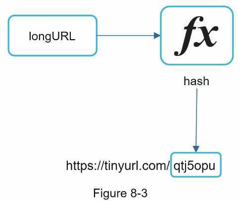

Hàm băm phải thỏa mãn các yêu cầu sau:
- Mỗi `longURL` phải được băm thành một `hashValue`.
- Mỗi `hashValue` có thể được ánh xạ ngược lại về `longURL`.

Thiết kế chi tiết cho hàm băm sẽ được thảo luận trong phần thiết kế chuyên sâu.

---

## Bước 3 - Thiết kế chi tiết (Step 3 - Design deep dive)

Cho đến thời điểm này, chúng ta đã thảo luận về thiết kế tổng quan của việc rút gọn URL và chuyển hướng URL. Trong phần này, chúng ta sẽ đi sâu vào các nội dung sau: mô hình dữ liệu, hàm băm, quy trình rút gọn URL và quy trình chuyển hướng URL.

### Mô hình dữ liệu (Data model)

Trong thiết kế tổng quan, mọi thứ được lưu trữ trong một bảng băm. Đây là một điểm khởi đầu tốt; tuy nhiên, cách tiếp cận này không khả thi đối với các hệ thống thực tế vì tài nguyên bộ nhớ (RAM) có hạn và đắt đỏ. Một lựa chọn tốt hơn là lưu trữ ánh xạ `<shortURL, longURL>` trong một cơ sở dữ liệu quan hệ (relational database). Hình 8-4 minh họa một thiết kế bảng cơ sở dữ liệu đơn giản. Phiên bản đơn giản hóa của bảng chứa 3 cột: `id`, `shortURL`, `longURL`.

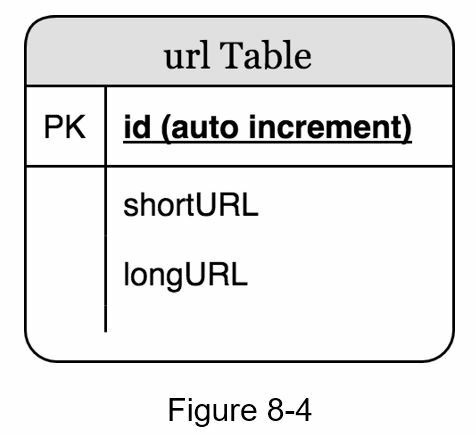

### Hàm băm (Hash function)

Hàm băm được sử dụng để băm một URL dài thành một URL ngắn, còn được gọi là `hashValue`.

#### Độ dài giá trị băm (Hash value length)

`hashValue` bao gồm các ký tự từ `[0-9, a-z, A-Z]`, chứa `10 + 26 + 26 = 62` ký tự khả dĩ. Để tìm ra độ dài của `hashValue`, hãy tìm số nguyên dương `n` nhỏ nhất sao cho `62^n >= 365 tỷ`. Hệ thống phải hỗ trợ tối đa 365 tỷ URL dựa trên phần ước tính sơ bộ. Bảng 8-1 cho thấy độ dài của `hashValue` và số lượng URL tối đa tương ứng mà nó có thể hỗ trợ.

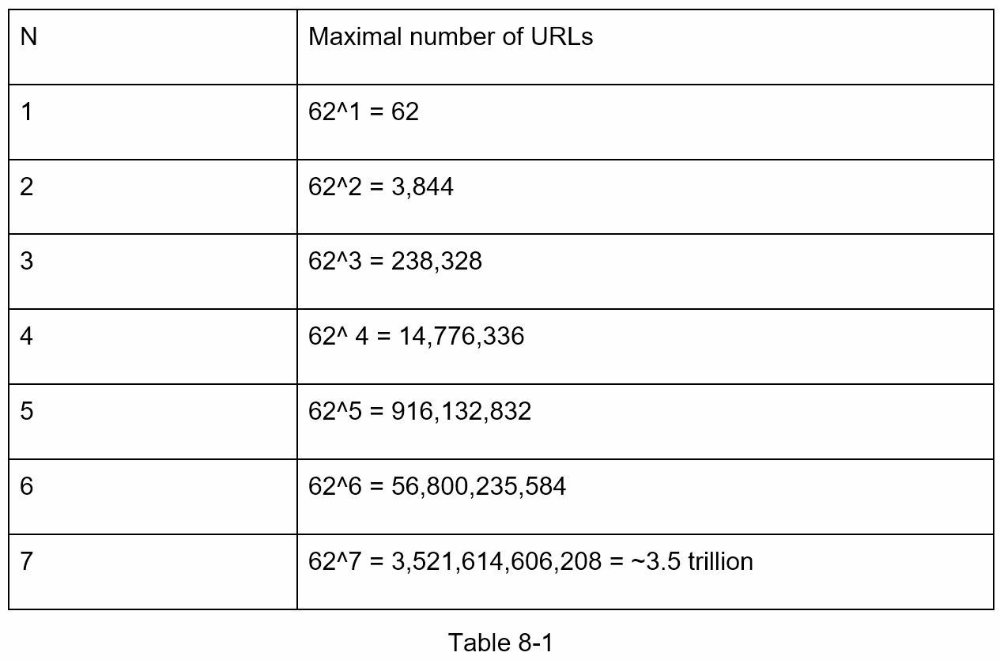

| N | Số lượng URL tối đa (Maximal number of URLs) |
| :--- | :--- |
| 1 | $62^1 = 62$ |
| 2 | $62^2 = 3.844$ |
| 3 | $62^3 = 238.328$ |
| 4 | $62^4 = 14.776.336$ |
| 5 | $62^5 = 916.132.832$ |
| 6 | $62^6 = 56.800.235.584$ |
| 7 | $62^7 = 3.521.614.606.208 \approx 3,5\text{ nghìn tỷ}$ |

Khi `n = 7`, `62^n = ~3,5 nghìn tỷ`, 3,5 nghìn tỷ là quá đủ để chứa 365 tỷ URL, do đó độ dài của `hashValue` là **7**.

Chúng ta sẽ khám phá hai loại hàm băm cho dịch vụ rút gọn URL. Loại thứ nhất là **"băm + xử lý xung đột" (hash + collision resolution)**, và loại thứ hai là **"chuyển đổi hệ cơ số 62" (base 62 conversion)**. Hãy cùng xem xét từng loại một.

#### Băm + xử lý xung đột (Hash + collision resolution)

Để rút gọn một URL dài, chúng ta cần triển khai một hàm băm chuyển đổi URL dài thành một chuỗi 7 ký tự. Một giải pháp trực tiếp là sử dụng các hàm băm nổi tiếng như CRC32, MD5 hoặc SHA-1. Bảng dưới đây so sánh kết quả băm sau khi áp dụng các hàm băm khác nhau lên URL: `https://en.wikipedia.org/wiki/Systems_design`.

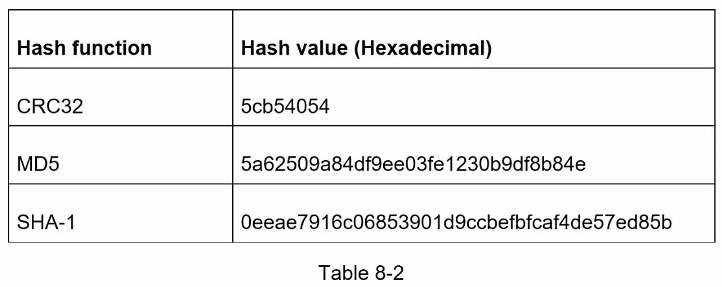

| Hàm băm (Hash function) | Giá trị băm (Hệ thập lục phân - Hexadecimal) |
| :--- | :--- |
| CRC32 | `5cb54054` |
| MD5 | `5a62509a84df9ee03fe1230b9df8b84e` |
| SHA-1 | `0eeae7916c06853901d9ccbefbfcaf4de57ed85b` |

Như thể hiện trong Bảng 8-2, ngay cả giá trị băm ngắn nhất (từ CRC32) cũng quá dài (nhiều hơn 7 ký tự). Làm thế nào chúng ta có thể làm cho nó ngắn hơn?

Cách tiếp cận đầu tiên là lấy 7 ký tự đầu tiên của giá trị băm; tuy nhiên, phương pháp này có thể dẫn đến **xung đột băm (hash collisions)**. Để giải quyết xung đột băm, chúng ta có thể nối thêm một chuỗi định sẵn (predefined string) một cách đệ quy cho đến khi không còn phát hiện xung đột nữa. Quy trình này được giải thích trong Hình 8-5.

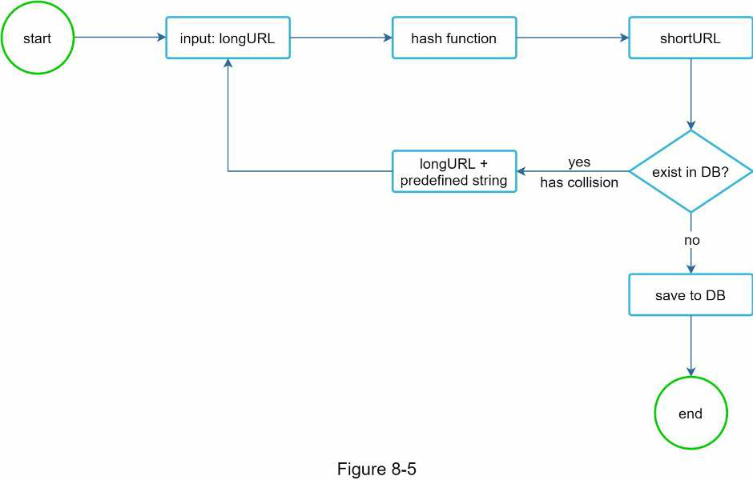

Phương pháp này có thể loại bỏ xung đột; tuy nhiên, việc truy vấn cơ sở dữ liệu để kiểm tra xem một `shortURL` đã tồn tại hay chưa cho mỗi yêu cầu là rất tốn kém. Một kỹ thuật gọi là **Bloom filter** [2] có thể cải thiện hiệu năng. Bloom filter là một kỹ thuật xác suất tiết kiệm bộ nhớ dùng để kiểm tra xem một phần tử có thuộc về một tập hợp hay không. Hãy tham khảo tài liệu [2] để biết thêm chi tiết.

> 📝 **Giải thích thêm (không có trong sách):**  
> Bloom filter có đặc tính **không bao giờ báo sai âm tính (no false negatives)**: nếu Bloom filter nói `shortURL` *không* tồn tại trong tập hợp, thì chắc chắn 100% nó chưa từng được dùng — ta có thể lưu thẳng vào DB mà không cần truy vấn kiểm tra `SELECT`. Chỉ khi Bloom filter báo *có thể* đã tồn tại (tỷ lệ dương tính giả nhỏ), ta mới cần truy vấn DB để xác minh. Nhờ đó, số lượng truy vấn đọc DB khi tạo URL ngắn giảm đi đáng kể.

#### Chuyển đổi hệ cơ số 62 (Base 62 conversion)

Chuyển đổi cơ số (Base conversion) là một cách tiếp cận phổ biến khác được dùng cho các dịch vụ rút gọn URL. Chuyển đổi cơ số giúp chuyển đổi cùng một con số giữa các hệ đếm biểu diễn khác nhau. Hệ cơ số 62 (Base 62) được sử dụng vì có 62 ký tự khả dĩ cho `hashValue`. Hãy dùng một ví dụ để giải thích cách chuyển đổi hoạt động: chuyển đổi `11157_10` sang dạng biểu diễn hệ cơ số 62 (`11157_10` biểu thị số 11157 trong hệ cơ số 10).

- Đúng như tên gọi, base 62 là cách sử dụng 62 ký tự để mã hóa. Bảng ánh xạ là: `0-0, ..., 9-9, 10-a, 11-b, ..., 35-z, 36-A, ..., 61-Z`, trong đó `'a'` đại diện cho 10, `'Z'` đại diện cho 61, v.v.
- $11157_{10} = 2 \times 62^2 + 55 \times 62^1 + 59 \times 62^0 = [2, 55, 59] \rightarrow [2, T, X]$ trong biểu diễn hệ cơ số 62. Hình 8-6 minh họa quá trình chuyển đổi này.

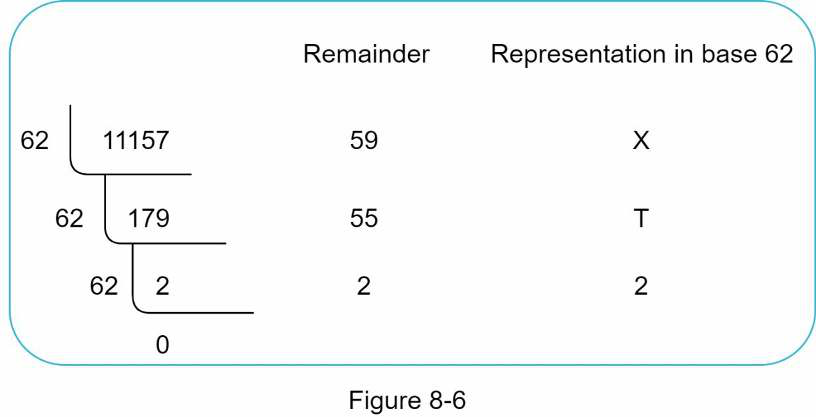

- Như vậy, URL ngắn là `https://tinyurl.com/2TX`.

> 💡 **Ví dụ bổ sung (không có trong sách):**  
> Dưới đây là đoạn mã Python minh họa hàm chuyển đổi một ID số nguyên (hệ 10) sang chuỗi Base 62 và ngược lại:
> ```python
> ALPHABET = "0123456789abcdefghijklmnopqrstuvwxyzABCDEFGHIJKLMNOPQRSTUVWXYZ"
> BASE = len(ALPHABET)  # 62
> 
> def encode_base62(num: int) -> str:
>     if num == 0:
>         return ALPHABET[0]
>     chars = []
>     while num > 0:
>         num, rem = divmod(num, BASE)
>         chars.append(ALPHABET[rem])
>     return "".join(reversed(chars))
> 
> print(encode_base62(11157))          # Output: 2TX
> print(encode_base62(2009215674938))  # Output: zn9edcu
> ```

#### So sánh hai phương pháp (Comparison of the two approaches)

Bảng 8-3 cho thấy sự khác biệt giữa hai phương pháp.

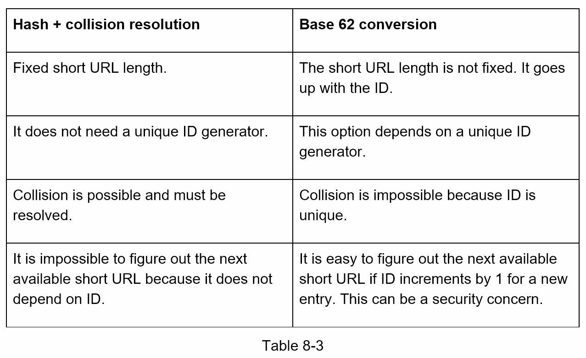

| Băm + xử lý xung đột (Hash + collision resolution) | Chuyển đổi hệ cơ số 62 (Base 62 conversion) |
| :--- | :--- |
| Độ dài URL ngắn cố định. | Độ dài URL ngắn không cố định. Nó tăng lên cùng với giá trị ID. |
| Không cần bộ sinh ID duy nhất (unique ID generator). | Phương án này phụ thuộc vào bộ sinh ID duy nhất. |
| Có thể xảy ra xung đột và bắt buộc phải xử lý. | Không thể xảy ra xung đột vì ID là duy nhất. |
| Không thể đoán trước URL ngắn khả dụng tiếp theo vì nó không phụ thuộc vào ID. | Dễ dàng đoán được URL ngắn khả dụng tiếp theo nếu ID tăng thêm 1 cho mỗi bản ghi mới. Điều này có thể trở thành một vấn đề bảo mật. |

### Phân tích sâu quy trình rút gọn URL (URL shortening deep dive)

Là một trong những thành phần cốt lõi của hệ thống, chúng ta muốn luồng rút gọn URL đơn giản về mặt logic và hoạt động hiệu quả. Phương pháp **chuyển đổi hệ cơ số 62** được sử dụng trong thiết kế của chúng ta. Chúng ta xây dựng sơ đồ sau (Hình 8-7) để minh họa luồng xử lý.

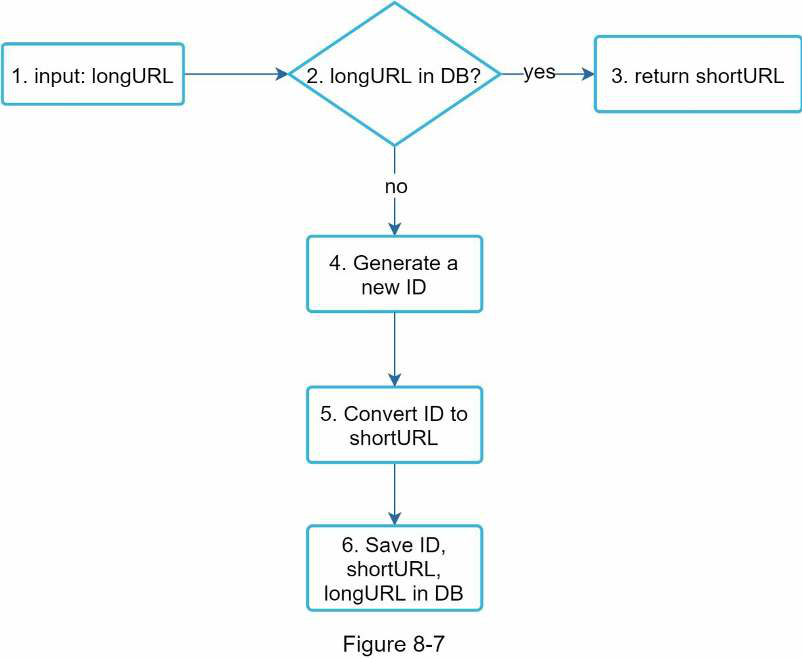

1. `longURL` là đầu vào.
2. Hệ thống kiểm tra xem `longURL` đã có trong cơ sở dữ liệu chưa.
3. Nếu có, điều đó có nghĩa là `longURL` đã từng được chuyển đổi thành `shortURL` trước đây. Trong trường hợp này, lấy `shortURL` từ cơ sở dữ liệu và trả về cho client.
4. Nếu chưa, `longURL` là URL mới. Một ID duy nhất mới (khóa chính - primary key) được tạo ra bởi **bộ sinh ID duy nhất (unique ID generator)**.
5. Chuyển đổi ID thành `shortURL` bằng phương pháp chuyển đổi hệ cơ số 62.
6. Tạo một dòng mới trong cơ sở dữ liệu với `id`, `shortURL` và `longURL`.

Để luồng xử lý dễ hiểu hơn, hãy xem xét một ví dụ cụ thể:
- Giả sử `longURL` đầu vào là: `https://en.wikipedia.org/wiki/Systems_design`
- Bộ sinh ID duy nhất trả về ID: `2009215674938`.
- Chuyển đổi ID thành `shortURL` bằng chuyển đổi hệ cơ số 62. ID (`2009215674938`) được chuyển thành `"zn9edcu"`.
- Lưu `id`, `shortURL` và `longURL` vào cơ sở dữ liệu như minh họa trong Bảng 8-4.

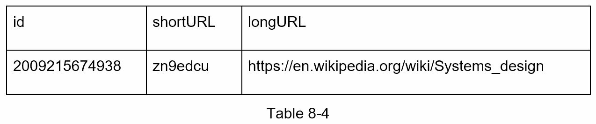

| id | shortURL | longURL |
| :--- | :--- | :--- |
| `2009215674938` | `zn9edcu` | `https://en.wikipedia.org/wiki/Systems_design` |

Bộ sinh ID duy nhất phân tán (distributed unique ID generator) là thành phần rất đáng nhắc đến. Chức năng chính của nó là tạo ra các ID duy nhất trên toàn hệ thống (globally unique IDs), vốn được dùng để tạo ra các `shortURL`. Trong một môi trường phân tán cao, việc triển khai một bộ sinh ID duy nhất là một thách thức lớn. May mắn thay, chúng ta đã thảo luận về một số giải pháp trong **"Chương 7: Thiết kế bộ sinh ID duy nhất trong hệ thống phân tán"**. Bạn có thể xem lại chương đó để ôn lại kiến thức.

> 📝 **Giải thích thêm (không có trong sách):**  
> Lưu ý ở bước 2 ("kiểm tra xem `longURL` đã có trong cơ sở dữ liệu chưa"): việc tìm kiếm trực tiếp trên cột `longURL` dài có thể chậm và tốn bộ nhớ index, đồng thời có thể gây ra race condition nếu hai người dùng cùng rút gọn một `longURL` tại cùng một thời điểm. Trong thực tế, một số hệ thống bỏ qua bước kiểm tra trùng `longURL` (chấp nhận 1 URL dài có thể có nhiều URL ngắn khác nhau để ghi cực nhanh), hoặc lưu thêm một cột hash của `longURL` (ví dụ `MD5(longURL)`) có đánh index để tra cứu nhanh hơn.

### Phân tích sâu quy trình chuyển hướng URL (URL redirecting deep dive)

Hình 8-8 minh họa thiết kế chi tiết của quy trình chuyển hướng URL. Vì số lượng thao tác đọc nhiều hơn thao tác ghi, ánh xạ `<shortURL, longURL>` được lưu trữ trong **bộ nhớ đệm (cache)** để cải thiện hiệu năng.

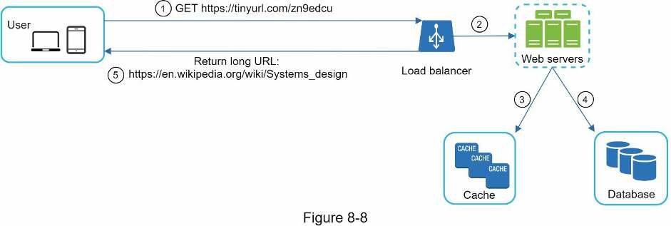

Luồng chuyển hướng URL được tóm tắt như sau:

1. Người dùng nhấp vào một liên kết URL ngắn: `https://tinyurl.com/zn9edcu`
2. Bộ cân bằng tải (Load balancer) chuyển tiếp yêu cầu đến các web server.
3. Nếu `shortURL` đã có sẵn trong cache, trả về `longURL` ngay lập tức.
4. Nếu `shortURL` không có trong cache, truy vấn lấy `longURL` từ cơ sở dữ liệu. Nếu nó không tồn tại trong cơ sở dữ liệu, nhiều khả năng người dùng đã nhập một `shortURL` không hợp lệ.
5. `longURL` được trả về cho người dùng.

Dưới đây là sơ đồ tuần tự minh họa lại luồng chuyển hướng URL kết hợp với cơ chế cập nhật cache:

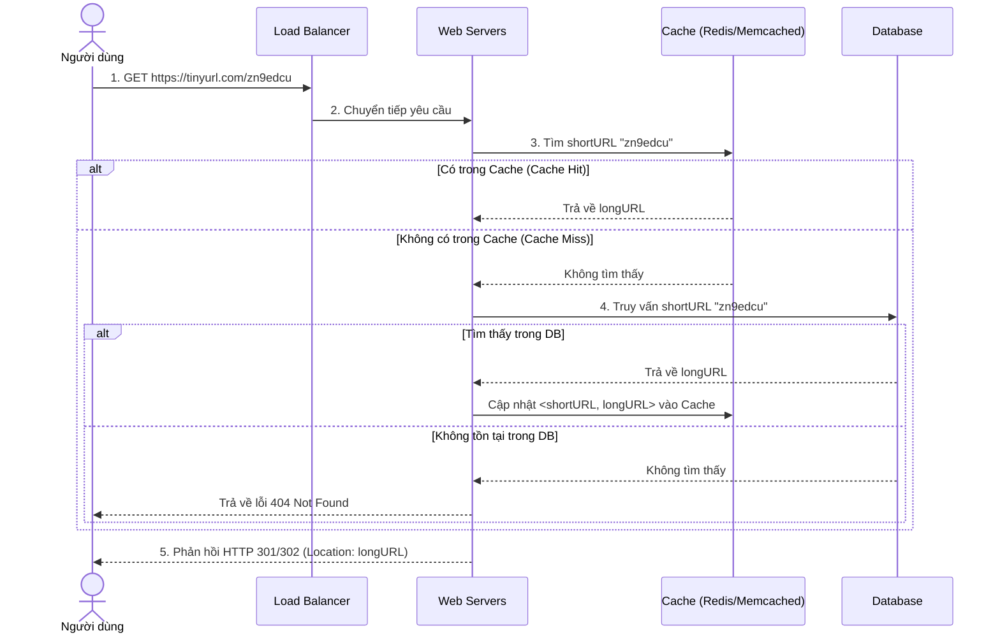

---

## Bước 4 - Tổng kết (Step 4 - Wrap up)

Trong chương này, chúng ta đã thảo luận về thiết kế API, mô hình dữ liệu, hàm băm, quy trình rút gọn URL và quy trình chuyển hướng URL.

Nếu còn dư thời gian ở cuối buổi phỏng vấn, dưới đây là một vài chủ đề bổ sung bạn có thể trao đổi thêm:

- **Bộ giới hạn tốc độ (Rate limiter):** Một vấn đề bảo mật tiềm ẩn mà chúng ta có thể gặp phải là những người dùng độc hại gửi một lượng lớn yêu cầu rút gọn URL quá mức. Rate limiter giúp lọc bỏ các yêu cầu dựa trên địa chỉ IP hoặc các quy tắc lọc khác. Nếu bạn muốn ôn lại kiến thức về giới hạn tốc độ, hãy tham khảo **"Chương 4: Thiết kế bộ giới hạn tốc độ (Design a rate limiter)"**.
- **Mở rộng web server (Web server scaling):** Vì tầng web (web tier) là phi trạng thái (stateless), việc mở rộng tầng web rất dễ dàng bằng cách thêm hoặc bớt các web server.
- **Mở rộng cơ sở dữ liệu (Database scaling):** Nhân bản cơ sở dữ liệu (database replication) và phân mảnh dữ liệu (sharding) là những kỹ thuật phổ biến.
- **Phân tích dữ liệu (Analytics):** Dữ liệu ngày càng trở nên quan trọng đối với sự thành công của doanh nghiệp. Việc tích hợp một giải pháp phân tích vào dịch vụ rút gọn URL có thể giúp trả lời những câu hỏi quan trọng như: có bao nhiêu người nhấp vào một liên kết? Họ nhấp vào liên kết khi nào? v.v.
- **Tính sẵn sàng, tính nhất quán và độ tin cậy (Availability, consistency, and reliability):** Những khái niệm này là cốt lõi cho sự thành công của bất kỳ hệ thống lớn nào. Chúng ta đã thảo luận chi tiết về chúng trong Chương 1, hãy ôn lại kiến thức về các chủ đề này.

Chúc mừng bạn đã đi được đến đây! Hãy tự thưởng cho mình một cái vỗ vai nhé. Làm tốt lắm!

---

## Tài liệu tham khảo (Reference materials)

[1] A RESTful Tutorial: https://www.restapitutorial.com/index.html  
[2] Bloom filter: https://en.wikipedia.org/wiki/Bloom_filter

---

## Bảng thuật ngữ chương (Chapter Glossary)

| Thuật ngữ (English) | Tiếng Việt | Giải thích ngắn gọn |
| :--- | :--- | :--- |
| URL Shortener | Dịch vụ rút gọn URL | Dịch vụ chuyển đổi một URL dài thành một URL ngắn gọn, dễ chia sẻ và chuyển hướng về URL gốc khi được truy cập. |
| 301 Redirect | Chuyển hướng 301 (vĩnh viễn) | Mã trạng thái HTTP cho biết tài nguyên đã chuyển vĩnh viễn sang địa chỉ mới; trình duyệt sẽ cache kết quả chuyển hướng này. |
| 302 Redirect | Chuyển hướng 302 (tạm thời) | Mã trạng thái HTTP cho biết tài nguyên tạm thời chuyển sang địa chỉ mới; trình duyệt vẫn gửi các request sau qua server rút gọn, thuận tiện cho việc thống kê. |
| Hash Function | Hàm băm | Hàm toán học ánh xạ dữ liệu đầu vào có độ dài tùy ý sang một chuỗi giá trị có độ dài cố định (`hashValue`). |
| Hash Collision | Xung đột băm | Tình huống hai đầu vào khác nhau tạo ra cùng một giá trị băm đầu ra. |
| Bloom Filter | Bộ lọc Bloom | Cấu trúc dữ liệu xác suất tiết kiệm bộ nhớ dùng để kiểm tra nhanh một phần tử có khả năng thuộc tập hợp hay chắc chắn không thuộc tập hợp. |
| Base 62 Conversion | Chuyển đổi hệ cơ số 62 | Kỹ thuật biểu diễn số nguyên sang chuỗi sử dụng 62 ký tự (`0-9`, `a-z`, `A-Z`) để rút ngắn độ dài chuỗi ID. |
| Unique ID Generator | Bộ sinh ID duy nhất | Thành phần tạo ra các mã định danh duy nhất trên toàn hệ thống phân tán, dùng làm đầu vào cho thuật toán Base 62. |
| Stateless Web Tier | Tầng web phi trạng thái | Kiến trúc máy chủ web không lưu trạng thái phiên người dùng cục bộ, giúp dễ dàng mở rộng theo chiều ngang. |
| Load Balancer | Bộ cân bằng tải | Thành phần phân phối lưu lượng truy cập đến nhiều máy chủ web để tối ưu hiệu năng và tăng tính sẵn sàng. |
