# CHƯƠNG 9: THIẾT KẾ TRÌNH THU THẬP DỮ LIỆU WEB (CHAPTER 9: DESIGN A WEB CRAWLER)

Trong chương này, chúng ta sẽ tập trung vào thiết kế trình thu thập dữ liệu web (web crawler): một câu hỏi phỏng vấn thiết kế hệ thống thú vị và kinh điển.

Một trình thu thập dữ liệu web thường được gọi là robot hoặc spider (nhện). Nó được các công cụ tìm kiếm sử dụng rộng rãi để khám phá nội dung mới hoặc nội dung đã được cập nhật trên web. Nội dung có thể là một trang web, hình ảnh, video, tệp PDF, v.v. Một web crawler bắt đầu bằng cách thu thập một vài trang web và sau đó đi theo các liên kết trên những trang đó để thu thập nội dung mới. Hình 9-1 (Figure 9-1) minh họa trực quan quy trình thu thập dữ liệu (crawl).

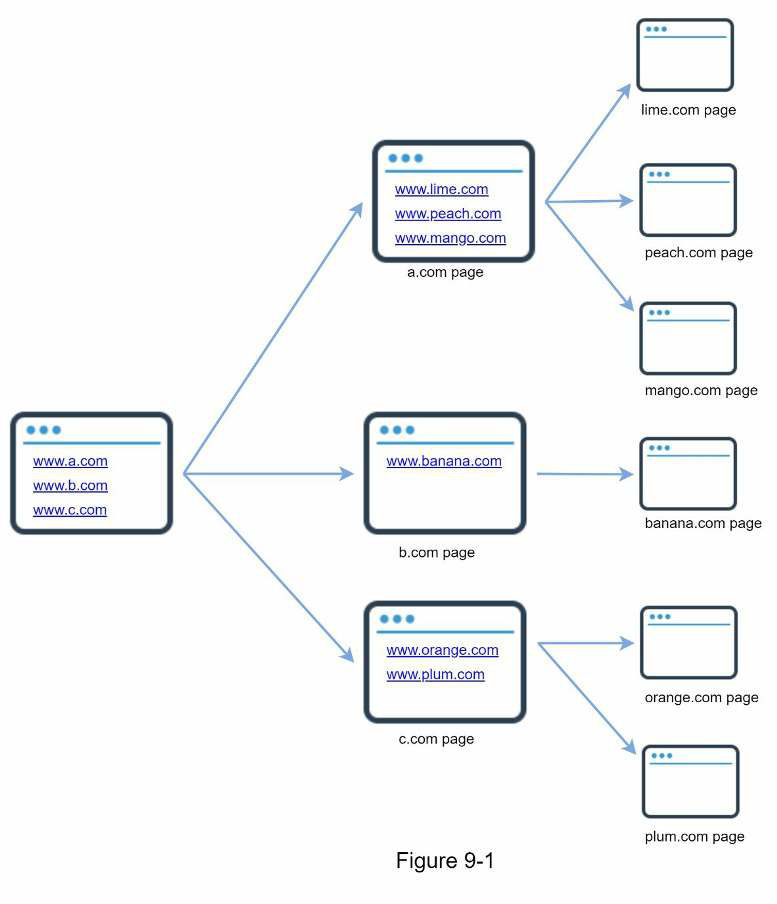

Một crawler được sử dụng cho nhiều mục đích:

* **Lập chỉ mục cho công cụ tìm kiếm (Search engine indexing):** Đây là trường hợp sử dụng phổ biến nhất. Crawler thu thập các trang web để tạo chỉ mục cục bộ cho các công cụ tìm kiếm. Ví dụ, Googlebot là web crawler đứng sau công cụ tìm kiếm Google.
* **Lưu trữ web (Web archiving):** Đây là quá trình thu thập thông tin từ web để bảo tồn dữ liệu cho mục đích sử dụng trong tương lai. Chẳng hạn, nhiều thư viện quốc gia vận hành crawler để lưu trữ các trang web. Các ví dụ tiêu biểu là Thư viện Quốc hội Hoa Kỳ (US Library of Congress) [1] và Kho lưu trữ Web EU (EU web archive) [2].
* **Khai phá web (Web mining):** Sự phát triển bùng nổ của web mang lại cơ hội chưa từng có cho việc khai phá dữ liệu. Khai phá web giúp khám phá những tri thức hữu ích từ internet. Ví dụ, các công ty tài chính hàng đầu sử dụng crawler để tải xuống biên bản đại hội cổ đông và báo cáo thường niên nhằm nắm bắt các sáng kiến trọng tâm của doanh nghiệp.
* **Giám sát web (Web monitoring):** Các crawler giúp giám sát hành vi xâm phạm bản quyền và thương hiệu trên Internet. Ví dụ, Digimarc [3] sử dụng crawler để phát hiện các tác phẩm và báo cáo bị sao chép lậu.

Độ phức tạp của việc phát triển một web crawler phụ thuộc vào quy mô mà chúng ta dự định hỗ trợ. Nó có thể chỉ là một đồ án nhỏ ở trường mất vài giờ để hoàn thành, hoặc là một dự án khổng lồ đòi hỏi sự cải tiến liên tục từ một đội ngũ kỹ sư chuyên trách. Do đó, chúng ta sẽ tìm hiểu về quy mô và các tính năng cần hỗ trợ ở bên dưới.

---

## Bước 1 - Hiểu bài toán và xác định phạm vi thiết kế (Step 1 - Understand the problem and establish design scope)

Thuật toán cơ bản của một web crawler rất đơn giản:

1. Cho trước một tập hợp các URL, tải xuống tất cả các trang web được trỏ tới bởi các URL đó.
2. Trích xuất các URL từ những trang web này.
3. Thêm các URL mới vào danh sách các URL cần tải xuống. Lặp lại 3 bước này.

Liệu một web crawler có thực sự hoạt động đơn giản như thuật toán cơ bản này không? Không hẳn vậy. Thiết kế một web crawler có khả năng mở rộng cực lớn là một nhiệm vụ vô cùng phức tạp. Không ai có thể thiết kế một web crawler quy mô khổng lồ chỉ trong thời lượng một buổi phỏng vấn. Trước khi bắt tay vào thiết kế, chúng ta phải đặt câu hỏi để hiểu rõ yêu cầu và xác định phạm vi thiết kế:

* **Ứng viên (Candidate):** Mục đích chính của crawler là gì? Nó được dùng để lập chỉ mục công cụ tìm kiếm, khai phá dữ liệu, hay mục đích nào khác?
* **Người phỏng vấn (Interviewer):** Lập chỉ mục cho công cụ tìm kiếm.
* **Ứng viên:** Web crawler cần thu thập bao nhiêu trang web mỗi tháng?
* **Người phỏng vấn:** 1 tỷ trang.
* **Ứng viên:** Những loại nội dung nào được bao gồm? Chỉ HTML hay cả các loại nội dung khác như PDF và hình ảnh?
* **Người phỏng vấn:** Chỉ HTML.
* **Ứng viên:** Chúng ta có cần xem xét các trang web mới được thêm hoặc vừa được chỉnh sửa không?
* **Người phỏng vấn:** Có, chúng ta nên xem xét cả các trang web mới thêm và mới chỉnh sửa.
* **Ứng viên:** Chúng ta có cần lưu trữ các trang HTML đã thu thập từ web không?
* **Người phỏng vấn:** Có, lưu trữ tối đa 5 năm.
* **Ứng viên:** Chúng ta xử lý các trang web có nội dung trùng lặp như thế nào?
* **Người phỏng vấn:** Các trang có nội dung trùng lặp nên được bỏ qua.

Trên đây là một số câu hỏi mẫu mà bạn có thể hỏi người phỏng vấn. Việc hiểu rõ các yêu cầu và làm rõ những điểm mơ hồ là rất quan trọng. Ngay cả khi được yêu cầu thiết kế một sản phẩm tưởng chừng thẳng thắn như web crawler, bạn và người phỏng vấn có thể không có cùng những giả định ban đầu.

Bên cạnh các chức năng cần làm rõ với người phỏng vấn, điều quan trọng là phải ghi chú lại các đặc tính sau của một web crawler tốt:

* **Khả năng mở rộng (Scalability):** Web rất rộng lớn. Có hàng tỷ trang web ngoài kia. Việc thu thập dữ liệu web cần phải cực kỳ hiệu quả thông qua xử lý song song.
* **Tính bền vững (Robustness):** Web chứa đầy cạm bẫy. HTML lỗi, máy chủ không phản hồi, sự cố sập hệ thống, liên kết độc hại, v.v. đều rất phổ biến. Crawler phải xử lý được tất cả các trường hợp biên (edge cases) đó.
* **Tính lịch sự (Politeness):** Crawler không nên gửi quá nhiều yêu cầu (request) tới một trang web trong một khoảng thời gian ngắn.
* **Khả năng mở rộng tính năng (Extensibility):** Hệ thống phải đủ linh hoạt để chỉ cần thay đổi tối thiểu là có thể hỗ trợ các loại nội dung mới. Ví dụ, nếu trong tương lai chúng ta muốn thu thập tệp hình ảnh, chúng ta không cần phải thiết kế lại toàn bộ hệ thống.

### Ước tính nhanh (Back of the envelope estimation)

Các ước tính sau đây dựa trên nhiều giả định, và điều quan trọng là phải trao đổi với người phỏng vấn để hai bên thống nhất cùng một quan điểm.

* Giả sử 1 tỷ trang web được tải xuống mỗi tháng.
* **QPS (Queries Per Second - Số truy vấn mỗi giây):** `1,000,000,000 / 30 ngày / 24 giờ / 3600 giây` = ~400 trang mỗi giây.
* **QPS đỉnh (Peak QPS):** `2 * QPS` = 800.
* Giả sử kích thước trung bình của một trang web là 500k (500 KB).
* 1 tỷ trang x 500k = 500 TB dung lượng lưu trữ mỗi tháng. Nếu bạn chưa rõ về các đơn vị lưu trữ kỹ thuật số, hãy xem lại phần "Lũy thừa của 2" (Power of 2) trong Chương 2.
* Giả sử dữ liệu được lưu trữ trong 5 năm: `500 TB * 12 tháng * 5 năm` = 30 PB. Cần một hệ thống lưu trữ 30 PB để lưu trữ nội dung trong vòng 5 năm.

---

## Bước 2 - Đề xuất thiết kế tổng thể và lấy sự đồng thuận (Step 2 - Propose high-level design and get buy-in)

Khi các yêu cầu đã rõ ràng, chúng ta chuyển sang thiết kế tổng thể (high-level design). Lấy cảm hứng từ các nghiên cứu trước đây về thu thập dữ liệu web [4] [5], chúng ta đề xuất một thiết kế tổng thể như minh họa trong Hình 9-2 (Figure 9-2).

Đầu tiên, chúng ta sẽ khám phá từng thành phần thiết kế để hiểu chức năng của chúng. Sau đó, chúng ta sẽ xem xét quy trình hoạt động của crawler theo từng bước.

### URL hạt giống (Seed URLs)

Một web crawler sử dụng các URL hạt giống (seed URLs) làm điểm khởi đầu cho quá trình thu thập dữ liệu. Ví dụ, để thu thập tất cả các trang web từ website của một trường đại học, một cách trực quan để chọn seed URL là sử dụng tên miền của trường đại học đó.

Để thu thập toàn bộ web, chúng ta cần sáng tạo trong việc lựa chọn seed URLs. Một seed URL tốt đóng vai trò là điểm xuất phát tốt mà crawler có thể tận dụng để duyệt qua càng nhiều liên kết càng tốt. Chiến lược chung là chia toàn bộ không gian URL thành các phần nhỏ hơn. Cách tiếp cận đầu tiên được đề xuất là dựa trên vị trí địa lý (locality) vì các quốc gia khác nhau có thể có những trang web phổ biến khác nhau. Một cách khác là chọn seed URLs dựa trên chủ đề; ví dụ, chúng ta có thể chia không gian URL thành mua sắm, thể thao, chăm sóc sức khỏe, v.v. Việc lựa chọn seed URL là một câu hỏi mở. Bạn không nhất thiết phải đưa ra câu trả lời hoàn hảo. Hãy cứ nói ra suy nghĩ của mình (think out loud).

### Biên giới URL (URL Frontier)

Hầu hết các web crawler hiện đại chia trạng thái thu thập dữ liệu thành hai phần: chưa tải xuống (to be downloaded) và đã tải xuống (already downloaded). Thành phần lưu trữ các URL cần tải xuống được gọi là **URL Frontier** (Biên giới URL). Bạn có thể hình dung nó như một hàng đợi Vào trước - Ra trước (First-in-First-out - FIFO). Để biết thông tin chi tiết về URL Frontier, hãy tham khảo phần đi sâu vào thiết kế bên dưới.

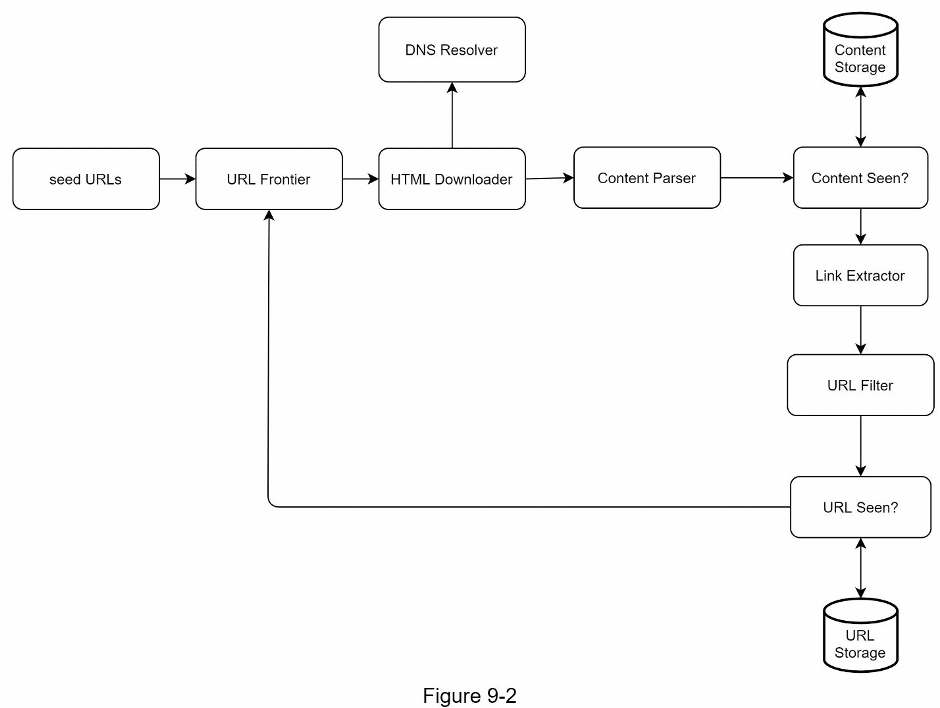

### Trình tải xuống HTML (HTML Downloader)

HTML Downloader tải xuống các trang web từ internet. Những URL này được cung cấp bởi URL Frontier.

### Trình phân giải DNS (DNS Resolver)

Để tải xuống một trang web, một URL phải được dịch sang địa chỉ IP. HTML Downloader gọi DNS Resolver để lấy địa chỉ IP tương ứng cho URL đó. Ví dụ, URL `www.wikipedia.org` được chuyển đổi thành địa chỉ IP `198.35.26.96` tính đến ngày 5/3/2019.

### Trình phân tích nội dung (Content Parser)

Sau khi một trang web được tải xuống, nó phải được phân tích cú pháp (parse) và kiểm tra tính hợp lệ (validate) vì các trang web bị lỗi định dạng (malformed) có thể gây ra sự cố và lãng phí không gian lưu trữ. Việc triển khai trình phân tích nội dung ngay bên trong máy chủ thu thập dữ liệu (crawl server) sẽ làm chậm quá trình thu thập. Do đó, trình phân tích nội dung được tách thành một thành phần riêng biệt.

### Nội dung đã thấy chưa? (Content Seen?)

Các nghiên cứu trực tuyến [6] chỉ ra rằng 29% các trang web có nội dung trùng lặp, điều này có thể khiến cùng một nội dung bị lưu trữ nhiều lần. Chúng ta đưa vào cấu trúc dữ liệu "Content Seen?" để loại bỏ sự dư thừa dữ liệu và rút ngắn thời gian xử lý. Nó giúp phát hiện nội dung mới hay nội dung đã được lưu trữ trước đó trong hệ thống. Để so sánh hai tài liệu HTML, chúng ta có thể so sánh từng ký tự một. Tuy nhiên, phương pháp này rất chậm và tốn thời gian, đặc biệt khi có hàng tỷ trang web liên quan. Một cách hiệu quả để thực hiện nhiệm vụ này là so sánh giá trị băm (hash values) của hai trang web [7].

### Lưu trữ nội dung (Content Storage)

Đây là hệ thống lưu trữ dùng để lưu nội dung HTML. Việc lựa chọn hệ thống lưu trữ phụ thuộc vào các yếu tố như loại dữ liệu, kích thước dữ liệu, tần suất truy cập, vòng đời dữ liệu, v.v. Cả ổ đĩa (disk) và bộ nhớ (memory) đều được sử dụng.

* Phần lớn nội dung được lưu trên ổ đĩa vì tập dữ liệu quá lớn để vừa trong bộ nhớ.
* Nội dung phổ biến được giữ trong bộ nhớ để giảm độ trễ.

### Trình trích xuất URL (URL Extractor)

URL Extractor phân tích cú pháp và trích xuất các liên kết từ trang HTML. Hình 9-3 (Figure 9-3) cho thấy một ví dụ về quá trình trích xuất liên kết. Các đường dẫn tương đối (relative paths) được chuyển đổi thành URL tuyệt đối (absolute URLs) bằng cách thêm tiền tố `"https://en.wikipedia.org"`.

### Bộ lọc URL (URL Filter)

Bộ lọc URL loại bỏ một số loại nội dung nhất định, phần mở rộng tệp, liên kết lỗi và các URL nằm trong danh sách đen ("blacklisted" sites).

### URL đã thấy chưa? (URL Seen?)

"URL Seen?" là một cấu trúc dữ liệu theo dõi các URL đã được truy cập trước đó hoặc đã nằm sẵn trong Frontier. "URL Seen?" giúp tránh việc thêm cùng một URL nhiều lần vì điều này có thể làm tăng tải cho máy chủ và gây ra các vòng lặp vô hạn tiềm ẩn.

Bloom filter và bảng băm (hash table) là những kỹ thuật phổ biến để triển khai thành phần "URL Seen?". Chúng ta sẽ không đi sâu vào chi tiết triển khai của bloom filter và hash table ở đây. Để biết thêm thông tin, hãy tham khảo tài liệu tham khảo [4] [8].

### Lưu trữ URL (URL Storage)

URL Storage lưu trữ các URL đã được truy cập.

Cho đến nay, chúng ta đã thảo luận về mọi thành phần của hệ thống. Tiếp theo, chúng ta sẽ ghép chúng lại với nhau để giải thích quy trình hoạt động.

### Quy trình hoạt động của trình thu thập dữ liệu web (Web crawler workflow)

Để giải thích quy trình hoạt động từng bước một cách rõ ràng hơn, các số thứ tự đã được thêm vào sơ đồ thiết kế như minh họa trong Hình 9-4 (Figure 9-4).

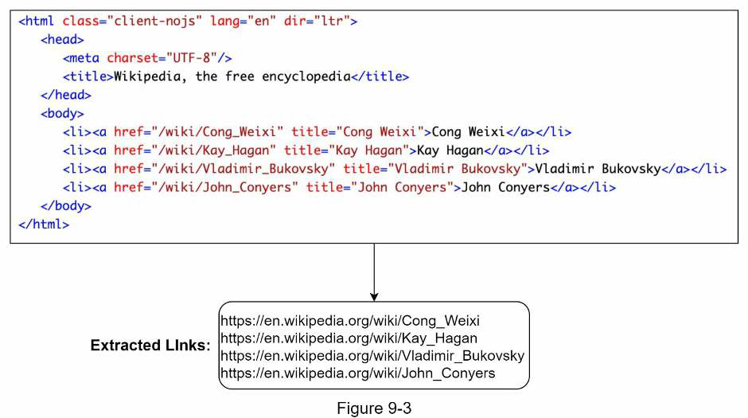

* **Bước 1:** Thêm các seed URL vào URL Frontier.
* **Bước 2:** HTML Downloader lấy một danh sách các URL từ URL Frontier.
* **Bước 3:** HTML Downloader lấy địa chỉ IP của các URL từ DNS Resolver và bắt đầu tải xuống.
* **Bước 4:** Content Parser phân tích cú pháp các trang HTML và kiểm tra xem trang có bị lỗi định dạng hay không.
* **Bước 5:** Sau khi nội dung được phân tích và xác thực, nó được chuyển sang thành phần "Content Seen?".
* **Bước 6:** Thành phần "Content Seen?" kiểm tra xem trang HTML đã có trong bộ lưu trữ hay chưa.
  * Nếu đã có trong bộ lưu trữ, điều này có nghĩa là cùng một nội dung ở một URL khác đã được xử lý rồi. Trong trường hợp này, trang HTML bị loại bỏ.
  * Nếu chưa có trong bộ lưu trữ, hệ thống chưa từng xử lý nội dung này trước đó. Nội dung được chuyển sang Link Extractor (Trình trích xuất liên kết).
* **Bước 7:** Link Extractor trích xuất các liên kết từ trang HTML.
* **Bước 8:** Các liên kết được trích xuất sẽ được chuyển qua URL Filter.
* **Bước 9:** Sau khi các liên kết được lọc, chúng được chuyển sang thành phần "URL Seen?".
* **Bước 10:** Thành phần "URL Seen?" kiểm tra xem URL đã có trong bộ lưu trữ chưa; nếu có, nghĩa là nó đã được xử lý trước đó và không cần làm gì thêm.
* **Bước 11:** Nếu một URL chưa từng được xử lý trước đó, nó sẽ được thêm vào URL Frontier.

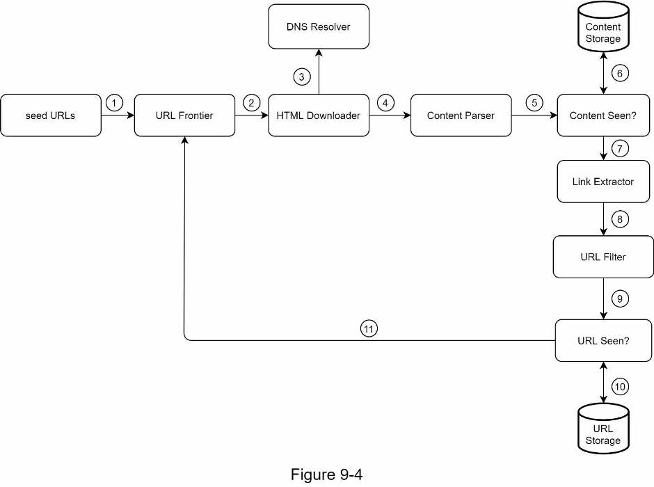

> 📝 **Giải thích thêm (không có trong sách):**
> Sơ đồ Mermaid dưới đây tóm tắt lại luồng xử lý 11 bước của web crawler để bạn dễ hình dung nhánh rẽ khi gặp nội dung trùng lặp hoặc URL đã duyệt:
>
> ```mermaid
> flowchart TD
>     A[Seed URLs] -->|1. Đẩy vào| B[URL Frontier]
>     B -->|2. Lấy URL| C[HTML Downloader]
>     C <-->|3. Phân giải IP| D[DNS Resolver]
>     C -->|4. Trang HTML| E[Content Parser]
>     E -->|5. HTML hợp lệ| F{6. Content Seen?}
>     F -->|Đã tồn tại| G[Loại bỏ trang]
>     F -->|Nội dung mới| H[Lưu Content Storage & 7. Link Extractor]
>     H -->|8. Danh sách URL| I[URL Filter]
>     I -->|9. URL hợp lệ| J{10. URL Seen?}
>     J -->|Đã thấy| K[Bỏ qua URL]
>     J -->|URL mới| L[11. Lưu URL Storage & Thêm vào URL Frontier]
>     L --> B
> ```

---

## Bước 3 - Đi sâu vào thiết kế (Step 3 - Design deep dive)

Cho đến nay, chúng ta đã thảo luận về thiết kế tổng thể. Tiếp theo, chúng ta sẽ đi sâu vào các thành phần cấu tạo và kỹ thuật quan trọng nhất:

* Tìm kiếm theo chiều sâu (DFS) so với Tìm kiếm theo chiều rộng (BFS)
* Biên giới URL (URL frontier)
* Trình tải xuống HTML (HTML Downloader)
* Tính bền vững (Robustness)
* Khả năng mở rộng (Extensibility)
* Phát hiện và tránh nội dung có vấn đề (Detect and avoid problematic content)

### Tìm kiếm theo chiều sâu (DFS) so với Tìm kiếm theo chiều rộng (BFS) (DFS vs BFS)

Bạn có thể hình dung web như một đồ thị có hướng (directed graph), trong đó các trang web đóng vai trò là các nút (nodes) và các siêu liên kết (URLs) là các cạnh (edges). Quá trình thu thập dữ liệu có thể được xem như việc duyệt một đồ thị có hướng từ một trang web này sang các trang web khác. Hai thuật toán duyệt đồ thị phổ biến là DFS và BFS. Tuy nhiên, DFS thường không phải là lựa chọn tốt vì độ sâu của DFS có thể rất lớn.

BFS thường được sử dụng bởi các web crawler và được triển khai bằng hàng đợi vào trước - ra trước (FIFO). Trong hàng đợi FIFO, các URL được lấy ra (dequeue) theo đúng thứ tự chúng được đưa vào (enqueue). Tuy nhiên, cách triển khai này có hai vấn đề:

* Hầu hết các liên kết từ cùng một trang web đều trỏ ngược về cùng một máy chủ (host). Trong Hình 9-5 (Figure 9-5), tất cả các liên kết trong `wikipedia.com` đều là liên kết nội bộ, khiến crawler bận rộn xử lý các URL từ cùng một host (`wikipedia.com`). Khi crawler cố gắng tải xuống các trang web song song, các máy chủ của Wikipedia sẽ bị ngập lụt bởi các yêu cầu. Điều này bị coi là "bất lịch sự" (impolite).

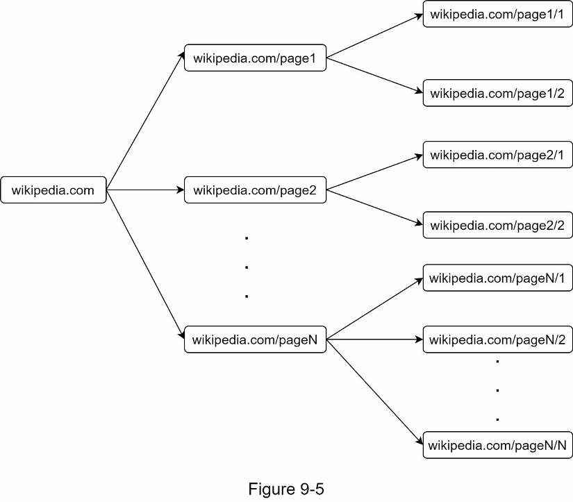

* BFS tiêu chuẩn không xem xét đến độ ưu tiên của một URL. Web rất rộng lớn và không phải trang nào cũng có cùng mức độ chất lượng và tầm quan trọng. Do đó, chúng ta có thể muốn ưu tiên các URL dựa trên xếp hạng trang (page ranks), lưu lượng truy cập web, tần suất cập nhật, v.v.

### Biên giới URL (URL frontier)

URL frontier giúp giải quyết các vấn đề này. URL frontier là một cấu trúc dữ liệu lưu trữ các URL cần tải xuống. URL frontier là một thành phần quan trọng để đảm bảo **tính lịch sự (politeness)**, **độ ưu tiên URL (URL prioritization)** và **tính tươi mới (freshness)**. Một số bài báo khoa học đáng chú ý về URL frontier được liệt kê trong tài liệu tham khảo [5] [9]. Các phát hiện từ những bài báo này như sau:

#### Tính lịch sự (Politeness)

Nhìn chung, một web crawler nên tránh gửi quá nhiều yêu cầu đến cùng một máy chủ lưu trữ trong một khoảng thời gian ngắn. Việc gửi quá nhiều yêu cầu bị coi là "bất lịch sự" hoặc thậm chí bị xem như một cuộc tấn công từ chối dịch vụ (denial-of-service - DOS). Ví dụ, nếu không có bất kỳ ràng buộc nào, crawler có thể gửi hàng nghìn yêu cầu mỗi giây tới cùng một trang web. Điều này có thể làm quá tải các máy chủ web.

Ý tưởng chung để thực thi tính lịch sự là chỉ tải xuống một trang tại một thời điểm từ cùng một host. Có thể thêm một khoảng trễ (delay) giữa hai tác vụ tải xuống. Ràng buộc lịch sự được triển khai bằng cách duy trì một ánh xạ (mapping) từ tên miền máy chủ (website hostnames) tới các luồng tải xuống (worker threads). Mỗi luồng tải xuống có một hàng đợi FIFO riêng biệt và chỉ tải xuống các URL lấy từ hàng đợi đó. Hình 9-6 (Figure 9-6) minh họa thiết kế quản lý tính lịch sự.

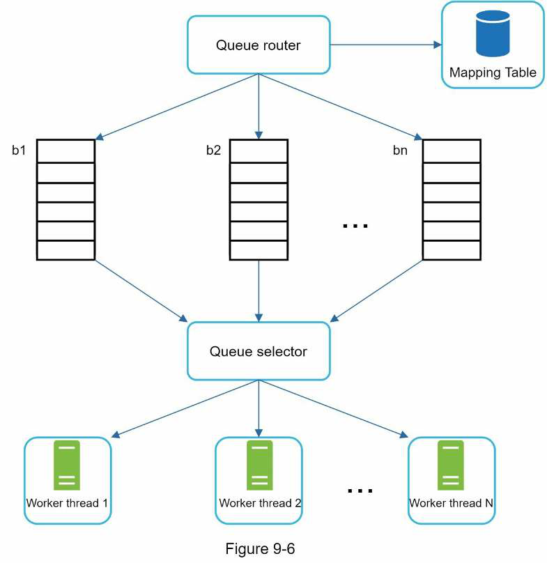

* **Bộ định tuyến hàng đợi (Queue router):** Đảm bảo rằng mỗi hàng đợi (`b1`, `b2`, … `bn`) chỉ chứa các URL từ cùng một host.
* **Bảng ánh xạ (Mapping table):** Ánh xạ mỗi host tới một hàng đợi.
* **Các hàng đợi FIFO b1, b2 đến bn:** Mỗi hàng đợi chứa các URL từ cùng một host.
* **Bộ chọn hàng đợi (Queue selector):** Mỗi luồng worker được ánh xạ tới một hàng đợi FIFO và nó chỉ tải xuống các URL từ hàng đợi đó. Logic chọn hàng đợi được thực hiện bởi Queue selector.
* **Luồng worker 1 đến N (Worker thread 1 to N):** Một luồng worker tải xuống từng trang web một từ cùng một host. Có thể thêm độ trễ giữa hai tác vụ tải xuống.

#### Độ ưu tiên (Priority)

Một bài đăng ngẫu nhiên trên diễn đàn thảo luận về sản phẩm của Apple mang trọng số rất khác so với các bài viết trên trang chủ của Apple. Mặc dù cả hai đều có từ khóa "Apple", nhưng việc crawler thu thập trang chủ của Apple trước là điều hoàn toàn hợp lý.

Chúng ta ưu tiên các URL dựa trên mức độ hữu ích, có thể đo lường bằng PageRank [10], lưu lượng truy cập website, tần suất cập nhật, v.v. "Prioritizer" (Bộ định mức ưu tiên) là thành phần xử lý việc xếp hạng ưu tiên URL. Hãy tham khảo tài liệu [5] [10] để biết thông tin chuyên sâu về khái niệm này. Hình 9-7 (Figure 9-7) minh họa thiết kế quản lý độ ưu tiên URL.

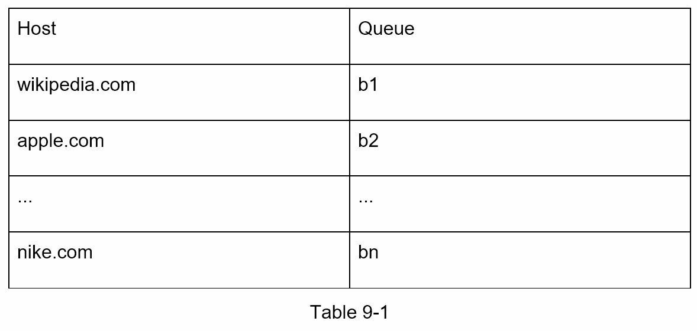

* **Prioritizer:** Nhận các URL làm đầu vào và tính toán độ ưu tiên.
* **Các hàng đợi f1 đến fn:** Mỗi hàng đợi được gán một độ ưu tiên. Các hàng đợi có độ ưu tiên cao được chọn với xác suất cao hơn.
* **Queue selector:** Chọn ngẫu nhiên một hàng đợi với thiên hướng ưu tiên các hàng đợi có độ ưu tiên cao hơn.

Hình 9-8 (Figure 9-8) trình bày thiết kế hoàn chỉnh của URL frontier, bao gồm hai mô-đun:

* **Hàng đợi phía trước (Front queues):** quản lý độ ưu tiên (prioritization).
* **Hàng đợi phía sau (Back queues):** quản lý tính lịch sự (politeness).

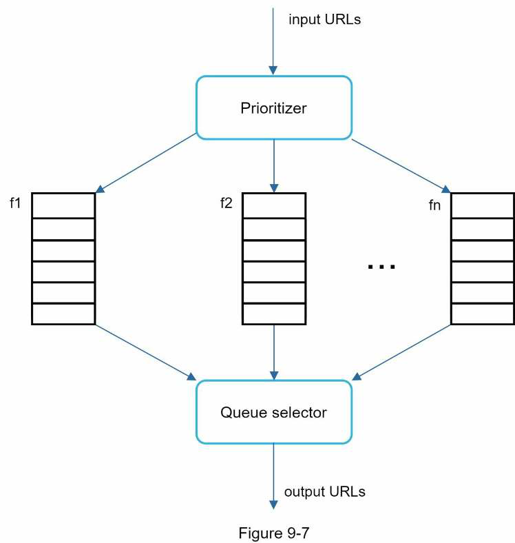

> 💡 **Ví dụ bổ sung (không có trong sách):**
> Giả sử hệ thống phát hiện 3 URL mới:
> 1. `https://apple.com/iphone` (PageRank rất cao -> `Prioritizer` đưa vào `f1` - ưu tiên cao nhất)
> 2. `https://apple.com/mac` (PageRank rất cao -> `Prioritizer` đưa vào `f1`)
> 3. `https://forum.example.com/post/123` (PageRank thấp -> `Prioritizer` đưa vào `fn` - ưu tiên thấp)
>
> `Queue selector` của Front queues sẽ bốc xác suất cao hơn từ `f1`, đẩy cả `apple.com/iphone` và `apple.com/mac` sang `Queue router`. Tại đây, `Mapping table` thấy cả 2 cùng thuộc host `apple.com` nên đưa vào chung một Back queue `b1`. Nhờ vậy, Worker thread phụ trách `b1` sẽ tải `apple.com/iphone`, chờ một khoảng delay (ví dụ 1 giây) rồi mới tải `apple.com/mac`, vừa đảm bảo ưu tiên trang quan trọng, vừa không làm sập máy chủ Apple.

#### Tính tươi mới (Freshness)

Các trang web liên tục được thêm mới, xóa bỏ và chỉnh sửa. Một web crawler phải định kỳ thu thập lại (recrawl) các trang đã tải xuống để giữ cho tập dữ liệu của chúng ta luôn tươi mới. Việc thu thập lại tất cả các URL rất tốn thời gian và tài nguyên. Một vài chiến lược để tối ưu hóa tính tươi mới được liệt kê như sau:

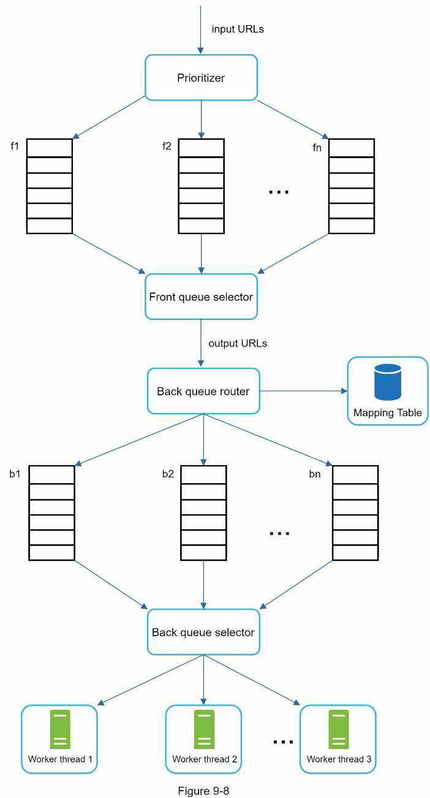

* Thu thập lại dựa trên lịch sử cập nhật của các trang web.
* Ưu tiên các URL và thu thập lại các trang quan trọng trước và với tần suất thường xuyên hơn.

#### Lưu trữ cho Biên giới URL (Storage for URL Frontier)

Trong thực tế khi thu thập dữ liệu cho các công cụ tìm kiếm, số lượng URL trong frontier có thể lên tới hàng trăm triệu [4]. Đặt tất cả vào bộ nhớ (memory) vừa không bền vững (durable) vừa không thể mở rộng. Giữ tất cả trên ổ đĩa (disk) cũng không mong muốn vì ổ đĩa chậm và có thể dễ dàng trở thành nút thắt cổ chai (bottleneck) cho quá trình thu thập.

Chúng ta áp dụng cách tiếp cận lai (hybrid approach). Phần lớn các URL được lưu trữ trên ổ đĩa, nhờ đó không gian lưu trữ không còn là vấn đề. Để giảm chi phí đọc từ ổ đĩa và ghi vào ổ đĩa, chúng ta duy trì các bộ đệm (buffers) trong bộ nhớ cho các thao tác thêm vào (enqueue) và lấy ra (dequeue). Dữ liệu trong bộ đệm sẽ được ghi xuống ổ đĩa theo định kỳ.

### Trình tải xuống HTML (HTML Downloader)

HTML Downloader tải xuống các trang web từ internet bằng giao thức HTTP. Trước khi thảo luận về HTML Downloader, chúng ta hãy xem xét Giao thức Loại trừ Robot (Robots Exclusion Protocol) trước.

#### Robots.txt

`Robots.txt`, còn được gọi là Giao thức Loại trừ Robot (Robots Exclusion Protocol), là một tiêu chuẩn được các trang web sử dụng để giao tiếp với các crawler. Nó quy định những trang nào mà crawler được phép tải xuống. Trước khi cố gắng thu thập dữ liệu một trang web, crawler nên kiểm tra tệp `robots.txt` tương ứng của trang đó trước và tuân thủ các quy tắc của nó.

Để tránh tải xuống lặp đi lặp lại tệp `robots.txt`, chúng ta lưu đệm (cache) kết quả của tệp này. Tệp được tải xuống và lưu vào bộ nhớ đệm theo định kỳ. Dưới đây là một đoạn trích từ tệp `robots.txt` của `https://www.amazon.com/robots.txt`. Một số thư mục như `creatorhub` không được phép truy cập đối với Googlebot.

```text
User-agent: Googlebot
Disallow: /creatorhub/*
Disallow: /rss/people/*/reviews
Disallow: /gp/pdp/rss/*/reviews
Disallow: /gp/cdp/member-reviews/
Disallow: /gp/aw/cr/
```

Bên cạnh `robots.txt`, tối ưu hóa hiệu năng là một khái niệm quan trọng khác mà chúng ta sẽ đề cập cho trình tải xuống HTML.

#### Tối ưu hóa hiệu năng (Performance optimization)

Dưới đây là danh sách các biện pháp tối ưu hóa hiệu năng cho HTML downloader:

1. **Thu thập dữ liệu phân tán (Distributed crawl):** Để đạt được hiệu năng cao, các công việc thu thập dữ liệu được phân phối vào nhiều máy chủ, và mỗi máy chủ chạy nhiều luồng. Không gian URL được phân vùng (partition) thành các phần nhỏ hơn; nhờ đó, mỗi trình tải xuống chịu trách nhiệm cho một tập hợp con các URL. Hình 9-9 (Figure 9-9) cho thấy một ví dụ về thu thập dữ liệu phân tán.
2. **Lưu đệm Trình phân giải DNS (Cache DNS Resolver):** DNS Resolver là một nút thắt cổ chai đối với các crawler vì các yêu cầu DNS có thể mất thời gian do bản chất đồng bộ (synchronous) của nhiều giao diện DNS. Thời gian phản hồi DNS dao động từ 10ms đến 200ms. Một khi yêu cầu tới DNS được thực hiện bởi một luồng crawler, các luồng khác sẽ bị chặn (blocked) cho đến khi yêu cầu đầu tiên hoàn tất. Việc duy trì bộ nhớ đệm DNS của riêng chúng ta để tránh gọi DNS thường xuyên là một kỹ thuật hiệu quả để tối ưu hóa tốc độ. Bộ nhớ đệm DNS của chúng ta lưu giữ ánh xạ từ tên miền sang địa chỉ IP và được cập nhật định kỳ bởi các tác vụ định kỳ (cron jobs).
3. **Tính cục bộ (Locality):** Phân phối các máy chủ thu thập dữ liệu theo vị trí địa lý. Khi các máy chủ crawler ở gần máy chủ lưu trữ website hơn, crawler sẽ có thời gian tải xuống nhanh hơn. Thiết kế theo tính cục bộ áp dụng cho hầu hết các thành phần hệ thống: máy chủ crawler, bộ nhớ đệm, hàng đợi, lưu trữ, v.v.
4. **Thời gian chờ ngắn (Short timeout):** Một số máy chủ web phản hồi chậm hoặc có thể không phản hồi chút nào. Để tránh thời gian chờ đợi kéo dài, một thời gian chờ tối đa (maximal wait time) được quy định. Nếu một host không phản hồi trong khoảng thời gian định sẵn, crawler sẽ dừng công việc đó và chuyển sang thu thập các trang khác.

### Tính bền vững (Robustness)

Bên cạnh tối ưu hóa hiệu năng, tính bền vững cũng là một yếu tố quan trọng cần cân nhắc. Chúng tôi trình bày một vài cách tiếp cận để cải thiện tính bền vững của hệ thống:

* **Băm nhất quán (Consistent hashing):** Điều này giúp phân phối tải giữa các trình tải xuống. Một máy chủ tải xuống mới có thể được thêm vào hoặc gỡ bỏ bằng cách sử dụng consistent hashing. Hãy tham khảo Chương 5: Thiết kế băm nhất quán để biết thêm chi tiết.
* **Lưu trạng thái và dữ liệu thu thập (Save crawl states and data):** Để đề phòng sự cố, trạng thái và dữ liệu thu thập được ghi vào một hệ thống lưu trữ. Một quá trình thu thập bị gián đoạn có thể được khởi động lại dễ dàng bằng cách nạp lại các trạng thái và dữ liệu đã lưu.
* **Xử lý ngoại lệ (Exception handling):** Lỗi là điều không thể tránh khỏi và rất phổ biến trong một hệ thống quy mô lớn. Crawler phải xử lý các ngoại lệ một cách êm đẹp (gracefully) mà không làm sập hệ thống.
* **Xác thực dữ liệu (Data validation):** Đây là một biện pháp quan trọng để ngăn ngừa lỗi hệ thống.

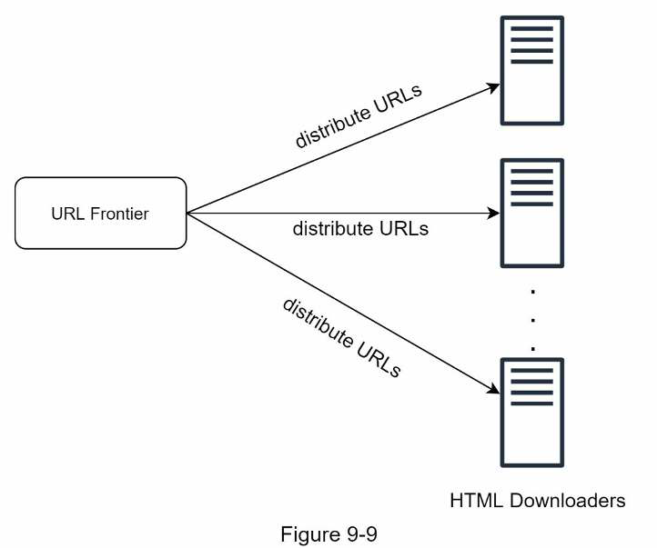

### Khả năng mở rộng (Extensibility)

Vì hầu như mọi hệ thống đều phát triển theo thời gian, một trong những mục tiêu thiết kế là làm cho hệ thống đủ linh hoạt để hỗ trợ các loại nội dung mới. Crawler có thể được mở rộng bằng cách gắn thêm (plugging in) các mô-đun mới. Hình 9-10 (Figure 9-10) minh họa cách thêm các mô-đun mới:

* Mô-đun **PNG Downloader** được gắn vào để tải xuống các tệp PNG.
* Mô-đun **Web Monitor** được thêm vào để giám sát web và ngăn chặn hành vi xâm phạm bản quyền và thương hiệu.

### Phát hiện và tránh nội dung có vấn đề (Detect and avoid problematic content)

Phần này thảo luận về việc phát hiện và ngăn chặn nội dung dư thừa, vô nghĩa hoặc độc hại.

1. **Nội dung dư thừa (Redundant content):** Như đã thảo luận trước đó, gần 30% các trang web bị trùng lặp. Hàm băm (hashes) hoặc mã kiểm tra (checksums) giúp phát hiện sự trùng lặp [11].
2. **Bẫy nhện (Spider traps):** Spider trap là một trang web khiến crawler rơi vào vòng lặp vô hạn. Ví dụ, một cấu trúc thư mục sâu vô tận được liệt kê như sau:
   ```text
   www.spidertrapexample.com/foo/bar/foo/bar/foo/bar/…
   ```
   Những spider trap như vậy có thể được tránh bằng cách đặt độ dài tối đa cho các URL. Tuy nhiên, không có giải pháp nào phù hợp cho mọi trường hợp (one-size-fits-all) để phát hiện spider trap. Các trang web chứa spider trap rất dễ nhận biết do số lượng trang web được phát hiện trên những trang đó lớn một cách bất thường. Rất khó để phát triển các thuật toán tự động nhằm tránh spider trap; tuy nhiên, người vận hành có thể xác minh và nhận diện thủ công một spider trap, sau đó loại bỏ các trang web đó khỏi crawler hoặc áp dụng một số bộ lọc URL tùy chỉnh.

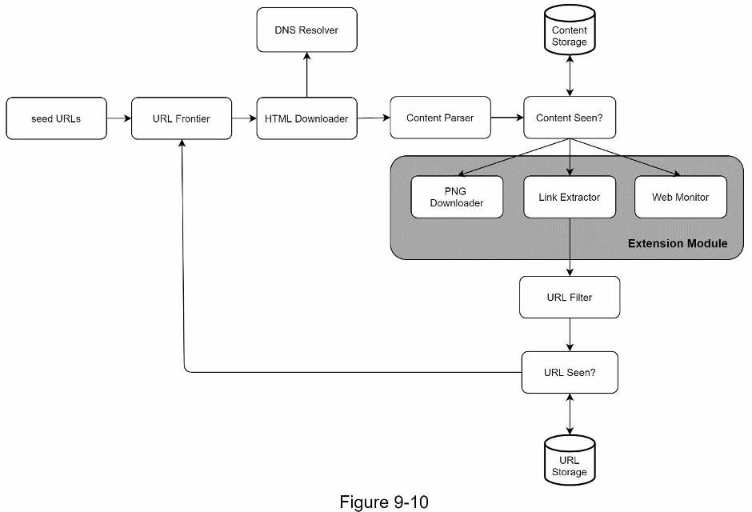

3. **Nhiễu dữ liệu (Data noise):** Một số nội dung có rất ít hoặc không có giá trị, chẳng hạn như quảng cáo, đoạn mã (code snippets), URL rác (spam URLs), v.v. Những nội dung đó không hữu ích cho crawler và nên được loại bỏ nếu có thể.

---

## Bước 4 - Tổng kết (Step 4 - Wrap up)

Trong chương này, đầu tiên chúng ta đã thảo luận về các đặc tính của một crawler tốt: khả năng mở rộng (scalability), tính lịch sự (politeness), khả năng mở rộng tính năng (extensibility) và tính bền vững (robustness). Sau đó, chúng ta đã đề xuất một thiết kế và thảo luận về các thành phần cốt lõi.

Xây dựng một web crawler có khả năng mở rộng không phải là nhiệm vụ tầm thường vì web vô cùng rộng lớn và đầy rẫy cạm bẫy. Mặc dù chúng ta đã đề cập đến nhiều chủ đề, nhưng vẫn còn nhiều điểm thảo luận liên quan chưa được bao phủ hết:

* **Kết xuất phía máy chủ (Server-side rendering):** Rất nhiều trang web sử dụng các tập lệnh như JavaScript, AJAX, v.v. để tạo liên kết động ngay khi chạy (on the fly). Nếu chúng ta tải xuống và phân tích trực tiếp các trang web, chúng ta sẽ không thể lấy được các liên kết được tạo động đó. Để giải quyết vấn đề này, chúng ta thực hiện kết xuất phía máy chủ (còn gọi là kết xuất động - dynamic rendering) trước khi phân tích một trang [12].
* **Lọc bỏ các trang không mong muốn (Filter out unwanted pages):** Với dung lượng lưu trữ và tài nguyên thu thập có hạn, một thành phần chống thư rác (anti-spam) rất hữu ích trong việc lọc bỏ các trang chất lượng thấp và trang rác [13] [14].
* **Nhân bản và phân mảnh cơ sở dữ liệu (Database replication and sharding):** Các kỹ thuật như replication và sharding được sử dụng để cải thiện tính khả dụng, khả năng mở rộng và độ tin cậy của tầng dữ liệu.
* **Mở rộng theo chiều ngang (Horizontal scaling):** Đối với việc thu thập dữ liệu quy mô lớn, cần hàng trăm hoặc thậm chí hàng nghìn máy chủ để thực hiện các tác vụ tải xuống. Chìa khóa ở đây là giữ cho các máy chủ không lưu trạng thái (stateless).
* **Tính khả dụng, tính nhất quán và độ tin cậy (Availability, consistency, and reliability):** Những khái niệm này là cốt lõi cho sự thành công của bất kỳ hệ thống lớn nào. Chúng ta đã thảo luận chi tiết các khái niệm này trong Chương 1. Hãy ôn lại trí nhớ của bạn về các chủ đề này.
* **Phân tích dữ liệu (Analytics):** Thu thập và phân tích dữ liệu là một phần quan trọng của bất kỳ hệ thống nào vì dữ liệu là thành phần then chốt để tinh chỉnh hệ thống.

Chúc mừng bạn đã đi được đến đây! Bây giờ hãy tự thưởng cho mình một cái vỗ vai khích lệ. Làm tốt lắm!

---

## Tài liệu tham khảo (Reference materials)

* [1] US Library of Congress: https://www.loc.gov/websites/
* [2] EU Web Archive: http://data.europa.eu/webarchive
* [3] Digimarc: https://www.digimarc.com/products/digimarc-services/piracy-intelligence
* [4] Heydon A., Najork M. Mercator: A scalable, extensible web crawler World Wide Web, 2 (4) (1999), pp. 219-229
* [5] By Christopher Olston, Marc Najork: Web Crawling. http://infolab.stanford.edu/~olston/publications/crawling_survey.pdf
* [6] 29% Of Sites Face Duplicate Content Issues: https://tinyurl.com/y6tmh55y
* [7] Rabin M.O., et al. Fingerprinting by random polynomials Center for Research in Computing Techn., Aiken Computation Laboratory, Univ. (1981)
* [8] B. H. Bloom, “Space/time trade-offs in hash coding with allowable errors,” Communications of the ACM, vol. 13, no. 7, pp. 422–426, 1970.
* [9] Donald J. Patterson, Web Crawling: https://www.ics.uci.edu/~lopes/teaching/cs221W12/slides/Lecture05.pdf
* [10] L. Page, S. Brin, R. Motwani, and T. Winograd, “The PageRank citation ranking: Bringing order to the web,” Technical Report, Stanford University, 1998.
* [11] Burton Bloom. Space/time trade-offs in hash coding with allowable errors. Communications of the ACM, 13(7), pages 422--426, July 1970.
* [12] Google Dynamic Rendering: https://developers.google.com/search/docs/guides/dynamic-rendering
* [13] T. Urvoy, T. Lavergne, and P. Filoche, “Tracking web spam with hidden style similarity,” in Proceedings of the 2nd International Workshop on Adversarial Information Retrieval on the Web, 2006.
* [14] H.-T. Lee, D. Leonard, X. Wang, and D. Loguinov, “IRLbot: Scaling to 6 billion pages and beyond,” in Proceedings of the 17th International World Wide Web Conference, 2008.

---

## Bảng thuật ngữ chương (Chapter Glossary)

| Thuật ngữ (English) | Tiếng Việt | Giải thích ngắn gọn |
| :--- | :--- | :--- |
| Web crawler (Spider / Robot) | Trình thu thập dữ liệu web | Chương trình tự động duyệt web theo các liên kết để tải và lập chỉ mục hoặc lưu trữ nội dung. |
| Seed URLs | URL hạt giống | Tập hợp các URL ban đầu làm điểm xuất phát cho quá trình thu thập dữ liệu. |
| URL Frontier | Biên giới URL | Cấu trúc dữ liệu quản lý danh sách các URL chờ được tải xuống, đảm bảo độ ưu tiên và tính lịch sự. |
| Politeness | Tính lịch sự | Nguyên tắc không gửi quá nhiều yêu cầu tới cùng một máy chủ trong thời gian ngắn để tránh làm quá tải hoặc bị coi là tấn công DoS. |
| Front queues | Hàng đợi phía trước | Các hàng đợi trong URL Frontier dùng để phân loại và quản lý độ ưu tiên của URL. |
| Back queues | Hàng đợi phía sau | Các hàng đợi trong URL Frontier gắn với từng host/worker nhằm thực thi tính lịch sự. |
| Robots.txt (Robots Exclusion Protocol) | Giao thức loại trừ robot | Tệp chuẩn trên website quy định các đường dẫn mà crawler được phép hoặc không được phép thu thập. |
| Bloom filter | Bộ lọc Bloom | Cấu trúc dữ liệu xác suất tiết kiệm bộ nhớ, thường dùng cho "URL Seen?" để kiểm tra nhanh một URL đã từng xuất hiện chưa. |
| Spider trap | Bẫy nhện | Trang web hoặc cấu trúc URL (như thư mục lồng sâu vô hạn) khiến crawler rơi vào vòng lặp vô tận. |
| Server-side rendering (Dynamic rendering) | Kết xuất phía máy chủ | Kỹ thuật chạy JavaScript/AJAX trên máy chủ để tạo ra HTML hoàn chỉnh trước khi phân tích liên kết. |
