# CHƯƠNG 10: THIẾT KẾ HỆ THỐNG THÔNG BÁO (CHAPTER 10: DESIGN A NOTIFICATION SYSTEM)

Trong những năm gần đây, hệ thống thông báo (notification system) đã trở thành một tính năng rất phổ biến đối với nhiều ứng dụng. Một thông báo giúp cảnh báo người dùng về những thông tin quan trọng như tin nóng, cập nhật sản phẩm, sự kiện, ưu đãi, v.v. Nó đã trở thành một phần không thể thiếu trong cuộc sống hằng ngày của chúng ta. Trong chương này, bạn được yêu cầu thiết kế một hệ thống thông báo.

Thông báo không chỉ đơn thuần là thông báo đẩy trên thiết bị di động (mobile push notification). Có ba loại định dạng thông báo phổ biến gồm: thông báo đẩy trên di động, tin nhắn SMS và Email. Hình 10-1 (Figure 10-1) minh họa ví dụ về từng loại thông báo này.

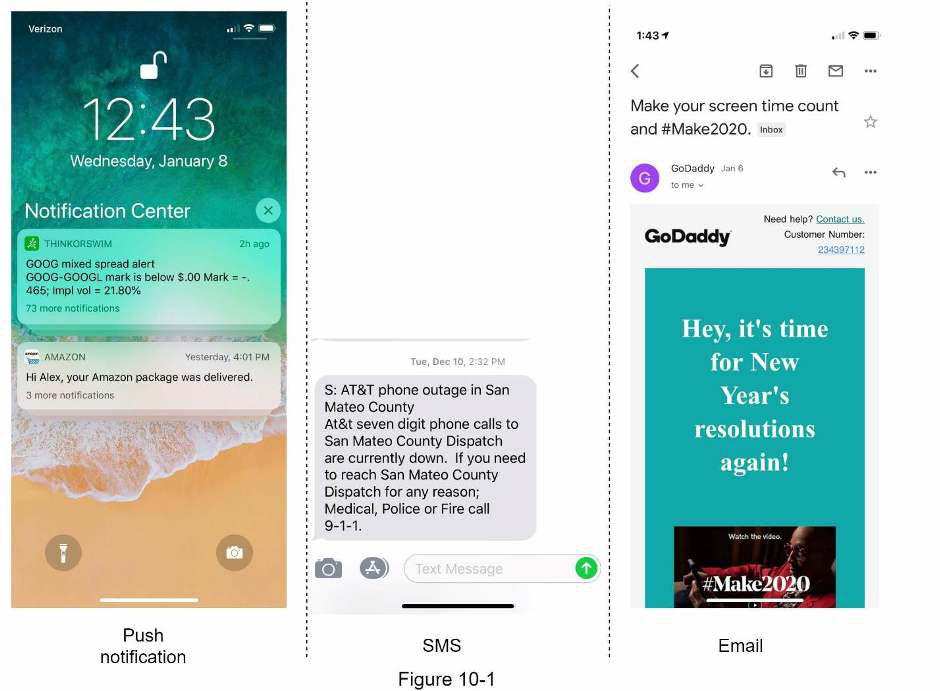

---

## Bước 1 - Hiểu bài toán và xác định phạm vi thiết kế (Step 1 - Understand the problem and establish design scope)

Việc xây dựng một hệ thống có khả năng mở rộng (scalable) để gửi hàng triệu thông báo mỗi ngày không phải là nhiệm vụ dễ dàng. Nó đòi hỏi sự hiểu biết sâu sắc về hệ sinh thái thông báo. Câu hỏi phỏng vấn này được cố tình thiết kế theo hướng mở và có tính mơ hồ, vì vậy trách nhiệm của bạn là phải đặt câu hỏi để làm rõ các yêu cầu.

**Ứng viên:** Hệ thống cần hỗ trợ những loại thông báo nào?
**Người phỏng vấn:** Thông báo đẩy (push notification), tin nhắn SMS và email.

**Ứng viên:** Đây có phải là hệ thống thời gian thực (real-time) không?
**Người phỏng vấn:** Hãy xem nó như một hệ thống thời gian thực mềm (soft real-time). Chúng ta muốn người dùng nhận được thông báo càng sớm càng tốt. Tuy nhiên, nếu hệ thống đang chịu tải cao, một độ trễ nhẹ là chấp nhận được.

**Ứng viên:** Các thiết bị được hỗ trợ là gì?
**Người phỏng vấn:** Thiết bị iOS, thiết bị Android và máy tính xách tay/máy tính để bàn (laptop/desktop).

**Ứng viên:** Điều gì kích hoạt (trigger) thông báo?
**Người phỏng vấn:** Thông báo có thể được kích hoạt bởi các ứng dụng phía client. Chúng cũng có thể được lên lịch ở phía server.

**Ứng viên:** Người dùng có thể từ chối nhận thông báo (opt-out) không?
**Người phỏng vấn:** Có, những người dùng chọn từ chối sẽ không còn nhận được thông báo nữa.

**Ứng viên:** Mỗi ngày có bao nhiêu thông báo được gửi đi?
**Người phỏng vấn:** 10 triệu thông báo đẩy trên di động, 1 triệu tin nhắn SMS và 5 triệu email.

> 📝 **Giải thích thêm (không có trong sách):**
> Tại sao "soft real-time" lại quan trọng trong thiết kế này?
> Trong hệ thống thời gian thực cứng (hard real-time), việc trễ hạn dù chỉ vài mili-giây cũng bị coi là lỗi nghiêm trọng (ví dụ: hệ thống phanh ABS hay điều khiển máy bay). Ngược lại, **soft real-time** cho phép hệ thống dùng **hàng đợi thông điệp (message queue)** để làm bộ đệm khi lưu lượng tăng đột biến (ví dụ: dịp Black Friday hoặc khi có tin nóng). Thông báo có thể chậm vài giây đến vài chục giây nhưng không làm sập hệ thống và cũng không bị mất.

---

## Bước 2 - Đề xuất thiết kế tổng thể và đạt được sự đồng thuận (Step 2 - Propose high-level design and get buy-in)

Phần này trình bày thiết kế tổng thể (high-level design) hỗ trợ nhiều loại thông báo khác nhau: thông báo đẩy iOS, thông báo đẩy Android, tin nhắn SMS và Email. Cấu trúc của phần này như sau:
* Các loại thông báo khác nhau
* Luồng thu thập thông tin liên hệ
* Luồng gửi và nhận thông báo

### Các loại thông báo khác nhau (Different types of notifications)

Chúng ta bắt đầu bằng việc xem xét cách từng loại thông báo hoạt động ở mức tổng thể.

#### Thông báo đẩy trên iOS (iOS push notification)

Chúng ta chủ yếu cần ba thành phần để gửi một thông báo đẩy trên iOS:
* **Nhà cung cấp (Provider):** Provider tạo và gửi các yêu cầu thông báo đến Apple Push Notification Service (APNs). Để tạo một thông báo đẩy, provider cần cung cấp các dữ liệu sau:
  * **Device token (Mã định danh thiết bị):** Đây là một mã định danh duy nhất dùng để gửi thông báo đẩy.
  * **Payload:** Đây là một JSON dictionary chứa nội dung tải trọng của thông báo. Dưới đây là một ví dụ:

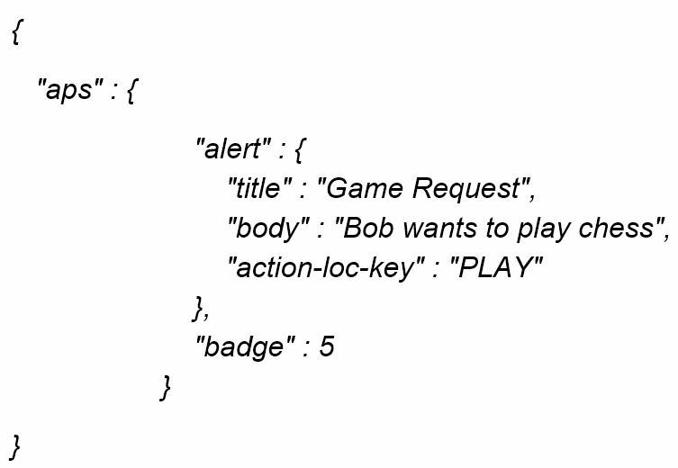

* **APNs:** Đây là một dịch vụ từ xa do Apple cung cấp để truyền tải thông báo đẩy đến các thiết bị iOS.
* **Thiết bị iOS (iOS Device):** Đây là thiết bị đầu cuối (end client) nhận thông báo đẩy.

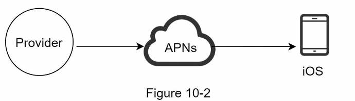

#### Thông báo đẩy trên Android (Android push notification)

Android áp dụng một luồng thông báo tương tự. Thay vì sử dụng APNs, Firebase Cloud Messaging (FCM) thường được dùng để gửi thông báo đẩy đến các thiết bị Android.

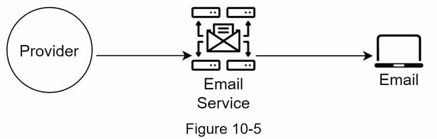

#### Tin nhắn SMS (SMS message)

Đối với tin nhắn SMS, các dịch vụ SMS của bên thứ ba như Twilio [1], Nexmo [2] và nhiều dịch vụ khác thường được sử dụng. Hầu hết trong số đó là các dịch vụ thương mại.

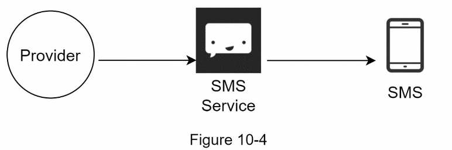

#### Email (Email)

Mặc dù các công ty có thể tự thiết lập máy chủ email riêng, nhiều công ty lựa chọn sử dụng các dịch vụ email thương mại. Sendgrid [3] và Mailchimp [4] nằm trong số các dịch vụ email phổ biến nhất, giúp mang lại tỷ lệ gửi thành công (delivery rate) tốt hơn và cung cấp khả năng phân tích dữ liệu.

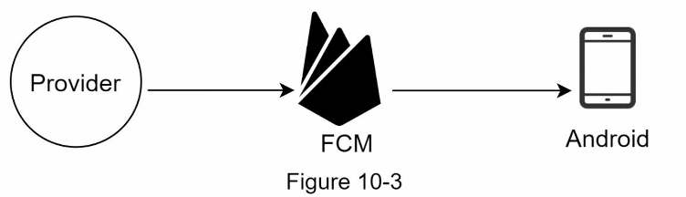

Hình 10-6 (Figure 10-6) cho thấy thiết kế sau khi tích hợp tất cả các dịch vụ bên thứ ba.

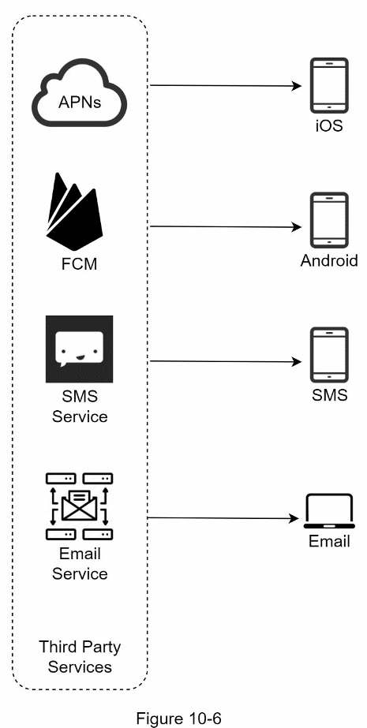

### Luồng thu thập thông tin liên hệ (Contact info gathering flow)

Để gửi thông báo, chúng ta cần thu thập device token của thiết bị di động, số điện thoại hoặc địa chỉ email. Như được minh họa trong Hình 10-7 (Figure 10-7), khi người dùng cài đặt ứng dụng hoặc đăng ký lần đầu, các máy chủ API sẽ thu thập thông tin liên hệ của người dùng và lưu trữ vào cơ sở dữ liệu.

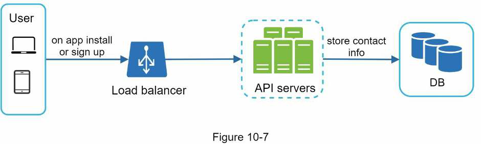

Hình 10-8 (Figure 10-8) minh họa các bảng cơ sở dữ liệu được đơn giản hóa để lưu trữ thông tin liên hệ. Địa chỉ email và số điện thoại được lưu trong bảng `user`, trong khi các `device_token` được lưu trong bảng `device`. Một người dùng có thể sở hữu nhiều thiết bị, điều này cho thấy một thông báo đẩy có thể được gửi đến tất cả các thiết bị của người dùng đó.

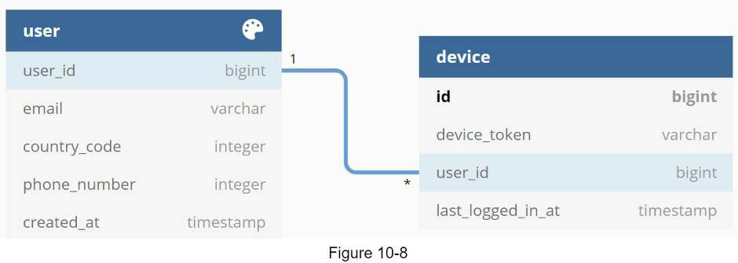

> 💡 **Ví dụ bổ sung (không có trong sách):**
> Trong thực tế, ngoài `device_token` và `user_id`, bảng `device` thường lưu thêm cột `platform` (`ios` hoặc `android`) và `app_version` để biết cần định tuyến (route) thông báo qua APNs hay FCM, cũng như xử lý các định dạng payload khác nhau giữa các phiên bản ứng dụng.
> ```sql
> CREATE TABLE device (
>     id BIGINT PRIMARY KEY,
>     user_id BIGINT NOT NULL,
>     device_token VARCHAR(255) NOT NULL,
>     platform VARCHAR(16) NOT NULL, -- 'ios' | 'android'
>     last_logged_in_at TIMESTAMP NOT NULL
> );
> ```

### Luồng gửi và nhận thông báo (Notification sending/receiving flow)

Trước tiên chúng ta sẽ trình bày thiết kế ban đầu; sau đó sẽ đề xuất một số phương án tối ưu hóa.

#### Thiết kế tổng thể (High-level design)

Hình 10-9 (Figure 10-9) trình bày thiết kế ban đầu, và từng thành phần trong hệ thống được giải thích bên dưới.

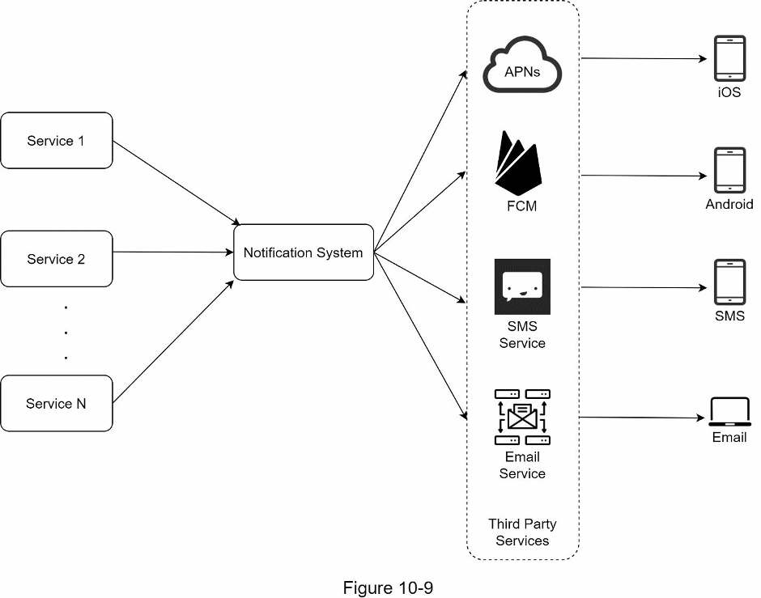

* **Service 1 đến N:** Một service có thể là một microservice, một cron job hoặc một hệ thống phân tán chịu trách nhiệm kích hoạt các sự kiện gửi thông báo. Ví dụ, một dịch vụ thanh toán (billing service) gửi email nhắc nhở khách hàng về khoản thanh toán đến hạn, hoặc một trang web mua sắm thông báo cho khách hàng rằng kiện hàng của họ sẽ được giao vào ngày mai thông qua tin nhắn SMS.
* **Hệ thống thông báo (Notification system):** Đây là thành phần trung tâm của việc gửi và nhận thông báo. Bắt đầu một cách đơn giản, chỉ có một máy chủ thông báo (notification server) được sử dụng. Nó cung cấp các API cho Service 1 đến N và xây dựng các notification payload cho các dịch vụ bên thứ ba.
* **Các dịch vụ bên thứ ba (Third-party services):** Các dịch vụ bên thứ ba chịu trách nhiệm chuyển phát thông báo đến người dùng. Khi tích hợp với các dịch vụ bên thứ ba, chúng ta cần đặc biệt chú ý đến **tính mở rộng/linh hoạt (extensibility)**. Tính linh hoạt tốt nghĩa là hệ thống có thể dễ dàng cắm thêm (plugging) hoặc tháo bỏ (unplugging) một dịch vụ bên thứ ba. Một cân nhắc quan trọng khác là một dịch vụ bên thứ ba có thể không khả dụng ở những thị trường mới hoặc trong tương lai. Chẳng hạn, FCM không khả dụng tại Trung Quốc. Do đó, các dịch vụ bên thứ ba thay thế như Jpush, PushY, v.v. được sử dụng tại đó.
* **iOS, Android, SMS, Email:** Người dùng nhận thông báo trên các thiết bị của họ.

Có ba vấn đề được xác định trong thiết kế này:
* **Điểm lỗi đơn (Single point of failure - SPOF):** Chỉ có một notification server đồng nghĩa với việc tồn tại SPOF.
* **Khó mở rộng (Hard to scale):** Hệ thống thông báo xử lý mọi thứ liên quan đến thông báo đẩy trên một máy chủ duy nhất. Rất khó để mở rộng độc lập cơ sở dữ liệu, bộ nhớ đệm (cache) và các thành phần xử lý thông báo khác nhau.
* **Nút thắt cổ chai hiệu năng (Performance bottleneck):** Việc xử lý và gửi thông báo có thể tiêu tốn rất nhiều tài nguyên. Ví dụ, việc dựng các trang HTML và chờ phản hồi từ các dịch vụ bên thứ ba có thể mất nhiều thời gian. Xử lý tất cả mọi thứ trong một hệ thống duy nhất có thể dẫn đến tình trạng quá tải hệ thống, đặc biệt là trong các khung giờ cao điểm.

#### Thiết kế tổng thể (cải tiến) (High-level design (improved))

Sau khi liệt kê các thách thức ở thiết kế ban đầu, chúng ta cải tiến thiết kế như sau:
* Tách cơ sở dữ liệu (database) và bộ nhớ đệm (cache) ra khỏi notification server.
* Bổ sung thêm nhiều notification server và thiết lập tự động mở rộng theo chiều ngang (automatic horizontal scaling).
* Đưa vào các hàng đợi thông điệp (message queues) để tách rời (decouple) các thành phần trong hệ thống.

Hình 10-10 (Figure 10-10) cho thấy thiết kế tổng thể đã được cải tiến.

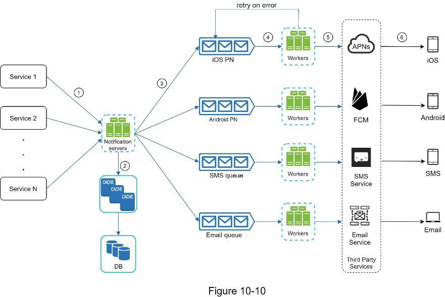

Cách tốt nhất để đọc sơ đồ trên là đi từ trái sang phải:

* **Service 1 đến N:** Đại diện cho các dịch vụ khác nhau thực hiện gửi thông báo thông qua các API do notification server cung cấp.
* **Notification servers:** Cung cấp các chức năng sau:
  * Cung cấp API cho các dịch vụ khác để gửi thông báo. Các API này chỉ có thể truy cập nội bộ hoặc bởi các client đã được xác minh để ngăn chặn thư rác (spam).
  * Thực hiện các bước kiểm tra hợp lệ cơ bản (basic validations) để xác minh email, số điện thoại, v.v.
  * Truy vấn cơ sở dữ liệu hoặc cache để lấy dữ liệu cần thiết cho việc kết xuất (render) một thông báo.
  * Đưa dữ liệu thông báo vào các hàng đợi thông điệp (message queues) để xử lý song song.

Dưới đây là một ví dụ về API gửi email:

`POST https://api.example.com/v/sms/send`

Request body:

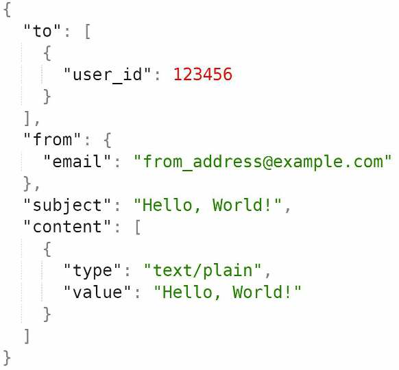

* **Cache:** Thông tin người dùng, thông tin thiết bị, các mẫu thông báo (notification templates) được lưu trong cache.
* **DB:** Lưu trữ dữ liệu về người dùng, thông báo, cài đặt (settings), v.v.
* **Hàng đợi thông điệp (Message queues):** Loại bỏ sự phụ thuộc trực tiếp giữa các thành phần. Message queue đóng vai trò như bộ đệm (buffer) khi có khối lượng lớn thông báo cần được gửi đi. Mỗi loại thông báo được gán một message queue riêng biệt để sự cố gián đoạn ở một dịch vụ bên thứ ba sẽ không làm ảnh hưởng đến các loại thông báo khác.
* **Workers:** Workers là một tập hợp các máy chủ kéo (pull) các sự kiện thông báo từ message queue và gửi chúng đến các dịch vụ bên thứ ba tương ứng.
* **Các dịch vụ bên thứ ba (Third-party services):** Đã được giải thích trong thiết kế ban đầu.
* **iOS, Android, SMS, Email:** Đã được giải thích trong thiết kế ban đầu.

Tiếp theo, hãy cùng xem xét cách mọi thành phần phối hợp với nhau để gửi một thông báo:
1. Một service gọi các API do notification server cung cấp để gửi thông báo.
2. Notification server lấy siêu dữ liệu (metadata) như thông tin người dùng, device token và cài đặt thông báo từ cache hoặc cơ sở dữ liệu.
3. Một sự kiện thông báo được gửi tới hàng đợi tương ứng để xử lý. Chẳng hạn, một sự kiện thông báo đẩy iOS được gửi vào hàng đợi `iOS PN`.
4. Các worker kéo sự kiện thông báo từ message queue.
5. Các worker gửi thông báo đến các dịch vụ bên thứ ba.
6. Các dịch vụ bên thứ ba chuyển phát thông báo đến thiết bị của người dùng.

> 📝 **Giải thích thêm (không có trong sách):**
> Sơ đồ Mermaid dưới đây tóm tắt luồng xử lý bất đồng bộ (asynchronous flow) giúp hệ thống chịu tải cao:
> ```mermaid
> flowchart LR
>     S["Service 1..N"] -->|"1. Gọi API"| NS["Notification Servers"]
>     NS -->|"2. Đọc metadata"| C["Cache / DB"]
>     NS -->|"3. Đẩy event vào queue riêng"| Q["Message Queues (iOS PN / Android PN / SMS / Email)"]
>     Q -->|"4. Pull event"| W["Workers"]
>     W -->|"5. Gửi payload"| TP["Third-party Services (APNs / FCM / Twilio / SendGrid)"]
>     TP -->|"6. Chuyển phát"| U["Thiết bị người dùng"]
> ```

---

## Bước 3 - Đi sâu vào thiết kế (Step 3 - Design deep dive)

Trong phần thiết kế tổng thể, chúng ta đã thảo luận về các loại thông báo khác nhau, luồng thu thập thông tin liên hệ và luồng gửi/nhận thông báo. Trong phần đi sâu vào thiết kế, chúng ta sẽ khám phá các chủ đề sau:
* Độ tin cậy (Reliability).
* Các thành phần và cân nhắc bổ sung: mẫu thông báo (notification template), cài đặt thông báo (notification settings), giới hạn tần suất (rate limiting), cơ chế thử lại (retry mechanism), bảo mật trong thông báo đẩy (security in push notifications), giám sát các thông báo trong hàng đợi (monitor queued notifications) và theo dõi sự kiện (event tracking).
* Thiết kế cập nhật (Updated design).

### Độ tin cậy (Reliability)

Chúng ta phải trả lời một vài câu hỏi quan trọng về độ tin cậy khi thiết kế một hệ thống thông báo trong môi trường phân tán.

#### Làm thế nào để ngăn chặn mất dữ liệu? (How to prevent data loss?)

Một trong những yêu cầu quan trọng nhất trong hệ thống thông báo là không được phép làm mất dữ liệu. Thông báo thường có thể bị trễ hoặc đảo thứ tự, nhưng tuyệt đối không bao giờ được mất. Để đáp ứng yêu cầu này, hệ thống thông báo lưu trữ bền vững (persists) dữ liệu thông báo vào cơ sở dữ liệu và triển khai cơ chế thử lại (retry mechanism). Cơ sở dữ liệu nhật ký thông báo (notification log database) được bổ sung để lưu trữ bền vững dữ liệu, như được minh họa trong Hình 10-11 (Figure 10-11).

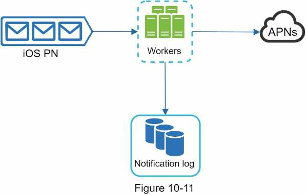

#### Người nhận có nhận được thông báo đúng một lần (exactly once) không? (Will recipients receive a notification exactly once?)

Câu trả lời ngắn gọn là **không**. Mặc dù thông báo được gửi đúng một lần trong phần lớn thời gian, bản chất phân tán của hệ thống vẫn có thể dẫn đến các thông báo bị trùng lặp. Để giảm thiểu khả năng xảy ra trùng lặp, chúng ta đưa vào một cơ chế khử trùng lặp (dedupe mechanism) và xử lý cẩn thận từng trường hợp lỗi. Dưới đây là một logic khử trùng lặp đơn giản:

Khi một sự kiện thông báo đến lần đầu tiên, chúng ta kiểm tra xem nó đã từng xuất hiện trước đó chưa bằng cách kiểm tra `event ID`. Nếu nó đã xuất hiện trước đó, sự kiện sẽ bị loại bỏ (discarded). Ngược lại, chúng ta sẽ gửi thông báo đi. Đối với những độc giả quan tâm muốn tìm hiểu sâu hơn lý do tại sao chúng ta không thể đạt được cam kết gửi đúng một lần (exactly-once delivery), hãy tham khảo tài liệu tham khảo [5].

> 💡 **Ví dụ bổ sung (không có trong sách):**
> Tại sao gửi trùng vẫn xảy ra dù có `event ID`?
> Giả sử Worker đã gửi yêu cầu tới APNs/Twilio và nhà cung cấp đã gửi tin nhắn tới điện thoại người dùng thành công, nhưng mạng bị đứt đúng lúc phản hồi `200 OK` quay về Worker. Worker tưởng rằng việc gửi đã thất bại (timeout) nên đẩy sự kiện vào hàng đợi thử lại. Nếu không lưu trạng thái đã gửi hoặc nhà cung cấp bên thứ ba không hỗ trợ **idempotency key** (khóa chống trùng lặp), người dùng có thể nhận được 2 thông báo giống hệt nhau.
> Trong thực tế, hệ thống thông báo thường cam kết ngữ nghĩa **ít nhất một lần (at-least-once delivery)** kết hợp với dedupe để giảm thiểu trùng lặp ở mức tối đa.

### Các thành phần và cân nhắc bổ sung (Additional components and considerations)

Chúng ta đã thảo luận cách thu thập thông tin liên hệ của người dùng, cách gửi và nhận thông báo. Một hệ thống thông báo còn bao gồm nhiều thứ hơn thế nữa. Dưới đây, chúng ta sẽ thảo luận về các thành phần bổ sung bao gồm tái sử dụng mẫu (template reusing), cài đặt thông báo, theo dõi sự kiện, giám sát hệ thống, giới hạn tần suất, v.v.

#### Mẫu thông báo (Notification template)

Một hệ thống thông báo lớn gửi đi hàng triệu thông báo mỗi ngày, và nhiều thông báo trong số đó tuân theo một định dạng tương tự nhau. Các mẫu thông báo (notification templates) được đưa vào nhằm tránh việc phải xây dựng lại từng thông báo từ đầu. Một mẫu thông báo là một thông báo được định dạng sẵn để tạo ra thông báo riêng của bạn bằng cách tùy chỉnh các tham số, kiểu dáng (styling), liên kết theo dõi (tracking links), v.v. Dưới đây là một ví dụ về mẫu thông báo đẩy:

```text
BODY:
You dreamed of it. We dared it. [ITEM NAME] is back — only until [DATE].
CTA:
Order Now. Or, Save My [ITEM NAME]
```

Lợi ích của việc sử dụng mẫu thông báo bao gồm duy trì định dạng nhất quán, giảm thiểu sai sót và tiết kiệm thời gian.

#### Cài đặt thông báo (Notification setting)

Người dùng thường nhận quá nhiều thông báo mỗi ngày và rất dễ cảm thấy bị choáng ngợp. Do đó, nhiều trang web và ứng dụng cung cấp cho người dùng quyền kiểm soát chi tiết (fine-grained control) đối với cài đặt thông báo. Thông tin này được lưu trong bảng cài đặt thông báo (`notification setting`), với các trường sau:

```text
user_id   bigInt
channel   varchar    # push notification, email or SMS
opt_in    boolean    # opt-in to receive notification
```

Trước khi bất kỳ thông báo nào được gửi tới người dùng, trước tiên chúng ta kiểm tra xem người dùng có chọn nhận (`opt-in`) loại thông báo này hay không.

#### Giới hạn tần suất (Rate limiting)

Để tránh làm người dùng bị quá tải bởi quá nhiều thông báo, chúng ta có thể giới hạn số lượng thông báo mà một người dùng có thể nhận được. Điều này rất quan trọng vì người nhận có thể tắt hoàn toàn thông báo nếu chúng ta gửi quá thường xuyên.

> 💡 **Ví dụ bổ sung (không có trong sách):**
> Một ứng dụng thương mại điện tử có thể đặt quy tắc giới hạn tần suất (frequency capping) như: mỗi người dùng chỉ nhận tối đa **3 thông báo đẩy quảng cáo mỗi ngày**, nhưng **không giới hạn** (hoặc ưu tiên cao) đối với các thông báo giao dịch quan trọng như mã OTP hoặc xác nhận thanh toán.

#### Cơ chế thử lại (Retry mechanism)

Khi một dịch vụ bên thứ ba gửi thông báo thất bại, thông báo đó sẽ được đưa trở lại hàng đợi thông điệp để thử lại (retry). Nếu sự cố vẫn tiếp diễn, một cảnh báo (alert) sẽ được gửi đến các kỹ sư phát triển (developers).

#### Bảo mật trong thông báo đẩy (Security in push notifications)

Đối với các ứng dụng iOS hoặc Android, cặp `appKey` và `appSecret` được sử dụng để bảo mật các API thông báo đẩy [6]. Chỉ những client đã được xác thực hoặc xác minh mới được phép gửi thông báo đẩy thông qua các API của chúng ta. Những độc giả quan tâm có thể tham khảo thêm tại tài liệu tham khảo [6].

#### Giám sát các thông báo trong hàng đợi (Monitor queued notifications)

Một chỉ số (metric) then chốt cần giám sát là tổng số lượng thông báo đang nằm trong hàng đợi. Nếu con số này lớn, điều đó có nghĩa là các sự kiện thông báo không được các worker xử lý đủ nhanh. Để tránh độ trễ trong việc chuyển phát thông báo, chúng ta cần bổ sung thêm các worker. Hình 10-12 (Figure 10-12) (nguồn từ [7]) minh họa một ví dụ về biểu đồ các thông điệp trong hàng đợi đang chờ được xử lý.

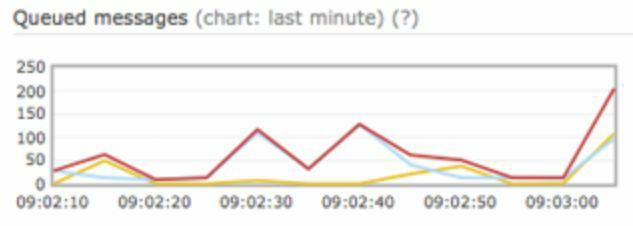

#### Theo dõi sự kiện (Events tracking)

Các chỉ số thông báo như tỷ lệ mở (open rate), tỷ lệ nhấp (click rate) và mức độ tương tác (engagement) rất quan trọng để hiểu hành vi khách hàng. Dịch vụ phân tích (Analytics service) đảm nhiệm việc theo dõi sự kiện. Thông thường cần có sự tích hợp giữa hệ thống thông báo và dịch vụ phân tích. Hình 10-13 (Figure 10-13) minh họa một ví dụ về các sự kiện có thể được theo dõi cho mục đích phân tích.

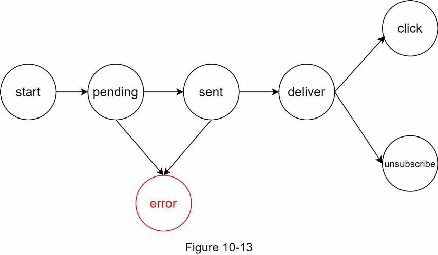

### Thiết kế cập nhật (Updated design)

Tổng hợp tất cả mọi thứ lại, Hình 10-14 (Figure 10-14) trình bày thiết kế hệ thống thông báo sau khi cập nhật.

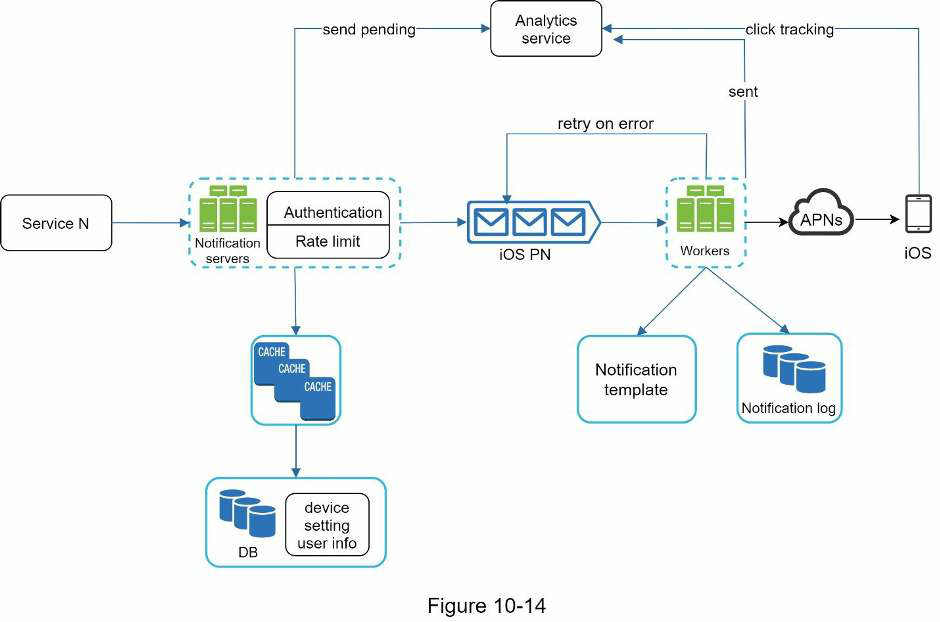

Trong thiết kế này, nhiều thành phần mới đã được bổ sung so với thiết kế trước đó:
* Các notification server được trang bị thêm hai tính năng quan trọng: **xác thực (authentication)** và **giới hạn tần suất (rate-limiting)**.
* Chúng ta cũng bổ sung **cơ chế thử lại (retry mechanism)** để xử lý các lỗi khi gửi thông báo. Nếu hệ thống gửi thông báo thất bại, chúng được đưa trở lại vào hàng đợi thông điệp và các worker sẽ thử lại với số lần được định nghĩa trước.
* Hơn nữa, **mẫu thông báo (notification templates)** mang lại quy trình tạo thông báo nhất quán và hiệu quả.
* Cuối cùng, các hệ thống **giám sát (monitoring)** và **theo dõi (tracking)** được bổ sung để kiểm tra tình trạng hoạt động của hệ thống và phục vụ các cải tiến trong tương lai.

---

## Bước 4 - Tổng kết (Step 4 - Wrap up)

Thông báo là thành phần không thể thiếu vì chúng giúp chúng ta luôn được cập nhật những thông tin quan trọng. Đó có thể là một thông báo đẩy về bộ phim yêu thích của bạn trên Netflix, một email về chương trình giảm giá sản phẩm mới, hoặc một tin nhắn xác nhận thanh toán mua sắm trực tuyến.

Trong chương này, chúng ta đã mô tả thiết kế của một hệ thống thông báo có khả năng mở rộng, hỗ trợ nhiều định dạng thông báo: thông báo đẩy, tin nhắn SMS và email. Chúng ta đã áp dụng hàng đợi thông điệp (message queues) để tách rời các thành phần trong hệ thống.

Bên cạnh thiết kế tổng thể, chúng ta đã đi sâu vào nhiều thành phần và các bước tối ưu hóa khác:
* **Độ tin cậy (Reliability):** Chúng ta đề xuất một cơ chế thử lại mạnh mẽ nhằm giảm thiểu tỷ lệ thất bại.
* **Bảo mật (Security):** Cặp `appKey`/`appSecret` được sử dụng để đảm bảo chỉ các client đã được xác minh mới có thể gửi thông báo.
* **Theo dõi và giám sát (Tracking and monitoring):** Được triển khai ở bất kỳ giai đoạn nào trong luồng thông báo để thu thập các số liệu thống kê quan trọng.
* **Tôn trọng cài đặt người dùng (Respect user settings):** Người dùng có thể từ chối nhận (opt-out) thông báo. Hệ thống của chúng ta kiểm tra cài đặt người dùng trước khi gửi thông báo.
* **Giới hạn tần suất (Rate limiting):** Người dùng sẽ đánh giá cao việc giới hạn tần suất số lượng thông báo mà họ nhận được.

Chúc mừng bạn đã đi được đến đây! Bây giờ hãy tự vỗ vai khen ngợi bản thân mình đi nào. Làm tốt lắm!

---

## Tài liệu tham khảo (Reference materials)

* [1] Twilio SMS: https://www.twilio.com/sms
* [2] Nexmo SMS: https://www.nexmo.com/products/sms
* [3] Sendgrid: https://sendgrid.com/
* [4] Mailchimp: https://mailchimp.com/
* [5] You Cannot Have Exactly-Once Delivery: https://bravenewgeek.com/you-cannot-have-exactly-once-delivery/
* [6] Security in Push Notifications: https://cloud.ibm.com/docs/services/mobilepush?topic=mobile-pushnotification-security-in-push-notifications
* [7] RabbitMQ: https://bit.ly/2sotIa6 *(lưu ý: bản gốc tiếng Anh ghi nhầm là "RadditMQ")*

---

## Bảng thuật ngữ chương (Chapter Glossary)

| Thuật ngữ (English) | Tiếng Việt | Giải thích ngắn gọn |
| :--- | :--- | :--- |
| Push Notification | Thông báo đẩy | Thông báo được gửi từ máy chủ tới ứng dụng trên thiết bị di động của người dùng |
| APNs (Apple Push Notification Service) | Dịch vụ thông báo đẩy của Apple | Dịch vụ từ xa do Apple cung cấp để chuyển phát thông báo đẩy tới các thiết bị iOS |
| FCM (Firebase Cloud Messaging) | Dịch vụ nhắn tin đám mây Firebase | Dịch vụ của Google dùng để gửi thông báo đẩy tới các thiết bị Android (và đa nền tảng) |
| Device Token | Mã định danh thiết bị | Chuỗi định danh duy nhất đại diện cho một ứng dụng cài trên một thiết bị cụ thể để nhận thông báo đẩy |
| Payload | Tải trọng dữ liệu | Phần dữ liệu chính (thường ở định dạng JSON) chứa tiêu đề, nội dung, huy hiệu, v.v. của thông báo |
| Soft Real-time | Thời gian thực mềm | Hệ thống ưu tiên xử lý càng nhanh càng tốt nhưng chấp nhận độ trễ nhẹ khi tải cao |
| Opt-in / Opt-out | Đồng ý nhận / Từ chối nhận | Cơ chế cho phép người dùng bật hoặc tắt quyền nhận thông báo theo từng kênh |
| Extensibility | Tính mở rộng / linh hoạt | Khả năng dễ dàng tích hợp thêm hoặc thay thế các dịch vụ bên thứ ba mà không phải sửa lõi hệ thống |
| SPOF (Single Point of Failure) | Điểm lỗi đơn | Thành phần duy nhất mà nếu nó gặp sự cố sẽ làm toàn bộ hệ thống ngừng hoạt động |
| Message Queue | Hàng đợi thông điệp | Thành phần trung gian lưu đệm các sự kiện thông báo để tách rời các dịch vụ và xử lý song song |
| Worker | Máy chủ xử lý nền | Máy chủ kéo sự kiện từ hàng đợi thông điệp và gọi các dịch vụ bên thứ ba để gửi thông báo |
| Dedupe (Deduplication) | Khử trùng lặp | Cơ chế kiểm tra `event ID` để loại bỏ các sự kiện thông báo bị gửi lặp lại |
| Notification Template | Mẫu thông báo | Khung thông báo định dạng sẵn có chứa các biến tham số để tái sử dụng nhanh và nhất quán |
| Rate Limiting | Giới hạn tần suất | Cơ chế giới hạn số lượng thông báo gửi tới một người dùng trong một khoảng thời gian để tránh làm phiền |
| Retry Mechanism | Cơ chế thử lại | Đưa thông báo gửi lỗi quay lại hàng đợi để thử gửi lại theo số lần cấu hình trước |
| Events Tracking | Theo dõi sự kiện | Ghi nhận trạng thái vòng đời thông báo (`pending`, `sent`, `deliver`, `click`, `unsubscribe`, `error`) để phân tích |
