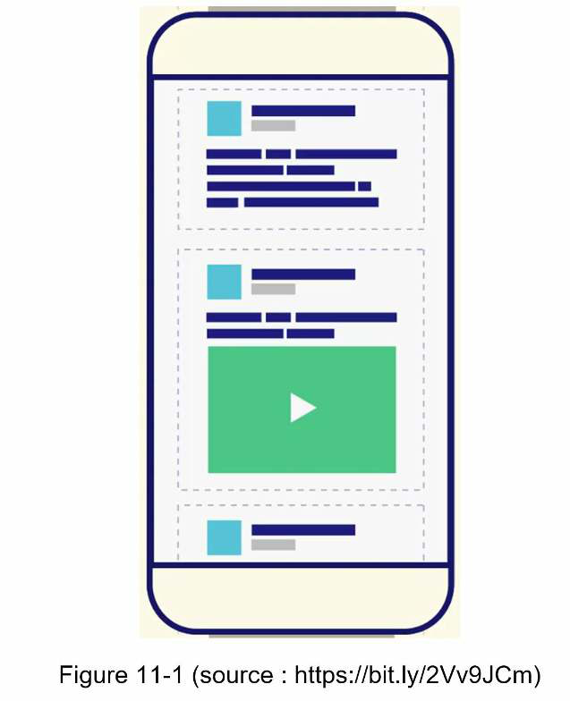
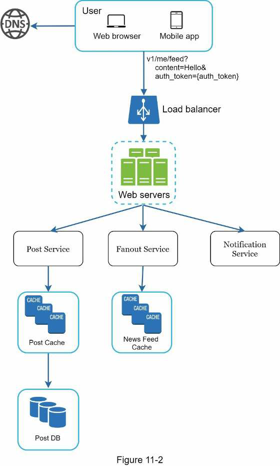
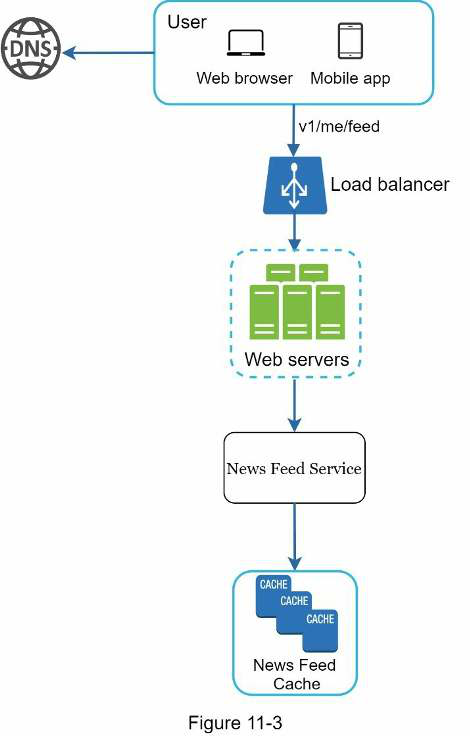
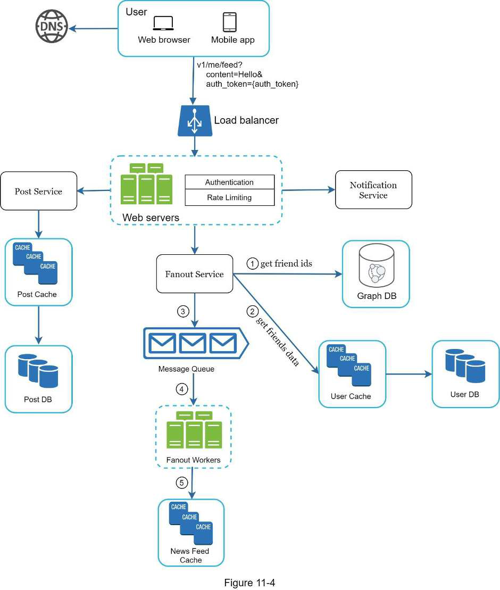
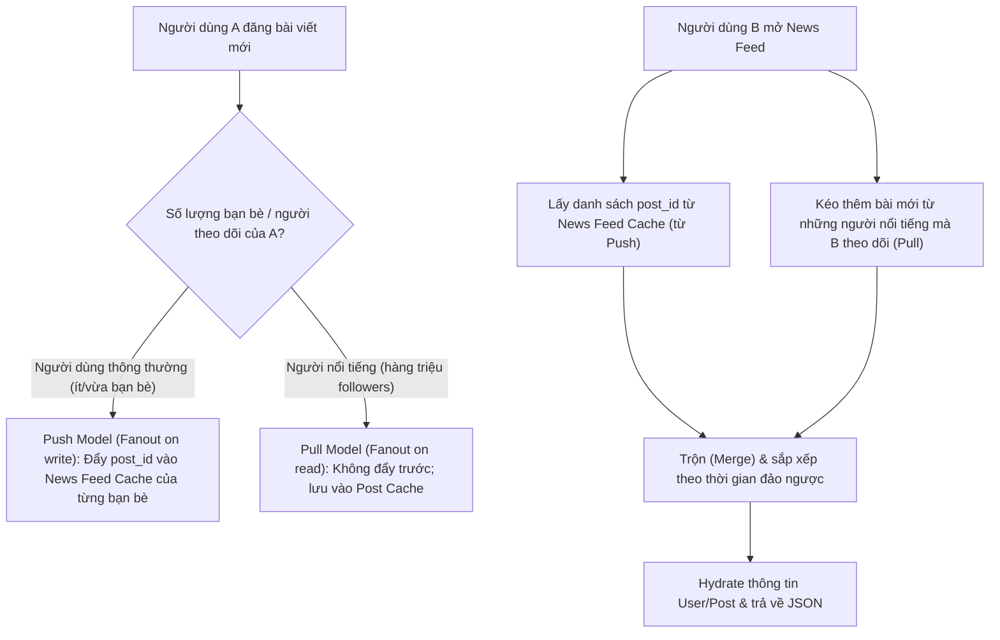
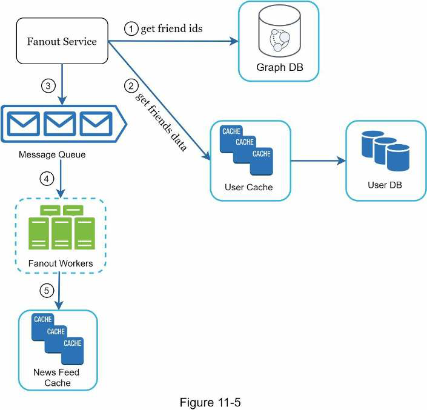
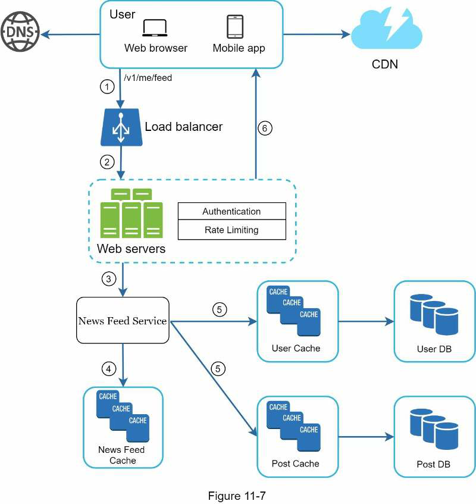
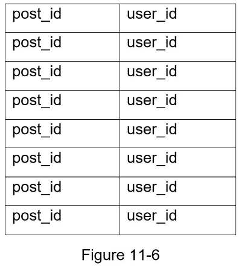
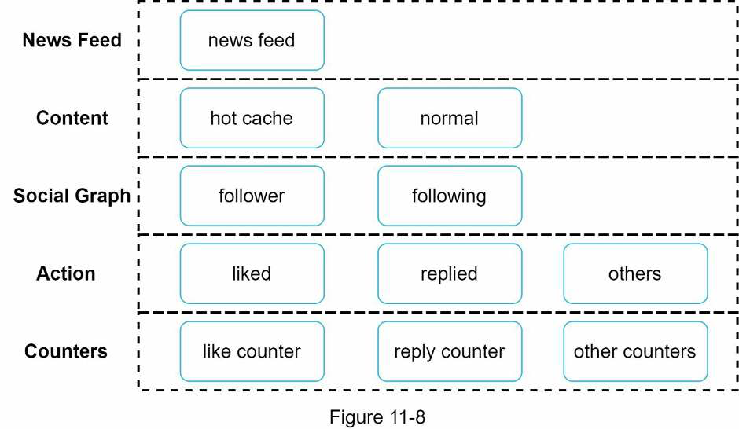

# CHƯƠNG 11: THIẾT KẾ HỆ THỐNG BẢNG TIN (CHAPTER 11: DESIGN A NEWS FEED SYSTEM)

Trong chương này, bạn được yêu cầu thiết kế một hệ thống bảng tin (news feed system). Bảng tin là gì? Theo trang trợ giúp của Facebook, “Bảng tin là danh sách các câu chuyện (stories) được cập nhật liên tục nằm ở giữa trang chủ của bạn. Bảng tin bao gồm cập nhật trạng thái, ảnh, video, liên kết, hoạt động ứng dụng và lượt thích từ những người, trang và nhóm mà bạn theo dõi trên Facebook” [1]. Đây là một câu hỏi phỏng vấn phổ biến. Các câu hỏi tương tự thường gặp bao gồm: thiết kế bảng tin Facebook (Facebook news feed), bảng tin Instagram (Instagram feed), dòng thời gian Twitter (Twitter timeline), v.v.



---

## Bước 1 - Hiểu bài toán và xác định phạm vi thiết kế (Step 1 - Understand the problem and establish design scope)

Loạt câu hỏi làm rõ đầu tiên nhằm hiểu xem người phỏng vấn đang nghĩ đến điều gì khi yêu cầu bạn thiết kế một hệ thống bảng tin. Tối thiểu, bạn cần xác định được những tính năng nào cần hỗ trợ. Dưới đây là một ví dụ về cuộc trao đổi giữa ứng viên và người phỏng vấn:

- **Ứng viên:** Đây là ứng dụng di động (mobile app), ứng dụng web (web app), hay cả hai?
- **Người phỏng vấn:** Cả hai.
- **Ứng viên:** Những tính năng quan trọng là gì?
- **Người phỏng vấn:** Người dùng có thể đăng bài viết (post) và xem bài viết của bạn bè trên trang bảng tin.
- **Ứng viên:** Bảng tin được sắp xếp theo thứ tự thời gian đảo ngược (reverse chronological order) hay theo một thứ tự cụ thể nào đó như điểm chủ đề (topic scores)? Ví dụ, bài viết từ bạn thân có điểm cao hơn.
- **Người phỏng vấn:** Để đơn giản, hãy giả sử bảng tin được sắp xếp theo thứ tự thời gian đảo ngược.
- **Ứng viên:** Một người dùng có thể có tối đa bao nhiêu bạn bè?
- **Người phỏng vấn:** 5.000.
- **Ứng viên:** Lưu lượng truy cập (traffic volume) là bao nhiêu?
- **Người phỏng vấn:** 10 triệu DAU (người dùng hoạt động hàng ngày - Daily Active Users).
- **Ứng viên:** Bảng tin có thể chứa hình ảnh, video hay chỉ văn bản?
- **Người phỏng vấn:** Nó có thể chứa các tệp đa phương tiện (media files), bao gồm cả hình ảnh và video.

Bây giờ bạn đã thu thập đủ các yêu cầu, chúng ta hãy tập trung vào việc thiết kế hệ thống.

> 📝 **Giải thích thêm (không có trong sách):**
> Từ các con số yêu cầu (10 triệu DAU, tối đa 5.000 bạn bè/người dùng, hỗ trợ cả ảnh/video và web/mobile), ta có thể nhận ra ngay hai đặc trưng quan trọng của hệ thống:
> 1. **Tỷ lệ đọc cao hơn ghi rất nhiều (Read-heavy):** Mỗi người dùng lướt bảng tin nhiều lần trong ngày, trong khi số lần đăng bài ít hơn nhiều.
> 2. **Fan-out có thể lớn:** Nếu một người dùng có 5.000 bạn bè (hoặc người nổi tiếng có hàng triệu người theo dõi trong thực tế), việc đẩy một bài viết mới tới toàn bộ bạn bè có thể tạo ra áp lực ghi rất lớn.

---

## Bước 2 - Đề xuất thiết kế tổng thể và thống nhất phương án (Step 2 - Propose high-level design and get buy-in)

Thiết kế được chia thành hai luồng chính: **đăng tải bảng tin (feed publishing)** và **xây dựng bảng tin (news feed building)**.

- **Đăng tải bảng tin (Feed publishing):** Khi một người dùng đăng một bài viết, dữ liệu tương ứng được ghi vào bộ nhớ đệm (cache) và cơ sở dữ liệu (database). Bài viết đó sau đó được phân phối tới bảng tin của bạn bè người dùng đó.
- **Xây dựng bảng tin (Newsfeed building):** Để đơn giản, hãy giả sử bảng tin được xây dựng bằng cách tổng hợp bài viết của bạn bè theo thứ tự thời gian đảo ngược.

### Các API của bảng tin (Newsfeed APIs)

Các API bảng tin là phương thức chính để client giao tiếp với máy chủ. Đây là các API dựa trên HTTP cho phép client thực hiện các hành động bao gồm đăng trạng thái, lấy bảng tin, kết bạn, v.v. Chúng ta sẽ thảo luận hai API quan trọng nhất: **API đăng tải bảng tin (feed publishing API)** và **API truy xuất bảng tin (news feed retrieval API)**.

#### API đăng tải bảng tin (Feed publishing API)

Để đăng một bài viết, một yêu cầu HTTP POST sẽ được gửi lên máy chủ. API được mô tả như sau:

```http
POST /v1/me/feed
```

**Tham số (Params):**
- `content`: nội dung văn bản của bài viết.
- `auth_token`: dùng để xác thực các yêu cầu API.

#### API truy xuất bảng tin (Newsfeed retrieval API)

API để lấy bảng tin được mô tả như sau:

```http
GET /v1/me/feed
```

**Tham số (Params):**
- `auth_token`: dùng để xác thực các yêu cầu API.

> 💡 **Ví dụ bổ sung (không có trong sách):**
> Trong thực tế triển khai, API `GET /v1/me/feed` thường hỗ trợ thêm tham số phân trang (pagination) như `cursor` hoặc `limit` (ví dụ: `GET /v1/me/feed?limit=20&cursor=1700000000`) để tải từng trang bảng tin thay vì trả về toàn bộ lịch sử bài viết cùng lúc.

### Đăng tải bảng tin (Feed publishing)

Hình 11-2 minh họa thiết kế tổng thể (high-level design) của luồng đăng tải bảng tin.



- **Người dùng (User):** Người dùng có thể xem bảng tin trên trình duyệt hoặc ứng dụng di động. Người dùng tạo một bài viết với nội dung `"Hello"` thông qua API:
  `/v1/me/feed?content=Hello&auth_token={auth_token}`
- **Bộ cân bằng tải (Load balancer):** Phân phối lưu lượng truy cập đến các máy chủ web (web servers).
- **Máy chủ web (Web servers):** Chuyển hướng lưu lượng truy cập đến các dịch vụ nội bộ khác nhau.
- **Dịch vụ bài viết (Post service):** Lưu trữ bền vững bài viết vào cơ sở dữ liệu và bộ nhớ đệm.
- **Dịch vụ phân phối (Fanout service):** Đẩy nội dung mới tới bảng tin của bạn bè. Dữ liệu bảng tin được lưu trong bộ nhớ đệm để truy xuất nhanh.
- **Dịch vụ thông báo (Notification service):** Thông báo cho bạn bè biết có nội dung mới và gửi thông báo đẩy (push notifications).

### Xây dựng bảng tin (Newsfeed building)

Trong phần này, chúng ta thảo luận cách bảng tin được xây dựng ở phía hậu trường. Hình 11-3 minh họa thiết kế tổng thể:



- **Người dùng (User):** Người dùng gửi yêu cầu để lấy bảng tin của mình. Yêu cầu có dạng: `/v1/me/feed`.
- **Bộ cân bằng tải (Load balancer):** Bộ cân bằng tải chuyển hướng lưu lượng đến các máy chủ web.
- **Máy chủ web (Web servers):** Máy chủ web định tuyến yêu cầu đến dịch vụ bảng tin (newsfeed service).
- **Dịch vụ bảng tin (Newsfeed service):** Dịch vụ bảng tin lấy dữ liệu bảng tin từ bộ nhớ đệm.
- **Bộ nhớ đệm bảng tin (Newsfeed cache):** Lưu trữ các ID bảng tin cần thiết để kết xuất (render) bảng tin.

---

## Bước 3 - Đi sâu vào thiết kế chi tiết (Step 3 - Design deep dive)

Thiết kế tổng thể đã đề cập sơ lược hai luồng: đăng tải bảng tin và xây dựng bảng tin. Ở đây, chúng ta sẽ đi sâu hơn vào các chủ đề đó.

### Đi sâu vào đăng tải bảng tin (Feed publishing deep dive)

Hình 11-4 phác thảo thiết kế chi tiết cho việc đăng tải bảng tin. Chúng ta đã thảo luận hầu hết các thành phần trong thiết kế tổng thể, và giờ sẽ tập trung vào hai thành phần: **máy chủ web (web servers)** và **dịch vụ phân phối (fanout service)**.



#### Máy chủ web (Web servers)

Bên cạnh việc giao tiếp với client, máy chủ web còn thực thi cơ chế xác thực (authentication) và giới hạn tốc độ (rate-limiting). Chỉ những người dùng đã đăng nhập với `auth_token` hợp lệ mới được phép đăng bài. Hệ thống giới hạn số lượng bài viết mà một người dùng có thể đăng trong một khoảng thời gian nhất định, điều này rất quan trọng để ngăn chặn thư rác (spam) và nội dung lạm dụng.

#### Dịch vụ phân phối (Fanout service)

Fanout là quá trình phân phối một bài viết tới tất cả bạn bè. Có hai loại mô hình fanout: **fanout khi ghi (fanout on write)** (còn gọi là **mô hình đẩy - push model**) và **fanout khi đọc (fanout on read)** (còn gọi là **mô hình kéo - pull model**). Cả hai mô hình đều có ưu và nhược điểm. Chúng ta sẽ giải thích quy trình hoạt động của chúng và tìm ra cách tiếp cận tốt nhất để hỗ trợ hệ thống.

**Fanout khi ghi (Fanout on write - Push model):** Với cách tiếp cận này, bảng tin được tính toán trước tại thời điểm ghi (write time). Một bài viết mới được đưa ngay vào bộ nhớ đệm của bạn bè ngay sau khi được đăng tải.

- **Ưu điểm:**
  - Bảng tin được tạo theo thời gian thực (real-time) và có thể đẩy tới bạn bè ngay lập tức.
  - Việc lấy bảng tin diễn ra rất nhanh vì bảng tin đã được tính toán trước tại thời điểm ghi.
- **Nhược điểm:**
  - Nếu một người dùng có rất nhiều bạn bè, việc lấy danh sách bạn bè và tạo bảng tin cho tất cả họ sẽ chậm và tốn thời gian. Đây được gọi là **vấn đề khóa nóng (hotkey problem)**.
  - Đối với những người dùng không hoạt động (inactive users) hoặc hiếm khi đăng nhập, việc tính toán trước bảng tin gây lãng phí tài nguyên tính toán.

**Fanout khi đọc (Fanout on read - Pull model):** Bảng tin được tạo tại thời điểm đọc (read time). Đây là mô hình theo nhu cầu (on-demand model). Các bài viết gần đây được kéo về khi người dùng tải trang chủ của mình.

- **Ưu điểm:**
  - Đối với những người dùng không hoạt động hoặc hiếm khi đăng nhập, fanout khi đọc hoạt động tốt hơn vì không lãng phí tài nguyên tính toán cho họ.
  - Dữ liệu không bị đẩy sang bạn bè nên không có vấn đề khóa nóng (hotkey problem).
- **Nhược điểm:**
  - Việc lấy bảng tin bị chậm vì bảng tin không được tính toán trước.

Chúng ta áp dụng **mô hình kết hợp (hybrid approach)** để tận dụng lợi ích của cả hai cách tiếp cận và tránh các nhược điểm của chúng. Vì việc lấy bảng tin nhanh là tối quan trọng, chúng ta sử dụng **mô hình đẩy (push model)** cho đa số người dùng. Đối với người nổi tiếng (celebrities) hoặc những người dùng có rất nhiều bạn bè/người theo dõi, chúng ta để người theo dõi **kéo nội dung theo nhu cầu (pull on-demand)** nhằm tránh quá tải hệ thống. **Băm nhất quán (Consistent hashing)** là một kỹ thuật hữu ích giúp giảm thiểu vấn đề khóa nóng vì nó phân phối yêu cầu/dữ liệu đồng đều hơn.



Hãy cùng xem xét kỹ hơn dịch vụ fanout như minh họa trong Hình 11-5.



Dịch vụ fanout hoạt động như sau:

1. **Lấy danh sách ID bạn bè từ cơ sở dữ liệu đồ thị (graph database):** Cơ sở dữ liệu đồ thị rất phù hợp để quản lý mối quan hệ bạn bè và gợi ý kết bạn. Độc giả muốn tìm hiểu thêm về khái niệm này có thể tham khảo tài liệu [2].
2. **Lấy thông tin bạn bè từ bộ nhớ đệm người dùng (user cache):** Hệ thống sau đó lọc danh sách bạn bè dựa trên cài đặt của người dùng. Ví dụ, nếu bạn tắt thông báo/ẩn bài viết (mute) của ai đó, bài viết của họ sẽ không xuất hiện trên bảng tin của bạn dù hai người vẫn là bạn bè. Một lý do khác khiến bài viết không hiển thị là người dùng có thể chia sẻ có chọn lọc thông tin với một số bạn bè cụ thể hoặc ẩn khỏi những người khác.
3. **Gửi danh sách bạn bè và ID bài viết mới vào hàng đợi thông điệp (message queue).**
4. **Các tiến trình xử lý fanout (fanout workers) lấy dữ liệu từ hàng đợi thông điệp và lưu dữ liệu bảng tin vào bộ nhớ đệm bảng tin (news feed cache):** Bạn có thể hình dung bộ nhớ đệm bảng tin như một bảng ánh xạ `<post_id, user_id>`. Mỗi khi có bài viết mới, nó sẽ được thêm vào bảng tin như minh họa trong Hình 11-6. Mức tiêu thụ bộ nhớ có thể trở nên rất lớn nếu chúng ta lưu toàn bộ đối tượng người dùng (user object) và đối tượng bài viết (post object) trong cache. Do đó, **chỉ các ID được lưu trữ**. Để giữ kích thước bộ nhớ nhỏ, chúng ta đặt một giới hạn có thể cấu hình được. Khả năng một người dùng cuộn qua hàng nghìn bài viết trên bảng tin là rất thấp. Hầu hết người dùng chỉ quan tâm đến nội dung mới nhất, vì vậy tỷ lệ trượt cache (cache miss rate) là thấp.
5. **Lưu `<post_id, user_id>` vào bộ nhớ đệm bảng tin (news feed cache):** Hình 11-6 cho thấy một ví dụ về cấu trúc bảng tin trong cache.

> 💡 **Ví dụ bổ sung (không có trong sách):**
> Trong Redis, bộ nhớ đệm bảng tin cho mỗi người dùng (`user_id`) có thể được lưu dưới dạng **Sorted Set (ZSET)** với key là `newsfeed:{user_id}`, thành viên là `post_id` và điểm số (`score`) là `timestamp` (dấu thời gian đăng bài). Nhờ đó, việc lấy 20 bài viết mới nhất chỉ tốn độ phức tạp $O(\log N + 20)$ thông qua lệnh `ZREVRANGE`, và việc cắt bớt các bài quá cũ để giới hạn dung lượng (ví dụ chỉ giữ 500 bài gần nhất) cũng rất dễ dàng với `ZREMRANGEBYRANK`.

### Đi sâu vào truy xuất bảng tin (Newsfeed retrieval deep dive)

Hình 11-7 minh họa thiết kế chi tiết cho việc truy xuất bảng tin.





Như minh họa trong Hình 11-7, nội dung đa phương tiện (hình ảnh, video, v.v.) được lưu trữ trên **CDN (Mạng phân phối nội dung - Content Delivery Network)** để truy xuất nhanh. Hãy xem cách client lấy bảng tin:

1. Người dùng gửi yêu cầu để lấy bảng tin của mình. Yêu cầu có dạng: `/v1/me/feed`.
2. Bộ cân bằng tải phân phối lại yêu cầu đến các máy chủ web.
3. Máy chủ web gọi dịch vụ bảng tin (news feed service) để lấy bảng tin.
4. Dịch vụ bảng tin lấy danh sách các ID bài viết (`post_id`) từ bộ nhớ đệm bảng tin (news feed cache).
5. Bảng tin của người dùng không chỉ là một danh sách các ID bài viết. Nó còn chứa tên người dùng (username), ảnh đại diện (profile picture), nội dung bài viết (post content), hình ảnh bài viết (post image), v.v. Vì vậy, dịch vụ bảng tin phải lấy các đối tượng người dùng và bài viết hoàn chỉnh từ các bộ nhớ đệm (`user cache` và `post cache`) để dựng nên bảng tin đầy đủ dữ liệu (**fully hydrated news feed**).
6. Bảng tin đã được nạp đầy đủ dữ liệu được trả về cho client ở định dạng JSON để hiển thị.

> 📝 **Giải thích thêm (không có trong sách):**
> Thuật ngữ **"hydrate"** (nạp đầy dữ liệu) rất phổ biến trong thiết kế hệ thống quy mô lớn: thay vì nhân bản toàn bộ nội dung bài viết và thông tin tác giả vào hàng nghìn bảng tin của bạn bè (gây phình bộ nhớ và khó cập nhật khi tác giả sửa bài hoặc đổi ảnh đại diện), ta chỉ lưu `post_id` (và `user_id`) trong danh sách bảng tin. Đến lúc đọc, hệ thống mới thực hiện bước *hydration* — gom hàng loạt ID để truy vấn `user cache` và `post cache` (thường dùng batch lookup như `MGET` trong Redis) nhằm lắp ghép thành bản ghi JSON hoàn chỉnh.

### Kiến trúc bộ nhớ đệm (Cache architecture)

Bộ nhớ đệm (cache) cực kỳ quan trọng đối với một hệ thống bảng tin. Chúng ta chia tầng cache thành 5 lớp như minh họa trong Hình 11-8:

- **News Feed (Bảng tin):** Lưu trữ các ID của bảng tin.
- **Content (Nội dung):** Lưu trữ dữ liệu của từng bài viết. Nội dung phổ biến (popular content) được lưu trong **hot cache** (bộ nhớ đệm nóng).
- **Social Graph (Đồ thị xã hội):** Lưu trữ dữ liệu mối quan hệ giữa các người dùng.
- **Action (Hành động):** Lưu trữ thông tin về việc người dùng đã thích (liked) một bài viết, bình luận/trả lời (replied) một bài viết, hoặc thực hiện các hành động khác trên bài viết hay chưa.
- **Counters (Bộ đếm):** Lưu trữ các bộ đếm cho lượt thích (like), lượt trả lời (reply), người theo dõi (follower), đang theo dõi (following), v.v.



---

## Bước 4 - Tổng kết (Step 4 - Wrap up)

Trong chương này, chúng ta đã thiết kế một hệ thống bảng tin. Thiết kế của chúng ta bao gồm hai luồng: **đăng tải bảng tin (feed publishing)** và **truy xuất bảng tin (news feed retrieval)**.

Giống như bất kỳ câu hỏi phỏng vấn thiết kế hệ thống nào khác, không có một cách thiết kế hoàn hảo duy nhất cho một hệ thống. Mỗi công ty đều có những ràng buộc riêng và bạn phải thiết kế hệ thống sao cho phù hợp với các ràng buộc đó. Việc hiểu rõ các đánh đổi (tradeoffs) trong thiết kế và lựa chọn công nghệ của bạn là rất quan trọng. Nếu vẫn còn vài phút cuối giờ, bạn có thể thảo luận thêm về các vấn đề mở rộng quy mô (scalability issues). Để tránh lặp lại thảo luận, dưới đây chỉ liệt kê các ý chính ở mức tổng quan:

**Mở rộng cơ sở dữ liệu (Scaling the database):**
- Mở rộng theo chiều dọc và mở rộng theo chiều ngang (Vertical scaling vs Horizontal scaling)
- SQL và NoSQL (SQL vs NoSQL)
- Nhân bản chủ - tớ (Master-slave replication)
- Bản sao chỉ đọc (Read replicas)
- Các mô hình nhất quán (Consistency models)
- Phân mảnh cơ sở dữ liệu (Database sharding)

**Các điểm thảo luận khác (Other talking points):**
- Giữ cho tầng web không trạng thái (Keep web tier stateless)
- Lưu cache dữ liệu nhiều nhất có thể (Cache data as much as you can)
- Hỗ trợ nhiều trung tâm dữ liệu (Support multiple data centers)
- Giảm sự phụ thuộc chặt chẽ giữa các thành phần bằng hàng đợi thông điệp (Loosely couple components with message queues)
- Giám sát các chỉ số chính (Monitor key metrics). Ví dụ: QPS (số truy vấn mỗi giây) trong giờ cao điểm và độ trễ (latency) khi người dùng làm mới bảng tin là những chỉ số rất đáng theo dõi.

Chúc mừng bạn đã đi được đến đây! Hãy tự thưởng cho mình một tràng pháo tay. Làm tốt lắm!

---

## Tài liệu tham khảo (Reference materials)

[1] How News Feed Works: [https://www.facebook.com/help/327131014036297/](https://www.facebook.com/help/327131014036297/)

[2] Friend of Friend recommendations Neo4j and SQL Server: [http://geekswithblogs.net/brendonpage/archive/2015/10/26/friend-of-friend-recommendations-with-neo4j.aspx](http://geekswithblogs.net/brendonpage/archive/2015/10/26/friend-of-friend-recommendations-with-neo4j.aspx)

---

## Bảng thuật ngữ chương (Chapter Glossary)

| Thuật ngữ (English) | Tiếng Việt | Giải thích ngắn gọn |
| :--- | :--- | :--- |
| News Feed | Bảng tin | Danh sách các bài viết, trạng thái, ảnh, video được cập nhật liên tục từ bạn bè hoặc trang/nhóm bạn theo dõi. |
| Reverse chronological order | Thứ tự thời gian đảo ngược | Cách sắp xếp hiển thị bài viết mới nhất lên đầu, bài cũ hơn ở phía dưới. |
| Feed publishing | Đăng tải bảng tin | Luồng xử lý khi người dùng đăng bài mới, lưu bài viết và phân phối tới bạn bè. |
| Newsfeed building / retrieval | Xây dựng / truy xuất bảng tin | Luồng xử lý tổng hợp và trả về danh sách bài viết khi người dùng mở trang bảng tin. |
| Fanout | Phân phối (lan tỏa) | Quá trình chuyển tiếp một bài viết mới tới bảng tin của tất cả bạn bè hoặc người theo dõi. |
| Fanout on write (Push model) | Phân phối khi ghi (Mô hình đẩy) | Tính toán và đẩy sẵn ID bài viết mới vào cache bảng tin của bạn bè ngay lúc bài được đăng. |
| Fanout on read (Pull model) | Phân phối khi đọc (Mô hình kéo) | Chỉ thu thập và dựng bảng tin khi người dùng thực sự gửi yêu cầu xem bảng tin. |
| Hotkey problem | Vấn đề khóa nóng | Tình trạng một key/người dùng (như người nổi tiếng có hàng triệu follower) nhận lượng truy cập hoặc xử lý quá lớn gây nghẽn cục bộ. |
| Graph database | Cơ sở dữ liệu đồ thị | Loại CSDL chuyên lưu trữ và truy vấn các thực thể (node) và mối quan hệ (edge) như mạng lưới bạn bè. |
| Hydrated news feed | Bảng tin đã nạp đầy đủ dữ liệu | Bảng tin đã được lắp ghép hoàn chỉnh từ các ID bài viết với thông tin chi tiết của người dùng và nội dung bài viết. |
| Content Delivery Network (CDN) | Mạng phân phối nội dung | Hệ thống máy chủ phân tán theo địa lý giúp lưu đệm và phục vụ tệp tĩnh/media (ảnh, video) với độ trễ thấp. |
