# CHƯƠNG 12: THIẾT KẾ HỆ THỐNG TRÒ CHUYỆN (CHAPTER 12: DESIGN A CHAT SYSTEM)

Trong chương này, chúng ta sẽ khám phá cách thiết kế một hệ thống trò chuyện (chat system). Hầu như ai cũng sử dụng ứng dụng trò chuyện. Hình 12-1 (Figure 12-1) minh họa một số ứng dụng phổ biến nhất trên thị trường.

Một ứng dụng trò chuyện thực hiện các chức năng khác nhau đối với những đối tượng người dùng khác nhau. Việc chốt chính xác các yêu cầu là cực kỳ quan trọng. Ví dụ, bạn không muốn thiết kế một hệ thống tập trung vào trò chuyện nhóm khi người phỏng vấn đang nghĩ đến trò chuyện 1-1. Việc tìm hiểu kỹ các yêu cầu về tính năng là rất cần thiết.

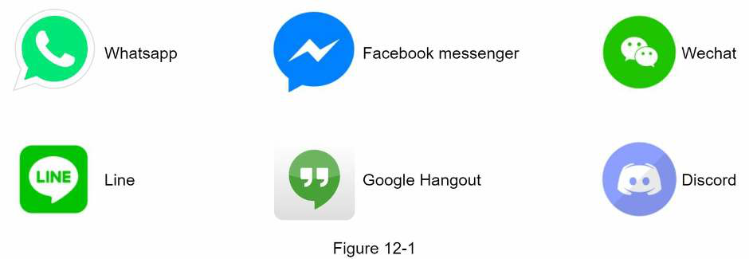

## Bước 1 - Hiểu bài toán và xác định phạm vi thiết kế (Step 1 - Understand the problem and establish design scope)

Điều cốt yếu là phải thống nhất loại ứng dụng trò chuyện cần thiết kế. Trên thị trường có các ứng dụng trò chuyện 1-1 như Facebook Messenger, WeChat và WhatsApp; các ứng dụng trò chuyện văn phòng tập trung vào trò chuyện nhóm như Slack; hoặc các ứng dụng trò chuyện cho game như Discord, vốn tập trung vào tương tác nhóm lớn và độ trễ thoại thấp.

Loạt câu hỏi làm rõ đầu tiên nên xác định chính xác điều người phỏng vấn đang hướng tới khi yêu cầu bạn thiết kế một hệ thống trò chuyện. Tối thiểu, hãy làm rõ xem bạn nên tập trung vào ứng dụng trò chuyện 1-1 hay trò chuyện nhóm. Một số câu hỏi bạn có thể đặt ra như sau:

- **Ứng viên (Candidate):** Chúng ta sẽ thiết kế loại ứng dụng trò chuyện nào? Trò chuyện 1-1 hay theo nhóm?
- **Người phỏng vấn (Interviewer):** Hệ thống cần hỗ trợ cả trò chuyện 1-1 và trò chuyện nhóm.
- **Ứng viên:** Đây là ứng dụng di động, ứng dụng web hay cả hai?
- **Người phỏng vấn:** Cả hai.
- **Ứng viên:** Quy mô của ứng dụng này là bao nhiêu? Một ứng dụng khởi nghiệp hay ở quy mô khổng lồ?
- **Người phỏng vấn:** Hệ thống cần hỗ trợ 50 triệu người dùng hoạt động hàng ngày (DAU - daily active users).
- **Ứng viên:** Đối với trò chuyện nhóm, giới hạn số lượng thành viên trong một nhóm là bao nhiêu?
- **Người phỏng vấn:** Tối đa 100 người.
- **Ứng viên:** Những tính năng nào quan trọng đối với ứng dụng trò chuyện? Hệ thống có hỗ trợ đính kèm tệp không?
- **Người phỏng vấn:** Trò chuyện 1-1, trò chuyện nhóm, chỉ báo trạng thái trực tuyến (online indicator). Hệ thống chỉ hỗ trợ tin nhắn văn bản.
- **Ứng viên:** Có giới hạn kích thước tin nhắn không?
- **Người phỏng vấn:** Có, độ dài văn bản phải ít hơn 100.000 ký tự.
- **Ứng viên:** Có yêu cầu mã hóa đầu cuối (end-to-end encryption) không?
- **Người phỏng vấn:** Hiện tại chưa yêu cầu, nhưng chúng ta sẽ thảo luận nếu còn thời gian.
- **Ứng viên:** Chúng ta sẽ lưu trữ lịch sử trò chuyện trong bao lâu?
- **Người phỏng vấn:** Lưu trữ vĩnh viễn.

Trong chương này, chúng ta tập trung thiết kế một ứng dụng trò chuyện giống như Facebook Messenger, với trọng tâm là các tính năng sau:
- Trò chuyện 1-1 với độ trễ truyền tin thấp.
- Trò chuyện nhóm nhỏ (tối đa 100 người).
- Trạng thái trực tuyến (online presence).
- Hỗ trợ đa thiết bị. Cùng một tài khoản có thể đăng nhập trên nhiều thiết bị cùng lúc.
- Thông báo đẩy (push notifications).

Việc thống nhất quy mô thiết kế cũng rất quan trọng. Chúng ta sẽ thiết kế một hệ thống hỗ trợ 50 triệu DAU.

> 📝 **Giải thích thêm (không có trong sách):** Từ con số **50 triệu DAU**, ta có thể ước lượng nhanh lưu lượng (back-of-the-envelope estimation) để hình dung áp lực lên hệ thống:
> - Giả sử mỗi người dùng gửi trung bình 40 tin nhắn/ngày → Tổng số tin nhắn/ngày = $50 \times 10^6 \times 40 = 2 \times 10^9$ (2 tỷ tin nhắn/ngày).
> - QPS trung bình cho việc gửi tin nhắn $\approx \frac{2 \times 10^9}{86.400} \approx 23.148 \text{ QPS}$.
> - QPS giờ cao điểm (gấp 3–5 lần) $\approx 70.000 - 115.000 \text{ QPS}$.
> - Lưu trữ: Giả sử trung bình mỗi tin nhắn 100 bytes → $2 \times 10^9 \times 100 \text{ bytes} = 200 \text{ GB/ngày} \approx 73 \text{ TB/năm}$. Vì lưu trữ vĩnh viễn, ta cần hệ thống lưu trữ có khả năng mở rộng ngang (horizontal scaling) tốt.

## Bước 2 - Đề xuất thiết kế tổng thể và thống nhất phương án (Step 2 - Propose high-level design and get buy-in)

Để xây dựng một thiết kế chất lượng cao, chúng ta cần có kiến thức cơ bản về cách máy khách (client) và máy chủ (server) giao tiếp với nhau. Trong một hệ thống trò chuyện, client có thể là ứng dụng di động hoặc ứng dụng web. Các client không giao tiếp trực tiếp với nhau. Thay vào đó, mỗi client kết nối đến một dịch vụ trò chuyện (chat service) hỗ trợ tất cả các tính năng đã nêu ở trên. Hãy tập trung vào các thao tác cơ bản. Dịch vụ trò chuyện phải hỗ trợ các chức năng sau:
- Nhận tin nhắn từ các client khác.
- Tìm đúng người nhận cho mỗi tin nhắn và chuyển tiếp tin nhắn đến họ.
- Nếu người nhận không trực tuyến, lưu giữ tin nhắn cho người nhận đó trên server cho đến khi người đó trực tuyến trở lại.

Hình 12-2 (Figure 12-2) thể hiện mối quan hệ giữa các client (người gửi và người nhận) với dịch vụ trò chuyện.

Khi một client muốn bắt đầu trò chuyện, nó kết nối tới dịch vụ trò chuyện bằng một hoặc nhiều giao thức mạng. Đối với dịch vụ trò chuyện, việc lựa chọn giao thức mạng là rất quan trọng. Hãy cùng thảo luận điều này với người phỏng vấn.

Đối với hầu hết các ứng dụng client/server, các yêu cầu (request) được khởi tạo bởi client. Điều này cũng đúng ở phía người gửi của một ứng dụng trò chuyện. Trong Hình 12-2 (Figure 12-2), khi người gửi gửi tin nhắn đến người nhận thông qua dịch vụ trò chuyện, nó sử dụng giao thức HTTP đã được kiểm chứng qua thời gian — giao thức web phổ biến nhất. Trong kịch bản này, client mở một kết nối HTTP với dịch vụ trò chuyện và gửi tin nhắn, thông báo cho dịch vụ chuyển tin nhắn đến người nhận. Cơ chế `keep-alive` tỏ ra hiệu quả cho việc này vì header `keep-alive` cho phép client duy trì một kết nối bền vững (persistent connection) với dịch vụ trò chuyện. Nó cũng giúp giảm số lần bắt tay TCP (TCP handshakes). HTTP là một lựa chọn tốt ở phía người gửi, và nhiều ứng dụng trò chuyện phổ biến như Facebook [1] ban đầu đã sử dụng HTTP để gửi tin nhắn.

Tuy nhiên, phía người nhận lại phức tạp hơn một chút. Vì HTTP do client khởi tạo, việc gửi tin nhắn từ server xuống client không hề đơn giản. Qua nhiều năm, nhiều kỹ thuật đã được sử dụng để mô phỏng kết nối do server khởi tạo: thăm dò định kỳ (polling), thăm dò dài (long polling) và WebSocket. Đây đều là những kỹ thuật quan trọng thường được dùng trong các buổi phỏng vấn thiết kế hệ thống, vì vậy hãy cùng xem xét từng kỹ thuật.

### Thăm dò định kỳ (Polling)

Như minh họa trong Hình 12-3 (Figure 12-3), polling là kỹ thuật mà client định kỳ hỏi server xem có tin nhắn mới nào khả dụng hay không. Tùy thuộc vào tần suất thăm dò, polling có thể rất tốn kém. Nó có thể tiêu tốn tài nguyên server quý giá chỉ để trả lời một câu hỏi mà phần lớn thời gian câu trả lời là "không có gì mới".

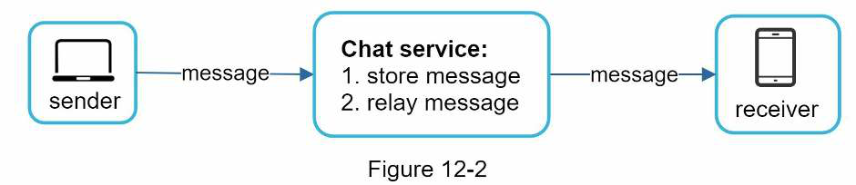

### Thăm dò dài (Long polling)

Vì polling có thể kém hiệu quả, bước tiến tiếp theo là long polling (Hình 12-4 / Figure 12-4).

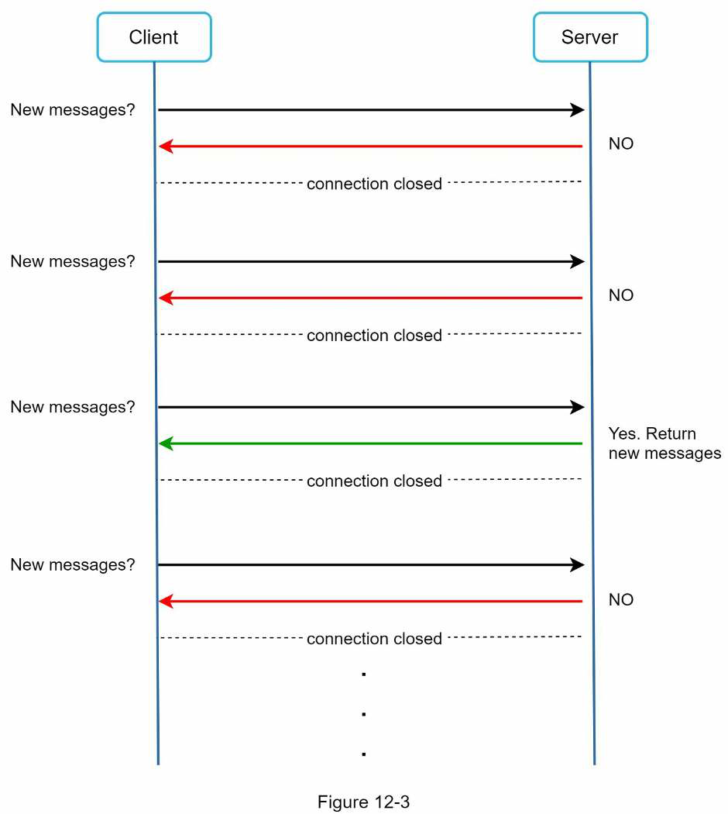

Trong long polling, client giữ kết nối mở cho đến khi thực sự có tin nhắn mới hoặc đạt đến ngưỡng hết thời gian chờ (timeout threshold). Ngay khi client nhận được tin nhắn mới, nó lập tức gửi một yêu cầu khác lên server để khởi động lại quy trình. Long polling có một số nhược điểm:
- Người gửi và người nhận có thể không kết nối tới cùng một máy chủ trò chuyện (chat server). Các máy chủ dựa trên HTTP thường là phi trạng thái (stateless). Nếu bạn dùng cơ chế cân bằng tải vòng tròn (round robin), máy chủ nhận tin nhắn có thể không phải là máy chủ đang giữ kết nối long-polling với client nhận tin nhắn.
- Server không có cách nào chính xác để biết một client đã ngắt kết nối hay chưa.
- Kém hiệu quả. Nếu một người dùng không trò chuyện nhiều, long polling vẫn thực hiện các kết nối định kỳ sau mỗi lần timeout.

### WebSocket

WebSocket là giải pháp phổ biến nhất để gửi các cập nhật bất đồng bộ từ server đến client. Hình 12-5 (Figure 12-5) minh họa cách thức hoạt động của nó.

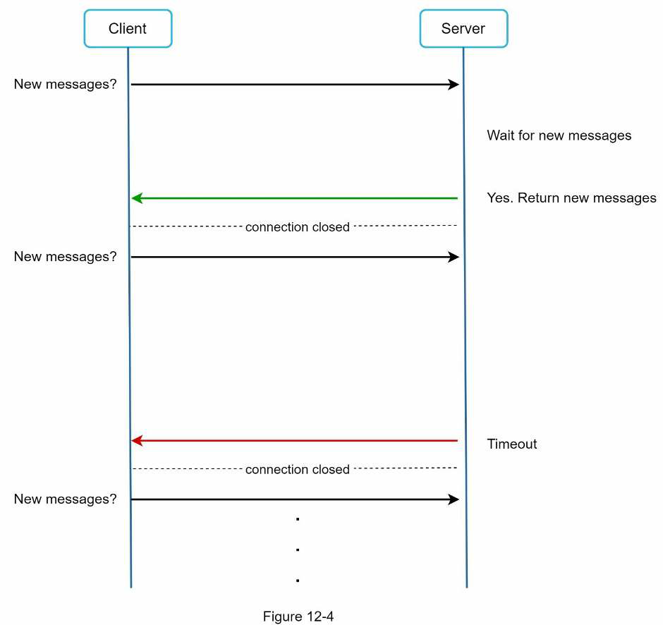

Kết nối WebSocket được khởi tạo bởi client. Nó có tính hai chiều (bi-directional) và bền vững (persistent). Nó bắt đầu vòng đời như một kết nối HTTP và có thể được "nâng cấp" (upgraded) thông qua một quá trình bắt tay (handshake) được định nghĩa rõ ràng thành kết nối WebSocket. Thông qua kết nối bền vững này, server có thể gửi các cập nhật xuống cho client. Kết nối WebSocket nhìn chung vẫn hoạt động ngay cả khi có tường lửa (firewall), bởi vì chúng sử dụng cổng 80 hoặc 443 — cũng là các cổng được dùng cho kết nối HTTP/HTTPS.

Trước đó chúng ta đã nói rằng ở phía người gửi, HTTP là một giao thức tốt để sử dụng, nhưng vì WebSocket hỗ trợ giao tiếp hai chiều, không có lý do kỹ thuật thuyết phục nào để không dùng luôn nó cho việc gửi tin nhắn. Hình 12-6 (Figure 12-6) cho thấy cách WebSocket (`ws`) được sử dụng cho cả phía người gửi và phía người nhận.

Bằng cách dùng WebSocket cho cả gửi và nhận, thiết kế trở nên đơn giản hơn và việc triển khai trên cả client lẫn server cũng trực quan hơn. Vì kết nối WebSocket là bền vững, việc quản lý kết nối hiệu quả ở phía server là cực kỳ quan trọng.

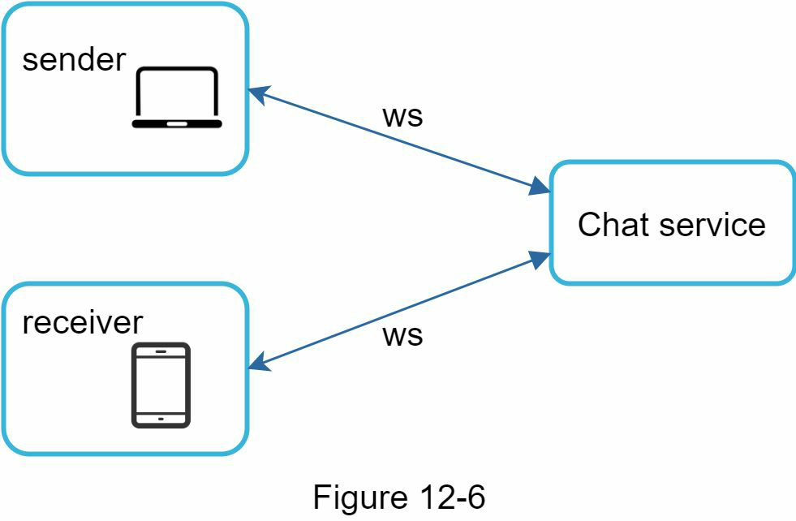

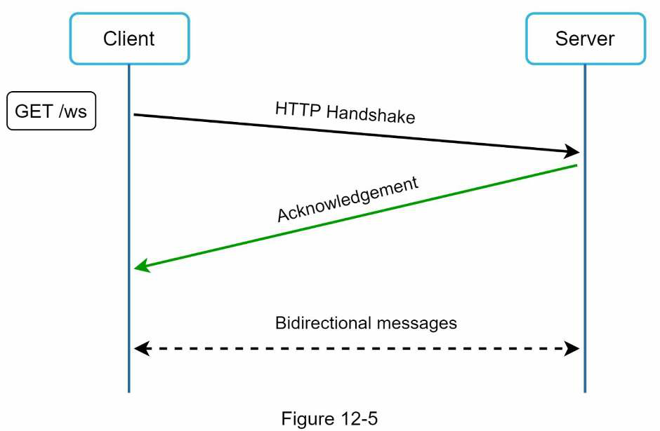

> 💡 **Ví dụ bổ sung (không có trong sách):** So sánh nhanh 3 cơ chế nhận tin nhắn trong thực tế:
> - **Polling (hỏi mỗi 2 giây):** Trong 1 giờ (3.600 giây), client gửi 1.800 HTTP request dù bạn không nhận được tin nhắn nào → Lãng phí băng thông, pin điện thoại và CPU của server.
> - **Long Polling (timeout 30 giây):** Giảm số request rỗng xuống còn ~120 request/giờ, nhưng mỗi lần timeout hoặc nhận tin nhắn xong đều phải tạo lại HTTP request mới kèm toàn bộ HTTP headers.
> - **WebSocket:** Chỉ bắt tay HTTP 1 lần duy nhất lúc mở app (`101 Switching Protocols`), sau đó giữ nguyên một kết nối TCP và truyền các khung dữ liệu (frame) cực nhẹ (chỉ tốn vài byte overhead). Độ trễ gần như tức thời (< 50ms).

### Thiết kế tổng thể (High-level design)

Vừa rồi chúng ta đã đề cập rằng WebSocket được chọn làm giao thức giao tiếp chính giữa client và server nhờ khả năng giao tiếp hai chiều, nhưng điều quan trọng cần lưu ý là mọi thứ khác không nhất thiết phải dùng WebSocket. Trên thực tế, hầu hết các tính năng (đăng ký, đăng nhập, hồ sơ người dùng, v.v.) của một ứng dụng trò chuyện có thể sử dụng phương thức request/response truyền thống qua HTTP. Hãy đi sâu hơn một chút và xem xét các thành phần ở mức tổng thể của hệ thống.

Như thể hiện trong Hình 12-7 (Figure 12-7), hệ thống trò chuyện được chia thành ba nhóm chính: dịch vụ phi trạng thái (stateless services), dịch vụ có trạng thái (stateful services) và tích hợp bên thứ ba (third-party integration).

#### Dịch vụ phi trạng thái (Stateless Services)

Dịch vụ phi trạng thái là các dịch vụ request/response công khai truyền thống, dùng để quản lý đăng nhập, đăng ký, hồ sơ người dùng, v.v. Đây là những tính năng phổ biến ở nhiều trang web và ứng dụng. Các dịch vụ phi trạng thái nằm sau một bộ cân bằng tải (load balancer) có nhiệm vụ định tuyến yêu cầu đến đúng dịch vụ dựa trên đường dẫn yêu cầu (request paths). Các dịch vụ này có thể là kiến trúc nguyên khối (monolithic) hoặc các vi dịch vụ (microservices) riêng lẻ.

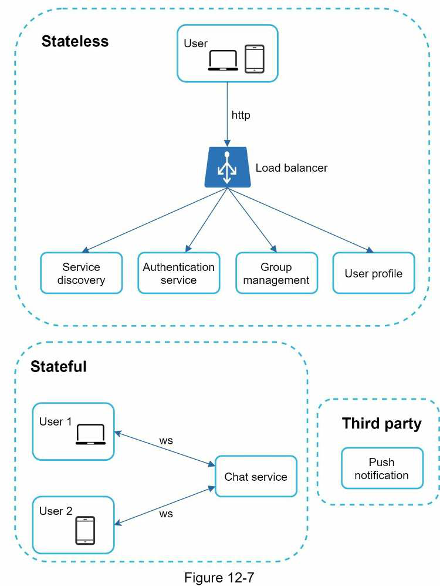

Chúng ta không cần tự xây dựng nhiều dịch vụ phi trạng thái này vì trên thị trường có sẵn các dịch vụ có thể tích hợp dễ dàng. Một dịch vụ mà chúng ta sẽ thảo luận kỹ hơn ở phần đi sâu vào thiết kế là dịch vụ khám phá (service discovery). Nhiệm vụ chính của nó là cung cấp cho client danh sách các tên miền DNS (DNS host names) của các máy chủ trò chuyện mà client có thể kết nối tới.

#### Dịch vụ có trạng thái (Stateful Service)

Dịch vụ có trạng thái duy nhất là dịch vụ trò chuyện (chat service). Dịch vụ này có trạng thái vì mỗi client duy trì một kết nối mạng bền vững tới một máy chủ trò chuyện cụ thể. Trong dịch vụ này, một client thông thường không chuyển sang máy chủ trò chuyện khác chừng nào máy chủ hiện tại vẫn còn hoạt động. Dịch vụ khám phá phối hợp chặt chẽ với dịch vụ trò chuyện để tránh tình trạng quá tải máy chủ. Chúng ta sẽ đi vào chi tiết ở phần thiết kế chuyên sâu.

#### Tích hợp bên thứ ba (Third-party integration)

Đối với ứng dụng trò chuyện, thông báo đẩy (push notification) là tích hợp bên thứ ba quan trọng nhất. Đây là cách để thông báo cho người dùng khi có tin nhắn mới đến, ngay cả khi ứng dụng không chạy. Việc tích hợp đúng đắn thông báo đẩy là cực kỳ quan trọng. Tham khảo "Chương 10: Thiết kế hệ thống thông báo" để biết thêm thông tin.

### Khả năng mở rộng (Scalability)

Ở quy mô nhỏ, tất cả các dịch vụ liệt kê ở trên có thể nằm gọn trên một máy chủ. Ngay cả ở quy mô mà chúng ta đang thiết kế, về mặt lý thuyết vẫn có thể chứa toàn bộ kết nối người dùng trên một máy chủ đám mây hiện đại. Số lượng kết nối đồng thời (concurrent connections) mà một máy chủ có thể xử lý nhiều khả năng sẽ là yếu tố giới hạn. Trong kịch bản của chúng ta, với 1 triệu người dùng đồng thời, giả sử mỗi kết nối người dùng cần 10KB bộ nhớ trên máy chủ (đây là con số rất ước lượng và phụ thuộc nhiều vào ngôn ngữ lập trình được chọn), thì chỉ cần khoảng 10GB bộ nhớ để giữ toàn bộ các kết nối trên một máy.

Nếu chúng ta đề xuất một thiết kế mà mọi thứ nằm trên một máy chủ duy nhất, điều này sẽ gióng lên hồi chuông cảnh báo lớn trong tâm trí người phỏng vấn. Không kỹ sư công nghệ nào lại thiết kế quy mô lớn như vậy trên một máy chủ đơn lẻ. Thiết kế đơn máy chủ là một điểm trừ chí mạng vì nhiều yếu tố, trong đó điểm lỗi đơn (single point of failure) là vấn đề lớn nhất.

Tuy nhiên, hoàn toàn ổn nếu bạn bắt đầu từ thiết kế một máy chủ. Chỉ cần đảm bảo người phỏng vấn hiểu rằng đó chỉ là điểm khởi đầu. Tổng hợp mọi thứ đã đề cập, Hình 12-8 (Figure 12-8) thể hiện thiết kế tổng thể đã được điều chỉnh.

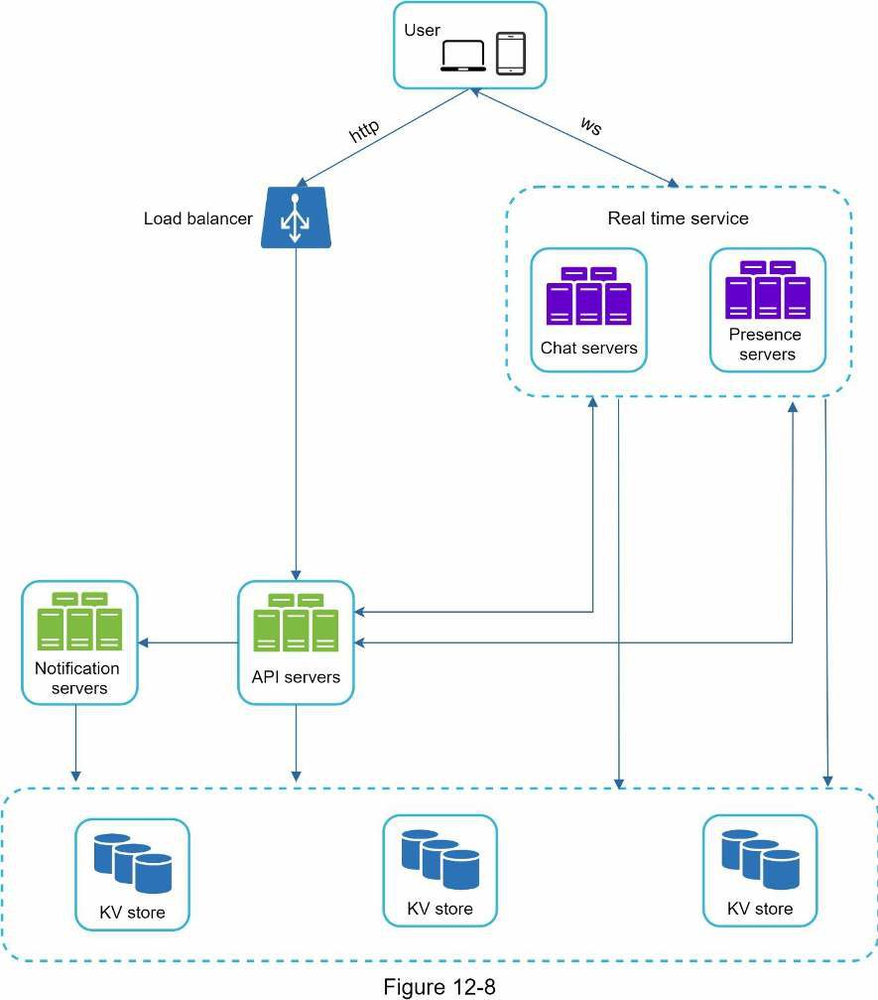

Trong Hình 12-8 (Figure 12-8), client duy trì một kết nối WebSocket bền vững tới một máy chủ trò chuyện để nhắn tin theo thời gian thực:
- **Máy chủ trò chuyện (Chat servers):** Đảm nhiệm việc gửi/nhận tin nhắn.
- **Máy chủ trạng thái trực tuyến (Presence servers):** Quản lý trạng thái trực tuyến/ngoại tuyến (online/offline).
- **Máy chủ API (API servers):** Xử lý mọi tác vụ khác bao gồm đăng nhập, đăng ký, thay đổi hồ sơ, v.v.
- **Máy chủ thông báo (Notification servers):** Gửi thông báo đẩy.
- **Kho lưu trữ khóa-giá trị (Key-value store):** Dùng để lưu trữ lịch sử trò chuyện. Khi một người dùng ngoại tuyến trực tuyến trở lại, người đó sẽ thấy toàn bộ lịch sử trò chuyện trước đó của mình.

### Lưu trữ (Storage)

Đến đây, chúng ta đã có các máy chủ sẵn sàng, các dịch vụ đang chạy và các tích hợp bên thứ ba hoàn chỉnh. Sâu bên dưới ngăn xếp công nghệ (technical stack) là tầng dữ liệu (data layer). Tầng dữ liệu thường đòi hỏi nhiều công sức để thiết kế cho đúng. Một quyết định quan trọng chúng ta phải đưa ra là chọn loại cơ sở dữ liệu phù hợp: cơ sở dữ liệu quan hệ (relational databases) hay cơ sở dữ liệu NoSQL? Để đưa ra quyết định sáng suốt, chúng ta sẽ xem xét các loại dữ liệu và mẫu đọc/ghi (read/write patterns).

Có hai loại dữ liệu tồn tại trong một hệ thống trò chuyện điển hình. Loại thứ nhất là **dữ liệu chung (generic data)**, chẳng hạn như hồ sơ người dùng, cài đặt, danh sách bạn bè. Những dữ liệu này được lưu trong các cơ sở dữ liệu quan hệ mạnh mẽ và đáng tin cậy. Nhân bản (replication) và phân mảnh (sharding) là những kỹ thuật phổ biến để đáp ứng các yêu cầu về tính sẵn sàng và khả năng mở rộng.

Loại thứ hai là **dữ liệu đặc thù của hệ thống trò chuyện: dữ liệu lịch sử trò chuyện**. Việc hiểu rõ mẫu đọc/ghi của dữ liệu này là rất quan trọng:
- Lượng dữ liệu của các hệ thống trò chuyện là khổng lồ. Một nghiên cứu trước đây [2] tiết lộ rằng Facebook Messenger và WhatsApp xử lý 60 tỷ tin nhắn mỗi ngày.
- Chỉ những cuộc trò chuyện gần đây mới được truy cập thường xuyên. Người dùng thường không tìm lại các cuộc trò chuyện cũ.
- Mặc dù phần lớn các trường hợp chỉ xem lịch sử trò chuyện rất gần đây, người dùng vẫn có thể sử dụng các tính năng đòi hỏi truy cập ngẫu nhiên (random access) vào dữ liệu, như tìm kiếm, xem các lượt nhắc tên (mentions), nhảy tới một tin nhắn cụ thể, v.v. Các trường hợp này cần được tầng truy cập dữ liệu hỗ trợ.
- Tỷ lệ đọc trên ghi (read to write ratio) vào khoảng 1:1 đối với các ứng dụng trò chuyện 1-1.

Việc lựa chọn đúng hệ thống lưu trữ hỗ trợ tất cả các trường hợp sử dụng là tối quan trọng. Chúng tôi đề xuất **kho lưu trữ khóa-giá trị (key-value stores)** vì những lý do sau:
- Key-value store cho phép mở rộng ngang (horizontal scaling) dễ dàng.
- Key-value store cung cấp độ trễ rất thấp khi truy cập dữ liệu.
- Cơ sở dữ liệu quan hệ không xử lý tốt phần đuôi dài (long tail) [3] của dữ liệu. Khi các chỉ mục (indexes) phình to, việc truy cập ngẫu nhiên trở nên rất tốn kém.
- Key-value store đã được nhiều ứng dụng trò chuyện tin cậy áp dụng thành công. Ví dụ, cả Facebook Messenger và Discord đều dùng key-value store: Facebook Messenger sử dụng HBase [4], còn Discord sử dụng Cassandra [5].

### Mô hình dữ liệu (Data models)

Vừa rồi chúng ta đã nói về việc sử dụng key-value store làm tầng lưu trữ. Dữ liệu quan trọng nhất là dữ liệu tin nhắn. Hãy cùng xem xét kỹ hơn.

#### Bảng tin nhắn cho trò chuyện 1-1 (Message table for 1 on 1 chat)

Hình 12-9 (Figure 12-9) thể hiện bảng tin nhắn cho trò chuyện 1-1. Khóa chính (primary key) là `message_id`, giúp xác định thứ tự tin nhắn. Chúng ta không thể dựa vào `created_at` để xác định thứ tự tin nhắn vì hai tin nhắn có thể được tạo ra tại cùng một thời điểm.

#### Bảng tin nhắn cho trò chuyện nhóm (Message table for group chat)

Hình 12-10 (Figure 12-10) thể hiện bảng tin nhắn cho trò chuyện nhóm. Khóa chính tổ hợp (composite primary key) là `(channel_id, message_id)`. Ở đây `channel` và `group` mang cùng một ý nghĩa. `channel_id` là khóa phân vùng (partition key) vì mọi truy vấn trong trò chuyện nhóm đều diễn ra trong phạm vi một kênh.

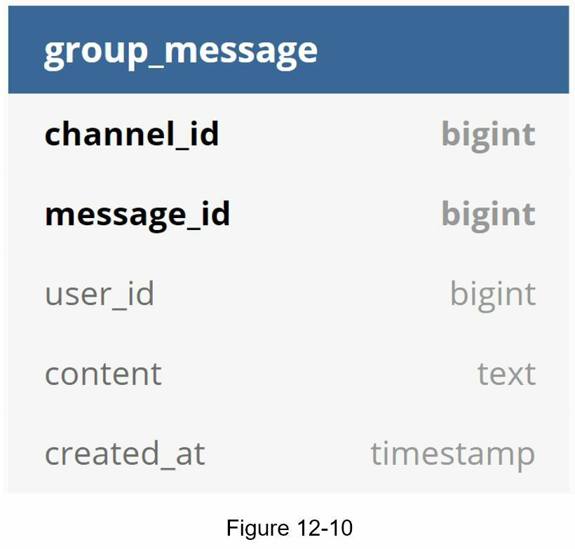

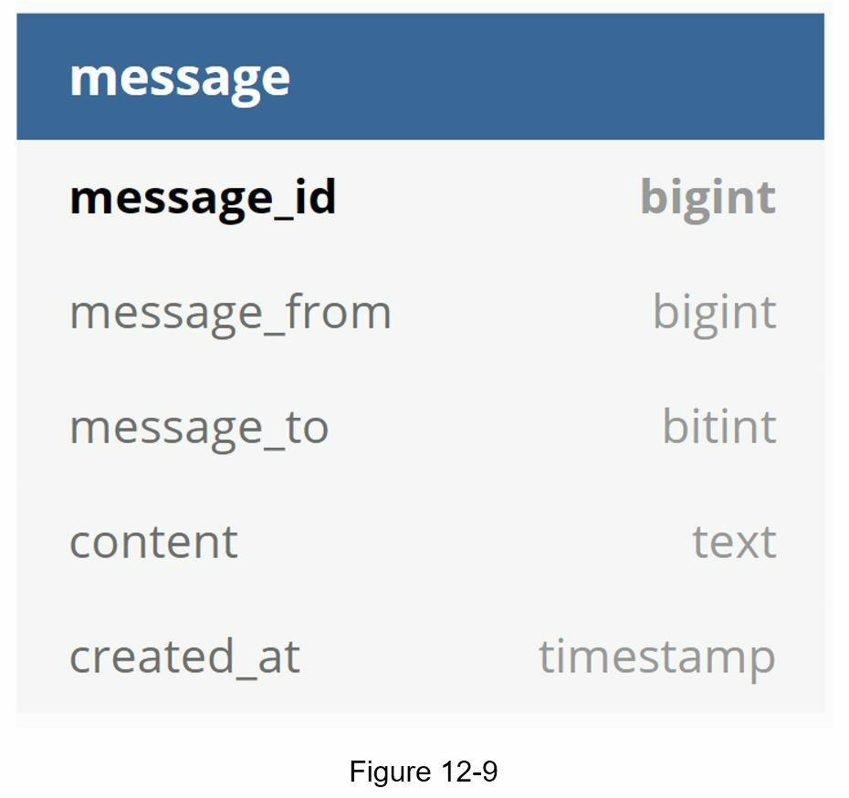

#### ID tin nhắn (Message ID)

Cách sinh `message_id` là một chủ đề thú vị đáng để khám phá. `message_id` gánh vác trách nhiệm đảm bảo thứ tự của các tin nhắn. Để xác định chắc chắn thứ tự tin nhắn, `message_id` phải thỏa mãn hai yêu cầu sau:
- Các ID phải là duy nhất (unique).
- Các ID phải sắp xếp được theo thời gian (sortable by time), nghĩa là các hàng mới hơn có ID lớn hơn các hàng cũ hơn.

Làm thế nào để đạt được hai đảm bảo này? Ý tưởng đầu tiên nảy ra trong đầu là từ khóa `auto_increment` trong MySQL. Tuy nhiên, các cơ sở dữ liệu NoSQL thường không cung cấp tính năng như vậy.

Cách tiếp cận thứ hai là sử dụng bộ sinh số tuần tự 64-bit toàn cục (global 64-bit sequence number generator) như Snowflake [6]. Điều này đã được thảo luận trong "Chương 7: Thiết kế bộ sinh ID duy nhất trong hệ thống phân tán".

Cách tiếp cận cuối cùng là sử dụng bộ sinh số tuần tự cục bộ (local sequence number generator). "Cục bộ" có nghĩa là các ID chỉ cần duy nhất trong phạm vi một nhóm. Lý do ID cục bộ vẫn hoạt động tốt là vì việc duy trì thứ tự tin nhắn trong phạm vi một kênh trò chuyện 1-1 hoặc một kênh nhóm là đã đủ. Cách tiếp cận này dễ triển khai hơn so với việc triển khai ID toàn cục.

> 💡 **Ví dụ bổ sung (không có trong sách):** Minh họa truy vấn CQL (Cassandra) cho bảng tin nhắn nhóm với khóa chính `(channel_id, message_id)`:
> ```sql
> CREATE TABLE group_messages (
>     channel_id bigint,
>     message_id bigint,
>     user_id bigint,
>     content text,
>     created_at timestamp,
>     PRIMARY KEY ((channel_id), message_id)
> ) WITH CLUSTERING ORDER BY (message_id DESC);
> ```
> Nhờ `channel_id` là partition key và `message_id` là clustering key sắp xếp giảm dần (`DESC`), toàn bộ tin nhắn của một nhóm được lưu liền kề nhau trên đĩa theo thứ tự mới nhất trước, giúp truy vấn lấy 50 tin nhắn gần nhất chỉ tốn đúng 1 lần đọc tuần tự (sequential read) cực nhanh.

## Bước 3 - Đi sâu vào thiết kế (Step 3 - Design deep dive)

Trong một buổi phỏng vấn thiết kế hệ thống, thông thường bạn sẽ được kỳ vọng đi sâu vào một số thành phần trong thiết kế tổng thể. Đối với hệ thống trò chuyện, khám phá dịch vụ (service discovery), các luồng nhắn tin (messaging flows) và chỉ báo trạng thái trực tuyến/ngoại tuyến (online/offline indicators) là những phần xứng đáng được phân tích sâu hơn.

### Khám phá dịch vụ (Service discovery)

Vai trò chính của dịch vụ khám phá là đề xuất máy chủ trò chuyện tốt nhất cho một client dựa trên các tiêu chí như vị trí địa lý, công suất máy chủ (server capacity), v.v. Apache ZooKeeper [7] là một giải pháp mã nguồn mở phổ biến cho service discovery. Nó đăng ký tất cả các máy chủ trò chuyện đang khả dụng và chọn ra máy chủ tốt nhất cho client dựa trên các tiêu chí đã định nghĩa trước.

Hình 12-11 (Figure 12-11) minh họa cách service discovery (ZooKeeper) hoạt động:
1. Người dùng A (User A) cố gắng đăng nhập vào ứng dụng.
2. Bộ cân bằng tải (load balancer) gửi yêu cầu đăng nhập tới các máy chủ API (API servers).
3. Sau khi backend xác thực người dùng thành công, dịch vụ khám phá tìm máy chủ trò chuyện tốt nhất cho Người dùng A. Trong ví dụ này, máy chủ 2 (server 2) được chọn và thông tin máy chủ được trả về cho Người dùng A.
4. Người dùng A kết nối tới máy chủ trò chuyện 2 thông qua WebSocket.

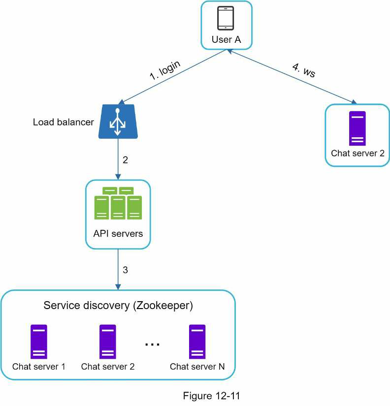

### Luồng tin nhắn (Message flows)

Việc hiểu luồng hoạt động đầu-cuối (end-to-end flow) của một hệ thống trò chuyện rất thú vị. Trong phần này, chúng ta sẽ khám phá luồng trò chuyện 1-1, đồng bộ hóa tin nhắn trên nhiều thiết bị và luồng trò chuyện nhóm.

#### Luồng trò chuyện 1-1 (1 on 1 chat flow)

Hình 12-12 (Figure 12-12) giải thích điều gì xảy ra khi Người dùng A gửi một tin nhắn cho Người dùng B:
1. Người dùng A gửi một tin nhắn trò chuyện tới Máy chủ trò chuyện 1 (Chat server 1).
2. Máy chủ trò chuyện 1 lấy một ID tin nhắn từ bộ sinh ID (ID generator).
3. Máy chủ trò chuyện 1 gửi tin nhắn vào hàng đợi đồng bộ tin nhắn (message sync queue).
4. Tin nhắn được lưu vào kho lưu trữ khóa-giá trị (key-value store).
5.a. Nếu Người dùng B đang trực tuyến, tin nhắn được chuyển tiếp tới Máy chủ trò chuyện 2 (Chat server 2) nơi Người dùng B đang kết nối.
5.b. Nếu Người dùng B ngoại tuyến, một thông báo đẩy được gửi từ các máy chủ thông báo đẩy (push notification - PN servers).
6. Máy chủ trò chuyện 2 chuyển tiếp tin nhắn tới Người dùng B. Có một kết nối WebSocket bền vững giữa Người dùng B và Máy chủ trò chuyện 2.

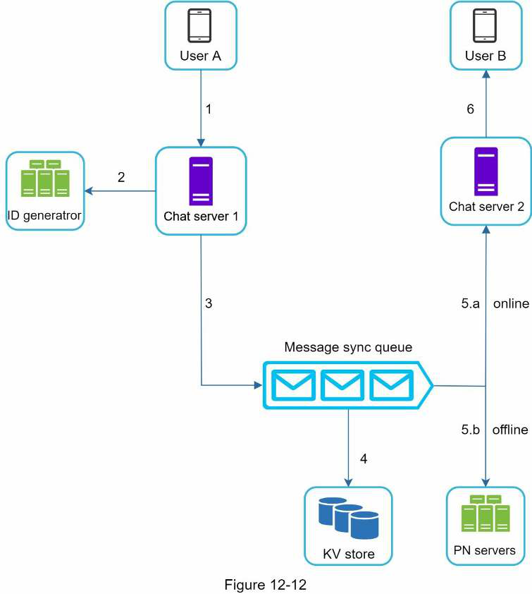

> 💡 **Sơ đồ tuần tự minh họa bổ sung (không có trong sách):**
> ```mermaid
> sequenceDiagram
>     participant A as User A
>     participant CS1 as Chat Server 1
>     participant ID as ID Generator
>     participant Q as Message Sync Queue
>     participant KV as Key-Value Store
>     participant CS2 as Chat Server 2
>     participant PN as Push Notification Server
>     participant B as User B
> 
>     A->>CS1: 1. Gửi tin nhắn (WebSocket)
>     CS1->>ID: 2. Lấy message_id
>     ID-->>CS1: Trả về message_id
>     CS1->>Q: 3. Đẩy tin nhắn vào hàng đợi
>     Q->>KV: 4. Lưu tin nhắn vào KV Store
>     alt User B đang online
>         Q->>CS2: 5a. Chuyển tiếp tới Chat Server 2
>         CS2->>B: 6. Đẩy tin nhắn qua WebSocket
>     else User B đang offline
>         Q->>PN: 5b. Gửi yêu cầu Push Notification
>         PN->>B: Gửi thông báo đẩy tới thiết bị
>     end
> ```

#### Đồng bộ hóa tin nhắn trên nhiều thiết bị (Message synchronization across multiple devices)

Nhiều người dùng sở hữu nhiều thiết bị. Chúng ta sẽ giải thích cách đồng bộ tin nhắn trên nhiều thiết bị. Hình 12-13 (Figure 12-13) trình bày một ví dụ về đồng bộ hóa tin nhắn.

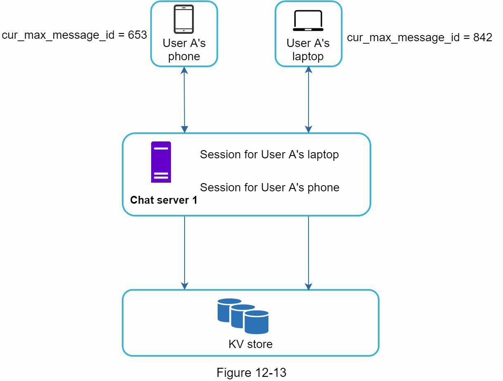

Trong Hình 12-13 (Figure 12-13), Người dùng A có hai thiết bị: một điện thoại và một máy tính xách tay (laptop). Khi Người dùng A đăng nhập vào ứng dụng trò chuyện trên điện thoại, nó thiết lập một kết nối WebSocket với Máy chủ trò chuyện 1. Tương tự, có một kết nối giữa laptop và Máy chủ trò chuyện 1.

Mỗi thiết bị duy trì một biến gọi là `cur_max_message_id`, dùng để theo dõi ID tin nhắn mới nhất hiện có trên thiết bị đó. Các tin nhắn thỏa mãn hai điều kiện sau được coi là tin nhắn mới:
- ID người nhận (`recipient_id`) bằng với ID người dùng đang đăng nhập hiện tại.
- ID tin nhắn trong kho lưu trữ khóa-giá trị lớn hơn `cur_max_message_id`.

Với `cur_max_message_id` riêng biệt trên từng thiết bị, việc đồng bộ hóa tin nhắn trở nên dễ dàng vì mỗi thiết bị có thể tự lấy các tin nhắn mới từ KV store.

#### Luồng trò chuyện nhóm nhỏ (Small group chat flow)

So với trò chuyện 1-1, logic của trò chuyện nhóm phức tạp hơn. Các Hình 12-14 và 12-15 (Figures 12-14 and 12-15) giải thích luồng hoạt động này.

Hình 12-14 (Figure 12-14) giải thích điều gì xảy ra khi Người dùng A gửi một tin nhắn trong nhóm trò chuyện. Giả sử nhóm có 3 thành viên (Người dùng A, Người dùng B và Người dùng C). Đầu tiên, tin nhắn từ Người dùng A được sao chép vào hàng đợi đồng bộ tin nhắn (message sync queue) của từng thành viên trong nhóm: một bản cho Người dùng B và bản thứ hai cho Người dùng C. Bạn có thể hình dung hàng đợi đồng bộ tin nhắn giống như một hộp thư đến (inbox) của người nhận. Lựa chọn thiết kế này rất tốt cho trò chuyện nhóm nhỏ bởi vì:
- Nó đơn giản hóa luồng đồng bộ tin nhắn vì mỗi client chỉ cần kiểm tra hộp thư đến của riêng mình để lấy tin nhắn mới.
- Khi số lượng thành viên trong nhóm nhỏ, việc lưu một bản sao trong hộp thư đến của mỗi người nhận không quá tốn kém.

WeChat sử dụng cách tiếp cận tương tự và giới hạn một nhóm tối đa 500 thành viên [8]. Tuy nhiên, đối với các nhóm có rất nhiều người dùng, việc lưu một bản sao tin nhắn cho mỗi thành viên là không thể chấp nhận được.

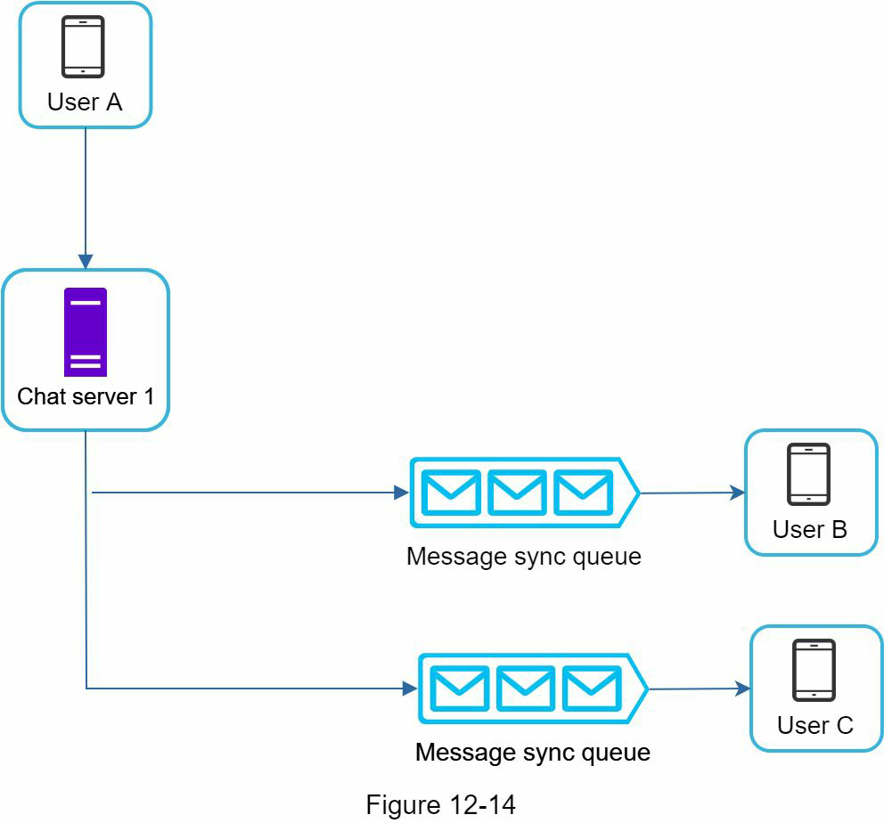

Ở phía người nhận, một người nhận có thể nhận tin nhắn từ nhiều người dùng khác nhau. Mỗi người nhận có một hộp thư đến (message sync queue) chứa tin nhắn từ các người gửi khác nhau. Hình 12-15 (Figure 12-15) minh họa thiết kế này.

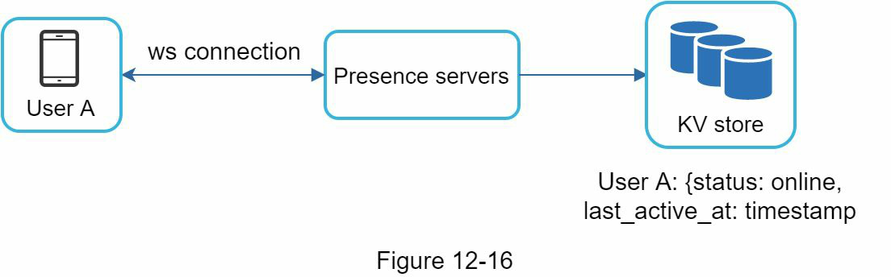

### Trạng thái trực tuyến (Online presence)

Chỉ báo trạng thái trực tuyến (online presence indicator) là một tính năng thiết yếu của nhiều ứng dụng trò chuyện. Thông thường, bạn có thể thấy một chấm xanh bên cạnh ảnh đại diện hoặc tên người dùng. Phần này giải thích điều gì diễn ra phía sau hậu trường.

Trong thiết kế tổng thể, các máy chủ trạng thái trực tuyến (presence servers) chịu trách nhiệm quản lý trạng thái online và giao tiếp với client thông qua WebSocket. Có một vài luồng sẽ kích hoạt sự thay đổi trạng thái trực tuyến. Hãy cùng xem xét từng luồng.

#### Đăng nhập (User login)

Luồng đăng nhập đã được giải thích trong phần "Khám phá dịch vụ" (Service discovery). Sau khi kết nối WebSocket được thiết lập giữa client và dịch vụ thời gian thực, trạng thái trực tuyến và dấu thời gian `last_active_at` của Người dùng A được lưu vào KV store. Chỉ báo trạng thái sẽ hiển thị người dùng đang trực tuyến sau khi người đó đăng nhập.

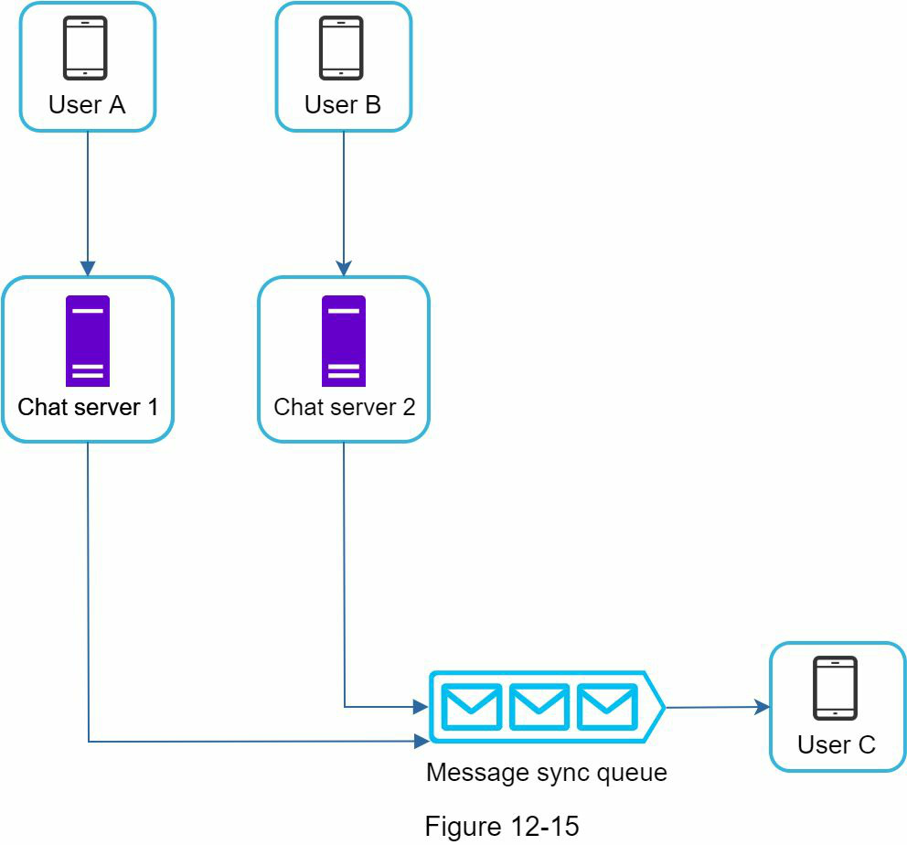

#### Đăng xuất (User logout)

Khi người dùng đăng xuất, hệ thống đi qua luồng đăng xuất như minh họa trong Hình 12-17 (Figure 12-17). Trạng thái trực tuyến được chuyển thành ngoại tuyến (offline) trong KV store. Chỉ báo trạng thái hiển thị người dùng đang ngoại tuyến.

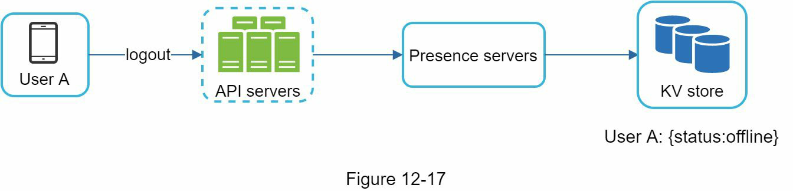

#### Mất kết nối (User disconnection)

Tất cả chúng ta đều mong muốn kết nối internet của mình luôn ổn định và đáng tin cậy. Tuy nhiên, thực tế không phải lúc nào cũng như vậy; do đó, chúng ta phải xử lý vấn đề này trong thiết kế. Khi người dùng bị ngắt kết nối internet, kết nối bền vững giữa client và server bị mất. Một cách xử lý ngây thơ (naive way) đối với việc mất kết nối là đánh dấu người dùng là ngoại tuyến ngay lập tức và chuyển lại thành trực tuyến khi kết nối được thiết lập lại. Tuy nhiên, cách này có một nhược điểm lớn. Người dùng rất thường xuyên bị mất kết nối và kết nối lại liên tục trong một khoảng thời gian ngắn. Ví dụ, kết nối mạng có thể chập chờn lúc có lúc không khi người dùng đi qua đường hầm. Việc cập nhật trạng thái trực tuyến mỗi lần mất kết nối/kết nối lại sẽ khiến chỉ báo trạng thái thay đổi quá thường xuyên, dẫn đến trải nghiệm người dùng kém.

Chúng ta đưa vào **cơ chế nhịp tim (heartbeat mechanism)** để giải quyết vấn đề này. Định kỳ, một client đang trực tuyến sẽ gửi một sự kiện nhịp tim (heartbeat event) tới các máy chủ trạng thái trực tuyến (presence servers). Nếu máy chủ trạng thái nhận được sự kiện nhịp tim trong một khoảng thời gian nhất định, chẳng hạn $x$ giây từ client, người dùng được coi là đang trực tuyến. Ngược lại, người dùng bị coi là ngoại tuyến.

Trong Hình 12-18 (Figure 12-18), client gửi sự kiện heartbeat lên server mỗi 5 giây. Sau khi gửi 3 sự kiện heartbeat, client bị mất kết nối và không kết nối lại trong vòng $x = 30$ giây (con số này được chọn tùy ý để minh họa logic). Trạng thái trực tuyến sau đó được chuyển sang ngoại tuyến.

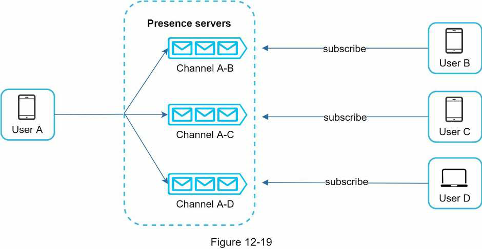

#### Lan truyền trạng thái trực tuyến (Online status fanout)

Làm thế nào bạn bè của Người dùng A biết được sự thay đổi trạng thái? Hình 12-19 (Figure 12-19) giải thích cách thức hoạt động. Các máy chủ trạng thái sử dụng mô hình xuất bản - đăng ký (publish-subscribe model), trong đó mỗi cặp bạn bè duy trì một kênh (channel). Khi trạng thái trực tuyến của Người dùng A thay đổi, nó xuất bản sự kiện tới ba kênh: kênh `A-B`, `A-C` và `A-D`. Ba kênh này được đăng ký bởi Người dùng B, C và D tương ứng. Nhờ vậy, bạn bè dễ dàng nhận được cập nhật trạng thái trực tuyến. Việc giao tiếp giữa client và server diễn ra thông qua WebSocket thời gian thực.

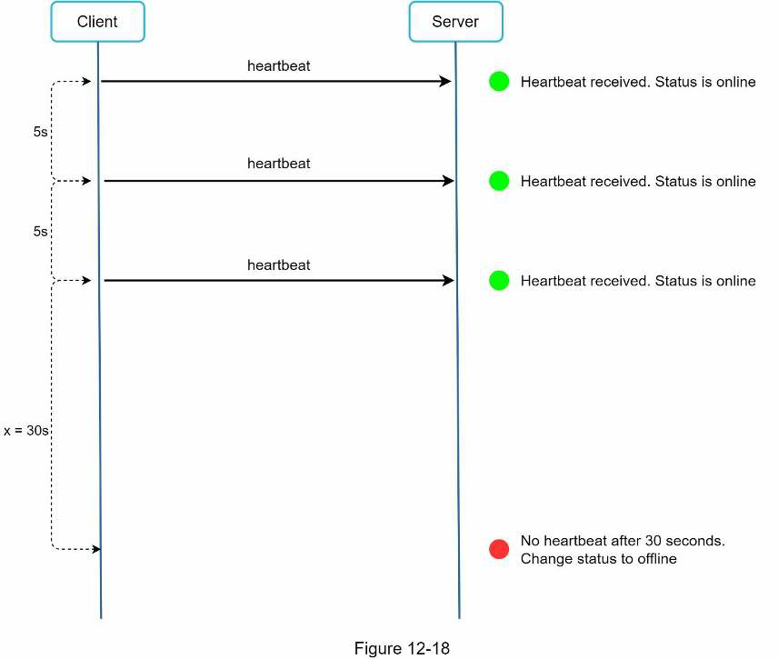

Thiết kế trên hoạt động hiệu quả đối với một nhóm người dùng nhỏ. Ví dụ, WeChat sử dụng cách tiếp cận tương tự vì nhóm người dùng của nó bị giới hạn ở mức 500. Đối với các nhóm lớn hơn, việc thông báo trạng thái trực tuyến cho tất cả các thành viên sẽ rất tốn kém và mất thời gian. Giả sử một nhóm có 100.000 thành viên. Mỗi lần thay đổi trạng thái sẽ tạo ra 100.000 sự kiện. Để giải quyết nút thắt hiệu năng (performance bottleneck) này, một giải pháp khả thi là chỉ tải trạng thái trực tuyến khi người dùng bước vào một nhóm hoặc tự tay làm mới (refresh) danh sách bạn bè.

## Bước 4 - Tổng kết (Step 4 - Wrap up)

Trong chương này, chúng ta đã trình bày một kiến trúc hệ thống trò chuyện hỗ trợ cả trò chuyện 1-1 và trò chuyện nhóm nhỏ. WebSocket được sử dụng để giao tiếp thời gian thực giữa client và server. Hệ thống trò chuyện bao gồm các thành phần sau: máy chủ trò chuyện (chat servers) để nhắn tin thời gian thực, máy chủ trạng thái (presence servers) để quản lý trạng thái trực tuyến, máy chủ thông báo đẩy (push notification servers) để gửi thông báo đẩy, kho lưu trữ khóa-giá trị (key-value stores) để lưu trữ bền vững lịch sử trò chuyện và máy chủ API (API servers) cho các chức năng khác.

Nếu bạn còn dư thời gian ở cuối buổi phỏng vấn, đây là các điểm thảo luận bổ sung bạn có thể đề cập:
- **Mở rộng ứng dụng trò chuyện để hỗ trợ tệp đa phương tiện** như ảnh và video. Tệp đa phương tiện có kích thước lớn hơn đáng kể so với văn bản. Nén dữ liệu (compression), lưu trữ đám mây (cloud storage) và ảnh thu nhỏ (thumbnails) là những chủ đề thú vị để trao đổi.
- **Mã hóa đầu cuối (End-to-end encryption).** WhatsApp hỗ trợ mã hóa đầu cuối cho tin nhắn. Chỉ người gửi và người nhận mới có thể đọc được tin nhắn. Độc giả quan tâm nên tham khảo bài viết trong tài liệu tham khảo [9].
- **Lưu trữ đệm (caching) tin nhắn ở phía client** rất hiệu quả trong việc giảm lượng dữ liệu truyền tải giữa client và server.
- **Cải thiện thời gian tải (load time).** Slack đã xây dựng một mạng lưới phân tán theo địa lý để lưu cache dữ liệu người dùng, kênh, v.v. nhằm cải thiện thời gian tải [10].
- **Xử lý lỗi (Error handling):**
  - *Lỗi máy chủ trò chuyện:* Có thể có hàng trăm nghìn, thậm chí nhiều hơn các kết nối bền vững tới một máy chủ trò chuyện. Nếu một máy chủ trò chuyện bị ngoại tuyến (offline), dịch vụ khám phá (ZooKeeper) sẽ cung cấp một máy chủ trò chuyện mới để các client thiết lập kết nối mới.
  - *Cơ chế gửi lại tin nhắn:* Thử lại (retry) và xếp hàng (queueing) là những kỹ thuật phổ biến để gửi lại tin nhắn khi gặp sự cố.

Chúc mừng bạn đã đi được đến đây! Hãy tự thưởng cho mình một cái vỗ vai nhé. Làm tốt lắm!

## Tài liệu tham khảo (Reference materials)

[1] Erlang at Facebook: https://www.erlang-factory.com/upload/presentations/31/EugeneLetuchy-ErlangatFacebook.pdf  
[2] Messenger and WhatsApp process 60 billion messages a day: https://www.theverge.com/2016/4/12/11415198/facebook-messenger-whatsapp-number-messages-vs-sms-f8-2016  
[3] Long tail: https://en.wikipedia.org/wiki/Long_tail  
[4] The Underlying Technology of Messages: https://www.facebook.com/notes/facebook-engineering/the-underlying-technology-of-messages/454991608919/  
[5] How Discord Stores Billions of Messages: https://blog.discordapp.com/how-discord-stores-billions-of-messages-7fa6ec7ee4c7  
[6] Announcing Snowflake: https://blog.twitter.com/engineering/en_us/a/2010/announcing-snowflake.html  
[7] Apache ZooKeeper: https://zookeeper.apache.org/  
[8] From nothing: the evolution of WeChat background system (Article in Chinese): https://www.infoq.cn/article/the-road-of-the-growth-weixin-background  
[9] End-to-end encryption: https://faq.whatsapp.com/en/android/28030015/  
[10] Flannel: An Application-Level Edge Cache to Make Slack Scale: https://slack.engineering/flannel-an-application-level-edge-cache-to-make-slack-scale-

## Bảng thuật ngữ chương (Chapter Glossary)

| Thuật ngữ (English) | Tiếng Việt | Giải thích ngắn gọn |
| :--- | :--- | :--- |
| Daily Active Users (DAU) | Người dùng hoạt động hàng ngày | Số lượng người dùng duy nhất tương tác với hệ thống trong một ngày. |
| Polling | Thăm dò định kỳ | Kỹ thuật client gửi request theo chu kỳ cố định để hỏi server xem có dữ liệu mới không. |
| Long polling | Thăm dò dài | Kỹ thuật client giữ kết nối HTTP mở cho tới khi server có dữ liệu mới hoặc hết thời gian chờ (timeout). |
| WebSocket | WebSocket | Giao thức giao tiếp hai chiều, bền vững trên một kết nối TCP duy nhất sau bước nâng cấp từ HTTP. |
| Stateless / Stateful service | Dịch vụ phi trạng thái / có trạng thái | Dịch vụ không lưu trạng thái kết nối client trên bộ nhớ cục bộ (stateless) so với dịch vụ giữ kết nối bền vững với client (stateful). |
| Service discovery | Khám phá dịch vụ | Thành phần (như ZooKeeper) giúp client tìm ra máy chủ trò chuyện phù hợp nhất để kết nối. |
| Key-value store | Kho lưu trữ khóa-giá trị | Cơ sở dữ liệu NoSQL (như HBase, Cassandra) tối ưu cho mở rộng ngang và đọc/ghi độ trễ thấp. |
| Message sync queue | Hàng đợi đồng bộ tin nhắn | Hàng đợi đóng vai trò như hộp thư đến (inbox) tạm thời để phân phối và đồng bộ tin nhắn tới các thiết bị. |
| Heartbeat mechanism | Cơ chế nhịp tim | Tín hiệu định kỳ client gửi lên server để xác nhận vẫn đang trực tuyến, tránh đánh dấu offline nhầm khi mạng chập chờn. |
| Online status fanout | Lan truyền trạng thái trực tuyến | Cơ chế phát tán sự kiện thay đổi trạng thái online/offline tới danh sách bạn bè (thường qua mô hình pub-sub). |
